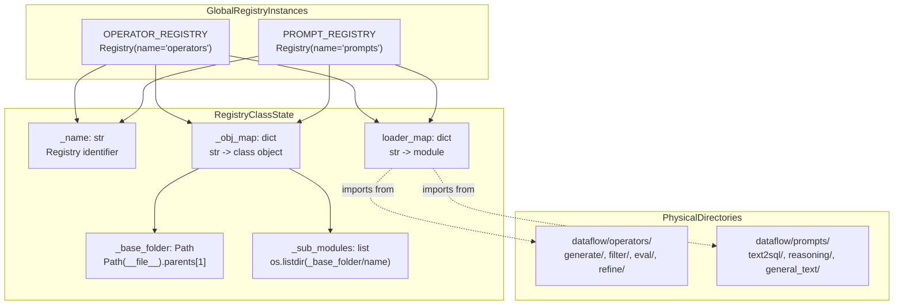
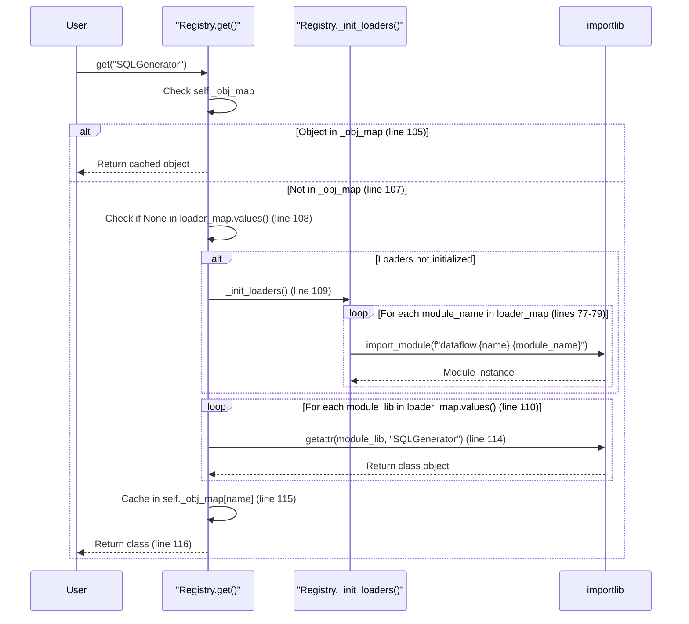

<!-- source: DeepWiki mcp.deepwiki.com · repo OpenDCAI/DataFlow · page 3.3 Registry and Lazy Loading · fetched 2026-11-02 -->

# Registry and Lazy Loading

<details>
<summary>Relevant source files</summary>

The following files were used as context for generating this wiki page:

- [dataflow/operators/code/filter/code_autogen_filter.py](dataflow/operators/code/filter/code_autogen_filter.py)
- [dataflow/utils/registry.py](dataflow/utils/registry.py)
- [test/cpu_only/test_register.py](test/cpu_only/test_register.py)
- [test/cpu_only/test_register_whitelist.py](test/cpu_only/test_register_whitelist.py)
- [test/xlsx_overview_of_dataflow/test_get_prompt_info_to_xlsx.py](test/xlsx_overview_of_dataflow/test_get_prompt_info_to_xlsx.py)

</details>


## Purpose and Scope

This page documents the Registry system and Lazy Loading mechanism in DataFlow. The `Registry` class provides dynamic name-to-object mapping through the `get()` method, enabling extensibility and plugin-like architecture. Two global instances—`OPERATOR_REGISTRY` and `PROMPT_REGISTRY`—manage the extensive collection of operators and prompt templates `[dataflow/utils/registry.py:34-129]()`. The `LazyLoader` pattern defers module imports until components are accessed, reducing startup time by avoiding the immediate loading of all components `[dataflow/utils/registry.py:34-129]()`.

Key components documented:
- `Registry` class with `register()` and `get()` methods `[dataflow/utils/registry.py:34-129]()`.
- Lazy module loading and attribute interception `[dataflow/utils/registry.py:34-129]()`.
- `apply_whitelist()` for production deployment optimization `[dataflow/utils/registry.py:131-195]()`.
- Integration with dynamic component discovery during pipeline compilation.

Sources: `[dataflow/utils/registry.py:34-129]()`

## Registry System Architecture

The Registry system uses the `Registry` class to manage component collections through global instances defined in the utility module `[dataflow/utils/registry.py:34-60]()`.

### Architecture Overview

The following diagram bridges the **Natural Language Space** (Registry concepts) to the **Code Entity Space** (specific classes and attributes).

Title: Registry and Lazy Loading Architecture


Sources: `[dataflow/utils/registry.py:34-75]()`

## Registry Class Implementation

The `Registry` class provides the core registration and lookup functionality `[dataflow/utils/registry.py:34-129]()`. It is initialized with a name that corresponds to a directory under `dataflow/` (e.g., `"operators"` or `"prompts"`).

### Registry Initialization Process

The `Registry.__init__()` method executes the initialization sequence `[dataflow/utils/registry.py:60-75]`:

```python
def __init__(self, name):
    self._name = name                                      # Line 65
    self._obj_map = {}                                     # Line 66
    self._base_folder = Path(__file__).resolve().parents[1]  # Line 67 (dataflow)
    self._sub_modules = list(os.listdir(self._base_folder / name))  # Line 68
    # Remove __init__.py and __pycache__ from list           # Lines 69-72
    if len(self._sub_modules) > 0:
        self.loader_map = dict(zip(self._sub_modules, [None] * len(self._sub_modules)))  # Line 74
```

**Initialization State After Construction:**

| Attribute | Initial Value | Example for `OPERATOR_REGISTRY` |
|-----------|---------------|--------------------------------|
| `_name` | Constructor argument | `"operators"` |
| `_obj_map` | `{}` | Empty dict, populated on registration or lazy load |
| `_base_folder` | `Path(__file__).parents[1]` | `.../DataFlow/dataflow/` |
| `_sub_modules` | Directory listing | `["generate", "filter", "eval", "refine", ...]` |
| `loader_map` | `{"module": None, ...}` | `{"generate": None, "filter": None, ...}` |

Sources: `[dataflow/utils/registry.py:60-75]()`

### Registration Methods

The `register()` method supports two usage patterns `[dataflow/utils/registry.py:85-103]()`:

1.  **Decorator Pattern:**
    ```python
    @OPERATOR_REGISTRY.register()
    class CodeAutoGeneratedFilter(OperatorABC):
        pass
    ```
2.  **Direct Call Pattern:**
    ```python
    OPERATOR_REGISTRY.register(CodeAutoGeneratedFilter)
    ```

Both patterns invoke `_do_register(name, obj)` `[dataflow/utils/registry.py:81-83]()`, which maps the class name to the object in `_obj_map`.

Sources: `[dataflow/utils/registry.py:81-103]()`, `[dataflow/operators/code/filter/code_autogen_filter.py:11-12]()`

## Lazy Loading Mechanism

The Lazy Loading system defers module imports until components are accessed via `Registry.get()` `[dataflow/utils/registry.py:104-129]()`.

### Lazy Loading Sequence

Title: Lazy Loading Component Discovery Flow


Sources: `[dataflow/utils/registry.py:76-129]()`

## Whitelist Filtering for Deployment Optimization

The `apply_whitelist()` method filters the registry to retain only specified operators, significantly reducing memory overhead in production environments `[dataflow/utils/registry.py:131-195]()`.

### Whitelist Application Algorithm

1.  **Normalization:** Converts input names into a `keep_set` `[dataflow/utils/registry.py:154]()`.
2.  **Set Operations:** Identifies keys to keep (intersection of `_obj_map` and `keep_set`) and keys to remove (difference) `[dataflow/utils/registry.py:162-163]()`.
3.  **Trimming:** Invokes `self._obj_map.pop(k, None)` for all keys not in the whitelist `[dataflow/utils/registry.py:166-167]()`.
4.  **Reporting:** Generates a detailed dictionary containing `total_before`, `total_after`, and `missing_in_registry` `[dataflow/utils/registry.py:174-182]()`.

Sources: `[dataflow/utils/registry.py:131-195]()`, `[test/cpu_only/test_register_whitelist.py:1-15]()`

## Import Structure Generation

The `generate_import_structure_from_type_checking()` function uses AST parsing to extract import mappings from `TYPE_CHECKING` blocks `[dataflow/utils/registry.py:15-31]()`.

```python
def generate_import_structure_from_type_checking(source_file: str, base_path: str) -> dict:
    source = Path(source_file).read_text(encoding="utf-8")
    tree = ast.parse(source)
    # ... iterates through AST to find TYPE_CHECKING blocks ...
    # ... maps class name to (module_file, name) ...
    return import_structure
```

This allows the lazy loading subsystem to identify module dependencies without executing module code during initial registry setup.

Sources: `[dataflow/utils/registry.py:15-31]()`

## Performance and Memory Characteristics

The combination of lazy loading and registry management optimizes the framework for large-scale collections.

| Feature | Implementation | Benefit |
|---------|----------------|---------|
| **Deferred Imports** | `Registry._init_loaders` | Reduces startup time by deferring heavy module imports. |
| **Caching** | `_obj_map` | Subsequent access to a loaded operator is $O(1)$. |
| **Selective Loading** | `Registry.get()` | Only modules required for the current pipeline are loaded into memory. |
| **Production Trimming** | `apply_whitelist()` | Removes unused operator references to free memory. |

Sources: `[dataflow/utils/registry.py:60-129]()`, `[dataflow/utils/registry.py:131-195]()`

---

