# Page: Overview

# Overview

<details>
<summary>Relevant source files</summary>

The following files were used as context for generating this wiki page:

- [LICENSE](LICENSE)
- [README.md](README.md)
- [README_zh.md](README_zh.md)
- [agent_skills/engine_context/blender_api.md](agent_skills/engine_context/blender_api.md)
- [agent_skills/setting_overview.md](agent_skills/setting_overview.md)
- [engine_adapters/README.md](engine_adapters/README.md)
- [engine_adapters/blender/__init__.py](engine_adapters/blender/__init__.py)
- [engine_adapters/blender/runtime/assets/actions.py](engine_adapters/blender/runtime/assets/actions.py)
- [models/README.md](models/README.md)
- [models/gen_audio/__init__.py](models/gen_audio/__init__.py)
- [operators/README.md](operators/README.md)
- [operators/gen_audio/__init__.py](operators/gen_audio/__init__.py)
- [operators/gen_audio/funcs/__init__.py](operators/gen_audio/funcs/__init__.py)
- [pipeline/README.md](pipeline/README.md)
- [pipeline/assets_gen/gen_audio/__init__.py](pipeline/assets_gen/gen_audio/__init__.py)
- [pipeline/common/paths.py](pipeline/common/paths.py)
- [test/harness/smoke.py](test/harness/smoke.py)
- [test/test_3D_scene_gen.py](test/test_3D_scene_gen.py)
- [test_data/outputs/README.md](test_data/outputs/README.md)
- [test_data/test_samples/README.md](test_data/test_samples/README.md)
- [test_data/test_samples/audio_gen_collect.jsonl](test_data/test_samples/audio_gen_collect.jsonl)
- [third_party/README.md](third_party/README.md)

</details>


3AGameFactory is an open-source framework that transforms natural-language game requirements into production-ready game assets and engine-ready game code via coding agents [README.md:15-20](). It covers multi-modality asset generation (images, 3D objects, 3D scenes, motion, audio, and CG video) and game construction across five supported engines: **Unreal Engine 5 (UE5), Blender, Unity, Godot 4, and three.js** [README.md:15-20]().

The system bridges **Natural Language Space** (user briefs and agent guidance) to **Code Entity Space** (Python operators, pipeline runners, model wrappers, and engine clients) [agent_skills/setting_overview.md:1-13](). 

Sources: `README.md:15-20`, `agent_skills/setting_overview.md:1-13`

---

## Architecture & Core Layers

3AGameFactory organizes its codebase into distinct functional layers separating agent instruction, raw model wrappers, task operators, pipeline orchestrators, and engine abstraction layers.

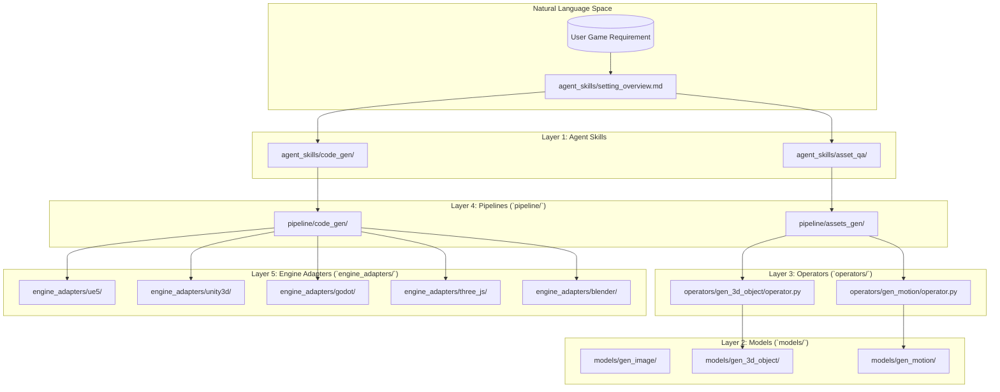
*Figure 1: Architectural progression from natural-language prompts to execution across pipeline runners, operators, model wrappers, and engine adapters.*

Sources: `README.md:15-20`, `models/README.md:1-13`, `operators/README.md:1-13`, `pipeline/README.md:1-11`, `engine_adapters/README.md:1-21`

---

## Core Layers Summary

1. **Agent Skills Layer (`agent_skills/`)** — Entry points, prompt templates, and routing guides (`setting_overview.md`) used by coding agents such as Claude Code or Codex to execute generation tasks [agent_skills/setting_overview.md:1-13]().
2. **Models Layer (`models/`)** — Thin wrappers providing a uniform `load()`, `infer()`, `unload()` lifecycle for local weight models and cloud APIs [models/README.md:1-7]().
3. **Operators Layer (`operators/`)** — Task-specific processing logic (`operator.py`, `funcs/`, `metrics/`) for modalities like 3D objects, motion, and scene reconstruction [operators/README.md:1-18]().
4. **Pipelines Layer (`pipeline/`)** — Execution runners (`run.py`, `eval.py`) divided into asset generation (`pipeline/assets_gen/`) and code generation (`pipeline/code_gen/`) [pipeline/README.md:1-30]().
5. **Engine Adapters Layer (`engine_adapters/`)** — Headless and editor-based transport clients (`UEClient`, `UnityClient`, `GodotClient`, `ThreeClient`, `BlenderClient`) and runtime plugins (`A3GamePlayable`, `A3GameRuntime`) [engine_adapters/README.md:1-35]().

Sources: `agent_skills/setting_overview.md:1-13`, `models/README.md:1-7`, `operators/README.md:1-18`, `pipeline/README.md:1-30`, `engine_adapters/README.md:1-35`

---

## Child Pages

For granular technical documentation, refer to the child pages below:

* **1.1 Getting Started & Environment Setup** — For installing engines, asset environments via `scripts/engine_install` and `scripts/asset_env_setup`, downloading weights, configuring cloud API keys, and executing smoke tests (`test/harness/smoke.py`).
* **1.2 Repository Layout & Core Conventions** — For structural separation between `models/`, `operators/`, `pipeline/`, and `engine_adapters/`, definitions of `game_id`, `run_id`, `task_id`, Layer A/B/C output trees, and `AAAGF_OUTPUT_ROOT`.
* **1.3 Path Resolution & Task Data Contracts** — For APIs in `pipeline/common/paths.py`, JSONL task formats, `test_data/test_samples` layouts, and summary artifacts (`meta.json`, `run_meta.json`, `results`).

Sources: `test/harness/smoke.py:1-30`, `pipeline/common/paths.py:1-39`, `test_data/test_samples/README.md:1-15`

---

# Page: Getting Started & Environment Setup

# Getting Started & Environment Setup

<details>
<summary>Relevant source files</summary>

The following files were used as context for generating this wiki page:

- [agent_skills/asset_qa/motion/SKILL.md](agent_skills/asset_qa/motion/SKILL.md)
- [scripts/asset_env_setup/README.md](scripts/asset_env_setup/README.md)
- [scripts/asset_env_setup/cloud_api_install.sh](scripts/asset_env_setup/cloud_api_install.sh)
- [scripts/asset_env_setup/gen_motion/download_weights.py](scripts/asset_env_setup/gen_motion/download_weights.py)
- [scripts/asset_env_setup/gen_motion/install.sh](scripts/asset_env_setup/gen_motion/install.sh)
- [scripts/asset_env_setup/gen_motion/runtime_env.sh](scripts/asset_env_setup/gen_motion/runtime_env.sh)
- [scripts/asset_env_setup/image/cloud_api_install.sh](scripts/asset_env_setup/image/cloud_api_install.sh)
- [scripts/asset_env_setup/image/qwen_image_install.sh](scripts/asset_env_setup/image/qwen_image_install.sh)
- [scripts/engine_install/README.md](scripts/engine_install/README.md)
- [scripts/engine_install/blender/README.md](scripts/engine_install/blender/README.md)
- [scripts/engine_install/blender/install.sh](scripts/engine_install/blender/install.sh)
- [scripts/engine_install/godot/README.md](scripts/engine_install/godot/README.md)
- [scripts/engine_install/godot/install.py](scripts/engine_install/godot/install.py)
- [scripts/engine_install/unity/README.md](scripts/engine_install/unity/README.md)
- [test/test_godot_adapter.py](test/test_godot_adapter.py)
- [test/test_godot_installer.py](test/test_godot_installer.py)

</details>


## Purpose and Scope
This page details the environment bootstrapping procedures for GameFactory-3A, covering automated engine installation scripts (`scripts/engine_install`), asset model environment provisioning and weight downloads (`scripts/asset_env_setup`), cloud API key configuration, and execution of initial verification smoke tests.

Sources: `scripts/engine_install/README.md:1-12` [scripts/engine_install/README.md:1-12](), `scripts/asset_env_setup/README.md:1-16` [scripts/asset_env_setup/README.md:1-16]()

---

## 1. Automated Engine Installation (`scripts/engine_install`)

GameFactory-3A provides isolated, non-interactive installation tools for engine runtimes under `scripts/engine_install/` [scripts/engine_install/README.md:1-6](). For Godot 4, the installer script `scripts/engine_install/godot/install.py` [scripts/engine_install/godot/install.py:1-29] handles exact stable version normalization, target resolution across platforms, SHA-512 cryptographic verification, and atomic extraction.

The version selection is strictly pinned (defaulting to `4.5.1-stable`) to prevent silent behavioral drift across generation runs [scripts/engine_install/godot/README.md:7-9](). The `normalize_version` function [scripts/engine_install/godot/install.py:55-67]() validates input tags, while `resolve_target` [scripts/engine_install/godot/install.py:74-138]() maps operating system and hardware architecture strings to official release archive labels. Integrity enforcement is handled by `parse_sha512_sums` [scripts/engine_install/godot/install.py:198-202](), which parses official checksum manifests.

For Unreal Engine 5 and Unity, setup checklists and prerequisites (such as enabling the Python Editor Script Plugin or adding `com.unity.cloud.gltfast`) are detailed in `scripts/engine_install/README.md` [scripts/engine_install/README.md:13-44]().

### Diagram: Godot Installation Control Flow
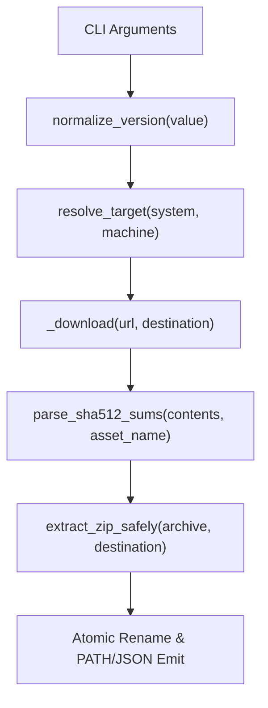
Sources: `scripts/engine_install/godot/install.py:55-202` [scripts/engine_install/godot/install.py:55-202](), `scripts/engine_install/README.md:13-64` [scripts/engine_install/README.md:13-64]()

---

## 2. Asset Model Environment Provisioning (`scripts/asset_env_setup`)

Asset generation environments are segregated by modality under `scripts/asset_env_setup/` [scripts/asset_env_setup/README.md:1-16](). Cloud-backed wrappers utilize lightweight HTTP clients via `scripts/asset_env_setup/cloud_api_install.sh` [scripts/asset_env_setup/cloud_api_install.sh:1-13](), requiring no compiled binaries or local GPUs.

For heavy local inference tasks like human motion, `scripts/asset_env_setup/gen_motion/install.sh` [scripts/asset_env_setup/gen_motion/install.sh:1-36]() establishes pinned Conda environments (`gamefactory3a-puppeteer`, `gamefactory3a-momask`, and `gamefactory3a-retarget-bpy`), clones external repositories (Puppeteer and MoMask) at exact commits, and builds required custom extensions. Weight checkpoints are fetched via `scripts/asset_env_setup/gen_motion/download_weights.py` [scripts/asset_env_setup/gen_motion/download_weights.py:11-33](), and runtime shell variables are exported through `scripts/asset_env_setup/gen_motion/runtime_env.sh` [scripts/asset_env_setup/gen_motion/runtime_env.sh:1-34]().

### Diagram: Asset Environment and Weight Architecture
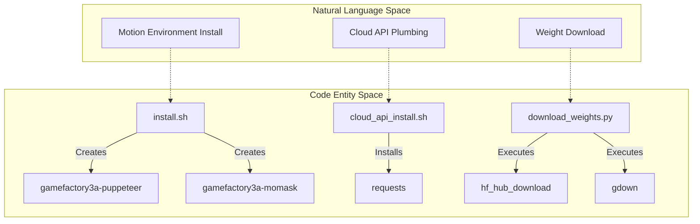
Sources: `scripts/asset_env_setup/gen_motion/install.sh:1-150` [scripts/asset_env_setup/gen_motion/install.sh:1-150](), `scripts/asset_env_setup/gen_motion/download_weights.py:11-121` [scripts/asset_env_setup/gen_motion/download_weights.py:11-121](), `scripts/asset_env_setup/cloud_api_install.sh:1-36` [scripts/asset_env_setup/cloud_api_install.sh:1-36]()

---

## 3. Cloud API Keys & Authentication Plumbing

Cloud-backed model wrappers rely on specific environment variables for authentication. Once `scripts/asset_env_setup/cloud_api_install.sh` has provisioned the required `requests` library [scripts/asset_env_setup/cloud_api_install.sh:23-31](), keys must be exported in the shell session [scripts/asset_env_setup/cloud_api_install.sh:38-44]():

| Environment Variable | Target Backend Services | Configuration Reference |
|---|---|---|
| `TRIPO_API_KEY` | Tripo 3D mesh and rigging models (`TripoModel`) [scripts/asset_env_setup/cloud_api_install.sh:39]() | `https://platform.tripo3d.ai/api-keys` [scripts/asset_env_setup/cloud_api_install.sh:39]() |
| `MESHY_API_KEY` | Meshy 3D generation wrappers (`MeshyModel`) [scripts/asset_env_setup/cloud_api_install.sh:40]() | `https://www.meshy.ai/api` [scripts/asset_env_setup/cloud_api_install.sh:40]() |
| `SEED_AUDIO_API_KEY` | ByteDance SeedAudio TTS/speech backend [scripts/asset_env_setup/cloud_api_install.sh:41]() | `https://openspeech.bytedance.com` [scripts/asset_env_setup/cloud_api_install.sh:41]() |
| `ARK_API_KEY` | Volcengine / Seedream image models [scripts/asset_env_setup/cloud_api_install.sh:42]() | `https://console.volcengine.com/ark` [scripts/asset_env_setup/cloud_api_install.sh:42]() |
| `MINIMAX_API_KEY` | MiniMax video generation and CG backends [scripts/asset_env_setup/cloud_api_install.sh:43]() | `https://platform.minimax.io` [scripts/asset_env_setup/cloud_api_install.sh:43]() |

Sources: `scripts/asset_env_setup/cloud_api_install.sh:23-57` [scripts/asset_env_setup/cloud_api_install.sh:23-56]()

---

## 4. Running First Smoke Tests

To verify that the environment and API credentials are functional without consuming generation credits or invoking active GPU loads, developers run the CPU-only smoke harness [scripts/asset_env_setup/cloud_api_install.sh:45-46]() and unit test suites [scripts/asset_env_setup/cloud_api_install.sh:47-51]().

```bash
# Verify cloud API connectivity and basic model wiring
python test/harness/smoke.py --kind 3d_object --backend tripo
python test/test_api_3d_object.py
python test/harness/smoke.py --kind tpose --backend seedream
python test/test_api_gen_tpose_image.py

# Query account balances programmatically
python -c "from models.gen_3d_object import TripoModel; print(TripoModel().balance())"
```

Additionally, automated installation routines are validated via standalone unit tests such as `test/test_godot_installer.py` [test/test_godot_installer.py:1-86](), which asserts version mappings, checksum parsers, and safe extraction constraints.

Sources: `scripts/asset_env_setup/cloud_api_install.sh:45-57` [scripts/asset_env_setup/cloud_api_install.sh:45-56](), `test/test_godot_installer.py:31-86` [test/test_godot_installer.py:31-86]()

---

# Page: Repository Layout & Core Conventions

# Repository Layout & Core Conventions

<details>
<summary>Relevant source files</summary>

The following files were used as context for generating this wiki page:

- [.gitignore](.gitignore)
- [LICENSE](LICENSE)
- [README.md](README.md)
- [README_zh.md](README_zh.md)
- [models/README.md](models/README.md)
- [models/gen_audio/__init__.py](models/gen_audio/__init__.py)
- [operators/README.md](operators/README.md)
- [operators/gen_audio/__init__.py](operators/gen_audio/__init__.py)
- [operators/gen_audio/funcs/__init__.py](operators/gen_audio/funcs/__init__.py)
- [pipeline/README.md](pipeline/README.md)
- [pipeline/assets_gen/gen_audio/__init__.py](pipeline/assets_gen/gen_audio/__init__.py)
- [pipeline/common/paths.py](pipeline/common/paths.py)
- [test/harness/smoke.py](test/harness/smoke.py)
- [test_data/outputs/README.md](test_data/outputs/README.md)
- [test_data/outputs/gameA_cyberpunk_shooter/default/assets/.gitkeep](test_data/outputs/gameA_cyberpunk_shooter/default/assets/.gitkeep)
- [test_data/outputs/gameA_cyberpunk_shooter/default/mechanic/.gitkeep](test_data/outputs/gameA_cyberpunk_shooter/default/mechanic/.gitkeep)
- [test_data/outputs/gameA_cyberpunk_shooter/default/ui/.gitkeep](test_data/outputs/gameA_cyberpunk_shooter/default/ui/.gitkeep)
- [test_data/test_samples/README.md](test_data/test_samples/README.md)
- [test_data/test_samples/audio_gen_collect.jsonl](test_data/test_samples/audio_gen_collect.jsonl)
- [third_party/README.md](third_party/README.md)

</details>


## Purpose & Scope

This page defines the structural organization, architectural separation boundaries, and naming conventions of the `3AGameFactory` codebase. It establishes how code modules are compartmentalized (`models/`, `operators/`, `pipeline/`, `engine_adapters/`), how execution states and assets are identified (`game_id`, `run_id`, `task_id`), and how the output artifact tree is structured around `AAAGF_OUTPUT_ROOT` via `pipeline/common/paths.py`.

Sources: `pipeline/common/paths.py:1-40`, `test_data/outputs/README.md:1-47`

---

## Core Architectural Separation

The codebase separates concerns into four primary tiers, preventing tight coupling between raw AI backends, task execution logic, end-to-end orchestration, and target engine implementations.

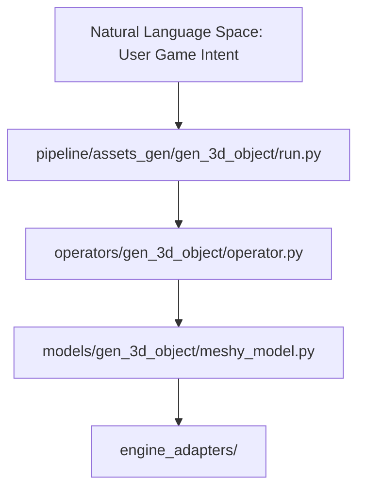

Sources: `models/README.md:1-12`, `operators/README.md:1-13`, `pipeline/README.md:1-30`

### Directory Breakdown

| Directory | Role & Responsibilities | Key Files / Modules |
| :--- | :--- | :--- |
| `models/` | Thin, uniform wrappers around AI models. Exposes standard lifecycle hooks (`load()`, `infer()`, `unload()`). | `models/gen_3d_object/meshy_model.py`, `models/common/cloud_api.py` [models/README.md:1-12]() |
| `operators/` | Domain-specific task logic. Each operator contains sub-steps (`funcs/`) and evaluation metrics (`metrics/`). | `operators/gen_3d_object/operator.py`, `operators/gen_3d_object/funcs/` [operators/README.md:1-13]() |
| `pipeline/` | End-to-end task runners and batch job drivers (`run.py` / `eval.py`), separated into assets and code generation. | `pipeline/common/paths.py`, `pipeline/assets_gen/gen_3d_object/run.py` [pipeline/README.md:1-30]() |
| `engine_adapters/` | Target engine integrations (UE5, Unity, Godot 4, three.js, Blender) for code generation, asset staging, and playtesting. | `engine_adapters/` [README.md:11]() |

Sources: `models/README.md:1-12`, `operators/README.md:1-13`, `pipeline/README.md:1-30`

---

## Identifiers: `game_id`, `run_id`, and `task_id`

Execution tracking, input resolution, and output generation rely on three core identifiers defined across the benchmark test suites and path resolution modules.

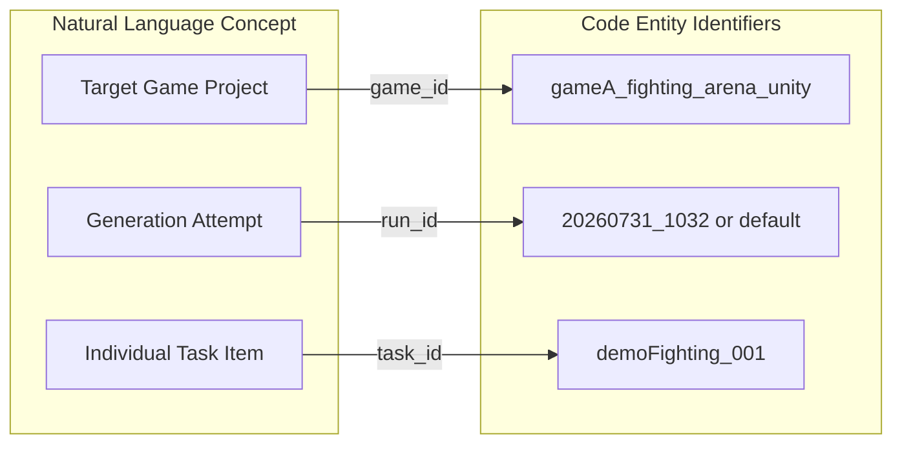

Sources: `test_data/test_samples/README.md:9-106`, `pipeline/common/paths.py:62-68`

### Identifier Specifications

*   **`game_id`**: Identifies a distinct game project (e.g., `gameA_fighting_arena_unity`, `gameB_forest_adventure_ue`). The letter denotes the thematic genre, while the suffix designates the target engine [test_data/test_samples/README.md:9-32]. It maps directly to input directories under `test_data/test_samples/<game_id>/` and output directories under `test_data/outputs/<game_id>/` [test_data/test_samples/README.md:3-5].
*   **`run_id`**: Differentiates execution attempts (e.g., `default`, a timestamp like `20260731_1032`, or `_smoke` for test runs) [test_data/outputs/README.md:12-16]. This prevents overwriting artifacts from different seeds, prompts, or model revisions.
*   **`task_id`**: Uniquely identifies a single task within a `(game_id, task_kind)` pair (e.g., `demoFighting_001`) [test_data/test_samples/README.md:99-108]. It dictates the subdirectory name where task artifacts are stored [test_data/outputs/README.md:37-47].

Sources: `test_data/test_samples/README.md:9-108`, `test_data/outputs/README.md:12-47`

---

## Output Tree Layout & `AAAGF_OUTPUT_ROOT`

Generated artifacts, runtime metadata, and evaluation metrics are structured hierarchically under a configurable root directory. By default, this points to `test_data/outputs/`, but it can be relocated to scratch storage via the environment variable `AAAGF_OUTPUT_ROOT` without altering code paths [pipeline/common/paths.py:57-61].

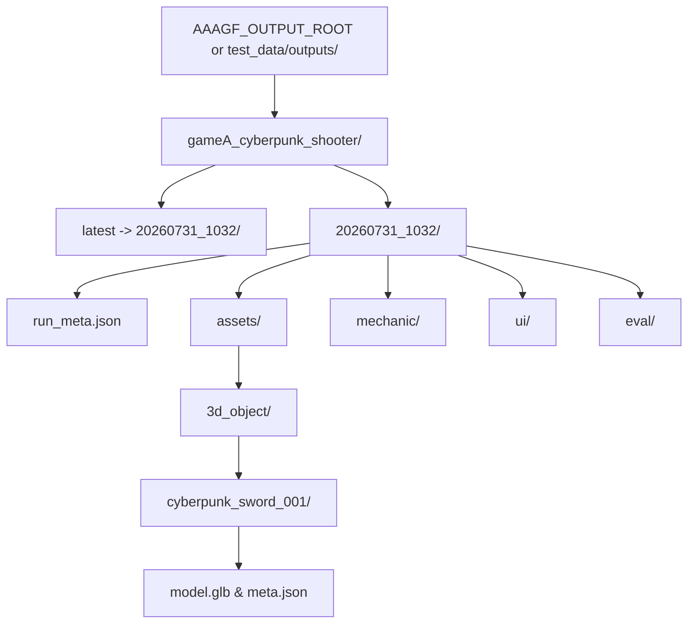

Sources: `pipeline/common/paths.py:12-32`, `test_data/outputs/README.md:9-35`

### Complete Output Tree Structure

```text
test_data/outputs/                         # OUTPUT_ROOT ($AAAGF_OUTPUT_ROOT)
└── gameA_cyberpunk_shooter/               # one dir per generated game project
    ├── latest -> 20260731_1032/           # symlink to the most recent run
    └── <run_id>/                          # "default", or a timestamp
        ├── run_meta.json                  # ckpts · seeds · git sha · argv
        ├── assets/                        # Layer A (asset generation)
        │   ├── 3d_object/<task_id>/       # model.glb        + meta.json
        │   ├── tpose/<task_id>/           # tpose_fg.png     + meta.json
        │   ├── 3d_scene/<task_id>/        # scene mesh       + meta.json
        │   ├── motion/<task_id>/          # animation files  + meta.json
        │   ├── cg_video/<task_id>/        # video.mp4        + meta.json
        │   └── audio/<task_id>/           # audio WAV        + meta.json
        ├── mechanic/<task_id>/            # Layer B: engine project + demo_outputs/ + launch.sh
        ├── ui/<task_id>/                  # Layer C: UI code + screenshots/
        ├── pipeline/<task_id>/            # end-to-end game-slice artifacts
        └── eval/
            ├── <task_kind>/<task_id>/     # metrics.json · build.log · judge_log.json
            └── summary.json               # aggregate over the whole run
```

Sources: `pipeline/common/paths.py:12-32`, `test_data/outputs/README.md:9-35`

---

## Path Resolution & `pipeline/common/paths.py`

Hardcoding file paths is strictly prohibited across pipelines and tests. The module `pipeline/common/paths.py` acts as the single source of truth for all input and output path resolution [pipeline/common/paths.py:1-40].

### Key Path Resolution APIs

*   `paths.resolve_tasks_path(task_kind, tasks, game_id)`: Resolves input task lists, checking explicit CLI paths, per-game `*_tasks.jsonl` files, and cross-game aggregate `*_collect.jsonl` files [pipeline/common/paths.py:164-179].
*   `paths.task_output_dir(game_id, task_kind, task_id, run_id)`: Computes the precise storage directory for task artifacts [pipeline/common/paths.py:200-225].
*   `paths.eval_output_dir(game_id, task_kind, task_id, run_id)`: Resolves evaluation score directories corresponding to a specific run [pipeline/common/paths.py:230-245].
*   `paths.write_results_summary(results, task_kind, run_id)`: Generates aggregate summary JSON files per game project [pipeline/common/paths.py:250-270].

Sources: `pipeline/common/paths.py:164-270`, `pipeline/README.md:98-116`

---

# Page: Path Resolution & Task Data Contracts

# Path Resolution & Task Data Contracts

<details>
<summary>Relevant source files</summary>

The following files were used as context for generating this wiki page:

- [LICENSE](LICENSE)
- [README.md](README.md)
- [README_zh.md](README_zh.md)
- [pipeline/common/paths.py](pipeline/common/paths.py)
- [test/harness/smoke.py](test/harness/smoke.py)
- [test_data/test_samples/3D_object_gen_collect.jsonl](test_data/test_samples/3D_object_gen_collect.jsonl)
- [test_data/test_samples/tpose_gen_collect.jsonl](test_data/test_samples/tpose_gen_collect.jsonl)
- [third_party/README.md](third_party/README.md)

</details>


## Purpose and Scope

This page documents the path resolution architecture and task data contracts implemented in `pipeline/common/paths.py` and tested via `test/harness/smoke.py`. The `paths.py` module acts as the single source of truth for every input and output path across the 3AGameFactory framework. Benchmarks and game projects are authored per game, organizing inputs and outputs into consistent directory trees mapped by task kinds, game identifiers (`game_id`), run identifiers (`run_id`), and task identifiers (`task_id`). 

This module contains zero third-party dependencies and imports no models, making it safe to import from lightweight tooling, evaluation scripts, and CPU-only smoke test harnesses `[pipeline/common/paths.py:1-39]()`.

Sources: `[pipeline/common/paths.py:1-39]()`, `[test/harness/smoke.py:1-30]()`

---

## Root Directories & Environment Configuration

The path framework anchors its directory structures relative to the repository root. It defines primary storage roots for read-only test samples and write-heavy generation outputs `[pipeline/common/paths.py:50-61]`:

* `REPO_ROOT`: Resolved via `Path(__file__).resolve().parents[2]` `[pipeline/common/paths.py:52]()`.
* `TEST_DATA_ROOT`: Points to `REPO_ROOT / "test_data"` `[pipeline/common/paths.py:54]()`.
* `TEST_SAMPLES_ROOT`: Points to `TEST_DATA_ROOT / "test_samples"` `[pipeline/common/paths.py:55]()`.
* `OUTPUT_ROOT`: Resolves generation artifacts. Defaults to `test_data/outputs`, but can be relocated by setting the environment variable `AAAGF_OUTPUT_ROOT` (e.g., pointing to a high-performance scratch disk) `[pipeline/common/paths.py:57-60]()`.
* `UNASSIGNED_GAME`: Evaluates to `"_scratch"` when tasks carry no game association `[pipeline/common/paths.py:62-63]()`.
* `DEFAULT_RUN_ID`: Evaluates to `"default"` when no timestamped run ID is provided `[pipeline/common/paths.py:65-66]()`.

### Diagram: Path Roots to Code Entities

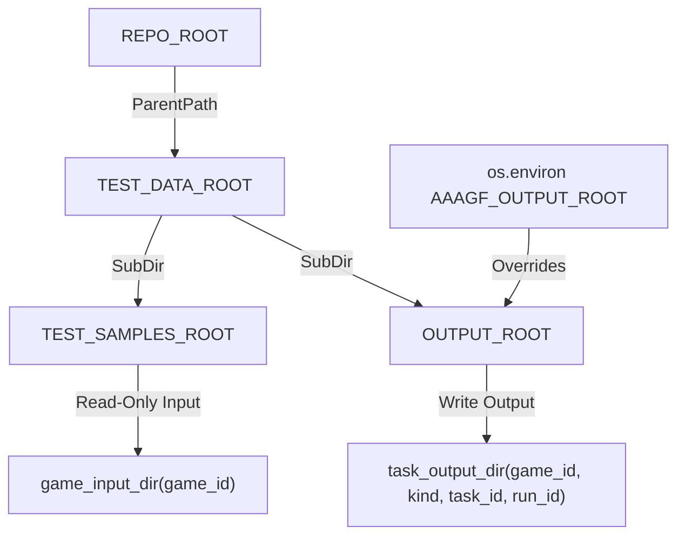
Sources: `[pipeline/common/paths.py:50-61]()`

---

## Task Type Mappings & JSONL Contracts

Tasks are categorized by `task_kind` strings, which map to specific architectural layers (Layer A for assets, Layer B for mechanics, Layer C for UI, and pipeline vertical slices) `[pipeline/common/paths.py:73-87]()`:

| `task_kind` | Layer Mapping (`TASK_LAYER`) | Input Directory (`TASK_INPUT_DIR`) | Task List File (`TASK_JSONL`) | Collect File (`TASK_COLLECT_JSONL`) |
| :--- | :--- | :--- | :--- | :--- |
| `3d_object` | `assets` | `3D_object` | `object_tasks.jsonl` | `3D_object_gen_collect.jsonl` |
| `tpose` | `assets` | `tpose` | `tpose_tasks.jsonl` | `tpose_gen_collect.jsonl` |
| `3d_scene` | `assets` | `3D_scene` | `scene_tasks.jsonl` | `3D_scene_gen_collect.jsonl` |
| `motion` | `assets` | `motion` | `motion_tasks.jsonl` | `motion_gen_collect.jsonl` |
| `cg_video` | `assets` | `cg_video` | `cg_tasks.jsonl` | `cg_video_collect.jsonl` |
| `audio` | `assets` | `audio` | `audio_tasks.jsonl` | `audio_gen_collect.jsonl` |
| `mechanic` | `mechanic` | `mechanic` | `mechanic_tasks.jsonl` | `mechanic_collect.jsonl` |
| `ui` | `ui` | `ui` | `ui_tasks.jsonl` | `ui_collect.jsonl` |
| `pipeline` | `pipeline` | `pipeline` | `pipeline_task.jsonl` | `pipeline_collect.jsonl` |

### JSONL Schema & Data Formats

Each line in a task JSONL file represents a self-contained task dictionary (`dict`). For instance, `tpose_gen_collect.jsonl` defines records containing game metadata, task identifiers, reference image paths, prompts, and inference parameters `[test_data/test_samples/tpose_gen_collect.jsonl:1-6]()`:

```json
{"game_id": "gameA_fighting_arena_unity", "task_id": "demoFighting_001", "image_path": "test_data/test_samples/gameA_fighting_arena_unity/tpose/ref_images/warrior_ref.png", "description": "A muscular male warrior...", "seed": 42, "steps": 40, "target_size": 1024}
```

Validation of task kinds is enforced via `check_kind(task_kind)`, which raises a `ValueError` with registered options if an unknown task kind is queried `[pipeline/common/paths.py:132-139]()`.

Sources: `[pipeline/common/paths.py:73-139]`, `[test_data/test_samples/tpose_gen_collect.jsonl:1-6]()`

---

## Path Resolution APIs

The module exposes helper functions to construct filesystem paths for inputs and outputs deterministically.

### Input Path Resolution

* `game_input_dir(game_id)`: Resolves to `test_data/test_samples/<game_id>/` `[pipeline/common/paths.py:144-146]()`.
* `task_input_dir(game_id, task_kind)`: Resolves to `test_data/test_samples/<game_id>/<TaskDir>/` `[pipeline/common/paths.py:149-152]()`.
* `task_jsonl(game_id, task_kind)`: Resolves to `test_data/test_samples/<game_id>/<TaskDir>/<kind>_tasks.jsonl` `[pipeline/common/paths.py:154-157]()`.
* `collect_jsonl(task_kind)`: Resolves to the cross-game aggregate list under `test_data/test_samples/<kind>_collect.jsonl` `[pipeline/common/paths.py:159-162]()`.
* `resolve_tasks_path(task_kind, tasks, game_id)`: Implements standard task-list resolution priority: explicit `--tasks` argument $\rightarrow$ game-specific `*_tasks.jsonl` (if non-empty) $\rightarrow$ cross-game `*_collect.jsonl` fallback `[pipeline/common/paths.py:164-179]()`.

### Diagram: Task Resolution Flow (Natural Language Space to Code Entity Space)

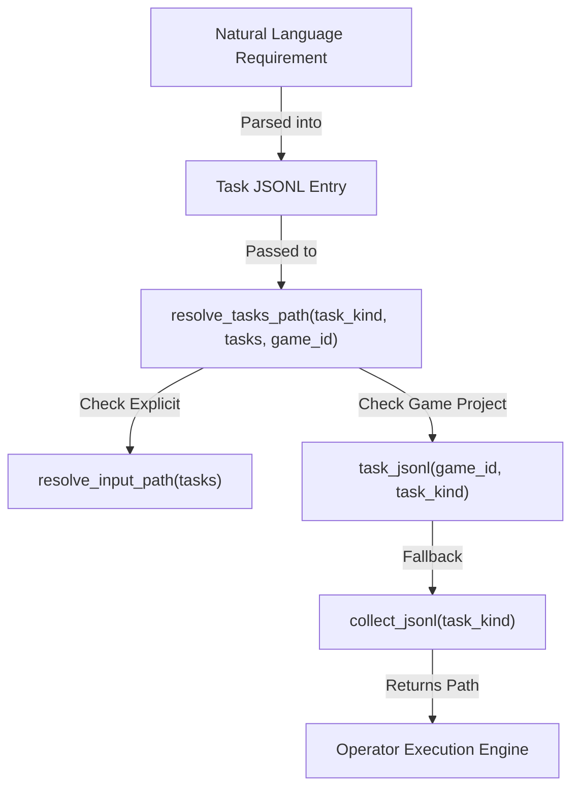
Sources: `[pipeline/common/paths.py:144-179]()`

---

## Output Layout & Summary Contracts

Outputs are structured hierarchically under `OUTPUT_ROOT`. An artifact is uniquely addressed by the tuple `(game_id, run_id, task_kind, task_id)` `[pipeline/common/paths.py:6-11]()`:

```text
test_data/outputs/                         # OUTPUT_ROOT ($AAAGF_OUTPUT_ROOT)
└── gameA_cyberpunk_shooter/               # one directory per generated game project
    ├── latest -> 20260731_1032/           # symlink to the most recent run
    └── <run_id>/                          # "default", or a timestamp
        ├── run_meta.json                  # checkpoints, seeds, git sha, argv
        ├── assets/
        │   ├── 3d_object/<task_id>/       # model.glb + meta.json
        │   ├── tpose/<task_id>/           # tpose_fg.png + meta.json
        │   └── audio/<task_id>/           # dialogue/sound-effect audio + meta.json
        ├── mechanic/<task_id>/            # engine project + demo_outputs/ + launch.sh
        ├── ui/<task_id>/
        ├── pipeline/<task_id>/            # end-to-end game-slice artifacts
        └── eval/
            ├── <task_kind>/<task_id>/     # metrics.json, build.log, judge_log.json
            └── summary.json               # aggregate summary over the whole run
```

### Smoke Test Verification

The smoke harness `test/harness/smoke.py` validates these output contracts by executing stubbed operators in CPU mode without weights or network calls `[test/harness/smoke.py:5-20]()`. It asserts that:
1. Operators execute and return dictionaries containing required result keys (`task_id`, `elapsed_sec`, `game_id`, `task_kind`, `output_dir`) `[test/harness/smoke.py:69-70]()`.
2. Artifacts land at the precise path returned by `paths.task_output_dir(game, kind, task_id, run_id)` `[test/harness/smoke.py:11-13]()`.
3. `meta.json` and aggregate summaries are written correctly across runs `[test/harness/smoke.py:13-16]()`.

Sources: `[pipeline/common/paths.py:10-31]`, `[test/harness/smoke.py:5-30]()`

---

# Page: Agent Skills Layer

# Agent Skills Layer

<details>
<summary>Relevant source files</summary>

The following files were used as context for generating this wiki page:

- [agent_skills/asset_qa/3d_object/orientation_review.md](agent_skills/asset_qa/3d_object/orientation_review.md)
- [agent_skills/asset_qa/README.md](agent_skills/asset_qa/README.md)
- [agent_skills/asset_qa/audio/SKILL.md](agent_skills/asset_qa/audio/SKILL.md)
- [agent_skills/asset_qa/cg_video/SKILL.md](agent_skills/asset_qa/cg_video/SKILL.md)
- [agent_skills/asset_qa/cg_video/game-cg-director/SKILL.md](agent_skills/asset_qa/cg_video/game-cg-director/SKILL.md)
- [agent_skills/asset_qa/image/SKILL.md](agent_skills/asset_qa/image/SKILL.md)
- [agent_skills/engine_context/blender_api.md](agent_skills/engine_context/blender_api.md)
- [agent_skills/setting_overview.md](agent_skills/setting_overview.md)
- [engine_adapters/README.md](engine_adapters/README.md)
- [engine_adapters/blender/__init__.py](engine_adapters/blender/__init__.py)
- [engine_adapters/blender/runtime/assets/actions.py](engine_adapters/blender/runtime/assets/actions.py)
- [test/test_3D_scene_gen.py](test/test_3D_scene_gen.py)

</details>


The Agent Skills Layer (`agent_skills/`) serves as the structured guide and prompt repository for vision-capable coding agents operating within 3AGameFactory. It provides the routing entrypoint [agent_skills/setting_overview.md:1-36] that bridges natural-language game requirements to engine-ready assets, mechanics, and UI components across supported game engines (Unreal Engine 5, Unity 3D, Godot 4, Blender, and three.js). 

This parent page summarizes the architecture of agent skills, outlining asset QA procedures, code generation templates, and developer harness contracts. Detailed technical specifications are maintained in the respective child pages.

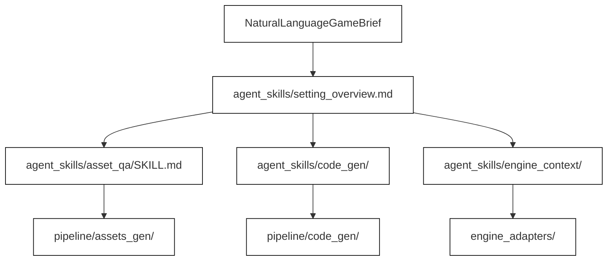
Sources: `agent_skills/setting_overview.md:1-36`, `agent_skills/asset_qa/README.md:1-32`

---

## Asset QA Skills

The asset QA sub-layer (`agent_skills/asset_qa/`) governs per-modality quality assurance for generated or imported assets. Before an asset is integrated into an engine project, agents must consult modality-specific skills covering image preparation and T-pose generation, 3D objects, 3D scenes, motion rigging and retargeting, audio, and CG video. These skills define visual criteria, orientation rules [agent_skills/asset_qa/3d_object/orientation_review.md:1-30], matting requirements, and cost-aware paid cloud backend safeguards [agent_skills/asset_qa/README.md:68-101].

For detailed per-modality QA workflows, pipeline connections, and the `game-cg-director` sub-skill tree, see [Asset QA Skills](#2.1).

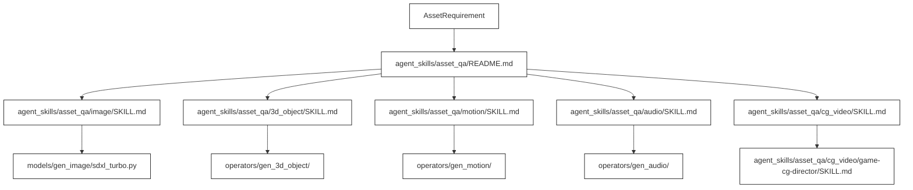
Sources: `agent_skills/asset_qa/README.md:1-50`, `agent_skills/asset_qa/image/SKILL.md:1-30`, `agent_skills/asset_qa/cg_video/SKILL.md:1-24`

---

## Code Generation Skills & Prompts

Code generation skills (`agent_skills/code_gen/`) provide systemic guidance, mechanic templates, and UI generation instructions for agents writing gameplay logic and user interfaces [agent_skills/asset_qa/README.md:33-46]. These directories contain system prompts, task specifications, and repair guidelines that govern how agents interact with engine adapters and adhere to required contracts without introducing UI contamination or broken API calls.

For complete mechanics documentation, UI generation guides, and prompt template hierarchies, see [Code Generation Skills & Prompts](#2.2).

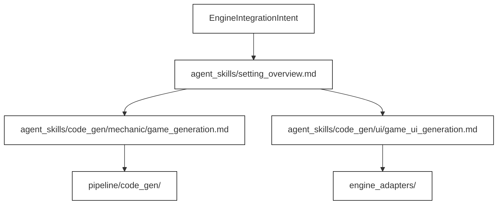
Sources: `agent_skills/setting_overview.md:85-98`, `agent_skills/asset_qa/README.md:33-46`

---

## Develop Harness Contracts

Developer harness contracts specify the rigorous requirements documents that contributors and agents must follow when integrating new models, operators, and execution pipelines. These contracts (`model_require`, `api_model_require`, `operator_require`, and `pipeline_require`) ensure uniform lifecycle wrappers, test coverage, and strict boundary enforcement across Layer A, Layer B, and Layer C outputs.

For full specifications and contract validation checklists, see [Develop Harness Contracts](#2.3).

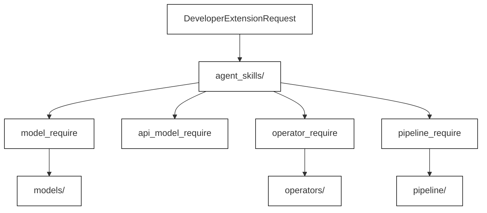
Sources: `agent_skills/setting_overview.md:1-36`, `engine_adapters/README.md:1-22`

---

# Page: Asset QA Skills

# Asset QA Skills

<details>
<summary>Relevant source files</summary>

The following files were used as context for generating this wiki page:

- [agent_skills/asset_qa/3d_object/orientation_review.md](agent_skills/asset_qa/3d_object/orientation_review.md)
- [agent_skills/asset_qa/README.md](agent_skills/asset_qa/README.md)
- [agent_skills/asset_qa/audio/SKILL.md](agent_skills/asset_qa/audio/SKILL.md)
- [agent_skills/asset_qa/cg_video/SKILL.md](agent_skills/asset_qa/cg_video/SKILL.md)
- [agent_skills/asset_qa/cg_video/game-cg-director/SKILL.md](agent_skills/asset_qa/cg_video/game-cg-director/SKILL.md)
- [agent_skills/asset_qa/cg_video/game-cg-director/common/camera.md](agent_skills/asset_qa/cg_video/game-cg-director/common/camera.md)
- [agent_skills/asset_qa/cg_video/game-cg-director/common/principles.md](agent_skills/asset_qa/cg_video/game-cg-director/common/principles.md)
- [agent_skills/asset_qa/cg_video/game-cg-director/common/sound.md](agent_skills/asset_qa/cg_video/game-cg-director/common/sound.md)
- [agent_skills/asset_qa/cg_video/game-cg-director/common/style-mapping.md](agent_skills/asset_qa/cg_video/game-cg-director/common/style-mapping.md)
- [agent_skills/asset_qa/cg_video/game-cg-director/models/h3.md](agent_skills/asset_qa/cg_video/game-cg-director/models/h3.md)
- [agent_skills/asset_qa/cg_video/game-cg-director/models/seedance.md](agent_skills/asset_qa/cg_video/game-cg-director/models/seedance.md)
- [agent_skills/asset_qa/cg_video/game-cg-director/modes/fl2va.md](agent_skills/asset_qa/cg_video/game-cg-director/modes/fl2va.md)
- [agent_skills/asset_qa/cg_video/game-cg-director/modes/i2va.md](agent_skills/asset_qa/cg_video/game-cg-director/modes/i2va.md)
- [agent_skills/asset_qa/image/SKILL.md](agent_skills/asset_qa/image/SKILL.md)
- [agent_skills/asset_qa/motion/SKILL.md](agent_skills/asset_qa/motion/SKILL.md)
- [scripts/asset_env_setup/gen_motion/download_weights.py](scripts/asset_env_setup/gen_motion/download_weights.py)
- [scripts/asset_env_setup/gen_motion/install.sh](scripts/asset_env_setup/gen_motion/install.sh)
- [scripts/asset_env_setup/gen_motion/runtime_env.sh](scripts/asset_env_setup/gen_motion/runtime_env.sh)

</details>


## Purpose and Scope

The Asset QA Skills layer (`agent_skills/asset_qa/`) provides per-modality quality assurance and generation control frameworks used by vision-capable coding agents [agent_skills/asset_qa/README.md:1-16](). This page documents the technical implementation, environment setup, execution data flow, and review protocols for image, audio, motion, 3D object, 3D scene, and CG video modalities, including the specialized `game-cg-director` sub-skill tree.

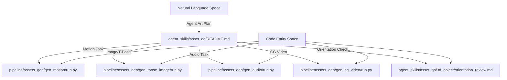
Sources: [agent_skills/asset_qa/README.md:1-32](), [agent_skills/asset_qa/motion/SKILL.md:1-35](), [agent_skills/asset_qa/image/SKILL.md:1-30]()

---

## 1. Motion Generation & Retargeting Skill

Motion assets require specialized handling due to skeleton naming conventions, coordinate spaces, and skeletal hierarchies. The motion skill coordinates the chain from character mesh to Puppeteer rigging, MoMask or downloaded clip source, and Blender retargeting [agent_skills/asset_qa/motion/SKILL.md:1-30]().

### Technical Chain and Execution Flow

The canonical entry point for motion pipelines is `pipeline/assets_gen/gen_motion/run.py`, invoking the operator defined in `operators/gen_motion/operator.py` [agent_skills/asset_qa/motion/SKILL.md:32-35](). 

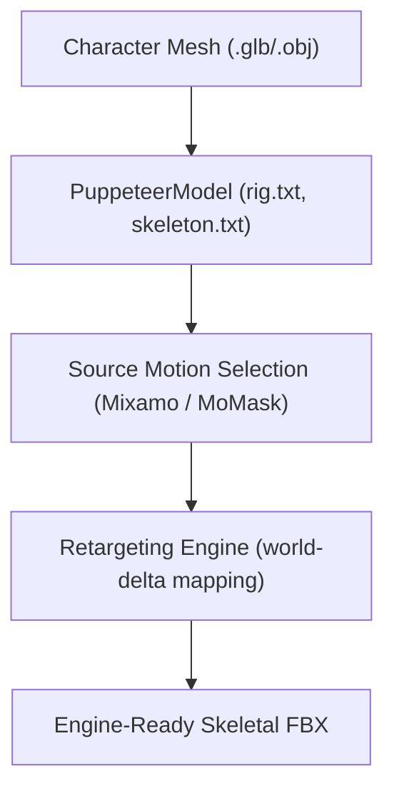
Sources: [agent_skills/asset_qa/motion/SKILL.md:16-30]()

### Environment Setup and Weights

Linux environments for Puppeteer, MoMask, and Blender-retargeting are provisioned via shell installers and weight download utilities [scripts/asset_env_setup/gen_motion/install.sh:1-30](). Weights are fetched from HuggingFace and Google Drive into configured runtime roots [scripts/asset_env_setup/gen_motion/download_weights.py:1-40]().

*   Installer script: `scripts/asset_env_setup/gen_motion/install.sh` [scripts/asset_env_setup/gen_motion/install.sh:1-28]()
*   Runtime environment variables script: `scripts/asset_env_setup/gen_motion/runtime_env.sh` [scripts/asset_env_setup/gen_motion/runtime_env.sh:1-15]()
*   Weight downloader: `scripts/asset_env_setup/gen_motion/download_weights.py` [scripts/asset_env_setup/gen_motion/download_weights.py:1-33]()

Sources: [scripts/asset_env_setup/gen_motion/install.sh:1-42](), [scripts/asset_env_setup/gen_motion/download_weights.py:1-35]()

Sources: [agent_skills/asset_qa/motion/SKILL.md:1-154](), [scripts/asset_env_setup/gen_motion/install.sh:1-169]()

---

## 2. Audio Generation & QA Skill

The audio skill governs offline WAV asset creation, voice lines, dialogue, sound effects, and foley [agent_skills/asset_qa/audio/SKILL.md:1-7]().

### Data Flow and Backends

Audio tasks are processed from task dictionaries/JSONLs through `GenAudioOperator` to backend models [agent_skills/asset_qa/audio/SKILL.md:10-15]().

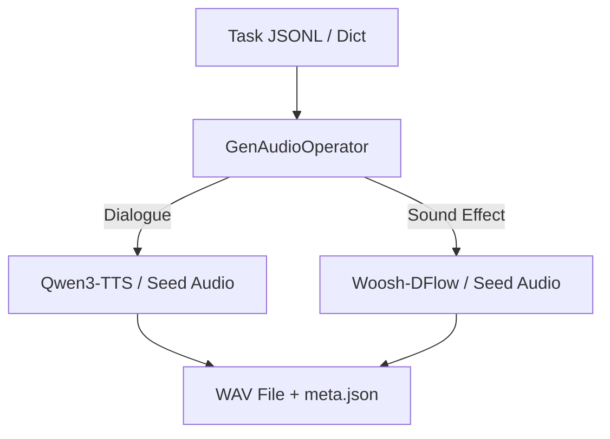
Sources: [agent_skills/asset_qa/audio/SKILL.md:10-21]()

### Backend Routing and Cloud Cost Governance

*   **Dialogue / TTS**: Qwen3-TTS or Seed Audio (Volcengine speech endpoint) [agent_skills/asset_qa/audio/SKILL.md:46-51]()
*   **Natural Sound Effects**: Licence-checked recordings (CC0/CC-BY) preferred over generation for gunshots, thunder, rain, footsteps [agent_skills/asset_qa/audio/SKILL.md:46-75]()
*   **Foley / Ambience**: Sony Woosh-DFlow or Seed Audio [agent_skills/asset_qa/audio/SKILL.md:46-51]()

Before using paid cloud services like Seed Audio (`SEED_AUDIO_API_KEY`), agents must prompt the user with estimated batch costs [agent_skills/asset_qa/audio/SKILL.md:58-67]().

Sources: [agent_skills/asset_qa/audio/SKILL.md:1-158]()

---

## 3. Image & T-Pose Generation Skill

This skill handles single-subject concept images and character T-pose generation for downstream 3D reconstruction [agent_skills/asset_qa/image/SKILL.md:1-8]().

### Component Architecture

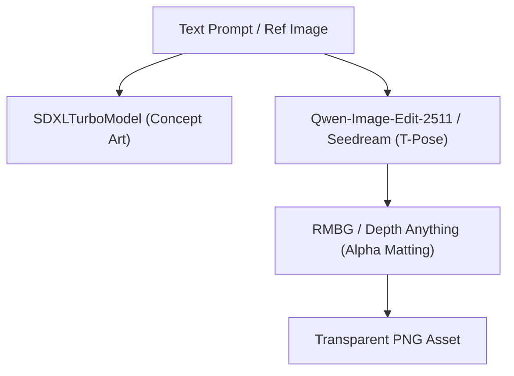
Sources: [agent_skills/asset_qa/image/SKILL.md:20-30]()

### Key Classes and Operators

*   Concept Generation: `models/gen_image/sdxl_turbo.py` (`SDXLTurboModel`) [agent_skills/asset_qa/image/SKILL.md:20-25]()
*   Local Image Editor: `models/gen_image/qwen_edit_model.py` (`QwenImageEditModel`) [agent_skills/asset_qa/image/SKILL.md:20-25]()
*   Cloud Editor: `models/gen_image/seedream_model.py` (`SeedreamModel`) [agent_skills/asset_qa/image/SKILL.md:20-25]()
*   Matting Tools: `models/tools/image_matting/rmbg_model.py` [agent_skills/asset_qa/image/SKILL.md:25-30]()
*   Task Operator: `operators/gen_tpose_image/operator.py` [agent_skills/asset_qa/image/SKILL.md:25-30]()
*   Pipeline Runner: `pipeline/assets_gen/gen_tpose_image/run.py` [agent_skills/asset_qa/image/SKILL.md:25-30]()

Sources: [agent_skills/asset_qa/image/SKILL.md:1-154]()

---

## 4. 3D Object & Orientation Review Skill

Imported 3D models require manual or vision-agent verification for facing direction (`forward_axis`), scaling, and ground contact [agent_skills/asset_qa/3d_object/orientation_review.md:1-15]().

### Orientation Review Workflow

Because glTF files omit binding facing data, visual agents must evaluate orthographic contact sheets generated by `three.preview.orientation_report` [agent_skills/asset_qa/3d_object/orientation_review.md:5-59]().

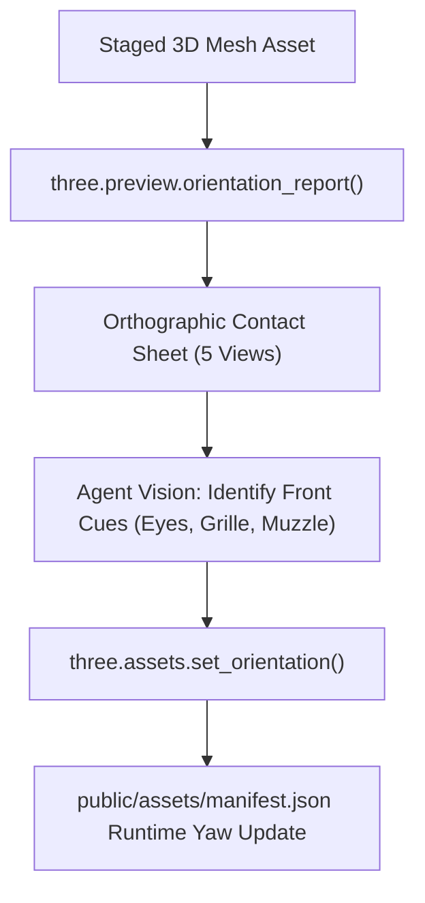
Sources: [agent_skills/asset_qa/3d_object/orientation_review.md:21-120]()

Sources: [agent_skills/asset_qa/3d_object/orientation_review.md:1-152]()

---

## 5. CG Video Generation & `game-cg-director` Sub-Skill Tree

The CG video skill manages text-to-video, image-to-video, and frame-transition pipelines [agent_skills/asset_qa/cg_video/SKILL.md:1-7]().

### Sub-Skill Tree: `game-cg-director`

The `game-cg-director` sub-skill (`agent_skills/asset_qa/cg_video/game-cg-director/`) converts game intent into validated directing envelopes without invoking video generation APIs directly [agent_skills/asset_qa/cg_video/game-cg-director/SKILL.md:1-11]().

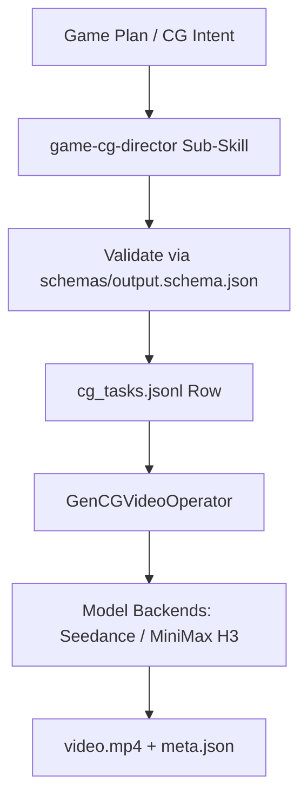
Sources: [agent_skills/asset_qa/cg_video/SKILL.md:10-30](), [agent_skills/asset_qa/cg_video/game-cg-director/SKILL.md:1-35]()

### Mode Taxonomy and Routing

*   `text_to_video` (T2VA) [agent_skills/asset_qa/cg_video/game-cg-director/SKILL.md:60-70]()
*   `first_frame_to_video` (I2VA) [agent_skills/asset_qa/cg_video/game-cg-director/SKILL.md:60-70]()
*   `first_last_frame_to_video` (FL2VA) [agent_skills/asset_qa/cg_video/game-cg-director/SKILL.md:60-70]()
*   `reference_to_video` (Ref2VA) [agent_skills/asset_qa/cg_video/game-cg-director/SKILL.md:60-70]()

Sources: [agent_skills/asset_qa/cg_video/SKILL.md:1-345](), [agent_skills/asset_qa/cg_video/game-cg-director/SKILL.md:1-174](), [agent_skills/asset_qa/cg_video/game-cg-director/modes/fl2va.md:1-11](), [agent_skills/asset_qa/cg_video/game-cg-director/common/camera.md:1-33]()

---

# Page: Code Generation Skills & Prompts

# Code Generation Skills & Prompts

<details>
<summary>Relevant source files</summary>

The following files were used as context for generating this wiki page:

- [agent_skills/code_gen/mechanic/game_generation.md](agent_skills/code_gen/mechanic/game_generation.md)
- [agent_skills/code_gen/mechanic/prompts/repair.md](agent_skills/code_gen/mechanic/prompts/repair.md)
- [agent_skills/code_gen/mechanic/prompts/system.md](agent_skills/code_gen/mechanic/prompts/system.md)
- [agent_skills/code_gen/mechanic/prompts/task.md](agent_skills/code_gen/mechanic/prompts/task.md)
- [agent_skills/code_gen/ui/game_ui_generation.md](agent_skills/code_gen/ui/game_ui_generation.md)
- [agent_skills/code_gen/ui/prompts/system.md](agent_skills/code_gen/ui/prompts/system.md)
- [agent_skills/code_gen/ui/prompts/task.md](agent_skills/code_gen/ui/prompts/task.md)
- [agent_skills/engine_context/browser_serving_api.md](agent_skills/engine_context/browser_serving_api.md)
- [engine_adapters/browser_serving/.gitkeep](engine_adapters/browser_serving/.gitkeep)
- [engine_adapters/godot/plugin/A3GamePlayable/README.md](engine_adapters/godot/plugin/A3GamePlayable/README.md)
- [engine_adapters/godot/plugin/A3GamePlayable/capabilities.json](engine_adapters/godot/plugin/A3GamePlayable/capabilities.json)
- [engine_adapters/godot/plugin/A3GamePlayable/tests/framework_smoke.gd](engine_adapters/godot/plugin/A3GamePlayable/tests/framework_smoke.gd)
- [engine_adapters/ue5/assets/client.py](engine_adapters/ue5/assets/client.py)
- [engine_adapters/unity3d/plugin/A3GameRuntime/README.md](engine_adapters/unity3d/plugin/A3GameRuntime/README.md)
- [pipeline/code_gen/gen_mechanic/__init__.py](pipeline/code_gen/gen_mechanic/__init__.py)
- [pipeline/code_gen/gen_mechanic/contracts.py](pipeline/code_gen/gen_mechanic/contracts.py)

</details>


## Purpose and Scope

The `agent_skills/code_gen/` directory contains markdown guidelines, workflow constraints, and prompt templates that instruct coding agents on how to generate game-owned mechanical behaviors and user interfaces within the 3AGameFactory-3A pipeline. This layer defines the strict boundary between engine runtimes, adapters, UI modules, and game-owned source code. 

Sources: `agent_skills/code_gen/mechanic/game_generation.md:1-146` [agent_skills/code_gen/mechanic/game_generation.md:1-146](), `pipeline/code_gen/gen_mechanic/contracts.py:1-129` [pipeline/code_gen/gen_mechanic/contracts.py:1-128]()

---

## Natural Language Space to Code Entity Space: Code Generation Architecture

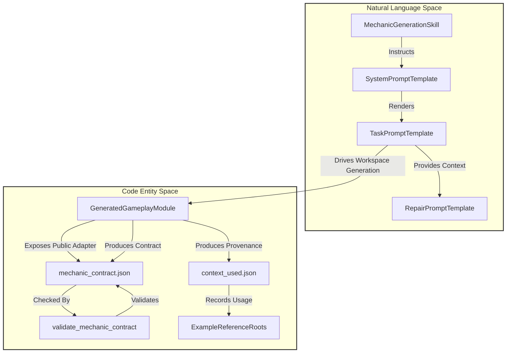
*Figure 1: Mapping natural-language agent instructions to generated code entities, contracts, and provenance files.*

Sources: `agent_skills/code_gen/mechanic/game_generation.md:1-51` [agent_skills/code_gen/mechanic/game_generation.md:1-51](), `pipeline/code_gen/gen_mechanic/contracts.py:32-128` [pipeline/code_gen/gen_mechanic/contracts.py:32-128]()

---

## Mechanic Generation Mechanics and Authority

The core skill governing game mechanic generation is located at `agent_skills/code_gen/mechanic/game_generation.md` [agent_skills/code_gen/mechanic/game_generation.md:1-146](). It establishes strict authority ordering: task packet and requirements, the skill itself, the matching Engine API, and finally educational Engine Examples.

Agents must adhere to a strict dependency direction where UI depends on Mechanic, and Mechanic depends on the runtime framework (`UI -> Mechanic -> runtime framework`) [agent_skills/code_gen/mechanic/game_generation.md:61-65](). The reverse dependency is forbidden; Mechanic modules must compile, test, and execute without any UI module, HUD, widget, menu, renderer, or screenshot [agent_skills/code_gen/mechanic/game_generation.md:67-70]().

Sources: `agent_skills/code_gen/mechanic/game_generation.md:7-71` [agent_skills/code_gen/mechanic/game_generation.md:7-71]()

---

## Prompt Templates: System, Task, and Repair

Agents ingest prompts structured for initialization, task execution, and iterative repair.

### System Prompt
The system prompt establishes the outer game-generation persona for a single Mechanic task, binding the agent to resolved inputs, write boundaries, and read-only paths (`agent_skills/code_gen/mechanic/prompts/system.md:1-27`) [agent_skills/code_gen/mechanic/prompts/system.md:1-26]().

### Task Prompt
The task prompt (`agent_skills/code_gen/mechanic/prompts/task.md:1-142`) [agent_skills/code_gen/mechanic/prompts/task.md:1-141]() injects dynamic payload references into the agent context:
- `{{GAME_GENERATION_SKILL_PATH}}`: Path to the markdown skill specification.
- `{{TASK_PACKET_PATH}}`: Path to the prepared task packet JSON.
- `{{WORKSPACE}}`: Target directory for generated code.
- `{{ENGINE}}`: Canonical target engine identifier.
- `{{ACCEPTANCE_CRITERIA}}`: JSON array of measurable behaviors.
- `{{MECHANIC_EXAMPLE_ROOTS}}`: Validated reference roots for engine patterns.

### Repair Prompt
When validation or testing fails, the repair prompt (`agent_skills/code_gen/mechanic/prompts/repair.md:1-38`) [agent_skills/code_gen/mechanic/prompts/repair.md:1-37]() provides structured execution errors (`{{FAILURES_JSON}}`) and iteration counters (`{{REPAIR_ATTEMPT}} / {{MAX_REPAIR_ATTEMPTS}}`), guiding the agent to apply the smallest coherent repair while preserving working behavior and final contracts.

Sources: `agent_skills/code_gen/mechanic/prompts/system.md:1-27` [agent_skills/code_gen/mechanic/prompts/system.md:1-26](), `agent_skills/code_gen/mechanic/prompts/task.md:1-142` [agent_skills/code_gen/mechanic/prompts/task.md:1-141](), `agent_skills/code_gen/mechanic/prompts/repair.md:1-38` [agent_skills/code_gen/mechanic/prompts/repair.md:1-37]()

---

## Dependency and Execution Flow in Agent Code Generation

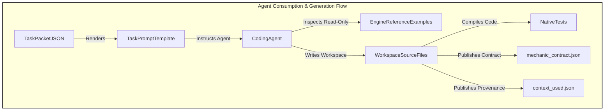
*Figure 2: Data flow from task packet compilation to published mechanic contracts and native tests.*

Sources: `agent_skills/code_gen/mechanic/game_generation.md:31-51` [agent_skills/code_gen/mechanic/game_generation.md:31-51](), `agent_skills/code_gen/mechanic/prompts/task.md:105-142` [agent_skills/code_gen/mechanic/prompts/task.md:105-141]()

---

## Mechanic Contracts and Artifact Validation

Upon completing code generation, agents must publish `mechanic_contract.json` at the workspace root adhering to schema version `gamefactory3a.mechanic_contract.v1` (`pipeline/code_gen/gen_mechanic/contracts.py:15-18`) [pipeline/code_gen/gen_mechanic/contracts.py:15-18]().

Deterministic validation is performed by `validate_mechanic_contract(workspace, gameplay_module_name)` (`pipeline/code_gen/gen_mechanic/contracts.py:32-35`) [pipeline/code_gen/gen_mechanic/contracts.py:32-35](), which asserts:
1. Presence of `mechanic_contract.json` (`pipeline/code_gen/gen_mechanic/contracts.py:36-41`) [pipeline/code_gen/gen_mechanic/contracts.py:36-41]().
2. Matching `schema_version` and positive integer `contract_version` (`pipeline/code_gen/gen_mechanic/contracts.py:51-67`) [pipeline/code_gen/gen_mechanic/contracts.py:51-67]().
3. Exact match of `gameplay_module` against expectations (`pipeline/code_gen/gen_mechanic/contracts.py:68-74`) [pipeline/code_gen/gen_mechanic/contracts.py:68-74]().
4. Non-empty collections for `state`, `events`, and `commands` (`pipeline/code_gen/gen_mechanic/contracts.py:75-82`) [pipeline/code_gen/gen_mechanic/contracts.py:75-82]().
5. Valid, non-duplicate workspace-relative paths in `public_api_paths` (`pipeline/code_gen/gen_mechanic/contracts.py:83-127`) [pipeline/code_gen/gen_mechanic/contracts.py:83-127]().

Sources: `pipeline/code_gen/gen_mechanic/contracts.py:1-129` [pipeline/code_gen/gen_mechanic/contracts.py:1-128]()

---

## UI Generation Prompts and Mechanics

Complementing mechanic generation, user interface generation guides located under `agent_skills/code_gen/ui/` (`agent_skills/code_gen/ui/game_ui_generation.md`) instruct agents on binding UI widgets strictly to public mechanic contracts without violating architectural boundaries. System and task prompts (`agent_skills/code_gen/ui/prompts/system.md`, `agent_skills/code_gen/ui/prompts/task.md`) enforce that UI modules consume observable state and dispatch commands exclusively through public adapters.

Sources: `agent_skills/code_gen/ui/game_ui_generation.md` [agent_skills/code_gen/ui/game_ui_generation.md]()

---

# Page: Develop Harness Contracts

# Develop Harness Contracts

<details>
<summary>Relevant source files</summary>

The following files were used as context for generating this wiki page:

- [agent_skills/develop_harness/README.md](agent_skills/develop_harness/README.md)
- [agent_skills/develop_harness/api_model_require.md](agent_skills/develop_harness/api_model_require.md)
- [agent_skills/develop_harness/model_require.md](agent_skills/develop_harness/model_require.md)
- [agent_skills/develop_harness/operatar_require.md](agent_skills/develop_harness/operatar_require.md)
- [agent_skills/develop_harness/pipeline_require.md](agent_skills/develop_harness/pipeline_require.md)
- [models/common/cloud_api.py](models/common/cloud_api.py)
- [models/gen_3d_object/trellis_2_model.py](models/gen_3d_object/trellis_2_model.py)
- [models/gen_audio/seed_audio_model.py](models/gen_audio/seed_audio_model.py)
- [models/gen_audio/seed_audio_utils/__init__.py](models/gen_audio/seed_audio_utils/__init__.py)
- [models/gen_audio/seed_audio_utils/api.py](models/gen_audio/seed_audio_utils/api.py)
- [models/gen_audio/seed_audio_utils/audio.py](models/gen_audio/seed_audio_utils/audio.py)
- [pipeline/assets_gen/gen_audio/run.py](pipeline/assets_gen/gen_audio/run.py)
- [test/test_api_audio.py](test/test_api_audio.py)

</details>


## Purpose and Scope
This page defines the strict technical specifications and requirements documents that govern the three layers of the asset-generation stack: `models/`, `operators/`, and `pipeline/` [agent_skills/develop_harness/README.md:1-10](). These contracts ensure clean architectural separation, enabling developers and coding agents to add new modalities, models, or tasks without breaking existing pipelines, regression tests, or offline execution harnesses.

---

## 1. Architectural Layering & Downward Dependency Rules

The development harness enforces a strict downward dependency hierarchy. Higher layers may depend on lower layers, but lower layers must remain completely agnostic of higher-layer concerns [agent_skills/develop_harness/README.md:33-52]().

```mermaid
graph TD
    subgraph "Pipeline Layer (Layer 3)"
        RunPy["pipeline/assets_gen/<task>/run.py"]
        EvalPy["pipeline/assets_gen/<task>/eval.py"]
    end

    subgraph "Operator Layer (Layer 2)"
        OperatorPy["operators/<task>/operator.py"]
        FuncsDir["operators/<task>/funcs/"]
        MetricsDir["operators/<task>/metrics/"]
    end

    subgraph "Model Layer (Layer 1)"
        LocalModel["models/<family>/<model_name>_model.py"]
        CloudModel["models/<family>/<cloud_model>_model.py"]
        CloudPlumbing["models/common/cloud_api.py"]
    end

    RunPy --> OperatorPy
    EvalPy --> OperatorPy
    OperatorPy --> LocalModel
    OperatorPy --> CloudModel
    CloudModel --> CloudPlumbing

    classDef default fill:#fff,stroke:#333,stroke-width:2px;
    class RunPy,EvalPy,OperatorPy,FuncsDir,MetricsDir,LocalModel,CloudModel,CloudPlumbing default;
```

**Figure 1:** *Code entity namespace mapping across the three generation layers, illustrating downward dependencies.*

### Layer Responsibilities
* **Layer 1 (`models/`)**: Thin wrappers around a single model backend. Encapsulates weights, device allocation, native model calls, and hardware dtypes. Knows nothing about tasks, JSONL configuration files, game projects, or filesystem output directories [agent_skills/develop_harness/model_require.md:3-5]().
* **Layer 2 (`operators/`)**: Translates a single task dictionary into concrete artifacts on disk. Owns task semantics, prompt templates, multi-step algorithm workflows (`funcs/`), and local evaluation metrics (`metrics/`). Model-agnostic through dependency injection [agent_skills/develop_harness/operatar_require.md:7-11]().
* **Layer 3 (`pipeline/`)**: Manages batch execution, command-line interfaces (`argparse`), checkpoint configuration resolution, JSONL iteration via `pipeline.common.paths`, and summary generation [agent_skills/develop_harness/pipeline_require.md:3-11]().

**Sources:** `agent_skills/develop_harness/README.md:1-160`, `agent_skills/develop_harness/model_require.md:1-32`

---

## 2. Local Model Contract (`model_require.md`)

A file located under `models/<family>/<model_name>_model.py` must define a class named `<Name>Model` that satisfies strict interface and lifecycle rules [agent_skills/develop_harness/model_require.md:1-10]().

### Hard Rules (R1)
1. **No upward imports**: Models must never import from `operators/` or `pipeline/` [agent_skills/develop_harness/model_require.md:22-26]().
2. **No path construction**: Models must return in-memory data (`PIL.Image`, `np.ndarray`, `torch.Tensor`, `trimesh.Scene`). The operator owns artifact placement [agent_skills/develop_harness/model_require.md:22-27]().
3. **No CLI business logic**: No `argparse` or `if __name__ == "__main__"` blocks. CLI execution belongs in `run.py` [agent_skills/develop_harness/model_require.md:22-28]().
4. **No task semantics**: Zero awareness of `task_id`, `game_id`, or task-specific prompt engineering [agent_skills/develop_harness/model_require.md:22-29]().
5. **Lazy heavy imports**: Heavy dependencies (`torch`, `diffusers`, vendored C++ extensions) must be imported inside constructor methods or initialization routines so that CPU smoke tests can import modules without weighting down memory [agent_skills/develop_harness/model_require.md:22-30]().

### Constructor & Inference Standards (R2–R3)
* **Constructor signature**: Must follow `def __init__(self, model_path: str | list[str], device: str = "cuda", **model_specific)` [agent_skills/develop_harness/model_require.md:56-58](). All initialization arguments must be stored on `self` to support round-trip reloading [agent_skills/develop_harness/model_require.md:65-66]().
* **Inference entry point**: Exactly one public method: `infer(self, ...)` [agent_skills/develop_harness/model_require.md:68-72](). Inputs must be objects (e.g., `PIL.Image`, `np.ndarray`) rather than file paths [agent_skills/develop_harness/model_require.md:72-73](). Stochastic models must accept `seed: int = 42` and enforce determinism [agent_skills/develop_harness/model_require.md:73-75]().
* **Inference context**: Inference executions must be wrapped in `@torch.no_grad()` or `torch.inference_mode()` [agent_skills/develop_harness/model_require.md:76-77]().

### Tool Models & Subclassing
Auxiliary tool models (depth estimation, matting, segmentation, keypoints) residing in `models/tools/<group>/` must subclass `BaseToolModel` (`models/tools/base.py`), implementing `_load(self)` and `infer(self, image, **kwargs)` while inheriting automatic lazy loading and VRAM unloading [agent_skills/develop_harness/model_require.md:89-102]().

**Sources:** `agent_skills/develop_harness/model_require.md:1-149`, `models/gen_3d_object/trellis_2_model.py:1-138`

---

## 3. Cloud API Model Contract Supplement (`api_model_require.md`)

Closed-source cloud API wrappers (such as Tripo, Meshy, Seed Audio, or Kling) deviate from local-weight model assumptions. These deviations are governed by rule set **R9** [agent_skills/develop_harness/api_model_require.md:1-16].

```mermaid
graph TD
    Call["Model.infer()"] --> CheckCache["Check ResponseCache (R9.8)"]
    CheckCache -->|Hit| ReturnCached["Return Cached In-Memory Artifact"]
    CheckCache -->|Miss| ResolveKey["Require API Key via cloud_api.require_api_key (R9.7)"]
    ResolveKey --> Submit["Submit Task via CloudAPIClient (R9.6)"]
    Submit --> Poll["Poll Task Status with Backoff (R9.6, R9.9)"]
    Poll -->|Success| Download["Download Artifact & Populate Cache"]
    Poll -->|Transient Error| Retry["Exponential Backoff & Retry (R9.9)"]
    Poll -->|Terminal Error| RaiseError["Raise CloudAPIError (Quota/Auth/Request)"]
    Download --> ReturnCached

    classDef default fill:#fff,stroke:#333,stroke-width:2px;
    class Call,CheckCache,ReturnCached,ResolveKey,Submit,Poll,Download,Retry,RaiseError default;
```

**Figure 2:** *Execution flow for closed-source cloud API model wrappers, showing caching, credential checks, and error classification.*

### Core Cloud Requirements (R9)
* **Model Version Identifiers (R9.1)**: `model_path` accepts a version string (e.g., `"v3.1-20260211"`, `"seed-audio-1.0"`) instead of a local weight path [agent_skills/develop_harness/api_model_require.md:21-23]().
* **Device Agnosticism (R9.2)**: `device` is accepted for interface parity but ignored. `device="cpu"` must never raise an error [agent_skills/develop_harness/api_model_require.md:21-24]().
* **Synchronous Task Abstraction (R9.6)**: Asynchronous task lifecycles (submit → poll → download) must be hidden behind a synchronous `infer()` call [agent_skills/develop_harness/api_model_require.md:28-29](). Timeout exceptions must include the provider `task_id` for offline recovery [agent_skills/develop_harness/api_model_require.md:28-29]().
* **Lazy Authentication (R9.7)**: API keys are read from environment variables at execution time rather than instantiation time, ensuring offline test harnesses can import models without credentials [agent_skills/develop_harness/api_model_require.md:29-30]().
* **Response Caching (R9.8)**: Requests filtered by `(model_path, payload_hash, parameters)` utilize `cloud_api.ResponseCache` to prevent redundant billing on pipeline re-runs [agent_skills/develop_harness/api_model_require.md:30-31]().
* **Error Classification (R9.9)**: HTTP errors and response bodies are inspected to categorize failures into retryable server errors (`5xx`, `429`) versus terminal client/quota errors (`400`, `401`, `402`, `403`) [agent_skills/develop_harness/api_model_require.md:31-32]().

### Contract-Deviation Marking
Cloud wrappers must document deviations in three locations:
1. A explicit `CONTRACT DEVIATIONS` section in the file docstring [agent_skills/develop_harness/api_model_require.md:50-67]().
2. Inline `# [CONTRACT-DEVIATION Cx]` comments at the specific line of code [agent_skills/develop_harness/api_model_require.md:68-78]().
3. Mapping to canonical identifiers `C1` through `C9` defined in `api_model_require.md` [agent_skills/develop_harness/api_model_require.md:83-98]().

**Sources:** `agent_skills/develop_harness/api_model_require.md:1-118`, `models/common/cloud_api.py:1-185`, `models/gen_audio/seed_audio_model.py:1-128`

---

## 4. Task Operator Contract (`operatar_require.md`)

Operators located under `operators/<task>/operator.py` transform task dictionaries into durable artifacts on disk [agent_skills/develop_harness/operatar_require.md:1-12].

### Operator Structure
```
operators/<task>/
├── __init__.py
├── operator.py       # Gen<Task>Operator class
├── funcs/            # Decoupled algorithm steps (pure functions)
└── metrics/          # Task-specific evaluation metrics
```

### Key Rules
1. **No Pipeline Imports**: Operators must not import from `pipeline/` except `pipeline.common.paths` inside methods [agent_skills/develop_harness/operatar_require.md:34-36]().
2. **Injected Models**: Models arrive fully loaded via `__init__`. Operators never load weights or perform network downloads [agent_skills/develop_harness/operatar_require.md:37-39]().
3. **Path Management**: Output paths are never hardcoded; operators rely on `pipeline.common.paths` to resolve per-game or legacy flat output structures [agent_skills/develop_harness/operatar_require.md:38-40]().
4. **Public Run Method**: The primary entry point is `run(self, inp: dict) -> dict`, which executes a single task and returns a standardized metrics/artifact dictionary [agent_skills/develop_harness/operatar_require.md:75-81]().
5. **Decoupled Steps (`funcs/`)**: Core algorithmic stages reside in `funcs/` as pure functions accepting PIL images or NumPy arrays without side effects or disk writes [agent_skills/develop_harness/operatar_require.md:124-128]().

**Sources:** `agent_skills/develop_harness/operatar_require.md:1-143`

---

## 5. Pipeline & Runner Contract (`pipeline_require.md`)

Pipelines under `pipeline/assets_gen/<task>/` supply benchmark batch drivers (`run.py`) and scoring modules (`eval.py`) [agent_skills/develop_harness/pipeline_require.md:1-11].

### Standardized `run.py` API
Every pipeline runner must expose five mandatory module-level constructs [agent_skills/develop_harness/pipeline_require.md:39-55]:
* `TASK_KIND`: Registered string identifier [agent_skills/develop_harness/pipeline_require.md:41-42]().
* `load_model(...)`: Loads or reuses required model instances [agent_skills/develop_harness/pipeline_require.md:46-46]().
* `make_operator(...)`: Instantiates and wires models into the operator [agent_skills/develop_harness/pipeline_require.md:47-49]().
* `generate(inp, operator)`: Thin operator wrapper [agent_skills/develop_harness/pipeline_require.md:50-50]().
* `run_from_jsonl(...)`: Batch iteration handler [agent_skills/develop_harness/pipeline_require.md:51-52]().

### Standard CLI Flags & Task Registration
Runners support a uniform set of command-line arguments (`--ckpt`, `--game`, `--tasks`, `--run-id`, `--out-dir`, `--device`) [agent_skills/develop_harness/pipeline_require.md:66-79](). Task kinds must be registered in `pipeline/common/paths.py` across `TASK_LAYER`, `TASK_INPUT_DIR`, `TASK_JSONL`, and `TASK_COLLECT_JSONL` tables [agent_skills/develop_harness/pipeline_require.md:118-128]().

**Sources:** `agent_skills/develop_harness/pipeline_require.md:1-138`, `pipeline/assets_gen/gen_audio/run.py:1-137`

---

## 6. Harness Validation & Stubs

To ensure continuous integration and developer efficiency without requiring dedicated GPU infrastructure or proprietary weights, the codebase supplies offline stubs and test harnesses [agent_skills/develop_harness/README.md:6-10].

* **Stub Harness (`test/harness/stubs.py`)**: Provides mock model instances and fixtures returning synthetic tensors or images in milliseconds [agent_skills/develop_harness/README.md:26-30]().
* **Smoke Testing (`test/harness/smoke.py`)**: Executes end-to-end CPU-only pipeline runs using stubs, asserting correct output directory structure, `meta.json` generation, and summary aggregation [agent_skills/develop_harness/README.md:26-31]().

**Sources:** `agent_skills/develop_harness/README.md:1-160`

---

# Page: Asset Generation (Layer A)

# Asset Generation (Layer A)

<details>
<summary>Relevant source files</summary>

The following files were used as context for generating this wiki page:

- [models/README.md](models/README.md)
- [models/gen_audio/__init__.py](models/gen_audio/__init__.py)
- [models/gen_motion/tripo_rigging_model.py](models/gen_motion/tripo_rigging_model.py)
- [operators/README.md](operators/README.md)
- [operators/gen_audio/__init__.py](operators/gen_audio/__init__.py)
- [operators/gen_audio/funcs/__init__.py](operators/gen_audio/funcs/__init__.py)
- [operators/gen_motion/funcs/cloud_rig_animate.py](operators/gen_motion/funcs/cloud_rig_animate.py)
- [operators/gen_motion/operator.py](operators/gen_motion/operator.py)
- [pipeline/README.md](pipeline/README.md)
- [pipeline/assets_gen/gen_audio/__init__.py](pipeline/assets_gen/gen_audio/__init__.py)
- [pipeline/assets_gen/gen_motion/run.py](pipeline/assets_gen/gen_motion/run.py)
- [test/harness/stubs.py](test/harness/stubs.py)
- [test/test_motion_cloud.py](test/test_motion_cloud.py)
- [test_data/outputs/README.md](test_data/outputs/README.md)
- [test_data/test_samples/README.md](test_data/test_samples/README.md)
- [test_data/test_samples/audio_gen_collect.jsonl](test_data/test_samples/audio_gen_collect.jsonl)

</details>


## Purpose and Scope

Layer A of 3AGameFactory handles the conversion of raw assets (reference images, text prompts, reference videos, audio snippets) into engine-ready production artifacts (GLBs, FBXs, textures, BVH clips, WAV audio, MP4 cutscenes). The asset generation stack is organized into three decoupled tiers: **Model Wrappers** (`models/`), **Task Operators** (`operators/`), and **Pipeline Runners** (`pipeline/assets_gen/`). 

For complete details on each modality, refer to the child pages:
- Model Wrappers & Cloud API Plumbing: See [Model Wrappers & Cloud API Plumbing](#3.1)
- Image & T-Pose Generation: See [Image & T-Pose Generation](#3.2)
- 3D Object Generation: See [3D Object Generation](#3.3)
- 3D Scene Generation: See [3D Scene Generation](#3.4)
- Motion Generation & Rigging: See [3D Scene Generation](#3.4)
- Audio Generation: See [Audio Generation](#3.6)
- CG Video Generation: See [CG Video Generation](#3.7)

Sources: `models/README.md:1-13`, `pipeline/README.md:1-30`, `test_data/test_samples/README.md:1-5`

---

## Architecture Overview

The asset generation pipeline follows a strict dependency flow where inputs are resolved via `pipeline/common/paths.py`, processed through uniform `run.py` entrypoints, delegated to task operators, and executed by modular model wrappers or cloud APIs.

```mermaid
graph TD
    subgraph "Input Space"
        A["test_samples/game*/<task>/"] --> B["pipeline/common/paths.py"]
    end
    subgraph "Pipeline Runners"
        B --> C1["pipeline/assets_gen/gen_3d_object/run.py"]
        B --> C2["pipeline/assets_gen/gen_motion/run.py"]
        B --> C3["pipeline/assets_gen/gen_audio/run.py"]
    end
    subgraph "Operator Space"
        C1 --> D1["operators/gen_3d_object/operator.py"]
        C2 --> D2["operators/gen_motion/operator.py"]
        C3 --> D3["operators/gen_audio/operator.py"]
    end
    subgraph "Model / Backend Space"
        D1 --> E1["models/gen_3d_object/trellis_2_model.py"]
        D2 --> E2["models/gen_motion/puppeteer_model.py"]
        D2 --> E3["models/gen_motion/tripo_rigging_model.py"]
    end
    E1 --> F["test_data/outputs/<game_id>/assets/"]
    E2 --> F
    E3 --> F

    classDef default fill:#fff,stroke:#000,stroke-width:1px;
```
Sources: `pipeline/README.md:37-48`, `test_data/outputs/README.md:1-27`

---

## 3.1. Model Wrappers & Cloud API Plumbing

Thin wrappers around individual generation models reside in `models/` following a uniform `load()`, `infer()`, and `unload()` lifecycle [models/README.md:1-6](). Local-weight models manage CUDA memory directly, while closed-source cloud APIs delegate shared plumbing (HTTP retry, error classification, response caching, submit-poll-download loops) to `models/common/cloud_api.py` [models/README.md:8-12](). 

For full architectural details, backend inventories, and glb utilities, see [Model Wrappers & Cloud API Plumbing](#3.1).

Sources: `models/README.md:1-13`, `test/harness/stubs.py:1-21`

---

## 3.2. Image & T-Pose Generation

The `gen_tpose_image` pipeline processes character reference images to generate clean, symmetrical T-pose RGBA assets suitable for downstream rigging [operators/README.md:20-23](). It integrates local editing models like `QwenEditModel` alongside matting and depth extraction tools (`RMBGModel`, `DepthAnythingModel`) [models/README.md:25-33]().

For implementation workflows, prompt strategies, and evaluation paths, see [Image & T-Pose Generation](#3.2).

Sources: `models/README.md:25-33`, `operators/README.md:20-23`, `pipeline/README.md:50-79`

---

## 3.3. 3D Object Generation

Single 3D asset generation is driven by `Gen3DObjectOperator` in `operators/gen_3d_object/operator.py` [operators/README.md:20-24](). Backends are swappable via uniform `infer_and_save()` signatures supporting local weights (TRELLIS.2) or cloud mesh generation APIs (Tripo, Meshy) [models/README.md:18-20,42-46](). In parallel, declarative code-spec assets utilize geometric assembly helpers.

For detailed breakdown of cloud mesh generation vs. declarative code assets, see [3D Object Generation](#3.3), including:
- Declarative Code Assets & GLB Writer: See [Declarative Code Assets & GLB Writer](#3.3.1)
- Asset Templates (Assembly, Routing, Humanoids): See [Asset Templates: Assembly, Routing, Humanoids](#3.3.2)

Sources: `models/README.md:18-20,42-46`, `operators/README.md:20-24`

---

## 3.4. 3D Scene Generation

Scene generation handles whole-world creation via `Gen3DSceneOperator` [operators/README.md:20-25](). It bifurcates into a code-driven terrain/greybox editing path (`terrain_code_edit`) and a learned scene reconstruction path leveraging `WorldMirrorModel` and `WorldPlayModel` [models/README.md:21-22]().

For terrain noise baking, layout filters, and learned appearance asset population, see [3D Scene Generation](#3.4), including:
- Terrain Code Pipeline: See [Terrain Code Pipeline](#3.4.1)
- Learned Scene Reconstruction & Scene Assets: See [Learned Scene Reconstruction & Scene Assets](#3.4.2)

Sources: `models/README.md:21-22`, `operators/README.md:20-25`

---

## 3.5. Motion Generation & Rigging

```mermaid
graph TD
    subgraph "Motion Generation Routing"
        A["input task_type"] --> B{"Task Classification"}
        B -->|rig / text_to_motion| C["Local Runtimes"]
        B -->|cloud_rig / cloud_humanoid| D["TokenHub Cloud Gateway"]
        C --> C1["PuppeteerModel: models/gen_motion/puppeteer_model.py"]
        C --> C2["MoMaskModel: models/gen_motion/momask_model.py"]
        D --> D1["TripoRiggingModel: models/gen_motion/tripo_rigging_model.py"]
        D --> D2["TripoAnimationModel: models/gen_motion/tripo_rigging_model.py"]
        C1 & C2 --> E["operators/gen_motion/funcs/retarget_motion.py"]
        D1 & D2 --> F["operators/gen_motion/funcs/cloud_rig_animate.py"]
    end

    classDef default fill:#fff,stroke:#000,stroke-width:1px;
```
Sources: `pipeline/assets_gen/gen_motion/run.py:100-137`, `operators/gen_motion/operator.py:13-19`, `operators/gen_motion/funcs/cloud_rig_animate.py:1-22`

The `gen_motion` pipeline integrates local rigging/text-to-motion tools (`PuppeteerModel`, `MoMaskModel`) with cloud alternatives through Tencent Cloud TokenHub (`TripoRiggingModel`, `TripoAnimationModel`) [models/README.md:31-32, model/gen_motion/tripo_rigging_model.py:4-10](). Retargeting uses `retarget_utils` mapping presets executed via Blender subprocesses [pipeline/assets_gen/gen_motion/run.py:22-33]().

For detailed workflows on local MoMask pipelines vs. Cloud TokenHub submissions, see [Motion Generation & Rigging](#3.5), including:
- Local Rigging, MoMask & Retargeting: See [Local Rigging, MoMask & Retargeting](#3.5.1)
- Cloud Rigging via Tripo/TokenHub: See [Cloud Rigging via Tripo/TokenHub](#3.5.2)

Sources: `models/README.md:31-32`, `pipeline/assets_gen/gen_motion/run.py:22-63`, `models/gen_motion/tripo_rigging_model.py:1-45`

---

## 3.6. Audio Generation

Audio generation processes text prompts and reference audio into character dialogue or sound effects via `GenAudioOperator` [operators/README.md:20-27](). Supported backends include `SeedAudioModel`, `Qwen3TTSModel`, and `WooshDFlowModel` [models/README.md:28-30]().

For pipeline execution scripts, dialogue/SFX specifications, and evaluation metrics, see [Audio Generation](#3.6).

Sources: `models/README.md:28-30`, `operators/README.md:20-27`, `models/gen_audio/__init__.py:1-8`

---

## 3.7. CG Video Generation

Cinematic and cutscene video assets are generated via `GenCGVideoOperator` using cloud models like MiniMax H3 and Seedance [models/README.md:23-24, operators/README.md:20-28](). Operator flow handles prompt parsing, video interpolation, and installation scripts.

For execution instructions, test cases, and operator details, see [CG Video Generation](#3.7).

Sources: `models/README.md:23-24`, `operators/README.md:20-28`

---

# Page: Model Wrappers & Cloud API Plumbing

# Model Wrappers & Cloud API Plumbing

<details>
<summary>Relevant source files</summary>

The following files were used as context for generating this wiki page:

- [agent_skills/asset_qa/3d_object/SKILL.md](agent_skills/asset_qa/3d_object/SKILL.md)
- [agent_skills/asset_qa/3d_object/composition_examples.md](agent_skills/asset_qa/3d_object/composition_examples.md)
- [agent_skills/develop_harness/api_model_require.md](agent_skills/develop_harness/api_model_require.md)
- [models/README.md](models/README.md)
- [models/common/cloud_api.py](models/common/cloud_api.py)
- [models/common/glb_utils.py](models/common/glb_utils.py)
- [models/common/glb_writer.py](models/common/glb_writer.py)
- [models/gen_audio/__init__.py](models/gen_audio/__init__.py)
- [models/gen_audio/seed_audio_model.py](models/gen_audio/seed_audio_model.py)
- [models/gen_audio/seed_audio_utils/__init__.py](models/gen_audio/seed_audio_utils/__init__.py)
- [models/gen_audio/seed_audio_utils/api.py](models/gen_audio/seed_audio_utils/api.py)
- [models/gen_audio/seed_audio_utils/audio.py](models/gen_audio/seed_audio_utils/audio.py)
- [models/gen_image/qwen_edit_model.py](models/gen_image/qwen_edit_model.py)
- [models/tools/image_matting/depth_anything_model.py](models/tools/image_matting/depth_anything_model.py)
- [models/tools/image_matting/rmbg_model.py](models/tools/image_matting/rmbg_model.py)
- [operators/README.md](operators/README.md)
- [operators/gen_3d_object/funcs/code_asset.py](operators/gen_3d_object/funcs/code_asset.py)
- [operators/gen_3d_object/funcs/code_asset_templates/__init__.py](operators/gen_3d_object/funcs/code_asset_templates/__init__.py)
- [operators/gen_3d_object/funcs/code_asset_templates/assembly.py](operators/gen_3d_object/funcs/code_asset_templates/assembly.py)
- [operators/gen_3d_object/funcs/code_asset_templates/rigid_template/__init__.py](operators/gen_3d_object/funcs/code_asset_templates/rigid_template/__init__.py)
- [operators/gen_3d_object/funcs/code_asset_templates/routing.py](operators/gen_3d_object/funcs/code_asset_templates/routing.py)
- [operators/gen_audio/__init__.py](operators/gen_audio/__init__.py)
- [operators/gen_audio/funcs/__init__.py](operators/gen_audio/funcs/__init__.py)
- [pipeline/README.md](pipeline/README.md)
- [pipeline/assets_gen/gen_audio/__init__.py](pipeline/assets_gen/gen_audio/__init__.py)
- [pipeline/assets_gen/gen_audio/run.py](pipeline/assets_gen/gen_audio/run.py)
- [test/test_3d_object_spec.py](test/test_3d_object_spec.py)
- [test/test_api_audio.py](test/test_api_audio.py)
- [test_data/outputs/README.md](test_data/outputs/README.md)
- [test_data/test_samples/README.md](test_data/test_samples/README.md)
- [test_data/test_samples/audio_gen_collect.jsonl](test_data/test_samples/audio_gen_collect.jsonl)

</details>


This leaf page details the architecture and implementation of the `models/` layer within 3AGameFactory. It covers the uniform model lifecycle (`load()`, `infer()`, `unload()`), the distinction between local weight wrappers and cloud-backed adapters, the shared cloud API plumbing (`models/common/cloud_api.py`), and the dependency-free binary glTF utilities (`glb_utils.py` and `glb_writer.py`) that enable geometry processing and validation on CPU-only environments.

---

## 1. Directory Layout & Uniform Lifecycle (`models/`)

The `models/` directory houses thin wrappers around individual generation and utility models. Each model implementation is self-contained in a single file [models/README.md:1-4](). 

Operators interact with models through a strict uniform interface consisting of three lifecycle methods:
- `load()`: Initializes the model, allocates GPU memory, or establishes API credentials.
- `infer()`: Executes the model forward pass or remote task submission/polling.
- `unload()`: Releases GPU memory or resources, ensuring clean state boundaries between pipeline stages.

```
models/
├── common/
│   ├── cloud_api.py         # Shared HTTP retry, caching, submit-poll logic
│   ├── glb_utils.py         # Stdlib-only binary glTF inspection & vertex decoding
│   └── glb_writer.py        # Stdlib-only binary glTF part spec compiler
├── gen_3d_object/
│   ├── trellis_2_model.py   # Local weights (TRELLIS.2)
│   ├── tripo_model.py       # Cloud API (Tripo)
│   └── meshy_model.py       # Cloud API (Meshy)
├── gen_audio/
│   ├── qwen3_tts_model.py   # Local weights (Qwen3-TTS)
│   ├── woosh_model.py       # Local weights (Woosh-DFlow)
│   └── seed_audio_model.py  # Cloud API (Seed Audio)
└── ...
```

### Local Weight Wrappers vs. Cloud Backends

Models are categorized into two execution paradigms governed by developer harness contracts (`model_require.md` and `api_model_require.md`) [models/README.md:8-12]():

1. **Local Weight Wrappers**: Run locally on CUDA devices. Examples include `Trellis2Model` (`models/gen_3d_object/trellis_2_model.py`), `Qwen3TTSModel` (`models/gen_audio/qwen3_tts_model.py`), and `WooshDFlowModel` (`models/gen_audio/woosh_model.py`). They require explicit checkpoint paths and local GPU resources [models/README.md:14-35]().
2. **Cloud API Backends**: Communicate with external services over HTTPS. Examples include `TripoModel`, `MeshyModel`, and `SeedAudioModel` [models/README.md:14-35](). They depend on environment variables (e.g., `$TRIPO_API_KEY`, `$SEED_AUDIO_API_KEY`) and utilize shared cloud plumbing to manage network requests.

```mermaid
graph TD
    subgraph "NaturalLanguageSpace"
        Req1[""Request: Generate 3D Prop""]
        Req2[""Request: Synthesize Dialogue""]
    end

    subgraph "CodeEntitySpace"
        Op["Gen3DObjectOperator / GenAudioOperator"]
        Trellis["Trellis2Model.infer()"]
        Tripo["TripoModel.infer()"]
        SeedAudio["SeedAudioModel.infer()"]
        CloudAPI["models/common/cloud_api.py"]
    end

    Req1 --> Op
    Req2 --> Op
    Op -->|Local Weights| Trellis
    Op -->|Cloud Backend| Tripo
    Op -->|Cloud Backend| SeedAudio
    Tripo --> CloudAPI
    SeedAudio --> CloudAPI

    classDef default fill:#fff,stroke:#000,stroke-width:1px;
```
*Sources: `models/README.md:1-40`*, `pipeline/assets_gen/gen_audio/run.py:50-113`()

---

## 2. Cloud API Plumbing (`models/common/cloud_api.py`)

Cloud-backed models share standard HTTP infrastructure to prevent redundant implementations of network error handling, rate limiting, and asynchronous polling [models/README.md:10-12](). 

Key features provided by `models/common/cloud_api.py`:
- **HTTP Retry & Error Classification**: Automatically catches transient network failures and HTTP 429/5xx status codes, applying exponential backoff.
- **Response Caching**: Caches deterministic remote generation responses to disk (`test_data/outputs/_api_cache`), reducing API costs during iterative pipeline testing.
- **Submit-Poll-Download Workflow**: Standardizes asynchronous task lifecycles used by 3D object and video generators (e.g., submitting a task ID, polling status until `SUCCESS`, and streaming the resulting asset buffer).

```mermaid
graph TD
    subgraph "CodeEntitySpace"
        Client["ModelWrapper (e.g. TripoModel)"]
        CloudApi["models/common/cloud_api.py"]
        Cache["Local Response Cache"]
        Remote["External Cloud API Endpoint"]
    end

    Client -->|submit_task| CloudApi
    CloudApi -->|Check Cache| Cache
    Cache -- Miss --> Remote
    CloudApi -->|poll_status Loop| Remote
    Remote -->|Download Asset| CloudApi
    CloudApi --> Client

    classDef default fill:#fff,stroke:#000,stroke-width:1px;
```
*Sources: `models/README.md:10-12`*, `models/common/cloud_api.py:1-50`()

---

## 3. GLB Inspection & Writing Utilities (`glb_utils.py` & `glb_writer.py`)

Asset generation pipelines frequently process binary glTF (`.glb`) files. To operate in lightweight, CPU-only environments without heavy scientific Python stacks (`numpy`/`scipy`/`trimesh`), 3AGameFactory implements zero-dependency stdlib parsers and writers [models/common/glb_utils.py:1-23](), [models/common/glb_writer.py:1-47]().

### `models/common/glb_utils.py`
Provides dependency-free inspection of binary glTF buffers [models/common/glb_utils.py:1-23]():
- `is_glb(data)`: Validates the 12-byte glTF magic header [models/common/glb_utils.py:58-60]().
- `glb_json_chunk(data)`: Extracts and decodes the embedded JSON document chunk [models/common/glb_utils.py:63-100]().
- `glb_triangle_count(data)`: Computes the asset's total triangle count by evaluating primitive accessors, fulfilling verification requirements (`api_model_require.md` R9.8) [models/common/glb_utils.py:103-131]().
- `glb_summary(data)`: Gathers structural metrics (buffer size, node counts, material counts, generator string) for logging and `meta.json` generation [models/common/glb_utils.py:134-162]().
- `read_glb_mesh(data)`: Decodes vertex buffers, positions, normals, and UVs into normalized coordinate frames for geometry composition [models/common/glb_utils.py:168-192]().

### `models/common/glb_writer.py`
Compiles declarative part specifications into binary glTF files using only the Python standard library [models/common/glb_writer.py:1-11]():
- `write_spec_glb(spec, output_path)`: Evaluates analytic primitives (`box`, `cylinder`, `cone`, `sphere`, `torus`, `lathe`, `extrude`) and external mesh parts (`mesh`), assembling them into a single welded `.glb` file [models/common/glb_writer.py:1-47](), [operators/gen_3d_object/funcs/code_asset.py:110-130]().
- `load_mesh_asset(source, trim)`: Reads and caches external GLBs, normalizing them into unit bounding boxes while supporting vertical trimming (e.g., removing mannequin stands from fetched assets) [models/common/glb_writer.py:77-141]().

```mermaid
graph TD
    subgraph "CodeEntitySpace"
        Spec["Declarative Part Spec (JSON)"]
        Writer["models/common/glb_writer.py: write_spec_glb()"]
        Utils["models/common/glb_utils.py: glb_summary()"]
        File["Output model.glb"]
    end

    Spec --> Writer
    Writer --> File
    File --> Utils
    Utils --> Metadata["meta.json / logs"]

    classDef default fill:#fff,stroke:#000,stroke-width:1px;
```
*Sources: `models/common/glb_writer.py:1-47`*, `models/common/glb_utils.py:1-23`()

---

## 4. Summary of Implemented Wrappers

| Slot | Class Name | File Path | Type | Key Dependencies |
| :--- | :--- | :--- | :--- | :--- |
| `gen_3d_object` | `Trellis2Model` | `models/gen_3d_object/trellis_2_model.py` [models/README.md:18]() | Local Weights | GPU + o-voxel extension [models/README.md:18]() |
| `gen_3d_object` | `TripoModel` | `models/gen_3d_object/tripo_model.py` [models/README.md:19]() | Cloud API | `$TRIPO_API_KEY` [models/README.md:19]() |
| `gen_3d_object` | `MeshyModel` | `models/gen_3d_object/meshy_model.py` [models/README.md:20]() | Cloud API | `$MESHY_API_KEY` [models/README.md:20]() |
| `gen_audio` | `Qwen3TTSModel` | `models/gen_audio/qwen3_tts_model.py` [models/README.md:29]() | Local Weights | `qwen-tts` package [models/README.md:29]() |
| `gen_audio` | `WooshDFlowModel` | `models/gen_audio/woosh_model.py` [models/README.md:30]() | Local Weights | Checkpoints (`Woosh-DFlow`, `Woosh-AE`) [models/README.md:30]() |
| `gen_audio` | `SeedAudioModel` | `models/gen_audio/seed_audio_model.py` [models/README.md:28]() | Cloud API | `$SEED_AUDIO_API_KEY` [models/README.md:28]() |

*Sources: `models/README.md:14-35`*

---

# Page: Image & T-Pose Generation

# Image & T-Pose Generation

<details>
<summary>Relevant source files</summary>

The following files were used as context for generating this wiki page:

- [models/gen_image/__init__.py](models/gen_image/__init__.py)
- [models/gen_image/qwen_edit_model.py](models/gen_image/qwen_edit_model.py)
- [models/gen_image/seedream_model.py](models/gen_image/seedream_model.py)
- [models/tools/__init__.py](models/tools/__init__.py)
- [models/tools/base.py](models/tools/base.py)
- [models/tools/image_matting/__init__.py](models/tools/image_matting/__init__.py)
- [models/tools/image_matting/depth_anything_model.py](models/tools/image_matting/depth_anything_model.py)
- [models/tools/image_matting/rmbg_model.py](models/tools/image_matting/rmbg_model.py)
- [operators/gen_tpose_image/__init__.py](operators/gen_tpose_image/__init__.py)
- [operators/gen_tpose_image/funcs/__init__.py](operators/gen_tpose_image/funcs/__init__.py)
- [operators/gen_tpose_image/funcs/gen_tpose_image.py](operators/gen_tpose_image/funcs/gen_tpose_image.py)
- [operators/gen_tpose_image/metrics/__init__.py](operators/gen_tpose_image/metrics/__init__.py)
- [operators/gen_tpose_image/operator.py](operators/gen_tpose_image/operator.py)
- [pipeline/assets_gen/gen_tpose_image/__init__.py](pipeline/assets_gen/gen_tpose_image/__init__.py)
- [pipeline/assets_gen/gen_tpose_image/eval.py](pipeline/assets_gen/gen_tpose_image/eval.py)
- [pipeline/assets_gen/gen_tpose_image/run.py](pipeline/assets_gen/gen_tpose_image/run.py)
- [test/test_api_gen_tpose_image.py](test/test_api_gen_tpose_image.py)
- [test/test_gen_tpose_image.py](test/test_gen_tpose_image.py)

</details>


## Purpose and Scope
This page documents the `gen_tpose_image` pipeline [pipeline/assets_gen/gen_tpose_image/run.py:1-236] and its associated model wrappers, operators, and post-processing tools. The pipeline transforms 2D character reference images or text descriptions into standardized game-CG T-pose reference sheets with transparent backgrounds (`tpose_fg.png`), engineered specifically as downstream inputs for 3D generation pipelines like TRELLIS.2 [operators/gen_tpose_image/funcs/gen_tpose_image.py:1-253].

---

## 1. Pipeline Architecture & Execution Flow

The `gen_tpose_image` pipeline is structured into three distinct execution tiers: the CLI runner script, the stateful operator wrapper, and the functional processing primitives.

```mermaid
graph TD
    sub5["NaturalLanguageSpace"]
    sub5 --- A[""CLI Runner Entrypoint""]
    sub5 --- B[""Operator Wrapper""]
    sub5 --- C[""Generation & Matting Logic""]

    sub6["CodeEntitySpace"]
    sub6 --- D["pipeline/assets_gen/gen_tpose_image/run.py"]
    sub6 --- E["operators/gen_tpose_image/operator.py"]
    sub6 --- F["operators/gen_tpose_image/funcs/gen_tpose_image.py"]

    A --> D
    B --> E
    C --> F

    D -->|"Loads & Invokes"| E
    E -->|"Delegates Tasks"| F
    F -->|"Calls Model Infer"| G[""Model Wrappers (Qwen/Seedream/RMBG)""]

    click D "https://github.com/OpenDCAI/GameFactory-3A"
    click E "https://github.com/OpenDCAI/GameFactory-3A"
    click F "https://github.com/OpenDCAI/GameFactory-3A"
```
*Sources: [pipeline/assets_gen/gen_tpose_image/run.py:1-235](), [operators/gen_tpose_image/operator.py:1-241](), [operators/gen_tpose_image/funcs/gen_tpose_image.py:1-252]()*

### Runner Script (`pipeline/assets_gen/gen_tpose_image/run.py`)
The runner script coordinates batch execution via JSONL task lists [pipeline/assets_gen/gen_tpose_image/run.py:136-145] or single-image demo execution [pipeline/assets_gen/gen_tpose_image/run.py:31-35]. It handles backend selection (`qwen_edit` vs `seedream`) [pipeline/assets_gen/gen_tpose_image/run.py:62-94], matting tool loading [pipeline/assets_gen/gen_tpose_image/run.py:97-105], and maps outputs to either per-game run directories (`test_data/outputs/<game_id>/<run_id>/assets/tpose/<task_id>/`) or legacy flat directories [pipeline/assets_gen/gen_tpose_image/run.py:10-29].

### Operator (`GenTPoseImageOperator`)
Defined in `operators/gen_tpose_image/operator.py`, `GenTPoseImageOperator` accepts any injected image-edit model conforming to the `.infer(image, prompt, seed, steps) -> PIL.Image` contract, alongside an optional foreground extraction model [operators/gen_tpose_image/operator.py:68-89]. It resolves input paths from dictionaries (`image_path` or preloaded `PIL.Image`) [operators/gen_tpose_image/operator.py:110-122] and routes artifact creation [operators/gen_tpose_image/operator.py:125-144].

Sources: [pipeline/assets_gen/gen_tpose_image/run.py:1-235](), [operators/gen_tpose_image/operator.py:1-241]()

---

## 2. Image Generation Backends

The pipeline supports two interchangeable generation backends maintaining interface parity: a local diffusion editing model (`QwenEditModel`) and a cloud API model (`SeedreamModel`) [models/gen_image/qwen_edit_model.py:21-121, models/gen_image/seedream_model.py:43-122].

```mermaid
graph TD
    sub1["NaturalLanguageSpace"]
    sub1 --- H[""Local Diffusion Editor""]
    sub1 --- I[""Cloud API Generator""]

    sub2["CodeEntitySpace"]
    sub2 --- J["models/gen_image/qwen_edit_model.py"]
    sub2 --- K["models/gen_image/seedream_model.py"]

    H --> J
    I --> K

    J -->|"QwenImageEditPlusPipeline"| L[""Local CUDA VRAM""]
    K -->|"CloudAPIClient & ResponseCache"| M[""Volcengine Ark API""]

    click J "https://github.com/OpenDCAI/GameFactory-3A"
    click K "https://github.com/OpenDCAI/GameFactory-3A"
```
*Sources: [models/gen_image/qwen_edit_model.py:21-120](), [models/gen_image/seedream_model.py:43-122]()*

### Local Weights: `QwenEditModel`
* **File**: `models/gen_image/qwen_edit_model.py`
* **Class**: `QwenEditModel`
* **Implementation**: Wraps `QwenImageEditPlusPipeline` from Hugging Face Diffusers [models/gen_image/qwen_edit_model.py:45-54]. Operates in `bfloat16` on CUDA [models/gen_image/qwen_edit_model.py:47-51], executing instruction-guided image editing with deterministic generator seeding [models/gen_image/qwen_edit_model.py:101-110]. Implements `unload()` to clear VRAM between pipeline stages [models/gen_image/qwen_edit_model.py:56-73].

### Cloud API: `SeedreamModel`
* **File**: `models/gen_image/seedream_model.py`
* **Class**: `SeedreamModel`
* **Implementation**: Integrates with Volcengine Ark's asynchronous/synchronous image generation endpoints (`doubao-seedream-5-0-260128`) [models/gen_image/seedream_model.py:29-73]. It uses `cloud_api.CloudAPIClient` for authenticated HTTP transport and `cloud_api.ResponseCache` for caching billing-incurred generations [models/gen_image/seedream_model.py:96-113]. Supports text-to-image (when image is `None`) and image-to-image editing via base64 data URIs [models/gen_image/seedream_model.py:50-52, 141-144].

Sources: [models/gen_image/qwen_edit_model.py:21-120](), [models/gen_image/seedream_model.py:43-122]()

---

## 3. Matting & Depth Extraction Tools

To isolate characters from generated white-background renders, the pipeline dispatches to auxiliary tool models inheriting from `BaseToolModel` [models/tools/base.py:23-86, models/tools/image_matting/__init__.py:1-18].

| Tool Class | Module Path | Backend Model | Output Format | Role |
| :--- | :--- | :--- | :--- | :--- |
| `RMBGModel` | `models.tools.image_matting.rmbg_model` | BRIA RMBG-1.4 | `HxW float32` `[0,1]` mask | Direct alpha-mask foreground segmentation [models/tools/image_matting/rmbg_model.py:27-116] |
| `DepthAnythingModel` | `models.tools.image_matting.depth_anything_model` | DepthAnything | `HxW float32` depth map | Depth-based segmentation combined with white-bg thresholding [operators/gen_tpose_image/funcs/gen_tpose_image.py:72-95] |

### Foreground Extraction Logic (`operators/gen_tpose_image/funcs/gen_tpose_image.py`)
1. **RGB Generation**: The reference image and description are processed using `TPOSE_PROMPT` to enforce a pure solid white background (`RGB 255,255,255`) [operators/gen_tpose_image/funcs/gen_tpose_image.py:29-55].
2. **Matting Dispatch**: `_extract_foreground()` checks model type; if a depth estimator is detected, `_extract_foreground_via_depth()` combines normalized depth quantiles with white-background suppression (`white_thresh=235`) and morphological filtering [operators/gen_tpose_image/funcs/gen_tpose_image.py:72-96]. Otherwise, `_extract_foreground_via_mask()` applies `RMBGModel` probabilities directly to the alpha channel [operators/gen_tpose_image/funcs/gen_tpose_image.py:98-131].

Sources: [models/tools/base.py:23-85](), [models/tools/image_matting/rmbg_model.py:27-115](), [operators/gen_tpose_image/funcs/gen_tpose_image.py:29-138]()

---

## 4. Post-Processing & Evaluation Path

### Trellis-Ready Post-Processing
Post-generation outputs undergo rigorous validation and normalization via `_postprocess_for_trellis()` [operators/gen_tpose_image/funcs/gen_tpose_image.py:144-183]:
* **Alpha Sanity Check**: If the generated foreground pixel count is `< 1%` of total canvas pixels, a fallback white-background color thresholding is triggered [operators/gen_tpose_image/funcs/gen_tpose_image.py:153-164].
* **Tight Bounding Box & Padding**: Non-zero alpha rows and columns determine character bounding bounds, expanded by a 5% padding factor (`padding=0.05`) [operators/gen_tpose_image/funcs/gen_tpose_image.py:166-182].
* **Square Canvas Resizing**: Cropped regions are pasted onto a centered square canvas and resized to a canonical target resolution (default `1024x1024`) for downstream 3D object reconstruction pipelines.

### Evaluation Pathways
Integration tests (`test/test_gen_tpose_image.py` and `test/test_api_gen_tpose_image.py`) validate the pipeline end-to-end [test/test_gen_tpose_image.py:33-70, test/test_api_gen_tpose_image.py:49-164]. They iterate over canonical task samples stored in `test_data/test_samples/tpose_gen_collect.jsonl`, asserting that generated PNGs possess valid `RGBA` modes, non-trivial file sizes (>1024 bytes), and non-empty alpha channels [test/test_api_gen_tpose_image.py:108-164].

Sources: [operators/gen_tpose_image/funcs/gen_tpose_image.py:144-183](), [test/test_gen_tpose_image.py:33-70](), [test/test_api_gen_tpose_image.py:49-164]()

---

# Page: 3D Object Generation

# 3D Object Generation

<details>
<summary>Relevant source files</summary>

The following files were used as context for generating this wiki page:

- [agent_skills/asset_qa/3d_object/SKILL.md](agent_skills/asset_qa/3d_object/SKILL.md)
- [agent_skills/asset_qa/3d_object/composition_examples.md](agent_skills/asset_qa/3d_object/composition_examples.md)
- [engine_adapters/three_js/MIGRATION_INVENTORY.md](engine_adapters/three_js/MIGRATION_INVENTORY.md)
- [models/common/glb_utils.py](models/common/glb_utils.py)
- [models/common/glb_writer.py](models/common/glb_writer.py)
- [operators/gen_3d_object/funcs/__init__.py](operators/gen_3d_object/funcs/__init__.py)
- [operators/gen_3d_object/funcs/code_asset.py](operators/gen_3d_object/funcs/code_asset.py)
- [operators/gen_3d_object/funcs/code_asset_templates/__init__.py](operators/gen_3d_object/funcs/code_asset_templates/__init__.py)
- [operators/gen_3d_object/funcs/code_asset_templates/assembly.py](operators/gen_3d_object/funcs/code_asset_templates/assembly.py)
- [operators/gen_3d_object/funcs/code_asset_templates/rigid_template/__init__.py](operators/gen_3d_object/funcs/code_asset_templates/rigid_template/__init__.py)
- [operators/gen_3d_object/funcs/code_asset_templates/routing.py](operators/gen_3d_object/funcs/code_asset_templates/routing.py)
- [operators/gen_3d_object/operator.py](operators/gen_3d_object/operator.py)
- [pipeline/assets_gen/gen_3d_object/run.py](pipeline/assets_gen/gen_3d_object/run.py)
- [test/test_3d_object_spec.py](test/test_3d_object_spec.py)

</details>


## Purpose and Scope

The `gen_3d_object` pipeline converts natural-language game asset requirements into engine-ready binary glTF (`.glb`) files [operators/gen_3d_object/operator.py:1-5](). It implements a dual-route architecture: **generative AI models** for organic or freeform surfaces [agent_skills/asset_qa/3d_object/SKILL.md:14-20]() (such as characters, creatures, and foliage) and **declarative code specifications** for rigid, exact assemblies [operators/gen_3d_object/funcs/code_asset.py:1-12]() (such as crates, weapons, and architectural props). 

This is a parent page providing a high-level overview of the 3D asset pipeline, operator interfaces, and execution runners. For detailed specifications on code-spec validation and assembly templates, see the child pages:
- [Declarative Code Assets & GLB Writer](#3.3.1)
- [Asset Templates: Assembly, Routing, Humanoids](#3.3.2)

---

## 1. Dual-Route Architecture & Routing Logic

When an asset is requested, `Gen3DObjectOperator` or the asset QA skills determine whether the subject suits code generation or neural network inference via `suits_code_asset` [operators/gen_3d_object/funcs/code_asset.py:32-35]() and assembly topology routing [operators/gen_3d_object/funcs/code_asset_templates/routing.py:1-10]().

```mermaid
graph TD
    A["UserRequest"] --> B["suits_code_asset" "operators/gen_3d_object/funcs/code_asset.py"]
    B -->|Composed/Rigid| C["code_asset_templates" "operators/gen_3d_object/funcs/code_asset_templates/__init__.py"]
    B -->|Nested/Surface| D["NeuralBackends" "pipeline/assets_gen/gen_3d_object/run.py"]
    C --> E["write_spec_glb" "models/common/glb_writer.py"]
    D --> F["Gen3DObjectOperator" "operators/gen_3d_object/operator.py"]
    E --> G["OutputGLB" "test_data/outputs/"]
    F --> G
```
*Figure 1: Routing bridge from natural-language descriptions to code-spec or neural generation operators.*

Sources: `operators/gen_3d_object/funcs/code_asset.py:1-35`, `operators/gen_3d_object/operator.py:1-104`, `operators/gen_3d_object/funcs/code_asset_templates/routing.py:1-37`

---

## 2. Operator & Model Backends

The `Gen3DObjectOperator` class handles both neural inference and spec evaluation [operators/gen_3d_object/operator.py:120-135](). It supports interchangeable model wrappers via a uniform interface (`infer_and_save`) [operators/gen_3d_object/operator.py:125-126]() or offline spec compilation [operators/gen_3d_object/operator.py:53-71]().

The pipeline execution script `pipeline/assets_gen/gen_3d_object/run.py` exposes three model backends [pipeline/assets_gen/gen_3d_object/run.py:13-17]():
1. **`trellis2`**: Local TRELLIS.2 weights executing via PyTorch on a CUDA device [pipeline/assets_gen/gen_3d_object/run.py:115-119]().
2. **`tripo`**: Cloud API wrapper via `TripoModel` requiring `$TRIPO_API_KEY` [pipeline/assets_gen/gen_3d_object/run.py:121-124]().
3. **`meshy`**: Cloud API wrapper via `MeshyModel` requiring `$MESHY_API_KEY` [pipeline/assets_gen/gen_3d_object/run.py:126-129]().

```mermaid
graph TD
    A["run.py" "pipeline/assets_gen/gen_3d_object/run.py"] -->|--backend trellis2| B["Trellis2Model" "models/gen_3d_object/trellis_2_model.py"]
    A -->|--backend tripo| C["TripoModel" "models/gen_3d_object/tripo_model.py"]
    A -->|--backend meshy| D["MeshyModel" "models/gen_3d_object/meshy_model.py"]
    B --> E["Gen3DObjectOperator" "operators/gen_3d_object/operator.py"]
    C --> E
    D --> E
    E --> F["GLBOutput" "test_data/outputs/"]
```
*Figure 2: Model abstraction and backend injection hierarchy.*

Sources: `pipeline/assets_gen/gen_3d_object/run.py:1-132`, `operators/gen_3d_object/operator.py:1-151`

---

## 3. Declarative Code Assets & GLB Writing

For objects that can be precisely described mathematically (crates, weapons, simple props), generation models are bypassed in favour of a JSON declarative specification [operators/gen_3d_object/funcs/code_asset.py:1-15](). 

- **Validation & Gates**: Specs undergo strict validation against geometry, scale, and chirality rules (`validate_spec`, `run_gates`) [test/test_3d_object_spec.py:74-77]().
- **Zero-Dependency Writer**: The module `models.common.glb_writer` converts part hierarchies into binary glTF without external geometry libraries like `trimesh` [models/common/glb_writer.py:1-10]().
- **Hybrid Mesh Incorporation**: Generated cloud components (`mesh` kind parts) can be embedded into declarative specs while preserving precise placement coordinates [models/common/glb_writer.py:28-36]().

For deep technical details on schema validation, quality assurance gates, and binary glTF serialization, see [Declarative Code Assets & GLB Writer](#3.3.1).

Sources: `models/common/glb_writer.py:1-47`, `operators/gen_3d_object/funcs/code_asset.py:1-96`, `test/test_3d_object_spec.py:1-34`

---

## 4. Asset Templates, Routing, and Assembly

The `code_asset_templates` package provides domain vocabularies and assembly helpers that structure parts into complex prop and character specifications [operators/gen_3d_object/funcs/code_asset_templates/__init__.py:1-44]().

- **Routing Strategies**: Classifies subjects into topology categories (`composed`, `nested`, `surface`) via `routing.register` [operators/gen_3d_object/funcs/code_asset_templates/routing.py:45-70]().
- **Assembly Helpers**: Functions like `chain`, `group`, and `mirrored` manage relative part attachment (`attach`) instead of error-prone absolute coordinates [operators/gen_3d_object/funcs/code_asset_templates/assembly.py:1-20]().
- **Rigid & Humanoid Templates**: `rigid_template` and `human_template` manage structural part combinations and armor/figure fitting [operators/gen_3d_object/funcs/code_asset_templates/rigid_template/__init__.py:1-17]().

For deep technical details on routing strategies, chaining functions, and parametric figure fitting, see [Asset Templates: Assembly, Routing, Humanoids](#3.3.2).

Sources: `operators/gen_3d_object/funcs/code_asset_templates/__init__.py:1-44`, `operators/gen_3d_object/funcs/code_asset_templates/routing.py:1-37`, `operators/gen_3d_object/funcs/code_asset_templates/assembly.py:1-20`, `operators/gen_3d_object/funcs/code_asset_templates/rigid_template/__init__.py:1-17`

---

# Page: Declarative Code Assets & GLB Writer

# Declarative Code Assets & GLB Writer

<details>
<summary>Relevant source files</summary>

The following files were used as context for generating this wiki page:

- [agent_skills/asset_qa/3d_object/SKILL.md](agent_skills/asset_qa/3d_object/SKILL.md)
- [agent_skills/asset_qa/3d_object/composition_examples.md](agent_skills/asset_qa/3d_object/composition_examples.md)
- [models/common/glb_utils.py](models/common/glb_utils.py)
- [models/common/glb_writer.py](models/common/glb_writer.py)
- [operators/gen_3d_object/funcs/code_asset.py](operators/gen_3d_object/funcs/code_asset.py)
- [operators/gen_3d_object/funcs/code_asset_templates/__init__.py](operators/gen_3d_object/funcs/code_asset_templates/__init__.py)
- [operators/gen_3d_object/funcs/code_asset_templates/assembly.py](operators/gen_3d_object/funcs/code_asset_templates/assembly.py)
- [operators/gen_3d_object/funcs/code_asset_templates/rigid_template/__init__.py](operators/gen_3d_object/funcs/code_asset_templates/rigid_template/__init__.py)
- [operators/gen_3d_object/funcs/code_asset_templates/routing.py](operators/gen_3d_object/funcs/code_asset_templates/routing.py)
- [operators/gen_3d_object/funcs/code_asset_templates/surface.py](operators/gen_3d_object/funcs/code_asset_templates/surface.py)
- [test/test_3d_object_spec.py](test/test_3d_object_spec.py)

</details>


## Purpose and Scope

The declarative code asset route and GLB writer provide a deterministic, CPU-only pipeline for building engine-ready 3D assets from human-readable JSON specifications. Rather than relying on cloud-based image-to-3D neural models (which introduce geometric hallucinations, unstated scales, fused unarticulated parts, and arbitrary orientations), hard-surface and manufactured assets are defined via exact parametric primitives or composed external meshes. 

This page covers the spec schema, validation routines (`validate_spec`), placement resolution (`resolve_placement`), geometry and QA gates (`run_gates`), binary glTF serialization (`write_spec_glb`), and dependency-free GLB inspection utilities (`glb_utils`).

Sources: `models/common/glb_writer.py:1-47()`, `operators/gen_3d_object/funcs/code_asset.py:1-96()`

---

## 1. Spec Schema & Validation

Assets are defined using an engine-neutral JSON schema containing metadata (`subject`, `units`, `forward`, `asset_type`, `height_metres`) and a list of structural components (`parts`). The validation engine parses and verifies these specs before any geometry is calculated.

### Primitive Types and Mesh Inclusions
The spec schema supports a strictly limited set of analytic primitives to prevent geometric ambiguity, alongside external mesh references:
* **Analytic Primitives (`PRIMITIVES`)**: `box`, `cylinder`, `cone`, `sphere`, `torus`, `lathe`, `extrude` (`[operators/gen_3d_object/funcs/code_asset.py:113]()`).
* **External Meshes (`MESH_KIND`)**: `mesh` parts read a binary glTF (`.glb`) off disk—typically generated by a cloud model—and fit them into the same bounding constraints as primitives (`[operators/gen_3d_object/funcs/code_asset.py:122]()`).

```mermaid
graph TD
    subgraph Natural_Language_Space ["Natural Language Space"]
        NL["User Prompt / Subject Description"] -->|routing.words| SL["Asset Strategy Analysis"]
    end

    subgraph Code_Entity_Space ["Code Entity Space"]
        SL -->|routing.claim| CS["routing.Claim (COMPOSED / NESTED / SURFACE)"]
        CS -->|code route| VS["code_asset.validate_spec(candidate)"]
        VS -->|Schema Check| PS["PRIMITIVES & MESH_KIND Verification"]
    end

    style Natural_Language_Space fill:none,stroke:none
    style Code_Entity_Space fill:none,stroke:none
```
*Figure 1: Bridging natural language routing concepts to the `code_asset.validate_spec` validation entrypoint.*

Sources: `operators/gen_3d_object/funcs/code_asset.py:100-130()`, `operators/gen_3d_object/funcs/code_asset_templates/routing.py:40-111()`

---

## 2. Placement Resolution

To avoid brittle absolute coordinates that break when component dimensions change, parts are linked relationally using `assembly.chain` or `assembly.group` (`[operators/gen_3d_object/funcs/code_asset.py]()`, `[operators/gen_3d_object/funcs/code_asset_templates/assembly.py:1-145]()`). 

### Relational Attachment Mechanisms
* **`assembly.chain()`**: Attaches each part sequentially from front to back along a designated axis (`x`, `y`, or `z`), inserting relative `attach` rules automatically (`[operators/gen_3d_object/funcs/code_asset_templates/assembly.py:40-106]()`).
* **`assembly.group()`**: Attaches multiple parts to a single central hub or parent part ID rather than chaining them linearly (`[operators/gen_3d_object/funcs/code_asset_templates/assembly.py:109-145]()`).
* **`assembly.mirrored()`**: Duplicates and mirrors symmetric sub-assemblies (e.g., twin barrels, landing skids) across a specific axis while preserving correct internal graph referencing (`[operators/gen_3d_object/funcs/code_asset_templates/assembly.py:147-192]()`).

Sources: `operators/gen_3d_object/funcs/code_asset_templates/assembly.py:1-193()`, `test/test_3d_object_spec.py:62-78()`

---

## 3. QA Gates & Geometry Validation

Before serialization, specifications pass through rigorous algorithmic QA gates implemented in `operators/gen_3d_object/funcs/code_asset.py` and tested via `test/test_3d_object_spec.py` (`[test/test_3d_object_spec.py:74-78]()`). These gates catch structural defects derived from historical failure modes in image-to-3D pipelines:

1. **Chirality Gate**: Prevents mirrored limb errors caused by incorrect axis negation (e.g., negating both $X$ and $Z$ axes results in a $180^\circ$ rotation around $Y$ rather than a proper mirror, preserving handedness erroneously) (`[operators/gen_3d_object/funcs/code_asset.py:55-68]()`).
2. **Hollow Shell Gate**: Detects zero-thickness parts or interior gaps that render invisibly edge-on (`[operators/gen_3d_object/funcs/code_asset.py:69-76]()`).
3. **Scale Sanity Gate**: Cross-references declared global heights (`height_metres`) against aggregated part bounding box extents to flag unrealistic dimensions (`[operators/gen_3d_object/funcs/code_asset.py:78-84]()`).

Sources: `operators/gen_3d_object/funcs/code_asset.py:55-84()`, `test/test_3d_object_spec.py:74-78()`

---

## 4. GLB Writer Pipeline (`glb_writer.py`)

The binary glTF writer (`models/common/glb_writer.py`) operates entirely on the Python standard library, rendering declarative specs directly into `.glb` format without requiring `trimesh`, `numpy`, or `scipy`.

```mermaid
graph TD
    subgraph Code_Entity_Space ["Code Entity Space"]
        VS2["validate_spec(spec)"] --> RP["resolve_placement(spec)"]
        RP --> RG["run_gates(resolved_spec)"]
        RG -->|Passed| WSB["glb_writer.write_spec_glb(spec, path)"]
        WSB -->|External Mesh| LMS["glb_writer.load_mesh_asset(source, trim)"]
        LMS -->|Cache Hit/Miss| GMC["_MESH_CACHE"]
    end

    subgraph Binary_Output ["Engine-Ready Artifact"]
        WSB --> GLB["Binary glTF (.glb) File"]
    end

    style Code_Entity_Space fill:none,stroke:none
    style Binary_Output fill:none,stroke:none
```
*Figure 2: Data flow from spec validation through geometry gates to binary GLB output.*

### External Mesh Caching & Normalization
When specs incorporate fetched cloud-generated components, `load_mesh_asset` loads, caches, and normalizes external `.glb` files into a unit frame (`[models/common/glb_writer.py:77-141]()`). 
* **Uniform Scaling**: Meshes are centered on their bounds and scaled by a single factor along their longest axis, preserving original proportions (`[models/common/glb_writer.py:79-88]()`).
* **Trimming (`_trim_mesh`)**: Drops triangles outside a specified vertical fraction band (`trim`) to eliminate unwanted support structures, mannequins, or stands generated by cloud backends (`[models/common/glb_writer.py:103-167]()`).

Sources: `models/common/glb_writer.py:1-167()`

---

## 5. Dependency-Free GLB Inspection (`glb_utils.py`)

To satisfy API wrapper requirements and report exact triangle counts on CPU-only worker nodes (`[models/common/glb_utils.py:1-23]()`), `glb_utils.py` parses binary glTF buffers directly from the JSON chunk without relying on external geometry engines.

### Key Inspection APIs
* `is_glb(data)`: Validates the 12-byte `glTF` magic header (`[models/common/glb_utils.py:58-60]()`).
* `glb_json_chunk(data)`: Extracts and decodes the internal JSON payload from binary chunks, raising `GLBParseError` on truncation or invalid formatting (`[models/common/glb_utils.py:63-101]()`).
* `glb_triangle_count(data)`: Computes the asset's total primitive triangle budget by evaluating triangle-mode (`_MODE_TRIANGLES = 4`) accessor indices (`[models/common/glb_utils.py:103-132]()`).
* `glb_summary(data)`: Generates a lightweight telemetry dictionary containing buffer byte size, triangle count, mesh/material/texture/image/node counts, and generator strings for inclusion in `meta.json` (`[models/common/glb_utils.py:134-162]()`).

Sources: `models/common/glb_utils.py:1-163()`

---

# Page: Asset Templates: Assembly, Routing, Humanoids

# Asset Templates: Assembly, Routing, Humanoids

<details>
<summary>Relevant source files</summary>

The following files were used as context for generating this wiki page:

- [agent_skills/asset_qa/3d_object/SKILL.md](agent_skills/asset_qa/3d_object/SKILL.md)
- [agent_skills/asset_qa/3d_object/composition_examples.md](agent_skills/asset_qa/3d_object/composition_examples.md)
- [models/common/glb_utils.py](models/common/glb_utils.py)
- [models/common/glb_writer.py](models/common/glb_writer.py)
- [operators/gen_3d_object/funcs/code_asset.py](operators/gen_3d_object/funcs/code_asset.py)
- [operators/gen_3d_object/funcs/code_asset_templates/__init__.py](operators/gen_3d_object/funcs/code_asset_templates/__init__.py)
- [operators/gen_3d_object/funcs/code_asset_templates/assembly.py](operators/gen_3d_object/funcs/code_asset_templates/assembly.py)
- [operators/gen_3d_object/funcs/code_asset_templates/compose.py](operators/gen_3d_object/funcs/code_asset_templates/compose.py)
- [operators/gen_3d_object/funcs/code_asset_templates/human_template/__init__.py](operators/gen_3d_object/funcs/code_asset_templates/human_template/__init__.py)
- [operators/gen_3d_object/funcs/code_asset_templates/human_template/armour_fit.py](operators/gen_3d_object/funcs/code_asset_templates/human_template/armour_fit.py)
- [operators/gen_3d_object/funcs/code_asset_templates/human_template/figure_fit.py](operators/gen_3d_object/funcs/code_asset_templates/human_template/figure_fit.py)
- [operators/gen_3d_object/funcs/code_asset_templates/human_template/humanoid.py](operators/gen_3d_object/funcs/code_asset_templates/human_template/humanoid.py)
- [operators/gen_3d_object/funcs/code_asset_templates/human_template/plate_armour.py](operators/gen_3d_object/funcs/code_asset_templates/human_template/plate_armour.py)
- [operators/gen_3d_object/funcs/code_asset_templates/rigid_template/__init__.py](operators/gen_3d_object/funcs/code_asset_templates/rigid_template/__init__.py)
- [operators/gen_3d_object/funcs/code_asset_templates/routing.py](operators/gen_3d_object/funcs/code_asset_templates/routing.py)
- [test/test_3d_object_spec.py](test/test_3d_object_spec.py)

</details>


## Purpose and Scope

The `operators/gen_3d_object/funcs/code_asset_templates/` package provides the domain logic, routing heuristics, assembly primitives, and anatomical fitting routines for declarative 3D asset generation (the spec route). Rather than relying entirely on image-to-3D neural networks for rigid or semi-rigid structures, this package classifies subject topologies, builds assembly hierarchies using relative attachments (`attach`) instead of absolute coordinates, and maps parametric or measured meshes for mechanical assemblies and humanoid armours.

Sources: `[operators/gen_3d_object/funcs/code_asset_templates/__init__.py:1-44]()`

---

## 1. Routing Strategies & Topology Classification

The router determines how a subject is constructed by analyzing its **assembly topology** rather than surface adjectives [operators/gen_3d_object/funcs/code_asset_templates/routing.py:1-7]. 

### Topologies and Route Mapping
The classification is defined across three fundamental topologies:
* `COMPOSED`: Parts sit beside each other and are joined by adjacency. Fully describable via code specs (`code` route) [operators/gen_3d_object/funcs/code_asset_templates/routing.py:9-13].
* `NESTED`: Layers sit on a host that must exist and be measured first (e.g., armour on a body). The host is generated and layers are stated (hybrid route) [operators/gen_3d_object/funcs/code_asset_templates/routing.py:14-19].
* `SURFACE`: Inseparable surfaces with no assembly hierarchy (faces, trees). Routed to `generate` [operators/gen_3d_object/funcs/code_asset_templates/routing.py:20-23].

These map directly to pipeline execution flags via `ROUTE_FOR_TOPOLOGY`:
```python
ROUTE_FOR_TOPOLOGY: dict[str, tuple[bool, str]] = {
    COMPOSED: (True, "code"),
    NESTED: (False, "generate"),
    SURFACE: (False, "generate"),
}
```
Sources: `[operators/gen_3d_object/funcs/code_asset_templates/routing.py:45-70]()`

### Claims and Evidence Tiers
Strategies return a `Claim` dataclass containing the evaluated topology, strength, reasoning, and evidence tokens [operators/gen_3d_object/funcs/code_asset_templates/routing.py:82-101]. Claims operate across two evidence tiers:
* `EVIDENCE` (0): Counted keyword matches (e.g., matching nouns and material words) [operators/gen_3d_object/funcs/code_asset_templates/routing.py:78].
* `STRUCTURAL` (1): Structural observations about assembly dependencies (e.g., host-wearer phrasing) that outrank simple word counts [operators/gen_3d_object/funcs/code_asset_templates/routing.py:78-80].

Strategies are registered dynamically via `register()` and queried through `claims()` [operators/gen_3d_object/funcs/code_asset_templates/routing.py:123-171].

### Diagram: Natural Language Routing Space to Code Entities
```mermaid
flowchart TD
    Prompt[""User Input: 'female knight in plate armour'""] --> Router[""routing.claims(subject)""]
    Router --> RigidStrat[""rigid_template.claim()""]
    Router --> HumanStrat[""human_template.claim()""]
    HumanStrat --> NestCheck[""Head-noun & wearing prepositions validation""]
    NestCheck --> StructTier[""Claim(topology='nested', tier=STRUCTURAL)""]
    RigidStrat --> EvidenceTier[""Claim(topology='composed', tier=EVIDENCE)""]
    StructTier --> Resolution[""ROUTE_FOR_TOPOLOGY['nested'] -> generate host""]
    EvidenceTier --> ResolutionCode[""ROUTE_FOR_TOPOLOGY['composed'] -> code spec""]
```
Sources: `[operators/gen_3d_object/funcs/code_asset_templates/routing.py:1-171](), [operators/gen_3d_object/funcs/code_asset_templates/human_template/__init__.py:115-161]()`

---

## 2. Assembly Helpers: Chain, Group, and Mirrored

The `assembly` module handles spatial relationships for `COMPOSED` assets using relational attachments (`attach`) instead of hardcoded absolute coordinates `at` [operators/gen_3d_object/funcs/code_asset_templates/assembly.py:1-20].

### Key Functions
* `chain()`: Attaches each part sequentially to its predecessor from front to back along a designated axis (`x`, `y`, or `z`). Preserves existing explicit `attach` or `parent` definitions to support branching hierarchies [operators/gen_3d_object/funcs/code_asset_templates/assembly.py:40-106].
* `group()`: Attaches an iterable of parts to a single central hub identifier (`to`), preventing cascading positioning dependencies (e.g., four wheels mounted to a chassis) [operators/gen_3d_object/funcs/code_asset_templates/assembly.py:109-144].
* `mirrored()`: Generates symmetric assemblies (e.g., twin barrels, left/right landing skids) from a single description. Automatically updates `suffix` IDs and rewrites internal `attach.to` references to prevent left-side components from improperly parenting to right-side counterparts [operators/gen_3d_object/funcs/code_asset_templates/assembly.py:147-176].

Sources: `[operators/gen_3d_object/funcs/code_asset_templates/assembly.py:1-176]()`

---

## 3. Rigid Templates & Hard-Surface Vocabulary

The `rigid_template` package implements the strategy and vocabulary for manufactured hard-surface objects (`crates`, `rifles`, `vehicles`, `weapons`) [operators/gen_3d_object/funcs/code_asset_templates/rigid_template/__init__.py:1-41].

### Vocabulary Structure
Subject identification relies on three lexical tuples:
* `THINGS`: Core nouns representing rigid assemblies (e.g., `"crate"`, `"rifle"`, `"wheel"`, `"turret"`) [operators/gen_3d_object/funcs/code_asset_templates/rigid_template/__init__.py:28-41].
* `MATERIALS`: Material words that tip borderline classifications (e.g., `"steel"`, `"bronze"`, `"concrete"`) [operators/gen_3d_object/funcs/code_asset_templates/rigid_template/__init__.py:47-50].
* `SHAPES`: Manufacturing descriptors (e.g., `"chamfered"`, `"modular"`, `"riveted"`) [operators/gen_3d_object/funcs/code_asset_templates/rigid_template/__init__.py:54-57].

The `claim()` function extracts whole words from the subject string, counts matches, and returns a `COMPOSED` claim targeting the rigid template builder [operators/gen_3d_object/funcs/code_asset_templates/rigid_template/__init__.py:60-91].

Sources: `[operators/gen_3d_object/funcs/code_asset_templates/rigid_template/__init__.py:1-94]()`

---

## 4. Human Templates, Figures, and Armour Fitting

The `human_template` package manages humanoid bodies and wearable gear under the `NESTED` topology [operators/gen_3d_object/funcs/code_asset_templates/human_template/__init__.py:1-16].

### Modules and Subsystems
* `humanoid`: Generates a parametric biped body from nominal proportions without network calls [operators/gen_3d_object/funcs/code_asset_templates/human_template/__init__.py:21-23].
* `figure_fit`: Measures landmark coordinates off generated T-pose meshes (`tpose.glb`) to account for model-specific proportions [operators/gen_3d_object/funcs/code_asset_templates/human_template/__init__.py:24-30].
* `plate_armour`: Defines modular armaments and plate sets structured around slot names [operators/gen_3d_object/funcs/code_asset_templates/human_template/__init__.py:31-33].
* `armour_fit`: Computes scaling factors and placement matrices to fit armour meshes onto measured body landmarks [operators/gen_3d_object/funcs/code_asset_templates/human_template/__init__.py:34-37].

### Armour Fitting and Slot Resolution
The `SLOTS` dictionary defines spatial placement rules mapping slot names (such as `shin`, `torso`, or `pauldron`) to landmark equations governing lateral splay, height intervals, and depth profiles [operators/gen_3d_object/funcs/code_asset_templates/human_template/armour_fit.py:93-119]. 

To wrap limb cross-sections accurately without intersecting underlying geometry, `span_to_wrap()` reads mesh bounds via `load_mesh_asset()` and scales uniform bounding boxes against target limb girths [operators/gen_3d_object/funcs/code_asset_templates/human_template/armour_fit.py:29-67].

### Diagram: Human Anatomy & Armour Fitting Space to Code Entities
```mermaid
flowchart TD
    Mesh[""Generated Mesh: parts/tpose.glb""] --> FigFit[""figure_fit.landmarks_for()""]
    FigFit --> Landmarks[""Landmark Dict (chest_y, knee_y, ankle_y)""]
    Landmarks --> ArmourFit[""armour_fit.fit_armour(landmarks, pieces)""]
    ArmourFit --> SlotLookup[""SLOTS Table lookup (e.g. SLOTS['shin'])""]
    SlotLookup --> WrapCalc[""armour_fit.span_to_wrap(source, girth)""]
    WrapCalc --> MeshLoader[""glb_writer.load_mesh_asset()""]
    MeshLoader --> FinalSpec[""Composed Spec Output (Nested Host & Plates)""]
```
Sources: `[operators/gen_3d_object/funcs/code_asset_templates/human_template/__init__.py:1-77](), [operators/gen_3d_object/funcs/code_asset_templates/human_template/armour_fit.py:29-119]()`

---

# Page: 3D Scene Generation

# 3D Scene Generation

<details>
<summary>Relevant source files</summary>

The following files were used as context for generating this wiki page:

- [agent_skills/asset_qa/3d_scene/SKILL.md](agent_skills/asset_qa/3d_scene/SKILL.md)
- [models/gen_3d_scene/__init__.py](models/gen_3d_scene/__init__.py)
- [operators/gen_3d_scene/__init__.py](operators/gen_3d_scene/__init__.py)
- [operators/gen_3d_scene/funcs/__init__.py](operators/gen_3d_scene/funcs/__init__.py)
- [operators/gen_3d_scene/funcs/terrain_code_edit.py](operators/gen_3d_scene/funcs/terrain_code_edit.py)
- [operators/gen_3d_scene/funcs/terrain_code_template/__init__.py](operators/gen_3d_scene/funcs/terrain_code_template/__init__.py)
- [operators/gen_3d_scene/funcs/terrain_code_template/foreground.py](operators/gen_3d_scene/funcs/terrain_code_template/foreground.py)
- [operators/gen_3d_scene/funcs/terrain_code_template/landforms.py](operators/gen_3d_scene/funcs/terrain_code_template/landforms.py)
- [operators/gen_3d_scene/metrics/__init__.py](operators/gen_3d_scene/metrics/__init__.py)
- [pipeline/assets_gen/gen_3d_scene/eval.py](pipeline/assets_gen/gen_3d_scene/eval.py)
- [test/test_3d_scene_code.py](test/test_3d_scene_code.py)

</details>


## Purpose and Scope

Section 3.4 provides a high-level overview of the 3D scene generation subsystem (`gen_3d_scene`) in `GameFactory-3A`. Scene generation addresses two distinct paradigms: building controllable, code-driven terrains and greybox layouts, and reconstructing multi-view indoor environments via learned depth-to-mesh pipelines using Tencent's Hunyuan WorldMirror models. 

This page serves as a parent guide. For granular technical implementations, see the child pages:
- [Terrain Code Pipeline](#3.4.1) covering `terrain_code_edit` primitives, noise generation, baking, terracing, landform and foreground templates, and scene assembly.
- [Learned Scene Reconstruction & Scene Assets](#3.4.2) covering `world_mirror` model wrappers, sky segmentation, `points_to_mesh`, scene masking, and asset population.

Sources: [`operators/gen_3d_scene/funcs/__init__.py:1-32`](), [`models/gen_3d_scene/__init__.py:1-20`](), [`agent_skills/asset_qa/3d_scene/SKILL.md:1-16`]()

---

## Overview of Scene Generation Routes

Game requirements dictate whether a scene is generated via programmatic construction or learned reconstruction [agent_skills/asset_qa/3d_scene/SKILL.md:1-16](). Open environments, outdoor maps, and gameplay-driven layouts rely on deterministic code-driven pipelines to ensure spatial control, while bounded indoor spaces with high fidelity requirements leverage learned depth estimation and point-cloud meshing.

```mermaid
title "Bridge from Natural Language Space to Code Entity Space"
graph TD
    subgraph "NaturalLanguageSpace"
        NL_Open["Open Outdoor World / Terrain"]
        NL_Closed["Bounded Indoor Room / Reference Image"]
    end
    subgraph "CodeEntitySpace"
        CE_Code["operators/gen_3d_scene/funcs/terrain_code_template/"]
        CE_Edit["operators/gen_3d_scene/funcs/terrain_code_edit.py"]
        CE_Mirror["models/gen_3d_scene/world_mirror_model.py"]
        CE_Mesh["operators/gen_3d_scene/funcs/points_to_mesh.py"]
    end
    NL_Open -->|Generates Terrain & Greybox| CE_Code
    CE_Code --> CE_Edit
    NL_Closed -->|Infers Depth & Geometry| CE_Mirror
    CE_Mirror --> CE_Mesh
```
Sources: [`agent_skills/asset_qa/3d_scene/SKILL.md:1-20`](), [`operators/gen_3d_scene/funcs/__init__.py:1-32`]()

---

## Code-Driven Terrain and Greybox Path

The code-driven path separates scene authoring into independent value components: terrain relief, layout positioning, sizing scales, and material properties [`operators/gen_3d_scene/funcs/terrain_code_edit.py:1-37`]. Stage 1 builds a flat-coloured greybox (`check_scene`), enabling validation of arrangement, clearances, and scale references before committing compute resources to asset generation. Stage 2 swaps individual primitives with generated meshes and stages ground textures.

For full details on primitives, noise models, templates, and layout filters, see [Terrain Code Pipeline](#3.4.1).

Sources: [`operators/gen_3d_scene/funcs/terrain_code_edit.py:1-37`](), [`test/test_3d_scene_code.py:1-23`]()

---

## Learned Scene Reconstruction Path

The learned reconstruction path ingests video frames or reference images to predict point clouds, depth maps, and surface normals via `WorldMirrorModel` [`models/gen_3d_scene/__init__.py:1-20`]. To counter common reconstruction failure modes such as boundary stretching, floating-point speckles, and sky curtain artifacts, the operator applies specialized filtering and tangent-plane meshing (`points_to_mesh`, `scene_mask`) [`operators/gen_3d_scene/funcs/__init__.py:1-32`].

For detailed information regarding model wrappers, sky culling, point-to-mesh conversion, and texture population, see [Learned Scene Reconstruction & Scene Assets](#3.4.2).

Sources: [`models/gen_3d_scene/__init__.py:1-20`](), [`operators/gen_3d_scene/funcs/__init__.py:1-32`]()

---

## Scene Generation Architecture & Metrics

Scene generation tasks are driven via pipeline scripts and executed through the `Gen3DSceneOperator` [pipeline/assets_gen/gen_3d_scene/eval.py:1-24](). Mesh continuity and quality are evaluated quantitatively using geometric metrics such as boundary edge ratios, component face ratios, and 99th-percentile edge stretch [`operators/gen_3d_scene/metrics/__init__.py:1-22`].

```mermaid
title "Scene Generation Pipeline and Operator Architecture"
graph TD
    subgraph "PipelineLayer"
        PL_Run["pipeline/assets_gen/gen_3d_scene/run.py"]
        PL_Eval["pipeline/assets_gen/gen_3d_scene/eval.py"]
    end
    subgraph "OperatorLayer"
        OP_Main["operators/gen_3d_scene/operator.py"]
        OP_Metrics["operators/gen_3d_scene/metrics/__init__.py"]
    end
    subgraph "FunctionLayer"
        FN_Edit["operators/gen_3d_scene/funcs/terrain_code_edit.py"]
        FN_Mesh["operators/gen_3d_scene/funcs/points_to_mesh.py"]
    end
    PL_Run --> OP_Main
    OP_Main --> FN_Edit
    OP_Main --> FN_Mesh
    PL_Eval --> OP_Metrics
    OP_Metrics --> FN_Mesh
```
Sources: [`pipeline/assets_gen/gen_3d_scene/eval.py:1-24`](), [`operators/gen_3d_scene/metrics/__init__.py:1-22`]()

---

# Page: Terrain Code Pipeline

# Terrain Code Pipeline

<details>
<summary>Relevant source files</summary>

The following files were used as context for generating this wiki page:

- [agent_skills/asset_qa/3d_scene/SKILL.md](agent_skills/asset_qa/3d_scene/SKILL.md)
- [operators/gen_3d_scene/funcs/__init__.py](operators/gen_3d_scene/funcs/__init__.py)
- [operators/gen_3d_scene/funcs/terrain_code_edit.py](operators/gen_3d_scene/funcs/terrain_code_edit.py)
- [operators/gen_3d_scene/funcs/terrain_code_template/__init__.py](operators/gen_3d_scene/funcs/terrain_code_template/__init__.py)
- [operators/gen_3d_scene/funcs/terrain_code_template/foreground.py](operators/gen_3d_scene/funcs/terrain_code_template/foreground.py)
- [operators/gen_3d_scene/funcs/terrain_code_template/landforms.py](operators/gen_3d_scene/funcs/terrain_code_template/landforms.py)
- [test/terrain_code_test/__init__.py](test/terrain_code_test/__init__.py)
- [test/terrain_code_test/render_terrain_whitebox.py](test/terrain_code_test/render_terrain_whitebox.py)
- [test/terrain_code_test/terrain_whitebox_demo.py](test/terrain_code_test/terrain_whitebox_demo.py)
- [test/terrain_code_test/terrain_whitebox_viewer.html](test/terrain_code_test/terrain_whitebox_viewer.html)
- [test/terrain_code_test/terrain_whitebox_viewer.js](test/terrain_code_test/terrain_whitebox_viewer.js)
- [test/test_3d_scene_code.py](test/test_3d_scene_code.py)

</details>


## Purpose and Scope

The Terrain Code Pipeline provides a programmatic, code-driven approach to constructing 3D outdoor and open-world scenes (`3d_scene`) without relying on unstable generative reconstruction models for open terrain [agent_skills/asset_qa/3d_scene/SKILL.md:42-53](). Implemented primarily under `operators/gen_3d_scene/funcs/` [operators/gen_3d_scene/funcs/__init__.py:22-32](), this subsystem treats scene creation as four separable, ordinary value domains: **terrain** (ground shape), **layout** (spatial distribution), **sizing** (dimensions), and **materials** (surface identifiers) [operators/gen_3d_scene/funcs/terrain_code_edit.py:6-14](). 

This page details the implementation of `terrain_code_edit` primitives, multi-octave warped noise generation, baking and terracing mechanics, landform/foreground template orchestration, scene building via `build_scene`, and layout validation checks.

Sources: `agent_skills/asset_qa/3d_scene/SKILL.md:42-53`, `operators/gen_3d_scene/funcs/__init__.py:22-32`, `operators/gen_3d_scene/funcs/terrain_code_edit.py:6-14`

---

## 1. Core Architecture & Primitives (`terrain_code_edit.py`)

The foundational primitive library is defined in `operators/gen_3d_scene/funcs/terrain_code_edit.py` (abbreviated as `te`). It establishes data structures for scenes, terrain configurations, procedural spots, and primitives [operators/gen_3d_scene/funcs/terrain_code_edit.py:26-37]().

```mermaid
graph TD
    subgraph "NaturalLanguageSpace"
        NLReq["User Scene Request"]
        SceneType["Open vs Closed Strategy"]
    end

    subgraph "CodeEntitySpace"
        STG["STAGES dictionary in terrain_code_template/__init__.py"]
        LF["landforms.py functions (plains, hills, basin)"]
        FG["foreground.py population (trees, architecture)"]
        SC["te.Scene dataclass in terrain_code_edit.py"]
        WRT["write_spec_glb in models/common/glb_writer.py"]
    end

    NLReq --> SceneType
    SceneType --> STG
    STG --> LF
    LF --> FG
    FG --> SC
    SC --> WRT

    classDef default fill:#fff,stroke:#333,stroke-width:2px;
```

*Diagram 1: Bridging natural-language scene requirements to code entities in `terrain_code_template` and `terrain_code_edit`.*

Sources: `operators/gen_3d_scene/funcs/terrain_code_edit.py:26-37`, `operators/gen_3d_scene/funcs/terrain_code_template/__init__.py:43-72`

---

## 2. Noise, Baking, and Terracing Operations

Relief generation avoids uniform grids or repeating lattice artifacts by combining layered value noise, domain warping, and step-based terracing [operators/gen_3d_scene/funcs/terrain_code_edit.py:21-24]().

```mermaid
graph TD
    Coord["Coordinates (x, z)"] --> Hash["_hash_unit() lattice hash"]
    Hash --> Smooth["_smooth_noise() smoothstep blend"]
    Smooth --> Fractal["fractal_noise() multi-octave sum"]
    Fractal --> Warp["warped_noise() domain displacement"]
    Warp --> Terr["te.terraced() step quantization"]
    Terr --> Bake["te.baked() grid sampling"]
    Bake --> Out["Welded Terrain Surface"]

    classDef default fill:#fff,stroke:#333,stroke-width:2px;
```

*Diagram 2: Data flow for procedural relief generation, terracing, and baking.*

### Key Noise Functions
* `_hash_unit(x: int, z: int, seed: int) -> float`: Computes a repeatable pseudo-random value between 0 and 1 for a given lattice point using bitwise hashing [operators/gen_3d_scene/funcs/terrain_code_edit.py:110-115]().
* `_smooth_noise(x: float, z: float, seed: int) -> float`: Evaluates value noise in range `[-1, 1]` using a smoothstep interpolation curve (`fx * fx * (3.0 - 2.0 * fx)`) to prevent grid creasing along cell boundaries [operators/gen_3d_scene/funcs/terrain_code_edit.py:117-137]().
* `fractal_noise(...) -> float`: Sums multiple octaves (`NOISE_OCTAVES = 4`) with geometrically scaling frequency (`scale *= 2.17`) and diminishing amplitude to produce non-repeating organic relief [operators/gen_3d_scene/funcs/terrain_code_edit.py:96-162]().
* `warped_noise(...) -> float`: Evaluates fractal noise at positions already displaced by secondary noise queries (`WARP_SHARE = 0.38`), stretching and folding features to simulate natural weathering [operators/gen_3d_scene/funcs/terrain_code_edit.py:164-180]().

Sources: `operators/gen_3d_scene/funcs/terrain_code_edit.py:96-180`

---

## 3. Landform and Foreground Templates (`terrain_code_template/`)

Scene templates decouple the ground morphology from foreground object placement. The package `operators/gen_3d_scene/funcs/terrain_code_template/` is split into two complementary modules [operators/gen_3d_scene/funcs/terrain_code_template/__init__.py:4-13]():

| Module | Core Responsibility | Key Code Entities |
| :--- | :--- | :--- |
| `landforms.py` | Defines terrain geometry and extracts spatial measurements (`marks`, `ways`, `lines`) | `plains()`, `hills()`, `basin()`, `canyon()`, `walled_town()`, `city()`, `Ground` dataclass [operators/gen_3d_scene/funcs/terrain_code_template/landforms.py:56-119]() |
| `foreground.py` | Populates the ground with circulation routes, landmarks, vegetation, and architecture | `_architecture()`, `_trees()`, `plains()`, `basin()` [operators/gen_3d_scene/funcs/terrain_code_template/foreground.py:84-152]() |

Sources: `operators/gen_3d_scene/funcs/terrain_code_template/__init__.py:4-13`, `operators/gen_3d_scene/funcs/terrain_code_template/landforms.py:56-119`, `operators/gen_3d_scene/funcs/terrain_code_template/foreground.py:84-152`

---

## 4. Scene Compilation & Layout Validation (`build_scene`, `check_scene`)

Scenes are instantiated via `build_scene(name, ground_args, foreground_args, **kwargs)` in `operators/gen_3d_scene/funcs/terrain_code_template/__init__.py`, which looks up the registered landform and foreground pairing in `STAGES` [operators/gen_3d_scene/funcs/terrain_code_template/__init__.py:43-71]().

```mermaid
graph TD
    BS["build_scene()"] --> STG["STAGES lookup by name"]
    STG --> LF["landforms.LANDFORMS[name]"]
    LF --> Grd["Ground object (terrain + marks)"]
    Grd --> FG["foreground.FOREGROUNDS[name]"]
    FG --> Scene["te.Scene(name, terrain, props)"]
    Scene --> Chk["te.check_scene(scene)"]
    Chk --> Wrt["te.write_scene(scene, path)"]

    classDef default fill:#fff,stroke:#333,stroke-width:2px;
```

*Diagram 3: Pipeline execution flow from template lookup to scene validation and GLB export.*

### Layout Filters and Validation Checks
Before generating detailed assets, `check_scene(scene)` inspects the greybox arrangement for structural defects, floating geometry, or scale violations (such as structures exceeding `TALLEST_STRUCTURE = 120.0` meters or violating `HUMAN_HEIGHT = 1.8` scaling references) [operators/gen_3d_scene/funcs/terrain_code_edit.py:52-59]() [test/test_3d_scene_code.py:16-18]().

Sources: `operators/gen_3d_scene/funcs/terrain_code_template/__init__.py:43-71`, `operators/gen_3d_scene/funcs/terrain_code_edit.py:52-59`, `test/test_3d_scene_code.py:16-18`

---

# Page: Learned Scene Reconstruction & Scene Assets

# Learned Scene Reconstruction & Scene Assets

<details>
<summary>Relevant source files</summary>

The following files were used as context for generating this wiki page:

- [engine_adapters/three_js/examples/README.md](engine_adapters/three_js/examples/README.md)
- [engine_adapters/three_js/plugin/A3GamePlayable/README.md](engine_adapters/three_js/plugin/A3GamePlayable/README.md)
- [engine_adapters/three_js/plugin/A3GamePlayable/src/engine/asset-library.js](engine_adapters/three_js/plugin/A3GamePlayable/src/engine/asset-library.js)
- [engine_adapters/three_js/plugin/A3GamePlayable/src/engine/index.js](engine_adapters/three_js/plugin/A3GamePlayable/src/engine/index.js)
- [engine_adapters/three_js/plugin/A3GamePlayable/src/engine/motion-kit.js](engine_adapters/three_js/plugin/A3GamePlayable/src/engine/motion-kit.js)
- [engine_adapters/three_js/plugin/A3GamePlayable/src/engine/runtime-host.js](engine_adapters/three_js/plugin/A3GamePlayable/src/engine/runtime-host.js)
- [engine_adapters/three_js/plugin/A3GamePlayable/src/engine/scene-loader.js](engine_adapters/three_js/plugin/A3GamePlayable/src/engine/scene-loader.js)
- [engine_adapters/three_js/plugin/A3GamePlayable/src/engine/visual-kit.js](engine_adapters/three_js/plugin/A3GamePlayable/src/engine/visual-kit.js)
- [engine_adapters/three_js/plugin/A3GamePlayable/src/index.js](engine_adapters/three_js/plugin/A3GamePlayable/src/index.js)
- [engine_adapters/three_js/world/_internal/specs.py](engine_adapters/three_js/world/_internal/specs.py)
- [models/gen_3d_scene/__init__.py](models/gen_3d_scene/__init__.py)
- [models/gen_3d_scene/world_mirror_model.py](models/gen_3d_scene/world_mirror_model.py)
- [models/gen_3d_scene/world_mirror_utils/README.md](models/gen_3d_scene/world_mirror_utils/README.md)
- [models/gen_3d_scene/world_mirror_utils/__init__.py](models/gen_3d_scene/world_mirror_utils/__init__.py)
- [models/gen_3d_scene/world_mirror_utils/src/__init__.py](models/gen_3d_scene/world_mirror_utils/src/__init__.py)
- [models/gen_3d_scene/world_mirror_utils/src/models/__init__.py](models/gen_3d_scene/world_mirror_utils/src/models/__init__.py)
- [models/gen_3d_scene/world_mirror_utils/src/models/heads/camera_head.py](models/gen_3d_scene/world_mirror_utils/src/models/heads/camera_head.py)
- [models/gen_3d_scene/world_mirror_utils/src/models/heads/dense_head.py](models/gen_3d_scene/world_mirror_utils/src/models/heads/dense_head.py)
- [models/gen_3d_scene/world_mirror_utils/src/models/layers/__init__.py](models/gen_3d_scene/world_mirror_utils/src/models/layers/__init__.py)
- [models/gen_3d_scene/world_mirror_utils/src/models/layers/attention.py](models/gen_3d_scene/world_mirror_utils/src/models/layers/attention.py)
- [operators/gen_3d_scene/__init__.py](operators/gen_3d_scene/__init__.py)
- [operators/gen_3d_scene/funcs/appearance_assets.py](operators/gen_3d_scene/funcs/appearance_assets.py)
- [operators/gen_3d_scene/funcs/scene_assets.py](operators/gen_3d_scene/funcs/scene_assets.py)
- [operators/gen_3d_scene/metrics/__init__.py](operators/gen_3d_scene/metrics/__init__.py)
- [pipeline/assets_gen/gen_3d_scene/eval.py](pipeline/assets_gen/gen_3d_scene/eval.py)

</details>


## Purpose and Scope

This page details the learned reconstruction path and asset population mechanics within the `gen_3d_scene` operator stack. While the terrain code pipeline [3.4.1] builds deterministic heightfields and procedural greyboxes, the learned scene reconstruction approach uses neural depth prediction and multi-view priors via `world_mirror` models (`models/gen_3d_scene/world_mirror_model.py`) and utility packages (`models/gen_3d_scene/world_mirror_utils/`) to derive dense geometry from reference images. Additionally, this page covers sky segmentation, point cloud projection (`points_to_mesh`), scene masking (`scene_mask`), and environment/appearance asset population (`operators/gen_3d_scene/funcs/scene_assets.py`, `operators/gen_3d_scene/funcs/appearance_assets.py`).

Sources: `models/gen_3d_scene/world_mirror_model.py`, `operators/gen_3d_scene/funcs/scene_assets.py`, `operators/gen_3d_scene/funcs/appearance_assets.py`

---

## World Mirror Model & Utilities Architecture

The `world_mirror` model stack provides monocular depth and dense scene geometry estimation. The architecture is organized into wrapper classes in `models/gen_3d_scene/world_mirror_model.py` and transformer/convolutional network blocks under `models/gen_3d_scene/world_mirror_utils/src/models/`.

### Core Components
- **`WorldMirrorModel`**: Primary model wrapper handling uniform load/infer lifecycle, weight initialization, and tensor preprocessing.
- **Camera Heads (`models/gen_3d_scene/world_mirror_utils/src/models/heads/camera_head.py`)**: Predicts intrinsic and extrinsic camera parameters from image tokens.
- **Dense Heads (`models/gen_3d_scene/world_mirror_utils/src/models/heads/dense_head.py`)**: Outputs per-pixel depth maps and confidence scores.
- **Attention Layers (`models/gen_3d_scene/world_mirror_utils/src/models/layers/attention.py`)**: Cross-attention blocks linking spatial visual features with camera ray embeddings.

```mermaid
graph TD
    InputImage["Input Image"] --> WorldMirrorModel["WorldMirrorModel"]
    WorldMirrorModel --> AttentionLayer["attention.py"]
    AttentionLayer --> CameraHead["camera_head.py"]
    AttentionLayer --> DenseHead["dense_head.py"]
    CameraHead --> CameraParams["Camera Parameters"]
    DenseHead --> DepthMap["Dense Depth & Confidence"]
```
*Diagram 1: Natural Language Space to Code Entity Space mapping for the `world_mirror` reconstruction pipeline.*

Sources: `models/gen_3d_scene/world_mirror_model.py`, `models/gen_3d_scene/world_mirror_utils/src/models/heads/camera_head.py`, `models/gen_3d_scene/world_mirror_utils/src/models/heads/dense_head.py`, `models/gen_3d_scene/world_mirror_utils/src/models/layers/attention.py`

---

## Sky Segmentation, Points-to-Mesh & Scene Masks

Monocular depth estimators often fail on infinite horizons (sky regions), projecting background pixels into distant 3D outliers. The reconstruction pipeline addresses this via three sequential operators:

1. **Sky Segmentation**: Identifies upper-image atmospheric pixels using semantic priors, tagging them with zero confidence or masking them out.
2. **`points_to_mesh`**: Backprojects valid 2.5D depth maps into 3D point clouds using estimated camera intrinsics (`camera_head.py`), subsequently running Screened Poisson Reconstruction or marching cubes to build closed manifold meshes.
3. **`scene_mask`**: Applies spatial bounding constraints and morphological filters to prune floating artifacts and background geometry outside the gameplay volume.

```mermaid
graph TD
    RawImage["Raw Reference Image"] --> SkySeg["Sky Segmentation"]
    SkySeg --> MaskedDepth["Masked Depth Map"]
    MaskedDepth --> PointsToMesh["points_to_mesh Operator"]
    PointsToMesh --> SceneMask["scene_mask Filter"]
    SceneMask --> FinalMesh["Cleaned Scene Geometry"]
```
*Diagram 2: Data flow from raw image input to cleaned scene geometry via filtering and meshing operators.*

Sources: `models/gen_3d_scene/world_mirror_model.py`, `models/gen_3d_scene/world_mirror_utils/src/models/heads/dense_head.py`

---

## Scene Environment Asset Population

Generated greybox levels lack realism without proper lighting, sky backdrops, and surface textures. The `scene_assets` module (`operators/gen_3d_scene/funcs/scene_assets.py`) populates environment maps and textures from curated CC0 and MIT-licensed repositories [operators/gen_3d_scene/funcs/scene_assets.py:25-36].

| Asset ID | Kind | Source / URL Pattern | Licence | Role / Notes |
| --- | --- | --- | --- | --- |
| `env_forest_sunrise` | `environment` | `_THREE/textures/equirectangular/spruit_sunrise_1k.hdr` [operators/gen_3d_scene/funcs/scene_assets.py:96] | CC0-1.0 [operators/gen_3d_scene/funcs/scene_assets.py:97] | Low sun through conifers for archer forest IBL [operators/gen_3d_scene/funcs/scene_assets.py:99-102]. |
| `env_golden_sunset` | `environment` | `_THREE/textures/equirectangular/venice_sunset_1k.hdr` [operators/gen_3d_scene/funcs/scene_assets.py:109] | CC0-1.0 [operators/gen_3d_scene/funcs/scene_assets.py:110] | Open water sunset for arcade racer car reflections [operators/gen_3d_scene/funcs/scene_assets.py:112-115]. |
| `env_stone_hall` | `environment` | `_THREE/textures/equirectangular/royal_esplanade_1k.hdr` [operators/gen_3d_scene/funcs/scene_assets.py:123] | CC0-1.0 [operators/gen_3d_scene/funcs/scene_assets.py:124] | Bounded stone hall for FPS pistol arena [operators/gen_3d_scene/funcs/scene_assets.py:126-129]. |
| `env_city_overpass` | `environment` | `_THREE/textures/equirectangular/pedestrian_overpass_1k.hdr` [operators/gen_3d_scene/funcs/scene_assets.py:134] | CC0-1.0 [operators/gen_3d_scene/funcs/scene_assets.py:136] | Overcast street light for sidescroll brawler [operators/gen_3d_scene/funcs/scene_assets.py:140-143]. |
| `sky_equirect_day` | `texture` | `_THREE/textures/2294472375_24a3b8ef46_o.jpg` [operators/gen_3d_scene/funcs/scene_assets.py:157] | Public domain [operators/gen_3d_scene/funcs/scene_assets.py:159] | Equirectangular daytime sky backdrop with cumulus [operators/gen_3d_scene/funcs/scene_assets.py:162]. |

Sources: `operators/gen_3d_scene/funcs/scene_assets.py`

---

## Appearance Asset Population & Upgrades

Single-view reconstruction models (such as TRELLIS.2) often yield open meshes or missing dorsal geometry. To correct this, the appearance pipeline (`operators/gen_3d_scene/funcs/appearance_assets.py`) integrates text-to-3D cloud services (Meshy and Tripo) with multi-view priors and texture passes [operators/gen_3d_scene/funcs/appearance_assets.py:1-15].

### Polycount Budgets & Roles
Props, weapons, vehicles, and avatars are budgeted according to screen real estate and distance to camera (`POLYCOUNT_BY_ROLE`):
- **Prop**: 30,000 faces (scenery viewed at 10–30 m) [operators/gen_3d_scene/funcs/appearance_assets.py:74-75]
- **Weapon**: 40,000 faces (fills a third of the screen) [operators/gen_3d_scene/funcs/appearance_assets.py:76]
- **Vehicle**: 50,000 faces [operators/gen_3d_scene/funcs/appearance_assets.py:77]
- **Avatar**: 60,000 faces (primary focus) [operators/gen_3d_scene/funcs/appearance_assets.py:78]

### Prompt Engineering Guidelines
As implemented in `APPEARANCE_PLAN`, prompt generation follows strict syntactic rules to prevent service hallucinations:
1. **Object Completeness**: Explicitly name the whole object and specify `"complete"` or `"single object"` to avoid partial busts [operators/gen_3d_scene/funcs/appearance_assets.py:86-88].
2. **Orientation**: Define vertical standing constraints (e.g., `"standing upright"`) to eliminate lying-on-side meshes [operators/gen_3d_scene/funcs/appearance_assets.py:89-91].
3. **Exclusionary Terms**: Forbid characters in weapon prompts (e.g., `"no character, no arrow"`) so the service returns only the prop [operators/gen_3d_scene/funcs/appearance_assets.py:92-94].
4. **Mechanical Shell Separation**: For vehicles, request hollow open wheel arches (`"no wheels, hollow open wheel arches"`) so chassis and wheels can articulate independently at runtime [operators/gen_3d_scene/funcs/appearance_assets.py:95-96].

Sources: `operators/gen_3d_scene/funcs/appearance_assets.py`

---

# Page: Motion Generation & Rigging

# Motion Generation & Rigging

<details>
<summary>Relevant source files</summary>

The following files were used as context for generating this wiki page:

- [models/gen_motion/momask_model.py](models/gen_motion/momask_model.py)
- [models/gen_motion/puppeteer_model.py](models/gen_motion/puppeteer_model.py)
- [models/gen_motion/tripo_rigging_model.py](models/gen_motion/tripo_rigging_model.py)
- [operators/gen_motion/funcs/cloud_rig_animate.py](operators/gen_motion/funcs/cloud_rig_animate.py)
- [operators/gen_motion/funcs/retarget_utils/__init__.py](operators/gen_motion/funcs/retarget_utils/__init__.py)
- [operators/gen_motion/funcs/retarget_utils/mapping_presets.py](operators/gen_motion/funcs/retarget_utils/mapping_presets.py)
- [operators/gen_motion/operator.py](operators/gen_motion/operator.py)
- [pipeline/assets_gen/gen_motion/run.py](pipeline/assets_gen/gen_motion/run.py)
- [test/harness/stubs.py](test/harness/stubs.py)
- [test/test_gen_motion.py](test/test_gen_motion.py)
- [test/test_motion_cloud.py](test/test_motion_cloud.py)
- [test/test_rigging_retarget.py](test/test_rigging_retarget.py)

</details>


The `gen_motion` pipeline handles character rigging, text-to-motion generation, and motion retargeting for 3AGameFactory. It supports two distinct execution paths: a local high-fidelity stack leveraging **Puppeteer** for skeleton/skinning prediction, **MoMask** for natural-language text-to-motion synthesis, and a **Blender** subprocess backend for retargeting; and a cloud-native stack using **Tripo3D** models accessed through the **Tencent Cloud TokenHub** gateway. 

The entrypoint operator `GenMotionOperator` unifies these workflows under the shared `motion` task kind, managing input validation, fallback logic, and per-task artifact routing (`[operators/gen_motion/operator.py:67-104]()`).

Sources: `operators/gen_motion/operator.py:1-104`, `pipeline/assets_gen/gen_motion/run.py:1-64`

---

## Motion Operator & Task Taxonomy

The pipeline processes diverse motion tasks through `GenMotionOperator` (`[operators/gen_motion/operator.py:67-104]()`), which inspects task payloads and dispatches execution to local wrappers or cloud client models based on the requested `task_type` (`[operators/gen_motion/operator.py:13-19]()`).

```mermaid
graph TD
    A["TaskInput"] --> B["GenMotionOperator"]
    B --> C{"Task Type?"}
    C -->| "rig / humanoid" | D["PuppeteerModel\n[models/gen_motion/puppeteer_model.py:34-62]()"]
    C -->| "text_to_motion" | E["MoMaskModel\n[models/gen_motion/momask_model.py:26-52]()"]
    C -->| "retarget" | F["Blender Retarget Runtime\n[operators/gen_motion/funcs/retarget_motion.py:44-50]()"]
    C -->| "cloud_rig / cloud_humanoid" | G["TripoCloudModels\n[models/gen_motion/tripo_rigging_model.py:163-171]()"]
```
*Figure 1: Natural Language Space to Code Entity Space mapping for local and cloud motion pipelines.*

Sources: `operators/gen_motion/operator.py:13-104`, `models/gen_motion/puppeteer_model.py:34-62`, `models/gen_motion/momask_model.py:26-52`

---

## Local Rigging & Cloud Pipeline Comparison

To bridge high-level asset specifications to concrete code implementations, the system offers two execution modalities for motion generation.

```mermaid
graph TD
    subgraph "Local Stack (GPU/CUDA)"
        T1["Text Prompt"] --> M1["MoMaskModel\n[models/gen_motion/momask_model.py:134-165]()"]
        M1 --> B1["motion.bvh"]
        G1["Mesh File (.glb/.obj)"] --> P1["PuppeteerModel\n[models/gen_motion/puppeteer_model.py:122-143]()"]
        P1 --> R1["rig.txt & weights"]
        B1 & R1 --> BL["Blender Retarget\n[operators/gen_motion/funcs/retarget_motion.py:49]()"]
    end
    subgraph "Cloud Stack (TokenHub)"
        G2["Mesh URL"] --> TR["TripoRiggingModel\n[models/gen_motion/tripo_rigging_model.py:163-171]()"]
        TR --> TA["TripoAnimationModel\n[models/gen_motion/tripo_rigging_model.py:163-171]()"]
    end
```
*Figure 2: Component architecture mapping local subprocess runners versus cloud TokenHub endpoints.*

Sources: `models/gen_motion/puppeteer_model.py:122-143`, `models/gen_motion/momask_model.py:134-165`, `models/gen_motion/tripo_rigging_model.py:163-171`

---

## 3.5.1 Local Rigging, MoMask & Retargeting

For details, see [Local Rigging, MoMask & Retargeting](#3.5.1).

The local execution path relies on standalone sub-processes to isolate external dependencies (such as PyTorch environments and Blender `bpy`). `PuppeteerModel` predicts bone structures and skinning weights from 3D character meshes (`[models/gen_motion/puppeteer_model.py:122-143]()`), while `MoMaskModel` generates HumanML3D-compatible BVH motion clips from natural language descriptions (`[models/gen_motion/momask_model.py:134-165]()`). Retargeting utilities normalize bone naming presets and execute animation baking within Blender (`[operators/gen_motion/funcs/retarget_motion.py:44-50]()`).

Sources: `models/gen_motion/puppeteer_model.py:34-143`, `models/gen_motion/momask_model.py:26-165`, `operators/gen_motion/funcs/retarget_motion.py:44-50`

---

## 3.5.2 Cloud Rigging via Tripo/TokenHub

For details, see [Cloud Rigging via Tripo/TokenHub](#3.5.2).

The cloud backend communicates with Tencent Cloud TokenHub endpoints (`[models/gen_motion/tripo_rigging_model.py:1-45]()`) to perform zero-local-weight rigging, classification, and format conversion. Using `TripoRigCheckModel`, `TripoRiggingModel`, `TripoAnimationModel`, and `TripoFormatModel` (`[pipeline/assets_gen/gen_motion/run.py:100-137]()`), tasks are submitted via HTTP POST requests and polled until completion, operating directly on public mesh URLs and server-side skeleton tasks (`[operators/gen_motion/funcs/cloud_rig_animate.py:28-167]()`).

Sources: `models/gen_motion/tripo_rigging_model.py:1-171`, `pipeline/assets_gen/gen_motion/run.py:100-137`, `operators/gen_motion/funcs/cloud_rig_animate.py:28-167`

---

# Page: Local Rigging, MoMask & Retargeting

# Local Rigging, MoMask & Retargeting

<details>
<summary>Relevant source files</summary>

The following files were used as context for generating this wiki page:

- [engine_adapters/blender/import_generated/import_motion.py](engine_adapters/blender/import_generated/import_motion.py)
- [engine_adapters/ue5/import_generated/import_motion.py](engine_adapters/ue5/import_generated/import_motion.py)
- [models/gen_motion/momask_model.py](models/gen_motion/momask_model.py)
- [models/gen_motion/momask_utils/__init__.py](models/gen_motion/momask_utils/__init__.py)
- [models/gen_motion/momask_utils/momask_entrypoint.py](models/gen_motion/momask_utils/momask_entrypoint.py)
- [models/gen_motion/puppeteer_model.py](models/gen_motion/puppeteer_model.py)
- [operators/gen_motion/funcs/__init__.py](operators/gen_motion/funcs/__init__.py)
- [operators/gen_motion/funcs/fetch_motion.py](operators/gen_motion/funcs/fetch_motion.py)
- [operators/gen_motion/funcs/generate_motion.py](operators/gen_motion/funcs/generate_motion.py)
- [operators/gen_motion/funcs/retarget_motion.py](operators/gen_motion/funcs/retarget_motion.py)
- [operators/gen_motion/funcs/retarget_utils/__init__.py](operators/gen_motion/funcs/retarget_utils/__init__.py)
- [operators/gen_motion/funcs/retarget_utils/formats.py](operators/gen_motion/funcs/retarget_utils/formats.py)
- [operators/gen_motion/funcs/retarget_utils/inspect_fbx.py](operators/gen_motion/funcs/retarget_utils/inspect_fbx.py)
- [operators/gen_motion/funcs/retarget_utils/mapping_presets.py](operators/gen_motion/funcs/retarget_utils/mapping_presets.py)
- [operators/gen_motion/funcs/rig_character.py](operators/gen_motion/funcs/rig_character.py)
- [test/test_gen_motion.py](test/test_gen_motion.py)
- [test/test_rigging_retarget.py](test/test_rigging_retarget.py)

</details>


This page details the local asset generation stack for character rigging (`PuppeteerModel`), text-to-motion generation (`MoMaskModel`), and skeleton retargeting via Blender subprocesses (`retarget_motion`). It covers model wrappers, subprocess isolation, anatomical mapping presets, validation contracts, and integration baking paths.

---

## 1. Puppeteer Model & Local Character Rigging

`PuppeteerModel` provides automatic skeleton prediction and skinning weight generation for arbitrary 3D meshes `models/gen_motion/puppeteer_model.py:34-36`. Because upstream dependencies (`torchrun`, custom CUDA kernels) enforce strict working directory and interpreter constraints, `PuppeteerModel` executes inference tasks inside isolated subprocesses while exposing an in-memory Python API `models/gen_motion/puppeteer_model.py:6-12`.

The `rig_character` operator function acts as a light adapter passing mesh byte payloads into the model wrapper `operators/gen_motion/funcs/rig_character.py:23-45`.

```mermaid
graph TD
    A["UserMeshBytes"] --> B["rig_character"]
    B --> C["PuppeteerModel.infer"]
    C --> D["SubprocessExecution"]
    D --> E["skeleton_demo.py"]
    D --> F["skinning_main.py"]
    E --> G["rig_text"]
    F --> H["mesh_obj_bytes"]
    G --> I["GeneratedArtifactsDictionary"]
    H --> I
```
*Diagram 1: Natural Language Space to Code Entity Space for Rigging Pipeline*
Sources: `models/gen_motion/puppeteer_model.py:122-143`, `operators/gen_motion/funcs/rig_character.py:23-60`

The `load()` method verifies the presence of required local checkpoints, including `DEFAULT_SKELETON_CKPT`, `DEFAULT_SKINNING_CKPT`, Michelangelo ShapeVAE latents, and PartField weights `models/gen_motion/puppeteer_model.py:25-116`. Calling `infer()` checks for CUDA availability, serializes input bytes to temporary directories, converts formats to `.obj` if necessary, and executes the two-stage prediction pipeline `models/gen_motion/puppeteer_model.py:122-187`.

Sources: `models/gen_motion/puppeteer_model.py:34-187`, `operators/gen_motion/funcs/rig_character.py:1-67`

---

## 2. MoMask Model & Text-to-Motion Generation

`MoMaskModel` generates HumanML3D text-to-motion animations from natural language prompts using the official MoMask repository layout `models/gen_motion/momask_model.py:26-28`. Like the rigging wrapper, it isolates execution in a subprocess to avoid namespace collisions with top-level package names (`models`, `utils`) defined by upstream code `models/gen_motion/momask_model.py:6-9`.

```mermaid
graph TD
    A["TextPrompt"] --> B["generate_motion"]
    B --> C["MoMaskModel.infer"]
    C --> D["momask_entrypoint.py"]
    D --> E["gen_t2m.py"]
    E --> F["MaskedTransformer"]
    E --> G["ResidualTransformer"]
    E --> H["RVQDecoder"]
    F --> I["bvh_bytes"]
    G --> I
    H --> I
```
*Diagram 2: Subprocess and Namespace Boundaries for MoMask*
Sources: `models/gen_motion/momask_model.py:134-198`, `operators/gen_motion/funcs/generate_motion.py:10-55`

The `generate_motion` function validates input text constraints, seed values, and repeat counts before invoking `MoMaskModel.infer()` `operators/gen_motion/funcs/generate_motion.py:10-43`. It ensures that returned dictionaries contain valid `bvh_bytes` and populates a default frame rate (`DEFAULT_FPS = 20`) when unsupplied `operators/gen_motion/funcs/generate_motion.py:6-55`.

Sources: `models/gen_motion/momask_model.py:26-198`, `operators/gen_motion/funcs/generate_motion.py:1-58`

---

## 3. Retargeting Mapping Presets, Slots & Formats

To map motion clips (such as Mixamo, MoMask BVH, or CMU mocap) onto arbitrary character rigs, `mapping_presets.py` defines standardized anatomical slots and source skeleton layouts `operators/gen_motion/funcs/retarget_utils/mapping_presets.py:1-43`.

The standard humanoid slot sequence (`SLOTS`) covers 22 anatomical keypoints from `hips` through spine vertebrae, limbs, hands, and feet `operators/gen_motion/funcs/retarget_utils/mapping_presets.py:20-43`. `SourceSkeleton` dataclasses capture library-specific naming patterns (e.g., `mixamorig:` prefixes or unprefixed HumanML3D names) `operators/gen_motion/funcs/retarget_utils/mapping_presets.py:46-67`.

```json
{
  "name": "mixamo",
  "slot_count": 22,
  "bones": {
    "hips": "mixamorig:Hips",
    "left_thigh": "mixamorig:LeftUpLeg",
    "left_shin": "mixamorig:LeftLeg"
  }
}
```

Supported mesh extensions (`.glb`, `.gltf`, `.obj`, `.ply`, `.stl`, `.fbx`) and motion formats (`.bvh`, `.fbx`) are enforced by validation helpers across the retargeting utilities `operators/gen_motion/funcs/retarget_utils/formats.py:1-10`.

Sources: `operators/gen_motion/funcs/retarget_utils/mapping_presets.py:1-226`, `operators/gen_motion/funcs/retarget_utils/formats.py:1-10`

---

## 4. Host Retarget Driver, FBX Inspection & Blender Bake Path

The host-side retarget driver (`retarget_motion.py`) validates input paths and coordinates Blender (`bpy`) subprocess modules (`world_delta.py` and `mapping_auto.py`) `operators/gen_motion/funcs/retarget_motion.py:1-24`.

```mermaid
graph TD
    A["retarget_motion"] --> B["ensure_retarget_runtime"]
    B --> C["LoadOrAutoMapMapping"]
    C --> D["_run_world_delta"]
    D --> E["BlenderBakeSubprocess"]
    E --> F["retargeted_fbx_path"]
    E --> G["anim_only_fbx_path"]
    E --> H["retarget_info_path"]
```
*Diagram 3: Host Driver Flow and Artifact Generation*
Sources: `operators/gen_motion/funcs/retarget_motion.py:26-137`

The driver executes automated bone mapping if an explicit `mapping_path` is omitted, validates the resulting mapping schema, runs world-space delta calculations, and optionally exports an animation-only FBX file alongside the fully skinned character export `operators/gen_motion/funcs/retarget_motion.py:66-137`.

Once written, generated animation assets can be imported into Blender via `import_motion.py` to verify armature attachment, non-zero keyframe counts, action datablocks, and pose displacement bounds `engine_adapters/blender/import_generated/import_motion.py:43-192`.

Sources: `operators/gen_motion/funcs/retarget_motion.py:1-289`, `engine_adapters/blender/import_generated/import_motion.py:1-208`, `test/test_gen_motion.py:89-182`

---

# Page: Cloud Rigging via Tripo/TokenHub

# Cloud Rigging via Tripo/TokenHub

<details>
<summary>Relevant source files</summary>

The following files were used as context for generating this wiki page:

- [models/gen_motion/tripo_rigging_model.py](models/gen_motion/tripo_rigging_model.py)
- [operators/gen_motion/funcs/cloud_rig_animate.py](operators/gen_motion/funcs/cloud_rig_animate.py)
- [operators/gen_motion/metrics/__init__.py](operators/gen_motion/metrics/__init__.py)
- [operators/gen_motion/operator.py](operators/gen_motion/operator.py)
- [pipeline/assets_gen/gen_motion/__init__.py](pipeline/assets_gen/gen_motion/__init__.py)
- [pipeline/assets_gen/gen_motion/eval.py](pipeline/assets_gen/gen_motion/eval.py)
- [pipeline/assets_gen/gen_motion/run.py](pipeline/assets_gen/gen_motion/run.py)
- [test/harness/stubs.py](test/harness/stubs.py)
- [test/test_motion_cloud.py](test/test_motion_cloud.py)

</details>


## Overview & Purpose

The `gen_motion` cloud pipeline provides a drop-in cloud replacement for local motion wrappers like `PuppeteerModel` and `MoMaskModel` [models/gen_motion/tripo_rigging_model.py:7-9](). It interfaces with Tripo3D's cloud rigging, animation, and format conversion endpoints through the Tencent Cloud TokenHub gateway [models/gen_motion/tripo_rigging_model.py:4-5](). 

Unlike local generation stacks that require local weights, a subprocess environment for Blender, and intermediate BVH file conversions, the cloud stack relies entirely on remote worker tasks driven by URL references, asynchronous polling, and server-side skeletal caching [models/gen_motion/tripo_rigging_model.py:18-22](), [operators/gen_motion/funcs/cloud_rig_animate.py:8-12]().

Sources:
- `models/gen_motion/tripo_rigging_model.py:1-45`
- `operators/gen_motion/funcs/cloud_rig_animate.py:1-22`

---

## TokenHub Gateway Architecture & Client Wrappers

The cloud infrastructure is organized around four model wrappers defined in `models/gen_motion/tripo_rigging_model.py`:
1. `TripoRigCheckModel` (`tripo-3d-rigging-check`) [models/gen_motion/tripo_rigging_model.py:66]()
2. `TripoRiggingModel` (`tripo-3d-rigging`) [models/gen_motion/tripo_rigging_model.py:67]()
3. `TripoAnimationModel` (`tripo-3d-animation`) [models/gen_motion/tripo_rigging_model.py:68]()
4. `TripoFormatModel` (`tripo-3d-format`) [models/gen_motion/tripo_rigging_model.py:69]()

These wrappers inherit shared HTTP communication plumbing from `_TripoCloudBase` [models/gen_motion/tripo_rigging_model.py:163-165]() and interact with two primary gateway REST endpoints:
- `POST /v1/api/3d/submit` [models/gen_motion/tripo_rigging_model.py:121]()
- `POST /v1/api/3d/query` [models/gen_motion/tripo_rigging_model.py:122]()

### Contract Deviations from Local Wrappers

Because these models communicate over HTTP rather than running local tensor networks, they deviate from the standard model harness contract (see `agent_skills/develop_harness/api_model_require.md`) in several ways:
- **C1 (R9.1)**: `model_path` carries a model-id string rather than a file path on disk [models/gen_motion/tripo_rigging_model.py:26]().
- **C2 (R9.2)**: `device` is accepted for interface parity but ignored [models/gen_motion/tripo_rigging_model.py:27]().
- **C3 (R9.3)**: `torch` is not imported, and `@torch.no_grad()` is omitted [models/gen_motion/tripo_rigging_model.py:28]().
- **C4 (R9.4)**: `unload()` closes the underlying HTTP session only [models/gen_motion/tripo_rigging_model.py:29]().
- **C5 (R9.5)**: `seed` is accepted for interface parity, but server-side reproducibility is not guaranteed [models/gen_motion/tripo_rigging_model.py:30-31]().
- **C6 (R9.6)**: Synchronous `infer()` encapsulates submission, polling, and downloading with a default timeout of 1800 seconds [models/gen_motion/tripo_rigging_model.py:32-34]().
- **C8 (R9.9)**: `cache_dir` avoids duplicate billing for identical payloads [models/gen_motion/tripo_rigging_model.py:35]().

Sources:
- `models/gen_motion/tripo_rigging_model.py:1-45`, `models/gen_motion/tripo_rigging_model.py:65-70`, `models/gen_motion/tripo_rigging_model.py:121-123`, `models/gen_motion/tripo_rigging_model.py:163-171`

---

## Submit/Poll Workflow & Caching Implementation

Cloud operations follow a strict submit-and-poll sequence. Because the tokenhub gateway does not accept raw local file uploads or `data:` URIs for heavy mesh processing, assets must be referenced via public HTTP/HTTPS URLs (`mesh_url`) [models/gen_motion/tripo_rigging_model.py:18-22]().

```mermaid
graph TD
    A["GenMotionOperator.run"] --> B["_TripoCloudBase.infer"]
    B --> C["resolve_mesh_url"]
    C --> D["_cache_seed"]
    D --> E["POST /v1/api/3d/submit"]
    E --> F["Poll Loop: POST /v1/api/3d/query"]
    F --> G{"Task Status Completed?"}
    G -- "No" --> F
    G -- "Yes" --> H["Download Output Asset"]
    H --> I["Return File Bytes & Metadata"]

    sub5["Code Entities"]
    style sub5 fill:none,stroke:none
```
*Sources: `models/gen_motion/tripo_rigging_model.py:129-158`, `operators/gen_motion/operator.py:158-176`*

### Caching and Deduplication
To prevent accidental re-billing during iterative pipeline runs, `_cache_seed()` computes a SHA-256 hash over raw mesh bytes when available, falling back to the string representation of the `mesh_url` [models/gen_motion/tripo_rigging_model.py:149-158](). If a cached result exists in `cache_dir`, the inference call returns immediately without hitting the remote API.

Sources:
- `models/gen_motion/tripo_rigging_model.py:129-158`
- `operators/gen_motion/operator.py:67-104`

---

## Rig-Check, Rig_Type Taxonomy, and Rig_Spec

Before submitting a mesh to the rigging model, pipelines can query the topology using `TripoRigCheckModel` via `check_riggable()` [operators/gen_motion/funcs/cloud_rig_animate.py:28-44](). 

### Taxonomy & Rig Types
The `tripo-3d-rigging` model accepts specific anatomical taxonomies defined in `RIG_TYPES` [models/gen_motion/tripo_rigging_model.py:73-74]():
- `biped` (default) [models/gen_motion/tripo_rigging_model.py:72]()
- `quadruped` [models/gen_motion/tripo_rigging_model.py:73]()
- `hexapod` [models/gen_motion/tripo_rigging_model.py:73]()
- `octopod` [models/gen_motion/tripo_rigging_model.py:73]()
- `avian` [models/gen_motion/tripo_rigging_model.py:74]()
- `serpentine` [models/gen_motion/tripo_rigging_model.py:74]()
- `aquatic` [models/gen_motion/tripo_rigging_model.py:74]()

### Rig Specifications (`rig_spec`)
The `rig_spec` parameter controls the naming convention and target structure of the resulting skeleton [models/gen_motion/tripo_rigging_model.py:76-78]():
- `tripo`: Standard internal topology required for downstream cloud animation [models/gen_motion/tripo_rigging_model.py:81]().
- `mixamo`: Retargeted bone naming conventions intended strictly for external Digital Content Creation (DCC) tool imports. Skeletons generated with `mixamo` **cannot** be animated via the cloud animation endpoint [operators/gen_motion/funcs/cloud_rig_animate.py:19-20]().

The helper function `rig_mesh()` manages multi-attempt rig generation, inspecting the generated skeleton via `inspect_rig()` to ensure limb counts meet expectations before acceptance [operators/gen_motion/funcs/cloud_rig_animate.py:46-115]().

Sources:
- `models/gen_motion/tripo_rigging_model.py:71-82`
- `operators/gen_motion/funcs/cloud_rig_animate.py:28-115`

---

## Preset Animations and Format Conversion

Once a rigging task completes successfully, the resulting server-side skeleton persists for 24 hours [operators/gen_motion/funcs/cloud_rig_animate.py:17-18](). Animation is driven by referencing the `rig_task_id` rather than passing raw mesh bytes [operators/gen_motion/funcs/cloud_rig_animate.py:134-139]().

```mermaid
graph TD
    A["Cloud Rigging Task ID: rig_task_id"] --> B["animate_rigged"]
    B --> C["TripoAnimationModel.infer"]
    C --> D["POST /v1/api/3d/submit (Animation)"]
    D --> E["POST /v1/api/3d/query"]
    E --> F["Animated GLB/FBX Bytes"]
    
    G["Arbitrary Container Mesh"] --> H["convert_format"]
    H --> I["TripoFormatModel.infer"]
    I --> J["Converted FBX/GLB Output"]

    sub5["Code Entities"]
    style sub5 fill:none,stroke:none
```
*Sources: `operators/gen_motion/funcs/cloud_rig_animate.py:118-167`, `models/gen_motion/tripo_rigging_model.py:121-123`*

### Preset Clip Library
Motion clips are selected from predefined preset libraries mapped to specific rig topologies [models/gen_motion/tripo_rigging_model.py:83-100]():
- **Biped Clips (`BIPED_PRESETS`)**: Includes `preset:idle`, `preset:walk`, `preset:run`, `preset:dive`, `preset:climb`, `preset:jump`, `preset:slash`, `preset:shoot`, `preset:hurt`, `preset:fall`, and `preset:turn` [models/gen_motion/tripo_rigging_model.py:84-88]().
- **Non-Biped Clips (`NON_BIPED_PRESETS`)**: Maps topologies like `quadruped` and `hexapod` to specific single-clip defaults such as `preset:quadruped:walk` [models/gen_motion/tripo_rigging_model.py:91-97]().

### Format Conversion
To bridge web-ready assets with proprietary game engine requirements, `convert_format()` invokes `TripoFormatModel` to transcode containers between `.glb` and `.fbx` formats [operators/gen_motion/funcs/cloud_rig_animate.py:151-167]().

Sources:
- `models/gen_motion/tripo_rigging_model.py:83-110`
- `operators/gen_motion/funcs/cloud_rig_animate.py:118-167`

---

# Page: Audio Generation

# Audio Generation

<details>
<summary>Relevant source files</summary>

The following files were used as context for generating this wiki page:

- [agent_skills/develop_harness/api_model_require.md](agent_skills/develop_harness/api_model_require.md)
- [models/common/cloud_api.py](models/common/cloud_api.py)
- [models/gen_audio/qwen3_tts_model.py](models/gen_audio/qwen3_tts_model.py)
- [models/gen_audio/qwen3_tts_utils/__init__.py](models/gen_audio/qwen3_tts_utils/__init__.py)
- [models/gen_audio/qwen3_tts_utils/runtime.py](models/gen_audio/qwen3_tts_utils/runtime.py)
- [models/gen_audio/seed_audio_model.py](models/gen_audio/seed_audio_model.py)
- [models/gen_audio/seed_audio_utils/__init__.py](models/gen_audio/seed_audio_utils/__init__.py)
- [models/gen_audio/seed_audio_utils/api.py](models/gen_audio/seed_audio_utils/api.py)
- [models/gen_audio/seed_audio_utils/audio.py](models/gen_audio/seed_audio_utils/audio.py)
- [models/gen_audio/woosh_model.py](models/gen_audio/woosh_model.py)
- [models/gen_audio/woosh_utils/__init__.py](models/gen_audio/woosh_utils/__init__.py)
- [models/gen_audio/woosh_utils/checkpoints.py](models/gen_audio/woosh_utils/checkpoints.py)
- [operators/gen_audio/funcs/generate_dialogue.py](operators/gen_audio/funcs/generate_dialogue.py)
- [operators/gen_audio/funcs/generate_sound_effect.py](operators/gen_audio/funcs/generate_sound_effect.py)
- [operators/gen_audio/funcs/prepare_reference_audio.py](operators/gen_audio/funcs/prepare_reference_audio.py)
- [operators/gen_audio/metrics/__init__.py](operators/gen_audio/metrics/__init__.py)
- [operators/gen_audio/operator.py](operators/gen_audio/operator.py)
- [pipeline/assets_gen/gen_audio/eval.py](pipeline/assets_gen/gen_audio/eval.py)
- [pipeline/assets_gen/gen_audio/run.py](pipeline/assets_gen/gen_audio/run.py)
- [test/test_api_audio.py](test/test_api_audio.py)
- [test/test_audio_gen.py](test/test_audio_gen.py)

</details>


The audio generation pipeline (`gen_audio`) is responsible for producing engine-ready audio assets (PCM16 WAV files) from task definitions or natural language prompts. It supports two primary audio routes: **dialogue** (character lines via Qwen3-TTS or Seed Audio) and **sound effects / SFX** (foley, ambience, or single-shot sounds via Woosh-DFlow or Seed Audio).

Sources: `pipeline/assets_gen/gen_audio/run.py:1-48` [pipeline/assets_gen/gen_audio/run.py:1-48](), `operators/gen_audio/operator.py:1-21` [operators/gen_audio/operator.py:1-21]()

---

## Pipeline Entrypoint & Backend Routing

The batch and demo runner is implemented in `pipeline/assets_gen/gen_audio/run.py`. It provides command-line arguments to select between local-weight models and cloud-backed alternatives, parses task JSONL files, and instantiates the audio operator.

```mermaid
graph TD
    CLI["CommandLineInput"] -->|"--dialogue-backend"| QwenModel["Qwen3TTSModel"]
    CLI -->|"--sound-effect-backend"| WooshModel["WooshDFlowModel"]
    CLI -->|"--dialogue-backend=seed_audio"| SeedModel["SeedAudioModel"]
    CLI -->|"--sound-effect-backend=seed_audio"| SeedModel
    QwenModel --> Operator["GenAudioOperator"]
    WooshModel --> Operator
    SeedModel --> Operator
    Operator --> WAV["PCM16_WAV_Artifact"]

    subclass["CodeEntitySpace"]
```
*Figure 1: Natural Language Space to Code Entity Space routing for audio generation backends.*

Sources: `pipeline/assets_gen/gen_audio/run.py:1-158` [pipeline/assets_gen/gen_audio/run.py:1-158]()

---

## Operator & Waveform Processing (`GenAudioOperator`)

The core execution logic resides in `operators/gen_audio/operator.py`. The `GenAudioOperator` class manages path resolution, model dispatch, waveform coercion, peak normalization, and metadata output.

```mermaid
graph TD
    Task["TaskDict"] --> Resolve["GenAudioOperator._resolve_out_path"]
    Resolve --> CheckRef["prepare_reference_audio"]
    CheckRef --> Dispatch{audio_type}
    Dispatch -->|dialogue| GenDiag["generate_dialogue"]
    Dispatch -->|sound_effect| GenSFX["generate_sound_effect"]
    GenDiag --> Coerce["GenAudioOperator._coerce_waveform"]
    GenSFX --> Coerce
    Coerce --> Resample["resample_audio"]
    Resample --> Write["GenAudioOperator._write_wav"]
    Write --> Meta["write_task_meta"]

    subclass2["CodeEntitySpace"]
```
*Figure 2: Execution data flow inside `GenAudioOperator`.*

### Key Operator Responsibilities

- **Path Resolution**: `GenAudioOperator._resolve_out_path()` determines whether output is directed to a per-game task directory or a legacy flat directory based on the presence of `output_dir` [operators/gen_audio/operator.py:42-52]().
- **Waveform Coercion**: `GenAudioOperator._coerce_waveform()` normalizes model returns into a standard `[channels, samples]` float32 numpy array [operators/gen_audio/operator.py:54-68]().
- **Normalization and Encoding**: `GenAudioOperator._write_wav()` checks peak amplitude, applies clipping prevention if peak exceeds `1.0`, scales to `32767.0`, and outputs a standard PCM16 WAV file [operators/gen_audio/operator.py:71-86]().

Sources: `operators/gen_audio/operator.py:23-164` [operators/gen_audio/operator.py:23-164]()

---

## Model Backends

### Local Weight Models

- **Qwen3-TTS**: Implemented in `models/gen_audio/qwen3_tts_model.py` (`Qwen3TTSModel`), handling zero-shot and custom-voice dialogue generation. Loaded via `load_dialogue_model()` [pipeline/assets_gen/gen_audio/run.py:50-54]().
- **Woosh-DFlow**: Implemented in `models/gen_audio/woosh_model.py` (`WooshDFlowModel`), handling diffusion-based sound effects, paired with Woosh-AE autoencoder and TextConditionerA [pipeline/assets_gen/gen_audio/run.py:57-86]().

### Cloud API Models (Seed Audio)

The **Seed Audio** backend is implemented via `models/gen_audio/seed_audio_model.py` (`SeedAudioModel`) and conforms to the cloud-API contract defined in `agent_skills/develop_harness/api_model_require.md` [agent_skills/develop_harness/api_model_require.md:1-32]().

- **Client Isolation**: `models/gen_audio/seed_audio_utils/api.py` provides `SeedAudioAPIClient`, inheriting from `models/common/cloud_api.py`'s `CloudAPIClient`, utilizing an `X-Api-Key` header and injecting a unique `X-Api-Request-Id` UUID per call [models/gen_audio/seed_audio_utils/api.py:11-70]().
- **WAV Boundary Utilities**: `models/gen_audio/seed_audio_utils/audio.py` handles base64 encoding of reference waveforms (`encode_wav_base64`) and robust parsing of uncompressed PCM WAV bytes (`decode_wav_bytes`) across various sample widths (1, 2, 3, or 4 bytes) [models/gen_audio/seed_audio_utils/audio.py:1-81]().

Sources: `models/gen_audio/seed_audio_model.py:1-181` [models/gen_audio/seed_audio_model.py:1-181](), `models/common/cloud_api.py:1-100` [models/common/cloud_api.py:1-100](), `models/gen_audio/seed_audio_utils/api.py:1-71` [models/gen_audio/seed_audio_utils/api.py:1-70](), `models/gen_audio/seed_audio_utils/audio.py:1-82]()`

---

## Evaluation & Testing

Integration and contract tests validate the audio generation stack without requiring full hardware execution:

- **Offline API Tests**: `test/test_api_audio.py` mocks network calls to verify contract compliance, authentication headers, error classification, and response caching for `SeedAudioModel` [test/test_api_audio.py:1-197]().
- **Pipeline Integration Tests**: `test/test_audio_gen.py` exercises the end-to-end `gen_audio` pipeline (`TestGenAudioPipeline`), loading Qwen3-TTS and Woosh-DFlow models over `test_data/test_samples/audio_gen_collect.jsonl` tasks and asserting valid WAV structural properties [test/test_audio_gen.py:1-114]().

Sources: `test/test_api_audio.py:1-47` [test/test_api_audio.py:1-47](), `test/test_audio_gen.py:1-115` [test/test_audio_gen.py:1-114]()

---

# Page: CG Video Generation

# CG Video Generation

<details>
<summary>Relevant source files</summary>

The following files were used as context for generating this wiki page:

- [agent_skills/asset_qa/cg_video/game-cg-director/common/camera.md](agent_skills/asset_qa/cg_video/game-cg-director/common/camera.md)
- [agent_skills/asset_qa/cg_video/game-cg-director/common/principles.md](agent_skills/asset_qa/cg_video/game-cg-director/common/principles.md)
- [agent_skills/asset_qa/cg_video/game-cg-director/common/sound.md](agent_skills/asset_qa/cg_video/game-cg-director/common/sound.md)
- [agent_skills/asset_qa/cg_video/game-cg-director/common/style-mapping.md](agent_skills/asset_qa/cg_video/game-cg-director/common/style-mapping.md)
- [agent_skills/asset_qa/cg_video/game-cg-director/models/h3.md](agent_skills/asset_qa/cg_video/game-cg-director/models/h3.md)
- [agent_skills/asset_qa/cg_video/game-cg-director/models/seedance.md](agent_skills/asset_qa/cg_video/game-cg-director/models/seedance.md)
- [agent_skills/asset_qa/cg_video/game-cg-director/modes/fl2va.md](agent_skills/asset_qa/cg_video/game-cg-director/modes/fl2va.md)
- [agent_skills/asset_qa/cg_video/game-cg-director/modes/i2va.md](agent_skills/asset_qa/cg_video/game-cg-director/modes/i2va.md)
- [models/gen_cg_video/__init__.py](models/gen_cg_video/__init__.py)
- [models/gen_cg_video/minimax_h3_model.py](models/gen_cg_video/minimax_h3_model.py)
- [models/gen_cg_video/seedance_model.py](models/gen_cg_video/seedance_model.py)
- [models/gen_cg_video/utils/__init__.py](models/gen_cg_video/utils/__init__.py)
- [operators/gen_cg_video/__init__.py](operators/gen_cg_video/__init__.py)
- [operators/gen_cg_video/operator.py](operators/gen_cg_video/operator.py)
- [pipeline/assets_gen/gen_cg_video/run.py](pipeline/assets_gen/gen_cg_video/run.py)
- [scripts/asset_env_setup/cg_video/minimax_h3_install.sh](scripts/asset_env_setup/cg_video/minimax_h3_install.sh)
- [test/test_cg_video_gen.py](test/test_cg_video_gen.py)

</details>


The `gen_cg_video` pipeline generates cinematic and gameplay video assets (MP4 format) from natural-language descriptions, keyframes, or reference imagery. It supports two primary backend engines: Volcengine Ark's **Seedance** cloud API and **MiniMax H3** (supporting both cloud API and local ComfyUI INT8 weights). The pipeline normalizes inputs into model-agnostic request structures, dispatches execution through unified operators, and manages output directory hierarchies.

---

## 1. Pipeline Architecture & Operator Flow

The execution entry point is defined in `pipeline/assets_gen/gen_cg_video/run.py`, which parses command-line flags and environment variables to select between backend runners `seedance` and `minimax-h3` [pipeline/assets_gen/gen_cg_video/run.py:25-70](). 

Tasks are defined in JSONL task files, parsed iteratively, and passed to `GenCGVideoOperator` in `operators/gen_cg_video/operator.py` [operators/gen_cg_video/operator.py:30-46](). The operator handles input path resolution for images (such as first frames, last frames, or reference images) using `pipeline.common.paths` [operators/gen_cg_video/operator.py:48-112](). It constructs a model-agnostic `VideoGenerationInput` dataclass and delegates transport encoding and inference execution to the injected model wrapper via `infer_and_save()` [operators/gen_cg_video/operator.py:113-154]().

Title: "Pipeline and Operator Execution Flow"
```mermaid
graph TD
    JSONL["JSONLTaskFile"] -->|iter_tasks| Runner["pipeline/assets_gen/gen_cg_video/run.py"]
    Runner -->|load_model| ModelSelector{"Backend Selector"}
    ModelSelector -->|seedance| Seedance["SeedanceModel\nmodels/gen_cg_video/seedance_model.py"]
    ModelSelector -->|minimax-h3| MiniMax["MiniMaxH3Model\nmodels/gen_cg_video/minimax_h3_model.py"]
    
    Runner -->|make_operator| Operator["GenCGVideoOperator\noperators/gen_cg_video/operator.py"]
    Operator -->|_build_request| InputData["VideoGenerationInput\nmodels/gen_cg_video/utils/__init__.py"]
    InputData -->|infer_and_save| ModelInstance["Model Wrapper Instance"]
    ModelInstance -->|writes output| OutputMP4["test_data/outputs/.../video.mp4"]
```
Sources: `pipeline/assets_gen/gen_cg_video/run.py:25-121]`, `operators/gen_cg_video/operator.py:30-163]`, `models/gen_cg_video/utils/__init__.py:21-35]()`.

---

## 2. Model Wrappers: Seedance & MiniMax H3

The codebase implements two distinct providers under `models/gen_cg_video/`:

1. **SeedanceModel (`models/gen_cg_video/seedance_model.py`)**: Wraps Volcengine Ark's Seedance 2.0 API. It manages authenticated HTTP requests via `cloud_api.CloudAPIClient`, handles response caching (`cloud_api.ResponseCache`), and supports text-to-video, first-frame-to-video, first-last-frame-to-video, and reference-to-video modes [models/gen_cg_video/seedance_model.py:49-121]().
2. **MiniMaxH3Model (`models/gen_cg_video/minimax_h3_model.py`)**: Supports a hybrid execution model. When `runtime="api"`, it interacts with the MiniMax cloud API. When `runtime="local"`, it instantiates `_ComfyMiniMaxRuntime`, loading native ComfyUI MiniMax H3 nodes (`comfy_extras/nodes_minimax_h3.py`) and quantized component weights (FL2VA/REF2VA safetensors, text encoder, and video/audio VAEs) [models/gen_cg_video/minimax_h3_model.py:1-175]().

Title: "Model Wrapper and Runtime Architecture"
```mermaid
graph TD
    VideoInput["VideoGenerationInput\nmodels/gen_cg_video/utils/__init__.py"] --> SeedanceRoute["SeedanceModel\nmodels/gen_cg_video/seedance_model.py"]
    VideoInput --> MiniMaxRoute["MiniMaxH3Model\nmodels/gen_cg_video/minimax_h3_model.py"]
    
    SeedanceRoute -->|Cloud API| ArkClient["cloud_api.CloudAPIClient\nmodels/common/cloud_api.py"]
    
    MiniMaxRoute -->|Runtime: api| MiniMaxAPI["MiniMax Cloud API endpoint"]
    MiniMaxRoute -->|Runtime: local| ComfyRuntime["_ComfyMiniMaxRuntime\nmodels/gen_cg_video/minimax_h3_model.py"]
    
    ComfyRuntime -->|Imports| ComfyNodes["comfy_extras.nodes_minimax_h3\nMiniMaxH3ImageToVideo"]
    ComfyRuntime -->|Safetensors| LocalWeights["FL2VA / REF2VA / VAE Weights"]
```
Sources: `models/gen_cg_video/seedance_model.py:49-121]`, `models/gen_cg_video/minimax_h3_model.py:1-175]`, `models/gen_cg_video/utils/__init__.py:21-35]()`.

---

## 3. Prompt Direction & Agent QA Skills

The `agent_skills/asset_qa/cg_video/game-cg-director/` sub-skill tree provides structured guidance for AI agents writing video generation prompts and managing cinematic composition. 

- **Modes**: Defines specific prompt structures for modes such as `fl2va` (first-last frame to video) [agent_skills/asset_qa/cg_video/game-cg-director/modes/fl2va.md:1-11]() and `i2va`.
- **Camera Vocabulary**: Standardizes terms for camera movement (Zoom In, Push In, Truck Left, Arc Shot, POV) and staging rules [agent_skills/asset_qa/cg_video/game-cg-director/common/camera.md:1-33]().
- **Model Profiles**: Contains specific profile constraints for Seedance [agent_skills/asset_qa/cg_video/game-cg-director/models/seedance.md:1-89]() and H3 models, detailing prompt composition order, sequential shot formatting, and reference token binding (`@Image N`, `@Video N`).

Sources: `agent_skills/asset_qa/cg_video/game-cg-director/modes/fl2va.md:1-12]`, `agent_skills/asset_qa/cg_video/game-cg-director/common/camera.md:1-34]`, `agent_skills/asset_qa/cg_video/game-cg-director/models/seedance.md:1-90]()`.

---

## 4. Integration Testing & Installation

### Integration Testing
Real-generation integration testing is executed via `test/test_cg_video_gen.py`. This script loads the selected backend once, processes every task from a local JSONL file, and verifies the generated MP4 outputs [test/test_cg_video_gen.py:1-38](). It requires explicit environment configuration (`CG_VIDEO_BACKEND`, `CG_VIDEO_TEST_TASKS`, and `MINIMAX_H3_RUNTIME` when applicable) to prevent accidental paid API calls or large model downloads [test/test_cg_video_gen.py:13-38]().

### Environment Setup
Local deployment of the MiniMax H3 runtime requires setting up ComfyUI and cloning native node extensions using the automated installation script `scripts/asset_env_setup/cg_video/minimax_h3_install.sh` [scripts/asset_env_setup/cg_video/minimax_h3_install.sh:1-25](). The script clones ComfyUI, checks out the pinned reference commit, verifies the presence of native MiniMax H3 nodes, and installs required Python packages [scripts/asset_env_setup/cg_video/minimax_h3_install.sh:6-21]().

Sources: `test/test_cg_video_gen.py:1-38]`, `scripts/asset_env_setup/cg_video/minimax_h3_install.sh:1-26]()`.

---

# Page: Code Generation (Layers B & C)

# Code Generation (Layers B & C)

<details>
<summary>Relevant source files</summary>

The following files were used as context for generating this wiki page:

- [engine_adapters/ue5/examples/ArenaFighterExample/mechanic_contract.json](engine_adapters/ue5/examples/ArenaFighterExample/mechanic_contract.json)
- [engine_adapters/ue5/examples/FPSExample/mechanic_contract.json](engine_adapters/ue5/examples/FPSExample/mechanic_contract.json)
- [engine_adapters/ue5/examples/RacingExample/mechanic_contract.json](engine_adapters/ue5/examples/RacingExample/mechanic_contract.json)
- [pipeline/code_gen/gen_mechanic/artifacts.py](pipeline/code_gen/gen_mechanic/artifacts.py)
- [pipeline/code_gen/gen_mechanic/eval.py](pipeline/code_gen/gen_mechanic/eval.py)
- [pipeline/code_gen/gen_mechanic/packet.py](pipeline/code_gen/gen_mechanic/packet.py)
- [pipeline/code_gen/gen_mechanic/run.py](pipeline/code_gen/gen_mechanic/run.py)
- [pipeline/code_gen/gen_ui/artifacts.py](pipeline/code_gen/gen_ui/artifacts.py)
- [pipeline/code_gen/gen_ui/contracts.py](pipeline/code_gen/gen_ui/contracts.py)
- [pipeline/code_gen/gen_ui/packet.py](pipeline/code_gen/gen_ui/packet.py)
- [pipeline/code_gen/gen_ui/run.py](pipeline/code_gen/gen_ui/run.py)
- [pipeline/common/code_mapping.py](pipeline/common/code_mapping.py)

</details>


## Purpose and Scope

This page provides a high-level overview of the code generation pipeline (`pipeline/code_gen`), which translates natural-language game requirements and Layer A assets into engine-ready gameplay mechanics (Layer B) and user interfaces (Layer C). The code generation subsystem operates via deterministic task packets, automated artifact validation, contraction bindings, and headless or browser-based playtesting. 

As a parent page, this document outlines the overarching architecture and points to dedicated child pages for deep technical specifications:
- For mechanic compilation and validation, see [Mechanic Generation Pipeline](#4.1).
- For UI binding and scaffolding, see [UI Generation Pipeline](#4.2).
- For CDP capture, playtest recording, and evaluation reporting, see [Playtest Recording & Evaluation](#4.3).

```mermaid
graph TD
    subgraph "Natural Language Space"
        NLReq["Natural Language Requirements"]
        DesignDoc["Game Design Document"]
    end

    subgraph "Code Entity Space"
        GenMechRun["pipeline/code_gen/gen_mechanic/run.py"]
        GenUIRun["pipeline/code_gen/gen_ui/run.py"]
        MechPacket["pipeline/code_gen/gen_mechanic/packet.py"]
        UIPacket["pipeline/code_gen/gen_ui/packet.py"]
        MechArtifacts["pipeline/code_gen/gen_mechanic/artifacts.py"]
        UIArtifacts["pipeline/code_gen/gen_ui/artifacts.py"]
    end

    NLReq --> GenMechRun
    GenMechRun --> MechPacket
    MechPacket --> MechArtifacts

    DesignDoc --> GenUIRun
    GenUIRun --> UIPacket
    UIPacket --> UIArtifacts
```
Sources: `pipeline/code_gen/gen_mechanic/run.py:1-41`, `pipeline/code_gen/gen_mechanic/packet.py:1-53`, `pipeline/code_gen/gen_ui/packet.py:1-46`, `pipeline/code_gen/gen_ui/run.py:1-49`.

---

## 4.1 Mechanic Generation Pipeline

The Mechanic Generation Pipeline (`pipeline/code_gen/gen_mechanic`) is responsible for compiling gameplay logic, rule enforcement, and core mechanics for target engines (Unreal Engine, Unity, Godot). It initializes via `pipeline/code_gen/gen_mechanic/run.py` which handles CLI argument parsing for `prepare` and `finalize` commands [pipeline/code_gen/gen_mechanic/run.py:82-160]().

Task packets are structured using `pipeline/code_gen/gen_mechanic/packet.py`, binding engine-specific example roots and system prompts [pipeline/code_gen/gen_mechanic/packet.py:55-117](). Once generated, artifacts undergo stringent inspection via `pipeline/code_gen/gen_mechanic/artifacts.py`, which checks for UI contamination (rejecting native UI types in gameplay code) [pipeline/code_gen/gen_mechanic/artifacts.py:124-205]() and validates `mechanic_contract.json` compliance [pipeline/code_gen/gen_mechanic/artifacts.py:10-12]().

```mermaid
graph TD
    subgraph "Code Entity Space"
        CLI["pipeline/code_gen/gen_mechanic/run.py:build_parser"]
        Prep["pipeline/code_gen/gen_mechanic/packet.py:prepare"]
        Valid["pipeline/code_gen/gen_mechanic/artifacts.py:scan_ue_ui_contamination"]
        Eval["pipeline/code_gen/gen_mechanic/eval.py:evaluate_artifact"]
    end

    CLI -->|"prepare"| Prep
    Prep -->|"workspace"| Valid
    Valid -->|"validation"| Eval
```
Sources: `pipeline/code_gen/gen_mechanic/run.py:162-232`, `pipeline/code_gen/gen_mechanic/packet.py:55-107`, `pipeline/code_gen/gen_mechanic/artifacts.py:171-205`, `pipeline/code_gen/gen_mechanic/eval.py:43-105`.

For comprehensive details on task preparation CLI flows, required artifact checks, contamination scanners, and evaluation scoring, see [Mechanic Generation Pipeline](#4.1).

---

## 4.2 UI Generation Pipeline

The UI Generation Pipeline (`pipeline/code_gen/gen_ui`) creates user interface layouts, HUD overlays, and browser-play bindings that interface with Layer B mechanics. Entry points are managed by `pipeline/code_gen/gen_ui/run.py`, supporting direct and task-file-driven generation [pipeline/code_gen/gen_ui/run.py:51-167]().

UI generation relies heavily on the `mechanic_contract.json` produced by the mechanic phase. `pipeline/code_gen/gen_ui/contracts.py` parses state, event, and command definitions to enforce strict binding contracts between the UI and game state [pipeline/code_gen/gen_ui/contracts.py:96-148](). Furthermore, `pipeline/code_gen/gen_ui/artifacts.py` inspects source trees to prevent the UI layer from bypassing public adapters or directly accessing unauthorized native gameplay actors [pipeline/code_gen/gen_ui/artifacts.py:50-184]().

```mermaid
graph TD
    subgraph "Code Entity Space"
        UIRun["pipeline/code_gen/gen_ui/run.py:_prepare_command"]
        UIPkt["pipeline/code_gen/gen_ui/packet.py:prepare"]
        UIContracts["pipeline/code_gen/gen_ui/contracts.py:load_mechanic_contract"]
        UIArtifacts["pipeline/code_gen/gen_ui/artifacts.py:required_artifact_checks"]
    end

    UIRun --> UIPkt
    UIPkt --> UIContracts
    UIContracts --> UIArtifacts
```
Sources: `pipeline/code_gen/gen_ui/run.py:125-167`, `pipeline/code_gen/gen_ui/packet.py:55-114`, `pipeline/code_gen/gen_ui/contracts.py:96-148`, `pipeline/code_gen/gen_ui/artifacts.py:187-210`.

For complete information on delivery modes (`engine_native`, `browser_play`), screenshot plans, binding definitions, and prompt templates, see [UI Generation Pipeline](#4.2).

---

## 4.3 Playtest Recording & Evaluation

Playtesting and evaluation provide closed-loop validation of generated code and assets. This subsystem captures runtime behaviors, records execution traces using fixed-timestep headless drivers or Chrome DevTools Protocol (CDP) scripts like `record.mjs`, and validates action plans against expected game states.

Engines utilize specialized recorders to output standardized telemetry and screenshot reports. These reports are evaluated against defined metrics to determine if the generated game loop meets acceptance criteria or requires entering a repair loop.

For details on the `record_playtest` CLI, Three.js CDP capture mechanics, report schema structures, and engine-specific capture integrations, see [Playtest Recording & Evaluation](#4.3).

---

# Page: Mechanic Generation Pipeline

# Mechanic Generation Pipeline

<details>
<summary>Relevant source files</summary>

The following files were used as context for generating this wiki page:

- [agent_skills/code_gen/mechanic/game_generation.md](agent_skills/code_gen/mechanic/game_generation.md)
- [engine_adapters/godot/plugin/A3GamePlayable/README.md](engine_adapters/godot/plugin/A3GamePlayable/README.md)
- [engine_adapters/godot/plugin/A3GamePlayable/capabilities.json](engine_adapters/godot/plugin/A3GamePlayable/capabilities.json)
- [engine_adapters/godot/plugin/A3GamePlayable/tests/framework_smoke.gd](engine_adapters/godot/plugin/A3GamePlayable/tests/framework_smoke.gd)
- [engine_adapters/ue5/examples/ArenaFighterExample/mechanic_contract.json](engine_adapters/ue5/examples/ArenaFighterExample/mechanic_contract.json)
- [engine_adapters/ue5/examples/FPSExample/mechanic_contract.json](engine_adapters/ue5/examples/FPSExample/mechanic_contract.json)
- [engine_adapters/ue5/examples/RacingExample/mechanic_contract.json](engine_adapters/ue5/examples/RacingExample/mechanic_contract.json)
- [engine_adapters/unity3d/plugin/A3GameRuntime/README.md](engine_adapters/unity3d/plugin/A3GameRuntime/README.md)
- [pipeline/code_gen/gen_mechanic/artifacts.py](pipeline/code_gen/gen_mechanic/artifacts.py)
- [pipeline/code_gen/gen_mechanic/eval.py](pipeline/code_gen/gen_mechanic/eval.py)
- [pipeline/code_gen/gen_mechanic/packet.py](pipeline/code_gen/gen_mechanic/packet.py)
- [pipeline/code_gen/gen_mechanic/run.py](pipeline/code_gen/gen_mechanic/run.py)
- [pipeline/code_gen/gen_ui/artifacts.py](pipeline/code_gen/gen_ui/artifacts.py)
- [pipeline/code_gen/gen_ui/contracts.py](pipeline/code_gen/gen_ui/contracts.py)
- [pipeline/code_gen/gen_ui/packet.py](pipeline/code_gen/gen_ui/packet.py)
- [pipeline/code_gen/gen_ui/run.py](pipeline/code_gen/gen_ui/run.py)
- [pipeline/common/code_mapping.py](pipeline/common/code_mapping.py)

</details>


The Mechanic Generation Pipeline (part of Layers B & C code generation) compiles natural-language game requirements, engine-native API references, and optional reference examples into isolated workspaces for outer coding agents. It ensures that generated gameplay modules encapsulate complete business logic, public runtime adapters, and engine-native tests while strictly decoupling gameplay from UI presentation.

Sources: `pipeline/code_gen/gen_mechanic/run.py:1-40]`, `agent_skills/code_gen/mechanic/game_generation.md:1-71]()`

---

## 1. CLI Commands and Task Packet Preparation

The pipeline entrypoint is implemented in `pipeline/code_gen/gen_mechanic/run.py`, which exposes `prepare` and `finalize` subcommands via `build_parser()` [pipeline/code_gen/gen_mechanic/run.py:162-231](). 

When `prepare` executes, `pipeline/code_gen/gen_mechanic/packet.py` resolves the target engine registration, engine context roots, and allowed sample paths, assembling a deterministic task packet and rendering system/task prompts [pipeline/code_gen/gen_mechanic/packet.py:55-222]().

### Natural Language Space to Code Entity Space: Packet Preparation Flow

```mermaid
graph TD
    NL["Natural Language Requirement"] --> CLI["cli: _prepare_command (run.py)"]
    CLI --> PKT["packet: prepare() (packet.py)"]
    PKT --> REG["code_mapping: resolve_engine_registration()"]
    PKT --> WRK["prepare_workspace()"]
    WRK --> TJSON["task_packet.json"]
    WRK --> TPROMPT["task.md (Rendered Prompt)"]
    
    subgraph Code_Entities
        CLI
        PKT
        REG
        WRK
        TJSON
        TPROMPT
    end

    Sources: pipeline/code_gen/gen_mechanic/run.py:82-144, pipeline/code_gen/gen_mechanic/packet.py:55-222, pipeline/common/code_mapping.py:29
```

Sources: `pipeline/code_gen/gen_mechanic/run.py:82-144]`, `pipeline/code_gen/gen_mechanic/packet.py:55-222]`, `pipeline/common/code_mapping.py:29()`

---

## 2. Mechanic Contracts

Every generated mechanic must publish a `mechanic_contract.json` file conforming to schema `gamefactory3a.mechanic_contract.v1` [agent_skills/code_gen/mechanic/game_generation.md:72-85](). The contract acts as the public boundary between the decoupled Mechanic module and downstream UI components.

| Field | Requirement | Description |
| --- | --- | --- |
| `contract_version` | Positive integer | Public contract revision identifier |
| `gameplay_module` | Non-empty string | Exact generated game-owned module name |
| `state` | Sequence/Object | Observable values exposed to UI |
| `events` | Sequence/Object | Gameplay transitions and notification signals |
| `commands` | Sequence/Object | Actions that UI or runtime may invoke |
| `public_api_paths` | Non-empty sequence | Workspace-relative paths to generated adapter sources |

Sources: `agent_skills/code_gen/mechanic/game_generation.md:72-90]()`, `pipeline/code_gen/gen_mechanic/contracts.py:23-27()`

---

## 3. Required Artifacts and UI Contamination Scanners

To enforce the architectural boundary `UI -> Mechanic -> runtime framework`, the pipeline runs engine-specific contamination scanners during finalization and artifact checks [agent_skills/code_gen/mechanic/game_generation.md:61-71](), [pipeline/code_gen/gen_mechanic/artifacts.py:1-221]().

### Natural Language Space to Code Entity Space: Contamination Scanner Architecture

```mermaid
graph TD
    WS["Agent Workspace Files"] --> SCANNER["artifacts: required_artifact_checks()"]
    SCANNER --> SC_UNITY["scan_unity_ui_contamination()"]
    SCANNER --> SC_UE["scan_ue_ui_contamination()"]
    SCANNER --> SC_GODOT["scan_godot_ui_contamination()"]
    
    SC_UNITY --> U_RES["Unity UI Patterns (.cs, UI paths)"]
    SC_UE --> UE_RES["UE UI Patterns (AHUD, UUserWidget, UMG)"]
    SC_GODOT --> G_RES["Godot UI Patterns (CanvasLayer, Control, ui)"]

    subgraph Code_Entities
        SCANNER
        SC_UNITY
        SC_UE
        SC_GODOT
    end

    Sources: pipeline/code_gen/gen_mechanic/artifacts.py:124-221, pipeline/code_gen/gen_mechanic/artifacts.py:1-18
```

The scanners inspect source code file suffixes (`.cs`, `.h`, `.cpp`, `.gd`, `.tscn`) and check against regex patterns for forbidden UI classes, namespaces, and directory path tokens [pipeline/code_gen/gen_mechanic/artifacts.py:21-114]().

Sources: `pipeline/code_gen/gen_mechanic/artifacts.py:1-221]`, `agent_skills/code_gen/mechanic/game_generation.md:61-71()`

---

## 4. Evaluation Metrics and Artifact Validation

After generation, `pipeline/code_gen/gen_mechanic/eval.py` evaluates finalized task directories without triggering generation backends [pipeline/code_gen/gen_mechanic/eval.py:1-46](). 

`evaluate_artifact()` inspects `meta.json`, verifies file existence against git change lists (`generated_files`, `modified_files`), and asserts that all `required_artifact_checks` passed successfully [pipeline/code_gen/gen_mechanic/eval.py:43-189]().

```python
# Example evaluation dictionary structure returned by evaluate_artifact()
{
    "ok": True,
    "status": "passed",
    "task_kind": "mechanic",
    "score": 1.0,
    "checks": {
        "artifact_dir_exists": True,
        "meta_exists": True,
        "finalized": True,
        "outer_agent_owned": True,
        "mechanic_contract": True,
        "ui_free_source": True
    }
}
```

Sources: `pipeline/code_gen/gen_mechanic/eval.py:43-207]()`

---

# Page: UI Generation Pipeline

# UI Generation Pipeline

<details>
<summary>Relevant source files</summary>

The following files were used as context for generating this wiki page:

- [agent_skills/code_gen/ui/game_ui_generation.md](agent_skills/code_gen/ui/game_ui_generation.md)
- [operators/gen_ui/agent/.gitkeep](operators/gen_ui/agent/.gitkeep)
- [operators/gen_ui/prompts/.gitkeep](operators/gen_ui/prompts/.gitkeep)
- [operators/gen_ui/skills/.gitkeep](operators/gen_ui/skills/.gitkeep)
- [pipeline/code_gen/gen_mechanic/packet.py](pipeline/code_gen/gen_mechanic/packet.py)
- [pipeline/code_gen/gen_ui/artifacts.py](pipeline/code_gen/gen_ui/artifacts.py)
- [pipeline/code_gen/gen_ui/contracts.py](pipeline/code_gen/gen_ui/contracts.py)
- [pipeline/code_gen/gen_ui/packet.py](pipeline/code_gen/gen_ui/packet.py)
- [pipeline/code_gen/gen_ui/run.py](pipeline/code_gen/gen_ui/run.py)
- [pipeline/common/code_mapping.py](pipeline/common/code_mapping.py)
- [test_data/outputs/eval_result/.gitkeep](test_data/outputs/eval_result/.gitkeep)

</details>


## Purpose and Scope

The UI Generation Pipeline (`pipeline/code_gen/gen_ui`) automates the creation of engine-native user interfaces and corresponding Browser Play delivery wrappers for generated games. Operating on finalized Mechanic contracts (`mechanic_contract.json`), it prepares deterministic outer-agent task packets, validates required UI binding manifests, enforces strict architectural boundaries (preventing UI components from duplicating gameplay logic or contaminating mechanic contracts), and finalizes workspaces for downstream evaluation and playtesting.

Sources: `pipeline/code_gen/gen_ui/packet.py:1-46`, `pipeline/code_gen/gen_ui/run.py:1-49`, `agent_skills/code_gen/ui/game_ui_generation.md:1-153`

---

## 1. UI Task Packet Preparation

The preparation phase (`pipeline/code_gen/gen_ui/packet.py`) processes raw task specifications, resolves target game IDs, validates engine compatibility, parses target viewports, and extracts design documents. It structures deterministic delivery modes, enforcing that any standalone UI generation automatically appends a Browser Play verification wrapper after the engine-native UI component is built.

```mermaid
graph TD
    A["_prepare_command"] --> B["_direct_task"]
    A --> C["select_task"]
    B --> D["delivery_mode"]
    C --> D
    D --> E["prepare"]
    E --> F["_design_document"]
    E --> G["resolve_mechanic_artifact"]
    E --> H["viewport_list"]
    E --> I["screen_names"]
    
    sub: "Code Entities"
    style A fill:#none,stroke:#000
    style E fill:#none,stroke:#000
```
*Figure 1: UI Task Packet Preparation Flow bridging command-line inputs to preparation functions.*

Sources: `pipeline/code_gen/gen_ui/packet.py:85-239`, `pipeline/code_gen/gen_ui/run.py:51-123`

---

## 2. Contracts, Schemas, and Binding Rules

The contract binding subsystem (`pipeline/code_gen/gen_ui/contracts.py`) defines standard schema identifiers and enforces strict validation rules on finalized Mechanic contracts. It ensures that state variables, event subscriptions, and command invocations requested by the UI layer exist within the producer Mechanic contract.

```table
| Schema Constant | Identifier String | Purpose |
|-----------------|-------------------|---------|
| `MECHANIC_CONTRACT_SCHEMA` | `gamefactory3a.mechanic_contract.v1` | Validates producer Mechanic API contracts |
| `UI_BINDING_MANIFEST_SCHEMA` | `gamefactory3a.ui_binding_manifest.v1` | Validates UI-to-Mechanic data bindings |
| `MECHANIC_FIXTURE_SCHEMA` | `gamefactory3a.mechanic_contract_fixture.v1` | Mocks Mechanic state for native tests |
| `SCREENSHOT_PLAN_SCHEMA` | `gamefactory3a.ui_screenshot_plan.v1` | Specifies visual regression checkpoints |
| `BROWSER_PLAY_MANIFEST_SCHEMA` | `gamefactory3a.browser_play_manifest.v1` | Defines web streaming handoffs |
```

The core function `load_mechanic_contract` verifies schema versions, contract version integers, and gameplay module consistency:

```python
# Conceptual binding resolution flow in pipeline/code_gen/gen_ui/contracts.py
contract, entries = load_mechanic_contract(contract_path, gameplay_module_name)
declared, resolved = resolved_binding_definitions(task, entries, require_state=True)
```

Sources: `pipeline/code_gen/gen_ui/contracts.py:16-195`

---

## 3. Artifact Validation & Workspace Finalization

The artifact validation module (`pipeline/code_gen/gen_ui/artifacts.py`) inspects generated source files inside the workspace to prevent architectural violations. It scans for UI contamination (where UI components incorrectly reproduce or consume mechanic contracts directly) and validates native gameplay access restrictions.

```mermaid
graph TD
    A["required_artifact_checks"] --> B["_mechanic_binding_violations"]
    A --> C["_native_gameplay_access_violations"]
    B --> D["Check Forbidden Tokens"]
    C --> D
    D --> E["Return Validation Status"]
    
    sub: "Artifact Checks"
    style A fill:#none,stroke:#000
    style B fill:#none,stroke:#000
    style C fill:#none,stroke:#000
```
*Figure 2: Artifact Validation and Contamination Scanning Pipeline.*

Key inspection mechanisms implemented in `pipeline/code_gen/gen_ui/artifacts.py`:
- `_mechanic_binding_violations`: Scans source files to ensure UI components do not redefine tokens like `mechanic_contract` or attempt to act as state producers [pipeline/code_gen/gen_ui/artifacts.py:50-105]().
- `_native_gameplay_access_violations`: Restricts engine-native UI modules from bypassing public runtime adapters to query internal character, pawn, or game mode structures directly [pipeline/code_gen/gen_ui/artifacts.py:108-185]().

Sources: `pipeline/code_gen/gen_ui/artifacts.py:50-185`, `pipeline/code_gen/gen_ui/artifacts.py:187-228`

---

## 4. Operator Scaffolding & Agent Skills

Operator scaffolding for UI generation resides in `operators/gen_ui/`, providing localized directories for execution agents, specialized skills, and prompt templates.

```table
Directory Path | Role & Description
---------------|-------------------
`operators/gen_ui/agent/` | Houses agent runtime orchestration scripts for UI generation tasks.
`operators/gen_ui/skills/` | Contains domain-specific prompt enhancements and sub-skills.
`operators/gen_ui/prompts/` | Stores system, task, and repair prompt templates for UI agents.
`agent_skills/code_gen/ui/` | Defines outer-agent skill guidelines (`game_ui_generation.md`) instructing agents on authority order, delivery workflow (`engine_native` followed by `browser_play`), visual rules, and boundaries.
```

Sources: `agent_skills/code_gen/ui/game_ui_generation.md:1-153`, `operators/gen_ui/agent/.gitkeep:1-1`, `operators/gen_ui/skills/.gitkeep:1-1`, `operators/gen_ui/prompts/.gitkeep:1-1`

---

## 5. Pipeline Execution Workflow

The command-line runner (`pipeline/code_gen/gen_ui/run.py`) coordinates task selection, argument parsing, packet preparation, and workspace finalization. It supports direct command-line arguments (such as `--requirement-path`, `--mechanic-artifact`, and `--design-doc`) as well as batch task lists via JSONL files.

Sources: `pipeline/code_gen/gen_ui/run.py:1-413`

---

# Page: Playtest Recording & Evaluation

# Playtest Recording & Evaluation

<details>
<summary>Relevant source files</summary>

The following files were used as context for generating this wiki page:

- [engine_adapters/three_js/playtest/__init__.py](engine_adapters/three_js/playtest/__init__.py)
- [engine_adapters/three_js/playtest/client.py](engine_adapters/three_js/playtest/client.py)
- [engine_adapters/three_js/playtest/record.mjs](engine_adapters/three_js/playtest/record.mjs)
- [engine_adapters/three_js/three_client.py](engine_adapters/three_js/three_client.py)
- [engine_adapters/ue5/plugin/A3GamePlayable/Source/A3GamePlayable/Public/Playtest/A3GamePlaytestRecorderSubsystem.h](engine_adapters/ue5/plugin/A3GamePlayable/Source/A3GamePlayable/Public/Playtest/A3GamePlaytestRecorderSubsystem.h)
- [engine_adapters/unity3d/import_generated/GameFactory3APlayTestRecorder.cs](engine_adapters/unity3d/import_generated/GameFactory3APlayTestRecorder.cs)
- [engine_adapters/unity3d/playtest/__init__.py](engine_adapters/unity3d/playtest/__init__.py)
- [engine_adapters/unity3d/playtest/client.py](engine_adapters/unity3d/playtest/client.py)
- [engine_adapters/unity3d/unity_client.py](engine_adapters/unity3d/unity_client.py)
- [pipeline/code_gen/playtest/__init__.py](pipeline/code_gen/playtest/__init__.py)
- [pipeline/code_gen/playtest/eval.py](pipeline/code_gen/playtest/eval.py)
- [pipeline/code_gen/playtest/run.py](pipeline/code_gen/playtest/run.py)

</details>


## Purpose and Scope
This page details the playtest recording and evaluation infrastructure across engines in GameFactory-3A. It covers the `record_playtest` command-line interface, the headless fixed-timestep CDP (Chrome DevTools Protocol) capture mechanism implemented in three.js (`record.mjs`), declarative action-plan discovery, report schemas, and programmatic evaluation via `evaluate_report`. It also details engine-specific recorder implementations in Unity and Unreal Engine 5.

Sources: `[pipeline/code_gen/playtest/run.py:1-11](), [engine_adapters/three_js/playtest/record.mjs:1-31]()`

---

## 1. Playtest CLI & Engine Dispatch (`record_playtest`)

The `record_playtest` function coordinates playtest capture by routing execution to the appropriate engine adapter (`ThreeClient` or `BlenderClient`), managing recorder root directories, and configuring capture resolution, frame rate, and timeouts [pipeline/code_gen/playtest/run.py:53-134]().

```mermaid
graph TD
    CLI["build_parser()"] -->|"--engine three_js"| RP["record_playtest()"]
    CLI -->|"--engine blender"| RP
    RP -->|"name == 'three_js'"| TC["ThreeClient.playtest.record()"]
    RP -->|"name == 'blender'"| BC["BlenderClient.playtest.record()"]
    TC -->|subprocess| RM["record.mjs"]
    BC -->|bpy/cycles| BCRec["Blender Playtest Loop"]

    subcode["Code Entity Mapping"]
    class CLI,RP,TC,BC,RM,BCRec code-node;
```
*Diagram 1: CLI dispatch architecture mapping user invocation flags to engine adapter recording implementations.*

Sources: `[pipeline/code_gen/playtest/run.py:53-161]()`

---

## 2. Three.js Fixed-Timestep CDP Capture (`record.mjs`)

Because headless execution environments run WebGL on software renderers (SwiftShader), real-time capture yields slow motion and frame jitter. To bypass this, the three.js recorder (`engine_adapters/three_js/playtest/record.mjs`) drives simulation at a deterministic fixed timestep via `A3GameRuntimeHost.tick(forcedDelta)` [engine_adapters/three_js/playtest/record.mjs:1-10]().

Key implementation choices embedded in `record.mjs` and `ThreePlaytestClient`:
1. **Compositor Synchronization**: The native `requestAnimationFrame` loop is disabled; ticking occurs inside a controlled control flow, waiting for compositor commits to avoid blocking on screenshot captures `[engine_adapters/three_js/playtest/record.mjs:11-16]()`.
2. **Raw CDP Capture**: Leverages raw CDP `Page.captureScreenshot` instead of `page.screenshot()` to bypass stability checks that a stopped render loop cannot satisfy `[engine_adapters/three_js/playtest/record.mjs:17-18]()`.
3. **Real Event Dispatch**: Delivers actual DOM/synthetic events (keys to `window`, pointer actions to `host.container`, and aim angles via `setLook`) rather than mutating internal object transforms directly `[engine_adapters/three_js/playtest/record.mjs:19-21]()`.
4. **Crash Tolerance**: Treats renderer crashes as partial takes (`status: "failed"` with recorded frames preserved) rather than discarding artifacts `[engine_adapters/three_js/playtest/record.mjs:22-23]()`.

Sources: `[engine_adapters/three_js/playtest/record.mjs:1-31](), [engine_adapters/three_js/playtest/client.py:1-35]()`

---

## 3. Action-Plan Discovery & Sustained Inputs

The `DISCOVERY` routine in `engine_adapters/three_js/playtest/record.mjs` inspects the running game environment to determine valid interaction verbs, warmup requirements, camera behavior, and sustained inputs [engine_adapters/three_js/playtest/record.mjs:93-122]().

Discovery order of precedence:
1. `__A3GAME_PLAYTEST__`: Explicit scenario plan declared by the game instance.
2. `input.actionBindings`: Authoritative list of game verbs (e.g., `fire`, `handbrake`, `jump`).
3. `input.keyBindings`: Deduplicated movement keys mapped to canonical actions.
4. `[data-game-action]`: DOM element selectors for menu-driven interfaces.
5. Generic keyboard action fallback plan.

Verbs are filtered against regex rules to categorize them as held actions (e.g., vehicle throttles, charge mechanics, defensive blocks) versus discrete taps (`[engine_adapters/three_js/playtest/record.mjs:138-156]()`).

Sources: `[engine_adapters/three_js/playtest/record.mjs:93-158]()`

---

## 4. Report Schema & Evaluation Engine (`evaluate_report`)

Playtest runs emit a strict JSON report adhering to the schema version `a3game.playtest_report.v1` [engine_adapters/three_js/playtest/record.mjs:64-89](). The evaluation engine (`pipeline/code_gen/playtest/eval.py`) scores recording integrity, captured frame counts, action execution success, and runtime error budgets without re-running the game [pipeline/code_gen/playtest/eval.py:1-27]().

```mermaid
graph TD
    RP["report.json"] -->|json.loads| ER["evaluate_report()"]
    ER --> CHK["Checks Validation"]
    CHK -->|"schema == a3game.playtest_report.v1"| S1["Schema Check"]
    CHK -->|"status == completed"| S2["Completion Check"]
    CHK -->|"frames > 0"| S3["Frame Capture Check"]
    CHK -->|"console_errors <= max"| S4["Error Budget Check"]
    CHK -->|"no_crash == true"| S5["Crash Check"]
    CHK --> RES["Evaluation Result Object"]

    subcode["Code Entity Mapping"]
    class RP,ER,CHK,S1,S2,S3,S4,S5,RES code-node;
```
*Diagram 2: Data flow and validation criteria evaluated by `evaluate_report()` on a playtest report JSON file.*

Sources: `[pipeline/code_gen/playtest/eval.py:1-103], [engine_adapters/three_js/playtest/record.mjs:64-89]()`

---

## 5. Engine-Specific Recorders

### Unity 3D Recorder
Unity playtests are driven by `UnityPlaytestClient` which launches a dedicated GUI Editor instance running `-executeMethod GameFactory3APlayTestRecorder.Enter` [engine_adapters/unity3d/playtest/client.py:1-54](). The C# script `GameFactory3APlayTestRecorder` opens the designated play scene, focuses the Game view, enters Play Mode, captures Game-view frames (`frames/f00001.png`), and writes out per-frame engine state snapshots into `diagnostics.jsonl` [engine_adapters/unity3d/import_generated/GameFactory3APlayTestRecorder.cs:1-36]().

Sources: `[engine_adapters/unity3d/playtest/client.py:1-145](), [engine_adapters/unity3d/import_generated/GameFactory3APlayTestRecorder.cs:1-169]()`

### Unreal Engine 5 Recorder
UE5 playtests utilize `UA3GamePlaytestRecorderSubsystem`, a tickable world subsystem (`UTickableWorldSubsystem`) packaged inside `A3GamePlayable` [engine_adapters/ue5/plugin/A3GamePlayable/Source/A3GamePlayable/Public/Playtest/A3GamePlaytestRecorderSubsystem.h:1-36](). It monitors command-line arguments, arms on world initialization, and periodically captures viewport frames and session metadata to disk.

Sources: `[engine_adapters/ue5/plugin/A3GamePlayable/Source/A3GamePlayable/Public/Playtest/A3GamePlaytestRecorderSubsystem.h:1-36]()`

---

# Page: Engine Adapters

# Engine Adapters

<details>
<summary>Relevant source files</summary>

The following files were used as context for generating this wiki page:

- [agent_skills/engine_context/engine_overview.md](agent_skills/engine_context/engine_overview.md)
- [agent_skills/engine_context/godot_api.md](agent_skills/engine_context/godot_api.md)
- [agent_skills/engine_context/three_js_api.md](agent_skills/engine_context/three_js_api.md)
- [agent_skills/engine_context/ue5_api.md](agent_skills/engine_context/ue5_api.md)
- [agent_skills/engine_context/unity3d_api.md](agent_skills/engine_context/unity3d_api.md)
- [engine_adapters/ue5/cli.py](engine_adapters/ue5/cli.py)
- [engine_adapters/ue5/playtest/__init__.py](engine_adapters/ue5/playtest/__init__.py)
- [engine_adapters/ue5/playtest/client.py](engine_adapters/ue5/playtest/client.py)
- [engine_adapters/ue5/playtest/recorder.py](engine_adapters/ue5/playtest/recorder.py)
- [engine_adapters/ue5/plugin/A3GamePlayable/Source/A3GamePlayable/A3GamePlayable.Build.cs](engine_adapters/ue5/plugin/A3GamePlayable/Source/A3GamePlayable/A3GamePlayable.Build.cs)
- [engine_adapters/ue5/plugin/A3GamePlayable/Source/A3GamePlayable/Private/Media/A3GameMediaSubsystem.cpp](engine_adapters/ue5/plugin/A3GamePlayable/Source/A3GamePlayable/Private/Media/A3GameMediaSubsystem.cpp)
- [engine_adapters/ue5/plugin/A3GamePlayable/Source/A3GamePlayable/Private/Playtest/A3GamePlaytestRecorderSubsystem.cpp](engine_adapters/ue5/plugin/A3GamePlayable/Source/A3GamePlayable/Private/Playtest/A3GamePlaytestRecorderSubsystem.cpp)

</details>


## Purpose and Scope

The `engine_adapters/` directory provides a uniform, robust Python interface bridging GameFactory-3A generation pipelines to target game engines and runtime environments [agent_skills/engine_context/engine_overview.md:1-12](). It abstracts away engine-specific CLI tools, editor transport layers, asset staging, and runtime harnesses into consistent Python clients (`UEClient`, `UnityClient`, `GodotClient`, `ThreeClient`, and `BlenderClient`) [agent_skills/engine_context/unity3d_api.md:17-63](), [agent_skills/engine_context/three_js_api.md:32-97](), [agent_skills/engine_context/ue5_api.md:11-92](), [agent_skills/engine_context/godot_api.md:6-96]().

This is a parent overview page. Detailed technical specifications, CLI flags, asset import pipelines, and engine-specific subsystems are documented in the child pages linked below.

Sources: `agent_skills/engine_context/engine_overview.md:1-12`, `agent_skills/engine_context/unity3d_api.md:17-63`, `agent_skills/engine_context/three_js_api.md:32-97`, `agent_skills/engine_context/ue5_api.md:11-92`, `agent_skills/engine_context/godot_api.md:6-96`

---

## Shared Architecture & Design Contracts

### Client and Namespace Architecture
All engine integrations follow a strict client-namespace hierarchy. The host Python process interacts with an engine exclusively through a top-level client instance (e.g., `UEClient` or `UnityClient`) which exposes isolated namespace attributes (`project`, `assets`, `animation`, `world`, `plugin`, `testing`, `runtime`) [agent_skills/engine_context/unity3d_api.md:60-172](), [agent_skills/engine_context/ue5_api.md:89-165](). Direct imports of internal modules or namespace implementation classes are strictly prohibited by the architecture [agent_skills/engine_context/unity3d_api.md:15-34](), [agent_skills/engine_context/ue5_api.md:11-30]().

### Result Contract
Every public operation across all engine adapters returns a uniform, JSON-serializable dictionary conforming to a stable result contract [agent_skills/engine_context/unity3d_api.md:47-59](), [agent_skills/engine_context/three_js_api.md:81-93](), [agent_skills/engine_context/ue5_api.md:76-88](), [agent_skills/engine_context/godot_api.md:114-126]():
- `ok` (`bool`): Whether the operation completed successfully. Zero process exit codes alone do not imply success [agent_skills/engine_context/unity3d_api.md:38-45]().
- `operation` (`str`): Stable operation identifier (e.g., `playtest.record`).
- `artifacts` (`list`): Produced or retained artifact file paths and descriptors.
- `diagnostics` (`list`): Structured engine diagnostic records.
- `warnings` (`list`): Non-fatal problems or fallback notifications.
- `errors` (`list`): Fatal failure messages.
- `payload` (`dict`): Operation-specific result data.

### Layer Boundaries
The adapters maintain a strict boundary between host-side automation, engine editor scripting, and runtime frameworks (`A3GamePlayable` for Unreal/Godot [engine_adapters/ue5/plugin/A3GamePlayable/Source/A3GamePlayable/Private/Media/A3GameMediaSubsystem.cpp:1-13](), `A3GameRuntime` for Unity, and `@a3game/playable` for three.js [agent_skills/engine_context/three_js_api.md:40-44]()):
- **Host Python Layer**: Manages project lifecycle, batch asset resolution, process spawning, and reporting via adapter clients [agent_skills/engine_context/ue5_api.md:37-46]().
- **Engine Editor Layer**: Executes internal commands via headless or interactive editor subprocesses (`UnrealEditor.exe`, Godot CLI, Unity batch mode).
- **Runtime Plugin Layer**: Embedded native game code (`A3GamePlayable` / `A3GameRuntime`) handling media triggers (`UA3GameMediaSubsystem`) [engine_adapters/ue5/plugin/A3GamePlayable/Source/A3GamePlayable/Private/Media/A3GameMediaSubsystem.cpp:1-76]() and playtest recording (`UA3GamePlaytestRecorderSubsystem`) [engine_adapters/ue5/plugin/A3GamePlayable/Source/A3GamePlayable/Private/Playtest/A3GamePlaytestRecorderSubsystem.cpp:1-24]().

Diagram: Engine Adapter Architecture to Code Entities
```mermaid
graph TD
    Pipeline["Pipeline Task Runner"] -->|Calls| TopClient["Engine Client\n(UEClient / UnityClient / GodotClient / ThreeClient)"]
    TopClient -->|Dispatches via Namespace| Namespaces["Namespaces\n(.project, .assets, .world, .runtime)"]
    Namespaces -->|Invokes Subprocess| EngineSubprocess["Engine Process\n(Editor / CLI / Node)"]
    EngineSubprocess -->|Loads Plugin| RuntimeFramework["Runtime Framework\n(A3GamePlayable / A3GameRuntime / @a3game/playable)"]
    RuntimeFramework -->|Captures & Reports| Evidence["Playtest Artifacts & Reports\n(frames/, report.json)"]
```
Sources: `agent_skills/engine_context/unity3d_api.md:15-59`, `agent_skills/engine_context/three_js_api.md:32-93`, `agent_skills/engine_context/ue5_api.md:11-88`, `agent_skills/engine_context/godot_api.md:6-126`, `engine_adapters/ue5/plugin/A3GamePlayable/Source/A3GamePlayable/Private/Media/A3GameMediaSubsystem.cpp:1-76`, `engine_adapters/ue5/plugin/A3GamePlayable/Source/A3GamePlayable/Private/Playtest/A3GamePlaytestRecorderSubsystem.cpp:1-24`

---

## Child Engine Adapter Pages

For deep technical details, configuration parameters, API signatures, and engine-specific workflows, refer to the following child pages:

- **Unreal Engine 5 Adapter (#5.1)** — Covers `UEClient` namespaces, command-line interfaces (`engine_adapters/ue5/cli.py`) [engine_adapters/ue5/cli.py:1-43](), asset/world/runtime clients, the `A3GamePlayable` native plugin (including `UA3GameMediaSubsystem` and `UA3GamePlaytestRecorderSubsystem`) [engine_adapters/ue5/plugin/A3GamePlayable/Source/A3GamePlayable/Private/Media/A3GameMediaSubsystem.cpp:1-30](), [engine_adapters/ue5/plugin/A3GamePlayable/Source/A3GamePlayable/Private/Playtest/A3GamePlaytestRecorderSubsystem.cpp:1-24](), VFX integrations, and gameplay examples.
- **Unity 3D Adapter (#5.2)** — Covers `UnityClient`, editor transport/dispatcher mechanisms, asset import scripts, the `A3GameRuntime` plugin and Media Director, VFX shaders, and FPS/ArenaFighter reference examples [agent_skills/engine_context/unity3d_api.md:60-172]().
- **Godot 4 Adapter (#5.3)** — Covers `GodotClient` CLI and namespace clients, transport configurations, resource inspection utilities, the `A3GamePlayable` GDScript plugin, playtest recorders, and example projects [agent_skills/engine_context/godot_api.md:6-147]().
- **three.js Adapter & @a3game/playable (#5.4)** — Covers `ThreeClient` namespaces, Node/devserver transports, asset staging and orientation rules, the `@a3game/playable` runtime plugin host, visual/motion/vfx kits, and browser-targeted example games [agent_skills/engine_context/three_js_api.md:32-175]().
- **Blender Adapter (#5.5)** — Covers `BlenderClient`, `bpy` transport boundaries, runtime asset actions, game control/HUD/material/camera rig kernels, and playtest recording pipelines [agent_skills/engine_context/engine_overview.md:41-43]().
- **Browser Serving Gateway (#5.6)** — Covers FastAPI gateway endpoints (`engine_adapters/serving/`), `EngineRegistry`, `BrowserServingConfig`, multi-engine backends, player frontend integration, and the `BrowserPlayExample`.

Diagram: Engine Task Execution Flow to Code Entities
```mermaid
graph TD
    TaskPacket["Task Packet\n(game_id, run_id, task_id)"] -->|Processed By| CLI["Engine CLI Entrypoints\n(engine_adapters/ue5/cli.py)"]
    CLI -->|Instantiates| Client["UEClient / UnityClient / GodotClient / ThreeClient"]
    Client -->|Executes Action| PlaytestClient["Playtest Client\n(UE5PlaytestClient / client.py)"]
    PlaytestClient -->|Spawns Recorder| RecorderScript["Recorder Script\n(recorder.py / Subsystem.cpp)"]
    RecorderScript -->|Generates Evidence| OutputArtifacts["Output Tree\n(frames/, report.json, actions.jsonl)"]
```
Sources: `agent_skills/engine_context/engine_overview.md:41-55`, `agent_skills/engine_context/unity3d_api.md:60-172`, `agent_skills/engine_context/three_js_api.md:32-175`, `agent_skills/engine_context/godot_api.md:6-147`, `engine_adapters/ue5/cli.py:1-43`, `engine_adapters/ue5/playtest/client.py:1-34`

---

# Page: Unreal Engine 5 Adapter

# Unreal Engine 5 Adapter

<details>
<summary>Relevant source files</summary>

The following files were used as context for generating this wiki page:

- [agent_skills/engine_context/engine_overview.md](agent_skills/engine_context/engine_overview.md)
- [agent_skills/engine_context/godot_api.md](agent_skills/engine_context/godot_api.md)
- [engine_adapters/ue5/cli.py](engine_adapters/ue5/cli.py)
- [engine_adapters/ue5/examples/ArenaFighterExample/Source/ArenaFighterExample/Private/ArenaFighterExample.cpp](engine_adapters/ue5/examples/ArenaFighterExample/Source/ArenaFighterExample/Private/ArenaFighterExample.cpp)
- [engine_adapters/ue5/examples/ArenaFighterExample/Source/ArenaFighterExample/Private/Tests/ArenaFighterMechanicAutomationTests.cpp](engine_adapters/ue5/examples/ArenaFighterExample/Source/ArenaFighterExample/Private/Tests/ArenaFighterMechanicAutomationTests.cpp)
- [engine_adapters/ue5/examples/ArenaFighterExample/Source/ArenaFighterExample/Public/ArenaFighterExample.h](engine_adapters/ue5/examples/ArenaFighterExample/Source/ArenaFighterExample/Public/ArenaFighterExample.h)
- [engine_adapters/ue5/examples/ArenaFighterExample/Source/ArenaFighterExample/Public/ArenaFighterMechanicContract.h](engine_adapters/ue5/examples/ArenaFighterExample/Source/ArenaFighterExample/Public/ArenaFighterMechanicContract.h)
- [engine_adapters/ue5/examples/ArenaFighterUIExample/ArenaFighterUIExample.uplugin](engine_adapters/ue5/examples/ArenaFighterUIExample/ArenaFighterUIExample.uplugin)
- [engine_adapters/ue5/examples/ArenaFighterUIExample/Source/ArenaFighterUIExample/ArenaFighterUIExample.Build.cs](engine_adapters/ue5/examples/ArenaFighterUIExample/Source/ArenaFighterUIExample/ArenaFighterUIExample.Build.cs)
- [engine_adapters/ue5/import_generated/README.md](engine_adapters/ue5/import_generated/README.md)
- [engine_adapters/ue5/import_generated/import_mesh.py](engine_adapters/ue5/import_generated/import_mesh.py)
- [engine_adapters/ue5/playtest/__init__.py](engine_adapters/ue5/playtest/__init__.py)
- [engine_adapters/ue5/playtest/client.py](engine_adapters/ue5/playtest/client.py)
- [engine_adapters/ue5/playtest/recorder.py](engine_adapters/ue5/playtest/recorder.py)
- [engine_adapters/ue5/plugin/A3GamePlayable/Source/A3GamePlayable/A3GamePlayable.Build.cs](engine_adapters/ue5/plugin/A3GamePlayable/Source/A3GamePlayable/A3GamePlayable.Build.cs)
- [engine_adapters/ue5/plugin/A3GamePlayable/Source/A3GamePlayable/Private/Media/A3GameMediaSubsystem.cpp](engine_adapters/ue5/plugin/A3GamePlayable/Source/A3GamePlayable/Private/Media/A3GameMediaSubsystem.cpp)
- [engine_adapters/ue5/plugin/A3GamePlayable/Source/A3GamePlayable/Private/Playtest/A3GamePlaytestRecorderSubsystem.cpp](engine_adapters/ue5/plugin/A3GamePlayable/Source/A3GamePlayable/Private/Playtest/A3GamePlaytestRecorderSubsystem.cpp)
- [engine_adapters/ue5/plugin/A3GamePlayable/Source/A3GamePlayable/Public/Media/A3GameMediaSubsystem.h](engine_adapters/ue5/plugin/A3GamePlayable/Source/A3GamePlayable/Public/Media/A3GameMediaSubsystem.h)
- [engine_adapters/ue5/ue_client.py](engine_adapters/ue5/ue_client.py)
- [models/common/__init__.py](models/common/__init__.py)

</details>


The Unreal Engine 5 (UE5) adapter provides the official host-side and in-engine integration layer for controlling Unreal Engine instances, managing asset pipelines, executing world builds, running playtest sessions, and interfacing with the `A3GamePlayable` plugin framework. 

This page details the architecture of `UEClient`, its namespace client breakdown, command-line interfaces, asset and world client pipelines, the `A3GamePlayable` plugin subsystems (media and playtest), VFX integrations, and concrete runtime examples.

---

## 1. Overview and Architecture

The UE5 adapter bridges python-side agent calls (`engine_adapters.ue5`) to Unreal Editor and its standalone packaging runtimes. It handles project creation, build workflows, python RPC execution (`PythonRPCTransport`), and Remote Control API operations (`RemoteControlClient`).

```mermaid
graph TD
    A["Agent Code"] -->|Calls| B["UEClient (engine_adapters.ue5)"]
    B --> C["UEProjectClient & UEBuildClient"]
    B --> D["UEAssetsClient & UEWorldClient"]
    B --> E["UEPlaytestClient & UERuntimeClient"]
    C --> F["UnrealEditor / UnrealEditor.exe"]
    D --> F
    E --> F
    F --> G["A3GamePlayable Plugin"]
    G --> H["UA3GameMediaSubsystem"]
    G --> I["UA3GamePlaytestRecorderSubsystem"]

    subgraph "Host Python Space"
        A
        B
        C
        D
        E
    end

    subgraph "Unreal Engine Process Space"
        F
        G
        H
        I
    end
```

Sources: `engine_adapters/ue5/ue_client.py:27-100]`, `agent_skills/engine_context/engine_overview.md:51-51`

---

## 2. UEClient Namespaces

The main entry point is `UEClient`, initialized via `from engine_adapters.ue5 import UEClient`. It delegates operations to modular namespace clients:

| Namespace Client | Class Name | Responsibilities |
|---|---|---|
| `project` | `UEProjectClient` | Project creation, configuration validation, directory layout setup. |
| `build` | `UEBuildClient` | Compilation of editor targets, game targets, and shipping configurations. |
| `assets` | `UEAssetsClient` | Asset resolution, package generation, importing generated glb/fbx/textures. |
| `world` | `UEWorldClient` | Level construction, terrain baking, scene object population, map saving. |
| `playtest` | `UE5PlaytestClient` | In-editor (PIE) and packaged game playtest session recording. |
| `runtime` | `UERuntimeClient` | Launching standalone game processes, editor instances, and managing process lifecycles. |
| `observe` | `UEObserveClient` | Health checks, Python execution readiness probes, Remote Control reachability. |
| `animation` | `UEAnimationClient` | Skeletal animation mapping and retargeting bindings. |
| `bindings` | `UEBindingsClient` | Mechanic contract binding management. |
| `reflection` | `UEReflectionClient` | Inspecting native UClasses, UProperties, and blueprint functions. |
| `plugin` | `UEPluginClient` | Managing and staging project plugins like `A3GamePlayable`. |
| `testing` | `UETestingClient` | Executing automated automation tests within the engine context. |

Sources: `engine_adapters/ue5/ue_client.py:27-100]`, `engine_adapters/ue5/cli.py:24-43`

---

## 3. Command-Line Interface (CLI)

The CLI exposes public execution wrappers backed exclusively by `UEClient`. It handles structured output emission (JSON format with standard fields: `ok`, `operation`, `artifacts`, `diagnostics`, `warnings`, `errors`, `payload`).

```bash
python3 -m engine_adapters.ue5 --project "/projects/ArenaGame" create-project --name ArenaGame
python3 -m engine_adapters.ue5 --project "/projects/ArenaGame" import-asset --source-json asset.json --asset-type avatar
python3 -m engine_adapters.ue5 --project "/projects/ArenaGame" launch-game
```

```mermaid
graph TD
    CLI["python3 -m engine_adapters.ue5"] -->|Parses Arguments| Client["UEClient"]
    Client -->|Project Cmd| PC["UEProjectClient.create"]
    Client -->|Import Cmd| IC["UEAssetsClient.resolve_source"]
    Client -->|World Cmd| WC["UEWorldClient.build"]
    Client -->|Playtest Cmd| TC["UE5PlaytestClient.record"]
    
    subgraph "CLI Execution Pipeline"
        CLI
        Client
        PC
        IC
        WC
        TC
    end
```

Sources: `engine_adapters/ue5/cli.py:1-104]`, `engine_adapters/ue5/cli.py:167-222]`

---

## 4. Assets, World, and Runtime Clients

### Asset Pipeline (`UEAssetsClient`)
Assets generated in Layer A (meshes, textures, animations) are ingested through `UEAssetsClient`. Source descriptors (`game_id`, `run_id`, `task_kind`, `task_id`, `artifact_key`) point to structured outputs. The client resolves paths, validates asset formatting (GLB, FBX, PNG), and invokes Unreal Editor's import pipelines via Python RPC scripts (`engine_adapters/ue5/import_generated/import_mesh.py`).

### World Pipeline (`UEWorldClient`)
`UEWorldClient` constructs levels, populates terrain data, applies materials, and places generated assets into the active world. It communicates via `PythonRPCTransport` to instantiate actors, set transforms, and invoke map serialization.

### Runtime & Playtest Clients (`UERuntimeClient` & `UE5PlaytestClient`)
- **`UERuntimeClient`**: Manages launching Unreal Editor in game mode (`-game`) or launching compiled standalone executables with appropriate command-line flags.
- **`UE5PlaytestClient`**: Records automated playtest sessions. It supports two cooperating execution modes:
  1. **Editor PIE Mode**: Runs `recorder.py` inside the Editor's embedded Python interpreter via `-ExecutePythonScript`. Starts Play-In-Editor (PIE), captures viewport frames using `HighResShot`, and outputs structured reports.
  2. **Packaged Native Mode**: Directly runs staged game builds containing the `A3GamePlayable` plugin, which utilizes `UA3GamePlaytestRecorderSubsystem` for in-engine frame capture.

Sources: `engine_adapters/ue5/ue_client.py:73-94]`, `engine_adapters/ue5/playtest/client.py:1-34]`, `engine_adapters/ue5/playtest/recorder.py:1-16]`

---

## 5. A3GamePlayable Plugin Framework

The `A3GamePlayable` plugin (`engine_adapters/ue5/plugin/A3GamePlayable`) is an integrated runtime module providing essential subsystems for media playback and automated playtesting.

### Build Rules (`A3GamePlayable.Build.cs`)
The plugin depends on core engine modules and media assets:
- Public Dependencies: `"Core"`, `"CoreUObject"`, `"Engine"`, `"MediaAssets"`
- Private Dependencies: `"Json"`, `"Networking"`, `"Sockets"`

### Media Subsystem (`UA3GameMediaSubsystem`)
A world subsystem handling background audio, dialogue, and interactive cinematic video (CG) triggers during gameplay.

```mermaid
graph TD
    Subsystem["UA3GameMediaSubsystem"] -->|Manages| Player["UMediaPlayer"]
    Subsystem -->|Manages| Sound["UMediaSoundComponent"]
    Player -->|Renders Audio| Sound
    Player -->|Renders Video| Viewport["Game Viewport"]
    Subsystem -->|Logs Events| EventLog["Structured JSON Event Log"]

    subgraph "UA3GameMediaSubsystem"
        Subsystem
        Player
        Sound
        EventLog
    end
```

Key functions exposed to Blueprints and C++:
- `RegisterMedia(EventKey, SourcePath, bVideo)` [engine_adapters/ue5/plugin/A3GamePlayable/Source/A3GamePlayable/Public/Media/A3GameMediaSubsystem.h:23]()
- `RegisterAudio(EventKey, SourcePath)` [engine_adapters/ue5/plugin/A3GamePlayable/Source/A3GamePlayable/Public/Media/A3GameMediaSubsystem.h:26]()
- `RegisterCG(EventKey, VideoUrl)` [engine_adapters/ue5/plugin/A3GamePlayable/Source/A3GamePlayable/Public/Media/A3GameMediaSubsystem.h:29]()
- `TriggerMedia(EventKey, TriggerSource)` [engine_adapters/ue5/plugin/A3GamePlayable/Source/A3GamePlayable/Public/Media/A3GameMediaSubsystem.h:32]()
- `StopMedia(EventKey)` [engine_adapters/ue5/plugin/A3GamePlayable/Source/A3GamePlayable/Public/Media/A3GameMediaSubsystem.h:41]()

### Playtest Recorder Subsystem (`UA3GamePlaytestRecorderSubsystem`)
A tickable world subsystem (`FTickableGameObject`) activated via command-line arguments (`-A3PlaytestOutput`, `-A3PlaytestFps`, `-A3PlaytestDuration`). It monitors gameplay state, requests screenshots per frame via `FScreenshotRequest::RequestScreenshot`, writes `play_started.json` markers, and automatically terminates the process upon test completion.

Sources: `engine_adapters/ue5/plugin/A3GamePlayable/Source/A3GamePlayable/A3GamePlayable.Build.cs:1-24]`, `engine_adapters/ue5/plugin/A3GamePlayable/Source/A3GamePlayable/Private/Media/A3GameMediaSubsystem.cpp:1-113]`, `engine_adapters/ue5/plugin/A3GamePlayable/Source/A3GamePlayable/Private/Playtest/A3GamePlaytestRecorderSubsystem.cpp:1-138]`

---

## 6. VFX and Examples

The UE5 adapter includes dedicated reference examples and review tooling (such as `ArenaFighterExample` and `ArenaFighterUIExample`) demonstrating mechanic implementation, UI contract binding, automation tests, and VFX setups.

- Automation tests verify damage state transitions and contract version stability:
  - `FAAArenaFighterDamageStateTest` ("`A3Game.ArenaFighterExample.Mechanic.DamageState`") [engine_adapters/ue5/examples/ArenaFighterExample/Source/ArenaFighterExample/Private/Tests/ArenaFighterMechanicAutomationTests.cpp:8-12]()

Sources: `engine_adapters/ue5/examples/ArenaFighterExample/Source/ArenaFighterExample/Private/Tests/ArenaFighterMechanicAutomationTests.cpp:1-43]`

---
Sources: `agent_skills/engine_context/engine_overview.md`, `agent_skills/engine_context/godot_api.md`, `engine_adapters/ue5/playtest/client.py`, `engine_adapters/ue5/plugin/A3GamePlayable/Source/A3GamePlayable/Private/Media/A3GameMediaSubsystem.cpp`, `engine_adapters/ue5/playtest/recorder.py`, `engine_adapters/ue5/plugin/A3GamePlayable/Source/A3GamePlayable/Private/Playtest/A3GamePlaytestRecorderSubsystem.cpp`, `engine_adapters/ue5/cli.py`, `engine_adapters/ue5/playtest/__init__.py`, `engine_adapters/ue5/plugin/A3GamePlayable/Source/A3GamePlayable/A3GamePlayable.Build.cs`, `engine_adapters/ue5/plugin/A3GamePlayable/Source/A3GamePlayable/Public/Media/A3GameMediaSubsystem.h`, `engine_adapters/ue5/ue_client.py`, `engine_adapters/ue5/examples/ArenaFighterExample/Source/ArenaFighterExample/Private/Tests/ArenaFighterMechanicAutomationTests.cpp`

---

# Page: Unity 3D Adapter

# Unity 3D Adapter

<details>
<summary>Relevant source files</summary>

The following files were used as context for generating this wiki page:

- [agent_skills/engine_context/three_js_api.md](agent_skills/engine_context/three_js_api.md)
- [agent_skills/engine_context/ue5_api.md](agent_skills/engine_context/ue5_api.md)
- [agent_skills/engine_context/unity3d_api.md](agent_skills/engine_context/unity3d_api.md)
- [engine_adapters/browser_serving/backends/unity3d_example.py](engine_adapters/browser_serving/backends/unity3d_example.py)
- [engine_adapters/godot/plugin/A3GamePlayable/media_director.gd](engine_adapters/godot/plugin/A3GamePlayable/media_director.gd)
- [engine_adapters/ue5/vfx/__init__.py](engine_adapters/ue5/vfx/__init__.py)
- [engine_adapters/ue5/vfx/action_binding.py](engine_adapters/ue5/vfx/action_binding.py)
- [engine_adapters/ue5/vfx/style_presets.py](engine_adapters/ue5/vfx/style_presets.py)
- [engine_adapters/ue5/vfx/vfx_functions.py](engine_adapters/ue5/vfx/vfx_functions.py)
- [engine_adapters/unity3d/_internal/transport/unity_editor.py](engine_adapters/unity3d/_internal/transport/unity_editor.py)
- [engine_adapters/unity3d/assets/_internal/artifacts/models.py](engine_adapters/unity3d/assets/_internal/artifacts/models.py)
- [engine_adapters/unity3d/assets/_internal/unity/dispatcher.py](engine_adapters/unity3d/assets/_internal/unity/dispatcher.py)
- [engine_adapters/unity3d/assets/client.py](engine_adapters/unity3d/assets/client.py)
- [engine_adapters/unity3d/bindings/client.py](engine_adapters/unity3d/bindings/client.py)
- [engine_adapters/unity3d/cli.py](engine_adapters/unity3d/cli.py)
- [engine_adapters/unity3d/examples/FPSExample/Scripts/FPSDoor.cs](engine_adapters/unity3d/examples/FPSExample/Scripts/FPSDoor.cs)
- [engine_adapters/unity3d/examples/FPSExample/Scripts/FPSEnemy.cs](engine_adapters/unity3d/examples/FPSExample/Scripts/FPSEnemy.cs)
- [engine_adapters/unity3d/examples/FPSExample/Scripts/FPSEnemySpawner.cs](engine_adapters/unity3d/examples/FPSExample/Scripts/FPSEnemySpawner.cs)
- [engine_adapters/unity3d/examples/FPSExample/Scripts/FPSGameRuntimeAdapter.cs](engine_adapters/unity3d/examples/FPSExample/Scripts/FPSGameRuntimeAdapter.cs)
- [engine_adapters/unity3d/examples/FPSExample/Scripts/FPSPhysicsOrder.cs](engine_adapters/unity3d/examples/FPSExample/Scripts/FPSPhysicsOrder.cs)
- [engine_adapters/unity3d/examples/FPSExample/Scripts/FPSPlayerController.cs](engine_adapters/unity3d/examples/FPSExample/Scripts/FPSPlayerController.cs)
- [engine_adapters/unity3d/examples/FPSExample/Tests/FPSTests.cs](engine_adapters/unity3d/examples/FPSExample/Tests/FPSTests.cs)
- [engine_adapters/unity3d/import_generated/ComposeScene.cs](engine_adapters/unity3d/import_generated/ComposeScene.cs)
- [engine_adapters/unity3d/import_generated/GameFactory3APlayTestRecorder.cs](engine_adapters/unity3d/import_generated/GameFactory3APlayTestRecorder.cs)
- [engine_adapters/unity3d/import_generated/ImportUnityPackage.cs](engine_adapters/unity3d/import_generated/ImportUnityPackage.cs)
- [engine_adapters/unity3d/playtest/__init__.py](engine_adapters/unity3d/playtest/__init__.py)
- [engine_adapters/unity3d/playtest/client.py](engine_adapters/unity3d/playtest/client.py)
- [engine_adapters/unity3d/plugin/A3GameRuntime/Runtime/A3GameMediaDirector.cs](engine_adapters/unity3d/plugin/A3GameRuntime/Runtime/A3GameMediaDirector.cs)
- [engine_adapters/unity3d/unity_client.py](engine_adapters/unity3d/unity_client.py)
- [engine_adapters/unity3d/vfx/Runtime/A3Game_SoftParticle.shader](engine_adapters/unity3d/vfx/Runtime/A3Game_SoftParticle.shader)
- [engine_adapters/unity3d/vfx/Runtime/A3Game_VFX.cs](engine_adapters/unity3d/vfx/Runtime/A3Game_VFX.cs)

</details>


## Purpose and Scope
The Unity 3D Adapter integrates 3AGameFactory with Unity 3D (validated against Unity baseline `2022.3.62f3c1`) `[agent_skills/engine_context/unity3d_api.md:1-6]()`. It exposes a stable Python client facade (`UnityClient`), handles editor transport and command dispatching, drives asset and scene imports via C# editor scripts (`ImportUnityPackage.cs`, `ComposeScene.cs`), bundles the `A3GameRuntime` plugin featuring `A3GameMediaDirector`, manages VFX shaders, and powers reference game implementations such as the FPS and Arena Fighter examples `[agent_skills/engine_context/unity3d_api.md:142-147]().`

Sources: `[agent_skills/engine_context/unity3d_api.md:1-6](), [agent_skills/engine_context/unity3d_api.md:142-147]()`

---

## Architecture & UnityClient Facade
The Unity Adapter follows a strict boundary pattern where host-side Python orchestration interacts with Unity exclusively through `UnityClient` and its domain-specific namespace clients (`UnityAssetsClient`, `UnityPlaytestClient`, `UnityWorldClient`, etc.) `[engine_adapters/unity3d/unity_client.py:26-90]()`. 

```mermaid
graph TD
    subcode["Natural Language & Agent Space"]
        NLGame["Game Requirement / Task Spec"]
        NLAsset["Generated Asset Artifacts"]
    end

    subcode2["Code Entity Space"]
        UC["UnityClient<br/>engine_adapters/unity3d/unity_client.py"]
        Config["UnityClientConfig<br/>engine_adapters/unity3d/config.py"]
        Trans["UnityEditorTransport<br/>_internal/transport/unity_editor.py"]
        Assets["UnityAssetsClient<br/>assets/client.py"]
        Play["UnityPlaytestClient<br/>playtest/client.py"]
        World["UnityWorldClient<br/>world/client.py"]
    end

    NLGame --> UC
    NLAsset --> UC
    UC --> Config
    UC --> Trans
    UC --> Assets
    UC --> Play
    UC --> World
```
*Figure 1: Association between high-level generation requests and the `UnityClient` code entity space.*

`UnityClient` resolves configuration through `UnityClientConfig` and instantiates the underlying `UnityEditorTransport` which communicates with the Unity Editor via command-line arguments and batch mode or dedicated GUI processes `[engine_adapters/unity3d/unity_client.py:35-90]`.

Sources: `[engine_adapters/unity3d/unity_client.py:26-90]()`

---

## Editor Transport & Command Dispatcher
The editor transport layer (`UnityEditorTransport`) is responsible for launching the Unity Editor executable with specific `-executeMethod` targets and flags. Because rendering frames (such as during playtest recording) requires an active window surface, batch mode is restricted or forbidden for visual capture tasks `[engine_adapters/unity3d/playtest/client.py:137-143]()`.

The dispatcher translates Python namespace operations into serialized payloads or batch C# script invocations. It manages environment variables such as `A3GAME_UNITY_ROOT` and project paths to locate the `Unity` editor binary.

```mermaid
graph TD
    ClientOp["UnityClient Operation"] --> TransExec["UnityEditorTransport.execute"]
    TransExec --> Subprocess["subprocess.Popen Unity Editor"]
    Subprocess --> ExecMethod["-executeMethod C# Entrypoint"]
    ExecMethod --> UnityDomain["Unity C# Domain Runtime"]
```
*Figure 2: Editor Transport command execution path.*

Sources: `[engine_adapters/unity3d/playtest/client.py:137-143](), [engine_adapters/unity3d/unity_client.py:35-58]()`

---

## Asset Import Scripts & Scene Composition
Asset import operations convert raw generated task outputs into Unity-native assets (`.asset`, `.prefab`, `.unity`). 

- **Import Scripts**: C# editor scripts such as `ImportUnityPackage.cs` execute inside the Unity asset database pipeline to ingest assets in dependency-aware order `[agent_skills/engine_context/unity3d_api.md:82-99]()`.
- **Scene Composition**: `ComposeScene.cs` parses structured scene specifications (prefabs, GameObjects, components, and serialized field bindings) to construct and save deterministic Unity scenes (`unity.world.compose_scene`) `[agent_skills/engine_context/unity3d_api.md:126-141]()`.

Sources: `[agent_skills/engine_context/unity3d_api.md:82-141]()`

---

## A3GameRuntime Plugin & Media Director
The `A3GameRuntime` plugin provides the runtime backbone for installed gameplay mechanics and UI assemblies. Centered within this framework is `A3GameMediaDirector`, a `MonoBehaviour` component handling audio playback, video CG cutscenes, animation states, and VFX triggers `[engine_adapters/unity3d/plugin/A3GameRuntime/Runtime/A3GameMediaDirector.cs:8-13]()`.

```mermaid
graph TD
    subcode["Natural Language / Gameplay Event"]
        EventKey["Gameplay Event Key"]
    end

    subcode2["Code Entity Space"]
        MD["A3GameMediaDirector<br/>A3GameMediaDirector.cs"]
        AS["AudioSource / AudioClip"]
        VP["VideoPlayer / RenderTexture"]
        PS["ParticleSystem / VFX"]
        Ani["Animator / State Binding"]
    end

    EventKey --> MD
    MD --> AS
    MD --> VP
    MD --> PS
    MD --> Ani
```
*Figure 3: Media Director mapping gameplay triggers to Unity native runtime components.*

`A3GameMediaDirector` maintains dictionary registries for audio clips, video stream URLs, particle systems, and animator state bindings. When triggered, it executes the underlying Unity component method and logs a structured `MediaEvent` record for audit and evaluation `[engine_adapters/unity3d/plugin/A3GameRuntime/Runtime/A3GameMediaDirector.cs:28-154]()`.

Sources: `[engine_adapters/unity3d/plugin/A3GameRuntime/Runtime/A3GameMediaDirector.cs:8-154]()`

---

## Playtest Recorder & In-Editor Harness
Playtest recording for the Unity adapter is split across a host-side Python client (`UnityPlaytestClient`) and an in-editor C# script (`GameFactory3APlayTestRecorder`) `[engine_adapters/unity3d/playtest/client.py:1-36]()`.

```mermaid
graph TD
    subcode["Playtest Orchestration"]
        HostClient["UnityPlaytestClient<br/>playtest/client.py"]
        Recorder["GameFactory3APlayTestRecorder<br/>GameFactory3APlayTestRecorder.cs"]
    end

    HostClient -->|"-executeMethod GameFactory3APlayTestRecorder.Enter"| Recorder
    Recorder -->|Opens Scene & Focuses Game View| PlayMode["Unity Play Mode"]
    PlayMode -->|Captures Frames & State Snapshots| OutputFiles["output_dir/ (frames/, report.json, actions.jsonl)"]
```
*Figure 4: Playtest recording workflow between host client and editor harness.*

The host client launches a dedicated GUI Editor instance passing `--a3-playtest-*` command-line arguments. The static initialization and execution methods in `GameFactory3APlayTestRecorder` handle phase transitions (`PhaseArmed` to `PhaseInPlay`), coordinate domain reloads via `SessionState`, capture Game view frames, and write evidence reports `[engine_adapters/unity3d/import_generated/GameFactory3APlayTestRecorder.cs:25-106]()`.

Sources: `[engine_adapters/unity3d/playtest/client.py:1-36](), [engine_adapters/unity3d/import_generated/GameFactory3APlayTestRecorder.cs:25-106]()`

---

## VFX Shaders & Runtime Kits
The Unity adapter includes custom VFX shaders and helper scripts located under `engine_adapters/unity3d/vfx/`.
- **Shaders**: `A3Game_SoftParticle.shader` provides particle rendering logic supporting soft particle blending against scene depth buffers.
- **VFX Components**: `A3Game_VFX.cs` manages programmatic particle emission rates and lifecycle behaviors matching the cross-engine VFX specifications.

Sources: `[engine_adapters/unity3d/vfx/Runtime/A3Game_VFX.cs](), [engine_adapters/unity3d/vfx/Runtime/A3Game_SoftParticle.shader]()`

---

## FPS & Arena Fighter Examples
The adapter bundles complete reference gameplay implementations to validate agent code generation and runtime integration:
- **FPS Example**: Implemented via `FPSGameRuntimeAdapter.cs`, `FPSEnemySpawner.cs`, and associated player controllers. It initializes procedural environment colliders, sets up first-person camera perspectives, manages weapon magazines, and spawns navigation-driven enemies `[engine_adapters/unity3d/examples/FPSExample/Scripts/FPSGameRuntimeAdapter.cs:8-158](), [engine_adapters/unity3d/examples/FPSExample/Scripts/FPSEnemySpawner.cs:8-91]()`.
- **Arena Fighter Example**: Leverages the runtime framework and media director to execute combat mechanics, health tracking, and hit reactions.

Sources: `[engine_adapters/unity3d/examples/FPSExample/Scripts/FPSGameRuntimeAdapter.cs:8-158](), [engine_adapters/unity3d/examples/FPSExample/Scripts/FPSEnemySpawner.cs:8-91]()`

---

# Page: Godot 4 Adapter

# Godot 4 Adapter

<details>
<summary>Relevant source files</summary>

The following files were used as context for generating this wiki page:

- [engine_adapters/godot/README.md](engine_adapters/godot/README.md)
- [engine_adapters/godot/_internal/__init__.py](engine_adapters/godot/_internal/__init__.py)
- [engine_adapters/godot/_internal/managed_state.py](engine_adapters/godot/_internal/managed_state.py)
- [engine_adapters/godot/_internal/transport.py](engine_adapters/godot/_internal/transport.py)
- [engine_adapters/godot/animation/client.py](engine_adapters/godot/animation/client.py)
- [engine_adapters/godot/assets/client.py](engine_adapters/godot/assets/client.py)
- [engine_adapters/godot/bindings/client.py](engine_adapters/godot/bindings/client.py)
- [engine_adapters/godot/build/client.py](engine_adapters/godot/build/client.py)
- [engine_adapters/godot/cli.py](engine_adapters/godot/cli.py)
- [engine_adapters/godot/config.py](engine_adapters/godot/config.py)
- [engine_adapters/godot/examples/ArenaDuel3D/README.md](engine_adapters/godot/examples/ArenaDuel3D/README.md)
- [engine_adapters/godot/examples/ArenaDuel3D/main.tscn](engine_adapters/godot/examples/ArenaDuel3D/main.tscn)
- [engine_adapters/godot/examples/ArenaDuel3D/mechanic/main.gd](engine_adapters/godot/examples/ArenaDuel3D/mechanic/main.gd)
- [engine_adapters/godot/examples/ArenaDuel3D/mechanic/main.gd.uid](engine_adapters/godot/examples/ArenaDuel3D/mechanic/main.gd.uid)
- [engine_adapters/godot/examples/ArenaDuel3D/mechanic/runtime_adapter.gd](engine_adapters/godot/examples/ArenaDuel3D/mechanic/runtime_adapter.gd)
- [engine_adapters/godot/examples/ArenaDuel3D/mechanic/runtime_adapter.gd.uid](engine_adapters/godot/examples/ArenaDuel3D/mechanic/runtime_adapter.gd.uid)
- [engine_adapters/godot/examples/ArenaDuel3D/mechanic_contract.json](engine_adapters/godot/examples/ArenaDuel3D/mechanic_contract.json)
- [engine_adapters/godot/examples/ArenaDuel3D/project.godot](engine_adapters/godot/examples/ArenaDuel3D/project.godot)
- [engine_adapters/godot/examples/ArenaDuel3D/scripts/main.gd](engine_adapters/godot/examples/ArenaDuel3D/scripts/main.gd)
- [engine_adapters/godot/examples/ArenaDuel3D/scripts/smoke.gd](engine_adapters/godot/examples/ArenaDuel3D/scripts/smoke.gd)
- [engine_adapters/godot/examples/ArenaDuel3D/ui/CombatUI.tscn](engine_adapters/godot/examples/ArenaDuel3D/ui/CombatUI.tscn)
- [engine_adapters/godot/examples/FpsArena3D/README.md](engine_adapters/godot/examples/FpsArena3D/README.md)
- [engine_adapters/godot/examples/FpsArena3D/mechanic_contract.json](engine_adapters/godot/examples/FpsArena3D/mechanic_contract.json)
- [engine_adapters/godot/examples/NeonDodge2D/README.md](engine_adapters/godot/examples/NeonDodge2D/README.md)
- [engine_adapters/godot/examples/NeonDodge2D/mechanic_contract.json](engine_adapters/godot/examples/NeonDodge2D/mechanic_contract.json)
- [engine_adapters/godot/examples/OrbitPinball2D/README.md](engine_adapters/godot/examples/OrbitPinball2D/README.md)
- [engine_adapters/godot/examples/OrbitPinball2D/mechanic_contract.json](engine_adapters/godot/examples/OrbitPinball2D/mechanic_contract.json)
- [engine_adapters/godot/examples/README.md](engine_adapters/godot/examples/README.md)
- [engine_adapters/godot/examples/RpgExplorer3D/README.md](engine_adapters/godot/examples/RpgExplorer3D/README.md)
- [engine_adapters/godot/examples/RpgExplorer3D/mechanic_contract.json](engine_adapters/godot/examples/RpgExplorer3D/mechanic_contract.json)
- [engine_adapters/godot/examples/SolarRally3D/README.md](engine_adapters/godot/examples/SolarRally3D/README.md)
- [engine_adapters/godot/examples/SolarRally3D/mechanic_contract.json](engine_adapters/godot/examples/SolarRally3D/mechanic_contract.json)
- [engine_adapters/godot/godot_client.py](engine_adapters/godot/godot_client.py)
- [engine_adapters/godot/playtest/__init__.py](engine_adapters/godot/playtest/__init__.py)
- [engine_adapters/godot/playtest/client.py](engine_adapters/godot/playtest/client.py)
- [engine_adapters/godot/playtest/recorder.gd](engine_adapters/godot/playtest/recorder.gd)
- [engine_adapters/godot/plugin/A3GamePlayable/runtime.gd](engine_adapters/godot/plugin/A3GamePlayable/runtime.gd)
- [engine_adapters/godot/project/assembly.py](engine_adapters/godot/project/assembly.py)
- [engine_adapters/godot/project/client.py](engine_adapters/godot/project/client.py)
- [engine_adapters/godot/runtime/client.py](engine_adapters/godot/runtime/client.py)
- [engine_adapters/godot/testing/client.py](engine_adapters/godot/testing/client.py)

</details>


## Purpose and Scope
The Godot 4 Adapter module (`engine_adapters/godot/`) provides a robust integration layer between 3AGameFactory's Python-based orchestration stack and the Godot 4 game engine [engine_adapters/godot/cli.py:1-29](). It supplies a stable agent-facing Python API via `GodotClient` [engine_adapters/godot/godot_client.py:23-58](), a command-line interface for shell and agent execution [engine_adapters/godot/cli.py:28-118](), shell-free subprocess transport [engine_adapters/godot/_internal/transport.py:159-209](), resource inspection and asset import utilities [engine_adapters/godot/project/client.py:1-188](), the `A3GamePlayable` runtime framework, automated playtest recording, and complete example projects adhering to strict modular boundaries [engine_adapters/godot/examples/README.md:1-93]().

Sources: `engine_adapters/godot/cli.py:1-29`, `engine_adapters/godot/godot_client.py:23-58`, `engine_adapters/godot/_internal/transport.py:159-209`, `engine_adapters/godot/project/client.py:1-188`, `engine_adapters/godot/examples/README.md:1-94`

---

## GodotClient CLI and Namespace Clients

The entry point for programmatic engine interaction is `GodotClient`, instantiated with project paths, editor binaries, and timeout configurations [engine_adapters/godot/godot_client.py:23-58](). It exposes domain-specific namespace clients that encapsulate distinct Godot operations:

- `project`: Managed by `GodotProjectClient` for creating, validating, and assembling projects [engine_adapters/godot/godot_client.py:46]().
- `build`: Managed by `GodotBuildClient` for export presets and build output [engine_adapters/godot/godot_client.py:47]().
- `testing`: Managed by `GodotTestingClient` for running test suites and smoke scripts [engine_adapters/godot/godot_client.py:48]().
- `plugin`: Managed by `GodotPluginClient` for installing framework plugins [engine_adapters/godot/godot_client.py:49]().
- `assets`: Managed by `GodotAssetsClient` for asset ingestion [engine_adapters/godot/godot_client.py:50]().
- `animation`, `bindings`, `reflection`, `world`, `runtime`, `observe`, and `playtest`: Dedicated clients handling animations, metadata bindings, scene reflection, world registry, runtime UDP sessions, status observation, and CDP-style playtest recording [engine_adapters/godot/godot_client.py:51-57]().

The CLI parser in `engine_adapters/godot/cli.py` maps command-line arguments directly to these underlying `GodotClient` methods [engine_adapters/godot/cli.py:28-165]().

### Diagram: Natural Language to Code Entity Mapping (Client & CLI)

```mermaid
graph TD
    CLI_INFO[""CLI Command: info""] --> ClientInfo[""GodotClient.get_environment_info""]
    CLI_CREATE[""CLI Command: create-project""] --> ClientProj[""GodotClient.project.create""]
    CLI_ASSEMBLE[""CLI Command: assemble-modules""] --> ClientAsm[""GodotClient.project.assemble_modules""]
    CLI_IMPORT[""CLI Command: import-asset""] --> ClientAsset[""GodotClient.assets.import_asset""]
    CLI_TEST[""CLI Command: test""] --> ClientTest[""GodotClient.testing.run_tests""]
    CLI_PLAYTEST[""CLI Command: playtest""] --> ClientPlay[""GodotClient.playtest.run_session""]
```
Sources: `engine_adapters/godot/cli.py:28-165`, `engine_adapters/godot/godot_client.py:23-58`

---

## Transport and Configuration

Configuration resolution is centralized in `GodotClientConfig` [engine_adapters/godot/config.py:84-165](). It reads environment variables such as `A3GAME_GODOT_PROJECT`, `AAAGF_GODOT_PROJECT`, `A3GAME_GODOT_EXECUTABLE`, `A3GAME_GODOT_RUNTIME_HOST`, and `A3GAME_GODOT_RUNTIME_PORT` with defined defaults (`DEFAULT_RUNTIME_PORT = 30050`, `DEFAULT_EDITOR_TIMEOUT = 300`) [engine_adapters/godot/config.py:12-16, 116-164]().

The transport layer (`GodotTransport`) handles execution of shell-free Godot editor processes [engine_adapters/godot/_internal/transport.py:159-209](). It locates the Godot binary via `find_godot_binary()` across custom paths, system PATH variables, and platform-specific defaults (Windows, macOS, Linux) [engine_adapters/godot/_internal/transport.py:99-138](). It manages robust process tree termination (`terminate_process_tree`) using process groups on POSIX and `taskkill` on Windows [engine_adapters/godot/_internal/transport.py:19-96]().

Sources: `engine_adapters/godot/config.py:84-165`, `engine_adapters/godot/_internal/transport.py:19-138, 159-209`

---

## Resource Inspection and Asset Import

Project validation and resource management are handled by `GodotProjectClient` and supporting modules in `engine_adapters/godot/project/client.py` [engine_adapters/godot/project/client.py:1-188](). 

Key inspection mechanisms include:
- `_setting`: Parses `project.godot` configuration sections and keys while safely handling quoted strings and semicolon comments [engine_adapters/godot/project/client.py:47-91]().
- `_static_uid_resources`: Scans `.tscn` headers and `.uid` sidecar files to locate authoritative resource UID declarations [engine_adapters/godot/project/client.py:117-148]().
- `_text_scene_header_error`: Validates scene file headers for the required `[gd_scene]` tag [engine_adapters/godot/project/client.py:151-171]().
- `_assert_directory_chain`: Prevents symlink traversal outside project boundaries while permitting standard system directory aliases on macOS [engine_adapters/godot/project/client.py:174-188]().

Asset import (`GodotAssetsClient`) maps assets (avatars, motions, scenes, props, audio, textures) into predictable destination directories defined in `GODOT_ASSET_TYPE_DEFAULT_DESTS` [engine_adapters/godot/config.py:29-41]() and `PROJECT_DIRECTORIES` [engine_adapters/godot/project/client.py:22-38]().

### Diagram: Natural Language to Code Entity Mapping (Project & Inspection)

```mermaid
graph TD
    NL_SETTINGS[""Parse Project Configuration""] --> CodeSetting[""engine_adapters/godot/project/client.py:_setting""]
    NL_UID[""Locate Resource UIDs""] --> CodeUID[""engine_adapters/godot/project/client.py:_static_uid_resources""]
    NL_SCENE[""Validate Scene Header""] --> CodeScene[""engine_adapters/godot/project/client.py:_text_scene_header_error""]
    NL_PATH[""Resolve Project Path""] --> CodePath[""engine_adapters/godot/config.py:normalize_godot_project_directory""]
```
Sources: `engine_adapters/godot/project/client.py:22-188`, `engine_adapters/godot/config.py:29-41, 69-81`

---

## A3GamePlayable GDScript Plugin and Framework

The adapter installs the `A3GamePlayable` runtime framework into target Godot projects via `GodotPluginClient` [engine_adapters/godot/godot_client.py:49]() and `cli.py` (`install-framework`) [engine_adapters/godot/cli.py:79-82](). 

The runtime framework component (`plugin/A3GamePlayable/runtime.gd`) provides core services for managing state serialization, event routing, and communication bridges between generated mechanic modules and UI modules.

Sources: `engine_adapters/godot/cli.py:79-82`, `engine_adapters/godot/godot_client.py:49`, `engine_adapters/godot/plugin/A3GamePlayable/runtime.gd:1-1`

---

## Playtest Recorder

Playtest capture is driven by `GodotPlaytestClient` and `engine_adapters/godot/playtest/recorder.gd` [engine_adapters/godot/playtest/client.py:1-1](). The playtest runner executes scenarios over fixed time steps, capturing viewport screenshots, frame timing telemetry, and action plan executions, serializing results into standardized report formats for evaluation.

Sources: `engine_adapters/godot/cli.py:108-117`, `engine_adapters/godot/godot_client.py:57`

---

## Example Projects and Module Boundaries

Godot projects do not utilize `.uplugin` or `.asmdef` manifests. Instead, the adapter enforces a strict module separation between **Mechanic** and **UI** components, composed via an explicit product assembly step [engine_adapters/godot/examples/README.md:62-89]().

As documented in `engine_adapters/godot/examples/README.md`, six reference projects validate different camera models and genres [engine_adapters/godot/examples/README.md:1-15]():

| Project | Camera / Genre | Core Systems |
| --- | --- | --- |
| `NeonDodge2D` | Fixed 2D arcade survival | `CharacterBody2D`, keyboard input, monitored hazards/pickups, HUD, score/shield |
| `SolarRally3D` | Third-person chase racing | `CharacterBody3D`, static collision, ordered checkpoints, chase camera, laps |
| `OrbitPinball2D` | Fixed 2D physics pinball | `RigidBody2D`, static colliders, animated flippers, contact impulses, combo/lives |
| `FpsArena3D` | First-person shooter | Player-owned camera, camera-relative movement, physics hitscan, reload state, crosshair |
| `ArenaDuel3D` | Second-person arena combat | Match-owned framing camera, facing-locked fighters, attack windows, knockback |
| `RpgExplorer3D` | Third-person RPG exploration | Camera-relative movement, follow camera, traversal, quest pickups, skinned glTF actor |

### Mechanic/UI Module Boundary Architecture

The composition root (`res://scenes/Main.tscn`) is generated during module assembly, instantiating sibling `Mechanic` and `UI` nodes where the UI module communicates exclusively through the autoloaded runtime bridge (e.g., `ArenaDuelRuntime` defined in `ArenaDuel3D/project.godot`) [engine_adapters/godot/examples/ArenaDuel3D/project.godot:8-10](), [engine_adapters/godot/examples/ArenaDuel3D/README.md:9-16]().

Sources: `engine_adapters/godot/examples/README.md:1-94`, `engine_adapters/godot/examples/ArenaDuel3D/project.godot:1-25`, `engine_adapters/godot/examples/ArenaDuel3D/scripts/smoke.gd:1-48`

---

# Page: three.js Adapter & @a3game/playable

# three.js Adapter & @a3game/playable

<details>
<summary>Relevant source files</summary>

The following files were used as context for generating this wiki page:

- [engine_adapters/three_js/__init__.py](engine_adapters/three_js/__init__.py)
- [engine_adapters/three_js/_internal/__init__.py](engine_adapters/three_js/_internal/__init__.py)
- [engine_adapters/three_js/_internal/transport/__init__.py](engine_adapters/three_js/_internal/transport/__init__.py)
- [engine_adapters/three_js/_internal/transport/devserver.py](engine_adapters/three_js/_internal/transport/devserver.py)
- [engine_adapters/three_js/_internal/transport/node.py](engine_adapters/three_js/_internal/transport/node.py)
- [engine_adapters/three_js/animation/__init__.py](engine_adapters/three_js/animation/__init__.py)
- [engine_adapters/three_js/animation/client.py](engine_adapters/three_js/animation/client.py)
- [engine_adapters/three_js/assets/_internal/__init__.py](engine_adapters/three_js/assets/_internal/__init__.py)
- [engine_adapters/three_js/assets/_internal/service.py](engine_adapters/three_js/assets/_internal/service.py)
- [engine_adapters/three_js/assets/client.py](engine_adapters/three_js/assets/client.py)
- [engine_adapters/three_js/config.py](engine_adapters/three_js/config.py)
- [engine_adapters/three_js/examples/README.md](engine_adapters/three_js/examples/README.md)
- [engine_adapters/three_js/examples/explorer-example/package.json](engine_adapters/three_js/examples/explorer-example/package.json)
- [engine_adapters/three_js/examples/explorer-example/src/arrow.js](engine_adapters/three_js/examples/explorer-example/src/arrow.js)
- [engine_adapters/three_js/examples/explorer-example/src/entity.js](engine_adapters/three_js/examples/explorer-example/src/entity.js)
- [engine_adapters/three_js/examples/explorer-example/src/explorer.js](engine_adapters/three_js/examples/explorer-example/src/explorer.js)
- [engine_adapters/three_js/examples/explorer-example/src/factory.js](engine_adapters/three_js/examples/explorer-example/src/factory.js)
- [engine_adapters/three_js/examples/explorer-example/src/index.js](engine_adapters/three_js/examples/explorer-example/src/index.js)
- [engine_adapters/three_js/examples/explorer-example/src/terrain.js](engine_adapters/three_js/examples/explorer-example/src/terrain.js)
- [engine_adapters/three_js/examples/explorer-example/src/world.js](engine_adapters/three_js/examples/explorer-example/src/world.js)
- [engine_adapters/three_js/examples/explorer-example/tests/explorer-example.spec.js](engine_adapters/three_js/examples/explorer-example/tests/explorer-example.spec.js)
- [engine_adapters/three_js/examples/fps-example/src/index.js](engine_adapters/three_js/examples/fps-example/src/index.js)
- [engine_adapters/three_js/examples/motion-vfx-example/README.md](engine_adapters/three_js/examples/motion-vfx-example/README.md)
- [engine_adapters/three_js/examples/motion-vfx-example/package.json](engine_adapters/three_js/examples/motion-vfx-example/package.json)
- [engine_adapters/three_js/examples/motion-vfx-example/src/effects.js](engine_adapters/three_js/examples/motion-vfx-example/src/effects.js)
- [engine_adapters/three_js/examples/motion-vfx-example/src/index.js](engine_adapters/three_js/examples/motion-vfx-example/src/index.js)
- [engine_adapters/three_js/examples/motion-vfx-example/src/motion.js](engine_adapters/three_js/examples/motion-vfx-example/src/motion.js)
- [engine_adapters/three_js/plugin/A3GamePlayable/README.md](engine_adapters/three_js/plugin/A3GamePlayable/README.md)
- [engine_adapters/three_js/plugin/A3GamePlayable/src/engine/animation-director.js](engine_adapters/three_js/plugin/A3GamePlayable/src/engine/animation-director.js)
- [engine_adapters/three_js/plugin/A3GamePlayable/src/engine/asset-library.js](engine_adapters/three_js/plugin/A3GamePlayable/src/engine/asset-library.js)
- [engine_adapters/three_js/plugin/A3GamePlayable/src/engine/collision-probe.js](engine_adapters/three_js/plugin/A3GamePlayable/src/engine/collision-probe.js)
- [engine_adapters/three_js/plugin/A3GamePlayable/src/engine/hud-layer.js](engine_adapters/three_js/plugin/A3GamePlayable/src/engine/hud-layer.js)
- [engine_adapters/three_js/plugin/A3GamePlayable/src/engine/index.js](engine_adapters/three_js/plugin/A3GamePlayable/src/engine/index.js)
- [engine_adapters/three_js/plugin/A3GamePlayable/src/engine/input-router.js](engine_adapters/three_js/plugin/A3GamePlayable/src/engine/input-router.js)
- [engine_adapters/three_js/plugin/A3GamePlayable/src/engine/motion-kit.js](engine_adapters/three_js/plugin/A3GamePlayable/src/engine/motion-kit.js)
- [engine_adapters/three_js/plugin/A3GamePlayable/src/engine/runtime-host.js](engine_adapters/three_js/plugin/A3GamePlayable/src/engine/runtime-host.js)
- [engine_adapters/three_js/plugin/A3GamePlayable/src/engine/scene-loader.js](engine_adapters/three_js/plugin/A3GamePlayable/src/engine/scene-loader.js)
- [engine_adapters/three_js/plugin/A3GamePlayable/src/engine/vfx-kit.js](engine_adapters/three_js/plugin/A3GamePlayable/src/engine/vfx-kit.js)
- [engine_adapters/three_js/plugin/A3GamePlayable/src/engine/visual-kit.js](engine_adapters/three_js/plugin/A3GamePlayable/src/engine/visual-kit.js)
- [engine_adapters/three_js/plugin/A3GamePlayable/src/index.js](engine_adapters/three_js/plugin/A3GamePlayable/src/index.js)
- [engine_adapters/three_js/world/_internal/specs.py](engine_adapters/three_js/world/_internal/specs.py)
- [operators/gen_3d_scene/funcs/appearance_assets.py](operators/gen_3d_scene/funcs/appearance_assets.py)
- [operators/gen_3d_scene/funcs/scene_assets.py](operators/gen_3d_scene/funcs/scene_assets.py)

</details>


## Purpose and Scope

The three.js adapter and its companion runtime library (`@a3game/playable`) provide a full pipeline and runtime environment for running generated games in web browsers. While Unreal Engine and Unity leverage native toolchains, the three.js adapter bridges Python-driven asset staging, world generation, and code-generation tasks with a zero-install WebGL execution environment. 

The scope encompasses:
- Python client namespaces (`ThreeClient`) and transport layers (`node.py`, `devserver.py`) [engine_adapters/three_js/__init__.py]()
- Asset staging, format normalization, orientation correction, and manifest generation [engine_adapters/three_js/assets/client.py]()
- The `@a3game/playable` runtime extension package (`bootA3GameRuntime`, `A3GameRuntimeHost`, `A3GameAssetLibrary`, `A3GameSceneLoader`) [engine_adapters/three_js/plugin/A3GamePlayable/src/index.js:1-200]()
- Scaffolding kits for visual PBR styling, humanoid motion/auto-rigging, particle/beam VFX, and collision probes [engine_adapters/three_js/plugin/A3GamePlayable/src/engine/index.js:1-78]()
- Reference gameplay examples demonstrating first-person, third-person orbit, and arcade mechanics [engine_adapters/three_js/examples/README.md:1-60]()

Sources: [engine_adapters/three_js/plugin/A3GamePlayable/src/index.js:1-200](), [engine_adapters/three_js/examples/README.md:1-60]()

---

## ThreeClient Namespaces & Transport Architecture

The Python-side `ThreeClient` exposes modular sub-clients that interact with the local filesystem, stage assets, manage plugin dependencies, and spin up test/dev servers.

```mermaid
graph TD
    subgraph "Natural Language Space: Python CLI & Client API"
      A["ThreeClient Initialization"]
      B["Asset Staging Client"]
      C["Plugin Installation & Framework Linker"]
      D["Node & DevServer Transport"]
    end

    subgraph "Code Entity Space: Python Modules"
      E["ThreeClient in engine_adapters/three_js/__init__.py"]
      F["AssetService in engine_adapters/three_js/assets/client.py"]
      G["NodeTransport in engine_adapters/three_js/_internal/transport/node.py"]
      H["DevServerTransport in engine_adapters/three_js/_internal/transport/devserver.py"]
    end

    A --> E
    B --> F
    C --> E
    D --> G
    D --> H
```

### Transport Mechanisms
- **Node Transport**: `NodeTransport` executes bundled scripts and test runners headlessly inside a Node.js process to capture metrics or run playtests.
- **DevServer Transport**: `DevServerTransport` manages a Vite/Webpack development server instance for browser-based interactive playtesting and CDP (Chrome DevTools Protocol) recording.

Sources: [engine_adapters/three_js/__init__.py]()

---

## Asset Staging, Manifests & Orientation Contracts

Imported 3D assets (GLTF, GLB, FBX) undergo standard normalization before consumption by the browser runtime. Because GLTF files lack a unified coordinate convention or cast-shadow defaults, the asset pipeline and `A3GameAssetLibrary` handle normalization at load time.

| Challenge | Cause | Resolution in Adapter / Library |
| --- | --- | --- |
| **Scale Mismatch** | Arbitrary units chosen by 3D generators (e.g. 1 unit = 1 cm vs 1 m) | Normalized using `height` hints or `scale_hint_metres` from manifest entries [engine_adapters/three_js/plugin/A3GamePlayable/README.md:138-144]() |
| **Shadow Deficits** | GLTF specifications omit `castShadow` defaults | Forced to `true` during model preprocessing in `A3GameAssetLibrary` [engine_adapters/three_js/plugin/A3GamePlayable/README.md:143-145]() |
| **Facing Inconsistencies** | Identical files rendered facing +Z or -Z | Standardized to local forward `-Z` via `orientModel()` and manifest `orientation.forward_axis` attributes [engine_adapters/three_js/plugin/A3GamePlayable/README.md:146-165]() |

Sources: [engine_adapters/three_js/plugin/A3GamePlayable/README.md:123-169]()

---

## Plugin Runtime Host & Core Subsystems (`@a3game/playable`)

The `@a3game/playable` package exports the public interface for generated three.js gameplay packages [engine_adapters/three_js/plugin/A3GamePlayable/src/index.js:1-18](). Bootstrapping is managed via `bootA3GameRuntime()`, which orchestrates the renderer host, asset library, scene loader, HUD, and session subsystems [engine_adapters/three_js/plugin/A3GamePlayable/src/index.js:151-200]().

```mermaid
graph TD
    subgraph "Natural Language Space: Runtime Boot"
      I["Boot Configuration Options"]
      J["Asset Manifest Loading"]
      K["Scene Graph World Loading"]
      L["Subsystem Tick Ordering"]
    end

    subgraph "Code Entity Space: JS Classes & Functions"
      M["bootA3GameRuntime in index.js"]
      N["A3GameRuntimeHost in runtime-host.js"]
      O["A3GameAssetLibrary in asset-library.js"]
      P["A3GameSceneLoader in scene-loader.js"]
      Q["A3GameWorldSessionSubsystem & A3GameRuntimeSubsystem"]
    end

    I --> M
    M --> N
    M --> O
    M --> P
    M --> Q
```

### Core Runtime Classes
- **`A3GameRuntimeHost`**: Owns the `THREE.WebGLRenderer`, `THREE.Scene`, camera configurations, render loop, raycasters, and GPU-generated environment presets (`room`, `sky`, `gradient`, `none`) [engine_adapters/three_js/plugin/A3GamePlayable/src/engine/runtime-host.js:27-154]().
- **`A3GameAssetLibrary`**: Fetches `/assets/manifest.json`, caches loaded GLTF/FBX/Audio/Texture assets, and manages prototype instantiation or fallback primitives [engine_adapters/three_js/plugin/A3GamePlayable/src/engine/asset-library.js:21-112]().
- **`A3GameSceneLoader`**: Decodes world scene graphs (`/assets/worlds/<world_id>.json`) into active lights, entities, collision targets, and spawn points [engine_adapters/three_js/plugin/A3GamePlayable/src/engine/scene-loader.js:58-123]().

Sources: [engine_adapters/three_js/plugin/A3GamePlayable/src/index.js:151-200](), [engine_adapters/three_js/plugin/A3GamePlayable/src/engine/runtime-host.js:27-154](), [engine_adapters/three_js/plugin/A3GamePlayable/src/engine/asset-library.js:21-112](), [engine_adapters/three_js/plugin/A3GamePlayable/src/engine/scene-loader.js:58-123]()

---

## Visual, Motion, and VFX Kits

To prevent generated games from looking like unlit programmer art, `@a3game/playable` supplies modular scaffolding kits:

- **Visual Kit (`visual-kit.js`)**: Supplies `createMaterial()` with physically plausible PBR presets (`A3GameMaterialPreset`), bevelled geometry helpers (`createRoundedBox`), and fitted directional lights (`createSunLight`) to eliminate blocky shadow maps and flat plastic surfaces [engine_adapters/three_js/plugin/A3GamePlayable/src/engine/visual-kit.js:35-195]().
- **Motion Kit (`motion-kit.js`)**: Implements avatar auto-rigging and retargeting (`retargetClipToSkeleton`) for generated meshes lacking skeletal hierarchies, mapping canonical bone names (`A3GameHumanoidBone`) to standard motion states (`A3GameMotionState`) [engine_adapters/three_js/plugin/A3GamePlayable/src/engine/motion-kit.js:62-108]().
- **VFX & Collision Probes (`vfx-kit.js`, `collision-probe.js`)**: Provides batched particle systems, beam effects, trail ribbons (`A3GameVfxDirector`), and raycast collision query routines (`A3GameCollisionProbe` for ground sampling, move resolution, hitscan, and sphere sweeps) [engine_adapters/three_js/plugin/A3GamePlayable/src/engine/collision-probe.js:38-198]().

Sources: [engine_adapters/three_js/plugin/A3GamePlayable/src/engine/visual-kit.js:35-195](), [engine_adapters/three_js/plugin/A3GamePlayable/src/engine/motion-kit.js:62-108](), [engine_adapters/three_js/plugin/A3GamePlayable/src/engine/collision-probe.js:38-198]()

---

## Reference Gameplay Examples

Generated gameplay packages reference concrete patterns from five standalone example projects under `engine_adapters/three_js/examples/`. Examples are organized by camera perspective rather than genre:

| Example Package | Camera Mode | Key Demonstrations |
| --- | --- | --- |
| `fps-example` | First Person | Pointer-lock movement, hitscan fire, view models, crosshair HUD [engine_adapters/three_js/examples/README.md:8]() |
| `arena-fighter-example` | Second Person (Duel) | Facing-locked movement, light/heavy attacks, health HUD [engine_adapters/three_js/examples/README.md:9]() |
| `racing-example` | Third Person (Chase) | Arcade vehicle steering, drift, lap/speed HUD [engine_adapters/three_js/examples/README.md:10]() |
| `explorer-example` | Third Person (Orbit) | Heightfield terrain collision, follow camera, stamina [engine_adapters/three_js/examples/README.md:11]() |
| `motion-vfx-example` | — | Character rigging validation, batched particles, trails [engine_adapters/three_js/examples/README.md:12]() |

Sources: [engine_adapters/three_js/examples/README.md:1-60]()

---

# Page: Blender Adapter

# Blender Adapter

<details>
<summary>Relevant source files</summary>

The following files were used as context for generating this wiki page:

- [engine_adapters/blender/README.md](engine_adapters/blender/README.md)
- [engine_adapters/blender/_internal/__init__.py](engine_adapters/blender/_internal/__init__.py)
- [engine_adapters/blender/_internal/transport/__init__.py](engine_adapters/blender/_internal/transport/__init__.py)
- [engine_adapters/blender/_internal/transport/blender.py](engine_adapters/blender/_internal/transport/blender.py)
- [engine_adapters/blender/blender_client.py](engine_adapters/blender/blender_client.py)
- [engine_adapters/blender/config.py](engine_adapters/blender/config.py)
- [engine_adapters/blender/contracts/__init__.py](engine_adapters/blender/contracts/__init__.py)
- [engine_adapters/blender/contracts/results.py](engine_adapters/blender/contracts/results.py)
- [engine_adapters/blender/examples/README.md](engine_adapters/blender/examples/README.md)
- [engine_adapters/blender/game/__init__.py](engine_adapters/blender/game/__init__.py)
- [engine_adapters/blender/game/assets.py](engine_adapters/blender/game/assets.py)
- [engine_adapters/blender/game/camera_rigs.py](engine_adapters/blender/game/camera_rigs.py)
- [engine_adapters/blender/game/controls.py](engine_adapters/blender/game/controls.py)
- [engine_adapters/blender/game/figures.py](engine_adapters/blender/game/figures.py)
- [engine_adapters/blender/game/hud.py](engine_adapters/blender/game/hud.py)
- [engine_adapters/blender/game/interactive.py](engine_adapters/blender/game/interactive.py)
- [engine_adapters/blender/game/kernel.py](engine_adapters/blender/game/kernel.py)
- [engine_adapters/blender/game/materials.py](engine_adapters/blender/game/materials.py)
- [engine_adapters/blender/game/prims.py](engine_adapters/blender/game/prims.py)
- [engine_adapters/blender/game/recorder.py](engine_adapters/blender/game/recorder.py)
- [engine_adapters/blender/import_generated/README.md](engine_adapters/blender/import_generated/README.md)
- [engine_adapters/blender/import_generated/__init__.py](engine_adapters/blender/import_generated/__init__.py)
- [engine_adapters/blender/import_generated/import_mesh.py](engine_adapters/blender/import_generated/import_mesh.py)
- [engine_adapters/blender/playtest/client.py](engine_adapters/blender/playtest/client.py)
- [engine_adapters/blender/playtest/record.py](engine_adapters/blender/playtest/record.py)

</details>


## Overview and Purpose

The Blender adapter (`engine_adapters/blender/`) serves as a neutral intermediary bridge between asset/mechanic generators and final target engines (such as Unreal Engine, Unity, Godot, or Three.js) [engine_adapters/blender/README.md:3-10](). Unlike target engine adapters, Blender operates entirely headlessly via `bpy` or as a background application (`blender --background`), enabling asset validation, re-pivoting, decimation, turntable rendering, and deterministic playtest recording without requiring a GPU or windowed display server [engine_adapters/blender/README.md:6-10]().

The adapter comprises four primary subsystems:
1. **Agent Facade & Configuration (`BlenderClient`)**: Provides a unified Python interface for discovery, environment inspection, and playtest execution [engine_adapters/blender/blender_client.py:12-27](), [engine_adapters/blender/config.py:36-75]().
2. **Transport & Toolchain (`BlenderToolchain`)**: Handles process execution across standalone Blender binaries and `bpy` Python wheels [engine_adapters/blender/_internal/transport/blender.py:39-84]().
3. **Asset Import & Conditioning (`import_generated/`)**: Cleans up meshes, normalizes coordinate spaces (Z-up vs Y-up), and validates generated assets [engine_adapters/blender/README.md:16-18]().
4. **Gameplay Kernel & Kit (`game/`)**: A fixed-timestep simulation loop, camera rigs, screen-space geometry HUD, input handling, and deterministic keyframe recording [engine_adapters/blender/README.md:19](), [engine_adapters/blender/game/__init__.py:1-32]().

```mermaid
graph TD
    subgraph NaturalLanguageSpace ["Natural Language Space"]
        A1["Game Requirements & Generated Assets"]
        A2["Playtest & Validation Policies"]
    end

    subgraph CodeEntitySpace ["Code Entity Space"]
        B1["BlenderClient @ engine_adapters/blender/blender_client.py:12-27"]
        B2["BlenderClientConfig @ engine_adapters/blender/config.py:36-75"]
        B3["BlenderToolchain @ engine_adapters/blender/_internal/transport/blender.py:39-84"]
        B4["BlenderPlaytestClient @ engine_adapters/blender/playtest/client.py:18-42"]
        B5["Game Kernel @ engine_adapters/blender/game/kernel.py"]
    end

    A1 -->|Initializes| B1
    B1 -->|Resolves Env| B2
    B1 -->|Invokes| B3
    B1 -->|Runs Take| B4
    B4 -->|Executes Tick Loop| B5

    Sources: engine_adapters/blender/README.md:3-10, engine_adapters/blender/blender_client.py:12-27, engine_adapters/blender/config.py:36-75, engine_adapters/blender/_internal/transport/blender.py:39-84, engine_adapters/blender/playtest/client.py:18-42
```

Sources: `engine_adapters/blender/README.md:3-10`, `engine_adapters/blender/blender_client.py:12-27`, `engine_adapters/blender/config.py:36-75`, `engine_adapters/blender/_internal/transport/blender.py:39-84`, `engine_adapters/blender/playtest/client.py:18-42`

---

## Client Facade and Configuration

The stable agent-facing entry point is `BlenderClient`, instantiated via `engine_adapters.blender` [engine_adapters/blender/blender_client.py:12-27](). It delegates configuration resolution to `BlenderClientConfig`, which inspects environment variables (`A3GAME_BLENDER_ROOT`, `AAAGF_BLENDER`, `BLENDER`, `A3GAME_BLENDER_PROJECT`) to locate local Blender installations or `bpy` wheels [engine_adapters/blender/config.py:36-75]().

```python
from engine_adapters.blender import BlenderClient

client = BlenderClient(project_path="engine_adapters/blender/examples/FPSExample")
env_info = client.get_environment_info()
```

The configuration class resolves two primary paths [engine_adapters/blender/config.py:77-112]():
- `project_dir` / `project_file`: Resolves to the target game directory and its entry script (`game.py`).
- `blender_executable`: Locates the binary executable (`blender` or `blender.exe`) or defaults to a Python environment containing `bpy`.

Sources: `engine_adapters/blender/blender_client.py:12-54`, `engine_adapters/blender/config.py:36-113`

---

## Toolchain and Transport Layer

The internal transport layer (`BlenderToolchain`) manages subprocess execution for running scripts inside Blender or `bpy` [engine_adapters/blender/_internal/transport/blender.py:39-84]().

When interacting with a standalone Blender application binary, it constructs a command passing `--background --factory-startup --python <script> --` to isolate execution and forward additional arguments cleanly [engine_adapters/blender/_internal/transport/blender.py:70-77](). Under a pip-installed `bpy` wheel, it executes standard python scripts directly [engine_adapters/blender/_internal/transport/blender.py:75-76]().

```mermaid
graph TD
    subgraph NaturalLanguageSpace ["Natural Language Space"]
        N1["Execute Asset Import / Playtest Record Script"]
    end

    subgraph CodeEntitySpace ["Code Entity Space"]
        T1["BlenderToolchain.run_script @ engine_adapters/blender/_internal/transport/blender.py:53-83"]
        T2["BlenderToolchain.is_application @ engine_adapters/blender/_internal/transport/blender.py:50-51"]
        T3["BlenderToolchain.run @ engine_adapters/blender/_internal/transport/blender.py:85-130"]
        T4["BlenderCommandResult @ engine_adapters/blender/_internal/transport/blender.py:14-36"]
    end

    N1 -->|Calls| T1
    T1 -->|Checks Binary| T2
    T2 -->|App or Wheel| T3
    T3 -->|Returns Status| T4

    Sources: engine_adapters/blender/_internal/transport/blender.py:14-130
```

Sources: `engine_adapters/blender/_internal/transport/blender.py:14-130`

---

## Runtime Asset Actions and Import Pipelines

Blender handles asset conditioning through `import_generated/import_mesh.py` and `import_generated/import_motion.py` [engine_adapters/blender/README.md:16-17](). 

### Axis and Unit Conversions
Blender operates in metres and **Z-up**, whereas glTF files utilize metres and **Y-up**, and Unreal Engine operates in centimetres and **Z-up** [engine_adapters/blender/README.md:78-82](). The glTF importer and exporter handle bidirectional transformations automatically so that round-trips (`glb → Blender → glb`) preserve identity [engine_adapters/blender/README.md:78-80](). Point cloud assets (`.ply`), which lack axis metadata, require explicit alignment via tools like `scripts/prepare_world_asset.py --up z` prior to import [engine_adapters/blender/README.md:83-86]().

Sources: `engine_adapters/blender/README.md:16-86`, `engine_adapters/blender/import_generated/import_mesh.py:1-50`

---

## Gameplay Kernel and Kit (`game/`)

The gameplay kernel simulates game matches headlessly, baking actions onto keyframes and rendering deterministic video outputs [engine_adapters/blender/README.md:34-37](). A generated mechanic subclasses `kernel.Game` and implements three core methods: `build()`, `tick()`, and `summary()` [engine_adapters/blender/README.md:105-106]().

### Submodules of `engine_adapters/blender/game/`
- **`kernel.py`**: Fixed-timestep loop, `Actor` base class, event logging, world/sun setup, and `main()` entrypoint [engine_adapters/blender/README.md:110]().
- **`prims.py`**: Shared unit primitives (boxes, cylinders, spheres, planes, ribbons) and spawning routines with collision management (`prims.spawn(..., collide=False)` sets `hide_viewport` to prevent hidden objects from blocking raycasts) [engine_adapters/blender/README.md:111](), [engine_adapters/blender/README.md:133-137]().
- **`materials.py`**: Cached Principled BSDF and emissive shader creation with shared color palettes [engine_adapters/blender/README.md:112]().
- **`camera_rigs.py`**: First-person, chase, and side-on camera configurations sharing a consistent yaw convention [engine_adapters/blender/README.md:113]().
- **`hud.py`**: Screen-space widgets (`Bar`, `PipRow`, `Label`) implemented as geometry parented to the camera [engine_adapters/blender/README.md:114](), [engine_adapters/blender/game/hud.py:3-13](). Widgets are emissive with strength `1.0` to prevent AgX/Standard view transform roll-off clipping [engine_adapters/blender/README.md:128-131]().
- **`controls.py`**: Uniform input representation (`Controls`) supporting axis movement and button bindings across genres (`fps`, `racing`, `fighting`, `rpg`) [engine_adapters/blender/game/controls.py:44-135]().
- **`interactive.py`**: Live window runner mapping real-time keyboard inputs to the identical `tick()` simulation loop [engine_adapters/blender/game/interactive.py:7-25]().

Sources: `engine_adapters/blender/README.md:103-142`, `engine_adapters/blender/game/__init__.py:1-32`, `engine_adapters/blender/game/controls.py:44-170`, `engine_adapters/blender/game/hud.py:3-52`

---

## Playtest Recording and Action Discovery

The playtest recorder (`playtest/record.py`) executes headless playtest takes, discovers valid controls, builds action timelines via `ScriptedSource`, and produces structured evaluation reports (`report.json`) [engine_adapters/blender/playtest/record.py:1-176]().

### Action Discovery and Normalization
`discover_actions(game)` inspects the game class for declared `playtest_actions`, falls back to genre-specific bindings (`controls.bindings_for(genre)`), or defaults to standard WASD/mouse bindings [engine_adapters/blender/playtest/record.py:53-110](). Actions are normalized into timed spans and mapped onto simulation ticks via `to_input_timeline()` [engine_adapters/blender/playtest/record.py:113-176]().

The host-side client (`BlenderPlaytestClient.record()`) invokes the recorder script with configured duration, framerate, and viewport dimensions, validating output artifacts (`report.json`, `frames/`, `video.mp4`) [engine_adapters/blender/playtest/client.py:18-166]().

Sources: `engine_adapters/blender/playtest/client.py:1-176`, `engine_adapters/blender/playtest/record.py:1-198`

---

# Page: Browser Serving Gateway

# Browser Serving Gateway

<details>
<summary>Relevant source files</summary>

The following files were used as context for generating this wiki page:

- [agent_skills/code_gen/mechanic/prompts/repair.md](agent_skills/code_gen/mechanic/prompts/repair.md)
- [agent_skills/code_gen/mechanic/prompts/system.md](agent_skills/code_gen/mechanic/prompts/system.md)
- [agent_skills/code_gen/mechanic/prompts/task.md](agent_skills/code_gen/mechanic/prompts/task.md)
- [agent_skills/engine_context/browser_serving_api.md](agent_skills/engine_context/browser_serving_api.md)
- [engine_adapters/browser_serving/.gitkeep](engine_adapters/browser_serving/.gitkeep)
- [engine_adapters/browser_serving/backends/__init__.py](engine_adapters/browser_serving/backends/__init__.py)
- [engine_adapters/browser_serving/backends/godot_example.py](engine_adapters/browser_serving/backends/godot_example.py)
- [engine_adapters/browser_serving/backends/ue5_example.py](engine_adapters/browser_serving/backends/ue5_example.py)
- [engine_adapters/browser_serving/config.py](engine_adapters/browser_serving/config.py)
- [engine_adapters/browser_serving/contracts.py](engine_adapters/browser_serving/contracts.py)
- [engine_adapters/browser_serving/examples/BrowserPlayExample/README.md](engine_adapters/browser_serving/examples/BrowserPlayExample/README.md)
- [engine_adapters/browser_serving/examples/BrowserPlayExample/launch.sh](engine_adapters/browser_serving/examples/BrowserPlayExample/launch.sh)
- [engine_adapters/browser_serving/examples/BrowserPlayExample/tests/browser_play.test.js](engine_adapters/browser_serving/examples/BrowserPlayExample/tests/browser_play.test.js)
- [engine_adapters/browser_serving/frontend/admin.py](engine_adapters/browser_serving/frontend/admin.py)
- [engine_adapters/browser_serving/frontend/player/viewer.html](engine_adapters/browser_serving/frontend/player/viewer.html)
- [engine_adapters/browser_serving/frontend/player/viewer.js](engine_adapters/browser_serving/frontend/player/viewer.js)
- [engine_adapters/browser_serving/gateway/app.py](engine_adapters/browser_serving/gateway/app.py)
- [engine_adapters/browser_serving/registry.py](engine_adapters/browser_serving/registry.py)
- [engine_adapters/godot/_internal/inspection.py](engine_adapters/godot/_internal/inspection.py)
- [engine_adapters/ue5/assets/client.py](engine_adapters/ue5/assets/client.py)
- [engine_adapters/unity3d/examples/ArenaFighterExample/ArenaFighterExample.asmdef](engine_adapters/unity3d/examples/ArenaFighterExample/ArenaFighterExample.asmdef)
- [engine_adapters/unity3d/examples/ArenaFighterExample/Scripts/ArenaFighterController.cs](engine_adapters/unity3d/examples/ArenaFighterExample/Scripts/ArenaFighterController.cs)
- [engine_adapters/unity3d/examples/ArenaFighterExample/Scripts/ArenaFighterGameMode.cs](engine_adapters/unity3d/examples/ArenaFighterExample/Scripts/ArenaFighterGameMode.cs)
- [engine_adapters/unity3d/examples/ArenaFighterExample/Tests/ArenaFighterExample.Tests.asmdef](engine_adapters/unity3d/examples/ArenaFighterExample/Tests/ArenaFighterExample.Tests.asmdef)
- [engine_adapters/unity3d/examples/ArenaFighterExample/Tests/ArenaFighterTests.cs](engine_adapters/unity3d/examples/ArenaFighterExample/Tests/ArenaFighterTests.cs)
- [pipeline/code_gen/gen_mechanic/__init__.py](pipeline/code_gen/gen_mechanic/__init__.py)
- [pipeline/code_gen/gen_mechanic/contracts.py](pipeline/code_gen/gen_mechanic/contracts.py)

</details>


## Purpose and Scope

The Browser Serving Gateway (`engine_adapters/browser_serving/`) provides an engine-agnostic browser mapping layer that exposes game assets, worlds, sessions, streams, and normalized inputs over HTTP and WebSockets via FastAPI [agent_skills/engine_context/browser_serving_api.md:11-43, engine_adapters/browser_serving/gateway/app.py:1-37](). It decouples browser-based user interfaces and web-based playtests (`BrowserPlayExample`) from concrete engine clients (`UEClient`, `UnityClient`, `GodotClient`), routing requests dynamically through registered backend adapters (`EngineRegistry`) [agent_skills/engine_context/browser_serving_api.md:11-43, engine_adapters/browser_serving/registry.py:17-50]().

Sources:
- `agent_skills/engine_context/browser_serving_api.md` (lines 11-43)
- `engine_adapters/browser_serving/gateway/app.py` (lines 1-37)
- `engine_adapters/browser_serving/ registry.py` (lines 17-50)

---

## Configuration & Runtime Environment (`BrowserServingConfig`)

The serving configuration is managed by the `BrowserServingConfig` dataclass in `engine_adapters/browser_serving/config.py`, which parses environment variables for gateway bindings, admin ports, asset upload directories, engine executables, and pixel-streaming parameters [engine_adapters/browser_serving/config.py:23-197]().

```mermaid
graph TD
    sub5["BrowserServingConfig" / "engine_adapters/browser_serving/config.py"] --> sub6["from_environment()" / "engine_adapters/browser_serving/config.py:62"]
    sub6 --> sub7["Gateway Bindings" / "gateway_host:gateway_port"]
    sub6 --> sub8["Engine Paths" / "ue_project, unity_project, godot_executable"]
    sub6 --> sub9["Streaming Ports" / "base_runtime_port, base_pixel_http_port"]
```
*Figure 1: Configuration Resolution Flow from Environment Variables to Code Entities.*

Key configuration attributes:
- `gateway_host` / `gateway_port`: FastAPI gateway network binding (`127.0.0.1:7870` default) [engine_adapters/browser_serving/config.py:24-25]().
- `admin_host` / `admin_port`: Admin dashboard bindings (`127.0.0.1:7860` default) [engine_adapters/browser_serving/config.py:26-27]().
- Engine paths (`ue_project`, `unity_project`, `unity_webgl_build`, `godot_project`, `godot_executable`): Pointers to local engine projects and runtimes [engine_adapters/browser_serving/config.py:33-43]().
- Streaming and Session limits (`base_runtime_port`, `max_sessions`, `session_port_stride`): Port allocation ranges for multi-session execution [engine_adapters/browser_serving/config.py:48-54]().

Sources:
- `engine_adapters/browser_serving/config.py` (lines 23-198)

---

## Engine Registry & Multi-Engine Backends (`EngineRegistry`)

The `EngineRegistry` class (`engine_adapters/browser_serving/registry.py`) maintains a registry of active engine backends, handling identifier normalization and alias resolution (e.g. mapping `"unreal"`, `"unreal_engine"`, `"ue"` to `"ue5"`, and `"godot4"`, `"godot_engine"` to `"godot"`) [engine_adapters/browser_serving/registry.py:8-50]().

```mermaid
graph TD
    sub10["EngineRegistry" / "engine_adapters/browser_serving/registry.py:17"] --> sub11["register()" / "engine_adapters/browser_serving/registry.py:23"]
    sub10 --> sub12["resolve()" / "engine_adapters/browser_serving/registry.py:31"]
    sub10 --> sub13["normalize()" / "engine_adapters/browser_serving/registry.py:42"]
    sub13 --> sub14["_ALIASES Map" / "ue5, godot"]
```
*Figure 2: Engine Registry and Alias Resolution Code Entity Map.*

Each backend implements the `EngineBackend` protocol, mapping high-level browser session requests and asset imports to engine-specific clients:
- `UE5ExampleBackend`: Delegates to `UEClient` for Unreal Engine 5 operations, level loading, and Pixel Streaming orchestration [engine_adapters/browser_serving/backends/ue5_example.py]().
- `Unity3DExampleBackend`: Communicates with `UnityClient` for Unity editor transport and WebGL builds [engine_adapters/browser_serving/backends/unity3d_example.py]().
- `GodotExampleBackend`: Uses `GodotClient` and `GodotBrowserSession` for local Godot 4 process execution and WebSocket/HTTP input forwarding [engine_adapters/browser_serving/backends/godot_example.py:1-219]().

Sources:
- `engine_adapters/browser_serving/registry.py` (lines 8-50)
- `engine_adapters/browser_serving/backends/godot_example.py` (lines 1-219)

---

## FastAPI Gateway Architecture & Endpoints (`create_app`)

The FastAPI application factory `create_app()` initializes the gateway, attaches CORS middleware, mounts static directories, and configures route handlers for health checks, engine capabilities, asset management, and session lifecycles [engine_adapters/browser_serving/gateway/app.py:191-225]().

```mermaid
graph TD
    sub15["create_app()" / "engine_adapters/browser_serving/gateway/app.py:191"] --> sub16["FastAPI App Instance" / "app"]
    sub16 --> sub17["GET /api/health" / "gateway health & registry status"]
    sub16 --> sub18["GET /api/engines" / "engine descriptors & capabilities"]
    sub16 --> sub19["POST /api/assets/upload" / "staging & backend import"]
    sub16 --> sub20["POST /api/sessions" / "session creation & stream start"]
    sub16 --> sub21["POST /api/sessions/{session_id}/join" / "enter play mode"]
    sub16 --> sub22["POST /api/sessions/{session_id}/input" / "apply normalized input"]
```
*Gateway Request Handling Architecture.*

### Key Payload Models
Request and response validation is enforced via Pydantic models defined in `engine_adapters/browser_serving/gateway/app.py`:
- `AssetImportPayload`: Carries engine target, source descriptors, and destination paths [engine_adapters/browser_serving/gateway/app.py:55-63]().
- `SessionCreatePayload`: Specifies engine ID, user/participant IDs, character customization, and options [engine_adapters/browser_serving/gateway/app.py:69-75]().
- `SessionInputPayload`: Normalizes movement (`move_x`, `move_y`), orientation (`yaw`, `pitch`), run, and jump states [engine_adapters/browser_serving/gateway/app.py:106-126]().

Sources:
- `engine_adapters/browser_serving/gateway/app.py` (lines 48-225)

---

## Player Frontend & `BrowserPlayExample`

The browser player frontend (`engine_adapters/browser_serving/frontend/player/`) consists of `viewer.html` and `viewer.js`, providing an engine-neutral web UI that communicates exclusively with the Gateway REST API and WebSockets [agent_skills/engine_context/browser_serving_api.md:11-43, engine_adapters/browser_serving/gateway/app.py:40-45]().

`BrowserPlayExample` (`engine_adapters/browser_serving/examples/BrowserPlayExample/`) serves as the reference implementation for launching browser-based game clients against the serving gateway, utilizing shell scripts (`launch.sh`) and automated test coverage (`browser_play.test.js`) [engine_adapters/browser_serving/examples/BrowserPlayExample/launch.sh]().

Sources:
- `agent_skills/engine_context/browser_serving_api.md` (lines 11-43)
- `engine_adapters/browser_serving/gateway/app.py` (lines 40-45)

---

# Page: Testing & Tooling

# Testing & Tooling

<details>
<summary>Relevant source files</summary>

The following files were used as context for generating this wiki page:

- [LICENSE](LICENSE)
- [README.md](README.md)
- [README_zh.md](README_zh.md)
- [models/gen_motion/tripo_rigging_model.py](models/gen_motion/tripo_rigging_model.py)
- [operators/gen_motion/funcs/cloud_rig_animate.py](operators/gen_motion/funcs/cloud_rig_animate.py)
- [operators/gen_motion/operator.py](operators/gen_motion/operator.py)
- [pipeline/assets_gen/gen_motion/run.py](pipeline/assets_gen/gen_motion/run.py)
- [pipeline/common/paths.py](pipeline/common/paths.py)
- [test/harness/smoke.py](test/harness/smoke.py)
- [test/harness/stubs.py](test/harness/stubs.py)
- [test/test_motion_cloud.py](test/test_motion_cloud.py)
- [third_party/README.md](third_party/README.md)

</details>


## Purpose & Scope

The testing and tooling subsystem of 3AGameFactory provides robust validation mechanisms, lightweight offline stubs, and utility scripts to ensure that asset generation pipelines, operators, and engine adapters function correctly. Because full-scale generative models require heavy GPU hardware and network backends, the test suite relies on deterministic CPU-only mock stubs [test/harness/stubs.py:1-21]() and a smoke testing framework [test/harness/smoke.py:1-30]() that executes end-to-end checks in milliseconds.

This is a PARENT page. For detailed breakdowns of smoke tests, domain-specific test suites, and import utilities, refer to the child pages:
- [Smoke Harness & Stubs](#6.1)
- [Test Suite by Domain](#6.2)
- [Scripts & Asset Import Utilities](#6.3)

---

## Testing & Tooling Architecture

The following diagram illustrates how the test and verification layers bridge natural-language task specifications to executable operators using lightweight stubs or production runtimes.

```mermaid
graph TD
    A["Natural Language / JSONL Task"] --> B["test/harness/smoke.py"]
    B --> C["test/harness/stubs.py"]
    C --> D["GenMotionOperator / Operators"]
    D --> E["pipeline/common/paths.py"]
    E --> F["Per-Game / Legacy Output Tree"]

    subgraph "Testing Layer"
        B
        C
    end

    subgraph "Path & Output Infrastructure"
        E
        F
    end
```
**Sources:** `[test/harness/smoke.py:1-53]`, `[test/harness/stubs.py:1-37]`, `[pipeline/common/paths.py:1-39]`

---

## 6.1 Smoke Harness & Stubs

The smoke testing infrastructure allows developers to run end-to-end checks without GPU dependencies or model weights. Defined primarily in `[test/harness/smoke.py:1-30]()` and supported by mock fixtures in `[test/harness/stubs.py:1-21]`, the smoke harness exercises task parsing, game project resolution, artifact naming, and metadata generation under the `_smoke` run identifier.

For details on contract key assertions, per-game vs. legacy flat output modes, and stub operator construction (`stubs.build_operator`), see [Smoke Harness & Stubs](#6.1).

**Sources:** `[test/harness/smoke.py:1-30]`, `[test/harness/stubs.py:1-21]`

---

## 6.2 Test Suite by Domain

The `test/` directory contains modular test scripts covering individual system components. These include asset specification validators, motion/audio/cg integration tests (such as `[test/test_motion_cloud.py:1-32]()`), terrain whitebox viewers, VFX review tooling for Unreal Engine and Unity, and adapter installer tests.

For details on modality-specific test suites, review tools, and validation scripts, see [Test Suite by Domain](#6.2).

**Sources:** `[test/test_motion_cloud.py:1-32]`

---

## 6.3 Scripts & Asset Import Utilities

Operational scripts streamline environment provisioning, weight downloading, engine installation, and asset staging. Utilities such as `scripts/import_generated_asset.py` work alongside engine-side `import_generated` helper functions to bridge generated GLB/FBX files into Unreal Engine, Unity, Godot, and three.js projects.

For details on environment setup shell scripts, engine installers, and asset import flows, see [Scripts & Asset Import Utilities](#6.3).

**Sources:** `[README.md:144-166]`, `[pipeline/common/paths.py:1-39]`

---

# Page: Smoke Harness & Stubs

# Smoke Harness & Stubs

<details>
<summary>Relevant source files</summary>

The following files were used as context for generating this wiki page:

- [LICENSE](LICENSE)
- [README.md](README.md)
- [README_zh.md](README_zh.md)
- [models/gen_motion/tripo_rigging_model.py](models/gen_motion/tripo_rigging_model.py)
- [operators/gen_motion/funcs/cloud_rig_animate.py](operators/gen_motion/funcs/cloud_rig_animate.py)
- [operators/gen_motion/operator.py](operators/gen_motion/operator.py)
- [pipeline/assets_gen/gen_motion/run.py](pipeline/assets_gen/gen_motion/run.py)
- [pipeline/common/paths.py](pipeline/common/paths.py)
- [test/harness/smoke.py](test/harness/smoke.py)
- [test/harness/stubs.py](test/harness/stubs.py)
- [test/test_motion_cloud.py](test/test_motion_cloud.py)
- [third_party/README.md](third_party/README.md)

</details>


## Purpose and Scope
This section covers the end-to-end CPU-only validation infrastructure provided by `test/harness/smoke.py` and `test/harness/stubs.py` [test/harness/stubs.py:1-21](), [test/harness/smoke.py:1-30](). The smoke harness enables fast, deterministic execution of asset generation chains in milliseconds without requiring GPU hardware, large model weights, or network access. It validates operator initialization, data contracts, artifact output paths, metadata creation, and compatibility with both per-game and legacy flat output structures.

---

## 1. Harness Architecture & Execution Flow

The smoke harness intercepts real model calls by injecting lightweight, deterministic stubs that mimic the interface requirements of actual wrappers while emitting trivial outputs (such as minimal valid binary glTF files and deterministic RGB blobs).

```mermaid
graph TD
    A["CLI Invocation\npython test/harness/smoke.py"] --> B["Task Generation\n_make_task()"]
    B --> C["Operator Construction\nstubs.build_operator()"]
    C --> D["Operator Execution\nop.run(task)"]
    D --> E["Contract Assertions\nREQUIRED_RESULT_KEYS"]
    E --> F["Path Validation\npaths.task_output_dir()"]
    F --> G["Cleanup / Result Summary"]

    subcode1["test/harness/smoke.py"]
    subcode2["test/harness/stubs.py"]
```
*Sources: [test/harness/smoke.py:1-333](), [test/harness/stubs.py:1-1224]()*

---

## 2. Stub Framework & Fixtures (`test/harness/stubs.py`)

The stub module supplies mock model implementations and lightweight assets designed to clear structural assertions in the pipeline without incurring model inference overhead [test/harness/stubs.py:1-21]().

### Key Functions and Fixtures
- **`make_ref_image(size, seed)`**: Constructs a deterministic RGB `PIL.Image` featuring a colored geometric foreground element on a white background [test/harness/stubs.py:41-50]().
- **`write_ref_image(path, size, seed)`**: Materializes reference images directly to disk for JSONL-driven smoke runs [test/harness/stubs.py:53-58]().
- **`make_minimal_glb(triangles, pad_to)`**: Generates a valid binary glTF (GLB) file containing unlit triangle primitives [test/harness/stubs.py:61-118](). The JSON chunk is padded with trailing spaces up to `pad_to` bytes to satisfy file-size heuristics in validation checks [test/harness/stubs.py:61-76]().
- **`make_textured_glb(size, texture_size)`**: Produces a PBR-textured cube with embedded textures, normals, and UV coordinates to test engine material parsers [test/harness/stubs.py:169-175]().
- **`build_operator(kind, run_id, model_key)`**: Factory function that registers and returns the stubbed operator corresponding to a specific asset task kind (`3d_object`, `tpose`, `motion`, `audio`, etc.) [test/harness/stubs.py:1-21]().

```mermaid
graph LR
    A["stubs.build_operator()"] --> B["Stub3DObjectOperator"]
    A --> C["StubTPoseOperator"]
    A --> D["StubMotionOperator"]
    A --> E["StubAudioOperator"]
    B --> F["make_minimal_glb()"]
    C --> G["make_ref_image()"]
    D --> H["make_minimal_glb()"]
    E --> I["Mock Audio Bytes"]
```
*Sources: [test/harness/stubs.py:1-175]()*

---

## 3. Smoke Test Suite (`test/harness/smoke.py`)

The script `test/harness/smoke.py` acts as the entry point for end-to-end sanity checks [test/harness/smoke.py:1-30](). It exercises task parsing, game ID resolution, metadata generation, and output directory structures under `SMOKE_RUN_ID = "_smoke"` [test/harness/smoke.py:10-18].

### Core Assertions and Requirements
- **Result Key Verification**: Enforces the presence of `REQUIRED_RESULT_KEYS` (`task_id`, `elapsed_sec`, `game_id`, `task_kind`, `output_dir`) in every operator output [test/harness/smoke.py:69-70], [test/harness/smoke.py:158-159].
- **Artifact Path Checking**: Ensures every generated artifact path ending in `_path` points to an existing non-empty file or an explicitly allowed `None` optional value [test/harness/smoke.py:161-183]().
- **Exception Management**: Utilizes `SmokeFailure` (inheriting from `AssertionError`) to report contract violations with descriptive failure states [test/harness/smoke.py:132-139]().

```mermaid
graph TD
    A["smoke_per_game_mode()"] --> B["stubs.build_operator()"]
    B --> C["op.run(task)"]
    C --> D{"Check REQUIRED_RESULT_KEYS"}
    D -- Pass --> E{"Check *_path Artifacts"}
    D -- Fail --> Z["Raise SmokeFailure"]
    E -- Pass --> F["Verify output_dir & meta.json"]
    E -- Fail --> Z
    F --> G["Success Cleanup"]
```
*Sources: [test/harness/smoke.py:132-183]()*

---

## 4. Contract Key Assertions & Output Path Management

The harness validates output organization by comparing generated directory hierarchies against rules defined in `pipeline/common/paths.py` [pipeline/common/paths.py:1-39]().

### Per-Game vs. Legacy Flat Output Modes
- **Per-Game Mode (Default)**: Organizes outputs under structured project directories using canonical filenames (`test_data/outputs/<game_id>/<run_id>/<layer>/<task_kind>/<task_id>/`) [pipeline/common/paths.py:10-31](). Operators map artifact keys to explicit filenames (e.g., `rig_path` $\rightarrow$ `rig.txt`, `retargeted_fbx_path` $\rightarrow$ `retargeted.fbx`) [operators/gen_motion/operator.py:22-41]().
- **Legacy Flat Mode**: Activated when an explicit `output_dir` override is supplied to the operator [operators/gen_motion/operator.py:110-116](). Artifacts share a single flat destination directory, with filenames carrying task ID suffixes (`_LEGACY_SUFFIXES`) to prevent collisions [operators/gen_motion/operator.py:43-64]().

```mermaid
graph TD
    A["Output Mode Selection"] --> B["Per-Game Mode\npaths.task_output_dir()"]
    A --> C["Legacy Flat Mode\noutput_dir parameter supplied"]
    B --> D["Canonical Names\n_PER_GAME_NAMES map"]
    C --> E["Suffixed Flat Names\n_LEGACY_SUFFIXES map"]
```
*Sources: [pipeline/common/paths.py:7-31](), [operators/gen_motion/operator.py:20-64](), [operators/gen_motion/operator.py:105-131]()*

---

## 5. Natural Language Space to Code Entity Space Mapping

The relationship between abstract smoke test concepts and concrete codebase entities is defined below:

```mermaid
graph TB
    subcode1["Natural Language Concept"]
    subcode2["Code Entity Space"]

    subcode1 -->|"CPU-Only Smoke Entry"| A["test/harness/smoke.py"]
    subcode1 -->|"Stub Model Registry"| B["test/harness/stubs.py"]
    subcode1 -->|"Minimal GLB Generator"| C["stubs.make_minimal_glb()"]
    subcode1 -->|"Path Resolution Rules"| D["pipeline/common/paths.py"]
    subcode1 -->|"Motion Operator Scaffolding"| E["operators.gen_motion.operator.GenMotionOperator"]
    subcode1 -->|"Cloud TokenHub Testing"| F["test/test_motion_cloud.py"]

    style A fill:none,stroke:#000,stroke-width:1px
    style B fill:none,stroke:#000,stroke-width:1px
    style C fill:none,stroke:#000,stroke-width:1px
    style D fill:none,stroke:#000,stroke-width:1px
    style E fill:none,stroke:#000,stroke-width:1px
    style F fill:none,stroke:#000,stroke-width:1px
```
*Sources: [test/harness/smoke.py:1-30](), [test/harness/stubs.py:1-21](), [pipeline/common/paths.py:1-39](), [operators/gen_motion/operator.py:67-104](), [test/test_motion_cloud.py:1-32]()*

---

# Page: Test Suite by Domain

# Test Suite by Domain

<details>
<summary>Relevant source files</summary>

The following files were used as context for generating this wiki page:

- [operators/gen_audio/metrics/__init__.py](operators/gen_audio/metrics/__init__.py)
- [operators/gen_audio/operator.py](operators/gen_audio/operator.py)
- [pipeline/assets_gen/gen_audio/eval.py](pipeline/assets_gen/gen_audio/eval.py)
- [scripts/engine_install/godot/install.py](scripts/engine_install/godot/install.py)
- [test/terrain_code_test/__init__.py](test/terrain_code_test/__init__.py)
- [test/terrain_code_test/render_terrain_whitebox.py](test/terrain_code_test/render_terrain_whitebox.py)
- [test/terrain_code_test/terrain_whitebox_demo.py](test/terrain_code_test/terrain_whitebox_demo.py)
- [test/terrain_code_test/terrain_whitebox_viewer.html](test/terrain_code_test/terrain_whitebox_viewer.html)
- [test/terrain_code_test/terrain_whitebox_viewer.js](test/terrain_code_test/terrain_whitebox_viewer.js)
- [test/test_audio_gen.py](test/test_audio_gen.py)
- [test/test_godot_installer.py](test/test_godot_installer.py)
- [test/vfx_test/A3Game_VFXPlayerBuilder.cs](test/vfx_test/A3Game_VFXPlayerBuilder.cs)
- [test/vfx_test/A3Game_VFXReviewRenderer.cs](test/vfx_test/A3Game_VFXReviewRenderer.cs)
- [test/vfx_test/A3Game_VFXRuntimeCapture.cs](test/vfx_test/A3Game_VFXRuntimeCapture.cs)
- [test/vfx_test/A3Game_VFXSmoke.cs](test/vfx_test/A3Game_VFXSmoke.cs)
- [test/vfx_test/README.md](test/vfx_test/README.md)
- [test/vfx_test/__init__.py](test/vfx_test/__init__.py)
- [test/vfx_test/encode_vfx_review.py](test/vfx_test/encode_vfx_review.py)
- [test/vfx_test/test_vfx_adapters.py](test/vfx_test/test_vfx_adapters.py)
- [test/vfx_test/ue5_open_vfx_review.py](test/vfx_test/ue5_open_vfx_review.py)
- [test/vfx_test/ue5_vfx_smoke.py](test/vfx_test/ue5_vfx_smoke.py)

</details>


### Purpose and Scope

The `test/` directory contains modality-specific integration tests, domain validation harnesses, installer contract verifications, and visual review tooling across GameFactory-3A. This page details the organization, key test classes, data flow, and visualization pipelines implemented across the test suite domains.

Sources: `test/test_godot_installer.py()`, `test/terrain_code_test/terrain_whitebox_demo.py()`, `test/test_audio_gen.py()`, `test/vfx_test/README.md()`

---

## 1. Terrain Whitebox Studies & Spec Tests

The terrain whitebox domain validates procedural terrain layout generation, schema constraints, and visual rendering fidelity across baseline ("opus") and revision ("gpt6") variants. The entry point `test/terrain_code_test/terrain_whitebox_demo.py` executes scene generation templates, evaluates them via `check_scene`, and exports GLB assets alongside validation manifests.

```mermaid
graph TD
  A["Main CLI Entry"] -->|"main()"| B["export_scenes()"]
  B -->|"TEMPLATES.items()"| C["terrain_code_edit.py: check_scene()"]
  B -->|"write_scene()"| D["GLB Output Files"]
  B -->|"manifest.json"| E["Validation Records"]

  subgraph "Code Entity Space"
    C
    B
  end
  subgraph "File System"
    D
    E
  end
```
*Figure 1: Terrain Whitebox Export Pipeline mapping natural-language scene requirements to generated GLB assets and manifests.*

Sources: `test/terrain_code_test/terrain_whitebox_demo.py:16-43()`, `test/terrain_code_test/terrain_whitebox_demo.py:45-57()`

### Viewer and Headless Rendering Plumbing

The exported GLBs can be interactively inspected or batch-rendered into PNG screenshots and MP4 review videos using Playwright and FFmpeg. 

- **Viewer Frontend**: `test/terrain_code_test/terrain_whitebox_viewer.html()` and `test/terrain_code_test/terrain_whitebox_viewer.js()` provide an orthographic/perspective Three.js scene browser (`GLTFLoader`, `OrbitControls`) supporting wireframe toggling, white-clay material overrides, and side-by-side version comparison.
- **Headless Renderer**: `test/terrain_code_test/render_terrain_whitebox.py()` coordinates a local HTTP server (`ThreadingHTTPServer`), launches a headless Chromium instance via Playwright, computes pixel deviation and framing metrics, and produces multi-angle captures.

```mermaid
graph TD
  A["render_terrain_whitebox.py: render()"] -->|"ThreadingHTTPServer"| B["terrain_code_test/index.html"]
  B -->|"Playwright Chromium"| C["terrain_whitebox_viewer.js"]
  C -->|"GLTFLoader.loadAsync()"| D["Variant GLB Files"]
  C -->|"page.screenshot()"| E["PNG Deviation Check"]
  C -->|"FFmpeg Pipe"| F["MP4 Review Video"]

  subgraph "Code Entity Space"
    A
    C
  end
```
*Figure 2: Headless Playwright Rendering Architecture for Terrain Whitebox Verification.*

Sources: `test/terrain_code_test/terrain_whitebox_viewer.html:1-62()`, `test/terrain_code_test/terrain_whitebox_viewer.js:1-143()`, `test/terrain_code_test/render_terrain_whitebox.py:67-131()`

---

## 2. Audio Generation Pipeline Tests

The audio test suite validates the integration of Qwen3-TTS (dialogue model) and Woosh-DFlow (sound effect model) through `test/test_audio_gen.py`. It reads task packets from `test_data/test_samples/audio_gen_collect.jsonl`, invokes `GenAudioOperator`, and enforces PCM16 WAV format constraints, channel layouts, and duration limits.

```mermaid
graph TD
  A["test_audio_gen.py: TestGenAudioPipeline"] -->|"setUpClass()"| B["load_dialogue_model()"]
  A -->|"setUpClass()"| C["load_sound_effect_model()"]
  A -->|"test_run_all_tasks()"| D["run_from_jsonl()"]
  D -->|"GenAudioOperator.run()"| E["operators/gen_audio/operator.py"]
  E -->|"_coerce_waveform()"| F["NumPy Array Processing"]
  E -->|"_write_wav()"| G["WAV Artifact Export"]

  subgraph "Code Entity Space"
    A
    D
    E
  end
```
*Figure 3: Audio Generation Test Data Flow and Operator Binding.*

### Key Validation Checks in `TestGenAudioPipeline`
- **JSONL Schema Enforcement**: Asserts that tasks contain both `dialogue` and `sound_effect` audio types [test/test_audio_gen.py:71-80()].
- **WAV Integrity**: Verifies non-zero frame counts, 16-bit sample width (`getsampwidth() == 2`), correct sample rates, and positive duration bounds [test/test_audio_gen.py:82-111()].

Sources: `test/test_audio_gen.py:49-112()`, `operators/gen_audio/operator.py:23-164()`

---

## 3. Installer and Adapter Contract Tests

Engine installer modules undergo strict contract verification without requiring external packages. For example, `test/test_godot_installer.py` tests non-interactive editor installation logic defined in `scripts/engine_install/godot/install.py`.

### Key Test Assertions in `GodotInstallerTests`
- **Version Normalization**: Enforces exact stable 4.x versions (e.g., rejecting `"latest"` or `"3.6.1"`) [test/test_godot_installer.py:32-38()].
- **Platform Mapping**: Resolves operating system and machine architectures (Linux, macOS universal, Windows ARM64/x64) to official archive labels and executable relative paths [test/test_godot_installer.py:39-57()].
- **Checksum Parsing & Safety**: Validates SHA512 sum parser failure modes and ensures `extract_zip_safely` rejects directory traversal payloads and symbolic links [test/test_godot_installer.py:87-119()].

Sources: `test/test_godot_installer.py:31-166()`, `scripts/engine_install/godot/install.py:1-138()`

---

## 4. VFX Review and Adapter Tooling (`test/vfx_test/`)

The `test/vfx_test/` suite provides integration testing and review tooling for visual effects across Unreal Engine 5 and Unity.

### Environment Configuration & Runners
- **Review Content Roots**: Unreal integration scripts resolve project-specific review assets via `AAAGF_VFX_TEST_CONTENT_ROOT` pointing to directories containing `Maps`, `Preview`, `Review`, and `Sequences` [test/vfx_test/README.md:9-14()].
- **Filesystem Output Variables**: File output paths are configured via `AAAGF_VFX_REVIEW_ROOT`, `AAAGF_PUNCH_FIRE_OUTPUT_DIR`, and `AAAGF_PUNCH_FIRE_PLAYER_PATH` [test/vfx_test/README.md:12-14()].
- **Test Suite Execution**: The offline adapter suite is invoked via unittest discovery [test/vfx_test/README.md:3-7()]:
  ```bash
  python -m unittest test.vfx_test.test_vfx_adapters -v
  ```

Sources: `test/vfx_test/README.md:1-15()`

---

# Page: Scripts & Asset Import Utilities

# Scripts & Asset Import Utilities

<details>
<summary>Relevant source files</summary>

The following files were used as context for generating this wiki page:

- [engine_adapters/unity3d/import_generated/ImportGeneratedMesh.cs](engine_adapters/unity3d/import_generated/ImportGeneratedMesh.cs)
- [engine_adapters/unity3d/import_generated/README.md](engine_adapters/unity3d/import_generated/README.md)
- [scripts/asset_env_setup/3d_object/trellis2_install.sh](scripts/asset_env_setup/3d_object/trellis2_install.sh)
- [scripts/engine_install/unity/create_project.cmd](scripts/engine_install/unity/create_project.cmd)
- [scripts/engine_install/unity/create_project.sh](scripts/engine_install/unity/create_project.sh)
- [scripts/engine_install/unity/generate_game.cmd](scripts/engine_install/unity/generate_game.cmd)
- [scripts/import_generated_asset.py](scripts/import_generated_asset.py)

</details>


## Purpose and Scope

This section covers the host-side launching utilities, engine-side asset importers, and environment setup scripts that bridge the gap between generated model assets (`models/gen_3d_object`) and target game engines (Unreal Engine 5, Unity, Godot, and Blender). The core utility `scripts/import_generated_asset.py` acts as the host-side orchestrator, discovering engine binaries via environment variables or host paths, and driving batch-mode importers residing in `engine_adapters/<engine>/import_generated/`. Additionally, environment setup shell scripts (`scripts/asset_env_setup/`) and engine installation wrappers (`scripts/engine_install/`) configure the runtime and training dependencies required to execute generation and import pipelines.

Sources: `scripts/import_generated_asset.py:1-57()`, `engine_adapters/unity3d/import_generated/README.md:1-22()`

---

## Host-Side Asset Import Launcher (`scripts/import_generated_asset.py`)

The script `scripts/import_generated_asset.py` functions as the host-side launcher for the final leg of the asset generation pipeline: taking generated outputs (such as `model.glb`) and ingesting them into game engine projects or conditioning them through Blender [scripts/import_generated_asset.py:5-16()]. 

### Engine Discovery and Environment Variables

The launcher dynamically discovers engine executables by checking explicit CLI arguments, followed by fallback environment variables and standard installation paths across Windows, macOS, and Linux [scripts/import_generated_asset.py:140-183()]. 

Key environment variables recognized by the launcher include:
- `AAAGF_UE_EDITOR` / `AAAGF_UPROJECT`: Unreal Engine editor binary (`UnrealEditor-Cmd.exe`) and project paths [scripts/import_generated_asset.py:47-48()].
- `AAAGF_UNITY` / `AAAGF_UNITY_PROJECT`: Unity editor executable and project root [scripts/import_generated_asset.py:49-50()].
- `A3GAME_GODOT_EXECUTABLE` / `A3GAME_GODOT` / `AAAGF_GODOT`: Godot 4 editor executable fallbacks [scripts/import_generated_asset.py:51-53()].
- `A3GAME_GODOT_PROJECT` / `AAAGF_GODOT_PROJECT`: Godot project root paths [scripts/import_generated_asset.py:54-55()].
- `AAAGF_BLENDER`: Path to `blender` executable or a Python environment capable of importing `bpy` [scripts/import_generated_asset.py:56()].

### Data Flow and Batch Summaries

Inputs to the launcher can be specified directly via `--src` or ingested in bulk using a `<kind>_results_summary.json` report generated by pipeline operators (e.g., `pipeline/assets_gen/gen_3d_object/run.py`) [scripts/import_generated_asset.py:18-20(), 42-45()].

```mermaid
graph TD
    A["GenPipelineSummary"] -->|"--summary"| B["import_generated_asset.py"]
    C["SingleModelGlb"] -->|"--src"| B
    B -->|"{find_unreal_editor}"| D["UnrealEngineBatch"]
    B -->|"{GodotClient}"| E["GodotEngineBatch"]
    B -->|"{UnityImporterLauncher}"| F["UnityEditorBatch"]
    B -->|"{BlenderImporterLauncher}"| G["BlenderConditioner"]

    subgraph "Code Entity Space"
    B
    D
    E
    F
    G
    end
```
*Figure 1: Host-side routing and engine discovery flow.*

Sources: `scripts/import_generated_asset.py:1-57()`, `scripts/import_generated_asset.py:140-183()`

---

## Engine-Side Importer Contracts (Unity Example)

Engine-side import scripts implement the strict contract expected by the host launcher. For Unity, `engine_adapters/unity3d/import_generated/ImportGeneratedMesh.cs` executes inside the Unity Editor during batch mode to transform raw `.glb` files into project assets and prefabs [engine_adapters/unity3d/import_generated/ImportGeneratedMesh.cs:3-24()].

### Editor-Side Execution & Usage Tiers

Because Unity requires edit-time compilation to support dependencies for VFX Graph, particle systems, and prefabs, the script is copied automatically into `<UnityProject>/Assets/Editor/` by the host launcher [engine_adapters/unity3d/import_generated/ImportGeneratedMesh.cs:6-9(), engine_adapters/unity3d/import_generated/README.md:29-32()]. 

The `ImportGeneratedMesh` class defines an `Usage` enum controlling scale, pivot adjustments, and validation criteria [engine_adapters/unity3d/import_generated/ImportGeneratedMesh.cs:37-50()]:
- `Usage.Asset`: Ordinary props, weapons, and characters with untouched scales and pivots [engine_adapters/unity3d/import_generated/ImportGeneratedMesh.cs:41-42()].
- `Usage.VfxStandalone`: Single-mesh visual effects (shields, beams) requiring pivot re-centering [engine_adapters/unity3d/import_generated/ImportGeneratedMesh.cs:43-45()].
- `Usage.VfxParticle`: Instanced particle meshes requiring triangle budgeting, normalized sizing, and origin-centered pivots [engine_adapters/unity3d/import_generated/ImportGeneratedMesh.cs:46-50()].

```mermaid
graph TD
    A["UnityEditorBatchMode"] -->|"-executeMethod ImportGeneratedMesh.RunFromCLI"| B["ImportGeneratedMesh.RunFromCLI"]
    B --> C["ImportGeneratedMesh.Import"]
    C --> D["GltfastScriptedImporter"]
    C --> E["ExtractTexturesAndMaterials"]
    C --> F["BuildPrefabRoot"]
    F --> G["ImportReportJson"]

    subgraph "Code Entity Space"
    B
    C
    D
    F
    G
    end
```
*Figure 2: Unity asset import execution pipeline.*

### Import Report Structure

The import process serializes an `ImportReport` structure containing vertex counts, triangle counts, bound sizes, material bindings, and warnings [engine_adapters/unity3d/import_generated/ImportGeneratedMesh.cs:52-75()]. This ensures that silent failures (e.g., successfully importing a mesh but dropping embedded textures) are caught and reported via structured JSON [engine_adapters/unity3d/import_generated/README.md:90-95()].

Sources: `engine_adapters/unity3d/import_generated/ImportGeneratedMesh.cs:1-134()`, `engine_adapters/unity3d/import_generated/README.md:1-99()`

---

## Environment Setup Shell Scripts & Installers

To prepare the hosting machine and execution environments for asset generation models and engine wrappers, the repository includes targeted shell scripts and project creation command-line wrappers.

### Asset Environment Setup (`scripts/asset_env_setup/`)
Model environments like TRELLIS.2 require isolated Conda environments, specific PyTorch builds with CUDA support, and compiled C++ extensions (`o-voxel`, `nvdiffrast`) [scripts/asset_env_setup/3d_object/trellis2_install.sh:1-43()]. The installation script handles environment creation, dependency pinning, and in-place C++ builds [scripts/asset_env_setup/3d_object/trellis2_install.sh:18-41()]:
- Creates a `trellis2` Conda environment with Python 3.10 [scripts/asset_env_setup/3d_object/trellis2_install.sh:19()].
- Installs PyTorch 2.6.0 with CUDA 12.4 support (`--index-url https://download.pytorch.org/whl/cu124`) [scripts/asset_env_setup/3d_object/trellis2_install.sh:23()].
- Clones and builds third-party requirements such as Eigen and Flash-Attention [scripts/asset_env_setup/3d_object/trellis2_install.sh:26-31()].

### Engine Installers & Project Wrappers (`scripts/engine_install/`)
Engine project generation and game building wrappers (such as `scripts/engine_install/unity/create_project.sh`, `scripts/engine_install/unity/create_project.cmd`, and `scripts/engine_install/unity/generate_game.cmd`) configure python paths and delegate execution directly to engine adapter CLIs (e.g., `-m engine_adapters.unity3d.cli`) [scripts/engine_install/unity/create_project.cmd:1-10(), scripts/engine_install/unity/create_project.sh:1-9(), scripts/engine_install/unity/generate_game.cmd:1-10()].

Sources: `scripts/asset_env_setup/3d_object/trellis2_install.sh:1-43()`, `scripts/engine_install/unity/create_project.sh:1-9()`, `scripts/engine_install/unity/create_project.cmd:1-10()`

---

# Page: Glossary

# Glossary

<details>
<summary>Relevant source files</summary>

The following files were used as context for generating this wiki page:

- [LICENSE](LICENSE)
- [README.md](README.md)
- [README_zh.md](README_zh.md)
- [agent_skills/engine_context/three_js_api.md](agent_skills/engine_context/three_js_api.md)
- [agent_skills/engine_context/ue5_api.md](agent_skills/engine_context/ue5_api.md)
- [agent_skills/engine_context/unity3d_api.md](agent_skills/engine_context/unity3d_api.md)
- [engine_adapters/ue5/examples/ArenaFighterExample/mechanic_contract.json](engine_adapters/ue5/examples/ArenaFighterExample/mechanic_contract.json)
- [engine_adapters/ue5/examples/FPSExample/mechanic_contract.json](engine_adapters/ue5/examples/FPSExample/mechanic_contract.json)
- [engine_adapters/ue5/examples/RacingExample/mechanic_contract.json](engine_adapters/ue5/examples/RacingExample/mechanic_contract.json)
- [models/README.md](models/README.md)
- [models/gen_audio/__init__.py](models/gen_audio/__init__.py)
- [models/gen_motion/tripo_rigging_model.py](models/gen_motion/tripo_rigging_model.py)
- [operators/README.md](operators/README.md)
- [operators/gen_audio/__init__.py](operators/gen_audio/__init__.py)
- [operators/gen_audio/funcs/__init__.py](operators/gen_audio/funcs/__init__.py)
- [operators/gen_motion/funcs/cloud_rig_animate.py](operators/gen_motion/funcs/cloud_rig_animate.py)
- [operators/gen_motion/operator.py](operators/gen_motion/operator.py)
- [pipeline/README.md](pipeline/README.md)
- [pipeline/assets_gen/gen_audio/__init__.py](pipeline/assets_gen/gen_audio/__init__.py)
- [pipeline/assets_gen/gen_motion/run.py](pipeline/assets_gen/gen_motion/run.py)
- [pipeline/code_gen/gen_mechanic/artifacts.py](pipeline/code_gen/gen_mechanic/artifacts.py)
- [pipeline/code_gen/gen_mechanic/eval.py](pipeline/code_gen/gen_mechanic/eval.py)
- [pipeline/code_gen/gen_mechanic/run.py](pipeline/code_gen/gen_mechanic/run.py)
- [pipeline/common/paths.py](pipeline/common/paths.py)
- [test/harness/smoke.py](test/harness/smoke.py)
- [test/harness/stubs.py](test/harness/stubs.py)
- [test/test_motion_cloud.py](test/test_motion_cloud.py)
- [test_data/outputs/README.md](test_data/outputs/README.md)
- [test_data/test_samples/README.md](test_data/test_samples/README.md)
- [test_data/test_samples/audio_gen_collect.jsonl](test_data/test_samples/audio_gen_collect.jsonl)
- [third_party/README.md](third_party/README.md)

</details>


## Purpose and Scope

This page provides exact technical definitions, data flows, and code pointers for core codebase-specific terminology, architectural layers, identifiers, data contracts, and engine runtime components used throughout `3AGameFactory`. Every entry links to its concrete code implementation or specification source.

---

## Identifiers and File System Layout

### `game_id`
* **Definition**: A unique string identifying a specific game project variant (e.g., `gameA_fighting_arena_unity`, `gameC_fps_tactical_ue`). It establishes the output directory axis and indexes task samples and asset requirements.
* **Code Pointer**: `test_data/test_samples/README.md` [test_data/test_samples/README.md:9-11]()

### `run_id`
* **Definition**: An execution run identifier used to isolate output artifacts across different generation attempts or batch test runs. Defaults to `default` or timestamp-based values.
* **Code Pointer**: `pipeline/common/paths.py` [pipeline/common/paths.py:1-50]()

### `task_id`
* **Definition**: A unique string identifying an individual generation task within a given task kind and `game_id` (e.g., `demoFighting_001`). It names the sub-directory where task artifacts are materialized.
* **Code Pointer**: `test_data/test_samples/README.md` [test_data/test_samples/README.md:105-107]()

### `AAAGF_OUTPUT_ROOT`
* **Definition**: The root directory environment variable or configuration path where all generated task artifacts, metadata, and logs are persisted. Structured around `game_id`, task kind, and `run_id`.
* **Code Pointer**: `test_data/test_samples/README.md` [test_data/test_samples/README.md:1-5]()

---

## Architecture & Abstraction Layers

### Layer A / Layer B / Layer C
* **Definition**: 
  * **Layer A (Asset Generation)**: AI models, operators, and pipelines generating raw media assets (3D objects, scenes, motion, audio, images, CG video).
  * **Layer B (Code Generation)**: Agent-driven generation of game mechanics, logic, and UI code via task packets and contracts.
  * **Layer C (Engine Adaptation & Playtesting)**: Engine-specific adapters (`UEClient`, `UnityClient`, etc.), runtime frameworks, and automated playtest recording.
* **Code Pointer**: `README.md` [README.md:17-20]()

### Operator
* **Definition**: A modular orchestration unit that encapsulates a generation pipeline step (e.g., `GenMotionOperator`, `Gen3DObjectOperator`). Operators consume task inputs, manage model wrappers, and write structured outputs.
* **Code Pointer**: `pipeline/assets_gen/gen_motion/run.py` [pipeline/assets_gen/gen_motion/run.py:140-171]()

### Model Wrapper
* **Definition**: A thin wrapper class exposing a uniform lifecycle (`load()`, `infer()`, `unload()`) around local weight models or cloud APIs, enabling backends to be swapped interchangeably.
* **Code Pointer**: `models/README.md` [models/README.md:3-7]()

---

## Asset Generation & 3D Terms

### Spec
* **Definition**: A declarative JSON/YAML schema defining procedural or code-assembled 3D assets, validated via spec inspection utilities.
* **Code Pointer**: `test/harness/stubs.py` [test/harness/stubs.py:61-118]()

### Greybox
* **Definition**: A provisional, code-driven whitebox level or terrain prototype used before detailed asset population occurs.
* **Code Pointer**: `models/README.md` [models/README.md:55-61]()

### Heightfield
* **Definition**: A 2D grid representation used for terrain modeling, manipulated through noise, baking, and terracing primitives.
* **Code Pointer**: `pipeline/README.md` [pipeline/README.md:1-20]()

### Baking
* **Definition**: The computational process of pre-computing textures, lighting, PBR bindings, physics colliders, or skeletal animations into optimized runtime asset formats.
* **Code Pointer**: `models/README.md` [models/README.md:50-54]()

### Rig Type & Rig Spec
* **Definition**: 
  * `rig_type`: Taxonomy classifying character skeletal rigs (e.g., humanoid, quadruped, rigid).
  * `rig_spec`: Configuration specification detailing joint hierarchies, bone mappings, and retargeting targets.
* **Code Pointer**: `models/gen_motion/tripo_rigging_model.py` [models/gen_motion/tripo_rigging_model.py:1-40]()

### TokenHub
* **Definition**: Cloud API abstraction layer and billing/plumbing router handling network authentication, request retries, error classification, and polling for third-party cloud generation models.
* **Code Pointer**: `models/README.md` [models/README.md:9-12]()

---

## Diagram: Task Execution & Data Flow Space

```mermaid
graph TD
    subgraph Natural_Language_Space ["Natural Language Space"]
        REQ["General Game Requirements"]
        PROMPT["Task Prompt & Ref Images"]
    end

    subgraph Code_Entity_Space ["Code Entity Space"]
        PATHS["pipeline/common/paths.py"]
        RUN["pipeline/assets_gen/*/run.py"]
        OP["GenMotionOperator / Gen3DObjectOperator"]
        STUBS["test/harness/stubs.py"]
        OUT["AAAGF_OUTPUT_ROOT / outputs / game_id / run_id / task_id"]
    end

    REQ --> PATHS
    PROMPT --> RUN
    PATHS -->|resolve_tasks_path| RUN
    RUN --> OP
    OP -->|CPU Fallback| STUBS
    OP -->|Materialize Artifacts| OUT

    style Natural_Language_Space fill:#f9f9f9,stroke:#333,stroke-width:2px
    style Code_Entity_Space fill:#f9f9f9,stroke:#333,stroke-width:2px
```
Sources: `pipeline/common/paths.py`, `pipeline/assets_gen/gen_motion/run.py`, `test/harness/stubs.py`

---

## Result Contracts & Engine Frameworks

### Result Contract
* **Definition**: A standardized JSON-serializable dictionary returned by public adapter operations containing stable top-level fields: `ok`, `operation`, `artifacts`, `diagnostics`, `warnings`, `errors`, and `payload`.
* **Code Pointer**: `agent_skills/engine_context/unity3d_api.md` [agent_skills/engine_context/unity3d_api.md:47-59]()

### Media Director
* **Definition**: An adapter subsystem responsible for triggering and managing runtime audio, video CG, animation CG, and visual effects (VFX) across different engine runtimes.
* **Code Pointer**: `agent_skills/engine_context/unity3d_api.md` [agent_skills/engine_context/unity3d_api.md:11-14]()

### A3GamePlayable
* **Definition**: A plugin framework (implemented for Unreal Engine and Godot) providing media playback, playtest recording subsystems, and gameplay integration hooks.
* **Code Pointer**: `agent_skills/engine_context/ue5_api.md` [agent_skills/engine_context/ue5_api.md:26-30]()

### A3GameRuntime
* **Definition**: An adapter-owned Unity runtime framework providing core management services for generated gameplay assemblies.
* **Code Pointer**: `agent_skills/engine_context/unity3d_api.md` [agent_skills/engine_context/unity3d_api.md:29-32]()

### `@a3game/playable`
* **Definition**: The npm package providing the plugin runtime host, visual kits, motion tooling, and visual effects pipelines for the three.js engine adapter.
* **Code Pointer**: `agent_skills/engine_context/three_js_api.md` [agent_skills/engine_context/three_js_api.md:40-44]()

---

## Diagram: Engine Architecture & Layer Mapping

```mermaid
graph TD
    subgraph Client_Space ["Engine Adapters Namespace"]
        UE["UEClient (engine_adapters.ue5)"]
        UNITY["UnityClient (engine_adapters.unity3d)"]
        THREE["ThreeClient (engine_adapters.three_js)"]
    end

    subgraph Runtime_Frameworks ["Runtime Frameworks"]
        A3GP["A3GamePlayable (UE5/Godot)"]
        A3GR["A3GameRuntime (Unity)"]
        PKG["@a3game/playable (three.js)"]
    end

    subgraph Result_Contract_Space ["Result Contract"]
        RC["Result Dict: ok, operation, artifacts, diagnostics, payload"]
    end

    UE --> A3GP
    UNITY --> A3GR
    THREE --> PKG
    
    UE --> RC
    UNITY --> RC
    THREE --> RC

    style Client_Space fill:#f9f9f9,stroke:#333,stroke-width:2px
    style Runtime_Frameworks fill:#f9f9f9,stroke:#333,stroke-width:2px
    style Result_Contract_Space fill:#f9f9f9,stroke:#333,stroke-width:2px
```
Sources: `agent_skills/engine_context/unity3d_api.md`, `agent_skills/engine_context/ue5_api.md`, `agent_skills/engine_context/three_js_api.md`

---

## Code Generation & Playtesting

### Task Packet
* **Definition**: A structured package containing agent instructions, task requirements, repair payloads, and engine context paths compiled to drive outer-agent code generation.
* **Code Pointer**: `pipeline/code_gen/gen_mechanic/run.py` [pipeline/code_gen/gen_mechanic/run.py:109-144]()

### Contamination Scanning
* **Definition**: Automated static analysis checks running during mechanic finalization that detect and reject accidental leakage or implementation of native UI code inside mechanic modules.
* **Code Pointer**: `pipeline/code_gen/gen_mechanic/artifacts.py` [pipeline/code_gen/gen_mechanic/artifacts.py:124-169]()

### Mechanic Contract
* **Definition**: A specification and JSON schema defining the required API boundaries, methods, and properties that generated game mechanics must expose to integrate with engine test frameworks.
* **Code Pointer**: `pipeline/code_gen/gen_mechanic/run.py` [pipeline/code_gen/gen_mechanic/run.py:23-27]()

### Action Plan
* **Definition**: A discovery structure detailing sequences of simulated player inputs used for automated test playback and validation.
* **Code Pointer**: `README.md` [README.md:1-20]()

### Sustained Input
* **Definition**: Player controller or keyboard input states persisted across multiple simulation ticks during gameplay recording or playtesting.
* **Code Pointer**: `README.md` [README.md:1-20]()

### Playtest Report Schema
* **Definition**: A standardized schema governing structured records of runtime playtest sessions, capturing events, performance metrics, and diagnostic evidence.
* **Code Pointer**: `README.md` [README.md:1-20]()

### Stubs
* **Definition**: Lightweight, CPU-only mock models and fixtures that emulate real model interfaces, enabling entire asset generation pipelines to execute in milliseconds without weights or network access.
* **Code Pointer**: `test/harness/stubs.py` [test/harness/stubs.py:4-11]()

### Browser Serving Backend
* **Definition**: A FastAPI-powered gateway supporting an `EngineRegistry` and per-engine serving backends that host player frontends and interactive browser-based examples (`BrowserPlayExample`).
* **Code Pointer**: `README.md` [README.md:1-20]()