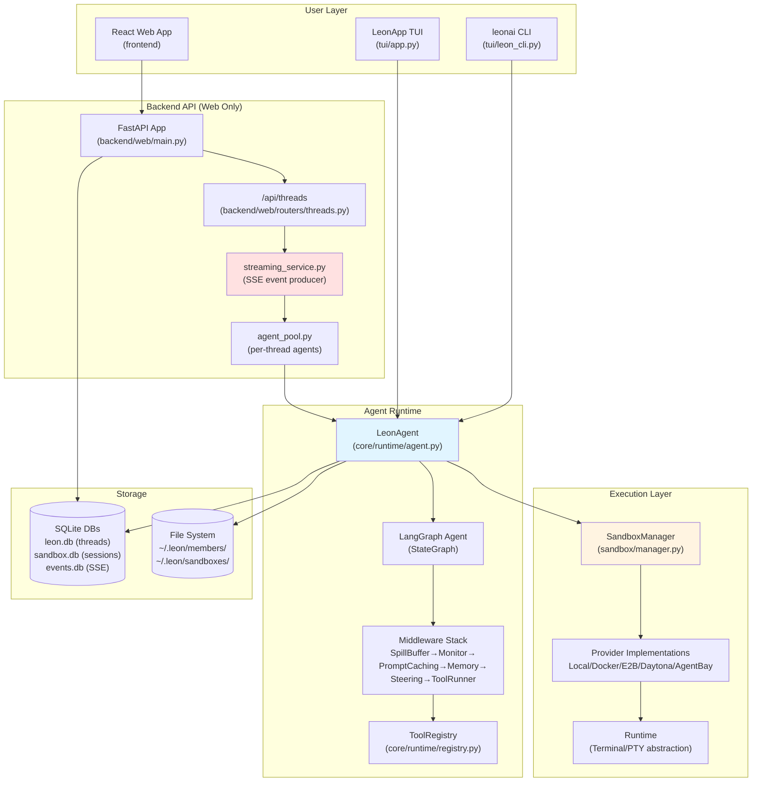
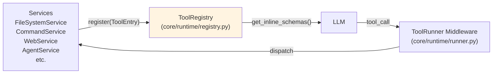
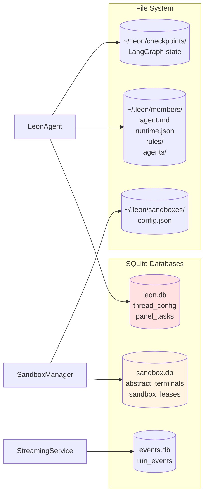

<!-- source: DeepWiki mcp.deepwiki.com · repo OpenDCAI/Mycel · page 1 Overview · fetched 2026-11-02 -->

# Overview

<details>
<summary>Relevant source files</summary>

The following files were used as context for generating this wiki page:

- [agent.py](agent.py)
- [backend/taskboard/middleware.py](backend/taskboard/middleware.py)
- [backend/taskboard/service.py](backend/taskboard/service.py)
- [backend/web/core/lifespan.py](backend/web/core/lifespan.py)
- [backend/web/models/thread_config.py](backend/web/models/thread_config.py)
- [backend/web/routers/threads.py](backend/web/routers/threads.py)
- [backend/web/services/agent_pool.py](backend/web/services/agent_pool.py)
- [backend/web/services/member_service.py](backend/web/services/member_service.py)
- [backend/web/services/streaming_service.py](backend/web/services/streaming_service.py)
- [backend/web/utils/helpers.py](backend/web/utils/helpers.py)
- [config/defaults/tool_catalog.py](config/defaults/tool_catalog.py)
- [core/agents/communication/service.py](core/agents/communication/service.py)
- [core/agents/service.py](core/agents/service.py)
- [core/runtime/agent.py](core/runtime/agent.py)
- [core/runtime/registry.py](core/runtime/registry.py)
- [core/tools/command/service.py](core/tools/command/service.py)
- [pyproject.toml](pyproject.toml)
- [sandbox/capability.py](sandbox/capability.py)
- [tui/app.py](tui/app.py)
- [tui/leon_cli.py](tui/leon_cli.py)
- [tui/runner.py](tui/runner.py)
- [tui/widgets/status.py](tui/widgets/status.py)
- [uv.lock](uv.lock)

</details>


This document provides a high-level introduction to the Mycel codebase, explaining its architecture, key components, and how they work together. Mycel is a proactive AI coding assistant that executes tasks autonomously in isolated sandbox environments with persistent memory and real-time streaming.

**Scope**: This page covers the overall system architecture and component relationships. For detailed documentation on specific subsystems:
- User interface details: [User Interfaces](#3)
- Agent runtime internals: [Agent Runtime](#5)
- Sandbox implementation: [Sandbox System](#6)
- Frontend/backend architecture: [Frontend Architecture](#7), [Backend Architecture](#8)
- Configuration and setup: [Getting Started](#2), [Configuration and Settings](#9)

## System Purpose

Mycel is a multi-interface AI coding assistant designed for:
- **Autonomous task execution**: Agents can spawn sub-agents, execute shell commands, and perform file operations
- **Persistent memory**: Conversation history and sandbox state persist across sessions with checkpoint/restore capabilities
- **Real-time streaming**: Server-Sent Events (SSE) deliver incremental updates to frontends
- **Sandbox isolation**: Multiple providers (local, Docker, E2B, Daytona, AgentBay) enable safe execution
- **Multi-agent coordination**: Inter-agent messaging and hierarchical agent spawning

The system supports three interaction modes:
1. **Web UI** (React SPA) - Full-featured browser interface with real-time activity panels
2. **Terminal UI** (Textual) - Rich terminal interface with time travel debugging
3. **CLI** - Non-interactive and interactive command-line modes

Sources: [pyproject.toml:1-137](), [README.md (implied)](), [Diagram 1 from system overview]()

---

## High-Level Architecture



**Key architectural principles:**

1. **Multi-frontend, shared runtime**: All three UIs use the same `LeonAgent` class from [core/runtime/agent.py:92-268]()
2. **Middleware pipeline**: Request/response flow through ordered middleware [core/runtime/agent.py:4-6]()
3. **Event-driven streaming**: Web backend uses SSE for real-time updates [backend/web/services/streaming_service.py:1-1093]()
4. **Sandbox abstraction**: Uniform interface to multiple execution providers [sandbox/manager.py]()
5. **Tool registry pattern**: Services register tools into central registry [core/runtime/registry.py:28-78]()

Sources: [core/runtime/agent.py:1-1021](), [backend/web/routers/threads.py:1-654](), [tui/leon_cli.py:1-797](), [tui/app.py:1-897]()

---

## Request Execution Flow

The following diagram shows how a user message flows through the system, from input to response:

```mermaid
sequenceDiagram
    participant User
    participant Interface["Interface<br/>(Web/TUI/CLI)"]
    participant LeonAgent["LeonAgent"]
    participant Middleware["Middleware Stack"]
    participant LLM["LLM Provider"]
    participant ToolRunner["ToolRunner"]
    participant Sandbox["SandboxProvider"]
    
    User->>Interface: "Write hello.txt"
    Interface->>LeonAgent: agent.astream(message)
    LeonAgent->>LeonAgent: Set thread context<br/>set_current_thread_id()
    LeonAgent->>Middleware: Process via pipeline
    
    Middleware->>LLM: LLM call (via Monitor)
    LLM-->>Middleware: tool_call: Write
    
    Middleware->>ToolRunner: Execute Write tool
    ToolRunner->>ToolRunner: Lookup in ToolRegistry
    ToolRunner->>Sandbox: fs.write_file(path, content)
    Sandbox-->>ToolRunner: result
    ToolRunner-->>Middleware: ToolMessage
    
    Middleware->>LLM: LLM call with result
    LLM-->>Middleware: "File created"
    
    Middleware-->>LeonAgent: Stream complete
    LeonAgent-->>Interface: Chunks (text/tool_call/tool_result)
    Interface-->>User: Display response
```

**Flow details:**

1. **Context setup**: Thread ID set via `set_current_thread_id()` [sandbox/thread_context.py]()
2. **State machine**: Agent transitions through states (IDLE→ACTIVE→IDLE) [core/runtime/middleware/monitor/__init__.py]()
3. **Streaming**: LangGraph `astream()` yields chunks incrementally [core/runtime/agent.py:408-413]()
4. **Tool dispatch**: `ToolRunner` resolves tool name→handler via registry [core/runtime/runner.py]()
5. **Sandbox execution**: Commands/file ops route through provider abstraction [sandbox/capability.py:26-70]()

Sources: [backend/web/services/streaming_service.py:344-809](), [tui/app.py:298-528](), [core/runtime/runner.py]()

---

## Core Subsystems

### LeonAgent and Runtime

The `LeonAgent` class ([core/runtime/agent.py:92-268]()) is the central orchestrator that:
- Creates LangGraph agent with middleware stack
- Manages model configuration and API keys
- Initializes tool registry and services
- Handles async initialization for web contexts

**Key initialization sequence:**
1. Load configuration (models, sandbox, workspace) [core/runtime/agent.py:149-195]()
2. Create LLM model [core/runtime/agent.py:203]()
3. Initialize tool registry and services [core/runtime/agent.py:224-226]()
4. Build middleware stack [core/runtime/agent.py:228]()
5. Create LangGraph agent [core/runtime/agent.py:242-248]()

The middleware stack wraps the LLM in layers (outer→inner):
- `SpillBufferMiddleware`: Handles large outputs
- `MonitorMiddleware`: Tracks costs, tokens, state
- `PromptCachingMiddleware`: Optimizes cache usage
- `MemoryMiddleware`: Manages context window
- `SteeringMiddleware`: Injects queued messages
- `ToolRunner`: Dispatches tool calls

Sources: [core/runtime/agent.py:92-268](), [agent.py:1-8]()

---

### Tool and Service Architecture



**Service registration pattern** (all services follow this):
```python
class FileSystemService:
    def __init__(self, registry: ToolRegistry, ...):
        registry.register(ToolEntry(
            name="Read",
            mode=ToolMode.INLINE,
            schema={...},
            handler=self._read,
            source="FileSystemService"
        ))
```

**Registered services and their tools:**

| Service | Tools | Source File |
|---------|-------|-------------|
| FileSystemService | Read, Write, Edit, list_dir | [core/tools/filesystem/service.py]() |
| CommandService | Bash | [core/tools/command/service.py:32-96]() |
| SearchService | Grep, Glob | [core/tools/search/service.py]() |
| WebService | WebSearch, WebFetch | [core/tools/web/service.py]() |
| AgentService | Agent, TaskOutput, TaskStop | [core/agents/service.py:150-434]() |
| SendMessageService | SendMessage | [core/agents/communication/service.py:98-158]() |
| TaskBoardService | ListBoardTasks, ClaimTask, etc. | [backend/taskboard/service.py:31-246]() |
| SkillsService | load_skill (dynamic) | [core/tools/skills/service.py]() |

**Tool modes:**
- `INLINE`: Injected into every LLM call [core/runtime/registry.py:58-61]()
- `DEFERRED`: Only discoverable via `tool_search` [core/runtime/registry.py:14]()

Sources: [core/runtime/registry.py:28-78](), [core/runtime/runner.py](), [core/runtime/agent.py:224-226](), [config/defaults/tool_catalog.py:1-95]()

---

### Backend API (Web Mode)

When running as a web server, FastAPI provides REST and SSE endpoints:

**Key routers:**

| Router | Endpoints | Purpose |
|--------|-----------|---------|
| `threads.py` | `/api/threads/*` | Thread CRUD, message sending, SSE streaming |
| `settings.py` | `/api/settings/*` | User preferences, model config |
| `panel.py` | `/api/panel/*` | Task board, cron jobs |
| `resources.py` | `/api/resources/*` | Provider monitoring, sandbox status |

**Thread lifecycle:**
1. `POST /api/threads` - Create thread, initialize config [backend/web/routers/threads.py:55-83]()
2. `POST /api/threads/{id}/messages` - Send message, route based on state [backend/web/routers/threads.py:159-189]()
3. `GET /api/threads/{id}/events` - SSE stream for real-time updates [backend/web/routers/threads.py:429-482]()

**Agent pool management:**
- One `LeonAgent` per `(thread_id, sandbox_type)` tuple [backend/web/services/agent_pool.py:40-91]()
- Lazy initialization on first access
- Per-thread model/config overrides supported [backend/web/services/agent_pool.py:69-75]()

**SSE event streaming:**
- `ThreadEventBuffer` - Persistent per-thread event queue [backend/web/services/event_buffer.py]()
- Events: `run_start`, `text`, `tool_call`, `tool_result`, `run_done`, `status` [backend/web/services/streaming_service.py:500-746]()
- Reconnection support via `?after=N` or `Last-Event-ID` header [backend/web/routers/threads.py:442-447]()

Sources: [backend/web/routers/threads.py:1-654](), [backend/web/services/agent_pool.py:1-180](), [backend/web/services/streaming_service.py:1-1093]()

---

### Sandbox System

The sandbox abstraction provides isolated execution environments:

```mermaid
graph TB
    SandboxManager["SandboxManager<br/>(sandbox/manager.py)"]
    ChatSession["ChatSession<br/>(per thread)"]
    Runtime["Runtime<br/>(LocalPersistentShellRuntime<br/>DockerPtyRuntime<br/>E2BPtyRuntime, etc.)"]
    Terminal["AbstractTerminal<br/>(state: cwd, env)"]
    Lease["SandboxLease<br/>(instance reservation)"]
    Provider["SandboxProvider<br/>(interface)"]
    Impl["Provider Implementations<br/>LocalSessionProvider<br/>DockerProvider<br/>E2BProvider<br/>DaytonaProvider<br/>AgentBayProvider"]
    
    SandboxManager -->|"get_or_create_session"| ChatSession
    ChatSession --> Runtime
    ChatSession --> Terminal
    ChatSession --> Lease
    SandboxManager --> Provider
    Provider <|-- Impl
    Lease -->|"ensure_active_instance"| Provider
    
    style SandboxManager fill:#fff4e1
```

**Hierarchy**: Thread → ChatSession → Runtime → Terminal → Lease → Instance

**Key classes:**
- `SandboxManager` [sandbox/manager.py](): Session orchestration, lifecycle management
- `ChatSession` [sandbox/chat_session.py](): Binds terminal+runtime+lease for a thread
- `AbstractTerminal` [sandbox/terminal.py](): Persistent shell state (cwd, env vars)
- `SandboxLease` [sandbox/lease.py](): Instance reservation and status tracking
- `SandboxProvider` [sandbox/provider.py:11-194](): Abstract interface with capability flags

**Provider capabilities** (declared via `ProviderCapability`):
- `can_pause/can_resume`: Pause/resume support [sandbox/provider.py:15-24]()
- `can_get_metrics`: Resource monitoring [sandbox/provider.py:25]()
- `has_screenshots`: UI snapshots [sandbox/provider.py:26]()
- `has_web_url`: Browser access [sandbox/provider.py:27]()

**Configuration**: Providers loaded from `~/.leon/sandboxes/*.json` [tui/leon_cli.py:226-251]()

Sources: [sandbox/manager.py](), [sandbox/chat_session.py](), [sandbox/capability.py:1-236](), [sandbox/provider.py:1-194]()

---

### State Management and Persistence



**Storage layers:**

1. **Thread metadata** (`leon.db:thread_config`): Sandbox type, cwd, model [storage/providers/sqlite/thread_config_repo.py]()
2. **Sandbox sessions** (`sandbox.db`): Terminal/lease state [sandbox/terminal.py](), [sandbox/lease.py]()
3. **SSE events** (`events.db`): Per-run event history [backend/web/services/event_store.py]()
4. **LangGraph checkpoints**: Conversation state [langgraph-checkpoint-sqlite]()
5. **Member configs**: Agent definitions [backend/web/services/member_service.py:1-564]()

**Context variables** for thread/run tracking:
- `current_thread_id` - Active thread [sandbox/thread_context.py]()
- `current_run_id` - Current execution [sandbox/thread_context.py]()

Sources: [storage/container.py](), [storage/providers/sqlite/](), [sandbox/thread_context.py](), [backend/web/services/event_store.py]()

---

## Inter-Component Communication

### Frontend ↔ Backend (Web Mode)

**HTTP endpoints** - Control operations:
- Thread management: Create, delete, list threads
- Message sending: POST to `/api/threads/{id}/messages`
- Configuration: Settings, model selection

**SSE streams** - Real-time data:
- Event stream: `/api/threads/{id}/events` [backend/web/routers/threads.py:429-482]()
- Event types: text chunks, tool calls, tool results, status updates

**React state management:**
- `AppStore` (Zustand): Global UI state [frontend/src/stores/useAppStore.ts (implied)]()
- `useThreadManager`: Thread CRUD operations
- `useStreamHandler`: SSE connection and event processing

Sources: [backend/web/routers/threads.py:1-654](), Frontend source files (implied from diagrams)

---

### Inter-Agent Communication

Agents communicate via:

1. **Message queues** (`MessageQueueManager`): Steer injection, followup messages [core/runtime/middleware/queue/manager.py]()
2. **SendMessage tool**: Direct agent→agent messaging [core/agents/communication/service.py:1-158]()
3. **EventBus**: Sub-agent events flow to parent thread [backend/web/event_bus.py (implied)]()
4. **AgentRegistry**: Name resolution for routing [core/agents/registry.py]()

**Queue routing:**
- `steer` type: Inject into active agent's next LLM call [core/runtime/middleware/queue/steering.py]()
- `followup` type: Execute when agent transitions to IDLE

Sources: [core/runtime/middleware/queue/manager.py](), [core/agents/communication/service.py:1-158](), [core/agents/service.py:254-399]()

---

## Entry Points and Initialization

**CLI entry point** (`leonai` command):
```
tui/leon_cli.py:main() → _launch_tui() → run_tui()
                       → cmd_run() (non-interactive)
                       → cmd_thread() (thread management)
                       → cmd_sandbox() (sandbox TUI)
```

**Web server entry point**:
```
backend/web/main.py:app → lifespan() → routers registration
```

**Agent creation factory**:
```python
create_leon_agent(
    model_name="gpt-4",
    workspace_root=Path.cwd(),
    sandbox="local",  # or provider name
    agent="general",  # member name
    verbose=False
) → LeonAgent instance
```

Sources: [tui/leon_cli.py:572-797](), [backend/web/main.py (implied)](), [core/runtime/agent.py:1021-1075](), [agent.py:1-8]()

---

## Configuration Hierarchy

Mycel uses a three-level configuration system:

1. **Global** (`~/.leon/config.json`, `~/.leon/models.json`): API keys, default model
2. **Per-thread** (SQLite `thread_config` table): Sandbox, model, cwd overrides
3. **Per-member** (`~/.leon/members/*/`): Agent-specific tool/prompt configuration

**Configuration precedence** (highest to lowest):
1. Runtime parameter (e.g., `update_config(model="gpt-4")`)
2. Thread config override
3. Member config
4. Global defaults

**Model resolution**: Virtual names (`leon:mini/medium/large/max`) map to real models [config/models_loader.py]()

Sources: [backend/web/utils/helpers.py:86-148](), [config/loader.py](), [config/models_loader.py](), [backend/web/services/member_service.py:1-564]()

---

## Deployment Modes

Mycel supports three deployment modes:

| Mode | Entry Point | Use Case |
|------|-------------|----------|
| **CLI** | `leonai run` | Non-interactive scripts, CI/CD |
| **TUI** | `leonai` | Interactive terminal, local development |
| **Web** | `uvicorn backend.web.main:app` | Multi-user web service |

**Shared components**: All modes use the same `LeonAgent` runtime and tool registry.

**Web-specific additions**:
- Agent pool for per-thread isolation [backend/web/services/agent_pool.py]()
- SSE streaming service [backend/web/services/streaming_service.py]()
- Cron scheduler [backend/web/services/cron_service.py (implied)]()
- Background workers (idle reaper, resource monitor) [backend/web/core/lifespan.py:44-61]()

Sources: [tui/runner.py:1-373](), [tui/leon_cli.py:1-797](), [backend/web/core/lifespan.py:1-85]()

---

## Next Steps

For detailed information on specific subsystems, see:

- **[Getting Started](#2)** - Installation and first steps
- **[Core Concepts](#4)** - Threads, agents, sandboxes, tools
- **[Agent Runtime](#5)** - Middleware, tool execution, memory management
- **[Sandbox System](#6)** - Provider implementations, session management
- **[Frontend Architecture](#7)** - React components, state management, streaming
- **[Backend Architecture](#8)** - API design, agent pool, event system
- **[Configuration](#9)** - Models, sandboxes, observation providers

---

