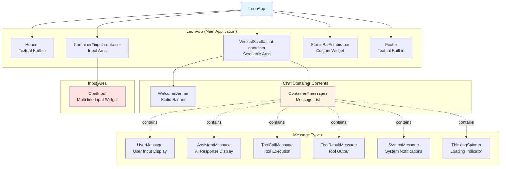
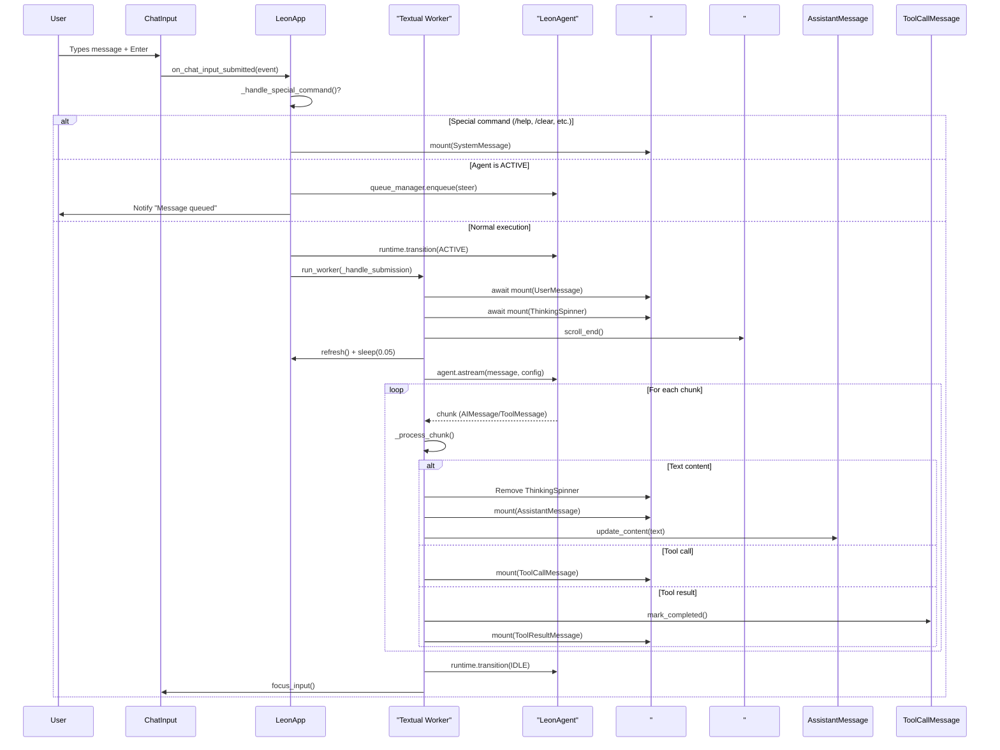
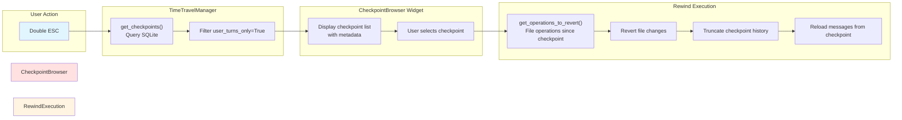
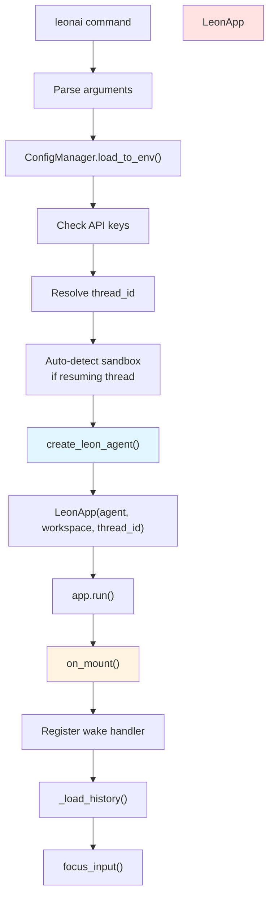

<!-- source: DeepWiki mcp.deepwiki.com · repo OpenDCAI/Mycel · page 3.2 Terminal UI (TUI) · fetched 2026-11-02 -->

# Terminal UI (TUI)

<details>
<summary>Relevant source files</summary>

The following files were used as context for generating this wiki page:

- [agent.py](agent.py)
- [pyproject.toml](pyproject.toml)
- [tui/app.py](tui/app.py)
- [tui/leon_cli.py](tui/leon_cli.py)
- [tui/runner.py](tui/runner.py)
- [tui/widgets/status.py](tui/widgets/status.py)
- [uv.lock](uv.lock)

</details>


The Terminal UI (TUI) is a full-featured terminal-based interface for Mycel built using the [Textual framework](https://textual.textualize.io). It provides a rich, interactive chat experience directly in the terminal with real-time message streaming, tool execution visualization, and advanced features like time travel and conversation management. 

The TUI is the primary interactive interface for local development and terminal-based workflows. For web-based usage, see [Web Interface](#3.1). For non-interactive command-line execution, see [Command Line Interface](#3.3).

Sources: [tui/app.py:1-913](), [pyproject.toml:34]()

---

## Application Architecture

The TUI is implemented as a Textual `App` subclass called `LeonApp` that orchestrates the entire user interface. Textual provides a reactive, component-based framework similar to modern web frameworks but for terminal applications.

### Core Application Structure



**Diagram 1: Textual Widget Hierarchy**

The `LeonApp` class manages the entire application lifecycle and coordinates between the agent runtime, message display, and user input.

Sources: [tui/app.py:62-166]()

### Key Application Properties

| Property | Type | Purpose |
|----------|------|---------|
| `agent` | `LeonAgent` | The agent instance handling AI interactions |
| `workspace_root` | `Path` | Working directory for file operations |
| `thread_id` | `str` | Unique identifier for the conversation thread |
| `session_mgr` | `SessionManager` | Manages thread persistence and history |
| `_agent_worker` | `Worker` | Textual worker for async agent execution |
| `_current_assistant_msg` | `AssistantMessage` | Currently streaming assistant message widget |
| `_shown_tool_calls` | `set` | Tracks displayed tool calls to prevent duplicates |
| `_message_count` | `int` | Number of messages in current thread |

Sources: [tui/app.py:116-132]()

---

## Main Components

### ChatInput Widget

The `ChatInput` widget provides a multi-line text input area with command history and special command handling. It supports:

- **Multi-line input**: Shift+Enter for new lines, Enter to submit
- **Command history**: Ctrl+Up/Down to navigate previous inputs
- **Command palette**: Special commands like `/help`, `/clear`, `/history`
- **Double-ESC detection**: Opens time travel interface

Sources: [tui/app.py:99-102](), [tui/widgets/chat_input.py]() (referenced but not provided)

### Message Widgets

Each message type is rendered as a separate widget mounted in the `#messages` container:

| Widget Class | Purpose | Visual Style |
|--------------|---------|--------------|
| `UserMessage` | Display user input | Blue border, user icon |
| `AssistantMessage` | Display AI responses with streaming updates | Green border, assistant icon |
| `ToolCallMessage` | Show tool execution with name and arguments | Yellow/orange, collapsible |
| `ToolResultMessage` | Display tool execution results | Gray, indented |
| `SystemMessage` | Show system notifications and help text | Cyan, informational |
| `ThinkingSpinner` | Animated loading indicator during agent execution | Animated dots |

Sources: [tui/app.py:17](), [tui/widgets/messages.py]() (referenced)

### StatusBar Widget

The `StatusBar` displays contextual information at the bottom of the screen:

```
Leon Agent | Thread: tui-abc123 | 消息: 5 | Ctrl+↑/↓: 历史 | Ctrl+E: 导出 | Ctrl+Y: 复制
```

It dynamically updates to show:
- Current thread ID
- Message count
- Runtime status (when agent is executing)
- Available keyboard shortcuts

Sources: [tui/widgets/status.py:1-70]()

---

## Message Flow and Streaming

### User Input to Agent Execution



**Diagram 2: Message Submission and Streaming Flow**

Sources: [tui/app.py:198-213](), [tui/app.py:298-528]()

### Critical Rendering Sequence

The TUI ensures the user message is **visible before** agent execution begins to provide immediate feedback:

1. **Await mount**: Use `await messages_container.mount(user_msg)` to ensure synchronous rendering
2. **Force refresh**: Call `self.refresh()` to update the screen
3. **Sleep briefly**: `await asyncio.sleep(0.05)` gives UI time to paint
4. **Then process**: Only after visual confirmation, start agent processing

This prevents the common UX issue where the user sees a delay before their message appears.

Sources: [tui/app.py:298-332]()

### Streaming Updates

The `AssistantMessage` widget supports incremental content updates during streaming:

```python
# In _process_message
if content and content != last_content:
    if not self._current_assistant_msg:
        self._current_assistant_msg = AssistantMessage()
        await messages_container.mount(self._current_assistant_msg)
    
    # Throttle updates to avoid excessive refreshes
    current_time = time.time()
    if current_time - last_update_time >= update_interval:
        self._current_assistant_msg.update_content(content)
        last_update_time = current_time
```

Updates are throttled to 50ms intervals (`update_interval = 0.05`) to balance responsiveness with performance.

Sources: [tui/app.py:436-454]()

---

## Keyboard Shortcuts and Commands

### Global Keyboard Bindings

| Shortcut | Action | Implementation |
|----------|--------|----------------|
| `Ctrl+D` | Quit application | `action_quit()` |
| `Ctrl+L` | Clear conversation history | `action_clear_history()` |
| `Ctrl+Up` | Previous input from history | `action_history_up()` |
| `Ctrl+Down` | Next input from history | `action_history_down()` |
| `Ctrl+E` | Export conversation to Markdown | `action_export_conversation()` |
| `Ctrl+Y` | Copy last assistant message | `action_copy_last_message()` |
| `ESC` | Interrupt running agent | `action_interrupt_agent()` |
| `ESC ESC` | Open time travel (checkpoint browser) | `action_time_travel()` |

Sources: [tui/app.py:105-114]()

### Slash Commands

Users can type special commands in the chat input:

| Command | Effect |
|---------|--------|
| `/help` | Display help information with all shortcuts and commands |
| `/clear` | Clear conversation and start new thread |
| `/history` | Open input history browser |
| `/resume` | Switch to a different conversation thread |
| `/rollback N` or `/回退 N` | Revert input to N steps ago |
| `/compact` | Manually trigger memory compaction |
| `/exit` or `/quit` | Exit the application |

Sources: [tui/app.py:214-246]()

---

## Advanced Features

### Time Travel and Checkpointing

The TUI integrates with LangGraph's checkpointing system to enable "time travel" - reverting the conversation to a previous state.

**Time Travel Flow:**



**Diagram 3: Time Travel Feature Architecture**

The `TimeTravelManager` tracks file operations at each checkpoint and can revert them when rewinding:

1. **Checkpoint Recording**: Each user turn creates a checkpoint with associated file operations
2. **Selection**: User browses checkpoints and selects target
3. **Impact Analysis**: System shows which file operations will be reverted
4. **Execution**: Files are reverted, checkpoint history is truncated, UI reloads

Sources: [tui/app.py:752-797](), [tui/time_travel.py]() (referenced)

### History Browser

The `HistoryBrowser` widget displays previous user inputs for quick access:

- Triggered by `/history` command or programmatically
- Shows list of all previous inputs in current session
- User can select an input to populate the chat input field
- Implements fuzzy search/filtering

Sources: [tui/app.py:572-590](), [tui/widgets/history_browser.py]() (referenced)

### Thread Selector

The `ThreadSelector` widget enables switching between conversation threads:

- Triggered by `/resume` command
- Lists all available threads with metadata (message count, first message preview)
- Switching threads clears current display and loads selected thread history
- Integrates with `SessionManager` for thread persistence

Sources: [tui/app.py:799-845](), [tui/widgets/thread_selector.py]() (referenced)

---

## State Management and Queue Integration

### Agent State Tracking

The TUI synchronizes with the agent's runtime state machine to provide accurate status information and handle message routing correctly.

**State-Driven Message Routing:**

| Agent State | User Input Behavior |
|-------------|---------------------|
| `IDLE` | Start new agent run, transition to `ACTIVE` |
| `ACTIVE` | Enqueue message as steer (interrupt/redirect) |
| `SUSPENDED` | Resume and start new run |
| `ERROR` | Recover, transition to `READY`, then `ACTIVE` |

Sources: [tui/app.py:134-138](), [tui/app.py:207-278]()

### Queue-Driven Followups

The TUI registers a wake handler with the agent's `MessageQueueManager` to automatically process queued messages when the agent becomes idle:

```python
def _register_wake_handler(self) -> None:
    """Register wake handler on the unified queue"""
    def wake_handler(item: object) -> None:
        # Schedule followup check on Textual's event loop (thread-safe)
        self.call_later(self._state_driven_followup)
    
    self.agent.queue_manager.register_wake(self.thread_id, wake_handler)
```

When the agent transitions to `IDLE`, the `_on_state_changed` callback triggers `_state_driven_followup`, which dequeues and processes the next message.

Sources: [tui/app.py:146-173](), [tui/app.py:530-534]()

### Observation Provider Integration

The TUI supports optional integration with observation providers (Langfuse, LangSmith) for LLM tracing:

```python
# Observation provider (langfuse / langsmith)
obs_handler = None
obs_config = getattr(self.agent, "observation_config", None)

if obs_config and obs_config.active == "langfuse":
    from langfuse.langchain import CallbackHandler as LangfuseHandler
    obs_handler = LangfuseHandler(public_key=cfg.public_key)
    config.setdefault("callbacks", []).append(obs_handler)
    config.setdefault("metadata", {})["langfuse_session_id"] = self.thread_id

elif obs_config and obs_config.active == "langsmith":
    from langchain_core.tracers.langchain import LangChainTracer
    obs_handler = LangChainTracer(client=ls_client, project_name=cfg.project)
    config.setdefault("callbacks", []).append(obs_handler)
```

Handlers are flushed at the end of each agent run to ensure traces are captured.

Sources: [tui/app.py:365-407](), [tui/app.py:499-508]()

---

## Running the TUI

### Launch Methods

The TUI is launched via the `leonai` CLI command (see [Command Line Interface](#3.3) for full CLI documentation):

```bash
# Basic launch (new conversation)
leonai

# Continue last conversation
leonai -c

# Resume specific thread
leonai --thread tui-abc123

# Specify model
leonai --model claude-3-5-sonnet-20241022

# Specify workspace
leonai --workspace /path/to/project

# Specify sandbox configuration
leonai --sandbox agentbay

# Specify agent preset
leonai --agent coder
```

Sources: [tui/leon_cli.py:572-612](), [tui/leon_cli.py:707-761]()

### Initialization Sequence



**Diagram 4: TUI Initialization Flow**

Sources: [tui/leon_cli.py:707-761](), [tui/app.py:167-177]()

### Session Persistence

The `SessionManager` tracks active threads and persists the last active thread ID:

- **Thread list**: Stored in `~/.leon/tui_sessions.json`
- **Thread metadata**: Retrieved from SQLite checkpoint database
- **Resume behavior**: `-c` flag loads last thread, `--thread` loads specific thread
- **Auto-save**: Thread ID saved on app exit

Sources: [tui/leon_cli.py:707-761](), [tui/session.py]() (referenced)

---

## Configuration and Customization

### CSS Styling

The TUI uses Textual's CSS-like styling system. Key styles are defined in `LeonApp.CSS`:

```python
CSS = """
Screen {
    layout: vertical;
}

#chat-container {
    height: 1fr;
    padding: 1 2;
    background: $background;
    scrollbar-gutter: stable;
}

#input-container {
    height: auto;
    min-height: 3;
    max-height: 10;
    padding: 0 2 1 2;
    background: $surface;
}

ChatInput {
    height: 100%;
    border: solid $primary;
}
"""
```

The `1fr` height for `#chat-container` makes it expand to fill available space, while `#input-container` uses `auto` with constraints to adapt to content.

Sources: [tui/app.py:65-103]()

### Widget Organization

Custom widgets are organized in `tui/widgets/`:

- `chat_input.py` - Multi-line input with history
- `messages.py` - Message display widgets
- `status.py` - Status bar
- `checkpoint_browser.py` - Time travel interface
- `history_browser.py` - Input history browser
- `thread_selector.py` - Thread switching dialog
- `loading.py` - Thinking spinner
- `sandbox_manager.py` - Sandbox session TUI (see [Sandbox Manager TUI](#6.5))

Sources: [tui/app.py:11-19]()

---

## Error Handling and Recovery

### Agent Interruption

When the user presses ESC during agent execution:

1. `action_interrupt_agent()` is called
2. Agent worker is cancelled via `self._agent_worker.cancel()`
3. `asyncio.CancelledError` is caught in `_process_message()`
4. System message "⚠ 已中断" is displayed
5. Agent state transitions to `SUSPENDED`

The user can then send a new message to resume the conversation.

Sources: [tui/app.py:487-492](), [tui/app.py:705-709]()

### Error State Handling

If an exception occurs during agent execution:

1. Exception is caught in `_process_message()` finally block
2. Error message is displayed as `AssistantMessage`
3. Agent runtime state is marked with error via `state.mark_error(e)`
4. State transitions to `ERROR`
5. Next user message triggers recovery: `ERROR → RECOVERING → READY → ACTIVE`

Sources: [tui/app.py:493-498](), [tui/app.py:267-273]()

### Graceful Shutdown

On exit (Ctrl+D or `/exit`):

1. Current thread ID and workspace are saved via `session_mgr.save_session()`
2. Agent resources are cleaned up via `agent.close()`
3. Sandbox sessions remain active (not destroyed) for later resume

Sources: [tui/leon_cli.py:754-760]()

---

## Performance Considerations

### Rendering Optimization

- **Update throttling**: Assistant message updates are throttled to 50ms intervals to prevent excessive screen refreshes during streaming
- **Scroll debouncing**: `scroll_end()` is called with `animate=False` to avoid animation overhead
- **Widget reuse**: `AssistantMessage` widget is reused for incremental updates rather than creating new widgets

Sources: [tui/app.py:348-349](), [tui/app.py:447-453]()

### Memory Management

- **Message history**: All messages remain in the `#messages` container; use `/clear` to reset
- **Tool call tracking**: Sets track shown tool calls/results to prevent duplicates without storing message content
- **Checkpoint browser**: Only loads checkpoints on-demand when time travel is triggered

Sources: [tui/app.py:122-126](), [tui/app.py:752-797]()

### Async Execution

The TUI leverages Textual's async-first architecture:

- Agent execution runs in a Textual `Worker` (managed thread pool)
- All UI updates use `await mount()` for non-blocking rendering
- Callbacks use `call_after_refresh()` and `call_later()` for thread-safe UI updates

Sources: [tui/app.py:176-177](), [tui/app.py:278]()

---

