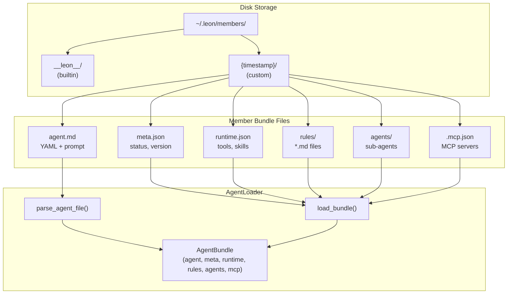
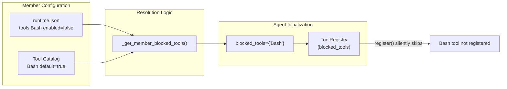
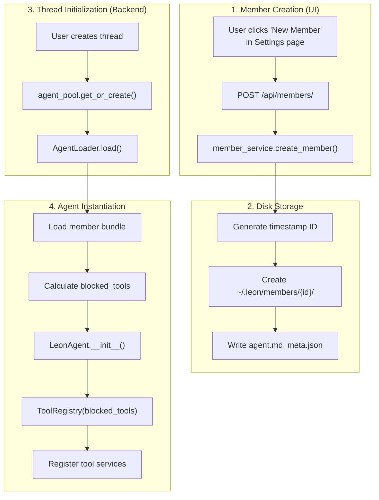
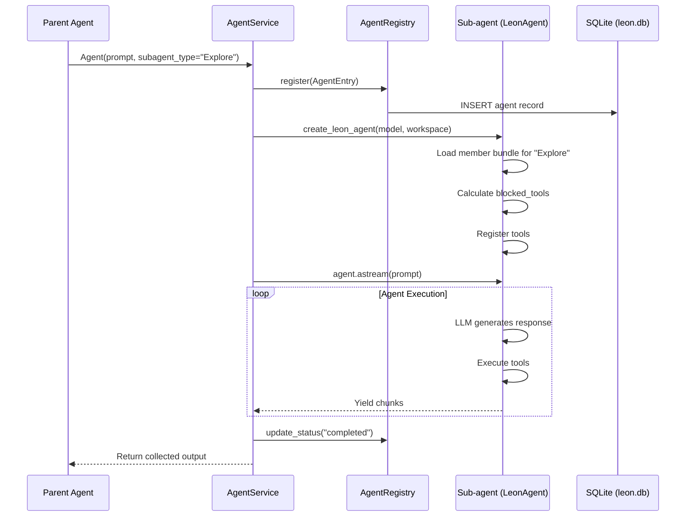
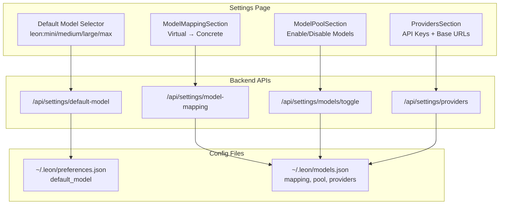
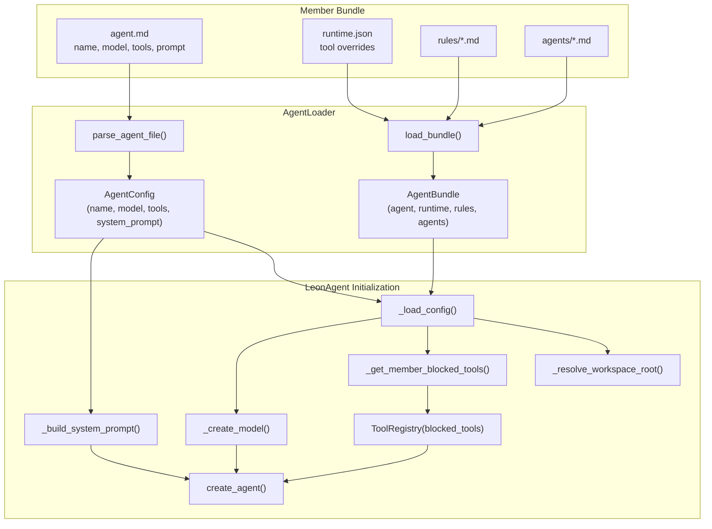

<!-- source: DeepWiki mcp.deepwiki.com · repo OpenDCAI/Mycel · page 4.2 Agents and Members · fetched 2026-11-02 -->

# Agents and Members

<details>
<summary>Relevant source files</summary>

The following files were used as context for generating this wiki page:

- [backend/taskboard/middleware.py](backend/taskboard/middleware.py)
- [backend/taskboard/service.py](backend/taskboard/service.py)
- [backend/web/routers/settings.py](backend/web/routers/settings.py)
- [backend/web/services/member_service.py](backend/web/services/member_service.py)
- [config/defaults/tool_catalog.py](config/defaults/tool_catalog.py)
- [config/models_schema.py](config/models_schema.py)
- [core/agents/communication/service.py](core/agents/communication/service.py)
- [core/agents/service.py](core/agents/service.py)
- [core/runtime/agent.py](core/runtime/agent.py)
- [core/runtime/middleware/monitor/cost.py](core/runtime/middleware/monitor/cost.py)
- [core/runtime/middleware/monitor/models.json](core/runtime/middleware/monitor/models.json)
- [core/runtime/registry.py](core/runtime/registry.py)
- [core/tools/command/service.py](core/tools/command/service.py)
- [frontend/app/index.html](frontend/app/index.html)
- [frontend/app/public/favicon.svg](frontend/app/public/favicon.svg)
- [frontend/app/src/components/ModelMappingSection.tsx](frontend/app/src/components/ModelMappingSection.tsx)
- [frontend/app/src/components/ModelPoolSection.tsx](frontend/app/src/components/ModelPoolSection.tsx)
- [frontend/app/src/components/ObservationSection.tsx](frontend/app/src/components/ObservationSection.tsx)
- [frontend/app/src/components/ProvidersSection.tsx](frontend/app/src/components/ProvidersSection.tsx)
- [frontend/app/src/components/SandboxSection.tsx](frontend/app/src/components/SandboxSection.tsx)
- [frontend/app/src/pages/SettingsPage.tsx](frontend/app/src/pages/SettingsPage.tsx)
- [sandbox/capability.py](sandbox/capability.py)
- [tests/test_model_config_enrichment.py](tests/test_model_config_enrichment.py)

</details>


This page explains agent configurations (called **members**) in Mycel: how they are defined, structured, and loaded into agent runtime instances. Members are persistent configuration bundles stored on disk that define an agent's identity, system prompt, enabled tools, rules, and sub-agents.

For information about agent runtime execution and the LeonAgent class, see [Agent Architecture and Initialization](#5.1). For tool registration and execution mechanics, see [Tool Registry and Execution](#5.2). For spawning independent agent tasks, see [Sub-agents and Inter-agent Communication](#5.4).

---

## Overview

**Members** are named agent configurations stored in `~/.leon/members/` as directory bundles. Each member defines:
- Agent identity (name, description, model preference)
- System prompt and behavioral rules
- Enabled/disabled tools and skills
- Sub-agent definitions
- MCP server configurations

**Agents** are runtime instances of `LeonAgent` that execute with a member's configuration. A single member can be used across multiple threads, and each thread maintains its own agent instance with the member's settings.

The system distinguishes between:
- **Builtin member** (`__leon__`) — the default general-purpose agent
- **Custom members** — user-defined specialized agents stored in timestamped directories
- **Builtin sub-agents** — read-only agent definitions in `config/defaults/agents/`

**Sources:** [backend/web/services/member_service.py:1-577](), [config/loader.py](), [core/runtime/agent.py:92-268]()

---

## Member File Structure

Each member is stored as a directory bundle with the following layout:

```
~/.leon/members/{member_id}/
├── agent.md          # Identity (YAML frontmatter) + system prompt (markdown body)
├── meta.json         # Status, version, created_at, updated_at
├── runtime.json      # Tool/skill enable states + descriptions
├── rules/            # Behavioral rules (one .md file per rule)
│   ├── default.md
│   └── coding.md
├── agents/           # Sub-agent definitions (one .md per agent)
│   ├── Explore.md
│   └── Coder.md
├── skills/           # Skill implementations (one directory per skill)
│   └── my_skill/
└── .mcp.json         # MCP server configurations
```

### agent.md Format

The identity file uses YAML frontmatter followed by markdown content:

```yaml
---
name: MyAgent
description: Specialized coding assistant
model: leon:large
tools:
  - Read
  - Write
  - Bash
---

You are a specialized coding assistant focused on clean, maintainable code.
Follow PEP 8 for Python and use type hints.
```

**Fields:**
- `name` (required) — agent display name
- `description` (optional) — short description shown in UI
- `model` (optional) — preferred model (overrides global config)
- `tools` (optional) — explicit tool list; omit or use `["*"]` for all tools

The markdown body becomes the agent's system prompt.

**Sources:** [backend/web/services/member_service.py:56-68](), [backend/web/services/member_service.py:71-93](), [config/loader.py]()

---

## Member Directory Structure



**Sources:** [backend/web/services/member_service.py:28-30](), [backend/web/services/member_service.py:160-249](), [config/loader.py]()

---

## The Tool Catalog and Runtime Overrides

Tools are managed through a two-level system:

1. **Tool Catalog** (`config/defaults/tool_catalog.py`) — authoritative registry defining all available tools with their default enabled state
2. **runtime.json** — per-member overrides for enable state and custom descriptions

### Tool Catalog Structure

The catalog defines each tool with:

```python
class ToolDef(BaseModel):
    name: str                    # Tool identifier
    desc: str                    # Default description
    group: ToolGroup            # Category (filesystem, command, web, etc)
    mode: ToolMode              # INLINE (always available) or DEFERRED (via tool_search)
    default: bool = True        # Enabled by default for new members
```

**Default Behavior:**
- `default=True` → enabled unless explicitly disabled in runtime.json
- `default=False` → disabled unless explicitly enabled in runtime.json

**Sources:** [config/defaults/tool_catalog.py:1-87]()

---

### runtime.json Format

Per-member tool and skill overrides:

```json
{
  "tools:Bash": {
    "enabled": true,
    "desc": "Execute shell commands with environment setup"
  },
  "tools:WebSearch": {
    "enabled": false,
    "desc": ""
  },
  "skills:code_review": {
    "enabled": true,
    "desc": "Automated code review skill"
  }
}
```

**Resolution Logic:**
1. If `tools:{name}` exists in runtime.json → use its `enabled` state
2. Else if catalog has `default=True` → enabled
3. Else if catalog has `default=False` → disabled

**Sources:** [backend/web/services/member_service.py:478-506](), [core/runtime/agent.py:337-369]()

---

## Tool Blocking and ToolRegistry

When a member's configuration is loaded into a `LeonAgent`, disabled tools are converted to a blocked set passed to `ToolRegistry`:



**Blocked Tool Calculation** [core/runtime/agent.py:337-369]():

```python
def _get_member_blocked_tools(self) -> set[str]:
    """Return disabled tool names, respecting catalog defaults."""
    blocked = set()
    
    # Tools explicitly disabled in runtime.json
    for key, rc in runtime.items():
        if key.startswith("tools:") and not rc.enabled:
            blocked.add(key.split(":", 1)[1])
    
    # Catalog tools with default=False that aren't explicitly enabled
    for tool_name, tool_def in TOOLS_BY_NAME.items():
        if not tool_def.default:
            runtime_key = f"tools:{tool_name}"
            if runtime_key not in runtime:
                blocked.add(tool_name)
    
    return blocked
```

The `ToolRegistry` silently skips registration for blocked tools [core/runtime/registry.py:48-53]().

**Sources:** [core/runtime/agent.py:337-369](), [core/runtime/registry.py:28-80](), [config/defaults/tool_catalog.py:46-87]()

---

## Member Lifecycle: Creation to Agent Instantiation



**Sources:** [backend/web/services/member_service.py:338-348](), [backend/web/services/agent_pool.py](), [core/runtime/agent.py:106-268]()

---

## Model Configuration Priority

Members can override the global model configuration:

**Priority (highest to lowest):**
1. **Member's agent.md** — `model` field in frontmatter
2. **User's preferences.json** — `default_model` setting
3. **System default** — `leon:large`

**Implementation** [core/runtime/agent.py:163-174]():

```python
# Resolve virtual model name
active_model = self.models_config.active.model if self.models_config.active else model_name
if not active_model:
    active_model = DEFAULT_MODEL

# Member model override: agent.md's model field takes precedence
if hasattr(self, "_agent_override") and self._agent_override and self._agent_override.model:
    active_model = self._agent_override.model

resolved_model, model_overrides = self.models_config.resolve_model(active_model)
```

**Sources:** [core/runtime/agent.py:163-174](), [config/models_schema.py:94-148](), [backend/web/routers/settings.py:230-237]()

---

## Sub-agent Definitions

Members can define sub-agents in the `agents/` directory. Each sub-agent is a separate agent.md file:

**agents/Explore.md:**
```yaml
---
name: Explore
description: Explore and analyze codebases
tools:
  - Read
  - Grep
  - Glob
  - list_dir
---

You are an exploration specialist. Your task is to understand codebases
by reading files, searching for patterns, and mapping structure.
```

### Builtin vs Custom Sub-agents

- **Builtin sub-agents** — stored in `config/defaults/agents/`, read-only, displayed in UI with `builtin: true` flag
- **Custom sub-agents** — stored in member's `agents/` directory, editable

**Resolution Logic** [backend/web/services/member_service.py:198-218]():

```python
for a in bundle.agents:
    is_builtin = a.source_dir is not None and a.source_dir.resolve() == _SYSTEM_AGENTS_DIR
    sub_agents_list.append({
        "name": a.name,
        "desc": a.description,
        "tools": agent_tools,
        "system_prompt": a.system_prompt,
        "builtin": is_builtin,
    })
```

When spawning a sub-agent via the `Agent` tool, the `subagent_type` parameter references the sub-agent name [core/agents/service.py:25-63]().

**Sources:** [backend/web/services/member_service.py:198-218](), [backend/web/services/member_service.py:274-291](), [core/agents/service.py:200-252]()

---

## Sub-agent Spawning Flow



**Key Points:**

1. **Isolation:** Sub-agents run in independent `LeonAgent` instances with their own tool registries
2. **Context Isolation:** [core/agents/service.py:266-274]() clears `var_child_runnable_config` to prevent callback leakage
3. **Thread Management:** Each sub-agent gets its own thread_id (`subagent-{task_id}`)
4. **Blocking vs Background:** By default, parent blocks until sub-agent completes; `run_in_background=True` fires-and-forgets

**Sources:** [core/agents/service.py:200-252](), [core/agents/service.py:254-399](), [core/agents/registry.py]()

---

## Member CRUD Operations

### Creating Members

**API:** `POST /api/members/`

**Backend Flow** [backend/web/services/member_service.py:338-348]():

```python
def create_member(name: str, description: str = "") -> dict[str, Any]:
    now = int(time.time() * 1000)
    member_id = str(now)  # Timestamp-based ID
    member_dir = MEMBERS_DIR / member_id
    member_dir.mkdir(parents=True, exist_ok=True)
    
    _write_agent_md(member_dir / "agent.md", name=name, description=description)
    _write_json(member_dir / "meta.json", {
        "status": "draft",
        "version": "0.1.0",
        "created_at": now,
        "updated_at": now,
    })
    
    return get_member(member_id)
```

### Updating Member Configuration

**API:** `POST /api/members/{id}/config`

**Supported Fields:**
- `prompt` → agent.md body
- `rules` → rules/ directory (replaces all)
- `tools` → runtime.json tools section
- `skills` → runtime.json skills section
- `subAgents` → agents/ directory (replaces all)
- `mcps` → .mcp.json

**Sources:** [backend/web/services/member_service.py:383-422](), [backend/web/services/member_service.py:425-545]()

---

## Member Configuration in Settings UI

The Settings page provides a unified interface for managing members, models, and tools:

**Frontend Structure:**
- **Model Tab** — Virtual model mapping, model pool, providers
- **Sandbox Tab** — Workspace and sandbox provider configuration
- **Observation Tab** — Langfuse/LangSmith tracing setup

**Model Configuration Flow:**



**Sources:** [frontend/app/src/pages/SettingsPage.tsx:1-317](), [backend/web/routers/settings.py:1-702]()

---

## Member Loading and AgentLoader

The `AgentLoader` class provides the core loading logic:

**Key Methods:**

| Method | Purpose | Returns |
|--------|---------|---------|
| `load_all_agents()` | Scan and parse all agent.md files (members + builtins) | `dict[str, AgentConfig]` |
| `load_bundle(source_dir)` | Load full member bundle from directory | `AgentBundle` |
| `parse_agent_file(path)` | Parse single agent.md file | `AgentConfig` |
| `load(cli_overrides)` | Load merged configuration (system + user + project + CLI) | `LeonSettings` |

**AgentBundle Structure:**

```python
class AgentBundle:
    agent: AgentConfig          # Parsed agent.md
    meta: dict[str, Any]        # meta.json contents
    runtime: dict[str, RuntimeConfig]  # runtime.json (tools:* and skills:*)
    rules: list[dict]           # rules/*.md files
    agents: list[AgentConfig]   # agents/*.md files
    mcp: dict[str, MCPServerConfig]  # .mcp.json
```

**Usage in LeonAgent** [core/runtime/agent.py:410-436]():

```python
if agent_name:
    all_agents = loader.load_all_agents()
    agent_def = all_agents.get(agent_name)
    if agent_def.source_dir:
        self._agent_bundle = loader.load_bundle(agent_def.source_dir)
    self._agent_override = agent_def
```

**Sources:** [config/loader.py](), [core/runtime/agent.py:371-442]()

---

## Member-to-Agent Configuration Flow



**System Prompt Composition** [core/runtime/agent.py:236-239]():

```python
self.system_prompt = self._build_system_prompt()
custom_prompt = self.config.system_prompt
if custom_prompt:
    self.system_prompt += f"\n\n**Custom Instructions:**\n{custom_prompt}"
```

**Sources:** [core/runtime/agent.py:371-442](), [core/runtime/agent.py:92-268](), [config/loader.py]()

---

## Summary: Key Concepts

| Concept | Description | Storage Location |
|---------|-------------|------------------|
| **Member** | Named agent configuration bundle | `~/.leon/members/{id}/` |
| **Builtin Member** | Default Leon agent | `~/.leon/members/__leon__/` |
| **Custom Member** | User-defined specialized agent | `~/.leon/members/{timestamp}/` |
| **Builtin Sub-agent** | Read-only agent definition | `config/defaults/agents/*.md` |
| **Tool Catalog** | Authoritative tool registry | `config/defaults/tool_catalog.py` |
| **Runtime Config** | Per-member tool overrides | `{member}/runtime.json` |
| **Agent Instance** | Runtime LeonAgent with member config | In-memory, per-thread |
| **AgentBundle** | Loaded member configuration | In-memory |
| **Blocked Tools** | Disabled tools for member | Calculated at init time |

**Configuration Hierarchy:**
1. System defaults (tool_catalog.py, system agents)
2. User config (~/.leon/models.json, preferences.json)
3. Member config (agent.md, runtime.json)
4. Thread overrides (hot-reload via update_config())

**Sources:** [backend/web/services/member_service.py:1-577](), [config/loader.py](), [core/runtime/agent.py:92-268](), [config/defaults/tool_catalog.py:1-87]()

---

