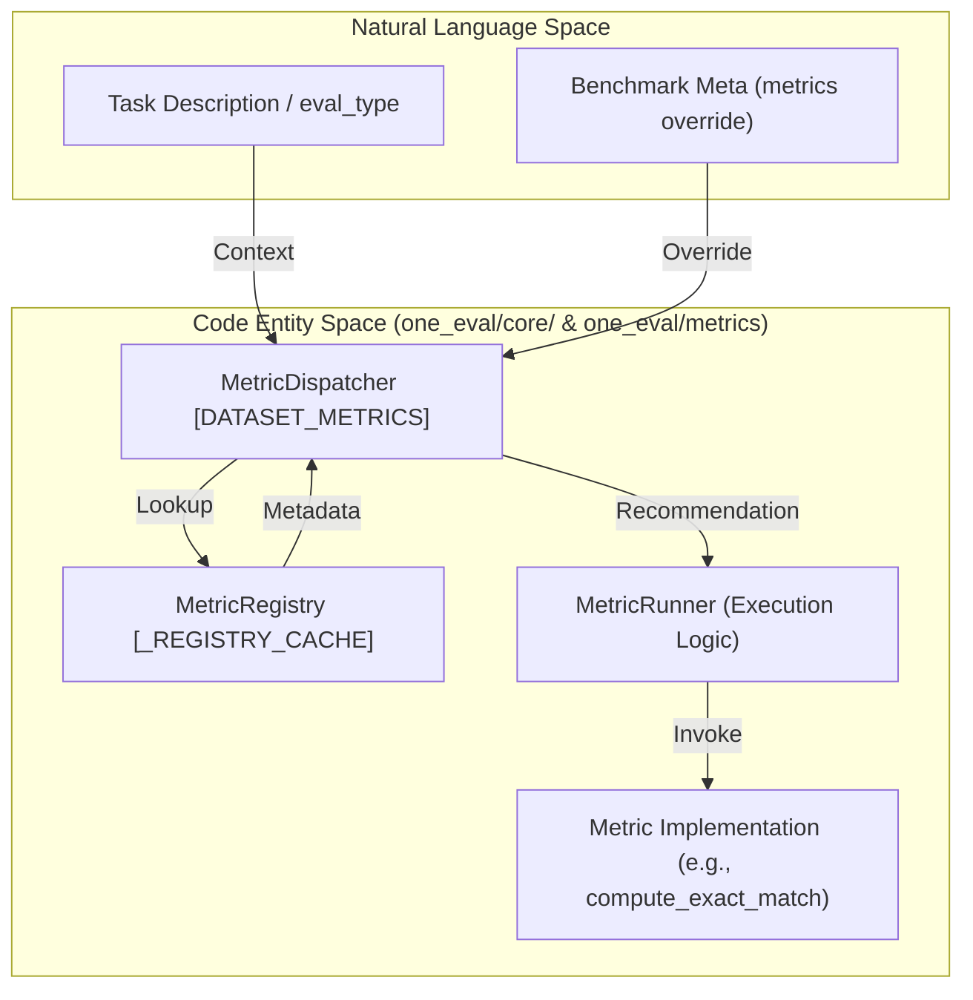

<!-- source: DeepWiki mcp.deepwiki.com · repo OpenDCAI/One-Eval · page 4 Metrics System · fetched 2026-11-02 -->

# Metrics System

Relevant source files

The following files were used as context for generating this wiki page:

- [HOW_TO_REGISTER_METRIC.md](HOW_TO_REGISTER_METRIC.md)
- [one_eval/core/metric_registry.py](one_eval/core/metric_registry.py)
- [one_eval/metrics/__init__.py](one_eval/metrics/__init__.py)
- [one_eval/metrics/common/__init__.py](one_eval/metrics/common/__init__.py)
- [one_eval/metrics/config.py](one_eval/metrics/config.py)
- [one_eval/metrics/dispatcher.py](one_eval/metrics/dispatcher.py)

The Metrics System in One-Eval is a decoupled subsystem responsible for recommending, registering, and executing evaluation metrics across diverse benchmarks. It utilizes an "LLM-first with rule-based fallback" strategy to determine which metrics (e.g., Exact Match, BLEU, Pass@k) are most appropriate for a given dataset and model output.

### System Architecture

The system bridges the gap between high-level task descriptions and low-level Python implementations through a registry-dispatcher-runner pattern.

#### Metrics Logic Flow
The following diagram illustrates how a metric implementation in code is selected and executed based on natural language task requirements.

**Metric Resolution & Execution Flow**

**Sources:**
- [one_eval/core/metric_registry.py:27-33]() (Registry Cache and Alias Map)
- [one_eval/metrics/dispatcher.py:15-26]() (Dispatcher Initialization)
- [HOW_TO_REGISTER_METRIC.md:16-58]() (Recommendation Logic)

---

### Core Components

The metrics subsystem is composed of three primary architectural layers:

1.  **Metric Registry**: A centralized store for metric metadata. It uses the `@register_metric` decorator to capture function pointers, descriptions, and categories for LLM consumption [one_eval/core/metric_registry.py:35-79]().
2.  **Metric Dispatcher**: The decision engine that resolves which metrics to run. It performs a "best-match" search against `DATASET_METRICS` using normalized keys and manages default priority assignments (Primary, Secondary, or Diagnostic) [one_eval/metrics/dispatcher.py:44-98]().
3.  **Metric Runner**: Handles the actual computation, ensuring that predictions and references are correctly aligned and that results are persisted to the filesystem.

#### Metric Priority Taxonomy
Metrics are categorized by their role in the evaluation report:
*   **Primary**: The headline score for the benchmark (e.g., `exact_match` for GSM8K).
*   **Secondary**: Supporting scores (e.g., `token_f1`).
*   **Diagnostic**: Metrics that measure system health rather than performance (e.g., `extraction_rate`, `format_compliance`) [one_eval/metrics/dispatcher.py:44-51]().

For details on the implementation of these components, see [Metric Registry, Dispatcher & Runner](#4.1).

---

### Built-in Metrics & Registration

One-Eval includes a library of standard metrics organized by task category in `one_eval/metrics/common/`. These are automatically discovered and loaded by the system [one_eval/core/metric_registry.py:81-100]().

| Category | Key Metrics | Code Location |
| :--- | :--- | :--- |
| **Classification** | `exact_match`, `token_f1` | `one_eval/metrics/common/classification.py` |
| **Text Generation** | `bleu`, `rouge_l`, `chrf` | `one_eval/metrics/common/text_gen.py` |
| **Math/Symbolic** | `numerical_match`, `math_verify` | `one_eval/metrics/common/math_verify.py` |
| **Code** | `pass_at_k`, `code_similarity` | `one_eval/metrics/common/code.py` |
| **Judge** | `llm_judge_score` | `one_eval/metrics/common/judge.py` |

#### Extending the System
New metrics are added by implementing a Python function and decorating it with `@register_metric`. The system automatically injects the `desc` and `usage` fields into the LLM's prompt context to enable intelligent recommendation [HOW_TO_REGISTER_METRIC.md:71-90]().

For a full list of implementations and a guide on adding custom metrics, see [Built-in Metric Implementations](#4.2).

**Sources:**
- [one_eval/metrics/config.py:6-17]() (Metric Suites)
- [one_eval/core/metric_registry.py:18-25]() (MetricCategory constants)
- [HOW_TO_REGISTER_METRIC.md:61-90]() (Registration Step-by-Step)

---

### Child Pages
*   **[Metric Registry, Dispatcher & Runner](#4.1)**: Deep dive into the internal classes, the `@register_metric` decorator, and the parallel execution engine.
*   **[Built-in Metric Implementations](#4.2)**: Detailed documentation of every built-in metric and instructions for writing custom evaluation logic.

---

