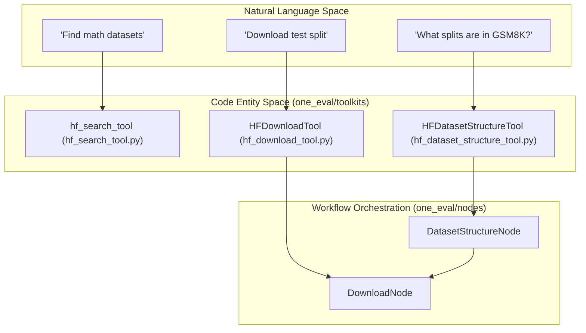
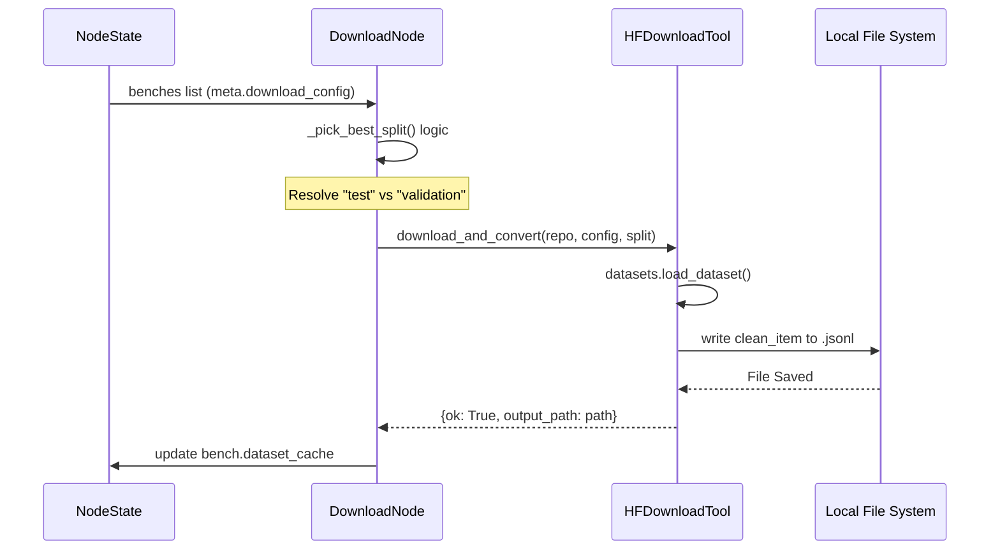

<!-- source: DeepWiki mcp.deepwiki.com · repo OpenDCAI/One-Eval · page 5.2 HuggingFace Integration · fetched 2026-11-02 -->

# HuggingFace Integration

Relevant source files

The following files were used as context for generating this wiki page:

- [one_eval/graph/workflow_download.py](one_eval/graph/workflow_download.py)
- [one_eval/nodes/download_node.py](one_eval/nodes/download_node.py)
- [one_eval/toolkits/hf_dataset_structure_tool.py](one_eval/toolkits/hf_dataset_structure_tool.py)
- [one_eval/toolkits/hf_download_tool.py](one_eval/toolkits/hf_download_tool.py)
- [one_eval/toolkits/hf_search_tool.py](one_eval/toolkits/hf_search_tool.py)
- [one_eval/utils/bench_table/bench-key.xlsx](one_eval/utils/bench_table/bench-key.xlsx)
- [tests/test_bench_registry.py](tests/test_bench_registry.py)
- [tests/test_hf_dataset_structure.py](tests/test_hf_dataset_structure.py)
- [tests/test_single_tool.py](tests/test_single_tool.py)

The HuggingFace (HF) Integration in One-Eval provides a robust mechanism for discovering, inspecting, and downloading datasets directly from the HuggingFace Hub. This integration is centered around a suite of specialized tools and nodes that handle the transition from a natural language benchmark name to a local, unified JSONL format suitable for evaluation.

## Architecture Overview

The integration follows a multi-stage process:
1.  **Search**: Finding relevant repositories based on natural language queries.
2.  **Probing**: Inspecting the internal structure (subsets and splits) of a repository.
3.  **Correction**: Automatically resolving valid configuration/split combinations when defaults are missing.
4.  **Download & Conversion**: Fetching data and transforming it into a standardized JSONL format.

### Component Relationship Diagram

The following diagram illustrates how natural language concepts map to specific code entities within the HF integration suite.

"Natural Language to Code Entity Space"

Sources: [one_eval/toolkits/hf_search_tool.py:7-11](), [one_eval/toolkits/hf_dataset_structure_tool.py:31-38](), [one_eval/toolkits/hf_download_tool.py:13-17](), [one_eval/nodes/download_node.py:14-20]()

---

## HFSearchTool: Dataset Discovery

The `hf_search_tool` is a LangChain-compatible tool used by agents during the **Discovery Phase**. It leverages the `huggingface_hub` library to query the Hub and retrieve structured metadata.

*   **Function**: `hf_search_tool(query: str, limit: int = 10)` [one_eval/toolkits/hf_search_tool.py:7]()
*   **Mechanism**: It calls `list_datasets` and attempts to load the `DatasetCard` for each result to extract tags and metadata [one_eval/toolkits/hf_search_tool.py:14-23]().
*   **Output**: A list of dictionaries containing the `id`, `card_text`, `meta`, and `tags` [one_eval/toolkits/hf_search_tool.py:20-24]().

Sources: [one_eval/toolkits/hf_search_tool.py:1-36]()

---

## HFDatasetStructureTool: Subset & Split Inspection

Once a repository is identified, the `HFDatasetStructureTool` probes its internal organization. This is critical because many HF datasets (e.g., MMLU) contain hundreds of subsets (configs).

### Probing Logic
The `probe` method returns a `RepoStructure` dataclass containing:
*   **Subsets**: List of available configurations [one_eval/toolkits/hf_dataset_structure_tool.py:16-20]().
*   **Splits**: For each subset, the names (e.g., `train`, `test`) and example counts [one_eval/toolkits/hf_dataset_structure_tool.py:10-13]().
*   **Features**: The schema/columns available in that subset [one_eval/toolkits/hf_dataset_structure_tool.py:19]().

The tool uses `get_dataset_config_names` and `get_dataset_split_names` from the `datasets` library [one_eval/toolkits/hf_dataset_structure_tool.py:52-57]().

Sources: [one_eval/toolkits/hf_dataset_structure_tool.py:1-175]()

---

## Download & Auto-Correction Logic

The `DownloadNode` orchestrates the actual retrieval. It contains sophisticated logic to handle cases where the requested `config` or `split` does not exist in the target repository.

### Data Flow: Download Pipeline
The following diagram shows the transition from a requested benchmark to a cached JSONL file.

"Download Workflow Data Flow"

Sources: [one_eval/nodes/download_node.py:43-57](), [one_eval/toolkits/hf_download_tool.py:45-52](), [one_eval/nodes/download_node.py:153-158]()

### Auto-Correction Implementation
If a benchmark's structure information is available in `bench.meta["structure"]`, `DownloadNode` performs the following corrections:

1.  **Config Correction**: If the requested config (e.g., "default") is missing, it looks for "main" or picks the first available subset [one_eval/nodes/download_node.py:93-98]().
2.  **Split Correction**: The `_pick_best_split` function implements a fallback priority:
    *   Exact match (e.g., "test") [one_eval/nodes/download_node.py:30-31]().
    *   Hardcoded priority: `test` > `validation` > `dev` > `val` > `train` [one_eval/nodes/download_node.py:32-34]().
    *   Fuzzy matching for strings containing "test", "valid", or "dev" [one_eval/nodes/download_node.py:35-40]().
    *   First available split [one_eval/nodes/download_node.py:41]().

Sources: [one_eval/nodes/download_node.py:27-41](), [one_eval/nodes/download_node.py:86-113]()

---

## HFDownloadTool: Conversion to JSONL

The `HFDownloadTool` is responsible for the technical execution of the download and the standardization of data.

### Standardized Format
The tool converts various HuggingFace dataset formats into a uniform **JSONL** file. This ensures that the downstream `DataFlowEvalNode` can process any dataset using a consistent line-by-line reader.

### Key Implementation Details
*   **Data Cleaning**: It iterates through dataset items and attempts to JSON-serialize every field. If a field contains non-serializable objects (like `PIL.Image`), it converts them to strings to prevent crashes [one_eval/toolkits/hf_download_tool.py:90-102]().
*   **Caching**: The tool uses a `cache_dir` (defaulting to the project `cache/` folder) and names files using the pattern `repo__config__split.jsonl` [one_eval/nodes/download_node.py:124-127]().
*   **Offline Mode**: Supports `HF_HUB_OFFLINE` environment variables [one_eval/toolkits/hf_download_tool.py:27-29]().

### Workflow Integration
The download process is encapsulated in a dedicated LangGraph sub-workflow: `START -> DatasetStructureNode -> BenchConfigRecommendNode -> DownloadNode -> END`.

Sources: [one_eval/toolkits/hf_download_tool.py:45-116](), [one_eval/graph/workflow_download.py:25-47]()

---

