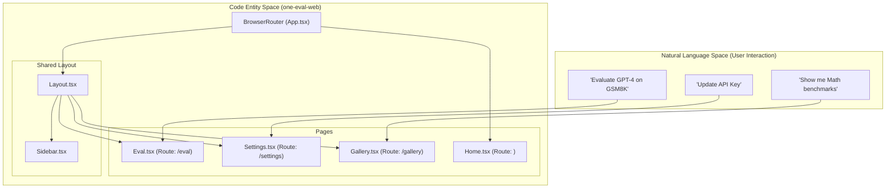
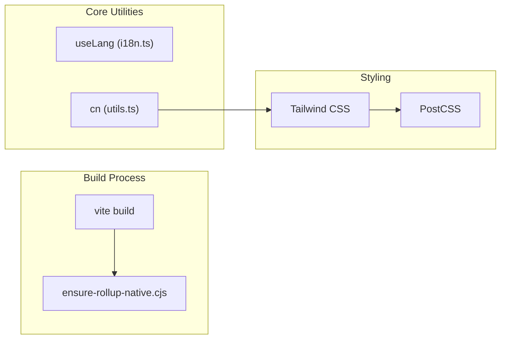

<!-- source: DeepWiki mcp.deepwiki.com · repo OpenDCAI/One-Eval · page 6 Frontend Web Application · fetched 2026-11-02 -->

# Frontend Web Application

Relevant source files

The following files were used as context for generating this wiki page:

- [.gitignore](.gitignore)
- [one-eval-web/README.md](one-eval-web/README.md)
- [one-eval-web/eslint.config.js](one-eval-web/eslint.config.js)
- [one-eval-web/index.html](one-eval-web/index.html)
- [one-eval-web/package-lock.json](one-eval-web/package-lock.json)
- [one-eval-web/package.json](one-eval-web/package.json)
- [one-eval-web/postcss.config.js](one-eval-web/postcss.config.js)
- [one-eval-web/public/vite.svg](one-eval-web/public/vite.svg)
- [one-eval-web/scripts/ensure-rollup-native.cjs](one-eval-web/scripts/ensure-rollup-native.cjs)
- [one-eval-web/src/App.tsx](one-eval-web/src/App.tsx)
- [one-eval-web/src/components/layout/Layout.tsx](one-eval-web/src/components/layout/Layout.tsx)
- [one-eval-web/src/components/layout/Sidebar.tsx](one-eval-web/src/components/layout/Sidebar.tsx)
- [one-eval-web/src/lib/i18n.ts](one-eval-web/src/lib/i18n.ts)
- [one-eval-web/src/lib/utils.ts](one-eval-web/src/lib/utils.ts)
- [one-eval-web/src/pages/ReportComponents.tsx](one-eval-web/src/pages/ReportComponents.tsx)

The One-Eval frontend is a modern single-page application (SPA) built with **React 19** and **Vite**. It provides a graphical interface for interacting with the LangGraph-driven evaluation backend, allowing users to initiate natural language queries, manage human-in-the-loop (HITL) interrupts, browse benchmark galleries, and visualize complex evaluation reports.

The application is structured around a central `Layout` containing a persistent `Sidebar` for navigation between the functional modules of the system [one-eval-web/src/components/layout/Layout.tsx:4-13](), [one-eval-web/src/components/layout/Sidebar.tsx:37-82]().

### Application Architecture

The frontend follows a standard React architecture using `react-router-dom` for client-side routing and `lucide-react` for iconography. It communicates with the FastAPI backend via `axios`.

#### Navigation Structure
The `App.tsx` file defines the primary entry points for the application [one-eval-web/src/App.tsx:8-24]():

| Route | Component | Purpose |
| :--- | :--- | :--- |
| `/` | `Home` | Landing page with entry points to evaluation. |
| `/eval` | `Eval` | The "Eval Studio" workspace for running and monitoring workflows. |
| `/gallery` | `Gallery` | Browser for the local and remote benchmark registry. |
| `/settings` | `Settings` | Configuration for models, API keys, and system mirrors. |

#### System Component Map
The following diagram illustrates how the frontend components relate to the logical "Natural Language Space" of the user and the "Code Entity Space" of the React application.

**Component & Route Mapping**

Sources: [one-eval-web/src/App.tsx:8-24](), [one-eval-web/src/components/layout/Layout.tsx:4-13](), [one-eval-web/src/components/layout/Sidebar.tsx:37-82]().

---

### Core Functional Modules

#### 1. Eval Studio
The Eval Studio is the primary workspace where the `Eval` component manages the evaluation lifecycle. It handles the `WorkflowState`, which tracks the progress of the LangGraph backend. It includes specific UI handlers for HITL interrupts such as `HumanReviewNode` and `MetricReviewNode`.
*   For details, see [Eval Studio (Eval.tsx & EvalComponents.tsx)](#6.1).

#### 2. Settings & Gallery
The Gallery provides a visual interface for `bench_gallery.json`, allowing users to inspect benchmark metadata and `key_mapping` configurations. The Settings page manages the model registry and environment-specific configurations like HuggingFace mirrors.
*   For details, see [Settings, Gallery & Home Pages](#6.2).

#### 3. Report Visualization
Once an evaluation is complete, the `ReportView` component utilizes a specialized schema (`ReportData`) to render diagnostic charts. This includes `RadarChart` for capability dimensions and `DonutChart` for error distributions [one-eval-web/src/pages/ReportComponents.tsx:25-47]().
*   For details, see [Report Visualization (ReportComponents.tsx)](#6.3).

---

### Technical Infrastructure

#### Build System & Cross-Platform Support
The project uses Vite for bundling. A critical utility script, `ensure-rollup-native.cjs`, is executed during `dev` and `build` phases to ensure that the correct native Rollup binaries are installed for the host platform (Linux vs Win32), preventing common environment mismatches [one-eval-web/scripts/ensure-rollup-native.cjs:3-18](), [one-eval-web/package.json:6-11]().

#### Internationalization (i18n)
The application supports English (`en`) and Chinese (`zh`) through a custom `useLang` hook. It utilizes `localStorage` for persistence and a `CustomEvent` (`oneEval:lang-change`) to synchronize language state across different components [one-eval-web/src/lib/i18n.ts:3-49]().

#### Styling and Utilities
*   **Tailwind CSS**: Used for all styling, configured via `postcss.config.js` [one-eval-web/postcss.config.js:1-7]().
*   **Utility `cn()`**: A helper function combining `clsx` and `tailwind-merge` to handle conditional class names efficiently [one-eval-web/src/lib/utils.ts:4-7]().

**Build & Utility Entity Map**

Sources: [one-eval-web/package.json:6-11](), [one-eval-web/src/lib/i18n.ts:15-49](), [one-eval-web/src/lib/utils.ts:4-7]().

*   For details on the build pipeline and helper functions, see [Frontend Build System & Utilities](#6.4).

---

