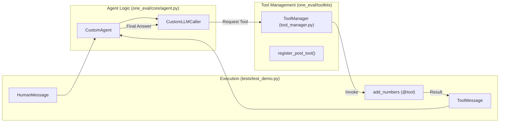

<!-- source: DeepWiki mcp.deepwiki.com · repo OpenDCAI/One-Eval · page 7.1 Workflow & Integration Tests · fetched 2026-11-02 -->

# Workflow & Integration Tests

<details>
<summary>Relevant source files</summary>

The following files were used as context for generating this wiki page:

- [one_eval/logger.py](one_eval/logger.py)
- [one_eval/toolkits/tool_manager.py](one_eval/toolkits/tool_manager.py)
- [tests/test_ckpt.py](tests/test_ckpt.py)
- [tests/test_demo.py](tests/test_demo.py)
- [tests/test_example.py](tests/test_example.py)
- [tests/test_interrupt.py](tests/test_interrupt.py)

</details>


The **Workflow & Integration Tests** suite validates the end-to-end orchestration of the evaluation pipeline. These tests focus on the interaction between the `GraphBuilder`, `NodeState`, and external persistence layers, ensuring that complex multi-step evaluation workflows can handle interruptions, persist state across restarts, and execute tool-bound agent logic correctly.

## Workflow Orchestration & Persistence

One-Eval utilizes `LangGraph` for workflow management, requiring robust testing of state transitions and persistence. Integration tests verify that the `GraphBuilder` correctly assembles nodes and that `AsyncSqliteSaver` reliably captures snapshots of the `NodeState`.

### Checkpoint Persistence (`test_ckpt.py`)
This test validates the lifecycle of a workflow thread across multiple process executions. It uses a local SQLite database to store the state of the graph, allowing a "resume" capability.

1.  **Database Initialization**: The test locates the project root and creates a `checkpoints/eval.db` file [tests/test_ckpt.py:12-20]().
2.  **Graph Construction**: A `GraphBuilder` instance is initialized with `NodeState` and a `QueryUnderstandNode` [tests/test_ckpt.py:33-35]().
3.  **Checkpoint Integration**: The `AsyncSqliteSaver` is passed to the `builder.build()` method to enable state tracking [tests/test_ckpt.py:30-38]().
4.  **State Recovery**: The test calls `graph.aget_state(config)` to check for existing data in the specified `thread_id` [tests/test_ckpt.py:43-47]().
5.  **Execution & Save**: The `ainvoke` method is used to process user input, which automatically triggers a state save to the SQLite backend [tests/test_ckpt.py:57-60]().

**Sources:** [tests/test_ckpt.py:1-65](), [one_eval/core/graph.py]()

### Workflow Topology Mapping
The following diagram illustrates how the `GraphBuilder` maps natural language evaluation concepts to code entities and persistence layers during an integration test.

**Diagram: Workflow Persistence Architecture**
```mermaid
graph TD
    subgraph "Natural Language Space"
        UserQuery["'Evaluate gpt-4 on GSM8K'"]
        ThreadID["Thread: 'test_ckpt_001'"]
    end

    subgraph "Code Entity Space (one_eval/core)"
        State["NodeState (state.py)"]
        Builder["GraphBuilder (graph.py)"]
        Node["QueryUnderstandNode (nodes/query_understand_node.py)"]
    end

    subgraph "Persistence Space (LangGraph)"
        DB["eval.db (AsyncSqliteSaver)"]
        Snapshot["Checkpoint Snapshot"]
    end

    UserQuery --> State
    State --> Builder
    Builder -->|builds| Node
    Node -->|run()| Snapshot
    Snapshot -->|commits to| DB
    ThreadID -->|lookup key| DB
```
**Sources:** [tests/test_ckpt.py:23-38](), [one_eval/core/state.py:1-5](), [one_eval/core/graph.py:7-10]()

---

## Human-In-The-Loop (HITL) & Interrupts

A core feature of One-Eval is the ability to pause execution for human review (e.g., cost warnings or metric verification). `test_interrupt.py` demonstrates the implementation of an `InterruptNode` with custom validation logic.

### Interrupt Mechanism (`test_interrupt.py`)
The test defines a "cost check" scenario where the workflow halts if expensive models are requested.

*   **Validator Logic**: The `expensive_model_validator` function inspects `NodeState.target_model`. If it finds restricted strings like `"gpt-4-expensive"`, it returns a dictionary containing a warning [tests/test_interrupt.py:58-79]().
*   **Interrupt Node**: An `InterruptNode` is inserted between the `QueryUnderstandNode` and the final output. It is configured with the validator and routing paths for `success_node` and `failure_node` [tests/test_interrupt.py:89-94]().
*   **Triggering the Break**: When `app.astream` is called with an initial state containing an expensive model, the graph execution pauses. The test verifies this by checking `snapshot.next` [tests/test_interrupt.py:127-133]().
*   **Resuming**: The test simulates user approval by sending a `Command(resume={"action": "approve", ...})` back into the graph [tests/test_interrupt.py:144-152]().

**Sources:** [tests/test_interrupt.py:1-160]()

---

## Agent & Tool Integration

The system's intelligence relies on `CustomAgent` interacting with tools managed by the `ToolManager`. `test_demo.py` and `test_example.py` provide minimal viable runners for these interactions.

### Tool Execution Flow (`test_demo.py`)
This test verifies the "Reasoning and Acting" cycle of an agent.

1.  **Registration**: A test tool `add_numbers` is registered to the `ToolManager` under the role `CustomAgent` [tests/test_demo.py:37]().
2.  **LLM Call (Round 1)**: The agent calls the LLM with `bind_post_tools=True`. The LLM returns a `tool_calls` payload instead of a text answer [tests/test_demo.py:55-60]().
3.  **Manual Tool Invocation**: The test extracts the tool arguments and executes the function via the `ToolManager` [tests/test_demo.py:64-72]().
4.  **LLM Call (Round 2)**: The tool result is wrapped in a `ToolMessage` and sent back to the LLM to generate the final natural language response [tests/test_demo.py:79-92]().

**Diagram: Agent-Tool Interaction Space**

**Sources:** [tests/test_demo.py:18-92](), [one_eval/toolkits/tool_manager.py:9-47]()

### Basic Workflow Execution (`test_example.py`)
This provides a template for testing specific pipeline transitions, such as moving from `NL2BenchNode` (Natural Language to Benchmark) to `EvalNode` (Execution) [tests/test_example.py:9-16](). It serves as the baseline for verifying that the `GraphBuilder` can link disparate node classes into a functional `CompiledGraph` [tests/test_example.py:19-27]().

**Sources:** [tests/test_example.py:1-31]()

---

## Logging and Debugging
All integration tests utilize the centralized logging system defined in `one_eval/logger.py`. This system supports:
*   **Pretty JSON Formatting**: Automatically detects JSON strings in logs and reformats them for readability using `_prettify_message` [one_eval/logger.py:45-119]().
*   **Dual Handlers**: Simultaneous output to the console (with ANSI colors) and a rotating file (`one_eval.log`) [one_eval/logger.py:131-145]().

**Sources:** [one_eval/logger.py:1-162]()

---

