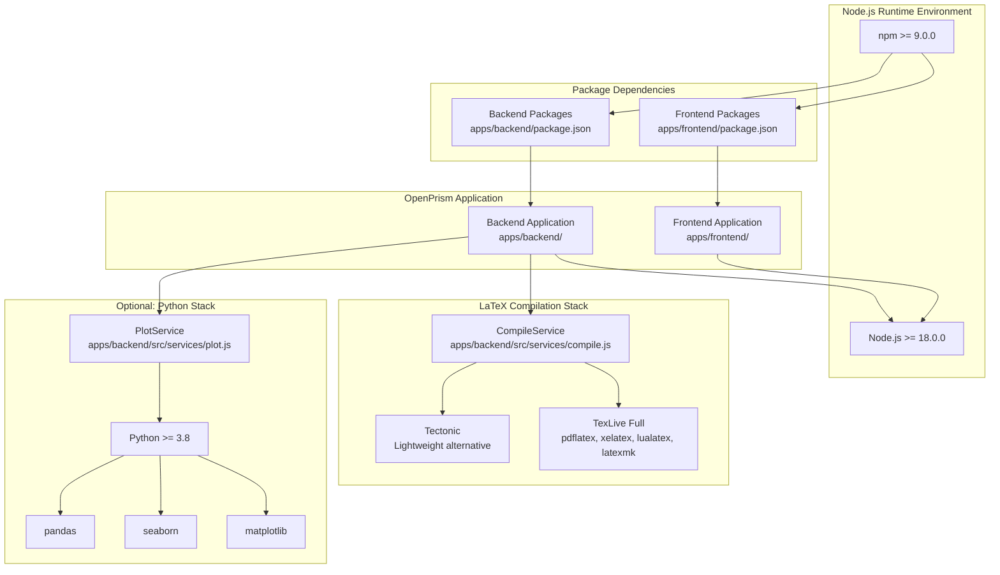
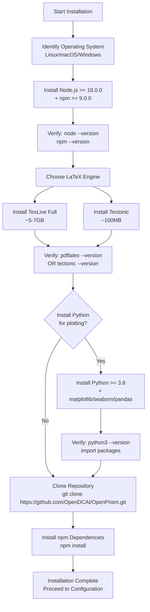

<!-- source: DeepWiki mcp.deepwiki.com · repo OpenDCAI/OpenPrism · page 2.1 Installation · fetched 2026-11-02 -->

# Installation

<details>
<summary>Relevant source files</summary>

The following files were used as context for generating this wiki page:

- [README.md](README.md)
- [apps/frontend/package.json](apps/frontend/package.json)

</details>


This document provides detailed instructions for installing all dependencies required to run OpenPrism on Linux, macOS, and Windows systems. It covers the installation of Node.js, npm, LaTeX compilation engines, and optional Python dependencies for plotting features.

For information about configuring OpenPrism after installation, see [Configuration](#2.2). For instructions on starting the development or production servers, see [Running the Application](#2.3).

## System Requirements

OpenPrism requires the following software to be installed on the host system:

| Component | Minimum Version | Purpose |
|-----------|----------------|---------|
| Node.js | >= 18.0.0 | Runtime for frontend and backend |
| npm | >= 9.0.0 | Package manager |
| LaTeX Engine | Any supported | PDF compilation (see below) |
| Python | >= 3.8 (optional) | Plot generation via matplotlib/seaborn |

**Sources:** [README.md:224-229]()

## Dependency Architecture

The following diagram shows the runtime dependencies and how they relate to OpenPrism's core services:



**Sources:** [README.md:224-258](), [apps/frontend/package.json:1-38]()

## Installing Node.js and npm

### Linux (Ubuntu/Debian)

```bash
# Install Node.js 18.x from NodeSource repository
curl -fsSL https://deb.nodesource.com/setup_18.x | sudo -E bash -
sudo apt-get install -y nodejs

# Verify installation
node --version  # Should output >= v18.0.0
npm --version   # Should output >= 9.0.0
```

### Linux (CentOS/RHEL)

```bash
# Install Node.js 18.x from NodeSource repository
curl -fsSL https://rpm.nodesource.com/setup_18.x | sudo bash -
sudo yum install -y nodejs

# Verify installation
node --version
npm --version
```

### macOS

```bash
# Using Homebrew
brew install node@18

# Add to PATH if needed
echo 'export PATH="/usr/local/opt/node@18/bin:$PATH"' >> ~/.zshrc
source ~/.zshrc

# Verify installation
node --version
npm --version
```

### Windows

Download and install the Node.js 18.x LTS installer from [https://nodejs.org/](https://nodejs.org). The installer includes both `node` and `npm` executables. After installation, verify in PowerShell or Command Prompt:

```powershell
node --version
npm --version
```

**Sources:** [README.md:293-295]()

## Installing LaTeX Engines

OpenPrism requires at least one LaTeX compilation engine to generate PDF output. The system supports automatic fallback between multiple engines if configured. Choose one of the following installation options:

### Option 1: TexLive (Recommended)

TexLive provides a complete LaTeX distribution with all standard packages. Installation size is approximately 5-7GB.

#### Linux (Ubuntu/Debian)

```bash
sudo apt-get update
sudo apt-get install texlive-full
```

The `texlive-full` package installs:
- `pdflatex` - Standard LaTeX engine
- `xelatex` - Unicode and non-Latin script support
- `lualatex` - Lua scripting support
- `latexmk` - Automated build management
- Comprehensive package collection

#### Linux (CentOS/RHEL)

```bash
sudo yum install texlive texlive-*
```

#### macOS

```bash
brew install --cask mactex
```

MacTeX includes the full TexLive distribution plus macOS-specific GUI tools.

#### Windows

Download the TexLive installer from [https://www.tug.org/texlive/](https://www.tug.org/texlive) and run the installation wizard. The default installation path is `C:\texlive\`.

#### Verification

```bash
pdflatex --version
xelatex --version
lualatex --version
latexmk --version
```

**Sources:** [README.md:235-249]()

### Option 2: Tectonic (Lightweight)

Tectonic is a modern, self-contained LaTeX engine with automatic package management. Installation size is under 100MB.

#### Linux/macOS

```bash
curl --proto '=https' --tlsv1.2 -fsSL https://drop-sh.fullyjustified.net | sh
```

#### Windows

Download the Tectonic installer from [https://tectonic-typesetting.github.io/](https://tectonic-typesetting.github.io).

#### Verification

```bash
tectonic --version
```

**Limitations:** Tectonic does not support all LaTeX packages and may fail on complex documents. For production deployments, TexLive is recommended.

**Sources:** [README.md:251-258]()

### Comparison: TexLive vs Tectonic

| Criterion | TexLive | Tectonic |
|-----------|---------|----------|
| Installation Size | 5-7GB | <100MB |
| Package Coverage | Comprehensive | Limited |
| Engine Support | `pdflatex`, `xelatex`, `lualatex`, `latexmk` | `tectonic` only |
| Template Compatibility | All templates | Most basic templates |
| Automatic Packages | No | Yes |
| Recommended For | Production servers, full features | Development, lightweight systems |

**Sources:** [README.md:258]()

## Installing Python (Optional)

Python is required only if you plan to use the plot generation feature ([PlotService](#5.4)). The plotting pipeline executes Python scripts that use `matplotlib`, `seaborn`, and `pandas` to generate visualizations from LaTeX table data.

### Linux (Ubuntu/Debian)

```bash
sudo apt-get install python3 python3-pip
pip3 install matplotlib seaborn pandas
```

### Linux (CentOS/RHEL)

```bash
sudo yum install python3 python3-pip
pip3 install matplotlib seaborn pandas
```

### macOS

```bash
brew install python@3.11
pip3 install matplotlib seaborn pandas
```

### Windows

Download Python 3.11+ from [https://www.python.org/downloads/](https://www.python.org/downloads). Ensure "Add Python to PATH" is checked during installation. Then:

```powershell
pip install matplotlib seaborn pandas
```

### Verification

```bash
python3 --version  # Should output >= 3.8
python3 -c "import matplotlib; import seaborn; import pandas"  # Should not error
```

### Configuring Python Path

If Python is installed in a non-standard location, the backend must be configured to locate the executable. This is done via the `OPENPRISM_PYTHON` environment variable (see [Configuration](#2.2)). The [PlotService](apps/backend/src/services/plot.js) uses this path when spawning Python subprocesses.

**Sources:** [README.md:332-349]() (environment variables section)

## Installation Flow for Complete Deployment

The following diagram illustrates the sequential installation process for a complete OpenPrism deployment:



**Sources:** [README.md:290-328]()

## Installing OpenPrism Application Packages

After installing system dependencies, install the OpenPrism application and its Node.js package dependencies:

```bash
# Clone the repository
git clone https://github.com/OpenDCAI/OpenPrism.git
cd OpenPrism

# Install all dependencies (frontend + backend)
npm install
```

The root-level `npm install` command installs dependencies for both the frontend and backend applications as defined in their respective `package.json` files:

- **Frontend packages** ([apps/frontend/package.json]()):
  - `codemirror` (6.0.1) - Editor core
  - `@codemirror/*` - Language support, autocomplete, search
  - `react` (18.2.0) - UI framework
  - `react-router-dom` (6.22.3) - Routing
  - `pdfjs-dist` (3.11.174) - PDF rendering
  - `i18next` (23.12.2) - Internationalization
  - `react-markdown` (10.1.0) - Markdown rendering
  - `vite` (5.0.10) - Build tool

- **Backend packages** ([apps/backend/package.json]()) - Referenced in architecture diagrams

**Sources:** [apps/frontend/package.json:1-38](), [README.md:265-274]()

## Verification Checklist

After completing installation, verify all components:

| Component | Verification Command | Expected Output |
|-----------|---------------------|-----------------|
| Node.js | `node --version` | `v18.x.x` or higher |
| npm | `npm --version` | `9.x.x` or higher |
| LaTeX (TexLive) | `pdflatex --version` | TexLive version info |
| LaTeX (Tectonic) | `tectonic --version` | Tectonic version info |
| Python (optional) | `python3 --version` | `3.8.x` or higher |
| OpenPrism packages | Check for `node_modules/` directory | Directory exists with packages |

### Troubleshooting Installation Issues

**Node.js version too old:**
```bash
# Remove old version and reinstall using methods above
# On Linux with apt:
sudo apt-get remove nodejs
curl -fsSL https://deb.nodesource.com/setup_18.x | sudo -E bash -
sudo apt-get install -y nodejs
```

**LaTeX commands not found:**
Ensure the LaTeX binaries are in your system `PATH`:
```bash
# Linux/macOS
which pdflatex
export PATH="/usr/local/texlive/2023/bin/x86_64-linux:$PATH"

# Windows: Add TexLive bin directory to system PATH via Environment Variables
```

**Python packages import errors:**
```bash
# Reinstall with --user flag
pip3 install --user matplotlib seaborn pandas

# Or use a virtual environment
python3 -m venv venv
source venv/bin/activate  # On Windows: venv\Scripts\activate
pip install matplotlib seaborn pandas
```

**Sources:** [README.md:301-303](), [README.md:293-328]()

## Next Steps

After successful installation:
1. **Configure environment variables and LLM endpoints**: See [Configuration](#2.2)
2. **Start the development or production server**: See [Running the Application](#2.3)
3. **Review the project structure**: See [Project Structure](#7.2)

**Sources:** [README.md:1-509]()

---

