<!-- source: DeepWiki mcp.deepwiki.com · repo OpenDCAI/OpenPrism · page 3 Architecture · fetched 2026-11-02 -->

# Architecture

<details>
<summary>Relevant source files</summary>

The following files were used as context for generating this wiki page:

- [README.md](README.md)
- [apps/frontend/src/api/client.ts](apps/frontend/src/api/client.ts)

</details>


This document provides a comprehensive technical overview of OpenPrism's system architecture, including its three-tier design, component relationships, data flow patterns, and key design decisions. For installation and configuration details, see [Getting Started](#2). For specific feature implementations, see [Features](#6). For development workflows, see [Development Guide](#7).

## Purpose and Scope

This page documents the structural organization of the OpenPrism codebase, describing how the frontend React application communicates with the Fastify backend server, how services are layered and integrated, and how external dependencies (LLM providers, LaTeX engines, Python environment) are orchestrated. The focus is on architectural patterns, component boundaries, and the relationships between major subsystems rather than implementation details of individual features.

---

## System Overview

OpenPrism implements a **three-tier architecture** with clear separation between presentation, business logic, and data persistence layers.

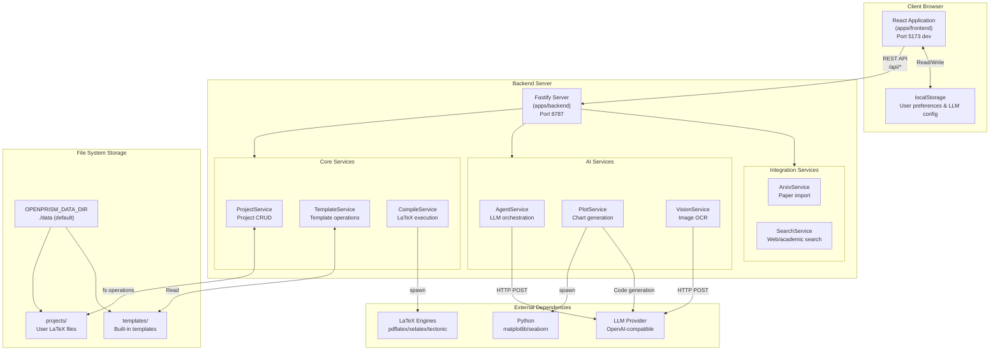

**Architecture Characteristics:**

| Layer | Technology | Responsibility |
|-------|-----------|---------------|
| Frontend | React + Vite + CodeMirror 6 | UI rendering, editor state, user interactions |
| Backend | Fastify + Node.js | API routing, business logic, external integrations |
| Storage | File system (local) | Project files, templates, generated assets |
| External | OpenAI-compatible LLM, LaTeX, Python | Compute-intensive operations |

The system follows a **local-first philosophy**: all user data persists in a configurable directory (`OPENPRISM_DATA_DIR`), and the LLM configuration can be overridden per-user via browser localStorage or per-request via API parameters.

**Sources:** [README.md:63-117](), [apps/frontend/src/api/client.ts:1-368]()

---

## Component Interaction Patterns

### Request Flow: Project Compilation

This diagram shows how a typical compilation request flows through the system, mapping natural language concepts to actual code entities.

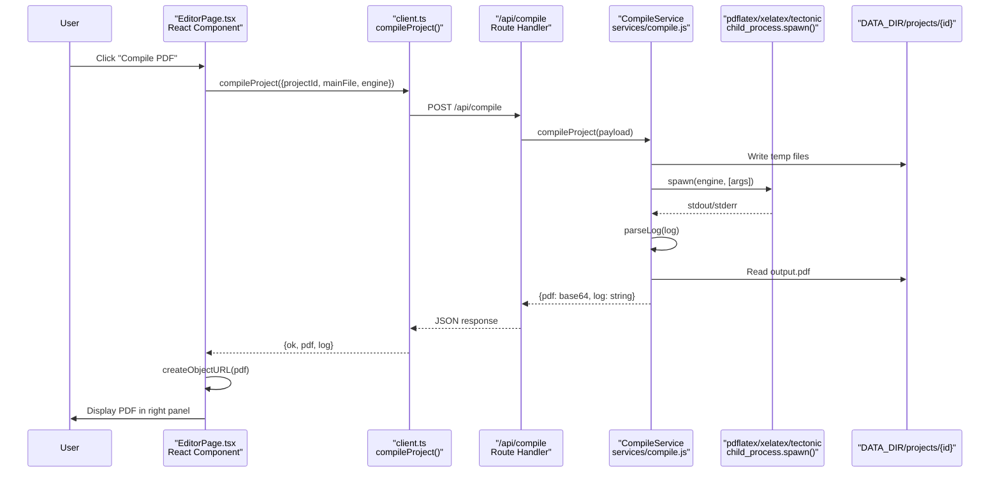

**Key Code Entities:**

- **Frontend:** `EditorPage` component manages compilation triggers [apps/frontend/src/app/EditorPage.tsx]()
- **API Client:** `compileProject()` function handles HTTP communication [apps/frontend/src/api/client.ts:219-231]()
- **Backend Route:** `/api/compile` route registered in [apps/backend/src/routes/compile.js]()
- **Service Layer:** `CompileService` orchestrates LaTeX engine execution [apps/backend/src/services/compile.js]()

**Sources:** [apps/frontend/src/api/client.ts:219-231](), [apps/backend/src/routes/compile.js](), Diagram 1 and Diagram 5 from high-level overview

---

## Frontend Architecture

The frontend is a **single-page application (SPA)** built with React, using Vite as the build tool and development server.

### Routing Structure

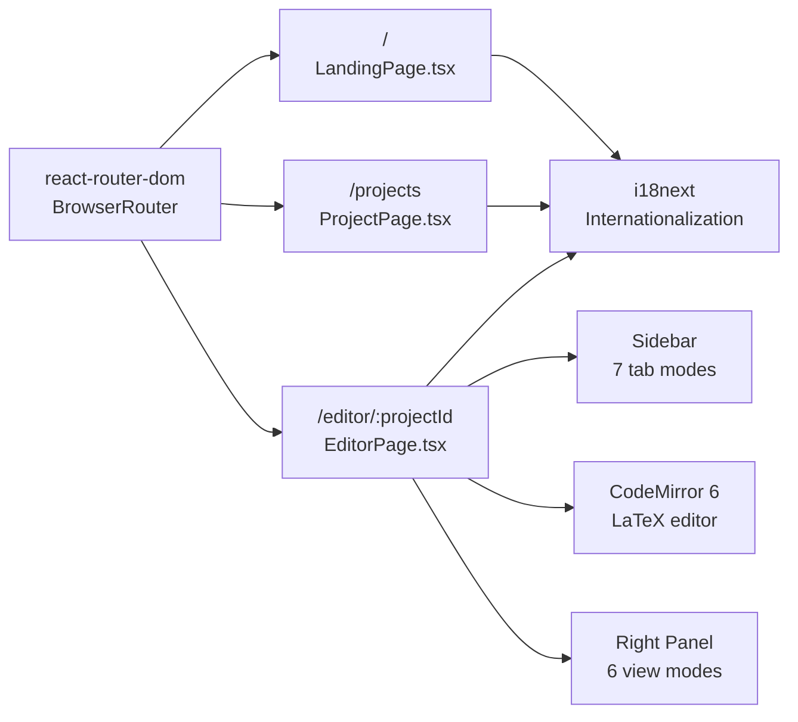

**Route Definitions:**

| Path | Component | Purpose |
|------|-----------|---------|
| `/` | `LandingPage.tsx` | Marketing page with feature carousel |
| `/projects` | `ProjectPage.tsx` | Project list management UI |
| `/editor/:projectId` | `EditorPage.tsx` | Main workspace with three-panel layout |

**Sources:** [apps/frontend/src/app/LandingPage.tsx](), [apps/frontend/src/app/ProjectPage.tsx](), [apps/frontend/src/app/EditorPage.tsx]()

### EditorPage Architecture

The `EditorPage` component is the most complex frontend component, implementing a three-panel workspace.

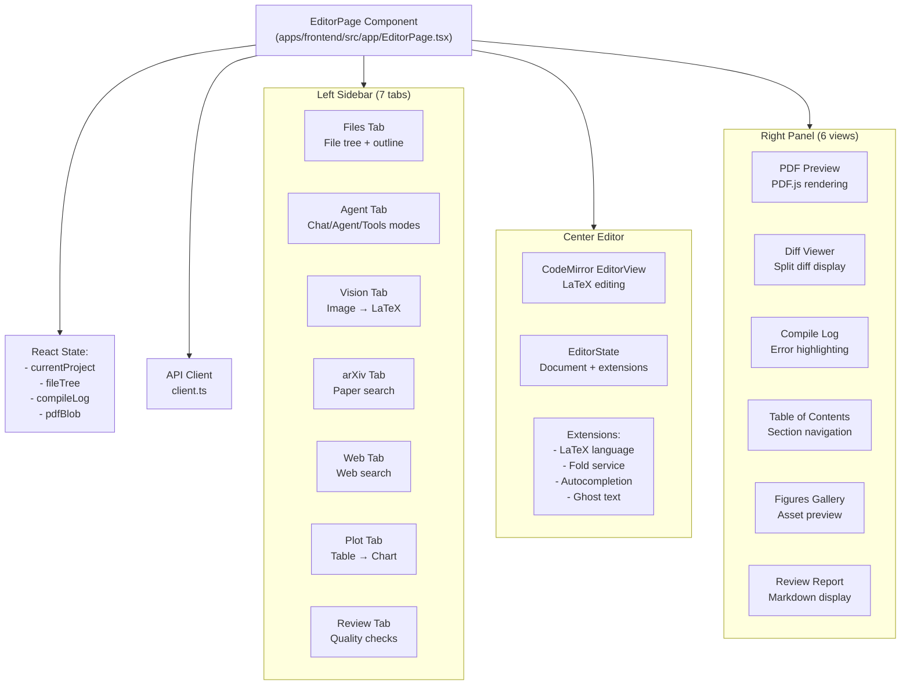

**State Management:**

The `EditorPage` manages multiple state concerns:

1. **Project State:** Current project metadata, file tree structure [apps/frontend/src/app/EditorPage.tsx]()
2. **Editor State:** CodeMirror's internal `EditorState` object for document and cursor position
3. **UI State:** Active sidebar tab, right panel mode, modal visibility
4. **Persistent State:** LLM configuration and preferences stored in `localStorage`

**Sources:** [apps/frontend/src/app/EditorPage.tsx](), Diagram 2 from high-level overview

### CodeMirror Integration

OpenPrism uses **CodeMirror 6** for the LaTeX editor, with custom extensions for LaTeX-specific functionality.

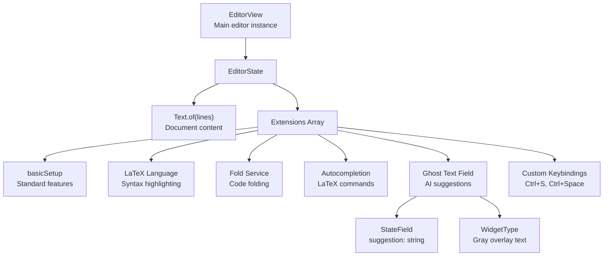

**Key Extensions:**

| Extension | Purpose | Location |
|-----------|---------|----------|
| LaTeX Language | Syntax highlighting and parsing | [apps/frontend/src/latex/latex-lang.ts]() |
| Fold Service | Section/environment folding | [apps/frontend/src/latex/fold.ts]() |
| Completion Source | LaTeX command autocompletion | [apps/frontend/src/latex/completion.ts]() |
| Ghost Text Field | Display AI inline suggestions | [apps/frontend/src/latex/ghost-text.ts]() |

**Sources:** [apps/frontend/src/app/EditorPage.tsx](), [apps/frontend/src/latex/]()

---

## Backend Architecture

The backend is a **Fastify server** organized into route handlers, service layers, and utility modules.

### Route Organization

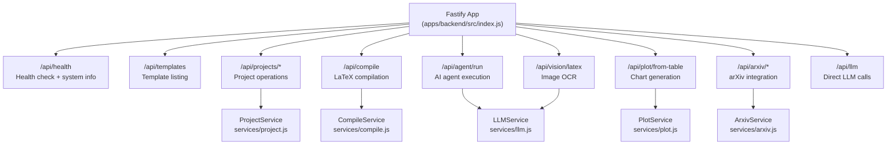

**API Endpoints:**

| Endpoint | Method | Purpose | Handler File |
|----------|--------|---------|--------------|
| `/api/projects` | GET | List all projects | [apps/backend/src/routes/projects.js]() |
| `/api/projects` | POST | Create new project | [apps/backend/src/routes/projects.js]() |
| `/api/projects/:id/file` | GET, PUT | Read/write file | [apps/backend/src/routes/projects.js]() |
| `/api/projects/:id/tree` | GET | Get file tree | [apps/backend/src/routes/projects.js]() |
| `/api/compile` | POST | Compile LaTeX | [apps/backend/src/routes/compile.js]() |
| `/api/agent/run` | POST | Execute AI agent | [apps/backend/src/routes/agent.js]() |
| `/api/plot/from-table` | POST | Generate chart | [apps/backend/src/routes/plot.js]() |
| `/api/vision/latex` | POST | Image to LaTeX | [apps/backend/src/routes/vision.js]() |
| `/api/arxiv/search` | POST | Search arXiv | [apps/backend/src/routes/arxiv.js]() |

**Sources:** [apps/backend/src/index.js](), [apps/backend/src/routes/]()

### Service Layer Design

The service layer encapsulates business logic and external integrations, following a **dependency injection pattern** where configuration is passed as parameters.

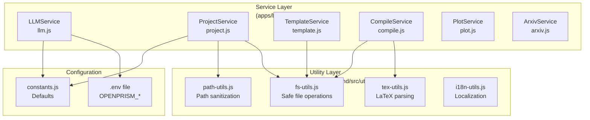

**Service Responsibilities:**

| Service | File | Key Methods | Purpose |
|---------|------|-------------|---------|
| `LLMService` | `llm.js` | `callLLM()`, `resolveLLMConfig()` | Abstract LLM provider, handle OpenAI-compatible API calls |
| `ProjectService` | `project.js` | `createProject()`, `getFileTree()` | Project lifecycle, file operations |
| `TemplateService` | `template.js` | `listTemplates()`, `applyTemplate()` | Template discovery, project initialization |
| `CompileService` | `compile.js` | `compileProject()`, `detectEngine()` | LaTeX compilation, error parsing |
| `PlotService` | `plot.js` | `generatePlot()`, `executePython()` | Python-based chart generation |
| `ArxivService` | `arxiv.js` | `searchPapers()`, `downloadPaper()` | arXiv API integration |

**Sources:** [apps/backend/src/services/](), Diagram 3 from high-level overview

### Configuration Resolution

OpenPrism implements a **multi-layer configuration system** with the following precedence (highest to lowest):

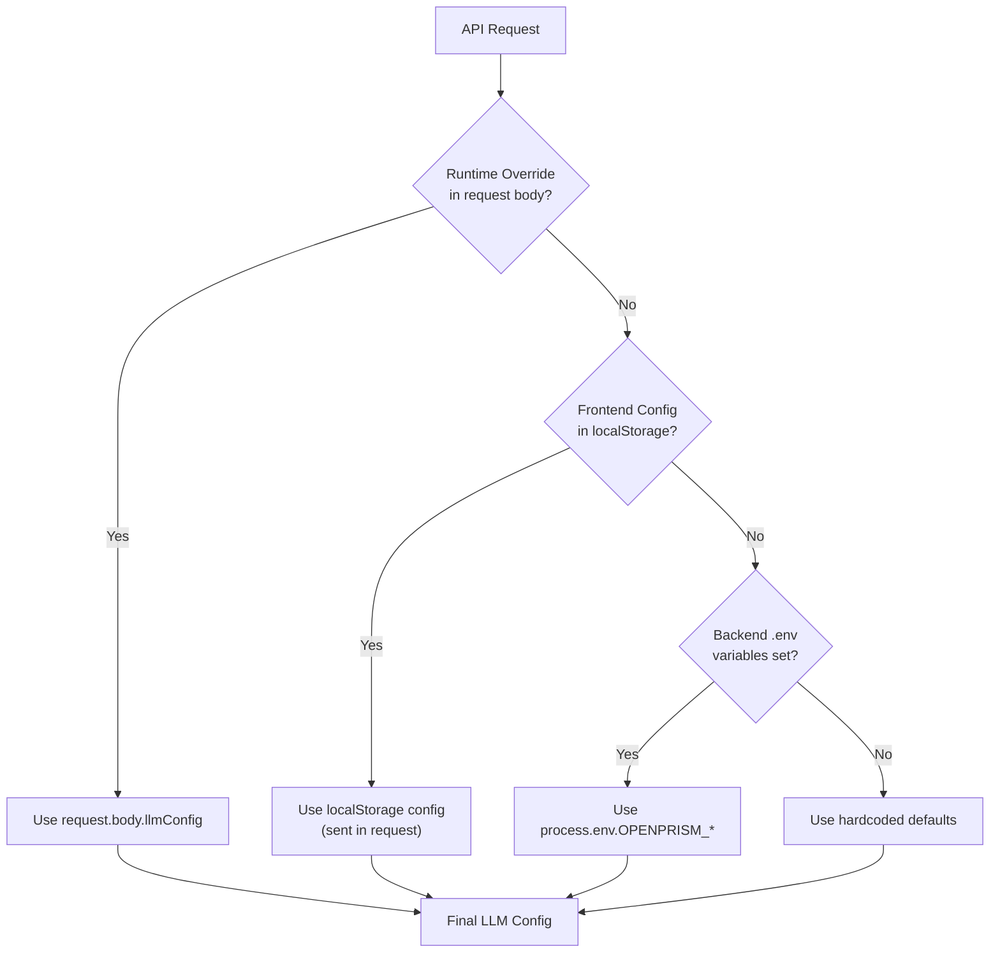

**Configuration Variables:**

| Variable | Environment | localStorage Key | Default |
|----------|-------------|------------------|---------|
| LLM Endpoint | `OPENPRISM_LLM_ENDPOINT` | `openprism-llm-endpoint` | `https://api.openai.com/v1/chat/completions` |
| API Key | `OPENPRISM_LLM_API_KEY` | `openprism-llm-api-key` | None (required) |
| Model | `OPENPRISM_LLM_MODEL` | `openprism-llm-model` | `gpt-4o-mini` |
| Data Directory | `OPENPRISM_DATA_DIR` | N/A | `./data` |
| Port | `PORT` | N/A | `8787` |

**Sources:** [README.md:332-349](), [apps/frontend/src/api/client.ts:21-25](), Diagram 6 from high-level overview

---

## Data Storage Architecture

OpenPrism uses a **file-system-based storage model** with no database. All data persists in a configurable directory (`OPENPRISM_DATA_DIR`).

### Directory Structure

```
OPENPRISM_DATA_DIR/
├── projects/
│   ├── {projectId}/
│   │   ├── project.json          # Metadata
│   │   ├── .openprism/           # System files
│   │   │   └── fileOrder.json    # Custom file ordering
│   │   ├── main.tex              # LaTeX files
│   │   ├── references.bib
│   │   └── figures/
│   │       └── chart1.png
│   └── {projectId}/
│       └── ...
└── templates/
    ├── acl2023/
    ├── cvpr2024/
    └── neurips2023/
```

### Project Metadata Schema

The `project.json` file stores project-level metadata:

```typescript
interface ProjectMeta {
  id: string;              // Unique identifier (UUID)
  name: string;            // Display name
  createdAt: string;       // ISO 8601 timestamp
  updatedAt: string;       // ISO 8601 timestamp
  tags: string[];          // User-defined tags
  archived: boolean;       // Archive status
  trashed: boolean;        // Soft delete flag
  trashedAt: string | null; // Trash timestamp
}
```

**Sources:** [apps/frontend/src/api/client.ts:1-10](), [README.md:397-413]()

### File Order Management

Custom file ordering in the file tree is stored in `.openprism/fileOrder.json`:

```typescript
interface FileOrderMap {
  [folder: string]: string[];  // folder path -> ordered file names
}
```

Example:
```json
{
  "": ["main.tex", "abstract.tex", "introduction.tex"],
  "sections": ["related-work.tex", "methodology.tex", "results.tex"]
}
```

**Sources:** [apps/frontend/src/api/client.ts:17-19](), [apps/backend/src/routes/projects.js]()

### Template System

Templates are stored in the `templates/` directory and discovered at runtime. Each template contains:

- `manifest.json`: Metadata (name, description, mainFile, category)
- LaTeX source files (`.tex`, `.bib`, `.sty`, `.cls`)
- Optional assets (images, bibliography files)

```typescript
interface TemplateMeta {
  id: string;              // Directory name
  label: string;           // Display name (Chinese)
  mainFile: string;        // Entry point (e.g., "main.tex")
  category: string;        // Category ID
  description: string;     // Description (Chinese)
  descriptionEn: string;   // Description (English)
  tags: string[];          // Search tags
  author: string;          // Template author
  featured: boolean;       // Featured flag
}
```

**Sources:** [apps/frontend/src/api/client.ts:27-37](), [apps/backend/src/services/template.js]()

---

## API Design Patterns

### RESTful Conventions

The API follows REST principles with standard HTTP methods:

| Operation | Method | Pattern | Example |
|-----------|--------|---------|---------|
| List | GET | `/api/{resource}` | `GET /api/projects` |
| Create | POST | `/api/{resource}` | `POST /api/projects` |
| Read | GET | `/api/{resource}/{id}` | `GET /api/projects/abc123/file?path=main.tex` |
| Update | PUT/PATCH | `/api/{resource}/{id}` | `PUT /api/projects/abc123/file` |
| Delete | DELETE | `/api/{resource}/{id}` | `DELETE /api/projects/abc123` |

**Sources:** [apps/backend/src/routes/projects.js]()

### Request/Response Patterns

All API responses follow a consistent structure:

**Success Response:**
```json
{
  "ok": true,
  "data": { ... },
  "metadata": { ... }
}
```

**Error Response:**
```json
{
  "ok": false,
  "error": "Human-readable error message"
}
```

**Example: Agent Execution Response**
```typescript
interface AgentResponse {
  ok: boolean;
  reply: string;          // Conversational response
  suggestion: string;     // Inline suggestion (autocomplete)
  patches?: {             // Structured file changes
    path: string;
    diff: string;         // Unified diff format
    content: string;      // Full new content
  }[];
}
```

**Sources:** [apps/frontend/src/api/client.ts:200-217](), [apps/backend/src/routes/agent.js]()

### Server-Sent Events (SSE)

Long-running operations use **Server-Sent Events** for progress streaming:

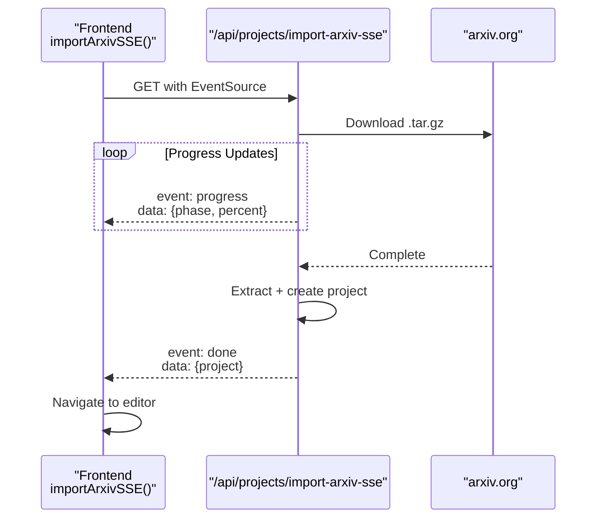

**SSE Events:**

| Event Type | Data Schema | Purpose |
|------------|-------------|---------|
| `progress` | `{phase: string, percent: number}` | Progress updates |
| `done` | `{ok: true, project: ProjectMeta}` | Success |
| `error` | `{ok: false, error: string}` | Failure |

**Sources:** [apps/frontend/src/api/client.ts:306-337](), [apps/backend/src/routes/projects.js]()

### API Client Abstraction

The frontend uses a centralized API client with type-safe wrappers:

```typescript
// apps/frontend/src/api/client.ts

// Internal request helper
async function request<T>(url: string, options?: RequestInit): Promise<T> {
  const lang = getLangHeader();
  const res = await fetch(`${API_BASE}${url}`, {
    ...options,
    headers: {
      'Content-Type': 'application/json',
      'x-lang': lang,
      ...(options?.headers || {})
    }
  });
  if (!res.ok) throw new Error(await res.text());
  return res.json();
}

// Public API functions
export function listProjects() {
  return request<{ projects: ProjectMeta[] }>('/api/projects');
}

export function createProject(payload: { name: string; template?: string }) {
  return request<ProjectMeta>('/api/projects', {
    method: 'POST',
    body: JSON.stringify(payload)
  });
}
```

**Benefits:**

- Type safety with TypeScript interfaces
- Centralized error handling
- Automatic language header injection
- Consistent response parsing

**Sources:** [apps/frontend/src/api/client.ts:53-88]()

---

## AI Agent Execution Architecture

The AI agent system supports multiple execution modes with different capabilities and guarantees.

### Execution Modes

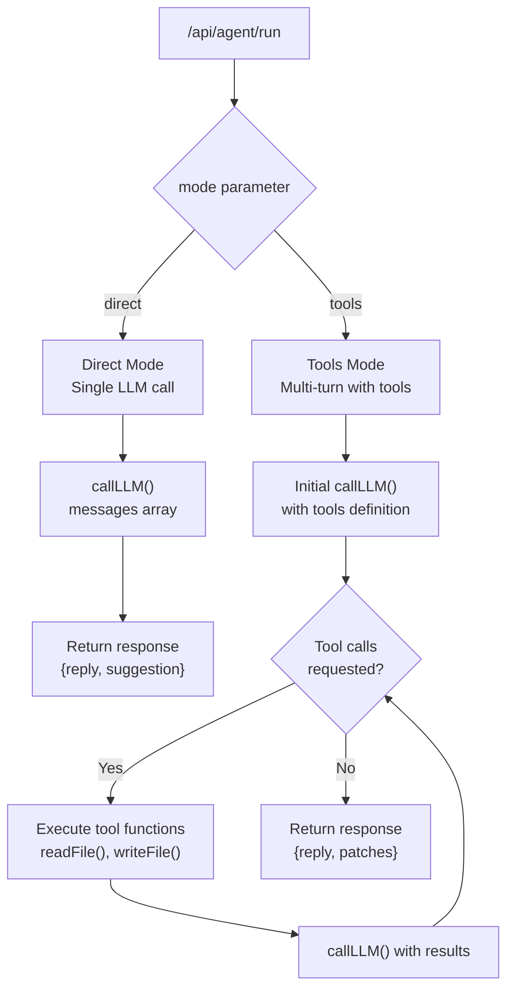

**Mode Comparison:**

| Mode | Turns | Tool Access | Use Case | Output |
|------|-------|-------------|----------|--------|
| `direct` | 1 | No | Chat Q&A, autocomplete, polish | `reply` or `suggestion` |
| `tools` | 1+ | Yes | Multi-file edits, complex refactoring | `reply` + `patches[]` |

**Sources:** [apps/backend/src/routes/agent.js](), [apps/backend/src/services/llm.js](), Diagram 4 from high-level overview

### Context Building

Before executing an agent task, the frontend builds comprehensive context:

```typescript
interface AgentPayload {
  task: string;              // Task type: 'polish', 'rewrite', etc.
  prompt: string;            // User instruction
  selection: string;         // Selected text
  content: string;           // Full file content
  mode: 'direct' | 'tools';
  projectId?: string;        // For file operations
  activePath?: string;       // Current file
  compileLog?: string;       // Recent errors
  llmConfig?: Partial<LLMConfig>;
  interaction?: 'chat' | 'agent';
  history?: { role: string; content: string }[];
}
```

**Context Sources:**

1. **Selection Context:** User-highlighted text
2. **File Context:** Full content of active file
3. **Project Context:** File tree and related files (in tools mode)
4. **Compilation Context:** Recent compile errors for diagnosis
5. **Conversation History:** Previous chat messages

**Sources:** [apps/frontend/src/api/client.ts:200-217](), [apps/backend/src/routes/agent.js]()

### Tool Definitions

In `tools` mode, the LLM has access to file operation tools:

```typescript
const tools = [
  {
    type: 'function',
    function: {
      name: 'readFile',
      description: 'Read content of a file in the project',
      parameters: {
        type: 'object',
        properties: {
          path: { type: 'string', description: 'File path relative to project root' }
        },
        required: ['path']
      }
    }
  },
  {
    type: 'function',
    function: {
      name: 'writeFile',
      description: 'Write content to a file in the project',
      parameters: {
        type: 'object',
        properties: {
          path: { type: 'string', description: 'File path' },
          content: { type: 'string', description: 'New file content' }
        },
        required: ['path', 'content']
      }
    }
  }
];
```

The agent service executes these tools by performing actual file operations on the project directory.

**Sources:** [apps/backend/src/routes/agent.js]()

---

## Deployment Architecture

### Development Mode

In development, frontend and backend run as separate processes:

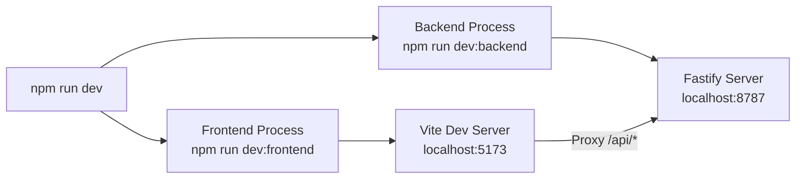

**Configuration:**

- Frontend Vite proxy configuration routes `/api/*` to backend port
- Hot Module Replacement (HMR) enabled for frontend
- Backend auto-restart on file changes via nodemon

**Sources:** [README.md:262-279](), [package.json scripts]()

### Production Mode

In production, a single Fastify server serves both static assets and API:

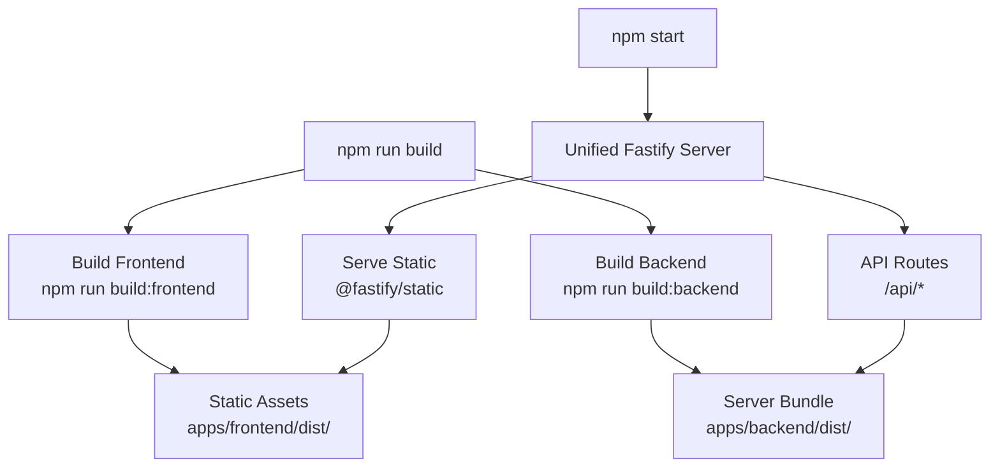

**Unified Server Benefits:**

- Single port (8787 by default)
- Simplified deployment
- No CORS configuration needed
- Easier process management with PM2

**PM2 Configuration:**

```bash
pm2 start npm --name "openprism" -- start
pm2 save
pm2 startup
```

**Sources:** [README.md:280-328](), [apps/backend/src/index.js](), Diagram 6 from high-level overview

---

## Cross-Cutting Concerns

### Error Handling

The system implements consistent error handling across all layers:

**Frontend:**
- API client throws errors with descriptive messages
- Components catch errors and display user-friendly notifications
- Compilation errors parsed and displayed with file/line navigation

**Backend:**
- Route handlers catch exceptions and return `{ok: false, error: string}`
- Service layer throws descriptive errors
- External process failures captured and logged

**Sources:** [apps/frontend/src/api/client.ts:62-77](), [apps/backend/src/routes/]()

### Internationalization

Both frontend and backend support Chinese and English:

**Frontend:**
- i18next library with language detection
- Translation files: `locales/zh-CN.json`, `locales/en-US.json`
- Language switcher in top navigation
- Language stored in localStorage

**Backend:**
- Language header (`x-lang`) read from requests
- i18n utility provides localized error messages
- Template descriptions localized

**Language Header Flow:**

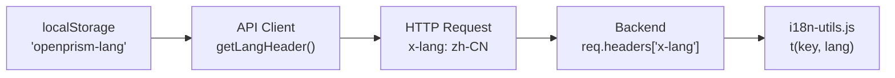

**Sources:** [apps/frontend/src/api/client.ts:54-60](), [apps/backend/src/utils/i18n-utils.js](), [README.md:98]()

### Security Considerations

**Path Traversal Prevention:**
- `path-utils.js` sanitizes all file paths
- Paths validated to be within project directory
- Symbolic links rejected

**API Authentication:**
- Currently no authentication (local-first design)
- LLM API keys stored client-side in localStorage
- Backend only proxies LLM requests

**Sandboxing:**
- LaTeX compilation runs in temporary directories
- Python plotting executes in isolated process
- No arbitrary code execution from user input (except LaTeX itself)

**Sources:** [apps/backend/src/utils/path-utils.js](), [apps/backend/src/services/compile.js](), [apps/backend/src/services/plot.js]()

---

This architecture document provides a comprehensive technical overview of OpenPrism's system design. For implementation details of specific features, see the [Features](#6) section. For development workflows and contribution guidelines, see the [Development Guide](#7).

---

