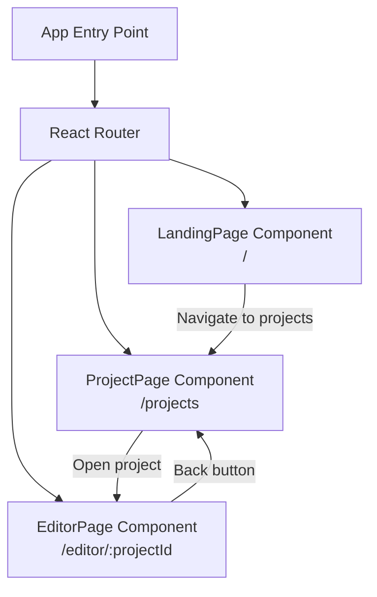
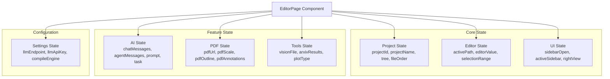
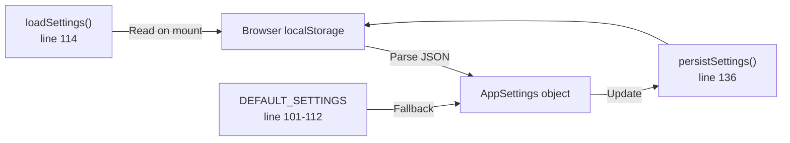
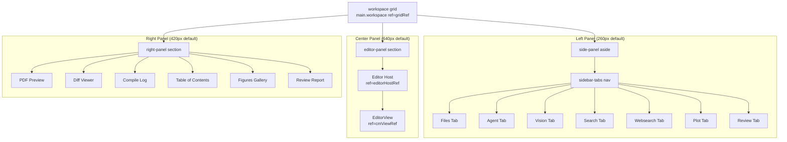
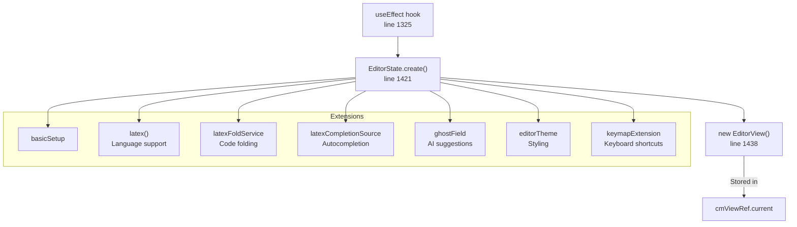
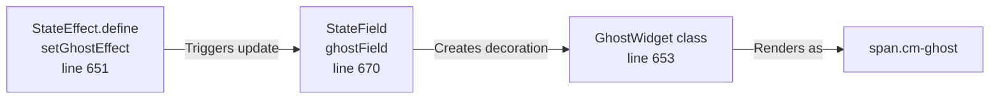
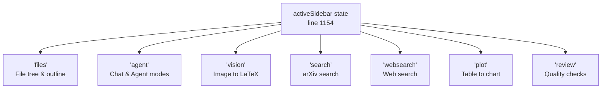
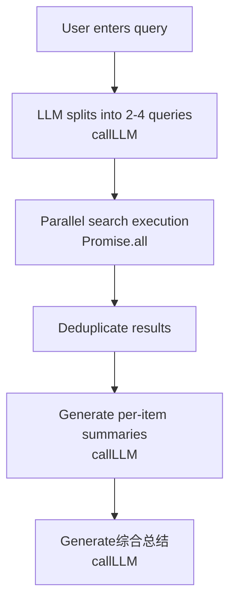
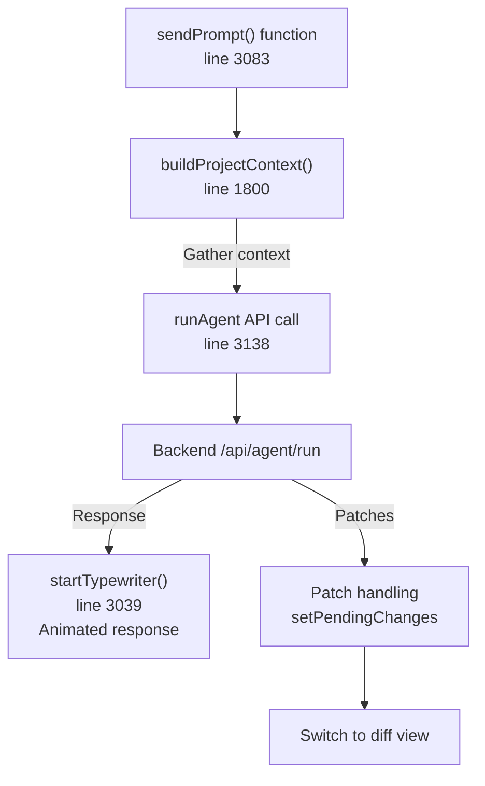
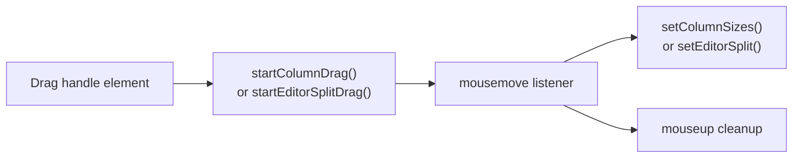

<!-- source: DeepWiki mcp.deepwiki.com · repo OpenDCAI/OpenPrism · page 4 Frontend Application · fetched 2026-11-02 -->

# Frontend Application

<details>
<summary>Relevant source files</summary>

The following files were used as context for generating this wiki page:

- [apps/frontend/package.json](apps/frontend/package.json)
- [apps/frontend/src/app/EditorPage.tsx](apps/frontend/src/app/EditorPage.tsx)

</details>


## Purpose and Scope

The Frontend Application is a React-based single-page application that provides the user interface for OpenPrism. It implements a sophisticated LaTeX editor with AI-powered features, PDF preview, and project management capabilities. The application runs on port 5173 in development mode and is served as static assets by the backend in production.

This page covers the frontend's architecture, component structure, state management, and UI patterns. For backend API implementation details, see [Backend Application](#5). For detailed feature workflows, see [Features](#6).

**Sources**: [apps/frontend/package.json:1-38]()

---

## Application Structure

### Technology Stack

The frontend is built with the following core technologies:

| Technology | Version | Purpose |
|------------|---------|---------|
| React | 18.2.0 | UI framework |
| React Router DOM | 6.22.3 | Client-side routing |
| CodeMirror 6 | 6.0.1 | LaTeX code editor |
| PDF.js | 3.11.174 | PDF rendering |
| i18next | 23.12.2 | Internationalization |
| Vite | 5.0.10 | Build tool and dev server |

**Sources**: [apps/frontend/package.json:10-36]()

### Routing Architecture



**Routing Structure**

The application uses three primary routes:

1. **`/`** - `LandingPage`: Marketing and onboarding interface with feature showcase
2. **`/projects`** - `ProjectPage`: Project list management with CRUD operations
3. **`/editor/:projectId`** - `EditorPage`: Main workspace with three-panel layout

**Sources**: The routing structure is inferred from the component architecture. [apps/frontend/src/app/EditorPage.tsx:1-4]() shows React Router imports.

---

## EditorPage Component Architecture

The `EditorPage` component (line 1094 onwards) is the core of the application. It implements a complex three-panel workspace with extensive state management.

### Component State Structure



**Key State Variables**

| State Category | Variables | Lines |
|----------------|-----------|-------|
| Project | `projectId`, `projectName`, `tree`, `fileOrder` | 1098, 1101, 1102, 1103 |
| Editor | `activePath`, `editorValue`, `files`, `selectionRange` | 1104, 1106, 1105, 1107 |
| AI Assistant | `assistantMode`, `chatMessages`, `agentMessages`, `prompt`, `task` | 1111, 1112, 1113, 1114, 1115 |
| PDF | `pdfUrl`, `pdfScale`, `pdfOutline`, `pdfAnnotations` | 1137, 1138, 1142, 1143 |
| Settings | `settings` (type `AppSettings`) | 1099 |

**Sources**: [apps/frontend/src/app/EditorPage.tsx:1094-1235]()

### Settings Management

Settings are persisted to localStorage using the key `SETTINGS_KEY` (`'openprism-settings-v1'`):



The `AppSettings` type (lines 69-80) includes:

- **LLM Configuration**: `llmEndpoint`, `llmApiKey`, `llmModel`
- **Search Configuration**: `searchEndpoint`, `searchApiKey`, `searchModel`
- **Vision Configuration**: `visionEndpoint`, `visionApiKey`, `visionModel`
- **Compilation**: `compileEngine`

**Sources**: [apps/frontend/src/app/EditorPage.tsx:69-143]()

---

## Three-Panel Layout System

### Layout Structure



**Column Sizing**

The layout uses CSS variables for responsive column widths stored in `columnSizes` state:

```typescript
const [columnSizes, setColumnSizes] = useState({ 
  sidebar: 260, 
  editor: 640, 
  right: 420 
});
```

Columns are resizable via drag handles (`startColumnDrag` function at line 3256).

**Sources**: [apps/frontend/src/app/EditorPage.tsx:1156-1157](), [apps/frontend/src/app/EditorPage.tsx:3256-3287](), [apps/frontend/src/app/EditorPage.tsx:3376-3384]()

---

## CodeMirror Integration

### Editor Initialization

The CodeMirror editor is initialized in a `useEffect` hook (lines 1325-1458):



**Key Extensions**

| Extension | Purpose | Implementation |
|-----------|---------|----------------|
| `latex()` | LaTeX syntax highlighting | Line 1425 |
| `latexFoldService` | Code folding for sections/environments | Lines 288-316 |
| `latexCompletionSource` | Command autocompletion | Lines 590-649 |
| `ghostField` | Display AI inline suggestions | Lines 670-695 |
| `editorTheme` | Custom styling | Lines 697-730 |

**Sources**: [apps/frontend/src/app/EditorPage.tsx:1325-1458]()

### LaTeX-Specific Features

#### Code Folding

The `latexFoldService` function (lines 288-316) provides intelligent folding for:

- LaTeX environments (`\begin{...}` to `\end{...}`)
- Section hierarchy (`\section`, `\subsection`, etc.)
- Conditional blocks (`\if...` to `\fi`)
- Groups (`\begingroup` to `\endgroup`)
- Display math (`$$...$$`, `\[...\]`)

Helper functions:
- `stripLatexComment` (lines 165-178): Remove comments from lines
- `findEnvFold` (lines 180-202): Find matching environment end
- `findSectionFold` (lines 204-222): Find next same/higher-level section

**Sources**: [apps/frontend/src/app/EditorPage.tsx:165-316]()

#### Autocompletion

The `latexCompletionSource` function (lines 590-649) provides context-aware completions:

```typescript
// Triggers on backslash
const before = context.matchBefore(/[\\/][A-Za-z]*$);

// Sample completions
{ label: '\\section{}', type: 'keyword', apply: ... }
{ label: '\\cite{}', type: 'keyword', apply: ... }
{ label: '\\begin{itemize}', type: 'keyword', apply: ... }
```

Completions use custom `apply` functions to position the cursor inside braces.

**Sources**: [apps/frontend/src/app/EditorPage.tsx:590-649]()

#### Ghost Text Field

The `ghostField` StateField (lines 670-695) displays AI-generated inline suggestions:



The ghost text is managed through refs:
- `inlineSuggestionRef`: Current suggestion text
- `inlineAnchorRef`: Cursor position for suggestion
- `applyingSuggestionRef`: Flag to prevent clearing during acceptance

**Sources**: [apps/frontend/src/app/EditorPage.tsx:651-695](), [apps/frontend/src/app/EditorPage.tsx:1217-1226]()

### Keyboard Shortcuts

The keymap extension (lines 1365-1419) defines:

| Shortcut | Action | Handler |
|----------|--------|---------|
| `Mod-s` | Save file | `saveActiveFileRef.current()` |
| `Alt-/` | Request AI suggestion | `requestSuggestionRef.current()` |
| `Mod-Space` | Request AI suggestion | `requestSuggestionRef.current()` |
| `Tab` | Accept full suggestion | `acceptSuggestionRef.current()` |
| `ArrowRight` | Accept suggestion chunk | `acceptChunkRef.current()` |
| `Escape` | Clear suggestion | `clearSuggestionRef.current()` |
| `Mod-/` | Toggle comment | `toggleComment` |

**Sources**: [apps/frontend/src/app/EditorPage.tsx:1365-1419]()

---

## Sidebar Features

The sidebar supports seven operational modes controlled by `activeSidebar` state (line 1154):

### Mode Selection Logic



### Files Tab

Key components:
- **File Tree**: Rendered by `renderTree` function (lines 2718-2884)
- **Tree State**: `openFolders` state tracks expanded directories
- **Drag & Drop**: File reordering via `moveFileWithOrder` (lines 2440-2470)
- **Inline Editing**: `inlineEdit` state for rename/create (lines 2367-2437)
- **Outline Panel**: Shows document structure from `outlineItems` (lines 2551-2554)

Tree node structure (lines 348-353):
```typescript
type TreeNode = {
  name: string;
  path: string;
  type: 'file' | 'dir';
  children: TreeNode[];
};
```

**Sources**: [apps/frontend/src/app/EditorPage.tsx:1154](), [apps/frontend/src/app/EditorPage.tsx:2718-2884](), [apps/frontend/src/app/EditorPage.tsx:348-410]()

### Agent Tab

Implements dual-mode AI assistant:

**Mode Toggle** (line 1111):
```typescript
const [assistantMode, setAssistantMode] = useState<'chat' | 'agent'>('agent');
```

**Chat Mode**:
- Read-only interaction
- Uses `chatMessages` state
- Direct mode execution

**Agent Mode**:
- Generates file modification suggestions
- Uses `agentMessages` state
- Task selection via `task` state (line 1115)
- Execution mode via `mode` state: `'direct'` or `'tools'` (line 1116)

Task types defined in `DEFAULT_TASKS` (lines 82-89):
- `polish`, `rewrite`, `structure`, `translate`, `websearch`, `custom`

**Sources**: [apps/frontend/src/app/EditorPage.tsx:1111-1116](), [apps/frontend/src/app/EditorPage.tsx:82-89](), [apps/frontend/src/app/EditorPage.tsx:3576-3819]()

### Vision Tab

Handles image-to-LaTeX conversion:

**State Variables**:
```typescript
const [visionMode, setVisionMode] = useState<'equation' | 'table' | 'figure' | 'algorithm' | 'ocr'>('equation');
const [visionFile, setVisionFile] = useState<File | null>(null);
const [visionResult, setVisionResult] = useState('');
const [visionBusy, setVisionBusy] = useState(false);
```

**Flow**:
1. User uploads/pastes image (lines 3852-3904)
2. `handleVisionSubmit` calls `visionToLatex` API (lines 2326-2361)
3. Result displayed in editable textarea
4. `handleVisionInsert` inserts to cursor (lines 2363-2366)

**Sources**: [apps/frontend/src/app/EditorPage.tsx:1170-1175](), [apps/frontend/src/app/EditorPage.tsx:2326-2366](), [apps/frontend/src/app/EditorPage.tsx:3821-3940]()

### Search Tab (arXiv)

Implements academic paper search:

**State Variables** (lines 1176-1188):
```typescript
const [arxivQuery, setArxivQuery] = useState('');
const [arxivResults, setArxivResults] = useState<ArxivPaper[]>([]);
const [arxivSelected, setArxivSelected] = useState<Record<string, boolean>>({});
const [useLlmSearch, setUseLlmSearch] = useState(false);
```

**Search Flow** (`handleArxivSearch`, lines 1842-1921):
1. Query submitted
2. If `useLlmSearch` enabled: LLM with tools mode
3. Otherwise: Direct API call via `arxivSearch`
4. Results populate checkable list

**Apply Flow** (`handleArxivApply`, lines 1923-2044):
1. Selected papers processed
2. BibTeX entries fetched via `arxivBibtex`
3. Written to target `.bib` file
4. Optionally inserts citations to current file or uses AI to insert into target file

**Sources**: [apps/frontend/src/app/EditorPage.tsx:1176-1188](), [apps/frontend/src/app/EditorPage.tsx:1842-2044](), [apps/frontend/src/app/EditorPage.tsx:3941-4082]()

### Websearch Tab

Multi-point web search with aggregation:

**Execution Flow** (`runWebsearch`, lines 2082-2247):



**State Variables** (lines 1200-1208):
```typescript
const [websearchResults, setWebsearchResults] = useState<WebsearchItem[]>([]);
const [websearchParagraph, setWebsearchParagraph] = useState('');
const [websearchItemNotes, setWebsearchItemNotes] = useState<Record<string, string>>({});
```

**Apply Flow** (`applyWebsearchInsert`, lines 2250-2317):
1. Writes BibTeX entries to target `.bib`
2. Generates formatted summary with itemized list
3. Inserts to target TeX file

**Sources**: [apps/frontend/src/app/EditorPage.tsx:2082-2317](), [apps/frontend/src/app/EditorPage.tsx:1200-1208](), [apps/frontend/src/app/EditorPage.tsx:4084-4272]()

### Plot Tab

Converts LaTeX tables to charts:

**State Variables** (lines 1191-1199):
```typescript
const [plotType, setPlotType] = useState<'bar' | 'line' | 'heatmap'>('bar');
const [plotTitle, setPlotTitle] = useState('');
const [plotFilename, setPlotFilename] = useState('');
const [plotPrompt, setPlotPrompt] = useState('');
```

**Generation Flow** (`handlePlotGenerate`, lines 2047-2079):
1. Validates table selection (`selectionText` contains `\begin{tabular}` or `\begin{table}`)
2. Calls `plotFromTable` API with parameters
3. Returns `assetPath` to generated image
4. Optionally inserts figure snippet via `insertFigureSnippet`

**Sources**: [apps/frontend/src/app/EditorPage.tsx:1191-1199](), [apps/frontend/src/app/EditorPage.tsx:2047-2079](), [apps/frontend/src/app/EditorPage.tsx:4273-4373]()

### Review Tab

Quality checking interface with multiple checks:

**Available Checks** (lines 4384-4495):

| Check | Task | Mode | Output |
|-------|------|------|--------|
| Detailed Review | `peer_review` | `tools` | Full report to review panel |
| Consistency | `consistency_check` | `tools` | Notes + optional patches |
| Missing Citations | `missing_citations` | `tools` | Notes list |
| Compile Summary | `compile_summary` | `direct` | Error summary |

All checks use `runAgent` API and populate either `reviewReport` or `reviewNotes` state.

**Sources**: [apps/frontend/src/app/EditorPage.tsx:4374-4512](), [apps/frontend/src/app/EditorPage.tsx:1209-1211]()

---

## Right Panel Views

Controlled by `rightView` state (line 1151):

### PDF Preview

Implemented by `PdfPreview` component (lines 882-1092):

**Props**:
```typescript
{
  pdfUrl: string;
  scale: number;
  fitWidth: boolean;
  spread: boolean;
  onFitScale?: (value: number | null) => void;
  onTextClick: (text: string) => void;
  onOutline?: (items: {...}[]) => void;
  annotations: {...}[];
  annotateMode: boolean;
  onAddAnnotation?: (page: number, x: number, y: number) => void;
  containerRef?: RefObject<HTMLDivElement>;
}
```

**Rendering Pipeline**:
1. `getDocument` loads PDF from blob URL (line 919)
2. Calculates scale for fit-to-width if enabled (lines 926-937)
3. Renders each page to canvas with quality boost (lines 939-975)
4. Overlays text layer for selection (lines 968-973)
5. Extracts outline via `pdf.getOutline()` (lines 1005-1033)

**Interactive Features**:
- Click text to select
- Add annotations in annotate mode
- Navigate via outline
- Zoom controls

**Sources**: [apps/frontend/src/app/EditorPage.tsx:882-1092]()

### Diff Viewer

Implemented by `SplitDiffView` component (lines 834-880):

**Data Structure**:
```typescript
interface PendingChange {
  filePath: string;
  original: string;
  proposed: string;
  diff: string;
}
```

**Rendering**:
- Uses `buildSplitDiff` function (lines 732-767) based on `diffLines` from `diff` library
- Synchronized scrolling between left/right columns
- Color-coded additions/removals/context

**Actions**:
- `applyPending`: Apply changes to files (lines 3223-3242)
- `discardPending`: Discard suggestions (lines 3244-3254)

**Sources**: [apps/frontend/src/app/EditorPage.tsx:56-61](), [apps/frontend/src/app/EditorPage.tsx:732-880](), [apps/frontend/src/app/EditorPage.tsx:3223-3254]()

### Compile Log

Displays compilation errors with navigation:

**Error Parsing** (`parseCompileErrors`, lines 776-815):
- Extracts file:line patterns
- Identifies LaTeX error markers (`!`)
- Returns structured `CompileError` array

**Error Navigation** (`jumpToError`, lines 2697-2716):
1. Opens target file if different from active
2. Calculates line offset via `findLineOffset` (lines 817-828)
3. Scrolls to position and focuses editor

**Sources**: [apps/frontend/src/app/EditorPage.tsx:769-828](), [apps/frontend/src/app/EditorPage.tsx:2697-2716]()

### Other Views

**Table of Contents** (PDF outline):
- Populated by `pdfOutline` state
- Clickable items scroll to page via `scrollToPdfPage` (lines 3000-3007)

**Figures Gallery**:
- Lists all figure files filtered by `figureFiles` memo (lines 2958-2966)
- Preview selected figure
- Insert button calls `insertFigureSnippet` (lines 1745-1756)

**Review Report**:
- Displays markdown-formatted report in `reviewReport` state
- Rendered with `ReactMarkdown` component

**Sources**: [apps/frontend/src/app/EditorPage.tsx:3000-3007](), [apps/frontend/src/app/EditorPage.tsx:2958-2966](), [apps/frontend/src/app/EditorPage.tsx:1745-1756]()

---

## API Communication Layer

### API Client Functions

All backend communication goes through functions imported from `'../api/client'` (lines 18-35):

| Function | Purpose | Endpoint |
|----------|---------|----------|
| `listProjects` | Fetch project list | `GET /api/projects` |
| `getProjectTree` | Get file tree | `GET /api/projects/:id/tree` |
| `getFile` | Read file content | `GET /api/projects/:id/file` |
| `writeFile` | Write file content | `PUT /api/projects/:id/file` |
| `createFolderApi` | Create directory | `POST /api/projects/:id/folder` |
| `renamePath` | Rename file/folder | `POST /api/projects/:id/rename` |
| `uploadFiles` | Upload files | `POST /api/projects/:id/upload` |
| `compileProject` | Compile LaTeX | `POST /api/compile` |
| `runAgent` | Execute AI task | `POST /api/agent/run` |
| `plotFromTable` | Generate plot | `POST /api/plot/from-table` |
| `visionToLatex` | Image OCR | `POST /api/vision/latex` |
| `arxivSearch` | Search arXiv | `GET /api/arxiv/search` |
| `arxivBibtex` | Get BibTeX | `GET /api/arxiv/bibtex` |
| `callLLM` | Direct LLM call | `POST /api/llm/call` |

**Sources**: [apps/frontend/src/app/EditorPage.tsx:18-35]()

### Request Flow Example: AI Agent



**Key Parameters**:
```typescript
await runAgent({
  task: effectiveTask,
  prompt: effectivePrompt,
  selection: effectiveSelection,
  content: effectiveContent,
  mode: isChat ? 'direct' : effectiveMode,
  projectId,
  activePath,
  compileLog,
  llmConfig: effectiveLlmConfig,
  interaction: isChat ? 'chat' : 'agent',
  history: nextHistory.slice(-8)
});
```

**Sources**: [apps/frontend/src/app/EditorPage.tsx:3083-3175](), [apps/frontend/src/app/EditorPage.tsx:1800-1835]()

### Context Building

The `buildProjectContext` function (lines 1800-1835) creates project summaries for AI:

1. Starts from `mainFile` or `activePath`
2. Parses outline via `parseOutline` (lines 438-460)
3. Extracts `\input` and `\include` targets via `extractIncludeTargets` (lines 462-475)
4. Recursively processes included files
5. Returns formatted summary with file list and section headings

**Sources**: [apps/frontend/src/app/EditorPage.tsx:1800-1835](), [apps/frontend/src/app/EditorPage.tsx:438-475]()

---

## File Operations

### File Tree Management

**Tree Building** (`buildTree`, lines 362-410):
- Converts flat file list to hierarchical structure
- Applies custom ordering from `fileOrder` state
- Sorts folders before files

**Tree Operations**:
- `openFile`: Load file content (lines 1461-1490)
- `refreshTree`: Reload file tree (lines 1302-1314)
- `moveFileWithOrder`: Drag-and-drop reordering (lines 2440-2470)
- `reorderWithinFolder`: Same-folder reorder (lines 2502-2526)

**Inline Editing**:
- `beginInlineCreate`: Start create file/folder (lines 2368-2376)
- `beginInlineRename`: Start rename (lines 2378-2384)
- `confirmInlineEdit`: Complete edit operation (lines 2386-2436)

**Sources**: [apps/frontend/src/app/EditorPage.tsx:362-410](), [apps/frontend/src/app/EditorPage.tsx:1461-1490](), [apps/frontend/src/app/EditorPage.tsx:2368-2436]()

### Auto-Save System

Debounced auto-save via `useEffect` (lines 1695-1709):

```typescript
useEffect(() => {
  if (!isDirty || !activePath) return;
  if (saveTimerRef.current) {
    window.clearTimeout(saveTimerRef.current);
  }
  saveTimerRef.current = window.setTimeout(() => {
    saveActiveFile({ silent: true });
  }, 1500);
  // Cleanup
}, [activePath, editorValue, isDirty, saveActiveFile]);
```

**Save Indicators** (lines 3363-3374):
- `isSaving`: "保存中..."
- `isDirty`: "未保存"
- Neither: "已保存" with pulse animation

**Sources**: [apps/frontend/src/app/EditorPage.tsx:1695-1709](), [apps/frontend/src/app/EditorPage.tsx:3363-3374]()

---

## UI Patterns

### iOS-Style Dropdowns

Custom dropdown implementation used throughout:

```typescript
// Trigger button
<button 
  className="ios-select-trigger" 
  onClick={() => setTaskDropdownOpen(!taskDropdownOpen)}
>
  <span>{label}</span>
  <svg>...</svg> // Chevron
</button>

// Dropdown menu
{taskDropdownOpen && (
  <div className="ios-dropdown">
    {options.map((item) => (
      <div className={`ios-dropdown-item ${active ? 'active' : ''}`}>
        {item.label}
        {active && <svg>...</svg>} // Checkmark
      </div>
    ))}
  </div>
)}
```

Used for:
- Task selection (lines 3628-3661)
- Mode selection (lines 3664-3708)
- Main file selection (lines 3326-3334)
- Engine selection (lines 3336-3344)
- Language selection (lines 3351-3359)

**Sources**: [apps/frontend/src/app/EditorPage.tsx:3628-3708](), [apps/frontend/src/app/EditorPage.tsx:3326-3359]()

### Drag Handles

Resizable panels via mouse drag (lines 3256-3311):



**Constraints**:
- Sidebar: min 220px
- Editor: min 360px
- Right panel: min 320px
- Editor split: ratio between 0.35 and 0.85

**Sources**: [apps/frontend/src/app/EditorPage.tsx:3256-3311]()

### Typewriter Effect

Animated AI response display (lines 3039-3073):

```typescript
const startTypewriter = useCallback((setHistory, text) => {
  let idx = 0;
  const step = () => {
    idx = Math.min(text.length, idx + 2);
    const slice = text.slice(0, idx);
    setHistory((prev) => {
      // Update last assistant message
    });
    if (idx < text.length) {
      typewriterTimerRef.current = window.setTimeout(step, 16);
    }
  };
  step();
}, []);
```

Used after AI responses in chat/agent modes to create smooth text reveal.

**Sources**: [apps/frontend/src/app/EditorPage.tsx:3039-3073]()

---

## Utility Functions

### Text Processing

| Function | Purpose | Lines |
|----------|---------|-------|
| `stripLatexComment` | Remove LaTeX comments | 165-178 |
| `parseOutline` | Extract section headings | 438-460 |
| `extractIncludeTargets` | Find \input/\include | 462-475 |
| `findNearestHeading` | Get section at cursor | 477-491 |
| `findCurrentEnvironment` | Detect environment stack | 493-515 |
| `extractJsonBlock` | Extract JSON from text | 517-522 |
| `sanitizeJsonString` | Fix malformed JSON | 524-572 |
| `safeJsonParse` | Robust JSON parsing | 574-584 |

**Sources**: [apps/frontend/src/app/EditorPage.tsx:165-584]()

### File Type Detection

```typescript
function isFigureFile(path: string) {
  const lower = path.toLowerCase();
  return FIGURE_EXTS.some((ext) => lower.endsWith(ext));
}

function isTextFile(path: string) {
  const lower = path.toLowerCase();
  return lower.endsWith('.tex') || lower.endsWith('.bib') || 
         TEXT_EXTS.some((ext) => lower.endsWith(ext));
}

function getFileTypeLabel(path: string) {
  // Returns 'TEX', 'BIB', 'PNG', etc.
}
```

Constants:
- `FIGURE_EXTS`: `['.png', '.jpg', '.jpeg', '.pdf', '.svg', '.eps']` (line 145)
- `TEXT_EXTS`: `['.sty', '.cls', '.bst', '.txt', '.md', ...]` (line 146)

**Sources**: [apps/frontend/src/app/EditorPage.tsx:145-340]()

---

## Performance Optimizations

### Memoization

Key memoized computations:

```typescript
const llmConfig = useMemo(() => ({
  endpoint: llmEndpoint,
  apiKey: llmApiKey || undefined,
  model: llmModel
}), [llmEndpoint, llmApiKey, llmModel]);

const treeRoot = useMemo(
  () => buildTree(filteredTreeItems, fileOrder), 
  [filteredTreeItems, fileOrder]
);

const selectionText = useMemo(() => {
  const [start, end] = selectionRange;
  if (start === end) return '';
  return editorValue.slice(start, end);
}, [selectionRange, editorValue]);
```

**Sources**: [apps/frontend/src/app/EditorPage.tsx:1253-1260](), [apps/frontend/src/app/EditorPage.tsx:2500](), [apps/frontend/src/app/EditorPage.tsx:2943-2947]()

### Ref-Based Callbacks

Functions stored in refs to avoid useEffect dependencies:

```typescript
const requestSuggestionRef = useRef<() => void>(() => {});
const acceptSuggestionRef = useRef<() => void>(() => {});
const saveActiveFileRef = useRef<() => void>(() => {});

// Updated via useEffect
useEffect(() => {
  requestSuggestionRef.current = requestInlineSuggestion;
  acceptSuggestionRef.current = acceptInlineSuggestion;
  saveActiveFileRef.current = () => saveActiveFile();
}, [requestInlineSuggestion, acceptInlineSuggestion, saveActiveFile]);
```

Allows keymap to access latest closures without recreating editor.

**Sources**: [apps/frontend/src/app/EditorPage.tsx:1222-1226](), [apps/frontend/src/app/EditorPage.tsx:1658-1663](), [apps/frontend/src/app/EditorPage.tsx:1686-1688]()

---

## Internationalization

### i18next Integration

Translation hook usage (line 1096):
```typescript
const { t, i18n } = useTranslation();
```

**Language Toggle** (lines 3351-3359):
- Dropdown in top bar
- Options: "中文" or "English"
- Switches via `i18n.changeLanguage()`

**Translation Keys**:
- Simple strings: `t('保存')`, `t('编译 PDF')`
- Interpolation: `t('已保存 {{path}}', { path: activePath })`
- Plurals and context handled by i18next

All user-facing strings use `t()` wrapper for translation support.

**Sources**: [apps/frontend/src/app/EditorPage.tsx:1096](), [apps/frontend/src/app/EditorPage.tsx:3351-3359]()

---

## Summary

The Frontend Application is a sophisticated React SPA with:

- **Architecture**: Three-panel layout with 7 sidebar modes and 6 right panel views
- **Editor**: CodeMirror 6 with LaTeX-specific extensions (folding, completion, ghost text)
- **State**: 100+ state variables managed with React hooks
- **AI Integration**: Inline suggestions, chat, agent modes, vision OCR, search
- **PDF**: Full-featured renderer with annotations and outline navigation
- **Persistence**: Auto-save, localStorage settings, file operations
- **Internationalization**: Full i18next support
- **Performance**: Memoization, ref-based callbacks, debounced operations

The component structure emphasizes modularity while maintaining a single `EditorPage` component for the main workspace, enabling complex state coordination across features.

**Sources**: [apps/frontend/src/app/EditorPage.tsx:1-5500]() (entire file)

---

