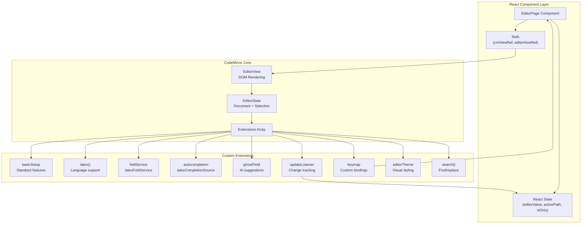
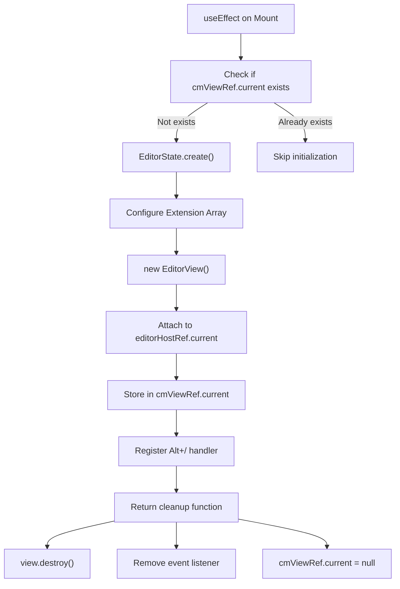
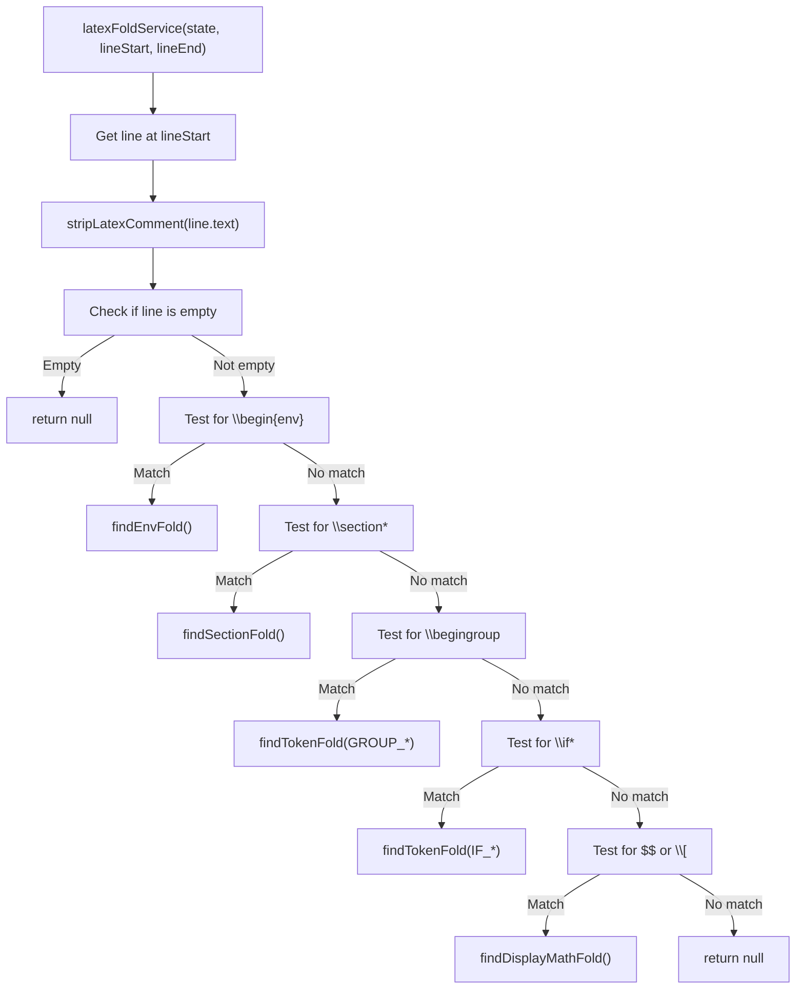
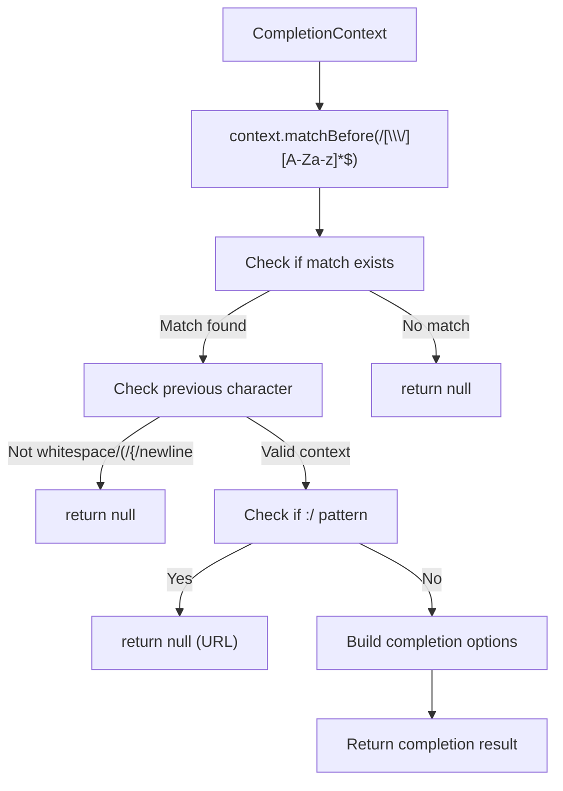
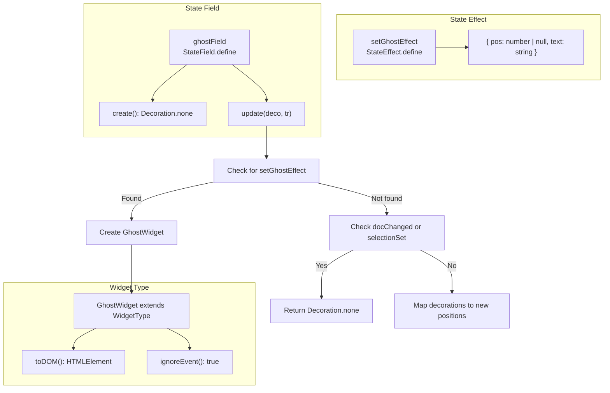
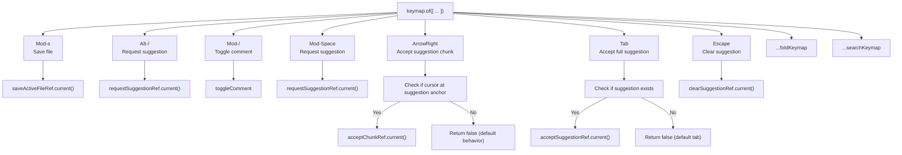
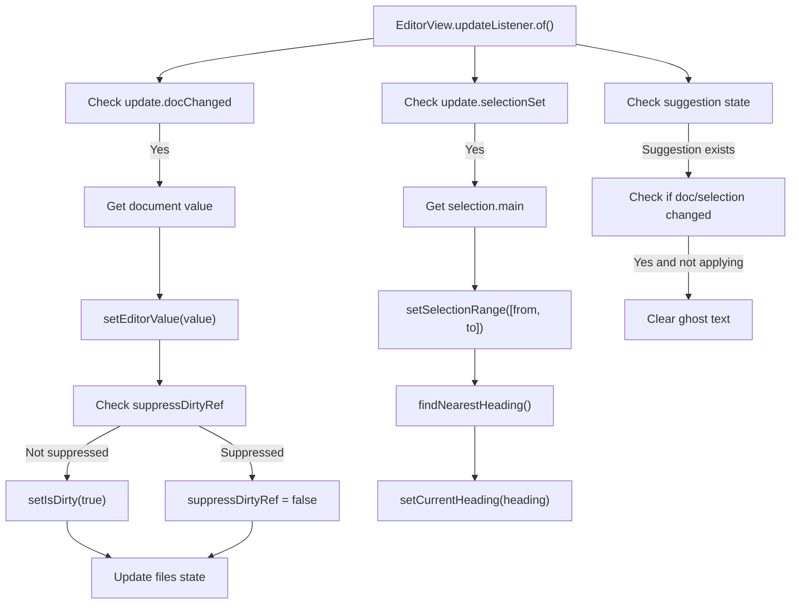

<!-- source: DeepWiki mcp.deepwiki.com · repo OpenDCAI/OpenPrism · page 4.4 CodeMirror Integration · fetched 2026-11-02 -->

# CodeMirror Integration

<details>
<summary>Relevant source files</summary>

The following files were used as context for generating this wiki page:

- [.gitignore](.gitignore)
- [apps/frontend/src/app/EditorPage.tsx](apps/frontend/src/app/EditorPage.tsx)
- [apps/frontend/src/latex/engine.ts](apps/frontend/src/latex/engine.ts)

</details>


## Purpose and Scope

This document describes how CodeMirror 6 is integrated into OpenPrism's frontend application to provide a LaTeX editing experience with intelligent code assistance. It covers the editor initialization process, custom extensions for LaTeX-specific functionality, code folding logic, autocompletion sources, AI-powered ghost text suggestions, theming, and keybindings.

For information about the overall editor workspace layout and three-panel UI structure, see [Editor Workspace](#4.3). For details about AI autocomplete features and suggestion workflows, see [AI Autocomplete](#6.3).

---

## Architecture Overview

The CodeMirror integration is centered in the `EditorPage` component and consists of several custom extensions layered on top of the core CodeMirror 6 architecture. The system implements a reactive pattern where document changes flow through the editor state, trigger update listeners, and synchronize with React component state.



**Sources:** [apps/frontend/src/app/EditorPage.tsx:1-50](), [apps/frontend/src/app/EditorPage.tsx:1325-1459]()

---

## Editor Initialization

The CodeMirror editor is initialized in a `useEffect` hook that runs once when the component mounts. The initialization process creates an `EditorState` with a complete extension configuration, instantiates an `EditorView` attached to a DOM container, and stores references for later access.



The editor state is created with an empty document and a comprehensive extension array that includes standard features (`basicSetup`), LaTeX language support, custom folding, autocompletion, ghost text field, search, theming, and keybindings. The editor view is then instantiated with this state and mounted into the DOM container referenced by `editorHostRef`.

| Configuration Element | Purpose |
|----------------------|---------|
| `doc: ''` | Initial empty document |
| `basicSetup` | Line numbers, bracket matching, syntax highlighting foundation |
| `latex()` | LaTeX language parser and syntax highlighting |
| `indentOnInput()` | Auto-indent when typing |
| `foldService.of(latexFoldService)` | Custom LaTeX-aware code folding |
| `EditorView.lineWrapping` | Wrap long lines |
| `editorTheme` | Custom visual theme |
| `ghostField` | AI suggestion overlays |
| `search()` | Find/replace functionality |
| `autocompletion({ override: [latexCompletionSource] })` | LaTeX command completion |
| `updateListener` | Track document and selection changes |
| `keymapExtension` | Custom keyboard shortcuts |

**Sources:** [apps/frontend/src/app/EditorPage.tsx:1325-1459](), [apps/frontend/src/app/EditorPage.tsx:1421-1436]()

---

## LaTeX Language Support

LaTeX language support is provided through a custom language extension imported from `../latex/lang`. This extension provides syntax highlighting rules specific to LaTeX constructs including commands, environments, math mode, comments, and document structure elements.

The language parser recognizes:
- Control sequences (commands starting with `\`)
- Environment blocks (`\begin{...}` / `\end{...}`)
- Math mode delimiters (`$...$`, `$$...$$`, `\[...\]`, `\(...\)`)
- Comment lines (starting with `%`)
- Curly brace groups and optional arguments

**Sources:** [apps/frontend/src/app/EditorPage.tsx:8]()

---

## Code Folding Service

The custom LaTeX folding service implements intelligent code folding for LaTeX-specific constructs. It allows users to collapse sections, environments, conditional blocks, and display math to improve document navigation and readability.

### Folding Logic Architecture



### Supported Folding Constructs

| Construct | Detection Pattern | Folding Behavior |
|-----------|------------------|------------------|
| **Environments** | `\begin{name}` | Folds to matching `\end{name}`, tracking nested depth |
| **Sections** | `\section`, `\subsection`, `\subsubsection`, `\paragraph`, `\subparagraph` | Folds to next section of same or higher level |
| **Groups** | `\begingroup` | Folds to matching `\endgroup` |
| **Conditionals** | `\if*` commands | Folds to matching `\fi` |
| **Display Math** | `$$...$$` or `\[...\]` | Folds to closing delimiter |

### Environment Folding Algorithm

The `findEnvFold` function [apps/frontend/src/app/EditorPage.tsx:180-202]() implements depth-tracking to handle nested environments correctly. It scans forward from the opening `\begin{env}` line, maintaining a counter that increments on nested `\begin{env}` and decrements on `\end{env}`, returning the fold range when depth reaches zero.

### Section Folding Algorithm

The `findSectionFold` function [apps/frontend/src/app/EditorPage.tsx:204-222]() uses a hierarchical level system defined in `SECTION_LEVELS` [apps/frontend/src/app/EditorPage.tsx:148-154](). Sections fold to the next section of equal or higher level (lower number), or to the end of the document if no such section exists.

### Comment Stripping

All folding detection functions first strip LaTeX comments using `stripLatexComment` [apps/frontend/src/app/EditorPage.tsx:165-178](), which removes everything after an unescaped `%` character. This ensures folding logic ignores commented-out code.

**Sources:** [apps/frontend/src/app/EditorPage.tsx:148-316]()

---

## Autocompletion System

The autocompletion system provides context-aware suggestions for LaTeX commands and common constructs. It is implemented through a custom completion source that overrides the default autocompletion behavior.

### Completion Source Function

The `latexCompletionSource` function [apps/frontend/src/app/EditorPage.tsx:590-649]() implements the completion logic:



### Completion Trigger Conditions

Autocompletion is triggered when:
1. User types `\` followed by zero or more alphabetic characters
2. The character before `\` is whitespace, `(`, `{`, or newline
3. The pattern is not `:\/` (to avoid triggering on URLs)

### Available Completions

The system provides the following LaTeX command completions:

| Command | Type | Behavior |
|---------|------|----------|
| `\section{}` | keyword | Inserts command and positions cursor inside braces |
| `\subsection{}` | keyword | Inserts command and positions cursor inside braces |
| `\subsubsection{}` | keyword | Inserts command and positions cursor inside braces |
| `\paragraph{}` | keyword | Inserts command and positions cursor inside braces |
| `\cite{}` | keyword | Inserts command and positions cursor inside braces |
| `\ref{}` | keyword | Inserts command and positions cursor inside braces |
| `\label{}` | keyword | Inserts command and positions cursor inside braces |
| `\begin{itemize}` | keyword | Inserts full itemize environment with `\item` |
| `\begin{enumerate}` | keyword | Inserts full enumerate environment with `\item` |
| `\begin{figure}` | keyword | Inserts complete figure template with caption and label |
| `\begin{table}` | keyword | Inserts complete table template with tabular |

### Custom Apply Functions

Completions for commands like `\section{}` use custom `apply` functions that not only insert the text but also programmatically position the cursor inside the braces:

```typescript
apply: (view: any, _completion: any, from: number, to: number) => {
  view.dispatch({
    changes: { from, to, insert: '\\section{}' },
    selection: { anchor: from + '\\section{'.length }
  });
}
```

**Sources:** [apps/frontend/src/app/EditorPage.tsx:590-649]()

---

## Ghost Text Field for AI Suggestions

The ghost text field system displays AI-generated inline suggestions as semi-transparent overlay text that appears at the cursor position. This provides a non-intrusive way to show autocomplete suggestions that users can accept or reject.

### State Effect and Field Architecture



### Ghost Widget Implementation

The `GhostWidget` class [apps/frontend/src/app/EditorPage.tsx:653-668]() extends `WidgetType` to render the suggestion text:

```typescript
class GhostWidget extends WidgetType {
  constructor(private text: string) {
    super();
  }

  toDOM() {
    const span = document.createElement('span');
    span.className = 'cm-ghost';
    span.textContent = this.text;
    return span;
  }

  ignoreEvent() {
    return true;  // Don't capture events
  }
}
```

The rendered span has the class `cm-ghost` which can be styled with CSS to appear semi-transparent.

### Ghost Field State Management

The `ghostField` [apps/frontend/src/app/EditorPage.tsx:670-695]() is a `StateField` that manages ghost text decorations:

1. **Creation**: Returns `Decoration.none` (no decorations initially)
2. **Update logic**:
   - If `setGhostEffect` is dispatched with a position and text, creates a widget decoration at that position
   - If document changes or selection changes, clears all ghost decorations
   - Otherwise, maps existing decorations to new positions after document changes

### Integration with AI Suggestions

Ghost text is set through the effect system:

```typescript
view.dispatch({
  effects: setGhostEffect.of({ pos, text: suggestion })
});
```

And cleared similarly:

```typescript
view.dispatch({
  effects: setGhostEffect.of({ pos: null, text: '' })
});
```

**Sources:** [apps/frontend/src/app/EditorPage.tsx:651-695]()

---

## Editor Theme

The custom editor theme provides visual styling optimized for LaTeX editing, with a warm color palette and transparent background that integrates with the glassmorphism UI design.

### Theme Configuration

The `editorTheme` [apps/frontend/src/app/EditorPage.tsx:697-730]() is created using `EditorView.theme()`:

| Selector | Styling |
|----------|---------|
| `&` (root) | `height: 100%`, `background: transparent` |
| `.cm-scroller` | Font: JetBrains Mono fallback chain, Size: `var(--editor-font-size, 11px)`, Line height: 1.6 |
| `.cm-content` | Padding: 16px |
| `.cm-gutters` | Transparent background, no border, muted color |
| `.cm-lineNumbers .cm-gutterElement` | Custom padding for line numbers |
| `.cm-activeLine` | Subtle background highlight: `rgba(180, 74, 47, 0.08)` |
| `.cm-activeLineGutter` | Transparent (matches main background) |
| `.cm-selectionBackground` | Selection highlight: `rgba(180, 74, 47, 0.18)` |

### Font Configuration

The editor uses a monospace font stack:
1. **JetBrains Mono** (preferred)
2. **SF Mono** (macOS fallback)
3. **Menlo** (macOS fallback)
4. Generic `monospace`

### Dynamic Font Size

The font size is controlled by a CSS variable `--editor-font-size` which defaults to 11px. This allows runtime adjustment of the editor font size without recreating the theme:

```typescript
const [editorFontSize, setEditorFontSize] = useState(11);
// Applied to editor container via inline style
style={{ '--editor-font-size': `${editorFontSize}px` }}
```

**Sources:** [apps/frontend/src/app/EditorPage.tsx:697-730](), [apps/frontend/src/app/EditorPage.tsx:1169]()

---

## Keybindings

The editor implements custom keybindings for LaTeX editing, file operations, and AI suggestion control. These are configured through a keymap extension added to the editor state.

### Keymap Configuration



### Keymap Table

| Key | Action | Implementation |
|-----|--------|----------------|
| `Mod-s` | Save current file | Calls `saveActiveFileRef.current()` |
| `Alt-/` | Request AI suggestion | Calls `requestSuggestionRef.current()` |
| `Mod-/` | Toggle line comment | Uses CodeMirror's `toggleComment` command |
| `Mod-Space` | Request AI suggestion | Calls `requestSuggestionRef.current()` (alternative binding) |
| `ArrowRight` | Accept suggestion chunk | If cursor is at suggestion anchor, accepts next word/token |
| `Tab` | Accept full suggestion | Accepts entire inline suggestion if present |
| `Escape` | Clear suggestion | Removes ghost text and clears suggestion state |

**Note:** `Mod` is `Cmd` on macOS and `Ctrl` on Windows/Linux.

### Special Alt+/ Handling

Due to browser/keyboard variations in how `Alt-/` is handled, an additional DOM event listener is registered directly on the editor:

```typescript
const handleAltSlash = (event: KeyboardEvent) => {
  if (!event.altKey) return;
  if (event.key === '/' || event.key === '÷' || event.code === 'Slash') {
    event.preventDefault();
    event.stopPropagation();
    requestSuggestionRef.current();
  }
};
view.dom.addEventListener('keydown', handleAltSlash, true);
```

This ensures the suggestion request works across different keyboard layouts and internationalization settings.

**Sources:** [apps/frontend/src/app/EditorPage.tsx:1365-1419](), [apps/frontend/src/app/EditorPage.tsx:1444-1453]()

---

## State Management and Update Handling

The CodeMirror integration implements a bidirectional state synchronization pattern between CodeMirror's internal state and React component state. This ensures document changes, selection changes, and dirty state are properly tracked and persisted.

### Update Listener Architecture



### State Synchronization Flow

| Event | CodeMirror → React | React → CodeMirror |
|-------|-------------------|-------------------|
| **User types** | `update.docChanged` → `setEditorValue()` → `setFiles()` → `setIsDirty(true)` | N/A |
| **File opened** | N/A | `openFile()` → `setEditorDoc()` → `view.dispatch()` |
| **Selection changes** | `update.selectionSet` → `setSelectionRange()` → `setCurrentHeading()` | N/A |
| **File saved** | N/A | `writeFile()` → `setIsDirty(false)` |
| **Suggestion accepted** | `view.dispatch()` with changes | `applyingSuggestionRef = true` to prevent clearing |

### Dirty State Management

The dirty state indicates unsaved changes and triggers auto-save:

1. **Setting dirty**: When document changes occur (via `update.docChanged`) and not suppressed
2. **Clearing dirty**: When file is successfully saved or when a new file is opened
3. **Suppression**: The `suppressDirtyRef` prevents marking as dirty when programmatically updating the document (e.g., when opening a file)

### Auto-Save Mechanism

An effect [apps/frontend/src/app/EditorPage.tsx:1695-1709]() monitors the dirty state and triggers auto-save after 1.5 seconds of inactivity:

```typescript
useEffect(() => {
  if (!isDirty || !activePath) return;
  if (saveTimerRef.current) {
    window.clearTimeout(saveTimerRef.current);
  }
  saveTimerRef.current = window.setTimeout(() => {
    saveActiveFile({ silent: true });
  }, 1500);
  // Cleanup cancels pending save
}, [activePath, editorValue, isDirty, saveActiveFile]);
```

### Reference Pattern for Callbacks

To avoid closure issues with stale state in keybindings, the system uses refs that are updated whenever the callbacks change:

```typescript
useEffect(() => {
  requestSuggestionRef.current = requestInlineSuggestion;
  acceptSuggestionRef.current = acceptInlineSuggestion;
  acceptChunkRef.current = acceptSuggestionChunk;
  clearSuggestionRef.current = clearInlineSuggestion;
}, [requestInlineSuggestion, acceptInlineSuggestion, 
    acceptSuggestionChunk, clearInlineSuggestion]);
```

This ensures keybindings always call the latest version of these functions with current state.

**Sources:** [apps/frontend/src/app/EditorPage.tsx:1328-1363](), [apps/frontend/src/app/EditorPage.tsx:1658-1663](), [apps/frontend/src/app/EditorPage.tsx:1695-1709]()

---

## Integration with React Component

The CodeMirror editor integrates with the React component through refs, effects, and callbacks:

| Integration Point | Mechanism | Purpose |
|------------------|-----------|---------|
| **DOM Mounting** | `editorHostRef` | Container element for editor view |
| **View Access** | `cmViewRef` | Persistent reference to EditorView instance |
| **Active Path** | `activePathRef` | Syncs with React state for file tracking |
| **Suggestion State** | `inlineSuggestionRef`, `inlineAnchorRef` | Manages ghost text state |
| **Callbacks** | `requestSuggestionRef`, `acceptSuggestionRef`, etc. | Exposes editor operations to keybindings |
| **Suppression** | `suppressDirtyRef`, `applyingSuggestionRef` | Controls update behavior |

**Sources:** [apps/frontend/src/app/EditorPage.tsx:1214-1234](), [apps/frontend/src/app/EditorPage.tsx:1299-1300]()

---

