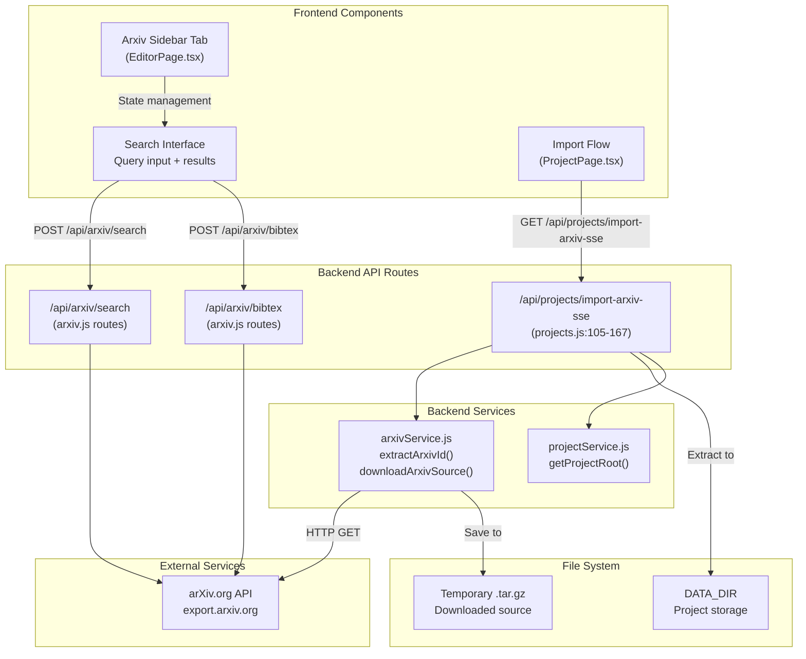
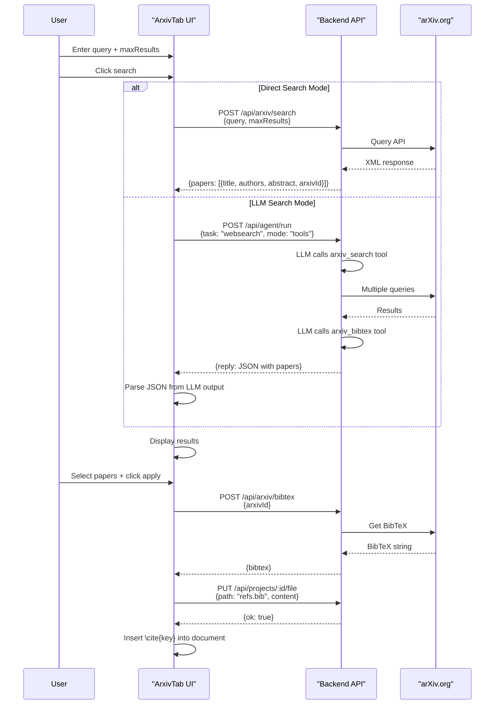
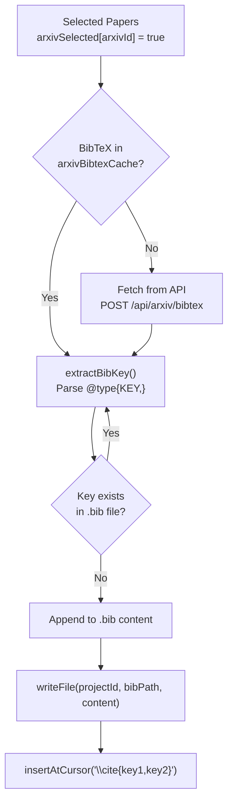
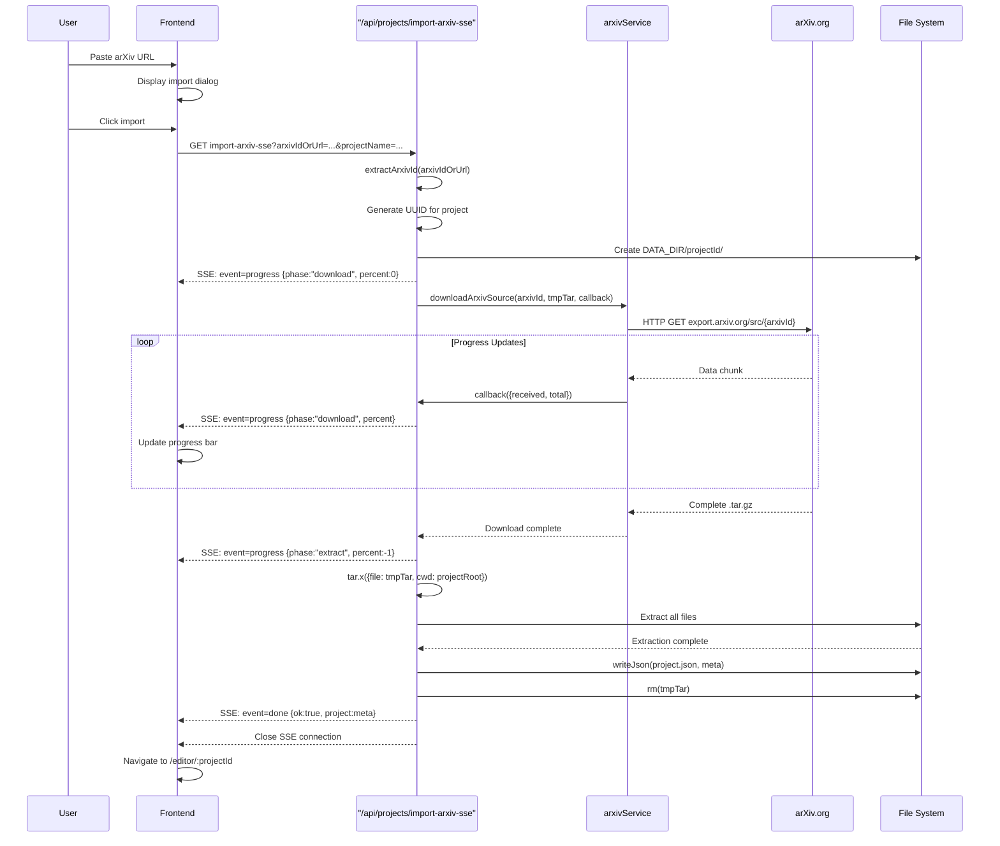
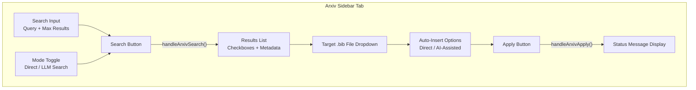

<!-- source: DeepWiki mcp.deepwiki.com · repo OpenDCAI/OpenPrism · page 5.6 arXiv Integration · fetched 2026-11-02 -->

# arXiv Integration

<details>
<summary>Relevant source files</summary>

The following files were used as context for generating this wiki page:

- [apps/backend/src/routes/projects.js](apps/backend/src/routes/projects.js)
- [apps/frontend/src/app/EditorPage.tsx](apps/frontend/src/app/EditorPage.tsx)

</details>


**Purpose**: This document describes OpenPrism's arXiv integration system, which enables users to search academic papers on arXiv.org, generate BibTeX citations, and import full arXiv LaTeX projects into the workspace. This system consists of backend services for downloading arXiv sources and frontend components for search and citation management.

For information about the web search feature (multi-point search with LLM-based summarization), see [Web Search](#6.8). For details on the Template System used during project creation, see [Template System](#5.5).

---

## System Overview

The arXiv integration provides two primary capabilities:

1. **Paper Search and Citation**: Search arXiv papers by keywords, retrieve metadata (title, authors, abstract), and generate BibTeX entries for insertion into `.bib` files.

2. **Project Import**: Download complete LaTeX source code from arXiv papers (including `.tex`, `.bib`, `.sty`, figures) and import them as editable OpenPrism projects.

Both capabilities are accessible through the arXiv sidebar tab in the Editor workspace and through the Project Import flow on the Projects page.

**Sources**: [apps/frontend/src/app/EditorPage.tsx:1176-1184](), [apps/backend/src/routes/projects.js:105-167]()

---

## Architecture and Components

### Component Overview



**Diagram**: arXiv Integration component architecture showing frontend UI components, backend API routes, services, and external dependencies.

**Sources**: [apps/frontend/src/app/EditorPage.tsx:1154](), [apps/backend/src/routes/projects.js:105](), [apps/backend/src/services/arxivService.js]()

---

### Key Backend Components

| Component | File | Responsibility |
|-----------|------|----------------|
| `extractArxivId()` | `arxivService.js` | Parse arXiv ID from various URL formats |
| `downloadArxivSource()` | `arxivService.js` | Download `.tar.gz` source with progress tracking |
| `/api/arxiv/search` | `arxiv.js` routes | Search arXiv papers via API |
| `/api/arxiv/bibtex` | `arxiv.js` routes | Generate BibTeX from arXiv ID |
| `/api/projects/import-arxiv-sse` | `projects.js:105-167` | Server-Sent Events endpoint for project import |

**Sources**: [apps/backend/src/services/arxivService.js](), [apps/backend/src/routes/projects.js:105-167]()

---

### Key Frontend Components

| Component | Location | Responsibility |
|-----------|----------|----------------|
| `arxivQuery` | EditorPage.tsx:1176 | Search query state |
| `arxivResults` | EditorPage.tsx:1178 | Search results array |
| `arxivSelected` | EditorPage.tsx:1179 | Selected papers for citation |
| `arxivBibtexCache` | EditorPage.tsx:1184 | Cached BibTeX entries |
| `handleArxivSearch()` | EditorPage.tsx:1842-1921 | Execute search operation |
| `handleArxivApply()` | EditorPage.tsx:1923-2045 | Apply citations to `.bib` file |

**Sources**: [apps/frontend/src/app/EditorPage.tsx:1176-1184](), [apps/frontend/src/app/EditorPage.tsx:1842-2045]()

---

## Paper Search and Citation Workflow

### Search Execution Flow



**Diagram**: Sequence diagram showing arXiv paper search with both direct search and LLM-enhanced search modes, followed by BibTeX generation and citation insertion.

**Sources**: [apps/frontend/src/app/EditorPage.tsx:1842-1921](), [apps/frontend/src/app/EditorPage.tsx:1923-2045]()

---

### Search Implementation Details

The `handleArxivSearch()` function implements two search modes:

#### Direct Search Mode (`useLlmSearch = false`)

```typescript
const res = await arxivSearch({ query, maxResults: arxivMaxResults });
if (!res.ok) throw new Error(res.error || t('检索失败'));
setArxivResults(res.papers || []);
```

This mode directly queries the arXiv API and returns structured paper metadata.

**Sources**: [apps/frontend/src/app/EditorPage.tsx:1905-1915]()

#### LLM Search Mode (`useLlmSearch = true`)

```typescript
const res = await runAgent({
  task: 'websearch',
  prompt: [
    t('Search arXiv for the user query.'),
    t('Return at most {{max}} papers.', { max: arxivMaxResults }),
    t('Use arxiv_search and arxiv_bibtex tools.'),
    t('Return JSON ONLY in this schema:'),
    t('{"papers":[{"title":"","authors":[],"arxivId":"","bibtex":""}]}.')
  ].join(' '),
  mode: 'tools',
  llmConfig: searchLlmConfig
});
```

This mode uses the AI Agent with tool-calling capabilities to perform more intelligent searches, including query expansion and automatic BibTeX generation.

**Sources**: [apps/frontend/src/app/EditorPage.tsx:1851-1871]()

---

### BibTeX Generation and Citation Insertion



**Diagram**: BibTeX generation and citation insertion flow showing cache checking, duplicate detection, and file writing operations.

The `extractBibKey()` helper function parses the citation key from BibTeX:

```javascript
const extractBibKey = (bibtex: string) => {
  const match = bibtex.match(/@\w+\s*{\s*([^,\s]+)\s*,);
  return match ? match[1].trim() : '';
};
```

**Sources**: [apps/frontend/src/app/EditorPage.tsx:1837-1840](), [apps/frontend/src/app/EditorPage.tsx:1923-2045]()

---

### Auto-Insert Citation Features

The system supports two auto-insertion modes controlled by state flags:

#### Mode 1: Direct Insertion (`autoInsertCite = true`)

Inserts `\cite{keys}` at the cursor position in the currently active `.tex` file:

```javascript
if (autoInsertCite && keys.length > 0) {
  if (activePath && activePath.toLowerCase().endsWith('.tex')) {
    insertAtCursor(`\\cite{${keys.join(',')}}`);
  }
}
```

**Sources**: [apps/frontend/src/app/EditorPage.tsx:1975-1983]()

#### Mode 2: AI-Assisted Insertion (`autoInsertToMain = true`)

Uses the AI Agent to intelligently insert citations into a Related Work section:

```javascript
const prompt = [
  t('Insert citations into the target TeX file.'),
  t('Target file: {{file}}.', { file: targetFile }),
  t('Use \\\\cite{{{keys}}}.', { keys: keys.join(',') }),
  t('If a Related Work section exists, add the citations there.'),
  t('Otherwise add a Related Work subsection near the end and cite the papers.'),
  t('Keep edits minimal and preserve formatting.')
].filter(Boolean).join(' ');

const res = await runAgent({
  task: 'insert_citations',
  prompt,
  mode: 'tools',
  projectId,
  activePath: targetFile
});

if (res.patches && res.patches.length > 0) {
  setPendingChanges(res.patches);
  setRightView('diff');
}
```

The Agent generates file patches that are displayed in the Diff Viewer for user approval.

**Sources**: [apps/frontend/src/app/EditorPage.tsx:1997-2031]()

---

## Project Import Workflow

### Import Execution Flow



**Diagram**: Server-Sent Events (SSE) flow for arXiv project import showing real-time progress updates during download and extraction phases.

**Sources**: [apps/backend/src/routes/projects.js:105-167]()

---

### Import Implementation Details

#### Endpoint Registration

The import endpoint is registered in `projects.js`:

```javascript
fastify.get('/api/projects/import-arxiv-sse', async (req, reply) => {
  const { arxivIdOrUrl, projectName } = req.query;
  const arxivId = extractArxivId(arxivIdOrUrl);
  
  reply.raw.writeHead(200, {
    'Content-Type': 'text/event-stream',
    'Cache-Control': 'no-cache',
    Connection: 'keep-alive'
  });
  
  const send = (event, data) => {
    reply.raw.write(`event: ${event}\ndata: ${JSON.stringify(data)}\n\n`);
  };
  // ...
});
```

**Sources**: [apps/backend/src/routes/projects.js:105-119]()

#### Project Directory Creation

```javascript
const id = crypto.randomUUID();
const projectRoot = path.join(DATA_DIR, id);
await ensureDir(projectRoot);
const meta = {
  id,
  name: projectName || `arxiv-${arxivId}`,
  createdAt: new Date().toISOString()
};
```

**Sources**: [apps/backend/src/routes/projects.js:127-134]()

#### Download with Progress Tracking

```javascript
const tmpTar = path.join(projectRoot, '__arxiv_source.tar.gz');

send('progress', { phase: 'download', percent: 0 });

await downloadArxivSource(arxivId, tmpTar, ({ received, total }) => {
  const percent = total > 0 ? Math.round((received / total) * 100) : -1;
  send('progress', { phase: 'download', percent, received, total });
});
```

The `downloadArxivSource()` function in `arxivService.js` uses Node.js streams to download the file and invoke a callback with progress updates as chunks arrive.

**Sources**: [apps/backend/src/routes/projects.js:136-142]()

#### Extraction with Security Filtering

```javascript
send('progress', { phase: 'extract', percent: -1 });

await tar.x({
  file: tmpTar,
  cwd: projectRoot,
  filter: (entryPath) => {
    if (!entryPath) return false;
    if (path.isAbsolute(entryPath)) return false;
    return !entryPath.split('/').some((part) => part === '..');
  }
});
```

The filter prevents path traversal attacks by rejecting:
- Empty paths
- Absolute paths
- Paths containing `..` segments

**Sources**: [apps/backend/src/routes/projects.js:144-153]()

#### Error Handling and Cleanup

```javascript
try {
  // download and extract
} catch (err) {
  await fs.rm(projectRoot, { recursive: true, force: true });
  send('error', { error: t(lang, 'arxiv_download_failed', { error: String(err) }) });
  reply.raw.end();
  return reply;
} finally {
  await fs.rm(tmpTar, { force: true });
}
```

On error, the entire project directory is deleted to prevent partial imports. The temporary `.tar.gz` file is always cleaned up in the `finally` block.

**Sources**: [apps/backend/src/routes/projects.js:154-161]()

---

## API Reference

### POST /api/arxiv/search

Search for papers on arXiv.

**Request Body**:
```typescript
{
  query: string;        // Search keywords
  maxResults?: number;  // Default: 5
}
```

**Response**:
```typescript
{
  ok: boolean;
  papers?: Array<{
    title: string;
    abstract: string;
    authors: string[];
    url: string;
    arxivId: string;
  }>;
  error?: string;
}
```

**Sources**: [apps/frontend/src/api/client.ts]()

---

### POST /api/arxiv/bibtex

Generate BibTeX entry for an arXiv paper.

**Request Body**:
```typescript
{
  arxivId: string;  // e.g., "2301.12345" or "cs.AI/1234567"
}
```

**Response**:
```typescript
{
  ok: boolean;
  bibtex?: string;  // BibTeX entry in standard format
  error?: string;
}
```

**Sources**: [apps/frontend/src/api/client.ts]()

---

### GET /api/projects/import-arxiv-sse

Import an arXiv paper as a new project using Server-Sent Events for progress tracking.

**Query Parameters**:
```
arxivIdOrUrl: string  // arXiv ID or full URL
projectName?: string  // Custom project name
```

**SSE Events**:

| Event | Data | Description |
|-------|------|-------------|
| `progress` | `{phase: "download", percent: number, received?: number, total?: number}` | Download progress |
| `progress` | `{phase: "extract", percent: -1}` | Extraction in progress |
| `done` | `{ok: true, project: ProjectMeta}` | Import complete |
| `error` | `{error: string}` | Import failed |

**Response Headers**:
```
Content-Type: text/event-stream
Cache-Control: no-cache
Connection: keep-alive
```

**Sources**: [apps/backend/src/routes/projects.js:105-167]()

---

## Frontend Integration

### ArXiv Sidebar Tab State

The arXiv functionality is managed by the following state variables in `EditorPage.tsx`:

```typescript
const [arxivQuery, setArxivQuery] = useState('');
const [arxivMaxResults, setArxivMaxResults] = useState(5);
const [arxivResults, setArxivResults] = useState<ArxivPaper[]>([]);
const [arxivSelected, setArxivSelected] = useState<Record<string, boolean>>({});
const [arxivBusy, setArxivBusy] = useState(false);
const [arxivStatus, setArxivStatus] = useState('');
const [useLlmSearch, setUseLlmSearch] = useState(false);
const [llmSearchOutput, setLlmSearchOutput] = useState('');
const [arxivBibtexCache, setArxivBibtexCache] = useState<Record<string, string>>({});
const [bibTarget, setBibTarget] = useState('');
const [autoInsertCite, setAutoInsertCite] = useState(true);
const [autoInsertToMain, setAutoInsertToMain] = useState(false);
const [citeTargetFile, setCiteTargetFile] = useState('');
```

**Sources**: [apps/frontend/src/app/EditorPage.tsx:1176-1189]()

---

### UI Layout

The arXiv tab appears in the left sidebar when `activeSidebar === 'search'`:



**Diagram**: ArXiv sidebar tab UI component hierarchy and interaction flow.

**Sources**: [apps/frontend/src/app/EditorPage.tsx:1842-2045]()

---

## Configuration and Customization

### Search Configuration

The search behavior can be customized through several state-controlled options:

| Option | State Variable | Default | Description |
|--------|----------------|---------|-------------|
| Max Results | `arxivMaxResults` | 5 | Number of papers to retrieve |
| Search Mode | `useLlmSearch` | false | Use direct API or LLM-enhanced search |
| LLM Config | `searchLlmConfig` | Fallback to main LLM | Override LLM endpoint for search |

**Sources**: [apps/frontend/src/app/EditorPage.tsx:1177](), [apps/frontend/src/app/EditorPage.tsx:1182](), [apps/frontend/src/app/EditorPage.tsx:1262-1269]()

---

### Citation Insertion Options

| Option | State Variable | Default | Description |
|--------|----------------|---------|-------------|
| Target .bib File | `bibTarget` | First .bib file | Destination for BibTeX entries |
| Auto-Insert Cite | `autoInsertCite` | true | Insert `\cite{}` at cursor |
| AI-Assisted Insert | `autoInsertToMain` | false | Use Agent to insert into Related Work |
| Target File | `citeTargetFile` | `mainFile` | File for AI-assisted insertion |

**Sources**: [apps/frontend/src/app/EditorPage.tsx:1185-1188]()

---

## Error Handling

### Download Errors

If the arXiv source download fails, the system:

1. Deletes the partially created project directory
2. Sends an SSE `error` event to the frontend
3. Closes the SSE connection
4. Displays localized error message to user

```javascript
catch (err) {
  await fs.rm(projectRoot, { recursive: true, force: true });
  send('error', { error: t(lang, 'arxiv_download_failed', { error: String(err) }) });
  reply.raw.end();
  return reply;
}
```

**Sources**: [apps/backend/src/routes/projects.js:154-158]()

---

### Search Errors

Search failures are handled with user-friendly status messages:

```javascript
catch (err) {
  setArxivStatus(t('检索失败: {{error}}', { error: String(err) }));
} finally {
  setArxivBusy(false);
}
```

Common failure scenarios:
- Network timeout
- Invalid arXiv ID
- Rate limiting by arXiv.org
- LLM API errors (in LLM search mode)
- JSON parsing failures (in LLM search mode)

**Sources**: [apps/frontend/src/app/EditorPage.tsx:1917-1920]()

---

## Integration with Other Systems

### Template System Integration

While arXiv projects are imported with their original structure, users can apply templates post-import using the Template Convert feature (see [Template System](#5.5)).

---

### AI Agent Integration

The LLM search mode and AI-assisted citation insertion both utilize the AI Agent Service (see [AI Agent Service](#5.3)) with tool-calling capabilities:

- **Search**: Uses `arxiv_search` and `arxiv_bibtex` tools
- **Citation Insertion**: Uses file read/write tools in `'tools'` mode

**Sources**: [apps/frontend/src/app/EditorPage.tsx:1851-1871](), [apps/frontend/src/app/EditorPage.tsx:2007-2020]()

---

### Diff Viewer Integration

AI-assisted citation insertion generates file patches that are displayed in the Diff Viewer (see [Diff Viewer](#6.6)) for user review before application.

**Sources**: [apps/frontend/src/app/EditorPage.tsx:2021-2031]()

---

