<!-- source: DeepWiki mcp.deepwiki.com · repo OpenDCAI/OpenPrism · page 6 Features · fetched 2026-11-02 -->

# Features

<details>
<summary>Relevant source files</summary>

The following files were used as context for generating this wiki page:

- [README.md](README.md)
- [apps/frontend/src/app/EditorPage.tsx](apps/frontend/src/app/EditorPage.tsx)

</details>


This document describes the user-facing features and workflows available in OpenPrism. It covers the functional capabilities exposed through the editor interface, focusing on how users interact with the system and the underlying mechanisms that enable these features.

For architectural details about the frontend structure, see [Frontend Application](#4). For backend service implementation, see [Backend Application](#5). For development guidance on extending features, see [Development Guide](#7).

---

## Overview

OpenPrism provides a comprehensive feature set organized into seven functional areas:

| Category | Features | Primary Purpose |
|----------|----------|-----------------|
| **Editing** | LaTeX editing, auto-save, syntax highlighting | Core document authoring |
| **AI Assistance** | Chat, Agent, Tools modes, autocomplete | AI-powered content generation and editing |
| **Compilation** | Multi-engine support, error parsing | PDF generation and validation |
| **Preview** | PDF viewer, outline, figures gallery | Document visualization |
| **Search** | arXiv search, web search | Research and citation discovery |
| **Generation** | Plot generation, vision OCR | Asset creation from data or images |
| **Review** | Diff viewer, quality checks | Change review and document analysis |

**Sources:** [README.md:63-117](), [apps/frontend/src/app/EditorPage.tsx:1094-1150]()

---

## Feature Activation Flow

The following diagram shows how users activate different features through the editor interface and the corresponding state management:

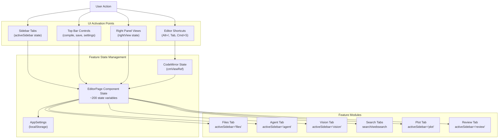

**Sources:** [apps/frontend/src/app/EditorPage.tsx:1094-1150](), [apps/frontend/src/app/EditorPage.tsx:3387-3446]()

---

## LaTeX Editing

### Core Editor Features

OpenPrism uses **CodeMirror 6** as the editing engine with custom LaTeX extensions:

| Feature | Implementation | Code Reference |
|---------|---------------|----------------|
| Syntax Highlighting | `latex()` language mode | [apps/frontend/src/latex/lang:8]() |
| Code Folding | `latexFoldService` function | [apps/frontend/src/app/EditorPage.tsx:288-316]() |
| Autocompletion | `latexCompletionSource` | [apps/frontend/src/app/EditorPage.tsx:590-649]() |
| Auto-save | Debounced `saveActiveFile` | [apps/frontend/src/app/EditorPage.tsx:1690-1709]() |

### File Tree Operations

The file tree supports comprehensive project management:

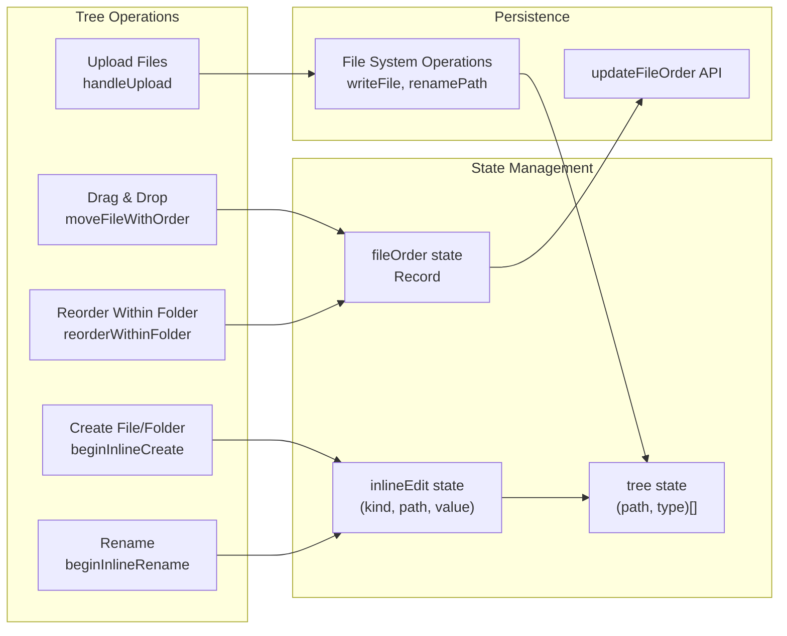

The tree builder (`buildTree` function) constructs a hierarchical representation from flat file paths and applies custom ordering:

**Sources:** [apps/frontend/src/app/EditorPage.tsx:362-410](), [apps/frontend/src/app/EditorPage.tsx:2368-2438](), [apps/frontend/src/app/EditorPage.tsx:2440-2469]()

### Outline Navigation

The outline panel extracts section headings using `parseOutline`:

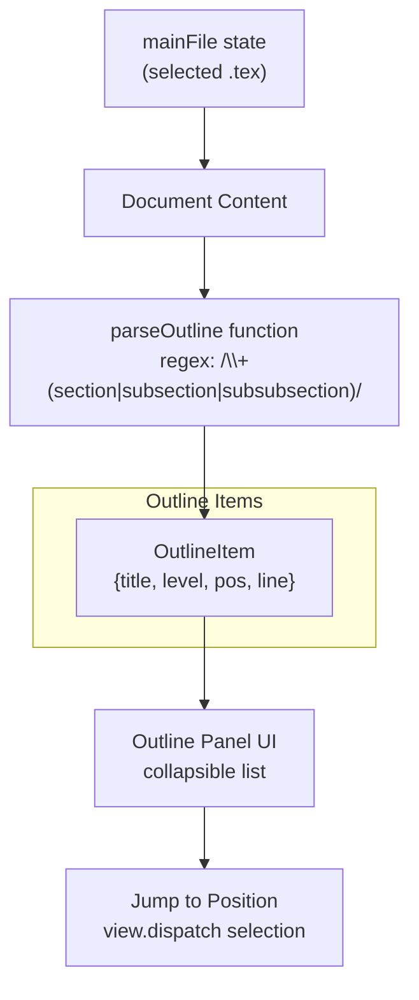

**Sources:** [apps/frontend/src/app/EditorPage.tsx:438-460](), [apps/frontend/src/app/EditorPage.tsx:3532-3574]()

---

## AI Assistant Modes

OpenPrism provides three distinct AI interaction modes with different execution behaviors:

### Mode Comparison

| Mode | Execution | File Modifications | Use Case |
|------|-----------|-------------------|----------|
| **Chat** | `mode='direct'` | Read-only | Questions, explanations |
| **Agent** | `mode='direct'` or `mode='tools'` | Generates patches for review | Content editing, rewriting |
| **Tools** | `mode='tools'` | Multi-step with tool calls | Complex refactoring, multi-file edits |

### Interaction Flow

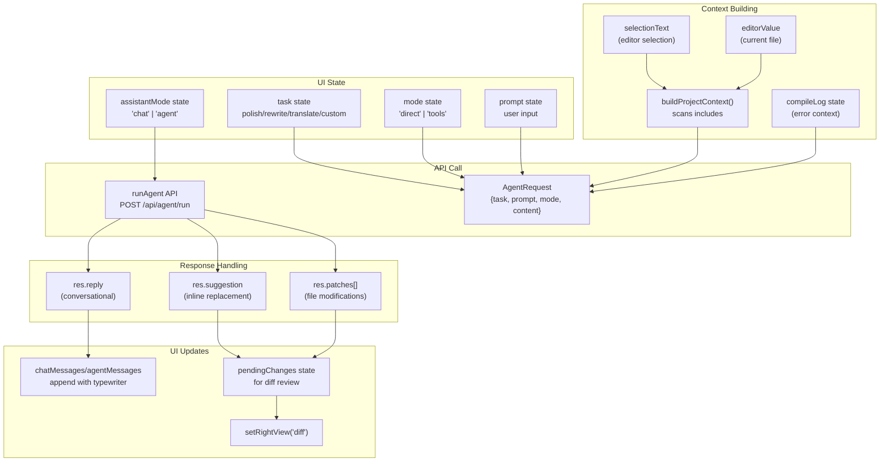

**Sources:** [apps/frontend/src/app/EditorPage.tsx:3083-3175](), [apps/frontend/src/app/EditorPage.tsx:1800-1835]()

### Task Types

The `DEFAULT_TASKS` constant defines available tasks:

- **polish**: Language refinement
- **rewrite**: Content restructuring
- **structure**: Section reorganization
- **translate**: Language translation with scope (selection/file/project)
- **websearch**: Automated arXiv search with tool calls
- **custom**: User-defined instructions

**Translation Scope Handling:**

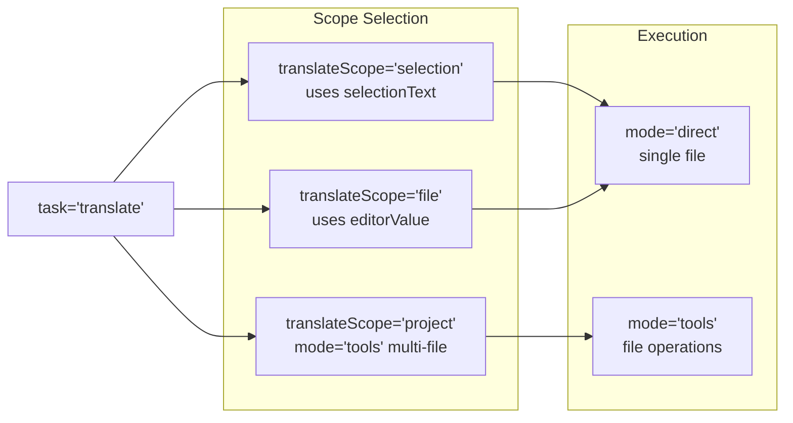

**Sources:** [apps/frontend/src/app/EditorPage.tsx:82-89](), [apps/frontend/src/app/EditorPage.tsx:3087-3128]()

---

## AI Autocomplete

### Ghost Text Mechanism

Autocomplete uses CodeMirror's decoration system to display inline suggestions:

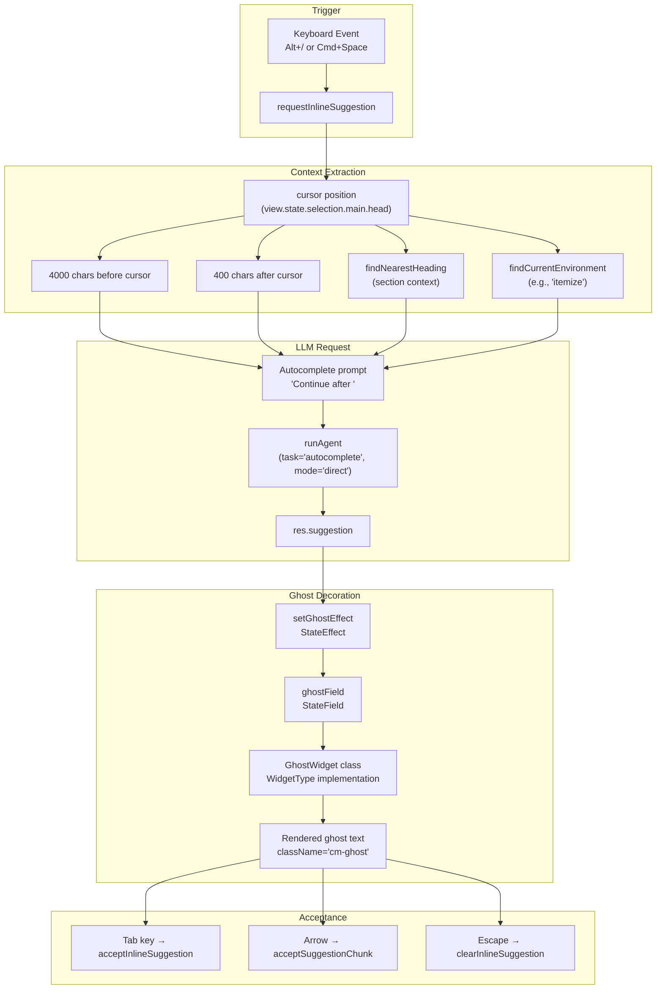

**Key Implementation Details:**

1. **GhostWidget Class**: Custom CodeMirror widget for rendering suggestions
   ```typescript
   class GhostWidget extends WidgetType {
     constructor(private text: string) { super(); }
     toDOM() {
       const span = document.createElement('span');
       span.className = 'cm-ghost';
       span.textContent = this.text;
       return span;
     }
   }
   ```

2. **State Field Management**: `ghostField` tracks the current decoration

3. **Chunk Acceptance**: `nextSuggestionChunk` extracts word-by-word for arrow key acceptance

**Sources:** [apps/frontend/src/app/EditorPage.tsx:651-695](), [apps/frontend/src/app/EditorPage.tsx:1579-1627](), [apps/frontend/src/app/EditorPage.tsx:1514-1552]()

---

## Document Compilation

### Engine Selection and Fallback

OpenPrism supports multiple LaTeX engines with auto-fallback:

| Engine | Type | Command | Use Case |
|--------|------|---------|----------|
| `pdflatex` | Standard | `pdflatex` | Default compilation |
| `xelatex` | Extended | `xelatex` | Unicode, Chinese support |
| `lualatex` | Lua-based | `lualatex` | Lua scripting |
| `latexmk` | Build tool | `latexmk -pdf` | Automated multi-pass |
| `tectonic` | Modern | `tectonic` | Lightweight fallback |

### Compilation Pipeline

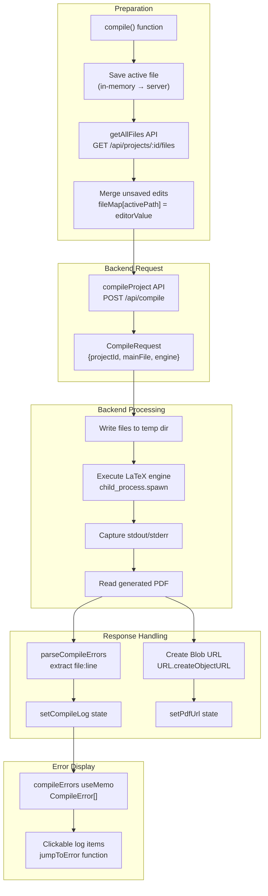

**Error Parsing Logic:**

The `parseCompileErrors` function uses regex to extract structured error information:

```typescript
// Matches: filename.tex:123
const fileLineMatch = line.match(/([A-Za-z0-9_./-]+\.tex):(\d+));

// Matches: ! Error message
if (line.startsWith('!')) {
  const message = line.replace(/^!+\s*/, '').trim();
  // Look ahead for l.123 line number
}
```

**Sources:** [apps/frontend/src/app/EditorPage.tsx:2886-2941](), [apps/frontend/src/app/EditorPage.tsx:776-815](), [apps/frontend/src/app/EditorPage.tsx:2697-2716]()

### One-Click Diagnose

The diagnose feature sends compilation errors to the AI for automated fixes:

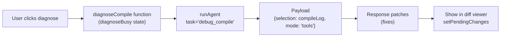

**Sources:** [apps/frontend/src/app/EditorPage.tsx:3177-3221]()

---

## PDF Preview

### Rendering Architecture

PDF preview uses **PDF.js** with custom text layer rendering:

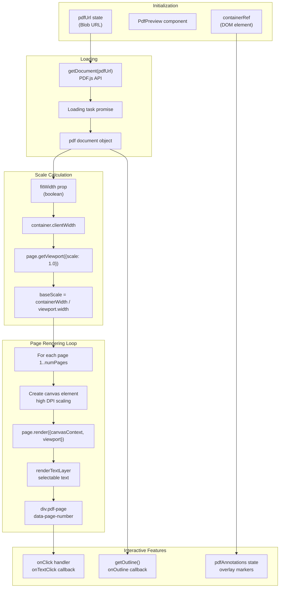

**Quality Boost:**

High-DPI rendering is achieved by rendering at higher scale then CSS-scaling down:

```typescript
const cssViewport = page.getViewport({ scale: baseScale });
const qualityBoost = Math.min(2.4, (window.devicePixelRatio || 1) * 1.25);
const renderViewport = page.getViewport({ scale: baseScale * qualityBoost });

canvas.width = renderViewport.width;
canvas.height = renderViewport.height;
canvas.style.width = `${cssViewport.width}px`;
canvas.style.height = `${cssViewport.height}px`;
```

**Sources:** [apps/frontend/src/app/EditorPage.tsx:882-1092](), [apps/frontend/src/app/EditorPage.tsx:911-1048]()

### Zoom and Navigation

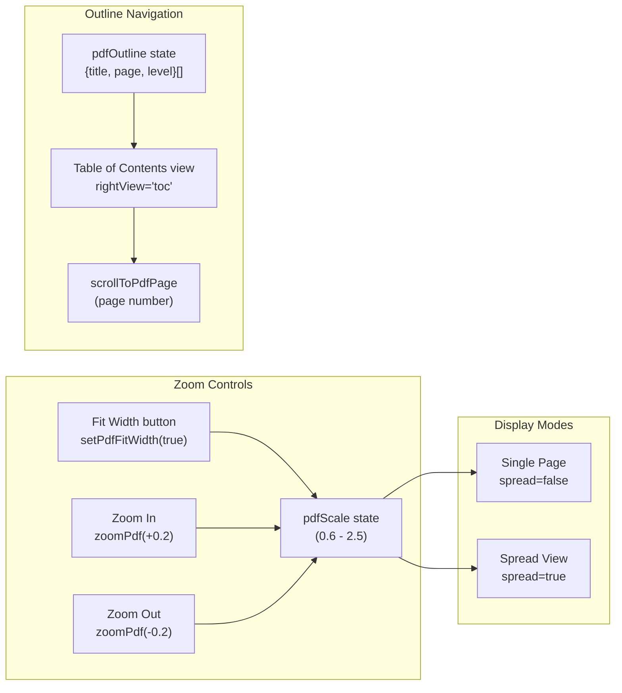

**Sources:** [apps/frontend/src/app/EditorPage.tsx:2989-3007](), [apps/frontend/src/app/EditorPage.tsx:3000-3007]()

---

## Diff Viewer

### Split Diff Rendering

The diff viewer uses the `diff` library to generate line-by-line comparisons:

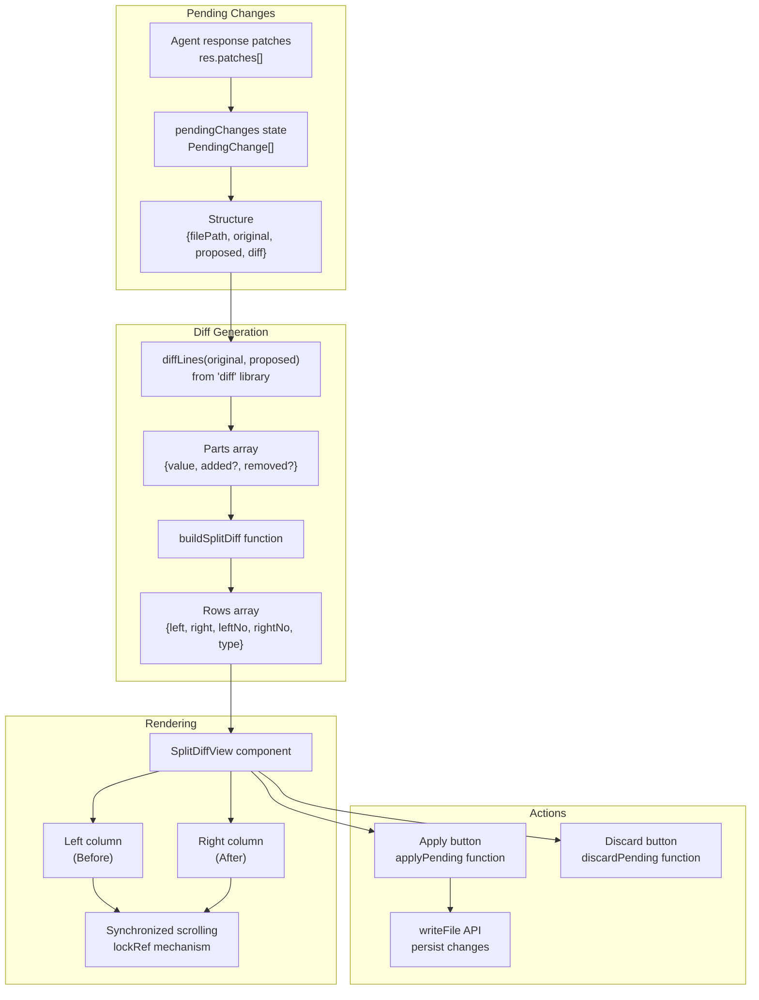

**Synchronized Scroll Implementation:**

```typescript
const lockRef = useRef(false);

const syncScroll = (source: HTMLDivElement | null, target: HTMLDivElement | null) => {
  if (!source || !target || lockRef.current) return;
  lockRef.current = true;
  target.scrollTop = source.scrollTop;
  target.scrollLeft = source.scrollLeft;
  requestAnimationFrame(() => {
    lockRef.current = false;
  });
};
```

**Sources:** [apps/frontend/src/app/EditorPage.tsx:732-767](), [apps/frontend/src/app/EditorPage.tsx:834-880](), [apps/frontend/src/app/EditorPage.tsx:3223-3254]()

---

## Academic Search

### arXiv Search Flow

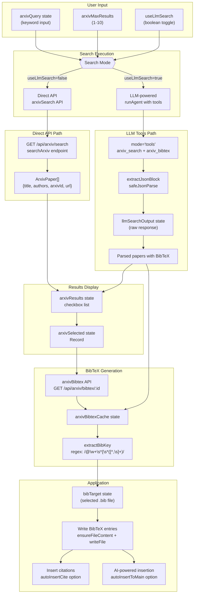

**LLM Search Prompt:**

```typescript
const prompt = [
  'Search arXiv for the user query.',
  `Return at most ${arxivMaxResults} papers.`,
  'Use arxiv_search and arxiv_bibtex tools.',
  'Return JSON ONLY in this schema:',
  '{"papers":[{"title":"","authors":[],"arxivId":"","bibtex":""}]}.'
].join(' ');
```

**Sources:** [apps/frontend/src/app/EditorPage.tsx:1842-1921](), [apps/frontend/src/app/EditorPage.tsx:1923-2045]()

### Citation Insertion

Two insertion modes are available:

| Mode | Trigger | Behavior |
|------|---------|----------|
| **Auto Insert** | `autoInsertCite=true` | Inserts `\cite{key1,key2}` at cursor in active .tex file |
| **AI Insert** | `autoInsertToMain=true` | Uses Agent with Tools mode to insert citations in Related Work section |

**AI Insertion Prompt:**

```typescript
const prompt = [
  'Insert citations into the target TeX file.',
  `Target file: ${targetFile}.`,
  `Use \\cite{${keys.join(',')}}.`,
  'If a Related Work section exists, add the citations there.',
  'Otherwise add a Related Work subsection near the end and cite the papers.',
  'Keep edits minimal and preserve formatting.',
  citePayload.length > 0 ? `Papers: ${JSON.stringify(citePayload)}` : ''
].filter(Boolean).join(' ');
```

**Sources:** [apps/frontend/src/app/EditorPage.tsx:1975-2039]()

---

## Web Search

### Multi-Point Search Strategy

Web search implements a query expansion strategy:

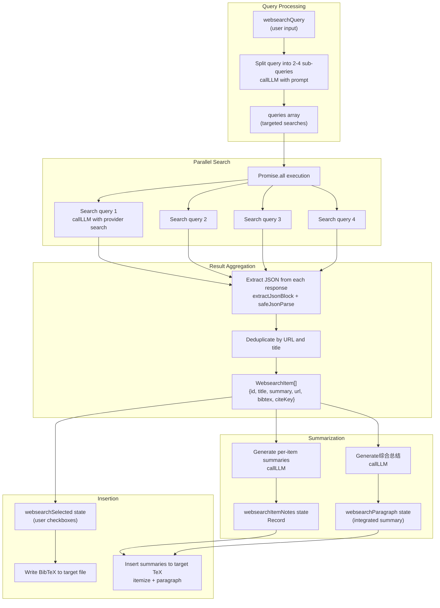

**Log Output:**

The `websearchLog` state array tracks progress through the pipeline:

```typescript
appendLog(setWebsearchLog, '拆分查询...');
appendLog(setWebsearchLog, `并行检索: ${queries.join(' | ')}`);
appendLog(setWebsearchLog, `检索中: ${q}`);
appendLog(setWebsearchLog, `完成: ${q} (${count})`);
appendLog(setWebsearchLog, `聚合结果: ${count} 条`);
appendLog(setWebsearchLog, '生成逐条总结...');
appendLog(setWebsearchLog, '生成综合总结...');
```

**Sources:** [apps/frontend/src/app/EditorPage.tsx:2082-2247](), [apps/frontend/src/app/EditorPage.tsx:2250-2317]()

### Output Format

The insertion generates structured LaTeX:

```latex
\paragraph{逐条总结}
\begin{itemize}
  \item Summary 1 \cite{key1}
  \item Summary 2 \cite{key2}
  \item Summary 3 \cite{key3}
\end{itemize}

\paragraph{综合总结}
Integrated summary paragraph with inline citations \cite{key1,key2}.
```

**Sources:** [apps/frontend/src/app/EditorPage.tsx:2290-2316]()

---

## Plot Generation

### Table-to-Chart Pipeline

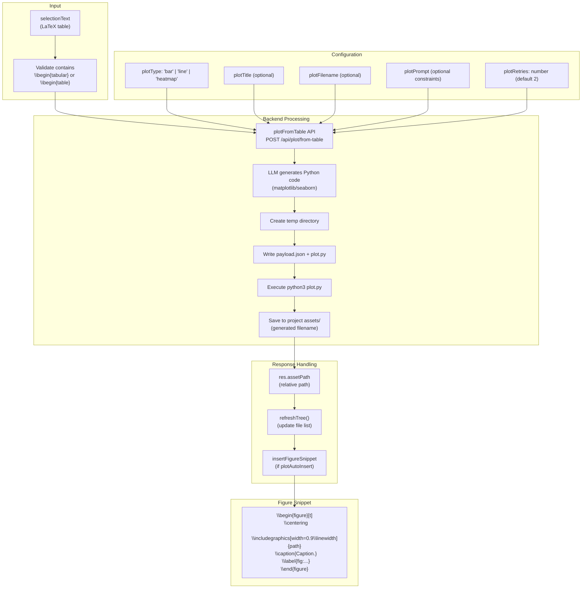

**LLM Code Generation:**

The backend uses an LLM to generate Python plotting code from the LaTeX table. The prompt includes:
- Table content
- Chart type specification
- Optional user constraints
- Output format requirements (save to specific path)

**Sources:** [apps/frontend/src/app/EditorPage.tsx:2047-2080](), [apps/frontend/src/app/EditorPage.tsx:1745-1756]()

---

## Vision OCR

### Image-to-LaTeX Conversion

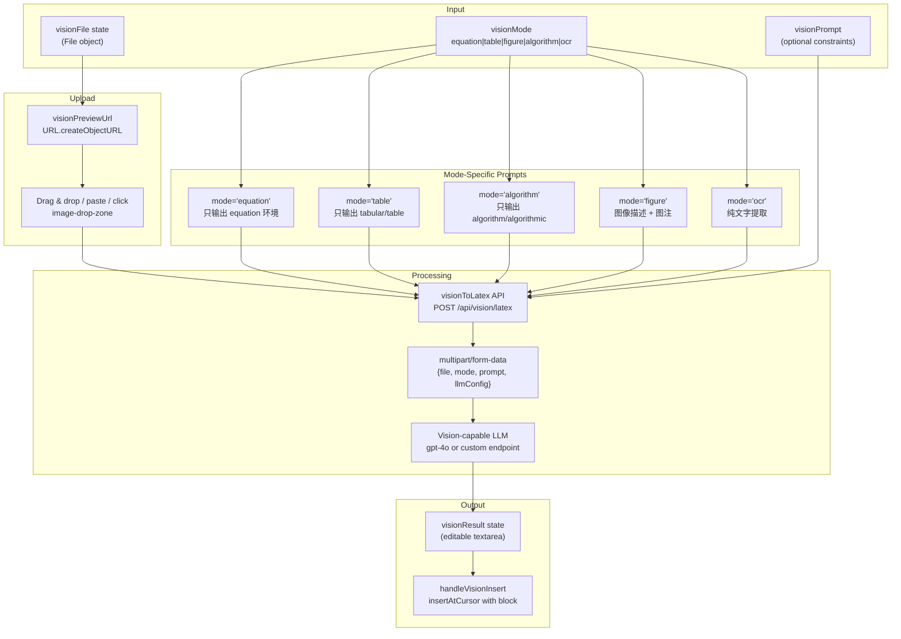

**Mode Examples:**

| Mode | Input | Expected Output |
|------|-------|----------------|
| `equation` | Formula image | `\begin{equation} E = mc^2 \end{equation}` |
| `table` | Table screenshot | `\begin{tabular}{lcc} ... \end{tabular}` |
| `algorithm` | Algorithm diagram | `\begin{algorithm} ... \end{algorithm}` |
| `figure` | Chart/graph | Image description suitable for caption |
| `ocr` | Text image | Plain text extraction |

**Vision LLM Configuration:**

The feature uses `visionLlmConfig` which can override the default LLM endpoint:

```typescript
const visionLlmConfig = useMemo(() => {
  const hasOverride = Boolean(visionEndpoint || visionApiKey || visionModel);
  return {
    endpoint: (hasOverride ? visionEndpoint : llmEndpoint) || llmEndpoint,
    apiKey: (hasOverride ? visionApiKey : llmApiKey) || undefined,
    model: (hasOverride ? visionModel : llmModel) || llmModel
  };
}, [llmEndpoint, llmApiKey, llmModel, visionEndpoint, visionApiKey, visionModel]);
```

**Sources:** [apps/frontend/src/app/EditorPage.tsx:3326-3361](), [apps/frontend/src/app/EditorPage.tsx:1271-1278]()

---

## Peer Review

### Quality Check Features

The review tab provides four analysis modes:

| Check Type | Method | Output |
|------------|--------|--------|
| **Review Report** | LLM-based analysis | Full reviewer-style report |
| **Consistency Check** | Term/symbol analysis | List of inconsistencies |
| **Missing Citations** | Statement analysis | Statements needing citations |
| **Compile Summary** | Log analysis | Error summary with fixes |

### Review Report Generation

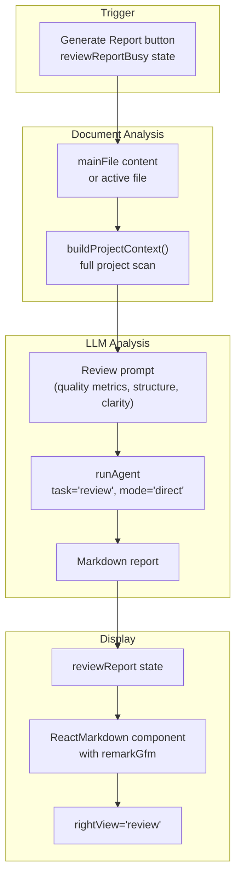

**Review Categories:**

The report typically includes:
- **Structure**: Section organization, logical flow
- **Clarity**: Writing quality, technical accuracy
- **Citations**: Completeness of references
- **Figures/Tables**: Quality and relevance
- **Originality**: Contribution assessment
- **Reproducibility**: Method clarity

**Sources:** [apps/frontend/src/app/EditorPage.tsx:3438-3446](), [README.md:110-117]()

---

## Template Management

### Template Application

Templates provide pre-configured project structures:

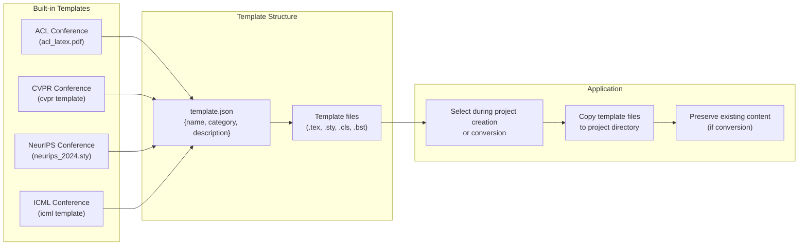

**Template Discovery:**

Templates are discovered from the `templates/` directory structure. Each template contains:
- `template.json`: Metadata
- Main `.tex` file: Document structure
- Style files (`.sty`, `.cls`)
- Bibliography styles (`.bst`)

**One-Click Conversion:**

Users can convert existing projects to a different template while preserving content.

**Sources:** [README.md:83-86](), [apps/frontend/src/app/ProjectPage.tsx]()

---

## Project Import

### ZIP File Import

Standard project import from ZIP archives:

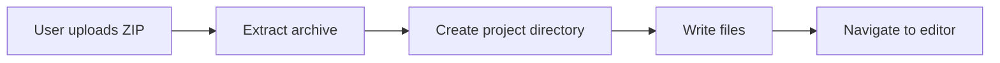

### arXiv Project Import (SSE)

arXiv import uses Server-Sent Events for progress tracking:

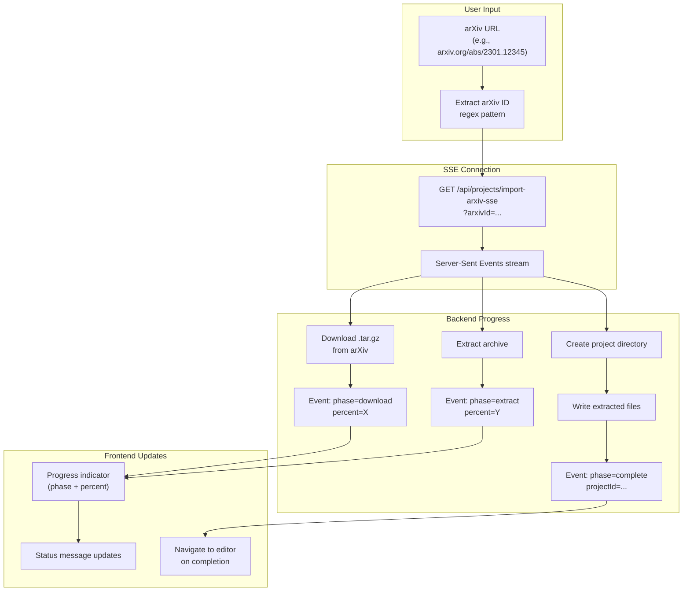

**SSE Event Format:**

```json
{
  "phase": "download" | "extract" | "complete",
  "percent": 0-100,
  "projectId": "generated-id" // only on complete
}
```

**Sources:** [apps/frontend/src/app/ProjectPage.tsx](), [apps/backend/src/routes/projects.js]()

---

## Feature Configuration

### Settings Panel

User preferences are stored in `localStorage` under the key `OPENPRISM_SETTINGS_KEY`:

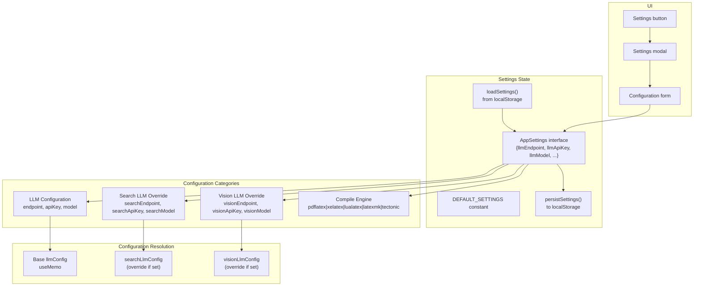

**Configuration Precedence:**

1. **Runtime overrides**: Per-request parameters (e.g., specific llmConfig in agent call)
2. **Frontend localStorage**: User settings panel
3. **Backend environment**: `.env` file variables
4. **System defaults**: Hardcoded `DEFAULT_SETTINGS`

**Sources:** [apps/frontend/src/app/EditorPage.tsx:100-143](), [apps/frontend/src/app/EditorPage.tsx:1254-1278]()

---

