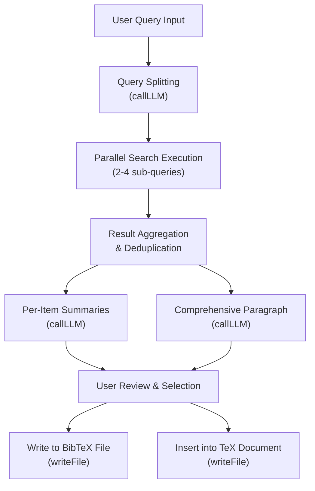
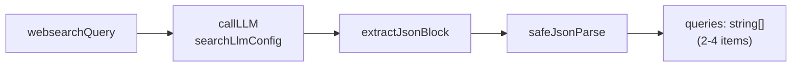
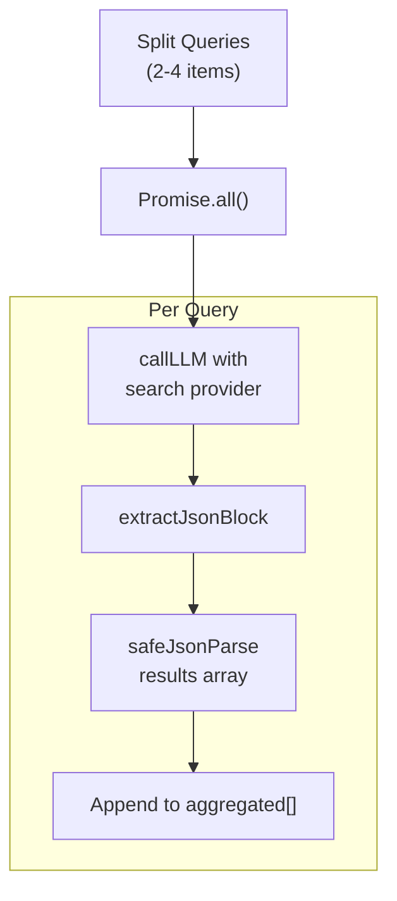
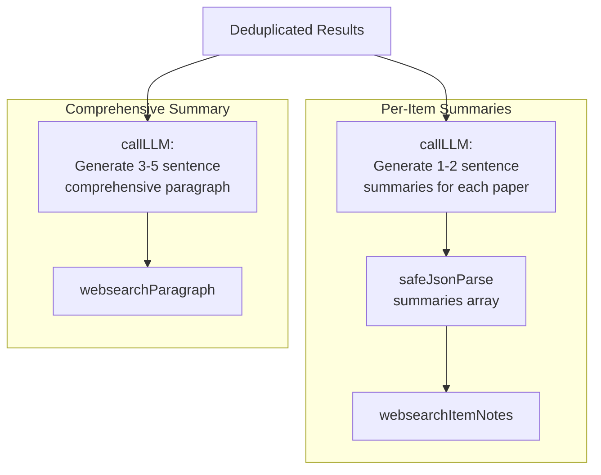
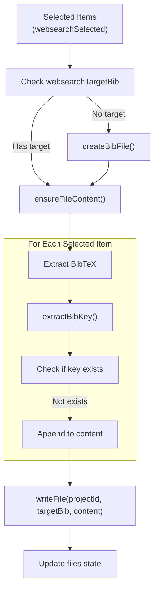
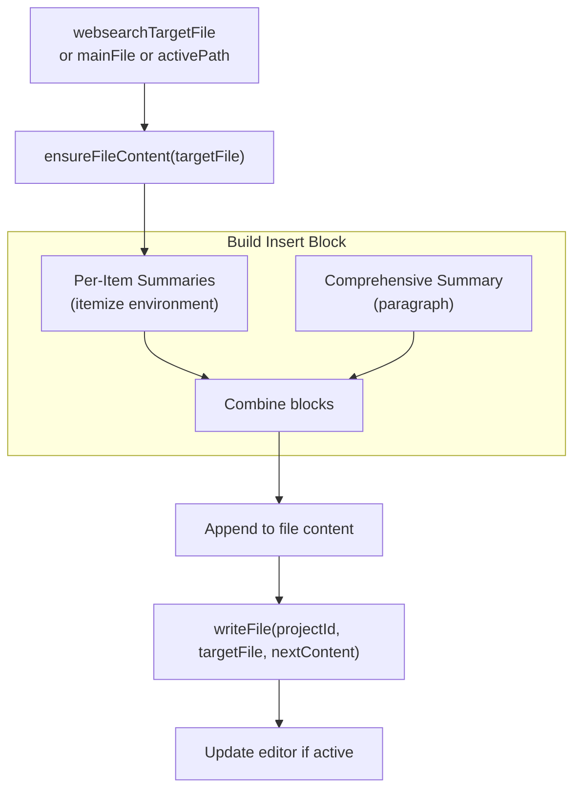
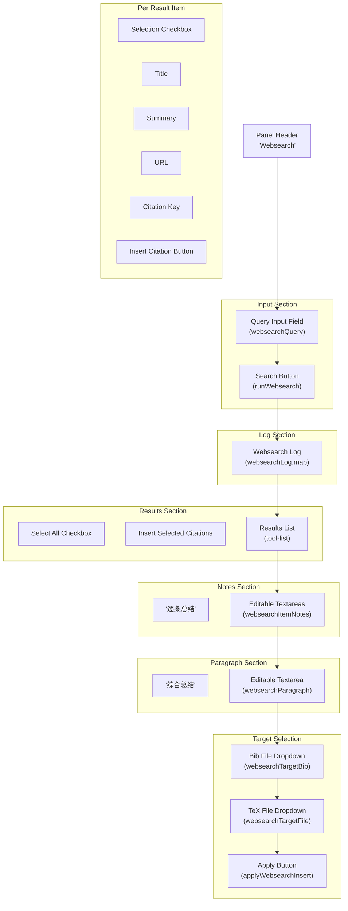

<!-- source: DeepWiki mcp.deepwiki.com · repo OpenDCAI/OpenPrism · page 6.8 Web Search · fetched 2026-11-02 -->

# Web Search

<details>
<summary>Relevant source files</summary>

The following files were used as context for generating this wiki page:

- [README.md](README.md)
- [apps/frontend/src/app/EditorPage.tsx](apps/frontend/src/app/EditorPage.tsx)

</details>


## Purpose and Scope

This document describes the **Web Search** feature (also referred to as "Websearch" in the UI), which enables multi-point search and citation management for academic writing. The feature splits user queries into multiple targeted sub-queries, performs parallel searches, aggregates results, and generates both per-item summaries and comprehensive summary paragraphs with citations.

For academic paper search specifically through arXiv, see [Academic Search](#6.7). For general AI-assisted tasks, see [AI Assistant Modes](#6.2).

---

## Architecture Overview

The Web Search feature follows a multi-stage pipeline architecture:



**Sources:** [apps/frontend/src/app/EditorPage.tsx:2082-2317]()

---

## Data Structures

### WebsearchItem Interface

The core data structure representing a search result:

```typescript
interface WebsearchItem {
  id: string;        // Unique identifier
  title: string;     // Paper/resource title
  summary: string;   // Brief description
  url: string;       // Source URL
  bibtex: string;    // BibTeX entry
  citeKey: string;   // Extracted citation key
}
```

### State Management

The feature maintains several state variables in `EditorPage.tsx`:

| State Variable | Type | Purpose |
|---|---|---|
| `websearchQuery` | `string` | User's search query |
| `websearchLog` | `string[]` | Operation log messages |
| `websearchBusy` | `boolean` | Loading indicator |
| `websearchResults` | `WebsearchItem[]` | Search results |
| `websearchSelected` | `Record<string, boolean>` | Selected items map |
| `websearchParagraph` | `string` | Generated comprehensive summary |
| `websearchItemNotes` | `Record<string, string>` | Per-item notes/summaries |
| `websearchTargetFile` | `string` | Target TeX file path |
| `websearchTargetBib` | `string` | Target BibTeX file path |
| `websearchSelectedAll` | `boolean` | Select all toggle state |

**Sources:** [apps/frontend/src/app/EditorPage.tsx:1200-1213]()

---

## Search Pipeline

### Query Splitting Phase



The query splitting phase uses the `searchLlmConfig` (which may override the default `llmConfig`) to split the user's query into 2-4 targeted search queries:

1. **LLM Prompt:** "Split the query into 2-4 targeted search queries. Return JSON only: {"queries":["..."]}."
2. **JSON Extraction:** `extractJsonBlock` extracts JSON from LLM response
3. **Safe Parsing:** `safeJsonParse` handles malformed JSON with fallback sanitization
4. **Validation:** Filters empty queries, limits to 4 max

**Sources:** [apps/frontend/src/app/EditorPage.tsx:2096-2118]()

### Parallel Search Execution



Each sub-query is processed in parallel:

1. **LLM Call:** Uses search provider with prompt: "You are a search assistant. Use the provider search. Return JSON only: {"results":[{"title":"","summary":"","url":"","bibtex":""}]}."
2. **Result Extraction:** Extracts JSON block and parses results
3. **Aggregation:** Results are collected in `aggregated` array
4. **Error Handling:** Failed queries are logged but don't block others

**Sources:** [apps/frontend/src/app/EditorPage.tsx:2120-2163]()

### Deduplication

After parallel search completion, results are deduplicated:

```typescript
const deduped: WebsearchItem[] = [];
aggregated.forEach((item) => {
  if (!deduped.find((d) => d.url && item.url && d.url === item.url) 
      && !deduped.find((d) => d.title === item.title)) {
    deduped.push(item);
  }
});
```

Deduplication criteria:
- Same URL (if present)
- Same title

**Sources:** [apps/frontend/src/app/EditorPage.tsx:2165-2171]()

### Summary Generation



Two types of summaries are generated concurrently:

1. **Per-Item Summaries:**
   - Prompt: "你是论文检索助手。请为每篇论文写一条简短总结（1-2 句）。返回 JSON：{"summaries":[{"id":"","summary":""}]}."
   - Stores in `websearchItemNotes` keyed by item ID
   - User-editable in UI

2. **Comprehensive Summary:**
   - Prompt: "请根据提供论文生成 3-5 句中文综合总结（不要分条）。可以使用 \cite{...} 引用。只返回总结文本。"
   - Includes citation keys in paragraph
   - Stores in `websearchParagraph`
   - User-editable in UI

**Sources:** [apps/frontend/src/app/EditorPage.tsx:2177-2242]()

---

## Application Workflow

### BibTeX Writing



The BibTeX writing process:

1. **Target Validation:** Checks if `websearchTargetBib` is set, creates new file if needed
2. **Content Loading:** Loads existing BibTeX file content via `ensureFileContent`
3. **Per-Item Processing:**
   - Normalizes BibTeX (replaces `\n` with actual newlines)
   - Extracts citation key using `extractBibKey` regex
   - Checks if key already exists to avoid duplicates
   - Appends BibTeX entry to content
4. **File Write:** Writes updated content via `writeFile` API
5. **State Update:** Updates `files` state and editor if BibTeX file is active

**Sources:** [apps/frontend/src/app/EditorPage.tsx:2250-2288]()

### TeX Document Insertion



The insertion process builds two blocks:

1. **Per-Item Block** (if items selected):
```latex
\paragraph{逐条总结}
\begin{itemize}
  \item {summary1} \cite{key1}
  \item {summary2} \cite{key2}
\end{itemize}
```

2. **Comprehensive Block** (if paragraph exists):
```latex
\paragraph{综合总结}
{websearchParagraph with embedded \cite commands}
```

The combined block is appended to the target file, with triple+ newlines normalized to double newlines.

**Sources:** [apps/frontend/src/app/EditorPage.tsx:2290-2316]()

---

## API Integration

### LLM Configuration

The feature uses `searchLlmConfig`, which allows separate configuration from the main LLM:

```typescript
const searchLlmConfig = useMemo(() => {
  const hasOverride = Boolean(searchEndpoint || searchApiKey || searchModel);
  return {
    endpoint: (hasOverride ? searchEndpoint : llmEndpoint) || llmEndpoint,
    apiKey: (hasOverride ? searchApiKey : llmApiKey) || undefined,
    model: (hasOverride ? searchModel : llmModel) || llmModel
  };
}, [llmEndpoint, llmApiKey, llmModel, searchEndpoint, searchApiKey, searchModel]);
```

Configuration precedence:
1. `searchEndpoint` / `searchApiKey` / `searchModel` (if set)
2. Falls back to `llmEndpoint` / `llmApiKey` / `llmModel`

**Sources:** [apps/frontend/src/app/EditorPage.tsx:1262-1269]()

### callLLM Function

All LLM interactions use the `callLLM` API function imported from `client.ts`:

```typescript
const res = await callLLM({
  llmConfig: searchLlmConfig,
  messages: [
    { role: 'system', content: '...' },
    { role: 'user', content: '...' }
  ]
});
```

**Sources:** [apps/frontend/src/app/EditorPage.tsx:2097-2102]()

---

## User Interface Components

### Sidebar Tab Activation

The Websearch tab is one of seven sidebar modes:

```typescript
<button
  className={`tab-btn ${activeSidebar === 'websearch' ? 'active' : ''}`}
  onClick={() => setActiveSidebar('websearch')}
  title={t('Websearch')}
>
  <span className="tab-icon">
    <svg><!-- Globe icon --></svg>
  </span>
  <span className="tab-text">{t('Websearch')}</span>
</button>
```

**Sources:** [apps/frontend/src/app/EditorPage.tsx:3422-3429]()

### Main UI Structure



**Sources:** [apps/frontend/src/app/EditorPage.tsx:4084-4272]()

### Results List Rendering

Each result is rendered as a checkbox-labeled item:

```tsx
<label key={paper.id} className="tool-item">
  <input
    type="checkbox"
    checked={Boolean(websearchSelected[paper.id])}
    onChange={(event) => {
      const checked = event.target.checked;
      setWebsearchSelected((prev) => ({ ...prev, [paper.id]: checked }));
    }}
  />
  <div>
    <div className="tool-item-title">{paper.title}</div>
    {paper.summary && <div className="muted">{paper.summary}</div>}
    {paper.url && <div className="muted">{paper.url}</div>}
    {paper.citeKey && <div className="muted">{t('cite')}: {paper.citeKey}</div>}
  </div>
  <button
    className="btn ghost small"
    onClick={() => {
      if (paper.citeKey) {
        insertAtCursor(`\\cite{${paper.citeKey}}`);
        appendLog(setWebsearchLog, t('已插入: {{cite}}', { cite: paper.citeKey }));
      }
    }}
  >
    {t('插入引用')}
  </button>
</label>
```

**Sources:** [apps/frontend/src/app/EditorPage.tsx:4150-4179]()

### Editable Summaries

Both per-item notes and the comprehensive paragraph are editable:

```tsx
// Per-item notes
<textarea
  className="input"
  value={websearchItemNotes[paper.id] ?? paper.summary ?? ''}
  onChange={(event) =>
    setWebsearchItemNotes((prev) => ({ ...prev, [paper.id]: event.target.value }))
  }
  rows={3}
/>

// Comprehensive paragraph
<textarea
  className="input"
  value={websearchParagraph}
  onChange={(event) => setWebsearchParagraph(event.target.value)}
  rows={6}
/>
```

**Sources:** [apps/frontend/src/app/EditorPage.tsx:4190-4213]()

---

## Utility Functions

### extractBibKey

Extracts the citation key from a BibTeX entry:

```typescript
const extractBibKey = (bibtex: string) => {
  const match = bibtex.match(/@\w+\s*{\s*([^,\s]+)\s*,);
  return match ? match[1].trim() : '';
};
```

Matches the pattern `@type{key,` and extracts `key`.

**Sources:** [apps/frontend/src/app/EditorPage.tsx:1837-1840]()

### extractJsonBlock

Extracts the first complete JSON object from text:

```typescript
function extractJsonBlock(text: string) {
  const start = text.indexOf('{');
  const end = text.lastIndexOf('}');
  if (start === -1 || end === -1 || end <= start) return '';
  return text.slice(start, end + 1);
}
```

**Sources:** [apps/frontend/src/app/EditorPage.tsx:517-522]()

### safeJsonParse

Attempts JSON parsing with fallback sanitization:

```typescript
function safeJsonParse<T>(raw: string): T | null {
  try {
    return JSON.parse(raw) as T;
  } catch (err) {
    try {
      return JSON.parse(sanitizeJsonString(raw)) as T;
    } catch (err2) {
      return null;
    }
  }
}
```

The `sanitizeJsonString` function escapes unescaped newlines, tabs, and control characters within JSON string values.

**Sources:** [apps/frontend/src/app/EditorPage.tsx:574-584](), [apps/frontend/src/app/EditorPage.tsx:524-572]()

### appendLog

Helper for appending to log arrays:

```typescript
function appendLog(setter: (val: string[] | ((prev: string[]) => string[])) => void, line: string) {
  setter((prev) => [...prev, line]);
}
```

**Sources:** [apps/frontend/src/app/EditorPage.tsx:586-588]()

---

## Error Handling

The search pipeline includes comprehensive error handling:

1. **Query Split Failure:**
   - Catches LLM errors
   - Falls back to empty queries array
   - Logs error to `websearchLog`

2. **Individual Query Failures:**
   - Non-blocking: failed queries are logged but don't stop others
   - Uses `Promise.all` to execute in parallel
   - Logs per-query failures

3. **JSON Parsing Errors:**
   - `safeJsonParse` provides fallback sanitization
   - Returns `null` on complete failure
   - Logged as parse errors

4. **File Operation Errors:**
   - Caught and displayed in log
   - BibTeX write failures don't block TeX insertion
   - State updates are transactional

**Sources:** [apps/frontend/src/app/EditorPage.tsx:2082-2317]()

---

## Integration with Other Features

### File Management

Uses the same file APIs as other features:
- `writeFile(projectId, path, content)` - Write BibTeX or TeX files
- `ensureFileContent(path)` - Load existing file content with caching

**Sources:** [apps/frontend/src/app/EditorPage.tsx:1788-1798]()

### Editor Integration

The `insertAtCursor` function integrates with the CodeMirror editor:

```typescript
const insertAtCursor = (text: string, opts?: { block?: boolean }) => {
  const view = cmViewRef.current;
  if (!view) return;
  const sel = view.state.selection.main;
  let insert = text;
  if (opts?.block) {
    // Add newlines for block-level insertion
  }
  view.dispatch({
    changes: { from: sel.from, to: sel.to, insert },
    selection: { anchor: sel.from + insert.length }
  });
};
```

Used for individual citation insertion.

**Sources:** [apps/frontend/src/app/EditorPage.tsx:1724-1743]()

### Settings Panel

The feature respects separate LLM configuration through the settings panel:
- `searchEndpoint` - Override LLM endpoint for search
- `searchApiKey` - Override API key for search
- `searchModel` - Override model for search

These are stored in `localStorage` under the `SETTINGS_KEY`.

**Sources:** [apps/frontend/src/app/EditorPage.tsx:100-112]()

---

## Comparison with Academic Search

| Feature | Web Search (6.8) | Academic Search (6.7) |
|---------|------------------|----------------------|
| **Query Processing** | Multi-point splitting | Direct arXiv API |
| **Search Mechanism** | LLM with search tools | `arxivSearch` API |
| **Result Count** | Variable (aggregated) | User-configurable (1-10) |
| **Summaries** | Per-item + comprehensive | Abstract only |
| **BibTeX Source** | LLM-generated | `arxivBibtex` API |
| **Citation Insertion** | Manual or batch | Automatic or AI-assisted |
| **Use Case** | Broad web search | arXiv-specific queries |

**Sources:** [apps/frontend/src/app/EditorPage.tsx:1842-2045](), [apps/frontend/src/app/EditorPage.tsx:2082-2317]()

---

## Performance Considerations

1. **Parallel Execution:** Sub-queries run concurrently using `Promise.all`, reducing total time
2. **Caching:** File content is cached in `files` state to avoid redundant API calls
3. **Deduplication:** Prevents duplicate results from being displayed or processed
4. **Debouncing:** Not currently implemented on query input; searches only trigger on button click
5. **Result Limits:** No hard limit on results; depends on LLM responses (typically 3-5 per sub-query)

**Sources:** [apps/frontend/src/app/EditorPage.tsx:2120-2163]()

---

