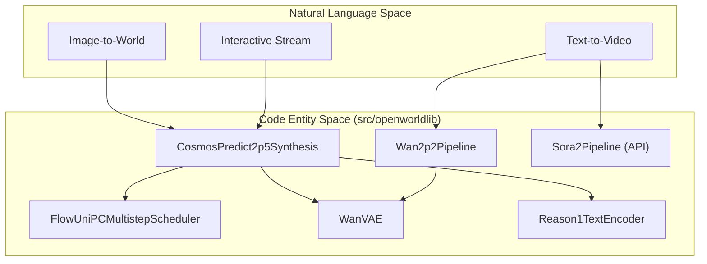
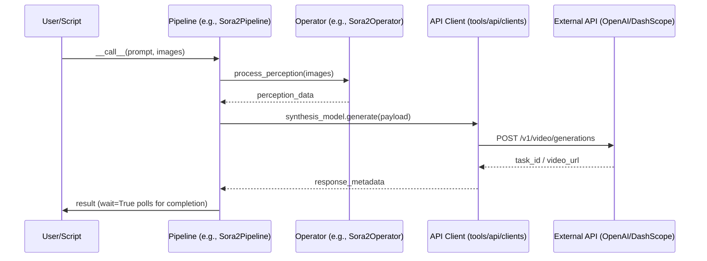

<!-- source: DeepWiki mcp.deepwiki.com · repo OpenDCAI/OpenWorldLib · page 3.2 Interactive & Text-to-Video Generation · fetched 2026-11-02 -->

# Interactive & Text-to-Video Generation

Relevant source files

The following files were used as context for generating this wiki page:

- [examples/pipeline_infer_mapping.py](examples/pipeline_infer_mapping.py)
- [examples/pipeline_load_mapping.py](examples/pipeline_load_mapping.py)
- [scripts/setup/default_audio_generation_install.sh](scripts/setup/default_audio_generation_install.sh)
- [src/openworldlib/base_models/diffusion_model/video/wan_2p1/utils/fm_solvers_unipc.py](src/openworldlib/base_models/diffusion_model/video/wan_2p1/utils/fm_solvers_unipc.py)
- [src/openworldlib/operators/sora2_operator.py](src/openworldlib/operators/sora2_operator.py)
- [src/openworldlib/operators/veo3_operator.py](src/openworldlib/operators/veo3_operator.py)
- [src/openworldlib/operators/wan_2p5_operator.py](src/openworldlib/operators/wan_2p5_operator.py)
- [src/openworldlib/pipelines/sora/pipeline_sora2.py](src/openworldlib/pipelines/sora/pipeline_sora2.py)
- [src/openworldlib/pipelines/veo/pipeline_veo3.py](src/openworldlib/pipelines/veo/pipeline_veo3.py)
- [src/openworldlib/pipelines/wan/pipeline_wan_2p5.py](src/openworldlib/pipelines/wan/pipeline_wan_2p5.py)
- [src/openworldlib/synthesis/visual_generation/__init__.py](src/openworldlib/synthesis/visual_generation/__init__.py)
- [src/openworldlib/synthesis/visual_generation/cosmos/cosmos_predict2p5_synthesis.py](src/openworldlib/synthesis/visual_generation/cosmos/cosmos_predict2p5_synthesis.py)
- [src/openworldlib/synthesis/visual_generation/veo/veo3_synthesis.py](src/openworldlib/synthesis/visual_generation/veo/veo3_synthesis.py)
- [test/test_cosmos_predict2p5.py](test/test_cosmos_predict2p5.py)
- [test/test_depth_anything_v1.py](test/test_depth_anything_v1.py)
- [test/test_lingbot_world.py](test/test_lingbot_world.py)
- [test/test_sora2.py](test/test_sora2.py)
- [test/test_veo3.py](test/test_veo3.py)
- [test/test_wan_2p5.py](test/test_wan_2p5.py)
- [test/test_wow.py](test/test_wow.py)
- [test_stream/test_cosmos_predict2p5_stream.py](test_stream/test_cosmos_predict2p5_stream.py)
- [test_stream/test_lingbot_world_stream.py](test_stream/test_lingbot_world_stream.py)

The **Interactive & Text-to-Video Generation** module provides a unified interface for high-fidelity video synthesis. Unlike navigation-specific pipelines, these models focus on general-world dynamics, physical interaction (img2world), and high-quality cinematic generation. The framework supports both local inference models (Cosmos, Wan, WoW) and cloud-based API pipelines (Sora2, Veo3, Wan2.5).

## Core Architecture & Data Flow

The synthesis process is governed by the `BaseSynthesis` abstraction, which manages the lifecycle of diffusion models, VAEs, and schedulers. For interactive tasks like `CosmosPredict2p5`, the system utilizes a **Flow-Matching** framework with specialized schedulers.

### System Entity Mapping
The following diagram maps the high-level generation concepts to specific code entities within the `OpenWorldLib` repository.

**Diagram: Natural Language to Code Entity Space (Synthesis)**

**Sources:** [src/openworldlib/synthesis/visual_generation/cosmos/cosmos_predict2p5_synthesis.py:33-55](), [src/openworldlib/pipelines/wan/pipeline_wan_2p2.py:64-69](), [src/openworldlib/pipelines/sora/pipeline_sora2.py:6-25]()

---

## Cosmos-Predict 2.5: Image-to-World Synthesis

`CosmosPredict2p5` is a flow-matching based model designed for `img2world` and `video2world` tasks. It uses a `WanVAE` for latent compression and a `Reason1TextEncoder` for high-level semantic understanding.

### Implementation Details
- **Flow Matching:** Implementation utilizes the `FlowUniPCMultistepScheduler` [src/openworldlib/synthesis/visual_generation/cosmos/cosmos_predict2p5_synthesis.py:15-16]() to solve the probability flow ODE.
- **Conditioning:** The model supports `cond_mask` and `cond_timestep` [test/test_cosmos_predict2p5.py:58-60]() to control the influence of the input image on the generated sequence.
- **Scaling:** It operates with a temporal scale factor of 4 and spatial scale factor of 8 [src/openworldlib/synthesis/visual_generation/cosmos/cosmos_predict2p5_synthesis.py:52-53]().

### Interactive Streaming
The `stream()` method in `CosmosPredict2p5Pipeline` allows for multi-turn interaction where the last frame of turn $N$ becomes the initial frame for turn $N+1$. This state is managed by the `MemoryModule` [test_stream/test_cosmos_predict2p5_stream.py:88-101]().

**Sources:** [src/openworldlib/synthesis/visual_generation/cosmos/cosmos_predict2p5_synthesis.py:128-148](), [test/test_cosmos_predict2p5.py:26-33](), [test_stream/test_cosmos_predict2p5_stream.py:79-88]()

---

## Local Synthesis Pipelines (Wan, WoW, Emu)

| Pipeline | Model Core | Task Type | Key Features |
| :--- | :--- | :--- | :--- |
| `Wan2p2Pipeline` | Wan-2.1/2.2 | TI2V / T2V | Supports 5B/14B parameters; uses `WanVAE` [examples/pipeline_load_mapping.py:63-68]() |
| `WoWPipeline` | WoW-1-Wan | I2V (Action) | Specialized for robotic manipulation and physical world interactions [test/test_wow.py:22-40]() |
| `Emu3p5Pipeline` | Emu-3.5 | Autoregressive | Next-token prediction for video synthesis; supports SFT [scripts/train_emu_3_5.py:1-20]() |

### WoW (World-on-Wheels/World) Pipeline
The `WoWPipeline` is initialized via `WoWArgs`, which controls VRAM management and tiling [test/test_wow.py:22-30](). It is primarily used for generating video sequences from text prompts like "Put the screw driver into the drawer" [test/test_wow.py:18-18]().

**Sources:** [test/test_wow.py:2-47](), [examples/pipeline_load_mapping.py:63-68]()

---

## API-Based Pipelines (Sora2, Veo3, Wan2.5)

For models that are not locally hosted, `OpenWorldLib` provides API wrappers that conform to the `PipelineABC` interface. These use the `api_init` method to configure endpoints and keys.

**Diagram: API Pipeline Interaction Flow**

### Supported API Models
1.  **Sora2:** Uses OpenAI-compatible endpoints. The `Sora2Operator` automatically determines if the task is Text-to-Video (T2V) or Image-to-Video (I2V) based on the presence of `images` [test/test_sora2.py:31-35]().
2.  **Veo3:** Integrated via `Veo3Pipeline.api_init`. It handles high-resolution cinematic video requests [test/test_veo3.py:14-22]().
3.  **Wan2.5:** Accessed via Alibaba DashScope. Supports `i2av` (Image-to-Audio-Video) and `t2v` [test/test_wan_2p5.py:24-32]().

**Sources:** [test/test_sora2.py:25-35](), [test/test_veo3.py:14-22](), [test/test_wan_2p5.py:24-32](), [src/openworldlib/pipelines/sora/pipeline_sora2.py:6-25]()

---

## Technical Configuration & Schedulers

### FlowUniPCMultistepScheduler
The `FlowUniPCMultistepScheduler` is the primary solver for flow-matching models in the library.
- **Initialization:** Sets `num_train_timesteps=1000` and uses a `shift=1` parameter [src/openworldlib/synthesis/visual_generation/cosmos/cosmos_predict2p5_synthesis.py:133]().
- **CFG (Classifier-Free Guidance):** Controlled via `do_classifier_free_guidance` [src/openworldlib/synthesis/visual_generation/cosmos/cosmos_predict2p5_synthesis.py:165](). Negative prompts are encoded into embeddings to steer the generation away from unwanted artifacts.

### Inference Mapping
The `video_gen_pipe_infer` registry in `pipeline_infer_mapping.py` defines how each pipeline processes its output. For instance, `infer_wan2p2_pipeline` includes logic to convert raw tensors back to PIL frames using `tensor_frame_to_pil` before exporting to MP4 [examples/pipeline_infer_mapping.py:68-77]().

**Sources:** [src/openworldlib/synthesis/visual_generation/cosmos/cosmos_predict2p5_synthesis.py:133-172](), [examples/pipeline_infer_mapping.py:57-78](), [examples/pipeline_load_mapping.py:81-92]()

---

