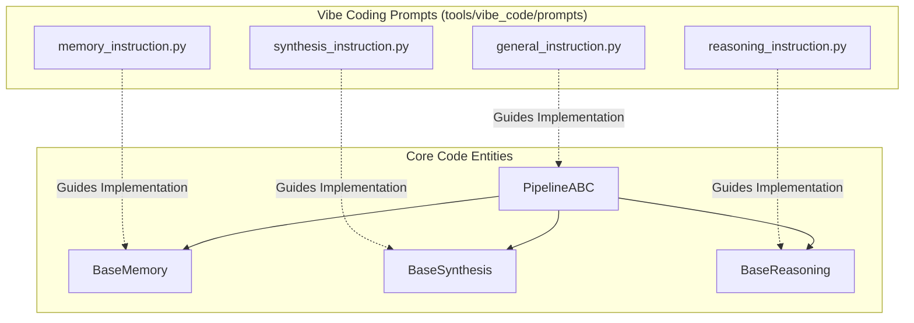
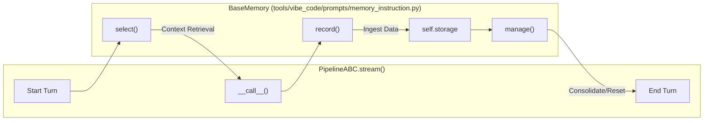

<!-- source: DeepWiki mcp.deepwiki.com · repo OpenDCAI/OpenWorldLib · page 8 Developer Tools & Contribution Workflow · fetched 2026-11-02 -->

# Developer Tools & Contribution Workflow

Relevant source files

The following files were used as context for generating this wiki page:

- [tools/api/clients/__init__.py](tools/api/clients/__init__.py)
- [tools/api/configs/requirement_av_api.md](tools/api/configs/requirement_av_api.md)
- [tools/api/configs/settings.yaml](tools/api/configs/settings.yaml)
- [tools/readme.md](tools/readme.md)
- [tools/vibe_code/prompts/general_instruction.py](tools/vibe_code/prompts/general_instruction.py)
- [tools/vibe_code/prompts/memory_instruction.py](tools/vibe_code/prompts/memory_instruction.py)
- [tools/vibe_code/prompts/reasoning_instruction.py](tools/vibe_code/prompts/reasoning_instruction.py)
- [tools/vibe_code/prompts/represent_instruction.py](tools/vibe_code/prompts/represent_instruction.py)
- [tools/vibe_code/prompts/synthesis_instruction.py](tools/vibe_code/prompts/synthesis_instruction.py)
- [tools/vibe_code/readme.md](tools/vibe_code/readme.md)

This section provides an overview of the specialized tooling and workflows designed to maintain the modular integrity of OpenWorldLib. To ensure consistency across diverse world model implementations (Synthesis, Reasoning, Representation), the framework leverages "Vibe Coding" prompt engineering for LLM-assisted code generation, a unified API client layer for cloud-based models, and high-performance CUDA submodules for 3D rendering and segmentation.

## Vibe Coding: LLM-Assisted Framework Construction

"Vibe Coding" refers to the methodology of using structured, role-based prompt templates to guide Large Language Models (LLMs) in generating code that strictly adheres to the OpenWorldLib architectural abstractions. These templates, located in `tools/vibe_code/prompts/`, define the expected interfaces for `Pipeline`, `Operator`, `Memory`, `Synthesis`, `Reasoning`, and `Representation` classes.

By providing these instructions to an LLM, developers can rapidly port new research models into the framework while ensuring they implement mandatory methods like `from_pretrained()`, `process()`, and `stream()` [tools/vibe_code/prompts/general_instruction.py:46-69]().

### Core Prompt Templates
| Template File | Purpose | Key Interface Requirements |
|:---|:---|:---|
| `general_instruction.py` | Overall architecture & Pipeline | `PipelineABC.stream()`, `from_pretrained()` |
| `synthesis_instruction.py` | Generative models (Video/Audio) | `BaseSynthesis.predict()` [tools/vibe_code/prompts/synthesis_instruction.py:7-21]() |
| `reasoning_instruction.py` | MLLM/Reasoning models | `BaseReasoning.inference()` [tools/vibe_code/prompts/reasoning_instruction.py:7-21]() |
| `represent_instruction.py` | 3D Scene/Depth models | `BaseRepresentation.get_representation()` [tools/vibe_code/prompts/represent_instruction.py:7-23]() |
| `memory_instruction.py` | State management | `BaseMemory.record()`, `select()`, `manage()` [tools/vibe_code/prompts/memory_instruction.py:13-25]() |

For details on utilizing these templates for model integration, see [Vibe Coding: LLM-Assisted Framework Construction](#8.1).

**Sources:** [tools/readme.md:1-3](), [tools/vibe_code/prompts/general_instruction.py:1-70](), [tools/vibe_code/prompts/memory_instruction.py:1-98]().

---

## API Clients & External Model Integration

OpenWorldLib provides a unified interface for interacting with cloud-based world models through the `tools/api` layer. This allows developers to use proprietary or massive-scale models (like Sora or Veo) as drop-in replacements for local pipelines.

The system supports several major providers:
*   **Sora2:** Official OpenAI API and compatible third-party endpoints [tools/api/configs/requirement_av_api.md:5-6]().
*   **Wan2.5:** Alibaba DashScope API (Beijing and Singapore regions) [tools/api/configs/requirement_av_api.md:1-4]().
*   **Veo3:** Third-party OpenAI-compatible Chat Completion formats [tools/api/configs/requirement_av_api.md:7-8]().

The configuration for these clients is centralized in `settings.yaml`, and the `clients/__init__.py` serves as the entry point for initializing authenticated sessions. For details, see [API Clients & External Model Integration](#8.2).

**Sources:** [tools/api/configs/requirement_av_api.md:1-8]().

---

## CUDA Submodules: Gaussian Rasterization & SAM

For performance-critical tasks, OpenWorldLib incorporates specialized CUDA submodules. These are essential for the **Representation** pillar, particularly in 3D scene reconstruction and visual segmentation.

### Submodule Overview
1.  **`diff-gaussian-rasterization`**: The primary backend for 3D Gaussian Splatting (3DGS). It is used by pipelines such as `VGGT`, `CUT3R`, and `HunyuanMirror` to render high-fidelity 3D scenes from point clouds.
2.  **`depth-diff-gaussian-rasterization-wonderworld`**: A specialized version of the rasterizer used by the `WonderWorld` pipeline, optimized for depth-aware 3DGS rendering.
3.  **`sam_repvit`**: An implementation of RepViT-SAM, providing efficient segment-anything capabilities for perception and object-centric reasoning.

These modules must be compiled locally during the installation process to interface with the Python-based pipelines. For build instructions and technical details, see [CUDA Submodules: Gaussian Rasterization & SAM](#8.3).

---

## Architectural Mapping: Prompts to Entities

The following diagrams illustrate how the developer tools bridge the gap between high-level instructions and the concrete code entities within the framework.

### Instruction-to-Class Mapping
This diagram shows how specific Vibe Coding prompts correspond to the base classes defined in the library core.

**Sources:** [tools/vibe_code/prompts/general_instruction.py:46-69](), [tools/vibe_code/prompts/memory_instruction.py:13-25](), [tools/vibe_code/prompts/synthesis_instruction.py:7-21]().

### Memory Lifecycle Workflow
This diagram maps the requirements in `memory_instruction.py` to the operational flow within a `PipelineABC.stream()` execution.

**Sources:** [tools/vibe_code/prompts/memory_instruction.py:13-25](), [tools/vibe_code/prompts/general_instruction.py:64-68]().

---

