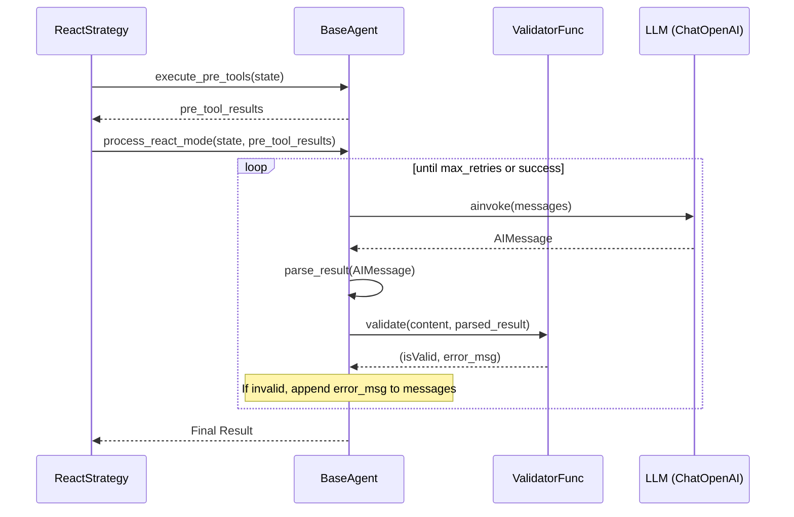

<!-- source: DeepWiki mcp.deepwiki.com · repo OpenDCAI/Paper2Any · page 5.5 Execution Strategies · fetched 2026-11-02 -->

# Execution Strategies

<details>
<summary>Relevant source files</summary>

The following files were used as context for generating this wiki page:

- [dataflow_agent/agentroles/__init__.py](dataflow_agent/agentroles/__init__.py)
- [dataflow_agent/agentroles/cores/__init__.py](dataflow_agent/agentroles/cores/__init__.py)
- [dataflow_agent/agentroles/cores/base_agent.py](dataflow_agent/agentroles/cores/base_agent.py)
- [dataflow_agent/agentroles/cores/configs.py](dataflow_agent/agentroles/cores/configs.py)
- [dataflow_agent/agentroles/cores/strategies.py](dataflow_agent/agentroles/cores/strategies.py)
- [dataflow_agent/graphbuilder/graph_builder.py](dataflow_agent/graphbuilder/graph_builder.py)
- [dataflow_agent/promptstemplates/prompts_repo.py](dataflow_agent/promptstemplates/prompts_repo.py)
- [dataflow_agent/resources/faiss_cache/all_ops.index.meta](dataflow_agent/resources/faiss_cache/all_ops.index.meta)
- [dataflow_agent/state.py](dataflow_agent/state.py)
- [dataflow_agent/templates/agent_as_tool_name.py.jinja](dataflow_agent/templates/agent_as_tool_name.py.jinja)
- [dataflow_agent/templates/state_name.py.jinja](dataflow_agent/templates/state_name.py.jinja)
- [dataflow_agent/toolkits/optool/op_tools.py](dataflow_agent/toolkits/optool/op_tools.py)
- [dataflow_agent/toolkits/pipetool/pipe_tools.py](dataflow_agent/toolkits/pipetool/pipe_tools.py)
- [dataflow_agent/toolkits/resources/ops.json](dataflow_agent/toolkits/resources/ops.json)

</details>


## Purpose and Scope

This document provides a technical reference for the **execution strategy system** in DataFlow-Agent. Execution strategies define how agents process tasks through distinct execution modes: simple single-shot calls, validated ReAct loops, tool-enabled subgraphs, multimodal processing, parallel execution, and adaptive planning.

For information about agent creation and the `BaseAgent` class, see [Agents](5.2). For details on how tools are bound to agents, see [Tool System](5.4). For state management concepts, see [State & Request Models](5.3).

---

## Architecture Overview

Paper2Any implements the **strategy pattern** to decouple agent roles from execution logic. Each agent can be executed in multiple modes by swapping its execution strategy at runtime via configuration objects.

### Strategy Pattern Implementation

The following diagram shows the relationship between configuration entities and the execution logic in the codebase.

**Diagram: Execution Strategy Entity Mapping**
```mermaid
graph TB
    subgraph "Natural Language Space (User Intent)"
        Intent["User wants a 'Validated' or 'Parallel' Agent"]
    end

    subgraph "Code Entity Space (dataflow_agent/agentroles)"
        subgraph "Configs (cores/configs.py)"
            BaseCfg["BaseAgentConfig"]
            SimpleCfg["SimpleConfig"]
            ReactCfg["ReactCfg"]
            ParallelCfg["ParallelConfig"]
            GraphCfg["GraphConfig"]
        end

        subgraph "Strategies (cores/strategies.py)"
            BaseStrat["ExecutionStrategy (ABC)"]
            SimpleStrat["SimpleStrategy"]
            ReactStrat["ReactStrategy"]
            ParallelStrat["ParallelStrategy"]
            GraphStrat["GraphStrategy"]
        end

        subgraph "Core (cores/base_agent.py)"
            BaseAgent["BaseAgent Class"]
            ExecMethod["BaseAgent.execute(state)"]
        end
    end

    Intent --> SimpleCfg
    Intent --> ReactCfg
    
    SimpleCfg -.->|instantiates| SimpleStrat
    ReactCfg -.->|instantiates| ReactStrat
    
    BaseAgent -->|holds reference| BaseStrat
    ExecMethod -->|delegates to| BaseStrat
    
    SimpleStrat --|> BaseStrat
    ReactStrat --|> BaseStrat
```
**Sources:** [dataflow_agent/agentroles/cores/configs.py:6-16](), [dataflow_agent/agentroles/cores/strategies.py:13-24](), [dataflow_agent/agentroles/cores/base_agent.py:95-144]()

### Execution Mode Enumeration

The `ExecutionMode` enum defines the supported execution behaviors:

| Mode | Enum Value | Description | Implementation Class |
|------|-----------|-------------|----------------------|
| **SIMPLE** | `"simple"` | Single LLM call with no validation | `SimpleStrategy` |
| **REACT** | `"react"` | Validated loop with custom `ValidatorFunc` | `ReactStrategy` |
| **GRAPH** | `"graph"` | LangGraph `StateGraph` with tool nodes | `GraphStrategy` |
| **VLM** | `"vlm"` | Vision Language Model multimodal processing | `VLMStrategy` |
| **PARALLEL** | `"parallel"` | Concurrent execution using `asyncio.Semaphore` | `ParallelStrategy` |
| **PLAN_SOLVE** | `"plan_solve"` | One-shot planning with sequential execution | `PlanSolveStrategy` |
| **PLAN_EXECUTE** | `"plan_execute"` | Adaptive planning with replanning loops | `PlanExecuteStrategy` |

**Sources:** [dataflow_agent/agentroles/cores/configs.py:6-16](), [dataflow_agent/agentroles/cores/strategies.py:26-121]()

---

## Configuration Classes

All configurations inherit from `BaseAgentConfig` [dataflow_agent/agentroles/cores/configs.py:19-44](), which provides core parameters like `model_name`, `temperature`, and `parser_type`.

### SimpleConfig
Used for single-shot tasks. It triggers `process_simple_mode` in the agent.
**Sources:** [dataflow_agent/agentroles/cores/configs.py:46-49](), [dataflow_agent/agentroles/cores/strategies.py:26-33]()

### ReactConfig
Enables the Reasoning-Act loop.
*   `max_retries`: Maximum attempts before failure [dataflow_agent/agentroles/cores/configs.py:56]().
*   `validators`: A list of `Callable` objects following the `ValidatorFunc` signature `(str, Dict) -> (bool, Optional[str])` [dataflow_agent/agentroles/cores/base_agent.py:78-92]().

### ParallelConfig
Manages high-concurrency tasks.
*   `concurrency_limit`: Limits the number of simultaneous LLM calls (default 5) [dataflow_agent/agentroles/cores/configs.py:83]().
*   **Data Flow**: Expects `pre_tool_results` to contain `parallel_items` [dataflow_agent/agentroles/cores/strategies.py:117-118]().

---

## Execution Logic Detail

### Simple Strategy
The `SimpleStrategy` is the most direct path. It executes pre-tools, builds messages, and calls the LLM once [dataflow_agent/agentroles/cores/strategies.py:26-33]().

### ReAct Strategy (Validated Loop)
The `ReactStrategy` injects validators into the agent's execution cycle. If a validator returns `False`, the agent uses the error message as feedback for the next LLM call [dataflow_agent/agentroles/cores/strategies.py:36-58]().

**Diagram: ReAct Execution Data Flow**

**Sources:** [dataflow_agent/agentroles/cores/strategies.py:36-58](), [dataflow_agent/agentroles/cores/base_agent.py:181-230]()

### Parallel Strategy (Async Concurrency)
The `ParallelStrategy` uses `asyncio.gather` and a semaphore to process multiple items simultaneously. It is heavily used in workflows like `Paper2PPT` for generating multiple slides in parallel.

**Sources:** [dataflow_agent/agentroles/cores/strategies.py:107-121](), [dataflow_agent/agentroles/cores/configs.py:79-84]()

### Graph Strategy (LangGraph Integration)
`GraphStrategy` leverages `LangGraph` to create a `StateGraph`. It automatically binds tools to the LLM and manages the control flow between the agent node and tool execution nodes [dataflow_agent/agentroles/cores/strategies.py:61-74]().

**Implementation Detail:**
*   It calls `_execute_react_graph(state, pre_tool_results)` [dataflow_agent/agentroles/cores/strategies.py:73]().
*   Uses `GenericGraphBuilder` to wrap nodes with tool registration logic [dataflow_agent/graphbuilder/graph_builder.py:10-149]().

---

## Planning Strategies

Planning agents use specialized strategies for complex, multi-step tasks.

### Plan-and-Solve (`PlanSolveStrategy`)
1.  **Generate Plan**: The Planner LLM generates a static list of steps (`PlanStep`) [dataflow_agent/agentroles/cores/strategies.py:148-155]().
2.  **Approval**: If `require_plan_approval` is True, it triggers a LangGraph `interrupt` for human-in-the-loop verification [dataflow_agent/agentroles/cores/strategies.py:162-172]().
3.  **Sequential Execution**: Executes steps one by one using the Executor [dataflow_agent/agentroles/cores/strategies.py:190-205]().

### Plan-and-Execute (`PlanExecuteStrategy`)
Unlike Plan-and-Solve, this strategy evaluates the result after every step and calls a **Replanner** to adjust the remaining steps dynamically [dataflow_agent/agentroles/cores/configs.py:136-163]().

**Sources:** [dataflow_agent/agentroles/cores/strategies.py:126-270](), [dataflow_agent/agentroles/cores/configs.py:88-195]()

---

## Strategy Selection Matrix

| Use Case | Recommended Strategy | Reasoning |
| :--- | :--- | :--- |
| **Simple Summarization** | `SimpleStrategy` | Low latency, no tool use or complex structure required. |
| **Code Generation** | `ReactStrategy` | Requires validation (e.g., linting or syntax checks) before finishing. |
| **Slide Generation** | `ParallelStrategy` | High throughput needed to process multiple pages/sections concurrently. |
| **Complex Research** | `GraphStrategy` | Needs to call external tools (search, PDF parse) in a loop. |
| **Autonomous Agent** | `PlanExecuteStrategy` | Needs to adapt the plan based on tool outputs or errors. |

**Sources:** [dataflow_agent/agentroles/cores/configs.py:6-16](), [dataflow_agent/agentroles/cores/strategies.py:13-121]()

---

