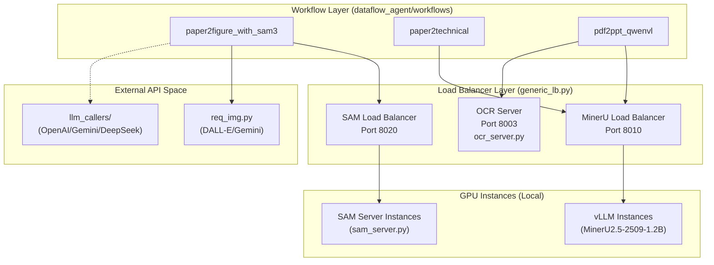
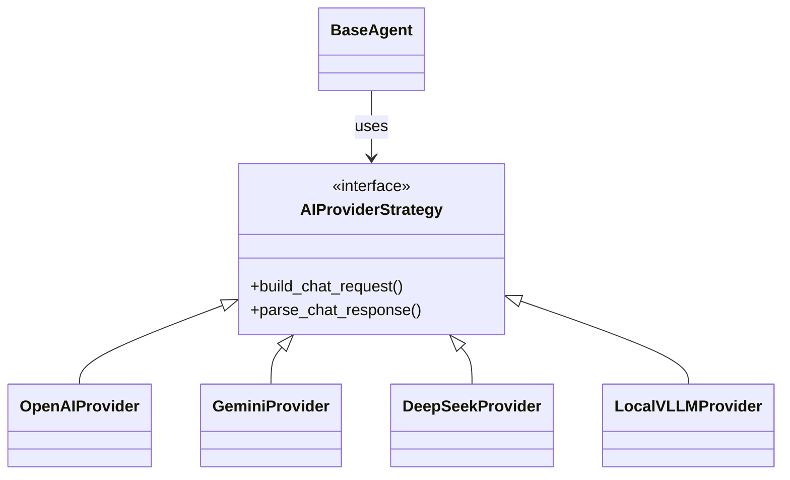

<!-- source: DeepWiki mcp.deepwiki.com · repo OpenDCAI/Paper2Any · page 8 Model Services · fetched 2026-11-02 -->

# Model Services

Relevant source files

The following files were used as context for generating this wiki page:

- [README.md](README.md)
- [README_CN.md](README_CN.md)
- [dataflow_agent/promptstemplates/paperbanana.md](dataflow_agent/promptstemplates/paperbanana.md)
- [dataflow_agent/toolkits/multimodaltool/req_ocr.py](dataflow_agent/toolkits/multimodaltool/req_ocr.py)
- [dataflow_agent/toolkits/multimodaltool/sam_tool.py](dataflow_agent/toolkits/multimodaltool/sam_tool.py)
- [static/new_readme/paper2citation/citation-explorer.png](static/new_readme/paper2citation/citation-explorer.png)
- [static/new_readme/paper2video/demo.gif](static/new_readme/paper2video/demo.gif)
- [tests/ori.png](tests/ori.png)
- [tests/sam3/ori.png](tests/sam3/ori.png)
- [tests/sam3/test4.png](tests/sam3/test4.png)

Model Services provide the AI model infrastructure for Paper2Any, consisting of local GPU-accelerated servers and external API integrations. This layer handles all ML/AI operations including PDF parsing, image segmentation, OCR, LLM inference, and image generation.

For information about how these services are invoked from workflows, see [DataFlow-Agent Framework](#5). For configuration and deployment details, see [Deployment](#12).

---

## Overview

Model Services are divided into two categories:

1. **Local Model Servers**: GPU-accelerated services running on-premises
   - **MinerU**: vLLM-based PDF parsing and VLM for high-throughput extraction.
   - **SAM (Segment Anything)**: Layout detection and icon extraction via `sam_server.py`.
   - **OCR**: PaddleOCR for text recognition via `ocr_server.py`.

2. **External API Integrations**: Cloud-based services accessed via HTTP
   - **LLM Providers**: OpenAI, Gemini, DeepSeek, DashScope.
   - **Image Generation**: DALL-E 3, Gemini Flash Image.
   - **TTS & Background Removal**: CosyVoice, BiRefNet, RMBG-2.0.

The architecture prioritizes cost optimization by using local models for heavy workloads while maintaining flexibility to use external APIs for specialized tasks.

---

## Service Deployment Architecture

The following diagram illustrates the relationship between workflow agents and the underlying model infrastructure, including load balancing for high-concurrency local services.

### System Service Map

**Sources:** [script/start_model_servers.sh:1-196](), [README.md:102-120]()

---

## MinerU PDF Parsing Service

MinerU is a vision-language model (VLM) deployed via vLLM for high-throughput PDF parsing. It provides recursive layout analysis and multi-modal understanding, specifically optimized for academic papers.

For details, see [MinerU PDF Parsing](#8.1).

### Key Features
- **Recursive Layout Analysis**: Handled via `recursive_mineru_layout` in the agent logic.
- **vLLM Deployment**: Uses `vllm.entrypoints.openai.api_server` for OpenAI-compatible inference.
- **Workflow Integration**: Essential for `paper2technical` and `paper2video` workflows.

**Sources:** [script/start_model_servers.sh:22-143](), [dataflow_agent/toolkits/multimodaltool/mineru_tool.py:1-50]()

---

## SAM Image Segmentation Service

The Segment Anything Model (SAM) provides zero-shot image segmentation for layout detection and icon extraction. It is used to deconstruct generated figure drafts into editable PPT elements.

For details, see [SAM Image Segmentation](#8.2).

### Deployment & Tools
- **SAM Server**: A FastAPI app in `dataflow_agent/toolkits/model_servers/sam_server.py`.
- **SAM3 Integration**: Supports the latest SAM 3 models via `sam3_tool.py`.
- **Inter-process Lock**: Uses `sam3_visual_workflows` lock to manage GPU memory during heavy segmentation tasks.

**Sources:** [dataflow_agent/toolkits/multimodaltool/sam_tool.py:1-132](), [script/start_model_servers.sh:145-162]()

---

## OCR Service

The OCR service uses PaddleOCR for CPU-based text recognition. It serves as a fallback or supplementary service for extracting text from complex layouts where VLM parsing might miss fine-grained details.

For details, see [OCR & Text Recognition](#8.3).

### Implementation Details
- **Provider Strategy**: Uses `req_ocr.py` to route requests.
- **Normalization**: Handles token limits and image encoding via `ocr_utils.py`.
- **Multi-worker**: Deployed with multiple Uvicorn workers on port 8003.

**Sources:** [dataflow_agent/toolkits/multimodaltool/req_ocr.py:38-114](), [script/start_model_servers.sh:184-190]()

---

## LLM Integration

Paper2Any integrates multiple LLM providers through a unified abstraction layer in `llm_callers/`, supporting a three-tier model configuration (base, workflow, and role-specific).

For details, see [LLM Integration](#8.4).

### Integration Architecture

**Sources:** [dataflow_agent/toolkits/multimodaltool/req_ocr.py:100-114](), [README.md:81-83]()

---

## Image & Media Processing Tools

This category covers auxiliary services for visual and auditory content generation, including image generation, background removal, and TTS.

For details, see [Image Processing Tools](#8.5).

### Core Utilities
- **Image Generation**: `req_img.py` interfaces with DALL-E and Gemini for figure drafting.
- **Background Removal**: `bg_tool.py` leverages BiRefNet or RMBG-2.0 for transparent icon creation.
- **TTS**: `req_tts.py` provides speech synthesis for the Paper2Video and KB Podcast workflows.
- **PPT Generation**: `ppt_tool.py` assembles visual elements into final `.pptx` files.

**Sources:** [dataflow_agent/toolkits/multimodaltool/sam_tool.py:38-46](), [README.md:115-119]()

---

## Load Balancing & Scaling

The system employs a `generic_lb.py` load balancer to distribute traffic across multiple GPU instances of MinerU and SAM.

For details, see [Load Balancing & Scaling](#8.6).

### Scaling Strategy
- **GPU Allocation**: Controlled via `deploy/profiles/*.env` and mapped in `start_model_servers.sh`.
- **Round-Robin**: The load balancer ensures even distribution across backend ports (e.g., 8011-8014 for MinerU).
- **Process Management**: Scripts handle cleanup of zombie vLLM processes and port management.

**Sources:** [script/start_model_servers.sh:164-182](), [dataflow_agent/toolkits/multimodaltool/sam_tool.py:113-116]()

---

