# Page: Overview

# Overview

<details>
<summary>Relevant source files</summary>

The following files were used as context for generating this wiki page:

- [.gitignore](.gitignore)
- [README.md](README.md)
- [README_CN.md](README_CN.md)
- [fastapi_app/main.py](fastapi_app/main.py)
- [fastapi_app/routers/__init__.py](fastapi_app/routers/__init__.py)
- [fastapi_app/routers/paper2any.py](fastapi_app/routers/paper2any.py)
- [frontend-workflow/src/App.tsx](frontend-workflow/src/App.tsx)
- [frontend-workflow/src/components/AppSidebar.tsx](frontend-workflow/src/components/AppSidebar.tsx)
- [frontend-workflow/src/components/HomePage.tsx](frontend-workflow/src/components/HomePage.tsx)
- [frontend-workflow/src/config/homePageCatalog.ts](frontend-workflow/src/config/homePageCatalog.ts)
- [frontend-workflow/src/locales/en/common.json](frontend-workflow/src/locales/en/common.json)
- [frontend-workflow/src/locales/zh/common.json](frontend-workflow/src/locales/zh/common.json)
- [frontend-workflow/vite.config.ts](frontend-workflow/vite.config.ts)
- [static/new_readme/paper2citation/citation-explorer.png](static/new_readme/paper2citation/citation-explorer.png)
- [static/new_readme/paper2video/demo.gif](static/new_readme/paper2video/demo.gif)

</details>


**Purpose and Scope**: This document introduces Paper2Any, a multimodal AI-powered document processing system. It covers the system's purpose, architectural design, core components, and technology stack. For detailed installation instructions, see [Getting Started](#2). For specific workflow documentation, see [Paper2Any Workflows](#6).

---

## What is Paper2Any?

Paper2Any is an open-source document transformation platform that converts academic papers, PDFs, images, and text into editable scientific figures, presentations, diagrams, and multimedia content. The system leverages large language models (LLMs), vision-language models (VLMs), and specialized AI services to automate complex document processing workflows [README.md:5-18]().

**Primary Use Cases**:
- **📊 Paper2Figure**: Generate editable scientific figures (model architectures, technical roadmaps, experimental plots) [README.md:108]().
- **🎬 Paper2PPT**: Convert papers/text/topics to presentation slides with built-in table/figure extraction [README.md:110]().
- **🖼️ PDF2PPT**: Transform PDFs to editable PowerPoint while preserving accurate layouts [README.md:112]().
- **📚 Knowledge Base (KB)**: Create systems with semantic search and KB-driven PPT/podcast/mindmap generation [README.md:119]().
- **📝 Specialized Workflows**: Generate Drawio diagrams, academic rebuttals, videos, posters, and citation networks [README.md:109-118]().

The system operates as a web application with a React frontend and FastAPI backend, orchestrating multi-agent workflows through the `dataflow_agent` framework [fastapi_app/main.py:66-70]().

**Sources**: [README.md:1-120](), [fastapi_app/main.py:66-70]()

---

## Architecture Overview

Paper2Any implements a three-tier architecture: **Client Layer** (React SPA), **API Gateway Layer** (FastAPI), and **Service Layer** (workflow engine + agents). The system integrates both external AI APIs and self-hosted GPU model servers.

### System Architecture Diagram

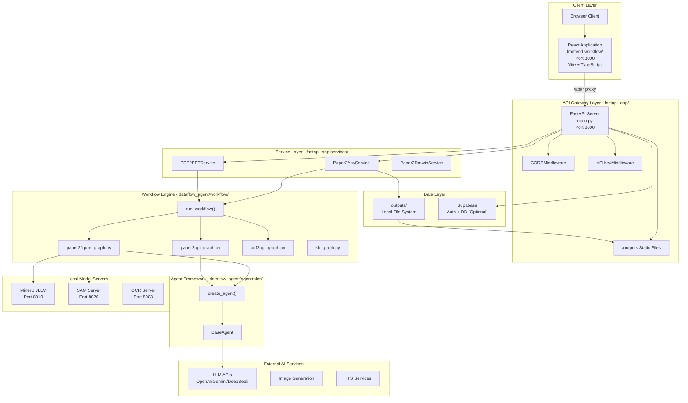

**Sources**: [fastapi_app/main.py:72-135](), [frontend-workflow/vite.config.ts:25-40](), [README.md:102-120]()

---

## Technology Stack

Paper2Any combines multiple technologies across frontend, backend, workflow orchestration, and AI services:

| Layer | Technology | Purpose | Location |
|-------|-----------|---------|----------|
| **Frontend** | React 18 + TypeScript | User interface | `frontend-workflow/` |
| | Vite | Build tool & dev server | `vite.config.ts` |
| | Zustand | State management | `src/stores/` |
| | TailwindCSS | Styling | UI components |
| **Backend** | FastAPI | REST API server | `fastapi_app/main.py` |
| | Pydantic | Request/response validation | `fastapi_app/schemas.py` |
| | Uvicorn | ASGI server | Port 8000 |
| **Workflow Engine** | dataflow_agent | Multi-agent orchestration | `dataflow_agent/` |
| | LangGraph | Agent state machines | Graph-based agents |
| **AI Services** | OpenAI / Gemini / DeepSeek | LLM Providers | External |
| | MinerU / SAM / PaddleOCR | Local Vision/Parsing Models | Local Model Servers |
| **Data Storage** | Local Filesystem | Generated files | `outputs/` |
| | Supabase | Auth + DB (optional) | External |

**Sources**: [README.md:7-10](), [frontend-workflow/vite.config.ts:23-40](), [fastapi_app/main.py:1-140]()

---

## Request Flow

The following sequence illustrates a typical request flow for generating a scientific figure:

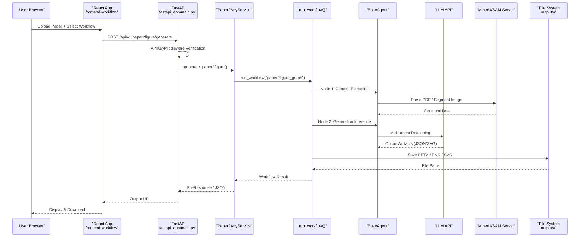

**Sources**: [fastapi_app/routers/paper2any.py:43-81](), [fastapi_app/main.py:84-115](), [README.md:108-118]()

---

## Core Components

### Frontend Application

The frontend is a React single-page application (SPA) built with Vite. It provides:
- **Navigation**: Managed via `AppSidebar` and `HomePage` [frontend-workflow/src/components/AppSidebar.tsx:41-189]().
- **Workflows**: Pages for Paper2Figure, Paper2PPT, MindMaps, Rebuttals, and more [frontend-workflow/src/App.tsx:29-49]().
- **User Management**: Authentication, points display, and file history [frontend-workflow/src/App.tsx:19-23]().
- **Design**: Glassmorphism UI with particle backgrounds [frontend-workflow/src/App.tsx:177-182]().

For details, see [Frontend Application](#3).

**Sources**: [frontend-workflow/src/App.tsx:1-202](), [frontend-workflow/src/components/AppSidebar.tsx:1-234]()

### Backend API

The FastAPI backend exposes RESTful endpoints for all workflows:
- **Routers**: Organized by feature (e.g., `paper2ppt`, `paper2any`, `kb`) [fastapi_app/main.py:87-114]().
- **Middleware**: Handles CORS and API Key/Quota verification [fastapi_app/main.py:72-85]().
- **Static Serving**: Serves generated files from the `outputs/` directory [fastapi_app/main.py:117-129]().

For details, see [Backend API](#4).

**Sources**: [fastapi_app/main.py:1-140](), [fastapi_app/routers/paper2any.py:1-135]()

### Workflow & Agent Framework (`dataflow_agent`)

The core intelligence resides in the `dataflow_agent` framework:
- **Workflows**: Defined as graphs in `dataflow_agent/workflow/` [fastapi_app/main.py:69]().
- **Agents**: Atomic units using the `BaseAgent` class with specific roles and prompts.
- **State**: Data flows through workflows via typed state objects.

For details, see [DataFlow-Agent Framework](#5).

**Sources**: [fastapi_app/main.py:66-70](), [README.md:104-120]()

---

## Deployment Options

Paper2Any supports multiple deployment modes:
1. **Local Development**: Running frontend (Vite) and backend (FastAPI) separately [frontend-workflow/vite.config.ts:25-40]().
2. **Docker**: Containerized deployment using Docker Compose.
3. **Local Model Servers**: Scaling GPU-heavy tasks (MinerU, SAM) on local hardware [README.md:119]().

For step-by-step installation, see [Getting Started](#2).

**Sources**: [README.md:52-53](), [fastapi_app/main.py:138-139]()

---

## Key Features Summary

Paper2Any provides a comprehensive suite of academic tools:
- **Paper2Figure**: Editable PPTX output for model architectures and roadmaps [README.md:108]().
- **Paper2PPT**: Intelligent slide deck generation from PDFs or topics [README.md:110]().
- **Paper2Video**: Video script and narration asset generation [README.md:115]().
- **Paper2Poster**: Academic poster layout and design [README.md:116]().
- **Knowledge Base**: RAG-based Q&A, podcast, and mindmap generation [README.md:119]().

For detailed descriptions, see [Key Features](#1.1).

**Sources**: [README.md:102-120](), [frontend-workflow/src/locales/en/common.json:11-26]()

---

# Page: Key Features

# Key Features

<details>
<summary>Relevant source files</summary>

The following files were used as context for generating this wiki page:

- [README.md](README.md)
- [README_CN.md](README_CN.md)
- [frontend-workflow/src/App.tsx](frontend-workflow/src/App.tsx)
- [frontend-workflow/src/components/AppSidebar.tsx](frontend-workflow/src/components/AppSidebar.tsx)
- [frontend-workflow/src/components/HomePage.tsx](frontend-workflow/src/components/HomePage.tsx)
- [frontend-workflow/src/components/paper2graph/SettingsCard.tsx](frontend-workflow/src/components/paper2graph/SettingsCard.tsx)
- [frontend-workflow/src/config/homePageCatalog.ts](frontend-workflow/src/config/homePageCatalog.ts)
- [frontend-workflow/src/locales/en/common.json](frontend-workflow/src/locales/en/common.json)
- [frontend-workflow/src/locales/en/paper2graph.json](frontend-workflow/src/locales/en/paper2graph.json)
- [frontend-workflow/src/locales/zh/common.json](frontend-workflow/src/locales/zh/common.json)
- [frontend-workflow/src/locales/zh/paper2graph.json](frontend-workflow/src/locales/zh/paper2graph.json)
- [static/new_readme/paper2citation/citation-explorer.png](static/new_readme/paper2citation/citation-explorer.png)
- [static/new_readme/paper2video/demo.gif](static/new_readme/paper2video/demo.gif)

</details>


This document provides a comprehensive reference of Paper2Any's core capabilities, organized by feature category. Each feature represents a complete workflow pipeline that processes academic papers, documents, or images into various output formats including presentations, figures, diagrams, and multimedia content.

For architectural details on how these features are implemented as workflows, see **1.2. Architecture Overview**. For specific workflow implementations, see **6. Paper2Any Workflows**. For Knowledge Base functionality, see **7. Knowledge Base System**.

---

## Purpose and Scope

Paper2Any implements **multimodal document processing workflows** focused on academic and technical content. The system converts papers, PDFs, images, and text into editable outputs through specialized AI-powered pipelines. This page catalogs all production features, their input/output formats, technical capabilities, and configuration options.

---

## Feature Categories

Paper2Any's features are organized into four primary categories:

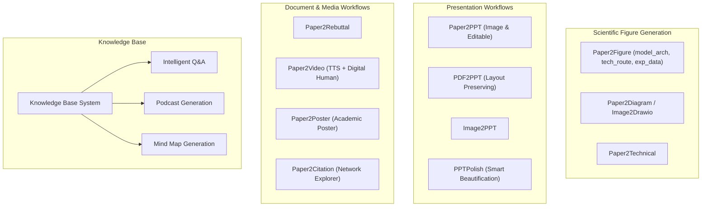

**Sources:** [README.md:102-120](), [README_CN.md:94-111]()

---

## 1. Paper2Figure: Editable Scientific Figures

Generates **three types** of scientific visualizations from papers or text, outputting fully editable PPTX files with optional SVG exports.

### Graph Types

| Graph Type | Code Identifier | Output Formats | Primary Use Case |
|------------|----------------|----------------|------------------|
| Model Architecture | `model_arch` | PPTX, PNG, Drawio | Neural network diagrams, system architectures |
| Technical Roadmap | `tech_route` | PPTX, SVG, PNG | Process flows, methodology diagrams |
| Experimental Plot | `exp_data` | PPTX, PNG | Data visualization, charts, comparison plots |

### Technical Pipeline

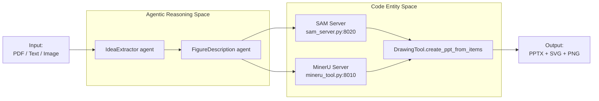

**Sources:** [README.md:108](), [frontend-workflow/src/locales/zh/paper2graph.json:26-31](), [frontend-workflow/src/components/paper2graph/SettingsCard.tsx:107-112]()

---

## 2. Paper2PPT: Paper to Presentation

Converts academic papers, long documents, or topics into structured PowerPoint presentations. It supports two distinct paths: **Image-style** and **Editable-deck**.

### Feature Comparison

| Feature | Image-style (`paper2ppt-image`) | Editable-deck (`paper2ppt-frontend`) |
|---------|--------------------------------|--------------------------------------|
| **Format** | Image-based slides | 16:9 HTML/CSS (Export to PPTX/PDF) |
| **Editing** | Static images | Inline text editing & canvas modification |
| **Visuals** | High-fidelity atmosphere | Structured layout control |
| **Workflow** | `paper2ppt_parallel` | `paper2ppt_frontend` |

### Key Capabilities
- **AI Outline Editing:** Allows users to refine the presentation structure before slide generation [README.md:82]().
- **Table/Figure Extraction:** Automatically pulls tables and images from the source PDF [README.md:110]().
- **Long Document Support:** Capable of processing lengthy manuscripts into cohesive decks [README.md:110]().

**Sources:** [README.md:110](), [frontend-workflow/src/App.tsx:35-37](), [frontend-workflow/src/locales/en/common.json:32-33]()

---

## 3. Specialized Academic Workflows

### Paper2Video
Converts paper PDFs into presentation videos.
- **Pipeline:** Generates per-slide scripts → Synthesizes voiceover (TTS) → Optional Digital Human (LivePortrait/EchoMimic) → FFMPEG compositing [README.md:115]().
- **Assets:** Produces narration audio and video files [frontend-workflow/src/locales/en/common.json:48]().

### Paper2Poster
Turns paper PDFs into academic posters.
- **Workflow:** Automatic content提炼 (extraction), layout planning, color design, and export [README.md:116]().
- **Config:** Supports section titles, logo injection, and layout parameters [frontend-workflow/src/locales/en/common.json:49]().

### Paper2Rebuttal
AI-assisted generator for academic paper rebuttal letters.
- **Functionality:** Analyzes reviewer comments and provides response strategies [README.md:111]().
- **Structure:** Supports claims-to-evidence grounding and structured responses [frontend-workflow/src/locales/en/common.json:47]().

### Paper2Citation
Explores citation networks based on DOI or author names.
- **Tracking:** Identifies citing authors, institutions, and notable downstream works [README.md:117]().
- **Visualization:** Displays citation distribution and network statistics [frontend-workflow/src/locales/en/common.json:50]().

**Sources:** [README.md:111-117](), [frontend-workflow/src/locales/en/common.json:47-50]()

---

## 4. Conversion & Polish Features

### PDF2PPT & Image2PPT
- **PDF2PPT:** Layout-preserving conversion of existing PDFs to editable PPTX [README.md:112]().
- **Image2PPT:** Converts screenshots or images into structured, editable slides [README.md:113]().

### PPTPolish
- **Functionality:** AI-powered layout optimization and style transfer for existing PPT files [README.md:114]().
- **Optimization:** Refines design, beautifies content, and optimizes alignment [frontend-workflow/src/locales/en/common.json:44]().

### Image2Drawio
- **Workflow:** Converts static images (flowcharts, architecture diagrams) into editable DrawIO XML [README.md:109]().
- **Integration:** Allows direct editing in the DrawIO workbench after conversion [README_CN.md:142-143]().

**Sources:** [README.md:109-114](), [frontend-workflow/src/locales/en/common.json:41-44]()

---

## 5. Knowledge Base (KB) System

The KB system acts as a centralized repository for research assets, providing RAG-driven capabilities.

### Integrated Tools
- **Intelligent Q&A:** Semantic search and chat over uploaded documents [README.md:119]().
- **Podcast Generation:** Converts KB files into audio discussions (monologue or dialog) [README.md:119]().
- **Mind Map:** Generates Mermaid-based tree structures from KB content [README.md:119]().
- **Multi-file Synthesis:** Supports merging multiple documents into a single presentation or report [README.md:78]().

**Sources:** [README.md:78, 119](), [frontend-workflow/src/locales/en/common.json:45]()

---

## Technical Configuration & Model Selection

Paper2Any uses a three-layer model configuration system to manage its diverse workflows.

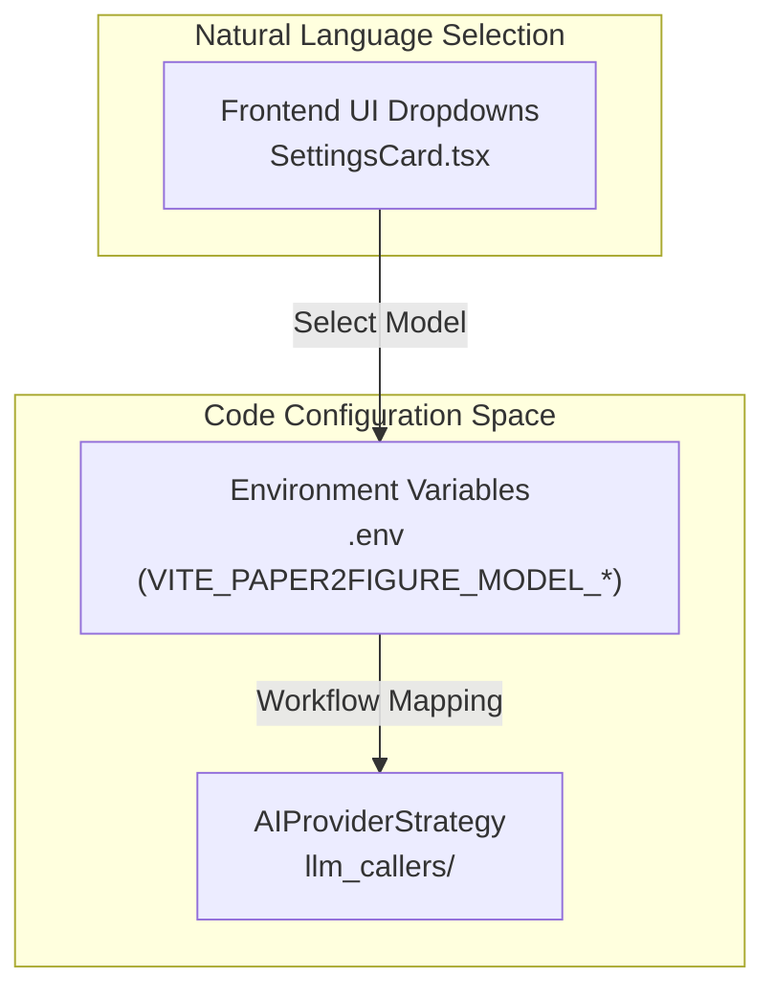

### Model Defaults by Feature
- **Paper2Figure (Model Arch):** `gemini-3-pro-image-preview` [frontend-workflow/src/components/paper2graph/SettingsCard.tsx:106]()
- **Paper2PPT:** `gpt-5.1`, `gpt-5.2`, `gemini-3-pro-preview` [README.md:358]()
- **PDF2PPT (VLM):** `qwen-vl-ocr-2025-11-20` [README.md:94]()

**Sources:** [frontend-workflow/src/components/paper2graph/SettingsCard.tsx:106-112](), [README.md:94, 358]()

---

# Page: Architecture Overview

# Architecture Overview

<details>
<summary>Relevant source files</summary>

The following files were used as context for generating this wiki page:

- [.gitignore](.gitignore)
- [README.md](README.md)
- [README_CN.md](README_CN.md)
- [dataflow_agent/agentroles/cores/base_agent.py](dataflow_agent/agentroles/cores/base_agent.py)
- [dataflow_agent/graphbuilder/graph_builder.py](dataflow_agent/graphbuilder/graph_builder.py)
- [dataflow_agent/promptstemplates/prompts_repo.py](dataflow_agent/promptstemplates/prompts_repo.py)
- [dataflow_agent/resources/faiss_cache/all_ops.index.meta](dataflow_agent/resources/faiss_cache/all_ops.index.meta)
- [dataflow_agent/state.py](dataflow_agent/state.py)
- [dataflow_agent/toolkits/optool/op_tools.py](dataflow_agent/toolkits/optool/op_tools.py)
- [dataflow_agent/toolkits/pipetool/pipe_tools.py](dataflow_agent/toolkits/pipetool/pipe_tools.py)
- [dataflow_agent/toolkits/resources/ops.json](dataflow_agent/toolkits/resources/ops.json)
- [fastapi_app/main.py](fastapi_app/main.py)
- [fastapi_app/routers/__init__.py](fastapi_app/routers/__init__.py)
- [fastapi_app/routers/paper2any.py](fastapi_app/routers/paper2any.py)
- [frontend-workflow/vite.config.ts](frontend-workflow/vite.config.ts)
- [static/new_readme/paper2citation/citation-explorer.png](static/new_readme/paper2citation/citation-explorer.png)
- [static/new_readme/paper2video/demo.gif](static/new_readme/paper2video/demo.gif)

</details>


This document describes the high-level system architecture of Paper2Any, a multimodal document processing system. It covers the three-tier structure (Frontend → Backend → Core Framework), component interactions, the agent execution model, and external model integrations.

---

## System Layers

Paper2Any implements a decoupled architecture where the frontend manages user interactions, the backend handles API orchestration and file management, and the core framework executes complex multi-agent workflows.

### Layer 1: Client Layer
**Frontend Application** (`frontend-workflow/`)

The React-based frontend is built with Vite and provides specialized interfaces for different document conversion tasks.

| Component Type | Purpose | Key Files |
|----------------|---------|-----------|
| **Page Components** | Workflow-specific UIs | `src/pages/Paper2Figure.tsx`<br/>`src/pages/Paper2PPT.tsx`<br/>`src/pages/Paper2Video.tsx` |
| **State Management** | Zustand stores for auth and session | `src/stores/authStore.ts` |
| **Service Layer** | API abstraction for backend calls | `src/services/paper2anyService.ts` |
| **Vite Proxy** | Routes `/api` to the FastAPI backend | [frontend-workflow/vite.config.ts:29-38]() |

### Layer 2: Application Layer
**FastAPI Backend** (`fastapi_app/`)

The backend acts as an API gateway, managing request validation, static file serving, and the bridge to the workflow engine.

| Module | Purpose | Key Files |
|--------|---------|-----------|
| **Main App** | App factory and middleware setup | [fastapi_app/main.py:57-135]() |
| **Routers** | REST endpoints for all features | [fastapi_app/routers/paper2any.py:43-134]()<br/>[fastapi_app/routers/paper2ppt.py]() |
| **Services** | Business logic and directory management | `fastapi_app/services/paper2any_service.py` |
| **Middleware** | API key and billing enforcement | [fastapi_app/middleware/api_key.py]() |

### Layer 3: Core Framework
**DataFlow-Agent Framework** (`dataflow_agent/`)

The core engine provides a graph-based orchestration environment for LLM agents and tools.

| Module | Purpose | Key Components |
|--------|---------|----------------|
| **Workflow Registry** | Centralized workflow lookup | `dataflow_agent/workflow/registry.py` |
| **Graph Builder** | DSL for defining agent DAGs | `dataflow_agent/graphbuilder/graph_builder.py` |
| **Agent System** | Multi-strategy agent execution | `dataflow_agent/agentroles/cores/base_agent.py` |
| **State Models** | Dataclass-based state tracking | [dataflow_agent/state.py:41-210]() |
| **Toolkits** | Domain-specific tool implementations | `dataflow_agent/toolkits/` |

---

## High-Level Architecture Diagram

The following diagram illustrates the end-to-end flow from the React UI through the FastAPI gateway into the LangGraph-powered agent framework.

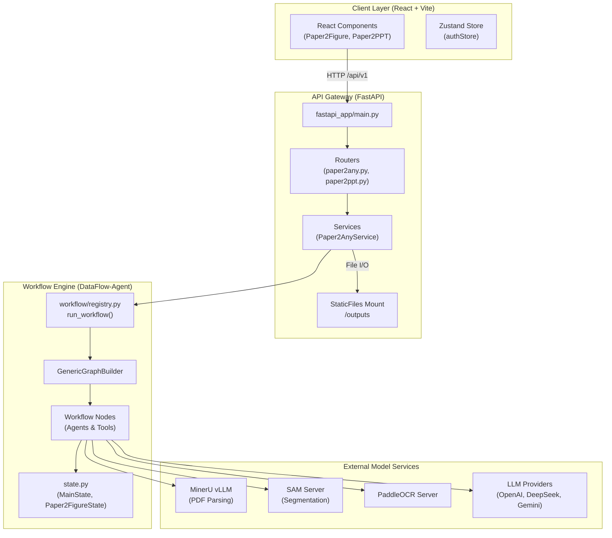
**Sources:** [fastapi_app/main.py:86-130](), [README.md:102-120](), [dataflow_agent/state.py:41-55]()

---

## Agent Execution Framework

The `DataFlow-Agent` framework bridges natural language requirements to executable code entities. It uses a graph-based approach where nodes represent agents or functional blocks.

### State and Request Mapping

Workflows rely on structured `MainState` and `MainRequest` objects to maintain context across asynchronous agent calls.

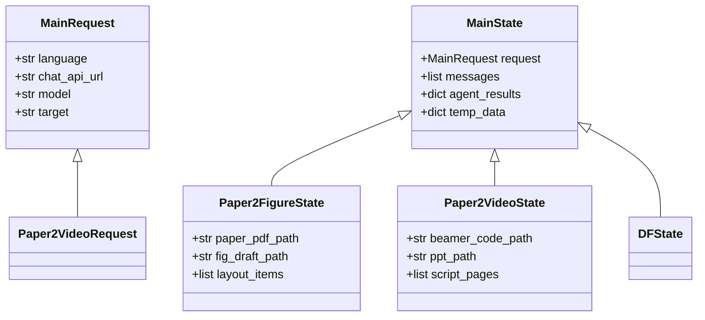
**Sources:** [dataflow_agent/state.py:14-37](), [dataflow_agent/state.py:41-55](), [dataflow_agent/state.py:133-169]()

### Workflow Registration and Discovery

Workflows are defined using the `GenericGraphBuilder` and registered via a decorator pattern, allowing the backend to invoke them by string identifiers.

| Workflow ID | Purpose | State Class |
|-------------|---------|-------------|
| `paper2fig_with_sam` | Paper to editable figures | `Paper2FigureState` |
| `paper2ppt_parallel` | Paper to slide decks | `Paper2PPTState` |
| `paper2video` | Paper to narrated video | [dataflow_agent/state.py:133-169]() |
| `wf_intelligent_qa` | RAG-based knowledge base chat | `IntelligentQAState` |

---

## Model Services & External Integrations

Paper2Any offloads heavy multimodal tasks to specialized local servers or external APIs.

### Service Topology

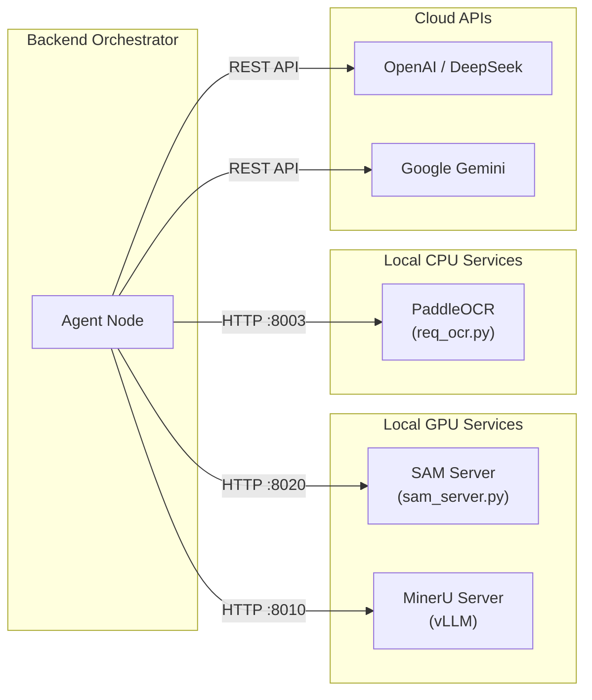
**Sources:** [README.md:247-272](), [fastapi_app/main.py:125-130]()

### File and Output Management

The system maintains a strict directory structure for task isolation. Every workflow execution generates a unique timestamped directory under `outputs/{email}/{task_type}/{timestamp}/`.

- **Static Mount**: The `outputs/` directory is mounted at `/outputs` in FastAPI [fastapi_app/main.py:125-130]().
- **Persistence**: Results (PPTX, PNG, SVG) are served directly via this mount, allowing the frontend to preview and download artifacts using generated URLs.

**Sources:** [fastapi_app/main.py:116-130](), [fastapi_app/routers/paper2any.py:31-40]()

---

## Operator and Pipeline System

For generic data processing, Paper2Any uses an **Operator System** that allows for dynamic pipeline assembly.

### Operator Registry
The `OPERATOR_REGISTRY` tracks all available functional blocks (e.g., `FilterData`, `ExtractSmiles`). Metadata is dumped to `ops.json` for RAG-based discovery [dataflow_agent/toolkits/optool/op_tools.py:161-193]().

### Pipeline Assembly
The `pipeline_assembler` takes a high-level `target` description and matches it against available operators to generate executable Python code [dataflow_agent/toolkits/pipetool/pipe_tools.py:148-180]().

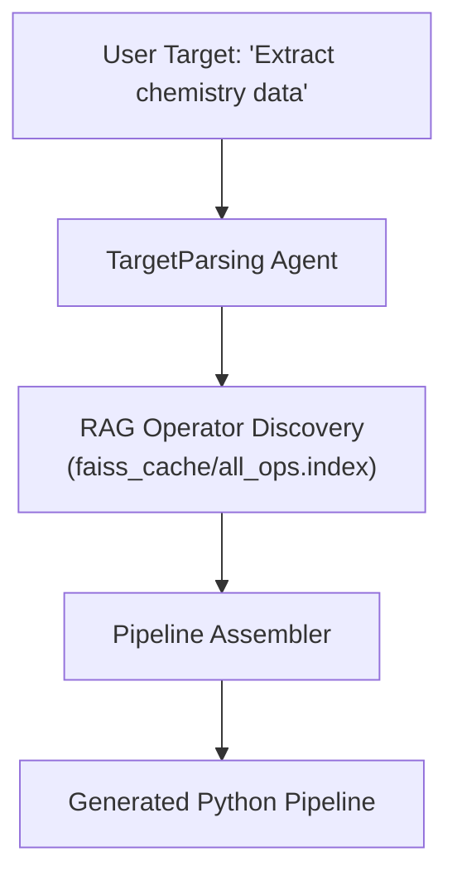
**Sources:** [dataflow_agent/toolkits/optool/op_tools.py:161-193](), [dataflow_agent/toolkits/pipetool/pipe_tools.py:148-180](), [dataflow_agent/promptstemplates/prompts_repo.py:76-113]()

---

# Page: Getting Started

# Getting Started

<details>
<summary>Relevant source files</summary>

The following files were used as context for generating this wiki page:

- [dataflow_agent/toolkits/p2vtool/1_merge.bash](dataflow_agent/toolkits/p2vtool/1_merge.bash)
- [deploy/app_config.sh](deploy/app_config.sh)
- [docs/contributing.md](docs/contributing.md)
- [docs/guides/index.md](docs/guides/index.md)
- [docs/guides/open_source_deployment.md](docs/guides/open_source_deployment.md)
- [docs/index.md](docs/index.md)
- [docs/installation.md](docs/installation.md)
- [docs/quickstart.md](docs/quickstart.md)
- [fastapi_app/__init__.py](fastapi_app/__init__.py)
- [fastapi_app/interprocess_lock.py](fastapi_app/interprocess_lock.py)
- [mkdocs.yml](mkdocs.yml)
- [requirements-base.txt](requirements-base.txt)
- [requirements-paper.txt](requirements-paper.txt)
- [tests/test_paper2ppt_generate_route.py](tests/test_paper2ppt_generate_route.py)

</details>


This guide walks you through setting up Paper2Any and running your first workflow. Paper2Any is a multimodal document processing system that converts academic papers into figures, presentations, videos, and more. It can be deployed in several configurations ranging from a minimal local setup to a full production system with GPU-accelerated model services.

**Quick Navigation:**
- [Installation](#2.1) — Detailed installation instructions including Python dependencies, Node.js setup, and system packages (LibreOffice, Inkscape).
- [Configuration](#2.2) — Explain the four configuration file types, API key setup, model selection, and optional Supabase configuration.
- [Quick Start](#2.3) — Walk through running the application locally using deployment scripts and executing first workflows.

---

## Prerequisites

Paper2Any requires Python 3.11 and several system-level dependencies for document processing, vector graphics rendering, and AI model integration.

**Core Requirements:**

| Component | Recommended Version | Required For |
|-----------|---------------------|--------------|
| Python | 3.11 | Backend Runtime & Model Services [docs/installation.md:33]() |
| Node.js | 20 | Frontend Web UI [docs/installation.md:34]() |
| OS | Linux (Ubuntu/Debian) | Primary support (WSL2 for Windows) [docs/installation.md:36]() |

**System Packages (Linux):**
The following packages are essential for the document conversion pipeline:
- `inkscape`: Vector graphics processing [requirements-paper.txt:14]()
- `libreoffice`: PPT/PDF conversions [docs/installation.md:49]()
- `tectonic`: TeX engine for scientific rendering [requirements-paper.txt:11]()
- `poppler-utils`: PDF manipulation [docs/installation.md:50]()
- `ffmpeg`: Video compositing for Paper2Video [dataflow_agent/toolkits/p2vtool/1_merge.bash:39-43]()

**Sources:** [docs/installation.md:12-65](), [requirements-paper.txt:10-15]()

---

## Deployment Architectures

Paper2Any supports three primary deployment routes depending on your hardware resources and use case. For a deep dive into these routes, see [Quick Start](#2.3).

### 1. Minimal Setup (Local Development)
This route focuses on the frontend and backend logic, relying on external LLM APIs (OpenAI, Gemini, etc.) for heavy lifting.

```mermaid
graph TD
    subgraph "Local_Machine"
        [Browser] -->|"Port 3000"| [Vite_Frontend]
        [Vite_Frontend] -->|"API Proxy"| [FastAPI_Backend]
        [FastAPI_Backend] --> [DataFlow_Agent_Engine]
        [DataFlow_Agent_Engine] --> [External_LLM_APIs]
    end
    [FastAPI_Backend] -.->|"Storage"| [Local_Outputs_Dir]
```

**Sources:** [docs/index.md:57-80](), [docs/quickstart.md:10-88]()

### 2. Full Local Setup (GPU Accelerated)
This configuration adds local model servers (MinerU, SAM3, OCR) to handle PDF parsing and image segmentation locally, reducing reliance on external multimodal APIs.

```mermaid
graph TB
    subgraph "Application_Tier"
        [FastAPI_Backend]
    end

    subgraph "Model_Service_Tier"
        [FastAPI_Backend] --> [MinerU_Server]
        [FastAPI_Backend] --> [SAM3_Server]
        [FastAPI_Backend] --> [PaddleOCR_Server]
    end

    [MinerU_Server] --- [GPU_Resources]
    [SAM3_Server] --- [GPU_Resources]
    
    [FastAPI_Backend] --> [InterProcessLock]
    [InterProcessLock] --> [Outputs_Locks_Dir]
```

**Key Entities:**
- `MinerU_Server`: High-fidelity PDF parsing [docs/index.md:107]()
- `SAM3_Server`: Segment Anything Model for diagram extraction [deploy/app_config.sh:27]()
- `AsyncInterProcessSemaphore`: Manages concurrent access to GPU resources across uvicorn workers [fastapi_app/interprocess_lock.py:23-24]()

**Sources:** [deploy/app_config.sh:24-31](), [fastapi_app/interprocess_lock.py:12-16](), [docs/quickstart.md:101-109]()

---

## Configuration Overview

The system behavior is governed by four primary configuration locations. For details on variable mapping, see [Configuration](#2.2).

| Config File | Scope | Key Variables |
|-------------|-------|---------------|
| `fastapi_app/.env` | Backend Logic | `BACKEND_API_KEY`, `DF_API_KEY`, `APP_BILLING_MODE` |
| `frontend-workflow/.env` | Web UI | `VITE_API_KEY`, `VITE_API_BASE_URL` |
| `deploy/profiles/*.env` | Model Servers | `SAM3_SERVER_URLS`, `APP_PORT` |
| `logs/model_servers.env` | Shared Runtime | GPU allocation and server ports |

**Sources:** [docs/index.md:62](), [docs/quickstart.md:41-65](), [deploy/app_config.sh:9-31]()

---

## Application Startup

To get the system running quickly, follow the "Shortest Path" using the provided deployment scripts.

1.  **Environment Preparation:** Create a Conda environment and install dependencies from `requirements-paper.txt` [docs/quickstart.md:23-29]().
2.  **Frontend Setup:** Install Node modules in `frontend-workflow/` [docs/quickstart.md:31-39]().
3.  **Configuration:** Copy `.env.example` templates and set your `DF_API_KEY` (LLM provider key) [docs/quickstart.md:41-58]().
4.  **Execution:**
    *   Start Backend: `bash deploy/start.sh` [docs/quickstart.md:75-77]()
    *   Start Frontend: `bash deploy/start_frontend.sh` [docs/quickstart.md:81-83]()

For a detailed walkthrough of these steps and troubleshooting, see [Quick Start](#2.3).

**Sources:** [docs/quickstart.md:10-88](), [deploy/app_config.sh:1-25]()

---

## Next Steps

Once the application is running, you can explore the various workflows:

*   **Document Conversion:** Use the UI to run `Paper2PPT` or `Paper2Figure` tasks.
*   **Knowledge Base:** Upload PDFs to the KB system for RAG-based Q&A and podcast generation.
*   **CLI Usage:** For batch processing, refer to the CLI tools documented in [Quick Start](#2.3).

For developers looking to extend the system, refer to the [Development Guide](#11) to learn about the `DataFlow-Agent` framework and how to register new `wf_*.py` workflows [docs/contributing.md:67-87]().

**Sources:** [docs/index.md:25-43](), [docs/contributing.md:54-65]()

---

# Page: Installation

# Installation

<details>
<summary>Relevant source files</summary>

The following files were used as context for generating this wiki page:

- [.dockerignore](.dockerignore)
- [Dockerfile](Dockerfile)
- [database/00_cleanup.sql](database/00_cleanup.sql)
- [docs/contributing.md](docs/contributing.md)
- [docs/guides/index.md](docs/guides/index.md)
- [docs/guides/open_source_deployment.md](docs/guides/open_source_deployment.md)
- [docs/index.md](docs/index.md)
- [docs/installation.md](docs/installation.md)
- [docs/quickstart.md](docs/quickstart.md)
- [mkdocs.yml](mkdocs.yml)
- [requirements-base.txt](requirements-base.txt)
- [requirements-paper.txt](requirements-paper.txt)
- [requirements-win-base.txt](requirements-win-base.txt)

</details>


This document provides comprehensive installation instructions for Paper2Any, covering system requirements, dependency installation, and setup procedures across different platforms. Paper2Any is a multimodal document processing system that requires a combination of Python, Node.js, and specific system-level binaries to handle document conversion and AI model serving.

---

## Overview

Paper2Any can be deployed in multiple configurations ranging from minimal (core workflows only) to complete (with local GPU model servers). The installation process consists of:

1.  **Python environment setup** - Core dependencies for the DataFlow-Agent framework and FastAPI backend.
2.  **System dependencies** - LaTeX engines, vector graphics tools (Inkscape), and document converters (LibreOffice).
3.  **Frontend installation** - React/Vite web interface.
4.  **Model servers** - Local GPU services for PDF parsing (MinerU), segmentation (SAM), and OCR (optional).

The system is designed with progressive enhancement: you can start with minimal dependencies and add components as needed.

---

## Installation Dependency Hierarchy

The following diagram illustrates the relationship between the various components and their underlying code entities.

**Code Entity Mapping: Installation Components**

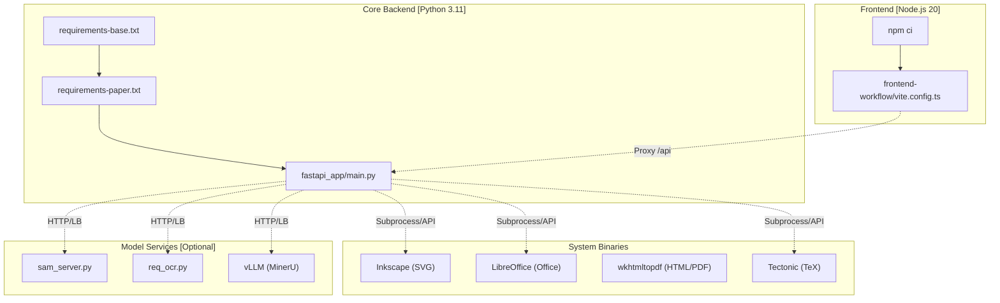

**Sources**: [docs/installation.md:12-28](), [docs/guides/open_source_deployment.md:11-25](), [requirements-paper.txt:1-48]()

---

## System Requirements

### Minimum Requirements

| Component | Specification |
|-----------|--------------|
| **Operating System** | Linux (Ubuntu 22.04+ Recommended), Windows 10/11 |
| **Python** | 3.11 (Strictly recommended for backend) |
| **Node.js** | 20.x (LTS) |
| **RAM** | 8GB minimum (16GB+ for local models) |
| **Disk Space** | 10GB for dependencies + models |

### GPU Requirements (Optional)

For local model servers only:

| Model Server | GPU Memory | Role |
|--------------|------------|------|
| **MinerU (vLLM)** | 8GB+ | PDF Layout & Content Extraction |
| **SAM (Segment Anything)** | 4GB+ | Image/Diagram Segmentation |
| **OCR** | CPU/GPU | Text Recognition |

**Sources**: [docs/installation.md:29-38](), [docs/guides/open_source_deployment.md:143-165]()

---

## Installation Methods

### Method 1: Docker Deployment (Recommended)

Docker provides the fastest path to a working installation with all system dependencies pre-configured in a `python:3.11-slim` environment.

```bash
# 1. Clone repository
git clone https://github.com/OpenDCAI/Paper2Any.git
cd Paper2Any

# 2. Build and start services
docker compose up -d --build
```

The `Dockerfile` handles the installation of critical system packages:
- `build-essential`, `curl`, `git`, `wget`
- `inkscape`, `libreoffice`, `poppler-utils`
- `libgl1`, `libglib2.0-0` (for OpenCV)
- `wkhtmltopdf` (downloaded and installed via .deb)

**Sources**: [Dockerfile:1-41](), [docs/guides/open_source_deployment.md:130-141]()

---

### Method 2: Linux Native Installation

#### Step 1: Python Environment Setup

```bash
# Create conda environment
conda create -n paper2any python=3.11 -y
conda activate paper2any

# Install dependencies
pip install --upgrade pip
pip install -r requirements-paper.txt || pip install -r requirements-paper-backup.txt

# Optional: Install in editable mode for development
pip install -e .
```

**Sources**: [docs/installation.md:66-82](), [requirements-paper.txt:1-48]()

#### Step 2: System Dependencies

The backend relies on several external binaries for document conversion. On Ubuntu/Debian, install them via:

```bash
sudo apt-get update
sudo apt-get install -y \
  inkscape \
  libreoffice \
  poppler-utils \
  tectonic \
  libsndfile1 \
  libgl1
```

| Package | Purpose | Code Usage |
|---------|---------|------------|
| `inkscape` | SVG to PNG/PDF conversion | Vector graphics workflows |
| `libreoffice` | Office to PDF conversion | PPT generation/polishing |
| `tectonic` | Modern TeX engine | LaTeX/Beamer generation in Paper2Video |
| `wkhtmltopdf` | HTML to PDF conversion | Report generation |

**Sources**: [docs/installation.md:39-65](), [requirements-paper.txt:10-15]()

#### Step 3: Frontend Installation

The frontend is a React application built with Vite.

```bash
cd frontend-workflow
npm ci
```

The frontend communicates with the backend via a proxy defined in `vite.config.ts`. In development mode (`npm run dev`), requests to `/api` are routed to `http://localhost:8000`.

**Sources**: [docs/installation.md:84-90](), [docs/guides/open_source_deployment.md:64-77]()

---

### Method 3: Windows Native Installation

Windows installation requires specific versions of dependencies, primarily managed through `requirements-win-base.txt`.

```bash
# Create environment
conda create -n paper2any python=3.12 -y
conda activate paper2any

# Install Windows-specific requirements
pip install -r requirements-win-base.txt
```

**Note**: Windows users must manually install Inkscape and add the `bin` folder to the system PATH for the backend to find the executable.

**Sources**: [requirements-win-base.txt:1-92](), [docs/quickstart.md:19-29]()

---

## Model Server Installation (Optional)

For production or full-local environments, you must deploy the model servers. These are orchestrated by `script/start_model_servers.sh`.

### Deployment Topology

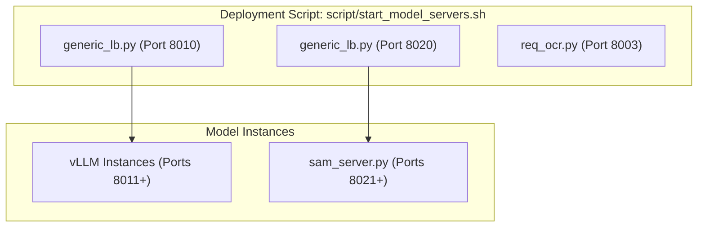

### Installation Steps:
1.  **Prepare Models**: Run `bash script/prepare_local_models.sh` to download necessary weights (e.g., RMBG-2.0).
2.  **Configure Profiles**: Edit `deploy/profiles/nv.env` to specify GPU IDs and ports.
3.  **Start Servers**: Run `bash script/start_model_servers.sh`.

The script will automatically generate `logs/model_servers.env` which the FastAPI backend reads to locate these services.

**Sources**: [docs/guides/open_source_deployment.md:31-46](), [docs/installation.md:92-104](), [docs/quickstart.md:101-110]()

---

## Summary of Installation Steps

| Step | Action | Command / File |
|------|--------|----------------|
| 1 | Clone Repo | `git clone ...` |
| 2 | Python Env | `conda create -n paper2any python=3.11` |
| 3 | Backend Deps | `pip install -r requirements-paper.txt` |
| 4 | System Deps | `sudo apt-get install inkscape libreoffice ...` |
| 5 | Frontend Deps | `cd frontend-workflow && npm ci` |
| 6 | Config | `cp fastapi_app/.env.example fastapi_app/.env` |
| 7 | Models (Opt) | `bash script/start_model_servers.sh` |

**Sources**: [docs/quickstart.md:10-84](), [docs/guides/open_source_deployment.md:202-234]()

---

# Page: Configuration

# Configuration

<details>
<summary>Relevant source files</summary>

The following files were used as context for generating this wiki page:

- [dataflow_agent/toolkits/multimodaltool/req_img.py](dataflow_agent/toolkits/multimodaltool/req_img.py)
- [dataflow_agent/toolkits/multimodaltool/utils.py](dataflow_agent/toolkits/multimodaltool/utils.py)
- [dataflow_agent/workflow/wf_paper2figure_image_only.py](dataflow_agent/workflow/wf_paper2figure_image_only.py)
- [dataflow_agent/workflow/wf_pdf2ppt_qwenvl.py](dataflow_agent/workflow/wf_pdf2ppt_qwenvl.py)
- [docs/contributing.md](docs/contributing.md)
- [docs/guides/index.md](docs/guides/index.md)
- [docs/guides/open_source_deployment.md](docs/guides/open_source_deployment.md)
- [docs/index.md](docs/index.md)
- [docs/installation.md](docs/installation.md)
- [docs/quickstart.md](docs/quickstart.md)
- [fastapi_app/.env.example](fastapi_app/.env.example)
- [fastapi_app/config/settings.py](fastapi_app/config/settings.py)
- [fastapi_app/services/image2ppt_service.py](fastapi_app/services/image2ppt_service.py)
- [fastapi_app/services/paper2any_service.py](fastapi_app/services/paper2any_service.py)
- [fastapi_app/workflow_adapters/wa_paper2figure.py](fastapi_app/workflow_adapters/wa_paper2figure.py)
- [fastapi_app/workflow_adapters/wa_pdf2ppt.py](fastapi_app/workflow_adapters/wa_pdf2ppt.py)
- [frontend-workflow/.env.example](frontend-workflow/.env.example)
- [mkdocs.yml](mkdocs.yml)

</details>


This page explains the configuration system for Paper2Any, which uses a multi-tier approach to manage internal API security, LLM provider settings, billing modes, and model service orchestration.

---

## Configuration Overview

Paper2Any's configuration is distributed across four primary file types to separate frontend presentation, backend business logic, deployment environment parameters, and model server allocations.

| File Path | Purpose | Key Variables |
|-----------|---------|---------------|
| `fastapi_app/.env` | Backend business logic & API keys | `BACKEND_API_KEY`, `APP_BILLING_MODE`, `DF_API_KEY` |
| `frontend-workflow/.env` | Frontend UI defaults & API routing | `VITE_API_KEY`, `VITE_DEFAULT_LLM_MODEL` |
| `deploy/profiles/*.env` | Machine-specific deployment params | `PORT`, `PYTHON_PATH`, `GPU_IDS` |
| `logs/model_servers.env` | Model service runtime state | Generated by `start_model_servers.sh` |

### Configuration Data Flow

The following diagram illustrates how configuration values are loaded and consumed by different system entities, bridging the gap between environment files and code execution.

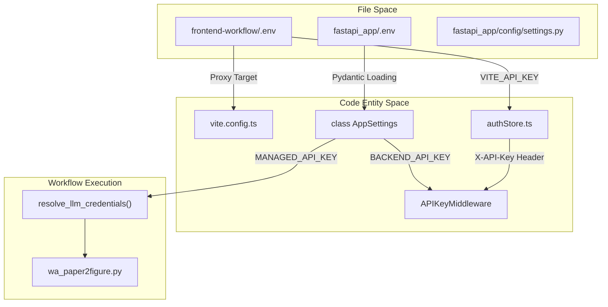

**Sources:** [fastapi_app/config/settings.py:1-21](), [fastapi_app/.env.example:1-33](), [frontend-workflow/.env.example:1-15]()

---

## Backend Configuration (`fastapi_app/.env`)

The backend uses a three-tier model configuration system defined in `AppSettings` [fastapi_app/config/settings.py:21-28](). This allows for global fallbacks, workflow-specific defaults, and role-based overrides.

### API Key Setup
- **`BACKEND_API_KEY`**: Protects the FastAPI endpoints. The frontend `VITE_API_KEY` must match this exactly [fastapi_app/.env.example:25-28]().
- **`DF_API_KEY` / `DF_API_URL`**: Global fallback for LLM services if specific workflow keys are missing [fastapi_app/.env.example:43-47]().

### Billing & Managed Modes
The system supports two primary billing modes via `APP_BILLING_MODE` [fastapi_app/config/settings.py:94]():

1.  **`paid`**: Users must provide their own API keys in the frontend. The platform does not deduct internal points [fastapi_app/.env.example:31]().
2.  **`free`**: All API calls use the keys configured in the backend `.env`. Usage is restricted by the internal points system defined in `pricing.yaml` [fastapi_app/.env.example:32-33]().

### Managed API Credentials
In `free` mode, credentials are resolved using `resolve_llm_credentials()` and `resolve_image_generation_credentials()` [fastapi_app/services/managed_api_service.py:1-20](). You can configure unique keys for every workflow (e.g., `PAPER2PPT_MANAGED_API_KEY`) to prevent a single key failure from affecting all services [fastapi_app/.env.example:51-98]().

**Sources:** [fastapi_app/config/settings.py:30-94](), [fastapi_app/.env.example:1-98](), [fastapi_app/services/paper2any_service.py:17-20]()

---

## Frontend Configuration (`frontend-workflow/.env`)

The frontend configuration primarily handles UI defaults and the connection to the backend.

### Connection Settings
- **`VITE_API_BASE_URL`**: The URL of the FastAPI backend. If using the Vite proxy (default for development), this should be left empty [frontend-workflow/.env.example:12-15]().
- **`VITE_API_KEY`**: Internal communication key [frontend-workflow/.env.example:10]().

### Model Selection Defaults
These variables set the initial values in the UI dropdowns. Users can override these if the backend is in `paid` mode.

| Variable | Workflow | Default Value |
|----------|----------|---------------|
| `VITE_PAPER2PPT_MODEL` | Paper2PPT | `gpt-5.4,gpt-5.1` |
| `VITE_PAPER2FIGURE_MODEL_TECH_ROUTE` | Tech Route | `gpt-5.4,gpt-5.2` |
| `VITE_IMAGE2DRAWIO_VLM_MODEL` | Image2Drawio | `qwen-vl-ocr-2025-11-20` |

**Sources:** [frontend-workflow/.env.example:1-67]()

---

## Supabase & User Management

Supabase is optional but required for authentication, cloud history, and the points system.

### Configuration Variables
Both frontend and backend require Supabase credentials:
- `SUPABASE_URL`: Your project endpoint [fastapi_app/config/settings.py:110]().
- `SUPABASE_ANON_KEY`: Client-side key for public access [fastapi_app/config/settings.py:111]().
- `SUPABASE_SERVICE_ROLE_KEY`: (Backend only) High-privilege key for bypassing RLS [fastapi_app/config/settings.py:112]().

### Points System Integration
When `APP_BILLING_MODE=free`, the backend checks the user's points balance in Supabase (or a local SQLite fallback `guest_quota.sqlite3`) before executing workflows [fastapi_app/config/settings.py:94-96]().

**Sources:** [fastapi_app/config/settings.py:110-116](), [frontend-workflow/.env.example:69-75]()

---

## Model Service Orchestration

Complex workflows like `pdf2ppt_qwenvl` or `paper2fig_with_sam` require heavy lifting from local or remote model servers.

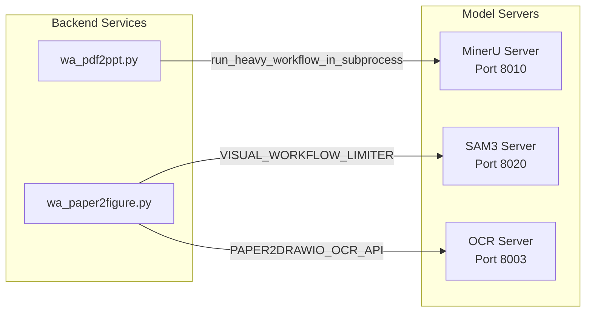

### Key Service Settings
- **MinerU**: Configured via `MINERU_API_KEY` (for remote) or `MINERU_PORT` (for local) [fastapi_app/config/settings.py:126-127](), [fastapi_app/.env.example:185-194]().
- **SAM3**: Uses `AsyncInterProcessSemaphore` named `sam3_visual_workflows` to prevent GPU OOM by limiting concurrent segmentation tasks to 1 [fastapi_app/services/paper2any_service.py:29-30](), [fastapi_app/services/image2ppt_service.py:20]().
- **OCR**: `PAPER2DRAWIO_OCR_API_URL` defaults to DashScope's compatible-mode endpoint [fastapi_app/config/settings.py:124]().

**Sources:** [fastapi_app/workflow_adapters/wa_paper2figure.py:30-33](), [fastapi_app/services/paper2any_service.py:29-30](), [dataflow_agent/workflow/wf_pdf2ppt_qwenvl.py:4-13]()

---

# Page: Quick Start

# Quick Start

<details>
<summary>Relevant source files</summary>

The following files were used as context for generating this wiki page:

- [dataflow_agent/toolkits/p2vtool/1_merge.bash](dataflow_agent/toolkits/p2vtool/1_merge.bash)
- [deploy/app_config.sh](deploy/app_config.sh)
- [deploy/start.sh](deploy/start.sh)
- [deploy/stop.sh](deploy/stop.sh)
- [docs/contributing.md](docs/contributing.md)
- [docs/guides/index.md](docs/guides/index.md)
- [docs/guides/open_source_deployment.md](docs/guides/open_source_deployment.md)
- [docs/index.md](docs/index.md)
- [docs/installation.md](docs/installation.md)
- [docs/quickstart.md](docs/quickstart.md)
- [fastapi_app/__init__.py](fastapi_app/__init__.py)
- [fastapi_app/interprocess_lock.py](fastapi_app/interprocess_lock.py)
- [mkdocs.yml](mkdocs.yml)
- [script/run_image2ppt_cli.py](script/run_image2ppt_cli.py)
- [script/run_paper2figure_cli.py](script/run_paper2figure_cli.py)
- [script/run_paper2ppt_cli.py](script/run_paper2ppt_cli.py)
- [script/run_pdf2ppt_cli.py](script/run_pdf2ppt_cli.py)
- [script/run_ppt2polish_cli.py](script/run_ppt2polish_cli.py)
- [tests/test_paper2ppt_generate_route.py](tests/test_paper2ppt_generate_route.py)

</details>


This page walks through running the Paper2Any application locally using the provided deployment scripts, executing your first workflows via the web UI and CLI, and understanding the three primary deployment routes.

---

## 1. Deployment Routes

Paper2Any supports three deployment strategies depending on your hardware availability and use case.

| Route | Description | Target Audience | Key Components |
| :--- | :--- | :--- | :--- |
| **Minimal** | Uses cloud LLMs for all logic and image generation. No local GPUs required. | New users, rapid prototyping | FastAPI, React, OpenAI/Gemini/DeepSeek APIs |
| **Full Local** | Deploys local model servers (MinerU, SAM3, OCR) for high-performance parsing and segmentation. | Power users, privacy-focused | Local GPUs, `start_model_servers.sh` |
| **Docker** | Containerized environment for consistent deployment across systems. | Production, DevOps | Docker Compose, `Dockerfile` |

Sources: [docs/index.md:57-72](), [docs/quickstart.md:10-109]()

---

## 2. Local Setup & Service Startup

### 2.1 Backend Initialization
The backend is a FastAPI application that orchestrates the `DataFlow-Agent` framework.

1. **Environment**: Use Python 3.11.
2. **Configuration**: Copy `fastapi_app/.env.example` to `fastapi_app/.env` and provide your `DF_API_KEY`.
3. **Execution**: Run `bash deploy/start.sh`.

**Implementation Detail**: `deploy/start.sh` performs the following:
- **Environment Validation**: Calls `validate_python` to check for critical dependencies like `cv2`, `fastapi`, and `torch` [deploy/start.sh:24-38]().
- **Asset Resolution**: Locates local model weights (SAM3, RMBG) using `prepare_runtime_env` [deploy/start.sh:51-115]().
- **Process Management**: Starts `uvicorn` with `setsid` and `nohup` to detach the process from the shell, saving the PID to `logs/uvicorn.pid` [deploy/start.sh:209-252]().

### 2.2 Frontend Initialization
The frontend is a React application built with Vite.

1. **Environment**: Node.js 20+.
2. **Configuration**: Copy `frontend-workflow/.env.example` to `frontend-workflow/.env`.
3. **Execution**: Run `bash deploy/start_frontend.sh`.

**Service Interaction**:
- **Frontend**: `http://127.0.0.1:3000`
- **Backend API**: `http://127.0.0.1:8000`
- **Health Check**: `http://127.0.0.1:8000/health`

Sources: [docs/quickstart.md:19-88](), [deploy/start.sh:6-260]()

---

## 3. Executing First Workflows

### 3.1 Web UI Execution (Paper2PPT)
The most common entry point is the Paper2PPT workflow.

1. **Upload**: Provide a PDF or topic description.
2. **Outline**: The system generates a structured outline using the `Paper2PPTFrontendService` [fastapi_app/services/paper2ppt_frontend_service.py:15-15]().
3. **Generate**: Slides are generated in parallel. The UI tracks progress via the backend's status updates.

### 3.2 CLI Execution
For automation, Paper2Any provides dedicated CLI scripts in the `script/` directory. These scripts bypass the web UI and call `run_workflow` directly.

**Example: Paper2PPT CLI**
```bash
python script/run_paper2ppt_cli.py --input paper.pdf --page-count 15 --language zh
```

**Data Flow in CLI**:
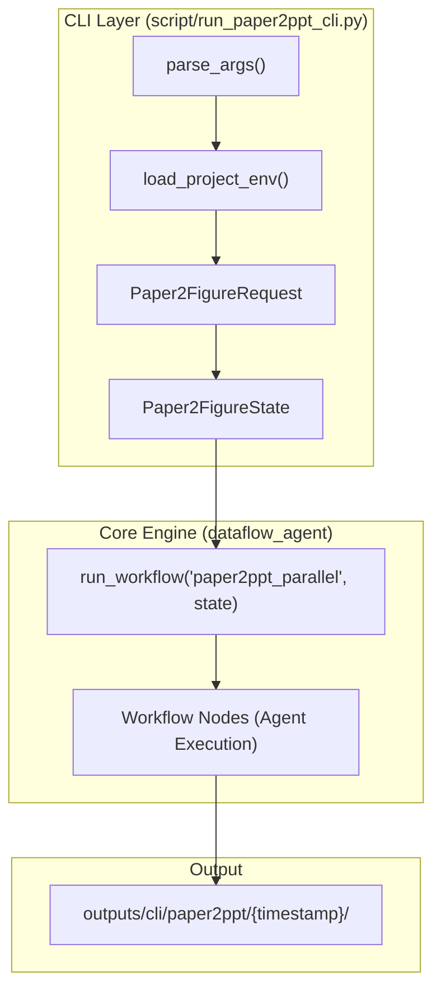

Sources: [script/run_paper2ppt_cli.py:40-230](), [script/run_image2ppt_cli.py:154-209]()

---

## 4. System Runtime Architecture

The following diagram bridges the high-level startup commands to the internal code entities.

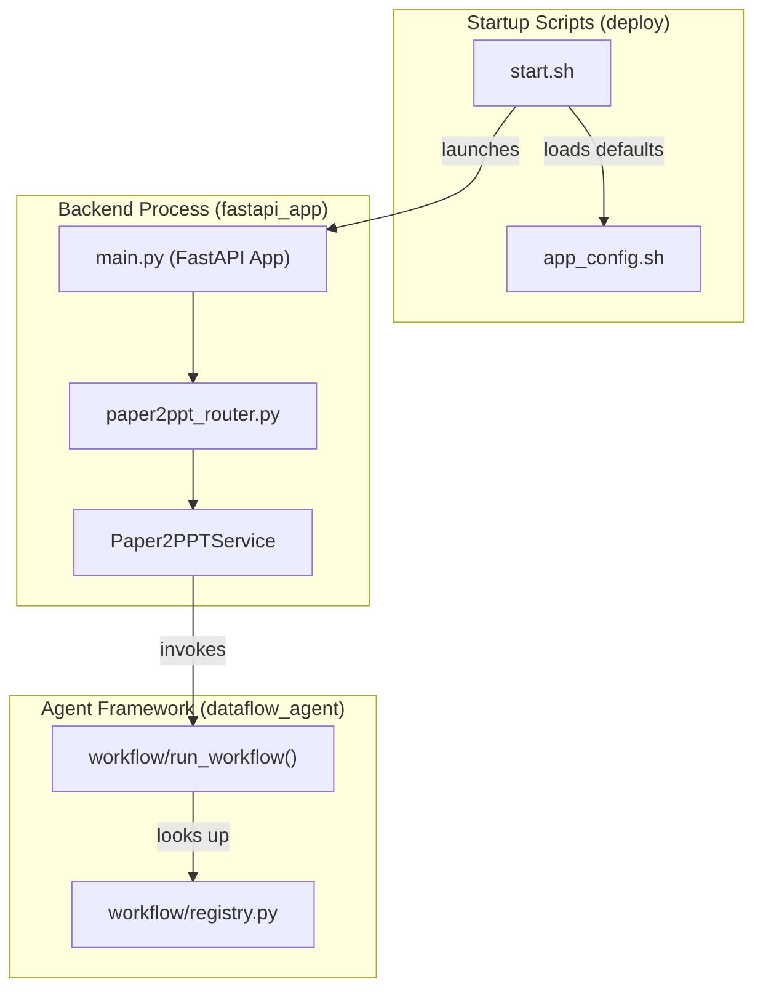

**Key Code Entities**:
- `app_config.sh`: Centralized shell configuration for ports, hosts, and environment variables [deploy/app_config.sh:1-32]().
- `fastapi_app.main:app`: The primary FastAPI instance entry point [fastapi_app/__init__.py:30-41]().
- `run_workflow`: The universal entry point for executing any registered graph [script/run_paper2ppt_cli.py:26-26]().

Sources: [deploy/app_config.sh:1-32](), [fastapi_app/__init__.py:30-41](), [deploy/start.sh:209-215]()

---

## 5. Deployment Cleanup

To stop all running services and release occupied ports:
```bash
bash deploy/stop.sh
```

**Implementation Detail**: `deploy/stop.sh` is aggressive. It first attempts to terminate processes using PIDs from `logs/uvicorn.pid`. If that fails, it uses `lsof`, `ss`, or `netstat` to find any process listening on `APP_PORT` and issues a `SIGTERM` followed by `SIGKILL` if necessary [deploy/stop.sh:61-147]().

Sources: [deploy/stop.sh:1-164]()

---

# Page: Frontend Application

# Frontend Application

<details>
<summary>Relevant source files</summary>

The following files were used as context for generating this wiki page:

- [frontend-workflow/src/App.tsx](frontend-workflow/src/App.tsx)
- [frontend-workflow/src/components/AppSidebar.tsx](frontend-workflow/src/components/AppSidebar.tsx)
- [frontend-workflow/src/components/HomePage.tsx](frontend-workflow/src/components/HomePage.tsx)
- [frontend-workflow/src/config/homePageCatalog.ts](frontend-workflow/src/config/homePageCatalog.ts)
- [frontend-workflow/src/i18n.ts](frontend-workflow/src/i18n.ts)
- [frontend-workflow/src/locales/en/common.json](frontend-workflow/src/locales/en/common.json)
- [frontend-workflow/src/locales/zh/common.json](frontend-workflow/src/locales/zh/common.json)

</details>


## Purpose and Scope

This document describes the React-based web frontend for Paper2Any, which provides an interactive user interface for document conversion workflows. The frontend is a single-page application (SPA) built with React, TypeScript, and Vite, running on port 3000 by default. It serves as a visual orchestration layer for the [DataFlow-Agent Framework](#5), allowing users to upload papers and trigger complex multi-agent pipelines.

For backend API details, see [Backend API](#4). For specific workflow implementations, see [Paper2Any Workflows](#6). For authentication database schemas, see [Supabase Setup](#12.4).

---

## Technology Stack and Architecture

The frontend application uses the following core technologies:

| Technology | Purpose | Version |
|------------|---------|---------|
| **React** | UI framework | 18.x |
| **TypeScript** | Type-safe JavaScript | 5.x |
| **Vite** | Build tool and dev server | Latest |
| **Zustand** | State management | Latest |
| **i18next** | Internationalization | Latest |
| **Tailwind CSS** | Styling framework | 3.x |
| **Lucide React** | Icon library | Latest |

The application follows a component-based architecture with a glassmorphism design language, emphasizing a dark, modern research console aesthetic.

**Sources:** [frontend-workflow/src/App.tsx:177-182](), [frontend-workflow/src/i18n.ts:1-41]()

---

## Navigation and Routing

The application uses a custom routing mechanism based on `window.location.pathname` and `window.history.pushState` to manage navigation between various workflow pages without a full page reload.

### Application Routing Map

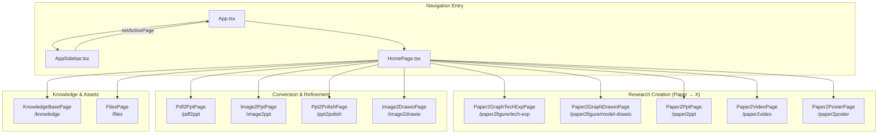

**Sources:** [frontend-workflow/src/App.tsx:29-75](), [frontend-workflow/src/App.tsx:159-174](), [frontend-workflow/src/config/homePageCatalog.ts:1-19]()

---

## Core Components

### Home Page Catalog
The `HomePage` serves as the central hub, categorized into three functional sections: **Creation** (generating from content), **Conversion** (processing existing assets), and **Research** (tracking and management). It uses `featuredHomeCards` and `homeFeatureSections` to render visual entry points with live previews (images, GIFs, or videos).

[frontend-workflow/src/config/homePageCatalog.ts:112-116]()
[frontend-workflow/src/components/HomePage.tsx:101-118]()

### App Sidebar
The `AppSidebar` provides persistent navigation with a hierarchical menu. It features sub-menus for complex categories like `paper2figure` (Tech Route, Model Diagram, AI Drawio) and `paper2ppt` (Image-style vs Editable).

[frontend-workflow/src/components/AppSidebar.tsx:41-88]()

### UI Component Details
For detailed documentation on the design language, upload cards, and specific page layouts, see **[User Interface Components](#3.1)**.

---

## Authentication and User Management

The frontend integrates with **Supabase** for user authentication, supporting:
*   **Email & Phone OTP**: Secure login via one-time passwords.
*   **Anonymous Mode**: Allows limited usage without an account, tracking quota via `localStorage`.
*   **AuthGate**: A higher-order component that protects specific routes and manages the login/registration state.

For implementation details, see **[Authentication & User Management](#3.2)**.

**Sources:** [frontend-workflow/src/App.tsx:131-133](), [frontend-workflow/src/locales/zh/common.json:177-185]()

---

## Quota and Points System

Paper2Any uses a points-based system to manage resource consumption. The frontend displays remaining quota in the header and enforces limits before triggering backend workflows.
*   **Daily Grants**: Automatic point resets for authenticated users.
*   **Usage Tracking**: Real-time updates after successful workflow execution.
*   **Pricing Modes**: Configurable via environment variables for free, paid, or managed billing.

For details on the points ledger and quota enforcement, see **[Quota & Points System](#3.3)**.

**Sources:** [frontend-workflow/src/App.tsx:21-22](), [frontend-workflow/src/locales/zh/common.json:10-10]()

---

## State Management and Services

The application manages global state using **Zustand** and abstracts backend interactions into a service layer.

### Frontend Service Architecture

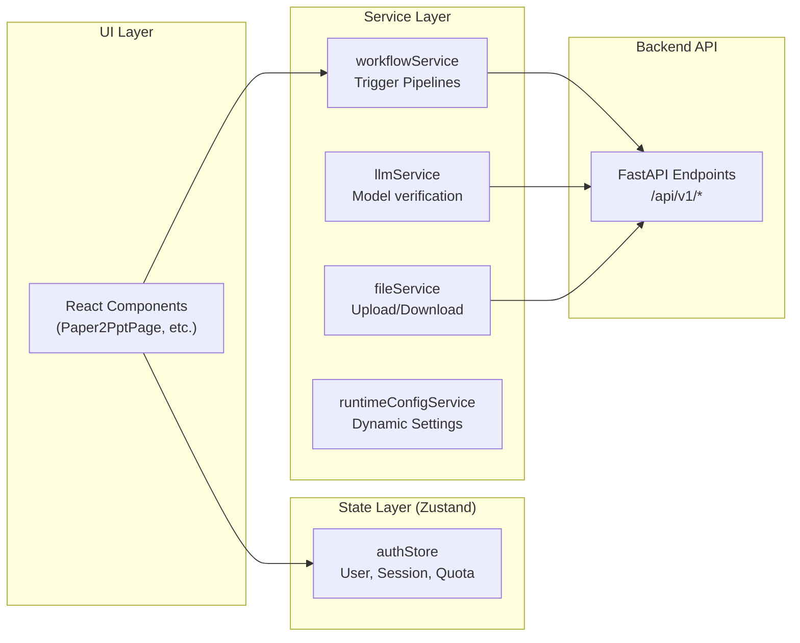

For details on the `authStore` and API interaction patterns, see **[State Management](#3.4)**.

**Sources:** [frontend-workflow/src/App.tsx:1-27](), [frontend-workflow/src/i18n.ts:47-83]()

---

## Internationalization (i18n)

The frontend supports English (`en`) and Chinese (`zh`) through `i18next`. Translation files are modularized by feature (e.g., `paper2ppt.json`, `mindmap.json`).

[frontend-workflow/src/i18n.ts:5-31]()

**Sources:** [frontend-workflow/src/locales/en/common.json:1-12](), [frontend-workflow/src/locales/zh/common.json:1-12]()

---

# Page: User Interface Components

# User Interface Components

<details>
<summary>Relevant source files</summary>

The following files were used as context for generating this wiki page:

- [frontend-workflow/src/App.tsx](frontend-workflow/src/App.tsx)
- [frontend-workflow/src/components/AppSidebar.tsx](frontend-workflow/src/components/AppSidebar.tsx)
- [frontend-workflow/src/components/BilingualHint.tsx](frontend-workflow/src/components/BilingualHint.tsx)
- [frontend-workflow/src/components/HomePage.tsx](frontend-workflow/src/components/HomePage.tsx)
- [frontend-workflow/src/components/NavTooltip.tsx](frontend-workflow/src/components/NavTooltip.tsx)
- [frontend-workflow/src/components/Paper2GraphTechExpPage.tsx](frontend-workflow/src/components/Paper2GraphTechExpPage.tsx)
- [frontend-workflow/src/components/paper2graph/ExamplesSection.tsx](frontend-workflow/src/components/paper2graph/ExamplesSection.tsx)
- [frontend-workflow/src/components/paper2graph/Header.tsx](frontend-workflow/src/components/paper2graph/Header.tsx)
- [frontend-workflow/src/components/paper2graph/UploadCard.tsx](frontend-workflow/src/components/paper2graph/UploadCard.tsx)
- [frontend-workflow/src/components/paper2ppt/CompleteStep.tsx](frontend-workflow/src/components/paper2ppt/CompleteStep.tsx)
- [frontend-workflow/src/components/paper2ppt/FrontendGenerateStep.tsx](frontend-workflow/src/components/paper2ppt/FrontendGenerateStep.tsx)
- [frontend-workflow/src/components/paper2ppt/FrontendSlidePreview.tsx](frontend-workflow/src/components/paper2ppt/FrontendSlidePreview.tsx)
- [frontend-workflow/src/components/paper2ppt/UploadStep.tsx](frontend-workflow/src/components/paper2ppt/UploadStep.tsx)
- [frontend-workflow/src/components/paper2ppt/frontendSlideUtils.ts](frontend-workflow/src/components/paper2ppt/frontendSlideUtils.ts)
- [frontend-workflow/src/components/paper2ppt/types.ts](frontend-workflow/src/components/paper2ppt/types.ts)
- [frontend-workflow/src/config/homePageCatalog.ts](frontend-workflow/src/config/homePageCatalog.ts)
- [frontend-workflow/src/locales/en/common.json](frontend-workflow/src/locales/en/common.json)
- [frontend-workflow/src/locales/en/paper2ppt.json](frontend-workflow/src/locales/en/paper2ppt.json)
- [frontend-workflow/src/locales/en/pptPolish.json](frontend-workflow/src/locales/en/pptPolish.json)
- [frontend-workflow/src/locales/zh/common.json](frontend-workflow/src/locales/zh/common.json)
- [frontend-workflow/src/locales/zh/paper2ppt.json](frontend-workflow/src/locales/zh/paper2ppt.json)
- [frontend-workflow/src/locales/zh/pptPolish.json](frontend-workflow/src/locales/zh/pptPolish.json)

</details>


This page documents the React-based user interface components that make up the Paper2Any web application. It covers the major page components for each workflow (Paper2PPT, Paper2Figure, PDF2PPT, etc.), shared UI patterns (upload cards, settings panels, preview sections), the HomePage catalog, and the AppSidebar navigation system.

## Component Architecture Overview

The frontend follows a page-based architecture where each major workflow has a dedicated page component. These pages compose smaller, reusable components for common patterns like file uploads, settings panels, and result previews.

Title: Frontend Component Hierarchy
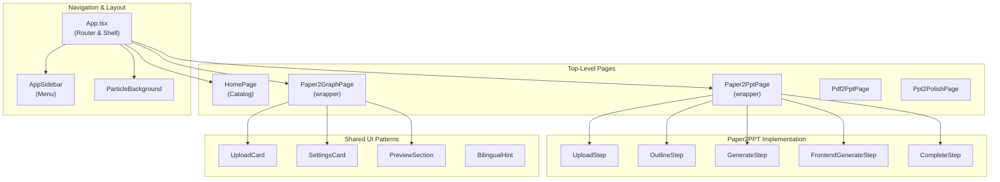

**Sources:** [frontend-workflow/src/App.tsx:1-27](), [frontend-workflow/src/components/AppSidebar.tsx:41-189](), [frontend-workflow/src/components/paper2ppt/UploadStep.tsx:74-112]()

---

## Navigation and Design Language

### Glassmorphism Design
The application utilizes a "glassmorphism" design language, characterized by semi-transparent backgrounds, backdrop blurs, and thin borders.
- **Classes:** `glass`, `glass-dark`, `backdrop-blur-sm`.
- **Background:** A deep dark theme (`bg-[#0a0a1a]`) combined with a `ParticleBackground` component [frontend-workflow/src/App.tsx:177-179]().

### AppSidebar Navigation
The `AppSidebar` manages navigation between the 19+ different workflow pages. It uses a nested menu system for complex categories like `paper2figure` and `paper2ppt` [frontend-workflow/src/components/AppSidebar.tsx:43-47]().

**Navigation Mapping:**
The application uses a manual routing system in `App.tsx` that maps pathnames and legacy hashes to `ActivePage` IDs [frontend-workflow/src/App.tsx:29-75]().

| Page ID | Route Path | Component |
|---------|------------|-----------|
| `home` | `/` | `HomePage` |
| `paper2figure-tech-exp` | `/paper2figure/tech-exp` | `Paper2GraphTechExpPage` |
| `paper2ppt` | `/paper2ppt` | `Paper2PptPage` |
| `paper2ppt-frontend` | `/paper2ppt/frontend` | `Paper2PptPage` (Frontend Mode) |
| `files` | `/files` | `FilesPage` |

**Sources:** [frontend-workflow/src/App.tsx:55-75](), [frontend-workflow/src/components/AppSidebar.tsx:90-189]()

---

## Major Workflow Components

### Paper2PPT Workflow
Paper2PPT supports two generation modes: `image` (visual-heavy) and `frontend` (editable HTML/CSS) [frontend-workflow/src/components/paper2ppt/types.ts:2]().

#### 1. Upload & Configuration (`UploadStep.tsx`)
This component handles the initial input and model configuration.
- **Upload Modes:** File (PDF), Text (Paste), or Topic (Deep Research) [frontend-workflow/src/components/paper2ppt/types.ts:115]().
- **Style Configuration:** Users can select presets (`modern`, `business`, `academic`, `creative`) or upload a reference image [frontend-workflow/src/components/paper2ppt/UploadStep.tsx:28-35]().
- **Model Selection:** Supports selecting both the LLM and the image generation model (e.g., Gemini 3 Pro for Chinese support) [frontend-workflow/src/components/paper2ppt/UploadStep.tsx:60-63]().

#### 2. Editable PPT Generation (`FrontendGenerateStep.tsx`)
A specialized interface for the `frontend` mode that allows real-time preview and editing of slide code.
- **Dual Panel:** Toggle between 'preview' and 'code' modes [frontend-workflow/src/components/paper2ppt/FrontendGenerateStep.tsx:71]().
- **Visual QA:** Includes a `handleReviewSlide` function that triggers an AI visual inspection of the slide [frontend-workflow/src/components/paper2ppt/FrontendGenerateStep.tsx:31]().
- **Self-Healing:** The `handleDebugCodeEdit` function allows the AI to fix code errors based on visual feedback [frontend-workflow/src/components/paper2ppt/FrontendGenerateStep.tsx:33]().

#### 3. Slide Preview & Inline Editing (`FrontendSlidePreview.tsx`)
The core rendering engine for editable slides.
- **Markup Builder:** `buildFrontendSlideMarkup` combines HTML templates, CSS, and `editableFields` into a final render [frontend-workflow/src/components/paper2ppt/frontendSlideUtils.ts:149-174]().
- **Inline Editor:** Clicking text elements opens a floating editor for `text`, `textarea`, or `list` types [frontend-workflow/src/components/paper2ppt/FrontendSlidePreview.tsx:18-28]().
- **Image Replacement:** `openImagePicker` allows users to replace AI-generated or paper-extracted images with local uploads [frontend-workflow/src/components/paper2ppt/FrontendSlidePreview.tsx:116-122]().

Title: Paper2PPT Frontend Data Flow
```mermaid
graph LR
    subgraph "State Model"
        FS["FrontendSlide<br/>(htmlTemplate, cssCode)"]
        EF["EditableFields<br/>(key, value, items)"]
        VA["VisualAssets<br/>(src, key)"]
    end

    subgraph "Rendering Logic"
        Markup["buildFrontendSlideMarkup()"]
        Sanitize["sanitizeTemplate() / sanitizeCss()"]
    end

    subgraph "UI Component"
        Preview["FrontendSlidePreview"]
        Editor["InlineEditorState"]
    end

    FS --> Markup
    EF --> Markup
    VA --> Markup
    Markup --> Sanitize
    Sanitize --> Preview
    Preview -->|Click| Editor
    Editor -->|Commit| EF
```

**Sources:** [frontend-workflow/src/components/paper2ppt/types.ts:68-79](), [frontend-workflow/src/components/paper2ppt/frontendSlideUtils.ts:149-174](), [frontend-workflow/src/components/paper2ppt/FrontendSlidePreview.tsx:135-155]()

---

### PPT Polish Workflow
The `Ppt2PolishPage` (translated as "PPT 润色优化") uses a multi-stage pipeline to beautify existing slides.

**Stages:**
1. **Upload:** Supports PPTX or PDF (16:9) [frontend-workflow/src/locales/zh/pptPolish.json:14-15]().
2. **Beautify:** A side-by-side comparison interface showing "Original PPT" vs "Beautified Result" [frontend-workflow/src/locales/zh/pptPolish.json:93-94]().
3. **Refinement:** Users can enter "Refinement Prompts" to regenerate specific pages [frontend-workflow/src/locales/zh/pptPolish.json:97-98]().

**Sources:** [frontend-workflow/src/locales/zh/pptPolish.json:6-10](), [frontend-workflow/src/locales/en/pptPolish.json:85-102]()

---

## Shared UI Patterns

### HomePage Catalog
The `HomePage` acts as a central hub, organizing workflows into three functional sections defined in `homePageCatalog.ts`.

| Section | Description | Key Workflows |
|---------|-------------|---------------|
| **Creation** | Generate from paper content | Paper2Figure, Paper2PPT, Paper2Video |
| **Conversion** | Refine existing material | PDF2PPT, Image2PPT, PPT Polish |
| **Research** | Tracking and writing | Paper2Citation, Rebuttal, Knowledge Base |

**Sources:** [frontend-workflow/src/locales/zh/common.json:70-82](), [frontend-workflow/src/components/HomePage.tsx:1-27]()

### Upload Cards and Settings
- **UploadCard:** Standardized interface for `paper2figure` workflows, supporting PDF analysis and direct text prompts [frontend-workflow/src/components/paper2graph/UploadCard.tsx:1-20]().
- **SettingsPanel:** Collapsible panels for API Key entry, Model selection, and Style configuration. It uses `localStorage` to persist `apiUrl` and `apiKey` [frontend-workflow/src/components/paper2ppt/UploadStep.tsx:56-59]().

### History and File Management
The `FilesPage` provides a centralized view of all generated assets across all workflows.
- **Data Source:** Fetches from `/api/v1/files/` backend endpoint.
- **Actions:** Download and Delete [frontend-workflow/src/locales/zh/common.json:200-202]().

**Sources:** [frontend-workflow/src/components/FilesPage.tsx:11](), [frontend-workflow/src/locales/en/common.json:186-206]()

---

## Internationalization (i18n)
The UI is fully bilingual (Chinese/English).
- **Namespaces:** `common`, `paper2ppt`, `pptPolish`, `paper2graph`.
- **Implementation:** Uses `useTranslation` hook and JSON locale files [frontend-workflow/src/locales/zh/common.json:1-5]().

Title: Natural Language to Code Entity Mapping
```mermaid
graph TD
    subgraph "Natural Language (UI)"
        T1["'可编辑版 PPT' (Editable PPT)"]
        T2["'逐页美化' (Beautify Pages)"]
        T3["'历史文件' (History Files)"]
    end

    subgraph "Code Entities (Frontend)"
        C1["ActivePage: 'paper2ppt-frontend'"]
        C2["Step: 'beautify'"]
        C3["Component: FilesPage"]
    end

    subgraph "Backend Routes"
        R1["/api/v1/paper2ppt/frontend/generate"]
        R2["/api/v1/ppt_polish/beautify"]
        R3["/api/v1/files/list"]
    end

    T1 --> C1
    C1 --> R1
    T2 --> C2
    C2 --> R2
    T3 --> C3
    C3 --> R3
```

**Sources:** [frontend-workflow/src/App.tsx:63](), [frontend-workflow/src/locales/zh/pptPolish.json:8](), [frontend-workflow/src/locales/en/common.json:25]()

---

# Page: Authentication & User Management

# Authentication & User Management

<details>
<summary>Relevant source files</summary>

The following files were used as context for generating this wiki page:

- [fastapi_app/config/pricing.py](fastapi_app/config/pricing.py)
- [fastapi_app/config/pricing.yaml](fastapi_app/config/pricing.yaml)
- [fastapi_app/services/managed_api_service.py](fastapi_app/services/managed_api_service.py)
- [frontend-workflow/src/components/AccountPage.tsx](frontend-workflow/src/components/AccountPage.tsx)
- [frontend-workflow/src/components/AuthProvider.tsx](frontend-workflow/src/components/AuthProvider.tsx)
- [frontend-workflow/src/components/PointsDisplay.tsx](frontend-workflow/src/components/PointsDisplay.tsx)
- [frontend-workflow/src/components/UserMenu.tsx](frontend-workflow/src/components/UserMenu.tsx)
- [frontend-workflow/src/components/auth/AuthGate.tsx](frontend-workflow/src/components/auth/AuthGate.tsx)
- [frontend-workflow/src/components/auth/LoginPage.tsx](frontend-workflow/src/components/auth/LoginPage.tsx)
- [frontend-workflow/src/components/auth/RegisterPage.tsx](frontend-workflow/src/components/auth/RegisterPage.tsx)
- [frontend-workflow/src/lib/supabase.ts](frontend-workflow/src/lib/supabase.ts)
- [frontend-workflow/src/stores/authStore.ts](frontend-workflow/src/stores/authStore.ts)

</details>


This page documents the authentication and user management system in Paper2Any. The system integrates **Supabase** for identity management, OTP verification, and OAuth, while providing a fallback "No Auth" mode for local or unrestricted deployments.

---

## Overview

Paper2Any implements a multi-layered authentication strategy managed primarily through the frontend `authStore` and protected by an `AuthGate` component.

| Feature | Supabase Mode (Configured) | No-Auth Mode (Default/Local) |
| :--- | :--- | :--- |
| **User Identity** | Email, Phone (OTP), or OAuth | Mock "Anonymous" user |
| **Quota** | Points-based (Database enforced) | Unlimited (∞) |
| **Storage** | Cloud-synced user history | Local browser storage / Session only |
| **Persistence** | Persistent across devices | Local to browser instance |

**Sources**: [frontend-workflow/src/lib/supabase.ts:11-42](), [frontend-workflow/src/components/auth/AuthGate.tsx:32-35]()

---

## System Architecture

### Authentication Data Flow

The system uses a singleton Supabase client and a Zustand-based `authStore` to synchronize session state across the application.

```mermaid
graph TD
    subgraph "Frontend (React + Zustand)"
        AuthProvider["AuthProvider.tsx"]
        AuthStore["authStore.ts (Zustand)"]
        AuthGate["AuthGate.tsx"]
        UI["Login/Register/Account Pages"]
    end

    subgraph "External Services"
        SupaAuth["Supabase Auth"]
        SupaDB["Supabase Database"]
        SmsService["Edge Function (SMS OTP)"]
    end

    subgraph "Backend (FastAPI)"
        AccountRouter["/api/v1/account/*"]
        QuotaService["Managed API Service"]
    end

    AuthProvider -->|"onAuthStateChange"| AuthStore
    AuthStore -->|"signIn/signUp"| SupaAuth
    SupaAuth -->|"JWT"| AuthStore
    AuthStore -->|"refreshQuota()"| AccountRouter
    AccountRouter -->|"Fetch Points"| SupaDB
    SupaAuth -.->|"Trigger SMS"| SmsService
    AuthGate -->|"Check Session"| AuthStore
```

**Sources**: [frontend-workflow/src/components/AuthProvider.tsx:18-53](), [frontend-workflow/src/stores/authStore.ts:74-91](), [fastapi_app/services/managed_api_service.py:124-138]()

---

## Authentication Methods

### 1. Phone OTP (Recommended)
Users can sign in using a mobile phone number. The system normalizes Chinese phone numbers to E.164 format before sending the request to Supabase.
- **Function**: `signInWithPhoneOtp(phone)` [frontend-workflow/src/stores/authStore.ts:232-255]()
- **Normalization**: Prepends `+86` if missing [frontend-workflow/src/stores/authStore.ts:48-53]()

### 2. Email & Password
Standard registration and login flow.
- **Registration**: `signUpWithEmail(email, password)` [frontend-workflow/src/stores/authStore.ts:141-188]()
- **Verification**: Supports mandatory email OTP verification via `VerifyOtpPage` [frontend-workflow/src/components/auth/VerifyOtpPage.tsx]() (referenced).

### 3. OAuth & Anonymous Mode
- **OAuth**: Supports providers like Google/GitHub via `signInWithOAuth` [frontend-workflow/src/stores/authStore.ts:276-286]().
- **Anonymous**: If Supabase is not configured, the system defaults to a state where `quota.remaining` is set to a very high value (effectively infinity) [frontend-workflow/src/components/PointsDisplay.tsx:48-53]().

---

## Quota & Points Management

The system uses a points-based ledger to track usage. Costs for different workflows (e.g., `paper2video` costing 5 points vs `paper2ppt` costing 1 point) are defined in the backend configuration.

### Points Display Logic
The `PointsDisplay` component provides real-time feedback on remaining credits.

| State | Display | Title Hint |
| :--- | :--- | :--- |
| **No Auth** | `∞` | "当前为无限用量" |
| **Paid Mode** | `∞` | "当前为付费模式，平台不扣点" |
| **Standard User** | `{N} 点` | "剩余点数" |

**Sources**: [frontend-workflow/src/components/PointsDisplay.tsx:47-62](), [fastapi_app/config/pricing.py:12-57]()

### Account Profile & Redemption
The `AccountPage` allows users to view their transaction history and redeem points via codes.
- **Redemption Endpoint**: `POST /api/v1/account/points/redeem` [frontend-workflow/src/components/AccountPage.tsx:204-210]()
- **Ledger Reasons**: Includes `signup_bonus`, `daily_grant`, `referral_inviter`, and `workflow_` prefix for usage tracking [frontend-workflow/src/components/AccountPage.tsx:53-74]().

---

## Technical Implementation

### AuthGate: The Security Guard
The `AuthGate` component wraps the main application layout and determines which view to render based on the current session and configuration.

```mermaid
flowchart TD
    Start["AuthGate Render"] --> ConfigCheck{"isSupabaseConfigured()?"}
    ConfigCheck -- "No" --> RenderApp["Render Main Application"]
    ConfigCheck -- "Yes" --> SessionCheck{"user exists?"}
    
    SessionCheck -- "No" --> LoginView["Show LoginPage / RegisterPage"]
    SessionCheck -- "Yes" --> OTPCheck{"needsOtpVerification?"}
    
    OTPCheck -- "Yes" --> VerifyView["Show VerifyOtpPage"]
    OTPCheck -- "No" --> RenderApp
```

**Sources**: [frontend-workflow/src/components/auth/AuthGate.tsx:22-80]()

### Key Code Entities

| Class/Function | Location | Role |
| :--- | :--- | :--- |
| `useAuthStore` | `authStore.ts` | Central Zustand store managing `user`, `session`, and `quota` state. |
| `AuthProvider` | `AuthProvider.tsx` | Handles session lifecycle (recovery from storage and auto-refresh). |
| `isSupabaseConfigured` | `supabase.ts` | Utility to detect if `VITE_SUPABASE_URL` is present. |
| `get_billing_mode` | `managed_api_service.py` | Backend logic to determine if the system is in `free` or `paid` mode. |

**Sources**: [frontend-workflow/src/stores/authStore.ts:74](), [frontend-workflow/src/components/AuthProvider.tsx:18](), [frontend-workflow/src/lib/supabase.ts:17](), [fastapi_app/services/managed_api_service.py:124]()

---

## User Menu & Profile

The `UserMenu` component provides a dropdown for user actions. It adapts its display based on the user's status:
- **Display Name**: Derived from email prefix or last 4 digits of phone [frontend-workflow/src/components/UserMenu.tsx:42]().
- **Status Badge**: Displays "PRO MEMBER" for authenticated users [frontend-workflow/src/components/UserMenu.tsx:75]().
- **Redemption**: Integrates with the `AccountPage` for point redemption [frontend-workflow/src/components/UserMenu.tsx:138-151]().

---

## Referral & Invite System

Paper2Any includes a referral system to incentivize user growth.
1. **Invite Code Storage**: During registration, an invite code can be saved to `localStorage` [frontend-workflow/src/components/auth/RegisterPage.tsx:80-82]().
2. **Claiming**: Upon successful login or signup, the system attempts to claim the stored code via the backend [frontend-workflow/src/stores/authStore.ts:126-135]().
3. **Rewards**: Points are granted to both inviter and invitee based on `runtimeConfig` settings [frontend-workflow/src/components/AccountPage.tsx:101-106]().

**Sources**: [frontend-workflow/src/stores/authStore.ts:55-69](), [fastapi_app/config/pricing.py:17-18]()

---

# Page: Quota & Points System

# Quota & Points System

<details>
<summary>Relevant source files</summary>

The following files were used as context for generating this wiki page:

- [fastapi_app/config/pricing.py](fastapi_app/config/pricing.py)
- [fastapi_app/config/pricing.yaml](fastapi_app/config/pricing.yaml)
- [fastapi_app/routers/account.py](fastapi_app/routers/account.py)
- [fastapi_app/services/billing_service.py](fastapi_app/services/billing_service.py)
- [fastapi_app/services/managed_api_service.py](fastapi_app/services/managed_api_service.py)
- [fastapi_app/services/paper2ppt_task_service.py](fastapi_app/services/paper2ppt_task_service.py)
- [frontend-workflow/src/components/AccountPage.tsx](frontend-workflow/src/components/AccountPage.tsx)
- [frontend-workflow/src/components/PointsDisplay.tsx](frontend-workflow/src/components/PointsDisplay.tsx)
- [frontend-workflow/src/services/quotaService.ts](frontend-workflow/src/services/quotaService.ts)
- [frontend-workflow/src/services/runtimeConfigService.ts](frontend-workflow/src/services/runtimeConfigService.ts)
- [frontend-workflow/src/services/workflowService.ts](frontend-workflow/src/services/workflowService.ts)
- [frontend-workflow/src/stores/authStore.ts](frontend-workflow/src/stores/authStore.ts)
- [script/heavy_workflow_worker.py](script/heavy_workflow_worker.py)

</details>


**Purpose**: This document explains the quota management system used to limit and track API usage in Paper2Any. The system implements a flexible points-based architecture that supports multiple billing modes (Free, Paid, Managed), daily grants, referral rewards, and redeemable codes. For authentication mechanisms, see [3.2 Authentication & User Management]().

---

## Overview

The quota system enforces usage limits through a check-before-execute pattern. The implementation spans from frontend service wrappers to backend billing logic and Supabase-backed persistence.

### Architecture & Data Flow

```mermaid
graph TB
    subgraph "Frontend (React/Zustand)"
        UI["UI Component"]
        AuthStore["authStore.refreshQuota()"]
        WFService["workflowService.callWorkflow()"]
        QuotaService["quotaService.checkQuota()"]
    end
    
    subgraph "Backend API (FastAPI)"
        AccountRouter["routers/account.py"]
        BillingService["services/billing_service.py"]
        ManagedAPI["services/managed_api_service.py"]
        PricingConfig["config/pricing.py"]
    end
    
    subgraph "Persistence (Supabase)"
        SupaAdmin["supabase_admin_service.py"]
        PointsLedger["points_ledger table"]
        PointsBalance["points_balance view"]
        DailyGrant["check_and_grant_daily_usage RPC"]
    end
    
    UI --> WFService
    WFService --> QuotaService
    QuotaService --> AccountRouter
    AccountRouter --> BillingService
    BillingService --> ManagedAPI
    BillingService --> PricingConfig
    BillingService --> SupaAdmin
    SupaAdmin --> DailyGrant
    DailyGrant --> PointsBalance
    PointsBalance --> PointsLedger
    
    AuthStore -.-> QuotaService
```

**Sources**: [frontend-workflow/src/services/quotaService.ts:92-127](), [fastapi_app/services/billing_service.py:37-127](), [fastapi_app/routers/account.py:22-30]()

---

## Billing Modes

The system behavior changes significantly based on the `APP_BILLING_MODE` environment variable.

| Mode | Behavior | Enforcement |
| :--- | :--- | :--- |
| **Free** | Unlimited usage for all users. | Backend returns `9,999,999` points. |
| **Paid** | Users consume points from their balance. | `BillingService` checks Supabase ledger. |
| **Managed** | Uses backend-configured API keys for LLM/Image services. | Credentials fetched via `managed_api_service.py`. |

**Sources**: [fastapi_app/services/managed_api_service.py:124-137](), [fastapi_app/services/billing_service.py:110-118]()

---

## Points System & Pricing

### Pricing Configuration
Costs are defined in `fastapi_app/config/pricing.yaml` (and mirrored in `DEFAULT_PRICING` in `pricing.py`). Each workflow type has an associated cost.

| Workflow Type | Default Cost (Points) |
| :--- | :--- |
| `paper2figure` | 1 |
| `paper2ppt` | 1 |
| `paper2video` | 5 |
| `kb_deepresearch` | 2 |
| `kb_mindmap` | 2 (Tiered) |

**Sources**: [fastapi_app/config/pricing.py:12-57](), [fastapi_app/config/pricing.yaml:35-53]()

### Tiered Pricing: Mind Maps
Mind maps use a dynamic pricing model based on the complexity of the generated graph.
- **Node Tiers**: 1-8 nodes (2 pts), 9-16 (3 pts), 17-32 (4 pts), 33-64 (6 pts), 65+ (8 pts).
- **Depth Bonus**: +1 point per level above a threshold of 4, capped at +2 points.

**Sources**: [fastapi_app/config/pricing.py:106-182](), [fastapi_app/config/pricing.yaml:13-33]()

---

## Quota Lifecycle

### 1. Quota Checking
The frontend `quotaService` caches results for 10 seconds (`QUOTA_CACHE_TTL_MS`) to prevent redundant network calls during rapid UI interactions.

```mermaid
sequenceDiagram
    participant UI as "Frontend UI"
    participant QS as "quotaService.ts"
    participant BR as "account.py /quota"
    participant BS as "billing_service.py"
    
    UI->>QS: checkQuota(userId)
    alt Cache Valid
        QS-->>UI: Cached QuotaInfo
    else Cache Stale
        QS->>BR: GET /api/v1/account/quota
        BR->>BS: get_quota(user)
        BS->>BS: _get_cached_quota (Server-side)
        BS-->>QS: {used, limit, remaining, ...}
        QS->>QS: writeCachedQuota()
        QS-->>UI: QuotaInfo
    end
```

**Sources**: [frontend-workflow/src/services/quotaService.ts:24-68](), [fastapi_app/services/billing_service.py:59-84]()

### 2. Daily Grants & Bonuses
The system automatically manages user balances via Supabase logic:
- **Daily Grant**: Users receive 5 points daily, up to a balance cap of 15.
- **Signup Bonus**: New users receive 0 points by default (configurable).
- **Referral Rewards**: Inviter gets 5 points; Invitee gets 0 points by default.

**Sources**: [fastapi_app/config/pricing.py:12-20](), [fastapi_app/config/pricing.yaml:2-7]()

### 3. Consumption
Usage is recorded after a successful workflow execution.

```typescript
// workflowService.ts
export async function callWorkflow(...) {
  const quota = await checkQuota(userId);
  if (quota.remaining <= 0) return { success: false, error: 'Quota Exhausted' };

  const response = await backendFetch(url, ...);
  if (response.ok) {
    await recordUsage(userId, workflowType); // Deducts points
    useAuthStore.getState().refreshQuota();  // Updates UI
  }
}
```

**Sources**: [frontend-workflow/src/services/workflowService.ts:69-124](), [frontend-workflow/src/services/quotaService.ts:136-169]()

---

## Points Redemption System

Users can redeem points using codes stored in flat text files on the server.

### Configuration
The mapping of point values to file paths is defined in `pricing.yaml`:
```yaml
redeem_code_files:
  "10": data/redeem_codes/points_10.txt
  "50": data/redeem_codes/points_50.txt
  "100": data/redeem_codes/points_100.txt
```

### Redemption Flow
1. User submits a code via `AccountPage`.
2. `BillingService.redeem_points_code` checks all configured files.
3. If the code is found, it is added to the `points_ledger` table with a `redeem_code_{points}` reason.
4. The system ensures codes are used once by checking the `event_key` (hash of the code) in the ledger.

**Sources**: [fastapi_app/services/billing_service.py:180-220](), [frontend-workflow/src/components/AccountPage.tsx:193-230](), [fastapi_app/config/pricing.yaml:9-12]()

---

## Implementation Details

### Key Classes & Functions

| Entity | Location | Role |
| :--- | :--- | :--- |
| `BillingService` | `fastapi_app/services/billing_service.py` | Core logic for point deduction, grants, and redemption. |
| `quotaService` | `frontend-workflow/src/services/quotaService.ts` | Frontend client for checking and recording usage with caching. |
| `workflowService` | `frontend-workflow/src/services/workflowService.ts` | Orchestrates quota checks before calling backend workflows. |
| `PointsDisplay` | `frontend-workflow/src/components/PointsDisplay.tsx` | UI component that renders remaining balance or "∞". |
| `Paper2PPTTaskService` | `fastapi_app/services/paper2ppt_task_service.py` | Handles point consumption for long-running async tasks. |

**Sources**: [fastapi_app/services/billing_service.py:37-40](), [frontend-workflow/src/services/quotaService.ts:4-10](), [frontend-workflow/src/components/PointsDisplay.tsx:13-63](), [fastapi_app/services/paper2ppt_task_service.py:82-109]()

### Task-Based Consumption
For long-running tasks like `paper2ppt`, points are consumed at the moment of submission via `_consume_submission_charge` to prevent "free" retries of expensive operations.

**Sources**: [fastapi_app/services/paper2ppt_task_service.py:103-110]()

---

# Page: State Management

# State Management

<details>
<summary>Relevant source files</summary>

The following files were used as context for generating this wiki page:

- [dataflow_agent/toolkits/postertool/src/agents/curator.py](dataflow_agent/toolkits/postertool/src/agents/curator.py)
- [dataflow_agent/toolkits/postertool/src/agents/parser.py](dataflow_agent/toolkits/postertool/src/agents/parser.py)
- [fastapi_app/dependencies/auth.py](fastapi_app/dependencies/auth.py)
- [fastapi_app/routers/files.py](fastapi_app/routers/files.py)
- [fastapi_app/routers/pdf2ppt.py](fastapi_app/routers/pdf2ppt.py)
- [fastapi_app/services/paper2poster_service.py](fastapi_app/services/paper2poster_service.py)
- [frontend-workflow/src/services/fileService.ts](frontend-workflow/src/services/fileService.ts)
- [frontend-workflow/src/services/llmService.ts](frontend-workflow/src/services/llmService.ts)
- [frontend-workflow/src/services/quotaService.ts](frontend-workflow/src/services/quotaService.ts)
- [frontend-workflow/src/services/workflowService.ts](frontend-workflow/src/services/workflowService.ts)
- [tests/test_paper2poster_parser.py](tests/test_paper2poster_parser.py)

</details>


This page documents the state management architecture of the Paper2Any frontend application. It details the use of **Zustand** for global stores, the **Service Layer** pattern for encapsulating backend interactions, and the data flow between components and FastAPI endpoints.

## Overview

Paper2Any employs a layered state management approach to separate UI logic from business logic and server communication.

| Layer | Technology | Responsibility |
|:---|:---|:---|
| **Global Store** | Zustand (`authStore`) | Authentication status, user session, and real-time quota tracking. |
| **Service Layer** | TypeScript Modules | Encapsulating API calls, file uploads, and business logic (e.g., `workflowService`, `fileService`). |
| **Local State** | React `useState` / `useReducer` | Component-specific UI states (loading, progress, form inputs). |
| **Persistence** | `localStorage` / Supabase | Storing runtime configurations and user file history. |

### System Data Flow

The following diagram bridges the Natural Language concepts to specific Code Entities.

**Diagram: State and Service Interaction**
```mermaid
graph TD
    subgraph "Frontend Code Space"
        A["useAuthStore"] -- "tracks" --> B["QuotaInfo"]
        C["workflowService"] -- "calls" --> D["backendFetch"]
        C -- "triggers" --> A
        E["fileService"] -- "uploads" --> F["FormData"]
    end

    subgraph "Backend API Space"
        G["/api/v1/account/quota"] -- "returns" --> B
        H["/api/v1/files/upload"] -- "receives" --> F
        I["/api/v1/paper2ppt/generate"] -- "handled by" --> J["Paper2PPTService"]
    end

    subgraph "Storage Space"
        K["outputs/{email}/{task}/"]
    end

    D -- "HTTP Request" --> G
    D -- "HTTP Request" --> I
    F -- "Multipart" --> H
    H -- "writes to" --> K
```
**Sources:** [frontend-workflow/src/services/workflowService.ts:13-24](), [frontend-workflow/src/services/quotaService.ts:4-10](), [fastapi_app/routers/files.py:31-33]()

---

## Global State: authStore

The `authStore` is the primary global state container, implemented using **Zustand**. It centralizes authentication and quota management, ensuring that usage limits are enforced across all components.

### Key State and Actions
- `user`: The current authenticated user object.
- `quota`: A `QuotaInfo` object containing `used`, `limit`, and `remaining` points.
- `refreshQuota()`: An action that invokes `quotaService.checkQuota` to sync with the backend.

**Sources:** [frontend-workflow/src/services/workflowService.ts:127-128](), [frontend-workflow/src/services/quotaService.ts:4-10]()

---

## Service Layer Patterns

Paper2Any uses a dedicated service layer to abstract backend complexities. This layer ensures that every workflow request follows a standardized sequence: **Quota Check → API Call → Usage Recording → File Persistence**.

### 1. Workflow Service (`workflowService.ts`)
The `workflowService` acts as a high-level orchestrator for all document conversion tasks.

- **`callWorkflow`**: The core function that wraps `backendFetch`. It performs an upstream quota check before initiating the request and triggers a quota refresh in `authStore` upon completion. [frontend-workflow/src/services/workflowService.ts:58-80]()
- **`callWorkflowBlob`**: Specialization for endpoints returning binary data (e.g., PPTX files), handling `Content-Disposition` headers to extract filenames. [frontend-workflow/src/services/workflowService.ts:181-207]()

### 2. Quota Service (`quotaService.ts`)
Manages the points-based usage system. It includes a caching mechanism to prevent redundant API calls.

- **`checkQuota`**: Fetches the current user's balance from `/api/v1/account/quota`. It supports a "stale-while-revalidate" pattern using `QUOTA_CACHE_TTL_MS`. [frontend-workflow/src/services/quotaService.ts:92-127]()
- **`recordUsage`**: Informs the backend to consume points after a successful workflow execution. [frontend-workflow/src/services/quotaService.ts:136-169]()

### 3. File Service (`fileService.ts`)
Handles the lifecycle of generated assets and user uploads.

- **`uploadAndSaveFile`**: Sanitizes filenames using `sanitizeFileName` to ensure compatibility with storage systems before sending a `POST` request to `/api/v1/files/upload`. [frontend-workflow/src/services/fileService.ts:56-80]()
- **`getFileRecords`**: Retrieves the user's conversion history from `/api/v1/files/history`. [frontend-workflow/src/services/fileService.ts:113-134]()

### 4. Runtime Config Service (`runtimeConfigService.ts`)
Manages application-wide settings fetched from the backend, such as `billing_mode` and whether `server_side_billing_enforced` is active. [frontend-workflow/src/services/quotaService.ts:141-144]()

**Sources:** [frontend-workflow/src/services/workflowService.ts:58-150](), [frontend-workflow/src/services/quotaService.ts:24-27](), [frontend-workflow/src/services/fileService.ts:33-54]()

---

## Data Flow: Component to Backend

The interaction between the React frontend and the FastAPI backend follows a strict request-response lifecycle.

**Diagram: Workflow Execution Data Flow**
```mermaid
sequenceDiagram
    participant UI as "React Component"
    participant WS as "workflowService"
    participant QS as "quotaService"
    participant BE as "FastAPI (e.g. Paper2PosterService)"
    participant FS as "fileService"

    UI->>WS: callWorkflow(type, url, formData)
    WS->>QS: checkQuota(userId)
    QS-->>WS: {remaining: 5}
    
    WS->>BE: POST /api/v1/... (with JWT)
    Note over BE: Subprocess Workflow Execution
    BE-->>WS: 200 OK (File Blob)
    
    WS->>QS: recordUsage(userId, type)
    WS->>FS: uploadAndSaveFile(blob, name)
    WS->>UI: return {success: true, response}
```
**Sources:** [frontend-workflow/src/services/workflowService.ts:58-150](), [fastapi_app/services/paper2poster_service.py:68-82]()

### Implementation Example: PDF to PPT
When a user converts a PDF, the `PDF2PPTService` on the backend handles the file save and workflow trigger, while the frontend `workflowService` manages the state transition.

| Frontend Action | Backend Route | Backend Service |
|:---|:---|:---|
| `callWorkflowBlob` | `/api/v1/pdf2ppt/generate` | `PDF2PPTService.generate_ppt` |
| `uploadAndSaveFile` | `/api/v1/files/upload` | `fastapi_app.routers.files.upload_file` |

**Sources:** [fastapi_app/routers/pdf2ppt.py:20-36](), [fastapi_app/routers/files.py:31-33](), [frontend-workflow/src/services/workflowService.ts:181-186]()

---

## State Management in Complex Workflows

For multi-agent workflows like `paper2poster`, state is managed via a `PosterState` object on the backend, while the frontend tracks progress through status updates.

### Backend State Transitions
The backend `Parser` agent initializes the state by extracting raw text and assets, which are then passed to the `StoryBoardCurator`.

1.  **Parser**: Extracts `raw_text`, `images`, and `tables`. [dataflow_agent/toolkits/postertool/src/agents/parser.py:96-101]()
2.  **Curator**: Generates a `story_board` based on `structured_sections` and `narrative_content`. [dataflow_agent/toolkits/postertool/src/agents/curator.py:59-62]()

### Frontend File Synchronization
The frontend ensures that generated files are visible in the user's history by fetching metadata from the `files` router.

- **Deduplication**: The backend logic in `_resolve_user_dir_candidates` scans multiple possible user identifiers (ID, Email, Phone) to ensure historical files are not lost during state transitions. [fastapi_app/routers/files.py:70-95]()
- **Filtering**: The history view filters out intermediate worker files and `__pycache__` to show only final outputs like `.pptx`, `.mp4`, or `.drawio`. [fastapi_app/routers/files.py:147-152]()

**Sources:** [dataflow_agent/toolkits/postertool/src/agents/parser.py:53-125](), [fastapi_app/routers/files.py:147-194]()

---

# Page: Backend API

# Backend API

<details>
<summary>Relevant source files</summary>

The following files were used as context for generating this wiki page:

- [.gitignore](.gitignore)
- [dataflow_agent/workflow/wf_paper2ppt_parallel_consistent_style.py](dataflow_agent/workflow/wf_paper2ppt_parallel_consistent_style.py)
- [fastapi_app/main.py](fastapi_app/main.py)
- [fastapi_app/middleware/api_key.py](fastapi_app/middleware/api_key.py)
- [fastapi_app/routers/__init__.py](fastapi_app/routers/__init__.py)
- [fastapi_app/routers/paper2any.py](fastapi_app/routers/paper2any.py)
- [fastapi_app/routers/paper2ppt.py](fastapi_app/routers/paper2ppt.py)
- [fastapi_app/schemas.py](fastapi_app/schemas.py)
- [fastapi_app/services/paper2ppt_frontend_service.py](fastapi_app/services/paper2ppt_frontend_service.py)
- [fastapi_app/services/paper2ppt_service.py](fastapi_app/services/paper2ppt_service.py)
- [fastapi_app/workflow_adapters/wa_paper2ppt.py](fastapi_app/workflow_adapters/wa_paper2ppt.py)
- [frontend-workflow/src/components/paper2ppt/GenerateStep.tsx](frontend-workflow/src/components/paper2ppt/GenerateStep.tsx)
- [frontend-workflow/src/components/paper2ppt/index.tsx](frontend-workflow/src/components/paper2ppt/index.tsx)
- [frontend-workflow/vite.config.ts](frontend-workflow/vite.config.ts)

</details>


## Purpose and Scope

This page documents the FastAPI backend architecture of Paper2Any, covering the HTTP API layer that bridges frontend requests to the DataFlow-Agent workflow engine. The backend implements a clean three-layer architecture (Routers → Services → Workflow Adapters) to separate HTTP concerns, business logic, and workflow orchestration.

**Related pages:**
- For detailed API endpoint specifications, see [API Endpoints](#4.1)
- For Pydantic schema definitions, see [Request & Response Models](#4.2)
- For service layer patterns, see [Service Layer](#4.3)
- For file storage and URL handling, see [File Storage & URLs](#4.4)
- For workflow implementations, see [DataFlow-Agent Framework](#5)

---

## Architecture Overview

The backend follows a strict layered architecture where each layer has a single, well-defined responsibility:

### System Architecture Diagram

```mermaid
graph TB
    subgraph "External"
        Client["React Frontend<br/>Port 3000"]
        Browser["Browser<br/>/outputs/* requests"]
    end
    
    subgraph "FastAPI Application (Port 8000)"
        subgraph "Middleware Layer"
            CORS["CORSMiddleware"]
            APIKey["APIKeyMiddleware"]
        end
        
        subgraph "Router Layer (fastapi_app/routers)"
            R_P2Any["paper2any.router<br/>/api/v1/paper2figure/*"]
            R_P2PPT["paper2ppt.router<br/>/api/v1/paper2ppt/*"]
            R_PDF2PPT["pdf2ppt.router<br/>/api/v1/pdf2ppt/*"]
            R_KB["kb.router<br/>/api/v1/kb/*"]
            R_Files["files.router<br/>/api/v1/files/*"]
        end
        
        subgraph "Service Layer (fastapi_app/services)"
            S_P2Any["Paper2AnyService"]
            S_P2PPT["Paper2PPTService"]
            S_P2PPT_Front["Paper2PPTFrontendService"]
        end
        
        subgraph "Workflow Adapter Layer (fastapi_app/workflow_adapters)"
            WA_P2PPT["run_paper2ppt_wf_api<br/>run_paper2page_content_wf_api"]
        end
        
        StaticMount["StaticFiles<br/>/outputs mount"]
    end
    
    subgraph "DataFlow-Agent Layer"
        RunWF["run_workflow function"]
        WF_Registry["Workflow Registry"]
    end
    
    subgraph "File System"
        Outputs["outputs/ directory<br/>{email}/{workflow}/{timestamp}/"]
    end
    
    Client -->|HTTP Request| CORS
    CORS --> APIKey
    APIKey --> R_P2Any
    APIKey --> R_P2PPT
    
    R_P2Any -->|"Depends(get_service)"| S_P2Any
    R_P2PPT -->|"Depends(get_service)"| S_P2PPT
    R_P2PPT -->|"Depends(get_frontend_service)"| S_P2PPT_Front
    
    S_P2PPT --> WA_P2PPT
    WA_P2PPT --> RunWF
    
    RunWF --> WF_Registry
    WF_Registry --> Outputs
    
    Browser -->|Static GET| StaticMount
    StaticMount --> Outputs
```

**Sources:** [fastapi_app/main.py:87-115](), [fastapi_app/routers/paper2ppt.py:31-46](), [fastapi_app/services/paper2ppt_service.py:143-155](), [fastapi_app/workflow_adapters/wa_paper2ppt.py:4-11]()

---

## Application Initialization

The FastAPI application is created and configured in `fastapi_app/main.py`. It initializes environment variables from `.env` [fastapi_app/main.py:7-14](), configures a runtime temporary directory [fastapi_app/main.py:17-28](), and sets up the core app instance.

### Initialization Flow

```mermaid
graph LR
    subgraph "create_app Factory"
        Init["FastAPI()<br/>title, version, description"]
        AddCORS["add_middleware<br/>CORSMiddleware"]
        AddAPIKey["add_middleware<br/>APIKeyMiddleware"]
        MountRouters["include_router<br/>for each feature"]
        MountStatic["mount /outputs<br/>StaticFiles"]
        Health["@app.get /health"]
    end
    
    Init --> AddCORS
    AddCORS --> AddAPIKey
    AddAPIKey --> MountRouters
    MountRouters --> MountStatic
    MountStatic --> Health
    Health --> Return["return app"]
```

**Key configuration:**

| Configuration | Value | Purpose |
|--------------|-------|---------|
| CORS Origins | `settings.CORS_ALLOW_ORIGINS` | Controlled via env vars [fastapi_app/main.py:72-81]() |
| API Key Middleware | `APIKeyMiddleware` | Global request filtering [fastapi_app/main.py:84]() |
| Static Mount | `/outputs` → `{project_root}/outputs` | Serve generated assets [fastapi_app/main.py:125-129]() |

**Sources:** [fastapi_app/main.py:57-135]()

---

## Request Processing Flow

A typical request (e.g., Paper2PPT) flows through the following layers:

```mermaid
sequenceDiagram
    participant Client as React Frontend
    participant Router as Router Layer
    participant Service as Service Layer
    participant Adapter as Workflow Adapter
    participant WF as Workflow Engine
    participant FS as File System
    
    Client->>Router: POST /api/v1/paper2ppt/page-content
    
    Note over Router: 1. Parse Form/JSON to Request Model
    Router->>Router: Billing check via BillingService
    
    Note over Router: 2. Dependency Injection
    Router->>Service: get_service() → Paper2PPTService
    
    Note over Service: 3. File Handling & Preparation
    Service->>FS: Save UploadFile to run_dir/input/
    
    Note over Service: 4. Invoke Adapter
    Service->>Adapter: run_paper2page_content_wf_api()
    
    Note over Adapter: 5. State Preparation
    Adapter->>Adapter: _init_state_from_request()
    
    Note over WF: 6. Workflow Execution
    Adapter->>WF: run_workflow("paper2page_content", state)
    WF-->>Adapter: final_state
    
    Note over Service: 7. Response Processing
    Adapter-->>Service: Paper2PPTResponse
    Service->>Service: _to_outputs_url() for all paths
    Service-->>Router: Dict Response
    Router-->>Client: JSON Response
```

**Sources:** [fastapi_app/routers/paper2ppt.py:119-125](), [fastapi_app/services/paper2ppt_service.py:190-213](), [fastapi_app/workflow_adapters/wa_paper2ppt.py:224-250]()

---

## Router Layer

The router layer (`fastapi_app/routers/`) handles HTTP-specific concerns. It performs billing validation before executing long-running tasks [fastapi_app/routers/paper2ppt.py:110-125]().

### Feature Routers

| Module | Tags | Purpose |
|--------|--------|---------|
| `paper2any.py` | `paper2any` | Paper2Figure & System verification [fastapi_app/routers/paper2any.py:88]() |
| `paper2ppt.py` | `paper2ppt` | PPT generation, refinement, and frontend-specific logic [fastapi_app/routers/paper2ppt.py:91]() |
| `pdf2ppt.py` | `pdf2ppt` | Direct PDF to PPT conversion [fastapi_app/main.py:99]() |
| `kb.py` | `Knowledge Base` | RAG and knowledge management [fastapi_app/main.py:107]() |

**Sources:** [fastapi_app/main.py:87-114](), [fastapi_app/routers/paper2ppt.py:27-46]()

---

## Service Layer

The service layer (`fastapi_app/services/`) contains the core business orchestration logic.

### Key Service Components

*   **`Paper2PPTService`**: Manages the lifecycle of PPT generation, including directory creation (`_create_timestamp_run_dir`) [fastapi_app/services/paper2ppt_service.py:203](), reference image saving [fastapi_app/services/paper2ppt_service.py:208](), and result path resolution [fastapi_app/services/paper2ppt_service.py:121]().
*   **`Paper2PPTFrontendService`**: Specialized service for the React-based "Editable PPT" path. It handles theme creation [fastapi_app/services/paper2ppt_frontend_service.py:98](), slide-by-slide generation using semaphores for concurrency control [fastapi_app/services/paper2ppt_frontend_service.py:50-51](), and HTML/CSS sanitization [fastapi_app/services/paper2ppt_frontend_service.py:42-49]().

For details, see [Service Layer](#4.3).

**Sources:** [fastapi_app/services/paper2ppt_service.py:143-155](), [fastapi_app/services/paper2ppt_frontend_service.py:64-106]()

---

## Workflow Adapter Layer

Workflow adapters (`fastapi_app/workflow_adapters/`) bridge the API models to the internal `Paper2FigureState` [dataflow_agent/state.py].

### Adapter Responsibilities
1.  **State Initialization**: Mapping `Paper2PPTRequest` fields to `Paper2FigureState` [fastapi_app/workflow_adapters/wa_paper2ppt.py:72-123]().
2.  **Subprocess Isolation**: Using `run_heavy_workflow_in_subprocess` for resource-intensive tasks to ensure process stability [fastapi_app/workflow_adapters/wa_paper2ppt.py:31-34]().
3.  **Intelligent Routing**: Automatically choosing between standard and long-paper workflows based on token budgets [fastapi_app/workflow_adapters/wa_paper2ppt.py:181-221]().

**Sources:** [fastapi_app/workflow_adapters/wa_paper2ppt.py:1-250]()

---

## Request & Response Models

API contracts are strictly enforced using Pydantic models in `fastapi_app/schemas.py`.

*   **`Paper2FigureRequest`**: Defines inputs for figure generation, supporting `PDF`, `TEXT`, and `FIGURE` input types [fastapi_app/schemas.py:94-190]().
*   **`PageContentRequest`**: Used for the initial extraction of slide outlines from documents [fastapi_app/schemas.py:208-223]().
*   **`GenerateVideoRequest`**: Handles multi-step video generation (scripts to video) [fastapi_app/schemas.py:60-66]().

For details, see [Request & Response Models](#4.2).

**Sources:** [fastapi_app/schemas.py:1-223]()

---

## File Storage & Static Serving

The backend implements a structured output system:
1.  **Storage**: Files are saved under `outputs/{email}/{task}/{run_id}/` [fastapi_app/services/paper2ppt_service.py:135]().
2.  **Serving**: The `outputs` directory is mounted as a static route [fastapi_app/main.py:125-129]().
3.  **Resolution**: Utilities like `_to_outputs_url` [fastapi_app/utils.py] convert local paths to public URLs for the frontend [fastapi_app/services/paper2ppt_service.py:149]().

For details, see [File Storage & URLs](#4.4).

**Sources:** [fastapi_app/main.py:117-129](), [fastapi_app/services/paper2ppt_service.py:118-122]()

---

# Page: API Endpoints

# API Endpoints

<details>
<summary>Relevant source files</summary>

The following files were used as context for generating this wiki page:

- [.gitignore](.gitignore)
- [database/01_init_schema.sql](database/01_init_schema.sql)
- [dataflow_agent/toolkits/citationtool/context_locator.py](dataflow_agent/toolkits/citationtool/context_locator.py)
- [dataflow_agent/workflow/wf_kb_podcast.py](dataflow_agent/workflow/wf_kb_podcast.py)
- [dataflow_agent/workflow/wf_paper2citation.py](dataflow_agent/workflow/wf_paper2citation.py)
- [dataflow_agent/workflow/wf_paper2ppt_parallel_consistent_style.py](dataflow_agent/workflow/wf_paper2ppt_parallel_consistent_style.py)
- [fastapi_app/main.py](fastapi_app/main.py)
- [fastapi_app/middleware/api_key.py](fastapi_app/middleware/api_key.py)
- [fastapi_app/routers/__init__.py](fastapi_app/routers/__init__.py)
- [fastapi_app/routers/kb.py](fastapi_app/routers/kb.py)
- [fastapi_app/routers/paper2any.py](fastapi_app/routers/paper2any.py)
- [fastapi_app/routers/paper2citation.py](fastapi_app/routers/paper2citation.py)
- [fastapi_app/routers/paper2ppt.py](fastapi_app/routers/paper2ppt.py)
- [fastapi_app/routers/paper2rebuttal.py](fastapi_app/routers/paper2rebuttal.py)
- [fastapi_app/schemas.py](fastapi_app/schemas.py)
- [fastapi_app/services/paper2citation_service.py](fastapi_app/services/paper2citation_service.py)
- [fastapi_app/services/paper2ppt_frontend_service.py](fastapi_app/services/paper2ppt_frontend_service.py)
- [fastapi_app/services/paper2ppt_service.py](fastapi_app/services/paper2ppt_service.py)
- [fastapi_app/services/rebuttal_service.py](fastapi_app/services/rebuttal_service.py)
- [fastapi_app/workflow_adapters/wa_paper2citation.py](fastapi_app/workflow_adapters/wa_paper2citation.py)
- [fastapi_app/workflow_adapters/wa_paper2ppt.py](fastapi_app/workflow_adapters/wa_paper2ppt.py)
- [frontend-workflow/src/components/knowledge-base/LibraryView.tsx](frontend-workflow/src/components/knowledge-base/LibraryView.tsx)
- [frontend-workflow/src/components/knowledge-base/OutputView.tsx](frontend-workflow/src/components/knowledge-base/OutputView.tsx)
- [frontend-workflow/src/components/knowledge-base/UploadView.tsx](frontend-workflow/src/components/knowledge-base/UploadView.tsx)
- [frontend-workflow/src/components/knowledge-base/index.tsx](frontend-workflow/src/components/knowledge-base/index.tsx)
- [frontend-workflow/src/components/knowledge-base/tools/MindMapTool.tsx](frontend-workflow/src/components/knowledge-base/tools/MindMapTool.tsx)
- [frontend-workflow/src/components/knowledge-base/tools/PodcastTool.tsx](frontend-workflow/src/components/knowledge-base/tools/PodcastTool.tsx)
- [frontend-workflow/src/components/knowledge-base/tools/PptTool.tsx](frontend-workflow/src/components/knowledge-base/tools/PptTool.tsx)
- [frontend-workflow/src/components/paper2citation/index.tsx](frontend-workflow/src/components/paper2citation/index.tsx)
- [frontend-workflow/src/components/paper2citation/types.ts](frontend-workflow/src/components/paper2citation/types.ts)
- [frontend-workflow/src/components/paper2ppt/GenerateStep.tsx](frontend-workflow/src/components/paper2ppt/GenerateStep.tsx)
- [frontend-workflow/src/components/paper2ppt/index.tsx](frontend-workflow/src/components/paper2ppt/index.tsx)
- [frontend-workflow/vite.config.ts](frontend-workflow/vite.config.ts)

</details>


This page documents all REST API endpoints exposed by the FastAPI backend server. The API provides access to document conversion workflows (Paper2Figure, Paper2PPT, PDF2PPT), knowledge base management, and academic research tools (Paper2Citation, Paper2Rebuttal).

For information about the request/response schemas used by these endpoints, see [Request & Response Models](#4.2). For details on how services orchestrate workflows, see [Service Layer](#4.3).

---

## Endpoint Organization

The API is organized into feature-based routers mounted under `/api/v1/` in `fastapi_app/main.py` [fastapi_app/main.py:88-114]():

| Router Prefix | Purpose | Router File |
|--------------|---------|-------------|
| `/paper2figure/` | Scientific figure generation from papers | [fastapi_app/routers/paper2any.py:1-134]() |
| `/paper2ppt/` | Presentation generation and outline management | [fastapi_app/routers/paper2ppt.py:1-274]() |
| `/pdf2ppt/` | PDF-to-PPT conversion with layout preservation | [fastapi_app/routers/pdf2ppt.py:1-50]() |
| `/kb/` | Knowledge base file management and AI tools | [fastapi_app/routers/kb.py:1-800]() |
| `/paper2citation/`| Academic citation network exploration | [fastapi_app/routers/paper2citation.py:1-100]() |
| `/paper2video/` | Video generation from paper scripts | [fastapi_app/routers/paper2video.py:1-150]() |
| `/paper2rebuttal/`| Paper review rebuttal generation | [fastapi_app/routers/paper2rebuttal.py:1-100]() |
| `/system/` | System utilities (LLM verification, health checks) | [fastapi_app/routers/paper2any.py:20-29]() |

Sources: [fastapi_app/main.py:88-114](), [fastapi_app/routers/paper2any.py:11-135](), [fastapi_app/routers/paper2ppt.py:27-210](), [fastapi_app/routers/kb.py:30-100]()

---

## Request Flow Architecture

```mermaid
graph TB
    Client["HTTP Client<br/>(Browser/API)"]
    
    subgraph "FastAPI Routers"
        R_P2F["paper2any.py<br/>/paper2figure/*"]
        R_P2PPT["paper2ppt.py<br/>/paper2ppt/*"]
        R_KB["kb.py<br/>/kb/*"]
    end
    
    subgraph "Service Layer"
        S_P2F["Paper2AnyService"]
        S_P2PPT["Paper2PPTService"]
        S_FE["Paper2PPTFrontendService"]
    end
    
    subgraph "Workflow Adapters"
        WA_P2F["wa_paper2any<br/>run_paper2figure_wf_api"]
        WA_P2PPT["wa_paper2ppt<br/>run_paper2page_content_wf_api"]
    end
    
    subgraph "Workflow Registry"
        WF_REG["run_workflow(name, state)"]
    end
    
    subgraph "Workflows"
        WF_P2F["paper2figure_with_sam"]
        WF_PC["paper2page_content"]
        WF_PP["paper2ppt_parallel_consistent_style"]
        WF_KB["kb_podcast<br/>kb_mindmap<br/>intelligent_qa"]
    end
    
    Client -->|POST /api/v1/paper2figure/generate-json| R_P2F
    Client -->|POST /api/v1/paper2ppt/page-content| R_P2PPT
    Client -->|POST /api/v1/paper2ppt/frontend/generate| R_P2PPT
    Client -->|POST /api/v1/kb/generate-podcast| R_KB
    
    R_P2F --> S_P2F
    R_P2PPT --> S_P2PPT
    R_P2PPT --> S_FE
    R_KB --> WF_REG
    
    S_P2F --> WA_P2F
    S_P2PPT --> WA_P2PPT
    
    WA_P2F --> WF_REG
    WA_P2PPT --> WF_REG
    
    WF_REG --> WF_P2F
    WF_REG --> WF_PC
    WF_REG --> WF_PP
    WF_REG --> WF_KB
```

**Request Flow Pattern**: Client sends HTTP request → Router validates input → Service layer handles business logic (e.g., `Paper2PPTService` [fastapi_app/services/paper2ppt_service.py:143-155]()) → Workflow adapter prepares state → `run_workflow()` executes LangGraph-based workflow → Response transformed to URLs via `_to_outputs_url()` [fastapi_app/utils.py:118-122]() and returned.

Sources: [fastapi_app/routers/paper2any.py:43-134](), [fastapi_app/routers/paper2ppt.py:31-46](), [fastapi_app/services/paper2ppt_service.py:1-155](), [fastapi_app/workflow_adapters/wa_paper2ppt.py:1-128]()

---

## Paper2Figure Endpoints

### POST `/api/v1/paper2figure/generate-json`

Generates scientific figures (model architecture diagrams, technical route SVGs, or experimental charts) from paper PDFs or text descriptions. Returns JSON response with output file URLs.

**Request Parameters** (multipart/form-data):

| Parameter | Type | Required | Description |
|-----------|------|----------|-------------|
| `img_gen_model_name` | string | Yes | Image generation model (e.g., `dall-e-3`) |
| `chat_api_url` | string | No | LLM API base URL |
| `api_key` | string | No | API authentication key |
| `input_type` | string | Yes | `"file"`, `"text"`, or `"image"` |
| `file` | file | Conditional | PDF/image file (required if `input_type="file"`) |
| `file_kind` | string | Conditional | `"pdf"` or `"image"` (required with file) |
| `text` | string | Conditional | Text description (required if `input_type="text"`) |
| `graph_type` | string | No | `"model_arch"` (default), `"tech_route"`, or `"exp_data"` |
| `language` | string | No | Output language: `"zh"` (default) or `"en"` |
| `style` | string | No | Visual style: `"cartoon"` (default), `"realistic"`, etc. |
| `figure_complex` | string | No | Complexity: `"easy"` (default), `"mid"`, `"hard"` |
| `resolution` | string | No | `"2K"` (default) or `"4K"` |
| `tech_route_palette` | string | No | Color palette identifier (e.g., `"academic_blue"`) |

**Response Schema**: `Paper2FigureResponse` [fastapi_app/schemas.py:192-204]()

**Workflow Triggered**: 
- `"model_arch"` → `paper2figure_with_sam`
- `"tech_route"` → `paper2technical` [fastapi_app/routers/paper2any.py:95-102]()

Sources: [fastapi_app/routers/paper2any.py:84-134](), [fastapi_app/schemas.py:94-204]()

---

## Paper2PPT Endpoints

### POST `/api/v1/paper2ppt/page-content`

Generates structured outline (`pagecontent`) from input documents. This stage produces a JSON array describing each slide's content.

**Request Parameters** (multipart/form-data):

| Parameter | Type | Required | Description |
|-----------|------|----------|-------------|
| `input_type` | string | Yes | `"text"`, `"pdf"`, `"pptx"`, or `"topic"` |
| `file` | file | Conditional | PDF/PPTX file |
| `page_count` | int | Yes | Target number of slides |
| `use_long_paper` | string | No | `"true"` for long documents requiring chunking |
| `pdf_as_slides` | string | No | `"true"` to treat PDF pages as slide images |

**Workflow Triggered**: 
- `paper2page_content` or `paper2page_content_for_long_paper` [fastapi_app/workflow_adapters/wa_paper2ppt.py:181-222]()

Sources: [fastapi_app/routers/paper2ppt.py:210-250](), [fastapi_app/services/paper2ppt_service.py:190-238]()

---

### POST `/api/v1/paper2ppt/frontend/generate`

A specialized endpoint for the React-based "Frontend PPT" mode. It generates React/Tailwind-compatible slide specs instead of flat images.

**Request Body** (JSON - `FrontendPPTGenerationRequest` [fastapi_app/schemas.py:284-301]()):
- `pagecontent`: JSON string of slide contents.
- `include_images`: Boolean to trigger parallel image generation for slides.
- `page_id`: Optional index to regenerate a single slide.

**Implementation**: Orchestrated by `Paper2PPTFrontendService.generate_slides` [fastapi_app/services/paper2ppt_frontend_service.py:70-140](). Uses `_SLIDE_GEN_SEMAPHORE` (limit 4) [fastapi_app/services/paper2ppt_frontend_service.py:50]() for concurrent generation.

Sources: [fastapi_app/routers/paper2ppt.py:314-340](), [fastapi_app/services/paper2ppt_frontend_service.py:70-140]()

---

## Knowledge Base Endpoints

### POST `/api/v1/kb/generate-podcast`

Generates an audio podcast from knowledge base files.

**Request Body** (JSON):
- `file_paths`: List of KB file paths.
- `podcast_mode`: `"monologue"` or `"dialog"`.
- `tts_model`: Model for speech synthesis (e.g., `cosyvoice`).

**Workflow Triggered**: `wf_kb_podcast` [dataflow_agent/workflow/wf_kb_podcast.py:1-20]().

Sources: [fastapi_app/routers/kb.py:552-673](), [dataflow_agent/workflow/wf_kb_podcast.py:1-20]()

---

### POST `/api/v1/kb/chat`

RAG-based chat interface for knowledge base interaction.

**Request Body** (JSON):
- `files`: List of files to use as context.
- `query`: User question.

**Workflow Triggered**: `wf_intelligent_qa` via `run_workflow` [fastapi_app/routers/kb.py:355-364]().

Sources: [fastapi_app/routers/kb.py:291-364]()

---

## Paper2Video Endpoints

### POST `/api/v1/paper2video/generate-subtitle`

First step of video generation: parses PDF and generates speech scripts for each page.

**Response**: `GenerateSubtitleResponse` [fastapi_app/schemas.py:50-58]() containing `script_pages` and a `state_snapshot` for the next step.

### POST `/api/v1/paper2video/generate-video`

Second step: takes edited scripts and generates the final video file.

**Request**: `GenerateVideoRequest` [fastapi_app/schemas.py:60-66]() including `result_path` and `script_pages`.

Sources: [fastapi_app/routers/paper2video.py:1-150](), [fastapi_app/schemas.py:43-75]()

---

## File & History Endpoints

### GET `/api/v1/files/history`

Lists historical tasks and output files for a specific user.

**Query Parameters**:
- `email`: User email.
- `workflow_type`: Filter by `paper2ppt`, `paper2figure`, etc.

Sources: [fastapi_app/routers/files.py:1-50]()

---

## API-to-Service Mapping

The following diagram shows how REST endpoints map to internal service classes and their primary orchestration methods.

```mermaid
classDiagram
    class Paper2AnyRouter {
        +POST /paper2figure/generate-json
        +POST /system/verify-llm
    }
    class Paper2PPTRouter {
        +POST /paper2ppt/page-content
        +POST /paper2ppt/generate
        +POST /paper2ppt/frontend/generate
    }
    class KBRouter {
        +POST /kb/chat
        +POST /kb/generate-podcast
    }

    class Paper2AnyService {
        +generate_paper2figure_json()
        +verify_llm_connection()
    }
    class Paper2PPTService {
        +get_page_content()
        +generate_ppt()
    }
    class Paper2PPTFrontendService {
        +generate_slides()
        +export_to_pptx()
    }

    Paper2AnyRouter --> Paper2AnyService : Depends
    Paper2PPTRouter --> Paper2PPTService : Depends
    Paper2PPTRouter --> Paper2PPTFrontendService : Depends
    KBRouter --> "run_workflow()" : Call Directly
```

Sources: [fastapi_app/routers/paper2any.py:14-17](), [fastapi_app/routers/paper2ppt.py:31-46](), [fastapi_app/services/paper2ppt_service.py:143-155](), [fastapi_app/services/paper2ppt_frontend_service.py:64-69]()

---

## Common Response Patterns

### Success Response
Most generation endpoints return a JSON object with `success: true` and a list of output URLs.
```json
{
  "success": true,
  "result_path": "/outputs/user@example.com/paper2ppt/1739856000",
  "all_output_files": [
    "http://localhost:8000/outputs/user@example.com/paper2ppt/1739856000/result.pptx"
  ]
}
```

### Error Response
Errors are returned with a `4xx` or `5xx` status code and a standard `ErrorResponse` [fastapi_app/schemas.py:16-21]().
```json
{
  "error": "Failed to parse PDF",
  "code": "WORKFLOW_ERROR",
  "details": { "node": "mineru_parser", "exception": "..." }
}
```

Sources: [fastapi_app/schemas.py:11-21](), [fastapi_app/utils.py:118-122]()

---

# Page: Request & Response Models

# Request & Response Models

<details>
<summary>Relevant source files</summary>

The following files were used as context for generating this wiki page:

- [dataflow_agent/workflow/wf_paper2figure_image_only.py](dataflow_agent/workflow/wf_paper2figure_image_only.py)
- [dataflow_agent/workflow/wf_paper2ppt_parallel_consistent_style.py](dataflow_agent/workflow/wf_paper2ppt_parallel_consistent_style.py)
- [fastapi_app/.env.example](fastapi_app/.env.example)
- [fastapi_app/config/settings.py](fastapi_app/config/settings.py)
- [fastapi_app/middleware/api_key.py](fastapi_app/middleware/api_key.py)
- [fastapi_app/routers/paper2ppt.py](fastapi_app/routers/paper2ppt.py)
- [fastapi_app/schemas.py](fastapi_app/schemas.py)
- [fastapi_app/services/image2ppt_service.py](fastapi_app/services/image2ppt_service.py)
- [fastapi_app/services/paper2any_service.py](fastapi_app/services/paper2any_service.py)
- [fastapi_app/services/paper2ppt_frontend_service.py](fastapi_app/services/paper2ppt_frontend_service.py)
- [fastapi_app/services/paper2ppt_service.py](fastapi_app/services/paper2ppt_service.py)
- [fastapi_app/workflow_adapters/wa_paper2figure.py](fastapi_app/workflow_adapters/wa_paper2figure.py)
- [fastapi_app/workflow_adapters/wa_paper2ppt.py](fastapi_app/workflow_adapters/wa_paper2ppt.py)
- [fastapi_app/workflow_adapters/wa_pdf2ppt.py](fastapi_app/workflow_adapters/wa_pdf2ppt.py)
- [frontend-workflow/src/components/paper2ppt/GenerateStep.tsx](frontend-workflow/src/components/paper2ppt/GenerateStep.tsx)
- [frontend-workflow/src/components/paper2ppt/index.tsx](frontend-workflow/src/components/paper2ppt/index.tsx)

</details>


This page documents the request and response models used throughout the Paper2Any system. These models define the data structures for API communication and internal workflow state management.

**Scope**: This page covers Pydantic schemas used in FastAPI routes ([fastapi_app/schemas.py]()), dataclass-based request and state models used by the workflow engine ([dataflow_agent/state.py]()), and their relationships.

---

## Architecture Overview

Paper2Any uses a **two-layer model architecture**:

1. **API Layer (FastAPI)**: Pydantic-based schemas that validate HTTP requests/responses and enforce type safety at the network boundary.
2. **Workflow Layer (DataFlow-Agent)**: Dataclass-based `Request` and `State` models that flow through workflow nodes and maintain execution context.

**Natural Language Space to Code Entity Space Mapping**

Title: Model Interaction Flow
```mermaid
graph TB
    subgraph "FastAPI_Space"
        req_pydantic["Pydantic_Schema<br/>(e.g. PageContentRequest)"]
        resp_pydantic["Pydantic_Schema<br/>(e.g. Paper2PPTResponse)"]
        router["APIRouter<br/>(routers/paper2ppt.py)"]
    end
    
    subgraph "Service_Space"
        service["Paper2PPTService<br/>(services/paper2ppt_service.py)"]
        adapter["Workflow_Adapter<br/>(wa_paper2ppt.py)"]
    end
    
    subgraph "Agent_Space"
        state_dc["Paper2FigureState<br/>(state.py)"]
        req_dc["Paper2FigureRequest<br/>(state.py)"]
        wf["Workflow_Engine<br/>(run_workflow)"]
    end
    
    router -->|"Validate"| req_pydantic
    req_pydantic --> service
    service -->|"Map_Fields"| adapter
    adapter -->|"Init"| state_dc
    adapter -->|"Wrap"| req_dc
    state_dc --> wf
    wf -->|"Update"| state_dc
    state_dc --> adapter
    adapter -->|"Serialize"| resp_pydantic
```
**Sources**: [fastapi_app/schemas.py:1-312](), [fastapi_app/services/paper2ppt_service.py:143-155](), [fastapi_app/workflow_adapters/wa_paper2ppt.py:72-123]()

---

## Core API Schemas

Defined in `fastapi_app/schemas.py`, these models use Pydantic `BaseModel` to handle incoming JSON and Form data.

### Paper2FigureRequest
This is the primary model for the "Paper2Graph" feature, supporting multiple input types and complexity levels.

| Field | Type | Default | Description |
| :--- | :--- | :--- | :--- |
| `input_type` | `Literal["PDF", "TEXT", "FIGURE"]` | `"PDF"` | Specifies if input is a file path or raw text [fastapi_app/schemas.py:145-149]() |
| `graph_type` | `Literal["model_arch", "tech_route", "exp_data"]` | `"model_arch"` | The target diagram type [fastapi_app/schemas.py:161]() |
| `figure_complex` | `str` | `"easy"` | Complexity (easy/mid/hard) for model architecture [fastapi_app/schemas.py:112-113]() |
| `style` | `str` | `"cartoon"` | Visual style (cartoon/realistic) [fastapi_app/schemas.py:163]() |
| `aspect_ratio` | `Literal["1:1", "16:9", ...]` | `"16:9"` | Output image dimensions [fastapi_app/schemas.py:159]() |

**Sources**: [fastapi_app/schemas.py:94-190]()

### Paper2PPT Request Suite
The Paper2PPT workflow is split into specialized request models for different stages of the pipeline.

1.  **PageContentRequest**: Used for initial parsing and outline generation. Includes fields like `use_long_paper` and `pdf_as_slides` [fastapi_app/schemas.py:208-220]().
2.  **PPTGenerationRequest**: Used for batch slide generation or single-page editing. Key fields include `page_id`, `edit_prompt`, and `get_down` (boolean flag for edit mode) [fastapi_app/schemas.py:201-220]().
3.  **FrontendPPTGenerationRequest**: Specialized for the React-based "Frontend" generation mode where the browser renders components to images [fastapi_app/schemas.py:255-274]().

**Sources**: [fastapi_app/schemas.py:201-274](), [fastapi_app/routers/paper2ppt.py:128-169]()

---

## Internal State & Request Models

The `dataflow_agent/state.py` file defines the dataclasses that live inside the workflow engine.

### Paper2FigureState
This state object is the "God Object" for document conversion workflows. It accumulates data as it passes through various agents.

Title: Paper2FigureState Internal Structure
```mermaid
classDiagram
    class Paper2FigureState {
        +MainRequest request
        +List messages
        +Dict agent_results
        +str result_path
        +list pagecontent
        +str paper_idea
        +str fig_desc
        +str ppt_path
        +str mineru_output
    }
    class Paper2FigureRequest {
        +str gen_fig_model
        +str vlm_model
        +str input_type
        +str input_content
        +int page_count
    }
    Paper2FigureState *-- Paper2FigureRequest : contains
```
**Sources**: [dataflow_agent/state.py:286-392](), [dataflow_agent/state.py:247-284]()

---

## Data Flow & Conversion

### API to Workflow Mapping
When a request hits an endpoint (e.g., `/paper2ppt/page-content`), the system performs the following conversion:

1.  **Router**: Receives `PageContentRequest` [fastapi_app/routers/paper2ppt.py:211]().
2.  **Service**: `Paper2PPTService` validates credentials and saves uploaded files [fastapi_app/services/paper2ppt_service.py:190-210]().
3.  **Adapter**: `wa_paper2ppt.py` initializes a `Paper2FigureState` and attaches a `Paper2PPTRequest` (internal dataclass) to it [fastapi_app/workflow_adapters/wa_paper2ppt.py:72-123]().

### URL and Path Management
The models frequently store file paths. The system distinguishes between:
*   **Local Paths**: Absolute paths on the server (e.g., `/app/outputs/...`).
*   **Static URLs**: Browser-accessible links (e.g., `http://domain.com/outputs/...`).

The `Paper2PPTService` and `Paper2PPTFrontendService` use `_to_outputs_url` to convert internal paths to public URLs before returning the response to the frontend [fastapi_app/services/paper2ppt_service.py:149](), [fastapi_app/services/paper2ppt_frontend_service.py:34]().

**Sources**: [fastapi_app/services/paper2ppt_service.py:143-155](), [fastapi_app/workflow_adapters/wa_paper2ppt.py:31-34]()

---

## Summary of Key Models

| Feature | API Request Model | Internal State Model | Purpose |
| :--- | :--- | :--- | :--- |
| **Paper2Figure** | `Paper2FigureRequest` | `Paper2FigureState` | PDF to Model/Tech diagrams [fastapi_app/schemas.py:94]() |
| **Paper2PPT** | `PPTGenerationRequest` | `Paper2FigureState` | Paper to full presentation [fastapi_app/schemas.py:201]() |
| **Paper2Video** | `GenerateVideoRequest` | `Paper2VideoState` | Script to MP4 generation [fastapi_app/schemas.py:60]() |
| **Verification** | `VerifyLlmRequest` | N/A | Testing LLM API connectivity [fastapi_app/schemas.py:80]() |

**Sources**: [fastapi_app/schemas.py:1-312](), [dataflow_agent/state.py:1-534]()

---

# Page: Service Layer

# Service Layer

<details>
<summary>Relevant source files</summary>

The following files were used as context for generating this wiki page:

- [dataflow_agent/toolkits/postertool/src/agents/curator.py](dataflow_agent/toolkits/postertool/src/agents/curator.py)
- [dataflow_agent/toolkits/postertool/src/agents/parser.py](dataflow_agent/toolkits/postertool/src/agents/parser.py)
- [dataflow_agent/workflow/wf_paper2figure_image_only.py](dataflow_agent/workflow/wf_paper2figure_image_only.py)
- [dataflow_agent/workflow/wf_paper2ppt_parallel_consistent_style.py](dataflow_agent/workflow/wf_paper2ppt_parallel_consistent_style.py)
- [fastapi_app/.env.example](fastapi_app/.env.example)
- [fastapi_app/config/settings.py](fastapi_app/config/settings.py)
- [fastapi_app/dependencies/auth.py](fastapi_app/dependencies/auth.py)
- [fastapi_app/middleware/api_key.py](fastapi_app/middleware/api_key.py)
- [fastapi_app/routers/account.py](fastapi_app/routers/account.py)
- [fastapi_app/routers/files.py](fastapi_app/routers/files.py)
- [fastapi_app/routers/paper2ppt.py](fastapi_app/routers/paper2ppt.py)
- [fastapi_app/routers/pdf2ppt.py](fastapi_app/routers/pdf2ppt.py)
- [fastapi_app/schemas.py](fastapi_app/schemas.py)
- [fastapi_app/services/billing_service.py](fastapi_app/services/billing_service.py)
- [fastapi_app/services/image2ppt_service.py](fastapi_app/services/image2ppt_service.py)
- [fastapi_app/services/paper2any_service.py](fastapi_app/services/paper2any_service.py)
- [fastapi_app/services/paper2poster_service.py](fastapi_app/services/paper2poster_service.py)
- [fastapi_app/services/paper2ppt_frontend_service.py](fastapi_app/services/paper2ppt_frontend_service.py)
- [fastapi_app/services/paper2ppt_service.py](fastapi_app/services/paper2ppt_service.py)
- [fastapi_app/services/paper2ppt_task_service.py](fastapi_app/services/paper2ppt_task_service.py)
- [fastapi_app/workflow_adapters/wa_paper2figure.py](fastapi_app/workflow_adapters/wa_paper2figure.py)
- [fastapi_app/workflow_adapters/wa_paper2ppt.py](fastapi_app/workflow_adapters/wa_paper2ppt.py)
- [fastapi_app/workflow_adapters/wa_pdf2ppt.py](fastapi_app/workflow_adapters/wa_pdf2ppt.py)
- [frontend-workflow/src/components/paper2ppt/GenerateStep.tsx](frontend-workflow/src/components/paper2ppt/GenerateStep.tsx)
- [frontend-workflow/src/components/paper2ppt/index.tsx](frontend-workflow/src/components/paper2ppt/index.tsx)
- [frontend-workflow/src/services/fileService.ts](frontend-workflow/src/services/fileService.ts)
- [frontend-workflow/src/services/runtimeConfigService.ts](frontend-workflow/src/services/runtimeConfigService.ts)
- [script/heavy_workflow_worker.py](script/heavy_workflow_worker.py)
- [tests/test_paper2poster_parser.py](tests/test_paper2poster_parser.py)

</details>


The Service Layer provides business logic orchestration between the FastAPI routers and the underlying workflow engine. Services handle request validation, file management, directory creation, concurrency control, and workflow execution coordination. This layer abstracts the complexity of workflow invocation and provides a clean interface for HTTP endpoints.

---

## Architecture Overview

The Service Layer sits between HTTP routers and workflow adapters, providing a structured approach to business logic. It bridges the gap between the "Natural Language Space" (user intents) and the "Code Entity Space" (specific workflow implementations).

### Service Layer Orchestration

```mermaid
graph TB
    subgraph "API Router Layer (Natural Language Space)"
        Paper2AnyRouter["paper2any.router<br/>/api/v1/paper2figure/*"]
        Paper2PPTRouter["paper2ppt.router<br/>/api/v1/paper2ppt/*"]
        PDF2PPTRouter["pdf2ppt.router<br/>/api/v1/pdf2ppt/*"]
    end
    
    subgraph "Service Layer (Code Entity Space)"
        Paper2AnyService["Paper2AnyService<br/>paper2any_service.py"]
        Paper2PPTService["Paper2PPTService<br/>paper2ppt_service.py"]
        Paper2PPTFrontendService["Paper2PPTFrontendService<br/>paper2ppt_frontend_service.py"]
        PDF2PPTService["PDF2PPTService<br/>pdf2ppt_service.py"]
    end
    
    subgraph "Workflow Adapter Layer"
        WA_P2F["run_paper2figure_wf_api<br/>wa_paper2figure.py"]
        WA_P2P["run_paper2ppt_wf_api<br/>wa_paper2ppt.py"]
        WA_PDF["run_pdf2ppt_wf_api<br/>wa_pdf2ppt.py"]
    end
    
    subgraph "DataFlow-Agent Engine"
        WF_Registry["Workflow Registry<br/>run_workflow()"]
        WF_P2F["paper2fig_image_only<br/>paper2technical"]
        WF_P2P["wf_paper2ppt_parallel_consistent_style"]
    end
    
    Paper2AnyRouter -->|"get_service()"| Paper2AnyService
    Paper2PPTRouter -->|"get_service()"| Paper2PPTService
    Paper2PPTRouter -->|"get_frontend_service()"| Paper2PPTFrontendService
    PDF2PPTRouter -->|"get_service()"| PDF2PPTService
    
    Paper2AnyService --> WA_P2F
    Paper2PPTService --> WA_P2P
    Paper2PPTFrontendService -->|"_generate_single_slide()"| Paper2PPTFrontendService
    PDF2PPTService --> WA_PDF
    
    WA_P2F --> WF_Registry
    WA_P2P --> WF_Registry
    WA_PDF --> WF_Registry
    
    WF_Registry --> WF_P2F
    WF_Registry --> WF_P2P
```

**Sources:** [fastapi_app/routers/paper2ppt.py:31-46](), [fastapi_app/services/paper2any_service.py:57-66](), [fastapi_app/services/paper2ppt_service.py:143-155](), [fastapi_app/services/paper2ppt_frontend_service.py:64-69]()

---

## Core Service Classes

### Paper2PPTService
The primary service for the standard Paper2PPT workflow. It handles the transition from paper parsing (page content) to final PPT generation.

| Method | Purpose | Workflow Adapter |
| :--- | :--- | :--- |
| `get_page_content` | Parses PDF/Text into structured slide outlines | `run_paper2page_content_wf_api` |
| `generate_ppt` | Generates PPT slides based on a JSON outline | `run_paper2ppt_wf_api` |
| `run_full_pipeline` | One-click conversion from PDF to final PPT | `run_paper2ppt_full_pipeline` |

**Sources:** [fastapi_app/services/paper2ppt_service.py:190-202](), [fastapi_app/services/paper2ppt_service.py:337-342](), [fastapi_app/services/paper2ppt_service.py:446-451]()

### Paper2PPTFrontendService
A specialized service designed for the "Interactive" frontend-heavy PPT workflow. It allows for slide-by-slide generation, real-time editing, and visual theme management.

*   **Concurrency Control:** Uses `_SLIDE_GEN_SEMAPHORE` (limit 4) and `_IMAGE_GEN_SEMAPHORE` (limit 2) to manage parallel generation of slide components [fastapi_app/services/paper2ppt_frontend_service.py:50-51]().
*   **Theme Management:** `_load_or_create_deck_theme` ensures visual consistency across all slides in a presentation [fastapi_app/services/paper2ppt_frontend_service.py:98-106]().
*   **Incremental Generation:** Supports `skip_slides` to avoid regenerating slides that are already completed [fastapi_app/services/paper2ppt_frontend_service.py:142-154]().

**Sources:** [fastapi_app/services/paper2ppt_frontend_service.py:70-140](), [fastapi_app/services/paper2ppt_frontend_service.py:228-235]()

---

## Process Isolation and Locking

To ensure system stability and prevent resource exhaustion (especially GPU memory), the Service Layer employs two primary mechanisms: Subprocess Isolation and Inter-process Locking.

### Subprocess Isolation (Heavy Workflows)
Heavy workflows like `pdf2ppt_qwenvl` (VLM-based) or `paper2fig_image_only` (Stable Diffusion) are executed in isolated subprocesses. This prevents memory leaks in the main FastAPI process and allows for strict timeout management.

```mermaid
sequenceDiagram
    participant S as Service (e.g., PDF2PPTService)
    participant A as Adapter (wa_pdf2ppt.py)
    participant P as Subprocess (heavy_workflow_worker.py)
    
    S->>A: run_pdf2ppt_wf_api(req)
    A->>A: should_use_heavy_workflow_subprocess()
    A->>P: run_heavy_workflow_in_subprocess(mode="pdf2ppt")
    Note over P: Executes run_workflow() in clean environment
    P-->>A: JSON Result
    A-->>S: Paper2PPTResponse
```

**Sources:** [fastapi_app/workflow_adapters/wa_pdf2ppt.py:60-64](), [fastapi_app/workflow_adapters/wa_paper2figure.py:188-194](), [fastapi_app/workflow_adapters/heavy_workflow_subprocess.py:30-34]()

### Inter-process Locking
For operations that cannot run concurrently (e.g., specific GPU tasks or SAM segmentation), the system uses `AsyncInterProcessSemaphore`.

*   **`sam3_visual_workflows`**: Limits SAM3-based segmentation tasks to 1 at a time system-wide [fastapi_app/services/paper2any_service.py:30]().
*   **`paper2any_service_tasks`**: General throttle for Paper2Any service requests [fastapi_app/services/paper2any_service.py:29]().

**Sources:** [fastapi_app/services/paper2any_service.py:29-30](), [fastapi_app/interprocess_lock.py:16]()

---

## Data Flow: From Request to Result

The following diagram associates code entities with the data flow of a Paper2PPT request.

```mermaid
graph LR
    subgraph "Input Processing"
        Req["PageContentRequest"]
        Save["_prepare_input_for_pagecontent()"]
    end
    
    subgraph "Workflow Execution"
        WA["run_paper2page_content_wf_api"]
        State["Paper2FigureState"]
        WF["run_workflow('paper2page_content')"]
    end
    
    subgraph "Output Normalization"
        Map["_to_outputs_url()"]
        Resp["JSON Response"]
    end
    
    Req --> Save
    Save --> WA
    WA --> State
    State --> WF
    WF --> Map
    Map --> Resp
```

**Key Code Entities:**
*   **`Paper2FigureState`**: The primary state object passed between workflow nodes [dataflow_agent/state.py]().
*   **`_to_outputs_url`**: Utility to convert local filesystem paths to accessible static URLs [fastapi_app/utils.py:14]().
*   **`resolve_llm_credentials`**: Handles API key resolution based on billing mode (free/paid) [fastapi_app/services/managed_api_service.py:114-117]().

**Sources:** [fastapi_app/services/paper2ppt_service.py:212-220](), [fastapi_app/workflow_adapters/wa_paper2ppt.py:72-87](), [fastapi_app/services/paper2any_service.py:14](), [fastapi_app/services/paper2ppt_service.py:114-117]()

---

## Directory and File Management

Services are responsible for organizing the `outputs/` directory structure.

1.  **Run Directory:** Created using `_create_timestamp_run_dir` [fastapi_app/services/paper2ppt_service.py:203]().
    *   Path: `outputs/{email}/{task}/{timestamp}/`
2.  **Input Storage:** Original files are saved in the `input/` subdirectory [fastapi_app/services/paper2ppt_service.py:204]().
3.  **Asset Resolution:** `_resolve_asset_path` in workflows ensures that relative asset references (like images in a slide outline) are correctly mapped to absolute local paths during generation [dataflow_agent/workflow/wf_paper2ppt_parallel_consistent_style.py:176-199]().

**Sources:** [fastapi_app/services/paper2ppt_service.py:203-206](), [dataflow_agent/workflow/wf_paper2ppt_parallel_consistent_style.py:176-199]()

---

# Page: File Storage & URLs

# File Storage & URLs

<details>
<summary>Relevant source files</summary>

The following files were used as context for generating this wiki page:

- [dataflow_agent/toolkits/postertool/src/agents/curator.py](dataflow_agent/toolkits/postertool/src/agents/curator.py)
- [dataflow_agent/toolkits/postertool/src/agents/parser.py](dataflow_agent/toolkits/postertool/src/agents/parser.py)
- [fastapi_app/dependencies/__init__.py](fastapi_app/dependencies/__init__.py)
- [fastapi_app/dependencies/auth.py](fastapi_app/dependencies/auth.py)
- [fastapi_app/routers/files.py](fastapi_app/routers/files.py)
- [fastapi_app/routers/pdf2ppt.py](fastapi_app/routers/pdf2ppt.py)
- [fastapi_app/services/paper2poster_service.py](fastapi_app/services/paper2poster_service.py)
- [fastapi_app/utils.py](fastapi_app/utils.py)
- [frontend-workflow/src/services/fileService.ts](frontend-workflow/src/services/fileService.ts)
- [tests/test_paper2poster_parser.py](tests/test_paper2poster_parser.py)

</details>


This page documents how Paper2Any organizes generated files on disk, constructs file paths, and exposes them via HTTP URLs for frontend access. The system uses a hierarchical directory structure under a single `outputs/` root, with each workflow run receiving its own isolated subdirectory. All generated files are served as static assets through FastAPI's static file mounting mechanism, with an additional `files` router providing history retrieval and authenticated access control.

---

## Directory Structure & Isolation

Each workflow execution creates an isolated directory under the `outputs/` root to prevent file conflicts. The system supports both authenticated users (organized by email or user ID) and anonymous users.

### Run Directory Creation

Multiple service modules implement directory creation with consistent logic. For authenticated users, directories are primarily organized by the user's identifier (email or Supabase ID).

```
outputs/
├── user@example.com/             # Authenticated User (Primary Identifier)
│   ├── paper2ppt/
│   │   └── 1738000000-a1b2c3d4/  # {timestamp}-{short_uuid}
│   │       ├── input/            # Uploaded source files
│   │       └── output/           # Generated artifacts
│   └── paper2poster/
│       └── 1738001000-e5f6g7h8/
│           ├── input/
│           └── assets/           # Extracted images/tables
└── default/                      # Anonymous or Fallback
    └── paper2poster/
        └── 1738002000-i9j0k1l2/
```

**Directory Naming Convention:**

| User Type | Format |
|-----------|--------|
| **Authenticated** | `outputs/{identifier}/{workflow_type}/{timestamp}-{uuid_hex}/` |
| **Anonymous** | `outputs/default/{workflow_type}/{timestamp}-{uuid_hex}/` |

- `identifier`: Resolved via `_resolve_primary_user_dir`, prioritizing `user.id` then `user.email` [fastapi_app/routers/files.py:98-100]().
- `workflow_type`: Workflow identifier (`paper2ppt`, `paper2poster`, `paper2video`, etc.) [fastapi_app/services/paper2poster_service.py:61-66]().
- `timestamp`: Unix epoch seconds.
- `uuid_hex`: First 8 characters of a UUID v4 for collision avoidance [fastapi_app/services/paper2poster_service.py:62-62]().

**Common Subdirectories:**
- `input/`: Stores uploaded files (PDFs, logos) [fastapi_app/services/paper2poster_service.py:91-92]().
- `content/`: Extracted text and JSON metadata (used in poster/video workflows) [dataflow_agent/toolkits/postertool/src/agents/parser.py:58-60]().
- `assets/`: Extracted figures and tables from PDFs [dataflow_agent/toolkits/postertool/src/agents/parser.py:59-61]().

Sources: [fastapi_app/routers/files.py:70-100](), [fastapi_app/services/paper2poster_service.py:61-66](), [dataflow_agent/toolkits/postertool/src/agents/parser.py:57-62]()

---

## URL Generation & Path Management

The system converts internal filesystem paths to frontend-accessible URLs through the `_to_outputs_url()` helper function.

### Path-to-URL Transformation

**URL Generation Flow:**
```mermaid
graph TB
    subgraph "Backend Entity Space"
        AbsPath["/app/outputs/user@example.com/paper2poster/123/output.pptx"]
        RelPath["outputs/user@example.com/paper2poster/123/output.pptx"]
        UtilFunc["_to_outputs_url(abs_path, request)"]
    end
    
    subgraph "Logic in fastapi_app/utils.py"
        EnsureSub["ensure_outputs_subpath()"]
        ResolveBase["_resolve_public_base_url()"]
        Construct["Combine Base + /outputs/ + RelPath"]
    end
    
    subgraph "Natural Language / Network Space"
        PublicURL["https://api.paper2any.com/outputs/user@example.com/.../output.pptx"]
    end
    
    AbsPath --> UtilFunc
    UtilFunc --> EnsureSub
    EnsureSub --> ResolveBase
    ResolveBase --> Construct
    Construct --> PublicURL
```

**Key Utilities in `fastapi_app/utils.py`:**
- `get_outputs_root()`: Returns the absolute path to the `outputs/` directory [fastapi_app/utils.py:16-17]().
- `ensure_outputs_subpath()`: Validates that a path is safely contained within the `outputs/` directory to prevent path traversal [fastapi_app/utils.py:27-56]().
- `_to_outputs_url()`: Converts an absolute path to a URL string. It uses `_resolve_public_base_url()` to handle proxies and `X-Forwarded-Host` headers [fastapi_app/utils.py:106-149]().
- `_from_outputs_url()`: The inverse function, converting a URL back to a local filesystem path [fastapi_app/utils.py:151-193]().

Sources: [fastapi_app/utils.py:16-17](), [fastapi_app/utils.py:27-56](), [fastapi_app/utils.py:106-149](), [fastapi_app/utils.py:151-193]()

---

## The Files Router & History

The `fastapi_app/routers/files.py` module manages file history and secure access.

### History Retrieval Logic

The history endpoint `GET /api/v1/files/history` scans the user's directories to reconstruct a list of generated files.

**History Filtering Rules:**
The system applies specific filters in `_should_include_history_file()` to hide intermediate artifacts [fastapi_app/routers/files.py:147-194]():
- **Include**: `.pptx` files, final `video.mp4` for videos, `.drawio` files, and specific figure prefixes (`fig_`, `technical_route`).
- **Exclude**: Anything in `input/` folders, `__pycache__`, or `.worker` directories.

### File Access Tokens

For enhanced security, the system can generate short-lived access tokens for files.
- `_build_file_access_token()`: Creates a HMAC-signed token containing the file path and expiration [fastapi_app/routers/files.py:213-228]().
- `verify_file_access_token()`: Validates the signature before allowing access to sensitive files [fastapi_app/routers/files.py:230-249]().

Sources: [fastapi_app/routers/files.py:147-194](), [fastapi_app/routers/files.py:213-249](), [fastapi_app/routers/files.py:31-31]()

---

## Frontend Integration

The React frontend interacts with file storage through the `fileService.ts`.

### File Upload & Sanitization

When the frontend uploads a file (e.g., via `uploadAndSaveFile`), it performs sanitization to ensure compatibility with backend filesystems.

**Sanitization Process:**
The `sanitizeFileName` function [frontend-workflow/src/services/fileService.ts:33-54]():
1. Replaces spaces with underscores.
2. Removes non-alphanumeric characters (except `-`, `_`, `.`).
3. Limits length to 100 characters.
4. Falls back to `{workflowType}_{timestamp}` if the result is empty (e.g., all-Chinese filenames).

### History Consumption

The frontend calls `getFileRecords()` which fetches data from the `/api/v1/files/history` endpoint [frontend-workflow/src/services/fileService.ts:113-140]().

**Frontend File Record Structure:**
```typescript
export interface FileRecord {
  id?: string;
  file_name: string;
  file_size?: number;
  workflow_type: string;
  created_at?: string;
  download_url?: string; // This is the /outputs/... URL
}
```

Sources: [frontend-workflow/src/services/fileService.ts:33-54](), [frontend-workflow/src/services/fileService.ts:113-140](), [frontend-workflow/src/services/fileService.ts:10-17]()

---

## Static File Serving Implementation

FastAPI is configured to serve the `outputs/` directory as static content. This is typically set up in the main application entry point using `StaticFiles`.

**Static Request Lifecycle:**
```mermaid
sequenceDiagram
    participant Browser as "React Frontend"
    participant API as "FastAPI (files.py / main.py)"
    participant FS as "Local Filesystem (outputs)"

    Browser->>API: GET /outputs/user@id/paper2ppt/123/final.pptx
    Note over API: StaticFiles Middleware handles request
    API->>FS: Read file bytes
    FS-->>API: File Data
    API-->>Browser: 200 OK (application/vnd.openxmlformats...)
```

**Direct File Responses:**
Some endpoints, like `/pdf2ppt/generate`, return a `FileResponse` directly instead of a URL, allowing immediate download after processing [fastapi_app/routers/pdf2ppt.py:69-77]().

Sources: [fastapi_app/routers/pdf2ppt.py:69-77](), [fastapi_app/utils.py:106-139]()

---

# Page: DataFlow-Agent Framework

# DataFlow-Agent Framework

<details>
<summary>Relevant source files</summary>

The following files were used as context for generating this wiki page:

- [dataflow_agent/agentroles/__init__.py](dataflow_agent/agentroles/__init__.py)
- [dataflow_agent/agentroles/cores/__init__.py](dataflow_agent/agentroles/cores/__init__.py)
- [dataflow_agent/agentroles/cores/base_agent.py](dataflow_agent/agentroles/cores/base_agent.py)
- [dataflow_agent/agentroles/cores/configs.py](dataflow_agent/agentroles/cores/configs.py)
- [dataflow_agent/agentroles/cores/strategies.py](dataflow_agent/agentroles/cores/strategies.py)
- [dataflow_agent/graphbuilder/graph_builder.py](dataflow_agent/graphbuilder/graph_builder.py)
- [dataflow_agent/promptstemplates/prompts_repo.py](dataflow_agent/promptstemplates/prompts_repo.py)
- [dataflow_agent/resources/faiss_cache/all_ops.index.meta](dataflow_agent/resources/faiss_cache/all_ops.index.meta)
- [dataflow_agent/state.py](dataflow_agent/state.py)
- [dataflow_agent/templates/agent_as_tool_name.py.jinja](dataflow_agent/templates/agent_as_tool_name.py.jinja)
- [dataflow_agent/templates/state_name.py.jinja](dataflow_agent/templates/state_name.py.jinja)
- [dataflow_agent/toolkits/optool/op_tools.py](dataflow_agent/toolkits/optool/op_tools.py)
- [dataflow_agent/toolkits/pipetool/pipe_tools.py](dataflow_agent/toolkits/pipetool/pipe_tools.py)
- [dataflow_agent/toolkits/resources/ops.json](dataflow_agent/toolkits/resources/ops.json)

</details>


The DataFlow-Agent Framework is the core orchestration engine that powers all document processing workflows in Paper2Any. It provides a declarative system for defining multi-agent workflows as directed graphs, where nodes represent agent executions and edges define control flow. The framework abstracts LLM interactions, tool management, state propagation, and execution strategies into reusable components.

**Scope**: This page covers the architecture and core components of the framework. For detailed information on specific aspects:
- Workflow definition and registration: see [Workflows](#5.1)
- Agent implementation and configuration: see [Agents](#5.2)
- State objects and data models: see [State & Request Models](#5.3)
- Pre-tools and post-tools: see [Tool System](#5.4)
- Execution modes: see [Execution Strategies](#5.5)
- Prompt management: see [Prompt Templates](#5.6)
- Execution tracing: see [Trajectory & Execution Tracing](#5.7)

---

## Architecture Overview

The framework implements a layered architecture with clear separation of concerns, bridging high-level natural language intent to specific code entities.

### System to Code Entity Mapping
This diagram associates logical system components with their corresponding Python classes and files.

```mermaid
graph TB
    subgraph "Workflow Definition (Code Space)"
        GenericGraphBuilder["GenericGraphBuilder<br/>dataflow_agent/graphbuilder/graph_builder.py"]
        WorkflowRegistry["AgentRegistry / @register<br/>dataflow_agent/agentroles/cores/registry.py"]
    end
    
    subgraph "Execution & Strategy (Code Space)"
        BaseAgent["BaseAgent<br/>dataflow_agent/agentroles/cores/base_agent.py"]
        Strategies["ExecutionStrategy Subclasses<br/>dataflow_agent/agentroles/cores/strategies.py"]
        Configs["BaseAgentConfig Subclasses<br/>dataflow_agent/agentroles/cores/configs.py"]
    end
    
    subgraph "State & Data (Code Space)"
        MainState["MainState / MainRequest<br/>dataflow_agent/state.py"]
        PlanningState["PlanningState<br/>dataflow_agent/state.py"]
    end

    GenericGraphBuilder -->|Uses| MainState
    GenericGraphBuilder -->|Compiles to| BaseAgent
    BaseAgent -->|Configured by| Configs
    BaseAgent -->|Executes via| Strategies
    Strategies -->|Updates| MainState
```
**Sources**: [dataflow_agent/graphbuilder/graph_builder.py:10-18](), [dataflow_agent/agentroles/cores/base_agent.py:95-144](), [dataflow_agent/state.py:40-55](), [dataflow_agent/agentroles/cores/configs.py:18-44]()

---

## Core Components

### Workflow Registry and Graph Builder

Workflows are registered using the `@register` decorator and defined using `GenericGraphBuilder`. The builder supports a declarative style for adding nodes, edges, and tools.

[dataflow_agent/graphbuilder/graph_builder.py:10-149]() defines the `GenericGraphBuilder` which utilizes `langgraph.graph.StateGraph` [dataflow_agent/graphbuilder/graph_builder.py:7]() to compile the execution logic.

**Key Methods**:
- `add_node(name, func, role)`: Adds an execution step [dataflow_agent/graphbuilder/graph_builder.py:57-60]().
- `pre_tool(name, role)`: Decorator for context injection before a node runs [dataflow_agent/graphbuilder/graph_builder.py:39-46]().
- `post_tool(role)`: Decorator for LLM function calling capabilities [dataflow_agent/graphbuilder/graph_builder.py:48-55]().
- `build()`: Compiles the nodes and edges into a runnable graph [dataflow_agent/graphbuilder/graph_builder.py:131-149]().

**Sources**: [dataflow_agent/graphbuilder/graph_builder.py:1-149](), [dataflow_agent/agentroles/cores/registry.py:1-12]()

---

### Agent Creation and Configuration

The framework provides a unified agent creation interface. Agents are instantiated via `create_agent` [dataflow_agent/agentroles/__init__.py:59-133]() which looks up the class in the `AgentRegistry` [dataflow_agent/agentroles/cores/registry.py:11]().

| Function | Config Type | Use Case |
|----------|-------------|----------|
| `create_simple_agent()` | `SimpleConfig` | Single LLM call [dataflow_agent/agentroles/__init__.py:174-208]() |
| `create_react_agent()` | `ReactConfig` | Reason-Act loop with validation [dataflow_agent/agentroles/__init__.py:211-250]() |
| `create_vlm_agent()` | `VLMConfig` | Vision/Image processing [dataflow_agent/agentroles/__init__.py:287-332]() |
| `create_parallel_agent()` | `ParallelConfig` | Concurrent batch processing [dataflow_agent/agentroles/__init__.py:335-370]() |

**Sources**: [dataflow_agent/agentroles/__init__.py:59-370](), [dataflow_agent/agentroles/cores/configs.py:6-16]()

---

### Execution Strategies

The framework uses a Strategy Pattern to handle different execution behaviors. Each `BaseAgent` is assigned an `ExecutionStrategy` [dataflow_agent/agentroles/cores/strategies.py:13-23]() based on its `ExecutionMode` [dataflow_agent/agentroles/cores/configs.py:6-15]().

**Strategy Implementation Details**:
- **SimpleStrategy**: Executes pre-tools then a single LLM call [dataflow_agent/agentroles/cores/strategies.py:26-34]().
- **ReactStrategy**: Implements a loop that retries based on `ValidatorFunc` results [dataflow_agent/agentroles/cores/strategies.py:36-59]().
- **ParallelStrategy**: Uses `asyncio.Semaphore` to manage concurrency limits [dataflow_agent/agentroles/cores/strategies.py:107-122]().
- **PlanSolveStrategy**: Generates a full plan via a "Planner" and executes it sequentially [dataflow_agent/agentroles/cores/strategies.py:126-210]().

**Sources**: [dataflow_agent/agentroles/cores/strategies.py:1-210](), [dataflow_agent/agentroles/cores/configs.py:46-195]()

---

### State and Request Models

Data flows through the system via `dataclass` objects. Every workflow starts with a `MainRequest` and maintains a `MainState`.

```mermaid
graph LR
    subgraph "Data Structures (Code Space)"
        MainRequest["MainRequest<br/>language, model, target<br/>dataflow_agent/state.py"]
        MainState["MainState<br/>messages, agent_results<br/>dataflow_agent/state.py"]
        DFState["DFState<br/>category, recommendation<br/>dataflow_agent/state.py"]
    end

    MainRequest -->|Contained in| MainState
    MainState -->|Inherited by| DFState
    MainState -->|Inherited by| Paper2VideoState["Paper2VideoState<br/>beamer_code, ppt_path"]
```

**Key Fields**:
- `agent_results`: A dictionary storing the output of every node, keyed by the agent's role [dataflow_agent/state.py:46]().
- `messages`: An `Annotated` list of `BaseMessage` objects compatible with LangGraph's `add_messages` [dataflow_agent/state.py:44]().

**Sources**: [dataflow_agent/state.py:12-210]()

---

### Tool System Architecture

The framework distinguishes between context-providing tools and action-performing tools.

- **Pre-tools**: Functions that run before an agent to prepare input data (e.g., `local_tool_for_get_purpose`) [dataflow_agent/toolkits/optool/op_tools.py:38-39]().
- **Post-tools**: LangChain-compatible `@tool` functions that the LLM can call during execution [dataflow_agent/toolkits/optool/op_tools.py:31]().
- **ToolManager**: Orchestrates the registration and role-based filtering of these tools [dataflow_agent/agentroles/cores/base_agent.py:116]().

**Sources**: [dataflow_agent/toolkits/optool/op_tools.py:1-230](), [dataflow_agent/agentroles/cores/base_agent.py:181-220]()

---

### Prompt Template System

Prompts are managed centrally in `prompts_repo.py`. The `PromptsTemplateGenerator` [dataflow_agent/agentroles/cores/base_agent.py:59]() loads these templates based on the agent's `role_name`.

**Example Prompt Categories**:
- **TargetParsing**: Decomposes user requirements into operator descriptions [dataflow_agent/promptstemplates/prompts_repo.py:76-113]().
- **RecommendationInference**: Assembles data processing pipelines [dataflow_agent/promptstemplates/prompts_repo.py:118-165]().

**Sources**: [dataflow_agent/promptstemplates/prompts_repo.py:1-165](), [dataflow_agent/agentroles/cores/base_agent.py:22-27]()

---

## Summary

The DataFlow-Agent Framework provides:
1. **Declarative Workflow Construction**: Using `GenericGraphBuilder` [dataflow_agent/graphbuilder/graph_builder.py:10]().
2. **Flexible Execution**: Through `ExecutionStrategy` patterns [dataflow_agent/agentroles/cores/strategies.py:13]().
3. **Robust State Management**: Centered around `MainState` [dataflow_agent/state.py:41]().
4. **Dynamic Agent Discovery**: Via the `AgentRegistry` [dataflow_agent/agentroles/cores/registry.py:11]().
5. **Intelligent Pipeline Assembly**: Leveraging `pipeline_assembler` tools [dataflow_agent/toolkits/pipetool/pipe_tools.py:148]().

---

# Page: Workflows

# Workflows

<details>
<summary>Relevant source files</summary>

The following files were used as context for generating this wiki page:

- [dataflow_agent/agentroles/cores/base_agent.py](dataflow_agent/agentroles/cores/base_agent.py)
- [dataflow_agent/graphbuilder/graph_builder.py](dataflow_agent/graphbuilder/graph_builder.py)
- [dataflow_agent/promptstemplates/prompts_repo.py](dataflow_agent/promptstemplates/prompts_repo.py)
- [dataflow_agent/resources/faiss_cache/all_ops.index.meta](dataflow_agent/resources/faiss_cache/all_ops.index.meta)
- [dataflow_agent/state.py](dataflow_agent/state.py)
- [dataflow_agent/toolkits/multimodaltool/bg_tool.py](dataflow_agent/toolkits/multimodaltool/bg_tool.py)
- [dataflow_agent/toolkits/optool/op_tools.py](dataflow_agent/toolkits/optool/op_tools.py)
- [dataflow_agent/toolkits/pipetool/pipe_tools.py](dataflow_agent/toolkits/pipetool/pipe_tools.py)
- [dataflow_agent/toolkits/resources/ops.json](dataflow_agent/toolkits/resources/ops.json)
- [dataflow_agent/workflow/__init__.py](dataflow_agent/workflow/__init__.py)
- [dataflow_agent/workflow/wf_paper2page_content.py](dataflow_agent/workflow/wf_paper2page_content.py)
- [dataflow_agent/workflow/wf_paper2page_content_for_long_paper.py](dataflow_agent/workflow/wf_paper2page_content_for_long_paper.py)
- [docker-compose.yml](docker-compose.yml)
- [frontend-workflow/Dockerfile](frontend-workflow/Dockerfile)
- [frontend-workflow/src/components/ParticleBackground.tsx](frontend-workflow/src/components/ParticleBackground.tsx)
- [frontend-workflow/src/components/knowledge-base/tools/MermaidPreview.tsx](frontend-workflow/src/components/knowledge-base/tools/MermaidPreview.tsx)
- [frontend-workflow/src/types/index.ts](frontend-workflow/src/types/index.ts)

</details>


This document covers the workflow system in the Paper2Any codebase, specifically the `dataflow_agent` framework. It explains workflow definition using `GenericGraphBuilder`, registration with the `@register` decorator, and the execution mechanics involving nodes, edges, and conditional routing.

---

## Purpose and Scope

Workflows in Paper2Any are directed graphs that orchestrate complex multi-step document processing tasks (e.g., converting a paper to a figure or video). Each workflow is defined as a `StateGraph` (via LangGraph) using the `GenericGraphBuilder` utility [dataflow_agent/graphbuilder/graph_builder.py:10-16](). Workflows operate on a shared state object that flows through nodes, accumulating results from agents and tools [dataflow_agent/state.py:39-55]().

---

## Workflow Architecture

The architecture bridges high-level workflow definitions with the underlying execution engine.

### Natural Language to Code Entity Space

```mermaid
graph TD
    subgraph "Natural Language Space"
        UserReq["'Convert this PDF to a PPT'"]
        Intent["Intent: paper2ppt"]
    end

    subgraph "Code Entity Space"
        Registry["RuntimeRegistry<br/>(workflow/registry.py)"]
        WF_Factory["@register('paper2ppt')<br/>create_paper2ppt_graph()"]
        Builder["GenericGraphBuilder<br/>(graphbuilder/graph_builder.py)"]
        State["Paper2FigureState<br/>(state.py)"]
        NodeFunc["Node Function<br/>parse_pdf_pages()"]
        Agent["BaseAgent<br/>(agentroles/cores/base_agent.py)"]
    end

    UserReq --> Intent
    Intent --> Registry
    Registry --> WF_Factory
    WF_Factory --> Builder
    Builder --> State
    Builder --> NodeFunc
    NodeFunc --> Agent
```

**Sources:** [dataflow_agent/workflow/registry.py:1-20](), [dataflow_agent/graphbuilder/graph_builder.py:10-30](), [dataflow_agent/workflow/wf_paper2page_content.py:52-58]()

---

## Workflow Registration

Workflows are registered using a decorator pattern. This allows the system to lazily load and discover workflows by name [dataflow_agent/workflow/__init__.py:20-40]().

### The @register Decorator
The `@register` decorator maps a unique string identifier to a factory function that constructs the workflow graph [dataflow_agent/workflow/registry.py:10-15]().

```python
@register("paper2page_content")
def create_paper2page_content_graph() -> GenericGraphBuilder:
    # Function body constructs the builder
    builder = GenericGraphBuilder(state_model=Paper2FigureState, entry_point="_start_")
    ...
    return builder
```

| Component | Functionality |
|-----------|---------------|
| `RuntimeRegistry` | Stores the mapping of names to factory functions [dataflow_agent/workflow/registry.py:1-9](). |
| `get_workflow(name)` | Retrieves the factory and handles lazy-loading of modules [dataflow_agent/workflow/__init__.py:42-54](). |
| `run_workflow(name, state)` | The primary entry point for execution [dataflow_agent/workflow/__init__.py:56-64](). |

**Sources:** [dataflow_agent/workflow/registry.py:1-20](), [dataflow_agent/workflow/__init__.py:1-71]()

---

## GenericGraphBuilder

The `GenericGraphBuilder` is a wrapper around LangGraph's `StateGraph` that simplifies node/edge management and tool binding [dataflow_agent/graphbuilder/graph_builder.py:10-16]().

### Key Methods

*   **`add_node(name, func, role)`**: Adds a node to the graph. If a `role` is provided, it automatically wraps the node to register pre/post tools associated with that role before execution [dataflow_agent/graphbuilder/graph_builder.py:57-60]().
*   **`add_edge(src, dst)`**: Creates a directed transition between nodes [dataflow_agent/graphbuilder/graph_builder.py:70-73]().
*   **`add_conditional_edge(src, condition_func)`**: Routes the flow based on the logic in `condition_func` [dataflow_agent/graphbuilder/graph_builder.py:80-83]().
*   **`build()`**: Compiles the graph into an executable `CompiledGraph` [dataflow_agent/graphbuilder/graph_builder.py:131-150]().

### Tool Binding Decorators
The builder provides decorators to bind data-fetching logic (`pre_tool`) or LLM-callable functions (`post_tool`) to specific roles [dataflow_agent/graphbuilder/graph_builder.py:39-55]().

```python
@builder.pre_tool("minueru_output", "outline_agent")
def _get_mineru_markdown(state: Paper2FigureState):
    return state.minueru_output or ""
```

**Sources:** [dataflow_agent/graphbuilder/graph_builder.py:10-150](), [dataflow_agent/workflow/wf_paper2page_content.py:62-64]()

---

## Nodes and State Flow

Nodes are the functional units of a workflow. In Paper2Any, nodes typically perform PDF parsing, text expansion, or agent invocation.

### Data Flow Space Diagram

```mermaid
graph LR
    subgraph "State Object (Paper2FigureState)"
        Req["request: MainRequest"]
        Results["agent_results: Dict"]
        Temp["temp_data: Dict"]
        Parsed["minueru_output: str"]
    end

    Node1["parse_pdf_pages<br/>(MinerU Tool)"]
    Node2["outline_agent<br/>(Agent Node)"]
    Node3["outline_refine_agent<br/>(Agent Node)"]

    Node1 -->|Writes minueru_output| Req
    Req --> Node2
    Node2 -->|Writes agent_results| Results
    Results --> Node3
```

### Node Implementation Examples
Nodes are generally `async` functions that take a `State` and return an updated `State` [dataflow_agent/workflow/wf_paper2page_content.py:102-162]().

1.  **Tool Nodes**: Execute external processes like `run_mineru_pdf_extract_http` [dataflow_agent/workflow/wf_paper2page_content.py:133-137]().
2.  **Agent Nodes**: Use `create_react_agent` or `create_simple_agent` to invoke LLMs with specific roles [dataflow_agent/workflow/wf_paper2page_content.py:13-14]().

**Sources:** [dataflow_agent/workflow/wf_paper2page_content.py:93-200](), [dataflow_agent/state.py:134-169]()

---

## Execution Logic: run_workflow

The `run_workflow` function is the unified interface for starting a pipeline.

1.  **Workflow Retrieval**: It calls `get_workflow(name)` to find the factory [dataflow_agent/workflow/__init__.py:60]().
2.  **Graph Construction**: It executes the factory to get a `GenericGraphBuilder` and then calls `.build()` [dataflow_agent/workflow/__init__.py:61-62]().
3.  **Invocation**: It calls `.ainvoke(state)` on the compiled graph to begin execution [dataflow_agent/workflow/__init__.py:63]().

### Subprocess Isolation
Certain workflows, like `paper2video`, are executed via `run_paper2video_via_subprocess` to ensure resource isolation and handle complex ffmpeg/TTS dependencies [dataflow_agent/workflow/__init__.py:57-58]().

**Sources:** [dataflow_agent/workflow/__init__.py:42-63](), [dataflow_agent/graphbuilder/graph_builder.py:131-150]()

---

## Long Paper Handling

The system includes specialized workflows like `paper2page_content_for_long_paper` for handling documents exceeding 50 pages [dataflow_agent/workflow/wf_paper2page_content_for_long_paper.py:100-105]().

### Strategic Differences
*   **Content Expansion**: Uses `expand_text_iteratively` if the input is too short for the target page count [dataflow_agent/workflow/wf_paper2page_content_for_long_paper.py:38-42]().
*   **Batching**: Uses `build_section_batches` to split long markdown into manageable chunks for the LLM [dataflow_agent/workflow/wf_paper2page_content_for_long_paper.py:17-22]().
*   **Dynamic Budgeting**: Calculates `max_batch_tokens` based on the model's context window [dataflow_agent/workflow/wf_paper2page_content_for_long_paper.py:173-174]().

**Sources:** [dataflow_agent/workflow/wf_paper2page_content_for_long_paper.py:1-52](), [dataflow_agent/utils_markdown_sections.py:17-22]()

---

# Page: Agents

# Agents

<details>
<summary>Relevant source files</summary>

The following files were used as context for generating this wiki page:

- [dataflow_agent/agentroles/__init__.py](dataflow_agent/agentroles/__init__.py)
- [dataflow_agent/agentroles/cores/__init__.py](dataflow_agent/agentroles/cores/__init__.py)
- [dataflow_agent/agentroles/cores/base_agent.py](dataflow_agent/agentroles/cores/base_agent.py)
- [dataflow_agent/agentroles/cores/configs.py](dataflow_agent/agentroles/cores/configs.py)
- [dataflow_agent/agentroles/cores/strategies.py](dataflow_agent/agentroles/cores/strategies.py)
- [dataflow_agent/agentroles/paper2any_agents/__init__.py](dataflow_agent/agentroles/paper2any_agents/__init__.py)
- [dataflow_agent/agentroles/paper2any_agents/deep_research_agent.py](dataflow_agent/agentroles/paper2any_agents/deep_research_agent.py)
- [dataflow_agent/agentroles/paper2any_agents/icon_editor.py](dataflow_agent/agentroles/paper2any_agents/icon_editor.py)
- [dataflow_agent/agentroles/paper2any_agents/icon_generator.py](dataflow_agent/agentroles/paper2any_agents/icon_generator.py)
- [dataflow_agent/agentroles/paper2any_agents/icon_prompt_generator.py](dataflow_agent/agentroles/paper2any_agents/icon_prompt_generator.py)
- [dataflow_agent/graphbuilder/graph_builder.py](dataflow_agent/graphbuilder/graph_builder.py)
- [dataflow_agent/promptstemplates/prompts_repo.py](dataflow_agent/promptstemplates/prompts_repo.py)
- [dataflow_agent/resources/faiss_cache/all_ops.index.meta](dataflow_agent/resources/faiss_cache/all_ops.index.meta)
- [dataflow_agent/state.py](dataflow_agent/state.py)
- [dataflow_agent/templates/agent_as_tool_name.py.jinja](dataflow_agent/templates/agent_as_tool_name.py.jinja)
- [dataflow_agent/templates/state_name.py.jinja](dataflow_agent/templates/state_name.py.jinja)
- [dataflow_agent/toolkits/optool/op_tools.py](dataflow_agent/toolkits/optool/op_tools.py)
- [dataflow_agent/toolkits/pipetool/pipe_tools.py](dataflow_agent/toolkits/pipetool/pipe_tools.py)
- [dataflow_agent/toolkits/resources/ops.json](dataflow_agent/toolkits/resources/ops.json)

</details>


## Purpose and Scope

Agents are the fundamental execution units in the DataFlow-Agent framework. Each agent represents a specialized role responsible for a specific task within a workflow, such as extracting paper ideas, generating figure descriptions, or creating presentation slides. This document covers:

- The `BaseAgent` class and agent architecture [[dataflow_agent/agentroles/cores/base_agent.py:95-144]]()
- Agent configuration using config objects (`SimpleConfig`, `ReactConfig`, etc.) [[dataflow_agent/agentroles/cores/configs.py:18-195]]()
- Agent creation patterns and factory functions [[dataflow_agent/agentroles/__init__.py:59-133]]()
- The agent registry system and role-based design [[dataflow_agent/agentroles/cores/registry.py:1-40]]()
- The relationship between Agents and the Operator system [[dataflow_agent/toolkits/optool/op_tools.py:125-160]]()

---

## Agent Architecture

### Core Components

Agents in Paper2Any follow a role-based architecture where each agent class inherits from `BaseAgent` and registers itself with a unique role name. The agent system consists of three key components:

```mermaid
graph TB
    subgraph "Agent Registration"
        Register["@register decorator"]
        Registry["AgentRegistry"]
        RoleName["Role Name (string)"]
    end
    
    subgraph "Agent Class"
        BaseAgent["BaseAgent (abstract)"]
        ConcreteAgent["Concrete Agent Class"]
        RoleNameProp["role_name property"]
        PromptProps["Prompt template properties"]
        ExecuteMethod["execute() method"]
    end
    
    subgraph "Agent Configuration"
        ConfigObj["BaseAgentConfig"]
        SimpleConfig["SimpleConfig"]
        ReactConfig["ReactConfig"]
        GraphConfig["GraphConfig"]
        VLMConfig["VLMConfig"]
        ParallelConfig["ParallelConfig"]
    end
    
    subgraph "Factory Functions"
        CreateAgent["create_agent()"]
        CreateSimple["create_simple_agent()"]
        CreateReact["create_react_agent()"]
        CreateGraph["create_graph_agent()"]
        CreatePlan["create_plan_solve_agent()"]
    end
    
    Register --> Registry
    RoleName --> Registry
    
    BaseAgent --> ConcreteAgent
    ConcreteAgent --> RoleNameProp
    ConcreteAgent --> PromptProps
    ConcreteAgent --> ExecuteMethod
    
    Register --> ConcreteAgent
    
    ConfigObj --> SimpleConfig
    ConfigObj --> ReactConfig
    ConfigObj --> GraphConfig
    ConfigObj --> VLMConfig
    ConfigObj --> ParallelConfig
    
    CreateAgent --> ConfigObj
    CreateSimple --> SimpleConfig
    CreateReact --> ReactConfig
    
    CreateAgent --> Registry
    CreateSimple --> CreateAgent
    CreateReact --> CreateAgent
    
    Registry --> ConcreteAgent
```

**Diagram: Agent System Architecture**

Sources: [dataflow_agent/agentroles/cores/base_agent.py:95-144](), [dataflow_agent/agentroles/cores/configs.py:18-44](), [dataflow_agent/agentroles/__init__.py:59-133]()

### BaseAgent Class

The `BaseAgent` class is an abstract base class that defines the interface all agents must implement. It provides the `__init_subclass__` hook to automatically register any child class into the `AgentRegistry` [[dataflow_agent/agentroles/cores/base_agent.py:150-179]]().

| Property/Method | Purpose | Implementation Detail |
|----------------|---------|---------|
| `role_name` | Unique identifier for the agent | Abstract property [[dataflow_agent/agentroles/cores/base_agent.py:270-274]]() |
| `system_prompt_template_name` | Template ID for system prompt | Abstract property [[dataflow_agent/agentroles/cores/base_agent.py:276-280]]() |
| `task_prompt_template_name` | Template ID for task prompt | Abstract property [[dataflow_agent/agentroles/cores/base_agent.py:282-286]]() |
| `execute()` | Main entry point | Delegates to an `ExecutionStrategy` [[dataflow_agent/agentroles/cores/base_agent.py:343-380]]() |
| `create()` | Factory method | Instantiates agent with specific config [[dataflow_agent/agentroles/cores/base_agent.py:216-263]]() |

Sources: [dataflow_agent/agentroles/cores/base_agent.py:95-286]()

### Agent Registry System

The agent registry provides a centralized mechanism for discovering and instantiating agents by role name. It is implemented as a singleton `AgentRegistry` class [[dataflow_agent/agentroles/cores/registry.py:5-40]]().

```mermaid
graph LR
    subgraph "Natural Language Space"
        UserReq["User Requirement: 'Generate a Figure'"]
        Intent["Intent: Paper2Figure"]
    end
    
    subgraph "Code Entity Space"
        Registry["AgentRegistry"]
        AgentCls["PaperIdeaExtractor (BaseAgent)"]
        CreateFunc["create_agent('paper_idea_extractor')"]
    end
    
    UserReq --> Intent
    Intent -- "Lookup Role" --> Registry
    Registry -- "Returns" --> AgentCls
    AgentCls -- "Instantiated by" --> CreateFunc
```

**Diagram: Bridge - Intent to Agent Registry**

The `@register` decorator is a convenience wrapper around `AgentRegistry.register()` [[dataflow_agent/agentroles/cores/registry.py:43-52]]().

Sources: [dataflow_agent/agentroles/cores/registry.py:1-52](), [dataflow_agent/agentroles/__init__.py:54-57]()

---

## Agent Configuration

### Configuration Objects

The framework uses a dataclass-based configuration system defined in `dataflow_agent/agentroles/cores/configs.py`. Every agent creation requires a configuration object that determines its `ExecutionMode` [[dataflow_agent/agentroles/cores/configs.py:6-15]]().

| Config Class | Execution Mode | Key Parameters |
|-------------|----------------|----------------|
| `SimpleConfig` | `SIMPLE` | `model_name`, `temperature` [[dataflow_agent/agentroles/cores/configs.py:47-50]]() |
| `ReactConfig` | `REACT` | `max_retries`, `validators` [[dataflow_agent/agentroles/cores/configs.py:53-57]]() |
| `GraphConfig` | `GRAPH` | `enable_react_validation` [[dataflow_agent/agentroles/cores/configs.py:61-65]]() |
| `VLMConfig` | `VLM` | `vlm_mode`, `image_detail` [[dataflow_agent/agentroles/cores/configs.py:69-77]]() |
| `ParallelConfig` | `PARALLEL` | `concurrency_limit` [[dataflow_agent/agentroles/cores/configs.py:80-83]]() |
| `PlanSolveConfig`| `PLAN_SOLVE` | `planner_model`, `max_plan_steps` [[dataflow_agent/agentroles/cores/configs.py:89-133]]() |

Sources: [dataflow_agent/agentroles/cores/configs.py:1-195]()

---

## Creating Agents

### Factory Functions

The primary way to instantiate agents is through the `create_agent` function in `dataflow_agent/agentroles/__init__.py`. This function handles both the new configuration-based API and legacy keyword arguments [[dataflow_agent/agentroles/__init__.py:59-133]]().

```python
# Modern usage with ReactConfig
agent = create_agent(
    "writer",
    config=ReactConfig(max_retries=5, temperature=0.7)
)
```

Convenience functions are provided for specific modes:
- `create_simple_agent`: Wraps `SimpleConfig` [[dataflow_agent/agentroles/__init__.py:174-208]]().
- `create_react_agent`: Wraps `ReactConfig` with retry logic [[dataflow_agent/agentroles/__init__.py:211-250]]().
- `create_graph_agent`: Wraps `GraphConfig` [[dataflow_agent/agentroles/__init__.py:253-284]]().

Sources: [dataflow_agent/agentroles/__init__.py:59-284]()

---

## Advanced Agent Patterns

### Agent-as-Tool

The `BaseAgent` class includes logic to wrap an agent instance as a LangChain-compatible `Tool` [[dataflow_agent/agentroles/cores/base_agent.py:526-556]](). This allows complex agents (like a `PaperIdeaExtractor`) to be called by other agents (like a `PlannerAgent`).

### Planning Agents

Paper2Any introduces specialized planning agents that use `PlanningState` and `PlanningRequest` [[dataflow_agent/state.py:171-230]](). These agents support two sophisticated execution strategies:
1. **Plan-and-Solve**: Generates a complete plan once and executes sequentially [[dataflow_agent/agentroles/cores/strategies.py:126-137]]().
2. **Plan-and-Execute**: Dynamically adjusts the plan after each step based on results [[dataflow_agent/agentroles/cores/strategies.py:220-230]]().

Sources: [dataflow_agent/agentroles/cores/strategies.py:126-230](), [dataflow_agent/state.py:171-230]()

### Operator Discovery

Agents can interact with the Operator system through tools. The `get_operator_content` function retrieves metadata from `ops.json` [[dataflow_agent/toolkits/optool/op_tools.py:212-230]](), which is generated by scanning the `OPERATOR_REGISTRY` [[dataflow_agent/toolkits/optool/op_tools.py:161-193]]().

```mermaid
graph TD
    subgraph "Operator Space"
        Registry["OPERATOR_REGISTRY"]
        OpsJson["ops.json (Cache)"]
        Scan["_dump_all_ops_to_file()"]
    end
    
    subgraph "Agent Tool Space"
        OpTool["get_operator_content()"]
        Discovery["RAGOperatorSearch"]
    end
    
    Registry --> Scan
    Scan --> OpsJson
    OpsJson --> OpTool
    OpTool --> Discovery
```

**Diagram: Bridge - Code Operators to Agent Tools**

Sources: [dataflow_agent/toolkits/optool/op_tools.py:161-230](), [dataflow_agent/toolkits/pipetool/pipe_tools.py:148-164]()

---

## Built-in Agents

The system comes with a variety of pre-registered agents organized by domain:

- **Paper2Any Agents**: `PaperIdeaExtractor`, `ChartTypeRecommender`, `ChartCodeGenerator`, `FigureDescGenerator`, `DeepResearchAgent` [[dataflow_agent/agentroles/paper2any_agents/__init__.py:1-20]]().
- **Icon Agents**: `IconGenerator`, `IconEditor`, `IconPromptGenerator`.
- **Infrastructure Agents**: `ChatIntent`, `Planer`, `DebugPipeline`, `WriteOperator`.

Sources: [dataflow_agent/agentroles/paper2any_agents/__init__.py:1-20](), [dataflow_agent/agentroles/__init__.py:50]()

---

# Page: State & Request Models

# State & Request Models

<details>
<summary>Relevant source files</summary>

The following files were used as context for generating this wiki page:

- [dataflow_agent/agentroles/cores/base_agent.py](dataflow_agent/agentroles/cores/base_agent.py)
- [dataflow_agent/graphbuilder/graph_builder.py](dataflow_agent/graphbuilder/graph_builder.py)
- [dataflow_agent/promptstemplates/prompts_repo.py](dataflow_agent/promptstemplates/prompts_repo.py)
- [dataflow_agent/resources/faiss_cache/all_ops.index.meta](dataflow_agent/resources/faiss_cache/all_ops.index.meta)
- [dataflow_agent/state.py](dataflow_agent/state.py)
- [dataflow_agent/toolkits/multimodaltool/bg_tool.py](dataflow_agent/toolkits/multimodaltool/bg_tool.py)
- [dataflow_agent/toolkits/optool/op_tools.py](dataflow_agent/toolkits/optool/op_tools.py)
- [dataflow_agent/toolkits/pipetool/pipe_tools.py](dataflow_agent/toolkits/pipetool/pipe_tools.py)
- [dataflow_agent/toolkits/resources/ops.json](dataflow_agent/toolkits/resources/ops.json)
- [dataflow_agent/workflow/wf_paper2page_content.py](dataflow_agent/workflow/wf_paper2page_content.py)
- [dataflow_agent/workflow/wf_paper2page_content_for_long_paper.py](dataflow_agent/workflow/wf_paper2page_content_for_long_paper.py)
- [docker-compose.yml](docker-compose.yml)
- [frontend-workflow/Dockerfile](frontend-workflow/Dockerfile)
- [frontend-workflow/src/components/ParticleBackground.tsx](frontend-workflow/src/components/ParticleBackground.tsx)
- [frontend-workflow/src/components/knowledge-base/tools/MermaidPreview.tsx](frontend-workflow/src/components/knowledge-base/tools/MermaidPreview.tsx)
- [frontend-workflow/src/types/index.ts](frontend-workflow/src/types/index.ts)

</details>


## Purpose and Scope

This document describes the state and request model system in the DataFlow-Agent framework, which provides a standardized way to pass data and configuration through multi-agent workflows. The state models define the mutable data structures that flow through workflow nodes, while request models encapsulate immutable user inputs and configuration parameters.

**Sources:** [dataflow_agent/state.py:1-42]()

---

## Architecture Overview

The state management system follows a two-tier hierarchy: **Request objects** contain configuration and inputs, while **State objects** contain both the request and mutable execution results.

### Two-Layer Request Architecture

Paper2Any uses two distinct layers for request handling:

1.  **FastAPI Layer (Pydantic)**: Pydantic models (e.g., `Paper2FigureRequest`, `Paper2PPTRequest`) handle HTTP request validation, serialization, and API documentation.
2.  **Workflow Layer (Dataclass)**: Python `dataclass` models in `dataflow_agent/state.py` provide the request/state objects used within workflow execution.

The service layer (e.g., `Paper2PPTService`) converts between these two representations before triggering a workflow.

### Class Hierarchy

```mermaid
graph TB
    subgraph "dataflow_agent Dataclass Models"
        MainRequest["MainRequest"]
        MainState["MainState"]
        
        DFRequest["DFRequest"]
        DFState["DFState"]
        
        Paper2VideoRequest["Paper2VideoRequest"]
        Paper2VideoState["Paper2VideoState"]
        
        PlanningRequest["PlanningRequest"]
        PlanningState["PlanningState"]
        
        Paper2FigureState["Paper2FigureState"]
    end
    
    subgraph "fastapi_app Pydantic Schemas"
        PydanticP2F["Paper2FigureRequest (Pydantic)"]
        PydanticP2P["Paper2PPTRequest (Pydantic)"]
    end
    
    MainRequest --> DFRequest
    MainRequest --> PlanningRequest
    MainRequest --> Paper2VideoRequest
    
    MainState --> DFState
    MainState --> PlanningState
    MainState --> Paper2VideoState
    MainState --> Paper2FigureState
    
    PydanticP2F -.->|"Converted to"| Paper2FigureState
    PydanticP2P -.->|"Converted to"| Paper2FigureState
    
    style MainRequest fill:#ffffff,stroke:#333,stroke-width:2px
    style MainState fill:#ffffff,stroke:#333,stroke-width:2px
```

**Sources:** [dataflow_agent/state.py:13-210](), [dataflow_agent/workflow/wf_paper2page_content.py:10-12]()

---

## Core Base Classes

### MainRequest

`MainRequest` is the base class for all request objects, containing core configuration fields that every workflow needs.

| Field | Type | Default | Description |
| :--- | :--- | :--- | :--- |
| `language` | `str` | `"en"` | User's preferred language (`"en"`, `"zh"`, etc.) |
| `chat_api_url` | `str` | `os.getenv("DF_API_URL")` | LLM API endpoint URL |
| `api_key` | `str` | `os.getenv("DF_API_KEY")` | API authentication key |
| `model` | `str` | `"gpt-4o"` | LLM model name |
| `target` | `str` | `""` | User's task description or requirement |

**Sources:** [dataflow_agent/state.py:13-37]()

### MainState

`MainState` is the base class for all state objects, containing the request object and execution-related fields. It integrates with LangGraph for message history management.

| Field | Type | Default | Description |
| :--- | :--- | :--- | :--- |
| `request` | `MainRequest` | `MainRequest()` | Request configuration object |
| `messages` | `Annotated[list[BaseMessage], add_messages]` | `[]` | LangChain message history with automatic merging |
| `agent_results` | `Dict[str, Any]` | `{}` | Results from each agent execution, keyed by agent role |
| `temp_data` | `Dict[str, Any]` | `{}` | Temporary data storage for inter-node communication |

**Sources:** [dataflow_agent/state.py:40-54]()

---

## Specialized State Models

### Pipeline Recommendation (DFState)

Used for the main pipeline discovery and assembly workflow. It tracks matched operators and generated code.

| Field | Type | Description |
| :--- | :--- | :--- |
| `category` | `Dict[str, Any]` | Classification results of the user intent |
| `matched_ops` | `list[str]` | List of operator names found via RAG discovery |
| `pipeline_structure_code` | `Dict[str, Any]` | Generated Python code for the pipeline |
| `execution_result` | `Dict[str, Any]` | Result of running the assembled pipeline |
| `opname_and_params` | `List[Dict]` | Configuration for each operator in the pipeline |

**Sources:** [dataflow_agent/state.py:84-101]()

### Paper2Video State

Used for the paper-to-video pipeline, tracking Beamer code, audio paths, and video segments.

| Field | Type | Description |
| :--- | :--- | :--- |
| `beamer_code_path` | `str` | Path to the generated LaTeX Beamer code |
| `ppt_path` | `str` | Path to the generated PPT/PDF file |
| `speech_save_dir` | `str` | Directory containing generated TTS audio files |
| `talking_video_save_dir`| `str` | Directory containing talking-head video segments |
| `video_path` | `str` | Final composited video path |

**Sources:** [dataflow_agent/state.py:133-168]()

### Planning State

Used for `plan-and-execute` workflows where a high-level agent decomposes a task into steps.

| Field | Type | Description |
| :--- | :--- | :--- |
| `plan` | `List[str]` | List of planned steps as strings |
| `plan_steps` | `List[Dict]` | Detailed steps with status (`pending`, `running`, `completed`) |
| `current_step_index` | `int` | Index of the step currently being executed |
| `past_steps` | `List[tuple]` | History of `(step_description, result)` |
| `plan_approved` | `bool` | Human-in-the-loop approval flag |

**Sources:** [dataflow_agent/state.py:210-234]()

---

## Data Flow in Workflows

Workflows are built using `GenericGraphBuilder`. Data flows through the graph by mutating the state object in each node.

### State Mutation Pattern

```mermaid
sequenceDiagram
    participant W as Workflow Engine
    participant N as Node Function
    participant A as Agent
    participant S as State Object

    W->>N: Call node(state)
    N->>S: Read config (state.request.target)
    N->>A: execute(state)
    A->>S: Write result (state.agent_results["role"] = result)
    N->>S: Write temp data (state.temp_data["key"] = val)
    N->>W: Return mutated state
```

**Sources:** [dataflow_agent/graphbuilder/graph_builder.py:117-130](), [dataflow_agent/agentroles/cores/base_agent.py:142-144]()

### Example: Paper2PageContent Workflow
In the `paper2page_content` workflow, the state transitions from raw PDF path to parsed Markdown, and finally to a list of slide contents.

1.  **`_start_`**: Initializes `result_path` and clears dirty fields [dataflow_agent/workflow/wf_paper2page_content.py:93-100]().
2.  **`parse_pdf_pages`**: Calls MinerU, reads the Markdown file, and updates `state.minueru_output` [dataflow_agent/workflow/wf_paper2page_content.py:102-162]().
3.  **`outline_agent`**: Uses `state.minueru_output` to generate slide structures, updating `state.pagecontent` [dataflow_agent/workflow/wf_paper2page_content.py:189-200]().

**Sources:** [dataflow_agent/workflow/wf_paper2page_content.py:53-162]()

---

## Tool-State Interaction

The framework uses `@pre_tool` and `@post_tool` decorators to inject data from the state into agent prompts or process agent outputs back into the state.

| Tool Type | Function | Registration |
| :--- | :--- | :--- |
| **Pre-Tool** | Extracts a specific field from `State` to provide as context for an `Agent` | `builder.pre_tool(tool_name, agent_role)` |
| **Post-Tool**| Processes `Agent` output and updates `State` fields | `builder.post_tool(agent_role)` |

Example of a pre-tool providing Markdown content to the `outline_agent`:
```python
@builder.pre_tool("minueru_output", "outline_agent")
def _get_mineru_markdown(state: Paper2FigureState):
    return state.minueru_output or ""
```

**Sources:** [dataflow_agent/graphbuilder/graph_builder.py:39-55](), [dataflow_agent/workflow/wf_paper2page_content.py:62-64]()

---

## Metadata and Discovery

State models are also used during **Pipeline Assembly**. The `OPERATOR_REGISTRY` and `ops.json` cache metadata about operator parameters, which allows the `PlanningAgent` to correctly wire inputs and outputs between nodes.

| Entity | Role |
| :--- | :--- |
| `OPERATOR_REGISTRY` | Stores all available operators and their classes [dataflow_agent/toolkits/optool/op_tools.py:30]() |
| `_dump_all_ops_to_file` | Inspects operator `__init__` and `run` methods to extract parameter schemas [dataflow_agent/toolkits/optool/op_tools.py:161-193]() |
| `ops.json` | A cached JSON file containing all operator metadata used for RAG-based discovery [dataflow_agent/toolkits/optool/op_tools.py:36]() |

**Sources:** [dataflow_agent/toolkits/optool/op_tools.py:107-193]()

---

# Page: Tool System

# Tool System

<details>
<summary>Relevant source files</summary>

The following files were used as context for generating this wiki page:

- [dataflow_agent/agentroles/cores/base_agent.py](dataflow_agent/agentroles/cores/base_agent.py)
- [dataflow_agent/graphbuilder/graph_builder.py](dataflow_agent/graphbuilder/graph_builder.py)
- [dataflow_agent/logger.py](dataflow_agent/logger.py)
- [dataflow_agent/promptstemplates/prompts_repo.py](dataflow_agent/promptstemplates/prompts_repo.py)
- [dataflow_agent/resources/faiss_cache/all_ops.index.meta](dataflow_agent/resources/faiss_cache/all_ops.index.meta)
- [dataflow_agent/state.py](dataflow_agent/state.py)
- [dataflow_agent/toolkits/basetool/file_tools.py](dataflow_agent/toolkits/basetool/file_tools.py)
- [dataflow_agent/toolkits/optool/op_tools.py](dataflow_agent/toolkits/optool/op_tools.py)
- [dataflow_agent/toolkits/pipetool/pipe_tools.py](dataflow_agent/toolkits/pipetool/pipe_tools.py)
- [dataflow_agent/toolkits/resources/ops.json](dataflow_agent/toolkits/resources/ops.json)
- [dataflow_agent/toolkits/tool_manager.py](dataflow_agent/toolkits/tool_manager.py)
- [tests/cat_icon.png](tests/cat_icon.png)

</details>


The Tool System in Paper2Any provides a mechanism for injecting contextual data into agent prompts (pre-tools) and exposing callable functions to agents during execution (post-tools). Tools are managed centrally through the `ToolManager` and are bound to agents by their `role_name`.

**Scope**: This page covers tool registration, role-based filtering, the `ToolManager` implementation, and the distinction between pre-tools and post-tools.

---

## Tool System Architecture

The tool system bridges the gap between the static workflow definition and the dynamic execution of agents. It allows developers to define logic that either prepares data for an LLM (Pre-Tools) or allows the LLM to interact back with the system (Post-Tools).

### Logic Flow and Code Entities

```mermaid
graph TB
    subgraph "Natural Language Space"
        UserIntent["User Request<br/>'Extract figures from PDF'"]
        AgentRole["Agent Role<br/>'Researcher'"]
    end

    subgraph "Code Entity Space"
        TM["ToolManager<br/>(dataflow_agent/toolkits/tool_manager.py)"]
        GB["GenericGraphBuilder<br/>(dataflow_agent/graphbuilder/graph_builder.py)"]
        BA["BaseAgent<br/>(dataflow_agent/agentroles/cores/base_agent.py)"]
        State["MainState / DFState<br/>(dataflow_agent/state.py)"]
    end

    UserIntent -->|target| State
    AgentRole -->|role_name| BA
    GB -->|registers tools to| TM
    BA -->|requests tools from| TM
    TM -->|executes pre-tools with| State
```

**Sources**: [dataflow_agent/toolkits/tool_manager.py:13-20](), [dataflow_agent/graphbuilder/graph_builder.py:10-30](), [dataflow_agent/agentroles/cores/base_agent.py:95-144](), [dataflow_agent/state.py:40-54]()

---

## Pre-Tools: Context Injection

Pre-tools are functions executed *before* an agent's LLM call. Their results are injected as variables into the agent's prompt template. This is the primary way to pass data from the `MainState` or `DFState` into the LLM's context.

### Pre-Tool Registration Flow

Pre-tools are registered using the `@builder.pre_tool(placeholder_name, role_name)` decorator provided by `GenericGraphBuilder`.

```mermaid
sequenceDiagram
    participant WF as Workflow Definition
    participant GB as GenericGraphBuilder
    participant TM as ToolManager
    participant Agent as BaseAgent
    
    WF->>GB: @builder.pre_tool("paper_content", "parser")
    GB->>TM: register_pre_tool(name="paper_content", role="parser", func=...)
    
    Note over Agent: Agent.execute(state) called
    Agent->>TM: execute_pre_tools(role="parser")
    TM->>TM: Lookup registered funcs for "parser"
    TM-->>Agent: {"paper_content": "Extracted text..."}
    
    Note over Agent: Result used in PromptTemplate rendering
```

**Sources**: [dataflow_agent/graphbuilder/graph_builder.py:39-46](), [dataflow_agent/toolkits/tool_manager.py:22-31](), [dataflow_agent/toolkits/tool_manager.py:58-74]()

### Implementation Detail: Tool Binding
When a node is added to the graph via `GenericGraphBuilder.add_node`, the builder wraps the node function with `_wrap_node_with_tools`. This ensures that every time a node runs, the specific tools for that node's role are dynamically bound to the `ToolManager`.

**Sources**: [dataflow_agent/graphbuilder/graph_builder.py:117-130](), [dataflow_agent/graphbuilder/graph_builder.py:90-115]()

---

## Post-Tools: Agent-Callable Functions

Post-tools are LangChain-compatible `@tool` functions that agents can invoke during execution (primarily in `ReAct` or `Graph` execution strategies).

### LangChain Integration
Post-tools must be decorated with both the workflow builder's `@builder.post_tool(role_name)` and the standard `@tool` decorator.

```python
from langchain_core.tools import tool

@builder.post_tool("researcher")
@tool
def search_papers(query: str):
    """Search for academic papers based on a query string."""
    # Implementation logic
    return "Search results..."
```

### Execution Logic
1. **Registration**: `GenericGraphBuilder` stores the tool in `ToolManager.role_post_tools` under the specified role [dataflow_agent/toolkits/tool_manager.py:33-42]().
2. **Retrieval**: When `BaseAgent` initializes its execution strategy, it calls `ToolManager.get_post_tools(role_name)` [dataflow_agent/toolkits/tool_manager.py:51-56]().
3. **Binding**: The agent binds these tools to the LLM (e.g., using `llm.bind_tools(tools)` in LangChain) [dataflow_agent/agentroles/cores/base_agent.py:181-220]().

---

## ToolManager: Central Registry

The `ToolManager` class is the central authority for tool lifecycle management. It maintains separate registries for global tools and role-specific tools.

### Key Methods and Data Structures

| Method | Description |
| :--- | :--- |
| `register_pre_tool` | Adds a function to `role_pre_tools` or `global_pre_tools`. |
| `register_post_tool` | Adds a `Tool` object to `role_post_tools` or `global_post_tools`. |
| `execute_pre_tools` | An `async` method that runs all pre-tools for a role and returns a dictionary of results. |
| `get_post_tools` | Returns a combined list of global and role-specific post-tools. |
| `register_agent_as_tool` | Wraps a `BaseAgent` instance as a `Tool` and registers it as a post-tool. |

**Sources**: [dataflow_agent/toolkits/tool_manager.py:13-111]()

### Agent-as-Tool Pattern
A powerful feature of the system is the ability to treat an entire Agent as a tool for another Agent. This is handled by `register_agent_as_tool`, which converts an agent's `execute` logic into a callable tool interface.

**Sources**: [dataflow_agent/toolkits/tool_manager.py:83-95](), [dataflow_agent/agentroles/cores/base_agent.py:108-113]()

---

## Built-in Toolkits

The system includes several pre-defined toolkits used across various workflows:

### 1. Operator Discovery (op_tools.py)
Used by the Pipeline Recommendation system to find and describe available data processing operators.
- `_dump_all_ops_to_file()`: Scans the `OPERATOR_REGISTRY` and generates a `ops.json` metadata file [dataflow_agent/toolkits/optool/op_tools.py:161-193]().
- `get_operator_content(data_type)`: Retrieves JSON descriptions of operators for a specific category [dataflow_agent/toolkits/optool/op_tools.py:212-231]().

### 2. Pipeline Assembly (pipe_tools.py)
Tools for generating executable Python code from a high-level pipeline plan.
- `choose_prompt_template_by_llm`: Uses an LLM to select the best `prompt_template` from an operator's `ALLOWED_PROMPTS` list [dataflow_agent/toolkits/pipetool/pipe_tools.py:148-180]().

### 3. File Operations (file_tools.py)
Provides utilities for sampling and inspecting data files.
- `local_tool_for_sample`: Samples and classifies data from storage (e.g., `SampleFileStorage`) [dataflow_agent/toolkits/basetool/file_tools.py:30-155]().
- `change_pycode_lines`: Utility to programmatically modify lines in a Python file, often used by the Debugger Agent [dataflow_agent/toolkits/basetool/file_tools.py:182-220]().

---

## Best Practices for Tool Definition

1. **Role Naming**: Ensure the `role` parameter in `@builder.pre_tool` or `@builder.post_tool` matches the `role_name` property of the agent exactly [dataflow_agent/graphbuilder/graph_builder.py:57-60]().
2. **Type Hints**: Use `DFState` or specific state subclasses in pre-tool arguments to enable IDE autocompletion [dataflow_agent/state.py:84-101]().
3. **Tool Docstrings**: For post-tools, write clear, descriptive docstrings. The LLM uses these to determine when and how to call the tool [dataflow_agent/toolkits/optool/op_tools.py:138-139]().
4. **Error Handling**: `ToolManager.execute_pre_tools` catches exceptions and logs errors to prevent a single tool failure from crashing the entire workflow [dataflow_agent/toolkits/tool_manager.py:70-72]().

**Sources**: [dataflow_agent/logger.py:73-81](), [dataflow_agent/toolkits/tool_manager.py:58-74]()

---

# Page: Execution Strategies

# Execution Strategies

<details>
<summary>Relevant source files</summary>

The following files were used as context for generating this wiki page:

- [dataflow_agent/agentroles/__init__.py](dataflow_agent/agentroles/__init__.py)
- [dataflow_agent/agentroles/cores/__init__.py](dataflow_agent/agentroles/cores/__init__.py)
- [dataflow_agent/agentroles/cores/base_agent.py](dataflow_agent/agentroles/cores/base_agent.py)
- [dataflow_agent/agentroles/cores/configs.py](dataflow_agent/agentroles/cores/configs.py)
- [dataflow_agent/agentroles/cores/strategies.py](dataflow_agent/agentroles/cores/strategies.py)
- [dataflow_agent/graphbuilder/graph_builder.py](dataflow_agent/graphbuilder/graph_builder.py)
- [dataflow_agent/promptstemplates/prompts_repo.py](dataflow_agent/promptstemplates/prompts_repo.py)
- [dataflow_agent/resources/faiss_cache/all_ops.index.meta](dataflow_agent/resources/faiss_cache/all_ops.index.meta)
- [dataflow_agent/state.py](dataflow_agent/state.py)
- [dataflow_agent/templates/agent_as_tool_name.py.jinja](dataflow_agent/templates/agent_as_tool_name.py.jinja)
- [dataflow_agent/templates/state_name.py.jinja](dataflow_agent/templates/state_name.py.jinja)
- [dataflow_agent/toolkits/optool/op_tools.py](dataflow_agent/toolkits/optool/op_tools.py)
- [dataflow_agent/toolkits/pipetool/pipe_tools.py](dataflow_agent/toolkits/pipetool/pipe_tools.py)
- [dataflow_agent/toolkits/resources/ops.json](dataflow_agent/toolkits/resources/ops.json)

</details>


## Purpose and Scope

This document provides a technical reference for the **execution strategy system** in DataFlow-Agent. Execution strategies define how agents process tasks through distinct execution modes: simple single-shot calls, validated ReAct loops, tool-enabled subgraphs, multimodal processing, parallel execution, and adaptive planning.

For information about agent creation and the `BaseAgent` class, see [Agents](5.2). For details on how tools are bound to agents, see [Tool System](5.4). For state management concepts, see [State & Request Models](5.3).

---

## Architecture Overview

Paper2Any implements the **strategy pattern** to decouple agent roles from execution logic. Each agent can be executed in multiple modes by swapping its execution strategy at runtime via configuration objects.

### Strategy Pattern Implementation

The following diagram shows the relationship between configuration entities and the execution logic in the codebase.

**Diagram: Execution Strategy Entity Mapping**
```mermaid
graph TB
    subgraph "Natural Language Space (User Intent)"
        Intent["User wants a 'Validated' or 'Parallel' Agent"]
    end

    subgraph "Code Entity Space (dataflow_agent/agentroles)"
        subgraph "Configs (cores/configs.py)"
            BaseCfg["BaseAgentConfig"]
            SimpleCfg["SimpleConfig"]
            ReactCfg["ReactCfg"]
            ParallelCfg["ParallelConfig"]
            GraphCfg["GraphConfig"]
        end

        subgraph "Strategies (cores/strategies.py)"
            BaseStrat["ExecutionStrategy (ABC)"]
            SimpleStrat["SimpleStrategy"]
            ReactStrat["ReactStrategy"]
            ParallelStrat["ParallelStrategy"]
            GraphStrat["GraphStrategy"]
        end

        subgraph "Core (cores/base_agent.py)"
            BaseAgent["BaseAgent Class"]
            ExecMethod["BaseAgent.execute(state)"]
        end
    end

    Intent --> SimpleCfg
    Intent --> ReactCfg
    
    SimpleCfg -.->|instantiates| SimpleStrat
    ReactCfg -.->|instantiates| ReactStrat
    
    BaseAgent -->|holds reference| BaseStrat
    ExecMethod -->|delegates to| BaseStrat
    
    SimpleStrat --|> BaseStrat
    ReactStrat --|> BaseStrat
```
**Sources:** [dataflow_agent/agentroles/cores/configs.py:6-16](), [dataflow_agent/agentroles/cores/strategies.py:13-24](), [dataflow_agent/agentroles/cores/base_agent.py:95-144]()

### Execution Mode Enumeration

The `ExecutionMode` enum defines the supported execution behaviors:

| Mode | Enum Value | Description | Implementation Class |
|------|-----------|-------------|----------------------|
| **SIMPLE** | `"simple"` | Single LLM call with no validation | `SimpleStrategy` |
| **REACT** | `"react"` | Validated loop with custom `ValidatorFunc` | `ReactStrategy` |
| **GRAPH** | `"graph"` | LangGraph `StateGraph` with tool nodes | `GraphStrategy` |
| **VLM** | `"vlm"` | Vision Language Model multimodal processing | `VLMStrategy` |
| **PARALLEL** | `"parallel"` | Concurrent execution using `asyncio.Semaphore` | `ParallelStrategy` |
| **PLAN_SOLVE** | `"plan_solve"` | One-shot planning with sequential execution | `PlanSolveStrategy` |
| **PLAN_EXECUTE** | `"plan_execute"` | Adaptive planning with replanning loops | `PlanExecuteStrategy` |

**Sources:** [dataflow_agent/agentroles/cores/configs.py:6-16](), [dataflow_agent/agentroles/cores/strategies.py:26-121]()

---

## Configuration Classes

All configurations inherit from `BaseAgentConfig` [dataflow_agent/agentroles/cores/configs.py:19-44](), which provides core parameters like `model_name`, `temperature`, and `parser_type`.

### SimpleConfig
Used for single-shot tasks. It triggers `process_simple_mode` in the agent.
**Sources:** [dataflow_agent/agentroles/cores/configs.py:46-49](), [dataflow_agent/agentroles/cores/strategies.py:26-33]()

### ReactConfig
Enables the Reasoning-Act loop.
*   `max_retries`: Maximum attempts before failure [dataflow_agent/agentroles/cores/configs.py:56]().
*   `validators`: A list of `Callable` objects following the `ValidatorFunc` signature `(str, Dict) -> (bool, Optional[str])` [dataflow_agent/agentroles/cores/base_agent.py:78-92]().

### ParallelConfig
Manages high-concurrency tasks.
*   `concurrency_limit`: Limits the number of simultaneous LLM calls (default 5) [dataflow_agent/agentroles/cores/configs.py:83]().
*   **Data Flow**: Expects `pre_tool_results` to contain `parallel_items` [dataflow_agent/agentroles/cores/strategies.py:117-118]().

---

## Execution Logic Detail

### Simple Strategy
The `SimpleStrategy` is the most direct path. It executes pre-tools, builds messages, and calls the LLM once [dataflow_agent/agentroles/cores/strategies.py:26-33]().

### ReAct Strategy (Validated Loop)
The `ReactStrategy` injects validators into the agent's execution cycle. If a validator returns `False`, the agent uses the error message as feedback for the next LLM call [dataflow_agent/agentroles/cores/strategies.py:36-58]().

**Diagram: ReAct Execution Data Flow**
```mermaid
sequenceDiagram
    participant S as ReactStrategy
    participant A as BaseAgent
    participant V as ValidatorFunc
    participant L as LLM (ChatOpenAI)

    S->>A: execute_pre_tools(state)
    A-->>S: pre_tool_results
    S->>A: process_react_mode(state, pre_tool_results)
    loop until max_retries or success
        A->>L: ainvoke(messages)
        L-->>A: AIMessage
        A->>A: parse_result(AIMessage)
        A->>V: validate(content, parsed_result)
        V-->>A: (isValid, error_msg)
        Note over A: If invalid, append error_msg to messages
    end
    A-->>S: Final Result
```
**Sources:** [dataflow_agent/agentroles/cores/strategies.py:36-58](), [dataflow_agent/agentroles/cores/base_agent.py:181-230]()

### Parallel Strategy (Async Concurrency)
The `ParallelStrategy` uses `asyncio.gather` and a semaphore to process multiple items simultaneously. It is heavily used in workflows like `Paper2PPT` for generating multiple slides in parallel.

**Sources:** [dataflow_agent/agentroles/cores/strategies.py:107-121](), [dataflow_agent/agentroles/cores/configs.py:79-84]()

### Graph Strategy (LangGraph Integration)
`GraphStrategy` leverages `LangGraph` to create a `StateGraph`. It automatically binds tools to the LLM and manages the control flow between the agent node and tool execution nodes [dataflow_agent/agentroles/cores/strategies.py:61-74]().

**Implementation Detail:**
*   It calls `_execute_react_graph(state, pre_tool_results)` [dataflow_agent/agentroles/cores/strategies.py:73]().
*   Uses `GenericGraphBuilder` to wrap nodes with tool registration logic [dataflow_agent/graphbuilder/graph_builder.py:10-149]().

---

## Planning Strategies

Planning agents use specialized strategies for complex, multi-step tasks.

### Plan-and-Solve (`PlanSolveStrategy`)
1.  **Generate Plan**: The Planner LLM generates a static list of steps (`PlanStep`) [dataflow_agent/agentroles/cores/strategies.py:148-155]().
2.  **Approval**: If `require_plan_approval` is True, it triggers a LangGraph `interrupt` for human-in-the-loop verification [dataflow_agent/agentroles/cores/strategies.py:162-172]().
3.  **Sequential Execution**: Executes steps one by one using the Executor [dataflow_agent/agentroles/cores/strategies.py:190-205]().

### Plan-and-Execute (`PlanExecuteStrategy`)
Unlike Plan-and-Solve, this strategy evaluates the result after every step and calls a **Replanner** to adjust the remaining steps dynamically [dataflow_agent/agentroles/cores/configs.py:136-163]().

**Sources:** [dataflow_agent/agentroles/cores/strategies.py:126-270](), [dataflow_agent/agentroles/cores/configs.py:88-195]()

---

## Strategy Selection Matrix

| Use Case | Recommended Strategy | Reasoning |
| :--- | :--- | :--- |
| **Simple Summarization** | `SimpleStrategy` | Low latency, no tool use or complex structure required. |
| **Code Generation** | `ReactStrategy` | Requires validation (e.g., linting or syntax checks) before finishing. |
| **Slide Generation** | `ParallelStrategy` | High throughput needed to process multiple pages/sections concurrently. |
| **Complex Research** | `GraphStrategy` | Needs to call external tools (search, PDF parse) in a loop. |
| **Autonomous Agent** | `PlanExecuteStrategy` | Needs to adapt the plan based on tool outputs or errors. |

**Sources:** [dataflow_agent/agentroles/cores/configs.py:6-16](), [dataflow_agent/agentroles/cores/strategies.py:13-121]()

---

# Page: Prompt Templates

# Prompt Templates

<details>
<summary>Relevant source files</summary>

The following files were used as context for generating this wiki page:

- [dataflow_agent/agentroles/cores/base_agent.py](dataflow_agent/agentroles/cores/base_agent.py)
- [dataflow_agent/agentroles/paper2any_agents/outline_refine_agent.py](dataflow_agent/agentroles/paper2any_agents/outline_refine_agent.py)
- [dataflow_agent/agentroles/paper2any_agents/qa_agent.py](dataflow_agent/agentroles/paper2any_agents/qa_agent.py)
- [dataflow_agent/agentroles/paper2any_agents/table_extractor_agent.py](dataflow_agent/agentroles/paper2any_agents/table_extractor_agent.py)
- [dataflow_agent/graphbuilder/graph_builder.py](dataflow_agent/graphbuilder/graph_builder.py)
- [dataflow_agent/promptstemplates/prompts_repo.py](dataflow_agent/promptstemplates/prompts_repo.py)
- [dataflow_agent/promptstemplates/resources/pt_operator_qa_repo.py](dataflow_agent/promptstemplates/resources/pt_operator_qa_repo.py)
- [dataflow_agent/promptstemplates/resources/pt_qa_agent_repo.py](dataflow_agent/promptstemplates/resources/pt_qa_agent_repo.py)
- [dataflow_agent/resources/faiss_cache/all_ops.index.meta](dataflow_agent/resources/faiss_cache/all_ops.index.meta)
- [dataflow_agent/state.py](dataflow_agent/state.py)
- [dataflow_agent/toolkits/optool/op_tools.py](dataflow_agent/toolkits/optool/op_tools.py)
- [dataflow_agent/toolkits/pipetool/pipe_tools.py](dataflow_agent/toolkits/pipetool/pipe_tools.py)
- [dataflow_agent/toolkits/resources/ops.json](dataflow_agent/toolkits/resources/ops.json)

</details>


This document describes the prompt template system in Paper2Any (DataFlow-Agent), which provides a centralized, reusable mechanism for constructing LLM prompts. Prompt templates use dynamic string formatting and Jinja2-style syntax to combine static instructions with runtime data injected by agents and pre-tools.

**Scope**: This page covers the structure, organization, and usage of prompt templates. For information about how agents execute with these prompts, see [Agents](5.2). For information about how pre-tools inject data into templates, see [Tool System](5.4).

---

## Prompt Template Architecture

Prompt templates are organized as Python classes containing string-based templates. These templates are rendered at runtime using data from the `MainState` or pre-tool results to construct complete LLM messages.

### System Overview

```mermaid
graph TB
    subgraph "Agent Execution Flow"
        Agent["BaseAgent<br/>execute()"]
        Params["Param Extraction<br/>get_task_prompt_params()"]
        TemplateGen["PromptsTemplateGenerator<br/>build_messages()"]
        LLMCall["LLM Invocation<br/>create_llm()"]
    end
    
    subgraph "Prompt Repositories"
        PromptsRepo["prompts_repo.py<br/>General Templates"]
        AgentRepo["pt_qa_agent_repo.py<br/>Role-Specific Templates"]
        OpRepo["pt_operator_qa_repo.py<br/>Operator QA Templates"]
    end
    
    subgraph "Runtime Data Sources"
        State["MainState / DFState<br/>request, messages, target"]
        PreToolResults["Pre-Tool Results<br/>Context Injection"]
    end
    
    Agent --> Params
    Params --> PreToolResults
    Agent --> TemplateGen
    
    TemplateGen --> PromptsRepo
    TemplateGen --> AgentRepo
    TemplateGen --> OpRepo
    
    PreToolResults --> TemplateGen
    State --> TemplateGen
    
    TemplateGen --> LLMCall
    
    style PromptsRepo fill:#f9f9f9
    style AgentRepo fill:#f9f9f9
    style OpRepo fill:#f9f9f9
```

**Sources**: [dataflow_agent/agentroles/cores/base_agent.py:59-65](), [dataflow_agent/promptstemplates/prompts_repo.py:1-50](), [dataflow_agent/agentroles/paper2any_agents/table_extractor_agent.py:56-69]()

---

## Template Structure

Each prompt template class contains two primary types of prompts that form the context for the LLM:

### 1. System Prompt
Defines the agent's identity (`[ROLE]`), core capabilities, and strict behavioral constraints (e.g., "Return ONLY JSON"). It sets the persona for the entire conversation.

### 2. Task Prompt
Defines the specific action to be performed. It includes placeholders (e.g., `{target}`, `{minueru_output}`) that are populated at runtime with data from the current workflow state.

```mermaid
graph LR
    subgraph "Code Entity: PromptsTemplateGenerator"
        Generator["PromptsTemplateGenerator"]
        GetSys["get_system_prompt()"]
        GetTask["get_task_prompt()"]
    end
    
    subgraph "Natural Language Space"
        SysStr["'You are a data analysis expert...'"]
        TaskStr["'Analyze this paper: {paper_content}'"]
    end
    
    subgraph "Code Entity: prompts_repo.py"
        RepoClass["class GenericDataAnalysis"]
        SysAttr["system_prompt_for_data_cleaning"]
    end

    Generator --> GetSys
    Generator --> GetTask
    GetSys -.-> SysAttr
    SysAttr -.-> SysStr
    GetTask -.-> TaskStr
```

**Sources**: [dataflow_agent/promptstemplates/prompts_repo.py:4-37](), [dataflow_agent/agentroles/cores/base_agent.py:110-115]()

---

## Prompt Repository Organization

Templates are distributed across several files to maintain modularity based on the workflow or agent role:

| File Path | Primary Purpose | Key Classes |
|-----------|-----------------|-------------|
| `prompts_repo.py` | Core pipeline and data processing prompts | `TargetParsing`, `RecommendationInferencePipeline`, `Executioner` |
| `pt_operator_qa_repo.py` | Support for operator discovery and documentation | `OperatorQAPrompts` |
| `pt_qa_agent_repo.py` | General Q&A and paper analysis support | `QaAgentPrompts` |

### Key Template Classes in `prompts_repo.py`

| Class Name | Purpose | Key Prompts |
|-----------|---------|-------------|
| `TargetParsing` | Decomposes user intent into operator descriptions | `system_prompt_for_target_parsing` |
| `RecommendationInferencePipeline` | Assembles a data processing pipeline from available operators | `task_prompt_for_recommendation_inference_pipeline` |
| `GenericDataAnalysis` | General data cleaning and structuring | `system_prompt_for_data_cleaning_and_analysis` |
| `KnowledgeBaseSummary` | Summarizing large sets of knowledge base documents | `system_prompt_for_KBSummary` |

**Sources**: [dataflow_agent/promptstemplates/prompts_repo.py:4-123](), [dataflow_agent/promptstemplates/resources/pt_operator_qa_repo.py:11-21]()

---

## Agent-Template Binding

Agents declare their associated templates via property overrides. The `BaseAgent` uses these names to look up the actual strings in the repository.

### Implementation Pattern
Concrete agents like `TableExtractor` or `OutlineRefineAgent` implement the following properties:

```python
@register("table_extractor")
class TableExtractor(BaseAgent):
    @property
    def system_prompt_template_name(self) -> str:
        return "system_prompt_for_table_extractor"

    @property
    def task_prompt_template_name(self) -> str:
        return "task_prompt_for_table_extractor"

    def get_task_prompt_params(self, pre_tool_results: Dict[str, Any]) -> Dict[str, Any]:
        # Maps state data to template placeholders
        return {
            'minueru_output': self.state.minueru_output,
            'table_num': self.state.asset_ref,
        }
```

**Sources**: [dataflow_agent/agentroles/paper2any_agents/table_extractor_agent.py:41-69](), [dataflow_agent/agentroles/paper2any_agents/outline_refine_agent.py:33-48]()

---

## Dynamic Prompt Generation & Pipeline Assembly

The system includes advanced logic for selecting prompts dynamically, particularly during the automated pipeline generation phase.

### LLM-Based Template Selection
The `choose_prompt_template_by_llm` function allows the system to pick the best prompt template from a list of candidates (`ALLOWED_PROMPTS`) defined on an operator.

1.  **Extract Info**: It calls `extract_prompt_info` to get docstrings and examples for all candidate templates [dataflow_agent/toolkits/pipetool/pipe_tools.py:93-145]().
2.  **LLM Decision**: It sends the user's `target` and the candidate descriptions to an LLM to decide which template fits best [dataflow_agent/toolkits/pipetool/pipe_tools.py:188-200]().
3.  **Result**: Returns the class name of the chosen template to be instantiated in the generated Python code [dataflow_agent/toolkits/pipetool/pipe_tools.py:175-180]().

```mermaid
sequenceDiagram
    participant Assembler as pipe_tools.py
    participant Registry as OPERATOR_REGISTRY
    participant LLM as LLM (Selection)
    
    Assembler->>Registry: Get Operator Class (op_name)
    Registry-->>Assembler: Class with ALLOWED_PROMPTS
    Assembler->>Assembler: extract_prompt_info() for each candidate
    Assembler->>LLM: Send Target + Candidate Docs
    LLM-->>Assembler: Selected Class Name (e.g. "ExtractSmilesPrompt")
    Assembler->>Assembler: Generate Python Import & Instantiation
```

**Sources**: [dataflow_agent/toolkits/pipetool/pipe_tools.py:148-200](), [dataflow_agent/toolkits/pipetool/pipe_tools.py:1-25]()

---

## Common Prompt Patterns

### 1. JSON Enforcement
Templates strictly enforce JSON output to ensure the `BaseParser` can convert LLM strings back into Python dictionaries for state updates.

```python
# From GenericDataAnalysis
system_prompt_for_data_cleaning_and_analysis = """
[ROLE] 数据清洗与分析专家
职责：
1. 严格遵循JSON格式规范
2. 保持历史数据结构一致性
3. 禁止任何形式的注释或解释性文字
"""
```
**Sources**: [dataflow_agent/promptstemplates/prompts_repo.py:4-18]()

### 2. Operator Discovery (RAG)
The `OperatorQAPrompts` are designed to work with tools like `search_operators` to help users find capabilities within the `OPERATOR_REGISTRY`.

```python
# From OperatorQAPrompts
system_prompt_for_operator_qa = """
[能力]
1. 根据用户描述的需求，推荐合适的算子
2. 解释算子的功能、用途和使用场景
...
[可用工具]
1. search_operators(query, top_k)
2. get_operator_info(operator_name)
"""
```
**Sources**: [dataflow_agent/promptstemplates/resources/pt_operator_qa_repo.py:23-50]()

---

## Summary of Data Flow

1.  **Workflow Start**: A user request arrives in `MainRequest` [dataflow_agent/state.py:13-31]().
2.  **Agent Selection**: The workflow identifies an agent (e.g., `TargetParsing`).
3.  **Param Gathering**: `get_task_prompt_params` collects data from `state` and `pre_tools` [dataflow_agent/agentroles/paper2any_agents/table_extractor_agent.py:56-69]().
4.  **Formatting**: The `PromptsTemplateGenerator` retrieves strings from `prompts_repo.py` and uses `.format(**params)` to inject data [dataflow_agent/agentroles/cores/base_agent.py:59-65]().
5.  **Execution**: The final `SystemMessage` and `HumanMessage` are sent to the LLM [dataflow_agent/agentroles/cores/base_agent.py:48-50]().

**Sources**: [dataflow_agent/state.py:13-31](), [dataflow_agent/agentroles/cores/base_agent.py:59-65](), [dataflow_agent/promptstemplates/prompts_repo.py:1-100]()

---

# Page: Trajectory & Execution Tracing

# Trajectory & Execution Tracing

<details>
<summary>Relevant source files</summary>

The following files were used as context for generating this wiki page:

- [dataflow_agent/logger.py](dataflow_agent/logger.py)
- [dataflow_agent/toolkits/basetool/file_tools.py](dataflow_agent/toolkits/basetool/file_tools.py)
- [dataflow_agent/toolkits/tool_manager.py](dataflow_agent/toolkits/tool_manager.py)
- [dataflow_agent/trajectory/__init__.py](dataflow_agent/trajectory/__init__.py)
- [dataflow_agent/trajectory/builder.py](dataflow_agent/trajectory/builder.py)
- [dataflow_agent/trajectory/collector.py](dataflow_agent/trajectory/collector.py)
- [dataflow_agent/trajectory/exporter.py](dataflow_agent/trajectory/exporter.py)
- [dataflow_agent/trajectory/manager.py](dataflow_agent/trajectory/manager.py)
- [dataflow_agent/trajectory/models.py](dataflow_agent/trajectory/models.py)
- [frontend-workflow/README.md](frontend-workflow/README.md)
- [tests/cat_icon.png](tests/cat_icon.png)

</details>


The Trajectory subsystem in Paper2Any provides a comprehensive framework for capturing, structuring, and exporting the execution history of agents and workflows. It enables deep observability into the decision-making process of LLMs, tool interactions, and state transitions, facilitating debugging, performance analysis, and the generation of datasets for Supervised Fine-Tuning (SFT) or Direct Preference Optimization (DPO).

## 1. Overview and Architecture

The trajectory system is designed to handle different execution paradigms, primarily the **ReAct** (Reasoning and Acting) loop used by agents and the **Workflow** (Graph-based) execution used by the overall system orchestration.

### Execution Tracing Data Flow
The following diagram illustrates how execution data flows from active components into the trajectory storage.

**Diagram: Execution Data Flow**
```mermaid
graph TD
    subgraph "Natural Language Space"
        A["User Query"]
        B["LLM Reasoning (Thought)"]
        C["Tool Feedback (Observation)"]
    end

    subgraph "Code Entity Space"
        D["MainState"]
        E["BaseAgent"]
        F["TrajectoryCollector"]
        G["TrajectoryBuilder"]
        H["TrajectoryManager"]
        I["TrajectoryExporter"]
    end

    A -->|Input| D
    E -->|on_thought| F
    E -->|on_llm_call| F
    D -->|State Snapshot| G
    F -->|Raw Steps| G
    G -->|Trajectory Object| H
    H -->|Export| I
    I -->|JSON/JSONL| J[("Trajectory Store")]
```
Sources: [dataflow_agent/trajectory/manager.py:23-47](), [dataflow_agent/trajectory/collector.py:49-59](), [dataflow_agent/trajectory/builder.py:26-32]()

## 2. Core Data Models

The system defines a standardized hierarchy of data classes to represent the execution trace.

### TrajectoryStep
The `TrajectoryStep` is the fundamental unit of a trace, representing a single node execution or a single turn in an agent loop [dataflow_agent/trajectory/models.py:75-89]().

| Field | Type | Description |
| :--- | :--- | :--- |
| `step_index` | `int` | Sequential index of the step [dataflow_agent/trajectory/models.py:90]() |
| `node_name` | `str` | Name of the workflow node or agent role [dataflow_agent/trajectory/models.py:91]() |
| `role` | `StepRole` | Type of entity: `agent`, `tool`, `system_node`, etc. [dataflow_agent/trajectory/models.py:92]() |
| `thought` | `Optional[str]` | LLM's internal reasoning (ReAct mode) [dataflow_agent/trajectory/models.py:99]() |
| `llm_calls` | `List[LLMCallRecord]` | Detailed logs of LLM interactions within this step [dataflow_agent/trajectory/models.py:108]() |
| `tool_calls` | `List[ToolCallRecord]` | Detailed logs of tool executions within this step [dataflow_agent/trajectory/models.py:109]() |

### TrajectoryMode
The system automatically detects or assigns a mode to the trajectory [dataflow_agent/trajectory/models.py:16-20]():
*   **REACT**: Focuses on the Thought -> Action -> Observation loop.
*   **WORKFLOW**: Focuses on State_In -> Processing -> State_Update transitions.
*   **HYBRID**: Combines both for complex multi-agent graphs.

### Call Records
*   **LLMCallRecord**: Captures the model name, input messages, output response, duration, and token usage [dataflow_agent/trajectory/models.py:53-62]().
*   **ToolCallRecord**: Captures the tool name, arguments passed, the returned result, and any error messages [dataflow_agent/trajectory/models.py:42-50]().

Sources: [dataflow_agent/trajectory/models.py:9-122]()

## 3. The Collection Mechanism

Execution tracing is performed by the `TrajectoryCollector`, which uses a hook-based mechanism to record events in real-time.

### Collector Lifecycle
1.  **Start**: `collector.start(inputs)` initializes the sequence [dataflow_agent/trajectory/collector.py:74-90]().
2.  **Node Entry**: `on_node_start()` is called when a workflow node or agent begins execution [dataflow_agent/trajectory/collector.py:111-139]().
3.  **Events**: During execution, `on_llm_call()`, `on_tool_call()`, and `on_thought()` are invoked to populate the current step [dataflow_agent/trajectory/collector.py:163-241]().
4.  **Node Exit**: `on_node_end()` finalizes the current step data [dataflow_agent/trajectory/collector.py:141-161]().
5.  **Finish**: `collector.finish()` returns the list of all captured `TrajectoryStep` objects [dataflow_agent/trajectory/collector.py:92-109]().

**Diagram: Trajectory Capture Sequence**
```mermaid
sequenceDiagram
    participant W as Workflow/Agent
    participant C as TrajectoryCollector
    participant S as StepContext

    W->>C: start(inputs)
    W->>C: on_node_start("Planner")
    C->>S: create new StepContext
    W->>C: on_thought("I need to use search...")
    W->>C: on_llm_call(model, msgs, resp)
    S->>S: append LLMCallRecord
    W->>C: on_tool_call(tool, args, res)
    S->>S: append ToolCallRecord
    W->>C: on_node_end(output)
    C->>C: _finalize_current_step()
    W->>C: finish()
    C-->>W: List[TrajectoryStep]
```
Sources: [dataflow_agent/trajectory/collector.py:29-241]()

## 4. Trajectory Management & Export

The `TrajectoryManager` acts as the high-level API for the entire subsystem, coordinating the collector, builder, and exporter [dataflow_agent/trajectory/manager.py:23-47]().

### TrajectoryBuilder
The `TrajectoryBuilder` transforms raw collected steps and the final `MainState` into a structured `Trajectory` object [dataflow_agent/trajectory/builder.py:37-55](). It performs:
*   **Mode Detection**: Analyzes steps for `thought` or `observation` fields to distinguish between ReAct and Workflow modes [dataflow_agent/trajectory/builder.py:149-174]().
*   **Input Extraction**: Pulls query data from `state.request` [dataflow_agent/trajectory/builder.py:185-222]().
*   **Statistics Calculation**: Sums durations and token counts across all steps [dataflow_agent/trajectory/builder.py:76-79]().

### TrajectoryExporter
The `TrajectoryExporter` persists the data to disk [dataflow_agent/trajectory/exporter.py:27-32]().
*   **JSON**: Full trace export for debugging [dataflow_agent/trajectory/exporter.py:43-78]().
*   **JSONL**: Batch export for large-scale analysis [dataflow_agent/trajectory/exporter.py:80-129]().
*   **SFT/DPO Formats**: Converts trajectories into instruction-tuning formats (e.g., ShareGPT or pair-wise comparisons) for model training [dataflow_agent/trajectory/exporter.py:131-211]().

### Usage Example
```python
trj_manager = get_trajectory_manager()
trj_manager.start_recording(inputs={"query": user_query})

# ... Workflow Execution ...

trajectory = trj_manager.stop_recording(
    state=final_state, 
    workflow_name="paper2figure"
)
trj_manager.export(trajectory, format="json")
```
Sources: [dataflow_agent/trajectory/manager.py:63-146](), [dataflow_agent/trajectory/builder.py:37-104]()

## 5. Debugging and Observability

The system integrates with the global logger defined in `dataflow_agent/logger.py` to provide real-time feedback during collection. The `TrajectoryCollector` logs node transitions at the `DEBUG` level and completion at the `INFO` level [dataflow_agent/trajectory/collector.py:139, 161, 106]().

Traces are stored by default in the `outputs/trajectories/` directory relative to the project root [dataflow_agent/trajectory/exporter.py:23-25](). Each trace is assigned a unique `trace_id` using a UUID-based generator [dataflow_agent/trajectory/models.py:255-259]().

Sources: [dataflow_agent/logger.py:73-81](), [dataflow_agent/trajectory/exporter.py:34-41]()

---

# Page: Paper2Any Workflows

# Paper2Any Workflows

<details>
<summary>Relevant source files</summary>

The following files were used as context for generating this wiki page:

- [README.md](README.md)
- [README_CN.md](README_CN.md)
- [frontend-workflow/src/App.tsx](frontend-workflow/src/App.tsx)
- [frontend-workflow/src/components/AppSidebar.tsx](frontend-workflow/src/components/AppSidebar.tsx)
- [frontend-workflow/src/components/HomePage.tsx](frontend-workflow/src/components/HomePage.tsx)
- [frontend-workflow/src/config/homePageCatalog.ts](frontend-workflow/src/config/homePageCatalog.ts)
- [frontend-workflow/src/locales/en/common.json](frontend-workflow/src/locales/en/common.json)
- [frontend-workflow/src/locales/zh/common.json](frontend-workflow/src/locales/zh/common.json)
- [static/new_readme/paper2citation/citation-explorer.png](static/new_readme/paper2citation/citation-explorer.png)
- [static/new_readme/paper2video/demo.gif](static/new_readme/paper2video/demo.gif)

</details>


## Overview

Paper2Any workflows are specialized document transformation pipelines built on the **DataFlow-Agent** framework. They convert academic papers, PDFs, and images into multimodal formats including editable presentations, scientific figures, videos, and posters through multi-agent orchestration, computer vision models, and LLM-powered content generation.

Each workflow is registered via the `@register` decorator and executes as a state machine with conditional routing. This page provides a high-level overview of the major conversion paths and links to detailed child pages for each.

---

## Workflow Registration and Execution

All Paper2Any workflows follow a common registration pattern using the `@register` decorator from `dataflow_agent.workflow.registry`. This enables dynamic workflow discovery and execution through the `run_workflow` function.

### Code Entity Space: Registration Flow
The following diagram bridges the natural language "Workflow Execution" to the specific code entities involved in the process.

```mermaid
graph TB
    subgraph "Registration Phase"
        Reg["@register('wf_name')"]
        Factory["create_*_graph()"]
        Builder["GenericGraphBuilder"]
    end
    
    subgraph "Registry Storage"
        Dict["WORKFLOW_REGISTRY [dict]"]
    end
    
    subgraph "Execution Phase"
        RunWF["run_workflow()"]
        State["MainState / Paper2FigureState"]
        Graph["LangGraph StateGraph"]
    end
    
    subgraph "API Integration"
        Router["fastapi_app/routers/"]
        Adapter["workflow_adapters/"]
    end
    
    Reg --> Factory
    Factory --> Builder
    Builder --> Dict
    
    Router --> Adapter
    Adapter --> RunWF
    RunWF --> Dict
    RunWF --> State
    RunWF --> Graph
```

**Sources:** [dataflow_agent/workflow/registry.py:1-50](), [dataflow_agent/workflow/wf_paper2figure_with_sam.py:94-100]()

---

## Core Document Conversion Workflows

### 📊 Paper2Figure Workflow
The Paper2Figure workflow generates scientific diagrams (model architectures, technical routes, and experimental plots) using a **Generate-Deconstruct-Reconstruct** pattern. It uses SAM (Segment Anything Model) for layout extraction and MinerU for content parsing to produce editable PPTX files.
*   **Key Stages:** Idea Extraction → Figure Description → Dual-Image Generation → SAM Segmentation → PPT Assembly.
*   **For details, see [Paper2Figure Workflow](#6.1).**

### 🎬 Paper2PPT Workflow
This workflow converts papers, raw text, or topics into full presentation decks. It features a unique **frontend self-healing loop** where users can edit outlines and refine individual slides before final compilation.
*   **Key Stages:** PDF Parsing (MinerU) → Outline Generation → Parallel Slide Generation → Style Anchoring → Final PPTX.
*   **For details, see [Paper2PPT Workflow](#6.2).**

### 🖼️ PDF2PPT Workflow
Unlike the generative Paper2PPT, this workflow focuses on **layout-preserving conversion**. It uses VLM recognition (QwenVL) and intelligent cutouts to transform static PDFs back into editable PPTX slides while maintaining the original design.
*   **For details, see [PDF2PPT Workflow](#6.3).**

### 🎨 PPT Polish Workflow
The beautification pipeline allows users to upload existing decks and apply styles (Modern, Business, Academic, Creative). It uses reference images for style transfer and supports slide-by-slide editing.
*   **For details, see [PPT Polish Workflow](#6.4).**

---

## Specialized Output Workflows

### 🗺️ Technical Route & Roadmap
Generates structured SVG technical roadmaps. It handles CJK font injection for Chinese character support and provides multiple color palettes (e.g., `academic_blue`).
*   **For details, see [Technical Route Diagrams](#6.5).**

### 🎥 Paper2Video Workflow
An end-to-end pipeline that turns papers into narrated videos. It generates Beamer LaTeX slides, synthesizes speech via TTS (CosyVoice/OpenAI), and can integrate talking-head avatars (LivePortrait).
*   **For details, see [Paper2Video Workflow](#6.6).**

### 🧩 Paper2Drawio & Image2Drawio
Converts paper content or screenshots into editable **Draw.io XML**. It utilizes SAM3-based segmentation to extract diagram components and integrates an inline iframe editor.
*   **For details, see [Paper2Drawio & Image2Drawio Workflows](#6.7).**

### 🖼️ Paper2Poster Workflow
A multi-agent pipeline (Parser → Curator → Layout Optimizer) that transforms paper PDFs into academic posters with configurable sections and branding.
*   **For details, see [Paper2Poster Workflow](#6.8).**

### 📝 Paper2Rebuttal & Paper2Citation
Specialized academic utility workflows for drafting structured peer-review rebuttals and exploring citation networks via DOI or author search.
*   **For details, see [Paper2Rebuttal & Paper2Citation Workflows](#6.9).**

---

## State and Result Management

All workflows share a common state management pattern using a `result_path` to persist outputs across API calls.

### Code Entity Space: State Management
This diagram shows how data flows through the system's state objects and directory structure.

```mermaid
graph LR
    subgraph "State Objects"
        MS["MainState"]
        PFS["Paper2FigureState"]
        PVS["Paper2VideoState"]
    end
    
    subgraph "Persistent Storage"
        RP["result_path"]
        OutDir["outputs/{email}/{task}/{timestamp}/"]
    end
    
    subgraph "File Entities"
        PPTX["editable.pptx"]
        SVG["diagram.svg"]
        PNG["page_001.png"]
    end
    
    MS -- "defines" --> RP
    PFS -- "inherits" --> MS
    PVS -- "inherits" --> MS
    RP -- "maps to" --> OutDir
    OutDir -- "contains" --> PPTX
    OutDir -- "contains" --> SVG
    OutDir -- "contains" --> PNG
```

**Sources:** [dataflow_agent/workflow/wf_paper2figure_with_sam.py:72-88](), [fastapi_app/routers/paper2ppt.py:26-34]()

---

## Sources
- [README.md:102-120]() (Feature list)
- [frontend-workflow/src/App.tsx:29-49]() (Page IDs and routes)
- [frontend-workflow/src/locales/en/common.json:11-58]() (Workflow descriptions)
- [frontend-workflow/src/config/homePageCatalog.ts:60-110]() (Featured workflow metadata)
- [dataflow_agent/workflow/registry.py]() (Workflow registration logic)

---

# Page: Paper2Figure Workflow

# Paper2Figure Workflow

<details>
<summary>Relevant source files</summary>

The following files were used as context for generating this wiki page:

- [dataflow_agent/agentroles/paper2any_agents/chart_code_generator.py](dataflow_agent/agentroles/paper2any_agents/chart_code_generator.py)
- [dataflow_agent/agentroles/paper2any_agents/chart_type_recommender.py](dataflow_agent/agentroles/paper2any_agents/chart_type_recommender.py)
- [dataflow_agent/agentroles/paper2any_agents/fig_desc_generator.py](dataflow_agent/agentroles/paper2any_agents/fig_desc_generator.py)
- [dataflow_agent/agentroles/paper2any_agents/paper_idea_extractor.py](dataflow_agent/agentroles/paper2any_agents/paper_idea_extractor.py)
- [dataflow_agent/agentroles/paper2any_agents/technical_route_desc_generator_agent.py](dataflow_agent/agentroles/paper2any_agents/technical_route_desc_generator_agent.py)
- [dataflow_agent/llm_callers/image.py](dataflow_agent/llm_callers/image.py)
- [dataflow_agent/promptstemplates/resources/pt_technical_route_desc_generator_repo.py](dataflow_agent/promptstemplates/resources/pt_technical_route_desc_generator_repo.py)
- [dataflow_agent/workflow/wf_paper2expfigure.py](dataflow_agent/workflow/wf_paper2expfigure.py)
- [dataflow_agent/workflow/wf_paper2figure_image_only.py](dataflow_agent/workflow/wf_paper2figure_image_only.py)
- [dataflow_agent/workflow/wf_paper2figure_with_sam.py](dataflow_agent/workflow/wf_paper2figure_with_sam.py)
- [dataflow_agent/workflow/wf_paper2technical.py](dataflow_agent/workflow/wf_paper2technical.py)
- [fastapi_app/.env.example](fastapi_app/.env.example)
- [fastapi_app/config/settings.py](fastapi_app/config/settings.py)
- [fastapi_app/services/image2ppt_service.py](fastapi_app/services/image2ppt_service.py)
- [fastapi_app/services/paper2any_service.py](fastapi_app/services/paper2any_service.py)
- [fastapi_app/workflow_adapters/wa_paper2figure.py](fastapi_app/workflow_adapters/wa_paper2figure.py)
- [fastapi_app/workflow_adapters/wa_pdf2ppt.py](fastapi_app/workflow_adapters/wa_pdf2ppt.py)
- [frontend-workflow/src/components/Image2DrawioPage.tsx](frontend-workflow/src/components/Image2DrawioPage.tsx)
- [frontend-workflow/src/components/Image2PptPage.tsx](frontend-workflow/src/components/Image2PptPage.tsx)
- [frontend-workflow/src/components/paper2graph/index.tsx](frontend-workflow/src/components/paper2graph/index.tsx)
- [frontend-workflow/src/components/paper2rebuttal/index.tsx](frontend-workflow/src/components/paper2rebuttal/index.tsx)

</details>


## Purpose and Scope

The Paper2Figure workflow transforms research papers or text descriptions into professional scientific diagrams, packaged as editable PowerPoint presentations. This document covers the complete pipeline from input processing through dual-image generation, layout segmentation, element extraction, and final PPT assembly.

For technical route diagram generation (SVG-based workflow graphs), see [Technical Route Diagrams](6.5). For general Paper2PPT presentation generation, see [Paper2PPT Workflow](6.2).

**Sources:** [dataflow_agent/workflow/wf_paper2figure_with_sam.py:1-92]()

---

## Overview

The Paper2Figure workflow implements a multi-stage pipeline that separates structural layout from content elements using a dual-image strategy:

| Stage | Purpose | Key Technologies |
|-------|---------|------------------|
| **Idea Extraction** | Extract core contributions from PDF papers | MinerU PDF parsing, LLM analysis |
| **Description Generation** | Generate image prompts from research concepts | LLM with graph-specific prompts |
| **Dual-Image Generation** | Create draft image (with content) and layout template (empty boxes) | Text-to-image API with edit capability |
| **Layout Segmentation** | Segment layout template into structural boxes | SAM (Segment Anything Model) |
| **Content Extraction** | Extract text and icons from draft image | MinerU recursive layout analysis |
| **Background Removal** | Remove backgrounds from icon images | RMBG-2.0 model |
| **PPT Assembly** | Combine layout boxes and content into editable PPT | `python-pptx` with EMF vector support |

**Sources:** [dataflow_agent/workflow/wf_paper2figure_with_sam.py:105-866]()

---

## Workflow Architecture

```mermaid
graph TB
    Start["_start_<br/>(init result_path)"]
    Router{"set_entry_node<br/>(input_type?)"}
    
    subgraph "PDF Mode"
        PDF1["paper_idea_extractor_node<br/>Extract paper contributions"]
    end
    
    subgraph "TEXT Mode"
        TEXT1["figure_desc_generator_node<br/>Generate image prompt"]
    end
    
    subgraph "FIGURE Mode"
        FIG1["figure_layout_sam_node<br/>Segment existing image"]
    end
    
    subgraph "Common Pipeline"
        Gen["figure_generator_node<br/>Generate draft + layout images"]
        SAM["figure_layout_sam_node<br/>SAM segmentation on layout"]
        Mask["figure_mask_generator_node<br/>MinerU extraction from draft"]
        BG["figure_icon_bg_remover_node<br/>RMBG-2.0 background removal"]
        PPT["figure_ppt_generation_node<br/>Assemble 3-page PPT"]
    end
    
    End["_end_"]
    
    Start --> Router
    Router -->|"PDF"| PDF1
    Router -->|"TEXT"| TEXT1
    Router -->|"FIGURE"| FIG1
    
    PDF1 --> TEXT1
    TEXT1 --> Gen
    Gen --> SAM
    FIG1 --> Mask
    SAM --> Mask
    Mask --> BG
    BG --> PPT
    PPT --> End
```

**Workflow Registration:**
- Factory function: `create_p2fig_graph()` decorated with `@register("paper2fig_with_sam")` [dataflow_agent/workflow/wf_paper2figure_with_sam.py:98-103]()
- Entry point: `_start_` node executes `_init_result_path()` to ensure consistent output directory [dataflow_agent/workflow/wf_paper2figure_with_sam.py:885-892]()
- Conditional routing: `set_entry_node()` function inspects `state.request.input_type` [dataflow_agent/workflow/wf_paper2figure_with_sam.py:871-883]()

**Sources:** [dataflow_agent/workflow/wf_paper2figure_with_sam.py:98-920]()

---

## Input Types and Entry Points

The workflow supports three input modes, each entering the pipeline at a different stage:

```mermaid
graph LR
    subgraph "Input Types"
        PDF["PDF Document<br/>state.paper_file"]
        TEXT["Text Description<br/>state.paper_idea"]
        FIGURE["Existing Image<br/>state.fig_draft_path"]
    end
    
    subgraph "Entry Nodes"
        PDF_Entry["paper_idea_extractor"]
        TEXT_Entry["figure_desc_generator"]
        FIG_Entry["figure_layout_sam"]
    end
    
    PDF --> PDF_Entry
    TEXT --> TEXT_Entry
    FIGURE --> FIG_Entry
```

### Routing Logic

The `set_entry_node()` function determines the starting node based on `state.request.input_type`:

```python
def set_entry_node(state: Paper2FigureState) -> str:
    if state.request.input_type == "PDF":
        return "paper_idea_extractor"
    elif state.request.input_type == "TEXT":
        return "figure_desc_generator"
    elif state.request.input_type == "FIGURE":
        return "figure_layout_sam"
    else:
        log.error(f"Invalid input type: {state.request.input_type}")
        return "_end_"
```

**State Fields:**
- `state.request.input_type`: `Literal["PDF", "TEXT", "FIGURE"]` [frontend-workflow/src/components/paper2graph/types.ts:21-27]()
- `state.request.input_content`: Path (for PDF/FIGURE) or text content (for TEXT) [fastapi_app/schemas.py:118-119]()
- `state.result_path`: Unified output directory, initialized in `_ensure_result_path()` [dataflow_agent/workflow/wf_paper2figure_with_sam.py:76-92]()

**Sources:** [dataflow_agent/workflow/wf_paper2figure_with_sam.py:871-883](), [fastapi_app/schemas.py:102-113]()

---

## Stage 1: Idea Extraction (PDF Mode)

### paper_idea_extractor_node

Extracts core contributions and key concepts from the first 10 pages of a research paper using a combination of PDF parsing and LLM analysis.

**Pre-Tool: `paper_content`**

The workflow defines a pre-tool that provides paper context to the agent:

```python
@builder.pre_tool("paper_content", "paper_idea_extractor")
def _get_abstract_intro(state: Paper2FigureState):
    # 1. Extract title from PDF metadata
    with open(state.paper_file, 'rb') as f:
        reader = PyPDF2.PdfReader(f)
        paper_title = reader.metadata.get('/Title', 'Unknown Title')
    
    # 2. Extract text from first 10 pages
    pdf_document = fitz.open(state.paper_file)
    text = ""
    for page_num in range(min(10, len(pdf_document))):
        page = pdf_document.load_page(page_num)
        text += page.get_text("text")
    
    return f"The title of the paper is {paper_title}\n\nHere's first ten page content: {content}"
```

**Agent Execution:**

```python
async def paper_idea_extractor_node(state: Paper2FigureState) -> Paper2FigureState:
    paper_idea_extractor = create_graph_agent("paper_idea_extractor")
    state = await paper_idea_extractor.execute(state, use_agent=True)
    return state
```

**Output:**
- `state.paper_idea`: Concise summary of paper's core contributions
- `state.agent_results["paper_idea_extractor"]`: Full agent response

**Sources:** [dataflow_agent/workflow/wf_paper2figure_with_sam.py:105-159]()

---

## Stage 2: Description Generation

### figure_desc_generator_node

Converts abstract research concepts into concrete visual descriptions suitable for text-to-image models.

**Pre-Tool: `paper_idea`**

```python
@builder.pre_tool("paper_idea", "figure_desc_generator")
def _get_paper_idea(state: Paper2FigureState):
    return state.paper_idea
```

**Agent Configuration:**

The agent uses ReAct mode with retry logic and supports different complexity levels based on `state.request.figure_complex`:

```python
async def figure_desc_generator_node(state: Paper2FigureState) -> Paper2FigureState:
    figure_desc_generator = create_react_agent(
        "figure_desc_generator",
        max_retries=5,
        model_name="gpt-5.1"
    )
    state = await figure_desc_generator.execute(state, use_agent=True)
    return state
```

**Prompt Strategy:**

The agent receives different system prompts based on `state.request.graph_type` and `state.request.style`. For example, `FIGURE_STYLE_CONFIGS` provides detailed stylistic parameters like `color_palette` and `rendering` for styles like `cartoon`, `realistic`, and `3d` [dataflow_agent/promptstemplates/resources/pt_technical_route_desc_generator_repo.py:9-73]().

| Parameter | Values | Effect |
|-----------|--------|--------|
| `graph_type` | `"model_arch"`, `"tech_route"`, `"exp_data"` | Determines visual structure |
| `style` | `"cartoon"`, `"realistic"`, etc. | Controls artistic style |
| `figure_complex` | `"easy"`, `"mid"`, `"hard"` | Affects detail level |

**Sources:** [dataflow_agent/workflow/wf_paper2figure_with_sam.py:143-169](), [dataflow_agent/promptstemplates/resources/pt_technical_route_desc_generator_repo.py:10-128]()

---

## Stage 3: Dual-Image Generation Strategy

### figure_generator_node

This node implements the workflow's key innovation: generating two complementary images from a single prompt.

#### Image 1: Draft (Content-Rich)

The first image contains all visual elements—text, icons, diagrams, and annotations [dataflow_agent/workflow/wf_paper2figure_with_sam.py:192-205]().

#### Image 2: Layout Template (Empty Boxes)

The second image is generated by editing the draft with a fixed `TEMPLATE_EDIT_PROMPT` that removes all content but preserves structure [dataflow_agent/workflow/wf_paper2figure_with_sam.py:66-74]().

```python
# 2) Based on the content image, perform a second edit to generate an empty layout
layout_name = f"layout_{int(time.time())}.png"
layout_save_path = str(result_root / layout_name)

await generate_or_edit_and_save_image_async(
    prompt=TEMPLATE_EDIT_PROMPT,
    save_path=layout_save_path,
    image_path=save_path, # Edit the draft image
    use_edit=True,
    # ... credentials and settings
)
state.fig_layout_path = layout_save_path
```

**Dual-Image Strategy Rationale:**

| Image | Purpose | Used By |
|-------|---------|---------|
| Draft (`fig_draft_path`) | Content extraction | MinerU → text/icon elements |
| Layout (`fig_layout_path`) | Structure segmentation | SAM → bounding boxes for layout |

**Sources:** [dataflow_agent/workflow/wf_paper2figure_with_sam.py:66-74](), [dataflow_agent/workflow/wf_paper2figure_with_sam.py:171-228]()

---

## Stage 4: Layout Segmentation (SAM)

### figure_layout_sam_node

Applies the Segment Anything Model (SAM) to the layout template image, generating bounding boxes for structural elements.

### SAM Execution

The node prioritizes remote SAM service with local fallback using `segment_layout_boxes_server` and `segment_layout_boxes` [dataflow_agent/workflow/wf_paper2figure_with_sam.py:272-303]().

### Coordinate System Conversion

SAM returns normalized bounding boxes. The node converts these to pixel coordinates based on the layout image dimensions [dataflow_agent/workflow/wf_paper2figure_with_sam.py:307-321]().

### Vector Conversion Pipeline

Each segmented box undergoes PNG → SVG → EMF conversion for PPT insertion using `local_tool_for_raster_to_svg` and `svg_to_emf` [dataflow_agent/workflow/wf_paper2figure_with_sam.py:341-352]().

**Sources:** [dataflow_agent/workflow/wf_paper2figure_with_sam.py:230-357](), [dataflow_agent/toolkits/multimodaltool/sam_tool.py:37](), [dataflow_agent/toolkits/multimodaltool/bg_tool.py:36]()

---

## Stage 5: Content Element Extraction (MinerU)

### figure_mask_generator_node

Extracts text and graphical elements from the draft image using MinerU's API with recursive layout analysis [dataflow_agent/workflow/wf_paper2figure_with_sam.py:359-636]().

### Element Classification

MinerU returns blocks which are classified into:
- **Text Elements:** Stored with pixel bounding boxes and content [dataflow_agent/workflow/wf_paper2figure_with_sam.py:417-425]().
- **Image Elements:** Cropped from the draft image and saved as individual icons [dataflow_agent/workflow/wf_paper2figure_with_sam.py:432-441]().

### Fallback: SAM-Guided Sub-Image Extraction

When MinerU returns fewer elements than expected, the node uses SAM layout boxes to guide extraction by cropping sub-images and running MinerU again [dataflow_agent/workflow/wf_paper2figure_with_sam.py:465-515]().

**Sources:** [dataflow_agent/workflow/wf_paper2figure_with_sam.py:359-636](), [dataflow_agent/toolkits/multimodaltool/mineru_tool.py:38-41]()

---

## Stage 6: Background Removal

### figure_icon_bg_remover_node

Removes backgrounds from extracted icon images using the `local_tool_for_bg_remove` tool (RMBG-2.0 model), producing PNG files with transparent alpha channels [dataflow_agent/workflow/wf_paper2figure_with_sam.py:638-669]().

### Memory Management

After processing all images, the node explicitly frees GPU memory using `free_bg_rm_model` [dataflow_agent/workflow/wf_paper2figure_with_sam.py:667]().

**Sources:** [dataflow_agent/workflow/wf_paper2figure_with_sam.py:638-669](), [dataflow_agent/toolkits/multimodaltool/bg_tool.py:36]()

---

## Stage 7: PPT Assembly

### figure_ppt_generation_node

Assembles the final PowerPoint presentation with three pages: reconstructed layout, layout-only debug view, and full draft image [dataflow_agent/workflow/wf_paper2figure_with_sam.py:671-866]().

### Reconstructed Layout Assembly

1.  **EMF Boxes:** Background structural layer added using `add_picture` with EMF files [dataflow_agent/workflow/wf_paper2figure_with_sam.py:734-754]().
2.  **Text Elements:** Overlaid using `add_text_element` [dataflow_agent/workflow/wf_paper2figure_with_sam.py:768-771]().
3.  **Icon Elements:** Overlaid using `add_image_element` [dataflow_agent/workflow/wf_paper2figure_with_sam.py:773-774]().

**Sources:** [dataflow_agent/workflow/wf_paper2figure_with_sam.py:671-866](), [dataflow_agent/utils/__init__.py]()

---

## State Management

### Paper2FigureState

The workflow uses `Paper2FigureState` to track image paths, layout items, and extracted masks [dataflow_agent/state.py:16]().

### Result Path Initialization

The `_ensure_result_path` function ensures a consistent output directory across all nodes by checking `state.result_path` and creating a timestamped directory if missing [dataflow_agent/workflow/wf_paper2figure_with_sam.py:76-92]().

**Sources:** [dataflow_agent/workflow/wf_paper2figure_with_sam.py:76-92](), [dataflow_agent/state.py:16]()

---

## Configuration and Parameters

### Workflow Adapters

The `wa_paper2figure.py` adapter routes incoming `Paper2FigureRequest` objects to specific workflows based on `graph_type` and `input_type` [fastapi_app/workflow_adapters/wa_paper2figure.py:93-116]().

| Graph Type | Input Type | Workflow |
|------------|------------|----------|
| `model_arch` | `FIGURE` (no prompt) | `pdf2ppt_qwenvl` |
| `model_arch` | Other | `paper2fig_image_only` |
| `tech_route` | Any | `paper2technical` |
| `exp_data` | Any | `paper2expfigure` |
| Other | Any | `paper2fig_with_sam` |

**Sources:** [fastapi_app/workflow_adapters/wa_paper2figure.py:93-116](), [fastapi_app/schemas.py:102-113]()

---

# Page: Paper2PPT Workflow

# Paper2PPT Workflow

<details>
<summary>Relevant source files</summary>

The following files were used as context for generating this wiki page:

- [dataflow_agent/agentroles/paper2any_agents/content_expander_agent.py](dataflow_agent/agentroles/paper2any_agents/content_expander_agent.py)
- [dataflow_agent/agentroles/paper2any_agents/long_paper_outline_agent.py](dataflow_agent/agentroles/paper2any_agents/long_paper_outline_agent.py)
- [dataflow_agent/agentroles/paper2any_agents/outline_agent.py](dataflow_agent/agentroles/paper2any_agents/outline_agent.py)
- [dataflow_agent/agentroles/paper2any_agents/topic_writer_agent.py](dataflow_agent/agentroles/paper2any_agents/topic_writer_agent.py)
- [dataflow_agent/promptstemplates/resources/pt_long_paper_repo.py](dataflow_agent/promptstemplates/resources/pt_long_paper_repo.py)
- [dataflow_agent/workflow/wf_paper2ppt_parallel_consistent_style.py](dataflow_agent/workflow/wf_paper2ppt_parallel_consistent_style.py)
- [fastapi_app/middleware/api_key.py](fastapi_app/middleware/api_key.py)
- [fastapi_app/routers/paper2ppt.py](fastapi_app/routers/paper2ppt.py)
- [fastapi_app/schemas.py](fastapi_app/schemas.py)
- [fastapi_app/services/paper2ppt_frontend_service.py](fastapi_app/services/paper2ppt_frontend_service.py)
- [fastapi_app/services/paper2ppt_service.py](fastapi_app/services/paper2ppt_service.py)
- [fastapi_app/workflow_adapters/wa_paper2ppt.py](fastapi_app/workflow_adapters/wa_paper2ppt.py)
- [frontend-workflow/src/components/Paper2GraphPage.tsx](frontend-workflow/src/components/Paper2GraphPage.tsx)
- [frontend-workflow/src/components/Paper2PptPage.tsx](frontend-workflow/src/components/Paper2PptPage.tsx)
- [frontend-workflow/src/components/Pdf2PptPage.tsx](frontend-workflow/src/components/Pdf2PptPage.tsx)
- [frontend-workflow/src/components/Ppt2PolishPage.tsx](frontend-workflow/src/components/Ppt2PolishPage.tsx)
- [frontend-workflow/src/components/paper2ppt/FrontendGenerateStep.tsx](frontend-workflow/src/components/paper2ppt/FrontendGenerateStep.tsx)
- [frontend-workflow/src/components/paper2ppt/FrontendSlidePreview.tsx](frontend-workflow/src/components/paper2ppt/FrontendSlidePreview.tsx)
- [frontend-workflow/src/components/paper2ppt/GenerateStep.tsx](frontend-workflow/src/components/paper2ppt/GenerateStep.tsx)
- [frontend-workflow/src/components/paper2ppt/UploadStep.tsx](frontend-workflow/src/components/paper2ppt/UploadStep.tsx)
- [frontend-workflow/src/components/paper2ppt/frontendSlideUtils.ts](frontend-workflow/src/components/paper2ppt/frontendSlideUtils.ts)
- [frontend-workflow/src/components/paper2ppt/index.tsx](frontend-workflow/src/components/paper2ppt/index.tsx)
- [frontend-workflow/src/components/paper2ppt/types.ts](frontend-workflow/src/components/paper2ppt/types.ts)

</details>


## Purpose and Scope

The Paper2PPT workflow transforms academic papers, documents, and text content into structured PowerPoint presentations. This document covers the end-to-end pipeline from input parsing to final PPTX/PDF generation, including outline extraction, user editing capabilities, parallel slide generation with style anchoring, version management, and the specialized frontend self-healing loop.

For information about PPT beautification of existing presentations, see [PPT Polish Workflow](#6.4). For converting PDF documents while preserving layouts via VLM, see [PDF2PPT Workflow](#6.3).

## Overview

The Paper2PPT workflow operates in distinct stages, each implemented as a separate workflow or API endpoint. The system supports multiple input types (PDF, PPTX, TEXT, TOPIC) and provides interactive outline editing before final generation. It features two distinct generation paths: an **Image-based path** (rendering slides as high-quality images) and a **Frontend-based path** (generating editable React-based slides).

### High-Level Architecture

```mermaid
graph TB
    subgraph "Frontend Layer"
        PaperPPTPage["Paper2PptPage Component"]
        UploadStep["UploadStep Component"]
        OutlineStep["OutlineStep Component"]
        GenerateStep["GenerateStep (Image Path)"]
        FrontendGen["FrontendGenerateStep (Editable Path)"]
    end
    
    subgraph "API Layer"
        Router["paper2ppt.py Router"]
        PageContentEndpoint["/paper2ppt/page-content"]
        GenerateEndpoint["/paper2ppt/generate"]
        FrontendGenEndpoint["/paper2ppt/frontend/generate"]
    }
    
    subgraph "Service Layer"
        Paper2PPTService["Paper2PPTService"]
        FrontendService["Paper2PPTFrontendService"]
    end
    
    subgraph "Workflow Layer"
        WF_PageContent["paper2page_content Workflow"]
        WF_PPT_Parallel["wf_paper2ppt_parallel_consistent_style"]
        LongPaperWF["paper2page_content_for_long_paper"]
    end
    
    PaperPPTPage --> UploadStep
    UploadStep --> PageContentEndpoint
    PageContentEndpoint --> Paper2PPTService
    Paper2PPTService --> WF_PageContent
    
    OutlineStep --> GenerateEndpoint
    GenerateEndpoint --> Paper2PPTService
    Paper2PPTService --> WF_PPT_Parallel
    
    OutlineStep --> FrontendGenEndpoint
    FrontendGenEndpoint --> FrontendService
```

**Sources:**
- [frontend-workflow/src/components/paper2ppt/index.tsx:63-112]()
- [fastapi_app/routers/paper2ppt.py:210-274]()
- [fastapi_app/services/paper2ppt_service.py:143-155]()
- [fastapi_app/services/paper2ppt_frontend_service.py:64-68]()

## Stage 1: Input Processing & Outline Generation

The system first extracts a structured outline (`pagecontent`) from the source document.

### Input Routing & Long Paper Handling
The system automatically selects between a standard single-pass workflow and a specialized long-paper workflow based on token budget and page count.

**Logic:** [fastapi_app/workflow_adapters/wa_paper2ppt.py:181-221]()
- **Standard:** `paper2page_content` for documents within the LLM's context window.
- **Long Paper:** `paper2page_content_for_long_paper` uses a sliding window or hierarchical approach for massive PDFs.

### Input Type Handling
- **PDF:** Uses MinerU for markdown extraction [fastapi_app/workflow_adapters/wa_paper2ppt.py:151-179]().
- **PPTX:** Converts slides to images via `soffice` [dataflow_agent/workflow/wf_paper2page_content.py:165-231]().
- **Topic:** Uses `TopicWriterAgent` to generate content from a short prompt.

**Sources:**
- [fastapi_app/workflow_adapters/wa_paper2ppt.py:181-221]()
- [dataflow_agent/workflow/wf_paper2page_content.py:50-273]()

## Stage 2: Parallel Slide Generation (Image Path)

This path generates high-fidelity slide images using a "Style Anchoring" strategy to ensure visual consistency.

### Style Anchoring Strategy
To prevent visual drift across slides, the workflow uses a two-phase parallel approach:
1.  **Anchor Generation:** Generates the first slide (Page 0) as a style reference [dataflow_agent/workflow/wf_paper2ppt_parallel_consistent_style.py:282-358]().
2.  **Parallel Follow-up:** Generates all subsequent slides in parallel, passing the Page 0 image as a `prev_image` or visual hint to the image model [dataflow_agent/workflow/wf_paper2ppt_parallel_consistent_style.py:360-482]().

### Implementation Details
- **Concurrency:** Uses `asyncio.Semaphore(3)` to limit simultaneous API calls [dataflow_agent/workflow/wf_paper2ppt_parallel_consistent_style.py:455-460]().
- **Asset Integration:** If a slide references a paper figure (`asset_ref`), it uses `gemini_multi_image_edit_async` to blend the figure with the generated slide background [dataflow_agent/workflow/wf_paper2ppt_parallel_consistent_style.py:112-173]().

**Sources:**
- [dataflow_agent/workflow/wf_paper2ppt_parallel_consistent_style.py:282-482]()
- [dataflow_agent/workflow/wf_paper2ppt_parallel_consistent_style.py:112-173]()

## Stage 3: Editable Deck Generation (Frontend Path)

The Frontend Path generates React-based slides that can be edited directly in the browser.

### The Self-Healing Loop (Frontend Review)
The `Paper2PPTFrontendService` implements a "Review-Repair" loop to ensure generated React code is valid and follows the requested style.

```mermaid
graph TD
    subgraph "Backend: Paper2PPTFrontendService"
        GenCode["_generate_single_slide<br/>Generate React Code"]
        ReviewNode["_review_single_slide<br/>VLM-based Visual Review"]
        RepairNode["_repair_slide_code<br/>Fix Syntax/Layout Errors"]
    end
    
    subgraph "Frontend: frontendSlideUtils"
        Validate["validateFrontendSlideCode<br/>Syntax Check"]
        Capture["captureSlideToPngBlob<br/>Render to Image"]
    end
    
    GenCode --> Validate
    Validate -->|Failed| RepairNode
    Validate -->|Passed| Capture
    Capture --> ReviewNode
    ReviewNode -->|Layout Issues| RepairNode
    RepairNode --> Validate
```

1.  **Generation:** LLM generates a JSON object containing React code and metadata [fastapi_app/services/paper2ppt_frontend_service.py:112-130]().
2.  **Validation:** Frontend checks for basic syntax and forbidden tags (e.g., `<script>`) [frontend-workflow/src/components/paper2ppt/frontendSlideUtils.ts:45-50]().
3.  **Visual Review:** If `frontendAutoReviewEnabled` is true, the system renders the slide to a PNG, sends it to a VLM, and asks if the layout matches the description [fastapi_app/services/paper2ppt_frontend_service.py:28-29]().

**Sources:**
- [fastapi_app/services/paper2ppt_frontend_service.py:70-140]()
- [frontend-workflow/src/components/paper2ppt/frontendSlideUtils.ts:41-46]()

## Version Management & Persistence

The system maintains a full history of slide iterations to allow non-destructive editing.

### ImageVersionManager
The `ImageVersionManager` handles the file-system mapping of versions:
- **Path:** `outputs/{email}/{task_id}/ppt_pages/`
- **Naming:** `page_001.png` (Current), `page_001_v001.png` (History) [dataflow_agent/utils/version_manager.py]().

### Version Reversion
The `/revert-version` endpoint allows users to swap the current slide image with a previous version from the history [fastapi_app/routers/paper2ppt.py:224-273]().

**Sources:**
- [fastapi_app/routers/paper2ppt.py:181-273]()
- [dataflow_agent/utils/version_manager.py]()

## Key Classes and Data Structures

### PageContent Item Schema
Each slide in the `pagecontent` list follows this structure:

| Field | Description |
| :--- | :--- |
| `title` | The slide heading. |
| `layout_description` | Natural language instructions for the layout/visuals. |
| `key_points` | Array of bullet points to display. |
| `asset_ref` | Reference to an extracted image or table from the paper. |

### Paper2FigureState (PPT Extension)
The state object carries PPT-specific context:
- `generated_pages`: List of paths to generated slide images [dataflow_agent/state.py:313]().
- `ppt_pptx_path`: Final path to the generated PowerPoint file [dataflow_agent/state.py:321]().
- `mineru_root`: Directory containing extracted paper assets [dataflow_agent/state.py:317]().

**Sources:**
- [dataflow_agent/state.py:286-325]()
- [fastapi_app/schemas.py:208-220]()

## Summary of Data Flow

1.  **Upload:** User provides a PDF/Text and selects a style (Preset or Reference Image) [frontend-workflow/src/components/paper2ppt/UploadStep.tsx:74-112]().
2.  **Parse:** Backend runs `paper2page_content` to create a `SlideOutline[]` [fastapi_app/services/paper2ppt_service.py:190-230]().
3.  **Edit:** User modifies titles or points in the `OutlineStep` [frontend-workflow/src/components/paper2ppt/OutlineStep.tsx:1-50]().
4.  **Generate:** 
    - **Image Path:** `wf_paper2ppt_parallel_consistent_style` generates images and merges them into a PPTX using `convert_images_dir_to_pdf_and_full_slide_ppt` [dataflow_agent/workflow/wf_paper2ppt_parallel_consistent_style.py:604-651]().
    - **Frontend Path:** `Paper2PPTFrontendService` generates React components [fastapi_app/services/paper2ppt_frontend_service.py:70-106]().
5.  **Refine:** User can select a single slide and provide an `edit_prompt` to regenerate just that page [fastapi_app/routers/paper2ppt.py:128-170]().

**Sources:**
- [frontend-workflow/src/components/paper2ppt/index.tsx:63-132]()
- [fastapi_app/services/paper2ppt_service.py:190-230]()
- [dataflow_agent/workflow/wf_paper2ppt_parallel_consistent_style.py:604-651]()

---

# Page: PDF2PPT Workflow

# PDF2PPT Workflow

<details>
<summary>Relevant source files</summary>

The following files were used as context for generating this wiki page:

- [dataflow_agent/toolkits/multimodaltool/req_img.py](dataflow_agent/toolkits/multimodaltool/req_img.py)
- [dataflow_agent/toolkits/multimodaltool/utils.py](dataflow_agent/toolkits/multimodaltool/utils.py)
- [dataflow_agent/toolkits/postertool/src/agents/curator.py](dataflow_agent/toolkits/postertool/src/agents/curator.py)
- [dataflow_agent/toolkits/postertool/src/agents/parser.py](dataflow_agent/toolkits/postertool/src/agents/parser.py)
- [dataflow_agent/workflow/wf_pdf2ppt_qwenvl.py](dataflow_agent/workflow/wf_pdf2ppt_qwenvl.py)
- [fastapi_app/dependencies/auth.py](fastapi_app/dependencies/auth.py)
- [fastapi_app/routers/files.py](fastapi_app/routers/files.py)
- [fastapi_app/routers/pdf2ppt.py](fastapi_app/routers/pdf2ppt.py)
- [fastapi_app/services/paper2poster_service.py](fastapi_app/services/paper2poster_service.py)
- [frontend-workflow/.env.example](frontend-workflow/.env.example)
- [frontend-workflow/src/components/Paper2GraphPage.tsx](frontend-workflow/src/components/Paper2GraphPage.tsx)
- [frontend-workflow/src/components/Paper2PptPage.tsx](frontend-workflow/src/components/Paper2PptPage.tsx)
- [frontend-workflow/src/components/Pdf2PptPage.tsx](frontend-workflow/src/components/Pdf2PptPage.tsx)
- [frontend-workflow/src/components/Ppt2PolishPage.tsx](frontend-workflow/src/components/Ppt2PolishPage.tsx)
- [frontend-workflow/src/services/fileService.ts](frontend-workflow/src/services/fileService.ts)
- [tests/test_paper2poster_parser.py](tests/test_paper2poster_parser.py)

</details>


## Purpose and Scope

The PDF2PPT workflow converts PDF presentations into editable PPTX files while preserving the original layout, text, and visual elements. Unlike Paper2PPT ([6.2]()) which generates new presentations from paper content, PDF2PPT focuses on faithfully reconstructing existing PDF slides as editable PowerPoint documents.

This workflow extracts text via VLM or OCR, segments visual elements using SAM, reconstructs the layout, and optionally applies AI-powered background enhancement (inpainting). The result is an editable PPTX that maintains the visual fidelity of the original PDF.

**Sources:** [frontend-workflow/src/components/Pdf2PptPage.tsx:23-37](), [dataflow_agent/workflow/wf_pdf2ppt_qwenvl.py:1-13]()

---

## Overview

PDF2PPT converts PDF presentations into editable PPTX files through two distinct workflow paths:

```mermaid
graph TB
    Start["User uploads PDF"]
    Check{"use_ai_edit?"}
    
    subgraph "AI-Enhanced Path (pdf2ppt_qwenvl)"
        VLM["Qwen-VL-OCR / ImageTextBBoxAgent<br/>Text recognition & positioning"]
        SAM_AI["SAM3 Predict<br/>Icon & shape extraction"]
        Inpaint["Inpainting / AI Edit<br/>Background restoration"]
        Merge_AI["Layout reconstruction"]
    end
    
    subgraph "Standard Path (pdf2ppt_parallel)"
        OCR["PaddleOCR :8003<br/>Text extraction"]
        SAM_Std["SAM :8020<br/>Element segmentation"]
        Merge_Std["Layout reconstruction"]
    end
    
    Generate["PPTX Assembly<br/>python-pptx"]
    Complete["Editable PPTX file"]
    
    Start --> Check
    Check -->|"True"| VLM
    Check -->|"False"| OCR
    
    VLM --> SAM_AI
    SAM_AI --> Inpaint
    Inpaint --> Merge_AI
    
    OCR --> SAM_Std
    SAM_Std --> Merge_Std
    
    Merge_AI --> Generate
    Merge_Std --> Generate
    Generate --> Complete
```

**Key characteristics:**
- **VLM Recognition**: Uses Qwen-VL-OCR (via `ImageTextBBoxAgent`) for high-accuracy text and bounding box detection [dataflow_agent/workflow/wf_pdf2ppt_qwenvl.py:4-12]().
- **Intelligent Cutout**: Employs SAM3 for grouping and segmenting icons, arrows, and shapes [dataflow_agent/workflow/wf_pdf2ppt_qwenvl.py:199-215]().
- **Adaptive Background Fill**: Implements a hybrid approach using OpenCV `inpaint` and mean color filling to clean backgrounds after text extraction [dataflow_agent/workflow/wf_pdf2ppt_qwenvl.py:106-197]().
- **Layout preservation**: Maintains exact positioning of text boxes and images.

**Sources:** [dataflow_agent/workflow/wf_pdf2ppt_qwenvl.py:1-60](), [frontend-workflow/src/components/Pdf2PptPage.tsx:110-114]()

---

## Architecture

### System Diagram

```mermaid
graph TB
    subgraph "Frontend Layer"
        PdfUI["Pdf2PptPage.tsx"]
        QuotaUI["quotaService.checkQuota()"]
    end
    
    subgraph "Backend API - FastAPI"
        Router["POST /api/v1/pdf2ppt/generate<br/>pdf2ppt.py"]
        Service["PDF2PPTService.generate_ppt()"]
    end
    
    subgraph "Workflow Execution Space"
        WF_VLM["wf_pdf2ppt_qwenvl.py<br/>VLM + SAM3 + Inpaint"]
        WF_Std["wf_pdf2ppt_parallel.py<br/>PaddleOCR + SAM"]
    end
    
    subgraph "Core Tools & Models"
        VLM_Agent["ImageTextBBoxAgent<br/>Qwen-VL"]
        SAM3_Tool["sam3_tool.py<br/>Segment Anything 3"]
        BG_Tool["bg_tool.py<br/>Background Removal"]
        PPT_Tool["ppt_tool.py<br/>python-pptx wrapper"]
    end
    
    PdfUI --> Router
    Router --> Service
    Service --> WF_VLM
    Service --> WF_Std
    
    WF_VLM --> VLM_Agent
    WF_VLM --> SAM3_Tool
    WF_VLM --> BG_Tool
    WF_VLM --> PPT_Tool
```

**Sources:** [fastapi_app/routers/pdf2ppt.py:20-36](), [dataflow_agent/workflow/wf_pdf2ppt_qwenvl.py:27-60]()

---

## Processing Stages (AI-Enhanced Path)

### Stage 1: VLM Text & BBox Extraction
Instead of traditional OCR, the `pdf2ppt_qwenvl` workflow uses a Visual Language Model (VLM).
- **Function**: `create_vlm_agent` [dataflow_agent/workflow/wf_pdf2ppt_qwenvl.py:33]().
- **Logic**: Renders PDF pages to PNG and identifies text content along with normalized bounding boxes.
- **Adaptive Fill**: Once text is identified, the system uses `_adaptive_fill_text_regions` to remove text from the background image, calculating local variance (standard deviation) to decide between mean color filling or `cv2.INPAINT_TELEA` [dataflow_agent/workflow/wf_pdf2ppt_qwenvl.py:106-194]().

### Stage 2: SAM3 Element Segmentation
Visual elements like icons and diagrams are segmented using SAM3.
- **Prompts**: The workflow uses specific prompt lists for shapes (`rectangle`, `diamond`, `ellipse`) and arrows (`arrow`, `connector`) [dataflow_agent/workflow/wf_pdf2ppt_qwenvl.py:199-210]().
- **Tools**: Calls `run_sam3_predict_runs` and `dedup_sam3_results_across_groups` to isolate graphical assets [dataflow_agent/workflow/wf_pdf2ppt_qwenvl.py:36-43]().

### Stage 3: Background Inpainting
If `use_ai_edit` is enabled, the system calls an external Inpainting API to fill the "holes" left by extracted text and icons.
- **API Call**: `generate_or_edit_and_save_image_async` [dataflow_agent/workflow/wf_pdf2ppt_qwenvl.py:45]().
- **Fallback**: If the AI edit fails, it uses the results from the `_adaptive_fill_text_regions` local processing.

### Stage 4: PPTX Assembly
The final slide is constructed by layering:
1. The cleaned/inpainted background image.
2. SAM3-segmented icons as individual image shapes.
3. VLM-extracted text as editable text boxes at specific coordinates.

**Sources:** [dataflow_agent/workflow/wf_pdf2ppt_qwenvl.py:4-13](), [dataflow_agent/workflow/wf_pdf2ppt_qwenvl.py:106-215]()

---

## API Reference

### POST /api/v1/pdf2ppt/generate

The primary endpoint for initiating the conversion.

| Parameter | Type | Required | Description |
|-----------|------|----------|-------------|
| `pdf_file` | File | Yes | The PDF file to be converted. |
| `use_ai_edit` | Boolean | No | Whether to use VLM and AI inpainting (Default: `false`). |
| `chat_api_url`| String | No* | LLM API URL (Required if `use_ai_edit` is true). |
| `api_key` | String | No* | LLM API Key (Required if `use_ai_edit` is true). |
| `model` | String | No | Model name for VLM recognition. |
| `gen_fig_model`| String | No | Model name for AI inpainting/editing. |

**Sources:** [fastapi_app/routers/pdf2ppt.py:20-52]()

---

## Data Flow & Persistence

1.  **Frontend Upload**: User selects a file in `Pdf2PptPage.tsx`, which is sent via `multipart/form-data` [frontend-workflow/src/components/Pdf2PptPage.tsx:170-181]().
2.  **Backend Processing**: The `PDF2PPTService` handles the file saving and workflow invocation [fastapi_app/routers/pdf2ppt.py:56-67]().
3.  **Storage**: After generation, the file is saved to the local `outputs` directory. If the user is authenticated, the frontend triggers `uploadAndSaveFile` to persist the result in the user's history [frontend-workflow/src/services/fileService.ts:56-106]().
4.  **History Retrieval**: Users can view past conversions via the `/api/v1/files/history` endpoint, which filters for `pdf2ppt` workflow types [fastapi_app/routers/files.py:186-188]().

**Sources:** [fastapi_app/routers/files.py:35](), [frontend-workflow/src/services/fileService.ts:56-106](), [fastapi_app/routers/pdf2ppt.py:69-77]()

---

# Page: PPT Polish Workflow

# PPT Polish Workflow

<details>
<summary>Relevant source files</summary>

The following files were used as context for generating this wiki page:

- [frontend-workflow/src/components/Paper2GraphPage.tsx](frontend-workflow/src/components/Paper2GraphPage.tsx)
- [frontend-workflow/src/components/Paper2PptPage.tsx](frontend-workflow/src/components/Paper2PptPage.tsx)
- [frontend-workflow/src/components/Pdf2PptPage.tsx](frontend-workflow/src/components/Pdf2PptPage.tsx)
- [frontend-workflow/src/components/Ppt2PolishPage.tsx](frontend-workflow/src/components/Ppt2PolishPage.tsx)
- [frontend-workflow/src/components/paper2ppt/CompleteStep.tsx](frontend-workflow/src/components/paper2ppt/CompleteStep.tsx)
- [frontend-workflow/src/locales/en/paper2ppt.json](frontend-workflow/src/locales/en/paper2ppt.json)
- [frontend-workflow/src/locales/en/pptPolish.json](frontend-workflow/src/locales/en/pptPolish.json)
- [frontend-workflow/src/locales/zh/paper2ppt.json](frontend-workflow/src/locales/zh/paper2ppt.json)
- [frontend-workflow/src/locales/zh/pptPolish.json](frontend-workflow/src/locales/zh/pptPolish.json)

</details>


## Purpose and Scope

The PPT Polish Workflow enables users to upload existing PowerPoint presentations (PPTX) or PDF documents and enhance them with AI-generated visual improvements. Unlike Paper2PPT (see [Paper2PPT Workflow](6.2)) which generates presentations from scratch, PPT Polish focuses on beautifying and refining existing slides while preserving their content structure.

This document covers:
- Frontend interface for file upload, style configuration, and slide-by-slide editing.
- Backend API endpoints for parsing, generation, and version management.
- Integration with the Paper2PPT workflow engine for image generation.
- Version history tracking and reversion capabilities.

For creating presentations from academic papers or text, see [Paper2PPT Workflow](6.2). For PDF-to-PPT conversion with layout preservation, see [PDF2PPT Workflow](6.3).

---

## High-Level Architecture

### Component Overview Diagram

```mermaid
graph TB
    subgraph "Frontend: Ppt2PolishPage"
        UploadUI["Upload Step<br/>File Selection & Style Config"]
        BeautifyUI["Beautify Step<br/>Slide-by-Slide Editing"]
        CompleteUI["Complete Step<br/>Download & Share"]
        VersionPanel["VersionHistory Component<br/>Version Management"]
    end
    
    subgraph "State Management"
        StateManager["React useState<br/>currentStep, outlineData,<br/>beautifyResults, resultPath"]
        LocalStorage["localStorage<br/>STORAGE_KEY: pptpolish-storage"]
    end
    
    subgraph "Backend API Routes"
        PageContentAPI["/api/v1/paper2ppt/page-content<br/>POST - Parse PPT/PDF"]
        GenerateAPI["/api/v1/paper2ppt/generate<br/>POST - Generate/Edit Slides"]
        VersionAPI["/api/v1/paper2ppt/version-history<br/>GET - Fetch Version History"]
        RevertAPI["/api/v1/paper2ppt/revert-version<br/>POST - Revert to Version"]
    end
    
    subgraph "Workflow Engine"
        PageContentWF["run_paper2page_content_wf_api<br/>Extract Slide Outlines"]
        GenerateWF["run_paper2ppt_wf_api<br/>Generate Beautified Images"]
    end
    
    subgraph "File System"
        OutputDir["outputs/{email}/paper2ppt/{timestamp}/<br/>├── input/<br/>├── ppt_images/<br/>├── ppt_pages/<br/>└── versions/"]
    end
    
    UploadUI --> StateManager
    BeautifyUI --> StateManager
    StateManager --> LocalStorage
    
    UploadUI --> PageContentAPI
    BeautifyUI --> GenerateAPI
    VersionPanel --> VersionAPI
    VersionPanel --> RevertAPI
    
    PageContentAPI --> PageContentWF
    GenerateAPI --> GenerateWF
    
    PageContentWF --> OutputDir
    GenerateWF --> OutputDir
    
    VersionAPI --> OutputDir
    RevertAPI --> OutputDir
```

**Sources:** [frontend-workflow/src/components/Ppt2PolishPage.tsx:1-212](), [frontend-workflow/src/components/paper2ppt/VersionHistory.tsx:1-100]()

---

## Frontend Implementation

### Component Structure and State Flow

The `Ppt2PolishPage` component implements a three-step wizard interface with comprehensive state management for configuration, outline editing, and beautification tracking.

```mermaid
graph LR
    subgraph "Step States"
        StepUpload["Step: 'upload'<br/>File Upload & Config"]
        StepBeautify["Step: 'beautify'<br/>Slide Editing"]
        StepComplete["Step: 'complete'<br/>Download Results"]
    end
    
    subgraph "Core State Objects"
        SlideOutline["SlideOutline[]<br/>{id, pageNum, title,<br/>layout_description,<br/>key_points, asset_ref}"]
        BeautifyResult["BeautifyResult[]<br/>{slideId, beforeImage,<br/>afterImage, status,<br/>versionHistory[],<br/>currentVersionIndex}"]
        ImageVersion["ImageVersion<br/>{versionNumber, imageUrl,<br/>prompt, timestamp,<br/>isCurrentVersion}"]
    end
    
    subgraph "Configuration State"
        StyleMode["styleMode<br/>'preset' | 'reference'"]
        StylePreset["stylePreset<br/>'modern' | 'business' |<br/>'academic' | 'creative'"]
        GlobalPrompt["globalPrompt<br/>Custom style description"]
        ReferenceImage["referenceImage<br/>File | null"]
    end
    
    StepUpload -->|handleUploadAndParse| StepBeautify
    StepBeautify -->|handleConfirmSlide| StepComplete
    
    StepBeautify --> SlideOutline
    StepBeautify --> BeautifyResult
    BeautifyResult --> ImageVersion
    
    StepUpload --> StyleMode
    StyleMode --> StylePreset
    StyleMode --> ReferenceImage
    StyleMode --> GlobalPrompt
```

**Sources:** [frontend-workflow/src/components/Ppt2PolishPage.tsx:38-212]()

### Key Data Structures

The workflow uses primary TypeScript interfaces to manage slide data and versioning:

| Interface | Properties | Purpose |
|-----------|-----------|---------|
| `SlideOutline` | `id`, `pageNum`, `title`, `layout_description`, `key_points[]`, `asset_ref` | Represents parsed slide content and metadata [frontend-workflow/src/components/Ppt2PolishPage.tsx:51-59]() |
| `BeautifyResult` | `slideId`, `beforeImage`, `afterImage`, `status`, `userPrompt`, `versionHistory[]`, `currentVersionIndex` | Tracks beautification state per slide [frontend-workflow/src/components/Ppt2PolishPage.tsx:70-81]() |
| `ImageVersion` | `versionNumber`, `imageUrl`, `prompt`, `timestamp`, `isCurrentVersion` | Stores historical versions for rollback [frontend-workflow/src/components/Ppt2PolishPage.tsx:62-68]() |

---

## Workflow Step-by-Step

### Step 1: Upload and Configuration

The upload step collects the input file and style configuration. Users can choose between **Preset Mode** (modern, business, academic, creative) or **Reference Mode** (uploading a style guide image).

**Key Functions:**
- `handleFileChange()` / `handleDrop()`: Validates file type (PPT/PPTX/PDF) and size (<50MB) [frontend-workflow/src/components/Ppt2PolishPage.tsx:419-450]().
- `handleReferenceImageChange()`: Validates reference image format (JPG/PNG/WEBP/GIF) [frontend-workflow/src/components/Ppt2PolishPage.tsx:452-474]().
- `handleUploadAndParse()`: Main handler that checks quota, verifies LLM connection via `verifyLlmConnection()`, and calls the backend `/page-content` API [frontend-workflow/src/components/Ppt2PolishPage.tsx:546-651]().

**Sources:** [frontend-workflow/src/components/Ppt2PolishPage.tsx:419-719]()

### Step 2: Batch Beautification

After parsing, the workflow automatically initiates batch beautification for all slides. The `generateInitialPPT()` function constructs a request for all pages and calls the generation API.

```mermaid
sequenceDiagram
    participant UI as Ppt2PolishPage
    participant API as /api/v1/paper2ppt/generate
    
    UI->>UI: setCurrentStep('beautify')
    UI->>API: POST generate (all pages)
    API-->>UI: Response with image URLs
    UI->>UI: Update beautifyResults[].afterImage
```

**Sources:** [frontend-workflow/src/components/Ppt2PolishPage.tsx:818-930]()

### Step 3: Slide-by-Slide Editing

Users navigate through slides and refine individual pages with custom prompts.

**Key Functions:**
- `startBeautifyCurrentSlide()`: Regenerates the current slide using a specific `page_id` and `edit_prompt` [frontend-workflow/src/components/Ppt2PolishPage.tsx:932-1015]().
- `fetchVersionHistory()`: Loads version metadata from the backend [frontend-workflow/src/components/Ppt2PolishPage.tsx:709-763]().
- `handleRevertToVersion()`: Restores a previous version via the `/revert-version` endpoint [frontend-workflow/src/components/Ppt2PolishPage.tsx:1223-1268]().

**Sources:** [frontend-workflow/src/components/Ppt2PolishPage.tsx:932-1268]()

### Step 4: Final Export

The `handleGenerateFinal()` function triggers the backend to compile the final PPTX file and PDF preview.

**Sources:** [frontend-workflow/src/components/Ppt2PolishPage.tsx:1117-1200]()

---

## Style Configuration System

### Style Modes

PPT Polish supports two distinct style configuration approaches:

1.  **Preset Mode** (`styleMode='preset'`): Users select from predefined templates (modern, business, academic, creative) [frontend-workflow/src/components/Ppt2PolishPage.tsx:238-290]().
2.  **Reference Mode** (`styleMode='reference'`): Users upload a reference image to guide the visual style [frontend-workflow/src/components/Ppt2PolishPage.tsx:204]().

### Style Preset Descriptions

| Preset | Description (Key Traits) |
|--------|----------------------|
| modern | Minimal business style, spacious layout, 2–3 color palette [frontend-workflow/src/locales/en/pptPolish.json:44](). |
| business | Professional, structured, standard business colors [frontend-workflow/src/locales/en/pptPolish.json:45](). |
| academic | White background, rigorous layout, blue/gray/black tones [frontend-workflow/src/locales/en/pptPolish.json:46](). |
| creative | High design, unique visual elements, artistic flair [frontend-workflow/src/locales/en/pptPolish.json:47](). |

---

## Version History and Rollback

Each slide maintains a separate version history. The `VersionHistory` component interacts with the backend to list and revert versions.

```mermaid
graph TB
    subgraph "Output Directory Structure"
        ResultPath["outputs/{email}/paper2ppt/{timestamp}/"]
        ResultPath --> VersionsDir["versions/<br/>page_{idx}_version_{n}.png<br/>page_{idx}_versions.json"]
    end
```

**Sources:** [frontend-workflow/src/components/paper2ppt/VersionHistory.tsx:1-200](), [frontend-workflow/src/components/Ppt2PolishPage.tsx:709-763]()

---

## Configuration Persistence

The component persists user configuration across sessions using `localStorage` under the key `pptpolish-storage` [frontend-workflow/src/components/Ppt2PolishPage.tsx:188]().

**Saved State Includes:**
- `styleMode`, `stylePreset`, `globalPrompt` [frontend-workflow/src/components/Ppt2PolishPage.tsx:145-159]().
- `llmApiUrl`, `apiKey`, `model`, `genFigModel` [frontend-workflow/src/components/Ppt2PolishPage.tsx:111-114]().

**Sources:** [frontend-workflow/src/components/Ppt2PolishPage.tsx:346-403]()

---

## Quota and Authentication Integration

The workflow integrates with the `quotaService` and `authStore` to manage usage:
- `checkQuota()` is called before starting the parsing process [frontend-workflow/src/components/Ppt2PolishPage.tsx:501]().
- `recordUsage()` is called after successful generation [frontend-workflow/src/components/Ppt2PolishPage.tsx:1169]().
- Authentication state determines if managed API settings or local settings are used [frontend-workflow/src/components/Ppt2PolishPage.tsx:355-365]().

**Sources:** [frontend-workflow/src/components/Ppt2PolishPage.tsx:18-25](), [frontend-workflow/src/services/quotaService.ts:1-150]()

---

# Page: Technical Route Diagrams

# Technical Route Diagrams

<details>
<summary>Relevant source files</summary>

The following files were used as context for generating this wiki page:

- [dataflow_agent/agentroles/paper2any_agents/fig_desc_generator.py](dataflow_agent/agentroles/paper2any_agents/fig_desc_generator.py)
- [dataflow_agent/agentroles/paper2any_agents/paper_idea_extractor.py](dataflow_agent/agentroles/paper2any_agents/paper_idea_extractor.py)
- [dataflow_agent/agentroles/paper2any_agents/technical_route_bw_svg_generator.py](dataflow_agent/agentroles/paper2any_agents/technical_route_bw_svg_generator.py)
- [dataflow_agent/agentroles/paper2any_agents/technical_route_colorize_svg_agent.py](dataflow_agent/agentroles/paper2any_agents/technical_route_colorize_svg_agent.py)
- [dataflow_agent/agentroles/paper2any_agents/technical_route_desc_generator_agent.py](dataflow_agent/agentroles/paper2any_agents/technical_route_desc_generator_agent.py)
- [dataflow_agent/promptstemplates/resources/pt_technical_route_desc_generator_repo.py](dataflow_agent/promptstemplates/resources/pt_technical_route_desc_generator_repo.py)
- [dataflow_agent/workflow/resources/tech-roadmap-template/figure/temp1.png](dataflow_agent/workflow/resources/tech-roadmap-template/figure/temp1.png)
- [dataflow_agent/workflow/resources/tech-roadmap-template/figure/temp2.png](dataflow_agent/workflow/resources/tech-roadmap-template/figure/temp2.png)
- [dataflow_agent/workflow/resources/tech-roadmap-template/figure/temp3.jpg](dataflow_agent/workflow/resources/tech-roadmap-template/figure/temp3.jpg)
- [dataflow_agent/workflow/resources/tech-roadmap-template/figure/temp4.jpg](dataflow_agent/workflow/resources/tech-roadmap-template/figure/temp4.jpg)
- [dataflow_agent/workflow/resources/tech-roadmap-template/figure/temp5.jpg](dataflow_agent/workflow/resources/tech-roadmap-template/figure/temp5.jpg)
- [dataflow_agent/workflow/resources/tech-roadmap-template/svg/temp1.svg](dataflow_agent/workflow/resources/tech-roadmap-template/svg/temp1.svg)
- [dataflow_agent/workflow/resources/tech-roadmap-template/svg/temp2.svg](dataflow_agent/workflow/resources/tech-roadmap-template/svg/temp2.svg)
- [dataflow_agent/workflow/resources/tech-roadmap-template/svg/temp3.svg](dataflow_agent/workflow/resources/tech-roadmap-template/svg/temp3.svg)
- [dataflow_agent/workflow/resources/tech-roadmap-template/svg/temp4.svg](dataflow_agent/workflow/resources/tech-roadmap-template/svg/temp4.svg)
- [dataflow_agent/workflow/resources/tech-roadmap-template/svg/temp5.svg](dataflow_agent/workflow/resources/tech-roadmap-template/svg/temp5.svg)
- [dataflow_agent/workflow/wf_paper2figure_with_sam.py](dataflow_agent/workflow/wf_paper2figure_with_sam.py)
- [dataflow_agent/workflow/wf_paper2technical.py](dataflow_agent/workflow/wf_paper2technical.py)
- [frontend-workflow/public/tech-roadmap-templates/temp1.png](frontend-workflow/public/tech-roadmap-templates/temp1.png)

</details>


## Purpose and Scope

This page documents the **Technical Route Diagram** generation workflow, which converts academic papers or text descriptions into visual technical route diagrams suitable for presentation. The workflow generates SVG-based diagrams representing research pipelines, experimental workflows, or system architectures, then assembles them into PowerPoint presentations with proper vector graphics support.

For general Paper2Any workflow concepts, see [Paper2Any Workflows](). For other diagram generation features like Paper2Figure, see [Paper2Figure Workflow]().

---

## Workflow Architecture

The `paper2technical` workflow is implemented in [dataflow_agent/workflow/wf_paper2technical.py]() and registered with the workflow system. It generates SVG-based technical route diagrams in two stages: **black-and-white generation** followed by optional **colorization** with user-selected palettes.

### High-Level Workflow Graph

```mermaid
graph TB
    Start["_start_<br/>(Initialize result_path)"]
    Router{"set_entry_node()<br/>Route by input_type<br/>and reference_image"}
    
    IdeaExtract["paper_idea_extractor<br/>(Extract from PDF)"]
    RefAnalyze["reference_image_analyzer<br/>(VLM analysis)"]
    BWGen["technical_route_bw_svg_generator<br/>(Generate BW SVG)"]
    ColorRoute{"_route_after_bw()<br/>Has palette?"}
    Colorize["technical_route_colorize_svg<br/>(Apply palette)"]
    End["_end_"]
    
    Start --> Router
    Router -->|"PDF + no ref"| IdeaExtract
    Router -->|"PDF + ref"| IdeaExtract
    Router -->|"TEXT + ref"| RefAnalyze
    Router -->|"TEXT + no ref"| BWGen
    Router -->|"invalid"| End
    
    IdeaExtract --> RefAnalyze
    RefAnalyze --> BWGen
    BWGen --> ColorRoute
    ColorRoute -->|"palette set"| Colorize
    ColorRoute -->|"no palette"| End
    Colorize --> End
```

**Input Modes:**
- **PDF mode**: Extracts technical route from academic paper PDF [dataflow_agent/workflow/wf_paper2technical.py:596]()
- **TEXT mode**: Uses direct text description from `state.paper_idea` [dataflow_agent/workflow/wf_paper2technical.py:598-603]()
- **Reference image**: Optional reference diagram for style/layout guidance [dataflow_agent/workflow/wf_paper2technical.py:376-405]()

**Sources:** [dataflow_agent/workflow/wf_paper2technical.py:240-662](), [dataflow_agent/workflow/wf_paper2technical.py:581-661]()

---

## Template System

The workflow supports **5 pre-designed templates** plus an auto-select mode. Templates provide SVG layout references for the BW generator.

### Template Selection

**Backend Resolution:** [dataflow_agent/workflow/wf_paper2technical.py:162-205]()

```python
def _get_template_svg_code(state: Paper2FigureState, use_color: bool = False) -> str:
    template_name = getattr(state.request, "tech_route_template", "") or ""
    
    if template_name:
        # Priority 1: Custom template SVG
        template_svg = root / "dataflow_agent" / "workflow" / "resources" / \
                       "tech-roadmap-template" / "svg" / f"{template_stem}.svg"
        if template_svg.exists():
            return _read_svg_file(template_svg)
    
    # Priority 2: Default template (by language + color)
    lang_prefix = "ZN" if lang in ["ZH", "CN", "CHINESE"] else "EN"
    color_suffix = "color" if use_color else "gray"
    template_file = f"SVG_template_{lang_prefix}_{color_suffix}.md"
    return _extract_svg_from_react_md(template_file)
```

**Template Directory Structure:**
```
dataflow_agent/workflow/resources/
├── tech-roadmap-template/
│   └── svg/
│       ├── temp1.svg
│       ├── temp2.svg
│       ├── temp3.svg
│       ├── temp4.svg
│       └── temp5.svg
├── SVG_template_ZN_gray.md       # Chinese BW template
├── SVG_template_ZN_color.md      # Chinese color template
├── SVG_template_EN_gray.md       # English BW template
└── SVG_template_EN_color.md      # English color template
```

**Sources:** [dataflow_agent/workflow/wf_paper2technical.py:162-205](), [dataflow_agent/workflow/resources/tech-roadmap-template/svg/temp1.svg:1-15]()

---

## Color Palette System

The workflow supports predefined palettes (e.g., `academic_blue`) to ensure professional visual output.

### Palette Mapping

**Backend Mapping:** [dataflow_agent/workflow/wf_paper2technical.py:208-247]()
```python
def _get_palette_config(state: Paper2FigureState) -> dict | None:
    palette_name = getattr(state.request, "tech_route_palette", "") or ""
    if not palette_name:
        return None
    
    palettes = {
        "academic_blue": {
            "name": "academic_blue",
            "colors": ["#1F6FEB", "#60A5FA", "#A7C7FF", "#0B3D91"],
            "level_colors": ["#A7C7FF", "#60A5FA", "#1F6FEB", "#0B3D91"],
            "arrow_color": "#0B3D91",
            "text_color": "#0B3D91",
        },
        # ... other palettes (teal_orange, slate_rose, indigo_amber)
    }
    return palettes.get(palette_name)
```

**Sources:** [dataflow_agent/workflow/wf_paper2technical.py:208-247](), [dataflow_agent/promptstemplates/resources/pt_technical_route_desc_generator_repo.py:9-73]()

---

## Black-and-White SVG Generation

### Node: `technical_route_bw_svg_generator_node`

The first generation stage produces a grayscale SVG using **ReAct mode** with retry validation.

**Workflow Diagram:**
```mermaid
sequenceDiagram
    participant Node as technical_route_bw_svg_generator_node
    participant Agent as TechnicalRouteBWSvgGenerator
    participant PreTools as Pre-tool System
    participant LLM as LLM API
    participant Validator as validate_svg
    participant Render as local_tool_for_svg_render
    
    Node->>Agent: execute(state)
    Agent->>PreTools: paper_idea
    Agent->>PreTools: template_svg_code
    PreTools-->>Agent: {"paper_idea": "...", "template_svg_code": "..."}
    
    loop ReAct Loop (max 3 retries)
        Agent->>LLM: Generate SVG (prompt + context)
        LLM-->>Agent: {"svg_code": "<svg>...</svg>"}
        Agent->>Validator: validate_svg_structure
        alt Valid
            Validator-->>Agent: (True, "Pass")
            Agent->>Agent: Break loop
        else Invalid
            Validator-->>Agent: (False, error_msg)
            Agent->>Agent: Append feedback to temp_data
            Agent->>Agent: Retry with feedback
        end
    end
    
    Agent->>Node: state.figure_tec_svg_bw_content = svg_code
    Node->>Node: Save to technical_route_bw_{ts}.svg
    Node->>Render: Render to PNG
    Node->>Node: state.svg_bw_file_path = svg_path
```

**Agent Definition:** [dataflow_agent/agentroles/paper2any_agents/technical_route_bw_svg_generator.py:20-50]()

**Validation Logic:** [dataflow_agent/agentroles/paper2any_agents/technical_route_bw_svg_generator.py:51-180]()
The ReAct validator checks for:
1. **SVG Structure**: Presence of `<svg>` root and `viewBox` attribute.
2. **CJK Fonts**: Ensures Chinese text uses compatible fonts (Noto Sans CJK SC, etc.).
3. **Language**: Validates that text matches the requested language (EN/ZH).

**Sources:** [dataflow_agent/workflow/wf_paper2technical.py:458-513](), [dataflow_agent/agentroles/paper2any_agents/technical_route_bw_svg_generator.py:20-180]()

---

## SVG Colorization Process

### Node: `technical_route_colorize_svg_node`

If a palette is selected, the workflow colorizes the BW SVG while preserving layout and structure.

**Colorization Workflow:**
```mermaid
sequenceDiagram
    participant Node as technical_route_colorize_svg_node
    participant Agent as TechnicalRouteColorizeSvgAgent
    participant LLM as LLM API
    participant Validator as validate_colors_applied
    
    Node->>Agent: execute(state)
    loop ReAct Loop
        Agent->>LLM: Apply palette to BW SVG
        LLM-->>Agent: {"svg_code": "<svg>...</svg>"}
        Agent->>Validator: validate_colors_applied
        alt Valid
            Validator-->>Agent: (True, "Pass")
        else Invalid
            Validator-->>Agent: (False, error)
        end
    end
    
    Agent->>Node: state.figure_tec_svg_color_content
    Node->>Node: Save technical_route_color_{ts}.svg
    Node->>Node: Render to PNG
```

**Agent Definition:** [dataflow_agent/agentroles/paper2any_agents/technical_route_colorize_svg_agent.py:20-50]()

**Validation Logic:** [dataflow_agent/agentroles/paper2any_agents/technical_route_colorize_svg_agent.py:155-165]()
The color validator specifically checks that all `black` or `#000000` fills have been replaced with colors from the provided palette.

**Sources:** [dataflow_agent/workflow/wf_paper2technical.py:515-575](), [dataflow_agent/agentroles/paper2any_agents/technical_route_colorize_svg_agent.py:20-165]()

---

## SVG Post-Processing and Font Injection

After generation, the workflow applies critical transformations to ensure rendering quality across platforms [dataflow_agent/workflow/wf_paper2technical.py:412-456]().

### CJK Font Injection
The `_post_process_svg` function detects Chinese characters and injects a global style block to ensure proper rendering in environments without default CJK fonts.

```python
def _post_process_svg(svg_code: str) -> str:
    # Detect CJK characters using \u4e00-\u9fff
    if _svg_has_cjk(svg_code):
        chinese_fonts = 'Noto Sans CJK SC, Microsoft YaHei, SimHei, SimSun, WenQuanYi Zen Hei, sans-serif'
        
        # Replace font-family attributes and inject <style>
        svg_code = re.sub(r'font-family="[^"]*"', f'font-family="{chinese_fonts}"', svg_code)
        style_block = f"""
  <style type="text/css">
    text, tspan {{ font-family: {chinese_fonts} !important; }}
  </style>
"""
        # ... insertion logic ...
    return svg_code
```

**Sources:** [dataflow_agent/workflow/wf_paper2technical.py:412-456](), [dataflow_agent/agentroles/paper2any_agents/technical_route_bw_svg_generator.py:75-106]()

---

## State Model and Data Flow

### State Fields

The workflow uses `Paper2FigureState` [dataflow_agent/state.py:377-467]() to track generated assets.

| Field | Type | Purpose | Set By |
|-------|------|---------|--------|
| `paper_idea` | `str` | Research summary context | `paper_idea_extractor` |
| `figure_tec_svg_bw_content` | `str` | Raw BW SVG code | `TechnicalRouteBWSvgGenerator` |
| `figure_tec_svg_color_content` | `str` | Raw color SVG code | `TechnicalRouteColorizeSvgAgent` |
| `svg_bw_file_path` | `str` | Path to .svg file | `technical_route_bw_svg_generator_node` |
| `svg_color_file_path` | `str` | Path to color .svg | `technical_route_colorize_svg_node` |
| `result_path` | `str` | Output root directory | `_ensure_result_path()` |

**Sources:** [dataflow_agent/state.py:377-467](), [dataflow_agent/workflow/wf_paper2technical.py:32-59]()

---

## Usage Examples

### Python API Call

**PDF to Colorized Technical Route:**
```python
from dataflow_agent.state import Paper2FigureState, Paper2FigureRequest
from dataflow_agent.workflow import run_workflow

req = Paper2FigureRequest(
    input_type="PDF",
    language="zh",
    tech_route_palette="academic_blue",
    tech_route_template="temp1"
)

state = Paper2FigureState(
    request=req,
    paper_file="/path/to/paper.pdf"
)

final_state = await run_workflow("paper2technical", state)
print(f"Final SVG: {final_state.svg_color_file_path}")
```

**Sources:** [dataflow_agent/workflow/wf_paper2technical.py:581-606](), [dataflow_agent/agentroles/paper2any_agents/paper_idea_extractor.py:44-59]()

---

# Page: Paper2Video Workflow

# Paper2Video Workflow

<details>
<summary>Relevant source files</summary>

The following files were used as context for generating this wiki page:

- [DEPLOY.md](DEPLOY.md)
- [dataflow_agent/agentroles/paper2any_agents/diagram_segment_hint_agent.py](dataflow_agent/agentroles/paper2any_agents/diagram_segment_hint_agent.py)
- [dataflow_agent/agentroles/paper2any_agents/p2v_beamer_code_debug_agent.py](dataflow_agent/agentroles/paper2any_agents/p2v_beamer_code_debug_agent.py)
- [dataflow_agent/agentroles/paper2any_agents/p2v_extract_pdf_agent.py](dataflow_agent/agentroles/paper2any_agents/p2v_extract_pdf_agent.py)
- [dataflow_agent/agentroles/paper2any_agents/p2v_pdf2ppt_agent.py](dataflow_agent/agentroles/paper2any_agents/p2v_pdf2ppt_agent.py)
- [dataflow_agent/agentroles/paper2any_agents/p2v_refine_subtitle_and_cursor_agent.py](dataflow_agent/agentroles/paper2any_agents/p2v_refine_subtitle_and_cursor_agent.py)
- [dataflow_agent/agentroles/paper2any_agents/p2v_subtitle_and_cursor_agent.py](dataflow_agent/agentroles/paper2any_agents/p2v_subtitle_and_cursor_agent.py)
- [dataflow_agent/promptstemplates/resources/pt_diagram_segment_hint_agent_repo.py](dataflow_agent/promptstemplates/resources/pt_diagram_segment_hint_agent_repo.py)
- [dataflow_agent/toolkits/multimodaltool/providers.py](dataflow_agent/toolkits/multimodaltool/providers.py)
- [dataflow_agent/toolkits/multimodaltool/req_tts.py](dataflow_agent/toolkits/multimodaltool/req_tts.py)
- [dataflow_agent/toolkits/p2vtool/__init__.py](dataflow_agent/toolkits/p2vtool/__init__.py)
- [dataflow_agent/toolkits/p2vtool/p2v_tool.py](dataflow_agent/toolkits/p2vtool/p2v_tool.py)
- [dataflow_agent/workflow/paper2video_subprocess.py](dataflow_agent/workflow/paper2video_subprocess.py)
- [dataflow_agent/workflow/wf_paper2video.py](dataflow_agent/workflow/wf_paper2video.py)
- [fastapi_app/routers/paper2video.py](fastapi_app/routers/paper2video.py)
- [fastapi_app/services/paper2video_service.py](fastapi_app/services/paper2video_service.py)
- [fastapi_app/workflow_adapters/wa_paper2video.py](fastapi_app/workflow_adapters/wa_paper2video.py)
- [frontend-workflow/src/components/paper2video/UploadStep.tsx](frontend-workflow/src/components/paper2video/UploadStep.tsx)
- [frontend-workflow/src/components/paper2video/index.tsx](frontend-workflow/src/components/paper2video/index.tsx)
- [frontend-workflow/src/locales/en/paper2video.json](frontend-workflow/src/locales/en/paper2video.json)
- [frontend-workflow/src/locales/zh/paper2video.json](frontend-workflow/src/locales/zh/paper2video.json)
- [script/echomimic_api.py](script/echomimic_api.py)

</details>


The **Paper2Video** workflow is a multimodal pipeline designed to convert academic papers (PDF/PPTX) into high-quality presentation videos. This system orchestrates complex tasks including LaTeX Beamer generation, text-to-speech (TTS) synthesis, talking-head video generation, and cursor movement inference to simulate a professional academic presentation.

## Workflow Overview

The workflow is implemented as a two-stage process to allow user intervention and script editing before the resource-intensive video rendering phase.

1.  **Stage 1: Script & Asset Generation**: Extracts content from the paper, generates LaTeX Beamer slides, compiles them into images, and produces an initial voiceover script [fastapi_app/routers/paper2video.py:40-46]().
2.  **Stage 2: Video Synthesis**: Takes the confirmed/edited script and performs TTS synthesis, generates talking-head videos (optional), infers cursor movements, and composites the final video using FFmpeg [fastapi_app/routers/paper2video.py:102-108]().

### Data Flow Architecture

The following diagram illustrates the transition from high-level user intent to the code entities that execute the Paper2Video workflow.

**System to Code Entity Mapping**
```mermaid
graph TD
    subgraph "Frontend Space"
        UI["Paper2VideoPage"] -- "POST /generate-subtitle" --> Router
    end

    subgraph "Backend API Space"
        Router["paper2video.py Router"] --> Service["Paper2VideoService"]
        Service --> WA["wa_paper2video.py (Adapter)"]
    end

    subgraph "Agent Framework Space"
        WA -- "run_workflow('paper2video')" --> WF["wf_paper2video.py"]
        WF --> State["Paper2VideoState"]
        WF --> Agent1["P2vExtractPdfAgent"]
        WF --> Agent2["P2vBeamerCodeDebug"]
        WF --> Agent3["P2vSubtitleAndCursorAgent"]
    end

    subgraph "Tool Space"
        WF --> P2VTool["p2v_tool.py"]
        P2VTool --> TTS["req_tts.py"]
        P2VTool --> FFmpeg["FFmpeg Wrapper"]
    end
```
Sources: [fastapi_app/routers/paper2video.py:27-135](), [fastapi_app/services/paper2video_service.py:42-130](), [dataflow_agent/workflow/wf_paper2video.py:163-181](), [frontend-workflow/src/components/paper2video/index.tsx:38-63]()

## Technical Implementation Details

### 1. Document Extraction and Beamer Generation
The workflow begins by processing the input file. If the input is a `.pptx`, it is converted to PDF using LibreOffice [dataflow_agent/toolkits/p2vtool/p2v_tool.py:62-106](). The `P2vExtractPdfAgent` then parses the document to generate LaTeX Beamer code.

To ensure visual quality, the system employs a self-healing loop:
*   **Compilation**: `compile_tex` attempts to build the PDF from LaTeX [dataflow_agent/toolkits/p2vtool/p2v_tool.py:200-250]().
*   **Debugging**: If compilation fails, the `P2vBeamerCodeDebug` agent analyzes the logs and fixes the LaTeX source [dataflow_agent/agentroles/paper2any_agents/p2v_beamer_code_debug_agent.py:27-84]().

### 2. Audio Synthesis (TTS)
The system supports multiple TTS backends, primarily favoring cloud-based solutions for quality:
*   **CosyVoice**: Integrated via the DashScope SDK for high-fidelity Chinese and English speech [dataflow_agent/toolkits/multimodaltool/req_tts.py:174-188]().
*   **F5-TTS**: Used as a local fallback if cloud services are unavailable [dataflow_agent/toolkits/multimodaltool/req_tts.py:207-212]().
*   **Sentence Splitting**: Long scripts are intelligently split into chunks based on byte limits or punctuation to prevent API timeouts [dataflow_agent/toolkits/multimodaltool/req_tts.py:42-110]().

### 3. Talking-Head Generation
If a digital human is requested, the system uses **LivePortrait** to animate a static avatar image using the synthesized audio as a driving signal [fastapi_app/services/paper2video_service.py:182-195]().
*   **Face Detection**: `liveportrait_face_detect` ensures the avatar image is suitable for animation [dataflow_agent/toolkits/p2vtool/p2v_tool.py:34-35]().
*   **Synthesis**: `talking_gen_per_slide` generates individual video segments for each slide [dataflow_agent/workflow/wf_paper2video.py:27-31]().

### 4. Cursor Inference and Video Compositing
To simulate a real presentation, the system infers where a "laser pointer" should move based on the script text and slide content.
*   **Cursor Inference**: The `cursor_infer` function uses VLM (Vision-Language Models) to map script segments to (x, y) coordinates on the slide image [dataflow_agent/workflow/wf_paper2video.py:28-31]().
*   **Compositing**: `render_video_with_cursor_from_json` uses FFmpeg to overlay the cursor, subtitles, and talking-head video onto the slide images [dataflow_agent/toolkits/p2vtool/p2v_tool.py:31-32]().

## Workflow State and Pipeline

The workflow execution is managed by `Paper2VideoState`, which tracks file paths, generated scripts, and processing progress.

**Paper2Video Execution Pipeline**
```mermaid
sequenceDiagram
    participant U as User (Frontend)
    participant S as Paper2VideoService
    participant W as wf_paper2video (Graph)
    participant T as p2v_tool

    U->>S: Upload PDF/PPTX
    S->>T: pptx_to_pdf (if needed)
    S->>W: Start Stage 1 (script_stage=True)
    W->>W: Extract PDF & Generate Beamer
    W->>T: compile_tex & pdf2image
    W->>U: Return Script & Slide Images
    U->>S: Confirm/Edit Script (Stage 2)
    S->>W: Start Stage 2 (script_stage=False)
    W->>T: speech_task_wrapper (TTS)
    W->>T: talking_gen_per_slide (Avatar)
    W->>T: cursor_infer
    W->>T: ffmpeg merge (Final Video)
    W->>U: Download Video URL
```
Sources: [dataflow_agent/workflow/wf_paper2video.py:163-210](), [fastapi_app/services/paper2video_service.py:113-200](), [dataflow_agent/toolkits/p2vtool/p2v_tool.py:62-106]()

## Key Functions and Classes

| Entity | Location | Description |
| :--- | :--- | :--- |
| `Paper2VideoState` | [dataflow_agent/state.py]() | Dataclass storing workflow variables like `ppt_path`, `script_pages`, and `result_path`. |
| `wf_paper2video` | [dataflow_agent/workflow/wf_paper2video.py:163]() | The main LangGraph workflow definition. |
| `pptx_to_pdf` | [dataflow_agent/toolkits/p2vtool/p2v_tool.py:62]() | Headless LibreOffice wrapper for format conversion. |
| `compile_tex` | [dataflow_agent/toolkits/p2vtool/p2v_tool.py:200]() | Compiles Beamer LaTeX and returns error logs for debugging. |
| `generate_speech_bytes_async` | [dataflow_agent/toolkits/multimodaltool/req_tts.py:154]() | Orchestrates multi-provider TTS synthesis with retry logic. |
| `run_paper2video_generate_video_wf_api` | [fastapi_app/workflow_adapters/wa_paper2video.py:207]() | Adapter function that triggers the video rendering stage. |

## Configuration
The workflow relies on several environment variables and settings:
*   **SOFFICE_BIN**: Path to the LibreOffice executable [dataflow_agent/toolkits/p2vtool/p2v_tool.py:82]().
*   **PAPER2VIDEO_SUBTITLE_FONT_PATH**: Path to CJK-compatible fonts for subtitle rendering [dataflow_agent/toolkits/p2vtool/p2v_tool.py:138]().
*   **TTS Models**: Configurable via `tts_model` (e.g., `cosyvoice-v3-flash`) [fastapi_app/routers/paper2video.py:53]().

Sources: [dataflow_agent/toolkits/p2vtool/p2v_tool.py:25-52](), [fastapi_app/config/settings.py]() (implied), [dataflow_agent/toolkits/multimodaltool/req_tts.py:1-11]()

---

# Page: Paper2Drawio & Image2Drawio Workflows

# Paper2Drawio & Image2Drawio Workflows

<details>
<summary>Relevant source files</summary>

The following files were used as context for generating this wiki page:

- [dataflow_agent/toolkits/multimodaltool/mineru_tool.py](dataflow_agent/toolkits/multimodaltool/mineru_tool.py)
- [dataflow_agent/workflow/wf_paper2drawio.py](dataflow_agent/workflow/wf_paper2drawio.py)
- [dataflow_agent/workflow/wf_paper2drawio_sam3.py](dataflow_agent/workflow/wf_paper2drawio_sam3.py)
- [fastapi_app/services/image2drawio_service.py](fastapi_app/services/image2drawio_service.py)
- [fastapi_app/services/paper2drawio_service.py](fastapi_app/services/paper2drawio_service.py)
- [fastapi_app/services/pdf2ppt_service.py](fastapi_app/services/pdf2ppt_service.py)
- [frontend-workflow/src/components/Image2DrawioPage.tsx](frontend-workflow/src/components/Image2DrawioPage.tsx)
- [frontend-workflow/src/components/Image2PptPage.tsx](frontend-workflow/src/components/Image2PptPage.tsx)
- [frontend-workflow/src/components/paper2drawio/index.tsx](frontend-workflow/src/components/paper2drawio/index.tsx)
- [frontend-workflow/src/components/paper2graph/index.tsx](frontend-workflow/src/components/paper2graph/index.tsx)
- [frontend-workflow/src/components/paper2poster/index.tsx](frontend-workflow/src/components/paper2poster/index.tsx)
- [frontend-workflow/src/components/paper2rebuttal/index.tsx](frontend-workflow/src/components/paper2rebuttal/index.tsx)
- [frontend-workflow/src/components/paper2video/ScriptStep.tsx](frontend-workflow/src/components/paper2video/ScriptStep.tsx)
- [frontend-workflow/src/components/paper2video/constants.ts](frontend-workflow/src/components/paper2video/constants.ts)
- [tests/manual/README.md](tests/manual/README.md)
- [tests/manual/sam3/test_paper2drawio_sam3_back.py](tests/manual/sam3/test_paper2drawio_sam3_back.py)

</details>


This section documents the technical implementation of the Paper2Drawio and Image2Drawio workflows. These systems enable the conversion of academic papers (PDFs), text descriptions, and static diagram images into editable, multi-layered Draw.io XML format.

## 1. Overview and System Integration

The system provides two primary routes for diagram generation: a **Semantic Route** (LLM-driven XML generation from text/PDF) and a **Visual Route** (Computer Vision-driven extraction from images). Both routes integrate with a specialized Draw.io inline editor in the frontend.

### Workflow Architecture
The following diagram illustrates the relationship between frontend components, backend services, and the specialized SAM3-based visual workflow.

**Diagram: Diagram Generation Service Map**
```mermaid
graph TD
    subgraph "Frontend (React)"
        P2D_UI["Paper2DrawioPage [frontend-workflow/src/components/paper2drawio/index.tsx]"]
        I2D_UI["Image2DrawioPage [frontend-workflow/src/components/Image2DrawioPage.tsx]"]
        Editor["DrawioInlineEditor [frontend-workflow/src/components/DrawioInlineEditor.tsx]"]
    end

    subgraph "Backend API (FastAPI)"
        P2D_Svc["Paper2DrawioService [fastapi_app/services/paper2drawio_service.py]"]
        I2D_Svc["Image2DrawioService [fastapi_app/services/image2drawio_service.py]"]
    end

    subgraph "Agent Framework (DataFlow-Agent)"
        WF_Semantic["wf_paper2drawio [dataflow_agent/workflow/wf_paper2drawio.py]"]
        WF_Visual["wf_paper2drawio_sam3 [dataflow_agent/workflow/wf_paper2drawio_sam3.py]"]
    end

    P2D_UI --> P2D_Svc
    I2D_UI --> I2D_Svc
    P2D_Svc --> WF_Semantic
    P2D_Svc --> WF_Visual
    I2D_Svc --> WF_Visual
    WF_Semantic --> Editor
    WF_Visual --> Editor
```
Sources: [frontend-workflow/src/components/paper2drawio/index.tsx:41-49](), [fastapi_app/services/paper2drawio_service.py:31-32](), [dataflow_agent/workflow/wf_paper2drawio_sam3.py:1-13]()

---

## 2. Paper2Drawio Workflow (Semantic Route)

The `paper2drawio_semantic` workflow focuses on generating diagrams from textual descriptions or extracted paper content. It uses LLMs to reason about structure and output XML directly.

### Key Implementation Details
- **Service Orchestration**: The `Paper2DrawioService` manages model candidates and directory structures [fastapi_app/services/paper2drawio_service.py:31-68]().
- **Concurrency Control**: Semantic workflows are limited to 2 concurrent processes using `SEMANTIC_WORKFLOW_LIMITER` (AsyncInterProcessSemaphore) [fastapi_app/services/paper2drawio_service.py:28-110]().
- **PDF Extraction**: If the input is a PDF, the service uses `run_mineru_pdf_extract_http` to convert the document to Markdown before processing [fastapi_app/services/paper2drawio_service.py:17-190]().

---

## 3. Image2Drawio & SAM3 Workflow (Visual Route)

The `paper2drawio_sam3` workflow is a sophisticated computer vision pipeline that deconstructs a static image into editable Draw.io components.

### Technical Pipeline
1.  **VLM OCR**: Uses models like `qwen-vl-ocr-latest` to extract text and bounding boxes [dataflow_agent/workflow/wf_paper2drawio_sam3.py:9-37]().
2.  **SAM3 Segmentation**: Calls the SAM3 (Segment Anything Model 3) HTTP service to segment shapes, arrows, and icons [dataflow_agent/workflow/wf_paper2drawio_sam3.py:39-46]().
3.  **Classification**: Segments are grouped into `shape`, `arrow`, `image`, and `background` with specific score thresholds [dataflow_agent/workflow/wf_paper2drawio_sam3.py:133-146]().
4.  **Vectorization**: The `CoordProcessor` class normalizes coordinates from the source image to the Draw.io canvas, calculating rotation and baseline offsets [dataflow_agent/workflow/wf_paper2drawio_sam3.py:186-221]().

**Diagram: SAM3 Visual Extraction Data Flow**
```mermaid
graph LR
    Input["Input Image/PDF"] --> VLM["VLM Agent [create_vlm_agent]"]
    VLM --> OCR["OCR Text/Bbox"]
    Input --> SAM3["SAM3 Client [run_sam3_predict_runs]"]
    
    subgraph "Deconstruction"
        SAM3 --> Shapes["Shape Segmentation"]
        SAM3 --> Arrows["Arrow Segmentation"]
        SAM3 --> Icons["Icon/Image Extraction"]
    end
    
    OCR --> Vector["CoordProcessor [normalize_polygon]"]
    Shapes --> Vector
    Arrows --> Vector
    Icons --> Vector
    
    Vector --> XML["Draw.io XML [wrap_xml]"]
```
Sources: [dataflow_agent/workflow/wf_paper2drawio_sam3.py:35-50](), [dataflow_agent/workflow/wf_paper2drawio_sam3.py:186-210](), [dataflow_agent/workflow/wf_paper2drawio_sam3.py:141-146]()

---

## 4. Draw.io Inline Editor Integration

The frontend integrates the Draw.io editor using an `<iframe>` and a postMessage-based communication protocol.

### Integration Features
- **Origin Security**: Communication is restricted to `https://embed.diagrams.net` and `https://app.diagrams.net` [frontend-workflow/src/components/paper2drawio/index.tsx:22]().
- **Animated Loading**: To improve user experience, diagrams are loaded "cell-by-cell" using a batching animation logic to simulate real-time drawing [frontend-workflow/src/components/paper2drawio/index.tsx:25-27]().
- **State Sync**: The `lastLoadedXmlRef` and `isAnimatingRef` ensure the editor stays in sync with backend generation results without redundant reloads [frontend-workflow/src/components/paper2drawio/index.tsx:119-120]().

### Animation Constants
| Constant | Value | Description |
| :--- | :--- | :--- |
| `DRAWIO_ANIMATE_STEP_MS` | 60ms | Delay between animation frames |
| `DRAWIO_ANIMATE_MAX_CELLS` | 240 | Maximum elements to animate before instant load |
| `DRAWIO_ANIMATE_LARGE_BATCH`| 5 | Number of cells added per frame in large diagrams |

Sources: [frontend-workflow/src/components/paper2drawio/index.tsx:25-27](), [frontend-workflow/src/components/Image2DrawioPage.tsx:36-38]()

---

## 5. Implementation Summary

### Backend Services
- **`Paper2DrawioService`**: Orchestrates the high-level generation request, handles file persistence in `outputs/{email}/paper2drawio/{ts}/`, and implements model racing/retry logic [fastapi_app/services/paper2drawio_service.py:58-143]().
- **`AsyncInterProcessSemaphore`**: Used to protect GPU-intensive SAM3 tasks. `VISUAL_WORKFLOW_LIMITER` restricts SAM3 tasks to 1 concurrent execution system-wide [fastapi_app/services/paper2drawio_service.py:27-110]().

### Workflow Logic
- **`wf_paper2drawio_sam3.py`**: Contains the logic for "Image Recall." If the first pass misses small icons, a second pass with a lower threshold (`SAM3_IMAGE_RECALL_SCORE_THRESHOLD = 0.38`) is triggered [dataflow_agent/workflow/wf_paper2drawio_sam3.py:148-152]().
- **XML Wrapping**: The `wrap_xml` utility ensures that raw cell definitions are correctly nested within the `<mxfile><diagram><mxGraphModel><root>` hierarchy required by Draw.io [dataflow_agent/workflow/wf_paper2drawio_sam3.py:49-121]().

Sources: [fastapi_app/services/paper2drawio_service.py:27-110](), [dataflow_agent/workflow/wf_paper2drawio_sam3.py:148-152](), [dataflow_agent/toolkits/drawio_tools.py:16-17]()

---

# Page: Paper2Poster Workflow

# Paper2Poster Workflow

<details>
<summary>Relevant source files</summary>

The following files were used as context for generating this wiki page:

- [dataflow_agent/toolkits/postertool/src/agents/curator.py](dataflow_agent/toolkits/postertool/src/agents/curator.py)
- [dataflow_agent/toolkits/postertool/src/agents/parser.py](dataflow_agent/toolkits/postertool/src/agents/parser.py)
- [dataflow_agent/toolkits/postertool/src/agents/renderer.py](dataflow_agent/toolkits/postertool/src/agents/renderer.py)
- [dataflow_agent/toolkits/postertool/src/layout/text_height_measurement.py](dataflow_agent/toolkits/postertool/src/layout/text_height_measurement.py)
- [dataflow_agent/toolkits/postertool/src/workflow/pipeline.py](dataflow_agent/toolkits/postertool/src/workflow/pipeline.py)
- [dataflow_agent/toolkits/postertool/utils/langgraph_utils.py](dataflow_agent/toolkits/postertool/utils/langgraph_utils.py)
- [dataflow_agent/workflow/wf_paper2poster.py](dataflow_agent/workflow/wf_paper2poster.py)
- [fastapi_app/dependencies/auth.py](fastapi_app/dependencies/auth.py)
- [fastapi_app/routers/files.py](fastapi_app/routers/files.py)
- [fastapi_app/routers/paper2poster.py](fastapi_app/routers/paper2poster.py)
- [fastapi_app/routers/pdf2ppt.py](fastapi_app/routers/pdf2ppt.py)
- [fastapi_app/services/paper2poster_service.py](fastapi_app/services/paper2poster_service.py)
- [frontend-workflow/src/components/paper2poster/UploadStep.tsx](frontend-workflow/src/components/paper2poster/UploadStep.tsx)
- [frontend-workflow/src/services/fileService.ts](frontend-workflow/src/services/fileService.ts)
- [tests/test_paper2poster_parser.py](tests/test_paper2poster_parser.py)

</details>


The **Paper2Poster** workflow is a specialized multimodal pipeline designed to transform academic PDF papers into professional conference posters. It utilizes a multi-agent orchestration framework to handle document parsing, content curation, aesthetic design, and final rendering into editable PowerPoint (`.pptx`) and image (`.png`) formats.

## Pipeline Architecture

The workflow follows a sequential multi-agent design where each agent specializes in a specific domain of poster creation, from structural analysis to spatial optimization.

### Multi-Agent Sequence
1.  **Parser**: Extracts raw text, figures, and tables from the PDF using MinerU or PyMuPDF fallbacks [dataflow_agent/toolkits/postertool/src/agents/parser.py:39-53]().
2.  **Curator**: Performs spatial content planning and creates a "storyboard" that maps paper sections to poster columns [dataflow_agent/toolkits/postertool/src/agents/curator.py:15-24]().
3.  **Color Agent**: Determines the visual theme based on institution logos or academic standards.
4.  **Section Title Designer**: Generates stylized headers for different poster modules.
5.  **Layout Optimizer**: Calculates precise coordinates (x, y, width, height) for every element to ensure no overlaps and optimal whitespace.
6.  **Font Agent**: Selects typography scales (Title, Authors, Body) that maintain readability at large print scales.
7.  **Renderer**: Uses `python-pptx` to assemble the final document [dataflow_agent/toolkits/postertool/src/agents/renderer.py:22-34]().

### Technical Entity Map (Natural Language to Code)

The following diagram maps the conceptual workflow stages to the specific classes and files implementing them.

"Poster Generation System Map"
```mermaid
graph TD
    subgraph "Natural Language Space"
        A["PDF Document"]
        B["Content Extraction"]
        C["Design Planning"]
        D["Final Poster"]
    end

    subgraph "Code Entity Space"
        A --> E["Paper2PosterService"]
        E --> F["run_paper2poster_generate_wf_api"]
        
        subgraph "postertool toolkit"
            F --> G["Parser class"]
            G --> H["StoryBoardCurator class"]
            H --> I["Renderer class"]
        end

        G -.-> J["mineru_tool.py"]
        I -.-> K["python-pptx library"]
    end

    style A fill:none
    style D fill:none
```
Sources: [fastapi_app/services/paper2poster_service.py:22-135](), [dataflow_agent/toolkits/postertool/src/agents/parser.py:39-125](), [dataflow_agent/toolkits/postertool/src/agents/renderer.py:22-55]()

## Implementation Details

### PosterState
The `PosterState` object acts as the shared memory for the pipeline. It tracks extraction results, generated content, and coordinate data as it moves through the agents.

| Key | Type | Description |
|:---|:---|:---|
| `pdf_path` | `str` | Path to the source PDF file. |
| `raw_text` | `str` | Full text extracted from the paper [dataflow_agent/toolkits/postertool/src/agents/parser.py:96](). |
| `story_board` | `Dict` | Mapping of content to spatial columns [dataflow_agent/toolkits/postertool/src/agents/curator.py:59](). |
| `images` / `tables` | `Dict` | Metadata and paths for extracted visual assets [dataflow_agent/toolkits/postertool/src/agents/parser.py:100-101](). |
| `output_dir` | `Path` | Directory for intermediate assets and final results. |

Sources: [dataflow_agent/toolkits/postertool/src/agents/parser.py:53-125](), [dataflow_agent/toolkits/postertool/src/agents/curator.py:25-75]()

### The Parser Agent
The `Parser` is responsible for "Foundation Building". It primarily uses the **MinerU** service via HTTP (port 8010) to perform layout-aware text extraction [dataflow_agent/toolkits/postertool/src/agents/parser.py:45-136]().

*   **Asset Extraction**: It identifies figures and tables, cropping them from the PDF pages [dataflow_agent/toolkits/postertool/src/agents/parser.py:63-64]().
*   **Fallback**: If MinerU is unavailable, it falls back to `PyMuPDF` for basic text and image extraction [dataflow_agent/toolkits/postertool/src/agents/parser.py:138-142]().
*   **Narrative Generation**: It uses an LLM to generate an "ABT" (And, But, Therefore) narrative of the paper to ensure the poster tells a cohesive story [dataflow_agent/toolkits/postertool/src/agents/parser.py:70-73]().

Sources: [dataflow_agent/toolkits/postertool/src/agents/parser.py:39-142](), [tests/test_paper2poster_parser.py:80-142]()

### The Renderer Agent
The `Renderer` converts the optimized layout coordinates into a physical PowerPoint file.

*   **Styling**: It loads `styling_interfaces.json` to apply consistent bullet points, bolding, and spacing [dataflow_agent/toolkits/postertool/src/agents/renderer.py:57-78]().
*   **Element Rendering**: It iterates through `styled_layout` elements, calling specific methods for `_render_title`, `_render_section_title`, and `_render_visual` [dataflow_agent/toolkits/postertool/src/agents/renderer.py:114-132]().
*   **Dimension Control**: It explicitly sets `prs.slide_width` and `prs.slide_height` based on the user's requested poster dimensions (e.g., 54x36 inches) [dataflow_agent/toolkits/postertool/src/agents/renderer.py:81-84]().

Sources: [dataflow_agent/toolkits/postertool/src/agents/renderer.py:22-102](), [fastapi_app/services/paper2poster_service.py:26-34]()

## Data Flow Diagram

"Paper2Poster Internal Data Flow"
```mermaid
sequenceDiagram
    participant Frontend as "UploadStep.tsx"
    participant Router as "routers/paper2poster.py"
    participant Service as "Paper2PosterService"
    participant Workflow as "wa_paper2poster.py"
    participant Toolkit as "postertool agents"

    Frontend->>Router: POST /paper2poster/generate (PDF + Config)
    Router->>Service: generate()
    Service->>Service: _save_upload() (to /outputs)
    Service->>Workflow: run_paper2poster_generate_wf_api()
    Workflow->>Toolkit: Parser(state)
    Toolkit->>Toolkit: Curator(state)
    Toolkit->>Toolkit: Renderer(state)
    Toolkit-->>Workflow: return PosterState (pptx_path)
    Workflow-->>Service: return result dict
    Service-->>Router: return {pptx_url, png_url}
    Router-->>Frontend: JSON Response
```
Sources: [frontend-workflow/src/components/paper2poster/UploadStep.tsx:37-56](), [fastapi_app/routers/paper2poster.py:16-44](), [fastapi_app/services/paper2poster_service.py:68-150](), [dataflow_agent/toolkits/postertool/src/agents/renderer.py:36-55]()

## File Management & Security

Poster generation involves significant file I/O. The system ensures user isolation and path safety:

1.  **User Isolation**: Files are stored in `outputs/{email}/paper2poster/{run_id}/` [fastapi_app/services/paper2poster_service.py:61-66]().
2.  **Path Sanitization**: Filenames are sanitized to prevent directory traversal using `_safe_filename` [fastapi_app/services/paper2poster_service.py:37-42]().
3.  **Authentication**: Endpoints use `get_current_user` to ensure only authorized users can trigger generation and access history [fastapi_app/routers/files.py:122-135]().
4.  **URL Mapping**: Internal filesystem paths are converted to browser-accessible URLs via `_to_outputs_url` [fastapi_app/services/paper2poster_service.py:147-148]().

Sources: [fastapi_app/services/paper2poster_service.py:37-66](), [fastapi_app/routers/files.py:122-135](), [frontend-workflow/src/services/fileService.ts:33-54]()

---

# Page: Paper2Rebuttal & Paper2Citation Workflows

# Paper2Rebuttal & Paper2Citation Workflows

<details>
<summary>Relevant source files</summary>

The following files were used as context for generating this wiki page:

- [dataflow_agent/toolkits/citationtool/context_locator.py](dataflow_agent/toolkits/citationtool/context_locator.py)
- [dataflow_agent/workflow/wf_paper2citation.py](dataflow_agent/workflow/wf_paper2citation.py)
- [fastapi_app/routers/paper2citation.py](fastapi_app/routers/paper2citation.py)
- [fastapi_app/routers/paper2rebuttal.py](fastapi_app/routers/paper2rebuttal.py)
- [fastapi_app/services/paper2citation_service.py](fastapi_app/services/paper2citation_service.py)
- [fastapi_app/services/rebuttal_service.py](fastapi_app/services/rebuttal_service.py)
- [fastapi_app/workflow_adapters/wa_paper2citation.py](fastapi_app/workflow_adapters/wa_paper2citation.py)
- [frontend-workflow/src/components/Image2DrawioPage.tsx](frontend-workflow/src/components/Image2DrawioPage.tsx)
- [frontend-workflow/src/components/Image2PptPage.tsx](frontend-workflow/src/components/Image2PptPage.tsx)
- [frontend-workflow/src/components/paper2citation/index.tsx](frontend-workflow/src/components/paper2citation/index.tsx)
- [frontend-workflow/src/components/paper2citation/types.ts](frontend-workflow/src/components/paper2citation/types.ts)
- [frontend-workflow/src/components/paper2graph/index.tsx](frontend-workflow/src/components/paper2graph/index.tsx)
- [frontend-workflow/src/components/paper2rebuttal/index.tsx](frontend-workflow/src/components/paper2rebuttal/index.tsx)
- [frontend-workflow/src/locales/en/paper2citation.json](frontend-workflow/src/locales/en/paper2citation.json)
- [frontend-workflow/src/locales/zh/paper2citation.json](frontend-workflow/src/locales/zh/paper2citation.json)

</details>


This page documents two specialized academic workflows within Paper2Any: **Paper2Rebuttal**, which assists researchers in generating responses to peer reviews, and **Paper2Citation**, which explores academic influence through citation network analysis.

## 1. Paper2Rebuttal Workflow

The Paper2Rebuttal workflow is designed to streamline the academic rebuttal process by parsing reviewer comments, suggesting response strategies, and drafting rebuttal text. It utilizes a stateful session-based approach with Server-Sent Events (SSE) for real-time progress updates.

### 1.1 Implementation & Data Flow
The workflow operates through a multi-step process:
1.  **Input Parsing**: Accepts PDF papers and review text (either as a file or direct input) [frontend-workflow/src/components/paper2rebuttal/index.tsx:108-111]().
2.  **Review Itemization**: The system parses the raw review text into discrete `ParsedReviewItem` objects [frontend-workflow/src/components/paper2rebuttal/index.tsx:57-60]().
3.  **Strategy Generation**: For each identified question or critique, the agent generates a response strategy and a list of "To-Do" items (e.g., "perform ablation study") [frontend-workflow/src/components/paper2rebuttal/index.tsx:17-24]().
4.  **Drafting**: Based on the strategy and paper content, it generates a draft response for the researcher to review.

### 1.2 Key Components
*   **Session Management**: Tracks the state of a rebuttal across multiple questions and revisions [frontend-workflow/src/components/paper2rebuttal/index.tsx:51-55]().
*   **Progress Tracking**: Uses a `Timeline` component to show the current stage (upload -> processing -> review -> result) [frontend-workflow/src/components/paper2rebuttal/index.tsx:10-10]().
*   **Interactive Editing**: Users can provide feedback on specific draft responses, triggering a revision loop [frontend-workflow/src/components/paper2rebuttal/index.tsx:44-44]().

### 1.3 Rebuttal System Architecture
This diagram bridges the frontend UI components with the backend service logic.

"Paper2Rebuttal System Bridge"
```mermaid
graph TD
    subgraph "Frontend (React)"
        A["Paper2RebuttalPage"] -- "POST /session" --> B["RebuttalService"]
        A -- "SSE /progress" --> C["Progress Listener"]
        D["ParsedReviewItem"] -- "renders" --> A
    end

    subgraph "Backend (FastAPI)"
        B -- "calls" --> E["run_workflow('paper2rebuttal')"]
        E -- "updates" --> F["RebuttalState"]
        G["RebuttalRouter"] -- "routes to" --> B
    end

    subgraph "Data Entities"
        F --> H["TodoItem"]
        F --> I["HistoryItem"]
    end
```
Sources: `frontend-workflow/src/components/paper2rebuttal/index.tsx`, `fastapi_app/services/rebuttal_service.py`

---

## 2. Paper2Citation Workflow

The Paper2Citation workflow provides a deep-dive into the citation network of an author or a specific paper. It aggregates data from OpenAlex and DBLP to visualize academic impact.

### 2.1 Search Modes
The workflow supports two primary entry points [frontend-workflow/src/components/paper2citation/types.ts:1-1]():
1.  **Author Mode**: Searches for author candidates by name. Once a candidate is selected, it loads their publication history and citation network [dataflow_agent/workflow/wf_paper2citation.py:25-35]().
2.  **Paper Mode**: Resolves a DOI or URL to fetch specific paper details and the works that cite it [dataflow_agent/workflow/wf_paper2citation.py:108-118]().

### 2.2 Citation Context Locator
A unique feature of this workflow is the `context_locator`, which attempts to find the exact sentence and paragraph where a paper is cited within the full text of a citing work [dataflow_agent/workflow/wf_paper2citation.py:9-11]().

*   **Function**: `extract_citation_context_for_work`
*   **Data Model**: `CitationContextItem` stores the section name, the specific sentence, and the surrounding paragraph [frontend-workflow/src/components/paper2citation/types.ts:110-116]().

### 2.3 Implementation Details
The backend logic is encapsulated in `wf_paper2citation.py`, which utilizes a `GenericGraphBuilder` to manage the complex data retrieval tasks [dataflow_agent/workflow/wf_paper2citation.py:6-8]().

| Function | Responsibility |
| :--- | :--- |
| `_fetch_openalex_seed_works` | Retrieves top-cited papers for an author to serve as "seeds" for the citation crawl [dataflow_agent/workflow/wf_paper2citation.py:189-201](). |
| `aggregate_citation_network` | Combines data from multiple sources to build the citing authors and institutions list [dataflow_agent/workflow/wf_paper2citation.py:22-22](). |
| `enrich_honors_with_websearch` | Adds academic prestige labels (Fellows, Awards) to author profiles [dataflow_agent/workflow/wf_paper2citation.py:29-29](). |

### 2.4 Citation Data Flow
This diagram illustrates how the `Paper2CitationService` orchestrates data from external clients into the `Paper2CitationState`.

"Paper2Citation Data Flow"
```mermaid
graph LR
    subgraph "API Layer"
        R["Paper2CitationRouter"] --> S["Paper2CitationService"]
    end

    subgraph "Workflow Engine"
        S --> WA["wa_paper2citation.py"]
        WA --> WF["wf_paper2citation.py"]
    end

    subgraph "External Clients"
        WF --> OA["OpenAlexCitationClient"]
        WF --> DBLP["DBLPCitationClient"]
    end

    subgraph "State Management"
        WF --> ST["Paper2CitationState"]
        ST --> P["AuthorProfile"]
        ST --> C["CitingWorks"]
    end
```
Sources: `fastapi_app/routers/paper2citation.py`, `fastapi_app/services/paper2citation_service.py`, `dataflow_agent/workflow/wf_paper2citation.py`

### 2.5 Key Data Structures
*   **`CitationAuthorCandidate`**: Represents a potential match during author search [frontend-workflow/src/components/paper2citation/types.ts:3-13]().
*   **`CitationWorkItem`**: A standardized representation of a paper across different sources [frontend-workflow/src/components/paper2citation/types.ts:43-53]().
*   **`CitationStatItem`**: Used for rendering bar charts and statistics (e.g., h-index, total citations) [frontend-workflow/src/components/paper2citation/types.ts:15-18]().

Sources:
*   `frontend-workflow/src/components/paper2rebuttal/index.tsx` [1-204]()
*   `dataflow_agent/workflow/wf_paper2citation.py` [1-216]()
*   `fastapi_app/routers/paper2citation.py` [1-65]()
*   `fastapi_app/services/paper2citation_service.py` [1-96]()
*   `fastapi_app/workflow_adapters/wa_paper2citation.py` [1-159]()
*   `frontend-workflow/src/components/paper2citation/types.ts` [1-139]()

---

# Page: Knowledge Base System

# Knowledge Base System

<details>
<summary>Relevant source files</summary>

The following files were used as context for generating this wiki page:

- [database/01_init_schema.sql](database/01_init_schema.sql)
- [dataflow_agent/workflow/wf_intelligent_qa.py](dataflow_agent/workflow/wf_intelligent_qa.py)
- [dataflow_agent/workflow/wf_kb_podcast.py](dataflow_agent/workflow/wf_kb_podcast.py)
- [fastapi_app/routers/kb.py](fastapi_app/routers/kb.py)
- [frontend-workflow/src/components/knowledge-base/LibraryView.tsx](frontend-workflow/src/components/knowledge-base/LibraryView.tsx)
- [frontend-workflow/src/components/knowledge-base/OutputView.tsx](frontend-workflow/src/components/knowledge-base/OutputView.tsx)
- [frontend-workflow/src/components/knowledge-base/RightPanel.tsx](frontend-workflow/src/components/knowledge-base/RightPanel.tsx)
- [frontend-workflow/src/components/knowledge-base/Sidebar.tsx](frontend-workflow/src/components/knowledge-base/Sidebar.tsx)
- [frontend-workflow/src/components/knowledge-base/ToolSelector.tsx](frontend-workflow/src/components/knowledge-base/ToolSelector.tsx)
- [frontend-workflow/src/components/knowledge-base/UploadView.tsx](frontend-workflow/src/components/knowledge-base/UploadView.tsx)
- [frontend-workflow/src/components/knowledge-base/index.tsx](frontend-workflow/src/components/knowledge-base/index.tsx)
- [frontend-workflow/src/components/knowledge-base/tools/ChatTool.tsx](frontend-workflow/src/components/knowledge-base/tools/ChatTool.tsx)
- [frontend-workflow/src/components/knowledge-base/tools/MindMapTool.tsx](frontend-workflow/src/components/knowledge-base/tools/MindMapTool.tsx)
- [frontend-workflow/src/components/knowledge-base/tools/PodcastTool.tsx](frontend-workflow/src/components/knowledge-base/tools/PodcastTool.tsx)
- [frontend-workflow/src/components/knowledge-base/tools/PptTool.tsx](frontend-workflow/src/components/knowledge-base/tools/PptTool.tsx)
- [frontend-workflow/src/components/knowledge-base/types.ts](frontend-workflow/src/components/knowledge-base/types.ts)

</details>


The Knowledge Base System is a comprehensive multi-file management and AI-powered content generation platform. It enables users to upload documents (PDF, DOCX, PPTX), images, and videos; organize them into categorized knowledge bases; perform semantic search via vector embeddings; and generate derivative outputs including intelligent Q&A responses, audio podcasts, mind maps, and presentations.

For information about individual document conversion workflows (Paper2Figure, Paper2PPT, PDF2PPT), see sections [Paper2Figure Workflow](#6.1), [Paper2PPT Workflow](#6.2), and [PDF2PPT Workflow](#6.3). The Knowledge Base system differs in that it operates on **multiple files simultaneously** and supports **persistent storage** with metadata tracking.

---

## System Architecture Overview

The Knowledge Base system implements a three-tier architecture: frontend React components, FastAPI backend routers, and dataflow-agent workflows.

**Backend API Routes → Workflow Mapping**

```mermaid
graph TB
    subgraph "FastAPI Router [fastapi_app/routers/kb.py]"
        upload["/api/v1/kb/upload<br/>POST"]
        delete["/api/v1/kb/delete<br/>DELETE"]
        deleteBatch["/api/v1/kb/delete-batch<br/>POST"]
        exportZip["/api/v1/kb/export-zip<br/>POST"]
        chat["/api/v1/kb/chat<br/>POST"]
        genPPT["/api/v1/kb/generate-ppt<br/>POST"]
        genPodcast["/api/v1/kb/generate-podcast<br/>POST"]
        genMindmap["/api/v1/kb/generate-mindmap<br/>POST"]
        saveMindmap["/api/v1/kb/save-mindmap<br/>POST"]
    end
    
    subgraph "Dataflow-Agent Workflows"
        wfQA["intelligent_qa<br/>create_intelligent_qa_graph()"]
        wfPodcast["kb_podcast<br/>create_kb_podcast_graph()"]
        wfMindmap["kb_mindmap<br/>create_kb_mindmap_graph()"]
        wfKBPage["kb_page_content<br/>workflow"]
        wfPPTParallel["paper2ppt_parallel_consistent_style<br/>workflow"]
    end
    
    subgraph "File Operations"
        fsUpload["File Upload to<br/>outputs/kb_data/{email}/"]
        fsDelete["File Deletion"]
        fsZip["ZIP Archive Creation"]
    end
    
    upload --> fsUpload
    delete --> fsDelete
    deleteBatch --> fsDelete
    exportZip --> fsZip
    
    chat --> wfQA
    genPodcast --> wfPodcast
    genMindmap --> wfMindmap
    genPPT --> wfKBPage
    wfKBPage --> wfPPTParallel
    
    saveMindmap --> fsDelete
```

**Sources:** [fastapi_app/routers/kb.py:30-799]()

---

## Data Storage Architecture

The system uses a hybrid storage model: file binaries on the local filesystem, metadata in Supabase PostgreSQL, and optional vector embeddings for semantic search.

**Storage Layer Diagram**

```mermaid
graph LR
    subgraph "Frontend State"
        localStorage["localStorage<br/>kb_outputs_{user.id}"]
    end
    
    subgraph "Local Filesystem"
        kbData["outputs/kb_data/{email}/<br/>Uploaded Files"]
        kbOutputs["outputs/kb_outputs/{email}/{timestamp}_*/<br/>Generated Outputs"]
        vectorStore["outputs/kb_data/{email}/vector_store/<br/>FAISS Indices"]
    end
    
    subgraph "Supabase [database/01_init_schema.sql]"
        kbFilesTable["public.knowledge_base_files<br/>Table"]
        kbTable["public.knowledge_bases<br/>Table"]
        userFiles["public.user_files<br/>Table"]
        storage["Supabase Storage<br/>user-files bucket"]
    end
    
    localStorage --> kbFilesTable
    kbData --> kbFilesTable
    kbOutputs --> localStorage
    kbOutputs --> userFiles
    
    kbFilesTable --> kbTable
    kbFilesTable --> storage
    
    vectorStore -.-> kbFilesTable
```

**File Path Structure:**
- **Uploaded Files:** `outputs/kb_data/{email}/{filename}` [fastapi_app/routers/kb.py:36]()
- **Generated Outputs:** `outputs/kb_outputs/{email}/{timestamp}_{workflow_type}/` [dataflow_agent/workflow/wf_kb_podcast.py:69]()
- **Vector Store:** `outputs/kb_data/{email}/vector_store/`
- **Exports:** `outputs/kb_exports/{email}/{kb_name}_{timestamp}.zip` [fastapi_app/routers/kb.py:97]()

**Supabase Tables Schema:**

| Table | Key Columns | Purpose |
|-------|-------------|---------|
| `knowledge_base_files` | `id`, `user_id`, `file_name`, `storage_path`, `kb_id`, `is_embedded` | Metadata for uploaded files [database/01_init_schema.sql:155-168]() |
| `knowledge_bases` | `id`, `user_id`, `name`, `description` | Knowledge base categories [database/01_init_schema.sql:112-119]() |
| `user_files` | `id`, `user_id`, `file_path`, `file_type` | Generated output metadata [database/01_init_schema.sql:68-76]() |

**Sources:** [fastapi_app/routers/kb.py:30-36](), [frontend-workflow/src/components/knowledge-base/index.tsx:68-91](), [database/01_init_schema.sql:103-168]()

---

## Frontend Component Architecture

The Knowledge Base UI is implemented as a React application with multiple specialized views and tools.

**Component Hierarchy**

```mermaid
graph TB
    KnowledgeBase["KnowledgeBase<br/>index.tsx"]
    
    Sidebar["Sidebar.tsx<br/>Navigation"]
    LibraryView["LibraryView.tsx<br/>File Grid"]
    UploadView["UploadView.tsx<br/>File Upload"]
    OutputView["OutputView.tsx<br/>Generated Files"]
    SettingsView["SettingsView.tsx<br/>API Config"]
    RightPanel["RightPanel.tsx<br/>Tool Panel"]
    
    ChatTool["ChatTool.tsx<br/>Intelligent Q&A"]
    PptTool["PptTool.tsx<br/>PPT Generation"]
    PodcastTool["PodcastTool.tsx<br/>Podcast Generation"]
    MindMapTool["MindMapTool.tsx<br/>Mind Map Generation"]
    
    KnowledgeBase --> Sidebar
    KnowledgeBase --> LibraryView
    KnowledgeBase --> UploadView
    KnowledgeBase --> OutputView
    KnowledgeBase --> SettingsView
    KnowledgeBase --> RightPanel
    
    RightPanel --> ChatTool
    RightPanel --> PptTool
    RightPanel --> PodcastTool
    RightPanel --> MindMapTool
```

**State Management:**

The main component maintains the following state objects [frontend-workflow/src/components/knowledge-base/index.tsx:21-56]():
- `files: KnowledgeFile[]` - Library files fetched from Supabase.
- `outputFiles: KnowledgeFile[]` - Generated outputs from localStorage.
- `knowledgeBases: KnowledgeBaseEntry[]` - KB categories.
- `selectedIds: Set<string>` - Currently selected file IDs.
- `activeTool: ToolType` - Active tool in RightPanel ('chat' | 'ppt' | 'podcast' | 'mindmap' | 'search' | 'video').
- `activeSection: SectionType` - Active view ('library' | 'upload' | 'output' | 'settings').

**Sources:** [frontend-workflow/src/components/knowledge-base/index.tsx:1-141](), [frontend-workflow/src/components/knowledge-base/RightPanel.tsx:28-117]()

---

## File Management

File management operations include upload, deletion, categorization into knowledge bases, and export to ZIP archives. For details, see [File Management](#7.1).

**Upload Flow**

```mermaid
sequenceDiagram
    participant User
    participant UploadView
    participant API as "/api/v1/kb/upload"
    participant FS as "Filesystem"
    participant DB as "Supabase"
    
    User->>UploadView: Select file
    UploadView->>API: POST with FormData
    API->>FS: Save to outputs/kb_data/{email}/{filename}
    API->>DB: Insert into knowledge_base_files
    DB-->>API: Return file metadata
    API-->>UploadView: {success, storage_path, static_url}
    UploadView->>UploadView: Refresh library
```

**Endpoint: `/api/v1/kb/upload`** [fastapi_app/routers/kb.py:115]()

- **Method:** POST
- **Allowed Extensions:** `.pdf`, `.docx`, `.pptx`, `.png`, `.jpg`, `.jpeg`, `.mp4` [fastapi_app/routers/kb.py:38]()
- **Storage Path:** `outputs/kb_data/{email}/{filename}`
- **Response:** Includes `filename`, `file_size`, and `static_url` [fastapi_app/routers/kb.py:164-171]().

**Sources:** [fastapi_app/routers/kb.py:115-171](), [frontend-workflow/src/components/knowledge-base/UploadView.tsx:83-156]()

---

## Vector Embedding & Search

The Knowledge Base system supports semantic search via vector embeddings stored in FAISS indices. For details, see [Vector Embedding & Search](#7.5).

**Embedding Architecture**

```mermaid
graph TB
    subgraph "Frontend Trigger [LibraryView.tsx]"
        selectFiles["User Selects Files"]
        configEmbed["Configure Embedding<br/>API URL, Model, Keys"]
        startEmbed["Click 'Embed'"]
    end
    
    subgraph "Backend Processing"
        apiEmbed["/api/v1/kb/embedding<br/>POST"]
        processKB["process_knowledge_base_files()<br/>VectorStoreManager"]
        
        extractText["Extract Text/Images<br/>per File Type"]
        chunkText["Chunk Content"]
        callEmbedAPI["Call Embedding API<br/>/embeddings endpoint"]
        buildFAISS["Build FAISS Index"]
    end
    
    subgraph "Storage"
        vectorStore["outputs/kb_data/{email}/vector_store/"]
    end
    
    selectFiles --> configEmbed
    configEmbed --> startEmbed
    startEmbed --> apiEmbed
    apiEmbed --> processKB
    processKB --> vectorStore
```

**Sources:** [frontend-workflow/src/components/knowledge-base/LibraryView.tsx:113-135](), [fastapi_app/routers/kb.py:461-500]()

---

## Intelligent Q&A

The Intelligent Q&A tool implements a RAG (Retrieval-Augmented Generation) system for answering questions about uploaded knowledge base files. For details, see [Intelligent Q&A](#7.2).

**Workflow Implementation: `wf_intelligent_qa`**

The workflow is defined in `dataflow_agent/workflow/wf_intelligent_qa.py` [dataflow_agent/workflow/wf_intelligent_qa.py:30-31](). It uses `parallel_parse_node` to extract content from PDFs, Word, and PPT files concurrently [dataflow_agent/workflow/wf_intelligent_qa.py:62-166]().

**Sources:** [dataflow_agent/workflow/wf_intelligent_qa.py:30-185](), [frontend-workflow/src/components/knowledge-base/tools/ChatTool.tsx]()

---

## Podcast Generation

The Podcast Generation tool converts knowledge base documents into audio podcasts with AI-generated scripts and TTS narration. For details, see [Podcast Generation](#7.3).

**Podcast Pipeline Architecture**

```mermaid
graph TB
    subgraph "Workflow: kb_podcast [wf_kb_podcast.py]"
        parseNode["parse_files_node<br/>Extract Text"]
        scriptNode["generate_script_node<br/>LLM generates podcast script"]
        audioNode["generate_audio_node<br/>TTS generation"]
    end
    
    subgraph "TTS Processing [req_tts.py]"
        splitSeg["split_tts_text_by_bytes()<br/>Segment script"]
        ttsAPI["generate_speech_bytes_async()<br/>Call TTS API"]
        mergeAudio["Merge WAV chunks"]
    end
    
    parseNode --> scriptNode
    scriptNode --> audioNode
    audioNode --> splitSeg
    splitSeg --> ttsAPI
    ttsAPI --> mergeAudio
```

**Sources:** [dataflow_agent/workflow/wf_kb_podcast.py:36-451](), [frontend-workflow/src/components/knowledge-base/tools/PodcastTool.tsx:118-193]()

---

## Mind Map Generation

The Mind Map tool analyzes knowledge base files and generates Mermaid-format mind maps for visualization. For details, see [Mind Map Generation](#7.4).

**Frontend Display:** The `MindMapTool` uses `MermaidPreview` to render the generated code [frontend-workflow/src/components/knowledge-base/tools/MindMapTool.tsx:5-20](). Users can edit the Mermaid code directly and save modifications via `/api/v1/kb/save-mindmap` [fastapi_app/routers/kb.py:761-798]().

**Sources:** [fastapi_app/routers/kb.py:674-798](), [frontend-workflow/src/components/knowledge-base/tools/MindMapTool.tsx:41-118]()

---

## Summary

The Knowledge Base System provides a comprehensive platform for managing multi-file knowledge repositories and generating diverse AI-powered outputs. Key capabilities include:

- **File Management:** Upload, organize, delete, and export files with Supabase metadata tracking.
- **Vector Search:** Optional FAISS-based semantic search via embedding APIs.
- **Intelligent Q&A:** RAG-based question answering with conversation history.
- **Podcast Generation:** AI script generation + multi-voice TTS narration (monologue/dialog modes).
- **Mind Map Generation:** Mermaid diagram creation with in-browser editing.
- **PPT Generation:** Multi-file PPT creation with retrieval-based content selection.

**Sources:** [fastapi_app/routers/kb.py:1-799](), [frontend-workflow/src/components/knowledge-base/index.tsx:1-141]()

---

# Page: File Management

# File Management

<details>
<summary>Relevant source files</summary>

The following files were used as context for generating this wiki page:

- [database/01_init_schema.sql](database/01_init_schema.sql)
- [dataflow_agent/workflow/wf_kb_podcast.py](dataflow_agent/workflow/wf_kb_podcast.py)
- [fastapi_app/routers/kb.py](fastapi_app/routers/kb.py)
- [fastapi_app/routers/kb_embedding.py](fastapi_app/routers/kb_embedding.py)
- [fastapi_app/workflow_adapters/wa_kb_deepresearch.py](fastapi_app/workflow_adapters/wa_kb_deepresearch.py)
- [fastapi_app/workflow_adapters/wa_kb_report.py](fastapi_app/workflow_adapters/wa_kb_report.py)
- [frontend-workflow/src/components/knowledge-base/LibraryView.tsx](frontend-workflow/src/components/knowledge-base/LibraryView.tsx)
- [frontend-workflow/src/components/knowledge-base/OutputView.tsx](frontend-workflow/src/components/knowledge-base/OutputView.tsx)
- [frontend-workflow/src/components/knowledge-base/UploadView.tsx](frontend-workflow/src/components/knowledge-base/UploadView.tsx)
- [frontend-workflow/src/components/knowledge-base/index.tsx](frontend-workflow/src/components/knowledge-base/index.tsx)
- [frontend-workflow/src/components/knowledge-base/tools/MindMapTool.tsx](frontend-workflow/src/components/knowledge-base/tools/MindMapTool.tsx)
- [frontend-workflow/src/components/knowledge-base/tools/PodcastTool.tsx](frontend-workflow/src/components/knowledge-base/tools/PodcastTool.tsx)
- [frontend-workflow/src/components/knowledge-base/tools/PptTool.tsx](frontend-workflow/src/components/knowledge-base/tools/PptTool.tsx)

</details>


## Purpose and Scope

This document describes the file management system within the Knowledge Base feature, covering file upload, storage, organization, metadata tracking, and access patterns. For information about how files are processed by knowledge base workflows (intelligent QA, podcast generation, etc.), see [Knowledge Base System](#7). For general output file management across all workflows, see [File Storage & URLs](#4.4).

The file management system handles two distinct categories:
- **Library files**: User-uploaded source materials (PDFs, documents, images, videos).
- **Output files**: AI-generated artifacts (presentations, podcasts, mindmaps).

Both categories use hierarchical directory structures under `outputs/` but differ in persistence strategies and metadata storage.

---

## Storage Architecture

The system implements a dual-storage architecture separating physical files from metadata:

**Storage Logic Diagram**
```mermaid
graph TB
    subgraph "Frontend Layer"
        UploadUI["UploadView.tsx"]
        LibraryUI["LibraryView.tsx"]
        OutputUI["OutputView.tsx"]
    end
    
    subgraph "Backend API (kb.py)"
        UploadEndpoint["/api/v1/kb/upload"]
        DeleteEndpoint["/api/v1/kb/delete"]
        BatchDeleteEndpoint["/api/v1/kb/delete-batch"]
        ExportEndpoint["/api/v1/kb/export-zip"]
    end
    
    subgraph "Physical Storage"
        KBDir["outputs/kb_data/{email}/"]
        KBOutputDir["outputs/kb_outputs/{email}/{ts}_{workflow}/"]
        StaticMount["FastAPI Static Mount<br/>/outputs"]
    end
    
    subgraph "Metadata Storage"
        SupabaseKBFiles["Table: knowledge_base_files"]
        SupabaseKB["Table: knowledge_bases"]
        LocalStorage["Browser: kb_outputs_{user_id}"]
    end
    
    UploadUI --> UploadEndpoint
    LibraryUI --> DeleteEndpoint
    LibraryUI --> BatchDeleteEndpoint
    LibraryUI --> ExportEndpoint
    
    UploadEndpoint --> KBDir
    UploadEndpoint --> SupabaseKBFiles
    
    DeleteEndpoint --> KBDir
    DeleteEndpoint --> SupabaseKBFiles
    
    BatchDeleteEndpoint --> KBDir
    BatchDeleteEndpoint --> SupabaseKBFiles
    
    ExportEndpoint --> KBDir
    
    OutputUI --> KBOutputDir
    OutputUI --> LocalStorage
    
    KBDir --> StaticMount
    KBOutputDir --> StaticMount
    
    LibraryUI --> SupabaseKBFiles
    LibraryUI --> SupabaseKB
    OutputUI --> LocalStorage
```
**Sources**: [fastapi_app/routers/kb.py:30-36](), [frontend-workflow/src/components/knowledge-base/index.tsx:21-33](), [database/01_init_schema.sql:103-168]()

### Directory Structure

- **Library Files**: `outputs/kb_data/{email}/{filename}`. User-uploaded files are isolated by email to prevent cross-user access [fastapi_app/routers/kb.py:91-98]().
- **Output Files**: `outputs/kb_outputs/{email}/{timestamp}_{workflow}/`. Generated artifacts are stored in timestamped subdirectories for isolation [dataflow_agent/workflow/wf_kb_podcast.py:64-71]().
- **Notebooks Metadata**: `outputs/kb_data/_notebooks/{user_id}.json`. Local JSON files store notebook configurations and directory mappings [fastapi_app/routers/kb.py:117-121]().

**Sources**: [fastapi_app/routers/kb.py:43-43](), [fastapi_app/routers/kb.py:182-195](), [dataflow_agent/workflow/wf_kb_podcast.py:69-71]()

---

## File Upload System

### Upload Endpoint

The `/api/v1/kb/upload` endpoint handles multipart form uploads and metadata persistence.

**Upload Flow**
```mermaid
sequenceDiagram
    participant UI as UploadView.tsx
    participant API as POST /api/v1/kb/upload
    participant FS as File System (outputs)
    participant DB as Supabase (knowledge_base_files)
    
    UI->>API: FormData(file, email, user_id)
    API->>API: Validate extension (.pdf, .docx, etc.)
    API->>FS: Write to kb_data/{email}/
    API-->>UI: {static_url, filename, file_size}
    UI->>DB: INSERT metadata (kb_id, description)
    DB-->>UI: Success
    UI->>UI: Refresh fetchLibraryFiles()
```
**Sources**: [fastapi_app/routers/kb.py:38-41](), [frontend-workflow/src/components/knowledge-base/UploadView.tsx:95-132]()

### Validation and Security

- **Extension Whitelist**: Supported types include `.pdf`, `.docx`, `.pptx`, `.png`, `.jpg`, `.jpeg`, `.mp4` [fastapi_app/routers/kb.py:38-41]().
- **Path Isolation**: The backend uses `_ensure_path_within_roots` to verify that any requested file operation stays within the user's allowed directories (`kb_data`, `kb_outputs`, `kb_exports`) [fastapi_app/routers/kb.py:101-109]().
- **Safe Filenames**: The `_safe_dirname` helper sanitizes names by removing dangerous characters and collapsing whitespace [fastapi_app/routers/kb.py:60-70]().

**Sources**: [fastapi_app/routers/kb.py:91-98](), [fastapi_app/routers/kb.py:112-114]()

---

## File Organization

### Knowledge Base Categories

Files are organized into `knowledge_bases` (categories) managed in Supabase.

| Feature | Code Entity | Description |
| :--- | :--- | :--- |
| **Table** | `public.knowledge_bases` | Stores KB names and descriptions per user [database/01_init_schema.sql:112-119](). |
| **Relation** | `kb_id` | Foreign key in `knowledge_base_files` linking a file to a KB [database/01_init_schema.sql:165-165](). |
| **UI Selector** | `selectedKbId` | React state in `UploadView` for assigning files to a KB during upload [frontend-workflow/src/components/knowledge-base/UploadView.tsx:30-30](). |

**Sources**: [database/01_init_schema.sql:122-122](), [frontend-workflow/src/components/knowledge-base/LibraryView.tsx:142-153]()

### Batch Operations

- **Bulk Delete**: `LibraryView.tsx` uses `supabase.from('knowledge_base_files').delete().in('id', ...)` to remove multiple metadata records [frontend-workflow/src/components/knowledge-base/LibraryView.tsx:178-187]().
- **Bulk Export**: The backend generates ZIP archives of selected files for download, ensuring filenames do not collide within the archive [fastapi_app/routers/kb.py:234-289]().

---

## Metadata and State Management

### Supabase Integration

The `knowledge_base_files` table tracks the state of library files, including whether they have been processed for RAG (Retrieval-Augmented Generation).

- **`is_embedded`**: Boolean flag indicating if the file's vector embeddings are generated [database/01_init_schema.sql:163-163]().
- **`kb_file_id`**: Stores the unique identifier from the vector database (e.g., FAISS) for retrieval [fastapi_app/routers/kb_embedding.py:68-77]().

**Sources**: [database/01_init_schema.sql:155-168](), [fastapi_app/routers/kb_embedding.py:61-89]()

### Output Tracking (LocalStorage)

Unlike library files, generated outputs are tracked in the browser's `localStorage` to allow for quick access without frequent database queries.

```typescript
// frontend-workflow/src/components/knowledge-base/index.tsx
useEffect(() => {
  const key = getOutputStorageKey(); // "kb_outputs_{user_id}"
  const raw = localStorage.getItem(key);
  if (raw) setOutputFiles(JSON.parse(raw));
}, [user?.id]);
```
**Sources**: [frontend-workflow/src/components/knowledge-base/index.tsx:68-91](), [frontend-workflow/src/components/knowledge-base/index.tsx:93-97]()

---

## UI Components

### LibraryView
The main interface for managing uploaded materials. It supports:
- **Filtering**: By file type or embedding status [frontend-workflow/src/components/knowledge-base/LibraryView.tsx:68-68]().
- **Tool Compatibility**: Highlighting which files are supported by the currently active tool (e.g., PodcastTool only supports documents) [frontend-workflow/src/components/knowledge-base/LibraryView.tsx:26-35]().

### UploadView
Handles the drag-and-drop upload process. It requires a `selectedKbId` before allowing uploads to ensure all files are categorized [frontend-workflow/src/components/knowledge-base/UploadView.tsx:85-88]().

### OutputView
Displays generated artifacts. It resolves secure asset URLs for generated files to enable previewing and downloading [frontend-workflow/src/components/knowledge-base/OutputView.tsx:19-43]().

**Sources**: [frontend-workflow/src/components/knowledge-base/LibraryView.tsx:91-102](), [frontend-workflow/src/components/knowledge-base/OutputView.tsx:102-114]()

---

## Processing Workflows

Workflows often require file parsing and merging before AI generation.

- **`parse_files_node`**: Extracts text from `.pdf`, `.docx`, and `.pptx` using `fitz`, `python-docx`, and `python-pptx` [dataflow_agent/workflow/wf_kb_podcast.py:80-141]().
- **PDF Merging**: Multiple selected documents are merged into a single PDF using `fitz.open()` and `insert_pdf()` for context processing [dataflow_agent/workflow/wf_kb_podcast.py:586-603]().
- **Output URL Resolution**: The `_to_outputs_url` utility converts local paths into static URLs served by the FastAPI backend [fastapi_app/workflow_adapters/wa_kb_report.py:10-11](), [fastapi_app/workflow_adapters/wa_kb_report.py:62-62]().

**Sources**: [dataflow_agent/workflow/wf_kb_podcast.py:153-158](), [fastapi_app/workflow_adapters/wa_kb_report.py:14-20]()

---

# Page: Intelligent Q&A

# Intelligent Q&A

<details>
<summary>Relevant source files</summary>

The following files were used as context for generating this wiki page:

- [database/01_init_schema.sql](database/01_init_schema.sql)
- [dataflow_agent/workflow/wf_intelligent_qa.py](dataflow_agent/workflow/wf_intelligent_qa.py)
- [dataflow_agent/workflow/wf_kb_podcast.py](dataflow_agent/workflow/wf_kb_podcast.py)
- [fastapi_app/routers/kb.py](fastapi_app/routers/kb.py)
- [frontend-workflow/src/components/knowledge-base/LibraryView.tsx](frontend-workflow/src/components/knowledge-base/LibraryView.tsx)
- [frontend-workflow/src/components/knowledge-base/OutputView.tsx](frontend-workflow/src/components/knowledge-base/OutputView.tsx)
- [frontend-workflow/src/components/knowledge-base/RightPanel.tsx](frontend-workflow/src/components/knowledge-base/RightPanel.tsx)
- [frontend-workflow/src/components/knowledge-base/Sidebar.tsx](frontend-workflow/src/components/knowledge-base/Sidebar.tsx)
- [frontend-workflow/src/components/knowledge-base/ToolSelector.tsx](frontend-workflow/src/components/knowledge-base/ToolSelector.tsx)
- [frontend-workflow/src/components/knowledge-base/UploadView.tsx](frontend-workflow/src/components/knowledge-base/UploadView.tsx)
- [frontend-workflow/src/components/knowledge-base/index.tsx](frontend-workflow/src/components/knowledge-base/index.tsx)
- [frontend-workflow/src/components/knowledge-base/tools/ChatTool.tsx](frontend-workflow/src/components/knowledge-base/tools/ChatTool.tsx)
- [frontend-workflow/src/components/knowledge-base/tools/MindMapTool.tsx](frontend-workflow/src/components/knowledge-base/tools/MindMapTool.tsx)
- [frontend-workflow/src/components/knowledge-base/tools/PodcastTool.tsx](frontend-workflow/src/components/knowledge-base/tools/PodcastTool.tsx)
- [frontend-workflow/src/components/knowledge-base/tools/PptTool.tsx](frontend-workflow/src/components/knowledge-base/tools/PptTool.tsx)
- [frontend-workflow/src/components/knowledge-base/types.ts](frontend-workflow/src/components/knowledge-base/types.ts)

</details>


## Purpose and Scope

The Intelligent Q&A system is a RAG (Retrieval-Augmented Generation) based chat interface that answers questions about uploaded knowledge base files. It combines multi-format content extraction with LLM/VLM reasoning to provide contextually relevant answers from document collections. The system uniquely supports parallel analysis of multiple file types, including PDFs, Word documents, PowerPoint presentations, images, and videos. [dataflow_agent/workflow/wf_intelligent_qa.py:31-38]()

For information about uploading and managing knowledge base files, see [File Management](#7.1). For other knowledge base workflows, see [Podcast Generation](#7.3) and [Mind Map Generation](#7.4).

---

## Architecture Overview

The Intelligent Q&A system follows a three-tier architecture with a React-based frontend, FastAPI backend, and a specialized `intelligent_qa` workflow graph.

### System Components and Code Entities

```mermaid
graph TB
    subgraph "Frontend Layer (React)"
        ChatUI["ChatTool.tsx<br/>(UI Component)"]
        KBIndex["knowledge-base/index.tsx<br/>(Main Container)"]
        RightPanel["RightPanel.tsx<br/>(Tool Manager)"]
    end
    
    subgraph "Backend API (FastAPI)"
        KBRouter["fastapi_app/routers/kb.py<br/>(chat_with_kb endpoint)"]
        IQAReq["IntelligentQARequest<br/>(Pydantic Model)"]
    end
    
    subgraph "Workflow Engine (DataFlow-Agent)"
        IQAGraph["wf_intelligent_qa.py<br/>(create_intelligent_qa_graph)"]
        IQAState["IntelligentQAState<br/>(State Model)"]
        ParallelNode["parallel_parse_node<br/>(Multi-file Processing)"]
    end
    
    subgraph "External Services"
        LLM["LLM/VLM Provider<br/>(GPT/Gemini/DeepSeek)"]
        Storage["Local Filesystem<br/>(outputs/kb_data)"]
    end
    
    KBIndex --> RightPanel
    RightPanel --> ChatUI
    ChatUI -- "POST /api/v1/kb/chat" --> KBRouter
    KBRouter --> IQAReq
    IQAReq --> IQAGraph
    IQAGraph --> IQAState
    IQAState --> ParallelNode
    ParallelNode --> Storage
    ParallelNode --> LLM
```

**Sources:** [frontend-workflow/src/components/knowledge-base/index.tsx:18-22](), [frontend-workflow/src/components/knowledge-base/RightPanel.tsx:92-94](), [fastapi_app/routers/kb.py:291-363](), [dataflow_agent/workflow/wf_intelligent_qa.py:31-40]()

---

## Workflow Execution Logic

The `intelligent_qa` workflow is designed for high-concurrency and multimodal support. Unlike standard RAG systems that only handle text, this workflow uses VLMs (Vision-Language Models) to "understand" images and videos in the same context as text documents. [dataflow_agent/workflow/wf_intelligent_qa.py:31-38]()

### Parallel Processing Sequence

```mermaid
sequenceDiagram
    participant WF as wf_intelligent_qa
    participant Parse as parallel_parse_node
    participant LLM as LLM/VLM Agent
    participant Agg as final_qa_node

    WF->>Parse: Start with IntelligentQAState
    Note over Parse: Infer target files based on query
    
    par For each Document (PDF/Docx/PPT)
        Parse->>Parse: Extract Text (fitz/docx/pptx)
        Parse->>LLM: Analyze text vs Query
    and For each Media (Image/Video)
        Parse->>LLM: VLM Understanding (create_vlm_agent)
    end
    
    LLM-->>Parse: Return individual file analyses
    Parse->>Agg: Aggregate context_content
    Agg->>LLM: Generate final answer
    LLM-->>WF: Final Response
```

**Sources:** [dataflow_agent/workflow/wf_intelligent_qa.py:62-230]()

### Key Functions and Nodes

- **`_infer_target_files`**: Filters the provided file list to prioritize files whose names or stems match keywords in the user query. [dataflow_agent/workflow/wf_intelligent_qa.py:71-84]()
- **`parallel_parse_node`**: An `async` node that uses `asyncio.gather` to process all selected files concurrently. It handles format-specific extraction:
    - **PDF**: Uses `fitz` (PyMuPDF). [dataflow_agent/workflow/wf_intelligent_qa.py:111-121]()
    - **Word**: Uses `python-docx`. [dataflow_agent/workflow/wf_intelligent_qa.py:123-132]()
    - **PPT**: Uses `python-pptx` to iterate through slides and shapes. [dataflow_agent/workflow/wf_intelligent_qa.py:135-150]()
    - **Media**: Routes `.png`, `.jpg`, and `.mp4` to a VLM agent using `create_vlm_agent`. [dataflow_agent/workflow/wf_intelligent_qa.py:153-157]()
- **`final_qa_node`**: Consolidates the `file_analyses` list into a single `context_content` block and uses a `QaAgent` prompt to generate the final response. [dataflow_agent/workflow/wf_intelligent_qa.py:232-263]()

---

## API Implementation

### POST /api/v1/kb/chat

The backend router `fastapi_app/routers/kb.py` manages path normalization and workflow invocation.

**Path Normalization:**
The API converts frontend web URLs (e.g., `/outputs/...`) into absolute local paths required by the backend workers. [fastapi_app/routers/kb.py:305-318]()

**Request Handling:**
```python
@router.post("/chat")
async def chat_with_kb(
    files: List[str] = Body(...),
    query: str = Body(...),
    history: List[Dict[str, str]] = Body(default=[]),
    # ... other params
):
    # 1. Resolve paths
    local_files = [str(resolve_outputs_path(f)) for f in files]
    
    # 2. Construct State
    req = IntelligentQARequest(files=local_files, query=query, history=history, ...)
    state = IntelligentQAState(request=req)
    
    # 3. Run Workflow
    result_state = await run_workflow("intelligent_qa", state)
    return {"success": true, "answer": result_state.answer}
```

**Sources:** [fastapi_app/routers/kb.py:291-363]()

---

## Frontend UI Components

The Intelligent Q&A interface is integrated into the Knowledge Base workspace via the `RightPanel` and `ChatTool` components.

### Component Structure

- **`KnowledgeBase` (index.tsx)**: Manages the global state of files and the currently active tool. [frontend-workflow/src/components/knowledge-base/index.tsx:18-56]()
- **`RightPanel`**: A resizable sidebar that hosts the `ChatTool`. It handles tool switching and layout persistence. [frontend-workflow/src/components/knowledge-base/RightPanel.tsx:28-119]()
- **`ChatTool`**: The specific UI for the Q&A system, including:
    - **Message History**: Renders user and assistant messages using `ReactMarkdown`.
    - **File Context**: Displays which files from the library are currently being "read" by the AI. [frontend-workflow/src/components/knowledge-base/LibraryView.tsx:26-35]()
    - **Configuration**: Allows users to override LLM models and API keys.

### Tool Support Matrix
The `LibraryView` defines which file types are visible/selectable for the Chat tool:
- **Supported**: `doc`, `image`, `video`, `link`. [frontend-workflow/src/components/knowledge-base/LibraryView.tsx:27]()
- **Behavior**: Chat supports all types via a combination of text extraction and VLM understanding.

**Sources:** [frontend-workflow/src/components/knowledge-base/LibraryView.tsx:26-47](), [frontend-workflow/src/components/knowledge-base/RightPanel.tsx:92-94]()

---

## State Models

### IntelligentQARequest
Defines the input schema for the chat system. [dataflow_agent/state.py:13]()

| Field | Type | Description |
| :--- | :--- | :--- |
| `files` | `List[str]` | List of absolute paths to files. |
| `query` | `str` | The user's question. |
| `history` | `List[Dict]` | Previous messages for conversation context. |
| `model` | `str` | The LLM/VLM model to use for analysis. |

### IntelligentQAState
Tracks the execution state within the workflow. [dataflow_agent/state.py:13]()

| Field | Type | Description |
| :--- | :--- | :--- |
| `file_analyses` | `List[Dict]` | Intermediate results from parallel file processing. |
| `context_content` | `str` | Aggregated text and VLM descriptions. |
| `answer` | `str` | The final generated response. |

**Sources:** [dataflow_agent/state.py:13](), [dataflow_agent/workflow/wf_intelligent_qa.py:52-60]()

---

# Page: Podcast Generation

# Podcast Generation

<details>
<summary>Relevant source files</summary>

The following files were used as context for generating this wiki page:

- [database/01_init_schema.sql](database/01_init_schema.sql)
- [dataflow_agent/workflow/wf_intelligent_qa.py](dataflow_agent/workflow/wf_intelligent_qa.py)
- [dataflow_agent/workflow/wf_kb_podcast.py](dataflow_agent/workflow/wf_kb_podcast.py)
- [fastapi_app/routers/kb.py](fastapi_app/routers/kb.py)
- [frontend-workflow/src/components/knowledge-base/LibraryView.tsx](frontend-workflow/src/components/knowledge-base/LibraryView.tsx)
- [frontend-workflow/src/components/knowledge-base/OutputView.tsx](frontend-workflow/src/components/knowledge-base/OutputView.tsx)
- [frontend-workflow/src/components/knowledge-base/RightPanel.tsx](frontend-workflow/src/components/knowledge-base/RightPanel.tsx)
- [frontend-workflow/src/components/knowledge-base/Sidebar.tsx](frontend-workflow/src/components/knowledge-base/Sidebar.tsx)
- [frontend-workflow/src/components/knowledge-base/ToolSelector.tsx](frontend-workflow/src/components/knowledge-base/ToolSelector.tsx)
- [frontend-workflow/src/components/knowledge-base/UploadView.tsx](frontend-workflow/src/components/knowledge-base/UploadView.tsx)
- [frontend-workflow/src/components/knowledge-base/index.tsx](frontend-workflow/src/components/knowledge-base/index.tsx)
- [frontend-workflow/src/components/knowledge-base/tools/ChatTool.tsx](frontend-workflow/src/components/knowledge-base/tools/ChatTool.tsx)
- [frontend-workflow/src/components/knowledge-base/tools/MindMapTool.tsx](frontend-workflow/src/components/knowledge-base/tools/MindMapTool.tsx)
- [frontend-workflow/src/components/knowledge-base/tools/PodcastTool.tsx](frontend-workflow/src/components/knowledge-base/tools/PodcastTool.tsx)
- [frontend-workflow/src/components/knowledge-base/tools/PptTool.tsx](frontend-workflow/src/components/knowledge-base/tools/PptTool.tsx)
- [frontend-workflow/src/components/knowledge-base/types.ts](frontend-workflow/src/components/knowledge-base/types.ts)

</details>


## Purpose and Scope

This page documents the Podcast Generation system within the Knowledge Base module. The system converts uploaded documents (PDF, DOCX, PPTX) into audio podcasts by generating natural language scripts (monologue or dialog) and synthesizing speech using Text-to-Speech (TTS) services like CosyVoice or OpenAI.

For general Knowledge Base file management, see [File Management](#7.1). For other KB AI tools like Q&A and mind maps, see [Intelligent Q&A](#7.2) and [Mind Map Generation](#7.4).

**Sources:** [dataflow_agent/workflow/wf_kb_podcast.py:1-470](), [fastapi_app/routers/kb.py:552-672]()

---

## System Architecture

The podcast generation system follows a three-tier architecture with clear separation between frontend components, the FastAPI router, and the DataFlow-Agent workflow engine:

### Component Interaction Diagram
Title: Podcast Generation System Architecture
```mermaid
graph TB
    subgraph "Frontend Layer - React"
        PodcastTool["PodcastTool.tsx"]
        OutputView["OutputView.tsx (Audio Player)"]
        LibraryView["LibraryView.tsx (File Selection)"]
    end
    
    subgraph "API Layer - fastapi_app/routers/kb.py"
        Endpoint["/api/v1/kb/generate-podcast"]
        Resolve["_resolve_user_owned_output_path()"]
    end
    
    subgraph "Workflow Layer - wf_kb_podcast.py"
        WF["wf_kb_podcast: create_kb_podcast_graph()"]
        Start["_start_ node"]
        Parse["parse_files_node"]
        Script["generate_script_node"]
        Audio["generate_audio_node"]
    end
    
    subgraph "State & Data Models"
        KBPodcastState["KBPodcastState"]
        KBPodcastRequest["KBPodcastRequest"]
    end
    
    subgraph "External Services"
        LLM["LLM API<br/>(Script Generation)"]
        TTS["TTS API<br/>(Speech Synthesis)"]
    end
    
    LibraryView -->|"Select Files"| PodcastTool
    PodcastTool -->|"POST JSON"| Endpoint
    Endpoint --> Resolve
    Resolve --> WF
    
    WF --> Start
    Start --> Parse
    Parse --> Script
    Script --> Audio
    
    Start -.-> KBPodcastState
    KBPodcastState --> KBPodcastRequest
    
    Script --> LLM
    Audio --> TTS
    
    Audio -->|"audio_path"| OutputView
```

**Sources:** [frontend-workflow/src/components/knowledge-base/tools/PodcastTool.tsx:76-193](), [fastapi_app/routers/kb.py:552-672](), [dataflow_agent/workflow/wf_kb_podcast.py:36-469]()

---

## Podcast Generation Workflow

The workflow is registered in the workflow registry as `"kb_podcast"` and consists of four sequential nodes.

Title: wf_kb_podcast Execution Flow
```mermaid
graph LR
    Start["_start_<br/>Initialize State"]
    Parse["parse_files_node<br/>Extract Content"]
    Script["generate_script_node<br/>Generate Script via LLM"]
    Audio["generate_audio_node<br/>TTS + WAV Assembly"]
    End["_end_<br/>Return State"]
    
    Start --> Parse
    Parse --> Script
    Script --> Audio
    Audio --> End
    
    Start -.->|"Creates output_dir"| FS["outputs/kb_outputs/{email}/{ts}_podcast/"]
    Parse -.->|"Parses PDF/DOCX/PPTX"| Content["file_contents[]"]
    Script -.->|"Saves to disk"| ScriptFile["script.txt"]
    Audio -.->|"Saves to disk"| WAV["podcast.wav"]
```

**Sources:** [dataflow_agent/workflow/wf_kb_podcast.py:36-469]()

### Node 1: Initialization (`_start_`)

The `_start_` node prepares the execution environment:
- Validates `KBPodcastRequest.files` array [dataflow_agent/workflow/wf_kb_podcast.py:60-61]().
- Creates a timestamped output directory: `outputs/kb_outputs/{email}/{timestamp}_podcast/` [dataflow_agent/workflow/wf_kb_podcast.py:65-71]().
- Initializes state fields: `file_contents`, `podcast_script`, and `audio_path` [dataflow_agent/workflow/wf_kb_podcast.py:75-77]().

**Sources:** [dataflow_agent/workflow/wf_kb_podcast.py:58-78]()

### Node 2: File Parsing (`parse_files_node`)

This async node extracts text content from documents in parallel using `asyncio.gather()` [dataflow_agent/workflow/wf_kb_podcast.py:161-162]().

| Format | Library | Implementation Details |
|--------|---------|------------------------|
| **PDF** | `fitz` (PyMuPDF) | Iterates pages and calls `page.get_text()` [dataflow_agent/workflow/wf_kb_podcast.py:104-112](). |
| **Word** | `python-docx` | Joins paragraph text with newlines [dataflow_agent/workflow/wf_kb_podcast.py:115-123](). |
| **PPT** | `python-pptx` | Extracts text from all shapes on all slides [dataflow_agent/workflow/wf_kb_podcast.py:126-140](). |
| **Text** | Native | Standard UTF-8 file read [dataflow_agent/workflow/wf_kb_podcast.py:144-146](). |

Content is truncated to 50,000 characters to manage token limits [dataflow_agent/workflow/wf_kb_podcast.py:153]().

**Sources:** [dataflow_agent/workflow/wf_kb_podcast.py:80-165]()

### Node 3: Script Generation (`generate_script_node`)

The LLM generates a script based on `podcast_mode` and `podcast_length` [dataflow_agent/workflow/wf_kb_podcast.py:182-183]().

- **Monologue Mode**: Single narrator, conversational tone [dataflow_agent/workflow/wf_kb_podcast.py:209-216]().
- **Dialog Mode**: Two speakers (Host and Guest) with alternating lines [dataflow_agent/workflow/wf_kb_podcast.py:217-227]().
- **Length Mapping**: Maps user preferences (e.g., "brief", "standard", "long") to specific duration hints for the LLM [dataflow_agent/workflow/wf_kb_podcast.py:184-206]().

The generated script is saved to `{result_path}/script.txt` [dataflow_agent/workflow/wf_kb_podcast.py:269]().

**Sources:** [dataflow_agent/workflow/wf_kb_podcast.py:167-272]()

### Node 4: Audio Generation (`generate_audio_node`)

This node handles the Text-to-Speech synthesis and final audio assembly.

1.  **Segmentation**: The script is split into chunks based on TTS model limits (e.g., 3800 chars for OpenAI, 4000 bytes for Gemini) [dataflow_agent/workflow/wf_kb_podcast.py:358-372]().
2.  **Parallel TTS**: Audio chunks are generated concurrently using `asyncio.Semaphore` to control rate limits [dataflow_agent/workflow/wf_kb_podcast.py:385-406]().
3.  **WAV Assembly**: Raw PCM bytes are concatenated and written to a WAV file using the `wave` module [dataflow_agent/workflow/wf_kb_podcast.py:438-446]().
    - **Channels**: 1 (Mono)
    - **Sample Width**: 2 bytes (16-bit)
    - **Frame Rate**: 24,000 Hz

**Sources:** [dataflow_agent/workflow/wf_kb_podcast.py:274-469](), [dataflow_agent/toolkits/multimodaltool/req_tts.py:37-147]()

---

## Frontend Component: PodcastTool

The `PodcastTool` provides the configuration UI and triggers the generation process.

### Configuration Parameters
The `podcastParams` state tracks the following:
- `api_key` / `api_url`: Service credentials [frontend-workflow/src/components/knowledge-base/tools/PodcastTool.tsx:80-81]().
- `model`: LLM for scriptwriting (e.g., `gpt-5.1`) [frontend-workflow/src/components/knowledge-base/tools/PodcastTool.tsx:82]().
- `tts_model`: Synthesis engine (e.g., `cosyvoice-v3-flash`, `tts-1`) [frontend-workflow/src/components/knowledge-base/tools/PodcastTool.tsx:83]().
- `voice_name` / `voice_name_b`: Speaker selections [frontend-workflow/src/components/knowledge-base/tools/PodcastTool.tsx:84-85]().
- `podcast_mode`: `monologue` or `dialog` [frontend-workflow/src/components/knowledge-base/tools/PodcastTool.tsx:86]().

### Voice Detection Logic
The component dynamically updates voice options based on the selected TTS model:
- **OpenAI TTS**: Uses `OPENAI_TTS_VOICES` list (e.g., `alloy`, `echo`, `shimmer`) [frontend-workflow/src/components/knowledge-base/tools/PodcastTool.tsx:12-50]().
- **CosyVoice**: Defaults to a single generic voice label [frontend-workflow/src/components/knowledge-base/tools/PodcastTool.tsx:9-10]().

**Sources:** [frontend-workflow/src/components/knowledge-base/tools/PodcastTool.tsx:1-406]()

---

## Data Flow: Code Entity Mapping

Title: Podcast Generation Data Flow (Frontend to Backend)
```mermaid
sequenceDiagram
    participant UI as PodcastTool.tsx
    participant API as kb.py (FastAPI)
    participant WF as wf_kb_podcast.py (Workflow)
    participant TTS as req_tts.py (Utility)

    UI->>API: POST /api/v1/kb/generate-podcast (KBPodcastRequest)
    Note over API: Validates user & resolves paths
    API->>WF: run_workflow("kb_podcast", state)
    
    WF->>WF: parse_files_node (Extract text)
    WF->>WF: generate_script_node (LLM Script)
    
    WF->>TTS: split_tts_text (Segment script)
    loop Parallel Generation
        WF->>TTS: generate_speech_bytes_async (Call TTS API)
    end
    
    WF->>WF: generate_audio_node (wave.open + writeframes)
    WF-->>API: KBPodcastState (audio_path)
    API-->>UI: JSON { success: true, audio_path: "..." }
```

**Sources:** [frontend-workflow/src/components/knowledge-base/tools/PodcastTool.tsx:145-164](), [fastapi_app/routers/kb.py:552-672](), [dataflow_agent/workflow/wf_kb_podcast.py:36-469](), [dataflow_agent/toolkits/multimodaltool/req_tts.py:149-184]()

---

## Implementation Details

### Multi-File Merging
The backend router handles multiple input files by merging them into a temporary PDF before processing:
- It resolves local paths using `_resolve_user_owned_output_path` [fastapi_app/routers/kb.py:112-114]().
- If multiple files exist, it uses `_merge_pdfs` (which utilizes `fitz.insert_pdf`) to create a unified context for the LLM [fastapi_app/routers/kb.py:580-606]().

### Dialog Parsing Regex
In `dialog` mode, the workflow parses the LLM output using a specific regex to separate speakers:
```python
pattern = re.compile(r"^\s*([^:：]{1,20})\s*[:：]\s*(.+)$")
```
This regex captures the speaker name (up to 20 chars) and the dialogue content [dataflow_agent/workflow/wf_kb_podcast.py:315]().

### TTS Retry Logic
To handle API instability, the workflow includes a retry wrapper `_run_with_retry` that attempts synthesis up to 3 times with an exponential backoff [dataflow_agent/workflow/wf_kb_podcast.py:408-417]().

**Sources:** [fastapi_app/routers/kb.py:552-672](), [dataflow_agent/workflow/wf_kb_podcast.py:309-347](), [dataflow_agent/workflow/wf_kb_podcast.py:408-435]()

---

# Page: Mind Map Generation

# Mind Map Generation

<details>
<summary>Relevant source files</summary>

The following files were used as context for generating this wiki page:

- [database/01_init_schema.sql](database/01_init_schema.sql)
- [dataflow_agent/toolkits/multimodaltool/bg_tool.py](dataflow_agent/toolkits/multimodaltool/bg_tool.py)
- [dataflow_agent/workflow/wf_kb_podcast.py](dataflow_agent/workflow/wf_kb_podcast.py)
- [dataflow_agent/workflow/wf_paper2page_content.py](dataflow_agent/workflow/wf_paper2page_content.py)
- [dataflow_agent/workflow/wf_paper2page_content_for_long_paper.py](dataflow_agent/workflow/wf_paper2page_content_for_long_paper.py)
- [docker-compose.yml](docker-compose.yml)
- [fastapi_app/routers/kb.py](fastapi_app/routers/kb.py)
- [frontend-workflow/Dockerfile](frontend-workflow/Dockerfile)
- [frontend-workflow/src/components/ParticleBackground.tsx](frontend-workflow/src/components/ParticleBackground.tsx)
- [frontend-workflow/src/components/knowledge-base/LibraryView.tsx](frontend-workflow/src/components/knowledge-base/LibraryView.tsx)
- [frontend-workflow/src/components/knowledge-base/OutputView.tsx](frontend-workflow/src/components/knowledge-base/OutputView.tsx)
- [frontend-workflow/src/components/knowledge-base/UploadView.tsx](frontend-workflow/src/components/knowledge-base/UploadView.tsx)
- [frontend-workflow/src/components/knowledge-base/index.tsx](frontend-workflow/src/components/knowledge-base/index.tsx)
- [frontend-workflow/src/components/knowledge-base/tools/MermaidPreview.tsx](frontend-workflow/src/components/knowledge-base/tools/MermaidPreview.tsx)
- [frontend-workflow/src/components/knowledge-base/tools/MindMapTool.tsx](frontend-workflow/src/components/knowledge-base/tools/MindMapTool.tsx)
- [frontend-workflow/src/components/knowledge-base/tools/PodcastTool.tsx](frontend-workflow/src/components/knowledge-base/tools/PodcastTool.tsx)
- [frontend-workflow/src/components/knowledge-base/tools/PptTool.tsx](frontend-workflow/src/components/knowledge-base/tools/PptTool.tsx)
- [frontend-workflow/src/types/index.ts](frontend-workflow/src/types/index.ts)

</details>


## Purpose and Scope

This document describes the **Mind Map Generation** system within the Knowledge Base module of Paper2Any. This system converts uploaded documents (PDF, DOCX, PPTX) into visual mind maps represented in Mermaid diagram format. Users can select one or more knowledge base files, configure generation parameters, and receive an editable Mermaid mindmap that hierarchically organizes the document content.

The system leverages the `kb_mindmap` workflow to process content through LLMs and provides a dedicated frontend tool for configuration and real-time previewing.

---

## Architecture Overview

The mind map generation system follows a three-layer architecture: frontend configuration/preview, backend API routing, and workflow orchestration.

**System Component Interaction Diagram**

```mermaid
graph TB
    subgraph "Frontend Space (React)"
        MindMapTool["MindMapTool.tsx"]
        MermaidPreview["MermaidPreview.tsx"]
        KB_Store["authStore.ts"]
    end

    subgraph "Backend Space (FastAPI)"
        KB_Router["fastapi_app/routers/kb.py"]
        WF_Engine["dataflow_agent/workflow/"]
    end

    subgraph "Data Space"
        Storage["outputs/kb_outputs/"]
        DB["Supabase: knowledge_base_files"]
    end

    MindMapTool -->|"POST /api/v1/kb/generate-mindmap"| KB_Router
    KB_Router -->|"run_workflow('kb_mindmap')"| WF_Engine
    WF_Engine -->|"Write .mmd"| Storage
    KB_Router -->|"Return mermaid_code"| MindMapTool
    MindMapTool -->|"Render Code"| MermaidPreview
    
    MindMapTool -.->|"Update Metadata"| DB
```

**Sources:**
- [fastapi_app/routers/kb.py:30-36]()
- [frontend-workflow/src/components/knowledge-base/tools/MindMapTool.tsx:1-15]()
- [frontend-workflow/src/components/knowledge-base/index.tsx:34-40]()

---

## Backend API Endpoints

### Generate Mindmap Endpoint

The primary endpoint for mind map generation is implemented in the Knowledge Base router.

**Endpoint:** `POST /api/v1/kb/generate-mindmap`

**Request Body Parameters:**

| Parameter | Type | Description |
|-----------|------|-------------|
| `file_paths` | `List[str]` | URLs/paths of knowledge base files to process |
| `user_id` | `str` | User identifier for output directory creation |
| `email` | `str` | User email for output directory creation |
| `api_url` | `str` | LLM API endpoint (e.g., "https://api.apiyi.com/v1") |
| `api_key` | `str` | API key for LLM service |
| `model` | `str` | LLM model name (e.g., "gpt-5.1") |
| `mindmap_style` | `str` | Style hint: "default", "flowchart", or "tree" |
| `max_depth` | `int` | Maximum hierarchy depth (default: 3) |
| `language` | `str` | Target language: "zh" or "en" |

**Processing Logic:**

1. **Path Resolution**: Converts frontend URLs (e.g., `/outputs/kb_data/...`) to local absolute paths.
2. **State Initialization**: Creates a `KBMindMapState` containing the request parameters.
3. **Workflow Execution**: Calls `run_workflow("kb_mindmap", state)` which orchestrates document parsing and LLM-based diagram generation.
4. **File Persistence**: The resulting Mermaid code is saved as a `.mmd` file in the user's output directory: `outputs/kb_outputs/{email}/{timestamp}/mindmap.mmd`.
5. **URL Mapping**: Converts the local storage path back to a web-accessible URL using `_to_outputs_url`.

**Sources:**
- [fastapi_app/routers/kb.py:15-17]()
- [frontend-workflow/src/components/knowledge-base/tools/MindMapTool.tsx:69-85]()

### Save Mindmap Endpoint

The editing endpoint allows users to save modified Mermaid code back to the server after manual adjustments in the frontend.

**Endpoint:** `POST /api/v1/kb/save-mindmap`

**Request Body:**

| Parameter | Type | Description |
|-----------|------|-------------|
| `file_url` | `str` | URL of the mindmap file to update |
| `content` | `str` | New Mermaid code content |

**Sources:**
- [frontend-workflow/src/components/knowledge-base/index.tsx:213-220]()

---

## Frontend Components

### MindMapTool Component

The configuration interface is implemented in `MindMapTool.tsx`. It allows users to select models, styles, and depth before triggering the generation.

**Key Functions:**

- **`handleGenerateMindMap`**: Validates user authentication, file selection, and API keys before sending the request to the backend [frontend-workflow/src/components/knowledge-base/tools/MindMapTool.tsx:41-118]().
- **`onGenerateSuccess`**: A callback passed from the parent `KnowledgeBase` component to register the newly created `.mmd` file in the output list [frontend-workflow/src/components/knowledge-base/tools/MindMapTool.tsx:100-108]().

**UI Configuration Elements:**

| Element | Control Type | Source |
|---------|--------------|--------|
| API Key | Password Input | [MindMapTool.tsx:153-159]() |
| LLM Model | Select + Text | [MindMapTool.tsx:176-195]() |
| Max Depth | Range Slider | [MindMapTool.tsx:210-219]() |
| Language | Button Toggle | [MindMapTool.tsx:222-245]() |

**Sources:**
- [frontend-workflow/src/components/knowledge-base/tools/MindMapTool.tsx:16-118]()

### MermaidPreview and Inline Editing

The system provides a real-time preview and editing environment for Mermaid diagrams.

1. **`MermaidPreview`**: A specialized component that takes Mermaid syntax strings and renders them as SVG diagrams using the Mermaid.js engine [frontend-workflow/src/components/knowledge-base/tools/MermaidPreview.tsx]().
2. **Inline Editor**: Located in the Knowledge Base `index.tsx`, it uses a standard `textarea` for raw code editing and a "Refresh Preview" button to update the `MermaidPreview` component [frontend-workflow/src/components/knowledge-base/index.tsx:525-563]().

**Content Loading Logic:**
When a user selects a `.mmd` file from the output library, the system fetches the raw text content via `backendFetch` and populates the `mindmapDraft` state [frontend-workflow/src/components/knowledge-base/index.tsx:253-311]().

**Sources:**
- [frontend-workflow/src/components/knowledge-base/index.tsx:34-40, 253-311]()
- [frontend-workflow/src/components/knowledge-base/tools/MindMapTool.tsx:5]()

---

## Data Flow and State Management

The Mind Map system utilizes a specific state model to track the transformation from raw documents to structured diagrams.

**Mind Map Data Flow Diagram**

```mermaid
sequenceDiagram
    participant UI as MindMapTool.tsx
    participant API as kb.py (Router)
    participant WF as wf_kb_mindmap (Workflow)
    participant LLM as AI Model
    participant FS as File System

    UI->>API: POST /generate-mindmap (file_paths, model, depth)
    API->>WF: run_workflow("kb_mindmap", state)
    WF->>WF: parse_files_node (Extract text)
    WF->>LLM: Generate Mermaid Syntax (Prompt)
    LLM-->>WF: "mindmap\n  root((Topic))..."
    WF->>FS: Save mindmap.mmd
    WF-->>API: Return KBMindMapState
    API-->>UI: JSON (mermaid_code, mindmap_path)
    UI->>UI: setGeneratedMermaidCode()
    UI->>UI: Render MermaidPreview
```

**State Model: `KBMindMapState`**

| Field | Description |
|-------|-------------|
| `request` | `KBMindMapRequest` containing user parameters |
| `file_contents` | List of extracted text from input documents |
| `mermaid_code` | The raw Mermaid string generated by the LLM |
| `result_path` | The local directory where outputs are stored |

**Sources:**
- [fastapi_app/routers/kb.py:15-17]()
- [frontend-workflow/src/components/knowledge-base/tools/MindMapTool.tsx:18-28]()

---

## Integration with Knowledge Base

Mind Map generation is one of several tools available in the Knowledge Base `RightPanel`.

- **File Selection**: The `LibraryView` filters supported files for the mindmap tool. Only `doc` types (PDF, DOCX, PPTX) are currently supported for mind map extraction [frontend-workflow/src/components/knowledge-base/LibraryView.tsx:33, 56]().
- **Output Management**: Generated mind maps are saved to the `knowledge_base_files` table in Supabase with a specific `file_type` to ensure they are recognized as editable diagrams in the `OutputView` [database/01_init_schema.sql:155-168]().
- **Secure Access**: All generated `.mmd` files are served through the `secureAssetService` to ensure only the owner can access or edit the diagram [frontend-workflow/src/components/knowledge-base/OutputView.tsx:16-43]().

**Sources:**
- [frontend-workflow/src/components/knowledge-base/LibraryView.tsx:26-33, 56]()
- [frontend-workflow/src/components/knowledge-base/OutputView.tsx:16-43]()
- [database/01_init_schema.sql:155-168]()

---

# Page: Vector Embedding & Search

# Vector Embedding & Search

<details>
<summary>Relevant source files</summary>

The following files were used as context for generating this wiki page:

- [fastapi_app/routers/kb_embedding.py](fastapi_app/routers/kb_embedding.py)
- [fastapi_app/workflow_adapters/wa_kb_deepresearch.py](fastapi_app/workflow_adapters/wa_kb_deepresearch.py)
- [fastapi_app/workflow_adapters/wa_kb_report.py](fastapi_app/workflow_adapters/wa_kb_report.py)
- [frontend-workflow/src/components/knowledge-base/tools/DeepResearchTool.tsx](frontend-workflow/src/components/knowledge-base/tools/DeepResearchTool.tsx)
- [frontend-workflow/src/components/knowledge-base/tools/ReportTool.tsx](frontend-workflow/src/components/knowledge-base/tools/ReportTool.tsx)

</details>


## Purpose and Scope

This page documents the vector embedding and semantic search system used in the Knowledge Base feature. The system enables conversion of knowledge base files (documents, images, videos) into vector embeddings for semantic retrieval, context-enhanced generation workflows, and automated report generation.

The system is centered around the `kb_embedding` router and the `process_knowledge_base_files` tool, which orchestrate the creation of FAISS vector indices and metadata manifests.

---

## System Architecture

The vector embedding system implements a multi-stage pipeline for converting heterogeneous file types into searchable vector representations. The architecture separates storage management, embedding generation, and retrieval into distinct components.

### Embedding and Search Data Flow

```mermaid
graph TB
    subgraph "Frontend Layer"
        LibraryView["LibraryView.tsx"]
        DeepResearchTool["DeepResearchTool.tsx"]
        ReportTool["ReportTool.tsx"]
    end
    
    subgraph "FastAPI Routers"
        KBRouter["kb.py"]
        EmbedRouter["kb_embedding.py"]
    end
    
    subgraph "Workflow Adapters"
        WA_DeepResearch["wa_kb_deepresearch.py"]
        WA_Report["wa_kb_report.py"]
    end
    
    subgraph "Vector Store Engine"
        ProcessFiles["process_knowledge_base_files()"]
        VSM["VectorStoreManager"]
        FAISS["FAISS Index"]
        Manifest["manifest.json"]
    end
    
    LibraryView -- "POST /kb/embedding" --> EmbedRouter
    DeepResearchTool -- "POST /kb/deep-research" --> KBRouter
    ReportTool -- "POST /kb/generate-report" --> KBRouter
    
    KBRouter --> WA_DeepResearch
    KBRouter --> WA_Report
    EmbedRouter --> ProcessFiles
    
    WA_DeepResearch -- "run_workflow" --> KBDR_WF["kb_deepresearch workflow"]
    WA_Report -- "run_workflow" --> KBR_WF["kb_report workflow"]
    
    ProcessFiles --> FAISS
    ProcessFiles --> Manifest
    VSM --> FAISS
    VSM --> Manifest
```

**Sources:** [fastapi_app/routers/kb_embedding.py:90-102](), [fastapi_app/workflow_adapters/wa_kb_deepresearch.py:25-68](), [fastapi_app/workflow_adapters/wa_kb_report.py:23-49]()

---

## Embedding Workflow Implementation

The `kb_embedding` router handles the primary embedding lifecycle. It validates user ownership of files, determines the appropriate vector store directory, and invokes the processing logic.

### Canonical Path Resolution
To ensure security and multi-tenancy, the system uses canonical identifiers for users and validates paths against allowed roots.

```python
def _allowed_user_roots(user: AuthUser) -> List[Path]:
    email = _canonical_user_email(user)
    outputs_root = get_outputs_root()
    return [
        (outputs_root / "kb_data" / email).resolve(),
        (outputs_root / "kb_outputs" / email).resolve(),
        (outputs_root / "kb_exports" / email).resolve(),
    ]
```

**Sources:** [fastapi_app/routers/kb_embedding.py:14-35](), [fastapi_app/routers/kb_embedding.py:38-47]()

### Processing Logic
The `create_embedding` endpoint in `kb_embedding.py` orchestrates the following:
1.  **File Resolution**: Converts web paths to local paths using `_resolve_user_owned_output_path`. [fastapi_app/routers/kb_embedding.py:127-132]()
2.  **Storage Selection**: Determines if the vector store should be global for the user or specific to a `notebook_id`. [fastapi_app/routers/kb_embedding.py:143-150]()
3.  **Vectorization**: Calls `process_knowledge_base_files` from `ragtool`. [fastapi_app/routers/kb_embedding.py:153-162]()
4.  **Supabase Sync**: Writes back the generated `kb_file_id` to the `knowledge_base_files` table to link the database record with the vector store manifest. [fastapi_app/routers/kb_embedding.py:61-89]()

---

## Deep Research & Report Generation

The embedding system powers two advanced analytical tools: **Deep Research** and **Report Generation**. These tools utilize retrieved context to generate comprehensive markdown documents.

### Deep Research Workflow (`wa_kb_deepresearch.py`)
This workflow supports two modes: `llm` (model-native search) and `web` (agentic search via providers like SerpApi or Brave).

-   **State Initialization**: Creates a `KBDeepResearchState` with user-provided search parameters (depth, max queries, etc.). [fastapi_app/workflow_adapters/wa_kb_deepresearch.py:42-67]()
-   **Execution**: Executes the `kb_deepresearch` workflow via `run_workflow`. [fastapi_app/workflow_adapters/wa_kb_deepresearch.py:68]()
-   **Result Processing**: Extracts `report_markdown`, `search_results`, and `sources` from the resulting state. [fastapi_app/workflow_adapters/wa_kb_deepresearch.py:76-87]()

### Report Generation Workflow (`wa_kb_report.py`)
Focuses on synthesizing information from multiple uploaded documents into a structured report.

-   **Parameters**: Supports `report_style` (insight/analysis) and `length` (short/standard/long). [fastapi_app/workflow_adapters/wa_kb_report.py:35-46]()
-   **Storage**: Results are saved to a timestamped directory within `kb_outputs/{email}/{ts}_report`. [fastapi_app/workflow_adapters/wa_kb_report.py:14-20]()

**Sources:** [fastapi_app/workflow_adapters/wa_kb_deepresearch.py:1-101](), [fastapi_app/workflow_adapters/wa_kb_report.py:1-70]()

---

## Frontend Integration

The Knowledge Base tools provide interfaces for configuring embedding parameters and triggering research/report tasks.

### DeepResearchTool Component
The `DeepResearchTool` allows users to select between "LLM Research" and "Web Research".

-   **Configuration**: Users can set the `search_provider` (serpapi, google_cse, brave) and `search_depth`. [frontend-workflow/src/components/knowledge-base/tools/DeepResearchTool.tsx:37-42]()
-   **Execution**: Sends a POST request to `/api/v1/kb/deep-research`. [frontend-workflow/src/components/knowledge-base/tools/DeepResearchTool.tsx:113-135]()
-   **Success Callback**: Upon completion, it adds the generated markdown report to the file list via `onGenerateSuccess`. [frontend-workflow/src/components/knowledge-base/tools/DeepResearchTool.tsx:151-161]()

### ReportTool Component
The `ReportTool` focuses on document synthesis.

-   **Document Filtering**: Filters the selected files to ensure only supported formats (PDF, PPTX, DOCX) are used. [frontend-workflow/src/components/knowledge-base/tools/ReportTool.tsx:39-42]()
-   **API Call**: Triggers `/api/v1/kb/generate-report`. [frontend-workflow/src/components/knowledge-base/tools/ReportTool.tsx:63-79]()

**Sources:** [frontend-workflow/src/components/knowledge-base/tools/DeepResearchTool.tsx:1-170](), [frontend-workflow/src/components/knowledge-base/tools/ReportTool.tsx:1-110]()

---

## Technical Entity Mapping

The following diagram maps high-level concepts to specific code entities and storage locations.

```mermaid
graph LR
    subgraph "Natural Language Space"
        UserQuery["'Search for AI trends'"]
        ResearchTopic["'Impact of Quantum Computing'"]
    end

    subgraph "Code Entity Space"
        EmbedRouter["kb_embedding.py"]
        VSM["VectorStoreManager"]
        WA_DR["wa_kb_deepresearch.py"]
        KB_WF["run_workflow('kb_deepresearch')"]
    end

    subgraph "Data Space"
        FAISS_Index["outputs/kb_data/.../faiss.index"]
        Manifest_JSON["outputs/kb_data/.../manifest.json"]
        Supabase_DB["knowledge_base_files table"]
    end

    UserQuery --> EmbedRouter
    ResearchTopic --> WA_DR
    EmbedRouter --> VSM
    WA_DR --> KB_WF
    VSM --> FAISS_Index
    VSM --> Manifest_JSON
    EmbedRouter --> Supabase_DB
```

**Sources:** [fastapi_app/routers/kb_embedding.py:90-150](), [fastapi_app/workflow_adapters/wa_kb_deepresearch.py:68-80](), [fastapi_app/routers/kb_embedding.py:61-75]()

---

## Configuration Defaults

The embedding system uses the following default models and settings:

| Parameter | Default Value | Source |
| :--- | :--- | :--- |
| Multimodal Model | `gemini-2.5-flash` | `settings.KB_EMBEDDING_MODEL` |
| Deep Research Model | `claude-sonnet-4-5-20250929-all` | `DeepResearchTool.tsx` |
| Report Model | `gpt-5.1` | `ReportTool.tsx` |
| Search Top-K | `10` | `DeepResearchTool.tsx` |

**Sources:** [fastapi_app/routers/kb_embedding.py:96](), [frontend-workflow/src/components/knowledge-base/tools/DeepResearchTool.tsx:35](), [frontend-workflow/src/components/knowledge-base/tools/ReportTool.tsx:21]()

---

# Page: Model Services

# Model Services

<details>
<summary>Relevant source files</summary>

The following files were used as context for generating this wiki page:

- [README.md](README.md)
- [README_CN.md](README_CN.md)
- [dataflow_agent/promptstemplates/paperbanana.md](dataflow_agent/promptstemplates/paperbanana.md)
- [dataflow_agent/toolkits/multimodaltool/req_ocr.py](dataflow_agent/toolkits/multimodaltool/req_ocr.py)
- [dataflow_agent/toolkits/multimodaltool/sam_tool.py](dataflow_agent/toolkits/multimodaltool/sam_tool.py)
- [static/new_readme/paper2citation/citation-explorer.png](static/new_readme/paper2citation/citation-explorer.png)
- [static/new_readme/paper2video/demo.gif](static/new_readme/paper2video/demo.gif)
- [tests/ori.png](tests/ori.png)
- [tests/sam3/ori.png](tests/sam3/ori.png)
- [tests/sam3/test4.png](tests/sam3/test4.png)

</details>


Model Services provide the AI model infrastructure for Paper2Any, consisting of local GPU-accelerated servers and external API integrations. This layer handles all ML/AI operations including PDF parsing, image segmentation, OCR, LLM inference, and image generation.

For information about how these services are invoked from workflows, see [DataFlow-Agent Framework](#5). For configuration and deployment details, see [Deployment](#12).

---

## Overview

Model Services are divided into two categories:

1. **Local Model Servers**: GPU-accelerated services running on-premises
   - **MinerU**: vLLM-based PDF parsing and VLM for high-throughput extraction.
   - **SAM (Segment Anything)**: Layout detection and icon extraction via `sam_server.py`.
   - **OCR**: PaddleOCR for text recognition via `ocr_server.py`.

2. **External API Integrations**: Cloud-based services accessed via HTTP
   - **LLM Providers**: OpenAI, Gemini, DeepSeek, DashScope.
   - **Image Generation**: DALL-E 3, Gemini Flash Image.
   - **TTS & Background Removal**: CosyVoice, BiRefNet, RMBG-2.0.

The architecture prioritizes cost optimization by using local models for heavy workloads while maintaining flexibility to use external APIs for specialized tasks.

---

## Service Deployment Architecture

The following diagram illustrates the relationship between workflow agents and the underlying model infrastructure, including load balancing for high-concurrency local services.

### System Service Map
```mermaid
graph TB
    subgraph Workflows["Workflow Layer (dataflow_agent/workflows)"]
        P2F["paper2figure_with_sam3"]
        P2T["paper2technical"]
        PDF2PPT["pdf2ppt_qwenvl"]
    end
    
    subgraph LoadBalancers["Load Balancer Layer (generic_lb.py)"]
        MinerU_LB["MinerU Load Balancer<br/>Port 8010"]
        SAM_LB["SAM Load Balancer<br/>Port 8020"]
        OCR_Single["OCR Server<br/>Port 8003<br/>ocr_server.py"]
    end
    
    subgraph GPUInstances["GPU Instances (Local)"]
        MinerU_Cluster["vLLM Instances<br/>(MinerU2.5-2509-1.2B)"]
        SAM_Cluster["SAM Server Instances<br/>(sam_server.py)"]
    end
    
    subgraph ExternalAPIs["External API Space"]
        LLM_Providers["llm_callers/<br/>(OpenAI/Gemini/DeepSeek)"]
        Img_Gen["req_img.py<br/>(DALL-E/Gemini)"]
    end
    
    P2F --> SAM_LB
    P2F --> Img_Gen
    P2T --> MinerU_LB
    PDF2PPT --> MinerU_LB
    PDF2PPT --> OCR_Single
    
    MinerU_LB --> MinerU_Cluster
    SAM_LB --> SAM_Cluster
    
    P2F -.-> LLM_Providers
```

**Sources:** [script/start_model_servers.sh:1-196](), [README.md:102-120]()

---

## MinerU PDF Parsing Service

MinerU is a vision-language model (VLM) deployed via vLLM for high-throughput PDF parsing. It provides recursive layout analysis and multi-modal understanding, specifically optimized for academic papers.

For details, see [MinerU PDF Parsing](#8.1).

### Key Features
- **Recursive Layout Analysis**: Handled via `recursive_mineru_layout` in the agent logic.
- **vLLM Deployment**: Uses `vllm.entrypoints.openai.api_server` for OpenAI-compatible inference.
- **Workflow Integration**: Essential for `paper2technical` and `paper2video` workflows.

**Sources:** [script/start_model_servers.sh:22-143](), [dataflow_agent/toolkits/multimodaltool/mineru_tool.py:1-50]()

---

## SAM Image Segmentation Service

The Segment Anything Model (SAM) provides zero-shot image segmentation for layout detection and icon extraction. It is used to deconstruct generated figure drafts into editable PPT elements.

For details, see [SAM Image Segmentation](#8.2).

### Deployment & Tools
- **SAM Server**: A FastAPI app in `dataflow_agent/toolkits/model_servers/sam_server.py`.
- **SAM3 Integration**: Supports the latest SAM 3 models via `sam3_tool.py`.
- **Inter-process Lock**: Uses `sam3_visual_workflows` lock to manage GPU memory during heavy segmentation tasks.

**Sources:** [dataflow_agent/toolkits/multimodaltool/sam_tool.py:1-132](), [script/start_model_servers.sh:145-162]()

---

## OCR Service

The OCR service uses PaddleOCR for CPU-based text recognition. It serves as a fallback or supplementary service for extracting text from complex layouts where VLM parsing might miss fine-grained details.

For details, see [OCR & Text Recognition](#8.3).

### Implementation Details
- **Provider Strategy**: Uses `req_ocr.py` to route requests.
- **Normalization**: Handles token limits and image encoding via `ocr_utils.py`.
- **Multi-worker**: Deployed with multiple Uvicorn workers on port 8003.

**Sources:** [dataflow_agent/toolkits/multimodaltool/req_ocr.py:38-114](), [script/start_model_servers.sh:184-190]()

---

## LLM Integration

Paper2Any integrates multiple LLM providers through a unified abstraction layer in `llm_callers/`, supporting a three-tier model configuration (base, workflow, and role-specific).

For details, see [LLM Integration](#8.4).

### Integration Architecture
```mermaid
classDiagram
    class AIProviderStrategy {
        <<interface>>
        +build_chat_request()
        +parse_chat_response()
    }
    class OpenAIProvider
    class GeminiProvider
    class DeepSeekProvider
    class LocalVLLMProvider

    AIProviderStrategy <|-- OpenAIProvider
    AIProviderStrategy <|-- GeminiProvider
    AIProviderStrategy <|-- DeepSeekProvider
    AIProviderStrategy <|-- LocalVLLMProvider

    BaseAgent --> AIProviderStrategy : uses
```

**Sources:** [dataflow_agent/toolkits/multimodaltool/req_ocr.py:100-114](), [README.md:81-83]()

---

## Image & Media Processing Tools

This category covers auxiliary services for visual and auditory content generation, including image generation, background removal, and TTS.

For details, see [Image Processing Tools](#8.5).

### Core Utilities
- **Image Generation**: `req_img.py` interfaces with DALL-E and Gemini for figure drafting.
- **Background Removal**: `bg_tool.py` leverages BiRefNet or RMBG-2.0 for transparent icon creation.
- **TTS**: `req_tts.py` provides speech synthesis for the Paper2Video and KB Podcast workflows.
- **PPT Generation**: `ppt_tool.py` assembles visual elements into final `.pptx` files.

**Sources:** [dataflow_agent/toolkits/multimodaltool/sam_tool.py:38-46](), [README.md:115-119]()

---

## Load Balancing & Scaling

The system employs a `generic_lb.py` load balancer to distribute traffic across multiple GPU instances of MinerU and SAM.

For details, see [Load Balancing & Scaling](#8.6).

### Scaling Strategy
- **GPU Allocation**: Controlled via `deploy/profiles/*.env` and mapped in `start_model_servers.sh`.
- **Round-Robin**: The load balancer ensures even distribution across backend ports (e.g., 8011-8014 for MinerU).
- **Process Management**: Scripts handle cleanup of zombie vLLM processes and port management.

**Sources:** [script/start_model_servers.sh:164-182](), [dataflow_agent/toolkits/multimodaltool/sam_tool.py:113-116]()

---

# Page: MinerU PDF Parsing

# MinerU PDF Parsing

<details>
<summary>Relevant source files</summary>

The following files were used as context for generating this wiki page:

- [dataflow_agent/toolkits/multimodaltool/mineru_tool.py](dataflow_agent/toolkits/multimodaltool/mineru_tool.py)
- [dataflow_agent/workflow/wf_paper2drawio.py](dataflow_agent/workflow/wf_paper2drawio.py)
- [dataflow_agent/workflow/wf_paper2drawio_sam3.py](dataflow_agent/workflow/wf_paper2drawio_sam3.py)
- [fastapi_app/services/image2drawio_service.py](fastapi_app/services/image2drawio_service.py)
- [tests/manual/README.md](tests/manual/README.md)
- [tests/manual/sam3/test_paper2drawio_sam3_back.py](tests/manual/sam3/test_paper2drawio_sam3_back.py)
- [tests/test_mineru_remote_api.py](tests/test_mineru_remote_api.py)

</details>


MinerU is a multimodal document processing system that extracts structured content from PDFs and images. It identifies text blocks, tables, figures, and layout regions with normalized bounding box coordinates, enabling downstream workflows to reconstruct document structure programmatically.

**Scope**: This page covers MinerU's vLLM deployment, extraction capabilities, recursive layout analysis (`recursive_mineru_layout`), and the `mineru_tool.py` interface. It documents both local GPU-based extraction and the remote API integration.

---

## Architecture Overview

MinerU operates through two distinct interfaces: an HTTP API for single-image/batch-image analysis via vLLM servers, and a CLI/Remote API tool for full PDF document extraction.

Title: MinerU Extraction Architecture
```mermaid
graph TB
    subgraph "Client Code Space"
        WF["Workflow Nodes<br/>(e.g. figure_mask_generator_node)"]
        Srv["Backend Services<br/>(e.g. Image2DrawioService)"]
    end
    
    subgraph "HTTP Interface - Port 8010"
        LB["generic_lb.py<br/>Load Balancer"]
        S1["vLLM Server :8011"]
        S2["vLLM Server :8012"]
    end
    
    subgraph "PDF Extraction Interface"
        MT["mineru_tool.py"]
        Remote["MinerU Remote API<br/>(mineru.net/api/v4)"]
        LocalCLI["MinerU CLI<br/>(subprocess.run)"]
    end
    
    subgraph "MinerU Model Engine"
        Model["MinerU2.5-2509-1.2B<br/>MinerULogitsProcessor"]
    end
    
    WF -->|"run_aio_two_step_extract()"| LB
    Srv -->|"run_mineru_pdf_extract_http()"| MT
    MT -->|"API Key Present?"| Remote
    MT -->|"No API Key"| LocalCLI
    
    LB --> S1
    LB --> S2
    S1 --> Model
    S2 --> Model
    LocalCLI --> Model
```

**Extraction Modes**

| Mode | Entry Point | Use Case | Implementation |
|------|-------------|----------|----------------|
| **HTTP vLLM** | `run_aio_two_step_extract` | Real-time image/layout analysis | `MinerUClient` (mineru_vl_utils) |
| **Remote API** | `run_mineru_pdf_extract_http` | Cloud-based PDF to Markdown | `requests` to mineru.net |
| **Local CLI** | `run_mineru_pdf_extract` | Local GPU-based PDF processing | `subprocess` calling `mineru` |

**Sources**: [dataflow_agent/toolkits/multimodaltool/mineru_tool.py:1-40](), [fastapi_app/services/image2drawio_service.py:58-75](), [dataflow_agent/workflow/wf_paper2drawio_sam3.py:1-13]()

---

## Remote API Integration

The system supports the official MinerU remote API for environments without local GPU resources. This is triggered when `MINERU_API_KEY` is configured in the environment or settings.

Title: Remote PDF Extraction Flow
```mermaid
sequenceDiagram
    participant C as "mineru_tool.py"
    participant API as "MinerU Remote API"
    participant S as "File Storage"
    
    C->>API: POST /file-urls/batch (Request Upload URL)
    API-->>C: 200 OK (upload_url, batch_id)
    C->>API: PUT (Upload PDF binary)
    loop Polling
        C->>API: GET /extract-results/batch/{batch_id}
        API-->>C: Status: running / done
    end
    C->>API: GET {full_zip_url}
    API-->>C: Result ZIP (full.md + images)
    C->>S: Extract and materialize to legacy layout
```

**Implementation Details**:
- **Polling**: The system polls the API at intervals defined by `poll_interval_seconds` (default 5.0s) until the task is `done` or `timeout_seconds` (default 900s) is reached [dataflow_agent/toolkits/multimodaltool/mineru_tool.py:89-103]().
- **Materialization**: The result ZIP is extracted, and `full.md` is copied to the task's output directory to maintain compatibility with local extraction paths [dataflow_agent/toolkits/multimodaltool/mineru_tool.py:130-149]().

**Sources**: [dataflow_agent/toolkits/multimodaltool/mineru_tool.py:151-230](), [tests/test_mineru_remote_api.py:44-135]()

---

## Recursive Layout Analysis

The `recursive_mineru_layout` function enables hierarchical content extraction by recursively analyzing sub-regions (like figures or tables) detected in the initial pass.

Title: Recursive Layout Logic
```mermaid
graph TD
    Start["recursive_mineru_layout(image_path)"]
    Extract["MinerU Two-Step Extract"]
    Loop["For each block in results"]
    Check{"Is Image/Table/Figure<br/>& Depth < Max?"}
    Crop["Crop sub-image from parent"]
    Recurse["recursive_mineru_layout(sub_image)"]
    Map["Map sub-coordinates to global [0,1]"]
    Leaf["Add to flat result list"]
    
    Start --> Extract
    Extract --> Loop
    Loop --> Check
    Check -- Yes --> Crop
    Crop --> Recurse
    Recurse --> Map
    Map --> Leaf
    Check -- No --> Leaf
```

**Coordinate Transformation**:
When a block is found within a sub-image, its coordinates are relative to that sub-image. The tool maps these back to the global normalized `[0, 1]` space of the original image [dataflow_agent/toolkits/multimodaltool/mineru_tool.py:413-528]().

**Sources**: [dataflow_agent/toolkits/multimodaltool/mineru_tool.py:413-528](), [dataflow_agent/workflow/wf_paper2drawio_sam3.py:176-241]()

---

## MinerU Tool Interface (`mineru_tool.py`)

The `mineru_tool.py` module provides the primary interface for all MinerU operations within the `Paper2Any` framework.

### Key Functions

| Function | Purpose |
|----------|---------|
| `run_mineru_pdf_extract_http` | High-level entry point that chooses between Remote API and Local CLI [dataflow_agent/toolkits/multimodaltool/mineru_tool.py:233-255](). |
| `run_aio_two_step_extract` | Async wrapper for the vLLM-based vision-language extraction [dataflow_agent/toolkits/multimodaltool/mineru_tool.py:34-80](). |
| `crop_mineru_blocks_with_meta` | Crops detected regions into individual files while preserving metadata [dataflow_agent/toolkits/multimodaltool/mineru_tool.py:86-130](). |
| `_shrink_markdown` | Compresses extracted Markdown by keeping only top-level headers and limiting character count for LLM context windows [dataflow_agent/toolkits/multimodaltool/mineru_tool.py:531-602](). |

### Local CLI Execution
When running locally without the remote API, the tool manages GPU allocation by randomly selecting a device from the `MINERU_DEVICES` environment variable [dataflow_agent/toolkits/multimodaltool/mineru_tool.py:209-217]().

**Sources**: [dataflow_agent/toolkits/multimodaltool/mineru_tool.py:1-602]()

---

## Workflow Integration: Paper2Drawio

MinerU is heavily utilized in the `paper2drawio_sam3` workflow to identify layout regions before passing them to SAM3 for precise segmentation.

1.  **Text Extraction**: VLM OCR (e.g., `qwen-vl-ocr-latest`) is used alongside MinerU to extract textual elements [dataflow_agent/workflow/wf_paper2drawio_sam3.py:4-13]().
2.  **Coordinate Processing**: The `CoordProcessor` class handles scaling and normalization between the source image dimensions and the Draw.io canvas [dataflow_agent/workflow/wf_paper2drawio_sam3.py:186-221]().
3.  **Service Isolation**: Because visual workflows are GPU-intensive, they are protected by an `AsyncInterProcessSemaphore` named `sam3_visual_workflows` to ensure only one extraction runs at a time [fastapi_app/services/image2drawio_service.py:20-21]().

**Sources**: [dataflow_agent/workflow/wf_paper2drawio_sam3.py:1-13](), [fastapi_app/services/image2drawio_service.py:20-90]()

---

# Page: SAM Image Segmentation

# SAM Image Segmentation

<details>
<summary>Relevant source files</summary>

The following files were used as context for generating this wiki page:

- [dataflow_agent/promptstemplates/paperbanana.md](dataflow_agent/promptstemplates/paperbanana.md)
- [dataflow_agent/toolkits/model_servers/sam_server.py](dataflow_agent/toolkits/model_servers/sam_server.py)
- [dataflow_agent/toolkits/multimodaltool/ocr_utils.py](dataflow_agent/toolkits/multimodaltool/ocr_utils.py)
- [dataflow_agent/toolkits/multimodaltool/req_ocr.py](dataflow_agent/toolkits/multimodaltool/req_ocr.py)
- [dataflow_agent/toolkits/multimodaltool/sam3_tool.py](dataflow_agent/toolkits/multimodaltool/sam3_tool.py)
- [dataflow_agent/toolkits/multimodaltool/sam_tool.py](dataflow_agent/toolkits/multimodaltool/sam_tool.py)
- [fastapi_app/routers/paper2drawio.py](fastapi_app/routers/paper2drawio.py)
- [script/start_local_sam3_dev.sh](script/start_local_sam3_dev.sh)
- [tests/ori.png](tests/ori.png)
- [tests/sam3/ori.png](tests/sam3/ori.png)
- [tests/sam3/test4.png](tests/sam3/test4.png)

</details>


## Purpose and Scope

This document describes the SAM (Segment Anything Model) image segmentation infrastructure in Paper2Any. SAM is a locally-hosted GPU-accelerated service that performs automatic image segmentation to extract layout boxes, icons, and visual elements from generated images. It is a critical component of the Paper2Figure workflow ([6.1]()) and PDF2PPT workflow ([6.3]()), enabling the system to decompose complex diagrams into editable components.

The system supports multiple segmentation backends, including the original SAM (Segment Anything), YOLOv8 instance segmentation, and the newer SAM 3 (SAM2/SAM3) architecture for enhanced promptable segmentation [dataflow_agent/toolkits/multimodaltool/sam_tool.py:1-48]().

---

## System Architecture

### Deployment Configuration

SAM runs as a distributed service with multiple GPU-backed instances behind a load balancer. The deployment architecture prioritizes high availability and concurrent request handling.

**Deployment Components:**
*   **SAM Server (`sam_server.py`)**: A FastAPI application that loads the SAM model and performs inference [dataflow_agent/toolkits/model_servers/sam_server.py:24-54]().
*   **SAM 3 Server (`sam3_server.py`)**: Specialized server for SAM 3 models, supporting text prompts and RLE/PNG mask formats [script/start_local_sam3_dev.sh:64-75]().
*   **Load Balancer (`generic_lb.py`)**: A round-robin proxy that distributes requests across multiple worker ports [script/start_model_servers.sh:176-182]().

```mermaid
graph TB
    subgraph "Client Layer"
        P2F["Paper2Figure Workflow"]
        P2D["Paper2Drawio Workflow"]
        PDF2PPT["PDF2PPT Workflow"]
    end
    
    subgraph "Load Balancer"
        LB["SAM Load Balancer<br/>Port 8020<br/>generic_lb.py"]
    end
    
    subgraph "SAM Worker Pool"
        SAM1["SAM Instance 1<br/>GPU 4<br/>Port 8021<br/>sam_server.py"]
        SAM2["SAM Instance 2<br/>GPU 5<br/>Port 8022<br/>sam_server.py"]
        SAM3["SAM Instance 3<br/>GPU 6<br/>Port 8023<br/>sam_server.py"]
    end
    
    subgraph "SAM 3 Service"
        SAM3_Srv["SAM 3 Server<br/>Port 8001<br/>sam3_server.py"]
    end
    
    P2F --> LB
    PDF2PPT --> LB
    P2D --> SAM3_Srv
    
    LB --> SAM1
    LB --> SAM2
    LB --> SAM3
```

**Sources:** [dataflow_agent/toolkits/model_servers/sam_server.py:24-123](), [script/start_model_servers.sh:146-182](), [script/start_local_sam3_dev.sh:8-16]()

---

## Server Implementation

### SAM Server (`sam_server.py`)
The standard SAM server exposes a `/predict` endpoint that accepts an image path and returns a list of segmented items. Each item includes a base64-encoded mask (compressed with zlib), bounding box, score, and area [dataflow_agent/toolkits/model_servers/sam_server.py:54-102]().

**Key Functions:**
*   `predict(req: SAMRequest)`: Executes `run_sam_auto` and serializes masks [dataflow_agent/toolkits/model_servers/sam_server.py:55-102]().
*   `free_model(checkpoint)`: Aggressively cleans up CUDA cache to prevent OOM [dataflow_agent/toolkits/model_servers/sam_server.py:112-119]().

### SAM 3 Client and Tooling
The `sam3_tool.py` module provides a high-level client for interacting with SAM 3 servers. It includes support for pooling multiple endpoints and deduplicating results across different prompt groups [dataflow_agent/toolkits/multimodaltool/sam3_tool.py:19-68]().

**Core Logic:**
*   **`Sam3ServicePool`**: Manages a thread-safe cursor for round-robin requests across multiple SAM 3 instances [dataflow_agent/toolkits/multimodaltool/sam3_tool.py:56-68]().
*   **`dedup_sam3_results_across_groups`**: Filters overlapping detections (e.g., "rectangle" vs "rounded rectangle") using IoU thresholds [dataflow_agent/toolkits/multimodaltool/sam3_tool.py:184-223]().
*   **`decode_sam3_mask`**: Handles both PNG and RLE (Run-Length Encoding) mask formats [dataflow_agent/toolkits/multimodaltool/sam3_tool.py:145-181]().

**Sources:** [dataflow_agent/toolkits/model_servers/sam_server.py:39-123](), [dataflow_agent/toolkits/multimodaltool/sam3_tool.py:19-223]()

---

## Integration with Workflows

### Layout Box Segmentation
SAM is used to decompose generated figure drafts into structured layout items. The system uses a set of predefined layout prompts to identify common diagram shapes:
*   `SAM3_LAYOUT_PROMPTS`: rectangle, rounded rectangle, diamond, ellipse, triangle, hexagon, arrow, line, connector, icon, symbol, pictogram, glyph [dataflow_agent/toolkits/multimodaltool/sam_tool.py:118-132]().

### Icon and Text Extraction
The segmentation pipeline often works in tandem with OCR services. While SAM isolates visual regions, `req_ocr.py` handles text extraction within those regions using providers like Qwen-VL [dataflow_agent/toolkits/multimodaltool/req_ocr.py:38-52]().

```mermaid
sequenceDiagram
    participant Workflow as Workflow Node
    participant SAM3 as Sam3ServiceClient
    participant OCR as call_ocr_async
    
    Workflow->>SAM3: predict(image_path, prompts=SAM3_LAYOUT_PROMPTS)
    SAM3-->>Workflow: List of layout_items (bboxes + masks)
    
    loop For each layout_item
        Workflow->>OCR: call_ocr_async(image_crop, model="qwen-vl-ocr")
        OCR-->>Workflow: Text content + sub-bboxes
    end
    
    Workflow->>Workflow: Assemble PPTX/Drawio XML
```

**Sources:** [dataflow_agent/toolkits/multimodaltool/sam_tool.py:118-132](), [dataflow_agent/toolkits/multimodaltool/req_ocr.py:38-114](), [dataflow_agent/toolkits/multimodaltool/sam3_tool.py:19-54]()

---

## Startup and Lifecycle Management

### SAM 3 Development Stack
The `start_local_sam3_dev.sh` script provides a one-click setup for local SAM 3 development, managing the model server, backend, and frontend concurrently [script/start_local_sam3_dev.sh:1-92]().

**Environment Variables:**
*   `SAM3_GPU`: GPU index (default 0) [script/start_local_sam3_dev.sh:8]().
*   `SAM3_PORT`: Port for the model server (default 8001) [script/start_local_sam3_dev.sh:9]().
*   `SAM3_CHECKPOINT_PATH`: Path to `.pt` weights [script/start_local_sam3_dev.sh:13]().

### Inter-process Locking
The `sam3_visual_workflows` often utilize locks during complex segmentation tasks to prevent GPU memory spikes when multiple workflows attempt to invoke heavy segmentation models simultaneously. This is managed via the `Sam3ServicePool` lock [dataflow_agent/toolkits/multimodaltool/sam3_tool.py:61-66]().

**Sources:** [script/start_local_sam3_dev.sh:1-98](), [dataflow_agent/toolkits/multimodaltool/sam3_tool.py:56-68]()

---

## Monitoring and Debugging

### Health Checks
Both standard SAM and SAM 3 servers expose `/health` endpoints. The `Sam3ServicePool` provides a `health()` method that aggregates status across all configured backends [dataflow_agent/toolkits/multimodaltool/sam3_tool.py:69-76](), [dataflow_agent/toolkits/model_servers/sam_server.py:120-122]().

### Logs
*   **SAM 3 Logs**: `logs/local_sam3.log` [script/start_local_sam3_dev.sh:75]().
*   **Standard SAM Logs**: `logs/sam_{gpu_id}.log` (when started via `start_model_servers.sh`).

**Sources:** [dataflow_agent/toolkits/multimodaltool/sam3_tool.py:69-76](), [dataflow_agent/toolkits/model_servers/sam_server.py:120-122](), [script/start_local_sam3_dev.sh:75-98]()

---

# Page: OCR & Text Recognition

# OCR & Text Recognition

<details>
<summary>Relevant source files</summary>

The following files were used as context for generating this wiki page:

- [dataflow_agent/promptstemplates/paperbanana.md](dataflow_agent/promptstemplates/paperbanana.md)
- [dataflow_agent/toolkits/multimodaltool/ocr_utils.py](dataflow_agent/toolkits/multimodaltool/ocr_utils.py)
- [dataflow_agent/toolkits/multimodaltool/req_ocr.py](dataflow_agent/toolkits/multimodaltool/req_ocr.py)
- [dataflow_agent/toolkits/multimodaltool/sam3_tool.py](dataflow_agent/toolkits/multimodaltool/sam3_tool.py)
- [dataflow_agent/toolkits/multimodaltool/sam_tool.py](dataflow_agent/toolkits/multimodaltool/sam_tool.py)
- [fastapi_app/routers/paper2drawio.py](fastapi_app/routers/paper2drawio.py)
- [script/start_local_sam3_dev.sh](script/start_local_sam3_dev.sh)
- [tests/ori.png](tests/ori.png)
- [tests/sam3/ori.png](tests/sam3/ori.png)
- [tests/sam3/test4.png](tests/sam3/test4.png)

</details>


This page documents the OCR (Optical Character Recognition) infrastructure used by Paper2Any for extracting text from images and PDF pages. The system supports both local high-performance engines (PaddleOCR) and advanced Vision-Language Model (VLM) based OCR via external or local providers.

**Scope**: This page covers the OCR service setup, the `req_ocr.py` calling interface, and utility functions for result normalization. For PDF parsing with layout analysis, see [8.1 MinerU PDF Parsing](). For image segmentation, see [8.2 SAM Image Segmentation]().

---

## System Overview

The OCR system provides text extraction capabilities across multiple workflows, primarily supporting the **PDF2PPT** and **Paper2Figure** tasks where precise text localization and recognition are required to maintain document fidelity.

### Key Components

| Component | File Path | Role |
|-----------|-----------|------|
| **Request Handler** | `dataflow_agent/toolkits/multimodaltool/req_ocr.py` | Asynchronous caller for OCR/VLM models with image injection. |
| **Utilities** | `dataflow_agent/toolkits/multimodaltool/ocr_utils.py` | Token normalization and bounding box extraction. |
| **Local Engine** | `PaddleOCR` | CPU-based high-speed multilingual OCR. |
| **VLM OCR** | `Qwen-VL-OCR` | Advanced recognition for complex layouts and formulas. |

**Sources**: [dataflow_agent/toolkits/multimodaltool/req_ocr.py:1-9](), [dataflow_agent/toolkits/multimodaltool/ocr_utils.py:1-10]()

---

## OCR Request Flow

The system uses a provider-based strategy to call OCR services. It handles image encoding, message construction, and token budget management.

### Data Flow Diagram

The following diagram illustrates how a request travels from a workflow to the OCR provider.

```mermaid
graph TD
    subgraph "Workflow Space"
        W["Workflow Node"]
    end

    subgraph "Code Entity Space: req_ocr.py"
        Call["call_ocr_async()"]
        Encode["encode_image_to_base64()"]
        Norm["normalize_ocr_max_tokens()"]
        Post["_post_raw()"]
    end

    subgraph "Provider Strategy"
        P["get_provider()"]
        Build["build_chat_request()"]
        Parse["parse_chat_response()"]
    end

    W -->|image_path, messages| Call
    Call --> Norm
    Call --> Encode
    Call --> P
    P --> Build
    Build --> Post
    Post --> Parse
    Parse -->|text/JSON result| W
```

**Sources**: [dataflow_agent/toolkits/multimodaltool/req_ocr.py:38-114](), [dataflow_agent/toolkits/multimodaltool/ocr_utils.py:10-20]()

### Implementation Details

*   **Token Normalization**: The `normalize_ocr_max_tokens` function clamps token budgets based on the specific provider. For example, DashScope's `qwen-vl-ocr` is capped at 8192 tokens [dataflow_agent/toolkits/multimodaltool/ocr_utils.py:10-20]().
*   **Image Injection**: If an `image_path` is provided, `call_ocr_async` automatically encodes the image to Base64 and injects it into the last "user" message in the standard OpenAI-compatible vision format [dataflow_agent/toolkits/multimodaltool/req_ocr.py:69-97]().
*   **Provider Abstraction**: The `get_provider` factory selects the correct strategy (e.g., DashScope, OpenAI) to format the payload correctly for the target API [dataflow_agent/toolkits/multimodaltool/req_ocr.py:100-108]().

---

## Result Processing & Normalization

OCR and VLM models often return results in varying JSON structures. `ocr_utils.py` provides normalization logic to ensure workflows receive a consistent format.

### Bounding Box Extraction

The `extract_bbox_items` function searches through common keys used by different OCR engines to find the list of detected elements.

| Key Name | Purpose |
|----------|---------|
| `bbox_result` | Standard key for structured OCR results. |
| `results` / `data` | Common keys for cloud-based providers. |
| `items` / `boxes` | Generic keys for detection models. |

**Sources**: [dataflow_agent/toolkits/multimodaltool/ocr_utils.py:7-46]()

### JSON Cleanup

VLM models frequently wrap JSON results in markdown blocks. The `_parse_bbox_json` utility handles:
1.  Stripping ```json ... ``` markers [dataflow_agent/toolkits/multimodaltool/ocr_utils.py:54-60]().
2.  Recursive parsing of nested stringified JSON in the `raw` field [dataflow_agent/toolkits/multimodaltool/ocr_utils.py:42-44]().

---

## Local Service Configuration

While VLM OCR is used for high-complexity tasks, a local PaddleOCR server is deployed for high-throughput, low-cost text extraction.

### Service Architecture

```mermaid
graph TB
    subgraph "Model Server Cluster"
        OCR_S["PaddleOCR Server<br/>Port: 8003"]
        SAM_S["SAM3 Server<br/>Port: 8001"]
    end

    subgraph "Internal Logic"
        Uvicorn["Uvicorn<br/>4 CPU Workers"]
        Engine["PaddleOCR Engine<br/>(Det + Cls + Rec)"]
    end

    subgraph "Workflow Clients"
        PDF2PPT["PDF2PPT Service"]
        P2D["Paper2Drawio Service"]
    end

    PDF2PPT -->|HTTP POST| OCR_S
    P2D -->|HTTP POST| OCR_S
    OCR_S --> Uvicorn
    Uvicorn --> Engine
```

**Sources**: [fastapi_app/routers/paper2drawio.py:56-72](), [script/start_local_sam3_dev.sh:9-16]()

### Environment Variables

Configuration is managed via `.env` files, typically located in the `fastapi_app` directory.

| Variable | Description | Default |
|----------|-------------|---------|
| `DF_OCR_MODEL` | The model identifier for the OCR service. | `qwen-vl-ocr` |
| `DF_API_URL` | The endpoint for the OCR provider. | `http://127.0.0.1:3000/v1` |
| `SAM3_SERVER_URLS` | Endpoints for visual segmentation (often used with OCR). | `http://127.0.0.1:8001` |

**Sources**: [dataflow_agent/toolkits/multimodaltool/req_ocr.py:138-140](), [dataflow_agent/toolkits/multimodaltool/sam3_tool.py:109-129]()

---

## Integration with Visual Workflows

OCR is rarely used in isolation. In the **Paper2Drawio** and **Image2Drawio** workflows, OCR results are combined with SAM (Segment Anything Model) outputs to associate text with specific visual components.

### SAM & OCR Fusion

The `Sam3ServiceClient` provides a `predict` method that can be used alongside OCR to identify "icons", "arrows", and "rectangles" while the OCR engine extracts the labels inside them [dataflow_agent/toolkits/multimodaltool/sam3_tool.py:28-53]().

**Common Layout Prompts used with OCR**:
*   `rectangle`, `rounded rectangle`
*   `arrow`, `line`, `connector`
*   `icon`, `symbol`

**Sources**: [dataflow_agent/toolkits/multimodaltool/sam_tool.py:118-132](), [dataflow_agent/toolkits/multimodaltool/sam3_tool.py:80-86]()

---

# Page: LLM Integration

# LLM Integration

<details>
<summary>Relevant source files</summary>

The following files were used as context for generating this wiki page:

- [dataflow_agent/agentroles/paper2any_agents/chart_code_generator.py](dataflow_agent/agentroles/paper2any_agents/chart_code_generator.py)
- [dataflow_agent/agentroles/paper2any_agents/chart_type_recommender.py](dataflow_agent/agentroles/paper2any_agents/chart_type_recommender.py)
- [dataflow_agent/llm_callers/__init__.py](dataflow_agent/llm_callers/__init__.py)
- [dataflow_agent/llm_callers/base.py](dataflow_agent/llm_callers/base.py)
- [dataflow_agent/llm_callers/image.py](dataflow_agent/llm_callers/image.py)
- [dataflow_agent/llm_callers/text.py](dataflow_agent/llm_callers/text.py)
- [dataflow_agent/parsers/__init__.py](dataflow_agent/parsers/__init__.py)
- [dataflow_agent/parsers/parsers.py](dataflow_agent/parsers/parsers.py)
- [dataflow_agent/workflow/wf_paper2expfigure.py](dataflow_agent/workflow/wf_paper2expfigure.py)
- [dataflow_agent/workflow/wf_paper2figure_image_only.py](dataflow_agent/workflow/wf_paper2figure_image_only.py)
- [fastapi_app/.env.example](fastapi_app/.env.example)
- [fastapi_app/config/settings.py](fastapi_app/config/settings.py)
- [fastapi_app/services/image2ppt_service.py](fastapi_app/services/image2ppt_service.py)
- [fastapi_app/services/paper2any_service.py](fastapi_app/services/paper2any_service.py)
- [fastapi_app/workflow_adapters/wa_paper2figure.py](fastapi_app/workflow_adapters/wa_paper2figure.py)
- [fastapi_app/workflow_adapters/wa_pdf2ppt.py](fastapi_app/workflow_adapters/wa_pdf2ppt.py)

</details>


## Purpose and Scope

This page documents the Large Language Model (LLM) integration layer in Paper2Any, covering API caller architecture, multi-provider support, configuration management, response parsing, and image generation/editing capabilities. The LLM integration layer provides a unified interface for interacting with various LLM providers (OpenAI, Gemini, DeepSeek, DashScope) across text and multimodal tasks.

The system uses a **three-tier configuration system** (Base Models, Workflow-level, and Role-level) to manage model assignments and credentials across different academic document processing tasks.

---

## AIProviderStrategy Pattern

The system implements a provider-agnostic LLM integration through the `AIProviderStrategy` abstract base class, which enables seamless switching between different AI service providers (OpenAI, Gemini, custom endpoints) for both text generation and multimodal operations.

### Strategy Class Hierarchy

```mermaid
classDiagram
    class "AIProviderStrategy" ["AIProviderStrategy"] {
        <<abstract>>
        +match(api_url, model) bool
        +build_generation_request(api_url, model, prompt) Tuple
        +build_edit_request(api_url, model, prompt, image_b64) Tuple
        +build_multi_image_edit_request(api_url, model, prompt, image_list) Tuple
        +parse_generation_response(response_data) str
        +build_chat_request(api_url, model, messages) Tuple
        +parse_chat_response(response_data) str
        +build_tts_request(api_url, model, text) Tuple
        +parse_tts_response(response_data) bytes
    }
    
    class "ApiYiGeminiProvider" ["ApiYiGeminiProvider"] {
        +match(api_url, model) bool
        +build_generation_request() Tuple
        +build_edit_request() Tuple
        +parse_generation_response() str
        +build_tts_request() Tuple
    }
    
    class "Local123GeminiProvider" ["Local123GeminiProvider"] {
        +match(api_url, model) bool
        +build_generation_request() Tuple
        +build_edit_request() Tuple
        +parse_generation_response() str
    }
    
    class "ApiYiSeeDreamProvider" ["ApiYiSeeDreamProvider"] {
        +match(api_url, model) bool
        +build_generation_request() Tuple
        +parse_generation_response() str
    }
    
    class "ApiYiGPTImageProvider" ["ApiYiGPTImageProvider"] {
        +match(api_url, model) bool
        +build_generation_request() Tuple
        +build_edit_request() Tuple
        +parse_generation_response() str
    }
    
    "AIProviderStrategy" <|-- "ApiYiGeminiProvider"
    "AIProviderStrategy" <|-- "Local123GeminiProvider"
    "AIProviderStrategy" <|-- "ApiYiSeeDreamProvider"
    "AIProviderStrategy" <|-- "ApiYiGPTImageProvider"
```

**Sources:** `dataflow_agent/toolkits/multimodaltool/providers.py:12-129`

### Provider Detection and Routing

The system uses URL pattern matching and model name inspection to select the appropriate provider strategy via `detect_provider`.

```mermaid
graph TB
    "Request" ["LLM Request<br/>(api_url + model)"]
    
    "Detect" ["detect_provider(api_url)<br/>Returns Provider enum"]
    
    "Match" {"Provider.match()<br/>logic"}
    
    "APIYI_Gemini" ["ApiYiGeminiProvider<br/>URL contains 'apiyi'<br/>+ Gemini model"]
    "Local123_Gemini" ["Local123GeminiProvider<br/>URL contains '123.129'<br/>+ Gemini model"]
    "SeeDream" ["ApiYiSeeDreamProvider<br/>model starts with 'seedream'"]
    "GPTImage" ["ApiYiGPTImageProvider<br/>model starts with 'gpt-image'"]
    
    "Default" ["Default Strategy<br/>OpenAI-compatible format"]
    
    "Request" --> "Detect"
    "Detect" --> "Match"
    "Match" -->|"apiyi + gemini"| "APIYI_Gemini"
    "Match" -->|"123.129 + gemini"| "Local123_Gemini"
    "Match" -->|"seedream-*"| "SeeDream"
    "Match" -->|"gpt-image-*"| "GPTImage"
    "Match" -->|"no match"| "Default"
```

**Sources:** `dataflow_agent/toolkits/multimodaltool/providers.py:12-23`, `dataflow_agent/toolkits/multimodaltool/utils.py:1-50`

---

## Three-Tier Model Configuration

Paper2Any employs a centralized configuration system in `fastapi_app/config/settings.py` with three distinct layers of abstraction.

### Layer 1: Base Model Definitions
Fundamental model name constants used across the application.
- `MODEL_GPT_4O`: `gpt-4o` `[fastapi_app/config/settings.py:34]()`
- `MODEL_GEMINI_PRO_IMAGE`: `gemini-3-pro-image-preview` `[fastapi_app/config/settings.py:37]()`
- `MODEL_QWEN_VL_OCR`: `qwen-vl-ocr-2025-11-20` `[fastapi_app/config/settings.py:40]()`

### Layer 2: Workflow-level Defaults
Default models assigned to specific document conversion workflows.
- **Paper2PPT**: `PAPER2PPT_DEFAULT_MODEL` (`gpt-5.1`) `[fastapi_app/config/settings.py:147]()`
- **Paper2Figure**: `PAPER2FIGURE_DEFAULT_MODEL` (`gpt-4o`) `[fastapi_app/config/settings.py:155]()`
- **Knowledge Base**: `KB_CHAT_MODEL` (`gpt-4o`) `[fastapi_app/config/settings.py:168]()`

### Layer 3: Role-level Assignments
Fine-grained model assignments for specific agent roles within a workflow.
- **SVG Generation**: `PAPER2FIGURE_TECHNICAL_MODEL` (`gpt-5.4`) `[fastapi_app/config/settings.py:171]()`
- **VLM Description**: `PAPER2FIGURE_TEC_VLM_DESC_MODEL` (`gpt-4o`) `[fastapi_app/config/settings.py:172]()`

**Sources:** `fastapi_app/config/settings.py:1-175`

---

## LLM Caller Implementations

The `llm_callers/` directory contains specialized classes for different interaction modes.

### VisionLLMCaller
The unified entry point for multimodal tasks including OCR, image understanding, and image generation `[dataflow_agent/llm_callers/image.py:22]()`. It supports four primary modes:
1. **understanding**: General image analysis via `call_image_understanding_async` `[dataflow_agent/llm_callers/image.py:113]()`.
2. **generation/edit**: Image creation or inpainting via `generate_or_edit_and_save_image_async` `[dataflow_agent/llm_callers/image.py:131]()`.
3. **video_understanding**: Processing video frames via `call_video_understanding_async` `[dataflow_agent/llm_callers/image.py:91]()`.
4. **ocr**: Specialized text recognition, often routing to `qwen-vl-ocr` `[dataflow_agent/llm_callers/image.py:71]()`.

### Credential Resolution
Credentials (API keys and URLs) are resolved dynamically based on the billing mode (free/paid) and the specific workflow scope via `resolve_llm_credentials` `[fastapi_app/services/managed_api_service.py:19]()`.

**Sources:** `dataflow_agent/llm_callers/image.py:22-162`, `fastapi_app/services/paper2any_service.py:72-76`

---

## Workflow-Specific LLM Integration

### Paper2Figure (Paper2Graph)
The `run_paper2figure_wf_api` function routes requests based on `input_type` and `graph_type` `[fastapi_app/workflow_adapters/wa_paper2figure.py:188]()`.
- **Technical Route**: Uses `PAPER2FIGURE_TECHNICAL_MODEL` for SVG generation `[fastapi_app/services/paper2any_service.py:40]()`.
- **Experimental Data**: Employs `ChartTypeRecommender` and `ChartCodeGenerator` agents to produce matplotlib code from paper tables `[dataflow_agent/workflow/wf_paper2expfigure.py:40-41]()`.

### PDF2PPT (VLM Route)
The `pdf2ppt_qwenvl` workflow leverages vision models to preserve document layout:
- **Recognition**: `vlm_recognition_node` uses OCR-capable models to extract structure `[fastapi_app/workflow_adapters/wa_pdf2ppt.py:134]()`.
- **AI Edit**: If `use_ai_edit` is enabled, it performs background inpainting using models like `gemini-3-pro-image` `[fastapi_app/services/image2ppt_service.py:68]()`.

**Sources:** `fastapi_app/workflow_adapters/wa_paper2figure.py:93-117`, `dataflow_agent/workflow/wf_paper2expfigure.py:12-20`, `fastapi_app/services/image2ppt_service.py:95-110`

---

## Response Parsing

The system implements robust JSON extraction to handle LLM responses that may contain markdown formatting or malformed structures.

### robust_parse_json Function
The `robust_parse_json()` utility in `dataflow_agent/utils.py` handles malformed LLM outputs through progressive fallback strategies:
1. **Cleaning**: Removes markdown code fences (```json), triple quotes, and C-style comments `[dataflow_agent/utils.py:41-60]`.
2. **JSON Lines**: Parses line-by-line for multi-object responses.
3. **Regex Extraction**: Extracts JSON fragments using `JSONDecoder.raw_decode()` to find valid objects within larger text blocks.

**Sources:** `dataflow_agent/utils.py:41-220`

---

## Connection Validation

The `Paper2AnyService` provides a `verify_llm_connection` method used by the frontend to ensure credentials are valid before starting long-running workflows.

```python
# fastapi_app/services/paper2any_service.py
async def verify_llm_connection(self, req: VerifyLlmRequest) -> VerifyLlmResponse:
    # Resolves credentials based on scope
    resolved_api_url, resolved_api_key = resolve_llm_credentials(
        req.api_url, req.api_key, scope="paper2any"
    )
    # Sends a minimal 'Hi' message with short timeout
    payload = {
        "model": req.model,
        "messages": [{"role": "user", "content": "Hi"}],
        "max_tokens": settings.LLM_VERIFY_MAX_TOKENS,
    }
    # ... executes httpx request ...
```

**Sources:** `fastapi_app/services/paper2any_service.py:68-131`, `fastapi_app/config/settings.py:92-93`

---

# Page: Image Processing Tools

# Image Processing Tools

<details>
<summary>Relevant source files</summary>

The following files were used as context for generating this wiki page:

- [dataflow_agent/toolkits/multimodaltool/bg_tool.py](dataflow_agent/toolkits/multimodaltool/bg_tool.py)
- [dataflow_agent/toolkits/multimodaltool/ppt_tool.py](dataflow_agent/toolkits/multimodaltool/ppt_tool.py)
- [dataflow_agent/toolkits/multimodaltool/req_img.py](dataflow_agent/toolkits/multimodaltool/req_img.py)
- [dataflow_agent/toolkits/multimodaltool/utils.py](dataflow_agent/toolkits/multimodaltool/utils.py)
- [dataflow_agent/workflow/wf_paper2page_content.py](dataflow_agent/workflow/wf_paper2page_content.py)
- [dataflow_agent/workflow/wf_paper2page_content_for_long_paper.py](dataflow_agent/workflow/wf_paper2page_content_for_long_paper.py)
- [dataflow_agent/workflow/wf_pdf2ppt_qwenvl.py](dataflow_agent/workflow/wf_pdf2ppt_qwenvl.py)
- [docker-compose.yml](docker-compose.yml)
- [frontend-workflow/.env.example](frontend-workflow/.env.example)
- [frontend-workflow/Dockerfile](frontend-workflow/Dockerfile)
- [frontend-workflow/src/components/ParticleBackground.tsx](frontend-workflow/src/components/ParticleBackground.tsx)
- [frontend-workflow/src/components/knowledge-base/tools/MermaidPreview.tsx](frontend-workflow/src/components/knowledge-base/tools/MermaidPreview.tsx)
- [frontend-workflow/src/types/index.ts](frontend-workflow/src/types/index.ts)

</details>


This document describes the image processing utilities provided by the Paper2Any system for manipulating and converting images, generating visual assets via APIs, and handling multimodal document elements. These tools support background removal, OCR-driven PowerPoint generation, inpainting, and vector format conversion.

---

## Overview

The image processing toolkit is distributed across several specialized modules:

| Tool / Service | Primary Function | Key File |
|------|-----------------|----------|
| **RMBG-2.0 Background Removal** | High-quality foreground segmentation | [dataflow_agent/toolkits/multimodaltool/bg_tool.py:1-212]() |
| **PPT Generation (OCR-based)** | Converts images to editable PPTX with inpainting | [dataflow_agent/toolkits/multimodaltool/ppt_tool.py:1-166]() |
| **VLM Image Recognition** | Detects text and bounding boxes via Qwen-VL | [dataflow_agent/workflow/wf_pdf2ppt_qwenvl.py:1-56]() |
| **Image Generation APIs** | Interface for DALL-E, Gemini, and Stable Diffusion | [dataflow_agent/toolkits/multimodaltool/req_img.py:1-204]() |
| **MinerU PDF Parsing** | Extracts markdown and images from PDFs | [dataflow_agent/workflow/wf_paper2page_content.py:102-162]() |

**Sources:** [dataflow_agent/toolkits/multimodaltool/bg_tool.py:1-13](), [dataflow_agent/toolkits/multimodaltool/ppt_tool.py:1-21]()

---

## Background Removal (RMBG-2.0)

The system uses the **BRIA-RMBG 2.0** model for high-quality background removal, primarily used in the `Paper2Figure` workflow to isolate diagram elements.

### Architecture & Implementation
The implementation uses a process-level cache to avoid repeated model loading into GPU memory.

```mermaid
graph TB
    subgraph "Model Management"
        ensure_model["ensure_model()"]
        ModelScope["ModelScope Download<br/>AI-ModelScope/RMBG-2.0"]
        LocalWeights["Local Model Path<br/>models/RMBG-2.0"]
    end
    
    subgraph "Process-Level Cache"
        BgRmCache["_BG_RMBG_MODEL_CACHE<br/>dict[str, BriaRMBG2Remover]"]
        local_tool["local_tool_for_bg_remove()"]
    end
    
    subgraph "Core Implementation"
        BriaRMBG2Remover["BriaRMBG2Remover Class"]
        remove_bg["remove_background()"]
        remove_bg_batch["remove_background_batch()"]
    end
    
    ensure_model --> ModelScope
    ModelScope --> LocalWeights
    LocalWeights --> BriaRMBG2Remover
    
    local_tool --> BgRmCache
    BgRmCache --> BriaRMBG2Remover
    
    BriaRMBG2Remover --> remove_bg
    BriaRMBG2Remover --> remove_bg_batch
```

**Key Features:**
- **Automatic Device Selection:** Resolves to `cuda` if available, otherwise `cpu` [dataflow_agent/toolkits/multimodaltool/bg_tool.py:45-65]().
- **Resolution Handling:** Processes images at a standard 1024x1024 size before scaling the mask back to the original dimensions [dataflow_agent/toolkits/multimodaltool/bg_tool.py:160-202]().
- **Memory Management:** Includes a `free_bg_rm_model` function to explicitly clear CUDA cache after heavy batch operations [dataflow_agent/toolkits/multimodaltool/bg_tool.py:44]().

**Sources:** [dataflow_agent/toolkits/multimodaltool/bg_tool.py:40-116](), [dataflow_agent/toolkits/multimodaltool/bg_tool.py:127-212]()

---

## PowerPoint Generation Tool (`ppt_tool.py`)

The `ppt_tool.py` module is a sophisticated engine for converting raster images (like screenshots of slides) into editable PowerPoint presentations.

### Functional Pipeline
The tool follows a "Clean-and-Overlay" strategy to maximize editability while preserving visual fidelity.

```mermaid
graph LR
    Input["Image Sequence"] --> OCR["PaddleOCR<br/>Text Recognition"]
    OCR --> Layout["Layout Analysis<br/>Font/Color/Role"]
    
    subgraph "Visual Reconstruction"
        Inpaint["Inpainting<br/>cv2.INPAINT_TELEA"]
        CleanBG["Clean Background<br/>Remove original text"]
    end
    
    Layout --> PPTX["PPTX Assembly"]
    CleanBG --> PPTX
    
    PPTX --> Output["Editable PPTX<br/>+ PDF Export"]
```

### Core Mechanisms
1. **Adaptive Inpainting:** Uses a text mask generated from OCR bounding boxes to "erase" text from the original image, creating a clean background plate [dataflow_agent/toolkits/multimodaltool/ppt_tool.py:46-50]().
2. **Font Clustering:** Implements `FontSizeClustering` to map noisy OCR height measurements to discrete, standard font sizes (Title, Subtitle, Body) [dataflow_agent/toolkits/multimodaltool/ppt_tool.py:172-195]().
3. **Color Extraction:** Estimates the dominant text color by sampling pixels within the OCR bounding box while excluding the background color [dataflow_agent/toolkits/multimodaltool/ppt_tool.py:39-40]().
4. **Layout Preservation:** Automatically calculates slide dimensions (defaulting to 16:9) and maps pixel coordinates to PPTX EMUs [dataflow_agent/toolkits/multimodaltool/ppt_tool.py:116-128]().

**Sources:** [dataflow_agent/toolkits/multimodaltool/ppt_tool.py:22-54](), [dataflow_agent/toolkits/multimodaltool/ppt_tool.py:142-150]()

---

## Image Generation & Editing APIs

The `req_img.py` module provides a unified interface for external Image-as-a-Service providers.

### Supported Providers & Models
- **DALL-E:** Supports standard generation and multipart-form-based image editing (inpainting) [dataflow_agent/toolkits/multimodaltool/req_img.py:130-146]().
- **Gemini:** Specialized support for multi-image editing and high-resolution (2K/4K) generation [dataflow_agent/toolkits/multimodaltool/req_img.py:194-204]().
- **Generic OpenAI-Compatible:** Handles streaming and non-streaming responses for various VLM tasks [dataflow_agent/toolkits/multimodaltool/req_img.py:17-81]().

### Image Preprocessing
Before sending images to external APIs, the system performs automatic compression:
- **Size Limit:** Images exceeding 6MB are compressed [dataflow_agent/toolkits/multimodaltool/utils.py:42]().
- **Dimension Limit:** Max side length is capped at 2048px [dataflow_agent/toolkits/multimodaltool/utils.py:43]().
- **Format Conversion:** Converts RGBA/P modes to RGB JPEG for compatibility [dataflow_agent/toolkits/multimodaltool/utils.py:69-76]().

**Sources:** [dataflow_agent/toolkits/multimodaltool/req_img.py:82-129](), [dataflow_agent/toolkits/multimodaltool/utils.py:37-87]()

---

## Multimodal Workflows

### PDF-to-PPT with VLM (`wf_pdf2ppt_qwenvl.py`)
This workflow replaces traditional OCR with Vision-Language Models (VLM) for superior layout understanding.

**Data Flow:**
1. **PDF Rendering:** Converts PDF pages to PNG using PyMuPDF [dataflow_agent/workflow/wf_pdf2ppt_qwenvl.py:24]().
2. **VLM Recognition:** Uses `ImageTextBBoxAgent` to identify text, bounding boxes, and semantic roles [dataflow_agent/workflow/wf_pdf2ppt_qwenvl.py:4-10]().
3. **SAM3 Segmentation:** Identifies graphical elements (icons, shapes) for vectorization [dataflow_agent/workflow/wf_pdf2ppt_qwenvl.py:36-43]().
4. **Adaptive Fill:** A specialized `_adaptive_fill_text_regions` function uses neighbor-pixel statistics and `cv2.inpaint` to remove text from complex backgrounds [dataflow_agent/workflow/wf_pdf2ppt_qwenvl.py:106-197]().

**Sources:** [dataflow_agent/workflow/wf_pdf2ppt_qwenvl.py:1-13](), [dataflow_agent/workflow/wf_pdf2ppt_qwenvl.py:106-117]()

### MinerU Content Extraction
MinerU is the primary engine for academic paper parsing.

**Capabilities:**
- **Markdown Conversion:** Transforms complex PDFs into clean Markdown [dataflow_agent/workflow/wf_paper2page_content.py:102-141]().
- **Layout Awareness:** Detects images and tables, saving them to a structured directory (`auto/images/`) for subsequent processing [dataflow_agent/workflow/wf_paper2page_content.py:106-112]().
- **Long Document Support:** Includes a specialized routing for papers exceeding token limits, splitting them into batches for processing [dataflow_agent/workflow/wf_paper2page_content_for_long_paper.py:29-52]().

**Sources:** [dataflow_agent/workflow/wf_paper2page_content.py:143-162](), [dataflow_agent/workflow/wf_paper2page_content_for_long_paper.py:162-185]()

---

## Mind Map & SVG Rendering

The system supports Mermaid.js for mind map generation and SVG rendering for technical diagrams.

- **Mermaid Preview:** A React component (`MermaidPreview.tsx`) that renders mind maps with a dark theme and supports SVG export [frontend-workflow/src/components/knowledge-base/tools/MermaidPreview.tsx:11-38]().
- **Interactive Controls:** Users can zoom, pan, and download the generated diagrams as SVG or raw code [frontend-workflow/src/components/knowledge-base/tools/MermaidPreview.tsx:171-204]().

**Sources:** [frontend-workflow/src/components/knowledge-base/tools/MermaidPreview.tsx:24-71]()

---

# Page: Load Balancing & Scaling

# Load Balancing & Scaling

<details>
<summary>Relevant source files</summary>

The following files were used as context for generating this wiki page:

- [dataflow_agent/toolkits/dockertool/build_docker.py](dataflow_agent/toolkits/dockertool/build_docker.py)
- [dataflow_agent/toolkits/filetool/__init__.py](dataflow_agent/toolkits/filetool/__init__.py)
- [dataflow_agent/toolkits/filetool/filetools.py](dataflow_agent/toolkits/filetool/filetools.py)
- [dataflow_agent/toolkits/model_servers/generic_lb.py](dataflow_agent/toolkits/model_servers/generic_lb.py)
- [dataflow_agent/toolkits/model_servers/mineru_server.py](dataflow_agent/toolkits/model_servers/mineru_server.py)
- [script/start_model_servers.sh](script/start_model_servers.sh)

</details>


This document describes the load balancing and horizontal scaling architecture for GPU-accelerated model services in Paper2Any. It covers deployment strategies, service cluster configuration, and GPU resource allocation mechanisms using the generic load balancer and specialized server implementations.

**Scope**: This page focuses on the infrastructure layer for model services (MinerU, SAM, OCR). For model service integration and API usage, see [8.1](), [8.2](), and [8.3](). For backend API deployment, see [12.1]().

---

## Load Balancing Architecture

Paper2Any employs a combination of **centralized HTTP load balancing** via a proxy and **client-side random selection** for distributing requests across multiple model service instances.

### Overall Service Topology

```mermaid
graph TB
    subgraph "Workflow Layer"
        P2F["Paper2Figure<br/>Workflow"]
        P2PPT["Paper2PPT<br/>Workflow"]
        PDF2PPT["PDF2PPT<br/>Workflow"]
    end
    
    subgraph "Load Balancer Layer (generic_lb.py / mineru_server.py)"
        MinerU_LB["MinerU LB<br/>Port 8010<br/>Round-Robin"]
        SAM_LB["SAM LB<br/>Port 8020<br/>Round-Robin"]
    end
    
    subgraph "MinerU Cluster"
        M1["Instance 8011<br/>GPU 0"]
        M2["Instance 8012<br/>GPU 1"]
    end
    
    subgraph "SAM Cluster"
        S1["Instance 8021<br/>GPU 2"]
        S2["Instance 8022<br/>GPU 3"]
    end
    
    subgraph "OCR CPU Service"
        OCR["PaddleOCR<br/>Port 8003<br/>Multi-worker"]
    end
    
    P2F --> MinerU_LB
    P2F --> SAM_LB
    P2PPT --> MinerU_LB
    PDF2PPT --> SAM_LB
    PDF2PPT --> OCR
    
    MinerU_LB --> M1
    MinerU_LB --> M2
    SAM_LB --> S1
    SAM_LB --> S2
```

**Sources:** [dataflow_agent/toolkits/model_servers/generic_lb.py:9-15](), [dataflow_agent/toolkits/model_servers/mineru_server.py:9-14](), [script/start_model_servers.sh:38-41]()

---

## Generic Load Balancer (generic_lb.py)

The system provides a `Generic Model Load Balancer` implemented using FastAPI and `httpx`. It uses a **Round-Robin** strategy to distribute incoming HTTP requests across a set of backend URLs.

### Implementation Details

The load balancer is initialized with a list of backend URLs and uses `itertools.cycle` to rotate through them for every request [dataflow_agent/toolkits/model_servers/generic_lb.py:71-72]().

- **Proxy Logic**: The `proxy` function catches all paths (`/{path_name:path}`) and forwards the method, headers, and body to the selected backend [dataflow_agent/toolkits/model_servers/generic_lb.py:16-47]().
- **Streaming Support**: It uses `StreamingResponse` with `r.aiter_raw()` to ensure large payloads (like images or PDF results) are streamed back to the client without loading the entire response into memory [dataflow_agent/toolkits/model_servers/generic_lb.py:52-57]().
- **Header Handling**: It explicitly removes the `host` and `content-length` headers from the forwarded request to allow `httpx` to regenerate them correctly for the target backend [dataflow_agent/toolkits/model_servers/generic_lb.py:30-33]().

### Specialized Variants
- **MinerU Load Balancer**: A specialized version (`mineru_server.py`) exists specifically for MinerU services, defaulting to port `8010` [dataflow_agent/toolkits/model_servers/mineru_server.py:64-76]().

**Sources:** [dataflow_agent/toolkits/model_servers/generic_lb.py:1-79](), [dataflow_agent/toolkits/model_servers/mineru_server.py:1-77]()

---

## Service Deployment & GPU Allocation

The `start_model_servers.sh` script automates the deployment of model clusters and handles GPU assignment based on environment profiles.

### GPU Discovery Mechanism

The script includes a robust `discover_available_gpus` function that supports multiple hardware vendors and query tools [script/start_model_servers.sh:147-194]():
- **NVIDIA**: Uses `nvidia-smi` [script/start_model_servers.sh:162-165]().
- **Muxi (Moore Threads)**: Uses `mx-smi` [script/start_model_servers.sh:167-175]().
- **PyTorch Fallback**: Queries `torch.cuda` directly and sorts GPUs by available free memory [script/start_model_servers.sh:177-193]().

### MinerU & SAM Scaling Strategies

| Service | Scaling Strategy | Configuration Variables |
| :--- | :--- | :--- |
| **MinerU** | Multi-instance vLLM | `MINERU_LOCAL_ENABLED`, `MINERU_GPU_UTIL` |
| **SAM** | Multi-instance per GPU | `SAM3_INSTANCES_PER_GPU`, `SAM3_MAX_INSTANCES` |
| **OCR** | Multi-worker Uvicorn | `OCR_WORKERS`, `OCR_PORT` |

**Sources:** [script/start_model_servers.sh:22-41](), [script/start_model_servers.sh:147-194]()

### SAM3 Instance Launch Logic

The script calculates the total number of instances to launch by multiplying available GPUs by `SAM3_INSTANCES_PER_GPU`, capped by `SAM3_MAX_INSTANCES` [script/start_model_servers.sh:239-270]().

```mermaid
graph LR
    subgraph "GPU Discovery"
        DS["discover_available_gpus()"]
    end
    
    subgraph "Launch Loop"
        L1["Launch Instance 1<br/>Port 8021<br/>GPU 0"]
        L2["Launch Instance 2<br/>Port 8022<br/>GPU 1"]
        L3["Launch Instance 3<br/>Port 8023<br/>GPU 0"]
    end
    
    DS -->|GPU IDs| L1
    DS -->|GPU IDs| L2
    DS -->|GPU IDs| L3
```

**Sources:** [script/start_model_servers.sh:239-284]()

---

## High-Concurrency Strategies

For production environments, Paper2Any utilizes several strategies to maintain stability under high load:

### 1. Startup Staggering
To prevent GPU memory spikes and port collisions during initialization, the system supports a `SAM3_STARTUP_STAGGER_SEC` delay between launching instances [script/start_model_servers.sh:30, 314-317]().

### 2. Port Management
The script includes a `kill_port` utility that ensures target ports are free before attempting to start a service, preventing "Address already in use" errors during scaling or restarts [script/start_model_servers.sh:75-84]().

### 3. Health Checks
The `wait_for_http` function performs automated health checks on newly launched instances before the load balancer begins routing traffic to them [script/start_model_servers.sh:114-131]().

### 4. File System Isolation
For Docker-based deployments, the `build_docker.py` script generates isolated environments with non-root users (`appuser`) and specific requirements to ensure that scaling out containers doesn't lead to permission or dependency conflicts [dataflow_agent/toolkits/dockertool/build_docker.py:27-38]().

**Sources:** [script/start_model_servers.sh:30, 75-84, 114-131, 314-317](), [dataflow_agent/toolkits/dockertool/build_docker.py:27-38]()

---

## File Access & Security in Scaling

When scaling across multiple processes or containers, file access is restricted to the project root to ensure data integrity.

- **Path Resolution**: The `_resolve_path` function ensures all file operations are anchored to the `PROJECT_ROOT` [dataflow_agent/toolkits/filetool/filetools.py:45-59]().
- **Safety Checks**: `_is_path_within_project` prevents directory traversal attacks when multiple instances are reading/writing shared output directories [dataflow_agent/toolkits/filetool/filetools.py:25-42]().

**Sources:** [dataflow_agent/toolkits/filetool/filetools.py:22-59]()

---

# Page: Operator System

# Operator System

<details>
<summary>Relevant source files</summary>

The following files were used as context for generating this wiki page:

- [dataflow_agent/agentroles/cores/base_agent.py](dataflow_agent/agentroles/cores/base_agent.py)
- [dataflow_agent/graphbuilder/graph_builder.py](dataflow_agent/graphbuilder/graph_builder.py)
- [dataflow_agent/promptstemplates/prompts_repo.py](dataflow_agent/promptstemplates/prompts_repo.py)
- [dataflow_agent/resources/faiss_cache/all_ops.index.meta](dataflow_agent/resources/faiss_cache/all_ops.index.meta)
- [dataflow_agent/state.py](dataflow_agent/state.py)
- [dataflow_agent/toolkits/optool/op_tools.py](dataflow_agent/toolkits/optool/op_tools.py)
- [dataflow_agent/toolkits/pipetool/pipe_tools.py](dataflow_agent/toolkits/pipetool/pipe_tools.py)
- [dataflow_agent/toolkits/resources/ops.json](dataflow_agent/toolkits/resources/ops.json)

</details>


The Operator System provides the core infrastructure for discovering, assembling, and generating data processing operators within the Paper2Any framework. It bridges high-level natural language requirements with concrete code entities by maintaining an automated registry, a RAG-based semantic search engine, and a multi-agent pipeline assembly system.

This page documents the high-level architecture and core logic. For specific implementation details, refer to the child pages:
- [Operator Registry](#9.1) — Metadata extraction and caching.
- [RAG-Based Operator Discovery](#9.2) — FAISS-based semantic search.
- [Pipeline Assembly](#9.3) — Automated Python code generation.
- [Operator Writing Workflow](#9.4) — Multi-agent development loop.

---

## System Architecture

The operator system translates user intent into executable code through four distinct layers. It uses `OPERATOR_REGISTRY` as the single source of truth for all available code entities.

**Diagram 1: Operator System Architecture (Natural Language to Code Space)**

```mermaid
graph TB
    subgraph Intent["Natural Language Space"]
        UserTarget["User Requirement<br/>'Extract SMILES from PDF'"]
        TargetParsing["TargetParsing Agent<br/>Decomposes into descriptions"]
    end

    subgraph Discovery["RAG Discovery Layer"]
        RAGSearch["RAGOperatorSearch class"]
        FAISS["FAISS Index<br/>all_ops.index"]
        SearchTool["search_operator_by_description()"]
    end
    
    subgraph Registry["Code Entity Space (Registry)"]
        OPERATOR_REGISTRY["OPERATOR_REGISTRY<br/>dataflow.utils.registry"]
        OpsJSON["ops.json Cache<br/>Metadata & Signatures"]
        OpClass["Operator Class<br/>(e.g. ExtractSmilesFromTextGenerator)"]
    end
    
    subgraph Assembly["Execution Layer"]
        Assembler["pipeline_assembler.py"]
        GenCode["Generated Python Code<br/>RecommendPipeline class"]
    end

    UserTarget --> TargetParsing
    TargetParsing --> SearchTool
    SearchTool --> RAGSearch
    RAGSearch --> FAISS
    FAISS -.-> OpsJSON
    OpsJSON -.-> OPERATOR_REGISTRY
    OPERATOR_REGISTRY --> OpClass
    
    OpClass --> Assembler
    Assembler --> GenCode
```

**Sources:** [dataflow_agent/toolkits/optool/op_tools.py:1-160](), [dataflow_agent/toolkits/pipetool/pipe_tools.py:1-100](), [dataflow_agent/promptstemplates/prompts_repo.py:76-113]()

---

## Operator Registry

The registry layer is responsible for scanning the codebase and extracting metadata from operator classes. It uses the `OPERATOR_REGISTRY` to locate classes and `inspect` to extract method signatures.

*   **Metadata Extraction**: The system calls `_gather_single_operator` to collect information such as the operator's category (e.g., `agentic_rag`, `chemistry`), description (via `@staticmethod get_desc`), and parameters for `__init__` and `run` methods. [dataflow_agent/toolkits/optool/op_tools.py:125-159]()
*   **Caching**: To avoid expensive re-scanning, metadata is serialized into `ops.json`. The `_ensure_ops_cache` function manages this lifecycle. [dataflow_agent/toolkits/optool/op_tools.py:195-208]()
*   **Base Class**: All operators are expected to follow the `OperatorABC` structure, ensuring compatibility with the automated assembly tools.

For details, see [Operator Registry](#9.1).

**Sources:** [dataflow_agent/toolkits/optool/op_tools.py:42-193]()

---

## RAG-Based Operator Discovery

The discovery layer enables semantic search over the operator library. It uses OpenAI embeddings and a FAISS index to find operators that match a natural language description.

*   **Semantic Search**: The `RAGOperatorSearch` class handles embedding generation and similarity matching. [dataflow_agent/toolkits/optool/op_tools.py:464-500]()
*   **Match Quality**: Results are categorized into "High", "Medium", or "Low" confidence based on cosine similarity thresholds (e.g., High >= 0.5). [dataflow_agent/toolkits/optool/op_tools.py:716-720]()
*   **Agent Integration**: Agents use the `search_operator_by_description` tool to find the right components during the planning phase. [dataflow_agent/toolkits/optool/op_tools.py:798-840]()

For details, see [RAG-Based Operator Discovery](#9.2).

**Sources:** [dataflow_agent/toolkits/optool/op_tools.py:464-628](), [dataflow_agent/toolkits/optool/op_tools.py:770-795]()

---

## Pipeline Assembly

The assembly system converts a list of matched operators into a fully functional Python script. This involves wiring parameters, managing imports, and selecting appropriate prompt templates.

*   **Code Generation**: `build_pipeline_code_with_full_params` generates a `RecommendPipeline` class including boilerplate for `FileStorage` and `LLMServing`. [dataflow_agent/toolkits/pipetool/pipe_tools.py:852-954]()
*   **Intelligent Prompting**: If an operator supports multiple prompts, `choose_prompt_template_by_llm` uses an LLM to select the best template based on the user's task description. [dataflow_agent/toolkits/pipetool/pipe_tools.py:148-180]()
*   **Parameter Wiring**: The system automatically handles `input_key` and `output_key` mappings to ensure data flows correctly between pipeline stages. [dataflow_agent/toolkits/pipetool/pipe_tools.py:712-849]()

For details, see [Pipeline Assembly](#9.3).

**Sources:** [dataflow_agent/toolkits/pipetool/pipe_tools.py:1-262](), [dataflow_agent/toolkits/pipetool/pipe_tools.py:712-954]()

---

## Operator Writing Workflow

When a required operator does not exist, the system triggers an automated development workflow. This multi-agent process writes, tests, and refines new operator code.

**Diagram 2: Multi-Agent Operator Development Loop**

```mermaid
sequenceDiagram
    participant Planner as "Planner Agent"
    participant Writer as "WriteOperator Agent"
    participant Grammar as "GrammarCheck Agent"
    participant Debugger as "CodeDebugger Agent"
    participant Registry as "OPERATOR_REGISTRY"

    Planner->>Writer: Task: Create new operator for X
    Writer->>Writer: Generate Python code (OperatorABC)
    Writer->>Grammar: Validate syntax & style
    Grammar-->>Writer: Feedback / Approval
    Writer->>Debugger: Execute test script
    alt Execution Fails
        Debugger->>Writer: Error Trace + Fix Suggestion
        Writer->>Writer: Refine Code
    else Execution Success
        Writer->>Registry: Register new operator
    end
```

*   **Agents**: The workflow involves specialized roles like `WriteOperator`, `GrammarCheck`, and `OpRewriter`.
*   **Templates**: Code generation is guided by Jinja2 templates (e.g., `operator.py.jinja`) to maintain consistency with the framework's standards.

For details, see [Operator Writing Workflow](#9.4).

**Sources:** [dataflow_agent/state.py:84-101](), [dataflow_agent/agentroles/cores/base_agent.py:95-144](), [dataflow_agent/promptstemplates/prompts_repo.py:118-165]()

---

# Page: Operator Registry

# Operator Registry

<details>
<summary>Relevant source files</summary>

The following files were used as context for generating this wiki page:

- [dataflow_agent/agentroles/cores/base_agent.py](dataflow_agent/agentroles/cores/base_agent.py)
- [dataflow_agent/graphbuilder/graph_builder.py](dataflow_agent/graphbuilder/graph_builder.py)
- [dataflow_agent/promptstemplates/prompts_repo.py](dataflow_agent/promptstemplates/prompts_repo.py)
- [dataflow_agent/resources/faiss_cache/all_ops.index.meta](dataflow_agent/resources/faiss_cache/all_ops.index.meta)
- [dataflow_agent/state.py](dataflow_agent/state.py)
- [dataflow_agent/toolkits/optool/op_tools.py](dataflow_agent/toolkits/optool/op_tools.py)
- [dataflow_agent/toolkits/pipetool/pipe_tools.py](dataflow_agent/toolkits/pipetool/pipe_tools.py)
- [dataflow_agent/toolkits/resources/ops.json](dataflow_agent/toolkits/resources/ops.json)

</details>


## Purpose and Scope

The Operator Registry is a metadata management and discovery system that maintains a centralized catalog of all DataFlow operators available in the system. It provides structured access to operator information including names, descriptions, parameter schemas, and categories, along with semantic search capabilities powered by FAISS vector indexing.

This page covers the operator metadata structure, automatic catalog generation, RAG-based search, and LangChain tool integration. For information about creating custom operators, see [11.1](). For the pipeline recommendation workflow that uses operator search, see [10.1]().

---

## Operator Metadata Structure

### ops.json Schema

The operator registry stores all operator metadata in `ops.json`, located at `dataflow_agent/toolkits/resources/ops.json`. Each operator entry contains the following fields:

| Field | Type | Description |
|-------|------|-------------|
| `node` | integer | Sequential index for ordering |
| `name` | string | Operator class name (e.g., `ExtractSmilesFromTextGenerator`) |
| `description` | string | Human-readable description from `get_desc()` method |
| `parameter.init` | array | Initialization parameters with name, default, kind |
| `parameter.run` | array | Runtime parameters with name, default, kind |
| `category` | string | Extracted from module path (e.g., "agentic_rag", "chemistry") |
| `required` | string | Reserved field (currently unused) |
| `depends_on` | array | Reserved field (currently unused) |
| `mode` | string | Reserved field (currently unused) |

**Example Entry:**
```json
{
  "node": 5,
  "name": "ExtractSmilesFromTextGenerator",
  "description": "ExtractSmilesFromText 用于从 OCR 文本中抽取或解析化学分子的 SMILES 表达式...",
  "parameter": {
    "init": [
      {"name": "llm_serving", "default": null, "kind": "POSITIONAL_OR_KEYWORD"},
      {"name": "prompt_template", "default": "dataflow.prompts.chemistry.ExtractSmilesFromTextPrompt", "kind": "POSITIONAL_OR_KEYWORD"}
    ],
    "run": [
      {"name": "storage", "default": null, "kind": "POSITIONAL_OR_KEYWORD"},
      {"name": "input_content_key", "default": "text", "kind": "POSITIONAL_OR_KEYWORD"}
    ]
  },
  "category": "chemistry"
}
```
[dataflow_agent/toolkits/resources/ops.json:195-223]()

The JSON structure groups operators by category, with a special `"Default"` key containing all operators regardless of category. [dataflow_agent/toolkits/optool/op_tools.py:183-183]()

**Sources:** [dataflow_agent/toolkits/optool/op_tools.py:161-193](), [dataflow_agent/toolkits/resources/ops.json:1-223]()

---

## Automatic Catalog Generation

### Metadata Collection Pipeline

The `_dump_all_ops_to_file` function iterates through the `OPERATOR_REGISTRY` to build the `ops.json` file.

**Metadata Extraction Flow**
```mermaid
graph TB
    REGISTRY["OPERATOR_REGISTRY<br/>(dataflow.utils.registry)"]
    Init["_init_loaders()<br/>_get_all()"]
    Scan["_dump_all_ops_to_file()"]
    
    subgraph "Per-Operator Processing"
        Extract["_gather_single_operator()<br/>node_index, op_name, cls"]
        Category["Extract Category<br/>from cls.__module__"]
        Desc["_call_get_desc_static()<br/>Extract description"]
        InitParams["_get_method_params()<br/>cls.__init__"]
        RunParams["_get_method_params()<br/>cls.run"]
    end
    
    Combine["Aggregate by Category"]
    DefaultBucket["Add 'Default' key<br/>(all operators)"]
    Write["Write to ops.json<br/>dataflow_agent/toolkits/resources/"]
    
    REGISTRY --> Init
    Init --> Scan
    Scan --> Extract
    Extract --> Category
    Extract --> Desc
    Extract --> InitParams
    Extract --> RunParams
    
    Category --> Combine
    Desc --> Combine
    InitParams --> Combine
    RunParams --> Combine
    
    Combine --> DefaultBucket
    DefaultBucket --> Write
```
[dataflow_agent/toolkits/optool/op_tools.py:161-193]()

**Sources:** [dataflow_agent/toolkits/optool/op_tools.py:125-193]()

### Category Extraction

Categories are automatically derived from the operator's module path using the pattern `dataflow.operators.<category>.*`:

```python
# Example: dataflow.operators.chemistry.ExtractSmilesFromTextGenerator → category = "chemistry"
```
[dataflow_agent/toolkits/optool/op_tools.py:132-136]()

If the module path doesn't match this pattern, the category defaults to `"unknown"`. [dataflow_agent/toolkits/optool/op_tools.py:132-132]()

**Sources:** [dataflow_agent/toolkits/optool/op_tools.py:131-136]()

### Parameter Schema Extraction

The `_get_method_params()` function uses Python's `inspect.signature()` to extract parameter information from both `__init__` and `run` methods. [dataflow_agent/toolkits/optool/op_tools.py:107-122]()

**Parameter Schema:**
```python
{
  "name": str,          # Parameter name
  "default": Any,       # Default value (None if inspect.Parameter.empty)
  "kind": str          # "POSITIONAL_OR_KEYWORD", "VAR_POSITIONAL", etc.
}
```
[dataflow_agent/toolkits/optool/op_tools.py:97-105]()

The `_safe_json_val()` function handles complex default values by converting classes to `"module.qualname"` format and falling back to `str()` for non-serializable objects. [dataflow_agent/toolkits/optool/op_tools.py:42-71]()

**Sources:** [dataflow_agent/toolkits/optool/op_tools.py:42-122]()

---

## FAISS-Based Operator Discovery

### Index Building and Caching

The system uses a FAISS index to enable semantic search over operator descriptions. The index is cached in `dataflow_agent/resources/faiss_cache/`.

**Operator Discovery Lifecycle**
```mermaid
graph TB
    Init["RAGOperatorSearch.__init__()"]
    CheckCache{"FAISS index<br/>exists?"}
    LoadCache["Load from<br/>faiss_index_path"]
    Refresh["_dump_all_ops_to_file()<br/>Refresh ops.json"]
    LoadOps["_load_operators()<br/>Read ops.json"]
    
    subgraph "Index Building"
        GenTexts["Generate text:<br/>'name + description'"]
        CallAPI["_call_openai_embedding_api()<br/>Get embeddings"]
        BuildIndex["faiss.IndexFlatIP(dim)<br/>Add embeddings"]
        SaveIndex["faiss.write_index()<br/>Save .index + .meta"]
    end
    
    Ready["Index Ready"]
    
    Init --> CheckCache
    CheckCache -->|Yes| LoadCache
    CheckCache -->|No| Refresh
    LoadCache --> Ready
    
    Refresh --> LoadOps
    LoadOps --> GenTexts
    GenTexts --> CallAPI
    CallAPI --> BuildIndex
    BuildIndex --> SaveIndex
    SaveIndex --> Ready
```
[dataflow_agent/toolkits/optool/op_tools.py:515-565]()

**Sources:** [dataflow_agent/toolkits/optool/op_tools.py:515-565](), [dataflow_agent/resources/faiss_cache/all_ops.index.meta:1-120]()

---

## LangChain Tool Integration

### search_operator_by_description

Primary RAG search tool exposed to LLM agents. It returns match quality assessments (High/Medium/Low) based on similarity scores. [dataflow_agent/toolkits/optool/op_tools.py:798-825]()

**Tool Flow**
```mermaid
graph LR
    Agent["LLM Agent"]
    Tool["@tool<br/>search_operator_by_description"]
    RAG["_get_operators_by_rag_with_scores()"]
    Quality["_determine_match_quality()<br/>_generate_match_warning()"]
    Response["JSON Response<br/>+ instruction + warning"]
    
    Agent -->|"query: str<br/>top_k: int"| Tool
    Tool --> RAG
    RAG --> Quality
    Quality --> Response
    Response --> Agent
```
[dataflow_agent/toolkits/optool/op_tools.py:827-881]()

**Sources:** [dataflow_agent/toolkits/optool/op_tools.py:798-881]()

### Pipeline Assembly Tools

The `pipeline_assembler` module provides functions to convert selected operators into executable Python code.

| Function | Role | Source |
|----------|------|--------|
| `choose_prompt_template_by_llm` | Uses LLM to select the best `ALLOWED_PROMPTS` template for an operator based on the task target. | [dataflow_agent/toolkits/pipetool/pipe_tools.py:148-230]() |
| `extract_prompt_info` | Extracts class name, docstring, and template examples from a prompt class. | [dataflow_agent/toolkits/pipetool/pipe_tools.py:93-146]() |
| `build_pipeline_code_with_full_params` | Assembles operator initialization and run blocks into a complete Python script. | [dataflow_agent/toolkits/pipetool/pipe_tools.py:1260-1380]() |

**Sources:** [dataflow_agent/toolkits/pipetool/pipe_tools.py:93-1380]()

---

## Operator Base Class (OperatorABC)

While the registry handles metadata, the operators themselves are expected to follow a specific structure to be correctly indexed.

### Static Description
Operators should implement a static `get_desc(lang)` method to provide metadata to the registry. [dataflow_agent/toolkits/optool/op_tools.py:74-93]()

### Parameter Convention
The registry expects:
1. `__init__`: For service-level parameters (e.g., `llm_serving`). [dataflow_agent/toolkits/optool/op_tools.py:142-142]()
2. `run`: For data-level parameters (e.g., `input_key`, `output_key`). [dataflow_agent/toolkits/optool/op_tools.py:143-143]()

**Sources:** [dataflow_agent/toolkits/optool/op_tools.py:74-143]()

---

# Page: RAG-Based Operator Discovery

# RAG-Based Operator Discovery

<details>
<summary>Relevant source files</summary>

The following files were used as context for generating this wiki page:

- [dataflow_agent/agentroles/cores/base_agent.py](dataflow_agent/agentroles/cores/base_agent.py)
- [dataflow_agent/graphbuilder/graph_builder.py](dataflow_agent/graphbuilder/graph_builder.py)
- [dataflow_agent/promptstemplates/prompts_repo.py](dataflow_agent/promptstemplates/prompts_repo.py)
- [dataflow_agent/resources/faiss_cache/all_ops.index.meta](dataflow_agent/resources/faiss_cache/all_ops.index.meta)
- [dataflow_agent/state.py](dataflow_agent/state.py)
- [dataflow_agent/toolkits/optool/op_tools.py](dataflow_agent/toolkits/optool/op_tools.py)
- [dataflow_agent/toolkits/pipetool/pipe_tools.py](dataflow_agent/toolkits/pipetool/pipe_tools.py)
- [dataflow_agent/toolkits/resources/ops.json](dataflow_agent/toolkits/resources/ops.json)

</details>


## Purpose and Scope

RAG-Based Operator Discovery is a semantic search system that enables intelligent discovery of data processing operators using natural language descriptions. Instead of requiring users to know exact operator names, the system uses Retrieval-Augmented Generation (RAG) with FAISS vector indexing to find the most relevant operators based on functional descriptions extracted from the `OPERATOR_REGISTRY` [dataflow/utils/registry:30]().

This page covers the semantic search mechanism, match quality assessment, and LangChain tool integration. It documents how the system bridges the gap between high-level user requirements and specific code entities (Operators).

**Key Features:**
- **FAISS-based vector similarity search**: Uses operator descriptions for semantic matching [dataflow_agent/toolkits/optool/op_tools.py:464-475]().
- **Automatic embedding generation**: Supports configurable models via OpenAI-compatible APIs [dataflow_agent/toolkits/optool/op_tools.py:420-435]().
- **Three-tier match quality assessment**: Categorizes results into High, Medium, or Low confidence [dataflow_agent/toolkits/optool/op_tools.py:715-720]().
- **Persistent index caching**: Stores vector indices in the `faiss_cache` directory to optimize performance [dataflow_agent/toolkits/optool/op_tools.py:559-565]().

---

## Architecture Overview

The discovery system transforms natural language queries into executable code entities by indexing the metadata of registered operators.

### Discovery Data Flow

```mermaid
graph TB
    subgraph "Natural Language Space"
        UserQuery["User Requirement<br/>'Extract chemical formulas'"]
        Target["DFRequest.target"]
    end

    subgraph "RAG Discovery Engine"
        Searcher["RAGOperatorSearch<br/>dataflow_agent/toolkits/optool/op_tools.py"]
        FAISS["FAISS IndexFlatIP<br/>Inner Product Similarity"]
        EmbedAPI["Embedding API<br/>_call_openai_embedding_api"]
    end

    subgraph "Code Entity Space"
        OpsJSON["ops.json<br/>Metadata Cache"]
        Registry["OPERATOR_REGISTRY<br/>dataflow/utils/registry.py"]
        OpClass["Operator Class<br/>e.g. ExtractSmilesFromTextGenerator"]
    end

    UserQuery --> Target
    Target --> Searcher
    Searcher --> EmbedAPI
    EmbedAPI --> FAISS
    
    Registry --> OpsJSON
    OpsJSON --> Searcher
    FAISS --> Searcher
    
    Searcher --> OpClass
    
    style FAISS fill:#f9f9f9
    style Registry fill:#f9f9f9
```

**Sources:** [dataflow_agent/toolkits/optool/op_tools.py:464-674](), [dataflow/utils/registry:30](), [dataflow_agent/state.py:30]()

---

## RAGOperatorSearch Implementation

The `RAGOperatorSearch` class manages the lifecycle of operator indexing and retrieval. It is initialized with a path to `ops.json` and a target FAISS index path [dataflow_agent/toolkits/optool/op_tools.py:464-480]().

### Class Structure and Key Methods

| Method | Role | Implementation Detail |
| :--- | :--- | :--- |
| `_load_operators()` | Metadata Loading | Parses `ops.json` and filters by category if specified [dataflow_agent/toolkits/optool/op_tools.py:504-515](). |
| `_load_or_build_index()` | Index Management | Checks `faiss_cache` for existing `.index` and `.index.meta` files; builds new index if missing [dataflow_agent/toolkits/optool/op_tools.py:518-532](). |
| `_call_openai_embedding_api()` | Vectorization | Calls embedding endpoint and applies `faiss.normalize_L2` for cosine similarity [dataflow_agent/toolkits/optool/op_tools.py:420-461](). |
| `search()` | Retrieval | Embeds query, performs FAISS search, and returns ranked operators with similarity scores [dataflow_agent/toolkits/optool/op_tools.py:567-627](). |

### Metadata Extraction Pipeline

Before indexing, the system extracts metadata from the live registry. The function `_dump_all_ops_to_file()` iterates through `OPERATOR_REGISTRY`, gathering `init_params`, `run_params`, and descriptions via the operator's `get_desc` static method [dataflow_agent/toolkits/optool/op_tools.py:161-193]().

```mermaid
sequenceDiagram
    participant Reg as OPERATOR_REGISTRY
    participant Dump as _dump_all_ops_to_file
    participant File as ops.json
    participant RAG as RAGOperatorSearch

    Dump->>Reg: Iterate (op_name, cls)
    Reg-->>Dump: Operator Classes
    Dump->>Dump: Extract description & params
    Dump->>File: Write JSON metadata
    RAG->>File: Read metadata for indexing
    RAG->>RAG: Generate Embeddings
    RAG->>RAG: Save to faiss_cache/all_ops.index
```

**Sources:** [dataflow_agent/toolkits/optool/op_tools.py:161-208](), [dataflow_agent/toolkits/optool/op_tools.py:528-565]()

---

## Match Quality Assessment

To ensure the reliability of operator discovery, the system assesses the "Match Quality" of search results based on similarity scores.

### Quality Thresholds
Thresholds are defined in `MATCH_QUALITY_THRESHOLDS` [dataflow_agent/toolkits/optool/op_tools.py:715-720]():
- **High (>= 0.5)**: The operator is a strong match for the requirement.
- **Medium (>= 0.3)**: The operator is relevant but requires manual verification.
- **Low (< 0.3)**: The operator might not meet the requirements.

### Tool Integration: search_operator_by_description
This LangChain-compatible `@tool` wraps the search logic and provides quality warnings to the LLM [dataflow_agent/toolkits/optool/op_tools.py:798-810]().

```python
# Example logic for quality assessment in the tool
quality = _determine_match_quality(max_score) # [dataflow_agent/toolkits/optool/op_tools.py:770-777]
warning = _generate_match_warning(quality)     # [dataflow_agent/toolkits/optool/op_tools.py:780-795]
```

**Sources:** [dataflow_agent/toolkits/optool/op_tools.py:715-720](), [dataflow_agent/toolkits/optool/op_tools.py:770-795](), [dataflow_agent/toolkits/optool/op_tools.py:798-881]()

---

## Persistence and the faiss_cache Directory

The system maintains a persistent cache to avoid expensive embedding re-computation.

### Cache Directory Structure
- **Location**: `dataflow_agent/resources/faiss_cache/` [dataflow_agent/toolkits/optool/op_tools.py:724]().
- **Files**:
    - `all_ops.index`: The FAISS binary index containing normalized vectors [dataflow_agent/toolkits/optool/op_tools.py:559]().
    - `all_ops.index.meta`: A pickled metadata file containing the ordered list of operator dictionaries mapped to index IDs [dataflow_agent/toolkits/optool/op_tools.py:561]().

### Cache Invalidation
The cache is checked during `RAGOperatorSearch` initialization. If the `.index` or `.meta` file is missing, the system triggers a full re-index by calling `_dump_all_ops_to_file()` followed by fresh embedding generation [dataflow_agent/toolkits/optool/op_tools.py:518-530]().

**Sources:** [dataflow_agent/toolkits/optool/op_tools.py:518-565](), [dataflow_agent/toolkits/optool/op_tools.py:724](), [dataflow_agent/resources/faiss_cache/all_ops.index.meta:1-15]()

---

## Integration in Pipeline Assembly

The discovery results are consumed by the `PipelineAssembler` to construct executable Python code.

### From Search to Code
1. **Discovery**: `search_operator_by_description` returns a list of candidate operators.
2. **Selection**: The agent selects an operator name (e.g., `ExtractSmilesFromTextGenerator`).
3. **Inspection**: The agent may call `get_operator_code_by_name` to read the source via `inspect.getsource` [dataflow_agent/toolkits/optool/op_tools.py:884-904]().
4. **Assembly**: `build_pipeline_code_with_full_params` (in `pipe_tools.py`) uses the selected operator to generate instantiation code [dataflow_agent/toolkits/pipetool/pipe_tools.py:1-20]().

```mermaid
graph LR
    subgraph "Agent Workflow"
        Agent["Planner Agent"]
        Tool["search_operator_by_description"]
    end

    subgraph "Code Generation"
        Assembler["PipelineAssembler"]
        Registry["OPERATOR_REGISTRY"]
    end

    Agent --> Tool
    Tool --> Agent
    Agent --> Assembler
    Assembler --> Registry
    Registry --> Assembler
    Assembler --> Code["Final Pipeline Python Code"]
```

**Sources:** [dataflow_agent/toolkits/optool/op_tools.py:798-904](), [dataflow_agent/toolkits/pipetool/pipe_tools.py:1-21](), [dataflow_agent/agentroles/cores/base_agent.py:102-108]()

---

# Page: Pipeline Assembly

# Pipeline Assembly

<details>
<summary>Relevant source files</summary>

The following files were used as context for generating this wiki page:

- [dataflow_agent/agentroles/cores/base_agent.py](dataflow_agent/agentroles/cores/base_agent.py)
- [dataflow_agent/graphbuilder/graph_builder.py](dataflow_agent/graphbuilder/graph_builder.py)
- [dataflow_agent/promptstemplates/prompts_repo.py](dataflow_agent/promptstemplates/prompts_repo.py)
- [dataflow_agent/resources/faiss_cache/all_ops.index.meta](dataflow_agent/resources/faiss_cache/all_ops.index.meta)
- [dataflow_agent/state.py](dataflow_agent/state.py)
- [dataflow_agent/toolkits/optool/op_tools.py](dataflow_agent/toolkits/optool/op_tools.py)
- [dataflow_agent/toolkits/pipetool/pipe_tools.py](dataflow_agent/toolkits/pipetool/pipe_tools.py)
- [dataflow_agent/toolkits/resources/ops.json](dataflow_agent/toolkits/resources/ops.json)

</details>


## Purpose and Scope

Pipeline Assembly is the code generation system that transforms operator configurations into executable Python pipeline code. This module automatically generates complete pipeline classes with proper operator initialization, parameter handling, and execution flow.

**Scope of this document:**
- Python code generation from operator configurations
- Parameter handling strategies (init vs. run parameters)
- Prompt template selection mechanisms
- Import statement management
- Integration with LLM serving and FileStorage

**Sources:** [dataflow_agent/toolkits/pipetool/pipe_tools.py:1-25]()

---

## Overview

The pipeline assembly system takes a list of operator names and their parameters, then generates a complete, executable Python pipeline class. This enables dynamic pipeline construction without manual coding.

### Pipeline Assembly Workflow

The following diagram illustrates the transformation from a high-level operator configuration to a functional Python script.

**Diagram: Pipeline Generation Flow**
```mermaid
flowchart TB
    Input["Operator Configuration<br/>(opname_and_params)"]
    
    ExtractNames["extract_op_names()<br/>Extract operator names"]
    DetermineCache["determine_cache_type()<br/>Infer cache type from file"]
    
    GroupImports["group_import_for_full_params()<br/>Collect imports"]
    RenderOps["render_operator_blocks_with_full_params()<br/>Generate init & run code"]
    
    BuildLLM["build_llm_block()<br/>LLM serving config"]
    AssembleTemplate["assemble_template()<br/>Combine all sections"]
    
    Output["Complete Python<br/>Pipeline Code"]
    
    Input --> ExtractNames
    Input --> DetermineCache
    
    ExtractNames --> GroupImports
    ExtractNames --> RenderOps
    
    GroupImports --> AssembleTemplate
    RenderOps --> AssembleTemplate
    BuildLLM --> AssembleTemplate
    DetermineCache --> AssembleTemplate
    
    AssembleTemplate --> Output
```
**Sources:** [dataflow_agent/toolkits/pipetool/pipe_tools.py:852-954]()

---

## Core Functions

### Primary Entry Points

| Function | Purpose | Parameters |
|----------|---------|------------|
| `build_pipeline_code_with_full_params` | Generate pipeline with init+run params | `opname_and_params`, `cache_dir`, `llm_config` |
| `build_pipeline_code_with_run_params` | Generate pipeline with run params only | `opname_and_params`, `state`, `llm_config` |
| `render_operator_blocks_with_full_params` | Render operator init & run code | `opname_and_params`, `op_classes` |
| `choose_prompt_template_by_llm` | LLM-based prompt selection | `op_name`, `state` |

**Sources:** [dataflow_agent/toolkits/pipetool/pipe_tools.py:852-954](), [dataflow_agent/toolkits/pipetool/pipe_tools.py:712-849](), [dataflow_agent/toolkits/pipetool/pipe_tools.py:148-262]()

---

## Parameter Handling Strategies

The pipeline assembly system supports two parameter handling modes, each optimized for different use cases.

### Full Parameter Mode (Init + Run)

In this mode, parameters are explicitly separated into initialization parameters (for `__init__`) and runtime parameters (for `run`).

**Diagram: Full Parameter Mapping**
```mermaid
flowchart LR
    Config["opname_and_params<br/>{op_name, init_params, run_params}"]
    
    ExtractInit["Extract init_params<br/>llm_serving, prompt_template"]
    ExtractRun["Extract run_params<br/>storage, custom params"]
    
    RenderInit["Render __init__ call<br/>self.op = Op(init_params)"]
    RenderRun["Render run() call<br/>self.op.run(run_params)"]
    
    Config --> ExtractInit
    Config --> ExtractRun
    
    ExtractInit --> RenderInit
    ExtractRun --> RenderRun
    
    RenderInit --> Output["Generated Code"]
    RenderRun --> Output
```

**Key characteristics:**
- **Explicit separation**: Uses `init_params` and `run_params` fields in the input dictionary [dataflow_agent/toolkits/pipetool/pipe_tools.py:734-740]().
- **Auto-detection**: If not separated, uses `inspect.signature` to classify parameters [dataflow_agent/toolkits/pipetool/pipe_tools.py:360-397]().
- **Special handling**: `llm_serving` is automatically mapped to `self.llm_serving` [dataflow_agent/toolkits/pipetool/pipe_tools.py:794-800]().

**Sources:** [dataflow_agent/toolkits/pipetool/pipe_tools.py:712-849](), [dataflow_agent/toolkits/pipetool/pipe_tools.py:360-397]()

---

## Operator Block Rendering

The rendering process transforms operator configurations into Python code blocks by iterating through the `OPERATOR_REGISTRY`.

### Rendering Architecture

**Diagram: Code Generation Logic**
```mermaid
flowchart TB
    Start["render_operator_blocks_with_full_params()"]
    
    Loop["For each operator config"]
    GetClass["Get operator class<br/>from OPERATOR_REGISTRY"]
    
    VarName["snake_case(cls.__name__)<br/>Generate variable name"]
    Dedupe["name_count tracking<br/>Add suffix if duplicate"]
    
    CheckStorage["inspect.signature()<br/>Check for storage param"]
    
    RenderInit["Render init args<br/>llm_serving, prompt_template, etc"]
    RenderRun["Render run args<br/>storage, custom params"]
    
    CheckPG["Is PromptedGenerator?"]
    InjectPrompt["Inject pre-generated<br/>system_prompt"]
    
    AppendInit["Append to init_lines"]
    AppendRun["Append to forward_lines"]
    
    Start --> Loop
    Loop --> GetClass
    GetClass --> VarName
    VarName --> Dedupe
    
    Dedupe --> CheckStorage
    CheckStorage --> RenderInit
    CheckStorage --> RenderRun
    
    RenderInit --> CheckPG
    CheckPG -->|Yes| InjectPrompt
    CheckPG -->|No| AppendInit
    InjectPrompt --> AppendInit
    
    RenderRun --> AppendRun
    
    AppendInit --> Loop
    AppendRun --> Loop
    
    Loop -->|Done| Output["init_lines, forward_lines"]
```

**Variable Naming and Deduplication:**
The system ensures unique variable names when the same operator appears multiple times using a `name_count` dictionary [dataflow_agent/toolkits/pipetool/pipe_tools.py:767-773]().

**Sources:** [dataflow_agent/toolkits/pipetool/pipe_tools.py:712-849](), [dataflow_agent/toolkits/pipetool/pipe_tools.py:266-275]()

---

## Prompt Template Selection

The system uses an LLM-based intelligent selection mechanism to choose the most appropriate prompt template for each operator from its `ALLOWED_PROMPTS` list.

### LLM-Based Selection Workflow

**Diagram: Prompt Selection Logic**
```mermaid
flowchart TB
    Start["choose_prompt_template_by_llm()"]
    
    GetClass["OPERATOR_REGISTRY.get(op_name)"]
    CheckAllowed["Check ALLOWED_PROMPTS"]
    
    SinglePrompt{"len(prompts) == 1?"}
    MultiPrompt["Extract prompt info<br/>extract_prompt_info()"]
    
    BuildSystemPrompt["Build system prompt<br/>with task description"]
    BuildUserMsg["Build user message<br/>with prompt details"]
    
    CallLLM["call_llm_for_selection()<br/>Get LLM recommendation"]
    
    ParseResponse["Parse class name<br/>from LLM response"]
    Match{"Exact match?"}
    
    AddImport["EXTRA_IMPORTS.add()<br/>Import selected prompt"]
    Return["Return instantiation code"]
    
    Start --> GetClass
    GetClass --> CheckAllowed
    
    CheckAllowed -->|Empty/None| Fallback["choose_prompt_template()"]
    CheckAllowed -->|Has prompts| SinglePrompt
    
    SinglePrompt -->|Yes| AddImport
    SinglePrompt -->|No| MultiPrompt
    
    MultiPrompt --> BuildSystemPrompt
    BuildSystemPrompt --> BuildUserMsg
    BuildUserMsg --> CallLLM
    
    CallLLM --> ParseResponse
    ParseResponse --> Match
    
    Match -->|Yes| AddImport
    AddImport --> Return
```

**Prompt Information Extraction:**
The `extract_prompt_info` function gathers documentation and example outputs (by calling `build_prompt`) to provide context to the selector LLM [dataflow_agent/toolkits/pipetool/pipe_tools.py:93-145]().

**Sources:** [dataflow_agent/toolkits/pipetool/pipe_tools.py:148-262](), [dataflow_agent/toolkits/pipetool/pipe_tools.py:93-145]()

---

## Import Management

The system maintains a set of `EXTRA_IMPORTS` to track dependencies discovered during the assembly process (e.g., specific prompt classes) [dataflow_agent/toolkits/pipetool/pipe_tools.py:23]().

**Module Normalization:**
To avoid bloated import sections, the system normalizes operator module paths (e.g., `dataflow.operators.general_text.eval.x` becomes `dataflow.operators.general_text`) [dataflow_agent/toolkits/pipetool/pipe_tools.py:300-317]().

**Sources:** [dataflow_agent/toolkits/pipetool/pipe_tools.py:584-608](), [dataflow_agent/toolkits/pipetool/pipe_tools.py:300-317]()

---

## Generated Pipeline Structure

The final generated pipeline inherits from `PipelineABC` and integrates `FileStorage` for data persistence.

### Template Components

| Component | Code Entity | Purpose |
|-----------|-------------|---------|
| **Storage** | `FileStorage` | Manages step-by-step data caching [dataflow_agent/toolkits/pipetool/pipe_tools.py:921-926](). |
| **LLM Serving** | `APILLMServing_request` | Handles remote LLM calls [dataflow_agent/toolkits/pipetool/pipe_tools.py:892-897](). |
| **Local Serving** | `LocalModelLLMServing_vllm` | Handles local vLLM instances [dataflow_agent/toolkits/pipetool/pipe_tools.py:899-906](). |
| **Operators** | `self.op_name` | Instances of operators defined in `init` and called in `forward` [dataflow_agent/toolkits/pipetool/pipe_tools.py:930-935](). |

**Sources:** [dataflow_agent/toolkits/pipetool/pipe_tools.py:911-942](), [dataflow_agent/toolkits/pipetool/pipe_tools.py:892-908]()

---

## PromptedGenerator Special Handling

The `PromptedGenerator` operator receives special treatment. If the recommendation engine provides a specific `system_prompt` for a node, the assembler injects this prompt directly into the operator's initialization parameters [dataflow_agent/toolkits/pipetool/pipe_tools.py:788-792]().

**Logic for Prompt Injection:**
1. Maintain a `prompted_gen_counter` [dataflow_agent/toolkits/pipetool/pipe_tools.py:726]().
2. Match the current instance index with the `prompted_generator_prompts` dictionary.
3. Overwrite the `system_prompt` in `custom_init_params` [dataflow_agent/toolkits/pipetool/pipe_tools.py:816-818]().

**Sources:** [dataflow_agent/toolkits/pipetool/pipe_tools.py:712-849](), [dataflow_agent/toolkits/pipetool/pipe_tools.py:816-818]()

---

# Page: Operator Writing Workflow

# Operator Writing Workflow

<details>
<summary>Relevant source files</summary>

The following files were used as context for generating this wiki page:

- [dataflow_agent/agentroles/cores/base_agent.py](dataflow_agent/agentroles/cores/base_agent.py)
- [dataflow_agent/graphbuilder/graph_builder.py](dataflow_agent/graphbuilder/graph_builder.py)
- [dataflow_agent/promptstemplates/prompts_repo.py](dataflow_agent/promptstemplates/prompts_repo.py)
- [dataflow_agent/promptstemplates/resources/pt_operator_qa_repo.py](dataflow_agent/promptstemplates/resources/pt_operator_qa_repo.py)
- [dataflow_agent/resources/faiss_cache/all_ops.index.meta](dataflow_agent/resources/faiss_cache/all_ops.index.meta)
- [dataflow_agent/state.py](dataflow_agent/state.py)
- [dataflow_agent/toolkits/optool/op_tools.py](dataflow_agent/toolkits/optool/op_tools.py)
- [dataflow_agent/toolkits/pipetool/pipe_tools.py](dataflow_agent/toolkits/pipetool/pipe_tools.py)
- [dataflow_agent/toolkits/resources/ops.json](dataflow_agent/toolkits/resources/ops.json)

</details>


## Purpose and Scope

This page documents the multi-agent workflow system for automatically generating DataFlow operators. The workflow orchestrates several specialized agents—including `WriteOperator`, `GrammarCheck`, and `OpRewriter`—to write, validate, test, and debug operator code based on natural language descriptions. It also details the `choose_prompt_template_by_llm` interface used to intelligently select prompt templates for generated operators.

The operator writing workflow is typically invoked when:
1. A user explicitly requests a new operator with specific functionality via `ChatIntent` [dataflow_agent/promptstemplates/prompts_repo.py:302-340]().
2. The pipeline recommendation system identifies a capability gap that requires a custom operator [dataflow_agent/promptstemplates/prompts_repo.py:154-165]().
3. An existing operator needs to be rewritten due to functional requirements changes [dataflow_agent/promptstemplates/prompts_repo.py:950-998]().

## Overview

The operator writing workflow implements a collaborative multi-agent system where each agent specializes in a specific aspect of code generation, validation, or debugging.

### Multi-Agent Interaction Flow
The following diagram bridges the natural language requirement space to the code entity space by showing how agents interact with state and registry components.

```mermaid
graph TD
    UserReq["Natural Language Target (DFRequest.target)"]
    WriteOp["WriteOperator Agent"]
    Grammar["GrammarCheck Agent"]
    LLMInject["AppendLLMServing Agent"]
    Instantiate["InstantiateOperator Agent"]
    Execute["Subprocess Execution"]
    OpRewrite["OpRewriter Agent"]
    Registry["OPERATOR_REGISTRY"]
    
    UserReq --> WriteOp
    WriteOp --> Grammar
    Grammar -->|"grammar_ok=true"| LLMInject
    Grammar -->|"grammar_ok=false"| WriteOp
    LLMInject --> Instantiate
    Instantiate --> Execute
    Execute -->|"Success"| Registry
    Execute -->|"Runtime Error"| OpRewrite
    OpRewrite --> Execute
    
    subgraph "Code Entity Space"
        Registry
        BaseAgent["BaseAgent Class"]
        OpABC["OperatorABC Class"]
    end
    
    WriteOp -.->|Inherits| OpABC
    Grammar -.->|Validates| OpABC
```
Sources: [dataflow_agent/promptstemplates/prompts_repo.py:746-998](), [dataflow_agent/agentroles/cores/base_agent.py:95-144](), [dataflow.utils.registry:30-30]()

## WriteOperator Agent

The `WriteOperator` agent generates initial operator code based on a target description and an example operator. It produces complete, standalone operator classes that must adhere to the `OperatorABC` interface.

### Generation Rules
The agent enforces critical constraints on generated code:
1. **LLM Serving Injection**: If the operator requires LLM functionality, it must accept `llm_serving` as a parameter in `__init__` [dataflow_agent/promptstemplates/prompts_repo.py:756-760]().
2. **Import Constraints**: Must use `from dataflow.serving import APILLMServing_request` [dataflow_agent/promptstemplates/prompts_repo.py:761-762]().
3. **API Usage**: Call `self.llm_serving.generate_from_input(list_of_strings)` [dataflow_agent/promptstemplates/prompts_repo.py:763-764]().

Sources: [dataflow_agent/promptstemplates/prompts_repo.py:746-771]()

## GrammarCheck Agent

The `GrammarCheck` agent performs syntax and structural validation. It acts as a quality gate before the operator enters the testing phase.

### Validation Responsibilities
- **Syntax Correctness**: Checks for basic Python syntax errors [dataflow_agent/promptstemplates/prompts_repo.py:1100-1105]().
- **Minimal Intervention**: Only fixes syntax-level issues (imports, indentation) without changing business logic [dataflow_agent/promptstemplates/prompts_repo.py:1115-1120]().

Sources: [dataflow_agent/promptstemplates/prompts_repo.py:1095-1136]()

## OpRewriter Agent

The `OpRewriter` agent fixes defective operator code based on diagnostic inputs. It performs surgical corrections to resolve runtime errors while minimizing changes to the original implementation.

### Debugging Inputs
The agent receives a comprehensive context for rewriting:
- `operator_code`: The failing source code [dataflow_agent/promptstemplates/prompts_repo.py:985-985]().
- `error_trace`: The full Python traceback from execution [dataflow_agent/promptstemplates/prompts_repo.py:987-987]().
- `debug_reason`: A preliminary analysis of the root cause [dataflow_agent/promptstemplates/prompts_repo.py:988-988]().

Sources: [dataflow_agent/promptstemplates/prompts_repo.py:950-998]()

## Intelligent Prompt Selection

The `choose_prompt_template_by_llm` interface allows the system to dynamically select the most appropriate prompt template for an operator based on the user's task.

### Selection Logic
1. **Candidate Extraction**: Retrieves all candidates from the operator's `ALLOWED_PROMPTS` attribute [dataflow_agent/toolkits/pipetool/pipe_tools.py:170-171]().
2. **LLM Evaluation**: Calls an LLM to analyze the `target` task description against the documentation and example prompts of each candidate [dataflow_agent/toolkits/pipetool/pipe_tools.py:188-200]().
3. **Template Injection**: Returns the instantiation code for the selected template (e.g., `MyPromptTemplate()`) to be used in the pipeline assembly [dataflow_agent/toolkits/pipetool/pipe_tools.py:178-179]().

### LLM Selection Prompting
The selection uses a specialized system prompt to ensure precision:
```python
system_prompt = """You are an expert at selecting the most appropriate prompt template for a given task.
1. Analyze the target task description
2. Review all available prompt templates
3. Select the MOST suitable prompt template
Respond with ONLY the exact class name..."""
```
Sources: [dataflow_agent/toolkits/pipetool/pipe_tools.py:148-200]()

## Data Flow and State Management

Data flows through the writing workflow using the `DFState` and `DFRequest` objects.

### Workflow State Mapping

| Entity | Code Symbol | Description |
| :--- | :--- | :--- |
| **User Requirement** | `DFRequest.target` | The natural language description of the operator's purpose [dataflow_agent/state.py:30-30](). |
| **Operator Registry** | `OPERATOR_REGISTRY` | The central store where valid operators are indexed [dataflow_agent/toolkits/optool/op_tools.py:30-30](). |
| **Prompt Template** | `ALLOWED_PROMPTS` | A list of valid prompt classes for a specific operator [dataflow_agent/toolkits/pipetool/pipe_tools.py:170-170](). |
| **Execution Result** | `DFState.execution_result` | Stores the outcome of the generated operator test run [dataflow_agent/state.py:97-97](). |

### Registry Metadata Extraction
The system periodically scans the `OPERATOR_REGISTRY` to update `ops.json`, which serves as the knowledge base for operator discovery and writing examples.

```mermaid
graph LR
    Registry["OPERATOR_REGISTRY"]
    Scanner["_dump_all_ops_to_file"]
    JSON["ops.json"]
    FAISS["all_ops.index.meta"]
    
    Registry --> Scanner
    Scanner --> JSON
    JSON -->|Vectorized| FAISS
```
Sources: [dataflow_agent/toolkits/optool/op_tools.py:161-193](), [dataflow_agent/resources/faiss_cache/all_ops.index.meta:1-1]()

## Key Functions and Classes

| Function/Class | File Path | Role |
| :--- | :--- | :--- |
| `WriteOperator` | `prompts_repo.py` | Prompt class for initial code generation [dataflow_agent/promptstemplates/prompts_repo.py:746-746](). |
| `choose_prompt_template_by_llm` | `pipe_tools.py` | Logic for LLM-based template selection [dataflow_agent/toolkits/pipetool/pipe_tools.py:148-148](). |
| `_gather_single_operator` | `op_tools.py` | Extracts metadata (params, desc) from an operator class [dataflow_agent/toolkits/optool/op_tools.py:125-125](). |
| `OpRewriter` | `prompts_repo.py` | Prompt class for fixing runtime errors in generated code [dataflow_agent/promptstemplates/prompts_repo.py:950-950](). |
| `MainState` | `state.py` | Base class for workflow state management [dataflow_agent/state.py:41-41](). |

Sources: [dataflow_agent/promptstemplates/prompts_repo.py:746-998](), [dataflow_agent/toolkits/pipetool/pipe_tools.py:148-148](), [dataflow_agent/toolkits/optool/op_tools.py:125-125](), [dataflow_agent/state.py:41-41]()

---

# Page: Pipeline Recommendation

# Pipeline Recommendation

<details>
<summary>Relevant source files</summary>

The following files were used as context for generating this wiki page:

- [dataflow_agent/agentroles/cores/base_agent.py](dataflow_agent/agentroles/cores/base_agent.py)
- [dataflow_agent/graphbuilder/graph_builder.py](dataflow_agent/graphbuilder/graph_builder.py)
- [dataflow_agent/promptstemplates/prompts_repo.py](dataflow_agent/promptstemplates/prompts_repo.py)
- [dataflow_agent/resources/faiss_cache/all_ops.index.meta](dataflow_agent/resources/faiss_cache/all_ops.index.meta)
- [dataflow_agent/state.py](dataflow_agent/state.py)
- [dataflow_agent/toolkits/optool/op_tools.py](dataflow_agent/toolkits/optool/op_tools.py)
- [dataflow_agent/toolkits/pipetool/pipe_tools.py](dataflow_agent/toolkits/pipetool/pipe_tools.py)
- [dataflow_agent/toolkits/resources/ops.json](dataflow_agent/toolkits/resources/ops.json)

</details>


The Pipeline Recommendation system is an intelligent multi-agent workflow that automatically generates, debugs, and refines data processing pipelines based on natural language user requests. The system analyzes user intent, decomposes requirements into operator descriptions, searches for matching operators from the registry, assembles them into executable JSON pipelines, and iteratively debugs errors until the pipeline runs successfully.

For information about the operator registry and RAG-based discovery that powers pipeline assembly, see [Operator System](#9). For details on creating custom workflows and agents, see [Development Guide](#11).

---

## System Overview

The pipeline recommendation system operates through three primary workflows:

1.  **Multi-Agent Pipeline Generation** ([Multi-Agent Pipeline Generation](#10.1)): ChatIntent → Planer → TargetParsing → RecommendationInferencePipeline.
2.  **Debug Loop & Error Recovery** ([Debug Loop & Error Recovery](#10.2)): DebugPipeline → InfoRequester → CodeRewriter.
3.  **Pipeline Refinement** ([Pipeline Refinement](#10.3)): RefineTargetAnalyzer → RefinePlanner → JSONPipelineRefiner.

The system manages state using `PlanningState` [dataflow_agent/state.py:210-231](), which tracks the execution plan, current steps, and approval status.

### High-Level Architecture

The following diagram illustrates the flow from natural language intent to executable code entities.

**Pipeline Recommendation Architecture**
```mermaid
graph TB
    UserRequest["User Natural Language Request"]
    
    subgraph "Intent & Planning Phase"
        ChatIntent["ChatIntent Agent<br/>(prompts_repo.py)"]
        Planer["Planer Agent<br/>(prompts_repo.py)"]
        TargetParsing["TargetParsing Agent<br/>(prompts_repo.py)"]
    end
    
    subgraph "Code Entity Space: Assembly"
        RecommendInference["RecommendationInferencePipeline Agent"]
        OperatorRAG["search_operator_by_description<br/>FAISS Vector Search"]
        OPERATOR_REGISTRY["OPERATOR_REGISTRY<br/>(dataflow.utils.registry)"]
        OpsJSON["ops.json Cache<br/>(dataflow_agent/resources/ops.json)"]
    end
    
    subgraph "Code Entity Space: Execution & Debug"
        PipelineAssembler["pipeline_assembler.py<br/>(Code Generation)"]
        PipelineExec["Subprocess Execution<br/>(Python Runtime)"]
        DebugPipeline["DebugPipeline Agent"]
        CodeRewriter["CodeRewriter Agent"]
    end
    
    UserRequest --> ChatIntent
    ChatIntent -->|"need_recommendation: true"| Planer
    Planer --> TargetParsing
    TargetParsing -->|"operator_descriptions[]"| RecommendInference
    
    RecommendInference --> OperatorRAG
    OperatorRAG --> OpsJSON
    OpsJSON --> OPERATOR_REGISTRY
    
    RecommendInference -->|"Pipeline JSON"| PipelineAssembler
    PipelineAssembler -->|"Executable Python"| PipelineExec
    PipelineExec -->|"Error Trace"| DebugPipeline
    DebugPipeline --> CodeRewriter
    CodeRewriter -->|"Fixed Code"| PipelineExec
```

**Sources:** [dataflow_agent/promptstemplates/prompts_repo.py:76-193](), [dataflow_agent/toolkits/optool/op_tools.py:30-37](), [dataflow_agent/toolkits/pipetool/pipe_tools.py:1-20](), [dataflow_agent/state.py:84-101]()

---

## Multi-Agent Pipeline Generation Flow

The pipeline generation process transforms a natural language request into an executable JSON pipeline through a chain of specialized agents.

### Multi-Agent Chain

1.  **ChatIntent**: Detects if the user wants a recommendation (`need_recommendation`) or a new operator (`need_write_operator`) [dataflow_agent/promptstemplates/prompts_repo.py:302-340]().
2.  **Planer**: Decomposes the query into structured tasks and prompt templates [dataflow_agent/promptstemplates/prompts_repo.py:219-297]().
3.  **TargetParsing**: Breaks down requirements into specific functional descriptions for operators [dataflow_agent/promptstemplates/prompts_repo.py:76-113]().
4.  **RecommendationInferencePipeline**: Assembles the final pipeline JSON by matching descriptions to the `OPERATOR_REGISTRY` [dataflow_agent/promptstemplates/prompts_repo.py:118-193]().

**Agent State Management**
The `PlanningState` [dataflow_agent/state.py:210-231]() and `DFState` [dataflow_agent/state.py:84-101]() are used to pass context between these agents.

For detailed implementation of this flow, see [Multi-Agent Pipeline Generation](#10.1).

**Sources:** [dataflow_agent/state.py:210-231](), [dataflow_agent/promptstemplates/prompts_repo.py:76-340]()

---

## Debug Loop & Error Recovery

When a recommended pipeline fails during execution, the system enters a self-healing loop.

### Debug & Recovery Components

*   **DebugPipeline**: Analyzes the `error_trace` and `pipeline_code` to identify root causes [dataflow_agent/promptstemplates/prompts_repo.py:833-856]().
*   **InfoRequester**: Decides which module source code needs to be inspected (e.g., `dataflow.utils.storage`) and fetches it via tools [dataflow_agent/promptstemplates/prompts_repo.py:899-944]().
*   **CodeRewriter**: Applies the suggested fixes to generate new Python code, ensuring data flow keys (`input_key`, `output_key`) are correctly wired [dataflow_agent/promptstemplates/prompts_repo.py:861-894]().

**Debug Cycle Diagram**
```mermaid
graph LR
    subgraph "Execution Environment"
        Run["Subprocess Run"]
        Error["Traceback/Stderr"]
    end
    
    subgraph "Recovery Agents"
        DP["DebugPipeline"]
        IR["InfoRequester"]
        CR["CodeRewriter"]
    end
    
    subgraph "Tools"
        Fetch["fetch_other_info"]
    end
    
    Run -->|"Failure"| Error
    Error --> DP
    DP -->|"Reasoning"| IR
    IR --> Fetch
    Fetch -->|"Source Code"| CR
    CR -->|"Fixed Code"| Run
```

For details on the retry mechanism and validators, see [Debug Loop & Error Recovery](#10.2).

**Sources:** [dataflow_agent/promptstemplates/prompts_repo.py:833-944](), [dataflow_agent/state.py:95-99]()

---

## Pipeline Refinement

The refinement system allows users to modify existing pipelines using natural language commands (e.g., "Add a sentiment analysis step after the filter").

### Refinement Workflow

1.  **RefineTargetAnalyzer**: Determines if the user wants to `add`, `remove`, or `replace` nodes [dataflow_agent/promptstemplates/prompts_repo.py:478-512]().
2.  **RefinePlanner**: Creates a step-by-step modification plan, including `new_node` configurations [dataflow_agent/promptstemplates/prompts_repo.py:515-545]().
3.  **JSONPipelineRefiner**: Executes the plan by modifying the JSON structure and verifying operator availability using the `search_operator_by_description` tool [dataflow_agent/promptstemplates/prompts_repo.py:548-616]().

**Refinement Operations Table**

| Operation | Logic | Code Entity |
| :--- | :--- | :--- |
| **Add** | Insert node at `position_hint` | `RefineTargetAnalyzer` [dataflow_agent/promptstemplates/prompts_repo.py:495-502]() |
| **Remove** | Delete node and reconnect edges | `JSONPipelineRefiner` [dataflow_agent/promptstemplates/prompts_repo.py:560-565]() |
| **Replace** | Swap node while maintaining wiring | `RefinePlanner` [dataflow_agent/promptstemplates/prompts_repo.py:528-535]() |

For details on modification operations and prompt logic, see [Pipeline Refinement](#10.3).

**Sources:** [dataflow_agent/promptstemplates/prompts_repo.py:478-616]()

---

# Page: Multi-Agent Pipeline Generation

# Multi-Agent Pipeline Generation

<details>
<summary>Relevant source files</summary>

The following files were used as context for generating this wiki page:

- [dataflow_agent/agentroles/cores/base_agent.py](dataflow_agent/agentroles/cores/base_agent.py)
- [dataflow_agent/graphbuilder/graph_builder.py](dataflow_agent/graphbuilder/graph_builder.py)
- [dataflow_agent/promptstemplates/prompts_repo.py](dataflow_agent/promptstemplates/prompts_repo.py)
- [dataflow_agent/resources/faiss_cache/all_ops.index.meta](dataflow_agent/resources/faiss_cache/all_ops.index.meta)
- [dataflow_agent/state.py](dataflow_agent/state.py)
- [dataflow_agent/toolkits/optool/op_tools.py](dataflow_agent/toolkits/optool/op_tools.py)
- [dataflow_agent/toolkits/pipetool/pipe_tools.py](dataflow_agent/toolkits/pipetool/pipe_tools.py)
- [dataflow_agent/toolkits/resources/ops.json](dataflow_agent/toolkits/resources/ops.json)

</details>


## Purpose and Scope

This document explains the multi-agent workflow that generates data processing pipeline recommendations from natural language user requests. It covers the sequential flow: **ChatIntent → Planer → TargetParsing → RecommendationInferencePipeline**, which transforms conversational intent into executable operator pipelines. This system leverages the `dataflow_agent` framework to orchestrate LLM agents, managing state through `PlanningState` and `DFState`.

For information about the underlying operator registry and RAG-based discovery mechanisms, see [Operator Registry](#9.1). For details on debugging and error recovery in generated pipelines, see [Debug Loop & Error Recovery](#10.2). For modifying existing pipelines, see [Pipeline Refinement](#10.3).

---

## System Overview

The pipeline generation system employs a four-stage agent workflow to convert user conversations into concrete data processing pipelines. Each stage uses specialized LLM agents with distinct prompt templates to progressively refine user intent into executable code.

### Architecture Diagram: Natural Language to Code Entity Space

This diagram illustrates how natural language requirements flow through specific code entities (Agents and State classes) to produce executable code.

```mermaid
graph TB
    User["User Conversation<br/>(Natural Language)"]
    
    subgraph "Code Entity Space: Agent Workflow"
        ChatIntent["ChatIntent Agent<br/>(dataflow_agent/promptstemplates/prompts_repo.py)"]
        Planer["Planer Agent<br/>(dataflow_agent/promptstemplates/prompts_repo.py)"]
        TargetParsing["TargetParsing Agent<br/>(dataflow_agent/promptstemplates/prompts_repo.py)"]
        RecInf["RecommendationInferencePipeline Agent<br/>(dataflow_agent/promptstemplates/prompts_repo.py)"]
    end

    subgraph "Code Entity Space: State Management"
        PState["PlanningState / DFState<br/>(dataflow_agent/state.py)"]
        Registry["OPERATOR_REGISTRY<br/>(dataflow/utils/registry.py)"]
        OpsJson["ops.json Cache<br/>(dataflow_agent/toolkits/resources/ops.json)"]
    end

    User --> ChatIntent
    ChatIntent -->|updates| PState
    PState --> Planer
    Planer --> TargetParsing
    TargetParsing --> RecInf
    RecInf -->|queries| Registry
    Registry -->|loads from| OpsJson
    RecInf -->|Output| PipelineCode["Generated Python Code<br/>(via pipeline_assembler)"]

    style ChatIntent stroke-dasharray: 5 5
    style Planer stroke-dasharray: 5 5
    style TargetParsing stroke-dasharray: 5 5
    style RecInf stroke-dasharray: 5 5
```

**Sources:** [dataflow_agent/state.py:210-230](), [dataflow_agent/promptstemplates/prompts_repo.py:76-193](), [dataflow_agent/toolkits/optool/op_tools.py:30-36](), [dataflow_agent/toolkits/pipetool/pipe_tools.py:1-20]()

---

## Agent 1: ChatIntent - Intent Analysis

### Responsibility

The `ChatIntent` agent analyzes conversation history to determine whether the user requires a pipeline recommendation or operator development. It populates the initial fields of the `DFState` or `PlanningState`.

### Prompt Structure

The agent uses prompts defined in the `ChatIntent` class in `prompts_repo.py`:

| Prompt Type | Purpose | Location |
|-------------|---------|----------|
| `system_prompt_for_chat` | Defines role as intent analysis robot | [dataflow_agent/promptstemplates/prompts_repo.py:303-305]() |
| `task_prompt_for_chat` | Specifies intent detection rules and output format | [dataflow_agent/promptstemplates/prompts_repo.py:307-340]() |

### Output Schema and State Mapping

The agent's JSON output is mapped to `DFState` fields like `category` and `recommendation` [dataflow_agent/state.py:92-93]().

```json
{
    "need_recommendation": true,
    "need_write_operator": false,
    "assistant_reply": "I will recommend a suitable data processing pipeline...",
    "purpose": "User needs to process mathematics dataset..."
}
```

**Sources:** [dataflow_agent/promptstemplates/prompts_repo.py:302-340](), [dataflow_agent/state.py:85-101]()

---

## Agent 2: Planer - Task Decomposition

### Responsibility

The `Planer` agent decomposes complex queries into structured subtasks. It utilizes `PlanningState` to track the `plan_steps` and `current_step_index` [dataflow_agent/state.py:222-223]().

### Data Flow: PlanningState Management

```mermaid
classDiagram
    class PlanningState {
        +List[str] plan
        +List[Dict] plan_steps
        +int current_step_index
        +bool plan_approved
        +List past_steps
    }
    class PlanStep {
        +int index
        +str description
        +str status
        +str result
    }
    PlanningState "1" *-- "many" PlanStep : contains
```

### Key Features

1. **param_funcs**: Lists data objects required by each task [dataflow_agent/promptstemplates/prompts_repo.py:246-250]().
2. **depends_on**: Array of task indices indicating execution dependencies [dataflow_agent/promptstemplates/prompts_repo.py:251-255]().
3. **Tool Integration**: Uses `tools_info` to incorporate available tools like `local_tool_for_get_purpose` [dataflow_agent/toolkits/optool/op_tools.py:38-39]().

**Sources:** [dataflow_agent/state.py:198-230](), [dataflow_agent/promptstemplates/prompts_repo.py:219-297]()

---

## Agent 3: TargetParsing - Operator Description Generation

### Responsibility

The `TargetParsing` agent decomposes requirements into a sequence of operator functionality descriptions, which are stored in the `matched_ops` list within `DFState` [dataflow_agent/state.py:94]().

### Input/Output Example

- **Input**: `req.target` from `MainRequest` [dataflow_agent/state.py:30]().
- **Output**: `operator_descriptions` list [dataflow_agent/promptstemplates/prompts_repo.py:98]().

**Sources:** [dataflow_agent/promptstemplates/prompts_repo.py:76-113](), [dataflow_agent/state.py:85-101]()

---

## Agent 4: RecommendationInferencePipeline - Assembly

### Responsibility

The `RecommendationInferencePipeline` agent selects operators from `OPERATOR_REGISTRY` [dataflow/utils/registry.py:19]() and assembles them.

### Selection Logic and Registry Interaction

The agent uses the `ops.json` file, which is generated by `_dump_all_ops_to_file()` in `op_tools.py` [dataflow_agent/toolkits/optool/op_tools.py:161-193]().

| Feature | Code Entity | Role |
|---------|-------------|------|
| Registry | `OPERATOR_REGISTRY` | Source of all available operators |
| Metadata | `ops.json` | Cached JSON representation of operators |
| Parameters | `init_params` / `run_params` | Extracted via `inspect` for LLM context |

### Critical Rules

1. **Order**: Filter → Generate → Extract → Validate [dataflow_agent/promptstemplates/prompts_repo.py:148]().
2. **Custom Operators**: Use `PromptedGenerator` if built-in ops are insufficient [dataflow_agent/promptstemplates/prompts_repo.py:157]().

**Sources:** [dataflow_agent/promptstemplates/prompts_repo.py:118-193](), [dataflow_agent/toolkits/optool/op_tools.py:161-193]()

---

## Pipeline Assembly and Code Generation

The final step involves converting the agent's recommendation into Python code using the `pipeline_assembler` utilities.

### Code Generation Flow

1. **Prompt Selection**: `choose_prompt_template_by_llm` selects the best prompt class for an operator [dataflow_agent/toolkits/pipetool/pipe_tools.py:148-180]().
2. **Import Management**: `EXTRA_IMPORTS` tracks required modules [dataflow_agent/toolkits/pipetool/pipe_tools.py:23]().
3. **Registry Lookup**: `OPERATOR_REGISTRY.get(op_name)` retrieves the class definition [dataflow_agent/toolkits/pipetool/pipe_tools.py:165]().

### Operator Metadata Extraction

The system automatically extracts operator details to feed the LLM:
- **`_get_method_params`**: Uses `inspect.signature` to find `__init__` and `run` arguments [dataflow_agent/toolkits/optool/op_tools.py:107-123]().
- **`_call_get_desc_static`**: Calls the `@staticmethod get_desc(lang)` on operator classes [dataflow_agent/toolkits/optool/op_tools.py:74-93]().

**Sources:** [dataflow_agent/toolkits/pipetool/pipe_tools.py:148-220](), [dataflow_agent/toolkits/optool/op_tools.py:74-123]()

---

## Key Data Structures

### DFState and PlanningState

The system transitions from high-level intent to low-level execution details using these state models:

| Class | Key Fields | Purpose |
|-------|------------|---------|
| `MainRequest` | `target`, `model`, `language` | User's raw input [dataflow_agent/state.py:14-31]() |
| `DFState` | `recommendation`, `matched_ops`, `pipeline_structure_code` | Pipeline generation progress [dataflow_agent/state.py:85-101]() |
| `PlanningState` | `plan_steps`, `current_step_index`, `plan_approved` | Multi-step task tracking [dataflow_agent/state.py:210-230]() |

**Sources:** [dataflow_agent/state.py:14-230]()

---

# Page: Debug Loop & Error Recovery

# Debug Loop & Error Recovery

<details>
<summary>Relevant source files</summary>

The following files were used as context for generating this wiki page:

- [dataflow_agent/agentroles/cores/base_agent.py](dataflow_agent/agentroles/cores/base_agent.py)
- [dataflow_agent/graphbuilder/graph_builder.py](dataflow_agent/graphbuilder/graph_builder.py)
- [dataflow_agent/promptstemplates/prompts_repo.py](dataflow_agent/promptstemplates/prompts_repo.py)
- [dataflow_agent/resources/faiss_cache/all_ops.index.meta](dataflow_agent/resources/faiss_cache/all_ops.index.meta)
- [dataflow_agent/state.py](dataflow_agent/state.py)
- [dataflow_agent/toolkits/optool/op_tools.py](dataflow_agent/toolkits/optool/op_tools.py)
- [dataflow_agent/toolkits/pipetool/pipe_tools.py](dataflow_agent/toolkits/pipetool/pipe_tools.py)
- [dataflow_agent/toolkits/resources/ops.json](dataflow_agent/toolkits/resources/ops.json)

</details>


## Purpose and Scope

This document describes the **Debug Loop & Error Recovery** system, a multi-agent workflow that automatically detects, diagnoses, and repairs errors in dynamically generated pipelines. When a pipeline fails during execution, this system orchestrates specialized agents to analyze error traces, gather contextual information, and rewrite code to resolve issues.

This system is part of the **Pipeline Recommendation** workflow (see [10.1]() for pipeline generation). For information about operator writing workflows, see [9.4](). For general agent execution patterns, see [5.5]().

---

## System Architecture

The debug loop implements a three-phase error recovery pattern: **Analyze → Contextualize → Repair**. Each phase is handled by specialized agents that communicate through structured state objects defined in `dataflow_agent/state.py`.

### Debug Loop Flow

```mermaid
graph TB
    PipeExec["Pipeline Execution<br/>(Fails)"]
    ErrorCapture["Error Capture<br/>error_trace + pipeline_code"]
    
    DebugAgent["DebugPipeline Agent<br/>system_prompt_for_code_debugging"]
    DebugOutput["Debug Analysis Output<br/>{reason: analysis}"]
    
    InfoAgent["InfoRequester Agent<br/>system_prompt_for_other_info_request"]
    FetchTool["fetch_other_info Tool<br/>(module_list)"]
    InfoOutput["Context Output<br/>{other_info: summary}"]
    
    RewriteAgent["CodeRewriter Agent<br/>system_prompt_for_code_rewriting"]
    RewriteOutput["Corrected Code<br/>{code: fixed_pipeline}"]
    
    Retry["Re-execute Pipeline"]
    Success{"Success?"}
    MaxRetries{"Max<br/>Retries?"}
    
    PipeExec --> ErrorCapture
    ErrorCapture --> DebugAgent
    DebugAgent --> DebugOutput
    DebugOutput --> InfoAgent
    
    InfoAgent --> FetchTool
    FetchTool --> InfoOutput
    
    InfoOutput --> RewriteAgent
    DebugOutput --> RewriteAgent
    ErrorCapture --> RewriteAgent
    
    RewriteAgent --> RewriteOutput
    RewriteOutput --> Retry
    
    Retry --> Success
    Success -->|Yes| End["Execution Complete"]
    Success -->|No| MaxRetries
    MaxRetries -->|No| ErrorCapture
    MaxRetries -->|Yes| Fail["Report Failure"]
```

**Sources:** [dataflow_agent/promptstemplates/prompts_repo.py:833-944](), [dataflow_agent/state.py:95-101]()

---

## Core Agents

### DebugPipeline Agent

The **DebugPipeline** agent performs root-cause analysis on pipeline execution failures. It receives the failing code and error trace, then produces a detailed explanation of what went wrong and how to fix it.

**Prompt Class:** `DebugPipeline`  
**System Prompt:** [dataflow_agent/promptstemplates/prompts_repo.py:834-839]()  
**Task Prompt:** [dataflow_agent/promptstemplates/prompts_repo.py:840-856]()

#### Input Structure

| Field | Type | Description |
|-------|------|-------------|
| `pipeline_code` | string | Complete read-only pipeline source code |
| `error_trace` | string | Shell output or Python traceback |

#### Output Structure

```json
{
  "reason": "Root cause analysis with actionable fix suggestions"
}
```

The `reason` field must contain error analysis, detailed reasoning process, and concrete solutions with specific code references.

---

### InfoRequester Agent

The **InfoRequester** agent determines what additional context is needed to resolve an error. It analyzes the error and pipeline code to identify which module source files must be inspected, then uses the `fetch_other_info` tool to retrieve them.

**Prompt Class:** `InfoRequesterPrompt`  
**System Prompt:** [dataflow_agent/promptstemplates/prompts_repo.py:900-903]()  
**Task Prompt:** [dataflow_agent/promptstemplates/prompts_repo.py:905-944]()

#### Two-Phase Protocol

```mermaid
stateDiagram-v2
    [*] --> PhaseA
    PhaseA: Phase A - Tool Call Request
    PhaseB: Phase B - Context Summary
    
    PhaseA --> FetchTool: Outputs tool call JSON
    FetchTool --> PhaseB: Returns module source code
    PhaseB --> [*]: Outputs summary JSON
    
    note right of PhaseA
        {"name": "fetch_other_info",
         "module_list": ["dataflow.utils.storage", ...]}
    end note
    
    note right of PhaseB
        {"other_info": "Concise summary of inspected code"}
    end note
```

**Phase A Output:** Tool call specification
```json
{
  "name": "fetch_other_info",
  "module_list": ["dataflow.utils.storage", "pkg.a"]
}
```

**Phase B Output:** Context summary after tool execution
```json
{
  "other_info": "Concise yet complete summary of inspected code"
}
```

**Sources:** [dataflow_agent/promptstemplates/prompts_repo.py:900-944]()

---

### CodeRewriter Agent

The **CodeRewriter** agent synthesizes all debug information to produce corrected pipeline code. It consumes outputs from both `DebugPipeline` and `InfoRequester`, along with sample data, to generate fully fixed code.

**Prompt Class:** `CodeRewriter`  
**System Prompt:** [dataflow_agent/promptstemplates/prompts_repo.py:862-864]()  
**Task Prompt:** [dataflow_agent/promptstemplates/prompts_repo.py:865-894]()

#### Critical Rewriting Rules
1. **Data Flow Validation:** The `output_key` of operator N must match the `input_key` of operator N+1.
2. **Storage Pattern:** The `FileStorage` class uses `step()` method for stage management [dataflow_agent/promptstemplates/prompts_repo.py:880-883]().
3. **JSON Compliance:** Output must be valid JSON with double-quoted keys and no trailing commas.

---

### OpRewriter Agent

The **OpRewriter** agent specializes in fixing defective operator classes. Unlike `CodeRewriter` (which fixes pipelines), this agent repairs operator implementations based on instantiation failures.

**Prompt Class:** `OpRewriter`  
**System Prompt:** [dataflow_agent/promptstemplates/prompts_repo.py:952-973]()  
**Task Prompt:** [dataflow_agent/promptstemplates/prompts_repo.py:975-998]()

#### Repair Principles

```mermaid
graph LR
    Analysis["Holistic Analysis<br/>(All Inputs)"]
    MinChange["Minimal Changes<br/>(Necessary Fixes Only)"]
    Correct["Correctness First<br/>(Must Execute)"]
    StepByStep["Step-by-Step Thinking<br/>(Systematic Approach)"]
    
    Analysis --> MinChange
    MinChange --> Correct
    Correct --> StepByStep
    StepByStep --> Output["Fixed Operator Code"]
```

**Sources:** [dataflow_agent/promptstemplates/prompts_repo.py:951-998]()

---

## State Management and Retry Mechanism

The system utilizes `DFState` to manage the debug lifecycle. Key fields include `need_debug`, `max_debug_rounds`, and `debug_history` to track iterations.

### State Transitions

| State Field | Code Entity | Purpose |
|-------------|-------------|---------|
| `need_debug` | `DFRequest.need_debug` | Flag to enable the recovery loop [dataflow_agent/state.py:67]() |
| `max_debug_rounds` | `DFRequest.max_debug_rounds` | Maximum allowed retry attempts [dataflow_agent/state.py:68]() |
| `code_debug_result` | `DFState.code_debug_result` | Stores the current iteration's repair outcome [dataflow_agent/state.py:98]() |
| `debug_history` | `DFState.debug_history` | Historical log of failed attempts and repairs [dataflow_agent/state.py:99]() |

### ReAct & Validator Patterns

Agents often employ a **ReAct** (Reason-Act) execution strategy with **ValidatorFunc** to ensure output quality before proceeding.

**ValidatorFunc Definition:**
Defined in `dataflow_agent/agentroles/cores/base_agent.py:78-92`(), it is a callable that takes raw content and parsed results, returning a `(bool, Optional[str])` tuple.

```python
# dataflow_agent/agentroles/cores/base_agent.py:78
ValidatorFunc = Callable[[str, Dict[str, Any]], Tuple[bool, Optional[str]]]
```

**Sources:** [dataflow_agent/state.py:57-101](), [dataflow_agent/agentroles/cores/base_agent.py:78-92]()

---

## Implementation Details: Pipeline Assembly

The `pipeline_assembler` logic (in `dataflow_agent/toolkits/pipetool/pipe_tools.py`) is often the target of these repairs. It handles complex tasks like:

1. **Prompt Template Selection:** `choose_prompt_template_by_llm` uses an LLM to select the most appropriate template from `ALLOWED_PROMPTS` [dataflow_agent/toolkits/pipetool/pipe_tools.py:148-164]().
2. **Operator Registry Inspection:** Uses `OPERATOR_REGISTRY` to find operator classes and their `__init__`/`run` signatures [dataflow_agent/toolkits/optool/op_tools.py:161-193]().
3. **Parameter Extraction:** `_get_method_params` uses `inspect` to map Python signatures to JSON-serializable parameter lists [dataflow_agent/toolkits/optool/op_tools.py:107-122]().

### Operator Metadata Structure
The system relies on `ops.json` (cached via `_ensure_ops_cache`) to provide the agents with the "Code Entity Space" context:

| JSON Field | Code Mapping |
|------------|--------------|
| `name` | `cls.__name__` |
| `init_params` | `cls.__init__` signature |
| `run_params` | `cls.run` signature |
| `description` | `cls.get_desc()` static method |

**Sources:** [dataflow_agent/toolkits/optool/op_tools.py:74-158](), [dataflow_agent/toolkits/pipetool/pipe_tools.py:148-220]()

---

## Example Recovery Scenarios

### Scenario 1: Storage Step Mismatch
**Error:** `KeyError` or `FileNotFoundError` during stage transition.
**Recovery:** `DebugPipeline` identifies missing `.step()` call. `CodeRewriter` inserts `storage = storage.step()` between operator calls.

### Scenario 2: Invalid Operator Parameter
**Error:** `TypeError: __init__() got an unexpected keyword argument 'wrong_param'`.
**Recovery:** `InfoRequester` fetches the operator definition via `fetch_other_info`. `CodeRewriter` aligns the instantiation in the pipeline with the actual class signature found in the registry [dataflow_agent/toolkits/optool/op_tools.py:97-105]().

**Sources:** [dataflow_agent/promptstemplates/prompts_repo.py:833-998](), [dataflow_agent/toolkits/optool/op_tools.py:161-193]()

---

# Page: Pipeline Refinement

# Pipeline Refinement

<details>
<summary>Relevant source files</summary>

The following files were used as context for generating this wiki page:

- [dataflow_agent/agentroles/cores/base_agent.py](dataflow_agent/agentroles/cores/base_agent.py)
- [dataflow_agent/graphbuilder/graph_builder.py](dataflow_agent/graphbuilder/graph_builder.py)
- [dataflow_agent/promptstemplates/prompts_repo.py](dataflow_agent/promptstemplates/prompts_repo.py)
- [dataflow_agent/resources/faiss_cache/all_ops.index.meta](dataflow_agent/resources/faiss_cache/all_ops.index.meta)
- [dataflow_agent/state.py](dataflow_agent/state.py)
- [dataflow_agent/toolkits/optool/op_tools.py](dataflow_agent/toolkits/optool/op_tools.py)
- [dataflow_agent/toolkits/pipetool/pipe_tools.py](dataflow_agent/toolkits/pipetool/pipe_tools.py)
- [dataflow_agent/toolkits/resources/ops.json](dataflow_agent/toolkits/resources/ops.json)

</details>


Pipeline Refinement is a multi-agent system for modifying existing data processing pipelines based on natural language user requests. It enables users to add, remove, or replace operators in their pipelines without manually editing JSON structures. The system maintains pipeline integrity by ensuring all modifications preserve the directed acyclic graph (DAG) structure and proper data flow between operators.

For information about generating new pipelines from scratch, see [Multi-Agent Pipeline Generation](#10.1). For automatic error fixing in pipelines, see [Debug Loop & Error Recovery](#10.2).

---

## Overview and Architecture

The Pipeline Refinement system follows a three-stage agent workflow that progressively transforms user intent into executable pipeline modifications. It operates within the `dataflow_agent` framework, utilizing specialized prompt templates to guide LLM reasoning.

### Pipeline Refinement Workflow

```mermaid
graph TB
    UserRequest["User Request (MainRequest.target)"]
    CurrentPipeline["Current Pipeline (DFState.pipeline_structure_code)"]
    
    RefineTargetAnalyzer["RefineTargetAnalyzer Agent<br/>(prompts_repo.py: TargetParsing)"]
    RefinePlanner["RefinePlanner Agent<br/>(prompts_repo.py: RecommendationInferencePipeline)"]
    JSONPipelineRefiner["JSONPipelineRefiner Agent<br/>(prompts_repo.py: RecommendationInferencePipeline)"]
    
    Intent["Intent JSON<br/>{need_add, need_remove, need_replace}"]
    RAGSearch["RAG Operator Search<br/>(RAGOperatorSearch / FAISS)"]
    ModPlan["Modification Plan JSON<br/>{modification_plan: [...]}"]
    OpContext["Operator Context<br/>(matched_ops in DFState)"]
    UpdatedPipeline["Updated Pipeline JSON<br/>(modified nodes and edges)"]
    
    UserRequest --> RefineTargetAnalyzer
    CurrentPipeline --> RefineTargetAnalyzer
    
    RefineTargetAnalyzer --> Intent
    Intent --> RAGSearch
    RAGSearch --> OpContext
    
    Intent --> RefinePlanner
    OpContext --> RefinePlanner
    CurrentPipeline --> RefinePlanner
    
    RefinePlanner --> ModPlan
    
    ModPlan --> JSONPipelineRefiner
    OpContext --> JSONPipelineRefiner
    CurrentPipeline --> JSONPipelineRefiner
    
    JSONPipelineRefiner --> UpdatedPipeline
```

**Sources:** [dataflow_agent/state.py:84-101](), [dataflow_agent/promptstemplates/prompts_repo.py:76-113](), [dataflow_agent/promptstemplates/prompts_repo.py:118-230]()

---

## Stage 1: Intent Analysis (RefineTargetAnalyzer)

The `RefineTargetAnalyzer` parses user requests to determine the required structural changes. It leverages the `TargetParsing` prompt class to decompose natural language into specific operator functionality descriptions [dataflow_agent/promptstemplates/prompts_repo.py:76-113]().

### Intent Mapping

The analyzer identifies three primary operation types:

| Operation | Description | Examples |
|-----------|-------------|----------|
| **add** | Insert new operators | "Add a filter at the start" |
| **remove** | Delete operators | "Remove the duplicate removal step" |
| **replace** | Swap operators | "Use LLM instead of regex for extraction" |

### Data Flow to Code Space
The system maps the natural language `target` from `MainRequest` into a structured list of `operator_descriptions` [dataflow_agent/promptstemplates/prompts_repo.py:97-99]().

```mermaid
classDiagram
    class MainRequest {
        +str target
        +str language
    }
    class TargetParsing {
        +system_prompt_for_target_parsing
        +task_prompt_for_target_parsing
    }
    class RefineIntent {
        +List operator_descriptions
    }
    MainRequest --> TargetParsing : provides target
    TargetParsing --> RefineIntent : generates JSON
```

**Sources:** [dataflow_agent/state.py:13-37](), [dataflow_agent/promptstemplates/prompts_repo.py:81-113]()

---

## Stage 2: Modification Planning (RefinePlanner)

The `RefinePlanner` maps intent to the existing pipeline structure. It utilizes the `RecommendationInferencePipeline` logic to ensure execution order is maintained: Filter → Generate → Extract → Validate [dataflow_agent/promptstemplates/prompts_repo.py:145-149]().

### RAG-Based Operator Discovery
Before planning, the system performs a semantic search using `RAGOperatorSearch` against the `ops.json` cache [dataflow_agent/toolkits/optool/op_tools.py:195-208]().

1. **Query**: The description from Stage 1.
2. **Search**: FAISS index lookup in `dataflow_agent/resources/faiss_cache/`.
3. **Context**: Top-K matched operators with their `init_params` and `run_params` [dataflow_agent/toolkits/optool/op_tools.py:141-158]().

### Modification Strategy
The planner determines where to splice the graph:
- **insert_between**: Replaces an edge `A -> B` with `A -> New -> B`.
- **insert_at_start**: Connects `New` to the current entry point.
- **insert_at_end**: Connects all current terminal nodes to `New`.

**Sources:** [dataflow_agent/promptstemplates/prompts_repo.py:118-230](), [dataflow_agent/toolkits/optool/op_tools.py:161-193]()

---

## Stage 3: JSON Pipeline Refinement (JSONPipelineRefiner)

The `JSONPipelineRefiner` applies the plan to the `pipeline_structure_code` stored in `DFState` [dataflow_agent/state.py:96]().

### Operator Configuration Assembly
The refiner uses `pipeline_assembler` logic to wire parameters. It specifically handles:
- **LLM Serving**: Passing `llm_serving` objects to operators requiring them [dataflow_agent/toolkits/pipetool/pipe_tools.py:154-164]().
- **Prompt Templates**: Using `choose_prompt_template_by_llm` to select the most appropriate template for the new operator [dataflow_agent/toolkits/pipetool/pipe_tools.py:148-180]().

### Pipeline Code Generation
The final output is a modified JSON structure or Python code block. The system ensures `FileStorage` and `LLMServing` imports are included if the modification introduces operators requiring them [dataflow_agent/toolkits/pipetool/pipe_tools.py:23-31]().

```mermaid
graph LR
    subgraph "Code Entity Space"
        DFState["DFState.pipeline_structure_code"]
        Registry["OPERATOR_REGISTRY"]
        Assembler["pipeline_assembler.py"]
    end
    
    subgraph "Refinement Logic"
        Refiner["JSONPipelineRefiner"]
        PromptSelector["choose_prompt_template_by_llm"]
    end
    
    Refiner --> Assembler
    Assembler --> Registry : check params
    Assembler --> PromptSelector : get template
    PromptSelector --> DFState : update structure
```

**Sources:** [dataflow_agent/state.py:84-101](), [dataflow_agent/toolkits/pipetool/pipe_tools.py:148-180](), [dataflow_agent/toolkits/optool/op_tools.py:30-31]()

---

## Operator Integrity and Validation

To maintain a valid pipeline, the refinement process adheres to strict metadata rules extracted from the `OPERATOR_REGISTRY` [dataflow_agent/toolkits/optool/op_tools.py:30-31]().

### Metadata Extraction
The system periodically dumps operator info to `ops.json` using `_dump_all_ops_to_file` [dataflow_agent/toolkits/optool/op_tools.py:161-193](). This includes:
- **init_params**: Arguments for the class constructor (e.g., `llm_serving`, `data_num`) [dataflow_agent/toolkits/optool/op_tools.py:142]().
- **run_params**: Arguments for the `run` method (e.g., `input_key`, `output_key`) [dataflow_agent/toolkits/optool/op_tools.py:143]().

### DAG Preservation Rules
1. **Node Removal**: When a node is removed, the system must bridge the gap by connecting all predecessors of the deleted node to its successors.
2. **Parameter Wiring**: The `input_key` of a new node must match the `output_key` of its predecessor [dataflow_agent/toolkits/optool/op_tools.py:149-152]().

**Sources:** [dataflow_agent/toolkits/optool/op_tools.py:42-160](), [dataflow_agent/toolkits/pipetool/pipe_tools.py:1-31]()

---

## Integration with Agent Framework

Refinement agents are implemented as `BaseAgent` subclasses [dataflow_agent/agentroles/cores/base_agent.py:95-144]().

### Execution Mode
Refinement typically uses the **Simple** execution strategy (linear call) or **ReAct** if validation of the generated JSON is required [dataflow_agent/agentroles/cores/base_agent.py:187-190]().

### State Interaction
Agents read from `DFState` and write their results into `agent_results` [dataflow_agent/state.py:46]().

| Component | State Access |
|-----------|--------------|
| **RefineTargetAnalyzer** | Reads `request.target` |
| **RefinePlanner** | Reads `pipeline_structure_code` and `matched_ops` |
| **JSONPipelineRefiner** | Updates `pipeline_structure_code` |

**Sources:** [dataflow_agent/state.py:40-101](), [dataflow_agent/agentroles/cores/base_agent.py:181-210]()

---

# Page: Development Guide

# Development Guide

<details>
<summary>Relevant source files</summary>

The following files were used as context for generating this wiki page:

- [dataflow_agent/cli.py](dataflow_agent/cli.py)
- [dataflow_agent/templates/agent.py.jinja](dataflow_agent/templates/agent.py.jinja)
- [dataflow_agent/templates/test_workflow.py.jinja](dataflow_agent/templates/test_workflow.py.jinja)
- [dataflow_agent/templates/workflow.py.jinja](dataflow_agent/templates/workflow.py.jinja)
- [docs/contributing.md](docs/contributing.md)
- [docs/guides/index.md](docs/guides/index.md)
- [docs/guides/open_source_deployment.md](docs/guides/open_source_deployment.md)
- [docs/index.md](docs/index.md)
- [docs/installation.md](docs/installation.md)
- [docs/quickstart.md](docs/quickstart.md)
- [mkdocs.yml](mkdocs.yml)

</details>


This guide provides comprehensive instructions for developers extending Paper2Any with custom workflows, agents, and state models. It covers the creation of new document processing pipelines, AI agents, and integration with the DataFlow-Agent framework using the CLI scaffolding system.

**Scope**: This page focuses on the **development workflow** and **code generation patterns**. For architectural concepts, see [Architecture Overview](#1.2). For operational deployment, see [Deployment](#12). For workflow composition patterns, see [DataFlow-Agent Framework](#5).

**Key Development Areas**:
- **Custom Workflows**: Create new document processing pipelines (e.g., extending Paper2PPT, PDF2PPT) [dataflow_agent/templates/workflow.py.jinja:1-10]()
- **Custom Agents**: Implement specialized AI agents for specific tasks (e.g., layout analysis, content extraction) [dataflow_agent/templates/agent.py.jinja:1-10]()
- **Custom State Models**: Define domain-specific state objects for workflow data flow [dataflow_agent/cli.py:146-156]()
- **Tool Integration**: Add pre-tools (context injection) and post-tools (agent-callable functions) [dataflow_agent/templates/workflow.py.jinja:51-75]()

---

## Development Workflow Overview

The DataFlow-Agent framework provides a CLI-driven development workflow that generates scaffolding code from Jinja templates. The typical development cycle follows this pattern:

```mermaid
graph TB
    "Start"["Developer identifies<br/>extension need"]
    
    subgraph "Code_Generation_Phase"
        "CLI"["dfa create command"]
        "Template"["Jinja Template<br/>(templates/*.jinja)"]
        "Scaffold"["Generated Scaffolding"]
    end
    
    subgraph "Implementation_Phase"
        "Customize"["Customize Generated Code"]
        "Register"["Auto-registration<br/>(@register decorator)"]
        "Implement"["Implement Business Logic"]
    end
    
    subgraph "Integration_Phase"
        "Test"["Run Tests"]
        "Execute"["Execute via CLI/Gradio"]
        "Debug"["Debug & Iterate"]
    end
    
    "Start" --> "CLI"
    "CLI" --> "Template"
    "Template" --> "Scaffold"
    "Scaffold" --> "Customize"
    "Customize" --> "Register"
    "Register" --> "Implement"
    "Implement" --> "Test"
    "Test" --> "Execute"
    "Execute" --> "Debug"
    "Debug" -->|Issues Found| "Customize"
    "Debug" -->|Success| "End"["Deployed Component"]
```

**Key Principles**:
1. **Template-driven scaffolding**: All components are generated from Jinja templates [dataflow_agent/cli.py:8-19]()
2. **Auto-registration**: Decorators automatically register components in global registries [dataflow_agent/templates/workflow.py.jinja:43]()
3. **Minimal manual wiring**: Framework handles most integration automatically [dataflow_agent/templates/workflow.py.jinja:18-31]()
4. **Iterative refinement**: Generated code is a starting point for customization [dataflow_agent/templates/agent.py.jinja:7-10]()

**Sources**: [dataflow_agent/cli.py:1-187](), [dataflow_agent/templates/workflow.py.jinja:1-203](), [dataflow_agent/templates/agent.py.jinja:1-165]()

---

## CLI Code Generation Tool

### Command Syntax

The `dfa create` command (defined in `dataflow_agent/cli.py`) generates scaffolding code for various component types [dataflow_agent/cli.py:27-39]():

| Component Type | Command | Output Location |
|---------------|---------|-----------------|
| **Workflow** | `dfa create --wf_name <name>` | `dataflow_agent/workflow/wf_<name>.py` [dataflow_agent/cli.py:62]() |
| **Agent** | `dfa create --agent_name <name>` | `dataflow_agent/agentroles/common_agents/<name>_agent.py` [dataflow_agent/cli.py:88]() |
| **State** | `dfa create --state_name <name>` | `dataflow_agent/states/<name>_state.py` [dataflow_agent/cli.py:148]() |
| **Prompt Template** | `dfa create --prompt_name <name>` | `dataflow_agent/promptstemplates/resources/pt_<name>_repo.py` [dataflow_agent/cli.py:118]() |

### Template Resolution

```mermaid
graph LR
    "Command"["dfa create<br/>--wf_name my_workflow"]
    
    subgraph "Template_Lookup"
        "TemplateDir"["dataflow_agent/templates/"]
        "WfTemplate"["workflow.py.jinja"]
        "TestTemplate"["test_workflow.py.jinja"]
    end
    
    subgraph "Variable_Injection"
        "Context"["Template Context:<br/>- wf_name<br/>- timestamp<br/>- entry_point"]
        "Render"["Jinja2 Rendering"]
    end
    
    subgraph "File_Generation"
        "WfFile"["wf_my_workflow.py"]
        "TestFile"["test_my_workflow.py"]
    end
    
    "Command" --> "TemplateDir"
    "TemplateDir" --> "WfTemplate"
    "TemplateDir" --> "TestTemplate"
    "WfTemplate" --> "Context"
    "TestTemplate" --> "Context"
    "Context" --> "Render"
    "Render" --> "WfFile"
    "Render" --> "TestFile"
```

**Sources**: [dataflow_agent/cli.py:58-82](), [dataflow_agent/cli.py:160-183]()

---

## Creating Custom Workflows

### Workflow Structure

A workflow is a Python function decorated with `@register` that returns a `GenericGraphBuilder` [dataflow_agent/templates/workflow.py.jinja:43-44]().

```mermaid
graph TB
    subgraph "Workflow_File_Structure"
        "Imports"["Imports Section"]
        "Register"["@register decorator"]
        "Factory"["Factory Function<br/>create_xxx_graph()"]
        
        subgraph "Builder_Configuration"
            "StateModel"["GenericGraphBuilder(<br/>state_model=xxState,<br/>entry_point='step1')"]
        end
        
        subgraph "Tool_Definitions"
            "PreTools"["@builder.pre_tool()<br/>Context injection"]
            "PostTools"["@builder.post_tool()<br/>Agent-callable functions"]
        end
        
        subgraph "Node_Definitions"
            "AsyncNodes"["async def step1(state)<br/>async def step2(state)"]
        end
    end
    
    "Imports" --> "Register"
    "Register" --> "Factory"
    "Factory" --> "StateModel"
    "StateModel" --> "PreTools"
    "PreTools" --> "PostTools"
    "PostTools" --> "AsyncNodes"
```

### Implementation Steps

1.  **Generate Scaffolding**: Run `dfa create --wf_name <name>` [dataflow_agent/cli.py:58]().
2.  **Define State**: Use `xxState` or create a custom state inheriting from `MainState` [dataflow_agent/templates/workflow.py.jinja:48]().
3.  **Define Tools**:
    *   **Pre-tools**: Inject strings/dicts into prompts [dataflow_agent/templates/workflow.py.jinja:55-57]().
    *   **Post-tools**: Define `@tool` functions for the agent to call [dataflow_agent/templates/workflow.py.jinja:60-75]().
4.  **Implement Nodes**: Use `create_simple_agent`, `create_react_agent`, or `create_vlm_agent` to execute logic [dataflow_agent/templates/workflow.py.jinja:98-135]().

For details, see [Creating Custom Workflows](#11.1).

**Sources**: [dataflow_agent/templates/workflow.py.jinja:1-203](), [dataflow_agent/cli.py:58-82]()

---

## Creating Custom Agents

### Agent Definition

Agents are subclasses of `BaseAgent` registered via `@register` [dataflow_agent/templates/agent.py.jinja:27-28]().

| Property | Description |
|---|---|
| `role_name` | Unique identifier for the agent [dataflow_agent/templates/agent.py.jinja:38]() |
| `system_prompt_template_name` | ID for the system prompt in the repo [dataflow_agent/templates/agent.py.jinja:42]() |
| `task_prompt_template_name` | ID for the task prompt in the repo [dataflow_agent/templates/agent.py.jinja:47]() |

### Execution Modes

Developers can choose different execution strategies via `Config` objects [dataflow_agent/templates/workflow.py.jinja:89-94]():
- **SimpleConfig**: Single LLM call [dataflow_agent/templates/workflow.py.jinja:140-146]().
- **ReactConfig**: Loop with validation and retries [dataflow_agent/templates/workflow.py.jinja:149-156]().
- **VLMConfig**: For vision-language tasks [dataflow_agent/templates/workflow.py.jinja:168-175]().

For details, see [Creating Custom Agents](#11.2).

**Sources**: [dataflow_agent/templates/agent.py.jinja:1-165](), [dataflow_agent/templates/workflow.py.jinja:89-176]()

---

## Creating Custom State Models

State models define how data is structured as it moves through the graph. They typically inherit from `MainState` and use Python dataclasses [dataflow_agent/cli.py:148-156]().

```python
@dataclass
class CustomState(MainState):
    """Generated by dfa create --state_name custom"""
    new_field: str = ""
    results: Dict[str, Any] = field(default_factory=dict)
```

For details, see [Creating Custom State Models](#11.3).

**Sources**: [dataflow_agent/cli.py:146-157](), [dataflow_agent/templates/workflow.py.jinja:16-18]()

---

## Testing

Paper2Any provides a `test_workflow.py.jinja` template to automatically generate `pytest` files for new workflows [dataflow_agent/cli.py:75-81]().

**Generated Test Structure**:
- **`run_xxx_pipeline()`**: Helper to initialize state and run `run_workflow` [dataflow_agent/templates/test_workflow.py.jinja:25-48]().
- **`test_xxx_pipeline()`**: Async test case with assertions on `final_state` [dataflow_agent/templates/test_workflow.py.jinja:52-79]().

Run tests using:
```bash
pytest tests/test_your_workflow.py -v -s
```

For details, see [Testing](#11.5).

**Sources**: [dataflow_agent/templates/test_workflow.py.jinja:1-86](), [dataflow_agent/cli.py:72-82]()

---

# Page: Creating Custom Workflows

# Creating Custom Workflows

<details>
<summary>Relevant source files</summary>

The following files were used as context for generating this wiki page:

- [dataflow_agent/cli.py](dataflow_agent/cli.py)
- [dataflow_agent/templates/agent.py.jinja](dataflow_agent/templates/agent.py.jinja)
- [dataflow_agent/templates/test_workflow.py.jinja](dataflow_agent/templates/test_workflow.py.jinja)
- [dataflow_agent/templates/workflow.py.jinja](dataflow_agent/templates/workflow.py.jinja)

</details>


This guide explains how to create custom workflows in the DataFlow-Agent framework using the `GenericGraphBuilder` and the `@register` decorator. Workflows define multi-stage processing pipelines where each stage is an async node that can execute agents, transform data, or make conditional routing decisions.

**Scope**: This page covers workflow creation, node/edge definitions, tool systems, and state management.

---

## 1. Workflow Creation Overview

A workflow in DataFlow-Agent is a directed graph of async nodes connected by edges, orchestrated by LangGraph's `StateGraph`. The framework provides `GenericGraphBuilder` as a high-level abstraction for workflow construction [dataflow_agent/graphbuilder/graph_builder.py:1-50]().

### Workflow Creation Process

```mermaid
graph TB
    CLI["dfa create --wf_name my_workflow"]
    Template["workflow.py.jinja<br/>Template Rendering"]
    ScaffoldFile["dataflow_agent/workflow/<br/>wf_my_workflow.py"]
    TestFile["tests/<br/>test_my_workflow.py"]
    
    Developer["Developer"]
    DefineState["Define Custom State<br/>(Optional)"]
    DefineTools["Define Pre/Post Tools<br/>@builder.pre_tool()"]
    DefineNodes["Implement Async Nodes<br/>async def node(state)"]
    DefineEdges["Define Graph Topology<br/>edges & conditional_edges"]
    
    Register["@register('my_workflow')<br/>Auto-registration"]
    Execute["run_workflow('my_workflow', state)"]
    
    CLI --> Template
    Template --> ScaffoldFile
    Template --> TestFile
    
    ScaffoldFile --> Developer
    Developer --> DefineState
    Developer --> DefineTools
    Developer --> DefineNodes
    Developer --> DefineEdges
    
    DefineState --> Register
    DefineTools --> Register
    DefineNodes --> Register
    DefineEdges --> Register
    
    Register --> Execute
```

**Sources**: [dataflow_agent/cli.py:58-82](), [dataflow_agent/templates/workflow.py.jinja:1-10]()

---

## 2. Using the CLI to Generate Workflow Scaffold

The `dfa create` command in `dataflow_agent/cli.py` generates a complete workflow scaffold from the Jinja template [dataflow_agent/cli.py:27-47]().

### Command Syntax

```bash
dfa create --wf_name my_workflow
```

### Generated Files

| File Path | Purpose |
|-----------|---------|
| `dataflow_agent/workflow/wf_my_workflow.py` | Workflow source code with boilerplate structure [dataflow_agent/cli.py:62]() |
| `tests/test_my_workflow.py` | Test file with basic test case template [dataflow_agent/cli.py:74]() |

**Key Point**: Workflow files must have the `wf_` prefix to be automatically discovered by the workflow registry [dataflow_agent/cli.py:62]().

**Sources**: [dataflow_agent/cli.py:58-82](), [dataflow_agent/templates/workflow.py.jinja:1-10]()

---

## 3. Workflow File Structure

The generated workflow file follows a standardized structure with four main sections defined in the `workflow.py.jinja` template [dataflow_agent/templates/workflow.py.jinja:11-258]().

### Core Components Mapping

```mermaid
graph LR
    subgraph "Code Entities"
        RegisterDec["@register('workflow_name')"]
        FactoryFunc["create_workflow_graph()"]
        BuilderInit["GenericGraphBuilder(<br/>state_model=State,<br/>entry_point='node_name')"]
        PreToolDec["@builder.pre_tool('key', 'role_name')"]
        PostToolDec["@builder.post_tool('role_name')"]
        NodeFunc["async def node_name(state)"]
        BuilderReturn["builder.add_nodes()<br/>.add_edges()"]
    end
    
    subgraph "Conceptual Layers"
        Registration["Workflow Registration"]
        Initialization["Graph Initialization"]
        ToolSystem["Tool System"]
        Computation["Node Implementation"]
        Topology["Graph Topology"]
    end
    
    Registration --> RegisterDec
    Registration --> FactoryFunc
    
    Initialization --> BuilderInit
    
    ToolSystem --> PreToolDec
    ToolSystem --> PostToolDec
    
    Computation --> NodeFunc
    
    Topology --> BuilderReturn
```

### Template Structure

```python
@register("workflow_name")
def create_workflow_graph() -> GenericGraphBuilder:
    # ========== INITIALIZATION ==========
    builder = GenericGraphBuilder(
        state_model=xxState,
        entry_point="step1"
    )
    
    # ========== TOOLS SECTION ==========
    @builder.pre_tool("placeholder", "agent_role_name")
    def tool_func(state): ...
    
    # ========== NODES SECTION ==========
    async def step1(state: xxState) -> xxState: ...
    
    # ========== GRAPH CONSTRUCTION ==========
    # ... builder.add_nodes(nodes).add_edges(edges)
    return builder
```

**Sources**: [dataflow_agent/templates/workflow.py.jinja:43-257]()

---

## 4. State and Request Models

Workflows operate on state objects that flow through nodes. All states typically inherit from `MainState` [dataflow_agent/templates/workflow.py.jinja:16-17]().

### State Inheritance Hierarchy

```mermaid
graph TB
    MainRequest["MainRequest<br/>language, api_key, model"]
    MainState["MainState<br/>request, messages,<br/>agent_results, temp_data"]
    
    CustomRequest["MyWorkflowRequest"]
    CustomState["MyWorkflowState"]
    
    MainRequest -.-> CustomRequest
    MainState -.-> CustomState
    
    CustomRequest --> CustomState
    
    WorkflowNodes["Workflow Nodes<br/>async def node(state: MyWorkflowState)"]
    
    CustomState --> WorkflowNodes
```

**Sources**: [dataflow_agent/templates/state_name.py.jinja:1-30](), [dataflow_agent/templates/test_workflow.py.jinja:16-21]()

---

## 5. The Tool System: Pre-Tools and Post-Tools

Tools inject context and functionality into agent execution. The `GenericGraphBuilder` provides decorators to bind tools to specific agent roles [dataflow_agent/templates/workflow.py.jinja:52-75]().

### Pre-Tools vs Post-Tools

| Aspect | Pre-Tool | Post-Tool |
|--------|----------|-----------|
| **Decorator** | `@builder.pre_tool("key", "role_name")` | `@builder.post_tool("role_name")` |
| **Execution Time** | Before agent LLM call | During agent execution (agent-invoked) |
| **Purpose** | Inject context into prompt | Provide callable functions to agent |
| **Return Type** | Any serializable data | Tool function decorated with `@tool` |

**Example Pre-Tool**:
```python
@builder.pre_tool("purpose", "step1")
def _purpose(state: xxState):
    return "context for prompt"
```

**Example Post-Tool**:
```python
@builder.post_tool("step2")
@tool
def _example_post_tool(date_str: str):
    """Tool documentation for the LLM"""
    return "result"
```

**Sources**: [dataflow_agent/templates/workflow.py.jinja:55-75]()

---

## 6. Implementing Workflow Nodes

Nodes are async functions that receive state and return updated state. They typically create and execute agents using convenience functions like `create_simple_agent` or `create_react_agent` [dataflow_agent/templates/workflow.py.jinja:82-200]().

### Node Signature and Structure

```mermaid
graph TB
    NodeSig["async def my_node(state: xxState)<br/>-> xxState"]
    
    CreateAgent["agent = create_simple_agent(<br/>name='agent_role',<br/>model_name='gpt-4',<br/>...)"]
    
    Execute["state = await agent.execute(state)"]
    
    Return["return state"]
    
    NodeSig --> CreateAgent
    CreateAgent --> Execute
    Execute --> Return
```

### Agent Creation Strategies
The framework supports several execution modes via configuration objects [dataflow_agent/templates/workflow.py.jinja:137-176]():
- **SimpleConfig**: Single LLM call.
- **ReactConfig**: Loop with validation and retries.
- **GraphConfig**: Execution of a sub-graph with tools.
- **VLMConfig**: Visual language model processing.

**Sources**: [dataflow_agent/templates/workflow.py.jinja:82-176]()

---

## 7. Workflow Registration and Execution

The `@register` decorator adds the workflow to the global registry, enabling execution by name via `run_workflow` [dataflow_agent/templates/workflow.py.jinja:43]().

### Registration to Execution Flow

```mermaid
graph TB
    Register["@register('my_workflow')<br/>def create_my_workflow_graph()"]
    
    RunWF["run_workflow(<br/>'my_workflow',<br/>state_instance)"]
    
    Lookup["Registry lookup"]
    Factory["factory() returns GenericGraphBuilder"]
    Invoke["builder.compile().invoke(state)"]
    Result["Updated State"]
    
    Register --> RunWF
    RunWF --> Lookup
    Lookup --> Factory
    Factory --> Invoke
    Invoke --> Result
```

**Sources**: [dataflow_agent/templates/workflow.py.jinja:43-49](), [dataflow_agent/templates/test_workflow.py.jinja:47]()

---

## 8. CLI Template System

The `dfa create` command uses Jinja2 templates located in `dataflow_agent/templates/` to generate boilerplate code [dataflow_agent/cli.py:8-9]().

### Available Generators
- `--wf_name`: Generates workflow and test files [dataflow_agent/cli.py:58-82]().
- `--agent_name`: Generates an agent class inheriting from `BaseAgent` [dataflow_agent/cli.py:86-96]().
- `--prompt_name`: Generates a prompt template repository [dataflow_agent/cli.py:116-126]().
- `--state_name`: Generates a dataclass state model [dataflow_agent/cli.py:146-156]().

**Sources**: [dataflow_agent/cli.py:27-156](), [dataflow_agent/templates/workflow.py.jinja:1-258](), [dataflow_agent/templates/agent.py.jinja:1-166]()

---

# Page: Creating Custom Agents

# Creating Custom Agents

<details>
<summary>Relevant source files</summary>

The following files were used as context for generating this wiki page:

- [dataflow_agent/agentroles/__init__.py](dataflow_agent/agentroles/__init__.py)
- [dataflow_agent/agentroles/cores/__init__.py](dataflow_agent/agentroles/cores/__init__.py)
- [dataflow_agent/agentroles/cores/configs.py](dataflow_agent/agentroles/cores/configs.py)
- [dataflow_agent/agentroles/cores/strategies.py](dataflow_agent/agentroles/cores/strategies.py)
- [dataflow_agent/cli.py](dataflow_agent/cli.py)
- [dataflow_agent/templates/agent.py.jinja](dataflow_agent/templates/agent.py.jinja)
- [dataflow_agent/templates/agent_as_tool_name.py.jinja](dataflow_agent/templates/agent_as_tool_name.py.jinja)
- [dataflow_agent/templates/state_name.py.jinja](dataflow_agent/templates/state_name.py.jinja)
- [dataflow_agent/templates/test_workflow.py.jinja](dataflow_agent/templates/test_workflow.py.jinja)
- [dataflow_agent/templates/workflow.py.jinja](dataflow_agent/templates/workflow.py.jinja)

</details>


## Purpose and Scope

This document provides a comprehensive guide to implementing custom agents in the Paper2Any system. Agents are self-contained execution units that perform specific tasks within workflows, such as extracting ideas from papers, generating descriptions, or creating visual content. 

For information about defining workflows that orchestrate multiple agents, see [Creating Custom Workflows](11.1). For details on the underlying agent framework architecture, see [Agents](5.2).

---

## Agent Architecture Overview

The Paper2Any agent system implements a strategy pattern-based architecture with centralized registration and flexible execution modes.

### Natural Language to Code Entity Space
The following diagram bridges high-level agent concepts to specific code entities within the `dataflow_agent` package.

```mermaid
graph TB
    subgraph "Agent Registration System"
        Register["@register decorator<br/>(dataflow_agent.agentroles.cores.registry)"]
        Registry["AgentRegistry<br/>(dataflow_agent.agentroles.cores.registry)"]
    end
    
    subgraph "Base Agent Class"
        BaseAgent["BaseAgent<br/>(dataflow_agent.agentroles.cores.base_agent)"]
        RoleName["role_name property"]
        SystemPrompt["system_prompt_template_name"]
        TaskPrompt["task_prompt_template_name"]
        Execute["execute() method"]
    end
    
    subgraph "Execution Strategy System"
        Config["BaseAgentConfig"]
        SimpleConfig["SimpleConfig<br/>(ExecutionMode.SIMPLE)"]
        ReactConfig["ReactConfig<br/>(ExecutionMode.REACT)"]
        GraphConfig["GraphConfig<br/>(ExecutionMode.GRAPH)"]
        VLMConfig["VLMConfig<br/>(ExecutionMode.VLM)"]
        ParallelConfig["ParallelConfig<br/>(ExecutionMode.PARALLEL)"]
    end
    
    subgraph "Factory Functions"
        CreateAgent["create_agent(name, config)"]
        CreateSimple["create_simple_agent()"]
        CreateReact["create_react_agent()"]
        CreateGraph["create_graph_agent()"]
    end
    
    Register --> Registry
    Registry --> CreateAgent
    
    BaseAgent --> RoleName
    BaseAgent --> SystemPrompt
    BaseAgent --> TaskPrompt
    BaseAgent --> Execute
    
    Config --> SimpleConfig
    Config --> ReactConfig
    Config --> GraphConfig
    Config --> VLMConfig
    Config --> ParallelConfig
    
    CreateAgent --> CreateSimple
    CreateAgent --> CreateReact
    CreateAgent --> CreateGraph
    
    CreateAgent -.creates.-> BaseAgent
```

**Sources:** [dataflow_agent/agentroles/__init__.py:59-133](), [dataflow_agent/agentroles/cores/configs.py:6-15](), [dataflow_agent/agentroles/cores/registry.py]()

### Key Components

| Component | Purpose | Location |
|-----------|---------|----------|
| `BaseAgent` | Abstract base class for all agents | `dataflow_agent/agentroles/cores/base_agent.py` |
| `AgentRegistry` | Central registry for agent discovery | `dataflow_agent/agentroles/cores/registry.py` |
| `@register` | Decorator for agent registration | `dataflow_agent/agentroles/cores/registry.py` |
| `ExecutionStrategy` | Strategy objects defining execution modes | `dataflow_agent/agentroles/cores/strategies.py` |
| `BaseAgentConfig` | Dataclasses for configuring agent behavior | `dataflow_agent/agentroles/cores/configs.py` |

---

## Step 1: Define the Agent Class

Every custom agent must inherit from `BaseAgent` and be registered with the `@register` decorator.

### Basic Agent Structure
The system provides a Jinja2 template for generating new agents at `dataflow_agent/templates/agent.py.jinja`.

```python
from dataflow_agent.agentroles.cores.base_agent import BaseAgent
from dataflow_agent.agentroles.cores.registry import register
from dataflow_agent.state import MainState

@register("your_agent_name")
class YourCustomAgent(BaseAgent):
    """TODO: Describe agent responsibilities"""
    
    @classmethod
    def create(cls, tool_manager=None, **kwargs):
        return cls(tool_manager=tool_manager, **kwargs)

    @property
    def role_name(self) -> str:
        return "your_agent_name"
    
    @property
    def system_prompt_template_name(self) -> str:
        return "system_prompt_for_your_agent"
    
    @property
    def task_prompt_template_name(self) -> str:
        return "task_prompt_for_your_agent"
```

**Sources:** [dataflow_agent/templates/agent.py.jinja:27-50](), [dataflow_agent/agentroles/cores/registry.py]()

---

## Step 2: Implement Required Methods

### Prompt Parameter Construction
The `get_task_prompt_params()` method maps data from tools into the prompt template variables.

```python
def get_task_prompt_params(self, pre_tool_results: Dict[str, Any]) -> Dict[str, Any]:
    """Construct parameters for the task prompt template."""
    return {
        'custom_variable': pre_tool_results.get('data', ''),
    }
```

**Sources:** [dataflow_agent/templates/agent.py.jinja:52-62]()

### Result Write-Back
The `update_state_result()` method defines how the LLM's parsed output is saved back into the workflow state.

```python
def update_state_result(self, state: MainState, result: Dict[str, Any], pre_tool_results: Dict[str, Any]):
    """Write inference result to state fields."""
    state.xx = result  # Example: state.summary = result.get("summary")
    super().update_state_result(state, result, pre_tool_results)
```

**Sources:** [dataflow_agent/templates/agent.py.jinja:69-80]()

---

## Step 3: Choose an Execution Strategy

Paper2Any uses a Strategy pattern to handle different execution logic. Strategies are defined in `dataflow_agent/agentroles/cores/strategies.py`.

### Strategy Flow to Code Association

```mermaid
graph LR
    subgraph "Execution Strategy Selection"
        Config["Config Object<br/>(configs.py)"]
        Strategy["Strategy Instance<br/>(strategies.py)"]
        Method["execute() call"]
    end

    subgraph "Strategy Implementations"
        Simple["SimpleStrategy<br/>(process_simple_mode)"]
        React["ReactStrategy<br/>(process_react_mode)"]
        Graph["GraphStrategy<br/>(_execute_react_graph)"]
        VLM["VLMStrategy<br/>(_execute_vlm)"]
        Parallel["ParallelStrategy<br/>(process_parallel_mode)"]
    end

    Config --> Strategy
    Strategy --> Method
    Method --> Simple
    Method --> React
    Method --> Graph
    Method --> VLM
    Method --> Parallel
```

**Sources:** [dataflow_agent/agentroles/cores/strategies.py:26-121](), [dataflow_agent/agentroles/cores/configs.py:6-15]()

### Execution Strategy Comparison

| Strategy | Config Class | Mode Enum | Behavior |
|----------|--------------|-----------|----------|
| **Simple** | `SimpleConfig` | `SIMPLE` | Single LLM call via `process_simple_mode` |
| **ReAct** | `ReactConfig` | `REACT` | Loop with `max_retries` and `validators` |
| **Graph** | `GraphConfig` | `GRAPH` | Executes a LangGraph sub-graph with tools |
| **VLM** | `VLMConfig` | `VLM` | Specialized for vision (understanding/generation) |
| **Parallel** | `ParallelConfig` | `PARALLEL` | Concurrent execution with `concurrency_limit` |

**Sources:** [dataflow_agent/agentroles/cores/configs.py:46-84](), [dataflow_agent/agentroles/cores/strategies.py:26-121]()

---

## Step 4: Advanced Execution Modes

### ReAct Mode with Validators
ReAct mode allows the agent to self-correct based on validation failures.

```python
# In a workflow node
agent = create_react_agent(
    name="your_agent",
    max_retries=3,
    parser_type="json",
    # validators=[custom_validator_func]
)
```

**Sources:** [dataflow_agent/agentroles/__init__.py:211-250](), [dataflow_agent/agentroles/cores/strategies.py:36-59]()

### Planning Strategies
For complex tasks, the system supports `PlanSolveStrategy` and `PlanExecuteStrategy`. These strategies use a Planner to generate a multi-step `plan` and an Executor to carry it out.

**Sources:** [dataflow_agent/agentroles/cores/strategies.py:126-195](), [dataflow_agent/agentroles/cores/configs.py:88-195]()

---

## Step 5: Using the CLI for Generation

The `dfa` CLI tool (defined in `dataflow_agent/cli.py`) automates the creation of agent files and their corresponding prompt templates.

### Commands

*   **Generate Agent:** `dfa create --agent_name <name>`
    *   Creates file: `dataflow_agent/agentroles/common_agents/<name>_agent.py` [dataflow_agent/cli.py:86-96]()
*   **Generate Agent-as-Tool:** `dfa create --agent_as_tool_name <name>`
    *   Creates a specialized agent that implements tool schemas. [dataflow_agent/cli.py:131-141]()
*   **Generate Prompt Template:** `dfa create --prompt_name <name>`
    *   Creates prompt resource file in `dataflow_agent/promptstemplates/resources/`. [dataflow_agent/cli.py:116-126]()

**Sources:** [dataflow_agent/cli.py:27-157]()

---

## Complete Example: Simple Workflow Integration

Integrating a custom agent into a workflow using `create_simple_agent`.

```python
# Inside a workflow.py file
from dataflow_agent.agentroles import create_simple_agent

async def my_workflow_node(state: xxState) -> xxState:
    agent = create_simple_agent(
        name="my_custom_agent",
        model_name="gpt-4-turbo",
        temperature=0.1,
        parser_type="json"
    )
    # The agent uses get_task_prompt_params and update_state_result internally
    return await agent.execute(state)
```

**Sources:** [dataflow_agent/templates/workflow.py.jinja:98-106](), [dataflow_agent/agentroles/__init__.py:174-208]()

---

# Page: Creating Custom State Models

# Creating Custom State Models

<details>
<summary>Relevant source files</summary>

The following files were used as context for generating this wiki page:

- [dataflow_agent/agentroles/cores/base_agent.py](dataflow_agent/agentroles/cores/base_agent.py)
- [dataflow_agent/cli.py](dataflow_agent/cli.py)
- [dataflow_agent/graphbuilder/graph_builder.py](dataflow_agent/graphbuilder/graph_builder.py)
- [dataflow_agent/promptstemplates/prompts_repo.py](dataflow_agent/promptstemplates/prompts_repo.py)
- [dataflow_agent/resources/faiss_cache/all_ops.index.meta](dataflow_agent/resources/faiss_cache/all_ops.index.meta)
- [dataflow_agent/state.py](dataflow_agent/state.py)
- [dataflow_agent/templates/agent.py.jinja](dataflow_agent/templates/agent.py.jinja)
- [dataflow_agent/templates/test_workflow.py.jinja](dataflow_agent/templates/test_workflow.py.jinja)
- [dataflow_agent/templates/workflow.py.jinja](dataflow_agent/templates/workflow.py.jinja)
- [dataflow_agent/toolkits/optool/op_tools.py](dataflow_agent/toolkits/optool/op_tools.py)
- [dataflow_agent/toolkits/pipetool/pipe_tools.py](dataflow_agent/toolkits/pipetool/pipe_tools.py)
- [dataflow_agent/toolkits/resources/ops.json](dataflow_agent/toolkits/resources/ops.json)

</details>


## Purpose and Scope

This page explains how to define custom State and Request models within the DataFlow-Agent framework. State models serve as the primary data container that flows through workflow nodes, carrying user configurations, intermediate processing results, and final outputs. Request models encapsulate specific user inputs and API settings.

For details on implementing workflows that utilize these states, see **11.1 Creating Custom Workflows**. For agent interactions, see **11.2 Creating Custom Agents**.

---

## State Model Architecture

### Base Classes

The framework provides two core base classes in `dataflow_agent/state.py` that utilize Python `dataclasses` for structured data management.

| Base Class | Location | Purpose |
|------------|----------|---------|
| `MainRequest` | [dataflow_agent/state.py:13-37]() | Base for all request/configuration objects. |
| `MainState` | [dataflow_agent/state.py:40-54]() | Base for all workflow state objects, containing message history and results. |

**Core Fields in MainRequest:**
[dataflow_agent/state.py:14-30]()
```python
@dataclass
class MainRequest:
    language: str = "en"              # User language preference
    chat_api_url: str = "..."         # LLM API endpoint
    api_key: str = "..."              # API key
    model: str = "gpt-4o"             # LLM model name
    target: str = ""                  # User requirement description
```

**Core Fields in MainState:**
[dataflow_agent/state.py:41-47]()
```python
@dataclass
class MainState:
    request: MainRequest                          # Configuration object
    messages: Annotated[list[BaseMessage], add_messages] # LangGraph message history
    agent_results: Dict[str, Any]                 # Results keyed by agent name
    temp_data: Dict[str, Any]                     # Temporary workflow data
```

**Sources:** [dataflow_agent/state.py:13-54]()

---

### State Inheritance Hierarchy

The following diagram illustrates how specialized states inherit from the base classes to support specific workflows like Paper2Video or Planning.

**Natural Language to Code Entity Space: State Hierarchy**
```mermaid
graph TD
    subgraph "Base Definitions"
        MainRequest["MainRequest (dataclass)<br/>dataflow_agent/state.py"]
        MainState["MainState (dataclass)<br/>dataflow_agent/state.py"]
    end

    subgraph "Specialized Requests"
        DFRequest["DFRequest<br/>(Pipeline Workflow)"]
        Paper2VideoRequest["Paper2VideoRequest<br/>(Video Workflow)"]
        PlanningRequest["PlanningRequest<br/>(Planning Agent)"]
    end

    subgraph "Specialized States"
        DFState["DFState<br/>dataflow_agent/state.py"]
        Paper2VideoState["Paper2VideoState<br/>dataflow_agent/state.py"]
        PlanningState["PlanningState<br/>dataflow_agent/state.py"]
    end

    MainRequest --> DFRequest
    MainRequest --> Paper2VideoRequest
    MainRequest --> PlanningRequest

    MainState --> DFState
    MainState --> Paper2VideoState
    MainState --> PlanningState

    DFRequest -- "request field" --> DFState
    Paper2VideoRequest -- "request field" --> Paper2VideoState
    PlanningRequest -- "request field" --> PlanningState
```

**Sources:** [dataflow_agent/state.py:57-217]()

---

## Creating Custom Request Classes

### Step 1: Define the Request Class
Custom Request classes extend `MainRequest` to include parameters specific to the workflow logic (e.g., TTS models for video or debug flags for pipelines).

**Example: Paper2VideoRequest**
[dataflow_agent/state.py:105-130]()
```python
@dataclass
class Paper2VideoRequest(MainRequest):
    paper_pdf_path: str = ""
    tts_model: str = "cosyvoice-v3-flash"
    talking_model: str = "liveportrait"
    use_specific_sound: bool = False
    ref_audio_path: str = ""
```

### Step 2: Field Type Patterns
| Pattern | Syntax | Usage |
|---------|--------|-------|
| **Simple Default** | `name: str = ""` | For primitive types (str, int, bool). |
| **Mutable Default**| `items: list = field(default_factory=list)` | **Mandatory** for lists/dicts to avoid shared state across instances. |
| **Lambda Factory** | `path: str = field(default_factory=lambda: str(PROJDIR / "path"))` | For dynamic defaults like resolved file paths. |

**Sources:** [dataflow_agent/state.py:1-4](), [dataflow_agent/state.py:127-130]()

---

## Creating Custom State Classes

### Step 1: Define the State Class
Custom State classes inherit from `MainState` and must override the `request` field with the corresponding custom Request type.

**Example: Paper2VideoState**
[dataflow_agent/state.py:133-168]()
```python
@dataclass
class Paper2VideoState(MainState):
    # Override request type for strict typing
    request: Paper2VideoRequest = field(default_factory=Paper2VideoRequest)
    
    # Workflow-specific tracking fields
    beamer_code_path: str = ""
    is_beamer_wrong: bool = False
    video_path: str = ""
    script_pages: List[Dict[str, Any]] = field(default_factory=list)
```

### Step 2: Complex State Management
For complex agents like the **Planning Agent**, states may include nested dataclasses like `PlanStep` to track granular execution status.

**Sources:** [dataflow_agent/state.py:198-217]()

---

## State Flow and Integration

### Workflow Integration
When defining a workflow via `GenericGraphBuilder`, the `state_model` is passed to ensure the underlying `StateGraph` enforces the correct schema.

**Data Flow: State Object Lifecycle**
```mermaid
sequenceDiagram
    participant User as "MainRequest / DFRequest"
    participant Graph as "GenericGraphBuilder<br/>(graph_builder.py)"
    participant Node as "Workflow Node<br/>(async def func)"
    participant Agent as "BaseAgent.execute<br/>(base_agent.py)"

    User->>Graph: Initialize with Request
    Graph->>Node: Pass State Object
    Node->>Agent: Call agent.execute(state)
    Agent->>Agent: Read state.request.model
    Agent->>Node: Return updated state (agent_results)
    Node->>Graph: Return final state
```

**Sources:** [dataflow_agent/graphbuilder/graph_builder.py:18-23](), [dataflow_agent/agentroles/cores/base_agent.py:135-144]()

---

## CLI Code Generation

The `dfa` CLI tool automates the creation of state models using the `state_name.py.jinja` template.

**Command:**
```bash
dfa create --state_name MyCustom
```

**Implementation Details:**
- The CLI uses `to_snake` and `to_camel` utilities to format names [dataflow_agent/cli.py:11-18]().
- It renders the template located at `dataflow_agent/templates/state_name.py.jinja` [dataflow_agent/cli.py:149-156]().
- The generated file is placed in `dataflow_agent/states/my_custom_state.py` [dataflow_agent/cli.py:148]().

**Sources:** [dataflow_agent/cli.py:146-157]()

---

## Best Practices

1. **Explicit Request Overriding**: Always redefine the `request` field in your custom State class to ensure type hints work correctly in node functions [dataflow_agent/state.py:85-88]().
2. **Result Writing**: Agents should update the state primarily through the `update_state_result` method, which by default writes to `state.agent_results` [dataflow_agent/templates/agent.py.jinja:69-80]().
3. **Immutability and Safety**: Use `field(default_factory=...)` for all collection types to prevent bugs where one workflow instance's data leaks into another [dataflow_agent/state.py:44-47]().
4. **Annotated Messages**: Use `Annotated[list[BaseMessage], add_messages]` for the `messages` field to enable LangGraph's automatic message merging behavior [dataflow_agent/state.py:44]().

**Sources:** [dataflow_agent/state.py:44-47](), [dataflow_agent/templates/agent.py.jinja:69-80]()

---

# Page: CLI Code Generation

# CLI Code Generation

<details>
<summary>Relevant source files</summary>

The following files were used as context for generating this wiki page:

- [dataflow_agent/cli.py](dataflow_agent/cli.py)
- [dataflow_agent/templates/agent.py.jinja](dataflow_agent/templates/agent.py.jinja)
- [dataflow_agent/templates/test_workflow.py.jinja](dataflow_agent/templates/test_workflow.py.jinja)
- [dataflow_agent/templates/workflow.py.jinja](dataflow_agent/templates/workflow.py.jinja)

</details>


## Purpose and Scope

This document describes the CLI-based code generation system in DataFlow-Agent, specifically the `dfa create` command implemented in `dataflow_agent/cli.py` [dataflow_agent/cli.py:1-188](). This tool provides a scaffolding mechanism to quickly generate boilerplate code for workflows, agents, state models, prompt templates, and agent-as-tool components using Jinja2 templates located in `dataflow_agent/templates/` [dataflow_agent/cli.py:8-9]().

For information about writing custom workflows after generation, see [Creating Custom Workflows](11.1). For agent development details, see [Creating Custom Agents](11.2). For state model design, see [Creating Custom State Models](11.3).

---

## Overview

The CLI code generation system uses the `dfa create` command to generate code from predefined Jinja2 templates. This approach ensures consistency across the codebase and significantly reduces the time required to set up new components. The system supports six primary component types, each with its own template and naming conventions [dataflow_agent/cli.py:34-47]().

The generation process follows a simple pattern:
1. User invokes `dfa create` with a component type flag and name.
2. The `create_artifact` function identifies the appropriate Jinja2 template [dataflow_agent/cli.py:34-157]().
3. Template variables (snake_case names, CamelCase class names, and timestamps) are populated [dataflow_agent/cli.py:53-155]().
4. The `_generate_file` helper renders the template and writes it to the target path, ensuring directories exist and preventing overwrites [dataflow_agent/cli.py:160-184]().

---

## The `dfa create` Command

### Command Syntax

The `dfa create` command follows this general pattern:

```bash
dfa create --<component_type> <component_name>
```

### Available Options

| Flag | Purpose | Output File Path | Template Source |
|------|---------|---------------------|-----------------|
| `--wf_name` | Create a new workflow and test | `dataflow_agent/workflow/wf_<name>.py`<br/>`tests/test_<name>.py` | `workflow.py.jinja`<br/>`test_workflow.py.jinja` |
| `--agent_name` | Create a new agent class | `dataflow_agent/agentroles/common_agents/<name>_agent.py` | `agent.py.jinja` |
| `--state_name` | Create state and request classes | `dataflow_agent/states/<name>_state.py` | `state_name.py.jinja` |
| `--prompt_name` | Create prompt template repository | `dataflow_agent/promptstemplates/resources/pt_<name>_repo.py` | `prompt_repo.py.jinja` |
| `--gradio_name` | Create Gradio page | `gradio_app/pages/page_<name>.py` | `gradio_page.py.jinja` |
| `--agent_as_tool_name` | Create agent-as-tool | `dataflow_agent/agentroles/common_agents/<name>_agent.py` | `agent_as_tool_name.py.jinja` |

**Sources:** [dataflow_agent/cli.py:27-157]()

---

## Template System Architecture

### CLI Command Flow

The following diagram bridges the Natural Language CLI input to the specific Code Entities responsible for generation.

Title: CLI Command Execution Flow
```mermaid
graph TB
    User["User runs 'dfa create --wf_name MyWorkflow'"]
    CLI["cli.py: cli() group"]
    ArtifactCmd["cli.py: create_artifact()"]
    Utils["cli.py: to_snake() / to_camel()"]
    GenFile["cli.py: _generate_file()"]
    Jinja["Jinja2.Template.render()"]
    FileSystem["Path.write_text()"]
    
    User --> CLI
    CLI --> ArtifactCmd
    ArtifactCmd --> Utils
    ArtifactCmd --> GenFile
    GenFile --> Jinja
    GenFile --> FileSystem
    
    subgraph "Template Resources"
        T1["templates/workflow.py.jinja"]
        T2["templates/agent.py.jinja"]
        T3["templates/state_name.py.jinja"]
    end
    
    Jinja -.-> T1
    Jinja -.-> T2
    Jinja -.-> T3
```
**Sources:** [dataflow_agent/cli.py:1-188]()

### Code Entity Mapping

This diagram maps system concepts to specific file locations and class/function identifiers.

Title: Component Generation Mapping
```mermaid
graph LR
    subgraph "CLI Flags"
        F1["--wf_name"]
        F2["--agent_name"]
        F3["--state_name"]
    end

    subgraph "Code Entities (Output)"
        O1["workflow/wf_*.py: create_*_graph()"]
        O2["agentroles/common_agents/*_agent.py: BaseAgent"]
        O3["states/*_state.py: MainState"]
        O4["tests/test_*.py: pytest"]
    end

    subgraph "Decorators/Registry"
        R1["@register (Workflow)"]
        R2["@register (Agent)"]
    end

    F1 --> O1
    F1 --> O4
    F2 --> O2
    F3 --> O3
    
    O1 --> R1
    O2 --> R2
```
**Sources:** [dataflow_agent/cli.py:58-157](), [dataflow_agent/templates/workflow.py.jinja:43-44](), [dataflow_agent/templates/agent.py.jinja:27-28]()

---

## Template Details

### Workflow Template (`workflow.py.jinja`)

The workflow template generates a complete functional skeleton [dataflow_agent/templates/workflow.py.jinja:1-49]():
- **Imports**: Includes `GenericGraphBuilder`, `register`, and agent creation helpers (`create_simple_agent`, `create_react_agent`, etc.) [dataflow_agent/templates/workflow.py.jinja:12-41]().
- **Registration**: Uses `@register("{{ wf_name }}")` to make the workflow discoverable by `run_workflow` [dataflow_agent/templates/workflow.py.jinja:43-44]().
- **Tools**: Provides boilerplate for `@builder.pre_tool` and `@builder.post_tool` [dataflow_agent/templates/workflow.py.jinja:55-75]().
- **Nodes**: Includes comprehensive examples of creating agents with different `ExecutionMode` configs (Simple, ReAct, Graph, VLM) [dataflow_agent/templates/workflow.py.jinja:82-176]().

### Agent Template (`agent.py.jinja`)

Generates a new agent class inheriting from `BaseAgent` [dataflow_agent/templates/agent.py.jinja:28]():
- **Metadata**: Sets `role_name` and template IDs for system/task prompts [dataflow_agent/templates/agent.py.jinja:37-50]().
- **Logic**: Provides stubs for `get_task_prompt_params` and `update_state_result` [dataflow_agent/templates/agent.py.jinja:52-80]().
- **Helpers**: Generates an async entry function (e.g., `async def my_agent(...)`) and a factory function `create_my_agent` [dataflow_agent/templates/agent.py.jinja:85-165]().

### Test Workflow Template (`test_workflow.py.jinja`)

Generates a pytest-compatible test file [dataflow_agent/templates/test_workflow.py.jinja:1-9]():
- **Setup**: Imports `run_workflow` and the relevant state models [dataflow_agent/templates/test_workflow.py.jinja:16-18]().
- **Execution**: Implements `run_{{ wf_name_snake }}_pipeline` to execute the graph [dataflow_agent/templates/test_workflow.py.jinja:25-48]().
- **Assertions**: Provides standard assertions to check for `agent_results` and message history [dataflow_agent/templates/test_workflow.py.jinja:52-80]().

---

## Code Generation Logic

The `cli.py` script uses several helper functions to transform user input into valid Python identifiers:

- `to_snake(s)`: Converts strings to `snake_case` using regex to handle spaces and hyphens [dataflow_agent/cli.py:11-15]().
- `to_camel(s)`: Converts strings to `PascalCase` (CamelCase) for class names [dataflow_agent/cli.py:17-18]().
- `_generate_file(dest, tpl_path, context, file_type)`: The core engine that:
    1. Creates parent directories [dataflow_agent/cli.py:164]().
    2. Checks if the destination file already exists to prevent accidental overwrites [dataflow_agent/cli.py:166-169]().
    3. Renders the Jinja2 template with the provided context [dataflow_agent/cli.py:175]().
    4. Writes the final UTF-8 encoded text to disk [dataflow_agent/cli.py:176]().

**Sources:** [dataflow_agent/cli.py:10-185]()

---

# Page: Testing

# Testing

<details>
<summary>Relevant source files</summary>

The following files were used as context for generating this wiki page:

- [dataflow_agent/toolkits/p2vtool/1_merge.bash](dataflow_agent/toolkits/p2vtool/1_merge.bash)
- [deploy/app_config.sh](deploy/app_config.sh)
- [fastapi_app/__init__.py](fastapi_app/__init__.py)
- [fastapi_app/interprocess_lock.py](fastapi_app/interprocess_lock.py)
- [tests/test_mineru_remote_api.py](tests/test_mineru_remote_api.py)
- [tests/test_paper2poster_curator.py](tests/test_paper2poster_curator.py)
- [tests/test_paper2ppt_generate_route.py](tests/test_paper2ppt_generate_route.py)

</details>


The Paper2Any test infrastructure is designed to ensure the reliability of document conversion workflows, agentic reasoning, and backend API integrity. The system employs a combination of automated unit tests, integration tests using FastAPI's `TestClient`, and manual workflow validation scripts.

## Test Infrastructure Overview

The testing suite is partitioned into several layers to address different components of the multimodal pipeline:

1.  **Unit Tests (`tests/`)**: Focus on individual components like agent logic, data sanitization, and utility functions.
2.  **Route/Integration Tests**: Validate FastAPI endpoints, middleware behavior (e.g., API key validation), and service-layer orchestration.
3.  **Toolkit Tests**: Specialized tests for external tool integrations like MinerU, SAM, and PosterTool.
4.  **Manual Workflow Tests (`tests/manual/`)**: Scripts used for end-to-end validation of complex pipelines that require specific environment setups or large assets.

### Data Flow in Testing

Testing often involves mocking external dependencies (LLMs, GPU servers) to ensure deterministic results. The following diagram illustrates how the `TestClient` interacts with the backend services while bypassing real external calls via `monkeypatch`.

**Testing Component Interaction**

```mermaid
graph TD
    subgraph "Test Environment"
        A["Pytest Runner"] --> B["TestClient (FastAPI)"]
        A --> C["Monkeypatch / Mocks"]
    end

    subgraph "Backend Entity Space"
        B --> D["fastapi_app.main:create_app"]
        D --> E["fastapi_app.middleware.api_key"]
        E --> F["fastapi_app.services.BillingService"]
        F --> G["Workflow Services"]
    end

    subgraph "Mocks Space"
        C -.->|"Intercepts"| F
        C -.->|"Intercepts"| G
        G -.-> H["Fake Response Data"]
    end

    style H stroke-dasharray: 5 5
```

**Sources:** [tests/test_paper2ppt_generate_route.py:12-41](), [fastapi_app/main.py:1-40]()

---

## Unit and Integration Tests

### Paper2PPT Route Testing
The Paper2PPT tests verify that multipart form data (containing images and JSON) survives the middleware stack and correctly triggers billing events.

*   **Implementation**: Uses `monkeypatch` to replace `BillingService.consume_workflow` and `Paper2PPTService.generate_ppt` with "fake" versions that capture request parameters for assertion.
*   **Key Functions**: `test_paper2ppt_generate_multipart_survives_middleware` [tests/test_paper2ppt_generate_route.py:19-64]() and `test_paper2ppt_frontend_generate_bills_after_binding` [tests/test_paper2ppt_generate_route.py:66-106]().
*   **Validation**: Ensures that `result_path`, `model` names, and `reference_img` filenames are correctly propagated through the service layer.

### Poster Generation Testing
The `Paper2Poster` workflow involves complex storyboard curation. Tests in this area focus on data integrity during the curation phase.

*   **Logic**: The `StoryBoardCurator` is tested to ensure it removes visual asset references that do not exist in the source extraction, preventing rendering errors later in the pipeline.
*   **Key Function**: `test_curator_removes_nonexistent_visual_assets` [tests/test_paper2poster_curator.py:39-63]().

### MinerU Remote API Testing
Since MinerU parsing is often hosted on separate GPU servers, the test suite includes mocks for the asynchronous polling and zip-file extraction logic.

*   **Flow**:
    1.  Mock `requests.post` to simulate batch creation.
    2.  Mock `requests.get` to simulate the polling state (Running -> Done).
    3.  Verify that `mineru_tool.run_mineru_pdf_extract_http` correctly extracts the resulting ZIP and saves Markdown/images to the local output directory.
*   **Source**: [tests/test_mineru_remote_api.py:44-136]()

**Sources:** [tests/test_paper2ppt_generate_route.py:1-142](), [tests/test_paper2poster_curator.py:1-63](), [tests/test_mineru_remote_api.py:1-136]()

---

## Workflow-Specific Test Patterns

The following table summarizes how specific workflows are tested:

| Workflow | Test Focus | Key Code Entity |
| :--- | :--- | :--- |
| **Paper2PPT** | Multipart handling & Billing | `Paper2PPTService` [tests/test_paper2ppt_generate_route.py:16]() |
| **Paper2Poster** | Storyboard sanitization | `StoryBoardCurator` [tests/test_paper2poster_curator.py:36]() |
| **MinerU** | Async polling & ZIP extraction | `mineru_tool` [tests/test_mineru_remote_api.py:25]() |
| **Video Merge** | Shell script codec selection | `1_merge.bash` [dataflow_agent/toolkits/p2vtool/1_merge.bash:17]() |

### Inter-Process Lock Testing
Because Paper2Any uses multiple Uvicorn workers, certain resources (like GPU-bound SAM servers) are protected by `AsyncInterProcessSemaphore`. This is tested by ensuring file-based locks in `outputs/.locks` correctly manage concurrency.

**Locking Mechanism Data Flow**

```mermaid
sequenceDiagram
    participant W1 as Worker 1
    participant W2 as Worker 2
    participant FS as File System (.lock)

    W1->>FS: os.open(lock_path, O_CREAT)
    W1->>FS: fcntl.flock(LOCK_EX | LOCK_NB)
    Note over W1, FS: Lock Acquired
    W2->>FS: fcntl.flock(LOCK_EX | LOCK_NB)
    FS-->>W2: BlockingIOError
    Note over W2: Retrying via poll_interval
    W1->>FS: fcntl.flock(LOCK_UN)
    Note over W1, FS: Lock Released
    W2->>FS: fcntl.flock(LOCK_EX | LOCK_NB)
    Note over W2, FS: Lock Acquired
```

**Sources:** [fastapi_app/interprocess_lock.py:23-71](), [deploy/app_config.sh:27-31]()

---

## Running Tests

### Automated Suite
Tests are typically executed using `pytest` from the project root.
```bash
# Run all tests
pytest tests/

# Run specific workflow tests
pytest tests/test_paper2ppt_generate_route.py
```

### Manual and Smoke Tests
For workflows involving heavy media (like `paper2video`), the system uses Bash scripts and Python CLI tools to verify local environment readiness.

1.  **Video Synthesis**: The `1_merge.bash` script can be tested manually to verify `ffmpeg` encoder availability (e.g., `h264_nvenc` vs `libx264`) [dataflow_agent/toolkits/p2vtool/1_merge.bash:17-30]().
2.  **Environment Check**: `deploy/app_config.sh` defines the expected paths for assets and model servers, which are used to validate the runtime environment before execution [deploy/app_config.sh:6-25]().

**Sources:** [deploy/app_config.sh:1-32](), [dataflow_agent/toolkits/p2vtool/1_merge.bash:1-98]()

---

# Page: Deployment

# Deployment

<details>
<summary>Relevant source files</summary>

The following files were used as context for generating this wiki page:

- [.dockerignore](.dockerignore)
- [Dockerfile](Dockerfile)
- [database/00_cleanup.sql](database/00_cleanup.sql)
- [dataflow_agent/toolkits/p2vtool/1_merge.bash](dataflow_agent/toolkits/p2vtool/1_merge.bash)
- [deploy/app_config.sh](deploy/app_config.sh)
- [deploy/start.sh](deploy/start.sh)
- [deploy/stop.sh](deploy/stop.sh)
- [fastapi_app/__init__.py](fastapi_app/__init__.py)
- [fastapi_app/interprocess_lock.py](fastapi_app/interprocess_lock.py)
- [tests/test_paper2ppt_generate_route.py](tests/test_paper2ppt_generate_route.py)

</details>


This page provides comprehensive deployment instructions for Paper2Any across different environments: local development, Docker containerized deployment, GPU-accelerated model services, and optional cloud integration with Supabase. 

For initial configuration of API keys and models, see [Configuration](#2.2). For first-time usage and running workflows, see [Quick Start](#2.3).

---

## Overview

Paper2Any supports three primary deployment modes:

| Deployment Mode | Use Case | Components Required | Complexity |
|----------------|----------|-------------------|------------|
| **Local Development** | Development, testing, single-user | Backend + Frontend | Low |
| **Docker** | Production, multi-user, easy updates | Backend + Frontend containers | Medium |
| **Full Stack + Models** | High-performance, GPU workloads | Backend + Frontend + MinerU + SAM + OCR | High |

All deployment modes can operate with or without Supabase integration. Without Supabase, the system provides full workflow functionality but lacks user authentication, quotas, and cloud storage.

---

## Deployment Architecture Options

The system architecture bridges the gap between high-level workflows and specific code entities responsible for execution.

### Natural Language to Code Entity Space

```mermaid
graph TB
    subgraph "Natural Language Space (User Intent)"
        UI["Web UI / CLI"]
        Process["Document Processing"]
        Storage["File Persistence"]
    end

    subgraph "Code Entity Space (Implementation)"
        Entry["fastapi_app.main:app"]
        Config["deploy/app_config.sh"]
        Start["deploy/start.sh"]
        Stop["deploy/stop.sh"]
        Lock["fastapi_app.interprocess_lock:AsyncInterProcessSemaphore"]
        
        UI -->|HTTP| Entry
        Start -->|Reads| Config
        Start -->|Spawns| Entry
        Entry -->|Sync| Lock
        Stop -->|Kills| Entry
    end
```

**Sources:** [fastapi_app/main.py:1-100](), [deploy/app_config.sh:1-32](), [deploy/start.sh:209-250](), [fastapi_app/interprocess_lock.py:23-31]()

---

## Port Allocation

Standard port assignments for Paper2Any services are managed via `deploy/app_config.sh` [deploy/app_config.sh:10-22]().

| Service | Port | Default Variable | Purpose |
|---------|------|------------------|---------|
| Frontend | 3000 | `FRONTEND_PORT` | Web UI |
| Backend | 8000 | `APP_PORT` | FastAPI application |
| SAM3 Server | 8021 | `SAM3_SERVER_URLS` | Segmentation service |

```mermaid
graph LR
    Client["Browser Client"]
    
    Client -->|":3000"| FE["frontend-workflow<br/>Vite / nginx"]
    FE -->|"/api → :8000"| BE["fastapi_app.main:app"]
    
    BE -->|":8021"| SAM["sam_server.py"]
    BE -->|":8010"| MinerU["mineru_load_balancer.py"]
```

**Sources:** [deploy/app_config.sh:10-27](), [deploy/start.sh:198-215]()

---

## Local Development Setup

### Step 1: Environment Preparation
The system requires specific Python runtimes and system dependencies. `deploy/start.sh` performs validation using a script block to ensure `cv2`, `torch`, and `fastapi` are present [deploy/start.sh:24-38]().

### Step 2: Runtime Configuration
Configuration is derived from `deploy/app_config.sh` and can be overridden by environment variables or `logs/model_servers.env` [deploy/start.sh:16-22]().

### Step 3: Starting the Backend
The backend is typically started via `uvicorn` [fastapi_app/__init__.py:9-11](). The `deploy/start.sh` script automates this using `setsid` and `nohup` to ensure the process detaches from the shell [deploy/start.sh:218-250]().

For details, see [Local Development Setup](#12.1).

---

## Docker Deployment

The project provides a `Dockerfile` based on `python:3.11-slim` [Dockerfile:1]().

### Container Environment
The Docker image installs critical system dependencies including `inkscape`, `libreoffice`, and `wkhtmltopdf` [Dockerfile:10-30](). It exposes port `8000` for the FastAPI application [Dockerfile:39]().

### Volume Management
To ensure data persistence, the following directories should be mounted as volumes:
- `/app/outputs`: For generated artifacts.
- `/app/models`: For local model weights.

Note that `.dockerignore` excludes these directories from the build context to keep image sizes small [ .dockerignore:11-12]().

For details, see [Docker Deployment](#12.2).

---

## Model Service Deployment

Model services like MinerU and SAM require GPU allocation. The deployment scripts manage model paths for SAM3 checkpoints and RMBG models [deploy/start.sh:51-115]().

### Inter-Process Locking
When multiple workers are deployed, the system uses `AsyncInterProcessSemaphore` located in `fastapi_app/interprocess_lock.py` to manage access to shared resources using file locks in `outputs/.locks` [fastapi_app/interprocess_lock.py:15-33]().

For details, see [Model Service Deployment](#12.3).

---

## Supabase Setup

Supabase integration is used for user management, points/quota tracking, and cloud file storage.

### Database Initialization
The `database/` directory contains SQL scripts for setup. `00_cleanup.sql` is provided to reset the environment by dropping tables like `points_ledger`, `profiles`, and `usage_records` [database/00_cleanup.sql:48-54]().

### Backend Integration
The backend interacts with Supabase via `supabase_admin_service.py` and utilizes RLS (Row Level Security) policies defined in the schema to protect user data [database/00_cleanup.sql:19-21]().

For details, see [Supabase Setup](#12.4).

---

## Monitoring and Process Control

### Stopping Services
The `deploy/stop.sh` script provides a robust way to shut down the application by:
1. Checking PID files in `logs/uvicorn.pid` [deploy/stop.sh:11-14]().
2. Finding processes listening on `APP_PORT` using `lsof`, `ss`, or `netstat` [deploy/stop.sh:87-111]().
3. Sending `SIGTERM` followed by `SIGKILL` if the process group does not exit [deploy/stop.sh:131-146]().

### Logging
Logs are directed to the `logs/` directory, specifically `logs/app.log` for the main FastAPI application [deploy/start.sh:233]().

**Sources:** [deploy/stop.sh:1-164](), [deploy/start.sh:11-15]()

---

# Page: Local Development Setup

# Local Development Setup

<details>
<summary>Relevant source files</summary>

The following files were used as context for generating this wiki page:

- [dataflow_agent/toolkits/p2vtool/1_merge.bash](dataflow_agent/toolkits/p2vtool/1_merge.bash)
- [deploy/app_config.sh](deploy/app_config.sh)
- [deploy/start.sh](deploy/start.sh)
- [deploy/stop.sh](deploy/stop.sh)
- [docs/contributing.md](docs/contributing.md)
- [docs/guides/index.md](docs/guides/index.md)
- [docs/guides/open_source_deployment.md](docs/guides/open_source_deployment.md)
- [docs/index.md](docs/index.md)
- [docs/installation.md](docs/installation.md)
- [docs/quickstart.md](docs/quickstart.md)
- [fastapi_app/__init__.py](fastapi_app/__init__.py)
- [fastapi_app/interprocess_lock.py](fastapi_app/interprocess_lock.py)
- [mkdocs.yml](mkdocs.yml)
- [tests/test_paper2ppt_generate_route.py](tests/test_paper2ppt_generate_route.py)

</details>


This page provides a step-by-step guide for setting up a local development environment for Paper2Any with hot reload capabilities. This setup is optimized for rapid iteration during feature development and debugging.

---

## Purpose and Prerequisites

### Development Environment Goals

A proper local development setup enables:
- **Backend hot reload**: FastAPI automatically restarts when Python files change.
- **Frontend hot module replacement (HMR)**: React components update instantly via Vite.
- **Environment Selection**: Flexible switching between minimal, full local, or Docker-based routes.
- **Process Management**: Clean start/stop of uvicorn and model workers using the `deploy/` script system.

### Prerequisites

| Requirement | Version | Purpose |
|------------|---------|---------|
| Python | 3.11 | Backend and Model Service runtime [docs/installation.md:33]() |
| Node.js | 20 | Frontend build tools and Vite dev server [docs/installation.md:34]() |
| Conda | Latest | Recommended for Python environment isolation [docs/quickstart.md:21]() |
| OS | Linux | Recommended for system dependencies like LibreOffice [docs/installation.md:36]() |

Sources: [docs/installation.md:12-38](), [docs/quickstart.md:21-39]()

---

## Backend Development Setup

### Directory Structure & Data Flow

The backend architecture separates the FastAPI service layer from the underlying DataFlow-Agent framework.

```mermaid
graph TD
    subgraph "FastAPI Space"
        Main["fastapi_app/main.py"]
        Router["fastapi_app/routers/"]
        Service["fastapi_app/services/"]
    end

    subgraph "DataFlow Space"
        Registry["dataflow_agent/workflow/registry.py"]
        WF_Logic["dataflow_agent/workflow/wf_*.py"]
        Agents["dataflow_agent/agentroles/"]
    end

    Client["Frontend/CLI"] -->|HTTP Request| Main
    Main --> Router
    Router --> Service
    Service -->|run_workflow| Registry
    Registry --> WF_Logic
    WF_Logic --> Agents
```

Sources: [docs/index.md:101-114](), [fastapi_app/__init__.py:13-17](), [docs/contributing.md:54-66]()

### Step 1: Create Python Environment

The project requires Python 3.11. Use Conda to create an isolated environment.

```bash
conda create -n paper2any python=3.11 -y
conda activate paper2any

pip install --upgrade pip
pip install -r requirements-paper.txt || pip install -r requirements-paper-backup.txt
```

Sources: [docs/quickstart.md:19-29](), [docs/installation.md:68-76]()

### Step 2: Configure Environment Variables

Paper2Any uses a three-tier configuration system:
1. `fastapi_app/.env`: Core backend settings (API keys, billing mode).
2. `frontend-workflow/.env`: Frontend UI and API base URL settings.
3. `deploy/profiles/*.env`: Deployment-specific overrides (GPU allocation, model paths).

```bash
cp fastapi_app/.env.example fastapi_app/.env
cp frontend-workflow/.env.example frontend-workflow/.env
cp deploy/profiles/nv.env.example deploy/profiles/nv.env
```

**Critical Variables in `fastapi_app/.env`:**
- `BACKEND_API_KEY`: Must match frontend `VITE_API_KEY` [docs/quickstart.md:69]().
- `APP_BILLING_MODE`: Set to `free` for local dev without Supabase [docs/quickstart.md:55]().
- `DF_API_URL` & `DF_API_KEY`: Credentials for the LLM provider [docs/quickstart.md:56-58]().

Sources: [docs/index.md:57-63](), [docs/quickstart.md:41-72]()

### Step 3: Run Backend with Hot Reload

The project provides a deployment script `deploy/start.sh` which handles environment validation and PID management.

```bash
bash deploy/start.sh
```

**Implementation Details:**
- **Environment Resolution**: `deploy/start.sh` calls `resolve_python` to find the Conda environment specified in `deploy/app_config.sh` [deploy/start.sh:117-154]().
- **Process Decoupling**: Uses `setsid` and `nohup` to detach the FastAPI process from the current shell session [deploy/start.sh:217-250]().
- **Worker Locking**: Uses `AsyncInterProcessSemaphore` (based on `fcntl.flock`) to manage hardware-constrained tasks across uvicorn workers [fastapi_app/interprocess_lock.py:23-50]().

Sources: [deploy/start.sh:209-253](), [fastapi_app/interprocess_lock.py:23-50]()

---

## Frontend Development Setup

### Step 1: Install Node Dependencies

```bash
cd frontend-workflow
npm ci
```

Sources: [docs/quickstart.md:31-39](), [docs/installation.md:84-90]()

### Step 2: Run Frontend

```bash
bash deploy/start_frontend.sh
```

By default, the frontend runs on `http://127.0.0.1:3000` and proxies API requests to `http://127.0.0.1:8000` [docs/index.md:74-77]().

---

## Deployment Routes

Paper2Any supports three distinct setup routes depending on resource availability.

### 1. Minimal Route (LLM-Only)
- **Components**: Frontend + Backend.
- **Models**: All heavy lifting (OCR, Parsing, VLM) is offloaded to remote LLM APIs (e.g., GPT-4o, Gemini).
- **Setup**: Follow the [Quick Start](#Step-2:-Configure-Environment-Variables) steps exactly.

### 2. Full Local Route (GPU Required)
- **Components**: Frontend + Backend + Local Model Servers (SAM3, MinerU, PaddleOCR).
- **Setup**:
  1. Run `bash script/prepare_local_models.sh` to download weights [docs/contributing.md:50]().
  2. Configure `deploy/profiles/nv.env` with GPU IDs.
  3. Run `bash script/start_model_servers.sh` [docs/contributing.md:51]().

### 3. Docker Route
- **Components**: All services containerized.
- **Setup**: Uses `docker-compose.yml` to orchestrate frontend, backend, and model workers with volume mounts for `outputs/` and `models/`.

Sources: [docs/index.md:79-81](), [docs/quickstart.md:97-110](), [docs/installation.md:92-104]()

---

## Key Development Components

### Process Management

The `deploy/` scripts maintain system state using PID files and port checks.

```mermaid
graph LR
    subgraph "Process Control"
        Start["deploy/start.sh"]
        Stop["deploy/stop.sh"]
        Config["deploy/app_config.sh"]
    end

    subgraph "System State"
        PID["logs/uvicorn.pid"]
        Port["Port 8000"]
    end

    Start -->|Writes| PID
    Stop -->|Reads| PID
    Stop -->|Kills PGID| Port
    Config -->|Provides| Start
```

Sources: [deploy/start.sh:252](), [deploy/stop.sh:11-30](), [deploy/app_config.sh:9-16]()

### Inter-Process Communication

When multiple uvicorn workers are running, hardware resources (like a single GPU for SAM3) are protected by file-based locks.

- **Class**: `AsyncInterProcessSemaphore` [fastapi_app/interprocess_lock.py:23]()
- **Mechanism**: `fcntl.flock` on files in `outputs/.locks/` [fastapi_app/interprocess_lock.py:15-40]()
- **Usage**: Services use the `@asynccontextmanager` `hold()` to ensure exclusive access [fastapi_app/interprocess_lock.py:64-71]().

Sources: [fastapi_app/interprocess_lock.py:12-71]()

---

## Verification & Health Checks

After starting the services, verify the environment:

1. **Backend Health**: `GET http://127.0.0.1:8000/health` [docs/quickstart.md:88]()
2. **Runtime Config**: 
   ```bash
   curl -H "X-API-Key: your-key" http://127.0.0.1:8000/api/v1/account/runtime-config
   ```
   [docs/quickstart.md:92-95]()
3. **Frontend Access**: Open `http://127.0.0.1:3000` in a browser [docs/quickstart.md:87]().

Sources: [docs/quickstart.md:85-96]()

---

# Page: Docker Deployment

# Docker Deployment

<details>
<summary>Relevant source files</summary>

The following files were used as context for generating this wiki page:

- [.dockerignore](.dockerignore)
- [Dockerfile](Dockerfile)
- [database/00_cleanup.sql](database/00_cleanup.sql)
- [dataflow_agent/toolkits/multimodaltool/bg_tool.py](dataflow_agent/toolkits/multimodaltool/bg_tool.py)
- [dataflow_agent/workflow/wf_paper2page_content.py](dataflow_agent/workflow/wf_paper2page_content.py)
- [dataflow_agent/workflow/wf_paper2page_content_for_long_paper.py](dataflow_agent/workflow/wf_paper2page_content_for_long_paper.py)
- [docker-compose.yml](docker-compose.yml)
- [frontend-workflow/Dockerfile](frontend-workflow/Dockerfile)
- [frontend-workflow/src/components/ParticleBackground.tsx](frontend-workflow/src/components/ParticleBackground.tsx)
- [frontend-workflow/src/components/knowledge-base/tools/MermaidPreview.tsx](frontend-workflow/src/components/knowledge-base/tools/MermaidPreview.tsx)
- [frontend-workflow/src/types/index.ts](frontend-workflow/src/types/index.ts)

</details>


This document describes the Docker-based deployment strategy for Paper2Any using Docker Compose. It covers the container architecture, volume mounting, environment configuration, and operational procedures for running both frontend and backend services in isolated containers.

---

## Container Architecture

Paper2Any uses a two-container architecture managed by Docker Compose: a frontend container running the React/Vite application (served via Nginx in production) and a backend container running the FastAPI server.

Title: Docker Deployment Component Interaction
```mermaid
graph TB
    subgraph "Docker Host"
        subgraph "paper2any-frontend Container"
            Nginx["nginx:alpine<br/>Port 80<br/>(serves /app/dist)"]
        end
        
        subgraph "paper2any-backend Container"
            Uvicorn["uvicorn fastapi_app.main:app<br/>Port 8000<br/>--host 0.0.0.0"]
        end
        
        subgraph "Host Volumes"
            OutputsDir["./outputs/<br/>(generated files)"]
            ModelsDir["./models/<br/>(model weights)"]
            EnvBackend["./fastapi_app/.env"]
        end
    end
    
    Browser["Web Browser"] -->|":3000 (Host Port)"| Nginx
    Nginx -->|"/api/* proxy"| Uvicorn
    
    Uvicorn -->|write/read| OutputsDir
    Uvicorn -->|load weights| ModelsDir
    Uvicorn -->|read config| EnvBackend
    
    style Nginx fill:#f9f9f9
    style Uvicorn fill:#f9f9f9
```
Sources: [docker-compose.yml:1-34](), [Dockerfile:1-42](), [frontend-workflow/Dockerfile:1-19]()

---

## Docker Configuration Structure

### Backend Dockerfile (`Dockerfile`)
The backend image is based on `python:3.11-slim` and includes heavy system dependencies required for document processing, such as `libreoffice` for PPT conversion and `inkscape` for SVG handling [Dockerfile:1-25](). It also installs `wkhtmltopdf` manually to ensure compatibility [Dockerfile:26-30]().

### Frontend Dockerfile (`frontend-workflow/Dockerfile`)
The frontend uses a multi-stage build [frontend-workflow/Dockerfile:1-19]():
1.  **Build Stage**: Uses `node:20-alpine` to run `npm run build`, generating static assets in `/app/dist`.
2.  **Production Stage**: Uses `nginx:alpine` to serve the static files. It copies a custom `nginx.conf` to handle routing and API proxying [frontend-workflow/Dockerfile:13-16]().

### Docker Compose (`docker-compose.yml`)
The compose file orchestrates the two services and manages persistent storage [docker-compose.yml:1-34]().

| Service | Container Name | Port Mapping | Key Volumes |
| :--- | :--- | :--- | :--- |
| `paper2any-backend` | `paper2any-backend` | Host Network | `./outputs`, `./models`, `./fastapi_app/.env` |
| `paper2any-frontend` | `paper2any-frontend` | `3000:80` | N/A (Build-time ENV) |

**Note**: The backend uses `network_mode: host` to simplify communication with local model servers (MinerU/SAM) that might be running on the host GPU [docker-compose.yml:9]().

Sources: [docker-compose.yml:1-34](), [Dockerfile:1-42](), [frontend-workflow/Dockerfile:1-19]()

---

## Volume Mount & Data Flow

The backend relies on host-mounted volumes to manage large assets and persistent user data.

Title: Data Flow and Persistence
```mermaid
graph LR
    subgraph "Backend Entity Space"
        API["fastapi_app.main:app"]
        Storage["dataflow_agent.utils:get_project_root"]
        BGTool["dataflow_agent.toolkits.multimodaltool.bg_tool"]
    end

    subgraph "Container Paths"
        C_Out["/app/outputs"]
        C_Mod["/app/models"]
    end

    subgraph "Host Paths"
        H_Out["./outputs/"]
        H_Mod["./models/"]
    end

    API --> Storage
    Storage --> C_Out
    BGTool -->|Check RMBG_MODEL_PATH| C_Mod
    
    C_Out -.->|Bind Mount| H_Out
    C_Mod -.->|Bind Mount| H_Mod
    
    H_Out -->|Persists| UserFiles["PPTX, SVG, PNG"]
    H_Mod -->|Persists| Weights["RMBG-2.0, SAM"]
```

### Mounted Directories
*   **`/app/outputs`**: Maps to `./outputs`. This is where workflows like `paper2page_content` create timestamped directories for task results [dataflow_agent/workflow/wf_paper2page_content.py:23-40]().
*   **`/app/models`**: Maps to `./models`. Used by tools like `bg_tool.py` to load the `RMBG-2.0` model. The environment variable `RMBG_MODEL_PATH` is explicitly set to this path in `docker-compose.yml` [docker-compose.yml:12](), [dataflow_agent/toolkits/multimodaltool/bg_tool.py:35-37]().

Sources: [docker-compose.yml:13-16](), [dataflow_agent/workflow/wf_paper2page_content.py:23-40](), [dataflow_agent/toolkits/multimodaltool/bg_tool.py:33-42]()

---

## Environment Variable Injection

### Backend Runtime Config
The backend loads configuration from `./fastapi_app/.env` at runtime via a bind mount [docker-compose.yml:16](). This allows changing API keys or model settings without rebuilding the image.

### Frontend Build-time Config
Vite requires environment variables to be present during the build process to be bundled into the client-side code. These are passed as `args` in the `docker-compose.yml` [docker-compose.yml:23-27]():
*   `VITE_API_KEY`: Internal security key.
*   `VITE_API_BASE_URL`: The endpoint the frontend uses to contact the backend.

Sources: [docker-compose.yml:20-27](), [frontend-workflow/Dockerfile:8-11]()

---

## .dockerignore Configuration

To keep image sizes small and prevent sensitive data leakage, the `.dockerignore` file excludes several directories [ .dockerignore:1-20]():
*   **Build Artifacts**: `node_modules/`, `dist/`, `__pycache__/`.
*   **Data/Models**: `outputs/`, `models/` (these are handled via volumes).
*   **Environment**: `.git`, `.gitignore`, `tests/`.

Sources: [.dockerignore:1-20]()

---

## Operational Procedures

### Deployment Steps
1.  **Configure Environment**: Ensure `fastapi_app/.env` and `frontend-workflow/.env` are populated.
2.  **Launch**: Execute `docker compose up -d --build`.
3.  **Verify**:
    *   Frontend: `http://localhost:3000`
    *   Backend: `http://localhost:8000/docs` (Swagger UI)

### Handling Model Downloads
The `bg_tool.py` includes an `ensure_model` function that will attempt to download `RMBG-2.0` from ModelScope if it is missing from the `/app/models` directory [dataflow_agent/toolkits/multimodaltool/bg_tool.py:72-115](). Because of the volume mount, this download only happens once.

Sources: [dataflow_agent/toolkits/multimodaltool/bg_tool.py:72-115](), [docker-compose.yml:15]()

---

# Page: Model Service Deployment

# Model Service Deployment

<details>
<summary>Relevant source files</summary>

The following files were used as context for generating this wiki page:

- [dataflow_agent/toolkits/model_servers/sam_server.py](dataflow_agent/toolkits/model_servers/sam_server.py)
- [script/start_model_servers.sh](script/start_model_servers.sh)

</details>


This document covers the deployment and configuration of local AI model servers that provide GPU-accelerated processing capabilities for Paper2Any workflows. These services include MinerU (vLLM-based VLM), SAM (Segment Anything Model), and OCR (PaddleOCR).

For information about integrating external LLM providers (OpenAI, Gemini, DeepSeek), see [LLM Integration](#8.4). For information about using these services within workflows, see [Model Services](#8).

## Architecture Overview

Paper2Any deploys three categories of local model services to optimize cost and latency for compute-intensive operations:

| Service | Purpose | Technology | Port | Workers | GPU |
|---------|---------|------------|------|---------|-----|
| MinerU | PDF parsing, VLM inference | vLLM + MinerU models | 8010 (LB) | 4 instances | Yes |
| SAM | Image segmentation, layout extraction | Segment Anything Model | 8020 (LB) | 3 instances | Yes |
| OCR | Text recognition from images | PaddleOCR | 8003 | 4 workers | No |

Each GPU-accelerated service (MinerU, SAM) runs multiple instances behind a load balancer to maximize throughput. The system follows a "One GPU, One Instance" principle for optimal resource utilization.

**Service Integration in Workflows**

```mermaid
graph TB
    subgraph "Workflow Layer"
        P2F["paper2fig_with_sam"]
        P2T["paper2technical"]
        PDF2PPT["pdf2ppt_qwenvl"]
    end
    
    subgraph "Load Balancers"
        MinerU_LB["MinerU Load Balancer<br/>:8010<br/>generic_lb.py"]
        SAM_LB["SAM Load Balancer<br/>:8020<br/>generic_lb.py"]
    end
    
    subgraph "MinerU Instances"
        M1["vllm.entrypoints.openai.api_server<br/>GPU 7, Port 8011"]
        M2["vllm.entrypoints.openai.api_server<br/>GPU 1, Port 8012"]
        M3["vllm.entrypoints.openai.api_server<br/>GPU 2, Port 8013"]
        M4["vllm.entrypoints.openai.api_server<br/>GPU 3, Port 8014"]
    end
    
    subgraph "SAM Instances"
        S1["sam_server.app<br/>GPU 4, Port 8021"]
        S2["sam_server.app<br/>GPU 5, Port 8022"]
        S3["sam_server.app<br/>GPU 6, Port 8023"]
    end
    
    subgraph "OCR Service"
        OCR["ocr_server.app<br/>CPU, Port 8003<br/>4 uvicorn workers"]
    end
    
    P2F --> MinerU_LB
    P2F --> SAM_LB
    P2T --> MinerU_LB
    PDF2PPT --> MinerU_LB
    PDF2PPT --> OCR
    
    MinerU_LB --> M1
    MinerU_LB --> M2
    MinerU_LB --> M3
    MinerU_LB --> M4
    
    SAM_LB --> S1
    SAM_LB --> S2
    SAM_LB --> S3
```

Sources: [script/start_model_servers.sh:1-42](), [dataflow_agent/toolkits/model_servers/sam_server.py:24-38]()

## MinerU vLLM Deployment

MinerU provides vision-language model capabilities for PDF parsing and content extraction. The system deploys multiple vLLM instances, each dedicated to a single GPU.

### Instance Configuration

**MinerU vLLM Parameters**

```bash
CUDA_VISIBLE_DEVICES=$gpu_id python3 -m vllm.entrypoints.openai.api_server \
    --model "models/MinerU2.5-2509-1.2B" \
    --served-model-name "mineru" \
    --host 127.0.0.1 \
    --port $port \
    --logits-processors mineru_vl_utils:MinerULogitsProcessor \
    --gpu-memory-utilization 0.85 \
    --max-num-seqs 64 \
    --trust-remote-code \
    --enforce-eager
```

| Parameter | Value | Purpose |
|-----------|-------|---------|
| `--model` | `models/MinerU2.5-2509-1.2B` | Model weights path |
| `--served-model-name` | `mineru` | API endpoint identifier |
| `--gpu-memory-utilization` | `0.85` | Reserve 85% GPU memory for model |
| `--max-num-seqs` | `64` | Maximum concurrent sequences |
| `--logits-processors` | `mineru_vl_utils:MinerULogitsProcessor` | Custom token processing |
| `--enforce-eager` | - | Disable CUDA graph optimization |
| `--trust-remote-code` | - | Allow model custom code execution |

### GPU Allocation Strategy

The deployment script [script/start_model_servers.sh:25]() defines GPU allocation via environment variables. The script uses `discover_available_gpus` [script/start_model_servers.sh:147-194]() to identify usable hardware, supporting `nvidia-smi`, `mx-smi`, or `torch` direct queries.

By default, the script calculates backend URLs for the load balancer based on assigned ports [script/start_model_servers.sh:49-73]().

### Model Dependencies

MinerU requires a validated Python environment [script/start_model_servers.sh:104-112]() with:
- `cv2`
- `fastapi`
- `torch` (with CUDA support)
- `uvicorn`

Sources: [script/start_model_servers.sh:104-194]()

## SAM Server Deployment

The Segment Anything Model (SAM) service provides image segmentation for layout analysis and icon extraction. 

### Instance Configuration

Each SAM instance runs as a FastAPI application [dataflow_agent/toolkits/model_servers/sam_server.py:24](). It utilizes the `SAMRequest` schema [dataflow_agent/toolkits/model_servers/sam_server.py:39-42]() which accepts an `image_path`, `checkpoint`, and `device`.

The server implements aggressive memory management:
- **Empty Cache**: Calls `torch.cuda.empty_cache()` in the `finally` block of the `predict` function [dataflow_agent/toolkits/model_servers/sam_server.py:109-110]().
- **Model Freeing**: Provides a `/free_model` endpoint to release specific checkpoints from VRAM [dataflow_agent/toolkits/model_servers/sam_server.py:112-118]().

### Request and Response Models

| Entity | Description |
|--------|-------------|
| `SAMRequest` | Input containing `image_path` and `checkpoint` [dataflow_agent/toolkits/model_servers/sam_server.py:39-42]() |
| `SAMItemResponse` | Output per mask, including `mask_b64` (zlib compressed), `bbox`, and `area` [dataflow_agent/toolkits/model_servers/sam_server.py:44-50]() |
| `SAMResponse` | List of `SAMItemResponse` objects [dataflow_agent/toolkits/model_servers/sam_server.py:51-52]() |

### GPU Allocation

The `start_model_servers.sh` script manages SAM instances via `SAM3_GPUS` [script/start_model_servers.sh:24](). It uses `build_sam3_launch_gpu_ids` [script/start_model_servers.sh:239-243]() to map instances to specific hardware IDs.

Sources: [dataflow_agent/toolkits/model_servers/sam_server.py:39-122](), [script/start_model_servers.sh:239-243]()

## OCR Server Deployment

The OCR service uses PaddleOCR for text recognition from images and PDF pages.

### Service Configuration

The OCR server configuration in `start_model_servers.sh` [script/start_model_servers.sh:38-41]() defaults to:
- **Port**: 8003
- **Workers**: 1 (configurable via `OCR_WORKERS`)
- **Host**: `127.0.0.1`

### Usage in Workflows

The OCR service is launched as part of the unified model server lifecycle. It performs a health check via `wait_for_http` [script/start_model_servers.sh:114-131]() during startup to ensure the endpoint is responsive before the main application starts.

Sources: [script/start_model_servers.sh:38-41](), [script/start_model_servers.sh:114-131]()

## Load Balancing Architecture

The system implements a custom round-robin load balancer to distribute requests across model instances.

### Load Balancer Implementation

The script manages port listeners using `find_port_listener_pids` [script/start_model_servers.sh:49-73]() and `kill_port` [script/start_model_servers.sh:75-84]() to ensure a clean state before starting the load balancer.

### Startup and Management

The `start_model_servers.sh` script automates the entire lifecycle:

1. **Environment Setup**: Detects Python path and asset roots [script/start_model_servers.sh:13-18]().
2. **GPU Discovery**: Automatically identifies available GPUs using the `discover_available_gpus` function [script/start_model_servers.sh:147-194]().
3. **Asset Preparation**: Validates SAM3 paths (checkpoints, BPE vocab) using `prepare_sam3_paths` [script/start_model_servers.sh:196-237]().
4. **Health Monitoring**: Uses `wait_for_http` [script/start_model_servers.sh:114-131]() to verify each instance is ready.

**Service Management Flow**

```mermaid
graph TD
    subgraph "Initialization"
        Init["start_model_servers.sh"] --> Env["Validate Python & CUDA<br/>validate_python_runtime()"]
        Env --> GPU["Discover GPUs<br/>discover_available_gpus()"]
    end
    
    subgraph "Process Management"
        GPU --> Clean["Cleanup Old Ports<br/>kill_port()"]
        Clean --> Launch["Launch Instances<br/>SAM3_STARTUP_STRATEGY"]
    end
    
    subgraph "Verification"
        Launch --> Health["Health Check<br/>wait_for_http()"]
        Health --> Ready["Service Ready"]
    end
```

Sources: [script/start_model_servers.sh:13-237](), [dataflow_agent/toolkits/model_servers/sam_server.py:120-122]()

---

# Page: Supabase Setup

# Supabase Setup

<details>
<summary>Relevant source files</summary>

The following files were used as context for generating this wiki page:

- [database/01_init_schema.sql](database/01_init_schema.sql)
- [dataflow_agent/workflow/wf_kb_podcast.py](dataflow_agent/workflow/wf_kb_podcast.py)
- [fastapi_app/routers/kb.py](fastapi_app/routers/kb.py)
- [fastapi_app/services/supabase_admin_service.py](fastapi_app/services/supabase_admin_service.py)
- [frontend-workflow/src/components/knowledge-base/LibraryView.tsx](frontend-workflow/src/components/knowledge-base/LibraryView.tsx)
- [frontend-workflow/src/components/knowledge-base/OutputView.tsx](frontend-workflow/src/components/knowledge-base/OutputView.tsx)
- [frontend-workflow/src/components/knowledge-base/UploadView.tsx](frontend-workflow/src/components/knowledge-base/UploadView.tsx)
- [frontend-workflow/src/components/knowledge-base/index.tsx](frontend-workflow/src/components/knowledge-base/index.tsx)
- [frontend-workflow/src/components/knowledge-base/tools/MindMapTool.tsx](frontend-workflow/src/components/knowledge-base/tools/MindMapTool.tsx)
- [frontend-workflow/src/components/knowledge-base/tools/PodcastTool.tsx](frontend-workflow/src/components/knowledge-base/tools/PodcastTool.tsx)
- [frontend-workflow/src/components/knowledge-base/tools/PptTool.tsx](frontend-workflow/src/components/knowledge-base/tools/PptTool.tsx)
- [frontend-workflow/src/lib/supabase.ts](frontend-workflow/src/lib/supabase.ts)

</details>


This page documents the process of setting up Supabase for Paper2Any, including project creation, schema migration, Row Level Security (RLS) policies, administrative services, and environment variable configuration. Supabase provides authentication, a PostgreSQL database, object storage, and Edge Functions for the application.

---

## Overview

Paper2Any uses Supabase as a backend-as-a-service provider to handle user-centric features. The system is designed to be "Supabase-optional"; if credentials are not provided, it falls back to a local-only mode with unlimited quotas.

**Key Roles of Supabase:**
- **Authentication**: Managed via Supabase Auth (Email, Phone OTP, OAuth).
- **Database**: PostgreSQL stores user profiles, points/quotas, and metadata for knowledge base files.
- **Storage**: Object storage for user-uploaded assets and generated workflow outputs.
- **Admin Service**: A Python-based service role client for backend-initiated database operations.

Sources: [frontend-workflow/src/lib/supabase.ts:1-42](), [fastapi_app/services/supabase_admin_service.py:11-28]()

---

## Database Schema Migration

The core database structure is defined in `database/01_init_schema.sql`. This script must be executed in the Supabase SQL Editor to initialize the environment.

### Schema Architecture

The following diagram illustrates the relationship between Supabase Auth entities and the application-specific tables defined in the schema.

```mermaid
erDiagram
    "auth.users" ||--|| profiles : "user_id"
    "auth.users" ||--o{ usage_records : "user_id"
    "auth.users" ||--o{ user_files : "user_id"
    "auth.users" ||--o{ knowledge_bases : "user_id"
    "auth.users" ||--o{ points_ledger : "user_id"
    
    profiles ||--o{ referrals : "inviter_user_id"
    "auth.users" ||--|| referrals : "invitee_user_id"
    
    knowledge_bases ||--o{ knowledge_base_files : "kb_id"
    
    profiles {
        uuid user_id PK
        text invite_code
        timestamptz created_at
    }
    
    knowledge_base_files {
        uuid id PK
        uuid user_id FK
        uuid kb_id FK
        text file_name
        text storage_path
        boolean is_embedded
    }
    
    points_ledger {
        bigserial id PK
        uuid user_id FK
        integer points
        text reason
        text event_key UK
    }
```
**Diagram: Database Entity Relationship Mapping**

Sources: [database/01_init_schema.sql:41-168](), [database/01_init_schema.sql:214-283]()

### Key Tables and Logic
- **`usage_records`**: Tracks every workflow call for analytics [database/01_init_schema.sql:41-46]().
- **`user_files`**: Stores metadata for generated outputs like PPTs or Figures [database/01_init_schema.sql:68-76]().
- **`knowledge_base_files`**: Tracks files uploaded to the Knowledge Base system, including their embedding status and storage paths [database/01_init_schema.sql:155-168]().
- **`points_balance` (View)**: A virtual table that aggregates the `points_ledger` to provide real-time user balances [database/01_init_schema.sql:289-297]().

---

## Row Level Security (RLS)

Security is enforced at the database level using RLS policies. This ensures that even if a user bypasses the frontend, they can only access their own data.

### Policy Implementation Examples
The schema applies specific policies to the `knowledge_base_files` table to isolate user data:

| Operation | Policy Name | Logic |
|-----------|-------------|-------|
| **SELECT** | "Users can view own KB files" | `auth.uid() = user_id` |
| **INSERT** | "Users can insert own KB files" | `auth.uid() = user_id` |
| **DELETE** | "Users can delete own KB files" | `auth.uid() = user_id` |

Sources: [database/01_init_schema.sql:181-203]()

---

## Backend Integration: Supabase Admin Service

While the frontend uses the standard `anon` key, the FastAPI backend occasionally requires elevated privileges (bypassing RLS) for administrative tasks. This is handled by `fastapi_app/services/supabase_admin_service.py`.

### Implementation Details
- **`get_supabase_admin_client()`**: Initializes a singleton Supabase `Client` using the `SUPABASE_SERVICE_ROLE_KEY` [fastapi_app/services/supabase_admin_service.py:14-28]().
- **Timeout Configuration**: Uses `SUPABASE_POSTGREST_TIMEOUT_SECONDS` from settings to manage request durations [fastapi_app/services/supabase_admin_service.py:22-25]().

Sources: [fastapi_app/services/supabase_admin_service.py:11-33]()

---

## Frontend Data Flow

The frontend interacts with Supabase primarily through the `KnowledgeBase` component and its sub-views.

```mermaid
graph TD
    subgraph "Frontend Components"
        KB["KnowledgeBase index.tsx"]
        LV["LibraryView.tsx"]
        UV["UploadView.tsx"]
    end

    subgraph "Supabase SDK"
        S_Client["supabase client (lib/supabase.ts)"]
        S_Auth["supabase.auth"]
        S_DB["supabase.from('table')"]
    end

    subgraph "Backend API"
        KB_Router["fastapi_app/routers/kb.py"]
    end

    KB -- "fetchLibraryFiles" --> S_DB
    UV -- "1. backendFetch(/kb/upload)" --> KB_Router
    UV -- "2. supabase.from('kb_files').insert" --> S_DB
    LV -- "supabase.from('kb_files').delete" --> S_DB
```
**Diagram: Knowledge Base Data Flow with Supabase**

### File Upload Process
1. **Backend Upload**: The file is first sent to the FastAPI backend via `backendFetch('/api/v1/kb/upload')` to be processed and stored on the server's local filesystem or cloud volume [frontend-workflow/src/components/knowledge-base/UploadView.tsx:104-116]().
2. **Metadata Registration**: Upon successful backend storage, the frontend calls `supabase.from('knowledge_base_files').insert()` to register the file's metadata and `storage_path` in the Supabase database [frontend-workflow/src/components/knowledge-base/UploadView.tsx:119-129]().

Sources: [frontend-workflow/src/components/knowledge-base/index.tsx:143-171](), [frontend-workflow/src/components/knowledge-base/UploadView.tsx:95-138]()

---

## Environment Variable Configuration

To enable Supabase integration, the following variables must be configured in the respective `.env` files.

### Frontend (`frontend-workflow/.env`)
- `VITE_SUPABASE_URL`: The project URL from the Supabase dashboard [frontend-workflow/src/lib/supabase.ts:11]().
- `VITE_SUPABASE_ANON_KEY`: The public anonymous key [frontend-workflow/src/lib/supabase.ts:12]().

### Backend (`fastapi_app/.env`)
- `SUPABASE_URL`: Project URL for admin service [fastapi_app/services/supabase_admin_service.py:18]().
- `SUPABASE_SERVICE_ROLE_KEY`: Secret key for administrative access [fastapi_app/services/supabase_admin_service.py:19]().
- `SUPABASE_POSTGREST_TIMEOUT_SECONDS`: (Optional) Timeout for DB queries [fastapi_app/services/supabase_admin_service.py:22]().

Sources: [frontend-workflow/src/lib/supabase.ts:11-30](), [fastapi_app/services/supabase_admin_service.py:17-26]()

---

## Knowledge Base Logic

The `fastapi_app/routers/kb.py` router manages the server-side logic for the Knowledge Base, while Supabase tracks the ownership.

- **Identity Resolution**: The backend uses `_resolve_kb_identity` to extract the user's email and ID from the auth context [fastapi_app/routers/kb.py:87-88]().
- **Path Security**: `_ensure_path_within_roots` ensures that users can only access files within their assigned directories (`outputs/kb_data/{email}/`), mirroring the isolation provided by Supabase RLS [fastapi_app/routers/kb.py:101-109]().

Sources: [fastapi_app/routers/kb.py:73-114]()

---

# Page: API Reference

# API Reference

<details>
<summary>Relevant source files</summary>

The following files were used as context for generating this wiki page:

- [.gitignore](.gitignore)
- [dataflow_agent/workflow/wf_paper2ppt_parallel_consistent_style.py](dataflow_agent/workflow/wf_paper2ppt_parallel_consistent_style.py)
- [fastapi_app/main.py](fastapi_app/main.py)
- [fastapi_app/middleware/api_key.py](fastapi_app/middleware/api_key.py)
- [fastapi_app/routers/__init__.py](fastapi_app/routers/__init__.py)
- [fastapi_app/routers/paper2any.py](fastapi_app/routers/paper2any.py)
- [fastapi_app/routers/paper2ppt.py](fastapi_app/routers/paper2ppt.py)
- [fastapi_app/schemas.py](fastapi_app/schemas.py)
- [fastapi_app/services/paper2ppt_frontend_service.py](fastapi_app/services/paper2ppt_frontend_service.py)
- [fastapi_app/services/paper2ppt_service.py](fastapi_app/services/paper2ppt_service.py)
- [fastapi_app/workflow_adapters/wa_paper2ppt.py](fastapi_app/workflow_adapters/wa_paper2ppt.py)
- [frontend-workflow/src/components/paper2ppt/GenerateStep.tsx](frontend-workflow/src/components/paper2ppt/GenerateStep.tsx)
- [frontend-workflow/src/components/paper2ppt/index.tsx](frontend-workflow/src/components/paper2ppt/index.tsx)
- [frontend-workflow/vite.config.ts](frontend-workflow/vite.config.ts)

</details>


## Purpose and Scope

This document provides a comprehensive reference for the Paper2Any REST API, including endpoint specifications, request/response schemas, authentication patterns, and common conventions. The API is built using **FastAPI** [fastapi_app/main.py:30-30]() and exposes multiple workflow categories for document processing, figure generation, and knowledge base operations.

For detailed endpoint specifications by feature area, see:
- [Paper2Figure API](#13.1)
- [Paper2PPT API](#13.2)
- [PDF2PPT API](#13.3)
- [Knowledge Base API](#13.4)
- [Error Handling](#13.5)

For configuration and setup information, see [Configuration](#2.2).

---

## API Architecture Overview

The Paper2Any API follows a layered architecture where HTTP requests flow through routers, services, and workflow adapters before invoking agent-based workflows.

### High-Level Request Flow

```mermaid
graph TB
    Client["HTTP Client<br/>(Frontend/cURL)"]
    Router["FastAPI Router<br/>paper2any.py<br/>paper2ppt.py"]
    Service["Service Layer<br/>Paper2AnyService<br/>Paper2PPTService"]
    Adapter["Workflow Adapter<br/>wa_paper2ppt.py<br/>wa_paper2figure.py"]
    Workflow["Workflow Engine<br/>run_workflow()"]
    State["State Object<br/>Paper2FigureState"]
    
    Client -->|"POST /api/v1/..."| Router
    Router -->|"Depends(get_service)"| Service
    Service -->|"await service.method()"| Adapter
    Adapter -->|"await run_workflow(name, state)"| Workflow
    Workflow -->|"state.pagecontent<br/>state.result_path"| State
    State -->|"Response Model"| Service
    Service -->|"JSON Response"| Client
    
    style Router fill:#f9f9f9
    style Service fill:#f9f9f9
    style Adapter fill:#f9f9f9
    style Workflow fill:#f9f9f9
```

**Sources:** [fastapi_app/routers/paper2any.py:11-17](), [fastapi_app/routers/paper2ppt.py:31-46](), [fastapi_app/services/paper2ppt_service.py:143-155](), [fastapi_app/workflow_adapters/wa_paper2ppt.py:1-11]()

---

## Base URL and Versioning

All API endpoints are prefixed with `/api/v1/` [fastapi_app/main.py:88-114](). The API does not use HTTP version headers; versioning is path-based.

| Environment | Base URL |
|-------------|----------|
| Local Development | `http://localhost:8000/api/v1/` |
| Production | `https://your-domain.com/api/v1/` |

The frontend proxies requests through `/api/*` to avoid CORS issues during development [frontend-workflow/vite.config.ts:29-38]().

**Sources:** [fastapi_app/main.py:88-114](), [frontend-workflow/vite.config.ts:29-38]()

---

## Common Request Patterns

### Pydantic Schema Hierarchy

All request models inherit from `BaseModel` and follow a structured field pattern for core settings like `chat_api_url` and `api_key` [fastapi_app/schemas.py:5-32]().

```mermaid
graph TB
    BaseModel["Pydantic BaseModel"]
    Paper2FigureRequest["Paper2FigureRequest<br/>input_type, input_content,<br/>gen_fig_model, graph_type"]
    PageContentRequest["PageContentRequest<br/>input_type, model,<br/>language, style"]
    GenerateVideoRequest["GenerateVideoRequest<br/>result_path, script_pages"]
    
    BaseModel --> Paper2FigureRequest
    BaseModel --> PageContentRequest
    BaseModel --> GenerateVideoRequest
    
    style BaseModel fill:#f9f9f9
```

**Sources:** [fastapi_app/schemas.py:94-182](), [fastapi_app/schemas.py:208-221](), [fastapi_app/schemas.py:60-66]()

### Core Request Fields

The following fields appear in virtually all API requests:

| Field | Type | Required | Description |
|-------|------|----------|-------------|
| `chat_api_url` | `str` | Yes | LLM API endpoint URL (OpenAI-compatible) |
| `api_key` | `str` | Yes | API key for `chat_api_url` |
| `model` | `str` | No | LLM model name (e.g., `gpt-4o`) |
| `language` | `str` | No | Output language (`"en"` or `"zh"`) |
| `email` | `str` | No | User email for quota and output tracking |

**Sources:** [fastapi_app/schemas.py:108-128](), [fastapi_app/schemas.py:210-218]()

### File Upload Handling

Endpoints accepting file uploads use **FastAPI's `UploadFile`** with `multipart/form-data` encoding [fastapi_app/routers/paper2any.py:43-58](). Files are saved to a timestamped directory under `outputs/{email}/{workflow}/{timestamp}/input/` [fastapi_app/services/paper2ppt_service.py:203-208]().

**Example: Uploading a PDF for Paper2Figure**

```python
# Router endpoint signature
@router.post("/paper2figure/generate-json")
async def generate_paper2figure_json(
    request: Request,
    img_gen_model_name: str = Form(...),
    chat_api_url: Optional[str] = Form(None),
    api_key: Optional[str] = Form(None),
    file: Optional[UploadFile] = File(None),
    # ... other fields
):
```

**Sources:** [fastapi_app/routers/paper2any.py:84-106](), [fastapi_app/services/paper2ppt_service.py:203-208]()

---

## Common Response Patterns

### Response Models

All responses use Pydantic models for validation. Successful responses typically include:

| Field | Type | Description |
|-------|------|-------------|
| `success` | `bool` | `True` if workflow completed successfully |
| `result_path` | `str` | Server-side output directory (internal use) |
| `all_output_files` | `List[str]` | List of output file URLs (browser-accessible) |
| `error` | `Optional[str]` | Error message if `success=False` |

**Example: `Paper2FigureResponse`**

```python
class Paper2FigureResponse(BaseModel):
    success: bool
    error: Optional[str] = None
    ppt_filename: str = ""  # PPTX output URL
    svg_filename: str = ""  # SVG source (for tech route diagrams)
    all_output_files: List[str] = []  # All generated files
```

**Sources:** [fastapi_app/schemas.py:192-204]()

### Path-to-URL Conversion

The service layer converts local file paths to browser-accessible URLs using `_to_outputs_url()` [fastapi_app/utils.py](). This function resolves relative paths to the `outputs/` directory and prepends the request's base URL [fastapi_app/services/paper2ppt_service.py:143-155]().

**Sources:** [fastapi_app/utils.py](), [fastapi_app/services/paper2ppt_service.py:143-155]()

---

## State Management Flow

Workflows operate on **state objects** (e.g., `Paper2FigureState`) that accumulate results as they flow through agent nodes [dataflow_agent/workflow/wf_paper2ppt_parallel_consistent_style.py:112-173]().

```mermaid
sequenceDiagram
    participant Router as FastAPI Router
    participant Service as Service Layer
    participant Adapter as Workflow Adapter
    participant WF as Workflow Engine
    participant State as Paper2FigureState
    
    Router->>Service: await service.method(req, file)
    Service->>Service: Save uploaded file to input_dir
    Service->>Adapter: await run_xxx_wf_api(req, result_path)
    Adapter->>State: _init_state_from_request(req)
    Adapter->>WF: await run_workflow("wf_name", state)
    
    loop Agent Nodes
        WF->>State: agent.execute(state)
        State->>State: state.agent_results["node_name"] = result
    end
    
    WF->>Adapter: final_state
    Adapter->>Service: Paper2PPTResponse(success=True, ...)
    Service->>Router: resp_dict (with URL conversion)
    Router->>Client: return Paper2PPTResponse(**resp_dict)
```

**Sources:** [fastapi_app/workflow_adapters/wa_paper2ppt.py:72-123](), [dataflow_agent/workflow/wf_paper2ppt_parallel_consistent_style.py:112-173]()

---

## Authentication and Quota Management

### API Key Validation

The backend includes `APIKeyMiddleware` to verify access [fastapi_app/middleware/api_key.py](). Additionally, the `/system/verify-llm` endpoint allows testing LLM credentials before starting heavy workflows [fastapi_app/routers/paper2any.py:20-28]().

**Sources:** [fastapi_app/middleware/api_key.py](), [fastapi_app/routers/paper2any.py:20-28]()

### Quota System Integration

Endpoints consume "points" based on the complexity of the task. For example, generating a PPT slide may consume points per page [fastapi_app/routers/paper2ppt.py:128-169](). This is enforced via `BillingService` [fastapi_app/routers/paper2ppt.py:119-125]().

**Sources:** [fastapi_app/routers/paper2ppt.py:119-169](), [fastapi_app/services/billing_service.py]()

---

## Endpoint Categories

| Category | Base Path | Key Endpoints | Description |
|----------|-----------|---------------|-------------|
| **Paper2Figure** | `/api/v1/paper2figure/` | `POST /generate-json` | Generate scientific figures from papers. See [Paper2Figure API](#13.1) |
| **Paper2PPT** | `/api/v1/paper2ppt/` | `POST /page-content`<br/>`POST /generate` | Convert papers to PPT outlines and slides. See [Paper2PPT API](#13.2) |
| **PDF2PPT** | `/api/v1/pdf2ppt/` | `POST /generate` | PDF-to-PPTX conversion. See [PDF2PPT API](#13.3) |
| **Knowledge Base** | `/api/v1/kb/` | `POST /upload`<br/>`POST /chat` | RAG-based file management and Q&A. See [Knowledge Base API](#13.4) |
| **System** | `/api/v1/system/` | `POST /verify-llm` | LLM connectivity testing. |

**Sources:** [fastapi_app/main.py:88-114](), [fastapi_app/routers/paper2any.py](), [fastapi_app/routers/paper2ppt.py]()

---

## Error Response Format

All endpoints return a unified error response structure when failures occur [fastapi_app/schemas.py:16-21]():

```json
{
  "error": "Human-readable error message",
  "code": "ERROR_CODE",
  "details": {
    "additional": "context"
  }
}
```

**Sources:** [fastapi_app/schemas.py:16-21]()

---

## Output File Organization

All workflow outputs are stored under `outputs/` [fastapi_app/main.py:117-129]():

```
outputs/
└── {email or 'default'}/
    └── {workflow_name}/
        └── {timestamp}/
            ├── input/          # Original uploads
            ├── output/         # Final results (PDF, PPTX)
            └── auto/           # Intermediate parsing (MinerU)
```

**Sources:** [fastapi_app/main.py:117-129](), [fastapi_app/services/paper2ppt_service.py:203-208]()

---

## Version Management

Paper2PPT supports version tracking for edited slides via `ImageVersionManager` [fastapi_app/routers/paper2ppt.py:22-22](). This allows users to view and revert to previous versions of generated slide images [fastapi_app/routers/paper2ppt.py:210-213]().

**Sources:** [fastapi_app/routers/paper2ppt.py:22-22](), [dataflow_agent/utils/version_manager.py]()

---

# Page: Paper2Figure API

# Paper2Figure API

<details>
<summary>Relevant source files</summary>

The following files were used as context for generating this wiki page:

- [.gitignore](.gitignore)
- [dataflow_agent/workflow/wf_paper2figure_image_only.py](dataflow_agent/workflow/wf_paper2figure_image_only.py)
- [fastapi_app/.env.example](fastapi_app/.env.example)
- [fastapi_app/config/settings.py](fastapi_app/config/settings.py)
- [fastapi_app/main.py](fastapi_app/main.py)
- [fastapi_app/routers/__init__.py](fastapi_app/routers/__init__.py)
- [fastapi_app/routers/paper2any.py](fastapi_app/routers/paper2any.py)
- [fastapi_app/services/image2ppt_service.py](fastapi_app/services/image2ppt_service.py)
- [fastapi_app/services/paper2any_service.py](fastapi_app/services/paper2any_service.py)
- [fastapi_app/workflow_adapters/wa_paper2figure.py](fastapi_app/workflow_adapters/wa_paper2figure.py)
- [fastapi_app/workflow_adapters/wa_pdf2ppt.py](fastapi_app/workflow_adapters/wa_pdf2ppt.py)
- [frontend-workflow/vite.config.ts](frontend-workflow/vite.config.ts)

</details>


This document describes the Paper2Figure REST API endpoints for generating scientific diagrams, technical route diagrams, and experimental data visualizations from paper PDFs, text descriptions, or existing images. The API orchestrates a multi-stage workflow that includes idea extraction, LLM-based description generation, image synthesis, layout segmentation, element extraction, and PPT assembly.

---

## API Endpoints Overview

The Paper2Figure API is primarily served through the `paper2any` router. It supports generating diagrams via a standard file download or a JSON response containing file URLs.

| Endpoint | Method | Purpose | Return Type |
|----------|--------|---------|-------------|
| `/api/v1/paper2figure/generate` | POST | Generate diagram and return PPTX file directly | `FileResponse` (binary PPTX) |
| `/api/v1/paper2figure/generate-json` | POST | Generate diagram and return JSON with file URLs | `Paper2FigureResponse` (JSON) |
| `/api/v1/paper2figure/history` | GET | List previously generated files by email | JSON array of file metadata |
| `/api/v1/system/verify-llm` | POST | Verify LLM connectivity for the workflow | `VerifyLlmResponse` (JSON) |

**Sources:** [fastapi_app/routers/paper2any.py:11-135](), [fastapi_app/main.py:88-88]()

---

## Request Flow: Frontend to Workflow Execution

The Paper2Figure API acts as a bridge between the FastAPI routing layer and the underlying `dataflow_agent` framework.

```mermaid
sequenceDiagram
    participant Frontend as "Frontend<br/>(Paper2GraphPage)"
    participant Router as "paper2any.router<br/>/api/v1/paper2figure/*"
    participant Service as "Paper2AnyService<br/>(services/paper2any_service.py)"
    participant Adapter as "run_paper2figure_wf_api<br/>(workflow_adapters/wa_paper2figure.py)"
    participant Subprocess as "Heavy Subprocess<br/>(Worker Isolation)"
    participant WF as "run_workflow<br/>(dataflow_agent/workflow)"

    Frontend->>Router: POST Form Data (input_type, file, graph_type)
    Router->>Service: generate_paper2figure_json(...)
    Service->>Service: resolve_llm_credentials()<br/>(Managed API Logic)
    Service->>Adapter: run_paper2figure_wf_api(req)
    
    Adapter->>Adapter: _resolve_workflow()<br/>(Map graph_type to wf_name)
    
    alt is Heavy Workflow (e.g. image_only)
        Adapter->>Subprocess: run_heavy_workflow_in_subprocess()
        Subprocess->>WF: run_workflow(wf_name, state)
    else Standard Local
        Adapter->>WF: run_workflow(wf_name, state)
    end
    
    WF-->>Adapter: Final Paper2FigureState
    Adapter-->>Service: Paper2FigureResponse (Paths)
    Service-->>Router: JSON Response with URLs
    Router-->>Frontend: 200 OK
```

**Sources:** [fastapi_app/routers/paper2any.py:84-135](), [fastapi_app/services/paper2any_service.py:223-305](), [fastapi_app/workflow_adapters/wa_paper2figure.py:188-210]()

---

## Request Parameters

Both generation endpoints accept FormData. The parameters are mapped to the `Paper2FigureRequest` schema.

### Core Parameters

| Parameter | Type | Default | Description |
|-----------|------|---------|-------------|
| `input_type` | `str` | Required | `'file'`, `'text'`, or `'image'`. |
| `graph_type` | `str` | `'model_arch'` | `'model_arch'`, `'tech_route'`, or `'exp_data'`. |
| `file` | `UploadFile` | Optional | The PDF or Image file to process. |
| `text` | `str` | Optional | Raw text description for `'text'` input mode. |
| `style` | `str` | `'cartoon'` | Visual style of the generated figure. |
| `figure_complex` | `str` | `'easy'` | Complexity level (`'easy'`, `'mid'`, `'hard'`). |
| `resolution` | `str` | `'2K'` | Output resolution for image generation. |
| `tech_route_palette` | `str` | `""` | Color palette for technical route SVG (e.g., `academic_blue`). |

### Managed API & Credentials
If `APP_BILLING_MODE` is set to `free`, the backend uses `ManagedApiService` to inject credentials from `fastapi_app/.env`. If `paid`, it expects `api_key` and `chat_api_url` from the request.

**Sources:** [fastapi_app/routers/paper2any.py:84-106](), [fastapi_app/services/managed_api_service.py:17-40](), [fastapi_app/config/settings.py:94-94]()

---

## Workflow Resolution Logic

The API uses `_resolve_workflow` in the adapter layer to select the specific agentic graph to execute based on the user's intent.

| Graph Type | Input Type | Condition | Selected Workflow |
|------------|------------|-----------|-------------------|
| `model_arch` | `FIGURE` | No `edit_prompt` | `pdf2ppt_qwenvl` (Image to PPT) |
| `model_arch` | Any | - | `paper2fig_image_only` |
| `tech_route` | Any | - | `paper2technical` |
| `exp_data` | Any | - | `paper2expfigure` |
| (Default) | Any | - | `paper2fig_with_sam` |

**Sources:** [fastapi_app/workflow_adapters/wa_paper2figure.py:93-117]()

---

## Data Model: `Paper2FigureResponse`

The response provides structured access to generated assets. Absolute local paths are converted to public URLs using `_to_outputs_url`.

| Field | Type | Description |
|-------|------|-------------|
| `success` | `bool` | Whether the generation succeeded. |
| `ppt_filename` | `str` | URL to the generated `.pptx` file. |
| `svg_filename` | `str` | URL to the `.svg` source (for technical routes). |
| `svg_image_filename` | `str` | URL to the rendered PNG of the SVG. |
| `all_output_files` | `List[str]` | List of all generated assets (icons, masks, drafts). |

**Sources:** [fastapi_app/schemas.py:144-154](), [fastapi_app/services/paper2any_service.py:288-305]()

---

## Implementation Details

### Subprocess Isolation
Heavy workflows like `paper2fig_image_only` (which involves complex image generation and VLM calls) are executed via `run_heavy_workflow_in_subprocess`. This provides worker isolation and prevents long-running tasks from blocking the main FastAPI event loop.

**Sources:** [fastapi_app/workflow_adapters/wa_paper2figure.py:190-201](), [fastapi_app/workflow_adapters/heavy_workflow_subprocess.py:1-50]()

### Inter-process Locking
To prevent GPU OOM or resource contention, the service uses `AsyncInterProcessSemaphore`.
- `TASK_LIMITER`: Limits general paper2any tasks.
- `VISUAL_WORKFLOW_LIMITER`: Limits workflows using SAM3 or other heavy visual models (e.g., `sam3_visual_workflows`).

**Sources:** [fastapi_app/services/paper2any_service.py:29-30](), [fastapi_app/interprocess_lock.py:1-20]()

### File Storage and URLs
Files are stored in `outputs/{email}/{task}/{timestamp}/`. The `StaticFiles` middleware mounts this directory to `/outputs`, allowing the frontend to access assets directly.

**Sources:** [fastapi_app/main.py:117-129](), [fastapi_app/services/paper2any_service.py:27-28]()

---

## Code Entity Association

The following diagram bridges the REST API space to the internal Agent Framework entities.

```mermaid
graph TD
    subgraph "REST Layer (FastAPI)"
        R1["/api/v1/paper2figure/generate-json"]
        Router["fastapi_app/routers/paper2any.py"]
    end

    subgraph "Service Layer"
        P2AService["Paper2AnyService"]
        WA["wa_paper2figure.py"]
    end

    subgraph "Agent Framework (dataflow_agent)"
        WF["run_workflow()"]
        State["Paper2FigureState"]
        Graph["paper2fig_image_only"]
        Agent1["paper_idea_extractor"]
        Agent2["figure_desc_generator"]
    end

    R1 --> Router
    Router --> P2AService
    P2AService --> WA
    WA --> WF
    WF --> State
    WF --> Graph
    Graph --> Agent1
    Graph --> Agent2
```

**Sources:** [fastapi_app/routers/paper2any.py:84-135](), [fastapi_app/services/paper2any_service.py:223-305](), [dataflow_agent/workflow/wf_paper2figure_image_only.py:47-50](), [dataflow_agent/state.py:1-50]()

---

# Page: Paper2PPT API

# Paper2PPT API

<details>
<summary>Relevant source files</summary>

The following files were used as context for generating this wiki page:

- [dataflow_agent/workflow/wf_paper2ppt_parallel_consistent_style.py](dataflow_agent/workflow/wf_paper2ppt_parallel_consistent_style.py)
- [fastapi_app/middleware/api_key.py](fastapi_app/middleware/api_key.py)
- [fastapi_app/routers/account.py](fastapi_app/routers/account.py)
- [fastapi_app/routers/paper2ppt.py](fastapi_app/routers/paper2ppt.py)
- [fastapi_app/schemas.py](fastapi_app/schemas.py)
- [fastapi_app/services/billing_service.py](fastapi_app/services/billing_service.py)
- [fastapi_app/services/paper2ppt_frontend_service.py](fastapi_app/services/paper2ppt_frontend_service.py)
- [fastapi_app/services/paper2ppt_service.py](fastapi_app/services/paper2ppt_service.py)
- [fastapi_app/services/paper2ppt_task_service.py](fastapi_app/services/paper2ppt_task_service.py)
- [fastapi_app/workflow_adapters/wa_paper2ppt.py](fastapi_app/workflow_adapters/wa_paper2ppt.py)
- [frontend-workflow/src/components/paper2ppt/GenerateStep.tsx](frontend-workflow/src/components/paper2ppt/GenerateStep.tsx)
- [frontend-workflow/src/components/paper2ppt/index.tsx](frontend-workflow/src/components/paper2ppt/index.tsx)
- [frontend-workflow/src/services/runtimeConfigService.ts](frontend-workflow/src/services/runtimeConfigService.ts)
- [script/heavy_workflow_worker.py](script/heavy_workflow_worker.py)

</details>


## Purpose and Scope

This document provides a technical reference for the Paper2PPT REST API endpoints in the Paper2Any system. These endpoints facilitate the transformation of academic papers, raw text, or research topics into structured PowerPoint presentations. The API supports a stateful, multi-stage workflow including content parsing, outline refinement, parallel slide generation, and frontend-driven "self-healing" loops.

**Sources:** [fastapi_app/routers/paper2ppt.py:1-27](), [fastapi_app/services/paper2ppt_service.py:1-95]()

---

## System Architecture

The Paper2PPT API is built on a service-oriented architecture that bridges the FastAPI routing layer with the DataFlow-Agent workflow engine. It utilizes a file-backed task system for long-running generations and a version manager for tracking slide iterations.

### Data Flow and Entity Mapping

The following diagram illustrates the relationship between Natural Language requests and the internal Code Entity space.

```mermaid
graph TB
    subgraph "Natural Language Space"
        UserReq["User Prompt / PDF Upload"]
        OutlineEdit["Outline Refinement"]
        SlideRegen["Slide Regeneration Prompt"]
    end

    subgraph "Code Entity Space (fastapi_app)"
        Router["paper2ppt.py (Router)"]
        Schema["schemas.py (Pydantic Models)"]
        Service["Paper2PPTService (Orchestrator)"]
        TaskService["Paper2PPTTaskService (Async Queue)"]
        FrontendService["Paper2PPTFrontendService (UI Logic)"]
    end

    subgraph "Execution Space (dataflow_agent)"
        WF_Outline["wf_paper2page_content"]
        WF_PPT["wf_paper2ppt_parallel_consistent_style"]
        Agent_React["create_react_agent"]
    end

    UserReq -->|"POST /page-content"| Router
    Router -->|"Validates"| Schema
    Router -->|"Calls"| Service
    Service -->|"Invokes"| WF_Outline
    
    OutlineEdit -->|"POST /outline-refine"| Router
    
    SlideRegen -->|"POST /generate-task"| Router
    Router -->|"Queues"| TaskService
    TaskService -->|"Executes"| Service
    Service -->|"Invokes"| WF_PPT
    
    WF_PPT -->|"Uses"| Agent_React
```

**Sources:** [fastapi_app/routers/paper2ppt.py:31-46](), [fastapi_app/services/paper2ppt_service.py:143-155](), [dataflow_agent/workflow/wf_paper2ppt_parallel_consistent_style.py:11-26]()

---

## Endpoint Reference

### 1. Content Parsing and Outline Generation
`POST /api/v1/paper2ppt/page-content`

Parses the input (PDF, Text, or Topic) and returns a structured JSON outline.

| Parameter | Type | Description |
|-----------|------|-------------|
| `input_type` | `Literal` | `text`, `pdf`, `pptx`, or `topic` |
| `file` | `UploadFile` | The source document (required for `pdf`/`pptx`) |
| `model` | `string` | LLM for outline generation (Default: `gpt-4o`) |
| `page_count` | `int` | Target number of slides (Default: 6) |
| `use_long_paper` | `bool` | Whether to use chunked parsing for large documents |

**Implementation:** This endpoint invokes `run_paper2page_content_wf_api` which uses MinerU for PDF extraction if necessary.

**Sources:** [fastapi_app/routers/paper2ppt.py:210-238](), [fastapi_app/services/paper2ppt_service.py:190-202](), [fastapi_app/workflow_adapters/wa_paper2ppt.py:181-221]()

### 2. Async Slide Generation
`POST /api/v1/paper2ppt/generate-task`

Submits a task for generating the actual slide images and assembling the PPTX file.

| Parameter | Type | Description |
|-----------|------|-------------|
| `pagecontent` | `string` | JSON string of the slide outline |
| `result_path` | `string` | The working directory for the task |
| `get_down` | `bool` | If true, regenerates a specific page |
| `page_id` | `int` | The index of the page to regenerate |
| `edit_prompt` | `string` | Instructions for slide modification |

**Task Lifecycle:**
1. **Queued:** Task metadata is written to `outputs/.tasks/paper2ppt/{task_id}.json`.
2. **Running:** `Paper2PPTTaskService` executes the workflow in a background `asyncio.Task`.
3. **Heartbeat:** The service updates the `updated_at` timestamp every 15 seconds to prevent stale timeouts.

**Sources:** [fastapi_app/routers/paper2ppt.py:265-290](), [fastapi_app/services/paper2ppt_task_service.py:88-134](), [fastapi_app/services/paper2ppt_task_service.py:194-209]()

### 3. Frontend-Driven Generation (Modern Mode)
`POST /api/v1/paper2ppt/frontend/generate`

A specialized endpoint for the "React-to-PPT" path where slides are rendered as HTML/CSS in the frontend first.

**Key Features:**
- **Theme Generation:** Creates a consistent `deck_theme.json` for the entire presentation.
- **Parallelism:** Uses `asyncio.Semaphore(4)` to limit concurrent slide generation.
- **Incremental Mode:** Supports `skip_slides` to reuse existing slide specifications.

**Sources:** [fastapi_app/routers/paper2ppt.py:334-353](), [fastapi_app/services/paper2ppt_frontend_service.py:50-106](), [fastapi_app/services/paper2ppt_frontend_service.py:142-172]()

---

## Parallel Execution Engine

The backend utilizes `wf_paper2ppt_parallel_consistent_style` to generate slide assets. It maintains visual consistency by using a "style anchor" (the first generated slide or a reference image).

### Parallel Generation Logic

```mermaid
sequenceDiagram
    participant S as Paper2PPTService
    participant WF as wf_paper2ppt_parallel
    participant SEM as Semaphore(limit)
    participant LLM as LLM/VLM Agent
    participant IMG as Image API

    S->>WF: run_workflow(state)
    WF->>WF: _ensure_result_path()
    
    par For Each Slide (Parallel)
        WF->>SEM: Acquire Slot
        SEM-->>WF: Granted
        WF->>LLM: Generate Prompt/Layout
        LLM-->>WF: Prompt JSON
        WF->>IMG: generate_image_async(prompt)
        IMG-->>WF: page_XXX.png
        WF->>SEM: Release Slot
    end

    WF->>S: Return all_output_files
```

**Concurrency Control:** The system reads `PAPER2PPT_PARALLEL_CONSISTENT_MAX_CONCURRENCY` from the environment to determine the number of simultaneous image generation calls.

**Sources:** [dataflow_agent/workflow/wf_paper2ppt_parallel_consistent_style.py:60-66](), [dataflow_agent/workflow/wf_paper2ppt_parallel_consistent_style.py:217-250]()

---

## Billing and Quota Enforcement

Every workflow request passes through the `APIKeyMiddleware` which enforces billing logic before expensive LLM or GPU operations occur.

### Quota Consumption Logic

1. **Submission Key:** A SHA-256 hash of the request payload is generated to prevent double-charging for identical retries within a 20-second window.
2. **Pre-consumption:** `BillingService.consume_workflow` is called before execution.
3. **Calculation:**
   - **Standard PPT:** Charged per page generated.
   - **Frontend PPT:** Charged 2 points per page if images are included, 1 point otherwise.

**Sources:** [fastapi_app/routers/paper2ppt.py:90-107](), [fastapi_app/routers/paper2ppt.py:172-207](), [fastapi_app/middleware/api_key.py:110-135]()

---

## Technical Details: Heavy Workflow Isolation

For stability, Paper2PPT can run in a separate subprocess using the `heavy_workflow_worker.py` script. This prevents memory fragmentation and allows for clean environment isolation for complex PDF parsing and PPT assembly tasks.

- **Trigger:** Controlled by `should_use_heavy_workflow_subprocess()`.
- **Communication:** Via temporary JSON files for input and output.
- **Worker Entry Point:** `script/heavy_workflow_worker.py --mode paper2ppt`.

**Sources:** [fastapi_app/workflow_adapters/wa_paper2ppt.py:31-34](), [script/heavy_workflow_worker.py:45-63]()

---

# Page: PDF2PPT API

# PDF2PPT API

<details>
<summary>Relevant source files</summary>

The following files were used as context for generating this wiki page:

- [dataflow_agent/toolkits/postertool/src/agents/curator.py](dataflow_agent/toolkits/postertool/src/agents/curator.py)
- [dataflow_agent/toolkits/postertool/src/agents/parser.py](dataflow_agent/toolkits/postertool/src/agents/parser.py)
- [dataflow_agent/workflow/wf_paper2ppt_parallel_consistent_style.py](dataflow_agent/workflow/wf_paper2ppt_parallel_consistent_style.py)
- [fastapi_app/dependencies/auth.py](fastapi_app/dependencies/auth.py)
- [fastapi_app/middleware/api_key.py](fastapi_app/middleware/api_key.py)
- [fastapi_app/routers/files.py](fastapi_app/routers/files.py)
- [fastapi_app/routers/paper2ppt.py](fastapi_app/routers/paper2ppt.py)
- [fastapi_app/routers/pdf2ppt.py](fastapi_app/routers/pdf2ppt.py)
- [fastapi_app/schemas.py](fastapi_app/schemas.py)
- [fastapi_app/services/paper2poster_service.py](fastapi_app/services/paper2poster_service.py)
- [fastapi_app/services/paper2ppt_frontend_service.py](fastapi_app/services/paper2ppt_frontend_service.py)
- [fastapi_app/services/paper2ppt_service.py](fastapi_app/services/paper2ppt_service.py)
- [fastapi_app/workflow_adapters/wa_paper2ppt.py](fastapi_app/workflow_adapters/wa_paper2ppt.py)
- [frontend-workflow/src/components/paper2ppt/GenerateStep.tsx](frontend-workflow/src/components/paper2ppt/GenerateStep.tsx)
- [frontend-workflow/src/components/paper2ppt/index.tsx](frontend-workflow/src/components/paper2ppt/index.tsx)
- [frontend-workflow/src/services/fileService.ts](frontend-workflow/src/services/fileService.ts)
- [tests/test_paper2poster_parser.py](tests/test_paper2poster_parser.py)

</details>


## Purpose and Scope

The PDF2PPT API provides a single HTTP endpoint for converting PDF documents into PowerPoint presentations. This API wraps the PDF2PPT workflow and exposes it as a RESTful service with multipart file upload support.

This page documents the API interface layer. For details about the underlying workflow logic, see [PDF2PPT Workflow](#6.3). For file storage and URL generation patterns, see [File Storage & URLs](#4.4). For general error handling conventions, see [Error Handling](#13.5).

The API supports two modes:
- **Basic Mode**: Direct PDF-to-PPT conversion without AI enhancement (faster, no LLM API required).
- **AI Enhancement Mode**: Uses VLM (Vision Language Model) for improved layout recognition and content extraction via the `use_ai_edit` parameter.

---

## Endpoint Overview

| Method | Path | Purpose | Auth Required |
|--------|------|---------|---------------|
| `POST` | `/api/v1/pdf2ppt/generate` | Convert PDF to PPTX | API Key (via middleware) |

**Response Type**: Binary file download (`application/vnd.openxmlformats-officedocument.presentationml.presentation`)

Sources: [fastapi_app/routers/pdf2ppt.py:20-77](), [fastapi_app/middleware/api_key.py:76-76]()

---

## Request Flow Architecture

The following diagram illustrates the data flow from the client request through the service and adapter layers to the final workflow execution.

```mermaid
graph TB
    Client["HTTP Client<br/>(Browser/CLI)"]
    Router["pdf2ppt.router<br/>/api/v1/pdf2ppt/generate"]
    Service["PDF2PPTService<br/>generate_ppt()"]
    Adapter["wa_pdf2ppt<br/>run_pdf2ppt_wf_api()"]
    WorkflowDecision{"use_ai_edit?"}
    WF_AI["pdf2ppt_qwenvl<br/>Workflow"]
    WF_Basic["pdf2ppt_parallel<br/>Workflow"]
    FileSystem[("File System<br/>outputs/{email}/pdf2ppt/{ts}/")]
    
    Client -->|"multipart/form-data<br/>pdf_file + params"| Router
    Router -->|"Depends(get_service)"| Service
    Service -->|"1. Save PDF to input/"| FileSystem
    Service -->|"2. Build Paper2PPTRequest"| Adapter
    Adapter -->|"Build Paper2FigureState"| WorkflowDecision
    WorkflowDecision -->|"True"| WF_AI
    WorkflowDecision -->|"False"| WF_Basic
    WF_AI -->|"Generate PPTX"| FileSystem
    WF_Basic -->|"Generate PPTX"| FileSystem
    FileSystem -->|"Return ppt_path"| Service
    Service -->|"FileResponse"| Client
```

**Request Processing Layers**:
1. **Router Layer** ([fastapi_app/routers/pdf2ppt.py:20-77]()): FastAPI endpoint definition using `APIRouter`. It extracts parameters from `Form` data and handles the `UploadFile` object.
2. **Service Layer** ([fastapi_app/services/pdf2ppt_service.py:143-230]()): Orchestrates business logic, manages directory creation, and implements concurrency control via a module-level `task_semaphore`.
3. **Adapter Layer** ([fastapi_app/workflow_adapters/wa_pdf2ppt.py:11-138]()): Bridges the API request models to the internal `Paper2FigureState`. It handles path normalization and workflow selection logic.
4. **Workflow Layer**: Executes the actual PDF processing using the DataFlow-Agent framework.

Sources: [fastapi_app/routers/pdf2ppt.py:15-77](), [fastapi_app/services/pdf2ppt_service.py:143-230](), [fastapi_app/workflow_adapters/wa_pdf2ppt.py:11-138]()

---

## Request Parameters

### Required Parameters

| Parameter | Type | Location | Description |
|-----------|------|----------|-------------|
| `pdf_file` | `UploadFile` | File | PDF document to convert (binary file upload) |

### Optional Parameters

| Parameter | Type | Default | Description |
|-----------|------|---------|-------------|
| `use_ai_edit` | `bool` | `False` | Enable AI enhancement mode (requires `chat_api_url` and `api_key`) |
| `chat_api_url` | `str` | `None` | LLM API endpoint (required if `use_ai_edit=True`) |
| `api_key` | `str` | `None` | LLM API key (required if `use_ai_edit=True`) |
| `email` | `str` | `None` | User email for output directory organization |
| `model` | `str` | `settings.PDF2PPT_DEFAULT_MODEL` | LLM model name for text processing |
| `gen_fig_model` | `str` | `settings.PDF2PPT_DEFAULT_IMAGE_MODEL` | Image generation model name |
| `language` | `str` | `"zh"` | Output language (`"zh"` or `"en"`) |
| `style` | `str` | `"现代简约风格"` | Presentation style description |
| `page_count` | `int` | `8` | Target number of slides to generate |

### Parameter Validation Rules

**AI Enhancement Dependencies**:
If `use_ai_edit` is set to `True`, the service layer enforces that `chat_api_url` and `api_key` are provided.

**File Type Validation**: The `pdf_file` parameter must be a valid PDF document. While the router accepts any `UploadFile`, downstream workflow components like MinerU will fail if the file is not a valid PDF.

Sources: [fastapi_app/routers/pdf2ppt.py:20-36](), [fastapi_app/services/pdf2ppt_service.py:143-230]()

---

## Response Format

### Success Response

**HTTP Status**: `200 OK`

**Content-Type**: `application/vnd.openxmlformats-officedocument.presentationml.presentation`

**Headers**:
- `Content-Disposition: attachment; filename="{filename}.pptx"`
- `X-Paper2Any-Page-Count`: Actual number of pages generated.

**Body**: Binary PPTX file data.

### Error Responses

| Status Code | Condition | Response Body |
|-------------|-----------|---------------|
| `400` | Missing required file | `{"detail": "pdf_file is required"}` |
| `400` | AI mode without credentials | `{"detail": "When use_ai_edit is True, chat_api_url and api_key are required"}` |
| `403` | Rate limit exceeded | `{"error": "Rate limit exceeded", "code": "RATE_LIMIT_EXCEEDED"}` |
| `500` | Workflow execution failure | `{"detail": "[pdf2ppt] workflow did not set ppt_path on state"}` |

Sources: [fastapi_app/routers/pdf2ppt.py:69-77](), [fastapi_app/middleware/api_key.py:76-76](), [fastapi_app/services/pdf2ppt_service.py:143-230]()

---

## AI Enhancement Mode

### Workflow Selection Logic

The choice between the standard PDF processing path and the AI-enhanced path is determined by the `use_ai_edit` flag in the adapter layer.

```mermaid
graph LR
    Request["Paper2PPTRequest<br/>use_ai_edit"]
    Check{"use_ai_edit<br/>== True?"}
    AIWF["pdf2ppt_qwenvl<br/>Workflow"]
    BasicWF["pdf2ppt_parallel<br/>Workflow"]
    
    Request --> Check
    Check -->|"Yes"| AIWF
    Check -->|"No"| BasicWF
    
    AIWF -.->|"Uses"| VLM["Qwen-VL<br/>Vision Model"]
    AIWF -.->|"Uses"| OCR["PaddleOCR<br/>Server"]
    AIWF -.->|"Uses"| SAM["SAM Server<br/>Segmentation"]
    
    BasicWF -.->|"Uses"| MinerU["MinerU<br/>PDF Parser"]
```

**Mode Comparison**:

| Feature | Basic Mode (`use_ai_edit=False`) | AI Enhancement Mode (`use_ai_edit=True`) |
|---------|----------------------------------|------------------------------------------|
| Workflow | `pdf2ppt_parallel` | `pdf2ppt_qwenvl` |
| Speed | Faster (direct layout parsing) | Slower (VLM/SAM inference) |
| Dependencies | MinerU | MinerU + Qwen-VL + SAM + OCR |
| API Key Required | No | Yes |
| Layout Accuracy | Standard PDF extraction | Vision-based layout preservation |

### Implementation Detail

The workflow selection occurs in `wa_pdf2ppt.py`:

```python
# fastapi_app/workflow_adapters/wa_pdf2ppt.py:105-109
if req.use_ai_edit or req.input_type == "FIGURE":
    final_state: Paper2FigureState = await run_workflow("pdf2ppt_qwenvl", state)
else:
    final_state: Paper2FigureState = await run_workflow("pdf2ppt_parallel", state)
```

Sources: [fastapi_app/workflow_adapters/wa_pdf2ppt.py:105-109]()

---

## Directory Structure and File Management

### Output Directory Layout

Files are organized by user identifier and timestamp to prevent collisions.

```
outputs/
└── {email or 'default'}/
    └── pdf2ppt/
        └── {timestamp}/
            ├── input/
            │   └── input.pdf          # Original uploaded PDF
            ├── output/
            │   └── presentation_{ts}.pptx  # Generated presentation
            └── mineru_recursive/       # Intermediate parsing results
```

### Directory Creation Logic

The service layer generates a unique run directory for every request:

```python
# fastapi_app/services/pdf2ppt_service.py:190-200
def _create_run_dir(self, email: Optional[str], task_type: str) -> Path:
    ts = int(datetime.utcnow().timestamp())
    code = email or "default"
    run_dir = BASE_OUTPUT_DIR / code / task_type / str(ts)
    (run_dir / "input").mkdir(parents=True, exist_ok=True)
    return run_dir
```

Sources: [fastapi_app/services/pdf2ppt_service.py:190-200](), [fastapi_app/utils.py:1-28]()

---

## Concurrency Control

### Semaphore-Based Queuing

The PDF2PPT service implements a module-level `asyncio.Semaphore` to limit concurrent executions of the heavy PDF processing workflows.

```python
# fastapi_app/services/pdf2ppt_service.py:21
task_semaphore = asyncio.Semaphore(1)

# fastapi_app/services/pdf2ppt_service.py:100-101
async with task_semaphore:
    wf_resp = await run_pdf2ppt_wf_api(wf_req, result_path=run_dir)
```

**Purpose**: PDF conversion is resource-intensive (GPU and CPU). The semaphore ensures that only one conversion task runs at a time per backend instance, preventing system OOM (Out of Memory) errors.

Sources: [fastapi_app/services/pdf2ppt_service.py:21, 100-101]()

---

## State Flow Through Layers

This diagram maps the transformation of data from the initial Pydantic request model to the internal Agent State.

```mermaid
graph TB
    subgraph "1. Service Layer"
        ServiceReq["Paper2PPTRequest<br/>(Pydantic)"]
        ServiceFields["input_type: str<br/>input_content: str<br/>use_ai_edit: bool"]
    end
    
    subgraph "2. Adapter Layer"
        AdapterReq["Paper2FigureRequest<br/>(Internal)"]
        AdapterState["Paper2FigureState<br/>(State Object)"]
    end
    
    subgraph "3. Workflow Layer"
        WorkflowState["Paper2FigureState<br/>(Mutated)"]
        WorkflowResults["ppt_path: str<br/>agent_results: Dict"]
    end
    
    ServiceReq --> ServiceFields
    ServiceFields --> AdapterReq
    AdapterReq --> AdapterState
    AdapterState --> WorkflowState
    WorkflowState --> WorkflowResults
```

**State Transformation Pipeline**:

1. **Service Layer** ([fastapi_app/services/pdf2ppt_service.py:143-230]()):
   - Receives form data and file.
   - Saves the file and converts the `UploadFile` to a local path string.
   - Populates a `Paper2PPTRequest` schema.

2. **Adapter Layer** ([fastapi_app/workflow_adapters/wa_pdf2ppt.py:80-98]()):
   - Maps `Paper2PPTRequest` fields to `Paper2FigureRequest`.
   - Initializes `Paper2FigureState` with the request object and output paths.

3. **Workflow Layer** ([dataflow_agent/workflow/wf_paper2ppt_parallel_consistent_style.py]()):
   - The workflow engine (`run_workflow`) executes nodes that mutate the state.
   - The final `ppt_path` is written back to the state object.

Sources: [fastapi_app/services/pdf2ppt_service.py:143-230](), [fastapi_app/workflow_adapters/wa_pdf2ppt.py:80-98](), [fastapi_app/schemas.py:94-191]()

---

## Performance Considerations

### Rate Limiting
The API is protected by `APIKeyMiddleware`, which enforces a specific rate limit for this endpoint to prevent abuse and resource exhaustion.

- **Bucket**: `pdf2ppt`
- **Limit**: 8 requests per 300 seconds (5 minutes).

Sources: [fastapi_app/middleware/api_key.py:76-76]()

### Resource Usage
- **Basic Mode**: High CPU usage during MinerU parsing.
- **AI Mode**: High VRAM usage for VLM and SAM models. It is recommended to run these model servers on dedicated GPUs.

Sources: [fastapi_app/services/pdf2ppt_service.py:21-21](), [fastapi_app/routers/pdf2ppt.py:20-77]()

---

# Page: Knowledge Base API

# Knowledge Base API

<details>
<summary>Relevant source files</summary>

The following files were used as context for generating this wiki page:

- [database/01_init_schema.sql](database/01_init_schema.sql)
- [dataflow_agent/workflow/wf_kb_podcast.py](dataflow_agent/workflow/wf_kb_podcast.py)
- [fastapi_app/routers/kb.py](fastapi_app/routers/kb.py)
- [fastapi_app/routers/kb_embedding.py](fastapi_app/routers/kb_embedding.py)
- [fastapi_app/workflow_adapters/wa_kb_deepresearch.py](fastapi_app/workflow_adapters/wa_kb_deepresearch.py)
- [fastapi_app/workflow_adapters/wa_kb_report.py](fastapi_app/workflow_adapters/wa_kb_report.py)
- [frontend-workflow/src/components/knowledge-base/LibraryView.tsx](frontend-workflow/src/components/knowledge-base/LibraryView.tsx)
- [frontend-workflow/src/components/knowledge-base/OutputView.tsx](frontend-workflow/src/components/knowledge-base/OutputView.tsx)
- [frontend-workflow/src/components/knowledge-base/UploadView.tsx](frontend-workflow/src/components/knowledge-base/UploadView.tsx)
- [frontend-workflow/src/components/knowledge-base/index.tsx](frontend-workflow/src/components/knowledge-base/index.tsx)
- [frontend-workflow/src/components/knowledge-base/tools/MindMapTool.tsx](frontend-workflow/src/components/knowledge-base/tools/MindMapTool.tsx)
- [frontend-workflow/src/components/knowledge-base/tools/PodcastTool.tsx](frontend-workflow/src/components/knowledge-base/tools/PodcastTool.tsx)
- [frontend-workflow/src/components/knowledge-base/tools/PptTool.tsx](frontend-workflow/src/components/knowledge-base/tools/PptTool.tsx)

</details>


## Purpose and Scope

The Knowledge Base API provides a comprehensive set of RESTful endpoints for managing user-uploaded files and generating AI-powered multimodal content. This system allows users to organize documents into categorized knowledge bases, perform semantic search via vector embeddings, and execute complex workflows including PPT generation, podcast synthesis, and automated reporting.

---

## API Endpoint Overview

The Knowledge Base API is exposed through the FastAPI router at `/api/v1/kb`. It interfaces with the `dataflow_agent` framework to orchestrate long-running tasks and utilizes Supabase for metadata persistence.

**Knowledge Base API Structure**

```mermaid
graph TB
    subgraph "FastAPI Router /api/v1/kb"
        Router["APIRouter(prefix='/kb')"]
    end
    
    subgraph "File & Notebook Management"
        Upload["/upload POST<br/>upload_kb_file"]
        Notebooks["/notebooks GET/POST<br/>list_notebooks / create_notebook"]
        Delete["/delete DELETE<br/>delete_kb_file"]
    end
    
    subgraph "Intelligence & RAG"
        Embed["/embedding POST<br/>create_embedding"]
        Chat["/chat POST<br/>chat_with_kb"]
        Research["/deep-research POST<br/>kb_deep_research"]
    end
    
    subgraph "Multimodal Generation"
        GenPPT["/generate-ppt POST<br/>generate_ppt_from_kb"]
        GenPodcast["/generate-podcast POST<br/>generate_podcast_from_kb"]
        GenMindmap["/generate-mindmap POST<br/>generate_mindmap_from_kb"]
        GenReport["/generate-report POST<br/>kb_generate_report"]
    end
    
    Router --> Upload
    Router --> Notebooks
    Router --> Embed
    Router --> Chat
    Router --> Research
    Router --> GenPPT
    Router --> GenPodcast
    Router --> GenMindmap
    Router --> GenReport
```

**Sources:** [fastapi_app/routers/kb.py:30-31](), [fastapi_app/routers/kb_embedding.py:10-11]()

---

## File Management and Notebooks

The system organizes files into "Notebooks" (logical collections). Files are physically stored in `outputs/kb_data/{email}/{notebook_dir}/sources/`.

### POST /kb/upload
Uploads a file and stores metadata. Supported extensions include `.pdf`, `.docx`, `.pptx`, `.png`, `.jpg`, `.mp4`.

**Implementation Details:**
- Files are saved using `shutil.copyfileobj` [fastapi_app/routers/kb.py:440-441]().
- Paths are resolved via `_notebook_sources_dir` which handles user-specific sandboxing [fastapi_app/routers/kb.py:197-199]().

### GET /kb/notebooks
Lists all notebooks for the authenticated user by reading a local JSON manifest at `outputs/kb_data/_notebooks/{user_id}.json` [fastapi_app/routers/kb.py:117-121]().

**Sources:** [fastapi_app/routers/kb.py:36-43](), [fastapi_app/routers/kb.py:397-445]()

---

## Vector Embedding & Search

Semantic search is powered by the `/kb/embedding` endpoint, which processes files into a FAISS vector store.

### POST /kb/embedding
Generates embeddings for specified files using `VectorStoreManager`.

**Data Flow:**
1. **Resolve Paths**: Validates that requested web paths belong to the user [fastapi_app/routers/kb_embedding.py:120-135]().
2. **Process**: Calls `process_knowledge_base_files` to chunk and embed content [fastapi_app/routers/kb_embedding.py:153-162]().
3. **Sync**: Updates the `knowledge_base_files` table in Supabase with the generated `kb_file_id` (UUID) for future RAG retrieval [fastapi_app/routers/kb_embedding.py:61-89]().

**Sources:** [fastapi_app/routers/kb_embedding.py:90-177](), [database/01_init_schema.sql:155-168]()

---

## Content Generation Workflows

### POST /kb/generate-podcast
Converts documents into an audio podcast. It supports `monologue` and `dialog` modes with variable lengths.

**Workflow: `kb_podcast`**
- **Node `parse_files_node`**: Uses `PyMuPDF` (fitz) for PDFs, `python-docx` for Word, and `python-pptx` for slides to extract raw text [dataflow_agent/workflow/wf_kb_podcast.py:80-165]().
- **Node `generate_script_node`**: An LLM agent generates a structured script based on the extracted content and requested `podcast_mode` [dataflow_agent/workflow/wf_kb_podcast.py:167-250]().
- **Node `generate_audio_node`**: Converts the script to speech using `generate_speech_bytes_async`. In dialog mode, it alternates between `voice_name` and `voice_name_b` [dataflow_agent/workflow/wf_kb_podcast.py:252-330]().

**Sources:** [dataflow_agent/workflow/wf_kb_podcast.py:36-37](), [fastapi_app/routers/kb.py:648-771]()

### POST /kb/generate-report
Generates a comprehensive Markdown report from knowledge base materials.

**Implementation:**
- Uses `wa_kb_report.py` as an adapter to trigger the `kb_report` workflow [fastapi_app/workflow_adapters/wa_kb_report.py:23-49]().
- The result is saved as `report.md` in the user's `kb_outputs` directory [fastapi_app/workflow_adapters/wa_kb_report.py:61-62]().

**Sources:** [fastapi_app/workflow_adapters/wa_kb_report.py:1-70](), [fastapi_app/schemas.py:22-22]()

### POST /kb/generate-mindmap
Generates Mermaid-format mindmap code from documents.

**Workflow: `kb_mindmap`**
- The LLM analyzes the hierarchy of the documents and outputs a `mindmap` block [fastapi_app/routers/kb.py:773-863]().
- Users can preview and edit this via the `MermaidPreview` and `MindMapFlowEditor` frontend components [frontend-workflow/src/components/knowledge-base/index.tsx:9-10]().

---

## Technical Architecture & Data Flow

The following diagram illustrates how a Knowledge Base request flows from the React frontend through the FastAPI routers to the DataFlow-Agent execution engine.

**System Entity Mapping**

```mermaid
sequenceDiagram
    participant UI as "KnowledgeBase (React)"
    participant API as "kb.py / kb_embedding.py"
    participant WA as "Workflow Adapter (e.g. wa_kb_report.py)"
    participant Engine as "run_workflow (dataflow_agent)"
    participant DB as "Supabase (knowledge_base_files)"

    UI->>API: POST /api/v1/kb/generate-report
    API->>WA: run_kb_report_wf_api(KBReportRequest)
    WA->>Engine: run_workflow("kb_report", KBReportState)
    Engine-->>WA: Return KBReportState (report_markdown)
    WA-->>API: Return KBReportResponse
    API->>DB: Update metadata (if needed)
    API-->>UI: 200 OK (report_path, report_markdown)
```

**Sources:** [fastapi_app/routers/kb.py:885-915](), [fastapi_app/workflow_adapters/wa_kb_report.py:23-49](), [frontend-workflow/src/components/knowledge-base/index.tsx:14-16]()

---

## Database Schema

Knowledge base metadata is stored in two primary Supabase tables:

| Table | Purpose | Key Columns |
|-------|---------|-------------|
| `knowledge_bases` | Categorization of user notebooks | `id`, `user_id`, `name`, `description` |
| `knowledge_base_files` | Metadata for individual source files | `id`, `kb_id`, `storage_path`, `kb_file_id` (FAISS UUID), `is_embedded` |

**Sources:** [database/01_init_schema.sql:112-119](), [database/01_init_schema.sql:155-168]()

---

## Error Handling & Security

- **Path Validation**: The API uses `_ensure_path_within_roots` to prevent directory traversal attacks by verifying all file operations stay within the user's `kb_data` or `kb_outputs` directories [fastapi_app/routers/kb.py:101-109]().
- **Authentication**: Endpoints utilize `get_current_user` dependency, ensuring that `user_id` and `email` are validated against the authenticated session [fastapi_app/routers/kb.py:20-21]().
- **Dependency Checks**: Generation workflows check for optional system libraries like `python-docx` or `python-pptx` and return descriptive errors if they are missing [dataflow_agent/workflow/wf_kb_podcast.py:116-130]().

**Sources:** [fastapi_app/routers/kb.py:101-114](), [fastapi_app/routers/kb.py:87-88]()

---

# Page: Error Handling

# Error Handling

<details>
<summary>Relevant source files</summary>

The following files were used as context for generating this wiki page:

- [dataflow_agent/workflow/wf_paper2ppt_parallel_consistent_style.py](dataflow_agent/workflow/wf_paper2ppt_parallel_consistent_style.py)
- [fastapi_app/middleware/api_key.py](fastapi_app/middleware/api_key.py)
- [fastapi_app/routers/paper2ppt.py](fastapi_app/routers/paper2ppt.py)
- [fastapi_app/schemas.py](fastapi_app/schemas.py)
- [fastapi_app/services/paper2ppt_frontend_service.py](fastapi_app/services/paper2ppt_frontend_service.py)
- [fastapi_app/services/paper2ppt_service.py](fastapi_app/services/paper2ppt_service.py)
- [fastapi_app/workflow_adapters/wa_paper2ppt.py](fastapi_app/workflow_adapters/wa_paper2ppt.py)
- [frontend-workflow/src/components/Paper2GraphPage.tsx](frontend-workflow/src/components/Paper2GraphPage.tsx)
- [frontend-workflow/src/components/Paper2PptPage.tsx](frontend-workflow/src/components/Paper2PptPage.tsx)
- [frontend-workflow/src/components/Pdf2PptPage.tsx](frontend-workflow/src/components/Pdf2PptPage.tsx)
- [frontend-workflow/src/components/Ppt2PolishPage.tsx](frontend-workflow/src/components/Ppt2PolishPage.tsx)
- [frontend-workflow/src/components/paper2ppt/GenerateStep.tsx](frontend-workflow/src/components/paper2ppt/GenerateStep.tsx)
- [frontend-workflow/src/components/paper2ppt/index.tsx](frontend-workflow/src/components/paper2ppt/index.tsx)

</details>


This page documents the error handling mechanisms in the Paper2Any system, covering error response formats, common error codes, utility functions for error extraction, billing enforcement via `APIKeyMiddleware`, and troubleshooting guidance.

---

## Overview

Paper2Any implements a multi-layered error handling strategy that spans the React frontend, the FastAPI backend, and the DataFlow-Agent workflow engine. The system is designed to provide actionable feedback to users (e.g., "Insufficient Points") while maintaining detailed logs for developers.

**Key Components:**
- **Standardized Error Schemas**: Pydantic models for consistent API error responses [fastapi_app/schemas.py:11-21]().
- **Billing Enforcement**: Middleware that validates API keys and checks quotas before workflow execution [fastapi_app/middleware/api_key.py]().
- **Workflow Resilience**: Subprocess isolation and inter-process locking to prevent cascading failures during heavy tasks [fastapi_app/workflow_adapters/heavy_workflow_subprocess.py]().
- **Frontend Error Utilities**: Helper functions to parse backend errors and display user-friendly messages [frontend-workflow/src/utils/pointsMessaging.ts]().

---

## Error Response Formats

The backend utilizes standardized Pydantic models to ensure all error responses follow a predictable structure.

### API Error Models
Defined in `fastapi_app/schemas.py`, these models are used across all routers:

| Model | Field | Type | Description |
| :--- | :--- | :--- | :--- |
| `APIError` | `code` | `str` | Machine-readable error identifier. |
| | `message` | `str` | Human-readable error description. |
| `ErrorResponse`| `error` | `str` | The primary error message. |
| | `code` | `str` | Default is `INTERNAL_ERROR`. |
| | `details` | `Optional[Dict]`| Contextual metadata (e.g., validation failures). |

Sources: [fastapi_app/schemas.py:11-21]()

### Common Error Codes

| HTTP Status | Code | Meaning |
| :--- | :--- | :--- |
| **403** | `INVALID_CODE` | The provided API key or invite code is invalid or expired. |
| **429** | `RATE_LIMIT` | The user has exceeded the allowed request frequency or quota. |
| **400** | `VALIDATION_ERROR` | Input parameters (e.g., `input_type`) are malformed or missing [fastapi_app/services/paper2ppt_service.py:532-537](). |
| **500** | `WORKFLOW_ERROR` | A critical failure occurred within the agent graph execution. |

---

## Billing Enforcement & APIKeyMiddleware

The `APIKeyMiddleware` (and associated `BillingService`) acts as a gatekeeper for protected workflows. It enforces resource limits before expensive LLM or GPU operations are triggered.

### Billing Logic Flow
1. **Key Validation**: Checks the `Authorization` header or `api_key` field in the request body.
2. **Quota Check**: Consults `BillingService` to verify if the user (authenticated or guest) has enough "points" for the requested task.
3. **Event Locking**: Uses an `event_key` (based on a hash of the request payload) to prevent double-billing for identical retries within a short window (e.g., 20 seconds) [fastapi_app/routers/paper2ppt.py:95-107]().

### Code Entity Association

The following diagram illustrates how the billing enforcement logic bridges from the API request to the internal billing entities.

**Billing Enforcement Data Flow**
```mermaid
graph TD
    Request["FastAPI Request"]
    Middleware["APIKeyMiddleware<br/>(api_key.py)"]
    Router["Paper2PPTRouter<br/>(routers/paper2ppt.py)"]
    Billing["BillingService<br/>(services/billing_service.py)"]
    PayloadHash["_build_submission_key<br/>(routers/paper2ppt.py:90)"]
    
    Request --> Middleware
    Middleware -->|Validate Key| Router
    Router --> PayloadHash
    PayloadHash -->|Generate Event Key| Billing
    Billing -->|consume_workflow| Quota["User Quota / Points"]
    
    subgraph "Error States"
        403["403 Forbidden<br/>(Invalid Key)"]
        429["429 Rate Limit<br/>(Insufficient Points)"]
    end
    
    Middleware -.->|Fail| 403
    Billing -.->|Fail| 429
```
Sources: [fastapi_app/routers/paper2ppt.py:90-126](), [fastapi_app/middleware/api_key.py]()

---

## Error Handling Utilities

### Frontend: extractErrorMessage & Points Messaging
The frontend provides utilities to translate raw backend errors into localized, actionable UI components.

- **`isInsufficientPointsError`**: Detects if a backend error string relates to quota exhaustion [frontend-workflow/src/utils/pointsMessaging.ts:31]().
- **`buildInsufficientPointsMessage`**: Generates a rich message including the required points, current balance, and a purchase link [frontend-workflow/src/components/paper2ppt/index.tsx:160]().

### Backend: Path & URL Resolution
Errors often occur during file path resolution. The system uses `resolve_outputs_path` to safely handle directory traversal and missing files.

```python
# Example of path validation in service layer
base_dir = self._paper2ppt_service.resolve_result_path(req.result_path)
if not base_dir.exists():
    raise HTTPException(status_code=400, detail=f"result_path not exists: {base_dir}")
```
Sources: [fastapi_app/services/paper2ppt_frontend_service.py:75-77](), [fastapi_app/utils.py]()

---

## Workflow-Level Error Handling

### Parallel Execution & Retries
In `wf_paper2ppt_parallel_consistent_style.py`, image generation is wrapped in a retry utility to handle transient LLM/VLM API failures.

- **Function**: `_call_image_api_with_retry` [dataflow_agent/workflow/wf_paper2ppt_parallel_consistent_style.py:224-233]().
- **Behavior**: Executes a coroutine factory up to 3 times with a 1.0s delay.
- **Fallback**: If all retries fail, the specific slide is marked as `failed`, but the overall workflow continues to process other slides [dataflow_agent/workflow/wf_paper2ppt_parallel_consistent_style.py:336-345]().

### Heavy Workflow Subprocesses
To prevent memory leaks or process hangs from affecting the main FastAPI thread, heavy tasks (like MinerU PDF extraction) are run in isolated subprocesses.

**Subprocess Isolation Architecture**
```mermaid
graph LR
    Main["FastAPI Main Process"]
    Adapter["Workflow Adapter<br/>(wa_paper2ppt.py)"]
    Subproc["Subprocess Runner<br/>(heavy_workflow_subprocess.py)"]
    Workflow["Workflow Instance<br/>(run_workflow)"]
    
    Main --> Adapter
    Adapter -->|should_use_heavy_workflow_subprocess| Subproc
    Subproc -->|fork/spawn| Workflow
    Workflow -->|Exit Code / Result| Subproc
    Subproc -->|Timeout/Error Handling| Adapter
```
Sources: [fastapi_app/workflow_adapters/wa_paper2ppt.py:31-34](), [fastapi_app/workflow_adapters/heavy_workflow_subprocess.py]()

---

## Troubleshooting Guidance

When encountering errors, follow this checklist to identify the source:

| Symptom | Check | Reference |
| :--- | :--- | :--- |
| **403 Invalid Code** | Verify `chat_api_key` or `invite_code` in the settings panel. | [frontend-workflow/src/components/paper2ppt/index.tsx:119-122]() |
| **429 Rate Limit** | Check user points balance in the Sidebar or Profile. | [frontend-workflow/src/services/quotaService.ts]() |
| **File Not Found** | Ensure the `result_path` provided in the request matches an existing directory in `outputs/`. | [fastapi_app/services/paper2ppt_service.py:121-122]() |
| **VLM/LLM Timeout** | Check `logs/model_servers.log` for local model status or external API provider status. | [dataflow_agent/workflow/wf_paper2ppt_parallel_consistent_style.py:224-233]() |
| **Subprocess Crash** | Check for `Zombie` processes or `OOM` (Out of Memory) errors in the system logs. | [fastapi_app/workflow_adapters/heavy_workflow_subprocess.py]() |

Sources: [frontend-workflow/src/components/paper2ppt/index.tsx:119-165](), [fastapi_app/services/paper2ppt_service.py:121-155]()

---

# Page: Glossary

# Glossary

<details>
<summary>Relevant source files</summary>

The following files were used as context for generating this wiki page:

- [README.md](README.md)
- [README_CN.md](README_CN.md)
- [dataflow_agent/agentroles/cores/base_agent.py](dataflow_agent/agentroles/cores/base_agent.py)
- [dataflow_agent/graphbuilder/graph_builder.py](dataflow_agent/graphbuilder/graph_builder.py)
- [dataflow_agent/promptstemplates/prompts_repo.py](dataflow_agent/promptstemplates/prompts_repo.py)
- [dataflow_agent/resources/faiss_cache/all_ops.index.meta](dataflow_agent/resources/faiss_cache/all_ops.index.meta)
- [dataflow_agent/state.py](dataflow_agent/state.py)
- [dataflow_agent/toolkits/multimodaltool/providers.py](dataflow_agent/toolkits/multimodaltool/providers.py)
- [dataflow_agent/toolkits/multimodaltool/req_tts.py](dataflow_agent/toolkits/multimodaltool/req_tts.py)
- [dataflow_agent/toolkits/optool/op_tools.py](dataflow_agent/toolkits/optool/op_tools.py)
- [dataflow_agent/toolkits/p2vtool/p2v_tool.py](dataflow_agent/toolkits/p2vtool/p2v_tool.py)
- [dataflow_agent/toolkits/pipetool/pipe_tools.py](dataflow_agent/toolkits/pipetool/pipe_tools.py)
- [dataflow_agent/toolkits/resources/ops.json](dataflow_agent/toolkits/resources/ops.json)
- [dataflow_agent/workflow/wf_paper2ppt_parallel_consistent_style.py](dataflow_agent/workflow/wf_paper2ppt_parallel_consistent_style.py)
- [dataflow_agent/workflow/wf_paper2video.py](dataflow_agent/workflow/wf_paper2video.py)
- [fastapi_app/middleware/api_key.py](fastapi_app/middleware/api_key.py)
- [fastapi_app/routers/paper2ppt.py](fastapi_app/routers/paper2ppt.py)
- [fastapi_app/routers/paper2video.py](fastapi_app/routers/paper2video.py)
- [fastapi_app/schemas.py](fastapi_app/schemas.py)
- [fastapi_app/services/paper2ppt_frontend_service.py](fastapi_app/services/paper2ppt_frontend_service.py)
- [fastapi_app/services/paper2ppt_service.py](fastapi_app/services/paper2ppt_service.py)
- [fastapi_app/workflow_adapters/wa_paper2ppt.py](fastapi_app/workflow_adapters/wa_paper2ppt.py)
- [fastapi_app/workflow_adapters/wa_paper2video.py](fastapi_app/workflow_adapters/wa_paper2video.py)
- [frontend-workflow/src/components/Paper2GraphPage.tsx](frontend-workflow/src/components/Paper2GraphPage.tsx)
- [frontend-workflow/src/components/Paper2PptPage.tsx](frontend-workflow/src/components/Paper2PptPage.tsx)
- [frontend-workflow/src/components/Pdf2PptPage.tsx](frontend-workflow/src/components/Pdf2PptPage.tsx)
- [frontend-workflow/src/components/Ppt2PolishPage.tsx](frontend-workflow/src/components/Ppt2PolishPage.tsx)
- [frontend-workflow/src/components/paper2ppt/GenerateStep.tsx](frontend-workflow/src/components/paper2ppt/GenerateStep.tsx)
- [frontend-workflow/src/components/paper2ppt/index.tsx](frontend-workflow/src/components/paper2ppt/index.tsx)
- [static/new_readme/paper2citation/citation-explorer.png](static/new_readme/paper2citation/citation-explorer.png)
- [static/new_readme/paper2video/demo.gif](static/new_readme/paper2video/demo.gif)

</details>


This page provides definitions for codebase-specific terms, jargon, and domain concepts used throughout the **Paper2Any** system. It serves as a technical reference for onboarding engineers to understand how natural language concepts map to specific code entities.

## 1. Core Framework Concepts

### DataFlow-Agent Framework
The underlying agentic orchestration framework used to build all Paper2Any workflows. It provides the infrastructure for state management, tool execution, and graph-based routing.
*   **Code Pointer:** `dataflow_agent/` directory.

### GenericGraphBuilder
A utility class used to define the topology of a workflow. It allows developers to register nodes (functions or agents) and edges (transitions) to create a directed graph of execution.
*   **Code Pointer:** [dataflow_agent/graphbuilder/graph_builder.py:11-12]()

### MainState & MainRequest
The base dataclasses for all data flowing through a workflow. `MainRequest` holds configuration (API keys, models), while `MainState` holds the execution context (messages, intermediate results).
*   **Code Pointer:** [dataflow_agent/state.py:13-15](), [dataflow_agent/state.py:40-42]()

### Operator (Op)
A discrete, reusable unit of data processing logic. Operators are registered in a global registry and can be dynamically assembled into pipelines.
*   **Code Pointer:** [dataflow_agent/toolkits/optool/op_tools.py:1-10](), `dataflow_agent/toolkits/resources/ops.json`

---

## 2. Domain-Specific Jargon

| Term | Definition | Relevant Code Entities |
| :--- | :--- | :--- |
| **PageContent** | A structured JSON representation of a document's content, broken down by slide/page. It includes titles, layout descriptions, and asset references. | `PageContentRequest`, `SlideOutline` |
| **Asset Reference** | A pointer within a PageContent item to an external resource, such as a figure extracted from a PDF or a generated image path. | `asset_ref` in `SlideOutline` |
| **MinerU** | The primary PDF parsing engine used to extract layout information, formulas, and images from academic papers. | `mineru_root`, `run_paper2page_content_wf_api` |
| **SAM (Segment Anything)** | Used for image segmentation, specifically for extracting individual icons or components from a complex scientific figure. | `sam_server.py`, `sam3_tool.py` |
| **Technical Route** | A specific workflow (`paper2technical`) that generates stylized SVG-based roadmaps or methodology diagrams. | `tech_route_palette`, `svg_color_filename` |

---

## 3. Workflow Implementation Mapping

The following diagram bridges the **Natural Language Space** (user features) to the **Code Entity Space** (backend services and state models).

### System Feature to Code Mapping
"This diagram shows how high-level features map to specific FastAPI services and DataFlow-Agent states."

```mermaid
graph TD
    subgraph "Natural Language Space (Features)"
        F1["Paper to Figure"]
        F2["Paper to PPT"]
        F3["Paper to Video"]
    end

    subgraph "Code Entity Space (Implementation)"
        S1["Paper2AnyService"]
        S2["Paper2PPTService"]
        S3["Paper2PPTFrontendService"]
        
        ST1["Paper2FigureState"]
        ST2["Paper2VideoState"]
        
        W1["wf_paper2ppt_parallel_consistent_style.py"]
        W2["wf_paper2video.py"]
    end

    F1 --> S1
    F2 --> S2
    F2 --> S3
    F3 --> S1

    S1 --> ST1
    S2 --> W1
    S3 --> W1
    S1 --> ST2
    ST2 --> W2
```
**Sources:** [fastapi_app/services/paper2ppt_service.py:143-145](), [dataflow_agent/state.py:133-135](), [dataflow_agent/workflow/wf_paper2ppt_parallel_consistent_style.py:1-16]()

---

## 4. Technical Architecture Definitions

### 4.1. The "Generate-Deconstruct-Reconstruct" Pattern
A core design pattern used in `Paper2Figure`.
1.  **Generate**: Create a high-level description or draft of a figure.
2.  **Deconstruct**: Break the figure into individual elements (icons, text, boxes) using SAM or VLM.
3.  **Reconstruct**: Re-assemble the elements into an editable format (PPTX or DrawIO).
*   **Code Pointer:** [fastapi_app/schemas.py:192-202]() (Response models showing multiple file outputs).

### 4.2. Workflow Execution Flow
"The following diagram illustrates the data flow from a FastAPI Router through the Service layer into the Agent Framework."

```mermaid
sequenceDiagram
    participant R as "paper2ppt.py (Router)"
    participant S as "Paper2PPTService"
    participant WA as "wa_paper2ppt.py (Adapter)"
    participant G as "GenericGraphBuilder"
    participant W as "Workflow Execution"

    R->>S: "generate_ppt(req)"
    S->>WA: "run_paper2ppt_wf_api(...)"
    WA->>G: "Build Graph"
    G->>W: "run_workflow(state)"
    W-->>R: "JSON Response + result_path"
```
**Sources:** [fastapi_app/routers/paper2ppt.py:210-220](), [fastapi_app/services/paper2ppt_service.py:123-128](), [dataflow_agent/workflow/wf_paper2ppt_parallel_consistent_style.py:11-16]()

---

## 5. Abbreviation Registry

| Abbreviation | Full Term | Context |
| :--- | :--- | :--- |
| **VLM** | Vision Language Model | Used for describing images (e.g., Qwen-VL). |
| **TTS** | Text-to-Speech | Used in `Paper2Video` for narration. |
| **KB** | Knowledge Base | Refers to the RAG system for uploaded documents. |
| **SSE** | Server-Sent Events | Used for real-time progress updates in rebuttals. |
| **FDV** | Formal Description of Visualization | Internal schema for describing charts as text. |
| **RAG** | Retrieval-Augmented Generation | Used in `wf_intelligent_qa` and operator discovery. |

---

## 6. Key Directory Structure Jargon

*   **`outputs/`**: The central storage for all generated artifacts. Organized by `{email}/{workflow}/{timestamp}/`. [fastapi_app/services/paper2ppt_service.py:203-205]()
*   **`toolkits/`**: Contains the specialized "tools" (Python functions) that agents call to perform actions like generating images or parsing PDFs. [dataflow_agent/workflow/wf_paper2ppt_parallel_consistent_style.py:18-22]()
*   **`promptstemplates/`**: The repository of system and task prompts. [dataflow_agent/promptstemplates/prompts_repo.py:4-5]()
*   **`workflow_adapters/`**: The bridge between the FastAPI `schemas` and the `dataflow_agent` states. [fastapi_app/services/paper2ppt_service.py:123-128]()

**Sources:** [README.md:102-120](), [dataflow_agent/state.py:1-100](), [fastapi_app/schemas.py:1-200](), [fastapi_app/services/paper2ppt_service.py:1-150](), [dataflow_agent/promptstemplates/prompts_repo.py:1-120]()