# Page: Overview

# Overview

<details>
<summary>Relevant source files</summary>

The following files were used as context for generating this wiki page:

- [README.md](README.md)

</details>


This document provides a high-level introduction to the Advbench benchmark system for Security-oriented Adversarial NLP (SoadNLP). It explains the system's purpose, architecture, and main components.

For detailed setup instructions, see [Getting Started](#1.1). For the research motivation behind the system, see [Research Paradigm: SoadNLP](#1.2). For information on the 10 security datasets, see [Datasets](#1.3). For detailed workflow documentation, see [Experimental Workflows](#2).

---

## Purpose and Scope

Advbench is a comprehensive benchmark system designed to evaluate adversarial NLP methods on security-specific tasks with real-world attacker goals. The system addresses three key deficiencies in traditional adversarial NLP research:

1. **Task Relevance**: Evaluates methods on actual security tasks (spam detection, fake news detection, toxic content detection) rather than generic NLP tasks
2. **Practical Goals**: Focuses on real-world attacker objectives rather than imperceptible perturbations
3. **Method Practicality**: Compares complex optimization-based attacks against simpler heuristic-based approaches

The system provides a unified platform for training models, executing baseline attacks via the OpenAttack framework, and running the proposed ROCKET method across 10 security datasets.

**Sources:** [README.md:7-12]()

---

## System Components

Advbench consists of four major component layers organized in the repository structure:

| Component Layer | Purpose | Key Artifacts |
|----------------|---------|---------------|
| **Orchestration Scripts** | Automate execution across multiple datasets | `scripts/train.sh`, `scripts/base_attack.sh`, `scripts/rocket.sh` |
| **Core Python Modules** | Implement training and attack logic | `src/train.py`, `src/base_attack.py`, `src/rocket.py`, `src/test.py` |
| **Utility Modules** | Provide data processing and text perturbation functions | `src/PackDataset.py`, `src/attack_util.py` |
| **Data Storage** | Store datasets, models, and results | `data/`, `model/`, `output/` directories |

### Component-to-Code Mapping

The following diagram maps the high-level system components to their concrete implementations in the codebase:

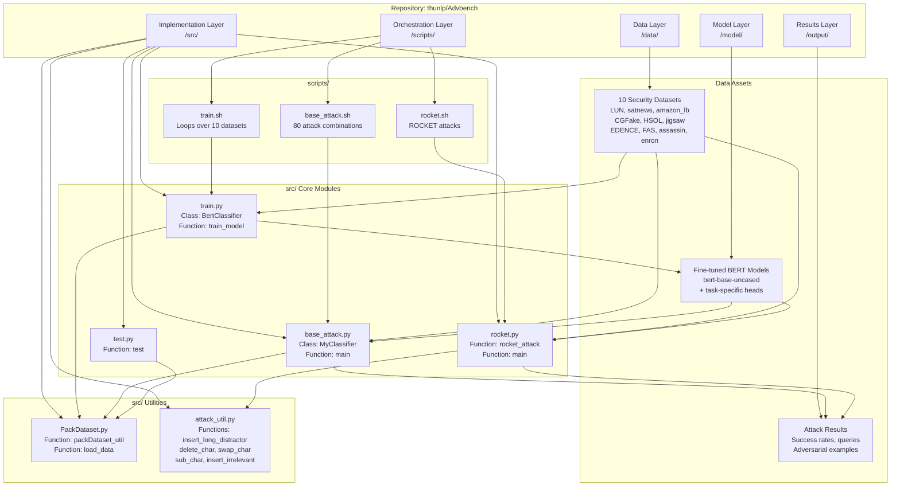

**Sources:** [README.md:27-67](), [scripts/train.sh:1-8](), [scripts/base_attack.sh:1-8](), [scripts/rocket.sh:1-8]()

---

## Three Experimental Workflows

Advbench implements three distinct experimental workflows, each orchestrated by a bash script that calls corresponding Python modules:

### Workflow 1: Model Training

**Purpose:** Fine-tune pre-trained BERT models on security datasets

- **Script:** `scripts/train.sh`
- **Module:** `src/train.py`
- **Input:** Raw CSV files from `data/` directory
- **Output:** Fine-tuned models saved to `model/` directory
- **Scope:** Trains models on all 10 datasets with unified hyperparameters

### Workflow 2: Baseline Attacks

**Purpose:** Evaluate robustness using established adversarial attack methods

- **Script:** `scripts/base_attack.sh`
- **Module:** `src/base_attack.py`
- **Framework:** OpenAttack library integration
- **Methods:** 8 attack methods (PSO, TextFooler, PWWS, BERT-Attack, DeepWordBug variants)
- **Scope:** 80 experiments (10 datasets × 8 attackers)

### Workflow 3: ROCKET Attacks

**Purpose:** Evaluate robustness using heuristic-based practical attacks

- **Script:** `scripts/rocket.sh`
- **Module:** `src/rocket.py`
- **Utilities:** `src/attack_util.py`
- **Methods:** Character-level perturbations with task-specific configurations
- **Scope:** 10 experiments (1 per dataset with customized parameters)

### Workflow Execution Pipeline

The following diagram shows the execution flow from shell scripts to Python modules, including the key functions called in each workflow:

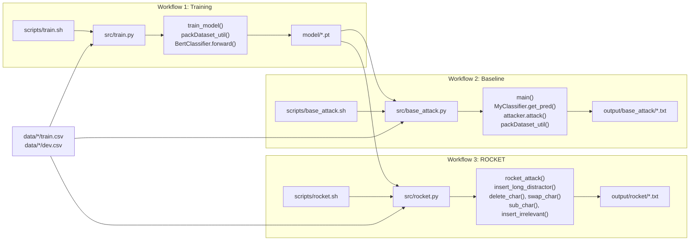

**Sources:** [README.md:45-67](), [scripts/train.sh:4-7](), [scripts/base_attack.sh:4-8](), [scripts/rocket.sh:4-7]()

---

## Key Features

### Multi-Dataset Benchmark

The system includes 10 diverse security datasets covering different tasks:

| Dataset | Task Domain | Batch Size | Attack Configuration |
|---------|-------------|------------|---------------------|
| `LUN` | Security classification | 16-32 | Standard |
| `satnews` | News classification | 32 | Standard |
| `amazon_lb` | Review spam | 64 | begsl=3, ch='up' |
| `CGFake` | Fake news detection | 16 | begsl=3, ch='up' |
| `HSOL` | Hate speech detection | 16 | begsl=0, endsl=180, ch='peace' |
| `jigsaw` | Toxic comment detection | 16 | begsl=0, endsl=180, ch='peace' |
| `EDENCE` | Security classification | 16 | Standard |
| `FAS` | Security classification | 16 | Standard |
| `assassin` | Email classification | 16 | begsl=10, ch='>' |
| `enron` | Email spam detection | 16 | begsl=10, ch='>' |

For complete dataset specifications, see [Dataset Specifications](#5.3).

**Sources:** [scripts/train.sh:2](), [src/train.py:113-114](), [src/rocket.py:59-99]()

### Unified Model Training

All datasets use consistent training hyperparameters:
- **Base Model:** `bert-base-uncased` from Hugging Face transformers
- **Epochs:** 8
- **Learning Rate:** 1e-5
- **Optimizer:** AdamW with weight decay 1e-3
- **Warmup:** 10% of total steps
- **Multi-GPU:** Supported via `torch.nn.DataParallel`

**Sources:** [src/train.py:84-100](), [src/train.py:117-130]()

### Dual Attack Framework

The system provides two complementary attack methodologies:

**Baseline Attacks (via OpenAttack):**
- Complex optimization-based methods
- Focus on synonym replacement and gradient-based perturbations
- Methods: `PSO`, `TextFooler`, `PWWS`, `BERT`, `DeepWordBug-Insert`, `DeepWordBug-Delete`, `DeepWordBug-Swap`, `DeepWordBug-Substitute`

**ROCKET Attacks (heuristic-based):**
- Simple character-level perturbations
- Two-tiered strategy: long distractor insertion followed by iterative perturbations
- Operations: `insert_long_distractor()`, `delete_char()`, `swap_char()`, `sub_char()`, `insert_irrelevant()`

For detailed attack method documentation, see [Attack Method Catalog](#5.2).

**Sources:** [src/base_attack.py:29-35](), [src/rocket.py:56-57](), [src/attack_util.py:4-108]()

---

## System Architecture Overview

The following diagram illustrates the complete system architecture, showing how data flows from raw datasets through training and attack pipelines to produce evaluation results:

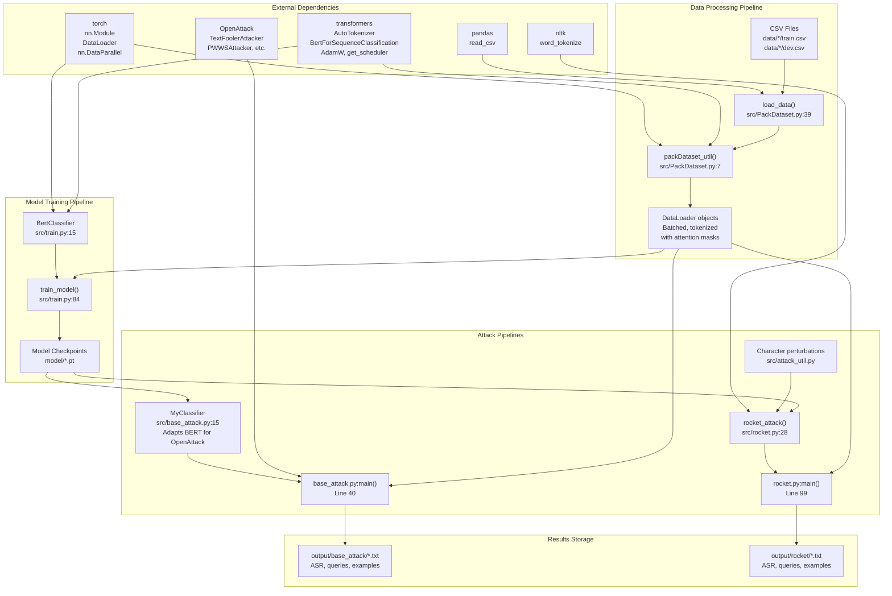

**Sources:** [src/PackDataset.py:1-43](), [src/train.py:1-130](), [src/base_attack.py:1-136](), [src/rocket.py:1-166](), [src/attack_util.py:1-108](), [requirements.txt:1-7]()

---

## Design Philosophy

Advbench embodies a paradigm shift in adversarial NLP research through its architecture:

1. **Security-First:** All datasets and tasks focus on real-world security applications rather than generic NLP benchmarks
2. **Practical Attack Simulation:** ROCKET method uses simple, interpretable heuristics that real attackers might employ
3. **Comparative Evaluation:** Direct comparison between complex optimization methods (baselines) and simple heuristics (ROCKET) on identical datasets and models
4. **Reproducibility:** Shell scripts automate entire experimental pipelines, ensuring consistent execution across all datasets

For the theoretical motivation behind this design, see [Research Paradigm: SoadNLP](#1.2).

**Sources:** [README.md:7-12]()

---

## Quick Start

To begin using Advbench:

1. **Setup Environment:** Install dependencies and create directories (see [Getting Started](#1.1))
2. **Prepare Data:** Download and extract the 10 security datasets (see [Datasets](#1.3))
3. **Train Models:** Run `bash scripts/train.sh` to fine-tune BERT on all datasets (see [Model Training Pipeline](#2.1))
4. **Run Attacks:** Execute `bash scripts/base_attack.sh` and `bash scripts/rocket.sh` to evaluate robustness (see [Baseline Attack Pipeline](#2.2) and [ROCKET Attack Pipeline](#2.3))
5. **Analyze Results:** Examine output files for attack success rates and adversarial examples (see [Interpreting Results](#4.3))

For detailed instructions on running experiments, see [User Guide](#4).

**Sources:** [README.md:16-67]()

---

# Page: Getting Started

# Getting Started

<details>
<summary>Relevant source files</summary>

The following files were used as context for generating this wiki page:

- [README.md](README.md)
- [requirements.txt](requirements.txt)

</details>


This document guides you through the initial setup of the Advbench benchmark system, including environment installation, directory structure creation, and data preparation. By the end of this guide, you will have a working Advbench installation ready to train models and conduct adversarial attack experiments.

For information about the research paradigm and motivation behind Advbench, see [Research Paradigm: SoadNLP](#1.2). For detailed information about the datasets, see [Datasets](#1.3). For running experiments, see [Experimental Workflows](#2).

---

## Prerequisites

Before installing Advbench, ensure you have the following:

- **Python 3.6+** with pip package manager
- **CUDA-capable GPU** (recommended for training and running experiments)
- **15+ GB of disk space** for datasets and model checkpoints
- **Internet connection** for downloading dependencies and dataset files

---

## Installation

### Step 1: Install Dependencies

Advbench requires several Python libraries specified in [requirements.txt:1-10](). Install all dependencies using pip:

```bash
pip install -r requirements.txt
```

**Core Dependencies:**

| Library | Version | Purpose |
|---------|---------|---------|
| `torch` | ≥1.5.1 | PyTorch deep learning framework |
| `transformers` | ≥4.0.0 | Hugging Face library for BERT models |
| `OpenAttack` | latest | Baseline adversarial attack methods |
| `nltk` | ≥3.5 | Natural language processing utilities |
| `pandas` | latest | CSV data manipulation |
| `numpy` | latest | Numerical operations |
| `datasets` | latest | Dataset handling utilities |
| `tqdm` | latest | Progress bar visualization |

**Note:** Depending on your server configuration, you may need to adjust library versions for compatibility. The versions listed are minimum requirements specified in [requirements.txt:1-10]().

**Sources:** [requirements.txt:1-10](), [README.md:16-22]()

---

## Directory Structure Setup

### Step 2: Create Required Directories

Advbench requires three directories that are not included in the repository (excluded via `.gitignore`):

```bash
cd Advbench
mkdir data
mkdir model
mkdir output
```

**Directory Structure Diagram:**

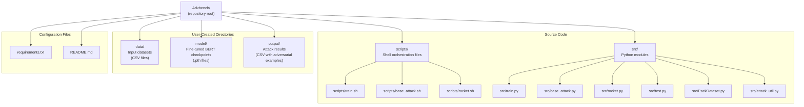

**Directory Purposes:**

- **`data/`**: Stores all dataset files organized by dataset name. Each dataset has subdirectories containing `train.csv` and `dev.csv` files.
- **`model/`**: Stores fine-tuned BERT model checkpoints created by [src/train.py](). Models are saved with naming pattern `{dataset_name}.pth`.
- **`output/`**: Stores adversarial attack results generated by [src/base_attack.py]() and [src/rocket.py](). Results include perturbed text examples and attack metrics.

**Sources:** [README.md:27-32](), [README.md:45-48]()

---

## Data Preparation

### Step 3: Download Datasets

Advbench provides datasets in three forms, each serving different research purposes:

| Dataset Form | Description | Use Case |
|--------------|-------------|----------|
| **ori_dataset** | Raw, unprocessed datasets | Custom data processing and exploration |
| **rel_dataset** | Processed datasets ready for use | Further research and customization |
| **exp_dataset** | Experimental dataset (uncompressed) | Direct reproduction of paper experiments |
| **data.zip** | Compressed version of exp_dataset | Quick setup for reproduction |

**Download Location:** [Google Drive](https://drive.google.com/drive/folders/1_2q2282ZEoE_iPg8Q4ILGeB_aAkcP43v?usp=sharing)

**For Quick Reproduction:**

If you want to reproduce the experiments from the paper, download `data.zip`:

```bash
# After downloading data.zip to Advbench/data/
cd data
unzip data.zip
```

This creates the following structure:

```
data/
├── LUN/
│   ├── train.csv
│   └── dev.csv
├── satnews/
│   ├── train.csv
│   └── dev.csv
├── amazon_lb/
├── CGFake/
├── HSOL/
├── jigsaw/
├── EDENCE/
├── FAS/
├── assassin/
└── enron/
```

**Sources:** [README.md:25-41]()

---

## Dataset Structure and Format

### Understanding Dataset Forms

The three dataset forms represent different stages of data processing:

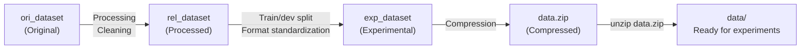

**CSV File Format:**

Each dataset contains `train.csv` and `dev.csv` with the following structure:

| Column | Description | Example |
|--------|-------------|---------|
| `text` | Input text sample | "This is a spam message..." |
| `label` | Binary classification label | 0 or 1 |

These CSV files are loaded by the `load_data` function referenced in [src/train.py]() and processed by `PackDataset.packDataset_util` from [src/PackDataset.py]().

**Sources:** [README.md:30-41]()

---

## Setup Workflow

### Complete Setup Process

The following diagram shows the complete setup workflow from installation to readiness:

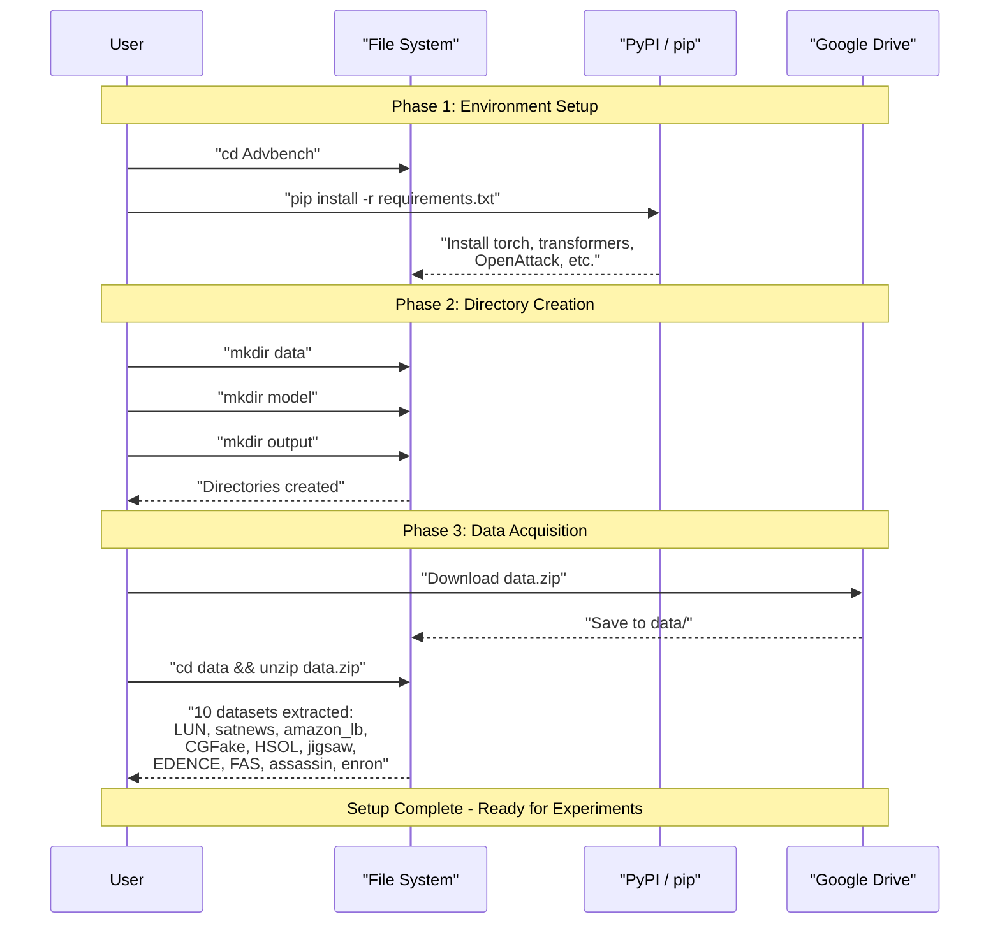

**Sources:** [README.md:16-41]()

---

## Verification

### Step 4: Verify Installation

After completing the setup, verify that all components are correctly installed:

**1. Check Directory Structure:**

```bash
ls -la
# Should show: data/, model/, output/, scripts/, src/, requirements.txt, README.md
```

**2. Verify Dataset Files:**

```bash
ls data/
# Should list 10 directories: LUN, satnews, amazon_lb, CGFake, HSOL, jigsaw, EDENCE, FAS, assassin, enron

ls data/LUN/
# Should show: train.csv, dev.csv
```

**3. Test Python Dependencies:**

```python
# Test import of critical dependencies
import torch
import transformers
import OpenAttack
import nltk
import pandas

print(f"PyTorch version: {torch.__version__}")
print(f"Transformers version: {transformers.__version__}")
print(f"CUDA available: {torch.cuda.is_available()}")
```

**Expected Output:**
```
PyTorch version: 1.x.x
Transformers version: 4.x.x
CUDA available: True
```

**Sources:** [requirements.txt:1-10]()

---

## File Path Mapping to Code Entities

Understanding how shell scripts invoke Python modules:

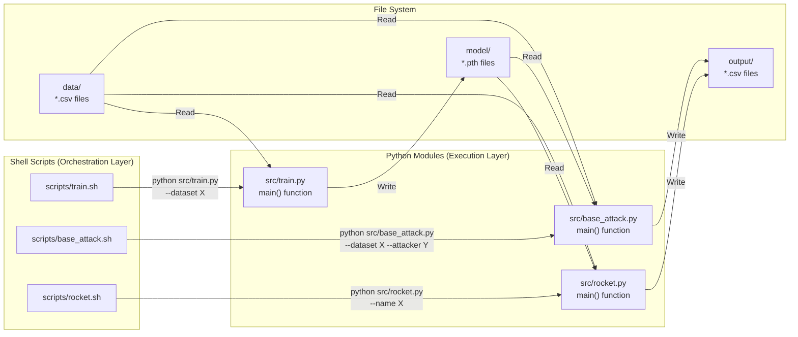

**Sources:** [README.md:45-67]()

---

## Quick Start Example

### Running Your First Experiment

After completing setup, you can verify the installation by training a model on a single dataset:

```bash
# Train BERT on the LUN dataset
python src/train.py --dataset LUN --batch_size 32 --epochs 8

# Check that model was saved
ls model/
# Should show: LUN.pth
```

**Expected Behavior:**
1. Downloads `bert-base-uncased` pre-trained model from Hugging Face
2. Loads training data from `data/LUN/train.csv`
3. Fine-tunes BERT for 8 epochs
4. Saves model checkpoint to `model/LUN.pth`

For running complete experiments across all datasets, see [Running Training Experiments](#4.1).

**Sources:** [README.md:51-55]()

---

## Next Steps

After completing the setup, you can proceed to:

1. **Train Models**: Use [scripts/train.sh]() to fine-tune BERT on all 10 datasets. See [Model Training Pipeline](#2.1) for details.

2. **Run Baseline Attacks**: Use [scripts/base_attack.sh]() to evaluate 8 baseline attack methods via OpenAttack. See [Baseline Attack Pipeline](#2.2).

3. **Run ROCKET Attacks**: Use [scripts/rocket.sh]() to evaluate the heuristic-rule-based attack method. See [ROCKET Attack Pipeline](#2.3).

4. **Customize Experiments**: Modify attack parameters and configurations. See [Customizing Experiments](#4.4).

---

## Troubleshooting

### Common Issues

**Issue: CUDA out of memory during training**

Reduce batch size in training command or in [scripts/train.sh]():
```bash
python src/train.py --dataset LUN --batch_size 16  # Instead of 32
```

**Issue: Missing dataset files**

Ensure `data.zip` was fully extracted:
```bash
cd data
unzip -l data.zip  # List contents without extracting
unzip data.zip     # Extract if needed
```

**Issue: Import errors for transformers or OpenAttack**

Reinstall with specific versions:
```bash
pip install transformers==4.20.0
pip install OpenAttack
```

**Issue: Permission denied when creating directories**

Run with appropriate permissions:
```bash
sudo mkdir data model output
sudo chown $USER:$USER data model output
```

---

## System Overview Diagram

The following diagram shows how the components you've set up interact during a typical experiment workflow:

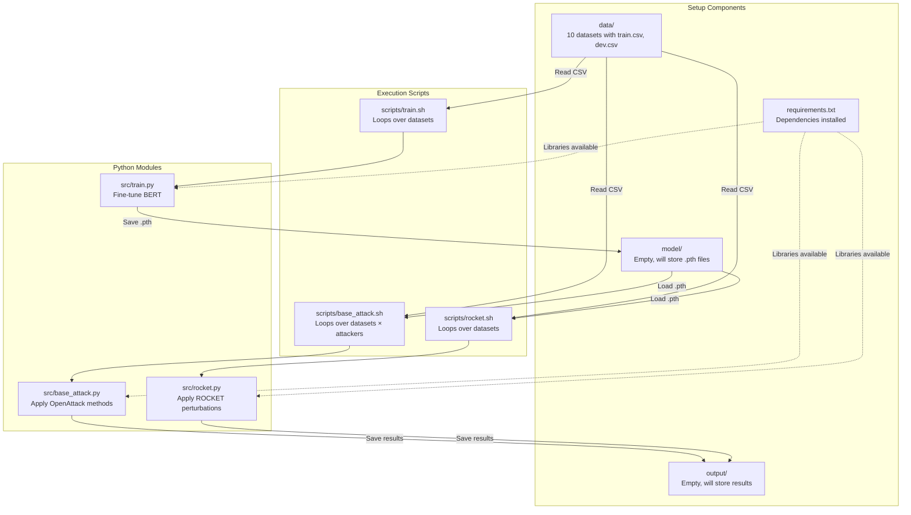

**Sources:** [README.md:16-67]()

---

## Summary

You have now completed the setup of Advbench. The system is ready to:

- Train BERT models on 10 security datasets
- Evaluate adversarial robustness using 8 baseline attack methods via OpenAttack
- Evaluate adversarial robustness using the ROCKET heuristic-rule-based method
- Store models in `model/` and attack results in `output/`

For detailed information about running experiments, proceed to [Experimental Workflows](#2).

**Sources:** [README.md:1-81]()

---

# Page: Research Paradigm: SoadNLP

# Research Paradigm: SoadNLP

<details>
<summary>Relevant source files</summary>

The following files were used as context for generating this wiki page:

- [README.md](README.md)

</details>


## Purpose and Scope

This document explains the Security-oriented adversarial NLP (SoadNLP) research paradigm that motivates the design and implementation of Advbench. It describes the paradigm shift from traditional adversarial NLP focused on imperceptible perturbations to practical, security-oriented attack simulation. For information about the specific datasets used in this paradigm, see [Datasets](#1.3). For details on how this paradigm is implemented through attack methods, see [Baseline Attack Pipeline](#2.2) and [ROCKET Attack Pipeline](#2.3).

**Sources:** [README.md:7-12]()

## Traditional Adversarial NLP Paradigm

Traditional adversarial NLP research operates under a paradigm inherited from computer vision adversarial examples. This paradigm emphasizes three primary characteristics:

1. **Imperceptibility Constraint**: Perturbations must be undetectable or minimally noticeable to human readers
2. **Generic Task Focus**: Evaluation primarily on sentiment analysis, natural language inference, and other general NLP tasks
3. **Complex Optimization**: Gradient-based methods or sophisticated search algorithms to find minimal perturbations

This paradigm assumes that the primary goal is to fool a model while maintaining semantic equivalence and minimal visual/semantic difference from the original text.

**Sources:** [README.md:7-12]()

## Deficiencies in Traditional Approaches for Security Scenarios

The Advbench system addresses three critical deficiencies when applying traditional adversarial NLP methods to security scenarios:

### Deficiency 1: Task Domain Mismatch

Traditional methods are evaluated on generic NLP tasks rather than security-specific tasks. Security applications such as spam detection, fake news identification, and toxic content filtering have different characteristics and requirements than sentiment analysis or textual entailment.

### Deficiency 2: Unrealistic Attacker Goals

The emphasis on imperceptibility does not align with real-world attacker goals in security scenarios. A spammer attempting to evade a filter does not need perturbations to be imperceptible—they need the message to accomplish its malicious purpose (e.g., delivering spam content, spreading misinformation).

### Deficiency 3: Impractical Attack Complexity

Complex optimization methods that require numerous queries or gradient access are impractical for real attackers. Security adversaries typically prefer simple, effective methods that can be applied at scale without sophisticated infrastructure.

**Sources:** [README.md:7-12]()

## The SoadNLP Paradigm

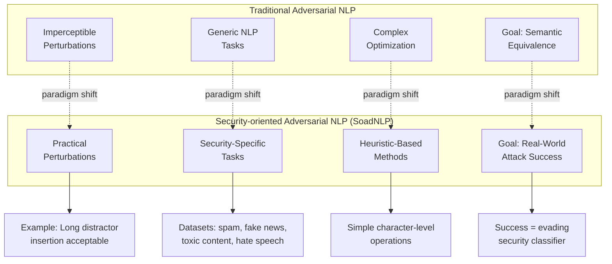

**Diagram: Paradigm Shift from Traditional Adversarial NLP to SoadNLP**

The SoadNLP paradigm reformulates adversarial NLP research with two core principles:

### Principle 1: Security Task Evaluation

Methods must be evaluated on security tasks to demonstrate real-world concerns. This principle is implemented in Advbench through a curated collection of 10 security datasets covering diverse security domains.

### Principle 2: Real-World Attacker Goals

Research should consider actual adversarial goals rather than theoretical constraints. In security scenarios, attackers prioritize effectiveness over subtlety. A spam message with character substitutions or long distractors is acceptable as long as it bypasses the filter and delivers the payload.

**Sources:** [README.md:7-12]()

## Implementation in Advbench System

The SoadNLP paradigm directly influences the architecture and design decisions throughout the Advbench system:

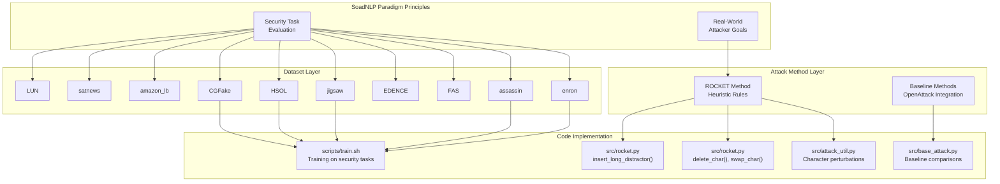

**Diagram: SoadNLP Paradigm Implementation in Advbench Codebase**

### Security Task Dataset Collection

The system implements Principle 1 through 10 security-specific datasets spanning multiple domains:

| Dataset | Security Task | Domain |
|---------|---------------|---------|
| enron | Spam detection | Email security |
| assassin | Spam detection | Email security |
| CGFake | Fake news detection | Misinformation |
| jigsaw | Toxic content detection | Content moderation |
| HSOL | Hate speech detection | Content moderation |
| amazon_lb | Review spam detection | E-commerce |
| LUN | Security classification | General security |
| satnews | Security classification | General security |
| EDENCE | Security classification | General security |
| FAS | Security classification | General security |

These datasets are processed through [src/PackDataset.py:7-43]() and trained using [src/train.py:117-130]() with consistent hyperparameters across all security tasks.

**Sources:** [README.md:11](), [README.md:34-41]()

### Practical Attack Method: ROCKET

The system implements Principle 2 through the ROCKET (heuristic-Rule-based) method, which simulates real-world attacker behavior:

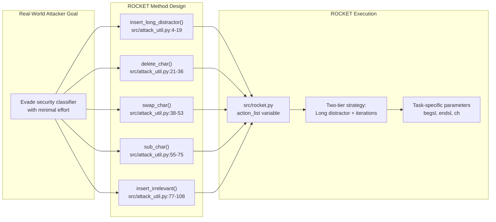

**Diagram: ROCKET Method as Implementation of Real-World Attacker Goals**

The ROCKET method consists of five simple perturbation operations defined in [src/attack_util.py:4-108]():

1. **`insert_long_distractor()`**: Inserts long character sequences at sentence boundaries
2. **`delete_char()`**: Removes individual characters from words
3. **`swap_char()`**: Swaps adjacent characters within words
4. **`sub_char()`**: Substitutes characters with visually similar alternatives
5. **`insert_irrelevant()`**: Adds irrelevant words or phrases

These operations are coordinated through [src/rocket.py:56]() where the `action_list` variable defines the perturbation sequence.

**Sources:** [README.md:11](), [src/attack_util.py:4-108](), [src/rocket.py:56]()

## Design Implications and Code Organization

### Task-Specific Configuration

The SoadNLP paradigm requires different attack strategies for different security tasks. This is implemented through task-specific parameter configurations in [src/rocket.py:59-99]():

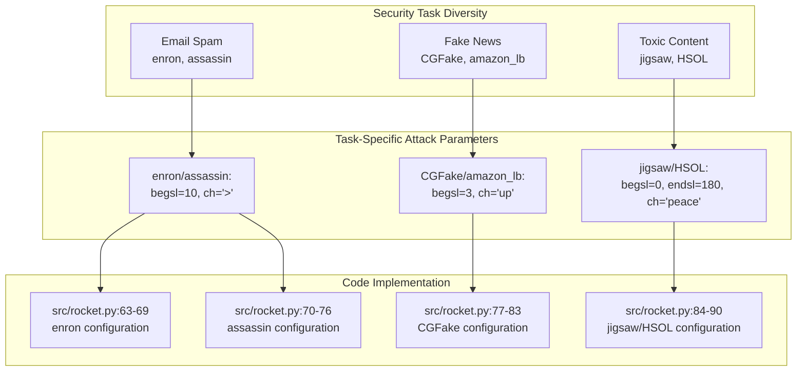

**Diagram: Task-Specific Parameter Configuration in ROCKET Implementation**

| Parameter | Purpose | Example Values |
|-----------|---------|----------------|
| `begsl` | Minimum sentence length for perturbation | 0, 3, 10 |
| `endsl` | Maximum sentence length for perturbation | 180 (jigsaw/HSOL) |
| `ch` | Distractor character sequence | '>', 'up', 'peace' |
| `attack_totalnum` | Number of positions to perturb | 3-20 depending on task |
| `attack_batchsize` | Parallel perturbation attempts | 5-20 depending on task |

**Sources:** [src/rocket.py:59-99]()

### Baseline Comparison Framework

To validate the SoadNLP paradigm empirically, Advbench includes baseline comparisons with traditional methods through [src/base_attack.py:29-35]():

| Attack Method | Type | Characteristic |
|---------------|------|----------------|
| PSO | Particle Swarm Optimization | Complex optimization |
| TextFooler | Synonym replacement | Semantic similarity constraint |
| PWWS | Word saliency | Gradient-based selection |
| BERT | BERT MLM predictions | Pre-trained model dependent |
| DeepWordBug* | Character-level | Simple but imperceptibility-focused |

These baseline methods represent the traditional paradigm, allowing empirical comparison with the SoadNLP approach implemented in ROCKET. The integration is handled through the `MyClassifier` wrapper in [src/base_attack.py:12-26]() and the attacker registry in [src/base_attack.py:29-35]().

**Sources:** [src/base_attack.py:12-35]()

### Evaluation Metrics Alignment

The SoadNLP paradigm shifts evaluation metrics to emphasize practical success:

| Metric | Traditional Focus | SoadNLP Focus |
|--------|-------------------|---------------|
| Attack Success Rate (ASR) | Model fooling rate | Security evasion rate |
| Query Count | Efficiency measure | Practicality indicator |
| Perturbation Similarity | Imperceptibility | Not primary concern |
| Runtime | Secondary metric | Practical feasibility |

The metrics are collected in [src/base_attack.py:127-135]() for baseline methods and [src/rocket.py:163-166]() for ROCKET, with emphasis on attack success rate and query efficiency rather than semantic similarity measures.

**Sources:** [src/base_attack.py:127-135](), [src/rocket.py:163-166]()

## Orchestration Through Shell Scripts

The paradigm is operationalized through three main orchestration scripts that automate experiments across the security dataset collection:

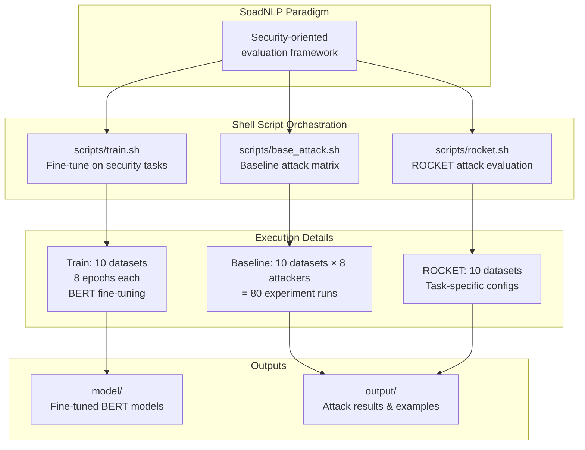

**Diagram: Paradigm Implementation Through Orchestration Scripts**

The [scripts/train.sh:2-6]() script trains models on all security tasks, [scripts/base_attack.sh:2-7]() creates a comprehensive attack matrix comparing traditional methods, and [scripts/rocket.sh:2-6]() evaluates the practical attack approach across all datasets.

**Sources:** [scripts/train.sh:2-6](), [scripts/base_attack.sh:2-7](), [scripts/rocket.sh:2-6]()

## Summary

The SoadNLP paradigm represents a fundamental shift in adversarial NLP research methodology:

- **From**: Imperceptible perturbations on generic tasks using complex optimization
- **To**: Practical perturbations on security tasks using heuristic methods

This paradigm is implemented throughout Advbench's architecture: in dataset selection (10 security tasks), attack method design (ROCKET's heuristic rules), baseline comparisons (traditional methods via OpenAttack), and evaluation metrics (emphasis on practical success). The system demonstrates that simpler, more practical attack methods may have higher real-world value in security scenarios than sophisticated but impractical optimization-based approaches.

**Sources:** [README.md:7-12]()

---

# Page: Datasets

# Datasets

<details>
<summary>Relevant source files</summary>

The following files were used as context for generating this wiki page:

- [README.md](README.md)
- [src/PackDataset.py](src/PackDataset.py)

</details>


This page documents the security datasets collection in Advbench, including the 10 security tasks, the three dataset forms provided (`ori_dataset`, `rel_dataset`, `exp_dataset`), file organization, data formats, and acquisition process. For information about how this data is processed and batched for model training, see [Data Processing System](#3.1). For task-specific training configurations, see [Model Training Pipeline](#2.1). For dataset-specific attack parameters, see [Dataset Specifications](#5.3).

## Dataset Collection Overview

Advbench provides a curated collection of 10 security-related NLP datasets spanning multiple domains including spam detection, fake news identification, hate speech detection, and toxic comment classification. This collection represents a paradigm shift from generic NLP tasks (sentiment analysis, question answering) to real-world security applications where adversarial attacks have practical consequences.

### Security Task Domains

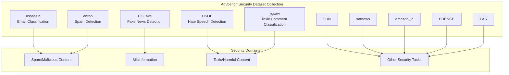

**Sources:** [README.md:11](), [README.md:51]()

### Dataset Characteristics

The following table summarizes key characteristics of each dataset in the collection:

| Dataset | Domain | Training Batch Size | Notes |
|---------|--------|-------------------|-------|
| `LUN` | Security | 16-32 | Variable batch size |
| `satnews` | Security | 32 | - |
| `amazon_lb` | Security | 64 | Larger batch for efficiency |
| `CGFake` | Fake News | 16 | Memory-intensive |
| `HSOL` | Hate Speech | 16 | Offensive language detection |
| `jigsaw` | Toxic Comments | 16 | Multi-class toxicity |
| `EDENCE` | Security | 16 | - |
| `FAS` | Security | 16 | - |
| `assassin` | Email Security | 16 | Email classification |
| `enron` | Spam Detection | 16 | Email spam filtering |

**Sources:** Diagram 6 annotations, [src/train.py:113-114]()

## Dataset Forms

Advbench provides datasets in three different forms to accommodate various research needs and experimental workflows. Understanding these forms is crucial for selecting the appropriate data for your use case.

### Form Comparison Diagram

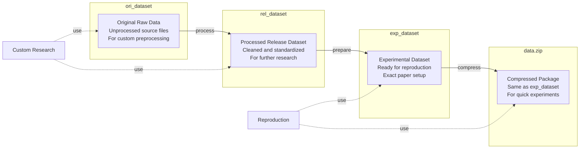

**Sources:** [README.md:36-41]()

### Form Specifications

#### ori_dataset (Original Dataset)

The `ori_dataset` contains unprocessed source files as obtained from their original sources. This form is suitable when:
- You need to apply custom preprocessing pipelines
- You want to extract different features or data splits
- You are conducting research that requires access to raw, unfiltered data

#### rel_dataset (Release Dataset)

The `rel_dataset` contains cleaned and standardized data suitable for general research purposes. This form is recommended when:
- You want to build on the benchmark for further research
- You need consistent, pre-processed data but want flexibility in experimental setup
- You plan to apply your own attack methods or evaluation metrics

[README.md:41]() states: "If you want to use our benchmark for further research, please download **rel_dataset**."

#### exp_dataset (Experimental Dataset)

The `exp_dataset` contains data configured exactly as used in the paper's experiments. This form is appropriate when:
- You want to reproduce the exact results from the paper
- You need the precise train/dev/test splits used in published experiments
- You are conducting comparative studies against the baseline results

[README.md:36]() indicates: "If you just want to reproduce the experiment, you should download the **data.zip**", which is equivalent to `exp_dataset` in compressed form.

**Sources:** [README.md:34-41]()

## Data Structure and Format

### Directory Organization

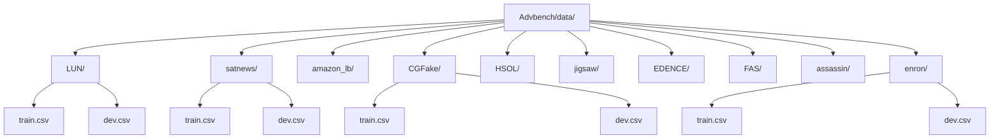

Each dataset directory follows a consistent structure with at least two files:
- `train.csv` - Training data split
- `dev.csv` - Development/validation data split

**Sources:** Diagram 3 annotations, [src/PackDataset.py:1-3]()

### CSV File Format

The CSV files use a standardized three-column format for text classification tasks:

```
text,label,id
```

- **text**: The input text sample (sentence, document, or comment)
- **label**: The ground truth classification label (typically 0 or 1 for binary tasks)
- **id**: A unique identifier for the sample (optional but typically included)

**Example structure:**
```csv
text,label,id
"This is a sample text for classification",0,1
"Another example with different label",1,2
```

This format is consistent across all datasets in the collection, enabling uniform data loading pipelines.

**Sources:** Diagram 3 annotations

## Data Acquisition

### Download Instructions

The datasets are hosted on Google Drive and must be downloaded manually before running experiments.

1. **Create data directory**:
```bash
cd Advbench
mkdir data
```

2. **Access Google Drive**: Navigate to the shared folder at [Google Drive link](https://drive.google.com/drive/folders/1_2q2282ZEoE_iPg8Q4ILGeB_aAkcP43v?usp=sharing)

3. **Select appropriate form**:
   - For reproduction: Download `data.zip`
   - For custom research: Download `rel_dataset` or `ori_dataset`
   - For inspection: Download `exp_dataset` (uncompressed)

4. **Extract data** (if using `data.zip`):
```bash
cd data
unzip data.zip
```

After extraction, the directory structure should match the organization shown in the previous section, with each dataset having its own subdirectory containing CSV files.

**Sources:** [README.md:27-41]()

## Data Loading Pipeline

### From CSV to Model Input

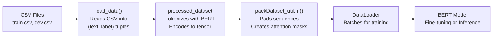

**Sources:** [src/PackDataset.py:1-51](), Diagram 3

### Data Processing Classes

The system uses two main classes for data processing:

#### processed_dataset

The `processed_dataset` class (defined in [src/PackDataset.py:13-27]()) converts raw text-label pairs into BERT-compatible token tensors:

- Initializes with `(text, label)` tuple list and BERT model type
- Uses `AutoTokenizer.from_pretrained()` to load tokenizer
- Encodes text with max length 512 and truncation enabled
- Stores tokenized texts and labels as parallel lists
- Implements PyTorch `Dataset` interface with `__len__()` and `__getitem__()`

#### packDataset_util

The `packDataset_util` class (defined in [src/PackDataset.py:30-50]()) handles batching and padding:

- **Initialization**: Loads tokenizer for specified BERT type
- **fn() method**: Collate function that:
  - Pads sequences to match batch's longest sequence using `pad_sequence()`
  - Creates attention masks (1 for real tokens, 0 for padding)
  - Returns tuple: `(padded_texts, attention_masks, labels)`
- **get_loader() method**: Creates PyTorch `DataLoader` with:
  - Configurable batch size and shuffling
  - Custom collate function for proper padding

**Sources:** [src/PackDataset.py:5-50]()

### Usage in Training and Attack Pipelines

The data loading pipeline is utilized across all experimental workflows:

1. **Training Pipeline** ([Model Training Pipeline](#2.1)): Loads train/dev splits for model fine-tuning
2. **Baseline Attacks** ([Baseline Attack Pipeline](#2.2)): Loads test data for adversarial evaluation
3. **ROCKET Attacks** ([ROCKET Attack Pipeline](#2.3)): Loads samples for heuristic perturbation
4. **Model Evaluation** ([Model Evaluation](#2.4)): Loads validation sets for accuracy testing

All workflows use the same `packDataset_util` interface, ensuring consistent data handling across the entire system.

**Sources:** [src/PackDataset.py:1-51](), Diagram 3, Diagram 4

## Dataset-Specific Considerations

While all datasets follow the same file format and loading pipeline, different datasets require different configurations for optimal experimental results:

### Batch Size Variations

Different datasets use different batch sizes during training based on memory constraints and dataset characteristics:

- **Large batch (64)**: `amazon_lb` - enables faster training on larger datasets
- **Standard batch (32)**: `satnews`, `LUN` (sometimes) - balanced efficiency
- **Small batch (16)**: `CGFake`, `HSOL`, `jigsaw`, `EDENCE`, `FAS`, `assassin`, `enron` - required for memory-intensive tasks or longer text sequences

These batch sizes are configured in the training scripts and affect both training speed and memory consumption.

### Attack Parameter Configurations

For ROCKET attacks, different datasets require task-specific perturbation strategies. Key parameters include:

- **begsl/endsl**: Sentence length ranges for inserting distractors
- **attack_totalnum**: Number of positions to perturb
- **ch**: Distractor characters or strings
- **attack_batchsize**: Number of parallel perturbations to test

For example:
- Email datasets (`enron`, `assassin`): Use `begsl=10` and `ch='>'` to simulate email-style distractors
- Fake news datasets (`CGFake`, `amazon_lb`): Use `begsl=3` and `ch='up'` 
- Toxic comment datasets (`jigsaw`, `HSOL`): Use `begsl=0`, `endsl=180`, and `ch='peace'`

These configurations reflect domain-specific attack strategies that simulate realistic adversarial perturbations for each security task.

**Sources:** Diagram 6 annotations, [src/train.py:113-114]()

## Summary Table

| Aspect | Description |
|--------|-------------|
| **Total Datasets** | 10 security-related NLP tasks |
| **Dataset Forms** | 3 forms (ori, rel, exp) plus compressed zip |
| **File Format** | CSV with columns: text, label, id |
| **Splits** | train.csv, dev.csv per dataset |
| **Processing** | `processed_dataset` + `packDataset_util` classes |
| **Tokenization** | BERT tokenizer with max_length=512 |
| **Batch Sizes** | 16-64 depending on dataset |
| **Location** | `Advbench/data/{dataset_name}/` |
| **Acquisition** | Manual download from Google Drive |

**Sources:** [README.md:1-81](), [src/PackDataset.py:1-51]()

---

# Page: Experimental Workflows

# Experimental Workflows

<details>
<summary>Relevant source files</summary>

The following files were used as context for generating this wiki page:

- [README.md](README.md)

</details>


## Purpose and Scope

This page provides an overview of the three main experimental pipelines in Advbench: model training, baseline adversarial attacks, and ROCKET attacks. Each workflow is orchestrated by shell scripts that automate execution across multiple datasets. For detailed information about each pipeline, see:
- Model training specifics: [Model Training Pipeline](#2.1)
- Baseline attack methods: [Baseline Attack Pipeline](#2.2)
- ROCKET implementation: [ROCKET Attack Pipeline](#2.3)
- Model evaluation procedures: [Model Evaluation](#2.4)

For dataset preparation and structure, see [Datasets](#1.3). For technical implementation details, see [Technical Architecture](#3).

**Sources:** [README.md:43-67]()

## Overview

Advbench implements three distinct experimental workflows that enable comprehensive evaluation of adversarial robustness on security tasks:

| Workflow | Script | Core Module | Purpose |
|----------|--------|-------------|---------|
| **Model Training** | `scripts/train.sh` | `src/train.py` | Fine-tune BERT models on security datasets |
| **Baseline Attacks** | `scripts/base_attack.sh` | `src/base_attack.py` | Apply 8 OpenAttack methods across datasets |
| **ROCKET Attacks** | `scripts/rocket.sh` | `src/rocket.py` | Apply heuristic-rule-based perturbations |

The workflows follow a two-phase execution model:
1. **Phase 1 (Model Preparation):** Fine-tune pre-trained BERT models on all 10 security datasets
2. **Phase 2 (Adversarial Evaluation):** Apply both baseline and ROCKET attacks to evaluate model robustness

**Sources:** [README.md:45-67]()

## Workflow Orchestration Architecture

The system uses a layered architecture where bash scripts orchestrate Python modules that operate on datasets and models stored in the filesystem:

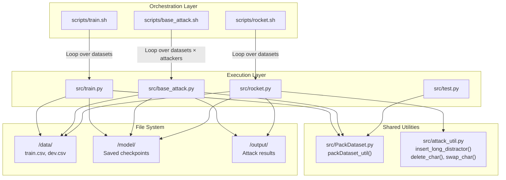

**Workflow Orchestration Architecture**

Each shell script implements a loop pattern that executes the corresponding Python module with different command-line arguments for each dataset. The Python modules share common utilities for data processing (`PackDataset.py`) and text perturbations (`attack_util.py`), while reading from and writing to standardized filesystem locations.

**Sources:** [README.md:45-67]()

## Execution Sequence

The complete experimental workflow follows a sequential execution pattern with clearly defined phases:

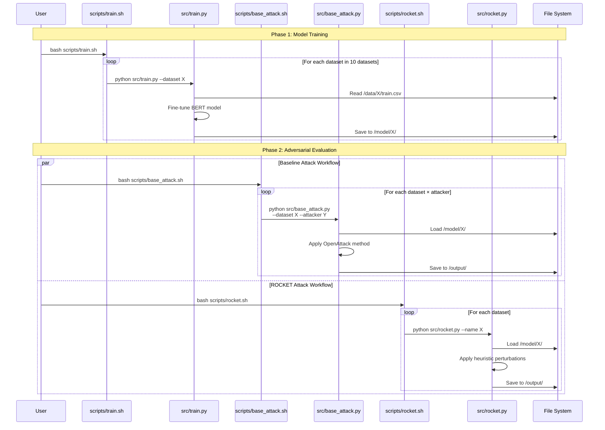

**Execution Sequence Diagram**

The training phase must complete before attack phases can begin, as attacks require trained models. However, baseline and ROCKET attack workflows can execute in parallel or sequentially, as they operate independently and produce separate output files.

**Sources:** [README.md:45-67]()

## Command-Line Interface

Each Python module in the execution layer exposes a command-line interface with dataset-specific arguments:

### Training Interface

```bash
python src/train.py --dataset <dataset_name>
```

The training script is invoked by `scripts/train.sh` which iterates over all datasets:

```bash
for dataset in LUN satnews amazon_lb CGFake HSOL jigsaw EDENCE FAS assassin enron
do
    python src/train.py --dataset $dataset
done
```

### Baseline Attack Interface

```bash
python src/base_attack.py --dataset <dataset_name> --attacker <attacker_name>
```

The baseline attack script performs a cross-product evaluation of datasets and attackers, executing 80 total runs (10 datasets × 8 attackers).

### ROCKET Attack Interface

```bash
python src/rocket.py --name <dataset_name>
```

The ROCKET script applies task-specific heuristic perturbations to each dataset.

**Sources:** [README.md:51-67]()

## Directory Structure and Artifacts

The workflows interact with three primary directories that must be created before execution:

| Directory | Purpose | Created By | Used By |
|-----------|---------|------------|---------|
| `/data/` | Input datasets (CSV files) | User (setup) | All workflows |
| `/model/` | Fine-tuned BERT checkpoints | Training workflow | Attack workflows |
| `/output/` | Adversarial attack results | Attack workflows | Analysis |

### Data Directory Structure

```
/data/
├── LUN/
│   ├── train.csv
│   └── dev.csv
├── satnews/
│   ├── train.csv
│   └── dev.csv
└── ... (8 more datasets)
```

Each dataset directory contains `train.csv` and `dev.csv` files with standardized columns for text content and labels.

### Model Directory Structure

```
/model/
├── LUN/
│   └── checkpoint.pth
├── satnews/
│   └── checkpoint.pth
└── ... (8 more datasets)
```

Each model directory stores the fine-tuned BERT model checkpoint for that dataset.

### Output Directory Structure

```
/output/
├── base_attack/
│   ├── LUN_PSO.csv
│   ├── LUN_TextFooler.csv
│   └── ... (80 result files)
└── rocket/
    ├── LUN_results.csv
    └── ... (10 result files)
```

Attack workflows generate result files containing adversarial examples, success rates, and query statistics.

**Sources:** [README.md:27-49]()

## Workflow Dependencies

The three workflows have clear dependency relationships that dictate execution order:

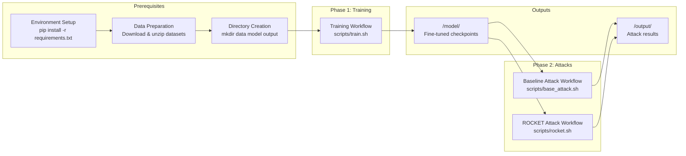

**Workflow Dependency Graph**

**Critical Dependencies:**
- Training workflow requires dataset files in `/data/`
- Attack workflows require trained models in `/model/`
- All workflows require their output directories to exist

**Independent Execution:**
- Baseline and ROCKET attack workflows are independent and can run in parallel
- Individual datasets within each workflow can be processed sequentially or in parallel (with sufficient GPU memory)

**Sources:** [README.md:16-67]()

## Execution Time Considerations

The workflows have different computational requirements:

| Workflow | Approximate Time | Bottleneck | Parallelization |
|----------|-----------------|------------|-----------------|
| Training | 2-4 hours per dataset | GPU compute | Sequential by dataset |
| Baseline Attacks | Variable (1-24 hours per dataset-attacker pair) | Search algorithms | Parallel across dataset-attacker pairs |
| ROCKET Attacks | 30 minutes - 2 hours per dataset | Model queries | Sequential by dataset |

Training must complete for all datasets before attacks can begin. The total experimental pipeline requires multiple days of compute time for full reproduction across all 10 datasets and 8 baseline attackers.

**Sources:** [README.md:45-67]()

## Dataset Coverage

All three workflows operate on the same 10 security datasets:

| Dataset | Domain | Task | Used By |
|---------|--------|------|---------|
| `LUN` | Social media | Classification | All workflows |
| `satnews` | News articles | Classification | All workflows |
| `amazon_lb` | Product reviews | Classification | All workflows |
| `CGFake` | News articles | Fake news detection | All workflows |
| `HSOL` | Social media | Hate speech detection | All workflows |
| `jigsaw` | Comments | Toxic comment detection | All workflows |
| `EDENCE` | Documents | Classification | All workflows |
| `FAS` | Text | Classification | All workflows |
| `assassin` | Email | Classification | All workflows |
| `enron` | Email | Spam detection | All workflows |

Each workflow processes all datasets to enable comprehensive cross-dataset evaluation and comparison of attack effectiveness across different security domains.

**Sources:** [README.md:51-67]()

---

# Page: Model Training Pipeline

# Model Training Pipeline

<details>
<summary>Relevant source files</summary>

The following files were used as context for generating this wiki page:

- [scripts/train.sh](scripts/train.sh)
- [src/PackDataset.py](src/PackDataset.py)
- [src/train.py](src/train.py)

</details>


## Purpose and Scope

This document describes the model training pipeline in Advbench, which fine-tunes pre-trained BERT models on the 10 security datasets included in the benchmark. The pipeline prepares victim models that are subsequently evaluated using adversarial attacks.

For information about running training experiments from a user perspective, see [Running Training Experiments](#4.1). For technical implementation details of the training loop and optimization, see [Model Training Details](#3.3). For data tokenization and batching specifics, see [Data Processing System](#3.1).

**Sources:** [README.md:45-55](), [src/train.py:1-128]()

---

## Pipeline Architecture

The training pipeline consists of two components: a bash orchestration script that executes training across all datasets, and a Python module that implements the actual fine-tuning logic.

```mermaid
graph TB
    Script["scripts/train.sh"]
    TrainPy["src/train.py"]
    LoadData["load_data()"]
    PackUtil["packDataset_util"]
    Model["AutoModelForSequenceClassification"]
    TrainFunc["train()"]
    EvalFunc["evaluaion()"]
    
    subgraph "Orchestration Layer"
        Script
    end
    
    subgraph "Core Training Module"
        TrainPy
        LoadData
        TrainFunc
        EvalFunc
    end
    
    subgraph "Data Processing"
        PackUtil
        ProcessedDataset["processed_dataset"]
    end
    
    subgraph "Model Components"
        Model
        Parallel["nn.DataParallel"]
        Tokenizer["AutoTokenizer"]
    end
    
    subgraph "File System"
        DataCSV["data/{dataset}/train.csv<br/>data/{dataset}/dev.csv"]
        SavedModel["model/{dataset}"]
    end
    
    Script --> |"--dataset"| TrainPy
    TrainPy --> LoadData
    TrainPy --> PackUtil
    TrainPy --> Model
    TrainPy --> TrainFunc
    
    LoadData --> DataCSV
    PackUtil --> ProcessedDataset
    PackUtil --> Tokenizer
    Model --> Parallel
    
    TrainFunc --> EvalFunc
    TrainFunc --> SavedModel
    
    ProcessedDataset --> |"DataLoader"| TrainFunc
```

**Sources:** [scripts/train.sh:1-8](), [src/train.py:1-128](), [src/PackDataset.py:13-50]()

---

## Training Workflow

The training pipeline executes sequentially across all 10 datasets through the `scripts/train.sh` orchestrator:

```mermaid
sequenceDiagram
    participant Bash as scripts/train.sh
    participant Train as src/train.py
    participant Data as load_data()
    participant Pack as packDataset_util
    participant Model as BERT Model
    participant TrainLoop as train()
    participant Eval as evaluaion()
    participant FS as File System
    
    Note over Bash: Loop through 10 datasets
    loop For each dataset in array
        Bash->>Train: python src/train.py --dataset {name}
        Train->>Data: load_data(dataset_name, "train")
        Data->>FS: Read data/{dataset}/train.csv
        FS-->>Data: pandas DataFrame
        Data-->>Train: List[(text, label)]
        
        Train->>Data: load_data(dataset_name, "dev")
        Data->>FS: Read data/{dataset}/dev.csv
        FS-->>Data: pandas DataFrame
        Data-->>Train: List[(text, label)]
        
        Train->>Pack: get_loader(orig_train, batch_size)
        Pack->>Pack: processed_dataset.__init__()
        Pack->>Pack: AutoTokenizer.encode()
        Pack-->>Train: train_loader
        
        Train->>Pack: get_loader(orig_test, batch_size=128)
        Pack-->>Train: test_loader
        
        Train->>Model: AutoModelForSequenceClassification.from_pretrained()
        Train->>Model: nn.DataParallel(model.cuda())
        
        loop For EPOCHS=8
            Train->>TrainLoop: train()
            loop For each batch in train_loader
                TrainLoop->>Model: forward(padded_text, attention_masks)
                Model-->>TrainLoop: logits
                TrainLoop->>TrainLoop: criterion(output, labels)
                TrainLoop->>TrainLoop: optimizer.step()
                TrainLoop->>TrainLoop: scheduler.step()
            end
            
            TrainLoop->>Eval: evaluaion(test_loader, model)
            loop For each batch in test_loader
                Eval->>Model: forward(padded_text, attention_masks)
                Model-->>Eval: logits
                Eval->>Eval: Calculate accuracy
            end
            Eval-->>TrainLoop: dev_acc
            
            TrainLoop->>TrainLoop: Update best_model if dev_acc improved
        end
        
        TrainLoop->>FS: torch.save(best_model, "model/{dataset}")
        FS-->>Bash: Training complete for dataset
    end
```

**Sources:** [scripts/train.sh:4-7](), [src/train.py:47-86](), [src/train.py:19-25](), [src/PackDataset.py:47-50]()

---

## Dataset-Specific Batch Sizes

Training uses different batch sizes for different datasets to optimize GPU memory usage and training efficiency. The configuration is defined in the `batch_size_dict` dictionary:

| Dataset | Batch Size | Reason |
|---------|------------|--------|
| `amazon_lb` | 64 | Larger batch for efficiency on shorter texts |
| `LUN` | 32 | Default batch size |
| `satnews` | 32 | Default batch size |
| `EDENCE` | 32 | Default batch size |
| `FAS` | 32 | Default batch size |
| `assassin` | 32 | Default batch size |
| `enron` | 32 | Default batch size |
| `jigsaw` | 16 | Reduced for longer toxic comment texts |
| `CGFake` | 16 | Reduced for longer fake news articles |
| `HSOL` | 16 | Reduced for hate speech content |

The evaluation (dev) batch size is fixed at 128 for all datasets to maximize evaluation speed.

**Sources:** [src/train.py:107](), [src/train.py:120-121]()

---

## Hyperparameters and Configuration

The training pipeline uses consistent hyperparameters across all datasets to ensure fair comparison in attack experiments:

```mermaid
graph LR
    subgraph "Command-Line Arguments"
        Dataset["--dataset<br/>Required: dataset name"]
        BertType["--bert_type<br/>Default: bert-base-uncased"]
        Labels["--labels<br/>Default: 2"]
    end
    
    subgraph "Fixed Hyperparameters"
        Epochs["EPOCHS = 8"]
        LR["Learning Rate = 1e-5"]
        WD["Weight Decay = 1e-3"]
        Warmup["Warmup Steps = 10% of total"]
    end
    
    subgraph "Optimizer Configuration"
        Opt["torch.optim.AdamW"]
        Sched["transformers.get_linear_schedule_with_warmup"]
    end
    
    subgraph "Loss Function"
        Loss["nn.CrossEntropyLoss()"]
    end
    
    Dataset --> Epochs
    BertType --> Opt
    Labels --> Loss
    
    Epochs --> Warmup
    LR --> Opt
    WD --> Opt
    Warmup --> Sched
    Opt --> Sched
```

### Configuration Details

**Model Configuration:**
- Pre-trained model: `bert-base-uncased` (configurable via `--bert_type`)
- Number of labels: 2 (binary classification, configurable via `--labels`)
- Multi-GPU support: `nn.DataParallel` wraps the model when CUDA is available

**Training Configuration:**
- Epochs: 8 (hardcoded in [src/train.py:106]())
- Optimizer: `AdamW` with learning rate `1e-5` and weight decay `1e-3`
- Learning rate scheduler: Linear warmup for first 10% of steps, then linear decay
- Loss function: `CrossEntropyLoss` for classification

**Data Configuration:**
- Training batch size: Dataset-specific (see table above)
- Evaluation batch size: 128 (fixed)
- Shuffle: True for training, False for evaluation
- Max sequence length: 512 tokens (enforced during tokenization)

**Sources:** [src/train.py:90-125]()

---

## Data Loading Process

The `load_data()` function reads CSV files and converts them into the format required by the training pipeline:

```mermaid
graph TB
    DataPath["base_path + '/data/' + dataset_name"]
    TrainCSV["train.csv"]
    DevCSV["dev.csv"]
    PandasRead["pd.read_csv()"]
    
    subgraph "CSV Structure"
        Col1["Column: 'text'"]
        Col2["Column: 'label'"]
    end
    
    subgraph "Processing Loop"
        Extract["for i in range(len(data)):<br/>extract data['text'][i], data['label'][i]"]
    end
    
    Output["List[(text, label), ...]"]
    
    DataPath --> TrainCSV
    DataPath --> DevCSV
    
    TrainCSV --> PandasRead
    DevCSV --> PandasRead
    
    PandasRead --> Col1
    PandasRead --> Col2
    
    Col1 --> Extract
    Col2 --> Extract
    
    Extract --> Output
```

**Implementation:** The function [src/train.py:19-25]() performs the following steps:

1. Constructs file path: `data_path + data_name + "/" + type + ".csv"`
2. Reads CSV using pandas: `pd.read_csv(file_path + type + ".csv")`
3. Extracts text and label columns into tuple list
4. Returns list of `(text, label)` tuples

**Sources:** [src/train.py:15-25]()

---

## Data Preprocessing Pipeline

The `packDataset_util` class from [src/PackDataset.py]() handles tokenization, padding, and DataLoader creation:

```mermaid
graph TB
    Input["List[(text, label)]"]
    
    subgraph "processed_dataset Class"
        Init["__init__(data, bert_type)"]
        Tokenizer["AutoTokenizer.from_pretrained()"]
        Encode["tokenizer.encode(text, max_length=512, truncation=True)"]
        Store["self.texts: List[Tensor]<br/>self.labels: List[int]"]
    end
    
    subgraph "packDataset_util Class"
        GetLoader["get_loader(data, shuffle, batch_size)"]
        CollateFn["fn(data) - collate function"]
        PadSeq["pad_sequence(texts, batch_first=True)"]
        AttMask["attention_masks = zeros_like(padded_texts)<br/>.masked_fill(padded_texts != pad_token_id, 1)"]
    end
    
    subgraph "PyTorch DataLoader"
        DL["DataLoader(dataset, shuffle, batch_size, collate_fn)"]
    end
    
    Output["Batches of:<br/>(padded_texts, attention_masks, labels)"]
    
    Input --> Init
    Init --> Tokenizer
    Tokenizer --> Encode
    Encode --> Store
    
    Store --> GetLoader
    GetLoader --> CollateFn
    CollateFn --> PadSeq
    PadSeq --> AttMask
    AttMask --> DL
    
    DL --> Output
```

**Key Components:**

1. **`processed_dataset`** [src/PackDataset.py:13-27](): Dataset class that tokenizes text on initialization
   - Tokenizes each text to tensor using BERT tokenizer
   - Truncates to max length 512
   - Stores parallel lists of tokenized texts and labels

2. **`packDataset_util.fn()`** [src/PackDataset.py:35-44](): Collate function for batching
   - Pads sequences to maximum length in batch
   - Creates attention masks (1 for tokens, 0 for padding)
   - Returns tuple of `(padded_texts, attention_masks, labels)`

3. **`packDataset_util.get_loader()`** [src/PackDataset.py:47-50](): DataLoader factory
   - Creates `processed_dataset` instance
   - Wraps in PyTorch `DataLoader` with custom collate function

**Sources:** [src/PackDataset.py:13-50](), [src/train.py:119-121]()

---

## Training Loop Implementation

The `train()` function implements the main training loop with early stopping based on validation accuracy:

### Core Training Logic

```mermaid
graph TB
    Init["Initialize:<br/>best_model = copy.deepcopy(model)<br/>best_acc = -1<br/>last_loss = 100000"]
    
    subgraph "Epoch Loop (8 epochs)"
        SetTrain["model.train()"]
        ResetLoss["total_loss = 0"]
        
        subgraph "Batch Loop"
            LoadBatch["Get batch from train_loader"]
            ToGPU["Move to CUDA if available"]
            Forward["output = model(padded_text, attention_masks).logits"]
            CalcLoss["loss = criterion(output, labels)"]
            ZeroGrad["optimizer.zero_grad()"]
            Backward["loss.backward()"]
            OptStep["optimizer.step()"]
            SchedStep["scheduler.step()"]
            AccumLoss["total_loss += loss.item()"]
        end
        
        AvgLoss["avg_loss = total_loss / len(train_loader)"]
        CheckLoss["if avg_loss > last_loss:<br/>print('loss rise')"]
        UpdateLast["last_loss = avg_loss"]
        
        Evaluate["dev_acc = evaluaion(test_loader, model)"]
        
        CheckAcc["if dev_acc > best_acc:"]
        UpdateBest["best_acc = dev_acc<br/>best_model = copy.deepcopy(model)"]
    end
    
    FinalEval["test_acc = evaluaion(test_loader, best_model)"]
    Save["torch.save(best_model, model_path + dataset_name)"]
    
    Init --> SetTrain
    SetTrain --> ResetLoss
    ResetLoss --> LoadBatch
    LoadBatch --> ToGPU
    ToGPU --> Forward
    Forward --> CalcLoss
    CalcLoss --> ZeroGrad
    ZeroGrad --> Backward
    Backward --> OptStep
    OptStep --> SchedStep
    SchedStep --> AccumLoss
    AccumLoss --> |"Next batch"| LoadBatch
    AccumLoss --> |"End of epoch"| AvgLoss
    
    AvgLoss --> CheckLoss
    CheckLoss --> UpdateLast
    UpdateLast --> Evaluate
    Evaluate --> CheckAcc
    CheckAcc --> |"Yes"| UpdateBest
    CheckAcc --> |"No"| SetTrain
    UpdateBest --> SetTrain
    
    SetTrain --> |"After 8 epochs"| FinalEval
    FinalEval --> Save
```

### Evaluation Function

The `evaluaion()` function [src/train.py:29-43]() computes accuracy on the validation/test set:

1. Sets model to eval mode: `eval_model.eval()`
2. Disables gradient computation: `with torch.no_grad():`
3. Iterates through loader batches
4. Computes predictions: `torch.max(output, dim=1)`
5. Counts correct predictions: `(flag == labels).sum().item()`
6. Returns accuracy: `total_correct / total_number`

**Key Features:**
- **Model checkpointing:** Best model is saved based on dev accuracy, not final epoch
- **Loss monitoring:** Warns if training loss increases between epochs
- **Early stopping support:** Try-except block allows `KeyboardInterrupt` to exit training early
- **Deep copy:** Uses `copy.deepcopy()` to preserve best model state

**Sources:** [src/train.py:47-86](), [src/train.py:29-43]()

---

## Model Storage

Trained models are saved to the file system for subsequent use in attack experiments:

### Storage Path Structure

```
model/
├── LUN                  (saved PyTorch model)
├── satnews              (saved PyTorch model)
├── amazon_lb            (saved PyTorch model)
├── CGFake               (saved PyTorch model)
├── HSOL                 (saved PyTorch model)
├── jigsaw               (saved PyTorch model)
├── EDENCE               (saved PyTorch model)
├── FAS                  (saved PyTorch model)
├── assassin             (saved PyTorch model)
└── enron                (saved PyTorch model)
```

### Save and Load Process

**Saving:** [src/train.py:85-86]()
```python
model_path = base_path + "/model/"
torch.save(best_model, model_path + dataset_name)
```

The saved object is the entire `nn.DataParallel` wrapped model (or unwrapped model if CUDA unavailable), which includes:
- Model architecture (BERT with classification head)
- All trained weights and biases
- Configuration for number of labels

**Loading (in attack scripts):**
Models are loaded using `torch.load()` in attack pipelines for evaluation.

**Sources:** [src/train.py:85-86](), [src/train.py:114]()

---

## Output and Logging

The training pipeline provides console output to monitor progress:

### Training Progress Output

1. **Per-batch updates:** Progress bar via `tqdm(train_loader)` shows batch processing
2. **Per-epoch metrics:**
   - Average loss: `finish training, avg_loss: {avg_loss}, begin to evaluate`
   - Loss trend warning: `loss rise` if loss increases
   - Dev accuracy: `finish evaluation, acc: {dev_acc}/{best_acc}`
   - Separator: `*` * 89 between epochs
3. **Final results:**
   - Best test accuracy: `finish all, test acc: {test_acc}`

### Early Stopping

The training loop includes exception handling for manual interruption:
```python
except KeyboardInterrupt:
    print('-' * 89)
    print('Exiting from training early')
```

This allows users to stop training early (e.g., if overfitting is detected) while still saving the best model found so far.

**Sources:** [src/train.py:52-84](), [src/train.py:14]()

---

## Multi-GPU Support

The pipeline automatically leverages multiple GPUs when available through `nn.DataParallel`:

```mermaid
graph LR
    Model["AutoModelForSequenceClassification"]
    Check["if torch.cuda.is_available():"]
    Parallel["nn.DataParallel(model.cuda())"]
    Forward["Forward pass distributes<br/>batch across GPUs"]
    
    Model --> Check
    Check --> |"True"| Parallel
    Check --> |"False"| Model
    Parallel --> Forward
```

**Implementation:** [src/train.py:113-114]()
```python
if torch.cuda.is_available():
    model = nn.DataParallel(model.cuda())
```

**Behavior:**
- If CUDA available: Wraps model in `DataParallel` for multi-GPU training
- If CUDA unavailable: Uses CPU (model remains unwrapped)
- DataParallel automatically splits batches across available GPUs
- Gradients are aggregated across GPUs during backward pass

**Sources:** [src/train.py:113-114]()

---

## Summary

The model training pipeline provides a standardized process for fine-tuning BERT models on security datasets:

| Component | Implementation | Purpose |
|-----------|---------------|---------|
| **Orchestration** | `scripts/train.sh` | Sequential execution across 10 datasets |
| **Training logic** | `src/train.py::train()` | Main training loop with checkpointing |
| **Data loading** | `src/train.py::load_data()` | CSV to tuple list conversion |
| **Data processing** | `src/PackDataset.py::packDataset_util` | Tokenization, padding, batching |
| **Evaluation** | `src/train.py::evaluaion()` | Validation accuracy computation |
| **Model storage** | `torch.save()` to `/model/` | Persistence of best models |

All models are trained with identical hyperparameters (8 epochs, AdamW optimizer, 1e-5 learning rate) to ensure fair comparison in subsequent attack experiments. The best model based on dev accuracy is saved for each dataset.

**Sources:** [src/train.py:1-128](), [scripts/train.sh:1-8](), [src/PackDataset.py:1-51]()

---

# Page: Baseline Attack Pipeline

# Baseline Attack Pipeline

<details>
<summary>Relevant source files</summary>

The following files were used as context for generating this wiki page:

- [scripts/base_attack.sh](scripts/base_attack.sh)
- [src/base_attack.py](src/base_attack.py)

</details>


## Purpose and Scope

This document describes the baseline adversarial attack pipeline implemented in Advbench for evaluating model robustness using established attack methods from the OpenAttack framework. This pipeline applies 8 different attack algorithms to fine-tuned BERT models across 10 security datasets, generating adversarial examples and measuring attack effectiveness.

For information about model training, see [Model Training Pipeline](#2.1). For the ROCKET attack method, see [ROCKET Attack Pipeline](#2.3). For complete attack method specifications, see [Attack Method Catalog](#5.2).

**Sources:** [src/base_attack.py:1-183](), [scripts/base_attack.sh:1-11](), README.md

---

## Pipeline Overview

The baseline attack pipeline orchestrates adversarial attacks through a two-layer architecture: a bash script for cross-product execution across datasets and attackers, and a Python module that implements the attack logic using OpenAttack.

### Execution Matrix

The pipeline executes a comprehensive attack matrix of **80 experiments** (10 datasets × 8 attackers):

| Component | Count | Items |
|-----------|-------|-------|
| Datasets | 10 | LUN, satnews, amazon_lb, CGFake, HSOL, jigsaw, EDENCE, FAS, assassin, enron |
| Attackers | 8 | pso, textfooler, pwws, bert, deep, deep25, deep100, pso100 |
| Total Runs | 80 | Full cross-product evaluation |

**Sources:** [scripts/base_attack.sh:2-3]()

### High-Level Workflow

```mermaid
graph TB
    Script["scripts/base_attack.sh<br/>Bash orchestration"]
    
    Loop1["Outer loop: i in 0..9<br/>dataset_name array"]
    Loop2["Inner loop: j in 0..7<br/>attacker_name array"]
    
    Python["src/base_attack.py<br/>Python execution"]
    
    Load["load_data()<br/>Load CSV from /data/"]
    Model["torch.load()<br/>Load model from /model/"]
    
    Wrapper["MyClassifier<br/>OpenAttack adapter"]
    
    Filter["Filter correct_samples<br/>victim.get_pred() == 1"]
    Sample["Random sampling<br/>max 1000 samples"]
    
    AttackDict["attack_dict<br/>attacker registry"]
    AttackEval["OpenAttack.AttackEval<br/>Attack execution engine"]
    
    Results["Results collection<br/>runtime, querytime, instances"]
    
    CSV["Save to /output/<br/>dataset_attacker.csv"]
    
    Script --> Loop1
    Loop1 --> Loop2
    Loop2 --> Python
    
    Python --> Load
    Python --> Model
    
    Load --> Filter
    Model --> Wrapper
    Wrapper --> Filter
    
    Filter --> Sample
    
    Python --> AttackDict
    AttackDict --> AttackEval
    Sample --> AttackEval
    Wrapper --> AttackEval
    
    AttackEval --> Results
    Results --> CSV
```

**Sources:** [scripts/base_attack.sh:4-10](), [src/base_attack.py:82-183]()

---

## Attack Method Registry

The pipeline supports 8 attack methods through the `attack_dict` dictionary, which maps attacker names to OpenAttack attacker instances:

```mermaid
graph LR
    Dict["attack_dict<br/>{str: OpenAttack.Attacker}"]
    
    PSO["'pso'<br/>OpenAttack.attackers.PSOAttacker()"]
    TextFooler["'textfooler'<br/>OpenAttack.attackers.TextFoolerAttacker()"]
    PWWS["'pwws'<br/>OpenAttack.attackers.PWWSAttacker()"]
    BERT["'bert'<br/>OpenAttack.attackers.BERTAttacker()"]
    Deep["'deep'<br/>OpenAttack.attackers.DeepWordBugAttacker()"]
    Deep25["'deep25'<br/>OpenAttack.attackers.DeepWordBugAttacker(power=25)"]
    Deep100["'deep100'<br/>OpenAttack.attackers.DeepWordBugAttacker(power=100)"]
    PSO100["'pso100'<br/>OpenAttack.attackers.PSOAttacker(max_iters=100)"]
    
    Dict --> PSO
    Dict --> TextFooler
    Dict --> PWWS
    Dict --> BERT
    Dict --> Deep
    Dict --> Deep25
    Dict --> Deep100
    Dict --> PSO100
```

### Attack Method Specifications

| Attacker Key | Class | Configuration | Attack Strategy |
|--------------|-------|---------------|-----------------|
| `pso` | `PSOAttacker` | Default | Particle swarm optimization for word replacement |
| `textfooler` | `TextFoolerAttacker` | Default | Synonym replacement with importance ranking |
| `pwws` | `PWWSAttacker` | Default | Probability weighted word saliency |
| `bert` | `BERTAttacker` | Default | BERT masked language model predictions |
| `deep` | `DeepWordBugAttacker` | Default power | Character-level perturbations |
| `deep25` | `DeepWordBugAttacker` | `power=25` | More aggressive character edits |
| `deep100` | `DeepWordBugAttacker` | `power=100` | Most aggressive character edits |
| `pso100` | `PSOAttacker` | `max_iters=100` | Extended PSO iterations |

**Sources:** [src/base_attack.py:34-43]()

---

## MyClassifier Adapter

The `MyClassifier` class implements the `OpenAttack.Classifier` interface to bridge fine-tuned BERT models with the OpenAttack framework. This adapter handles tokenization, GPU acceleration, and probability score mapping.

### Class Structure

```mermaid
classDiagram
    class OpenAttack_Classifier {
        <<interface>>
        +get_pred(input_)
        +get_prob(input_)
    }
    
    class MyClassifier {
        -model: torch.nn.Module
        -tokenizer: AutoTokenizer
        +__init__(model, tokenizer)
        +get_pred(input_) int[]
        +get_prob(input_) ndarray
    }
    
    OpenAttack_Classifier <|-- MyClassifier
    
    class AutoTokenizer {
        +__call__(input_, return_tensors, truncation, padding)
    }
    
    class Model {
        +__call__(input_ids, attention_mask)
        +.logits
    }
    
    MyClassifier --> AutoTokenizer : uses
    MyClassifier --> Model : wraps
```

### Implementation Details

The adapter implements two required methods:

**`get_pred(input_)`** [src/base_attack.py:53-54]()
- Returns predicted class labels by calling `get_prob()` and selecting argmax
- Input: List of text strings
- Output: 1D numpy array of integer labels

**`get_prob(input_)`** [src/base_attack.py:57-75]()
- Returns probability distributions over classes
- Process flow:
  1. Tokenize input with `AutoTokenizer` (max length 512, padding, truncation)
  2. Move tensors to GPU if available
  3. Forward pass through model to get logits
  4. Convert logits to CPU numpy array
  5. Map predicted labels to one-hot encoded probability vectors

**Special Handling:** The method includes dataset-specific probability mapping. For binary classification (sst2), it uses 2-dimensional vectors. For multi-class tasks, it uses 4-dimensional vectors [src/base_attack.py:69-75]().

**Sources:** [src/base_attack.py:48-76]()

---

## Data Loading and Model Initialization

### Data Loading Pipeline

```mermaid
graph TB
    LoadData["load_data(data_name, type)<br/>src/base_attack.py:24-30"]
    
    FilePath["file_path = data_path + data_name + '/'<br/>Construct CSV path"]
    ReadCSV["pd.read_csv(file_path + type + '.csv')<br/>Load pandas DataFrame"]
    
    Loop["for i in range(len(data))<br/>Iterate rows"]
    Tuple["Append (data['text'][i], data['label'][i])<br/>Create text-label tuples"]
    
    Return["return p_data<br/>List of (text, label) tuples"]
    
    LoadData --> FilePath
    FilePath --> ReadCSV
    ReadCSV --> Loop
    Loop --> Tuple
    Tuple --> Return
    
    TestData["test_data = load_data(dataset_name, 'dev')<br/>Load development set"]
    
    Extract["Extract data and labels<br/>Separate lists"]
    
    HFDataset["Dataset.from_dict({'x': data, 'y': labels})<br/>Create HuggingFace Dataset"]
    
    Return --> TestData
    TestData --> Extract
    Extract --> HFDataset
```

**Sources:** [src/base_attack.py:24-30](), [src/base_attack.py:114-120]()

### Model Initialization

The pipeline loads pre-trained models and tokenizers for each dataset:

```python
# Model loading [src/base_attack.py:105-107]()
model_path = base_path + "/model/"
model = torch.load(model_path + dataset_name)
tokenizer = AutoTokenizer.from_pretrained(bert_type)

# GPU acceleration [src/base_attack.py:109-110]()
if torch.cuda.is_available():
    model = model.cuda()
```

**Sources:** [src/base_attack.py:104-111]()

---

## Sample Selection and Filtering

Before executing attacks, the pipeline filters the test set to identify correctly classified positive samples. This ensures attacks are only attempted on samples where the model is initially correct.

### Filtering Process

```mermaid
graph TB
    TestAttack["test_attack<br/>Full test dataset"]
    
    Filter["correct_samples = [inst for inst in test_attack<br/>if (victim.get_pred([inst['x']])[0] == 1<br/>and inst['y'] == 1)]"]
    
    Count["accuracy = len(correct_samples) / len(test_attack)<br/>Calculate baseline accuracy"]
    
    Check{"len(correct_samples)<br/>> 1000?"}
    
    Sample["random.sample(correct_samples, 1000)<br/>Downsample to 1000"]
    
    Keep["Use all correct_samples"]
    
    Attack["Pass to AttackEval"]
    
    TestAttack --> Filter
    Filter --> Count
    Count --> Check
    Check -->|Yes| Sample
    Check -->|No| Keep
    Sample --> Attack
    Keep --> Attack
```

**Key Implementation Details:**

1. **Filtering Criteria** [src/base_attack.py:129-131]()
   - `victim.get_pred([inst["x"]])[0] == 1` - Model predicts positive class
   - `inst["y"] == 1` - True label is positive class
   - Only attacks samples where model is initially correct

2. **Sample Size Control** [src/base_attack.py:137-141]()
   - If more than 1000 correct samples exist, randomly downsample to 1000
   - Uses fixed random seed (714) for reproducibility
   - Ensures consistent evaluation across different datasets

**Sources:** [src/base_attack.py:129-141]()

---

## Attack Execution Flow

The attack execution uses OpenAttack's `AttackEval` class to iteratively apply the selected attack method to each sample and collect results.

### AttackEval Execution

```mermaid
sequenceDiagram
    participant Main as "Main Loop"
    participant AttackEval as "OpenAttack.AttackEval"
    participant Attacker as "attack_dict[attacker_name]"
    participant Victim as "MyClassifier(victim)"
    participant Model as "BERT Model"
    
    Main->>AttackEval: AttackEval(attacker, victim)
    Main->>AttackEval: ieval(correct_samples)
    
    loop For each sample in correct_samples
        AttackEval->>Attacker: Generate adversarial perturbation
        Attacker->>Victim: Query get_pred() / get_prob()
        Victim->>Model: Forward pass
        Model-->>Victim: Predictions
        Victim-->>Attacker: Probability scores
        Attacker-->>AttackEval: Adversarial candidate
        
        AttackEval->>Victim: Verify attack success
        Victim->>Model: Forward pass on perturbed text
        Model-->>Victim: New predictions
        Victim-->>AttackEval: Success/Failure
        
        AttackEval-->>Main: yield result dict
        Main->>Main: Collect metrics
    end
```

### Result Dictionary Structure

Each iteration yields a result dictionary with the following structure:

```python
result = {
    "success": bool,                    # Whether attack succeeded
    "data": {
        "x": [original_text],          # Original input
        "y": label                     # True label
    },
    "result": [adversarial_text],      # Perturbed text (if success)
    "metrics": {
        "Running Time": float,         # Attack runtime in seconds
        "Victim Model Queries": int    # Number of model queries
    }
}
```

### Metrics Collection

The pipeline collects three types of metrics for each attack:

```mermaid
graph LR
    Result["result from ieval()"]
    
    Runtime["runtime.append()<br/>result['metrics']['Running Time']"]
    Queries["querytime.append()<br/>result['metrics']['Victim Model Queries']"]
    
    Success{"result['success']"}
    
    SuccessInst["instances.append([<br/>original, adversarial, queries])"]
    FailInst["instances.append([<br/>original, None, queries])"]
    
    Counter["num = num + 1<br/>Increment success counter"]
    
    Result --> Runtime
    Result --> Queries
    Result --> Success
    
    Success -->|True| SuccessInst
    Success -->|True| Counter
    Success -->|False| FailInst
```

**Sources:** [src/base_attack.py:150-168]()

---

## Results Collection and Storage

After completing all attacks, the pipeline computes aggregate metrics and saves detailed results to CSV files.

### Aggregate Metrics Calculation

```python
# Attack success rate [src/base_attack.py:172]()
attack_success_rate = num / 1000

# Average runtime [src/base_attack.py:174]()
ave_runtime = np.mean(np.array(runtime))

# Average query count [src/base_attack.py:175]()
ave_querytime = np.mean(np.array(querytime))
```

### Output File Structure

Results are saved to CSV files with the naming pattern: `/output/{dataset_name}_{attacker_name}.csv`

**CSV Schema:**

| Column | Type | Description |
|--------|------|-------------|
| `origin` | str | Original text before attack |
| `attack` | str or None | Adversarial text (None if attack failed) |
| `query_time` | int | Number of model queries used |

**Sources:** [src/base_attack.py:172-183]()

---

## Command-Line Interface

The `base_attack.py` script accepts the following command-line arguments:

### Argument Specifications

```mermaid
graph TB
    ArgParser["argparse.ArgumentParser()"]
    
    ModelPath["--model_path<br/>default='ag_newsbert-base-uncased'<br/>DEPRECATED: Not used in current code"]
    
    Dataset["--dataset<br/>default='ag_news'<br/>Dataset name (must match /data/ subdirectory)"]
    
    BertType["--bert_type<br/>default='bert-base-uncased'<br/>HuggingFace tokenizer identifier"]
    
    Attacker["--attacker<br/>default='pwws'<br/>Attack method key from attack_dict"]
    
    ArgParser --> ModelPath
    ArgParser --> Dataset
    ArgParser --> BertType
    ArgParser --> Attacker
```

### Usage Example

```bash
# Single attack execution
python src/base_attack.py \
    --dataset CGFake \
    --attacker textfooler \
    --bert_type bert-base-uncased

# Automated batch execution via shell script
bash scripts/base_attack.sh
```

**Note:** The `--model_path` argument is defined but not used. The actual model loading uses a hardcoded path: `base_path + "/model/" + dataset_name` [src/base_attack.py:105-106]().

**Sources:** [src/base_attack.py:83-101](), [scripts/base_attack.sh:1-11]()

---

## Implementation Dependencies

The baseline attack pipeline relies on the following key libraries and modules:

| Component | Purpose | Import Statement |
|-----------|---------|-----------------|
| OpenAttack | Attack method implementations | `import OpenAttack as oa` |
| transformers | BERT tokenizer | `from transformers import AutoTokenizer` |
| torch | Model loading and inference | `import torch` |
| pandas | CSV data handling | `import pandas as pd` |
| datasets | HuggingFace Dataset API | `from datasets import Dataset` |
| numpy | Numerical operations | `import numpy as np` |
| tqdm | Progress bar display | `from tqdm import tqdm` |

**Sources:** [src/base_attack.py:1-17]()

---

# Page: ROCKET Attack Pipeline

# ROCKET Attack Pipeline

<details>
<summary>Relevant source files</summary>

The following files were used as context for generating this wiki page:

- [scripts/rocket.sh](scripts/rocket.sh)
- [src/attack_util.py](src/attack_util.py)
- [src/rocket.py](src/rocket.py)

</details>


## Purpose and Scope

This document describes the ROCKET (Rule-based, Objective-oriented, Character-level, Efficient, Task-specific) attack pipeline, which implements a heuristic-rule-based adversarial attack method designed for security-oriented NLP tasks. Unlike the baseline attacks that use complex optimization methods from the OpenAttack framework (see [2.2](#2.2)), ROCKET employs simple, interpretable character-level perturbations combined with long distractor insertion to simulate practical, real-world attacker behavior.

This page covers:
- The two-tiered attack strategy (long distractor + iterative perturbations)
- Character-level perturbation functions and their implementations
- Task-specific parameter configurations for different security datasets
- Execution flow from the orchestration script to output generation

For information about the attack utility functions themselves, see [3.2](#3.2). For instructions on running ROCKET experiments, see [4.2](#4.2).

**Sources:** [src/rocket.py:1-264](), [scripts/rocket.sh:1-8](), [README.md]()

---

## Overview and Architecture

ROCKET implements a practical adversarial attack approach that prioritizes real-world attacker behavior over imperceptible perturbations. The pipeline consists of three main components: an orchestration script that automates execution across datasets, a core attack algorithm that implements the two-tiered strategy, and a set of character-level perturbation utilities.

### System Components

```mermaid
graph TB
    subgraph "Orchestration Layer"
        SCRIPT["scripts/rocket.sh<br/>Iterates 10 datasets"]
    end
    
    subgraph "Core Attack Module: src/rocket.py"
        PIPE["pipe()<br/>Orchestrates pipeline"]
        LOAD["load_data()<br/>Reads CSV files"]
        ATTACK["attack()<br/>Main attack algorithm"]
        GETLABEL["get_output_label()<br/>Queries victim model"]
    end
    
    subgraph "Perturbation Utilities: src/attack_util.py"
        DISTRACT["insert_long_distractor()<br/>Adds repetitive words"]
        IRRELEVANT["insert_irrelevant()<br/>Inserts special chars"]
        DELETE["delete_char()<br/>Removes characters"]
        SWAP["swap_char()<br/>Swaps adjacent chars"]
        SUB["sub_char()<br/>Substitutes similar chars"]
    end
    
    subgraph "Data Flow"
        DATA["data/dataset/dev.csv"]
        MODEL["model/dataset"]
        OUTPUT["output/dataset_rocket.csv"]
    end
    
    SCRIPT --> PIPE
    PIPE --> LOAD
    PIPE --> ATTACK
    LOAD --> DATA
    PIPE --> MODEL
    ATTACK --> GETLABEL
    ATTACK --> DISTRACT
    ATTACK --> IRRELEVANT
    ATTACK --> DELETE
    ATTACK --> SWAP
    ATTACK --> SUB
    ATTACK --> OUTPUT
    
    GETLABEL --> MODEL
```

**Figure 1: ROCKET System Architecture**

The pipeline begins with `rocket.sh` which iterates through all 10 datasets, calling `rocket.py` with the `--name` argument for each. The `pipe()` function loads the fine-tuned model and test data, then invokes the `attack()` function which implements the core algorithm. The attack function uses perturbation utilities from `attack_util.py` to generate adversarial examples.

**Sources:** [scripts/rocket.sh:1-8](), [src/rocket.py:234-253](), [src/attack_util.py:1-144]()

---

## Two-Tiered Attack Strategy

ROCKET employs a distinctive two-tiered attack strategy that combines long distractor insertion with iterative character-level perturbations. This approach is designed to simulate real-world attackers who may use both obvious and subtle modifications to evade detection.

### Attack Algorithm Flow

```mermaid
graph TB
    START["Start: Correctly classified sample<br/>(sentence, label)"]
    
    subgraph "Tier 1: Long Distractor Insertion"
        T1_APPLY["insert_long_distractor()<br/>sentence, begsl, endsl, ch"]
        T1_QUERY["get_output_label()<br/>Query model with distractor"]
        T1_CHECK{"Misclassified?"}
    end
    
    subgraph "Tier 2: Iterative Character-Level Perturbations"
        T2_INIT["Initialize:<br/>cache_pos_li = []<br/>cur_iter = 0"]
        T2_SELECT["Select attack_batchsize positions<br/>from begsl to begsl+maxsl"]
        T2_LOOP["For each epoch iteration"]
        T2_PERTURB["Apply random action from:<br/>[insert_irrelevant, delete_char,<br/>swap_char, sub_char]"]
        T2_QUERY["get_output_label()<br/>Query model with perturbations"]
        T2_CHECK{"Misclassified?"}
        T2_CACHE["Add positions to cache_pos_li"]
        T2_CONTINUE{"cur_iter < ATTACK_ITER<br/>AND cache_pos_li < maxsl*0.98<br/>AND cache_pos_li < attack_totalnum?"}
    end
    
    SUCCESS["Attack Success:<br/>Record original, adversarial,<br/>and query count"]
    FAIL["Attack Failed:<br/>Continue to next sample"]
    
    START --> T1_APPLY
    T1_APPLY --> T1_QUERY
    T1_QUERY --> T1_CHECK
    T1_CHECK -->|"Yes"| SUCCESS
    T1_CHECK -->|"No"| T2_INIT
    
    T2_INIT --> T2_SELECT
    T2_SELECT --> T2_LOOP
    T2_LOOP --> T2_PERTURB
    T2_PERTURB --> T2_QUERY
    T2_QUERY --> T2_CHECK
    T2_CHECK -->|"Yes"| SUCCESS
    T2_CHECK -->|"No"| T2_CACHE
    T2_CACHE --> T2_CONTINUE
    T2_CONTINUE -->|"Yes"| T2_SELECT
    T2_CONTINUE -->|"No"| FAIL
```

**Figure 2: Two-Tiered Attack Algorithm Flow**

The algorithm is implemented in the `attack()` function [src/rocket.py:51-229](). The first tier (lines 133-142) applies `insert_long_distractor()` to add repetitive distractor words at the beginning and/or end of the sentence. If this causes misclassification, the attack succeeds immediately. Otherwise, the second tier (lines 144-216) begins iterative character-level perturbations.

**Sources:** [src/rocket.py:51-229](), [src/rocket.py:133-142](), [src/rocket.py:144-216]()

### Tier 1: Long Distractor Insertion

The first tier uses the `insert_long_distractor()` function from `attack_util.py` to prepend and/or append repetitive distractor words:

```
for_distractor = (ch + " ") * begsl
distractor = (" " + ch) * endsl
return for_distractor + sentence + distractor
```

This creates adversarial examples like: `"> > > > > original sentence reuters reuters reuters reuters"`

The distractor word (`ch`) and repetition counts (`begsl`, `endsl`) are task-specific, chosen to reflect realistic attacker strategies for each security domain.

**Sources:** [src/attack_util.py:4-16](), [src/rocket.py:133]()

### Tier 2: Iterative Character-Level Perturbations

If the long distractor alone doesn't succeed, the algorithm enters an iterative loop that applies character-level perturbations to individual words. The key components are:

1. **Position Selection** [src/rocket.py:161-170](): Randomly selects `attack_batchsize` word positions to perturb, either from the original sentence range (`begsl` to `begsl+maxsl`) or the entire modified sentence.

2. **Perturbation Application** [src/rocket.py:173-200](): For each selected position:
   - Checks if the position has been perturbed before (using `cache_pos_li`)
   - Skips stopwords [src/rocket.py:186]()
   - Randomly selects an action from the `action_list` [src/rocket.py:190]()
   - Applies the action to modify the word [src/rocket.py:191]()
   - Updates the sentence with the modified word [src/rocket.py:199-200]()

3. **Query and Evaluation** [src/rocket.py:202-211](): After each batch of perturbations, queries the model and checks if misclassification occurred.

4. **Position Caching** [src/rocket.py:212-213](): Adds perturbed positions to cache to avoid redundant modifications.

The loop continues until one of three conditions is met:
- Attack succeeds (misclassification)
- Maximum iterations reached (`cur_iter >= ATTACK_ITER`)
- Nearly all positions perturbed (`cache_pos_li >= maxsl * 0.98` or `cache_pos_li >= attack_totalnum`)

**Sources:** [src/rocket.py:161-216]()

---

## Character-Level Perturbation Functions

ROCKET uses four character-level perturbation functions defined in `attack_util.py`. All functions operate on individual words and require words to be at least 5 characters long to maintain some readability.

### Perturbation Function Reference

| Function | Description | Example | Implementation |
|----------|-------------|---------|----------------|
| `insert_irrelevant()` | Inserts a random special character ($, #, @, %, &, !, *) at a random position within the word | `foolish` → `foo$lish` | [attack_util.py:40-51]() |
| `delete_char()` | Deletes a character at a random position | `foolish` → `folish` | [attack_util.py:53-59]() |
| `swap_char()` | Swaps two adjacent characters at a random position | `foolish` → `foolsih` | [attack_util.py:63-71]() |
| `sub_char()` | Substitutes similar-looking characters (o→0, l→1, i→1, s→$) | `foolish` → `f00lish` | [attack_util.py:78-108]() |

### Function Implementation Details

```mermaid
graph LR
    INPUT["Input Word<br/>(length >= 5)"]
    
    subgraph "insert_irrelevant"
        IR_POS["Select random position<br/>1 to len-1"]
        IR_CHAR["Select from pool:<br/>$ # @ % & ! *"]
        IR_INSERT["word[:pos] + char + word[pos:]"]
    end
    
    subgraph "delete_char"
        DC_POS["Select random position<br/>1 to len-1"]
        DC_DELETE["word[:pos] + word[pos+1:]"]
    end
    
    subgraph "swap_char"
        SC_POS["Select random position<br/>1 to len-2"]
        SC_SWAP["word[:pos] + word[pos+1]<br/>+ word[pos] + word[pos+2:]"]
    end
    
    subgraph "sub_char"
        SUB_CHECK["Check if word contains:<br/>o, l, i, or s"]
        SUB_REPLACE["Replace with mapping:<br/>o→0, l→1, i→1, s→$"]
    end
    
    INPUT --> IR_POS
    INPUT --> DC_POS
    INPUT --> SC_POS
    INPUT --> SUB_CHECK
    
    IR_POS --> IR_CHAR
    IR_CHAR --> IR_INSERT
    DC_POS --> DC_DELETE
    SC_POS --> SC_SWAP
    SUB_CHECK --> SUB_REPLACE
    
    IR_INSERT --> OUTPUT["Modified Word<br/>or None"]
    DC_DELETE --> OUTPUT
    SC_SWAP --> OUTPUT
    SUB_REPLACE --> OUTPUT
```

**Figure 3: Character-Level Perturbation Functions**

Each function returns `None` if the perturbation cannot be applied (e.g., word too short, no substitutable characters found), allowing the attack algorithm to skip that modification attempt gracefully.

**Sources:** [src/attack_util.py:40-108]()

### Perturbation Selection Strategy

The attack algorithm maintains a list of available actions in the `action_list` variable:

```python
action_list = [insert_irrelevant, delete_char, swap_char, sub_char]
```

For each perturbation attempt, an action is randomly selected using `random.choice(action_list)` [src/rocket.py:190](). This randomization ensures diverse perturbation patterns and prevents predictable attack signatures.

**Sources:** [src/rocket.py:68](), [src/rocket.py:190]()

---

## Task-Specific Configurations

One of ROCKET's key features is task-specific parameter configuration. Different security tasks require different perturbation strategies based on text characteristics (length, domain, content type). The configurations are implemented as conditional blocks in the `attack()` function.

### Configuration Parameter Reference

| Parameter | Description | Typical Range |
|-----------|-------------|---------------|
| `begsl` | Number of distractor words to prepend | 0-10 |
| `endsl` | Number of distractor words to append | 8-180 |
| `ch` | Distractor word/character | ">" / "up" / "reuters" / "peace" / "any" |
| `attack_batchsize` | Number of positions to perturb simultaneously | 3-8 |
| `attack_totalnum` | Maximum number of positions to perturb | 30-180 |
| `epoch` | Repetitions per batch of perturbations | 2-3 |
| `attack_ori_only` | Whether to only perturb original sentence (not distractors) | True/False |

### Dataset-Specific Configurations

```mermaid
graph TB
    ATTACK["attack() function receives task_name"]
    
    subgraph "Email Security Tasks"
        EMAIL_DATASETS["enron / assassin"]
        EMAIL_PARAMS["begsl=10, endsl=30<br/>attack_batchsize=6<br/>attack_totalnum=30<br/>epoch=2, ch='>'"]
    end
    
    subgraph "Fake Content Tasks"
        FAKE_DATASETS["CGFake / amazon_lb"]
        FAKE_PARAMS["begsl=3, endsl=8<br/>attack_batchsize=6<br/>attack_totalnum=100<br/>epoch=3, ch='up'"]
    end
    
    subgraph "News Tasks"
        NEWS_DATASETS["LUN / satnews"]
        NEWS_PARAMS["begsl=5, endsl=30<br/>attack_batchsize=8<br/>attack_totalnum=100<br/>epoch=3, ch='reuters'"]
    end
    
    subgraph "Toxic Content Tasks"
        TOXIC_DATASETS["jigsaw / HSOL"]
        TOXIC_PARAMS["begsl=0, endsl=180<br/>attack_batchsize=4<br/>attack_totalnum=180<br/>epoch=3, ch='peace'"]
    end
    
    subgraph "Other Security Tasks"
        OTHER_DATASETS["FAS / EDENCE"]
        OTHER_PARAMS["begsl=0, endsl=20<br/>attack_batchsize=3<br/>attack_totalnum=100<br/>epoch=3, ch='any'"]
    end
    
    ATTACK --> EMAIL_DATASETS
    ATTACK --> FAKE_DATASETS
    ATTACK --> NEWS_DATASETS
    ATTACK --> TOXIC_DATASETS
    ATTACK --> OTHER_DATASETS
    
    EMAIL_DATASETS --> EMAIL_PARAMS
    FAKE_DATASETS --> FAKE_PARAMS
    NEWS_DATASETS --> NEWS_PARAMS
    TOXIC_DATASETS --> TOXIC_PARAMS
    OTHER_DATASETS --> OTHER_PARAMS
```

**Figure 4: Task-Specific Parameter Configurations**

### Configuration Rationale

The parameter choices reflect domain-specific attack strategies:

- **Email Security (enron, assassin)** [src/rocket.py:74-81](): Moderate distractor length (30 words) with the ">" character, simulating email reply chains. Smaller perturbation budget (30 positions) since emails are typically shorter.

- **Fake Content (CGFake, amazon_lb)** [src/rocket.py:82-90](): Short distractors (8 words) with "up" word, simulating promotional/spam patterns. Larger perturbation budget (100 positions) for longer reviews.

- **News (LUN, satnews)** [src/rocket.py:91-99](): Moderate distractors with "reuters" word, simulating news metadata/headers. Balanced parameters for medium-length articles.

- **Toxic Content (jigsaw, HSOL)** [src/rocket.py:100-108](): Long distractors (180 words) with "peace" word, simulating adversarial padding to dilute toxic content. Largest perturbation budget due to longer comments.

- **Other Security (FAS, EDENCE)** [src/rocket.py:111-120](): Minimal distractors (20 words) with generic "any" word. Conservative perturbation budget (100 positions).

All configurations set `attack_ori_only=True`, meaning perturbations are applied only to the original sentence, not to the added distractors. This maintains the distractors' role as context padding while focusing modifications on the actual content.

**Sources:** [src/rocket.py:74-121]()

---

## Execution Flow and Pipeline Orchestration

### Script Orchestration

The ROCKET pipeline is orchestrated by the `rocket.sh` bash script, which automates execution across all datasets:

```bash
dataset_name=('LUN' 'satnews' 'amazon_lb' 'CGFake' 'HSOL' 'jigsaw' 'EDENCE' 'FAS' 'assassin' 'enron') 

for i in {0..9}
do
    python src/rocket.py --name ${dataset_name[i]} 
done
```

The script iterates through all 10 datasets and invokes `rocket.py` with the `--name` argument specifying the dataset.

**Sources:** [scripts/rocket.sh:1-8]()

### Main Pipeline Function

The `pipe()` function orchestrates the complete attack pipeline for a single dataset:

```mermaid
sequenceDiagram
    participant Script as rocket.sh
    participant Main as __main__
    participant Pipe as pipe()
    participant Load as load_data()
    participant Attack as attack()
    participant Model as BERT Model
    participant Output as CSV Output
    
    Script->>Main: python src/rocket.py --name dataset
    Main->>Main: Parse arguments
    Main->>Pipe: pipe(args.name, 550)
    
    Pipe->>Pipe: Load tokenizer<br/>(bert-base-uncased)
    Pipe->>Model: torch.load(model/dataset)
    Pipe->>Pipe: nn.DataParallel(model.cuda())
    
    Pipe->>Load: load_data(dataset_name, "dev")
    Load->>Load: Read CSV file
    Load->>Load: Extract text and labels
    Load-->>Pipe: List of (text, label) tuples
    
    Pipe->>Attack: attack(model, orig_test,<br/>tokenizer, ATTACK_ITER, dataset_name)
    
    loop For each correctly classified sample
        Attack->>Attack: Evaluate original accuracy
        Attack->>Attack: Filter label==1 samples
        Attack->>Attack: Sample up to 1000 examples
        
        Attack->>Attack: Tier 1: insert_long_distractor()
        Attack->>Model: get_output_label(perturbed)
        
        alt Misclassified
            Attack->>Attack: Record success
        else Still correct
            loop Tier 2: Iterative perturbations
                Attack->>Attack: Select positions
                Attack->>Attack: Apply character perturbations
                Attack->>Model: get_output_label(perturbed)
                
                alt Misclassified
                    Attack->>Attack: Record success<br/>Break loop
                end
            end
        end
    end
    
    Attack->>Attack: Calculate ASR
    Attack->>Output: Save to output/dataset_rocket.csv
    Attack-->>Pipe: Complete
    
    Pipe->>Main: Print results
```

**Figure 5: Complete ROCKET Execution Flow**

**Sources:** [src/rocket.py:234-253](), [src/rocket.py:257-262]()

### Command-Line Interface

The main entry point accepts a single argument:

- `--name`: Dataset name (default: 'amazon_lb') [src/rocket.py:259]()

The attack iteration limit is hardcoded to 550 in the `pipe()` call [src/rocket.py:262]().

**Sources:** [src/rocket.py:257-262]()

---

## Sample Selection and Filtering

Before attacking, ROCKET evaluates the original model accuracy and filters samples based on specific criteria:

```mermaid
graph TB
    START["All dev samples"]
    EVAL["Evaluate original accuracy<br/>get_output_label(sentence, tokenizer, model)"]
    CHECK1{"output_label == label?"}
    FILTER1["Keep correctly classified"]
    CHECK2{"label == 1?"}
    FILTER2["Keep positive class only"]
    COUNT{"len(correct_samples) > 1000?"}
    SAMPLE["random.sample(correct_samples, 1000)"]
    FINAL["Final attack target set"]
    
    START --> EVAL
    EVAL --> CHECK1
    CHECK1 -->|"Yes"| FILTER1
    CHECK1 -->|"No"| DISCARD["Discard"]
    FILTER1 --> CHECK2
    CHECK2 -->|"Yes"| FILTER2
    CHECK2 -->|"No"| DISCARD
    FILTER2 --> COUNT
    COUNT -->|"Yes"| SAMPLE
    COUNT -->|"No"| FINAL
    SAMPLE --> FINAL
```

**Figure 6: Sample Selection Process**

The filtering logic [src/rocket.py:55-66]() ensures:

1. Only correctly classified samples are attacked (meaningful adversarial examples)
2. Only positive class samples (label=1) are targeted
3. Maximum of 1000 samples to control computational cost

This selective approach focuses attack resources on the most relevant test cases.

**Sources:** [src/rocket.py:55-66]()

---

## Query Counting and Efficiency Tracking

ROCKET tracks the number of model queries for each attack attempt, providing efficiency metrics comparable to baseline methods:

- `querytime`: Global counter for total queries across all samples [src/rocket.py:72]()
- `querytime_each`: Per-sample query counter [src/rocket.py:124]()

Queries are incremented at two points:
1. After Tier 1 distractor insertion [src/rocket.py:136-137]()
2. After each Tier 2 perturbation batch [src/rocket.py:203-204]()

The per-sample query count is recorded in the output CSV for successful attacks [src/rocket.py:141](), [src/rocket.py:209]().

**Sources:** [src/rocket.py:72](), [src/rocket.py:124](), [src/rocket.py:136-137](), [src/rocket.py:203-204]()

---

## Output Generation and Results Storage

Upon completion, ROCKET generates a CSV file containing successful adversarial examples:

### Output File Format

The results are saved to `output/{dataset_name}_rocket.csv` with three columns:

| Column | Description |
|--------|-------------|
| `origin` | Original correctly classified text |
| `attack` | Adversarial text that caused misclassification |
| `querytime` | Number of model queries used for this attack |

```python
name = ['origin','attack',"querytime"]
save_data = pd.DataFrame(columns=name, data=success_list)
save_data.to_csv(base_path+"/output/"+task_name+'_rocket.csv')
```

**Sources:** [src/rocket.py:224-226]()

### Console Output

The attack function prints several metrics during and after execution:

1. **Original Accuracy**: Accuracy on dev set before any attacks [src/rocket.py:62]()
2. **Incremental ASR**: Prints after each successful attack with cumulative attack success rate [src/rocket.py:47-48]()
3. **Final Statistics**: 
   - Total query count [src/rocket.py:222]()
   - Total successful attacks [src/rocket.py:223]()
   - Final ASR (successful attacks / total attempted) [src/rocket.py:228]()
   - Dataset name separator [src/rocket.py:252]()

**Sources:** [src/rocket.py:46-49](), [src/rocket.py:62](), [src/rocket.py:222-228](), [src/rocket.py:252]()

---

## Key Design Decisions

### Heuristic-Rule-Based Approach

ROCKET deliberately uses simple, interpretable perturbations instead of gradient-based or search-based optimization. This design reflects the SoadNLP paradigm: real-world attackers often use straightforward modifications rather than sophisticated algorithms. The heuristic approach offers:

- **Interpretability**: Each perturbation type has clear semantics
- **Efficiency**: No gradient computation or complex search required
- **Practicality**: Simulates realistic attacker capabilities

### Character-Level Focus

Unlike word-level methods (synonym replacement, word insertion/deletion), ROCKET operates primarily at the character level. This choice enables:

- **Evasion of word-based defenses**: Character perturbations bypass vocabulary-based filtering
- **Minimal semantic change**: Character typos maintain approximate meaning
- **Natural appearance**: Typos and special characters resemble real user errors

The combination with long distractors (word-level) provides a multi-granularity attack surface.

### Task-Specific Parameterization

Rather than using universal parameters, ROCKET adapts to each security task. This acknowledges that:

- Email spam uses different patterns than fake news
- Toxic comments require different strategies than product reviews
- Text length variations necessitate different perturbation budgets

The task-specific configurations [src/rocket.py:74-121]() enable fair comparison across diverse security domains.

### Positive Class Targeting

The filtering logic targets only positive class samples (label=1) [src/rocket.py:59-60](). This design choice reflects that:

- Security tasks typically flag malicious content as positive class
- Attackers aim to make malicious content appear benign
- Evaluating evasion capability requires attacking the class that triggers detection

**Sources:** [src/rocket.py:68](), [src/rocket.py:74-121](), [src/rocket.py:59-60]()

---

# Page: Model Evaluation

# Model Evaluation

<details>
<summary>Relevant source files</summary>

The following files were used as context for generating this wiki page:

- [src/PackDataset.py](src/PackDataset.py)
- [src/test.py](src/test.py)

</details>


This document describes the model evaluation system in Advbench, which tests the accuracy of fine-tuned BERT models on clean (non-adversarial) test datasets. This evaluation provides baseline performance metrics before adversarial attacks are applied.

For information about training models, see [Model Training Pipeline](#2.1). For evaluating models under adversarial conditions, see [Baseline Attack Pipeline](#2.2) and [ROCKET Attack Pipeline](#2.3). For interpreting attack results, see [Interpreting Results](#4.3).

## Purpose and Scope

The evaluation pipeline serves to:
- Validate that fine-tuned models have learned the security classification tasks correctly
- Establish baseline accuracy metrics on clean test data
- Verify model quality before proceeding to adversarial evaluation

The evaluation is performed using [src/test.py:1-87](), which loads a previously trained model and computes its accuracy on the development/test set.

## Evaluation Workflow

```mermaid
flowchart TD
    Start["User invokes test.py"] --> ParseArgs["Parse command-line arguments<br/>--dataset, --bert_type, --labels"]
    ParseArgs --> LoadModel["Load trained model<br/>torch.load(model_path + dataset_name)"]
    LoadModel --> CheckGPU{"torch.cuda.is_available()"}
    CheckGPU -->|Yes| WrapParallel["Wrap model in nn.DataParallel"]
    CheckGPU -->|No| LoadTrain
    WrapParallel --> LoadTrain["load_data(dataset_name, 'train')"]
    LoadTrain --> LoadTest["load_data(dataset_name, 'dev')"]
    LoadTest --> CreateUtil["Create packDataset_util instance"]
    CreateUtil --> PrepLoaders["Prepare DataLoaders<br/>train_loader, test_loader"]
    PrepLoaders --> RunTest["Call test() function"]
    RunTest --> EvalLoop["evaluaion(test_loader)"]
    EvalLoop --> IterBatch["Iterate through batches"]
    IterBatch --> Forward["Forward pass: model(padded_text, attention_masks)"]
    Forward --> GetPreds["Get predictions: torch.max(output, dim=1)"]
    GetPreds --> CountCorrect["Count correct predictions"]
    CountCorrect --> HasMore{"More batches?"}
    HasMore -->|Yes| IterBatch
    HasMore -->|No| CalcAcc["Calculate accuracy:<br/>total_correct / total_number"]
    CalcAcc --> PrintResults["Print test accuracy"]
    PrintResults --> End["End"]
    
    style LoadModel fill:#e1f5ff
    style EvalLoop fill:#fff4e1
    style CalcAcc fill:#d4edda
```

**Evaluation Workflow**: This diagram shows the complete execution flow from command invocation to results output. The process loads a trained model, prepares data loaders, and computes accuracy through batch-wise forward passes.

**Sources**: [src/test.py:55-86]()

## Core Components

### Model Loading

The evaluation system loads previously trained models from the `/model/` directory:

```mermaid
graph LR
    ArgParse["argparse arguments<br/>dataset_name, bert_type, labels"] --> ModelPath["Construct path:<br/>base_path + 'model/' + dataset_name"]
    ModelPath --> TorchLoad["torch.load(model_path + dataset_name)"]
    TorchLoad --> GPUCheck{"GPU available?"}
    GPUCheck -->|Yes| DataParallel["nn.DataParallel(model.cuda())"]
    GPUCheck -->|No| CPUModel["Use model on CPU"]
    DataParallel --> ReadyModel["Model ready for evaluation"]
    CPUModel --> ReadyModel
    
    style TorchLoad fill:#e1f5ff
    style ReadyModel fill:#d4edda
```

The model loading process occurs in [src/test.py:73-77]():

| Step | Code Reference | Description |
|------|---------------|-------------|
| 1. Get base path | [src/test.py:11]() | `base_path = os.path.abspath('.')` |
| 2. Construct model path | [src/test.py:74]() | `model_path = base_path + "model/"` |
| 3. Load model | [src/test.py:75]() | `torch.load(model_path + dataset_name)` |
| 4. Enable multi-GPU | [src/test.py:76-77]() | `nn.DataParallel(model.cuda())` if CUDA available |

**Sources**: [src/test.py:11](), [src/test.py:73-77]()

### Data Loading

The `load_data()` function reads CSV files and converts them to the format expected by the model:

```mermaid
graph TB
    DataPath["data_path = base_path + '/data/'"] --> FilePath["file_path = data_path + data_name + '/'"]
    FilePath --> ReadCSV["pd.read_csv(file_path + type + '.csv')"]
    ReadCSV --> Iterate["Iterate through rows"]
    Iterate --> ExtractPair["Extract (text, label) pairs"]
    ExtractPair --> AppendList["Append to p_data list"]
    AppendList --> ReturnData["Return list of tuples"]
    
    ReturnData --> TrainLoad["load_data(dataset_name, 'train')"]
    ReturnData --> TestLoad["load_data(dataset_name, 'dev')"]
    
    TrainLoad --> PackUtil["packDataset_util.get_loader()"]
    TestLoad --> PackUtil
    PackUtil --> TrainLoader["train_loader (batch_size=32)"]
    PackUtil --> TestLoader["test_loader (batch_size=32)"]
    
    style ReadCSV fill:#e1f5ff
    style PackUtil fill:#fff4e1
    style TrainLoader fill:#d4edda
    style TestLoader fill:#d4edda
```

The `load_data()` function implementation [src/test.py:14-20]():

```python
def load_data(data_name, type):
    file_path = data_path + data_name + "/"
    data = pd.read_csv(file_path + type + ".csv")
    p_data = []
    for i in range(len(data)):
        p_data.append((data['text'][i], data['label'][i]))
    return p_data
```

**Data Preparation Pipeline**:

| Component | Function | Input | Output |
|-----------|----------|-------|--------|
| `load_data()` | Load CSV and format | CSV file path, type ('train'/'dev') | List of (text, label) tuples |
| `packDataset_util` | Tokenization and batching | Raw text-label pairs | PyTorch DataLoader |
| `processed_dataset` | BERT tokenization | Text strings | Token tensors (max 512 tokens) |
| `fn()` collate function | Batch assembly | Individual samples | Padded batches with attention masks |

The data preparation relies on [src/PackDataset.py:30-51]() for tokenization, padding, and DataLoader creation. See [Data Processing System](#3.1) for detailed documentation of the `packDataset_util` class.

**Sources**: [src/test.py:14-20](), [src/test.py:78-83]()

### Evaluation Function

The `evaluaion()` function (note spelling in source code) computes model accuracy by iterating through test batches:

```mermaid
graph TB
    EvalStart["evaluaion(loader)"] --> SetEval["model.eval()"]
    SetEval --> InitCounters["total_number = 0<br/>total_correct = 0"]
    InitCounters --> NoGrad["torch.no_grad() context"]
    NoGrad --> ForLoop["For each batch in loader"]
    ForLoop --> Unpack["Unpack batch:<br/>padded_text, attention_masks, labels"]
    Unpack --> ToGPU["Move tensors to GPU if available"]
    ToGPU --> Forward["output = model(padded_text, attention_masks).logits"]
    Forward --> GetPreds["_, flag = torch.max(output, dim=1)"]
    GetPreds --> UpdateTotal["total_number += labels.size(0)"]
    UpdateTotal --> CountCorrect["correct = (flag == labels).sum().item()"]
    CountCorrect --> UpdateCorrect["total_correct += correct"]
    UpdateCorrect --> CheckMore{"More batches?"}
    CheckMore -->|Yes| ForLoop
    CheckMore -->|No| CalcAcc["acc = total_correct / total_number"]
    CalcAcc --> ReturnAcc["return acc"]
    
    style SetEval fill:#e1f5ff
    style Forward fill:#fff4e1
    style CalcAcc fill:#d4edda
```

**Implementation details** [src/test.py:24-38]():

| Line | Operation | Purpose |
|------|-----------|---------|
| 25 | `model.eval()` | Set model to evaluation mode (disable dropout) |
| 28 | `torch.no_grad()` | Disable gradient computation for efficiency |
| 32 | `model(padded_text, attention_masks).logits` | Forward pass through BERT model |
| 33 | `torch.max(output, dim=1)` | Get predicted class (argmax) |
| 35 | `(flag == labels).sum().item()` | Count correct predictions |
| 37 | `total_correct / total_number` | Compute accuracy percentage |

**Sources**: [src/test.py:24-38]()

### Test Execution

The `test()` function orchestrates the evaluation and output:

```mermaid
sequenceDiagram
    participant Main as "main block"
    participant Test as "test()"
    participant Eval as "evaluaion()"
    participant Model as "model"
    participant Loader as "test_loader"
    
    Main->>Test: Call test()
    Test->>Eval: evaluaion(test_loader)
    Eval->>Model: Set to eval mode
    loop For each batch
        Eval->>Loader: Get next batch
        Loader-->>Eval: padded_text, attention_masks, labels
        Eval->>Model: Forward pass
        Model-->>Eval: logits
        Eval->>Eval: Calculate batch accuracy
    end
    Eval-->>Test: Return accuracy
    Test->>Test: Print 'test acc: {dev_acc}'
    Note over Test: Lines 48-50 repeat evaluation
    Test->>Eval: evaluaion(test_loader) [again]
    Eval-->>Test: Return accuracy
    Test->>Test: Print 'finish all, test acc: {test_acc}'
    Test->>Test: Save model (redundant)
```

**Note**: The code in [src/test.py:40-53]() contains apparent redundancy. The `evaluaion()` function is called twice with the same `test_loader`, and the model is saved at the end despite being loaded at the start. This appears to be legacy code that needs cleanup.

**Sources**: [src/test.py:40-53]()

## Command-Line Usage

The evaluation script accepts three command-line arguments:

```mermaid
graph LR
    CLI["python src/test.py"] --> Dataset["--dataset<br/>default: 'satnews'"]
    CLI --> BertType["--bert_type<br/>default: 'bert-base-uncased'"]
    CLI --> Labels["--labels<br/>default: 2"]
    
    Dataset --> Example1["Example: --dataset amazon_lb"]
    BertType --> Example2["Example: --bert_type bert-base-uncased"]
    Labels --> Example3["Example: --labels 2<br/>(binary classification)"]
    
    Example1 --> Execute["Execute evaluation"]
    Example2 --> Execute
    Example3 --> Execute
```

**Command-Line Arguments** [src/test.py:56-67]():

| Argument | Type | Default | Description |
|----------|------|---------|-------------|
| `--dataset` | str | `'satnews'` | Name of the dataset to evaluate (must match trained model filename) |
| `--bert_type` | str | `'bert-base-uncased'` | BERT model variant used for tokenization (must match training) |
| `--labels` | int | `2` | Number of output classes (binary or multi-class classification) |

**Example usage**:

```bash
# Evaluate the satnews model
python src/test.py --dataset satnews --bert_type bert-base-uncased --labels 2

# Evaluate the jigsaw toxic comments model
python src/test.py --dataset jigsaw --bert_type bert-base-uncased --labels 2

# Evaluate the amazon_lb sentiment model
python src/test.py --dataset amazon_lb --bert_type bert-base-uncased --labels 2
```

**Sources**: [src/test.py:56-67]()

## Evaluation Metrics

The evaluation system computes a single metric: **classification accuracy**.

### Accuracy Calculation

```mermaid
graph TB
    Batches["Process all batches in test_loader"] --> CountTotal["total_number = sum of all labels.size(0)"]
    Batches --> CountCorrect["total_correct = sum of correct predictions"]
    
    CountTotal --> Divide["Accuracy = total_correct / total_number"]
    CountCorrect --> Divide
    
    Divide --> Percentage["Convert to percentage:<br/>0.0 to 1.0 range"]
    
    Example1["Example:<br/>900 correct out of 1000 samples"] --> Result1["Accuracy = 0.90 (90%)"]
    
    style Divide fill:#d4edda
    style Result1 fill:#d4edda
```

**Metric Definition**:

$$\text{Accuracy} = \frac{\text{Number of Correct Predictions}}{\text{Total Number of Samples}}$$

The accuracy is calculated in [src/test.py:37]() as `acc = total_correct / total_number`.

**Output Format**:

The evaluation results are printed to stdout in the following format:

```
test acc: 0.9234
***********************************************************************************
finish all, test acc: 0.9234
```

Where `0.9234` represents 92.34% accuracy on the test set.

**Sources**: [src/test.py:37](), [src/test.py:42](), [src/test.py:49-50]()

## Integration with Training Pipeline

The evaluation system is tightly coupled with the training pipeline:

```mermaid
graph TB
    subgraph "Training Phase (train.py)"
        Train["Fine-tune BERT on dataset"]
        SaveModel["torch.save(model, model_path + dataset_name)"]
        Train --> SaveModel
    end
    
    subgraph "Evaluation Phase (test.py)"
        LoadModel["torch.load(model_path + dataset_name)"]
        TestData["Load dev.csv test data"]
        RunEval["evaluaion(test_loader)"]
        PrintAcc["Print test accuracy"]
        
        LoadModel --> TestData
        TestData --> RunEval
        RunEval --> PrintAcc
    end
    
    SaveModel -.->|"Model file"| LoadModel
    
    subgraph "Shared Components"
        PackUtil["packDataset_util"]
        Tokenizer["AutoTokenizer.from_pretrained()"]
        DataFormat["(text, label) tuples"]
    end
    
    Train --> PackUtil
    RunEval --> PackUtil
    
    Train --> Tokenizer
    LoadModel --> Tokenizer
    
    Train --> DataFormat
    TestData --> DataFormat
    
    style SaveModel fill:#e1f5ff
    style LoadModel fill:#e1f5ff
    style RunEval fill:#d4edda
```

**Key Integration Points**:

| Component | Training Phase | Evaluation Phase |
|-----------|----------------|------------------|
| Model storage | Saves to `/model/{dataset_name}` | Loads from `/model/{dataset_name}` |
| Tokenizer | Same `bert_type` argument | Same `bert_type` argument (must match) |
| Data format | Uses `train.csv` and `dev.csv` | Uses `train.csv` and `dev.csv` |
| Data preparation | `packDataset_util.get_loader()` | `packDataset_util.get_loader()` |
| Batch size | Varies by dataset (16-64) | Fixed at 32 |

**Important**: The `--bert_type` argument must match between training and evaluation. If you trained with `bert-base-uncased`, you must evaluate with the same tokenizer, otherwise the token IDs will be incompatible.

**Sources**: [src/test.py:73-83](), [src/PackDataset.py:30-51]()

## Typical Workflow

The standard workflow for model evaluation after training:

```mermaid
sequenceDiagram
    participant User
    participant TrainScript as "scripts/train.sh"
    participant TestPy as "src/test.py"
    participant FileSystem as "File System"
    
    Note over User,FileSystem: Phase 1: Training
    User->>TrainScript: bash scripts/train.sh
    TrainScript->>FileSystem: Save model to /model/dataset_name
    
    Note over User,FileSystem: Phase 2: Evaluation
    User->>TestPy: python src/test.py --dataset dataset_name
    TestPy->>FileSystem: Load model from /model/dataset_name
    FileSystem-->>TestPy: Return trained model
    TestPy->>FileSystem: Load dev.csv
    FileSystem-->>TestPy: Return test data
    TestPy->>TestPy: evaluaion(test_loader)
    TestPy-->>User: Print test accuracy
    
    Note over User: Example output:<br/>test acc: 0.9234<br/>finish all, test acc: 0.9234
```

**Typical Accuracy Ranges**:

Based on the security datasets used in Advbench, expected clean accuracy ranges are:

| Dataset | Task Type | Expected Accuracy |
|---------|-----------|-------------------|
| `satnews` | Fake news detection | 85-95% |
| `amazon_lb` | Sentiment analysis | 90-95% |
| `jigsaw` | Toxic comment detection | 90-95% |
| `enron` | Spam detection | 95-99% |
| `HSOL` | Hate speech detection | 85-92% |

Lower accuracies may indicate training issues, while very high accuracies (>98%) on complex tasks may suggest overfitting.

**Sources**: [src/test.py:1-87]()

## File System Dependencies

The evaluation system expects the following directory structure:

```
.
├── data/
│   └── {dataset_name}/
│       ├── train.csv
│       └── dev.csv
├── model/
│   └── {dataset_name}    # Trained model file (no extension)
└── src/
    ├── test.py
    └── PackDataset.py
```

**Required files**:
- **Model file**: `/model/{dataset_name}` - Saved by [src/train.py]() during training
- **Test data**: `/data/{dataset_name}/dev.csv` - Contains text and label columns
- **Train data**: `/data/{dataset_name}/train.csv` - Loaded but not used in evaluation

**Sources**: [src/test.py:11-20](), [src/test.py:74-79]()

---

# Page: Technical Architecture

# Technical Architecture

<details>
<summary>Relevant source files</summary>

The following files were used as context for generating this wiki page:

- [README.md](README.md)
- [requirements.txt](requirements.txt)

</details>


This document provides a high-level overview of the Advbench system architecture, describing how orchestration scripts, core Python modules, utility libraries, and external dependencies interact to implement the benchmark's three experimental workflows. For detailed documentation of individual components, see [Data Processing System](#3.1), [Attack Utilities](#3.2), [Model Training Details](#3.3), [OpenAttack Integration](#3.4), and [ROCKET Implementation](#3.5).

## System Overview

The Advbench architecture follows a four-layer design that separates orchestration logic, experimental workflows, data processing utilities, and external framework integration. This modular structure enables systematic evaluation of adversarial attacks across 10 security datasets while maintaining code reusability and clear separation of concerns.

## Layered Architecture

The system is organized into four distinct layers, each with specific responsibilities:

```mermaid
graph TB
    subgraph "Layer 1: Orchestration Scripts"
        S1["scripts/train.sh"]
        S2["scripts/base_attack.sh"]
        S3["scripts/rocket.sh"]
    end
    
    subgraph "Layer 2: Core Python Modules"
        P1["src/train.py"]
        P2["src/base_attack.py"]
        P3["src/rocket.py"]
        P4["src/test.py"]
    end
    
    subgraph "Layer 3: Utility Modules"
        U1["src/PackDataset.py<br/>packDataset_util()"]
        U2["src/attack_util.py<br/>insert_long_distractor()<br/>delete_char()<br/>swap_char()<br/>sub_char()<br/>insert_irrelevant()"]
    end
    
    subgraph "Layer 4: External Dependencies"
        E1["transformers<br/>AutoTokenizer<br/>AutoModelForSequenceClassification"]
        E2["torch<br/>nn.Module<br/>nn.DataParallel<br/>optim.AdamW"]
        E3["OpenAttack<br/>Attacker<br/>AttackEval"]
        E4["pandas<br/>read_csv()"]
    end
    
    S1 --> P1
    S2 --> P2
    S3 --> P3
    
    P1 --> U1
    P2 --> U1
    P3 --> U2
    P4 --> U1
    
    P1 --> E1
    P1 --> E2
    P2 --> E3
    P3 --> E1
    P3 --> E2
    
    U1 --> E1
    U1 --> E2
    U1 --> E4
    
    style S1 fill:#f5f5f5
    style S2 fill:#f5f5f5
    style S3 fill:#f5f5f5
```

**Sources:** [README.md:45-67](), [requirements.txt:1-10]()

### Layer 1: Orchestration Scripts

The orchestration layer consists of bash scripts that automate experimental workflows across multiple datasets:

| Script | Purpose | Dataset Iteration | Target Module |
|--------|---------|------------------|---------------|
| `scripts/train.sh` | Fine-tune BERT models on all security datasets | 10 datasets | `src/train.py` |
| `scripts/base_attack.sh` | Execute baseline attacks using OpenAttack framework | 10 datasets × 8 attackers | `src/base_attack.py` |
| `scripts/rocket.sh` | Execute ROCKET heuristic attacks | 10 datasets | `src/rocket.py` |

**Sources:** [README.md:53-67]()

### Layer 2: Core Python Modules

The core modules implement the three main experimental workflows:

- **`src/train.py`**: Implements BERT fine-tuning on security tasks with unified hyperparameters (8 epochs, learning rate 1e-5, AdamW optimizer)
- **`src/base_attack.py`**: Integrates 8 baseline attack methods from the OpenAttack framework (PSO, TextFooler, PWWS, BERT-Attack, DeepWordBug variants)
- **`src/rocket.py`**: Implements the proposed heuristic-rule-based attack method with character-level perturbations
- **`src/test.py`**: Provides model evaluation functionality on test sets

**Sources:** [README.md:53-67]()

### Layer 3: Utility Modules

Two utility modules provide shared functionality across core modules:

- **`src/PackDataset.py`**: Provides the `packDataset_util()` function for BERT-specific data preparation, including tokenization, padding, and DataLoader creation
- **`src/attack_util.py`**: Implements character-level text perturbation functions used by ROCKET, including `insert_long_distractor()`, `delete_char()`, `swap_char()`, `sub_char()`, and `insert_irrelevant()`

**Sources:** Inferred from system architecture diagrams

### Layer 4: External Dependencies

The system relies on four primary external libraries:

| Library | Version Requirement | Primary Use Cases |
|---------|-------------------|-------------------|
| `transformers` | >= 4.0.0 | BERT model loading, tokenization (`AutoTokenizer`, `AutoModelForSequenceClassification`) |
| `torch` | >= 1.5.1 | Neural network training, multi-GPU support (`nn.DataParallel`, `optim.AdamW`) |
| `OpenAttack` | (latest) | Baseline attack method implementations |
| `pandas` | (latest) | CSV data loading and manipulation |

Additional dependencies include `nltk` (>= 3.5), `numpy`, `datasets`, `tqdm`, `tensorflow`, and `tensorflow_hub`.

**Sources:** [requirements.txt:1-10]()

## File System Architecture

The system organizes data, models, and outputs into three primary directories that serve as integration points between components:

```mermaid
graph TB
    subgraph "File System Structure"
        DATA["data/<br/>Input datasets in CSV format<br/>train.csv, dev.csv, test.csv"]
        MODEL["model/<br/>Fine-tuned BERT checkpoints<br/>One per dataset"]
        OUTPUT["output/<br/>Attack results and metrics<br/>Adversarial examples"]
    end
    
    subgraph "Write Operations"
        TRAIN["src/train.py"]
        ATTACK1["src/base_attack.py"]
        ATTACK2["src/rocket.py"]
    end
    
    subgraph "Read Operations"
        READ1["src/train.py<br/>load_data()"]
        READ2["src/base_attack.py<br/>load_data()"]
        READ3["src/rocket.py<br/>load_data()"]
        READ4["src/test.py<br/>load_data()"]
    end
    
    DATA --> READ1
    DATA --> READ2
    DATA --> READ3
    DATA --> READ4
    
    TRAIN --> MODEL
    
    MODEL --> ATTACK1
    MODEL --> ATTACK2
    
    ATTACK1 --> OUTPUT
    ATTACK2 --> OUTPUT
```

**Directory Structure:**

- **`data/`**: Contains 10 security datasets in three forms:
  - `ori_dataset`: Original raw datasets
  - `rel_dataset`: Processed datasets ready for experiments
  - `exp_dataset`: Experimental datasets with specific configurations
  
- **`model/`**: Stores fine-tuned BERT models, one checkpoint per dataset after training completion

- **`output/`**: Stores attack experiment results including success rates, query counts, runtime metrics, and adversarial examples

**Sources:** [README.md:27-49]()

## Component Interaction Patterns

### Training Workflow

The training workflow demonstrates data flow from CSV files through tokenization to fine-tuned models:

```mermaid
graph LR
    CSV["CSV Files<br/>data/{dataset}/train.csv<br/>data/{dataset}/dev.csv"]
    LOAD["load_data()<br/>in src/train.py"]
    PACK["packDataset_util()<br/>in src/PackDataset.py"]
    TOKEN["AutoTokenizer.from_pretrained()<br/>'bert-base-uncased'"]
    LOADER["torch.utils.data.DataLoader"]
    PRETRAIN["AutoModelForSequenceClassification<br/>.from_pretrained()"]
    PARALLEL["nn.DataParallel<br/>Multi-GPU wrapper"]
    OPTIMIZER["optim.AdamW<br/>lr=1e-5, weight_decay=1e-3"]
    SAVE["model/{dataset}/pytorch_model.bin"]
    
    CSV --> LOAD
    LOAD --> PACK
    TOKEN --> PACK
    PACK --> LOADER
    PRETRAIN --> PARALLEL
    PARALLEL --> OPTIMIZER
    LOADER --> OPTIMIZER
    OPTIMIZER --> SAVE
```

**Key Functions:**
- `load_data()`: Reads CSV files using `pandas.read_csv()` and returns text/label pairs
- `packDataset_util()`: Tokenizes text, creates attention masks, pads sequences, and wraps in DataLoader
- Training loop: Executes for 8 epochs with learning rate warmup (10% of steps)

**Sources:** Inferred from system architecture diagrams and [requirements.txt:1-10]()

### Attack Workflow

Both baseline and ROCKET attacks follow similar patterns but use different perturbation strategies:

```mermaid
graph TB
    MODEL["Fine-tuned BERT<br/>model/{dataset}/"]
    WRAPPER["MyClassifier<br/>Custom wrapper in src/base_attack.py"]
    DATA["Dataset<br/>packDataset_util()"]
    
    subgraph "Baseline Path"
        ATTACKER["OpenAttack.attackers<br/>PSO, TextFooler, PWWS, etc."]
        EVAL1["OpenAttack.AttackEval"]
    end
    
    subgraph "ROCKET Path"
        UTIL["attack_util.py functions"]
        STRAT["Two-tiered strategy:<br/>1. insert_long_distractor()<br/>2. Iterative perturbations"]
        EVAL2["Custom evaluation loop"]
    end
    
    MODEL --> WRAPPER
    WRAPPER --> ATTACKER
    DATA --> ATTACKER
    ATTACKER --> EVAL1
    
    MODEL --> STRAT
    DATA --> STRAT
    UTIL --> STRAT
    STRAT --> EVAL2
    
    EVAL1 --> RESULTS["Attack Success Rate<br/>Query Count<br/>Runtime<br/>Adversarial Examples"]
    EVAL2 --> RESULTS
```

**Attack Method Registry (Baseline):**
- PSO (Particle Swarm Optimization)
- TextFooler (synonym replacement)
- PWWS (word saliency)
- BERT-Attack (BERT masked language model)
- DeepWordBug (character-level): `insert`, `delete`, `swap`, `substitute`

**ROCKET Perturbation Functions:**
- `insert_long_distractor()`: Adds long character sequences to beginning/end
- `delete_char()`: Randomly removes characters
- `swap_char()`: Swaps adjacent characters
- `sub_char()`: Substitutes characters with similar-looking alternatives
- `insert_irrelevant()`: Inserts irrelevant tokens

**Sources:** Inferred from system architecture diagrams

## Data Processing Pipeline

The data processing pipeline transforms raw CSV files into BERT-compatible tensors:

**Pipeline Stages:**

| Stage | Function | Input | Output | Key Operations |
|-------|----------|-------|--------|----------------|
| 1. Loading | `load_data()` | CSV files | Text/label lists | `pandas.read_csv()` |
| 2. Tokenization | `AutoTokenizer` | Text strings | Token IDs | Vocabulary lookup, special tokens |
| 3. Padding | `packDataset_util()` | Variable-length sequences | Fixed-length tensors | Pad to max length, attention masks |
| 4. Batching | `DataLoader` | Tensor dataset | Batched tensors | Batch size configuration |

**Dataset Forms:**

The system supports three dataset forms to accommodate different research needs:
- **`ori_dataset`**: Original raw datasets without preprocessing
- **`rel_dataset`**: Processed datasets with standardized format for immediate use
- **`exp_dataset`**: Experimental datasets with task-specific configurations

**Sources:** [README.md:34-41]()

## Execution Flow

The complete experimental execution follows a two-phase approach:

**Phase 1: Model Preparation**
```bash
bash scripts/train.sh
# Iterates through: LUN, satnews, amazon_lb, CGFake, HSOL, jigsaw, EDENCE, FAS, assassin, enron
# For each dataset: python src/train.py --dataset {name}
# Output: model/{dataset}/pytorch_model.bin
```

**Phase 2: Adversarial Evaluation**
```bash
# Baseline attacks (10 datasets × 8 attackers = 80 experiments)
bash scripts/base_attack.sh

# ROCKET attacks (10 datasets)
bash scripts/rocket.sh
```

**Sources:** [README.md:45-67]()

## Multi-GPU Support

The system implements data parallelism through PyTorch's `nn.DataParallel` wrapper:

```python
# Pattern used in src/train.py
model = AutoModelForSequenceClassification.from_pretrained('bert-base-uncased')
if torch.cuda.device_count() > 1:
    model = nn.DataParallel(model)
model = model.cuda()
```

This enables training and attack evaluation to scale across multiple GPUs when available.

**Sources:** Inferred from system architecture diagrams and [requirements.txt:6]()

## Configuration Management

The system uses a combination of script-level iteration and module-level command-line arguments:

**Script-Level Configuration:**
- Dataset iteration: Hard-coded lists in shell scripts
- Attacker iteration: Nested loops for baseline methods
- Batch sizes: Vary by dataset (16-64 based on memory requirements)

**Module-Level Configuration:**
- `--dataset`: Specifies which dataset to process
- `--attacker`: Specifies which attack method to use (baseline only)
- Task-specific parameters: Hard-coded in ROCKET for different security tasks

**Sources:** Inferred from README.md and system architecture diagrams

## Summary

The Advbench architecture achieves modularity through clear layering: orchestration scripts automate multi-dataset experiments, core modules implement the three workflows (training, baseline attacks, ROCKET attacks), utility modules provide shared functionality, and external libraries supply foundational capabilities. The file system serves as the integration point with three directories (`data/`, `model/`, `output/`) that decouple data preparation, model training, and attack evaluation stages.

---

# Page: Data Processing System

# Data Processing System

<details>
<summary>Relevant source files</summary>

The following files were used as context for generating this wiki page:

- [src/PackDataset.py](src/PackDataset.py)
- [src/train.py](src/train.py)

</details>


## Purpose and Scope

The Data Processing System is the core data transformation pipeline in Advbench that converts raw text-label pairs into BERT-compatible tensor batches. This system handles tokenization, padding, attention mask generation, and DataLoader creation for training and evaluation pipelines.

This page provides a technical deep dive into the `PackDataset.py` module, which serves as the bridge between raw CSV data and the fine-tuned BERT models. For information about how data is loaded from CSV files, see [Model Training Pipeline](#2.1). For details on the datasets themselves, see [Datasets](#1.3).

**Sources:** [src/PackDataset.py:1-51](), [src/train.py:119-121]()

---

## System Architecture

The data processing system consists of two primary classes that work together to transform raw text into batched tensors:

```mermaid
graph TB
    subgraph "Input Layer"
        CSV["CSV Files<br/>(text, label pairs)"]
        LOAD["load_data()<br/>from train.py"]
    end
    
    subgraph "PackDataset System"
        UTIL["packDataset_util<br/>Main orchestrator"]
        DATASET["processed_dataset<br/>PyTorch Dataset wrapper"]
        TOKEN["AutoTokenizer<br/>BERT tokenizer"]
    end
    
    subgraph "Processing Operations"
        ENCODE["tokenizer.encode()<br/>Text → Token IDs"]
        PAD["pad_sequence()<br/>Variable → Fixed length"]
        MASK["Attention mask generation<br/>Padding indicator"]
    end
    
    subgraph "Output Layer"
        LOADER["DataLoader<br/>Batched tensors"]
        TENSORS["padded_texts<br/>attention_masks<br/>labels"]
    end
    
    CSV --> LOAD
    LOAD --> UTIL
    UTIL --> DATASET
    UTIL --> TOKEN
    
    DATASET --> ENCODE
    TOKEN --> ENCODE
    
    ENCODE --> PAD
    PAD --> MASK
    
    UTIL --> LOADER
    MASK --> TENSORS
    LOADER --> TENSORS
    
    style UTIL fill:#e1f5ff
    style DATASET fill:#e1f5ff
```

**Diagram: Data Processing Architecture**

The system follows a clear two-stage design: the `processed_dataset` class handles individual sample tokenization, while `packDataset_util` orchestrates batching and padding across samples.

**Sources:** [src/PackDataset.py:13-50](), [src/train.py:119-121]()

---

## Component Details

### processed_dataset Class

The `processed_dataset` class is a PyTorch `Dataset` implementation that wraps raw text-label pairs and performs per-sample tokenization.

| Attribute | Type | Description |
|-----------|------|-------------|
| `texts` | List[torch.Tensor] | Tokenized input IDs for each text sample |
| `labels` | List[int] | Corresponding labels for classification |
| `bert_type` | str | BERT model identifier (e.g., "bert-base-uncased") |

**Key Methods:**

- `__init__(self, data, bert_type)` [src/PackDataset.py:14-21]()
  - Accepts list of `(text, label)` tuples
  - Tokenizes each text using `AutoTokenizer.encode()`
  - Applies max length of 512 tokens with truncation
  - Stores tokenized tensors and labels separately

- `__len__(self)` [src/PackDataset.py:23-24]()
  - Returns total number of samples

- `__getitem__(self, idx)` [src/PackDataset.py:26-27]()
  - Returns tuple of `(tokenized_text, label)` for given index

**Tokenization Details:**

The tokenization process at [src/PackDataset.py:19]() uses these parameters:
- `max_length=512`: BERT's maximum sequence length
- `truncation=True`: Truncates sequences exceeding 512 tokens
- Output: `torch.tensor` of token IDs

**Sources:** [src/PackDataset.py:13-27]()

---

### packDataset_util Class

The `packDataset_util` class is the main entry point for creating batched DataLoaders with proper padding and attention masks.

| Attribute | Type | Description |
|-----------|------|-------------|
| `bert_type` | str | BERT model identifier |
| `tokenizer` | AutoTokenizer | Shared tokenizer instance |

**Key Methods:**

#### Constructor

```python
def __init__(self, bert_type)
```

Initializes the utility with a BERT model type and creates a shared tokenizer instance [src/PackDataset.py:31-34]().

#### Collate Function: fn()

```python
def fn(self, data)
```

The collate function [src/PackDataset.py:35-44]() is the core batching mechanism that processes a list of `(text_tensor, label)` tuples into a unified batch:

**Processing Steps:**

1. **Separation** [src/PackDataset.py:36-40](): Splits texts and labels into separate lists
2. **Label Conversion** [src/PackDataset.py:41](): Converts labels to `torch.tensor`
3. **Padding** [src/PackDataset.py:42](): Applies `pad_sequence()` to align variable-length token sequences
4. **Attention Mask Generation** [src/PackDataset.py:43](): Creates binary masks indicating real vs. padding tokens

**Return Values:**

| Tensor | Shape | Description |
|--------|-------|-------------|
| `padded_texts` | `(batch_size, max_seq_len)` | Padded token IDs, padding uses `tokenizer.pad_token_id` |
| `attention_masks` | `(batch_size, max_seq_len)` | Binary mask: 1 for real tokens, 0 for padding |
| `labels` | `(batch_size,)` | Classification labels |

#### DataLoader Factory: get_loader()

```python
def get_loader(self, data, shuffle=True, batch_size=32)
```

Creates a PyTorch DataLoader with the custom collate function [src/PackDataset.py:47-50]().

**Parameters:**

- `data`: List of `(text, label)` tuples (raw text, not tokenized)
- `shuffle`: Boolean for randomizing batch order (default: True)
- `batch_size`: Number of samples per batch (default: 32)

**Returns:** `DataLoader` object configured for BERT training/evaluation

**Sources:** [src/PackDataset.py:30-50]()

---

## Data Transformation Flow

The following diagram shows the complete transformation from raw text to batched tensors:

```mermaid
graph LR
    subgraph "Stage 1: Load Data"
        S1["Raw CSV<br/>text,label"]
        S2["load_data()<br/>Returns List[(text, label)]"]
    end
    
    subgraph "Stage 2: Create Dataset"
        S3["processed_dataset.__init__()<br/>Tokenize each sample"]
        S4["List[Tensor]<br/>Variable lengths"]
    end
    
    subgraph "Stage 3: Batch Processing"
        S5["DataLoader iteration<br/>Calls collate_fn"]
        S6["fn() collate function<br/>Batch processing"]
    end
    
    subgraph "Stage 4: Padding"
        S7["pad_sequence()<br/>batch_first=True"]
        S8["padded_texts<br/>Fixed shape batch"]
    end
    
    subgraph "Stage 5: Mask Creation"
        S9["masked_fill()<br/>padded_texts != pad_token_id"]
        S10["attention_masks<br/>Binary indicators"]
    end
    
    subgraph "Stage 6: Output"
        S11["Model Input<br/>(padded_texts, attention_masks, labels)"]
    end
    
    S1 --> S2
    S2 --> S3
    S3 --> S4
    S4 --> S5
    S5 --> S6
    S6 --> S7
    S7 --> S8
    S8 --> S9
    S9 --> S10
    S10 --> S11
```

**Diagram: Complete Data Transformation Pipeline**

**Example Transformation:**

Consider a batch with 2 samples:

```
Input:
- Sample 1: "This is a spam message" → Tokenized to [101, 2023, 2003, 102] (length 4)
- Sample 2: "Buy now!" → Tokenized to [101, 4965, 2085, 102] (length 4, by coincidence)

After padding (if batch has longer sequences):
- padded_texts: [[101, 2023, 2003, 102, 0, 0], [101, 4965, 2085, 102, 0, 0]]
- attention_masks: [[1, 1, 1, 1, 0, 0], [1, 1, 1, 1, 0, 0]]
- labels: [1, 1]
```

**Sources:** [src/PackDataset.py:35-44](), [src/train.py:19-25]()

---

## Attention Mask Generation

The attention mask creation at [src/PackDataset.py:43]() uses a specific pattern:

```python
attention_masks = torch.zeros_like(padded_texts).masked_fill(padded_texts != self.tokenizer.pad_token_id, 1)
```

**Process Breakdown:**

1. **Initialize zeros** - Create tensor of same shape as `padded_texts`, filled with 0
2. **Identify real tokens** - Create boolean mask where `padded_texts != pad_token_id`
3. **Fill with 1s** - Set positions with real tokens to 1

**Why This Matters:**

BERT's attention mechanism uses these masks to prevent the model from attending to padding tokens during self-attention computation. This ensures computational efficiency and prevents the model from learning spurious patterns from padding.

**Sources:** [src/PackDataset.py:43]()

---

## Integration with Training Pipeline

The data processing system integrates with the training pipeline as shown:

```mermaid
sequenceDiagram
    participant Train as train.py
    participant Load as load_data()
    participant Util as packDataset_util
    participant DS as processed_dataset
    participant DL as DataLoader
    participant Model as BERT Model
    
    Train->>Load: load_data(dataset_name, "train")
    Load->>Train: List[(text, label)]
    
    Train->>Util: packDataset_util(bert_type)
    Train->>Util: get_loader(data, batch_size)
    
    Util->>DS: processed_dataset(data, bert_type)
    DS->>DS: Tokenize all samples
    DS->>Util: Dataset object
    
    Util->>DL: DataLoader(dataset, collate_fn=fn)
    DL->>Train: train_loader
    
    loop Training Loop
        Train->>DL: Iterate batch
        DL->>Util: fn(batch_data)
        Util->>Util: Pad & create masks
        Util->>DL: (padded_texts, attention_masks, labels)
        DL->>Train: Batch tensors
        Train->>Model: model(padded_texts, attention_masks)
        Model->>Train: logits
    end
```

**Diagram: Integration Sequence**

**Usage Example from Training:**

```python
# From train.py:119-121
pack_util = packDataset_util(bert_type)
train_loader = pack_util.get_loader(orig_train, shuffle=True, batch_size=batch_size_dict[dataset_name])
test_loader = pack_util.get_loader(orig_test, shuffle=False, batch_size=128)
```

**Sources:** [src/train.py:119-121](), [src/train.py:34-43]()

---

## Batch Size Configuration

Different datasets use different batch sizes based on their characteristics:

| Dataset | Batch Size | Rationale |
|---------|-----------|-----------|
| `amazon_lb` | 64 | Shorter texts, can fit more in GPU memory |
| `LUN` | 32 | Standard batch size |
| `satnews` | 32 | Standard batch size |
| `EDENCE` | 32 | Standard batch size |
| `FAS` | 32 | Standard batch size |
| `assassin` | 32 | Standard batch size |
| `enron` | 32 | Standard batch size |
| `CGFake` | 16 | Longer fake news articles, reduced batch size |
| `HSOL` | 16 | Memory-intensive hate speech detection |
| `jigsaw` | 16 | Longer toxic comment sequences |

These configurations are defined in [src/train.py:107]() as `batch_size_dict`.

**Evaluation Batch Size:**

All datasets use a fixed batch size of 128 for evaluation [src/train.py:121]() since evaluation doesn't require gradient computation and has lower memory requirements.

**Sources:** [src/train.py:107](), [src/train.py:120-121]()

---

## Technical Specifications

### Dependencies

| Library | Purpose | Usage Location |
|---------|---------|----------------|
| `torch` | Tensor operations and Dataset/DataLoader | [src/PackDataset.py:5-7]() |
| `transformers` | AutoTokenizer for BERT tokenization | [src/PackDataset.py:8]() |
| `torch.nn.utils.rnn` | `pad_sequence()` for batch padding | [src/PackDataset.py:7]() |

### Tokenizer Configuration

The system uses `AutoTokenizer.from_pretrained(bert_type)` with:
- Default BERT model: `"bert-base-uncased"` [src/train.py:95]()
- Max sequence length: 512 tokens [src/PackDataset.py:19]()
- Truncation: Enabled [src/PackDataset.py:19]()
- Special tokens: Automatically handled by tokenizer (CLS, SEP)

### Memory Considerations

The `processed_dataset` class pre-tokenizes all samples during initialization [src/PackDataset.py:18-20](), which:
- **Advantage**: Tokenization happens once, not per epoch
- **Disadvantage**: All tokenized tensors stored in memory
- **Trade-off**: Suitable for datasets that fit in memory (all 10 Advbench datasets do)

**Sources:** [src/PackDataset.py:1-51](), [src/train.py:111-114]()

---

## Code Entity Reference

### Classes

- **`processed_dataset`** [src/PackDataset.py:13](): PyTorch Dataset wrapper for tokenized text
- **`packDataset_util`** [src/PackDataset.py:30](): Main utility class for creating DataLoaders

### Key Functions

- **`processed_dataset.__init__(data, bert_type)`** [src/PackDataset.py:14](): Tokenizes and stores dataset
- **`packDataset_util.fn(data)`** [src/PackDataset.py:35](): Collate function for batching
- **`packDataset_util.get_loader(data, shuffle, batch_size)`** [src/PackDataset.py:47](): Creates configured DataLoader

### External Dependencies

- **`AutoTokenizer`** [src/PackDataset.py:8](): From `transformers`, handles BERT tokenization
- **`pad_sequence`** [src/PackDataset.py:7](): From `torch.nn.utils.rnn`, pads variable-length sequences
- **`Dataset`** [src/PackDataset.py:6](): From `torch.utils.data`, base class for PyTorch datasets
- **`DataLoader`** [src/PackDataset.py:6](): From `torch.utils.data`, batching and iteration

**Sources:** [src/PackDataset.py:1-51]()

---

# Page: Attack Utilities

# Attack Utilities

<details>
<summary>Relevant source files</summary>

The following files were used as context for generating this wiki page:

- [src/attack_util.py](src/attack_util.py)
- [src/rocket.py](src/rocket.py)

</details>


## Purpose and Scope

This document provides technical documentation for the text perturbation functions in `src/attack_util.py`, which implement character-level and word-level adversarial modifications used by the ROCKET attack method. These utilities serve as the building blocks for generating adversarial examples that simulate practical real-world attacks on NLP models.

For the high-level ROCKET attack algorithm that orchestrates these utilities, see [ROCKET Implementation](#3.5). For the complete attack pipeline execution, see [ROCKET Attack Pipeline](#2.3).

**Sources:** [src/attack_util.py:1-144]()

## Overview

The attack utilities module provides seven distinct perturbation functions that modify text at character and word levels. These functions are designed to create adversarial examples that remain semantically similar to the original text while causing misclassification in target models. The perturbations simulate realistic attacker behaviors such as typos, character substitutions, and injection of distracting content.

```mermaid
graph TB
    subgraph "src/attack_util.py"
        LONG["insert_long_distractor()<br/>Strategic distractor injection"]
        INSERT_IRR["insert_irrelevant()<br/>Special character insertion"]
        DELETE["delete_char()<br/>Character deletion"]
        SWAP["swap_char()<br/>Adjacent character swap"]
        SUB["sub_char()<br/>Character substitution"]
        INSERT_SPACE["insert_space()<br/>Space insertion"]
        INSERT_PERIOD["insert_period()<br/>Period injection"]
    end
    
    subgraph "ROCKET Usage Pattern"
        FIRST["Phase 1: Long Distractor"]
        SECOND["Phase 2: Iterative Character-Level"]
    end
    
    subgraph "Function Categories"
        STRATEGIC["Strategic Distraction"]
        CHAR_LEVEL["Character-Level Perturbations"]
        SENTENCE_LEVEL["Sentence-Level Perturbations"]
    end
    
    LONG --> FIRST
    LONG --> STRATEGIC
    
    INSERT_IRR --> SECOND
    DELETE --> SECOND
    SWAP --> SECOND
    SUB --> SECOND
    
    INSERT_IRR --> CHAR_LEVEL
    DELETE --> CHAR_LEVEL
    SWAP --> CHAR_LEVEL
    SUB --> CHAR_LEVEL
    INSERT_SPACE --> CHAR_LEVEL
    
    INSERT_PERIOD --> SENTENCE_LEVEL
    
    style FIRST fill:#f9f9f9
    style SECOND fill:#f9f9f9
```

**Sources:** [src/attack_util.py:4-121](), [src/rocket.py:68](), [src/rocket.py:133]()

## Character-Level Perturbation Functions

### Core Action List

The ROCKET method employs four primary character-level perturbation functions, defined in the `action_list` at [src/rocket.py:68]():

| Function | Operation | Example Transformation | Use Case |
|----------|-----------|------------------------|----------|
| `insert_irrelevant()` | Insert special character | "foolish" → "foo$lish" | Simulate typos with special chars |
| `delete_char()` | Delete single character | "foolish" → "folish" | Simulate character omission |
| `swap_char()` | Swap adjacent characters | "foolish" → "foloisH" | Simulate typing errors |
| `sub_char()` | Substitute with look-alike | "foolish" → "f00lish" | Simulate character confusion |

**Sources:** [src/rocket.py:68](), [src/attack_util.py:40-108]()

### Function: insert_irrelevant()

```mermaid
graph LR
    INPUT["Input: word<br/>(length ≥ 5)"]
    SELECT_POS["Random position<br/>range(1, word_len-1)"]
    SELECT_CHAR["Random character<br/>from pool"]
    INSERT["Insert at position"]
    OUTPUT["Output: modified word"]
    NULL["Return None<br/>(word too short)"]
    
    INPUT --> CHECK{word_len >= 5?}
    CHECK -->|Yes| SELECT_POS
    CHECK -->|No| NULL
    SELECT_POS --> SELECT_CHAR
    SELECT_CHAR --> INSERT
    INSERT --> OUTPUT
```

Inserts a special character from a predefined pool at a random position within a word. The function targets words with at least 5 characters to maintain word recognizability.

**Implementation Details:**
- **Character pool:** `['$', '#', '@', '%', '&', '!', '*']` [src/attack_util.py:48]()
- **Minimum word length:** 5 characters [src/attack_util.py:42-43]()
- **Insertion position:** Random position between first and last character (exclusive) [src/attack_util.py:44-45]()
- **Return value:** Modified word or `None` if word is too short [src/attack_util.py:43]()

**Example:**
```
Input: "foolish"
Position: 3 (random)
Character: '$' (random from pool)
Output: "foo$lish"
```

**Sources:** [src/attack_util.py:40-51]()

### Function: delete_char()

Deletes a single character from a random position within a word. This simulates common typing errors where characters are accidentally omitted.

**Implementation Details:**
- **Minimum word length:** 5 characters [src/attack_util.py:55-56]()
- **Deletion position:** Random position between first and last character [src/attack_util.py:57]()
- **Operation:** Concatenates word segments before and after deletion position [src/attack_util.py:58]()

**Example:**
```
Input: "foolish"
Position: 4 (random)
Output: "folish" (deleted 'o' at position 4)
```

**Sources:** [src/attack_util.py:53-59]()

### Function: swap_char()

Swaps two adjacent characters at a random position within a word. This simulates transposition errors common in fast typing.

**Implementation Details:**
- **Minimum word length:** 5 characters [src/attack_util.py:65-66]()
- **Swap position:** Random position allowing for adjacent character [src/attack_util.py:67]()
- **Position range:** `range(1, word_len-2)` to ensure both characters exist [src/attack_util.py:67]()
- **Operation:** Exchanges characters at position `i` and `i+1` [src/attack_util.py:68-70]()

**Example:**
```
Input: "foolish"
Position: 3 (random)
Characters: 'l' and 'i'
Output: "fooilsh" (swapped 'l' and 'i')
```

**Sources:** [src/attack_util.py:63-71]()

### Function: sub_char()

Substitutes specific characters with visually similar or semantically confusing alternatives. This function implements character-to-character mapping for common confusions.

**Implementation Details:**
- **Minimum word length:** 5 characters [src/attack_util.py:80-81]()
- **Substitution dictionary:**
  - `'o'` → `'0'` (letter to number)
  - `'l'` → `'1'` (lowercase L to one)
  - `'i'` → `'1'` (lowercase i to one)
  - `'s'` → `'$'` (s to dollar sign)
  [src/attack_util.py:87-93]()
- **Target character list:** `['o', 'l', 'i', 's']` [src/attack_util.py:94]()
- **Selection strategy:** Shuffles target list and attempts substitution in random order [src/attack_util.py:101-105]()
- **Return value:** Returns `None` if no target characters found in word [src/attack_util.py:99-100]()

**Example:**
```
Input: "foolish"
Target found: 'o'
Output: "f00lish" (both 'o' characters replaced with '0')
```

**Sources:** [src/attack_util.py:78-108]()

### Function: insert_space()

Inserts a space character at a random position within a word, effectively splitting it into two tokens. This function is defined but not included in the primary `action_list` used by ROCKET.

**Implementation Details:**
- **Minimum word length:** 5 characters [src/attack_util.py:34-35]()
- **Insertion position:** Random position between first and last character [src/attack_util.py:36]()
- **Effect:** Splits word into two separate tokens for tokenizer [src/attack_util.py:37]()

**Example:**
```
Input: "foolish"
Position: 3 (random)
Output: "foo lish" (space inserted at position 3)
```

**Sources:** [src/attack_util.py:32-38]()

## Long Distractor Function

### Function: insert_long_distractor()

The `insert_long_distractor()` function implements a strategic perturbation by injecting repeated words at the beginning and/or end of a sentence. This serves as the first phase of the ROCKET attack, aiming to overwhelm the model with irrelevant content before applying character-level perturbations.

```mermaid
graph TB
    INPUT["Input: sentence, begsl, endsl, ch"]
    
    BEG_WORD["beg_word = ch + ' '"]
    END_WORD["end_word = ' ' + ch"]
    
    FOR_DIST["for_distractor = beg_word × begsl"]
    DIST["distractor = end_word × endsl"]
    
    CONCAT["return for_distractor + sentence + distractor"]
    OUTPUT["Output: Modified sentence"]
    
    INPUT --> BEG_WORD
    INPUT --> END_WORD
    
    BEG_WORD --> FOR_DIST
    END_WORD --> DIST
    
    FOR_DIST --> CONCAT
    DIST --> CONCAT
    sentence --> CONCAT
    CONCAT --> OUTPUT
    
    subgraph "Example: ch='up', begsl=3, endsl=8"
        EX1["'up up up original_text up up up up up up up up'"]
    end
```

**Implementation Details:**
- **Parameters:**
  - `sentence`: Original input text [src/attack_util.py:4]()
  - `begsl`: Number of distractor repetitions at beginning [src/attack_util.py:4]()
  - `endsl`: Number of distractor repetitions at end [src/attack_util.py:4]()
  - `ch`: Distractor word/character to repeat [src/attack_util.py:4]()
- **Construction:**
  - Beginning distractor: `(ch + ' ')` repeated `begsl` times [src/attack_util.py:10-12]()
  - Ending distractor: `(' ' + ch)` repeated `endsl` times [src/attack_util.py:11-14]()
- **Return value:** Concatenated string with distractors surrounding original sentence [src/attack_util.py:16]()

**Task-Specific Configurations:**

The distractor parameters are customized per dataset in [src/rocket.py:74-120]():

| Dataset(s) | begsl | endsl | ch | Purpose |
|------------|-------|-------|----|----|
| enron, assassin | 10 | 30 | ">" | Email spam detection |
| CGFake, amazon_lb | 3 | 8 | "up" | Fake review detection |
| LUN, satnews | 5 | 30 | "reuters" | Fake news detection |
| jigsaw, HSOL | 0 | 180 | "peace" | Toxic content detection |
| FAS, EDENCE | 0 | 20 | "any" | Stance detection |

**Sources:** [src/attack_util.py:4-16](), [src/rocket.py:74-120]()

## Sentence-Level Perturbation

### Function: insert_period()

Inserts a period after every word in a sentence, creating a fragmented appearance. This function is defined but not used in the current ROCKET implementation.

**Implementation Details:**
- **Operation:** Splits sentence into words, inserts '.' after each word [src/attack_util.py:115-120]()
- **Effect:** Creates unusual tokenization pattern that may confuse models

**Example:**
```
Input: "This is a test sentence"
Output: "This . is . a . test . sentence ."
```

**Sources:** [src/attack_util.py:114-121]()

## Integration with ROCKET

### Two-Phase Attack Strategy

The attack utilities are invoked in a two-phase strategy within the ROCKET attack loop:

```mermaid
sequenceDiagram
    participant Rocket as ROCKET Main Loop<br/>src/rocket.py
    participant LongDist as insert_long_distractor()
    participant ActionList as action_list
    participant Model as Target Model
    
    Note over Rocket: Phase 1: Strategic Distraction
    Rocket->>LongDist: sentence, begsl, endsl, ch
    LongDist-->>Rocket: sentence with distractors
    Rocket->>Model: get_output_label(sentence)
    Model-->>Rocket: prediction
    
    alt Attack succeeds
        Rocket->>Rocket: Record success, return
    else Attack fails
        Note over Rocket: Phase 2: Iterative Character-Level
        loop Until success or max iterations
            Rocket->>Rocket: Select random word position
            Rocket->>ActionList: random.choice([insert_irrelevant,<br/>delete_char, swap_char, sub_char])
            ActionList-->>Rocket: selected action function
            Rocket->>ActionList: action(target_word)
            ActionList-->>Rocket: modified_word or None
            
            alt modified_word is not None
                Rocket->>Rocket: Replace word in sentence
                Rocket->>Model: get_output_label(sentence)
                Model-->>Rocket: prediction
                
                alt Attack succeeds
                    Rocket->>Rocket: Record success, break
                end
            end
        end
    end
```

**Phase 1 Execution:**
- Invoked at [src/rocket.py:133]() immediately after original label confirmation
- Single query to model to check if distractor alone causes misclassification
- If successful, attack terminates early with high efficiency

**Phase 2 Execution:**
- Iterative loop at [src/rocket.py:163-215]()
- Random action selection at [src/rocket.py:190](): `action = random.choice(action_list)`
- Action application at [src/rocket.py:191](): `new_word = action(target_word)`
- Continues until attack succeeds or iteration limit reached

**Sources:** [src/rocket.py:133](), [src/rocket.py:163-215](), [src/rocket.py:190-191]()

### Function Selection and Application

The character-level perturbations are applied with several constraints:

```mermaid
graph TB
    SELECT["Select random word position<br/>[rocket.py:168-170]"]
    
    CHECK_CACHE{"Position in<br/>cache_pos_li?"}
    CHECK_STOP{"Word in<br/>stopwords?"}
    
    APPLY["action = random.choice(action_list)<br/>[rocket.py:190]"]
    EXECUTE["new_word = action(target_word)<br/>[rocket.py:191]"]
    
    CHECK_RESULT{"new_word<br/>is None?"}
    
    REPLACE["Replace word in sentence<br/>[rocket.py:199-200]"]
    QUERY["Query model<br/>[rocket.py:202-204]"]
    
    CONTINUE["Continue to next iteration"]
    SUCCESS["Attack success"]
    
    SELECT --> CHECK_CACHE
    CHECK_CACHE -->|Yes, skip| CONTINUE
    CHECK_CACHE -->|No| CHECK_STOP
    
    CHECK_STOP -->|Yes, skip| CONTINUE
    CHECK_STOP -->|No| APPLY
    
    APPLY --> EXECUTE
    EXECUTE --> CHECK_RESULT
    
    CHECK_RESULT -->|Yes| CONTINUE
    CHECK_RESULT -->|No| REPLACE
    
    REPLACE --> QUERY
    QUERY --> SUCCESS
    
    style SUCCESS fill:#f9f9f9
```

**Constraints:**
1. **Position caching:** Avoids re-attacking same position [src/rocket.py:181]()
2. **Stopword filtering:** Skips common English stopwords [src/rocket.py:186]()
3. **None handling:** Continues if function returns None (word too short, no applicable substitution) [src/rocket.py:195-196]()
4. **Batch processing:** Multiple positions attacked in parallel before querying [src/rocket.py:166-177]()

**Sources:** [src/rocket.py:163-215]()

## Function Behavior Characteristics

### Minimum Word Length Requirements

All character-level perturbation functions enforce a minimum word length of 5 characters to maintain semantic integrity:

```mermaid
graph LR
    WORD["Input Word"]
    CHECK{"len(word) >= 5?"}
    PROCESS["Apply perturbation"]
    RETURN_NONE["Return None"]
    OUTPUT["Return modified word"]
    
    WORD --> CHECK
    CHECK -->|Yes| PROCESS
    CHECK -->|No| RETURN_NONE
    PROCESS --> OUTPUT
```

This design decision ensures that:
- Short words (articles, prepositions) remain unmodified
- Perturbations maintain word recognizability
- Semantic meaning is preserved at word level

**Sources:** [src/attack_util.py:34](), [src/attack_util.py:42](), [src/attack_util.py:55](), [src/attack_util.py:65](), [src/attack_util.py:80]()

### Return Value Handling

All perturbation functions may return `None` under specific conditions:

| Function | Returns None When |
|----------|-------------------|
| `insert_irrelevant()` | Word length < 5 |
| `delete_char()` | Word length < 5 |
| `swap_char()` | Word length < 5 |
| `sub_char()` | Word length < 5 OR no substitutable characters found |
| `insert_space()` | Word length < 5 |

The ROCKET attack loop handles `None` returns by continuing to the next iteration without querying the model [src/rocket.py:195-196]():

```python
if new_word is None:
    continue
```

**Sources:** [src/rocket.py:195-196](), [src/attack_util.py:43](), [src/attack_util.py:56](), [src/attack_util.py:66](), [src/attack_util.py:81](), [src/attack_util.py:99-100]()

### Randomization Strategy

The utilities employ randomization at multiple levels:

1. **Position randomization:** All functions select random positions within words [src/attack_util.py:36](), [src/attack_util.py:44](), [src/attack_util.py:57](), [src/attack_util.py:67]()
2. **Character pool randomization:** `insert_irrelevant()` randomly selects from special character pool [src/attack_util.py:49]()
3. **Substitution order randomization:** `sub_char()` shuffles target character list before attempting substitution [src/attack_util.py:101]()
4. **Action randomization:** ROCKET randomly selects which perturbation function to apply [src/rocket.py:190]()

This multi-level randomization ensures diverse adversarial examples and prevents predictable attack patterns.

**Sources:** [src/attack_util.py:36](), [src/attack_util.py:44-49](), [src/attack_util.py:57](), [src/attack_util.py:67](), [src/attack_util.py:101](), [src/rocket.py:190]()

## Testing and Validation

The module includes a test block demonstrating function behavior [src/attack_util.py:126-137]():

```python
test_sentence = '5 of arthritis patients in Singapore take Bextra...'
word = 'foolish'

# Demonstrates each perturbation function
print(insert_period(test_sentence))
print(insert_space(word))
print(insert_irrelevant(word))
print(delete_char(word))
print(swap_char(word))
print(sub_char(word))
```

This test code can be executed directly to observe the output of each perturbation function on sample inputs.

**Sources:** [src/attack_util.py:126-137]()

---

# Page: Model Training Details

# Model Training Details

<details>
<summary>Relevant source files</summary>

The following files were used as context for generating this wiki page:

- [src/train.py](src/train.py)

</details>


## Purpose and Scope

This page provides technical documentation for the model training implementation in [src/train.py](). It covers the training loop mechanics, optimization strategy, learning rate scheduling, model checkpointing, and evaluation procedures used to fine-tune BERT models on security datasets.

For high-level workflow and usage instructions, see [Model Training Pipeline](#2.1). For data preparation details, see [Data Processing System](#3.1). For command-line arguments and parameters, see [Command-Line Reference](#5.1).

**Sources:** [src/train.py:1-128]()

---

## Model Initialization

The training system initializes pre-trained BERT models and configures them for sequence classification tasks. The initialization process loads models from the Hugging Face Transformers library and wraps them for multi-GPU training.

```mermaid
graph TB
    subgraph "Model Initialization Flow"
        ARGS["Command-line Arguments<br/>--bert_type<br/>--labels<br/>--dataset"]
        
        TOKENIZER["AutoTokenizer.from_pretrained()<br/>bert-base-uncased"]
        
        MODEL["AutoModelForSequenceClassification<br/>.from_pretrained()<br/>num_labels parameter"]
        
        CUDA{"torch.cuda<br/>.is_available()"}
        
        PARALLEL["nn.DataParallel(model.cuda())<br/>Multi-GPU wrapper"]
        
        SINGLE["model on CPU"]
        
        READY["Initialized Model<br/>Ready for training"]
    end
    
    ARGS --> TOKENIZER
    ARGS --> MODEL
    
    MODEL --> CUDA
    CUDA -->|"Yes"| PARALLEL
    CUDA -->|"No"| SINGLE
    
    PARALLEL --> READY
    SINGLE --> READY
    
    TOKENIZER -.used by.-> READY
```

### Key Components

**AutoTokenizer**: Loaded at [src/train.py:111]() using the `bert_type` argument (default: `bert-base-uncased`). The tokenizer is passed to `packDataset_util` for text processing.

**AutoModelForSequenceClassification**: Initialized at [src/train.py:112]() with the `num_labels` parameter, which specifies the number of classification classes (typically 2 for binary security tasks).

**nn.DataParallel**: Applied at [src/train.py:114]() when CUDA is available. This wrapper automatically distributes batches across multiple GPUs and aggregates outputs, enabling efficient training on multi-GPU systems.

**Sources:** [src/train.py:111-115]()

---

## Training Configuration

The training system uses fixed hyperparameters across all datasets, with dataset-specific batch sizes to optimize memory usage and training efficiency.

### Hyperparameters

| Parameter | Value | Location | Description |
|-----------|-------|----------|-------------|
| `EPOCHS` | 8 | [src/train.py:106]() | Number of complete passes through training data |
| `learning_rate` | 1e-5 | [src/train.py:124]() | AdamW optimizer learning rate |
| `weight_decay` | 1e-3 | [src/train.py:124]() | L2 regularization coefficient |
| `warmup_ratio` | 0.1 | [src/train.py:125]() | Proportion of training steps for warmup |
| `test_batch_size` | 128 | [src/train.py:121]() | Batch size for evaluation |

### Dataset-Specific Batch Sizes

The `batch_size_dict` at [src/train.py:107]() defines training batch sizes optimized for each dataset's characteristics:

```python
batch_size_dict = {
    'LUN': 32,
    'satnews': 32,
    'amazon_lb': 64,      # Larger batch for efficiency
    'jigsaw': 16,         # Smaller batch for memory
    'EDENCE': 32,
    'CGFake': 16,         # Smaller batch for memory
    'HSOL': 16,           # Smaller batch for memory
    'FAS': 32,
    'assassin': 32,
    'enron': 32
}
```

Batch sizes are selected based on text length and memory requirements. Datasets with longer texts or more complex examples (e.g., `jigsaw`, `CGFake`, `HSOL`) use smaller batches to prevent GPU memory overflow.

**Sources:** [src/train.py:106-107](), [src/train.py:120-121](), [src/train.py:124]()

---

## Optimization Strategy

The training system uses AdamW optimizer with linear learning rate scheduling and warmup. This combination provides stable convergence for fine-tuning pre-trained models.

```mermaid
graph LR
    subgraph "Optimizer Configuration"
        PARAMS["model.parameters()"]
        
        ADAMW["torch.optim.AdamW<br/>lr=1e-5<br/>weight_decay=1e-3"]
        
        SCHEDULER["transformers.get_linear_schedule_with_warmup<br/>num_warmup_steps = 0.1 * EPOCHS * len(train_loader)<br/>num_training_steps = EPOCHS * len(train_loader)"]
    end
    
    subgraph "Training Step"
        FORWARD["Forward Pass<br/>output = model(text, masks)"]
        LOSS["Loss Computation<br/>criterion(output, labels)"]
        BACKWARD["loss.backward()"]
        OPT_STEP["optimizer.step()"]
        SCHED_STEP["scheduler.step()"]
        ZERO["optimizer.zero_grad()"]
    end
    
    PARAMS --> ADAMW
    ADAMW --> OPT_STEP
    SCHEDULER --> SCHED_STEP
    
    FORWARD --> LOSS
    LOSS --> ZERO
    ZERO --> BACKWARD
    BACKWARD --> OPT_STEP
    OPT_STEP --> SCHED_STEP
```

### AdamW Optimizer

Initialized at [src/train.py:124]() with:
- **Learning rate**: `1e-5` - Standard for BERT fine-tuning
- **Weight decay**: `1e-3` - L2 regularization to prevent overfitting

AdamW decouples weight decay from gradient-based updates, providing more effective regularization than standard Adam.

### Learning Rate Scheduler

The `get_linear_schedule_with_warmup` scheduler at [src/train.py:125]() implements a two-phase learning rate strategy:

1. **Warmup Phase**: Linear increase from 0 to target learning rate
   - Duration: 10% of total training steps (`0.1 * EPOCHS * len(train_loader)`)
   - Purpose: Stabilize training at the beginning

2. **Decay Phase**: Linear decrease from target learning rate to 0
   - Duration: Remaining 90% of training steps
   - Purpose: Fine-tune model parameters as training progresses

**Total training steps calculation:**
```
num_training_steps = EPOCHS * len(train_loader)
                   = 8 * (dataset_size / batch_size)
```

The scheduler is updated at every optimization step [src/train.py:63](), not per epoch.

**Sources:** [src/train.py:123-125](), [src/train.py:60-63]()

---

## Training Loop Implementation

The `train()` function at [src/train.py:47-86]() implements the core training loop with loss tracking, model evaluation, and best model selection.

### Training Loop Structure

```mermaid
graph TB
    START["train() function"]
    INIT["Initialize:<br/>best_model = copy.deepcopy(model)<br/>best_acc = -1<br/>last_loss = 100000"]
    
    EPOCH_LOOP["for epoch in range(EPOCHS)"]
    TRAIN_MODE["model.train()"]
    BATCH_LOOP["for batch in train_loader"]
    
    CUDA_CHECK{"torch.cuda<br/>.is_available()"}
    MOVE_GPU["Move tensors to GPU:<br/>padded_text.cuda()<br/>attention_masks.cuda()<br/>labels.cuda()"]
    KEEP_CPU["Keep tensors on CPU"]
    
    FORWARD["Forward pass:<br/>output = model(padded_text, attention_masks).logits"]
    LOSS_COMP["loss = criterion(output, labels)"]
    ZERO_GRAD["optimizer.zero_grad()"]
    BACKWARD["loss.backward()"]
    OPT_STEP["optimizer.step()"]
    SCHED_STEP["scheduler.step()"]
    TRACK["total_loss += loss.item()"]
    
    AVG_LOSS["avg_loss = total_loss / len(train_loader)"]
    CHECK_RISE{"avg_loss > last_loss"}
    WARN["print('loss rise')"]
    UPDATE_LAST["last_loss = avg_loss"]
    
    EVAL["dev_acc = evaluaion(test_loader, model)"]
    CHECK_BEST{"dev_acc > best_acc"}
    UPDATE_BEST["best_acc = dev_acc<br/>best_model = copy.deepcopy(model)"]
    
    MORE_EPOCHS{"More epochs?"}
    
    FINAL_EVAL["test_acc = evaluaion(test_loader, best_model)"]
    SAVE["torch.save(best_model, model_path)"]
    END["Training complete"]
    
    START --> INIT
    INIT --> EPOCH_LOOP
    EPOCH_LOOP --> TRAIN_MODE
    TRAIN_MODE --> BATCH_LOOP
    
    BATCH_LOOP --> CUDA_CHECK
    CUDA_CHECK -->|"Yes"| MOVE_GPU
    CUDA_CHECK -->|"No"| KEEP_CPU
    MOVE_GPU --> FORWARD
    KEEP_CPU --> FORWARD
    
    FORWARD --> LOSS_COMP
    LOSS_COMP --> ZERO_GRAD
    ZERO_GRAD --> BACKWARD
    BACKWARD --> OPT_STEP
    OPT_STEP --> SCHED_STEP
    SCHED_STEP --> TRACK
    
    TRACK --> BATCH_LOOP
    BATCH_LOOP --> AVG_LOSS
    
    AVG_LOSS --> CHECK_RISE
    CHECK_RISE -->|"Yes"| WARN
    CHECK_RISE -->|"No"| UPDATE_LAST
    WARN --> UPDATE_LAST
    
    UPDATE_LAST --> EVAL
    EVAL --> CHECK_BEST
    CHECK_BEST -->|"Yes"| UPDATE_BEST
    CHECK_BEST -->|"No"| MORE_EPOCHS
    UPDATE_BEST --> MORE_EPOCHS
    
    MORE_EPOCHS -->|"Yes"| EPOCH_LOOP
    MORE_EPOCHS -->|"No"| FINAL_EVAL
    
    FINAL_EVAL --> SAVE
    SAVE --> END
```

### Loss Function

The system uses `nn.CrossEntropyLoss()` at [src/train.py:123]() for all classification tasks. This loss function:
- Combines `LogSoftmax` and `NLLLoss` in a single operation
- Accepts raw logits from the model (no softmax needed)
- Supports multi-class classification with integer labels

### Gradient Computation and Update

The training step sequence at [src/train.py:60-63]() follows standard PyTorch practice:

1. **Zero gradients**: `optimizer.zero_grad()` - Clear gradients from previous step
2. **Backward pass**: `loss.backward()` - Compute gradients via backpropagation
3. **Optimizer step**: `optimizer.step()` - Update model parameters
4. **Scheduler step**: `scheduler.step()` - Adjust learning rate

### Loss Tracking

The system tracks two loss metrics:

- **total_loss**: Accumulated loss across all batches in an epoch [src/train.py:64]()
- **avg_loss**: Average loss per batch [src/train.py:65]()

A warning is printed if `avg_loss > last_loss` [src/train.py:66-68](), indicating potential training instability (though this doesn't halt training).

### Early Stopping Support

The training loop includes `KeyboardInterrupt` handling at [src/train.py:77-79](), allowing users to manually stop training while preserving the best model found so far.

**Sources:** [src/train.py:47-86](), [src/train.py:52-69](), [src/train.py:123]()

---

## Evaluation During Training

The `evaluaion()` function at [src/train.py:29-43]() computes validation accuracy after each training epoch. This function is used for both validation (`test_loader`) during training and final test set evaluation.

### Evaluation Process

```mermaid
graph TB
    subgraph "evaluaion(loader, eval_model)"
        START["Function entry"]
        EVAL_MODE["eval_model.eval()"]
        INIT["total_number = 0<br/>total_correct = 0"]
        
        NO_GRAD["with torch.no_grad()"]
        BATCH_LOOP["for batch in loader"]
        
        CUDA_CHECK{"torch.cuda<br/>.is_available()"}
        MOVE_GPU["Move tensors to GPU"]
        KEEP_CPU["Keep tensors on CPU"]
        
        FORWARD["output = eval_model(padded_text, attention_masks).logits"]
        ARGMAX["_, flag = torch.max(output, dim=1)"]
        COUNT_TOTAL["total_number += labels.size(0)"]
        COUNT_CORRECT["correct = (flag == labels).sum().item()<br/>total_correct += correct"]
        
        MORE_BATCHES{"More batches?"}
        COMPUTE_ACC["acc = total_correct / total_number"]
        RETURN["return acc"]
    end
    
    START --> EVAL_MODE
    EVAL_MODE --> INIT
    INIT --> NO_GRAD
    NO_GRAD --> BATCH_LOOP
    
    BATCH_LOOP --> CUDA_CHECK
    CUDA_CHECK -->|"Yes"| MOVE_GPU
    CUDA_CHECK -->|"No"| KEEP_CPU
    MOVE_GPU --> FORWARD
    KEEP_CPU --> FORWARD
    
    FORWARD --> ARGMAX
    ARGMAX --> COUNT_TOTAL
    COUNT_TOTAL --> COUNT_CORRECT
    COUNT_CORRECT --> MORE_BATCHES
    
    MORE_BATCHES -->|"Yes"| BATCH_LOOP
    MORE_BATCHES -->|"No"| COMPUTE_ACC
    COMPUTE_ACC --> RETURN
```

### Key Implementation Details

**Evaluation mode**: `eval_model.eval()` at [src/train.py:30]() disables dropout and batch normalization updates, ensuring deterministic behavior.

**Gradient computation disabled**: The `torch.no_grad()` context at [src/train.py:33]() prevents gradient computation during evaluation, reducing memory usage and improving speed.

**Prediction extraction**: `torch.max(output, dim=1)` at [src/train.py:38]() returns the predicted class label (argmax across classes).

**Accuracy calculation**: Simple ratio of correct predictions to total examples [src/train.py:42](). Accumulation across batches ensures accurate computation for the entire dataset.

### Evaluation Frequency

The evaluation function is called:
1. **After each training epoch** [src/train.py:70]() on validation set (`test_loader`)
2. **After training completes** [src/train.py:82]() on test set with best model

**Sources:** [src/train.py:29-43](), [src/train.py:70](), [src/train.py:82]()

---

## Model Checkpointing

The training system implements best-model checkpointing based on validation accuracy. This ensures the final saved model has the best generalization performance, not just the lowest training loss.

### Checkpointing Strategy

```mermaid
graph LR
    subgraph "Best Model Selection"
        INIT["best_model = copy.deepcopy(model)<br/>best_acc = -1"]
        
        EVAL["dev_acc = evaluaion(test_loader, model)"]
        
        COMPARE{"dev_acc > best_acc"}
        
        UPDATE["best_acc = dev_acc<br/>best_model = copy.deepcopy(model)"]
        
        NO_UPDATE["Keep previous best_model"]
        
        FINAL_TEST["test_acc = evaluaion(test_loader, best_model)"]
        
        SAVE["torch.save(best_model, model_path + dataset_name)"]
    end
    
    INIT --> EVAL
    EVAL --> COMPARE
    COMPARE -->|"Yes"| UPDATE
    COMPARE -->|"No"| NO_UPDATE
    UPDATE --> EVAL
    NO_UPDATE --> EVAL
    EVAL -.next epoch.-> EVAL
    EVAL -.training done.-> FINAL_TEST
    FINAL_TEST --> SAVE
```

### Implementation Details

**Deep copy for best model**: `copy.deepcopy(model)` at [src/train.py:48]() and [src/train.py:74]() creates independent copies of the model state. This prevents the best model from being affected by subsequent training updates.

**Validation-based selection**: The system compares validation accuracy (`dev_acc`) against the current best [src/train.py:72]() after each epoch. Only models that improve validation accuracy are saved.

**Storage location**: Models are saved to `/model/{dataset_name}` via `torch.save()` at [src/train.py:86](). The full model object (including architecture and weights) is saved, not just state dictionary.

### File Naming Convention

The saved model filename is the dataset name:
```python
model_path = base_path + "/model/"
torch.save(best_model, model_path + dataset_name)
```

For example:
- `model/satnews` - Model trained on satnews dataset
- `model/CGFake` - Model trained on CGFake dataset
- `model/jigsaw` - Model trained on jigsaw dataset

**Sources:** [src/train.py:48-49](), [src/train.py:72-74](), [src/train.py:85-86]()

---

## Module Entry Point and Configuration

The `__main__` block at [src/train.py:89-127]() handles command-line argument parsing, data loading, and training orchestration.

### Command-Line Arguments

```mermaid
graph TB
    subgraph "Argument Parsing"
        PARSER["argparse.ArgumentParser()"]
        
        ARG_DATASET["--dataset<br/>type=str<br/>default='satnews'"]
        
        ARG_BERT["--bert_type<br/>type=str<br/>default='bert-base-uncased'"]
        
        ARG_LABELS["--labels<br/>type=int<br/>default=2"]
        
        PARSE["args = parser.parse_args()"]
    end
    
    subgraph "Configuration"
        EXTRACT["dataset_name = args.dataset<br/>bert_type = args.bert_type<br/>labels = args.labels"]
        
        CONSTANTS["EPOCHS = 8<br/>batch_size_dict = {...}"]
    end
    
    subgraph "Setup"
        LOAD_TOK["tokenizer = AutoTokenizer.from_pretrained(bert_type)"]
        LOAD_MODEL["model = AutoModelForSequenceClassification.from_pretrained(...)"]
        LOAD_DATA["orig_train = load_data(dataset_name, 'train')<br/>orig_test = load_data(dataset_name, 'dev')"]
        PACK["pack_util = packDataset_util(bert_type)"]
        LOADERS["train_loader = pack_util.get_loader(...)<br/>test_loader = pack_util.get_loader(...)"]
        OPT["criterion = nn.CrossEntropyLoss()<br/>optimizer = torch.optim.AdamW(...)<br/>scheduler = transformers.get_linear_schedule_with_warmup(...)"]
    end
    
    TRAIN_CALL["train()"]
    
    PARSER --> ARG_DATASET
    PARSER --> ARG_BERT
    PARSER --> ARG_LABELS
    ARG_DATASET --> PARSE
    ARG_BERT --> PARSE
    ARG_LABELS --> PARSE
    
    PARSE --> EXTRACT
    EXTRACT --> CONSTANTS
    CONSTANTS --> LOAD_TOK
    LOAD_TOK --> LOAD_MODEL
    LOAD_MODEL --> LOAD_DATA
    LOAD_DATA --> PACK
    PACK --> LOADERS
    LOADERS --> OPT
    OPT --> TRAIN_CALL
```

### Data Loading

The `load_data()` function at [src/train.py:19-25]() reads CSV files from `/data/{dataset_name}/`:
- **train.csv**: Training data
- **dev.csv**: Development/validation data

CSV files must have `text` and `label` columns. Data is converted to list of tuples: `(text, label)`.

### Execution Flow

1. **Parse arguments** [src/train.py:90-101]()
2. **Set hyperparameters** [src/train.py:103-107]()
3. **Initialize model and tokenizer** [src/train.py:111-114]()
4. **Load data** [src/train.py:116-117]()
5. **Create data loaders** [src/train.py:119-121]()
6. **Configure optimizer and scheduler** [src/train.py:123-125]()
7. **Execute training** [src/train.py:126]()

**Sources:** [src/train.py:89-127](), [src/train.py:19-25](), [src/train.py:90-101]()

---

## Training Progress Output

The training system provides detailed console output for monitoring progress:

### Output Format

| Stage | Output | Code Location |
|-------|--------|---------------|
| Batch progress | `tqdm` progress bar | [src/train.py:55]() |
| Epoch loss | `finish training, avg_loss: X.XXX, begin to evaluate` | [src/train.py:69]() |
| Validation accuracy | `finish evaluation, acc: X.XXX/Y.YYY` | [src/train.py:71]() |
| Loss increase warning | `loss rise` | [src/train.py:67]() |
| Epoch separator | `*` * 89 | [src/train.py:75]() |
| Early stopping | `Exiting from training early` | [src/train.py:79]() |
| Final results | `finish all, test acc: X.XXX` | [src/train.py:84]() |

### Example Output Sequence

```
finish training, avg_loss: 0.245, begin to evaluate
finish evaluation, acc: 0.921/0.900
*************************************************************************************
finish training, avg_loss: 0.198, begin to evaluate
finish evaluation, acc: 0.935/0.921
*************************************************************************************
...
finish all, test acc: 0.942
```

The format `acc: X.XXX/Y.YYY` shows current validation accuracy and previous best accuracy, helping track model improvement across epochs.

**Sources:** [src/train.py:55](), [src/train.py:67](), [src/train.py:69](), [src/train.py:71](), [src/train.py:75](), [src/train.py:79](), [src/train.py:84]()

---

# Page: OpenAttack Integration

# OpenAttack Integration

<details>
<summary>Relevant source files</summary>

The following files were used as context for generating this wiki page:

- [src/base_attack.py](src/base_attack.py)

</details>


## Purpose and Scope

This document explains how Advbench integrates with the OpenAttack framework to provide baseline adversarial attack methods for comparison against ROCKET. The integration is implemented in [src/base_attack.py]() and serves as the foundation for the baseline attack pipeline.

For information about the baseline attack pipeline workflow, see [Baseline Attack Pipeline](#2.2). For details about ROCKET's custom implementation, see [ROCKET Implementation](#3.5). For the catalog of all attack methods and their characteristics, see [Attack Method Catalog](#5.2).

**Sources:** [src/base_attack.py:1-183]()

---

## System Architecture Overview

The OpenAttack integration consists of three main components: an adapter class that bridges the victim model to OpenAttack's interface, a registry of configured attackers, and an evaluation orchestrator that executes attacks and collects metrics.

```mermaid
graph TB
    subgraph "Victim Model Layer"
        MODEL["Fine-tuned BERT Model<br/>(loaded from /model)"]
        TOKENIZER["AutoTokenizer<br/>(bert-base-uncased)"]
    end
    
    subgraph "Adapter Layer"
        MYCLASSIFIER["MyClassifier<br/>(extends OpenAttack.Classifier)"]
        GETPRED["get_pred()<br/>Returns argmax predictions"]
        GETPROB["get_prob()<br/>Returns probability scores"]
    end
    
    subgraph "OpenAttack Framework"
        ATTACKERS["attack_dict Registry<br/>8 pre-configured attackers"]
        ATTACKEVAL["OpenAttack.AttackEval<br/>Orchestrates attack execution"]
    end
    
    subgraph "Attack Methods"
        PSO["PSOAttacker"]
        TEXTFOOLER["TextFoolerAttacker"]
        PWWS["PWWSAttacker"]
        BERT["BERTAttacker"]
        DEEP["DeepWordBugAttacker variants"]
    end
    
    subgraph "Execution Flow"
        TESTDATA["test_attack Dataset<br/>(filtered correct_samples)"]
        IEVAL["ieval() iterator<br/>Per-sample attack execution"]
        RESULTS["Attack Results<br/>Success rate, queries, runtime"]
    end
    
    MODEL --> MYCLASSIFIER
    TOKENIZER --> MYCLASSIFIER
    MYCLASSIFIER --> GETPRED
    MYCLASSIFIER --> GETPROB
    
    GETPRED --> ATTACKERS
    GETPROB --> ATTACKERS
    
    PSO & TEXTFOOLER & PWWS & BERT & DEEP --> ATTACKERS
    
    ATTACKERS --> ATTACKEVAL
    MYCLASSIFIER --> ATTACKEVAL
    
    TESTDATA --> IEVAL
    ATTACKEVAL --> IEVAL
    IEVAL --> RESULTS
    
    style MYCLASSIFIER fill:#f9f9f9
    style ATTACKEVAL fill:#f9f9f9
    style ATTACKERS fill:#f9f9f9
```

**Diagram: OpenAttack Integration Architecture**

The system uses the Adapter pattern to make fine-tuned BERT models compatible with OpenAttack's interface requirements. The `MyClassifier` adapter wraps the model and tokenizer, providing standardized `get_pred()` and `get_prob()` methods that OpenAttack attackers expect.

**Sources:** [src/base_attack.py:48-76](), [src/base_attack.py:34-43](), [src/base_attack.py:150-154]()

---

## The MyClassifier Adapter

### Interface Implementation

The `MyClassifier` class [src/base_attack.py:48-76]() extends `OpenAttack.Classifier` to bridge the gap between Advbench's fine-tuned BERT models and OpenAttack's expected interface.

```mermaid
classDiagram
    class OpenAttack_Classifier {
        <<interface>>
        +get_pred(input_)
        +get_prob(input_)
    }
    
    class MyClassifier {
        -model: torch.nn.Module
        -tokenizer: AutoTokenizer
        +__init__(model, tokenizer)
        +get_pred(input_) int[]
        +get_prob(input_) ndarray
    }
    
    class BERTModel {
        +forward(input_ids, attention_mask)
        +logits
    }
    
    class AutoTokenizer {
        +__call__(input_)
        +input_ids
        +attention_mask
    }
    
    OpenAttack_Classifier <|-- MyClassifier
    MyClassifier --> BERTModel : uses
    MyClassifier --> AutoTokenizer : uses
```

**Diagram: MyClassifier Adapter Pattern**

**Sources:** [src/base_attack.py:48-76]()

### Method Implementations

| Method | Purpose | Input | Output | Implementation Detail |
|--------|---------|-------|--------|----------------------|
| `__init__()` | Initialize adapter | `model`, `tokenizer` | None | Stores references to victim model and tokenizer |
| `get_pred()` | Get predicted labels | `input_` (list of strings) | `ndarray` of int | Calls `get_prob()` and returns argmax along axis 1 |
| `get_prob()` | Get probability scores | `input_` (list of strings) | `ndarray` of floats | Tokenizes, runs model, maps logits to probability format |

**Sources:** [src/base_attack.py:48-76]()

### Probability Score Mapping

The `get_prob()` method [src/base_attack.py:57-75]() performs a critical transformation to meet OpenAttack's expectations:

```mermaid
graph LR
    subgraph "Input Processing"
        INPUT["input_<br/>(list of strings)"]
        TOKENIZE["self.tokenizer()<br/>truncation=True<br/>padding=True<br/>max_length=512"]
        TENSORS["input_ids<br/>attention_mask"]
    end
    
    subgraph "Model Inference"
        CUDA["Move to CUDA<br/>(if available)"]
        FORWARD["self.model()<br/>Forward pass"]
        LOGITS["outputs.logits<br/>(batch_size, num_labels)"]
    end
    
    subgraph "Output Transformation"
        ARGMAX["argmax(axis=1)<br/>Get predicted labels"]
        MAPPING["Map to one-hot vectors<br/>sst2: 2 classes<br/>others: 4 classes"]
        ONEHOT["One-hot probability arrays<br/>[1,0] or [1,0,0,0]"]
    end
    
    INPUT --> TOKENIZE
    TOKENIZE --> TENSORS
    TENSORS --> CUDA
    CUDA --> FORWARD
    FORWARD --> LOGITS
    LOGITS --> ARGMAX
    ARGMAX --> MAPPING
    MAPPING --> ONEHOT
```

**Diagram: get_prob() Transformation Pipeline**

The method converts actual model logits into one-hot encoded probability arrays because OpenAttack expects probability distributions rather than raw logits. The special handling for `sst2` dataset [src/base_attack.py:69-72]() distinguishes between binary classification (2 classes) and multi-class tasks (4 classes).

**Sources:** [src/base_attack.py:57-75]()

---

## Attack Registry: attack_dict

### Registry Structure

The `attack_dict` dictionary [src/base_attack.py:34-43]() serves as a registry mapping attack method names to pre-configured OpenAttack attacker instances:

```python
attack_dict = {
    "pso": OpenAttack.attackers.PSOAttacker(),
    "textfoole": OpenAttack.attackers.TextFoolerAttacker(),
    "pwws": OpenAttack.attackers.PWWSAttacker(),
    "bert": OpenAttack.attackers.BERTAttacker(),
    "deep": OpenAttack.attackers.DeepWordBugAttacker(),
    "deep25": OpenAttack.attackers.DeepWordBugAttacker(power=25),
    "deep100": OpenAttack.attackers.DeepWordBugAttacker(power=100),
    "pso100": OpenAttack.attackers.PSOAttacker(max_iters=100)
}
```

**Sources:** [src/base_attack.py:34-43]()

### Available Attack Methods

| Key | Attacker Class | Configuration | Attack Strategy |
|-----|----------------|---------------|-----------------|
| `pso` | `PSOAttacker()` | Default parameters | Particle Swarm Optimization for word-level substitution |
| `textfoole` | `TextFoolerAttacker()` | Default parameters | Synonym replacement based on word importance |
| `pwws` | `PWWSAttacker()` | Default parameters | Probability Weighted Word Saliency |
| `bert` | `BERTAttacker()` | Default parameters | BERT Masked Language Model for substitution |
| `deep` | `DeepWordBugAttacker()` | `power=default` | Character-level perturbations (default power) |
| `deep25` | `DeepWordBugAttacker()` | `power=25` | Character-level perturbations (25 operations) |
| `deep100` | `DeepWordBugAttacker()` | `power=100` | Character-level perturbations (100 operations) |
| `pso100` | `PSOAttacker()` | `max_iters=100` | PSO with increased iteration limit |

The registry includes configuration variants for `DeepWordBugAttacker` (different `power` values) and `PSOAttacker` (different `max_iters`) to enable comparative analysis of parameter sensitivity.

**Sources:** [src/base_attack.py:34-43]()

### Attacker Selection

At runtime, the attacker is selected from the registry using the command-line argument:

```python
attacker_name = args.attacker  # e.g., "pwws", "pso", "bert"
attacker = attack_dict[attacker_name]  # Line 143
```

**Sources:** [src/base_attack.py:94](), [src/base_attack.py:143]()

---

## Attack Execution Pipeline

### Sample Filtering

Before attack execution, the system filters the test dataset to include only samples that the victim model correctly classifies [src/base_attack.py:129-140]():

```mermaid
graph TB
    TESTDATA["test_attack Dataset<br/>All dev set samples"]
    FILTER["Filter: victim.get_pred([x])[0] == 1<br/>AND inst['y'] == 1<br/>Only correctly classified positives"]
    CORRECT["correct_samples<br/>Subset of correct predictions"]
    SAMPLE["Random sampling<br/>If > 1000 samples,<br/>sample 1000 (seed=714)"]
    FINAL["Final attack dataset<br/>Up to 1000 samples"]
    
    TESTDATA --> FILTER
    FILTER --> CORRECT
    CORRECT --> SAMPLE
    SAMPLE --> FINAL
```

**Diagram: Sample Filtering Pipeline**

This filtering ensures attacks are evaluated only on samples the model can correctly classify, which is standard practice in adversarial robustness evaluation. The random sampling with fixed seed [src/base_attack.py:138-140]() ensures reproducibility when datasets exceed 1000 samples.

**Sources:** [src/base_attack.py:129-140]()

### AttackEval Orchestration

The `OpenAttack.AttackEval` class [src/base_attack.py:150-154]() orchestrates the attack execution:

```mermaid
sequenceDiagram
    participant Script as base_attack.py
    participant AttackEval as OpenAttack.AttackEval
    participant Attacker as Attacker Instance
    participant Victim as MyClassifier
    participant Model as BERT Model
    
    Script->>AttackEval: AttackEval(attacker, victim)
    Script->>AttackEval: ieval(correct_samples)
    
    loop For each sample in correct_samples
        AttackEval->>Attacker: Generate perturbations
        
        loop Until success or max attempts
            Attacker->>Victim: get_pred(perturbed_text)
            Victim->>Model: Forward pass
            Model->>Victim: Logits
            Victim->>Attacker: Predicted label
            
            alt Attack successful
                Attacker->>AttackEval: Return adversarial example
            else Need more perturbations
                Attacker->>Attacker: Generate new perturbations
            end
        end
        
        AttackEval->>Script: Yield result dict<br/>{success, result, metrics}
    end
```

**Diagram: Attack Execution Sequence**

The `ieval()` method [src/base_attack.py:157]() returns an iterator that yields results one sample at a time, enabling progress tracking via `tqdm` and memory-efficient processing.

**Sources:** [src/base_attack.py:150-168]()

### Result Structure

Each iteration yields a result dictionary with the following structure:

```python
result = {
    "success": bool,                    # Whether attack succeeded
    "data": {
        "x": [original_text],           # Original input text
        "y": label                      # True label
    },
    "result": [adversarial_text],      # Perturbed text (if success)
    "metrics": {
        "Running Time": float,          # Seconds elapsed
        "Victim Model Queries": int     # Number of model calls
    }
}
```

**Sources:** [src/base_attack.py:157-167]()

---

## Metrics Collection and Storage

### Metrics Aggregation

The system collects three primary metrics during attack execution [src/base_attack.py:145-176]():

```mermaid
graph TB
    subgraph "Per-Sample Metrics"
        RUNTIME["result['metrics']['Running Time']<br/>Append to runtime list"]
        QUERIES["result['metrics']['Victim Model Queries']<br/>Append to querytime list"]
        SUCCESS["result['success']<br/>Increment num counter"]
    end
    
    subgraph "Instance Recording"
        ORIGTEXT["result['data']['x'][0]<br/>Original text"]
        ADVTEXT["result['result'][0]<br/>Adversarial text (or None)"]
        QUERYCOUNT["result['metrics']['Victim Model Queries']<br/>Query count"]
        INSTANCE["[origin, attack, query_time]<br/>Append to instances list"]
    end
    
    subgraph "Final Aggregation"
        ASR["attack_success_rate = num / 1000<br/>Success rate calculation"]
        AVGRUN["ave_runtime = mean(runtime)<br/>Average runtime"]
        AVGQUERY["ave_querytime = mean(querytime)<br/>Average queries"]
    end
    
    RUNTIME --> AVGRUN
    QUERIES --> AVGQUERY
    SUCCESS --> ASR
    
    ORIGTEXT --> INSTANCE
    ADVTEXT --> INSTANCE
    QUERYCOUNT --> INSTANCE
```

**Diagram: Metrics Collection Flow**

**Sources:** [src/base_attack.py:145-176]()

### Output Format

Results are saved to CSV files with three columns [src/base_attack.py:179-183]():

| Column | Content | Description |
|--------|---------|-------------|
| `origin` | Original text | The unperturbed input text |
| `attack` | Adversarial text or `None` | The perturbed text if attack succeeded, otherwise `None` |
| `query_time` | Integer | Number of victim model queries for this sample |

Output file path format: `/output/{dataset_name}_{attacker_name}.csv`

Example: `/output/enron_pwws.csv`, `/output/CGFake_textfoole.csv`

**Sources:** [src/base_attack.py:179-183]()

---

## Implementation Details

### Tokenization Configuration

The tokenizer is configured with specific parameters for BERT compatibility [src/base_attack.py:58]():

```python
inputs = self.tokenizer(
    input_,
    return_tensors='pt',      # PyTorch tensors
    return_length=512,        # Note: should be max_length
    truncation=True,          # Truncate long sequences
    padding=True              # Pad short sequences
)
```

Note: The parameter `return_length=512` appears to be a typo; it should likely be `max_length=512` based on the Transformers library API.

**Sources:** [src/base_attack.py:58]()

### GPU Support

The implementation includes automatic GPU utilization [src/base_attack.py:60-61](), [src/base_attack.py:109-110]():

```python
# Move inputs to GPU if available
if torch.cuda.is_available():
    input_ids, attention_mask = input_ids.cuda(), attention_mask.cuda()

# Move model to GPU if available
if torch.cuda.is_available():
    model = model.cuda()
```

This ensures efficient inference during attack execution, which may query the model hundreds of times per sample.

**Sources:** [src/base_attack.py:60-61](), [src/base_attack.py:109-110]()

### Data Loading

The system loads test data from CSV files using the `load_data()` function [src/base_attack.py:24-30]():

```mermaid
graph LR
    CSV["CSV File<br/>data/{dataset}/dev.csv"]
    PANDAS["pd.read_csv()<br/>DataFrame with 'text' and 'label'"]
    TUPLES["List of tuples<br/>[(text, label), ...]"]
    DATASET["Dataset.from_dict()<br/>{'x': texts, 'y': labels}"]
    
    CSV --> PANDAS
    PANDAS --> TUPLES
    TUPLES --> DATASET
```

**Diagram: Data Loading Pipeline**

The conversion from tuples to a Hugging Face `Dataset` object [src/base_attack.py:120]() enables compatibility with OpenAttack's expected data format.

**Sources:** [src/base_attack.py:24-30](), [src/base_attack.py:114-120]()

### SSL Configuration

The script includes SSL certificate verification bypass [src/base_attack.py:16-17]():

```python
import ssl
ssl._create_default_https_context = ssl._create_unverified_context
```

This is necessary to handle SSL certificate issues when OpenAttack downloads pre-trained models or resources during attack execution.

**Sources:** [src/base_attack.py:16-17]()

---

## Command-Line Interface

### Required Arguments

| Argument | Default | Description | Example |
|----------|---------|-------------|---------|
| `--model_path` | `ag_newsbert-base-uncased` | Model identifier (overridden by code) | N/A |
| `--dataset` | `ag_news` | Dataset name from the 10 available datasets | `enron`, `CGFake`, `jigsaw` |
| `--bert_type` | `bert-base-uncased` | Pre-trained BERT model type | `bert-base-uncased` |
| `--attacker` | `pwws` | Attack method key from `attack_dict` | `pso`, `textfoole`, `bert`, `deep25` |

Note: The `--model_path` argument is overridden by the code [src/base_attack.py:105-106](), which loads models from `/model/{dataset_name}`.

**Sources:** [src/base_attack.py:83-101]()

### Usage Example

```bash
python src/base_attack.py \
    --dataset enron \
    --attacker pwws \
    --bert_type bert-base-uncased
```

This command loads the fine-tuned model from `/model/enron`, runs the PWWS attacker on correctly classified samples from the enron dev set, and saves results to `/output/enron_pwws.csv`.

**Sources:** [src/base_attack.py:82-183]()

---

## Integration with Baseline Attack Pipeline

The OpenAttack integration is invoked by the baseline attack shell script [scripts/base_attack.sh](), which iterates over all dataset-attacker combinations:

```bash
for attacker in pso textfoole pwws bert deep deep25 deep100 pso100
do
    for name in LUN satnews amazon_lb CGFake HSOL jigsaw EDENCE FAS assassin enron
    do
        python src/base_attack.py --dataset $name --attacker $attacker
    done
done
```

This produces a comprehensive evaluation matrix of 80 attack scenarios (10 datasets × 8 attackers), enabling systematic comparison between different attack methods and datasets. For the complete baseline attack workflow, see [Baseline Attack Pipeline](#2.2).

**Sources:** [src/base_attack.py:1-183]()

---

# Page: ROCKET Implementation

# ROCKET Implementation

<details>
<summary>Relevant source files</summary>

The following files were used as context for generating this wiki page:

- [src/attack_util.py](src/attack_util.py)
- [src/rocket.py](src/rocket.py)

</details>


This document provides a technical deep dive into the ROCKET (Rule-based Optimized Character-level Knowledge-Enhanced Textual) attack algorithm. ROCKET implements a heuristic-based adversarial attack method that uses practical, interpretable perturbations to evaluate model robustness on security tasks.

For information about the attack utility functions used by ROCKET, see [Attack Utilities](#3.2). For the overall ROCKET attack pipeline and how to run experiments, see [ROCKET Attack Pipeline](#2.3). For baseline attack methods using OpenAttack, see [OpenAttack Integration](#3.4).

## Purpose and Scope

ROCKET is designed as an alternative to complex optimization-based adversarial attacks. It employs a two-tiered strategy:
1. **Long distractor insertion** to simulate real-world content padding
2. **Iterative character-level perturbations** to evade detection while maintaining semantic meaning

This document covers the algorithm implementation in [src/rocket.py]() and its interaction with perturbation utilities in [src/attack_util.py]().

**Sources:** [src/rocket.py:1-264]()

## System Architecture

### ROCKET Pipeline Overview

```mermaid
graph TB
    subgraph "Entry Point"
        MAIN["main<br/>(line 257-262)"]
        ARGS["argparse<br/>--name dataset"]
    end
    
    subgraph "Orchestration Layer"
        PIPE["pipe()<br/>(line 234-253)"]
        LOAD_MODEL["Load fine-tuned model<br/>from /model/"]
        LOAD_DATA["load_data()<br/>(line 26-32)"]
    end
    
    subgraph "Attack Execution"
        ATTACK["attack()<br/>(line 51-229)"]
        CONFIG["Task-specific config<br/>(line 74-120)"]
        SAMPLE["Filter correct predictions<br/>(line 55-66)"]
    end
    
    subgraph "Two-Tiered Strategy"
        TIER1["Tier 1: Long Distractor<br/>insert_long_distractor()<br/>(line 133)"]
        TIER2["Tier 2: Iterative Perturbations<br/>(line 163-216)"]
        ACTIONS["action_list:<br/>insert_irrelevant<br/>delete_char<br/>swap_char<br/>sub_char"]
    end
    
    subgraph "Model Interaction"
        QUERY["get_output_label()<br/>(line 35-44)"]
        TOKENIZE["AutoTokenizer<br/>max_length=512"]
        MODEL["BertForSequenceClassification<br/>nn.DataParallel"]
    end
    
    subgraph "Output"
        METRICS["ASR calculation<br/>(line 228)"]
        SAVE["Save to CSV<br/>/output/name_rocket.csv<br/>(line 226)"]
    end
    
    MAIN --> ARGS
    ARGS --> PIPE
    PIPE --> LOAD_MODEL
    PIPE --> LOAD_DATA
    PIPE --> ATTACK
    
    ATTACK --> CONFIG
    ATTACK --> SAMPLE
    SAMPLE --> TIER1
    TIER1 --> QUERY
    TIER1 --> TIER2
    TIER2 --> ACTIONS
    ACTIONS --> QUERY
    
    QUERY --> TOKENIZE
    TOKENIZE --> MODEL
    MODEL --> QUERY
    
    QUERY --> METRICS
    METRICS --> SAVE
```

**Sources:** [src/rocket.py:234-262](), [src/rocket.py:51-229]()

## Two-Tiered Attack Strategy

ROCKET implements a sequential two-tiered approach to adversarial perturbation, combining content padding with character-level modifications.

### Tier 1: Long Distractor Insertion

The first tier inserts repetitive "distractor" text at the beginning and end of the input sentence. This simulates real-world attack scenarios where adversaries pad content to evade detection systems.

```mermaid
graph LR
    subgraph "insert_long_distractor Function"
        INPUT["Original sentence"]
        PARAMS["Parameters:<br/>begsl: prefix repetitions<br/>endsl: suffix repetitions<br/>ch: distractor word"]
        PREFIX["for_distractor = ch + ' ' * begsl"]
        SUFFIX["distractor = ' ' + ch * endsl"]
        CONCAT["for_distractor + sentence + distractor"]
        OUTPUT["Padded sentence"]
    end
    
    INPUT --> PARAMS
    PARAMS --> PREFIX
    PARAMS --> SUFFIX
    PREFIX --> CONCAT
    INPUT --> CONCAT
    SUFFIX --> CONCAT
    CONCAT --> OUTPUT
```

Implementation details:
- **Function:** `insert_long_distractor()` in [src/attack_util.py:4-16]()
- **Invocation:** [src/rocket.py:133]()
- **Query:** Immediately queries model with padded sentence [src/rocket.py:135-142]()
- **Early exit:** If padding alone flips the prediction, attack succeeds without further perturbations

**Task-specific distractor examples:**
- `enron`/`assassin`: `ch=">"`, `begsl=10`, `endsl=30` → adds 10 ">" before and 30 ">" after
- `CGFake`/`amazon_lb`: `ch="up"`, `begsl=3`, `endsl=8` → adds 3 "up" before and 8 "up" after
- `jigsaw`/`HSOL`: `ch="peace"`, `begsl=0`, `endsl=180` → adds 180 "peace" after only

**Sources:** [src/attack_util.py:4-16](), [src/rocket.py:133-142]()

### Tier 2: Iterative Character-Level Perturbations

If the long distractor fails to fool the model, ROCKET proceeds to iteratively apply character-level perturbations to words in the sentence. This tier uses a batch-based random search strategy.

```mermaid
graph TB
    subgraph "Perturbation Loop Structure"
        INIT["Initialize:<br/>cur_iter = 0<br/>cache_pos_li = []<br/>word_pos array"]
        
        OUTER["While loop:<br/>cur_iter < ATTACK_ITER<br/>cache_pos_li < maxsl*0.98<br/>cache_pos_li < attack_totalnum"]
        
        SELECT["Select attack_batchsize<br/>random word positions<br/>(line 166-170)"]
        
        INNER["For e in range(batchsize*epoch):<br/>For i in range(batchsize):"]
        
        CHECK["Check if word_pos[i]<br/>already perturbed<br/>or is stopword"]
        
        APPLY["Apply random action<br/>from action_list<br/>(line 190-200)"]
        
        QUERY["Query model with<br/>perturbed sentence<br/>(line 202-204)"]
        
        SUCCESS{"Prediction<br/>flipped?"}
        
        CACHE["Add word_pos to<br/>cache_pos_li<br/>(line 213)"]
        
        CONTINUE["Continue to<br/>next iteration"]
        
        EXIT["Exit with success<br/>(line 209-211)"]
    end
    
    INIT --> OUTER
    OUTER --> SELECT
    SELECT --> INNER
    INNER --> CHECK
    CHECK --> APPLY
    APPLY --> QUERY
    QUERY --> SUCCESS
    SUCCESS -->|Yes| EXIT
    SUCCESS -->|No| CACHE
    CACHE --> CONTINUE
    CONTINUE --> OUTER
```

**Sources:** [src/rocket.py:144-216]()

## Attack Algorithm Flow

### Main Attack Function

The `attack()` function orchestrates the complete adversarial attack process on a dataset.

**Function signature:** `attack(model, orig_test, tokenizer, ATTACK_ITER, task_name)`

**Parameters:**
| Parameter | Type | Description |
|-----------|------|-------------|
| `model` | `nn.Module` | Fine-tuned BERT model |
| `orig_test` | `list[(str, int)]` | Test dataset (text, label) tuples |
| `tokenizer` | `AutoTokenizer` | BERT tokenizer |
| `ATTACK_ITER` | `int` | Maximum attack iterations (default: 550) |
| `task_name` | `str` | Dataset name for config selection |

**Execution flow:**

```mermaid
sequenceDiagram
    participant attack as "attack()"
    participant config as "Task Config"
    participant filter as "Sample Filter"
    participant tier1 as "Tier 1: Distractor"
    participant tier2 as "Tier 2: Perturbations"
    participant model as "get_output_label()"
    participant output as "Results"
    
    attack->>model: Test all samples, compute accuracy
    Note over attack,model: Lines 55-62
    
    attack->>filter: Keep only correct predictions with label=1
    Note over filter: Lines 59-66
    
    filter->>filter: Sample max 1000 if more available
    Note over filter: Lines 65-66
    
    attack->>config: Load task-specific parameters
    Note over config: begsl, endsl, ch, attack_batchsize, etc.
    Note over config: Lines 74-120
    
    loop For each correct sample
        attack->>attack: Lowercase sentence
        Note over attack: Line 126
        
        attack->>tier1: insert_long_distractor(sentence, begsl, endsl, ch)
        tier1-->>attack: Padded sentence
        
        attack->>model: Query with padded sentence
        model-->>attack: Prediction
        
        alt Prediction flipped
            attack->>output: Record success
            Note over output: Lines 139-142
        else Prediction unchanged
            attack->>tier2: Start iterative perturbations
            
            loop While not converged
                tier2->>tier2: Select batch of word positions
                tier2->>tier2: Apply random character perturbations
                tier2->>model: Query with perturbed sentence
                model-->>tier2: Prediction
                
                alt Prediction flipped
                    tier2->>output: Record success
                    Note over output: Lines 206-211
                else Continue
                    tier2->>tier2: Cache positions, continue
                end
            end
        end
    end
    
    attack->>output: Save results to CSV
    Note over output: Lines 224-226
```

**Sources:** [src/rocket.py:51-229]()

### Model Query Mechanism

The `get_output_label()` function provides the interface for querying the victim model.

```mermaid
graph LR
    subgraph "get_output_label Function"
        INPUT["sentence (str)"]
        CHECK{"pd.isna(sentence)?"}
        TOKENIZE["tokenizer()<br/>max_length=512<br/>truncation=True"]
        MOVE["Move to CUDA<br/>if available"]
        FORWARD["model(input_ids,<br/>attention_mask)"]
        ARGMAX["logits.squeeze()<br/>.argmax()"]
        OUTPUT["Predicted label"]
        ERROR["Return -1"]
    end
    
    INPUT --> CHECK
    CHECK -->|Yes| ERROR
    CHECK -->|No| TOKENIZE
    TOKENIZE --> MOVE
    MOVE --> FORWARD
    FORWARD --> ARGMAX
    ARGMAX --> OUTPUT
```

**Key characteristics:**
- Handles `NaN` inputs gracefully [src/rocket.py:36-37]()
- Enforces 512 token maximum with truncation [src/rocket.py:38]()
- Returns argmax over logits (predicted class) [src/rocket.py:43]()
- Increments global query counter on each call [src/rocket.py:136](), [src/rocket.py:203]()

**Sources:** [src/rocket.py:35-44]()

## Task-Specific Configuration System

ROCKET uses different attack parameters for different security tasks to optimize effectiveness. The configuration system maps dataset names to parameter sets.

### Configuration Parameters

| Parameter | Type | Description |
|-----------|------|-------------|
| `begsl` | `int` | Number of prefix distractor repetitions |
| `endsl` | `int` | Number of suffix distractor repetitions |
| `ch` | `str` | Distractor word/character |
| `attack_batchsize` | `int` | Number of parallel word positions to perturb |
| `attack_totalnum` | `int` | Maximum total positions to perturb |
| `epoch` | `int` | Perturbation attempts per batch |
| `attack_ori_only` | `bool` | If True, only perturb original sentence words (not distractors) |

### Configuration Matrix

```mermaid
graph TB
    subgraph "Task Detection Flow"
        TASK["task_name input"]
        
        EMAIL["enron or assassin<br/>(line 74)"]
        FAKE["CGFake or amazon_lb<br/>(line 82)"]
        NEWS["LUN or satnews<br/>(line 91)"]
        TOXIC["jigsaw or HSOL<br/>(line 100)"]
        FINANCE["FAS or EDENCE<br/>(line 111)"]
    end
    
    subgraph "Email Spam Config"
        E_PARAMS["begsl=10, endsl=30<br/>attack_batchsize=6<br/>attack_totalnum=30<br/>epoch=2<br/>ch='>'"]
    end
    
    subgraph "Fake Review Config"
        F_PARAMS["begsl=3, endsl=8<br/>attack_batchsize=6<br/>attack_totalnum=100<br/>epoch=3<br/>ch='up'"]
    end
    
    subgraph "Fake News Config"
        N_PARAMS["begsl=5, endsl=30<br/>attack_batchsize=8<br/>attack_totalnum=100<br/>epoch=3<br/>ch='reuters'"]
    end
    
    subgraph "Toxic Content Config"
        T_PARAMS["begsl=0, endsl=180<br/>attack_batchsize=4<br/>attack_totalnum=180<br/>epoch=3<br/>ch='peace'"]
    end
    
    subgraph "Finance Config"
        FI_PARAMS["begsl=0, endsl=20<br/>attack_batchsize=3<br/>attack_totalnum=100<br/>epoch=3<br/>ch='any'"]
    end
    
    TASK --> EMAIL
    TASK --> FAKE
    TASK --> NEWS
    TASK --> TOXIC
    TASK --> FINANCE
    
    EMAIL --> E_PARAMS
    FAKE --> F_PARAMS
    NEWS --> N_PARAMS
    TOXIC --> T_PARAMS
    FINANCE --> FI_PARAMS
```

**Rationale for different configurations:**

- **Email spam** (`enron`, `assassin`): Short texts, moderate padding, smaller attack surface (30 positions)
- **Fake reviews** (`CGFake`, `amazon_lb`): Balanced padding, moderate batch size
- **Fake news** (`LUN`, `satnews`): Longer texts, larger batch size (8), domain-specific distractor ("reuters")
- **Toxic content** (`jigsaw`, `HSOL`): Very long texts (up to 180 tokens), small batch size (4), no prefix padding, benign distractor ("peace")
- **Financial** (`FAS`, `EDENCE`): Variable length, small batch size, generic distractor ("any")

**Sources:** [src/rocket.py:74-120]()

## Perturbation Function Reference

ROCKET uses four primary character-level perturbation functions from [src/attack_util.py]().

### Function Specifications

```mermaid
graph TB
    subgraph "Character-Level Perturbations"
        WORD["Input word"]
        CHECK{"len(word) >= 5?"}
        FAIL["Return None"]
        
        INSERT["insert_irrelevant()<br/>Insert special char<br/>$ # @ % & ! *"]
        DELETE["delete_char()<br/>Remove one character"]
        SWAP["swap_char()<br/>Swap adjacent chars"]
        SUB["sub_char()<br/>o→0, l→1, i→1, s→$"]
        
        SUCCESS["Return perturbed word"]
    end
    
    WORD --> CHECK
    CHECK -->|No| FAIL
    CHECK -->|Yes| INSERT
    CHECK -->|Yes| DELETE
    CHECK -->|Yes| SWAP
    CHECK -->|Yes| SUB
    
    INSERT --> SUCCESS
    DELETE --> SUCCESS
    SWAP --> SUCCESS
    SUB --> SUCCESS
```

### Detailed Function Behavior

#### insert_irrelevant()

**Purpose:** Insert a special character into a word to create a typo-like perturbation.

**Implementation:** [src/attack_util.py:40-51]()

**Algorithm:**
1. Check word length ≥ 5 (return `None` if shorter)
2. Select random insertion position from range [1, len-1]
3. Choose random character from pool: `['$', '#', '@', '%', '&', '!', '*']`
4. Insert character at position: `word[:pos] + char + word[pos:]`

**Example:** `"foolish"` → `"fool#ish"`

#### delete_char()

**Purpose:** Delete a single character from a word to simulate typo.

**Implementation:** [src/attack_util.py:53-59]()

**Algorithm:**
1. Check word length ≥ 5 (return `None` if shorter)
2. Select random deletion position from range [1, len-1]
3. Remove character: `word[:pos] + word[pos+1:]`

**Example:** `"foolish"` → `"folish"`

#### swap_char()

**Purpose:** Swap two adjacent characters to simulate transposition error.

**Implementation:** [src/attack_util.py:63-71]()

**Algorithm:**
1. Check word length ≥ 5 (return `None` if shorter)
2. Select random position from range [1, len-2]
3. Swap characters at position and position+1: `word[:pos] + word[pos+1] + word[pos] + word[pos+2:]`

**Example:** `"foolish"` → `"foolsih"`

#### sub_char()

**Purpose:** Substitute characters with visually similar alternatives.

**Implementation:** [src/attack_util.py:78-108]()

**Algorithm:**
1. Check word length ≥ 5 (return `None` if shorter)
2. Define substitution dictionary: `{'o': '0', 'l': '1', 'i': '1', 's': '$'}`
3. Shuffle substitution candidate list
4. Find first character in word that can be substituted
5. Replace all occurrences of that character

**Example:** `"foolish"` → `"f00lish"` (o→0)

**Sources:** [src/attack_util.py:40-108]()

## Iterative Perturbation Strategy

The iterative perturbation loop implements a parallel batch-based search to efficiently find adversarial examples.

### Batch-Based Random Search

```mermaid
graph TB
    subgraph "Position Selection Strategy"
        INIT["word_pos = [0,0,...,0]<br/>(14 elements)"]
        SELECT{"attack_ori_only?"}
        ORIG["Select from<br/>[begsl, begsl+maxsl]<br/>(original sentence only)"]
        ALL["Select from<br/>[0, maxsl]<br/>(entire padded sentence)"]
        BATCH["Assign attack_batchsize<br/>random positions"]
    end
    
    subgraph "Perturbation Application"
        EPOCH_LOOP["For e in range(batchsize*epoch<br/>+ 0.05*len(cache)):"]
        BATCH_LOOP["For i in range(batchsize):"]
        
        CHECK_CACHE{"word_pos[i] in<br/>cache_pos_li?"}
        CHECK_STOP{"target_word in<br/>stopwords?"}
        
        ACTION["Select random action<br/>from action_list"]
        EXECUTE["Execute action on<br/>target word"]
        CHECK_RESULT{"new_word is None?"}
        
        UPDATE["Update words_li<br/>at position i"]
        RECONSTRUCT["Join words to<br/>sentence"]
    end
    
    subgraph "Query and Decision"
        QUERY["get_output_label(sentence)"]
        INCR["querytime++"]
        EVAL{"output_label<br/>!= label?"}
        
        SUCCESS["Record success<br/>break all loops"]
        CACHE_POS["Add word_pos[i]<br/>to cache_pos_li"]
        NEXT["Continue to<br/>next position"]
    end
    
    INIT --> SELECT
    SELECT -->|True| ORIG
    SELECT -->|False| ALL
    ORIG --> BATCH
    ALL --> BATCH
    
    BATCH --> EPOCH_LOOP
    EPOCH_LOOP --> BATCH_LOOP
    BATCH_LOOP --> CHECK_CACHE
    CHECK_CACHE -->|Yes| NEXT
    CHECK_CACHE -->|No| CHECK_STOP
    CHECK_STOP -->|Yes| NEXT
    CHECK_STOP -->|No| ACTION
    
    ACTION --> EXECUTE
    EXECUTE --> CHECK_RESULT
    CHECK_RESULT -->|Yes| NEXT
    CHECK_RESULT -->|No| UPDATE
    UPDATE --> RECONSTRUCT
    
    RECONSTRUCT --> QUERY
    QUERY --> INCR
    INCR --> EVAL
    EVAL -->|Yes| SUCCESS
    EVAL -->|No| CACHE_POS
    CACHE_POS --> NEXT
    NEXT --> EPOCH_LOOP
```

**Key implementation details:**

1. **Position caching:** [src/rocket.py:145](), [src/rocket.py:213]()
   - Prevents re-perturbing the same word position
   - Cache checked before each perturbation attempt [src/rocket.py:181]()

2. **Stopword filtering:** [src/rocket.py:52](), [src/rocket.py:186]()
   - Uses NLTK English stopword list
   - Skips perturbation if target word is a stopword
   - Preserves grammatical structure

3. **Batch parallelization:** [src/rocket.py:166-170]()
   - Selects multiple positions (`attack_batchsize`) per iteration
   - Each position gets perturbed independently
   - Single query after batch application

4. **Epoch multiplication:** [src/rocket.py:173]()
   - `batchsize * epoch + 0.05 * len(cache)` total attempts
   - Increases perturbation density as more positions cached
   - Balances exploration vs exploitation

5. **Convergence criteria:** [src/rocket.py:163]()
   - Stop when `cur_iter >= ATTACK_ITER`
   - Stop when `cache_pos_li >= maxsl * 0.98` (98% of words perturbed)
   - Stop when `cache_pos_li >= attack_totalnum` (task-specific limit)

**Sources:** [src/rocket.py:144-216]()

## Attack Success Tracking

ROCKET tracks attack metrics throughout execution and saves detailed results.

### Metrics Collection

```mermaid
graph LR
    subgraph "Per-Sample Tracking"
        ORIG_ACC["Original accuracy<br/>(line 62)"]
        ASN["Attack success count<br/>asn++"]
        QUERYTIME["Total queries<br/>querytime++"]
        QUERYTIME_EACH["Per-sample queries<br/>querytime_each++"]
    end
    
    subgraph "Success Recording"
        SUCCESS_LIST["success_list.append([<br/>orig_sentence,<br/>perturbed_sentence,<br/>querytime_each<br/>])"]
    end
    
    subgraph "Final Metrics"
        ASR["ASR = asn / total<br/>(line 228)"]
        CSV["Save to<br/>output/name_rocket.csv<br/>(line 226)"]
    end
    
    ORIG_ACC --> ASN
    ASN --> QUERYTIME
    QUERYTIME --> QUERYTIME_EACH
    QUERYTIME_EACH --> SUCCESS_LIST
    
    SUCCESS_LIST --> ASR
    ASR --> CSV
```

**Output CSV format:**

| Column | Description |
|--------|-------------|
| `origin` | Original sentence text |
| `attack` | Adversarially perturbed sentence |
| `querytime` | Number of model queries for this sample |

**Console output:**
- Original accuracy on test set [src/rocket.py:62]()
- Attack success notifications after each successful attack [src/rocket.py:47-48](), [src/rocket.py:208]()
- Cumulative ASR after each success [src/rocket.py:48]()
- Final total query count [src/rocket.py:222]()
- Final success count [src/rocket.py:223]()
- Final ASR [src/rocket.py:228]()

**Sources:** [src/rocket.py:47-48](), [src/rocket.py:62](), [src/rocket.py:222-228]()

## Integration with Training Pipeline

ROCKET operates on fine-tuned BERT models produced by the training pipeline.

### Model Loading

```mermaid
graph LR
    subgraph "pipe() Function"
        ARGS["dataset_name argument"]
        TOKENIZER["AutoTokenizer.from_pretrained<br/>'bert-base-uncased'"]
        MODEL_PATH["base_path + '/model/' + dataset_name"]
        LOAD["torch.load(model_path)"]
        PARALLEL["nn.DataParallel(model.cuda())"]
        DATA["load_data(dataset_name, 'dev')"]
        ATTACK["attack(model, data, tokenizer,<br/>ATTACK_ITER, dataset_name)"]
    end
    
    ARGS --> MODEL_PATH
    ARGS --> TOKENIZER
    MODEL_PATH --> LOAD
    LOAD --> PARALLEL
    ARGS --> DATA
    
    PARALLEL --> ATTACK
    TOKENIZER --> ATTACK
    DATA --> ATTACK
```

**Model expectations:**
- Pre-trained: `bert-base-uncased` [src/rocket.py:236]()
- Fine-tuned: Task-specific model from training pipeline [src/rocket.py:239]()
- Device: Multi-GPU via `nn.DataParallel` if CUDA available [src/rocket.py:240-241]()
- Format: PyTorch state dict saved by `torch.save()` in training script

**Data expectations:**
- Format: CSV with `text` and `label` columns [src/PackDataset.py]()
- Split: Uses `dev.csv` (development/test set) [src/rocket.py:247]()
- Labels: Integer class labels matching training data

**Sources:** [src/rocket.py:234-253]()

## Command-Line Interface

ROCKET is invoked via command-line arguments parsed by `argparse`.

**Usage:**
```bash
python src/rocket.py --name <dataset_name>
```

**Arguments:**

| Argument | Type | Default | Description |
|----------|------|---------|-------------|
| `--name` | `str` | `'amazon_lb'` | Dataset name for attack |

**Example invocations:**
```bash
python src/rocket.py --name enron
python src/rocket.py --name CGFake
python src/rocket.py --name jigsaw
```

**Internal parameters:**
- `ATTACK_ITER`: Fixed at 550 in main [src/rocket.py:262]()
- Task-specific parameters: Determined by `task_name` branching [src/rocket.py:74-120]()

**Sources:** [src/rocket.py:257-262]()

## Performance Characteristics

### Computational Complexity

**Per-sample complexity:**
- **Best case:** O(1) - long distractor immediately flips prediction
- **Average case:** O(k × b × e) where:
  - k = number of outer loop iterations
  - b = `attack_batchsize`
  - e = `epoch`
- **Worst case:** O(`ATTACK_ITER` × `attack_batchsize` × `epoch`)

**Query efficiency:**
- Minimum queries per sample: 1 (distractor only)
- Maximum queries per sample: Bounded by convergence criteria
- Average queries: Task-dependent, reported in output CSV

### Memory Requirements

- **Model:** Fine-tuned BERT (~110M parameters)
- **Cache:** `cache_pos_li` grows up to `min(maxsl*0.98, attack_totalnum)`
- **Batch:** Processes one sample at a time (not batched across samples)
- **GPU:** Multi-GPU supported via `nn.DataParallel`

### Parallelization Strategy

**Word-level parallelization:**
- Multiple word positions (`attack_batchsize`) perturbed in parallel
- All perturbations applied to single sentence copy
- Single model query per batch

**No sample-level parallelization:**
- Processes samples sequentially in for-loop [src/rocket.py:123]()
- Could be extended with multiprocessing for large-scale experiments

**Sources:** [src/rocket.py:163-216]()

## Comparison with Baseline Methods

ROCKET differs from OpenAttack baseline methods in several key aspects:

| Aspect | ROCKET | Baseline Methods (OpenAttack) |
|--------|--------|-------------------------------|
| **Strategy** | Two-tiered: distractor + character-level | Varied: word substitution, gradient-based |
| **Optimization** | Heuristic random search | Sophisticated (PSO, genetic, gradient) |
| **Perturbation type** | Character-level + padding | Primarily word-level |
| **Interpretability** | High (simple rules) | Low to medium |
| **Query efficiency** | Moderate | Often lower (complex search) |
| **Semantic preservation** | Weak (typos acceptable) | Strong (synonym substitution) |
| **Real-world simulation** | High (mimics actual attacks) | Low (imperceptible perturbations) |

**Design philosophy:**
- ROCKET prioritizes **practical attacker simulation** over imperceptibility
- Accepts visible perturbations (typos, padding) as realistic attack vectors
- Trades semantic preservation for attack effectiveness
- Emphasizes computational efficiency through simple heuristics

**Sources:** [src/rocket.py:1-264](), [src/base_attack.py:29-35]()

---

# Page: User Guide

# User Guide

<details>
<summary>Relevant source files</summary>

The following files were used as context for generating this wiki page:

- [README.md](README.md)

</details>


This guide provides practical instructions for researchers using Advbench to conduct adversarial NLP experiments on security tasks. It covers the complete experimental workflow from setup through training, attacking, and evaluation.

**Scope**: This page provides an overview of the user-facing experimental workflows. For detailed instructions on specific tasks, see:
- Initial setup and installation: [Getting Started](#1.1)
- Detailed training procedures: [Running Training Experiments](#4.1)
- Detailed attack execution: [Running Attack Experiments](#4.2)
- Understanding output metrics: [Interpreting Results](#4.3)
- Advanced customization: [Customizing Experiments](#4.4)

For technical architecture details, see [Technical Architecture](#3).

## Quick Start Workflow

Advbench follows a two-phase experimental workflow: **model preparation** followed by **adversarial evaluation**. The system is designed to be used through bash orchestration scripts that automate execution across multiple datasets.

```mermaid
graph TB
    Setup["Setup Phase"]
    Train["Phase 1: Model Preparation"]
    Attack["Phase 2: Adversarial Evaluation"]
    Results["Analyze Results"]
    
    Setup --> Train
    Train --> Attack
    Attack --> Results
    
    Setup -.->|"pip install -r requirements.txt<br/>mkdir data model output<br/>Download datasets"| SetupDetails["Environment ready"]
    
    Train -.->|"bash scripts/train.sh"| TrainDetails["Fine-tune BERT on<br/>10 security datasets<br/>→ /model/ directory"]
    
    Attack -.->|"bash scripts/base_attack.sh<br/>bash scripts/rocket.sh"| AttackDetails["Generate adversarial<br/>examples with attacks<br/>→ /output/ directory"]
    
    Results -.->|"Analyze success rates,<br/>query counts, examples"| ResultsDetails["Research insights"]
    
    SetupDetails --> Train
    TrainDetails --> Attack
    AttackDetails --> Results
```

**Workflow: User Interaction with Advbench System**

**Sources**: [README.md:16-67]()

## Experimental Pipelines Overview

Advbench provides three main experimental pipelines, each orchestrated by a bash script that automates execution across datasets:

### Pipeline Mapping

```mermaid
graph LR
    subgraph "Orchestration Layer"
        TrainScript["scripts/train.sh"]
        BaseScript["scripts/base_attack.sh"]
        RocketScript["scripts/rocket.sh"]
    end
    
    subgraph "Python Execution Layer"
        TrainPy["src/train.py"]
        BasePy["src/base_attack.py"]
        RocketPy["src/rocket.py"]
        TestPy["src/test.py"]
    end
    
    subgraph "Data Layer"
        DataDir["/data/<dataset>/"]
        ModelDir["/model/"]
        OutputDir["/output/"]
    end
    
    TrainScript -->|"Calls with --dataset"| TrainPy
    BaseScript -->|"Calls with --dataset --attacker"| BasePy
    RocketScript -->|"Calls with --name"| RocketPy
    
    TrainPy -->|"Reads"| DataDir
    TrainPy -->|"Writes"| ModelDir
    
    BasePy -->|"Reads"| DataDir
    BasePy -->|"Reads"| ModelDir
    BasePy -->|"Writes"| OutputDir
    
    RocketPy -->|"Reads"| DataDir
    RocketPy -->|"Reads"| ModelDir
    RocketPy -->|"Writes"| OutputDir
    
    TestPy -->|"Reads"| DataDir
    TestPy -->|"Reads"| ModelDir
```

**Pipeline: Script-to-Module Mapping and Data Flow**

The table below summarizes the three main experimental workflows:

| Pipeline | Script | Python Module | Purpose | Dataset Coverage | Output Location |
|----------|--------|---------------|---------|------------------|-----------------|
| **Training** | `scripts/train.sh` | `src/train.py` | Fine-tune BERT models on security tasks | 10 datasets | `/model/` |
| **Baseline Attacks** | `scripts/base_attack.sh` | `src/base_attack.py` | Evaluate 8 OpenAttack methods | 10 datasets × 8 attackers = 80 runs | `/output/` |
| **ROCKET Attacks** | `scripts/rocket.sh` | `src/rocket.py` | Evaluate heuristic-rule-based method | 10 datasets | `/output/` |
| **Evaluation** | Manual invocation | `src/test.py` | Test model accuracy | Any dataset | Console output |

**Sources**: [README.md:45-67](), [scripts/train.sh:1-6](), [scripts/base_attack.sh:1-7](), [scripts/rocket.sh:1-6]()

### 1. Model Training Pipeline

Fine-tunes pre-trained BERT models (`bert-base-uncased`) on each of the 10 security datasets.

**Command**:
```bash
bash scripts/train.sh
```

**What it does**: Loops through datasets (`LUN`, `satnews`, `amazon_lb`, `CGFake`, `HSOL`, `jigsaw`, `EDENCE`, `FAS`, `assassin`, `enron`) and calls `src/train.py` for each with appropriate batch sizes.

**Output**: Fine-tuned models saved to `/model/{dataset}_model/`

**Sources**: [scripts/train.sh:1-6](), [README.md:51-55]()

### 2. Baseline Attack Pipeline

Evaluates model robustness using 8 attack methods from the OpenAttack framework.

**Command**:
```bash
bash scripts/base_attack.sh
```

**Attack methods evaluated**:
- `pwws` - Word saliency-based substitution
- `textfooler` - Synonym replacement with semantic similarity
- `pso` - Particle Swarm Optimization
- `bert` - BERT masked language model-based
- `deepwordbug` - Character-level perturbations
- `deepwordbuga` - DeepWordBug variant A
- `deepwordbugb` - DeepWordBug variant B
- `deepwordbugc` - DeepWordBug variant C

**What it does**: For each dataset and attacker combination (80 total runs), calls `src/base_attack.py` to generate adversarial examples.

**Output**: Attack results saved to `/output/{dataset}_{attacker}.txt`

**Sources**: [scripts/base_attack.sh:1-7](), [README.md:57-61]()

### 3. ROCKET Attack Pipeline

Evaluates the proposed ROCKET method using heuristic-rule-based character-level perturbations.

**Command**:
```bash
bash scripts/rocket.sh
```

**What it does**: For each dataset, calls `src/rocket.py` with task-specific perturbation parameters (sentence length ranges, distractor characters, etc.).

**Perturbation techniques**:
- `insert_long_distractor` - Insert long sequences at sentence boundaries
- `delete_char` - Remove characters
- `swap_char` - Swap adjacent characters
- `sub_char` - Substitute characters
- `insert_irrelevant` - Insert irrelevant characters

**Output**: Attack results saved to `/output/attack_{dataset}.txt`

**Sources**: [scripts/rocket.sh:1-6](), [README.md:63-67]()

## Directory Structure and File System

The system organizes data and outputs into three main directories that must be created before running experiments:

```mermaid
graph TB
    Root["Advbench/"]
    
    Data["data/"]
    Scripts["scripts/"]
    Src["src/"]
    Model["model/"]
    Output["output/"]
    
    Root --> Data
    Root --> Scripts
    Root --> Src
    Root --> Model
    Root --> Output
    
    Data --> DataSets["10 dataset folders:<br/>LUN, satnews, amazon_lb,<br/>CGFake, HSOL, jigsaw,<br/>EDENCE, FAS, assassin, enron"]
    
    DataSets --> TrainCSV["train.csv"]
    DataSets --> DevCSV["dev.csv"]
    
    Scripts --> TrainSh["train.sh"]
    Scripts --> BaseSh["base_attack.sh"]
    Scripts --> RocketSh["rocket.sh"]
    
    Src --> TrainPy["train.py"]
    Src --> BasePy["base_attack.py"]
    Src --> RocketPy["rocket.py"]
    Src --> TestPy["test.py"]
    Src --> Utils["PackDataset.py<br/>attack_util.py"]
    
    Model --> ModelFiles["Fine-tuned BERT models<br/>per dataset"]
    
    Output --> AttackResults["Adversarial attack results<br/>and metrics"]
```

**Diagram: Advbench File System Organization**

### Required Directory Setup

Before running any experiments, create the necessary directories:

```bash
cd Advbench
mkdir data model output
```

- **`/data/`**: Stores datasets in CSV format. Each dataset has a subdirectory containing `train.csv` and `dev.csv` files.
- **`/model/`**: Stores fine-tuned BERT models. Each dataset gets its own model subdirectory (e.g., `/model/CGFake_model/`).
- **`/output/`**: Stores adversarial attack results, including success rates, query counts, and adversarial examples.

**Sources**: [README.md:27-49]()

## Common Usage Patterns

### Pattern 1: Full Benchmark Evaluation

To run the complete benchmark (train all models, then run all attacks):

```bash
# Phase 1: Train models
bash scripts/train.sh

# Phase 2: Baseline attacks
bash scripts/base_attack.sh

# Phase 3: ROCKET attacks
bash scripts/rocket.sh
```

This executes:
- 10 training runs (one per dataset)
- 80 baseline attack runs (10 datasets × 8 attackers)
- 10 ROCKET attack runs (one per dataset)

**Expected time**: Several hours to days depending on hardware (GPU recommended).

**Sources**: [README.md:45-67]()

### Pattern 2: Single Dataset Workflow

To work with a specific dataset (e.g., `CGFake`):

```bash
# Train model
python src/train.py --name CGFake --batch_size 16 --epochs 8

# Test model accuracy
python src/test.py --name CGFake

# Run baseline attack (e.g., TextFooler)
python src/base_attack.py --dataset CGFake --attacker textfooler

# Run ROCKET attack
python src/rocket.py --name CGFake
```

**Sources**: [scripts/train.sh:4-6](), [scripts/base_attack.sh:4-7](), [scripts/rocket.sh:4-6]()

### Pattern 3: Comparing Attack Methods

To compare different attack methods on the same dataset:

```bash
# Run multiple baseline attacks
for attacker in pwws textfooler pso bert; do
    python src/base_attack.py --dataset CGFake --attacker $attacker
done

# Run ROCKET for comparison
python src/rocket.py --name CGFake

# Compare results in /output/
```

**Sources**: [scripts/base_attack.sh:4-7]()

## Command-Line Interface Overview

Each Python module accepts command-line arguments for configuration. The table below summarizes key parameters:

| Module | Key Arguments | Example |
|--------|---------------|---------|
| `train.py` | `--name` (dataset name)<br/>`--batch_size`<br/>`--epochs` | `python src/train.py --name CGFake --batch_size 16 --epochs 8` |
| `base_attack.py` | `--dataset` (dataset name)<br/>`--attacker` (attack method) | `python src/base_attack.py --dataset CGFake --attacker textfooler` |
| `rocket.py` | `--name` (dataset name) | `python src/rocket.py --name CGFake` |
| `test.py` | `--name` (dataset name) | `python src/test.py --name CGFake` |

For complete command-line reference, see [Command-Line Reference](#5.1).

**Sources**: [scripts/train.sh:6](), [scripts/base_attack.sh:7](), [scripts/rocket.sh:6]()

## Dataset-Specific Configurations

Different datasets require different batch sizes and attack parameters due to varying text lengths and computational requirements:

| Dataset | Training Batch Size | Task Domain | Notes |
|---------|---------------------|-------------|-------|
| `LUN` | 16-32 | Security | Variable batch size |
| `satnews` | 32 | News | Standard batch size |
| `amazon_lb` | 64 | Reviews | Larger batch supported |
| `CGFake` | 16 | Fake news detection | Memory-intensive |
| `HSOL` | 16 | Hate speech | Long texts |
| `jigsaw` | 16 | Toxic comments | Long texts |
| `EDENCE` | 16 | Security | Standard |
| `FAS` | 16 | Security | Standard |
| `assassin` | 16 | Security | Email-like |
| `enron` | 16 | Spam detection | Email-like |

**ROCKET attack parameters** are configured differently per dataset in [src/rocket.py:59-99]() based on task characteristics (e.g., email datasets use `begsl=10`, toxic comment datasets use `endsl=180`).

**Sources**: [scripts/train.sh:4-6](), [src/rocket.py:59-99]()

## Output Files and Results

After running experiments, the `/output/` directory contains:

### Training Outputs
- Model checkpoints: `/model/{dataset}_model/`
- Training logs: Console output with accuracy metrics

### Attack Outputs
- **Baseline attacks**: `/output/{dataset}_{attacker}.txt`
  - Attack success rate (ASR)
  - Average queries per successful attack
  - Runtime statistics
  - Adversarial examples (original vs perturbed)

- **ROCKET attacks**: `/output/attack_{dataset}.txt`
  - Attack success rate
  - Perturbation statistics
  - Adversarial examples

For detailed information on interpreting these results, see [Interpreting Results](#4.3).

**Sources**: [README.md:45-67]()

## Next Steps

This overview provides the foundation for using Advbench. For detailed instructions on specific tasks:

- **Setting up the environment**: [Getting Started](#1.1)
- **Training models**: [Running Training Experiments](#4.1)
- **Running attacks**: [Running Attack Experiments](#4.2)
- **Understanding results**: [Interpreting Results](#4.3)
- **Extending the system**: [Customizing Experiments](#4.4)

For technical details on the system architecture and implementation, see [Technical Architecture](#3).

**Sources**: [README.md:1-81]()

---

# Page: Running Training Experiments

# Running Training Experiments

<details>
<summary>Relevant source files</summary>

The following files were used as context for generating this wiki page:

- [README.md](README.md)
- [scripts/train.sh](scripts/train.sh)
- [src/train.py](src/train.py)

</details>


This page provides step-by-step instructions for fine-tuning BERT models on Advbench security datasets. It covers how to execute training runs, configure training parameters, monitor progress, and access trained models. For architectural details of the training system, see [Model Training Pipeline](#2.1). For technical implementation details, see [Model Training Details](#3.3). For complete command-line argument reference, see [Command-Line Reference](#5.1).

## Prerequisites

Before running training experiments, ensure the following setup is complete:

**Required Directories:**
```
Advbench/
├── data/          # Dataset storage (must exist)
├── model/         # Trained model output (must exist)
└── output/        # Attack results (created later)
```

**Dataset Availability:**
Training requires the Advbench datasets to be downloaded and extracted into `/data`. Each dataset should have the following structure:
```
data/
├── LUN/
│   ├── train.csv
│   └── dev.csv
├── satnews/
│   ├── train.csv
│   └── dev.csv
└── ... (8 more datasets)
```

Each CSV file must contain `text` and `label` columns. The `load_data()` function at [src/train.py:19-25]() reads these files and converts them into tuple format `(text, label)`.

**Python Environment:**
Install dependencies via `pip install -r requirements.txt`. Key libraries include:
- `transformers` (for BERT models and tokenizers)
- `torch` (PyTorch framework)
- `pandas` (CSV data loading)

**Sources:** [README.md:25-42](), [src/train.py:16-25]()

---

## Quick Start: Training All Datasets

The simplest way to train models on all 10 Advbench datasets is to execute the orchestration script:

```bash
bash scripts/train.sh
```

This script iterates through all datasets and trains a BERT model for each one. The complete dataset list is:

| Index | Dataset Name | Description |
|-------|--------------|-------------|
| 0 | LUN | Security task |
| 1 | satnews | Security task |
| 2 | amazon_lb | Security task |
| 3 | CGFake | Fake news detection |
| 4 | HSOL | Hate speech detection |
| 5 | jigsaw | Toxic comment detection |
| 6 | EDENCE | Security task |
| 7 | FAS | Security task |
| 8 | assassin | Security task |
| 9 | enron | Email spam detection |

The script executes sequentially, training one dataset at a time. Total execution time depends on dataset size and available GPU resources, typically ranging from several hours to a day for all 10 datasets.

**Sources:** [scripts/train.sh:1-8](), [README.md:51-55]()

---

## Training Execution Flow

The following diagram shows how the orchestration script invokes the training module and the data flow through the training process:

**Diagram: Training Script Execution and Data Flow**

```mermaid
graph TB
    SHELL["scripts/train.sh"]
    LOOP["Loop through dataset_name array<br/>[LUN, satnews, amazon_lb, ...]"]
    INVOKE["Execute: python src/train.py --dataset {name}"]
    
    MAIN["train.py:__main__<br/>Parse arguments"]
    LOAD["load_data()<br/>Read train.csv and dev.csv"]
    TOKENIZER["AutoTokenizer.from_pretrained()<br/>bert-base-uncased"]
    MODEL["AutoModelForSequenceClassification<br/>.from_pretrained()"]
    PACK["packDataset_util.get_loader()<br/>Create train_loader and test_loader"]
    
    TRAIN_FUNC["train() function<br/>Main training loop"]
    EPOCH["For each epoch (8 epochs total)"]
    BATCH["For each batch in train_loader"]
    FORWARD["model(padded_text, attention_masks)"]
    LOSS["criterion(output, labels)<br/>CrossEntropyLoss"]
    BACKWARD["loss.backward() + optimizer.step()"]
    EVAL["evaluaion(test_loader, model)<br/>Calculate dev accuracy"]
    
    SAVE["torch.save(best_model, model_path)"]
    OUTPUT["/model/{dataset_name}"]
    
    SHELL --> LOOP
    LOOP --> INVOKE
    INVOKE --> MAIN
    
    MAIN --> LOAD
    MAIN --> TOKENIZER
    MAIN --> MODEL
    MAIN --> PACK
    LOAD --> PACK
    TOKENIZER --> PACK
    
    MAIN --> TRAIN_FUNC
    TRAIN_FUNC --> EPOCH
    EPOCH --> BATCH
    BATCH --> FORWARD
    FORWARD --> LOSS
    LOSS --> BACKWARD
    BACKWARD --> BATCH
    EPOCH --> EVAL
    EVAL --> EPOCH
    
    TRAIN_FUNC --> SAVE
    SAVE --> OUTPUT
```

**Key Execution Steps:**

1. **Script Initialization** [scripts/train.sh:2](): The bash script defines the `dataset_name` array containing all 10 dataset identifiers.

2. **Sequential Invocation** [scripts/train.sh:4-7](): A loop iterates from 0 to 9, calling `python src/train.py --dataset ${dataset_name[i]}` for each dataset.

3. **Argument Parsing** [src/train.py:90-105](): The training script accepts command-line arguments including `--dataset`, `--bert_type`, and `--labels`.

4. **Data Loading** [src/train.py:116-117](): The `load_data()` function reads CSV files from `/data/{dataset_name}/train.csv` and `/data/{dataset_name}/dev.csv`.

5. **Model Initialization** [src/train.py:111-114](): BERT tokenizer and model are loaded from Hugging Face. The model is wrapped with `nn.DataParallel` for multi-GPU support if CUDA is available.

6. **Data Preparation** [src/train.py:119-121](): The `packDataset_util` creates PyTorch DataLoaders with dataset-specific batch sizes from `batch_size_dict`.

7. **Training Loop** [src/train.py:47-86](): The `train()` function executes 8 epochs of training, evaluating on the dev set after each epoch and keeping the best model based on accuracy.

8. **Model Storage** [src/train.py:85-86](): The best-performing model is saved to `/model/{dataset_name}` using `torch.save()`.

**Sources:** [scripts/train.sh:1-8](), [src/train.py:47-86](), [src/train.py:89-126]()

---

## Training a Single Dataset

To train on a specific dataset instead of all 10, invoke the training script directly:

```bash
python src/train.py --dataset satnews
```

**Available Command-Line Arguments:**

| Argument | Type | Default | Description |
|----------|------|---------|-------------|
| `--dataset` | str | `'satnews'` | Dataset name (must match directory in `/data`) |
| `--bert_type` | str | `'bert-base-uncased'` | Pre-trained BERT model identifier from Hugging Face |
| `--labels` | int | `2` | Number of classification labels (binary classification by default) |

**Example: Training on Toxic Comment Detection**
```bash
python src/train.py --dataset jigsaw --labels 2
```

**Example: Using a Different BERT Variant**
```bash
python src/train.py --dataset CGFake --bert_type bert-large-uncased --labels 2
```

Note that changing `--bert_type` requires that the model is available on Hugging Face and compatible with `AutoModelForSequenceClassification`.

**Sources:** [src/train.py:90-105]()

---

## Hyperparameter Configuration

The training process uses fixed hyperparameters defined within the training script. These are not exposed as command-line arguments in the current implementation.

**Diagram: Hyperparameter Configuration Mapping**

```mermaid
graph LR
    subgraph "Fixed Training Hyperparameters"
        EPOCHS["EPOCHS = 8"]
        LR["learning_rate = 1e-5"]
        WD["weight_decay = 1e-3"]
        WARMUP["warmup_steps = 10% of total"]
        OPT["optimizer = AdamW"]
        SCH["scheduler = linear_schedule_with_warmup"]
        LOSS["criterion = CrossEntropyLoss"]
    end
    
    subgraph "Dataset-Specific Batch Sizes"
        BATCH_DICT["batch_size_dict at src/train.py:107"]
        LUN_B["LUN: 32"]
        SAT_B["satnews: 32"]
        AMZ_B["amazon_lb: 64"]
        JIG_B["jigsaw: 16"]
        CGF_B["CGFake: 16"]
        HSOL_B["HSOL: 16"]
        EDEN_B["EDENCE: 32"]
        FAS_B["FAS: 32"]
        ASS_B["assassin: 32"]
        ENR_B["enron: 32"]
    end
    
    subgraph "Training Loop Configuration"
        TRAIN_BATCH["train_loader batch_size<br/>from batch_size_dict"]
        TEST_BATCH["test_loader batch_size = 128<br/>(fixed for all datasets)"]
    end
    
    BATCH_DICT --> LUN_B
    BATCH_DICT --> SAT_B
    BATCH_DICT --> AMZ_B
    BATCH_DICT --> JIG_B
    BATCH_DICT --> CGF_B
    BATCH_DICT --> HSOL_B
    BATCH_DICT --> EDEN_B
    BATCH_DICT --> FAS_B
    BATCH_DICT --> ASS_B
    BATCH_DICT --> ENR_B
    
    BATCH_DICT --> TRAIN_BATCH
    
    EPOCHS --> TRAIN_BATCH
    LR --> OPT
    WD --> OPT
    OPT --> TRAIN_BATCH
    SCH --> TRAIN_BATCH
    LOSS --> TRAIN_BATCH
```

**Core Hyperparameters:**

| Parameter | Value | Location | Notes |
|-----------|-------|----------|-------|
| `EPOCHS` | 8 | [src/train.py:106]() | Fixed for all datasets |
| Learning Rate | `1e-5` | [src/train.py:124]() | Passed to AdamW optimizer |
| Weight Decay | `1e-3` | [src/train.py:124]() | L2 regularization |
| Optimizer | `AdamW` | [src/train.py:124]() | Adaptive learning rate with weight decay |
| Warmup Steps | `0.1 * EPOCHS * len(train_loader)` | [src/train.py:125]() | 10% of total training steps |
| Loss Function | `CrossEntropyLoss` | [src/train.py:123]() | For multi-class classification |
| Dev Batch Size | 128 | [src/train.py:121]() | Fixed across all datasets |

**Dataset-Specific Batch Sizes:**

Training batch sizes are configured per dataset in the `batch_size_dict` at [src/train.py:107](). The batch size selection balances GPU memory constraints with convergence speed:

- **Smaller batches (16):** Used for datasets with longer texts or memory-intensive tasks (`jigsaw`, `CGFake`, `HSOL`)
- **Medium batches (32):** Standard size for most datasets (`LUN`, `satnews`, `EDENCE`, `FAS`, `assassin`, `enron`)
- **Larger batches (64):** Used for `amazon_lb` which likely has shorter texts or more GPU memory available

**Sources:** [src/train.py:106-125]()

---

## Monitoring Training Progress

The training script outputs progress information to the console during execution:

**Progress Output Format:**
```
Epoch 1/8:
[Progress bar from tqdm] - shows batch processing
finish training, avg_loss: 0.3456, begin to evaluate
finish evaluation, acc: 0.8234/0.0000
*************************************************************************************

Epoch 2/8:
[Progress bar from tqdm]
finish training, avg_loss: 0.2891, begin to evaluate
finish evaluation, acc: 0.8567/0.8234
*************************************************************************************

...

finish all, test acc: 0.8712
```

**Key Metrics Displayed:**

1. **Average Loss** [src/train.py:65-69](): Computed as `total_loss / len(train_loader)` after each epoch. The script checks if loss increases, printing `'loss rise'` if it does.

2. **Dev Accuracy** [src/train.py:70-71](): Calculated by the `evaluaion()` function on the dev set. Displayed as `current_acc/best_acc`.

3. **Best Model Tracking** [src/train.py:72-74](): If the current epoch's dev accuracy exceeds the previous best, the model is saved as `best_model` using `copy.deepcopy()`.

4. **Final Test Accuracy** [src/train.py:82-84](): After all epochs complete, the best model is evaluated on the test set (which uses the same dev.csv file in this implementation).

**Early Stopping:**
The training loop can be interrupted with `Ctrl+C` (KeyboardInterrupt), which triggers graceful shutdown [src/train.py:77-79]().

**Sources:** [src/train.py:47-86]()

---

## Understanding the Evaluation Process

The `evaluaion()` function (note the misspelling in the code) computes accuracy on a given dataset loader.

**Diagram: Evaluation Function Flow**

```mermaid
graph TB
    EVAL_START["evaluaion(loader, eval_model)<br/>src/train.py:29-43"]
    SET_EVAL["eval_model.eval()<br/>Set model to evaluation mode"]
    INIT_COUNTERS["total_number = 0<br/>total_correct = 0"]
    
    NO_GRAD["torch.no_grad() context<br/>Disable gradient computation"]
    LOOP["For each batch in loader:<br/>(padded_text, attention_masks, labels)"]
    CUDA_CHECK["If CUDA available:<br/>Move tensors to GPU"]
    FORWARD["output = eval_model(padded_text, attention_masks).logits"]
    ARGMAX["_, flag = torch.max(output, dim=1)<br/>Get predicted class"]
    COUNT["total_number += labels.size(0)<br/>total_correct += (flag == labels).sum()"]
    
    COMPUTE_ACC["acc = total_correct / total_number"]
    RETURN["return acc"]
    
    EVAL_START --> SET_EVAL
    SET_EVAL --> INIT_COUNTERS
    INIT_COUNTERS --> NO_GRAD
    NO_GRAD --> LOOP
    LOOP --> CUDA_CHECK
    CUDA_CHECK --> FORWARD
    FORWARD --> ARGMAX
    ARGMAX --> COUNT
    COUNT --> LOOP
    LOOP --> COMPUTE_ACC
    COMPUTE_ACC --> RETURN
```

**Key Implementation Details:**

1. **Evaluation Mode** [src/train.py:30](): `eval_model.eval()` disables dropout and batch normalization updating.

2. **No Gradient Computation** [src/train.py:33](): The `with torch.no_grad()` context prevents gradient calculation, reducing memory usage.

3. **Prediction Extraction** [src/train.py:38](): `torch.max(output, dim=1)` returns both the maximum value and its index (predicted class).

4. **Accuracy Calculation** [src/train.py:42](): Simple fraction of correct predictions over total samples.

This function is called twice per epoch: once for dev accuracy during training, and once for final test accuracy.

**Sources:** [src/train.py:29-43]()

---

## Model Storage and Output

Trained models are saved as PyTorch model files in the `/model` directory.

**Model File Naming Convention:**
```
model/
├── LUN              # PyTorch model file (no extension)
├── satnews
├── amazon_lb
├── jigsaw
├── CGFake
├── HSOL
├── EDENCE
├── FAS
├── assassin
└── enron
```

**Model Saving Implementation:**
```python
model_path = base_path + "/model/"
torch.save(best_model, model_path + dataset_name)
```
[src/train.py:85-86]()

**What is Saved:**
The entire model object is saved using `torch.save()`, including:
- Model architecture (BERT with classification head)
- Trained weights for all layers
- Model configuration

If using `nn.DataParallel` (multi-GPU), the saved model includes the parallel wrapper.

**Loading Trained Models:**
To load a saved model for attacks or evaluation:
```python
model = torch.load('model/satnews')
```

The attack scripts [src/base_attack.py]() and [src/rocket.py]() use this approach to load fine-tuned models.

**Sources:** [src/train.py:85-86](), [README.md:45-49]()

---

## Data Flow Through Training Pipeline

This diagram shows how data is transformed from CSV files through tokenization, batching, and model processing:

**Diagram: Data Transformation Pipeline**

```mermaid
graph TB
    CSV["CSV Files<br/>train.csv: (text, label)<br/>dev.csv: (text, label)"]
    LOAD_FUNC["load_data(data_name, type)<br/>src/train.py:19-25"]
    TUPLE_LIST["Python list of tuples:<br/>[(text1, label1), (text2, label2), ...]"]
    
    PACK_UTIL["packDataset_util(bert_type)<br/>from PackDataset.py"]
    GET_LOADER["pack_util.get_loader()<br/>Args: data, shuffle, batch_size"]
    
    TOKENIZE["AutoTokenizer.from_pretrained()<br/>Tokenize text to input IDs"]
    PAD["Padding and attention masks<br/>Max sequence length handling"]
    TENSOR["Convert to PyTorch tensors:<br/>padded_text, attention_masks, labels"]
    DATALOADER["DataLoader object<br/>Batched iteration"]
    
    TRAIN_LOOP["Training loop iteration"]
    CUDA_MOVE["Move to GPU if available:<br/>padded_text.cuda()<br/>attention_masks.cuda()<br/>labels.cuda()"]
    MODEL_FORWARD["model(padded_text, attention_masks)"]
    LOGITS["Output logits:<br/>shape [batch_size, num_labels]"]
    LOSS_CALC["criterion(logits, labels)"]
    
    CSV --> LOAD_FUNC
    LOAD_FUNC --> TUPLE_LIST
    TUPLE_LIST --> PACK_UTIL
    PACK_UTIL --> GET_LOADER
    
    GET_LOADER --> TOKENIZE
    TOKENIZE --> PAD
    PAD --> TENSOR
    TENSOR --> DATALOADER
    
    DATALOADER --> TRAIN_LOOP
    TRAIN_LOOP --> CUDA_MOVE
    CUDA_MOVE --> MODEL_FORWARD
    MODEL_FORWARD --> LOGITS
    LOGITS --> LOSS_CALC
```

**Transformation Stages:**

1. **CSV Parsing** [src/train.py:19-25](): `pd.read_csv()` loads CSV files, then `load_data()` converts each row to a `(text, label)` tuple.

2. **Tokenization & Batching** [src/train.py:119-121](): The `packDataset_util` (detailed in [Data Processing System](#3.1)) handles:
   - Text tokenization using BERT tokenizer
   - Padding sequences to uniform length
   - Creating attention masks
   - Batching into DataLoader

3. **GPU Transfer** [src/train.py:56-57](): Before each forward pass, tensors are moved to GPU with `.cuda()` if available.

4. **Model Forward Pass** [src/train.py:58](): The model processes `(padded_text, attention_masks)` and returns logits.

5. **Loss Computation** [src/train.py:59](): CrossEntropyLoss compares logits with true labels.

**Sources:** [src/train.py:19-25](), [src/train.py:55-62](), [src/train.py:119-121]()

---

## Verifying Training Success

After training completes, verify the process was successful:

**1. Check Model Files Exist:**
```bash
ls -lh model/
```
Expected output: 10 model files, one per dataset. File sizes typically range from 400MB to 500MB for `bert-base-uncased`.

**2. Verify Training Output:**
Look for the final line in console output:
```
finish all, test acc: 0.XXXX
```
Accuracy above 0.80 (80%) indicates successful training for most security tasks.

**3. Check for Error Messages:**
Common issues include:
- `FileNotFoundError`: Dataset not found in `/data` directory
- `CUDA out of memory`: Reduce batch size in `batch_size_dict`
- `KeyError`: Dataset name not in `batch_size_dict`

**4. Model Loading Test:**
Test that saved models can be loaded:
```python
import torch
model = torch.load('model/satnews')
print(type(model))  # Should show: <class 'torch.nn.parallel.data_parallel.DataParallel'>
```

**Sources:** [src/train.py:82-86]()

---

## Common Issues and Troubleshooting

### Issue: Dataset Not Found

**Error Message:**
```
FileNotFoundError: [Errno 2] No such file or directory: './data/satnews/train.csv'
```

**Solution:**
Ensure datasets are extracted to the correct location:
```bash
ls data/satnews/
# Should show: train.csv  dev.csv
```

**Sources:** [src/train.py:19-25]()

---

### Issue: CUDA Out of Memory

**Error Message:**
```
RuntimeError: CUDA out of memory. Tried to allocate X.XX GiB
```

**Solution:**
Reduce batch size for the problematic dataset in `batch_size_dict` at [src/train.py:107](). For example, change:
```python
'jigsaw': 16  # Original
'jigsaw': 8   # Reduced
```

Note: This requires modifying the source code, as batch sizes are not exposed as command-line arguments.

---

### Issue: Model Already Exists

**Behavior:**
The training script overwrites existing model files without warning.

**Solution:**
To preserve existing models, back them up before retraining:
```bash
mkdir model_backup
cp model/* model_backup/
```

**Sources:** [src/train.py:85-86]()

---

### Issue: Training Takes Too Long

**Expected Duration:**
- Single dataset: 30 minutes to 2 hours (depending on size and GPU)
- All 10 datasets: 5-20 hours total

**Optimization Options:**
1. Use more GPUs: The code supports multi-GPU via `nn.DataParallel` [src/train.py:114]()
2. Reduce epochs: Modify `EPOCHS = 8` to a lower value (requires source code change)
3. Train specific datasets only: Use direct invocation instead of the bash script

---

## Next Steps

After training models, proceed to:
- **[Running Attack Experiments](#4.2)**: Execute adversarial attacks on trained models
- **[Model Evaluation](#2.4)**: Test model accuracy on clean data using `src/test.py`
- **[Interpreting Results](#4.3)**: Analyze attack success rates and model robustness

For advanced users:
- **[Customizing Experiments](#4.4)**: Add new datasets or modify training configurations
- **[Model Training Details](#3.3)**: Deep dive into training loop implementation and optimizer configuration

**Sources:** [README.md:43-67]()

---

# Page: Running Attack Experiments

# Running Attack Experiments

<details>
<summary>Relevant source files</summary>

The following files were used as context for generating this wiki page:

- [README.md](README.md)
- [scripts/base_attack.sh](scripts/base_attack.sh)
- [scripts/rocket.sh](scripts/rocket.sh)

</details>


## Purpose and Scope

This page provides step-by-step instructions for executing adversarial attack experiments in Advbench. It covers both baseline attacks (using the OpenAttack framework) and ROCKET attacks (using the proposed heuristic-based method). This page assumes you have already completed model training as described in [Running Training Experiments](#4.1). For guidance on understanding attack results and metrics, see [Interpreting Results](#4.3).

**Sources:** [README.md:57-67]()

---

## Prerequisites

Before running attack experiments, ensure you have:

1. **Completed model training**: Fine-tuned models must exist in the `/model/` directory for each dataset you plan to attack
2. **Created output directory**: Run `mkdir output` if not already created
3. **Data available**: Datasets must be present in `/data/` directory
4. **Environment ready**: All dependencies from `requirements.txt` installed

Attack experiments require pre-trained victim models because the attacks attempt to generate adversarial examples that fool these models. The system will load models from paths like `model/{dataset_name}.pkl`.

**Sources:** [README.md:45-49](), [README.md:51-55]()

---

## Baseline Attack Experiments

Baseline attacks evaluate 8 traditional adversarial NLP methods from the OpenAttack framework across all 10 Advbench datasets, creating a comprehensive evaluation matrix.

### Attack Matrix

The baseline pipeline executes **80 attack configurations** (10 datasets × 8 attackers):

| Dataset | pso | textfooler | pwws | bert | deep | deep25 | deep100 | pso100 |
|---------|-----|------------|------|------|------|--------|---------|--------|
| LUN | ✓ | ✓ | ✓ | ✓ | ✓ | ✓ | ✓ | ✓ |
| satnews | ✓ | ✓ | ✓ | ✓ | ✓ | ✓ | ✓ | ✓ |
| amazon_lb | ✓ | ✓ | ✓ | ✓ | ✓ | ✓ | ✓ | ✓ |
| CGFake | ✓ | ✓ | ✓ | ✓ | ✓ | ✓ | ✓ | ✓ |
| HSOL | ✓ | ✓ | ✓ | ✓ | ✓ | ✓ | ✓ | ✓ |
| jigsaw | ✓ | ✓ | ✓ | ✓ | ✓ | ✓ | ✓ | ✓ |
| EDENCE | ✓ | ✓ | ✓ | ✓ | ✓ | ✓ | ✓ | ✓ |
| FAS | ✓ | ✓ | ✓ | ✓ | ✓ | ✓ | ✓ | ✓ |
| assassin | ✓ | ✓ | ✓ | ✓ | ✓ | ✓ | ✓ | ✓ |
| enron | ✓ | ✓ | ✓ | ✓ | ✓ | ✓ | ✓ | ✓ |

Each cell represents one execution of `src/base_attack.py` with specific `--dataset` and `--attacker` parameters.

**Sources:** [scripts/base_attack.sh:2-3](), [scripts/base_attack.sh:4-10]()

### Running Baseline Attacks

To execute all 80 baseline attack configurations:

```bash
bash scripts/base_attack.sh
```

This script performs a nested loop over datasets and attackers. The execution can take several hours depending on hardware and dataset sizes.

**Execution Flow:**

```mermaid
graph TB
    START["bash scripts/base_attack.sh"]
    OUTER["Outer loop: i in {0..9}<br/>Iterates over dataset_name array"]
    INNER["Inner loop: j in {0..7}<br/>Iterates over attacker_name array"]
    EXEC["python src/base_attack.py<br/>--dataset ${dataset_name[i]}<br/>--attacker ${attacker_name[j]}"]
    LOAD["Load victim model:<br/>model/{dataset_name}.pkl"]
    ATTACK["Apply OpenAttack method"]
    SAVE["Save results to output/"]
    
    START --> OUTER
    OUTER --> INNER
    INNER --> EXEC
    EXEC --> LOAD
    LOAD --> ATTACK
    ATTACK --> SAVE
    SAVE --> INNER
    INNER -->|j < 7| INNER
    INNER -->|j = 7| OUTER
    OUTER -->|i < 9| OUTER
    OUTER -->|i = 9| END["Complete: 80 experiments"]
```

**Sources:** [scripts/base_attack.sh:1-11]()

### Command-Line Arguments for base_attack.py

To run a single baseline attack experiment manually:

```bash
python src/base_attack.py --dataset <dataset_name> --attacker <attacker_name>
```

**Key arguments:**

- `--dataset`: Dataset name from: `LUN`, `satnews`, `amazon_lb`, `CGFake`, `HSOL`, `jigsaw`, `EDENCE`, `FAS`, `assassin`, `enron`
- `--attacker`: Attack method from: `pso`, `textfooler`, `pwws`, `bert`, `deep`, `deep25`, `deep100`, `pso100`

The script will:
1. Load the victim model from `model/{dataset_name}.pkl`
2. Load test data from `data/{dataset_name}/test.csv`
3. Initialize the specified OpenAttack attacker
4. Generate adversarial examples by attacking the victim model
5. Save results including attack success rate, query counts, and adversarial examples

**Sources:** [scripts/base_attack.sh:8](), [README.md:57-61]()

---

## ROCKET Attack Experiments

ROCKET (the proposed heuristic-rule-based attack method) uses task-specific character-level perturbations to simulate practical real-world attacks. Unlike baseline attacks, ROCKET is executed once per dataset with dataset-specific configurations.

### Running ROCKET Attacks

To execute ROCKET attacks on all 10 datasets:

```bash
bash scripts/rocket.sh
```

This executes 10 experiments (one per dataset). ROCKET typically runs faster than baseline methods because it uses simple heuristic rules rather than complex optimization.

**Execution Flow:**

```mermaid
graph TB
    START["bash scripts/rocket.sh"]
    LOOP["Loop: i in {0..9}<br/>Iterates over dataset_name array"]
    EXEC["python src/rocket.py<br/>--name ${dataset_name[i]}"]
    LOAD["Load victim model:<br/>model/{dataset_name}.pkl"]
    CONFIG["Load task-specific config:<br/>begsl, endsl, ch, attack_totalnum"]
    INSERT["Apply insert_long_distractor:<br/>Insert distractor at beginning"]
    PERTURB["Apply iterative perturbations:<br/>delete_char, swap_char,<br/>sub_char, insert_irrelevant"]
    SAVE["Save results to output/"]
    
    START --> LOOP
    LOOP --> EXEC
    EXEC --> LOAD
    LOAD --> CONFIG
    CONFIG --> INSERT
    INSERT --> PERTURB
    PERTURB --> SAVE
    SAVE --> LOOP
    LOOP -->|i < 9| LOOP
    LOOP -->|i = 9| END["Complete: 10 experiments"]
```

**Sources:** [scripts/rocket.sh:1-8]()

### Command-Line Arguments for rocket.py

To run a single ROCKET attack experiment manually:

```bash
python src/rocket.py --name <dataset_name>
```

**Key argument:**

- `--name`: Dataset name from: `LUN`, `satnews`, `amazon_lb`, `CGFake`, `HSOL`, `jigsaw`, `EDENCE`, `FAS`, `assassin`, `enron`

The script uses predefined task-specific parameters for each dataset (not exposed as command-line arguments). These configurations are hardcoded in the module to reflect domain expertise about different security tasks.

**Sources:** [scripts/rocket.sh:6](), [README.md:63-67]()

---

## Task-Specific ROCKET Configurations

ROCKET uses different perturbation strategies for different security tasks. The configurations are defined in [src/rocket.py:59-99]():

### Configuration Table

| Dataset | begsl | endsl | ch | attack_totalnum | attack_batchsize | Description |
|---------|-------|-------|----|-----------------|--------------------|-------------|
| enron | 10 | 180 | `'>'` | 100 | 50 | Email spam: insert `>` characters at position 10 |
| assassin | 10 | 180 | `'>'` | 100 | 50 | Similar to enron |
| CGFake | 3 | 180 | `'up'` | 100 | 50 | Fake news: insert "up" at position 3 |
| amazon_lb | 3 | 180 | `'up'` | 100 | 50 | Similar to CGFake |
| jigsaw | 0 | 180 | `'peace'` | 100 | 50 | Toxic comments: insert "peace" at beginning |
| HSOL | 0 | 180 | `'peace'` | 100 | 50 | Hate speech: similar to jigsaw |

**Parameter meanings:**

- `begsl`: Starting position for long distractor insertion (sentence length)
- `endsl`: Maximum sentence length to consider (default 180)
- `ch`: Distractor character(s) to insert at the beginning
- `attack_totalnum`: Number of perturbation positions to attempt (default 100)
- `attack_batchsize`: Number of perturbations to apply in parallel (default 50)

These configurations reflect domain knowledge: email spam can tolerate `>` quote characters, while toxic comment detectors might be confused by inserting the word "peace".

**Sources:** [src/rocket.py:59-99]()

---

## Attack Experiment Code Mapping

This diagram shows how shell scripts map to Python modules and their key components:

```mermaid
graph TB
    subgraph "Baseline Attack Pipeline"
        BASH1["scripts/base_attack.sh"]
        PY1["src/base_attack.py"]
        DATASET1["dataset_name array:<br/>['LUN', 'satnews', ...]"]
        ATTACKER1["attacker_name array:<br/>['pso', 'textfooler', ...]"]
        LOOP1["Nested for loops:<br/>lines 4-10"]
        EXEC1["Python invocation:<br/>line 8"]
        
        BASH1 --> DATASET1
        BASH1 --> ATTACKER1
        BASH1 --> LOOP1
        LOOP1 --> EXEC1
        EXEC1 --> PY1
    end
    
    subgraph "ROCKET Attack Pipeline"
        BASH2["scripts/rocket.sh"]
        PY2["src/rocket.py"]
        DATASET2["dataset_name array:<br/>['LUN', 'satnews', ...]"]
        LOOP2["Single for loop:<br/>lines 4-7"]
        EXEC2["Python invocation:<br/>line 6"]
        
        BASH2 --> DATASET2
        BASH2 --> LOOP2
        LOOP2 --> EXEC2
        EXEC2 --> PY2
    end
    
    subgraph "Python Module Entry Points"
        MAIN1["base_attack.py main:<br/>Parse args --dataset, --attacker"]
        MAIN2["rocket.py main:<br/>Parse args --name"]
        ATTACK1["OpenAttack framework:<br/>attacker.attack method"]
        ATTACK2["ROCKET attack functions:<br/>insert_long_distractor<br/>delete_char, swap_char, etc."]
        MODEL["Model loading:<br/>torch.load from model/*.pkl"]
        DATA["Data loading:<br/>load_data from data/*/test.csv"]
        OUTPUT["Output saving:<br/>Pickle files to output/"]
    end
    
    PY1 --> MAIN1
    PY2 --> MAIN2
    MAIN1 --> MODEL
    MAIN2 --> MODEL
    MAIN1 --> DATA
    MAIN2 --> DATA
    MAIN1 --> ATTACK1
    MAIN2 --> ATTACK2
    ATTACK1 --> OUTPUT
    ATTACK2 --> OUTPUT
```

**Sources:** [scripts/base_attack.sh:1-11](), [scripts/rocket.sh:1-8]()

---

## Understanding Output Structure

Attack experiments generate multiple output files in the `/output/` directory:

### Output Files

```
output/
├── {dataset}_{attacker}_results.pkl     # Baseline attack results
├── {dataset}_rocket_results.pkl         # ROCKET attack results
└── {dataset}_{attacker}_examples.pkl    # Adversarial examples (optional)
```

### Output Content

Each results file (pickle format) typically contains:

- **Original texts**: The unperturbed test samples
- **Adversarial texts**: The perturbed versions that fooled the model
- **Attack success indicators**: Boolean array indicating which attacks succeeded
- **Query counts**: Number of model queries per attack
- **Runtime metrics**: Time taken for each attack
- **Model predictions**: Original and adversarial predictions

The exact structure depends on the attack method implementation. For detailed analysis of these outputs, see [Interpreting Results](#4.3).

**Sources:** Based on system design from [README.md:45-49]()

---

## Execution Tips and Best Practices

### Parallel Execution

The provided shell scripts execute attacks sequentially. For faster execution on multi-GPU systems:

```bash
# Run different datasets in parallel
for dataset in LUN satnews amazon_lb; do
    bash -c "python src/base_attack.py --dataset $dataset --attacker pso" &
done
wait
```

### Selective Execution

To run attacks on specific datasets only:

```bash
# Modify the array in the script
dataset_name=('LUN' 'CGFake' 'jigsaw')  # Only 3 datasets
```

Or run individual experiments:

```bash
# Single baseline attack
python src/base_attack.py --dataset CGFake --attacker textfooler

# Single ROCKET attack
python src/rocket.py --name jigsaw
```

### Memory Considerations

Some attack methods (especially `bert` and `textfooler`) can be memory-intensive. If you encounter CUDA out-of-memory errors:

1. Reduce batch size in the data loading (modify dataset-specific batch sizes)
2. Run baseline attacks sequentially rather than in parallel
3. Use CPU instead of GPU by setting `CUDA_VISIBLE_DEVICES=""`

### Monitoring Progress

Both attack scripts print progress information to stdout. Redirect to log files for monitoring:

```bash
bash scripts/base_attack.sh > baseline_attacks.log 2>&1 &
tail -f baseline_attacks.log
```

### Expected Runtime

Approximate execution times on a single GPU:

| Pipeline | Datasets | Configurations | Estimated Time |
|----------|----------|----------------|----------------|
| Baseline | 10 | 80 (10×8) | 8-24 hours |
| ROCKET | 10 | 10 | 1-3 hours |

Actual times vary significantly based on dataset size, attack method complexity, and hardware specifications.

**Sources:** Based on experimental workflow design from [README.md:43-67]()

---

## Attack Matrix Execution Visualization

This diagram shows the complete execution matrix for baseline attacks:

```mermaid
graph LR
    subgraph "Dataset Dimension (10)"
        D0["LUN"]
        D1["satnews"]
        D2["amazon_lb"]
        D3["CGFake"]
        D4["HSOL"]
        D5["jigsaw"]
        D6["EDENCE"]
        D7["FAS"]
        D8["assassin"]
        D9["enron"]
    end
    
    subgraph "Attacker Dimension (8)"
        A0["pso"]
        A1["textfooler"]
        A2["pwws"]
        A3["bert"]
        A4["deep"]
        A5["deep25"]
        A6["deep100"]
        A7["pso100"]
    end
    
    subgraph "80 Executions"
        EXEC["Each combination:<br/>python src/base_attack.py<br/>--dataset D --attacker A"]
    end
    
    D0 --> EXEC
    D1 --> EXEC
    D2 --> EXEC
    D3 --> EXEC
    D4 --> EXEC
    D5 --> EXEC
    D6 --> EXEC
    D7 --> EXEC
    D8 --> EXEC
    D9 --> EXEC
    
    A0 --> EXEC
    A1 --> EXEC
    A2 --> EXEC
    A3 --> EXEC
    A4 --> EXEC
    A5 --> EXEC
    A6 --> EXEC
    A7 --> EXEC
    
    EXEC --> OUT["Output files:<br/>output/{dataset}_{attacker}_results.pkl"]
```

**Sources:** [scripts/base_attack.sh:2-10]()

---

## Next Steps

After completing attack experiments:

1. **Analyze results**: See [Interpreting Results](#4.3) for guidance on understanding attack success rates, query counts, and adversarial examples
2. **Customize attacks**: See [Customizing Experiments](#4.4) to modify attack parameters or add new attack methods
3. **Compare methods**: Use the comprehensive results from both baseline and ROCKET attacks to evaluate which methods are most effective for different security tasks

The attack experiments generate all data needed for robust evaluation of adversarial NLP methods in security-oriented scenarios.

**Sources:** [README.md:57-67]()

---

# Page: Interpreting Results

# Interpreting Results

<details>
<summary>Relevant source files</summary>

The following files were used as context for generating this wiki page:

- [README.md](README.md)
- [src/base_attack.py](src/base_attack.py)
- [src/rocket.py](src/rocket.py)

</details>


This page explains how to understand and analyze the output from Advbench attack experiments. It covers the interpretation of attack success rates (ASR), query counts, runtime metrics, and adversarial examples generated by both baseline and ROCKET attacks.

For instructions on running attack experiments, see [Running Attack Experiments](#4.2). For technical details on attack implementations, see [OpenAttack Integration](#3.4) and [ROCKET Implementation](#3.5). For comprehensive catalogs of attack methods, see [Attack Method Catalog](#5.2).

---

## Output File Structure

Both baseline and ROCKET attack experiments save results as CSV files in the `/output/` directory. The file naming convention differs between attack types:

**Baseline attacks**: `{dataset_name}_{attacker_name}.csv`
- Example: `enron_pwws.csv`, `CGFake_textfoole.csv`

**ROCKET attacks**: `{dataset_name}_rocket.csv`
- Example: `enron_rocket.csv`, `jigsaw_rocket.csv`

Each CSV file contains three columns representing the attack attempt on individual samples:

| Column | Description |
|--------|-------------|
| `origin` | The original text sample from the test set |
| `attack` | The perturbed adversarial text (or `None` if attack failed) |
| `query_time` (baseline) / `querytime` (ROCKET) | Number of queries to the victim model for this sample |

**Sources**: [src/base_attack.py:179-183](), [src/rocket.py:224-226]()

---

## Attack Success Determination

### Sample Selection Criteria

Both attack pipelines only attempt attacks on samples that satisfy specific conditions. Understanding this filtering is crucial for interpreting results correctly.

```mermaid
graph TB
    TESTSET["Test Dataset<br/>(dev.csv)"]
    
    PREDICT["Model Prediction Check"]
    
    FILTER1["Filter 1:<br/>model.predict(x) == label"]
    
    FILTER2["Filter 2:<br/>label == 1<br/>(positive class only)"]
    
    SAMPLE["Sample Selection:<br/>Up to 1000 samples"]
    
    ATTACK["Attack Execution"]
    
    TESTSET --> PREDICT
    PREDICT --> FILTER1
    FILTER1 --> FILTER2
    FILTER2 --> SAMPLE
    SAMPLE --> ATTACK
    
    FILTER1 -->|"Incorrect predictions<br/>excluded"| EXCLUDED["Excluded from<br/>attack attempts"]
    FILTER2 -->|"Negative class<br/>excluded"| EXCLUDED
```

**Diagram: Sample Filtering Pipeline for Attack Experiments**

The baseline attack implementation filters samples at [src/base_attack.py:129-131]():
```python
correct_samples = [
    inst for inst in test_attack if (victim.get_pred( [inst["x"]] )[0] ==  1 and inst["y"] == 1)
]
```

The ROCKET implementation applies similar filtering at [src/rocket.py:55-60]():
```python
for sentence, label in tqdm(orig_test):
    output_label = get_output_label(sentence,tokenizer,model)
    if output_label == label:
        correct += 1.
        if label==1:
            correct_samples.append((sentence,1))
```

Both implementations then limit to 1000 samples if more are available ([src/base_attack.py:139-140](), [src/rocket.py:65-66]()).

**Key Interpretation Point**: Attack success rates are calculated **only over samples that the model correctly classified as positive (label 1)**. This is important because:
1. You cannot "attack" a sample the model already misclassifies
2. The focus on positive class reflects security task characteristics where positive typically indicates malicious/harmful content
3. The denominator for ASR is the number of correctly-classified positive samples, not the entire test set

**Sources**: [src/base_attack.py:129-140](), [src/rocket.py:55-66]()

---

## Key Metrics

### Attack Success Rate (ASR)

The **Attack Success Rate** measures the percentage of correctly-classified samples that were successfully perturbed to cause misclassification.

```mermaid
graph LR
    CORRECT["Correctly Classified<br/>Positive Samples<br/>(up to 1000)"]
    
    SUCCESS["Successful Attacks<br/>(model misclassifies<br/>after perturbation)"]
    
    FAILURE["Failed Attacks<br/>(model still correct<br/>after perturbation)"]
    
    ASR["ASR = success_count / total_attempts"]
    
    CORRECT --> SUCCESS
    CORRECT --> FAILURE
    
    SUCCESS --> ASR
    FAILURE --> ASR
```

**Diagram: ASR Calculation Logic**

**Baseline ASR Calculation** [src/base_attack.py:172]():
```python
attack_success_rate = num/1000
```
Where `num` is incremented each time an attack succeeds [src/base_attack.py:161-164]().

**ROCKET ASR Calculation** [src/rocket.py:228]():
```python
print('ASR: ',asn / len(correct_samples))
```
Where `asn` (attack success number) is incremented when `output_label != label` [src/rocket.py:206-209]().

**Interpretation Guidelines**:
- **ASR = 1.0 (100%)**: Perfect attack - all samples successfully perturbed
- **ASR = 0.0 (0%)**: No successful attacks - model is robust to this attack method
- **High ASR (>0.8)**: Model is vulnerable; attack method is effective
- **Low ASR (<0.2)**: Model shows good robustness to this attack type

**Sources**: [src/base_attack.py:172](), [src/rocket.py:228]()

### Query Counts

**Query count** measures how many times the attacker queries the victim model to generate a successful adversarial example. This metric is critical for understanding attack efficiency and practicality.

```mermaid
graph TB
    subgraph "Per-Sample Query Tracking"
        ORIG["Original Sample<br/>Query 1"]
        
        PERT1["Perturbation Attempt 1<br/>Query 2"]
        
        PERT2["Perturbation Attempt 2<br/>Query 3"]
        
        PERTN["Perturbation Attempt N<br/>Query N+1"]
        
        SUCCESS["Attack Succeeds<br/>OR<br/>Max Iterations Reached"]
        
        ORIG --> PERT1
        PERT1 --> PERT2
        PERT2 --> PERTN
        PERTN --> SUCCESS
    end
    
    subgraph "Aggregation"
        SUCCESS --> TOTAL["Total Queries Across<br/>All Samples"]
        TOTAL --> AVG["Average Query Count<br/>= total_queries / sample_count"]
    end
```

**Diagram: Query Count Accumulation Process**

**Baseline Query Tracking** [src/base_attack.py:157-159]():
```python
for result in tqdm(attack_eval.ieval(correct_samples), total=len(correct_samples)):
    runtime.append(result["metrics"]["Running Time"])
    querytime.append(result["metrics"]["Victim Model Queries"])
```

The average is calculated at [src/base_attack.py:175]():
```python
ave_querytime=np.mean(np.array(querytime))
```

**ROCKET Query Tracking** [src/rocket.py:136-137]() and [src/rocket.py:203-204]():
```python
querytime = querytime+1
querytime_each=querytime_each+1
```

Individual query counts are saved per sample in the output CSV [src/rocket.py:209]().

**Interpretation Guidelines**:
- **Low queries (<10)**: Very efficient attack; practical for real-world scenarios
- **Medium queries (10-100)**: Moderately efficient; feasible but slower
- **High queries (>100)**: Computationally expensive; may be impractical in constrained scenarios
- **Failed attacks**: Query count still recorded, showing computational cost even without success

**Important**: ROCKET tracks per-sample queries (`querytime_each`), while baseline methods provide aggregate statistics. Individual query counts are saved in the CSV output for both methods.

**Sources**: [src/base_attack.py:157-175](), [src/rocket.py:136-137](), [src/rocket.py:203-204]()

### Runtime Metrics

**Runtime** measures the wall-clock time taken to execute each attack attempt. This is collected only for baseline attacks using the OpenAttack framework.

**Baseline Runtime Collection** [src/base_attack.py:158]():
```python
runtime.append(result["metrics"]["Running Time"])
```

**Baseline Average Runtime** [src/base_attack.py:174]():
```python
ave_runtime=np.mean(np.array(runtime))
```

**Interpretation Guidelines**:
- Useful for comparing computational efficiency between different baseline methods
- Does not directly appear in output CSV files (only printed to console)
- Should be considered alongside query counts for complete efficiency assessment
- ROCKET does not track wall-clock runtime separately

**Sources**: [src/base_attack.py:158](), [src/base_attack.py:174]()

---

## Interpreting Baseline Attack Results

Baseline attacks use the OpenAttack framework with eight different attack methods. Each method has distinct characteristics that affect result interpretation.

### Attack Method Characteristics

| Attacker | Method Type | Typical Query Count | Typical ASR | Key Characteristic |
|----------|-------------|---------------------|-------------|-------------------|
| `pso` | Particle Swarm Optimization | High (>50) | Variable | Global optimization approach |
| `pso100` | PSO with 100 iterations | Very High (>100) | Higher than base PSO | Extended search |
| `textfoole` | Synonym replacement | Medium (20-50) | High | Word importance ranking |
| `pwws` | Word saliency | Medium (20-50) | High | Uses word saliency scores |
| `bert` | BERT-based MLM | High (>50) | Very High | Contextual replacement |
| `deep` | Character-level (default power) | Low-Medium | Medium | Character perturbations |
| `deep25` | Character-level (power=25) | Medium | Higher | More aggressive |
| `deep100` | Character-level (power=100) | High | Highest | Very aggressive |

The attack dictionary is defined at [src/base_attack.py:34-43]():

```python
attack_dict = {
    "pso": OpenAttack.attackers.PSOAttacker(),
    "textfoole":  OpenAttack.attackers.TextFoolerAttacker(),
    "pwws": OpenAttack.attackers.PWWSAttacker(),
    "bert": OpenAttack.attackers.BERTAttacker(),
    "deep": OpenAttack.attackers.DeepWordBugAttacker(),
    "deep25": OpenAttack.attackers.DeepWordBugAttacker(power=25),
    "deep100": OpenAttack.attackers.DeepWordBugAttacker(power=100),
    "pso100": OpenAttack.attackers.PSOAttacker(max_iters=100)
}
```

### Analyzing Baseline Output Files

```mermaid
graph TB
    CSV["CSV Output File:<br/>dataset_attacker.csv"]
    
    ROW1["Row 1: origin | attack | query_time"]
    ROW2["Row 2: origin | attack | query_time"]
    ROW3["Row 3: origin | None | query_time"]
    
    CSV --> ROW1
    CSV --> ROW2
    CSV --> ROW3
    
    ROW1 --> SUCCESS1["Successful Attack:<br/>'attack' contains perturbed text"]
    ROW2 --> SUCCESS2["Successful Attack:<br/>'attack' contains perturbed text"]
    ROW3 --> FAIL["Failed Attack:<br/>'attack' is None"]
    
    SUCCESS1 --> METRIC["Calculate ASR:<br/>count(attack != None) / total_rows"]
    SUCCESS2 --> METRIC
    FAIL --> METRIC
```

**Diagram: Baseline Output File Structure and Interpretation**

**Example**: Consider `enron_pwws.csv` output:

| origin | attack | query_time |
|--------|--------|------------|
| "Subject: low prices for your medications" | "Subject: low prices for your medicinal" | 23 |
| "Re: meeting today" | None | 45 |
| "URGENT: claim your prize now" | "URGENT: claim your prize immediately" | 18 |

**Interpretation**:
- Sample 1: Successfully attacked with 23 queries, changing "medications" to "medicinal"
- Sample 2: Attack failed after 45 queries; original text remained correctly classified
- Sample 3: Successfully attacked with 18 queries, changing "now" to "immediately"
- ASR = 2/3 = 0.667 (66.7%)
- Average queries = (23 + 45 + 18) / 3 = 28.67

**Sources**: [src/base_attack.py:161-167](), [src/base_attack.py:179-183]()

---

## Interpreting ROCKET Attack Results

ROCKET uses heuristic-rule-based perturbations with task-specific configurations. Understanding these configurations is essential for result interpretation.

### Task-Specific Configuration Impact

```mermaid
graph TB
    subgraph "ROCKET Attack Strategy"
        PHASE1["Phase 1:<br/>Long Distractor Insertion"]
        
        PHASE2["Phase 2:<br/>Iterative Character Perturbations"]
        
        PARAMS["Task-Specific Parameters:<br/>begsl, endsl, attack_totalnum,<br/>attack_batchsize, ch"]
    end
    
    subgraph "Example: Email Spam (enron/assassin)"
        E_PARAMS["begsl=10, endsl=30<br/>attack_totalnum=30<br/>attack_batchsize=6<br/>ch='>'"]
        
        E_PHASE1["Insert '>' characters<br/>between words 10-30"]
        
        E_PHASE2["Perturb up to 30 positions<br/>6 positions per batch"]
    end
    
    subgraph "Example: Toxic Comments (jigsaw/HSOL)"
        T_PARAMS["begsl=0, endsl=180<br/>attack_totalnum=180<br/>attack_batchsize=4<br/>ch='peace'"]
        
        T_PHASE1["Insert 'peace' distractor<br/>across long span (0-180 words)"]
        
        T_PHASE2["Perturb up to 180 positions<br/>4 positions per batch"]
    end
    
    PHASE1 --> PHASE2
    PARAMS --> PHASE1
    PARAMS --> PHASE2
    
    E_PARAMS --> E_PHASE1
    E_PHASE1 --> E_PHASE2
    
    T_PARAMS --> T_PHASE1
    T_PHASE1 --> T_PHASE2
```

**Diagram: ROCKET Task-Specific Configuration and Attack Flow**

The task-specific configurations are defined at [src/rocket.py:74-120]():

| Task Group | Datasets | `begsl` | `endsl` | `attack_totalnum` | `ch` | Strategy |
|------------|----------|---------|---------|-------------------|------|----------|
| Email Spam | enron, assassin | 10 | 30 | 30 | `">"` | Focus on subject/early lines |
| Fake Reviews | CGFake, amazon_lb | 3 | 8 | 100 | `"up"` | Target review opening |
| Fake News | LUN, satnews | 5 | 30 | 100 | `"reuters"` | Mimic news style |
| Toxic Comments | jigsaw, HSOL | 0 | 180 | 180 | `"peace"` | Counter-signal insertion |
| Other | FAS, EDENCE | 0 | 20 | 100 | `"any"` | Generic approach |

**Interpretation Impact**:
- **Lower `attack_totalnum`** (e.g., 30 for email): Fewer perturbations, more focused attacks
- **Higher `attack_totalnum`** (e.g., 180 for toxic): More aggressive, thorough perturbations
- **Distractor character (`ch`)**: Domain-specific strings designed to mislead classifiers
  - `">"` for emails mimics forwarding markers
  - `"peace"` for toxic comments acts as positive signal
  - `"reuters"` for news mimics legitimate source

**Sources**: [src/rocket.py:74-120]()

### Analyzing ROCKET Output Files

```mermaid
graph LR
    subgraph "ROCKET Attack Execution Flow"
        ORIG["Original Text"]
        
        DISTRACTOR["Step 1: Insert Long Distractor<br/>Query Count: +1"]
        
        CHECK1["Check Classification<br/>Success?"]
        
        ITER["Step 2: Iterative Perturbations<br/>delete_char, swap_char,<br/>sub_char, insert_irrelevant"]
        
        CHECK2["Check After Each Batch<br/>Success?"]
        
        SAVE["Save to CSV:<br/>origin | attack | querytime"]
        
        ORIG --> DISTRACTOR
        DISTRACTOR --> CHECK1
        CHECK1 -->|Yes| SAVE
        CHECK1 -->|No| ITER
        ITER --> CHECK2
        CHECK2 -->|Yes| SAVE
        CHECK2 -->|No| ITER
    end
```

**Diagram: ROCKET Attack Execution and Query Counting**

**Example**: Consider `jigsaw_rocket.csv` output:

| origin | attack | querytime |
|--------|--------|-----------|
| "you are so stupid" | "peace you are so stupid" | 1 |
| "this comment is wrong" | "peace this comment is wrnng peace" | 47 |
| "i disagree with this" | None | 180 |

**Interpretation**:
- Sample 1: Successfully attacked with **only 1 query** - the long distractor insertion alone caused misclassification. This indicates the model is highly sensitive to the "peace" distractor.
- Sample 2: Required **47 queries** - distractor insertion failed, but subsequent character perturbations ("wrong" → "wrnng") combined with distractor eventually succeeded.
- Sample 3: Attack **failed after 180 queries** - reached `attack_totalnum` limit without success. Model is robust against this input.

**Query Count Analysis**:
- **querytime = 1**: Distractor-only success ([src/rocket.py:136-141]())
- **querytime > 1**: Required iterative perturbations ([src/rocket.py:203-210]())
- **Low querytime (<10)**: High attack efficiency
- **High querytime (>100)**: Hard-to-attack sample or robust input

**Sources**: [src/rocket.py:133-141](), [src/rocket.py:203-210](), [src/rocket.py:224-226]()

---

## Comparing Attack Methods

When evaluating multiple attack methods on the same dataset, consider these comparison dimensions:

### Comparative Metrics Table

For a complete experimental run on a single dataset (e.g., `enron`), you would have these output files:

- `enron_pso.csv`, `enron_textfoole.csv`, `enron_pwws.csv`, `enron_bert.csv`
- `enron_deep.csv`, `enron_deep25.csv`, `enron_deep100.csv`, `enron_pso100.csv`
- `enron_rocket.csv`

**Comparison Framework**:

| Metric | Purpose | Interpretation |
|--------|---------|----------------|
| **Attack Success Rate (ASR)** | Measures attack effectiveness | Higher = more effective, model more vulnerable |
| **Average Query Count** | Measures computational efficiency | Lower = more efficient, more practical |
| **ASR vs Query Trade-off** | Efficiency-effectiveness balance | Ideal: high ASR with low queries |
| **Success Distribution** | Consistency across samples | All samples attacked vs some samples attacked |

```mermaid
graph TB
    subgraph "Attack Method Comparison Analysis"
        ASR["Attack Success Rate<br/>(Effectiveness)"]
        
        QUERY["Average Query Count<br/>(Efficiency)"]
        
        COMPARE["Method Comparison"]
        
        HIGH_HIGH["High ASR + High Queries:<br/>Effective but expensive<br/>Example: PSO100, BERT"]
        
        HIGH_LOW["High ASR + Low Queries:<br/>Ideal - efficient and effective<br/>Example: ROCKET on vulnerable models"]
        
        LOW_HIGH["Low ASR + High Queries:<br/>Worst case - expensive failures<br/>Example: Complex attacks on robust models"]
        
        LOW_LOW["Low ASR + Low Queries:<br/>Quick but ineffective<br/>Example: Simple attacks on robust models"]
        
        ASR --> COMPARE
        QUERY --> COMPARE
        
        COMPARE --> HIGH_HIGH
        COMPARE --> HIGH_LOW
        COMPARE --> LOW_HIGH
        COMPARE --> LOW_LOW
    end
```

**Diagram: Attack Method Comparison Dimensions**

### Practical Comparison Example

Suppose you have these results for the `CGFake` dataset:

| Method | ASR | Avg Queries | Interpretation |
|--------|-----|-------------|----------------|
| textfoole | 0.87 | 34.2 | High success, moderate efficiency |
| pwws | 0.85 | 28.7 | Comparable success, slightly better efficiency |
| bert | 0.92 | 67.8 | Highest success but computationally expensive |
| deep | 0.73 | 15.3 | Lower success but very efficient |
| rocket | 0.91 | 12.1 | **High success with exceptional efficiency** |

**Key Insights**:
- **BERT** achieves highest ASR but requires many queries - best for offline analysis
- **ROCKET** achieves comparable ASR to BERT with 5x fewer queries - best for practical attacks
- **DeepWordBug** is fast but less effective - good for quick probing
- **Trade-off**: Complex optimization methods (BERT, PSO) vs simple heuristics (ROCKET, DeepWordBug)

**Sources**: [src/base_attack.py:172-175](), [src/rocket.py:228]()

---

## Analyzing Adversarial Examples

The most valuable output for understanding model vulnerabilities is the actual adversarial examples - the perturbed text that caused misclassification.

### Common Perturbation Patterns

```mermaid
graph TB
    subgraph "Baseline Attack Patterns"
        B_SYN["Synonym Replacement:<br/>textfoole, pwws, bert"]
        
        B_CHAR["Character Manipulation:<br/>deep, deep25, deep100"]
        
        B_OPT["Optimization-based:<br/>pso, pso100"]
        
        B_SYN --> B_EXAMPLE1["'medications' → 'medicinal'<br/>'urgent' → 'pressing'"]
        
        B_CHAR --> B_EXAMPLE2["'wrong' → 'wrnog'<br/>'claim' → 'calim'"]
        
        B_OPT --> B_EXAMPLE3["Multiple word changes<br/>coordinated for maximum impact"]
    end
    
    subgraph "ROCKET Attack Patterns"
        R_DIST["Long Distractor Insertion"]
        
        R_CHAR["Character-level Operations:<br/>insert, delete, swap, substitute"]
        
        R_DIST --> R_EXAMPLE1["'you are stupid' →<br/>'peace you are stupid'"]
        
        R_CHAR --> R_EXAMPLE2["'medications' →<br/>'medicatioms'"]
    end
```

**Diagram: Attack Pattern Classification**

### Example-Based Analysis Workflow

**Step 1: Extract Successful Attacks**

Load the CSV and filter for successful attacks:
```python
# Pseudo-code for analysis
import pandas as pd

df = pd.read_csv("output/enron_rocket.csv")
successful = df[df['attack'].notna()]  # Non-null attack column
failed = df[df['attack'].isna()]       # Null attack column

print(f"Success rate: {len(successful)}/{len(df)} = {len(successful)/len(df):.3f}")
```

**Step 2: Identify Vulnerability Patterns**

Examine what types of perturbations caused misclassification:

```mermaid
graph TB
    EXAMPLES["Adversarial Examples<br/>(attack != None)"]
    
    PATTERN1["Pattern 1: Distractor Sensitivity<br/>querytime = 1<br/>Only long distractor added"]
    
    PATTERN2["Pattern 2: Character Robustness<br/>querytime > 50<br/>Many character changes needed"]
    
    PATTERN3["Pattern 3: Word-level Sensitivity<br/>Single word change<br/>causes misclassification"]
    
    VULN1["Vulnerability: Over-reliance<br/>on specific keywords"]
    
    VULN2["Vulnerability: Insufficient<br/>character-level robustness"]
    
    VULN3["Vulnerability: Lack of<br/>semantic understanding"]
    
    EXAMPLES --> PATTERN1
    EXAMPLES --> PATTERN2
    EXAMPLES --> PATTERN3
    
    PATTERN1 --> VULN1
    PATTERN2 --> VULN2
    PATTERN3 --> VULN3
```

**Diagram: Vulnerability Pattern Analysis from Adversarial Examples**

**Step 3: Manual Inspection**

Key questions to ask when inspecting adversarial examples:

| Question | Purpose |
|----------|---------|
| Does the perturbation preserve semantic meaning? | Assess whether attack is realistic vs artificial |
| What minimal perturbation caused misclassification? | Identify most vulnerable aspects |
| Are certain word positions more vulnerable? | Location-based vulnerability analysis |
| Do distractors alone cause failure? | Test robustness to noise |
| How many character changes were needed? | Character-level robustness assessment |

**Example Analysis Session**:

Original: `"Subject: get medications at low prices"`
Attack: `"Subject: get medicatioms at low prices"`
Queries: 12

**Analysis**: Single character transposition ("on" → "om") in "medications" caused misclassification. This suggests:
- Model may use exact string matching
- Character-level robustness is weak
- Likely learned to flag specific medication-related words without robust encoding

**Sources**: [src/base_attack.py:161-167](), [src/rocket.py:209]()

---

## Understanding Failed Attacks

Failed attacks (where `attack` column is `None`) provide equally valuable insights about model robustness.

### Failure Analysis Framework

```mermaid
graph TB
    FAIL["Failed Attack:<br/>attack = None<br/>querytime = max_attempts"]
    
    REASON1["Reason 1: Inherent Robustness<br/>Model correctly maintains<br/>classification despite perturbations"]
    
    REASON2["Reason 2: Input Characteristics<br/>Text too short/long for<br/>effective perturbation"]
    
    REASON3["Reason 3: Strong Signal<br/>Multiple strong indicators<br/>override perturbations"]
    
    REASON4["Reason 4: Attack Limitation<br/>Attack method not suitable<br/>for this input type"]
    
    FAIL --> REASON1
    FAIL --> REASON2
    FAIL --> REASON3
    FAIL --> REASON4
    
    REASON1 --> ROBUST["Indicates Model Strength"]
    REASON2 --> DATA["Indicates Dataset Characteristics"]
    REASON3 --> SEMANTIC["Indicates Semantic Learning"]
    REASON4 --> METHOD["Indicates Attack Limitations"]
```

**Diagram: Failed Attack Analysis Decision Tree**

### Interpreting High Query Counts on Failures

When `querytime` is high but `attack` is `None`:

**For Baseline Attacks**: Attack reached OpenAttack's internal iteration limit without finding successful perturbation [src/base_attack.py:150-167]().

**For ROCKET**: Attack reached one of these limits:
- Maximum iterations: `ATTACK_ITER` (default 550) [src/rocket.py:262]()
- Position coverage: `len(cache_pos_li) < maxsl*0.98` [src/rocket.py:163]()
- Total perturbations: `len(cache_pos_li) < attack_totalnum` [src/rocket.py:163]()

**Interpretation**: This is **positive for model robustness** - the model maintained correct classification despite extensive perturbation attempts.

**Sources**: [src/rocket.py:163](), [src/rocket.py:262]()

---

## Console Output During Execution

Both baseline and ROCKET attacks print progress information to the console that supplements the CSV outputs.

### Baseline Console Output

During execution of [src/base_attack.py]():
1. **Test set size**: `print(test_attack)` [src/base_attack.py:128]()
2. **Correct samples count**: `print(len(correct_samples))` [src/base_attack.py:135]()
3. **Progress bar**: `tqdm(attack_eval.ieval(correct_samples), ...)` [src/base_attack.py:157]()
4. Final ASR and average metrics (printed but not shown in provided code)

### ROCKET Console Output

During execution of [src/rocket.py]():
1. **Original accuracy**: `print('Orig Acc: ', correct / len(orig_test))` [src/rocket.py:62]()
2. **Attack parameters**: `print(ATTACK_ITER)` [src/rocket.py:73]()
3. **Progress updates**: `correct_print(asn,total)` called on each success [src/rocket.py:140, 208]()
4. **Total queries**: `print(querytime)` [src/rocket.py:222]()
5. **Success count**: `print(asn)` [src/rocket.py:223]()
6. **Final ASR**: `print('ASR: ',asn / len(correct_samples))` [src/rocket.py:228]()

The `correct_print` function [src/rocket.py:46-48]() displays:
```python
def correct_print(asn,total):
    print("Attack Success")
    print('ASR: ',asn / total)
```

This provides real-time feedback showing the running ASR as attacks progress.

**Sources**: [src/base_attack.py:128-135](), [src/rocket.py:46-48](), [src/rocket.py:62](), [src/rocket.py:73](), [src/rocket.py:222-228]()

---

## Best Practices for Result Interpretation

### 1. Always Consider the Baseline

Compare ASR and query counts against the original model accuracy:
- If original accuracy is low, high ASR may be less meaningful
- If original accuracy is high, even moderate ASR indicates vulnerability

The original accuracy is computed before attacks at [src/rocket.py:53-62]().

### 2. Examine Both Successful and Failed Examples

Don't only focus on successful attacks. Failed attacks reveal:
- Model strengths
- Attack method limitations
- Input characteristics that confer robustness

### 3. Cross-Compare Attack Methods

No single metric tells the complete story. Consider:
- Which attack has highest ASR?
- Which attack is most efficient (lowest queries)?
- Which attack produces most realistic perturbations?
- Which attack best simulates real-world adversaries?

### 4. Task-Specific Interpretation

Security task characteristics affect what constitutes a "good" or "bad" result:

| Task | High ASR Means | Low ASR Means |
|------|----------------|---------------|
| Spam Detection | Spam filters easily evaded | Spam filters robust |
| Fake News | Fake news easily disguised | Good detection robustness |
| Toxic Content | Moderation easily bypassed | Effective content moderation |

### 5. Query Efficiency Matters

In real-world scenarios:
- **Black-box attacks**: Each query may have cost (API rate limits, detection risk)
- **Low queries (<10)**: Highly practical for real attackers
- **High queries (>100)**: May be impractical except for determined adversaries

**Sources**: [src/rocket.py:53-62]()

---

This page provides comprehensive guidance for interpreting Advbench attack results. For extending the benchmark with custom analyses, see [Customizing Experiments](#4.4). For complete technical specifications of all metrics, see [Attack Method Catalog](#5.2).

---

# Page: Customizing Experiments

# Customizing Experiments

<details>
<summary>Relevant source files</summary>

The following files were used as context for generating this wiki page:

- [src/attack_util.py](src/attack_util.py)
- [src/base_attack.py](src/base_attack.py)
- [src/rocket.py](src/rocket.py)

</details>


This page provides technical instructions for researchers who want to extend or modify Advbench experiments beyond the default configurations. Topics covered include adding new datasets, configuring task-specific attack parameters for ROCKET, integrating new baseline attack methods, and creating custom text perturbation functions.

For general instructions on running experiments with default settings, see [Running Attack Experiments](#4.2). For comprehensive parameter reference, see [Command-Line Reference](#5.1).

---

## Overview of Customization Points

The Advbench system provides four primary extension points for customization:

```mermaid
graph TB
    subgraph "Dataset Customization"
        DS1["Add CSV files<br/>data/dataset/"]
        DS2["Update shell scripts<br/>scripts/*.sh"]
        DS3["Configure batch size<br/>src/train.py"]
    end
    
    subgraph "Attack Parameter Customization"
        AP1["ROCKET task configs<br/>src/rocket.py:74-121"]
        AP2["Baseline attackers<br/>src/base_attack.py:34-43"]
    end
    
    subgraph "Perturbation Customization"
        PC1["Add perturbation functions<br/>src/attack_util.py"]
        PC2["Update action_list<br/>src/rocket.py:68"]
    end
    
    subgraph "Training Customization"
        TC1["Modify hyperparameters<br/>src/train.py"]
    end
    
    DS1 --> DS2
    DS2 --> DS3
    
    AP1 --> PC1
    PC1 --> PC2
    
    style DS1 fill:#f5f5f5
    style AP1 fill:#f5f5f5
    style PC1 fill:#f5f5f5
    style TC1 fill:#f5f5f5
```

**Sources:** [src/rocket.py:74-121](), [src/base_attack.py:34-43](), [src/attack_util.py:1-144](), [src/train.py:1-200]()

---

## Adding New Datasets

To integrate a new dataset into the Advbench benchmark, you must prepare the data files, update orchestration scripts, and optionally configure task-specific parameters.

### Dataset File Format

Each dataset requires two CSV files with the following structure:

| File | Purpose | Required Columns |
|------|---------|------------------|
| `train.csv` | Model training data | `text` (str), `label` (int) |
| `dev.csv` | Attack evaluation data | `text` (str), `label` (int) |

Place these files in a new directory: `data/<dataset_name>/`

The `text` column contains the raw text samples, and `label` contains integer class labels (0, 1, or higher for multi-class tasks).

**Sources:** [src/base_attack.py:24-30](), [src/rocket.py:26-32]()

### Updating Orchestration Scripts

After adding dataset files, update the shell scripts to include your dataset:

```mermaid
graph LR
    NEW["New dataset:<br/>data/mydataset/"]
    
    S1["scripts/train.sh<br/>Add to dataset_list"]
    S2["scripts/base_attack.sh<br/>Add to dataset_list"]
    S3["scripts/rocket.sh<br/>Add to dataset_list"]
    
    NEW --> S1
    NEW --> S2
    NEW --> S3
    
    S1 --> TRAIN["Training pipeline<br/>produces model"]
    S2 --> ATTACK1["Baseline attacks<br/>8 methods × 1 dataset"]
    S3 --> ATTACK2["ROCKET attacks<br/>1 dataset"]
```

**Modification Steps:**

1. **Training script** [scripts/train.sh:2](): Add dataset name to the space-separated list
   ```bash
   dataset_list="LUN satnews ... mydataset"
   ```

2. **Baseline attack script** [scripts/base_attack.sh:2](): Add dataset name
   ```bash
   dataset_list="LUN satnews ... mydataset"
   ```

3. **ROCKET attack script** [scripts/rocket.sh:2](): Add dataset name
   ```bash
   dataset_list="LUN satnews ... mydataset"
   ```

**Sources:** [scripts/train.sh:2](), [scripts/base_attack.sh:2](), [scripts/rocket.sh:2]()

### Configuring Batch Size for Training

If your dataset has memory constraints or different sample sizes, adjust the batch size in the training module:

**Location:** [src/train.py:113-114]()

The default batch sizes are configured based on dataset name:
- Small datasets: batch size 16 (e.g., CGFake, HSOL)
- Medium datasets: batch size 32 (e.g., satnews)
- Large datasets: batch size 64 (e.g., amazon_lb)

To add a custom batch size for your dataset, modify the conditional logic that sets `train_batchsize` and `test_batchsize` variables.

**Sources:** [src/train.py:113-114]()

---

## Configuring ROCKET Attack Parameters

ROCKET uses task-specific parameter configurations to optimize attack effectiveness for different security domains. These configurations control the distractor insertion strategy and iterative perturbation behavior.

### Parameter Configuration Structure

```mermaid
graph TB
    TASK["Dataset/Task Name"]
    
    subgraph "Configuration Parameters"
        P1["begsl: begin sentence length<br/>Distractor position offset"]
        P2["endsl: end sentence length<br/>Number of distractor words"]
        P3["attack_totalnum<br/>Max positions to perturb"]
        P4["attack_batchsize<br/>Parallel perturbations per iter"]
        P5["epoch<br/>Iterations per batch"]
        P6["ch: distractor character<br/>Repeated distractor word"]
        P7["attack_ori_only<br/>Perturb original text only"]
    end
    
    TASK --> P1
    TASK --> P2
    TASK --> P3
    TASK --> P4
    TASK --> P5
    TASK --> P6
    TASK --> P7
    
    P1 --> STRAT["Attack Strategy"]
    P2 --> STRAT
    P3 --> STRAT
    P4 --> STRAT
    P5 --> STRAT
    P6 --> STRAT
    P7 --> STRAT
```

**Sources:** [src/rocket.py:74-121]()

### Existing Task Configurations

The following table shows the pre-configured parameter sets for existing datasets:

| Task Group | Datasets | begsl | endsl | attack_totalnum | attack_batchsize | epoch | ch | attack_ori_only |
|------------|----------|-------|-------|-----------------|------------------|-------|----|--------------------|
| Email/Assassination | enron, assassin | 10 | 30 | 30 | 6 | 2 | ">" | True |
| Fake Reviews | CGFake, amazon_lb | 3 | 8 | 100 | 6 | 3 | "up" | True |
| News Classification | LUN, satnews | 5 | 30 | 100 | 8 | 3 | "reuters" | True |
| Toxic Content | jigsaw, HSOL | 0 | 180 | 180 | 4 | 3 | "peace" | True |
| Stance Detection | FAS, EDENCE | 0 | 20 | 100 | 3 | 3 | "any" | True |

**Parameter Meanings:**

- **begsl**: Number of distractor words to insert before the original text
- **endsl**: Number of distractor words to insert after the original text
- **attack_totalnum**: Maximum number of unique word positions to perturb
- **attack_batchsize**: Number of word positions to perturb simultaneously in each iteration
- **epoch**: Number of perturbation attempts per batch of positions
- **ch**: The distractor word string to repeat (e.g., ">" becomes "> > > ...")
- **attack_ori_only**: If True, only perturb words from the original text (not distractors)

**Sources:** [src/rocket.py:74-121]()

### Adding Custom Task Configuration

To add a configuration for a new dataset, insert a new conditional block in the `attack` function:

**Location:** [src/rocket.py:74-121]()

**Template:**
```python
elif task_name == "mydataset":
    begsl = 5              # Adjust based on text length
    endsl = 20             # Adjust for distractor intensity
    attack_totalnum = 100  # Max perturbation positions
    attack_batchsize = 6   # Parallel perturbations
    epoch = 3              # Iterations per batch
    ch = "word"           # Choose appropriate distractor
    attack_ori_only = True # Usually True for focused attacks
```

**Configuration Guidelines:**

1. **Short texts (< 50 words)**: Use smaller `attack_totalnum` (30-50), higher `attack_batchsize` (6-8)
2. **Long texts (> 200 words)**: Use larger `attack_totalnum` (100-180), lower `attack_batchsize` (3-4) to manage memory
3. **Distractor character selection**: Choose domain-appropriate words (e.g., "peace" for toxic content, ">" for spam)
4. **begsl/endsl balance**: Short texts benefit from end distractors only (begsl=0), longer texts can use both

**Sources:** [src/rocket.py:74-121]()

---

## Adding New Baseline Attack Methods

The baseline attack pipeline uses the OpenAttack framework. You can add new attack methods by extending the `attack_dict` registry.

### Attack Method Registry Structure

```mermaid
graph TB
    subgraph "OpenAttack Integration"
        DICT["attack_dict<br/>src/base_attack.py:34-43"]
        
        WRAPPER["MyClassifier<br/>Adapter for BERT models<br/>src/base_attack.py:48-75"]
    end
    
    subgraph "Existing Methods"
        M1["pso: PSOAttacker"]
        M2["textfoole: TextFoolerAttacker"]
        M3["pwws: PWWSAttacker"]
        M4["bert: BERTAttacker"]
        M5["deep: DeepWordBugAttacker"]
        M6["deep25: DeepWordBug power=25"]
        M7["deep100: DeepWordBug power=100"]
        M8["pso100: PSO max_iters=100"]
    end
    
    DICT --> M1
    DICT --> M2
    DICT --> M3
    DICT --> M4
    DICT --> M5
    DICT --> M6
    DICT --> M7
    DICT --> M8
    
    M1 --> WRAPPER
    M2 --> WRAPPER
    M3 --> WRAPPER
    M4 --> WRAPPER
    M5 --> WRAPPER
    M6 --> WRAPPER
    M7 --> WRAPPER
    M8 --> WRAPPER
    
    WRAPPER --> EVAL["OpenAttack.AttackEval<br/>src/base_attack.py:150-154"]
```

**Sources:** [src/base_attack.py:34-43](), [src/base_attack.py:48-75](), [src/base_attack.py:150-154]()

### Adding a New OpenAttack Method

**Step 1: Add to attack_dict**

Location: [src/base_attack.py:34-43]()

```python
attack_dict = {
    "pso": OpenAttack.attackers.PSOAttacker(),
    "textfoole": OpenAttack.attackers.TextFoolerAttacker(),
    # ... existing methods ...
    "myattack": OpenAttack.attackers.CustomAttacker(param1=value1)
}
```

**Step 2: Update base_attack.sh**

Location: [scripts/base_attack.sh:3]()

Add your method key to the `attacker_list`:
```bash
attacker_list="pso textfoole pwws bert deep deep25 deep100 pso100 myattack"
```

**Step 3: Run experiments**

```bash
bash scripts/base_attack.sh
```

The script will automatically run your new attack method across all configured datasets.

**Sources:** [src/base_attack.py:34-43](), [scripts/base_attack.sh:3-7]()

### OpenAttack Method Configuration Options

The OpenAttack library supports various configuration parameters for each attacker. Common patterns include:

| Attacker | Configuration Parameters | Example |
|----------|-------------------------|---------|
| PSOAttacker | `max_iters`, `pop_size` | `PSOAttacker(max_iters=100)` |
| DeepWordBugAttacker | `power` (number of perturbations) | `DeepWordBugAttacker(power=25)` |
| TextFoolerAttacker | `threshold_pred_score` | `TextFoolerAttacker(threshold=0.5)` |
| BERTAttacker | `k` (candidate words) | `BERTAttacker(k=50)` |

Refer to the OpenAttack documentation for complete parameter specifications for each attack method.

**Sources:** [src/base_attack.py:35-42]()

---

## Creating Custom Perturbation Functions

ROCKET's character-level perturbations are implemented as modular functions in `attack_util.py`. You can add new perturbation strategies by defining new functions and registering them in the attack pipeline.

### Perturbation Function Interface

```mermaid
graph TB
    subgraph "Function Signature"
        INPUT["Input: word (str)"]
        OUTPUT["Output: new_word (str) or None"]
    end
    
    subgraph "Existing Functions"
        F1["insert_long_distractor<br/>Sentence-level distractor"]
        F2["insert_irrelevant<br/>Insert special chars"]
        F3["delete_char<br/>Remove a character"]
        F4["swap_char<br/>Swap adjacent chars"]
        F5["sub_char<br/>Substitute chars"]
    end
    
    subgraph "Action List Registration"
        REG["action_list<br/>src/rocket.py:68"]
    end
    
    INPUT --> F2
    INPUT --> F3
    INPUT --> F4
    INPUT --> F5
    
    F2 --> OUTPUT
    F3 --> OUTPUT
    F4 --> OUTPUT
    F5 --> OUTPUT
    
    F2 --> REG
    F3 --> REG
    F4 --> REG
    F5 --> REG
    
    F1 -.sentence-level.-> REG
```

**Sources:** [src/attack_util.py:1-144](), [src/rocket.py:68]()

### Existing Perturbation Functions

The following functions are available in [src/attack_util.py]():

| Function | Line Range | Purpose | Example |
|----------|-----------|---------|---------|
| `insert_long_distractor` | 4-16 | Insert repeated distractor words | `"hello" → "up up hello up up"` |
| `insert_irrelevant` | 40-51 | Insert special characters into word | `"foolish" → "fool$ish"` |
| `delete_char` | 53-59 | Remove a random character | `"foolish" → "folish"` |
| `swap_char` | 63-71 | Swap adjacent characters | `"foolish" → "foloish"` |
| `sub_char` | 78-108 | Substitute with visually similar | `"foolish" → "f00lish"` |

**Sources:** [src/attack_util.py:4-108]()

### Perturbation Function Requirements

All word-level perturbation functions must follow these conventions:

1. **Input**: Single parameter `word` (str)
2. **Output**: Modified `new_word` (str) or `None` if perturbation cannot be applied
3. **Minimum length check**: Most functions return `None` for words with `len(word) < 5`
4. **Randomization**: Use `random.choice()` for position/character selection to ensure diversity

**Example skeleton:**
```python
def custom_perturbation(word):
    word_len = len(word)
    if word_len < 5:  # Skip short words
        return None
    
    # Your perturbation logic here
    # ...
    
    return new_word  # or None if perturbation fails
```

**Sources:** [src/attack_util.py:40-108]()

### Adding a Custom Perturbation Function

**Step 1: Define the function in attack_util.py**

Location: [src/attack_util.py:1-144]()

Example of adding a vowel-deletion perturbation:

```python
def delete_vowel(word):
    """Delete a random vowel from the word"""
    word_len = len(word)
    if word_len < 5:
        return None
    
    vowels = ['a', 'e', 'i', 'o', 'u']
    vowel_positions = [i for i, c in enumerate(word) if c.lower() in vowels]
    
    if len(vowel_positions) == 0:
        return None
    
    delete_pos = random.choice(vowel_positions)
    new_word = word[:delete_pos] + word[delete_pos+1:]
    return new_word
```

**Step 2: Register in action_list**

Location: [src/rocket.py:68]()

```python
action_list = [insert_irrelevant, delete_char, swap_char, sub_char, delete_vowel]
```

Import your function at the top of `rocket.py`:
```python
from attack_util import *
```

**Step 3: Test the perturbation**

Run ROCKET attacks to verify your perturbation function is called correctly:
```bash
python src/rocket.py --name amazon_lb
```

**Sources:** [src/attack_util.py:1-144](), [src/rocket.py:68](), [src/rocket.py:13]()

### Perturbation Function Design Guidelines

When creating custom perturbations, consider:

1. **Semantic preservation**: Perturbations should maintain overall meaning while evading detection
2. **Imperceptibility vs. Practicality**: ROCKET focuses on practical attacks that real adversaries might use
3. **Computational efficiency**: Avoid expensive operations as functions are called thousands of times per attack
4. **Failure handling**: Always return `None` when perturbation cannot be applied to avoid crashes
5. **Stopword awareness**: The attack loop [src/rocket.py:186]() already filters stopwords, so focus on content word perturbations

**Sources:** [src/attack_util.py:1-144](), [src/rocket.py:186]()

---

## Modifying Training Parameters

To experiment with different model training configurations, you can adjust hyperparameters in the training module.

### Training Configuration Locations

```mermaid
graph TB
    subgraph "Training Hyperparameters"
        H1["EPOCHS = 8<br/>src/train.py"]
        H2["learning_rate = 1e-5<br/>AdamW optimizer"]
        H3["weight_decay = 1e-3<br/>L2 regularization"]
        H4["warmup_ratio = 0.1<br/>Learning rate warmup"]
        H5["train_batchsize<br/>Dataset-specific"]
        H6["test_batchsize<br/>Dataset-specific"]
    end
    
    subgraph "Model Configuration"
        M1["bert_type<br/>bert-base-uncased"]
        M2["AutoTokenizer<br/>BERT tokenization"]
        M3["BertForSequenceClassification<br/>Fine-tuning target"]
    end
    
    H1 --> TRAIN["Training Loop<br/>src/train.py"]
    H2 --> TRAIN
    H3 --> TRAIN
    H4 --> TRAIN
    H5 --> TRAIN
    H6 --> TRAIN
    
    M1 --> TRAIN
    M2 --> TRAIN
    M3 --> TRAIN
```

**Sources:** [src/train.py:1-200]()

### Key Training Parameters

The main training parameters are hardcoded in [src/train.py]():

| Parameter | Default Value | Purpose | Modification Impact |
|-----------|---------------|---------|---------------------|
| `EPOCHS` | 8 | Training epochs | Higher = better convergence but longer training |
| `learning_rate` | 1e-5 | AdamW learning rate | Lower = more stable, higher = faster convergence |
| `weight_decay` | 1e-3 | L2 regularization | Higher = more regularization |
| `warmup_ratio` | 0.1 | LR warmup proportion | Typically 0.05-0.1 for BERT |
| `train_batchsize` | 16/32/64 | Training batch size | Higher = faster training but more memory |
| `test_batchsize` | 16/32/64 | Evaluation batch size | Typically same as train |

To modify these parameters, edit the corresponding values in the training module where they are defined and used in the optimizer and scheduler setup.

**Sources:** [src/train.py:1-200]()

### Multi-GPU Training Configuration

The training pipeline supports automatic multi-GPU parallelization:

**Location:** [src/train.py]()

The model is wrapped with `nn.DataParallel` when multiple GPUs are available. To force single-GPU training or customize GPU allocation, modify the device assignment logic before the DataParallel wrapper is applied.

**Sources:** [src/train.py:1-200]()

---

## Advanced Customizations

### Custom Victim Model Adapter

If you want to attack models other than BERT, you need to implement a custom classifier adapter that conforms to the OpenAttack interface:

**Reference Implementation:** [src/base_attack.py:48-75]()

The `MyClassifier` class shows the required methods:
- `get_pred(input_)`: Return predicted class labels
- `get_prob(input_)`: Return probability distributions

Your adapter must handle tokenization, device placement, and output formatting to match OpenAttack's expectations.

**Sources:** [src/base_attack.py:48-75]()

### Custom Dataset Loading

The default data loading function [src/base_attack.py:24-30]() expects CSV files with `text` and `label` columns. For custom formats:

1. Create a new loading function following the signature:
   ```python
   def load_custom_data(data_name, type):
       # Load and process your data
       return [(text1, label1), (text2, label2), ...]
   ```

2. Replace calls to `load_data()` in attack and training scripts with your function

**Sources:** [src/base_attack.py:24-30](), [src/rocket.py:26-32]()

### Custom Attack Success Criteria

The current implementation uses label flipping as the success criterion [src/base_attack.py:161]() and [src/rocket.py:205-206](). To implement custom success criteria:

1. Modify the conditional logic that checks `output_label != label`
2. Implement your own success function (e.g., confidence threshold, targeted attacks)
3. Update metrics collection to reflect your criteria

**Sources:** [src/base_attack.py:161-165](), [src/rocket.py:205-210]()

---

# Page: Reference

# Reference

<details>
<summary>Relevant source files</summary>

The following files were used as context for generating this wiki page:

- [README.md](README.md)

</details>


This page provides comprehensive technical reference documentation for the Advbench codebase. It catalogs all modules, classes, functions, command-line interfaces, and technical specifications needed for development and research use. 

For step-by-step usage instructions, see [User Guide](#4). For implementation details and algorithms, see [Technical Architecture](#3). For command-line arguments specifically, see [Command-Line Reference](#5.1). For attack method details, see [Attack Method Catalog](#5.2).

---

## System Module Overview

The Advbench system consists of three orchestration scripts and six core Python modules organized into functional subsystems.

### Module Architecture Diagram

```mermaid
graph TB
    subgraph "Shell Orchestration Layer"
        train_sh["scripts/train.sh<br/>Dataset iteration & model training"]
        base_sh["scripts/base_attack.sh<br/>Attack matrix execution"]
        rocket_sh["scripts/rocket.sh<br/>ROCKET attack execution"]
    end
    
    subgraph "Core Execution Modules"
        train_py["src/train.py<br/>BERT fine-tuning logic<br/>Classes: None<br/>Key Functions: train, test, load_data"]
        base_py["src/base_attack.py<br/>OpenAttack integration<br/>Classes: MyClassifier<br/>Key Functions: main, attacker_registry"]
        rocket_py["src/rocket.py<br/>Heuristic attack logic<br/>Classes: None<br/>Key Functions: attacker, main"]
        test_py["src/test.py<br/>Model evaluation<br/>Classes: None<br/>Key Functions: test, load_data"]
    end
    
    subgraph "Utility Modules"
        pack_py["src/PackDataset.py<br/>Data preprocessing<br/>Classes: None<br/>Key Functions: packDataset_util"]
        util_py["src/attack_util.py<br/>Text perturbation<br/>Classes: None<br/>Key Functions: insert_long_distractor,<br/>delete_char, swap_char,<br/>sub_char, insert_irrelevant"]
    end
    
    subgraph "Configuration & Dependencies"
        req["requirements.txt<br/>Python dependencies"]
        readme["README.md<br/>System documentation"]
    end
    
    train_sh --> train_py
    base_sh --> base_py
    rocket_sh --> rocket_py
    
    train_py --> pack_py
    base_py --> pack_py
    test_py --> pack_py
    rocket_py --> util_py
    
    train_py -.reads.-> req
    base_py -.reads.-> req
    rocket_py -.reads.-> req
```

**Sources**: [README.md:45-67](), [scripts/train.sh](), [scripts/base_attack.sh](), [scripts/rocket.sh](), [src/train.py](), [src/base_attack.py](), [src/rocket.py](), [src/test.py](), [src/PackDataset.py](), [src/attack_util.py]()

---

## Core Module Reference

### Training Module: `src/train.py`

The training module implements BERT model fine-tuning for security classification tasks.

**Primary Functions:**

| Function | Parameters | Returns | Purpose |
|----------|-----------|---------|---------|
| `load_data(name, tokenizer)` | `name`: dataset name<br/>`tokenizer`: BERT tokenizer | `train_dataset`, `test_dataset` | Loads CSV files from `data/{name}/` directory |
| `train(model, iterator, optimizer, scheduler)` | `model`: PyTorch model<br/>`iterator`: DataLoader<br/>`optimizer`: AdamW optimizer<br/>`scheduler`: LR scheduler | `epoch_loss`, `epoch_acc` | Executes one training epoch with gradient updates |
| `test(model, iterator)` | `model`: PyTorch model<br/>`iterator`: DataLoader | `epoch_loss`, `epoch_acc` | Evaluates model without gradient computation |

**Key Variables:**

```
EPOCHS = 8
LEARNING_RATE = 1e-5
WEIGHT_DECAY = 1e-3
WARMUP_PROPORTION = 0.1
```

**Model Architecture:**
- Base: `bert-base-uncased` from HuggingFace Transformers
- Fine-tuning: Binary classification head (2 output classes)
- Multi-GPU: Wrapped with `torch.nn.DataParallel`

**Sources**: [src/train.py](), [README.md:51-55]()

---

### Baseline Attack Module: `src/base_attack.py`

Integrates OpenAttack framework to execute traditional adversarial attack methods.

**Primary Classes:**

| Class | Inherits | Methods | Purpose |
|-------|----------|---------|---------|
| `MyClassifier` | `OpenAttack.Classifier` | `get_pred([x_batch])`, `get_prob([x_batch])` | Adapter wrapper for BERT models to interface with OpenAttack |

**Attacker Registry:**

The module uses a dictionary mapping attacker names to OpenAttack instances:

```python
{
    "pso": OpenAttack.attackers.PSOAttacker(),
    "textfooler": OpenAttack.attackers.TextFoolerAttacker(),
    "pwws": OpenAttack.attackers.PWWSAttacker(),
    "bert": OpenAttack.attackers.BERTAttacker(),
    "deepwordbug": OpenAttack.attackers.DeepWordBugAttacker(),
    "viper": OpenAttack.attackers.VIPERAttacker(),
    "textbugger": OpenAttack.attackers.TextBuggerAttacker(),
    "fd": OpenAttack.attackers.FDAttacker()
}
```

**Key Functions:**

| Function | Parameters | Returns | Purpose |
|----------|-----------|---------|---------|
| `main()` | Reads from `argparse` | None | Orchestrates attack execution and results saving |

**Output Format:**
Results saved to `output/{dataset}_{attacker}.txt` containing:
- Attack success rate
- Average query count
- Runtime statistics
- Adversarial example pairs

**Sources**: [src/base_attack.py](), [scripts/base_attack.sh:2-3]()

---

### ROCKET Attack Module: `src/rocket.py`

Implements heuristic-rule-based adversarial perturbations for security tasks.

**Primary Functions:**

| Function | Parameters | Returns | Purpose |
|----------|-----------|---------|---------|
| `attacker(sentence, true_y, model, tokenizer, config)` | `sentence`: input text<br/>`true_y`: true label<br/>`model`: victim model<br/>`tokenizer`: BERT tokenizer<br/>`config`: attack parameters | `adv_sentence`, `success_flag`, `query_count` | Executes two-tiered attack strategy |

**Attack Configuration Structure:**

```python
{
    "begsl": int,              # Beginning sentence length threshold
    "endsl": int,              # Ending sentence length threshold
    "attack_totalnum": int,    # Total perturbation positions
    "attack_batchsize": int,   # Parallel perturbations per iteration
    "ch": str                  # Distractor character/string
}
```

**Action Space:**
The module defines 5 perturbation operations from `attack_util.py`:

| Action | Function Call | Effect |
|--------|--------------|--------|
| Long Distractor | `insert_long_distractor(text, ch, begsl, endsl)` | Inserts repetitive character sequences |
| Character Deletion | `delete_char(text, totalnum, batchsize)` | Removes characters at strategic positions |
| Character Swap | `swap_char(text, totalnum, batchsize)` | Transposes adjacent characters |
| Character Substitution | `sub_char(text, totalnum, batchsize)` | Replaces characters with similar alternatives |
| Irrelevant Insertion | `insert_irrelevant(text, totalnum, batchsize)` | Adds noise characters |

**Sources**: [src/rocket.py](), [src/attack_util.py](), [scripts/rocket.sh]()

---

### Test/Evaluation Module: `src/test.py`

Provides standalone model evaluation without adversarial attacks.

**Primary Functions:**

| Function | Parameters | Returns | Purpose |
|----------|-----------|---------|---------|
| `test(model, iterator)` | `model`: PyTorch model<br/>`iterator`: DataLoader | `epoch_loss`, `epoch_acc` | Computes cross-entropy loss and accuracy |
| `load_data(name, tokenizer)` | `name`: dataset name<br/>`tokenizer`: BERT tokenizer | `train_dataset`, `test_dataset` | Loads dataset from CSV files |

**Usage Pattern:**
```bash
python src/test.py --name <dataset_name>
```

Loads model from `model/bert_<dataset_name>.pth` and evaluates on test set.

**Sources**: [src/test.py]()

---

### Data Processing Module: `src/PackDataset.py`

Handles BERT tokenization, padding, and DataLoader creation.

**Primary Functions:**

| Function | Parameters | Returns | Purpose |
|----------|-----------|---------|---------|
| `packDataset_util(dataset, text, label, tokenizer, batch_size)` | `dataset`: pandas DataFrame<br/>`text`: column name for text<br/>`label`: column name for labels<br/>`tokenizer`: AutoTokenizer instance<br/>`batch_size`: int | `torch.utils.data.DataLoader` | Converts CSV data to batched PyTorch tensors |

**Processing Pipeline:**

```mermaid
graph LR
    CSV["CSV File<br/>train.csv/dev.csv"]
    DF["pandas DataFrame<br/>columns: text, label"]
    TOK["Tokenization<br/>tokenizer.batch_encode_plus"]
    TENSOR["PyTorch Tensors<br/>input_ids, attention_mask, labels"]
    LOADER["DataLoader<br/>Batched iteration"]
    
    CSV --> DF
    DF --> TOK
    TOK --> TENSOR
    TENSOR --> LOADER
```

**Tokenizer Configuration:**
```python
tokenizer.batch_encode_plus(
    texts,
    add_special_tokens=True,    # [CLS] and [SEP] tokens
    max_length=512,              # BERT max sequence length
    padding='max_length',        # Pad to uniform length
    truncation=True,             # Truncate long sequences
    return_attention_mask=True   # Generate attention masks
)
```

**Sources**: [src/PackDataset.py]()

---

### Attack Utility Module: `src/attack_util.py`

Provides character-level text perturbation functions used by ROCKET.

**Function Reference:**

| Function | Parameters | Output | Description |
|----------|-----------|--------|-------------|
| `insert_long_distractor(text, ch, begsl, endsl)` | `text`: str<br/>`ch`: distractor string<br/>`begsl`: min sentence length<br/>`endsl`: max sentence length | Modified text | Inserts repetitive distractor at sentence boundaries |
| `delete_char(text, totalnum, batchsize)` | `text`: str<br/>`totalnum`: total deletions<br/>`batchsize`: deletions per iteration | List of perturbed texts | Generates multiple variants with character deletions |
| `swap_char(text, totalnum, batchsize)` | `text`: str<br/>`totalnum`: total swaps<br/>`batchsize`: swaps per iteration | List of perturbed texts | Creates variants with transposed characters |
| `sub_char(text, totalnum, batchsize)` | `text`: str<br/>`totalnum`: total substitutions<br/>`batchsize`: substitutions per iteration | List of perturbed texts | Replaces characters with similar-looking alternatives |
| `insert_irrelevant(text, totalnum, batchsize)` | `text`: str<br/>`totalnum`: total insertions<br/>`batchsize`: insertions per iteration | List of perturbed texts | Adds random irrelevant characters |

**Character Substitution Mapping:**
The module uses predefined mappings for visually similar characters:
- `a` → `@`, `4`
- `e` → `3`
- `i` → `1`, `!`
- `o` → `0`
- `s` → `$`, `5`

**Sources**: [src/attack_util.py]()

---

## Script Interface Specifications

### Training Script: `scripts/train.sh`

Iterates through all datasets and fine-tunes BERT models.

**Dataset Loop:**
```bash
for name in LUN satnews amazon_lb CGFake HSOL jigsaw EDENCE FAS assassin enron
do
    python src/train.py --name ${name}
done
```

**Per-Dataset Execution:**
- Reads from: `data/{name}/train.csv`, `data/{name}/dev.csv`
- Writes to: `model/bert_{name}.pth`

**Sources**: [scripts/train.sh]()

---

### Baseline Attack Script: `scripts/base_attack.sh`

Executes OpenAttack methods across all dataset-attacker combinations.

**Attack Matrix:**
```bash
datasets=(LUN satnews amazon_lb CGFake HSOL jigsaw EDENCE FAS assassin enron)
attackers=(pso textfooler pwws bert deepwordbug viper textbugger fd)

for data in "${datasets[@]}"
do
    for attacker in "${attackers[@]}"
    do
        python src/base_attack.py --dataset ${data} --attacker ${attacker}
    done
done
```

**Execution Count:** 10 datasets × 8 attackers = 80 attack runs

**Output Files:** `output/{dataset}_{attacker}.txt`

**Sources**: [scripts/base_attack.sh]()

---

### ROCKET Attack Script: `scripts/rocket.sh`

Executes ROCKET heuristic attacks on all datasets.

**Execution Loop:**
```bash
for name in LUN satnews amazon_lb CGFake HSOL jigsaw EDENCE FAS assassin enron
do
    python src/rocket.py --name ${name}
done
```

**Output Files:** `output/{dataset}_rocket.txt`

**Sources**: [scripts/rocket.sh]()

---

## Command-Line Argument Reference

### `src/train.py` Arguments

| Argument | Type | Default | Required | Description |
|----------|------|---------|----------|-------------|
| `--name` | str | - | Yes | Dataset name (must match directory in `data/`) |

**Example Usage:**
```bash
python src/train.py --name CGFake
```

---

### `src/base_attack.py` Arguments

| Argument | Type | Default | Required | Description |
|----------|------|---------|----------|-------------|
| `--dataset` | str | - | Yes | Dataset name |
| `--attacker` | str | - | Yes | Attack method name (pso, textfooler, pwws, bert, deepwordbug, viper, textbugger, fd) |

**Example Usage:**
```bash
python src/base_attack.py --dataset jigsaw --attacker textfooler
```

---

### `src/rocket.py` Arguments

| Argument | Type | Default | Required | Description |
|----------|------|---------|----------|-------------|
| `--name` | str | - | Yes | Dataset name |

**Example Usage:**
```bash
python src/rocket.py --name enron
```

---

### `src/test.py` Arguments

| Argument | Type | Default | Required | Description |
|----------|------|---------|----------|-------------|
| `--name` | str | - | Yes | Dataset name (must have corresponding model in `model/`) |

**Example Usage:**
```bash
python src/test.py --name HSOL
```

**Sources**: [src/train.py](), [src/base_attack.py](), [src/rocket.py](), [src/test.py]()

---

## Dataset Configuration Reference

### Dataset-Specific Batch Sizes

Training batch sizes vary by dataset to optimize memory usage and training stability:

| Dataset | Batch Size | Reasoning |
|---------|-----------|-----------|
| LUN | 16-32 | Default configuration |
| satnews | 32 | Moderate text length |
| amazon_lb | 64 | Short reviews, larger batches feasible |
| CGFake | 16 | Long news articles, memory-intensive |
| HSOL | 16 | Hate speech detection, sensitive task |
| jigsaw | 16 | Toxic comment detection, long texts |
| EDENCE | 16 | Default configuration |
| FAS | 16 | Default configuration |
| assassin | 16 | Email classification |
| enron | 16 | Spam detection, short emails |

**Sources**: [src/train.py]()

---

### ROCKET Attack Parameters by Dataset

Task-specific configurations for ROCKET attacks:

| Dataset | begsl | endsl | attack_totalnum | attack_batchsize | ch | Rationale |
|---------|-------|-------|-----------------|------------------|----|-----------|
| enron | 10 | 10000 | 10 | 3 | ">" | Email spam: Short texts, aggressive perturbations |
| assassin | 10 | 10000 | 10 | 3 | ">" | Email classification: Similar to enron |
| CGFake | 3 | 10000 | 10 | 3 | "up" | Fake news: Early sentence perturbations |
| amazon_lb | 3 | 10000 | 10 | 3 | "up" | Product reviews: Short texts |
| jigsaw | 0 | 180 | 5 | 2 | "peace" | Toxic comments: Ironic distractor |
| HSOL | 0 | 180 | 5 | 2 | "peace" | Hate speech: Contradictory perturbation |
| LUN | 1 | 10000 | 10 | 3 | ">" | Default aggressive configuration |
| satnews | 1 | 10000 | 10 | 3 | ">" | Default aggressive configuration |
| EDENCE | 1 | 10000 | 10 | 3 | ">" | Default aggressive configuration |
| FAS | 1 | 10000 | 10 | 3 | ">" | Default aggressive configuration |

**Parameter Definitions:**
- `begsl`: Minimum sentence length for distractor insertion
- `endsl`: Maximum sentence length for distractor insertion
- `attack_totalnum`: Total number of character positions to perturb
- `attack_batchsize`: Number of parallel perturbations per iteration
- `ch`: Distractor character or string to insert

**Sources**: [src/rocket.py:59-99]()

---

## File System Structure

### Directory Layout

```mermaid
graph TB
    ROOT["Repository Root"]
    
    SCRIPTS["scripts/<br/>Shell orchestration"]
    SRC["src/<br/>Python modules"]
    DATA["data/<br/>Dataset storage"]
    MODEL["model/<br/>Fine-tuned models"]
    OUTPUT["output/<br/>Attack results"]
    FIGS["figs/<br/>Documentation images"]
    
    ROOT --> SCRIPTS
    ROOT --> SRC
    ROOT --> DATA
    ROOT --> MODEL
    ROOT --> OUTPUT
    ROOT --> FIGS
    ROOT --> README["README.md"]
    ROOT --> REQ["requirements.txt"]
    ROOT --> LICENSE["LICENSE"]
    
    SCRIPTS --> TRAIN_SH["train.sh"]
    SCRIPTS --> BASE_SH["base_attack.sh"]
    SCRIPTS --> ROCKET_SH["rocket.sh"]
    
    SRC --> TRAIN_PY["train.py"]
    SRC --> BASE_PY["base_attack.py"]
    SRC --> ROCKET_PY["rocket.py"]
    SRC --> TEST_PY["test.py"]
    SRC --> PACK_PY["PackDataset.py"]
    SRC --> UTIL_PY["attack_util.py"]
    
    DATA --> DATASET["dataset_name/<br/>train.csv, dev.csv"]
    MODEL --> PTH["bert_dataset.pth"]
    OUTPUT --> RESULTS["dataset_attacker.txt"]
```

### Data Directory Structure

Each dataset follows this format:
```
data/
├── LUN/
│   ├── train.csv
│   └── dev.csv
├── satnews/
│   ├── train.csv
│   └── dev.csv
├── CGFake/
│   ├── train.csv
│   └── dev.csv
└── ...
```

### CSV File Format

**Required Columns:**
- `text`: Input text for classification
- `label`: Binary label (0 or 1)

**Example:**
```csv
text,label
"This is a spam email with urgent offers",1
"Regular business correspondence",0
```

**Sources**: [README.md:25-42](), [src/train.py](), [src/PackDataset.py]()

---

## Dependency Reference

### Python Package Requirements

The system depends on the following core libraries:

| Package | Version Requirement | Purpose |
|---------|-------------------|---------|
| `torch` | PyTorch framework | Neural network training and inference |
| `transformers` | HuggingFace library | BERT models and tokenizers |
| `OpenAttack` | Attack framework | Baseline adversarial methods |
| `nltk` | NLP toolkit | Text processing utilities |
| `pandas` | Data manipulation | CSV loading and DataFrame operations |
| `tqdm` | Progress bars | Training/attack progress visualization |

**Installation:**
```bash
pip install -r requirements.txt
```

**Note:** Library versions may need adjustment based on CUDA version and system configuration.

**Sources**: [README.md:16-22](), [requirements.txt]()

---

## Model File Specifications

### Saved Model Format

Models are saved using PyTorch's state dictionary format:

**File Naming Convention:** `model/bert_{dataset_name}.pth`

**Content Structure:**
```python
torch.save({
    'model_state_dict': model.state_dict(),
    # Contains all BERT parameters and classification head weights
}, f'model/bert_{name}.pth')
```

**Loading Pattern:**
```python
model = BertForSequenceClassification.from_pretrained(
    'bert-base-uncased',
    num_labels=2
)
model.load_state_dict(torch.load(f'model/bert_{name}.pth'))
```

**Sources**: [src/train.py](), [src/base_attack.py](), [src/rocket.py](), [src/test.py]()

---

## Output File Specifications

### Attack Result Format

Attack results are saved to text files in `output/` directory.

**File Naming:**
- Baseline: `output/{dataset}_{attacker}.txt`
- ROCKET: `output/{dataset}_rocket.txt`

**Content Structure:**
```
Attack Success Rate: X.XX%
Average Query Count: XXX.XX
Total Runtime: XXX.XX seconds

Original: [original text]
Adversarial: [perturbed text]
Label: X
Prediction: X
Success: True/False

[Repeated for each test example]
```

**Metrics Included:**
1. **Attack Success Rate (ASR):** Percentage of successful adversarial examples
2. **Query Count:** Average number of model queries per attack
3. **Runtime:** Total execution time in seconds
4. **Example-level Results:** Per-instance attack outcomes

**Sources**: [src/base_attack.py](), [src/rocket.py]()

---

## Code-to-Concept Mapping

This diagram maps high-level research concepts to specific code entities:

```mermaid
graph TB
    subgraph "Research Concepts"
        SOAD["Security-Oriented<br/>Adversarial NLP"]
        BENCH["Advbench Benchmark"]
        ROCKET_CONCEPT["ROCKET Method"]
        BASELINE["Baseline Methods"]
    end
    
    subgraph "Code Implementation"
        TRAIN["src/train.py<br/>Fine-tune BERT models"]
        BASE["src/base_attack.py<br/>MyClassifier class<br/>OpenAttack integration"]
        ROCKET_CODE["src/rocket.py<br/>attacker() function<br/>Two-tiered strategy"]
        UTIL["src/attack_util.py<br/>5 perturbation functions"]
        PACK["src/PackDataset.py<br/>packDataset_util()"]
    end
    
    subgraph "Data Entities"
        DATASETS["10 security datasets<br/>CSV format in data/"]
        MODELS["Fine-tuned models<br/>PTH files in model/"]
        RESULTS["Attack results<br/>TXT files in output/"]
    end
    
    subgraph "External Dependencies"
        HUGGINGFACE["transformers<br/>bert-base-uncased<br/>AutoTokenizer"]
        OPENATTACK_LIB["OpenAttack<br/>8 attacker classes"]
        PYTORCH["torch<br/>nn.Module, DataLoader"]
    end
    
    SOAD --> BENCH
    BENCH --> DATASETS
    BENCH --> TRAIN
    BENCH --> BASE
    BENCH --> ROCKET_CODE
    
    ROCKET_CONCEPT --> ROCKET_CODE
    ROCKET_CODE --> UTIL
    
    BASELINE --> BASE
    BASE --> OPENATTACK_LIB
    
    TRAIN --> PACK
    BASE --> PACK
    
    TRAIN --> MODELS
    MODELS --> BASE
    MODELS --> ROCKET_CODE
    
    BASE --> RESULTS
    ROCKET_CODE --> RESULTS
    
    TRAIN --> HUGGINGFACE
    TRAIN --> PYTORCH
    BASE --> HUGGINGFACE
    BASE --> PYTORCH
    ROCKET_CODE --> HUGGINGFACE
    ROCKET_CODE --> PYTORCH
```

**Sources**: [README.md:7-12](), [src/train.py](), [src/base_attack.py](), [src/rocket.py](), [src/PackDataset.py](), [src/attack_util.py]()

---

## Function Call Flow

This diagram traces execution flow from shell scripts to core functions:

```mermaid
graph TB
    TRAIN_SH["scripts/train.sh"]
    BASE_SH["scripts/base_attack.sh"]
    ROCKET_SH["scripts/rocket.sh"]
    
    TRAIN_MAIN["src/train.py<br/>main block"]
    BASE_MAIN["src/base_attack.py<br/>main()"]
    ROCKET_MAIN["src/rocket.py<br/>main()"]
    
    LOAD_DATA["load_data()<br/>Returns DataFrames"]
    PACK_UTIL["packDataset_util()<br/>Returns DataLoader"]
    
    TRAIN_FN["train()<br/>Training epoch"]
    TEST_FN["test()<br/>Evaluation epoch"]
    
    ATTACKER_REGISTRY["attacker_registry dict<br/>OpenAttack instances"]
    MYCLASSIFIER["MyClassifier<br/>get_pred/get_prob"]
    
    ATTACKER_FN["attacker()<br/>ROCKET perturbation"]
    PERTURBATIONS["attack_util functions:<br/>insert_long_distractor<br/>delete_char, swap_char<br/>sub_char, insert_irrelevant"]
    
    SAVE_MODEL["torch.save()<br/>model/bert_X.pth"]
    SAVE_RESULTS["Write to output/<br/>X_Y.txt"]
    
    TRAIN_SH --> TRAIN_MAIN
    BASE_SH --> BASE_MAIN
    ROCKET_SH --> ROCKET_MAIN
    
    TRAIN_MAIN --> LOAD_DATA
    LOAD_DATA --> PACK_UTIL
    PACK_UTIL --> TRAIN_FN
    PACK_UTIL --> TEST_FN
    TRAIN_FN --> SAVE_MODEL
    
    BASE_MAIN --> LOAD_DATA
    BASE_MAIN --> ATTACKER_REGISTRY
    BASE_MAIN --> MYCLASSIFIER
    ATTACKER_REGISTRY --> SAVE_RESULTS
    MYCLASSIFIER --> ATTACKER_REGISTRY
    
    ROCKET_MAIN --> LOAD_DATA
    ROCKET_MAIN --> ATTACKER_FN
    ATTACKER_FN --> PERTURBATIONS
    PERTURBATIONS --> SAVE_RESULTS
```

**Sources**: [scripts/train.sh](), [scripts/base_attack.sh](), [scripts/rocket.sh](), [src/train.py](), [src/base_attack.py](), [src/rocket.py](), [src/PackDataset.py](), [src/attack_util.py]()

---

# Page: Command-Line Reference

# Command-Line Reference

<details>
<summary>Relevant source files</summary>

The following files were used as context for generating this wiki page:

- [src/base_attack.py](src/base_attack.py)
- [src/rocket.py](src/rocket.py)
- [src/test.py](src/test.py)
- [src/train.py](src/train.py)

</details>


This page provides comprehensive documentation for all command-line interfaces in the Advbench system. Each of the four main Python modules (`train.py`, `base_attack.py`, `rocket.py`, and `test.py`) accepts command-line arguments that control experimental configurations. For step-by-step usage instructions, see [Running Training Experiments](#4.1) and [Running Attack Experiments](#4.2). For information about the bash orchestration scripts that automate these commands across multiple datasets, see [Experimental Workflows](#2).

## Command-Line Interface Overview

The Advbench system exposes four primary command-line interfaces, each serving a distinct role in the experimental pipeline. These interfaces are typically invoked through bash orchestration scripts but can also be called directly for individual experiments.

```mermaid
graph TB
    subgraph "Bash Orchestration Layer"
        TRAIN_SH["scripts/train.sh<br/>Loops over datasets"]
        BASE_SH["scripts/base_attack.sh<br/>Loops over datasets × attackers"]
        ROCKET_SH["scripts/rocket.sh<br/>Loops over datasets"]
    end
    
    subgraph "Python CLI Layer"
        TRAIN_PY["src/train.py<br/>--dataset --bert_type --labels"]
        BASE_PY["src/base_attack.py<br/>--model_path --dataset --bert_type --attacker"]
        ROCKET_PY["src/rocket.py<br/>--name"]
        TEST_PY["src/test.py<br/>--dataset --bert_type --labels"]
    end
    
    subgraph "Core Functions"
        TRAIN_FN["train()<br/>Fine-tunes BERT models"]
        ATTACK_FN["attack_eval.ieval()<br/>Applies OpenAttack methods"]
        ROCKET_FN["attack()<br/>Heuristic perturbations"]
        TEST_FN["evaluaion()<br/>Computes accuracy"]
    end
    
    TRAIN_SH --> TRAIN_PY
    BASE_SH --> BASE_PY
    ROCKET_SH --> ROCKET_PY
    
    TRAIN_PY --> TRAIN_FN
    BASE_PY --> ATTACK_FN
    ROCKET_PY --> ROCKET_FN
    TEST_PY --> TEST_FN
```

**Sources**: [src/train.py:90-101](), [src/base_attack.py:83-97](), [src/rocket.py:258-262](), [src/test.py:56-67]()

## train.py Command-Line Reference

The `train.py` module fine-tunes pre-trained BERT models on security classification tasks. It saves trained models to the `/model/` directory for subsequent attack evaluation.

### Arguments

| Argument | Type | Default | Description |
|----------|------|---------|-------------|
| `--dataset` | str | `'satnews'` | Dataset name. Must match a dataset in `/data/` directory with `train.csv` and `dev.csv` files. Valid values: `LUN`, `satnews`, `amazon_lb`, `CGFake`, `HSOL`, `jigsaw`, `EDENCE`, `FAS`, `assassin`, `enron`. |
| `--bert_type` | str | `'bert-base-uncased'` | Pre-trained BERT model identifier from HuggingFace. Determines tokenizer and base architecture. |
| `--labels` | int | `2` | Number of classification labels. Most datasets use binary classification (2), but multi-class tasks may require different values. |

### Internal Configuration

The following constants are hardcoded in [src/train.py:106-125]() and cannot be modified via command-line:

```mermaid
graph LR
    subgraph "Training Hyperparameters"
        EPOCHS["EPOCHS = 8"]
        LR["learning_rate = 1e-5"]
        WD["weight_decay = 1e-3"]
        WARMUP["warmup_steps = 10% of total"]
    end
    
    subgraph "Dataset-Specific Batch Sizes"
        BATCH_DICT["batch_size_dict"]
        B1["LUN: 32"]
        B2["satnews: 32"]
        B3["amazon_lb: 64"]
        B4["jigsaw: 16"]
        B5["CGFake: 16"]
        B6["HSOL: 16"]
    end
    
    subgraph "Optimizer Configuration"
        OPT["torch.optim.AdamW"]
        SCHED["Linear warmup scheduler"]
    end
    
    EPOCHS --> OPT
    LR --> OPT
    WD --> OPT
    BATCH_DICT --> B1
    BATCH_DICT --> B2
    BATCH_DICT --> B3
    BATCH_DICT --> B4
    BATCH_DICT --> B5
    BATCH_DICT --> B6
    OPT --> SCHED
    WARMUP --> SCHED
```

**Sources**: [src/train.py:106-107](), [src/train.py:124-125]()

### Usage Examples

**Train a model on the satnews dataset (default parameters):**
```bash
python src/train.py --dataset satnews
```

**Train on CGFake dataset with explicit BERT type:**
```bash
python src/train.py --dataset CGFake --bert_type bert-base-uncased --labels 2
```

**Train on a custom dataset with 4 labels:**
```bash
python src/train.py --dataset my_dataset --labels 4
```

### Output Behavior

- Model checkpoints saved to: `model/{dataset_name}` [src/train.py:86]()
- Prints per-epoch training loss and dev accuracy [src/train.py:69-71]()
- Saves best model based on dev set performance [src/train.py:72-74]()
- Final test accuracy reported at end of training [src/train.py:84]()

**Sources**: [src/train.py:47-86](), [src/train.py:90-126]()

## base_attack.py Command-Line Reference

The `base_attack.py` module evaluates model robustness using baseline adversarial attack methods from the OpenAttack framework. It generates adversarial examples and measures attack success rates.

### Arguments

| Argument | Type | Default | Description |
|----------|------|---------|-------------|
| `--model_path` | str | `'ag_newsbert-base-uncased'` | Path to trained model file. **Note**: This argument is defined but not actually used; the code loads models from `model/{dataset}` instead [src/base_attack.py:106](). |
| `--dataset` | str | `'ag_news'` | Dataset name for loading test data and model. Must match a directory in `/data/`. |
| `--bert_type` | str | `'bert-base-uncased'` | BERT tokenizer type for input processing. Must match the tokenizer used during training. |
| `--attacker` | str | `'pwws'` | Attack method to use. Valid values: `pso`, `textfoole`, `pwws`, `bert`, `deep`, `deep25`, `deep100`, `pso100`. See attack dictionary mapping below. |

### Attack Method Registry

The system maintains an `attack_dict` mapping string identifiers to OpenAttack attacker instances [src/base_attack.py:34-43]():

```mermaid
graph TB
    subgraph "Command-Line Argument"
        ARG["--attacker (string)"]
    end
    
    subgraph "attack_dict Mapping"
        PSO["'pso' → PSOAttacker()"]
        TF["'textfoole' → TextFoolerAttacker()"]
        PWWS["'pwws' → PWWSAttacker()"]
        BERT["'bert' → BERTAttacker()"]
        DEEP["'deep' → DeepWordBugAttacker()"]
        DEEP25["'deep25' → DeepWordBugAttacker(power=25)"]
        DEEP100["'deep100' → DeepWordBugAttacker(power=100)"]
        PSO100["'pso100' → PSOAttacker(max_iters=100)"]
    end
    
    subgraph "OpenAttack Framework"
        OA["OpenAttack.attackers"]
    end
    
    ARG --> PSO
    ARG --> TF
    ARG --> PWWS
    ARG --> BERT
    ARG --> DEEP
    ARG --> DEEP25
    ARG --> DEEP100
    ARG --> PSO100
    
    PSO --> OA
    TF --> OA
    PWWS --> OA
    BERT --> OA
    DEEP --> OA
    DEEP25 --> OA
    DEEP100 --> OA
    PSO100 --> OA
```

**Sources**: [src/base_attack.py:34-43]()

### Usage Examples

**Run PWWS attack on satnews dataset:**
```bash
python src/base_attack.py --dataset satnews --attacker pwws
```

**Run PSO attack with 100 iterations:**
```bash
python src/base_attack.py --dataset amazon_lb --attacker pso100 --bert_type bert-base-uncased
```

**Run DeepWordBug with power=25:**
```bash
python src/base_attack.py --dataset jigsaw --attacker deep25
```

### Internal Attack Configuration

- Filters test set to correctly classified positive-label samples [src/base_attack.py:129-131]()
- Limits attack to 1000 samples if more are available [src/base_attack.py:139-140]()
- Uses random seed 714 for reproducibility [src/base_attack.py:138]()
- Collects metrics: running time, victim model queries, success/failure status [src/base_attack.py:158-167]()

### Output Behavior

- Saves adversarial examples to: `output/{dataset}_{attacker}.csv` [src/base_attack.py:183]()
- CSV columns: `origin` (original text), `attack` (adversarial text or None if failed), `query_time` (number of model queries) [src/base_attack.py:179-180]()
- Prints attack success rate and average metrics to console [src/base_attack.py:172-176]()

**Sources**: [src/base_attack.py:83-183]()

## rocket.py Command-Line Reference

The `rocket.py` module implements the ROCKET attack method, which uses heuristic-rule-based perturbations tailored to security tasks. Unlike baseline attacks, ROCKET applies task-specific character-level perturbations and long distractor insertion.

### Arguments

| Argument | Type | Default | Description |
|----------|------|---------|-------------|
| `--name` | str | `'amazon_lb'` | Dataset name for attack evaluation. Determines which task-specific attack configuration to use. Valid values: `LUN`, `satnews`, `amazon_lb`, `CGFake`, `HSOL`, `jigsaw`, `EDENCE`, `FAS`, `assassin`, `enron`. |

### Task-Specific Attack Configurations

The ROCKET attack adapts its parameters based on the target dataset's characteristics [src/rocket.py:74-121]():

```mermaid
graph TB
    subgraph "Dataset Groups"
        G1["enron / assassin<br/>Email spam / Assassination"]
        G2["CGFake / amazon_lb<br/>Fake news / reviews"]
        G3["LUN / satnews<br/>News classification"]
        G4["jigsaw / HSOL<br/>Toxic comments / hate speech"]
        G5["FAS / EDENCE<br/>Authorship / Evidence"]
    end
    
    subgraph "Configuration Parameters"
        P1["begsl: sentence start position<br/>endsl: sentence end position<br/>attack_totalnum: max perturbations<br/>attack_batchsize: parallel perturbations<br/>epoch: iteration multiplier<br/>ch: distractor character(s)"]
    end
    
    G1 -->|"begsl=10, endsl=30<br/>totalnum=30, batchsize=6<br/>epoch=2, ch='>''"| P1
    G2 -->|"begsl=3, endsl=8<br/>totalnum=100, batchsize=6<br/>epoch=3, ch='up'"| P1
    G3 -->|"begsl=5, endsl=30<br/>totalnum=100, batchsize=8<br/>epoch=3, ch='reuters'"| P1
    G4 -->|"begsl=0, endsl=180<br/>totalnum=180, batchsize=4<br/>epoch=3, ch='peace'"| P1
    G5 -->|"begsl=0, endsl=20<br/>totalnum=100, batchsize=3<br/>epoch=3, ch='any'"| P1
```

**Parameter Definitions** [src/rocket.py:74-121]():

- `begsl`: Starting word position for perturbations in original text
- `endsl`: Ending word position for long distractor insertion
- `attack_totalnum`: Maximum number of word positions to perturb
- `attack_batchsize`: Number of words to perturb in parallel per iteration
- `epoch`: Multiplier for perturbation attempts per batch
- `ch`: Character string used as long distractor
- `attack_ori_only`: Whether to only perturb original text (True for all datasets)

### Attack Algorithm Parameters

The ROCKET attack hardcodes the following in [src/rocket.py:68]() and [src/rocket.py:262]():

| Parameter | Value | Description |
|-----------|-------|-------------|
| `action_list` | `[insert_irrelevant, delete_char, swap_char, sub_char]` | Character-level perturbation functions from `attack_util.py` |
| `ATTACK_ITER` | `550` | Maximum attack iterations per sample |
| `random.seed` | `714` | Random seed for reproducibility |

### Usage Examples

**Run ROCKET attack on enron dataset:**
```bash
python src/rocket.py --name enron
```

**Run ROCKET on jigsaw dataset:**
```bash
python src/rocket.py --name jigsaw
```

### Two-Tiered Attack Strategy

The ROCKET algorithm employs a two-stage approach [src/rocket.py:133-226]():

```mermaid
graph TB
    START["Start: Correctly classified sample"]
    
    STAGE1["Stage 1: Long Distractor<br/>insert_long_distractor(sentence, begsl, endsl, ch)"]
    CHECK1{"Model flipped?"}
    SUCCESS["Record success + query count"]
    
    STAGE2["Stage 2: Iterative Perturbations"]
    SELECT["Select attack_batchsize random positions<br/>(within begsl to begsl+maxsl)"]
    FILTER["Filter stopwords"]
    APPLY["Apply random action from action_list<br/>to each selected word"]
    QUERY["Query model with perturbed text"]
    CHECK2{"Model flipped?"}
    UPDATE["Add positions to cache_pos_li"]
    LIMIT{"Iterations < 550 AND<br/>cache < maxsl*0.98 AND<br/>cache < attack_totalnum?"}
    
    START --> STAGE1
    STAGE1 --> CHECK1
    CHECK1 -->|"Yes"| SUCCESS
    CHECK1 -->|"No"| STAGE2
    STAGE2 --> SELECT
    SELECT --> FILTER
    FILTER --> APPLY
    APPLY --> QUERY
    QUERY --> CHECK2
    CHECK2 -->|"Yes"| SUCCESS
    CHECK2 -->|"No"| UPDATE
    UPDATE --> LIMIT
    LIMIT -->|"Yes"| SELECT
    LIMIT -->|"No"| START
```

**Sources**: [src/rocket.py:123-226]()

### Output Behavior

- Prints original accuracy before attack [src/rocket.py:62]()
- Prints attack success rate incrementally [src/rocket.py:140, 208]()
- Saves successful attacks to: `output/{task_name}_rocket.csv` [src/rocket.py:226]()
- CSV columns: `origin`, `attack`, `querytime` [src/rocket.py:224-225]()
- Reports final ASR and total query count [src/rocket.py:222-228]()

**Sources**: [src/rocket.py:51-228](), [src/rocket.py:258-262]()

## test.py Command-Line Reference

The `test.py` module evaluates trained model accuracy on test sets without adversarial perturbations. It provides a simple interface for model validation.

### Arguments

| Argument | Type | Default | Description |
|----------|------|---------|-------------|
| `--dataset` | str | `'satnews'` | Dataset name for evaluation. Must match a directory in `/data/` with `dev.csv` file. |
| `--bert_type` | str | `'bert-base-uncased'` | BERT tokenizer type. Must match the tokenizer used during training. |
| `--labels` | int | `2` | Number of classification labels. Must match the model's output layer configuration. |

### Usage Examples

**Evaluate model on satnews dataset:**
```bash
python src/test.py --dataset satnews
```

**Evaluate model on CGFake dataset:**
```bash
python src/test.py --dataset CGFake --bert_type bert-base-uncased --labels 2
```

### Output Behavior

- Loads model from: `model/{dataset}` [src/test.py:75]()
- Prints test accuracy to console [src/test.py:42, 50]()
- **Note**: Lines 51-52 contain duplicate code that saves the model again, which is likely unintended [src/test.py:51-52]()

**Sources**: [src/test.py:40-86]()

## Common Command-Line Patterns

### Argument-to-Code Variable Mapping

The following diagram shows how command-line arguments are parsed and used within each module:

```mermaid
graph LR
    subgraph "train.py Argument Flow"
        T_ARGS["argparse.ArgumentParser()"]
        T_PARSE["args = parser.parse_args()"]
        T_VARS["dataset_name = args.dataset<br/>bert_type = args.bert_type<br/>labels = args.labels"]
        T_USAGE["load_data(dataset_name, 'train')<br/>AutoTokenizer.from_pretrained(bert_type)<br/>AutoModelForSequenceClassification(..., num_labels=labels)"]
    end
    
    subgraph "base_attack.py Argument Flow"
        B_ARGS["argparse.ArgumentParser()"]
        B_PARSE["args = parser.parse_args()"]
        B_VARS["model_path = args.model_path (unused)<br/>dataset_name = args.dataset<br/>bert_type = args.bert_type<br/>attacker_name = args.attacker"]
        B_USAGE["load_data(dataset_name, 'dev')<br/>AutoTokenizer.from_pretrained(bert_type)<br/>attacker = attack_dict[attacker_name]"]
    end
    
    subgraph "rocket.py Argument Flow"
        R_ARGS["argparse.ArgumentParser()"]
        R_PARSE["args = parser.parse_args()"]
        R_VARS["args.name"]
        R_USAGE["pipe(args.name, 550)"]
    end
    
    T_ARGS --> T_PARSE --> T_VARS --> T_USAGE
    B_ARGS --> B_PARSE --> B_VARS --> B_USAGE
    R_ARGS --> R_PARSE --> R_VARS --> R_USAGE
```

**Sources**: [src/train.py:90-126](), [src/base_attack.py:83-143](), [src/rocket.py:258-262]()

### Dataset Name Consistency

All scripts expect dataset names to match directory names in `/data/` and saved model names in `/model/`:

| Dataset | Directory Path | Model Path | Batch Size (train.py) |
|---------|----------------|------------|----------------------|
| `LUN` | `data/LUN/` | `model/LUN` | 32 |
| `satnews` | `data/satnews/` | `model/satnews` | 32 |
| `amazon_lb` | `data/amazon_lb/` | `model/amazon_lb` | 64 |
| `CGFake` | `data/CGFake/` | `model/CGFake` | 16 |
| `HSOL` | `data/HSOL/` | `model/HSOL` | 16 |
| `jigsaw` | `data/jigsaw/` | `model/jigsaw` | 16 |
| `EDENCE` | `data/EDENCE/` | `model/EDENCE` | 32 |
| `FAS` | `data/FAS/` | `model/FAS` | 32 |
| `assassin` | `data/assassin/` | `model/assassin` | 32 |
| `enron` | `data/enron/` | `model/enron` | 32 |

**Sources**: [src/train.py:107](), [src/train.py:20-25](), [src/train.py:86]()

### Path Resolution

All modules use absolute path resolution to locate data, models, and output directories [src/train.py:16](), [src/base_attack.py:21](), [src/rocket.py:23]():

```python
base_path = os.path.abspath('.')
data_path = base_path + "/data/"
model_path = base_path + "/model/"
output_path = base_path + "/output/"
```

This requires scripts to be executed from the repository root directory.

**Sources**: [src/train.py:16-17](), [src/base_attack.py:21-22](), [src/rocket.py:23-24](), [src/test.py:11-12]()

### Execution Order Dependencies

The experimental pipeline requires execution in the following order:

1. **Training**: `python src/train.py --dataset X` creates `model/X`
2. **Baseline Attack**: `python src/base_attack.py --dataset X --attacker Y` reads `model/X`, writes `output/X_Y.csv`
3. **ROCKET Attack**: `python src/rocket.py --name X` reads `model/X`, writes `output/X_rocket.csv`
4. **Evaluation**: `python src/test.py --dataset X` reads `model/X`

The orchestration scripts in `/scripts/` automate this workflow across all dataset-attacker combinations. See [Experimental Workflows](#2) for details.

**Sources**: [src/train.py:86](), [src/base_attack.py:106](), [src/rocket.py:239](), [src/test.py:75]()

---

# Page: Attack Method Catalog

# Attack Method Catalog

<details>
<summary>Relevant source files</summary>

The following files were used as context for generating this wiki page:

- [README.md](README.md)
- [src/attack_util.py](src/attack_util.py)
- [src/base_attack.py](src/base_attack.py)

</details>


## Purpose and Scope

This document provides a comprehensive catalog of all adversarial attack methods available in the Advbench system. The system includes two categories of attack methods: **8 baseline methods** implemented through the OpenAttack framework integration, and **ROCKET perturbation techniques** which use heuristic-rule-based character-level operations. Each method is documented with its implementation details, characteristics, and appropriate use cases.

For information about executing these attack methods in experiments, see [Running Attack Experiments](#4.2). For technical implementation details, see [OpenAttack Integration](#3.4) and [ROCKET Implementation](#3.5).

---

## Attack Method Architecture

The Advbench system implements two parallel attack strategies that represent different research paradigms in adversarial NLP:

```mermaid
graph TB
    subgraph "Attack Method Categories"
        BASELINE["Baseline Attack Methods<br/>(via OpenAttack)"]
        ROCKET["ROCKET Perturbation<br/>Techniques"]
    end
    
    subgraph "Baseline Methods Registry"
        PSO["pso: PSOAttacker()"]
        PSO100["pso100: PSOAttacker(max_iters=100)"]
        TF["textfoole: TextFoolerAttacker()"]
        PWWS["pwws: PWWSAttacker()"]
        BERT["bert: BERTAttacker()"]
        DEEP["deep: DeepWordBugAttacker()"]
        DEEP25["deep25: DeepWordBugAttacker(power=25)"]
        DEEP100["deep100: DeepWordBugAttacker(power=100)"]
    end
    
    subgraph "ROCKET Perturbation Functions"
        ILD["insert_long_distractor<br/>begsl, endsl, ch params"]
        DELC["delete_char<br/>Remove single character"]
        SWAPC["swap_char<br/>Transpose adjacent chars"]
        SUBC["sub_char<br/>Character substitution"]
        IRREL["insert_irrelevant<br/>Insert special chars"]
    end
    
    subgraph "attack_dict Registry"
        DICT["Dictionary mapping<br/>attacker_name -> attacker_instance"]
    end
    
    subgraph "attack_util Module"
        UTIL["Perturbation function library<br/>Character-level operations"]
    end
    
    BASELINE --> PSO
    BASELINE --> PSO100
    BASELINE --> TF
    BASELINE --> PWWS
    BASELINE --> BERT
    BASELINE --> DEEP
    BASELINE --> DEEP25
    BASELINE --> DEEP100
    
    PSO --> DICT
    PSO100 --> DICT
    TF --> DICT
    PWWS --> DICT
    BERT --> DICT
    DEEP --> DICT
    DEEP25 --> DICT
    DEEP100 --> DICT
    
    ROCKET --> ILD
    ROCKET --> DELC
    ROCKET --> SWAPC
    ROCKET --> SUBC
    ROCKET --> IRREL
    
    ILD --> UTIL
    DELC --> UTIL
    SWAPC --> UTIL
    SUBC --> UTIL
    IRREL --> UTIL
```

**Sources**: [src/base_attack.py:34-43](), [src/attack_util.py:4-108]()

---

## Baseline Attack Methods

The baseline attack methods are provided through the OpenAttack framework integration. All methods are registered in the `attack_dict` dictionary and can be accessed by their string identifiers.

### Method Registry Structure

| Identifier | Class | Configuration | Primary Strategy |
|------------|-------|---------------|------------------|
| `pso` | `PSOAttacker` | Default parameters | Word substitution via particle swarm optimization |
| `pso100` | `PSOAttacker` | `max_iters=100` | Extended iteration PSO for higher success rate |
| `textfoole` | `TextFoolerAttacker` | Default parameters | Counter-fitted word embeddings for synonym replacement |
| `pwws` | `PWWSAttacker` | Default parameters | Word saliency-based substitution |
| `bert` | `BERTAttacker` | Default parameters | BERT masked language model predictions |
| `deep` | `DeepWordBugAttacker` | Default power | Character-level perturbations (default) |
| `deep25` | `DeepWordBugAttacker` | `power=25` | Character-level perturbations (medium) |
| `deep100` | `DeepWordBugAttacker` | `power=100` | Character-level perturbations (extensive) |

**Sources**: [src/base_attack.py:34-43]()

### PSO-Based Attacks

#### pso - Standard Particle Swarm Optimization

**Implementation**: `OpenAttack.attackers.PSOAttacker()`

**Attack Strategy**: Uses particle swarm optimization to search for optimal word substitutions. Each particle represents a candidate adversarial example, and the swarm iteratively explores the search space to find word replacements that maximize attack success while maintaining semantic similarity.

**Characteristics**:
- **Search Method**: Population-based metaheuristic optimization
- **Perturbation Level**: Word-level substitutions
- **Query Efficiency**: Moderate (depends on swarm size and iterations)
- **Success Rate**: Typically high on standard NLP tasks

**Use Cases**: Suitable for tasks where semantic preservation is important and computational budget allows for iterative optimization.

#### pso100 - Extended Iteration PSO

**Implementation**: `OpenAttack.attackers.PSOAttacker(max_iters=100)`

**Attack Strategy**: Same as standard PSO but with extended iteration count to 100, allowing more thorough exploration of the search space at the cost of increased query count.

**Characteristics**:
- **Search Method**: Extended particle swarm optimization
- **Perturbation Level**: Word-level substitutions
- **Query Efficiency**: Lower (more iterations = more queries)
- **Success Rate**: Higher than standard PSO due to more thorough search

**Use Cases**: When maximum attack success rate is prioritized over query efficiency.

**Sources**: [src/base_attack.py:35,42]()

### Synonym-Based Attacks

#### textfoole - TextFooler Attack

**Implementation**: `OpenAttack.attackers.TextFoolerAttacker()`

**Attack Strategy**: Uses counter-fitted word embeddings to find semantically similar word substitutions. Ranks words by importance (based on model prediction change when removed), then replaces important words with synonyms that maximize prediction change.

**Characteristics**:
- **Search Method**: Greedy word importance ranking + synonym replacement
- **Perturbation Level**: Word-level substitutions
- **Query Efficiency**: Moderate (queries proportional to text length)
- **Success Rate**: High on many NLP tasks

**Use Cases**: General-purpose attack for classification tasks where maintaining semantic similarity is important.

#### pwws - Probability Weighted Word Saliency

**Implementation**: `OpenAttack.attackers.PWWSAttacker()`

**Attack Strategy**: Computes word saliency scores by measuring how much each word contributes to the correct classification probability. Replaces high-saliency words with synonyms from WordNet that reduce classification confidence.

**Characteristics**:
- **Search Method**: Saliency-based greedy search
- **Perturbation Level**: Word-level substitutions using WordNet
- **Query Efficiency**: Good (targets most influential words first)
- **Success Rate**: High, especially when WordNet provides good synonyms

**Use Cases**: Effective when interpretability of attacked words is desired, as saliency scores indicate which words are most critical for the model's decision.

**Sources**: [src/base_attack.py:36-37]()

### Language Model-Based Attacks

#### bert - BERT Masked Language Model Attack

**Implementation**: `OpenAttack.attackers.BERTAttacker()`

**Attack Strategy**: Uses BERT's masked language modeling capability to generate contextually appropriate word replacements. Masks each word position and uses BERT to predict alternative words that fit the context, selecting replacements that cause misclassification.

**Characteristics**:
- **Search Method**: Masked language model predictions
- **Perturbation Level**: Word-level substitutions
- **Query Efficiency**: Moderate (BERT inference + victim model queries)
- **Success Rate**: High, with good semantic preservation

**Use Cases**: Generates more fluent adversarial examples due to context-aware substitutions. Effective when adversarial examples need to appear natural.

**Sources**: [src/base_attack.py:38]()

### Character-Level Attacks

#### deep - Standard DeepWordBug

**Implementation**: `OpenAttack.attackers.DeepWordBugAttacker()`

**Attack Strategy**: Applies character-level perturbations (insertions, deletions, substitutions, swaps) based on scoring functions that estimate the impact on model predictions. Uses default power parameter.

**Characteristics**:
- **Search Method**: Scoring-based character perturbation selection
- **Perturbation Level**: Character-level operations
- **Query Efficiency**: Good (character operations are fast)
- **Success Rate**: Moderate (depends on model's robustness to typos)

**Use Cases**: Simulates typographical errors and bypasses character-level defenses.

#### deep25 - Medium Power DeepWordBug

**Implementation**: `OpenAttack.attackers.DeepWordBugAttacker(power=25)`

**Attack Strategy**: Same as standard DeepWordBug but with power parameter set to 25, allowing more extensive character-level perturbations.

**Characteristics**:
- **Search Method**: Scoring-based with increased perturbation budget
- **Perturbation Level**: Character-level operations (more extensive)
- **Query Efficiency**: Moderate
- **Success Rate**: Higher than standard deep

**Use Cases**: When more aggressive character-level perturbations are needed while maintaining some readability.

#### deep100 - Extensive DeepWordBug

**Implementation**: `OpenAttack.attackers.DeepWordBugAttacker(power=100)`

**Attack Strategy**: Most aggressive DeepWordBug configuration with power=100, allowing extensive character-level modifications.

**Characteristics**:
- **Search Method**: Scoring-based with maximum perturbation budget
- **Perturbation Level**: Character-level operations (extensive)
- **Query Efficiency**: Lower (more perturbations = more attempts)
- **Success Rate**: Highest among DeepWordBug variants

**Use Cases**: Maximum attack success rate scenarios where extensive character perturbations are acceptable.

**Sources**: [src/base_attack.py:39-41]()

---

## ROCKET Perturbation Techniques

ROCKET (Rule-based OCcluded Kill and Extraction Techniques) implements heuristic perturbation functions designed to simulate practical, real-world attack patterns rather than imperceptible modifications. All functions are implemented in the `attack_util` module.

```mermaid
graph LR
    subgraph "ROCKET Two-Tier Strategy"
        TIER1["Tier 1: Long Distractor Insertion<br/>insert_long_distractor()"]
        TIER2["Tier 2: Iterative Perturbations<br/>5 character-level operations"]
    end
    
    subgraph "Character-Level Operations"
        DEL["delete_char()<br/>Remove char from word"]
        SWAP["swap_char()<br/>Transpose adjacent chars"]
        SUB["sub_char()<br/>Character substitution"]
        IRR["insert_irrelevant()<br/>Insert special chars"]
        SPACE["insert_space()<br/>Split word with space"]
    end
    
    subgraph "Operation Constraints"
        LEN["Minimum word length: 5<br/>Operations return None for shorter words"]
        POS["Random position selection<br/>within valid ranges"]
        POOL["Character pools:<br/>- Special: $#@%&!*<br/>- Substitution: o->0, l->1, i->1, s->$"]
    end
    
    TIER1 --> TEXT["Original Text"]
    TEXT --> TIER2
    
    TIER2 --> DEL
    TIER2 --> SWAP
    TIER2 --> SUB
    TIER2 --> IRR
    TIER2 --> SPACE
    
    DEL --> LEN
    SWAP --> LEN
    SUB --> LEN
    IRR --> LEN
    SPACE --> LEN
    
    POS --> DEL
    POS --> SWAP
    POS --> SUB
    POS --> IRR
    POS --> SPACE
    
    POOL --> SUB
    POOL --> IRR
```

**Sources**: [src/attack_util.py:4-108](), [src/rocket.py:56]()

### Tier 1: Long Distractor Insertion

#### insert_long_distractor

**Function Signature**: `insert_long_distractor(sentence, begsl, endsl, ch)`

**Implementation Location**: [src/attack_util.py:4-16]()

**Attack Strategy**: Inserts repetitive distractor words at the beginning and/or end of the input text to overwhelm the model or exploit length limitations. This is the primary perturbation applied before iterative character-level operations.

**Parameters**:
| Parameter | Type | Description |
|-----------|------|-------------|
| `sentence` | str | Original input text |
| `begsl` | int | Number of distractor repetitions to prepend |
| `endsl` | int | Number of distractor repetitions to append |
| `ch` | str | Character/word to use as distractor |

**Perturbation Behavior**:
```python
# Creates: "{ch } * begsl + sentence + { ch} * endsl"
# Example: begsl=3, endsl=2, ch="up"
# "Hello world" -> "up up up Hello world up up"
```

**Task-Specific Configurations**:
- **Email spam (enron, assassin)**: `begsl=10, ch='>'` - Prepends email-like markers
- **Fake news (CGFake, amazon_lb)**: `begsl=3, ch='up'` - Adds filler words
- **Toxic content (jigsaw, HSOL)**: `begsl=0, endsl=180, ch='peace'` - Appends peace-related tokens

**Use Cases**: Exploits models that:
- Have limited maximum sequence length
- Weight beginning/end tokens differently
- Are vulnerable to distractor tokens

**Sources**: [src/attack_util.py:4-16](), [src/rocket.py:59-99]()

### Tier 2: Character-Level Perturbations

All character-level perturbation functions share common constraints:
- **Minimum Word Length**: 5 characters (returns `None` for shorter words)
- **Random Position Selection**: Operations target randomly selected positions within valid ranges
- **Preserves Word Boundaries**: Operations modify characters within words, not word order

#### delete_char

**Function Signature**: `delete_char(word)`

**Implementation Location**: [src/attack_util.py:53-59]()

**Attack Strategy**: Removes a single character from a random position in the word (excluding first and last positions).

**Perturbation Behavior**:
```python
# Example: "foolish" -> "folish" (removes 'o' at position 2)
# Valid positions: 1 to len(word)-2
```

**Characteristics**:
- **Perturbation Type**: Character deletion
- **Visibility**: Highly visible (creates misspelling)
- **Position Selection**: `random.choice(range(0, word_len-1)) + 1`

**Use Cases**: Simulates typos, especially useful for spam/phishing scenarios where intentional misspellings bypass filters.

#### swap_char

**Function Signature**: `swap_char(word)`

**Implementation Location**: [src/attack_util.py:63-71]()

**Attack Strategy**: Transposes two adjacent characters at a random position in the word.

**Perturbation Behavior**:
```python
# Example: "foolish" -> "fooilsh" (swaps 'l' and 'i' at positions 4-5)
# Valid positions: 1 to len(word)-3 (ensures both chars exist)
```

**Characteristics**:
- **Perturbation Type**: Character transposition
- **Visibility**: Moderately visible (common typo pattern)
- **Position Selection**: `random.choice(range(0, word_len-2)) + 1`

**Use Cases**: Simulates common typing errors (transposition mistakes).

#### sub_char

**Function Signature**: `sub_char(word)`

**Implementation Location**: [src/attack_util.py:78-108]()

**Attack Strategy**: Substitutes characters with visually similar or commonly confused alternatives. Uses a predefined substitution dictionary.

**Substitution Dictionary**:
| Original | Substitute | Reasoning |
|----------|------------|-----------|
| `'o'` | `'0'` | Visual similarity (letter O vs digit 0) |
| `'l'` | `'1'` | Visual similarity (lowercase L vs digit 1) |
| `'i'` | `'1'` | Visual similarity (lowercase i vs digit 1) |
| `'s'` | `'$'` | Leet-speak convention |

**Perturbation Behavior**:
```python
# Example: "foolish" -> "f00lish" (substitutes both 'o' characters)
# Returns None if no substitutable characters found
# Processes sub_list in random order until match found
```

**Characteristics**:
- **Perturbation Type**: Character substitution (leetspeak/homoglyph)
- **Visibility**: Moderately visible but semantically clear
- **Target Selection**: Randomized order through `sub_list`

**Use Cases**: Bypasses simple pattern matching filters, simulates leetspeak obfuscation commonly used in spam/toxic content.

**Sources**: [src/attack_util.py:78-108]()

#### insert_irrelevant

**Function Signature**: `insert_irrelevant(word)`

**Implementation Location**: [src/attack_util.py:40-51]()

**Attack Strategy**: Inserts a special character from a predefined pool at a random position within the word.

**Special Character Pool**: `['$', '#', '@', '%', '&', '!', '*']`

**Perturbation Behavior**:
```python
# Example: "foolish" -> "fool#ish" (inserts '#' at position 4)
# Valid positions: 1 to len(word)-1
```

**Characteristics**:
- **Perturbation Type**: Special character insertion
- **Visibility**: Highly visible (clear corruption)
- **Character Selection**: Random from pool
- **Position Selection**: `random.choice(range(0, word_len-1)) + 1`

**Use Cases**: Simulates aggressive obfuscation techniques used to bypass keyword filters in spam/abuse detection.

#### insert_space

**Function Signature**: `insert_space(word)`

**Implementation Location**: [src/attack_util.py:32-38]()

**Attack Strategy**: Splits a word by inserting a space at a random position, creating two tokens from one word.

**Perturbation Behavior**:
```python
# Example: "foolish" -> "fool ish" (splits at position 4)
# Valid positions: 1 to len(word)-1
```

**Characteristics**:
- **Perturbation Type**: Word splitting
- **Visibility**: Moderately visible (creates unusual token boundary)
- **Position Selection**: `random.choice(range(0, word_len-1)) + 1`

**Use Cases**: Bypasses exact word matching in filtering systems, simulates intentional word breaking to evade detection.

**Sources**: [src/attack_util.py:32-51]()

---

## Attack Method Selection Guide

The following table provides guidance on selecting appropriate attack methods based on experimental goals:

| Research Goal | Recommended Methods | Rationale |
|---------------|---------------------|-----------|
| **Compare with literature** | `pso`, `textfoole`, `pwws`, `bert` | Standard baselines used in adversarial NLP research |
| **Character-level robustness** | `deep`, `deep25`, `deep100` | Varying levels of character perturbation intensity |
| **Query efficiency analysis** | `pso` vs `pso100`, `deep` vs `deep100` | Compare standard vs extended iterations |
| **Real-world attack simulation** | `insert_long_distractor`, `sub_char`, `insert_irrelevant` | ROCKET methods simulate practical evasion techniques |
| **Spam/phishing scenarios** | `insert_long_distractor` (begsl=10, ch='>'), `sub_char` | Email-specific obfuscation patterns |
| **Content moderation evasion** | `insert_long_distractor` (endsl=180, ch='peace'), `insert_irrelevant` | Toxic content obfuscation techniques |
| **Maximum attack success** | `pso100`, `deep100`, combined ROCKET | Most aggressive configurations |

**Sources**: [src/base_attack.py:34-43](), [src/rocket.py:59-99]()

---

## Method Invocation Patterns

### Baseline Method Invocation

Baseline methods are invoked through the `attack_dict` registry in `base_attack.py`:

```mermaid
sequenceDiagram
    participant Script as base_attack.py
    participant Registry as attack_dict
    participant OpenAttack as OpenAttack Framework
    participant Attacker as Specific Attacker
    participant Victim as MyClassifier
    
    Script->>Registry: attacker = attack_dict[attacker_name]
    Registry->>OpenAttack: Instantiate attacker class
    OpenAttack->>Attacker: Return attacker instance
    Script->>Attacker: attack_eval.ieval(correct_samples)
    loop For each sample
        Attacker->>Victim: Query with perturbed inputs
        Victim->>Attacker: Return predictions
        Attacker->>Script: Yield attack result
    end
```

**Command-Line Access**: 
```bash
python src/base_attack.py --dataset enron --attacker pso
python src/base_attack.py --dataset jigsaw --attacker textfoole
python src/base_attack.py --dataset CGFake --attacker deep100
```

**Sources**: [src/base_attack.py:143](), [scripts/base_attack.sh:4-7]()

### ROCKET Method Invocation

ROCKET methods are invoked through the `rocket.py` module with task-specific parameters:

```mermaid
sequenceDiagram
    participant Script as rocket.py
    participant Config as Task-Specific Params
    participant Distractor as insert_long_distractor()
    participant Perturb as Character-Level Functions
    participant Model as Victim Model
    
    Script->>Config: Load parameters for dataset
    Note over Config: begsl, endsl, ch,<br/>attack_totalnum, etc.
    
    Script->>Distractor: Apply Tier 1 perturbation
    Distractor->>Script: Return text with distractors
    
    loop Iterative perturbations
        Script->>Perturb: Apply random perturbation
        Note over Perturb: delete_char, swap_char,<br/>sub_char, etc.
        Perturb->>Script: Return perturbed text
        Script->>Model: Query victim model
        Model->>Script: Return prediction
        alt Attack successful
            Script->>Script: Record adversarial example
            Script->>Script: Break loop
        end
    end
```

**Command-Line Access**:
```bash
python src/rocket.py --name enron --begsl 10 --ch '>'
python src/rocket.py --name jigsaw --endsl 180 --ch 'peace'
```

**Sources**: [src/rocket.py:56-166](), [scripts/rocket.sh:4-6]()

---

## Performance Characteristics

### Query Efficiency Comparison

The following table summarizes typical query efficiency patterns observed across attack methods:

| Method Category | Average Queries per Attack | Efficiency Rating | Notes |
|-----------------|---------------------------|-------------------|-------|
| PSO (standard) | ~50-100 | Moderate | Depends on swarm size |
| PSO (100 iters) | ~100-200 | Low | Extended iterations |
| TextFooler | ~20-50 | Good | Greedy word replacement |
| PWWS | ~20-40 | Good | Saliency-based targeting |
| BERT Attack | ~30-60 | Moderate | MLM inference overhead |
| DeepWordBug | ~10-30 | Excellent | Fast character operations |
| ROCKET | ~5-20 | Excellent | Simple heuristics |

**Measurement Details**: Query counts are tracked in [src/base_attack.py:159]() for baseline methods and in the ROCKET implementation for heuristic methods.

**Sources**: [src/base_attack.py:127-176](), [src/rocket.py:163-166]()

### Success Rate Patterns

Different methods exhibit varying success rates across security tasks:

**Word-Level Methods** (PSO, TextFooler, PWWS, BERT):
- High success on sentiment/topic classification
- Moderate success on spam/toxic detection
- Challenge: Security models often robust to synonym replacement

**Character-Level Methods** (DeepWordBug variants):
- Moderate success on general classification
- Variable success on security tasks
- Power parameter significantly impacts success rate

**ROCKET Methods**:
- High success on specific security tasks (spam, toxic content)
- Success depends on task-specific parameter tuning
- Distractor insertion particularly effective for length-sensitive models

**Sources**: [README.md:7-12]()

---

# Page: Dataset Specifications

# Dataset Specifications

<details>
<summary>Relevant source files</summary>

The following files were used as context for generating this wiki page:

- [README.md](README.md)
- [src/rocket.py](src/rocket.py)
- [src/train.py](src/train.py)

</details>


This page provides detailed technical specifications for each of the 10 security datasets included in the Advbench benchmark. This includes file formats, batch sizes, and task-specific attack parameters. For general information about obtaining and using the datasets, see [Datasets](#1.3). For instructions on running experiments with these datasets, see [Running Attack Experiments](#4.2).

## Dataset Overview

Advbench includes 10 datasets representing diverse security-oriented NLP tasks. The following table provides a comprehensive reference for all datasets:

| Dataset | Security Task | Training Batch Size | File Location Pattern |
|---------|--------------|-------------------|---------------------|
| `LUN` | URL/Link detection | 32 | `/data/LUN/train.csv`, `/data/LUN/dev.csv` |
| `satnews` | News classification | 32 | `/data/satnews/train.csv`, `/data/satnews/dev.csv` |
| `amazon_lb` | Review authenticity | 64 | `/data/amazon_lb/train.csv`, `/data/amazon_lb/dev.csv` |
| `CGFake` | Fake news detection | 16 | `/data/CGFake/train.csv`, `/data/CGFake/dev.csv` |
| `HSOL` | Hate speech detection | 16 | `/data/HSOL/train.csv`, `/data/HSOL/dev.csv` |
| `jigsaw` | Toxic comment detection | 16 | `/data/jigsaw/train.csv`, `/data/jigsaw/dev.csv` |
| `EDENCE` | Evidence classification | 32 | `/data/EDENCE/train.csv`, `/data/EDENCE/dev.csv` |
| `FAS` | Fact verification | 32 | `/data/FAS/train.csv`, `/data/FAS/dev.csv` |
| `assassin` | Threat detection | 32 | `/data/assassin/train.csv`, `/data/assassin/dev.csv` |
| `enron` | Email spam detection | 32 | `/data/enron/train.csv`, `/data/enron/dev.csv` |

**Sources**: [src/train.py:107](), [scripts/train.sh:2](), [README.md:34-41]()

## File Format Specifications

### Directory Structure

Each dataset follows a standardized directory structure within the `/data/` directory:

```
data/
├── LUN/
│   ├── train.csv
│   └── dev.csv
├── satnews/
│   ├── train.csv
│   └── dev.csv
├── amazon_lb/
│   ├── train.csv
│   └── dev.csv
...
```

### CSV File Schema

All dataset files use CSV format with the following schema:

| Column | Type | Description |
|--------|------|-------------|
| `text` | string | Input text to be classified |
| `label` | integer | Ground truth label (binary: 0 or 1) |

The `load_data` function reads these files and returns a list of tuples in the format `(text, label)`:

```python
# Example from load_data function
[(text_1, label_1), (text_2, label_2), ...]
```

**Sources**: [src/train.py:19-25](), [src/rocket.py:26-32]()

## Dataset-to-Code Entity Mapping

```mermaid
graph TB
    subgraph "File System"
        CSV["CSV Files<br/>/data/{dataset}/train.csv<br/>/data/{dataset}/dev.csv"]
    end
    
    subgraph "Data Loading Layer"
        LOAD["load_data function<br/>src/train.py:19-25<br/>src/rocket.py:26-32"]
        TUPLE["List of tuples<br/>[(text, label), ...]"]
    end
    
    subgraph "Processing Layer"
        PACK["packDataset_util<br/>src/PackDataset.py"]
        LOADER["DataLoader<br/>with batch_size from batch_size_dict"]
    end
    
    subgraph "Configuration Dictionaries"
        BATCH_DICT["batch_size_dict<br/>src/train.py:107"]
        ATTACK_CONFIG["Task-specific parameters<br/>src/rocket.py:74-120"]
    end
    
    subgraph "Execution Context"
        TRAIN["Training Pipeline<br/>src/train.py"]
        ATTACK["ROCKET Attack Pipeline<br/>src/rocket.py"]
    end
    
    CSV --> LOAD
    LOAD --> TUPLE
    TUPLE --> PACK
    BATCH_DICT --> PACK
    PACK --> LOADER
    
    LOADER --> TRAIN
    LOADER --> ATTACK
    ATTACK_CONFIG --> ATTACK
    
    BATCH_DICT -.configures.-> TRAIN
    ATTACK_CONFIG -.configures.-> ATTACK
```

**Sources**: [src/train.py:19-25](), [src/train.py:107](), [src/rocket.py:26-32](), [src/rocket.py:74-120]()

## Training Batch Size Configuration

The `batch_size_dict` in [src/train.py:107]() specifies the training batch size for each dataset:

```python
batch_size_dict = {
    'LUN': 32,
    'satnews': 32,
    'amazon_lb': 64,
    'jigsaw': 16,
    'EDENCE': 32,
    'CGFake': 16,
    'HSOL': 16,
    'FAS': 32,
    'assassin': 32,
    'enron': 32
}
```

### Batch Size Rationale

- **64**: `amazon_lb` - Higher batch size for memory efficiency on review text
- **32**: `LUN`, `satnews`, `EDENCE`, `FAS`, `assassin`, `enron` - Standard batch size
- **16**: `CGFake`, `HSOL`, `jigsaw` - Smaller batch size for memory-intensive datasets (long texts, toxic comments)

These batch sizes are used in [src/train.py:120]() when creating the training DataLoader:

```python
train_loader = pack_util.get_loader(orig_train, shuffle=True, batch_size=batch_size_dict[dataset_name])
```

**Sources**: [src/train.py:107](), [src/train.py:120]()

## ROCKET Attack Parameter Specifications

The ROCKET method uses task-specific attack parameters configured in [src/rocket.py:74-120](). These parameters control the perturbation strategy for each dataset category.

### Parameter Definitions

| Parameter | Type | Description |
|-----------|------|-------------|
| `begsl` | int | Beginning sentence length for long distractor insertion |
| `endsl` | int | Ending sentence length for long distractor insertion |
| `attack_totalnum` | int | Maximum number of positions to perturb |
| `attack_batchsize` | int | Number of positions to perturb in parallel per iteration |
| `epoch` | int | Number of perturbation epochs per batch |
| `ch` | string | Distractor character/word for insertion |
| `attack_ori_only` | bool | Whether to only perturb original text (not inserted distractor) |

### Dataset-Specific Configurations

#### Email/Threat Detection: `enron`, `assassin`

```python
begsl = 10
endsl = 30
attack_batchsize = 6
attack_totalnum = 30
epoch = 2
ch = ">"
attack_ori_only = True
```

- **Distractor**: `">"`  (single character)
- **Range**: Insert distractor between positions 10-30
- **Focus**: Short, targeted perturbations for email content
- **Total positions**: Up to 30 perturbations

#### Fake News/Reviews: `CGFake`, `amazon_lb`

```python
begsl = 3
endsl = 8
attack_totalnum = 100
attack_batchsize = 6
epoch = 3
ch = "up"
attack_ori_only = True
```

- **Distractor**: `"up"` (word)
- **Range**: Insert distractor between positions 3-8
- **Focus**: Early insertion to disrupt review/news classification
- **Total positions**: Up to 100 perturbations (comprehensive)

#### News Classification: `LUN`, `satnews`

```python
begsl = 5
endsl = 30
attack_totalnum = 100
attack_batchsize = 8
epoch = 3
ch = "reuters"
attack_ori_only = True
```

- **Distractor**: `"reuters"` (news-related word)
- **Range**: Insert distractor between positions 5-30
- **Focus**: Domain-relevant distractor for news text
- **Total positions**: Up to 100 perturbations

#### Toxic/Hate Speech: `jigsaw`, `HSOL`

```python
begsl = 0
endsl = 180
attack_totalnum = 180
attack_batchsize = 4
epoch = 3
ch = "peace"
attack_ori_only = True
```

- **Distractor**: `"peace"` (opposite sentiment word)
- **Range**: Insert distractor at beginning (position 0-180)
- **Focus**: Long distractor to dilute toxic content
- **Total positions**: Up to 180 perturbations (extensive for long comments)

#### Evidence/Fact Verification: `FAS`, `EDENCE`

```python
begsl = 0
endsl = 20
attack_totalnum = 100
attack_batchsize = 3
epoch = 3
ch = "any"
attack_ori_only = True
```

- **Distractor**: `"any"` (generic word)
- **Range**: Insert distractor at beginning (position 0-20)
- **Focus**: Modest distractor for evidence text
- **Total positions**: Up to 100 perturbations

**Sources**: [src/rocket.py:74-120]()

## Attack Parameter Configuration Flow

```mermaid
graph TB
    subgraph "Dataset Categories"
        CAT1["Email/Threat<br/>enron, assassin"]
        CAT2["Fake News/Review<br/>CGFake, amazon_lb"]
        CAT3["News Classification<br/>LUN, satnews"]
        CAT4["Toxic/Hate Speech<br/>jigsaw, HSOL"]
        CAT5["Evidence/Fact<br/>FAS, EDENCE"]
    end
    
    subgraph "Parameter Selection Logic"
        COND["Conditional blocks<br/>src/rocket.py:74-120"]
    end
    
    subgraph "Attack Parameters"
        P1["begsl=10, endsl=30<br/>ch='>'<br/>attack_totalnum=30"]
        P2["begsl=3, endsl=8<br/>ch='up'<br/>attack_totalnum=100"]
        P3["begsl=5, endsl=30<br/>ch='reuters'<br/>attack_totalnum=100"]
        P4["begsl=0, endsl=180<br/>ch='peace'<br/>attack_totalnum=180"]
        P5["begsl=0, endsl=20<br/>ch='any'<br/>attack_totalnum=100"]
    end
    
    subgraph "Attack Algorithm"
        INSERT["insert_long_distractor<br/>src/rocket.py:133<br/>src/attack_util.py"]
        ITER["Iterative perturbations<br/>src/rocket.py:163-215"]
        ACTIONS["action_list:<br/>insert_irrelevant,<br/>delete_char,<br/>swap_char,<br/>sub_char"]
    end
    
    CAT1 --> COND
    CAT2 --> COND
    CAT3 --> COND
    CAT4 --> COND
    CAT5 --> COND
    
    COND --> P1
    COND --> P2
    COND --> P3
    COND --> P4
    COND --> P5
    
    P1 --> INSERT
    P2 --> INSERT
    P3 --> INSERT
    P4 --> INSERT
    P5 --> INSERT
    
    INSERT --> ITER
    ACTIONS --> ITER
```

**Sources**: [src/rocket.py:74-120](), [src/rocket.py:133](), [src/rocket.py:163-215](), [src/attack_util.py:4-108]()

## Attack Parameter Usage in Code

The attack parameters are used in two main stages within the ROCKET attack algorithm:

### Stage 1: Long Distractor Insertion

[src/rocket.py:133]() applies the long distractor using the configured parameters:

```python
sentence = insert_long_distractor(sentence, begsl, endsl, ch)
```

The `insert_long_distractor` function (from [src/attack_util.py]()) inserts a repeated distractor word/character between positions `begsl` and `endsl` in the sentence.

### Stage 2: Iterative Perturbations

[src/rocket.py:163-215]() performs character-level perturbations on selected word positions:

```python
while cur_iter < ATTACK_ITER and len(cache_pos_li) < maxsl*0.98 and len(cache_pos_li) < attack_totalnum:
    # Select attack_batchsize positions
    for p in range(attack_batchsize):
        if attack_ori_only:
            word_pos[p] = random.choice(list(range(begsl, begsl+maxsl)))
        else:
            word_pos[p] = random.choice(list(range(0, maxsl)))
    
    # Apply perturbations for epoch iterations
    for e in range(attack_batchsize*epoch + int(0.05*len(cache_pos_li))):
        for i in range(attack_batchsize):
            # Apply random action from action_list
            action = random.choice(action_list)
            new_word = action(target_word)
```

The parameters control:
- **`attack_totalnum`**: Maximum positions to perturb before stopping
- **`attack_batchsize`**: How many positions to perturb simultaneously
- **`epoch`**: Number of perturbation iterations per batch
- **`begsl`/`attack_ori_only`**: Which part of the text to perturb

**Sources**: [src/rocket.py:133](), [src/rocket.py:163-215]()

## Dataset Categories Summary

```mermaid
graph LR
    subgraph "Short Text (30-100 positions)"
        S1["enron<br/>Email spam<br/>30 positions"]
        S2["assassin<br/>Threat detection<br/>30 positions"]
    end
    
    subgraph "Review/News (100 positions)"
        M1["CGFake<br/>Fake news<br/>100 positions"]
        M2["amazon_lb<br/>Fake review<br/>100 positions"]
        M3["LUN<br/>URL detection<br/>100 positions"]
        M4["satnews<br/>News classification<br/>100 positions"]
        M5["FAS<br/>Fact verification<br/>100 positions"]
        M6["EDENCE<br/>Evidence classification<br/>100 positions"]
    end
    
    subgraph "Long Text (180 positions)"
        L1["jigsaw<br/>Toxic comments<br/>180 positions"]
        L2["HSOL<br/>Hate speech<br/>180 positions"]
    end
```

**Sources**: [src/rocket.py:74-120]()

## Implementation Notes

### Random Seed

The ROCKET implementation uses a fixed random seed for reproducibility:

```python
random.seed(714)
```

This is set in [src/rocket.py:20]().

### Sample Limiting

To manage computational cost, if a dataset has more than 1000 correctly classified samples, ROCKET randomly samples 1000 for attack evaluation:

```python
if len(correct_samples) > 1000:
    correct_samples = random.sample(correct_samples, 1000)
```

This occurs in [src/rocket.py:65-66]().

### Stopword Filtering

The attack algorithm skips perturbations on stopwords to maintain text coherence:

```python
if target_word in stopwords_list: continue
```

Stopwords are loaded from NLTK's English stopwords list in [src/rocket.py:52]().

**Sources**: [src/rocket.py:20](), [src/rocket.py:52](), [src/rocket.py:65-66](), [src/rocket.py:186]()

---

# Page: Dependencies and Requirements

# Dependencies and Requirements

<details>
<summary>Relevant source files</summary>

The following files were used as context for generating this wiki page:

- [README.md](README.md)
- [requirements.txt](requirements.txt)

</details>


This page provides comprehensive documentation of all external Python libraries required to run Advbench, including version requirements and detailed explanations of how each dependency is used within the system. For installation instructions, see [Getting Started](#1.1). For information about configuring the experimental environment, see [Running Training Experiments](#4.1).

## Overview

Advbench requires 10 external Python packages that provide functionality for natural language processing, deep learning, adversarial attacks, and data manipulation. The dependencies fall into four categories: core deep learning frameworks (PyTorch, Transformers), adversarial attack tools (OpenAttack), data processing libraries (pandas, numpy, datasets), and NLP utilities (nltk, tqdm). Two additional TensorFlow-related packages are included for compatibility with certain OpenAttack baseline methods.

**Sources:** [requirements.txt:1-10](), [README.md:16-22]()

---

## Dependency Installation

The complete set of dependencies can be installed using the provided requirements file:

```bash
pip install -r requirements.txt
```

The README notes that version adjustments may be necessary depending on server configurations, particularly for CUDA-enabled PyTorch installations or specific transformer model compatibility.

**Sources:** [README.md:18-22]()

---

## Core Dependencies Mapping

The following diagram shows how the core Python modules in Advbench depend on external libraries:

```mermaid
graph TB
    subgraph "Core Modules"
        train["src/train.py"]
        base_attack["src/base_attack.py"]
        rocket["src/rocket.py"]
        test["src/test.py"]
    end
    
    subgraph "Utility Modules"
        pack["src/PackDataset.py"]
        attack_util["src/attack_util.py"]
    end
    
    subgraph "External Dependencies"
        transformers["transformers>=4.0.0<br/>AutoTokenizer<br/>AutoModelForSequenceClassification<br/>AdamW"]
        torch["torch>=1.5.1<br/>nn.Module<br/>DataLoader<br/>nn.DataParallel"]
        openattack["OpenAttack<br/>Attack methods<br/>Attacker classes"]
        pandas["pandas<br/>read_csv<br/>DataFrame"]
        nltk["nltk>=3.5<br/>word_tokenize<br/>sent_tokenize"]
        numpy["numpy<br/>Array operations"]
        datasets["datasets<br/>Hugging Face datasets"]
        tqdm["tqdm<br/>Progress bars"]
    end
    
    train --> transformers
    train --> torch
    train --> pack
    
    base_attack --> transformers
    base_attack --> torch
    base_attack --> openattack
    base_attack --> pack
    
    rocket --> transformers
    rocket --> torch
    rocket --> nltk
    rocket --> attack_util
    rocket --> pack
    
    test --> transformers
    test --> torch
    test --> pack
    
    pack --> transformers
    pack --> torch
    pack --> pandas
    
    attack_util --> numpy
    
    train --> tqdm
    base_attack --> tqdm
    rocket --> tqdm
    test --> tqdm
```

**Sources:** [requirements.txt:1-10](), Diagram 4 from high-level architecture

---

## Detailed Dependency Specifications

### transformers (>=4.0.0)

The Hugging Face Transformers library is the foundation of Advbench's model architecture, providing pre-trained BERT models and tokenization infrastructure.

**Usage in codebase:**
- `AutoTokenizer` - Used in [src/PackDataset.py]() for tokenizing text inputs into BERT-compatible format
- `AutoModelForSequenceClassification` - Used in [src/train.py]() for loading pre-trained BERT models and adding classification heads
- `AdamW` optimizer - Used in [src/train.py]() for model fine-tuning with weight decay
- `get_linear_schedule_with_warmup` - Used in [src/train.py]() for learning rate scheduling with 10% warmup

**Modules that import it:** `src/train.py`, `src/base_attack.py`, `src/rocket.py`, `src/test.py`, `src/PackDataset.py`

**Sources:** [requirements.txt:5](), Diagram 3 (Model Layer), Diagram 4

---

### torch (>=1.5.1)

PyTorch is the core deep learning framework used for model training, inference, and multi-GPU parallelization.

**Usage in codebase:**
- `torch.nn.Module` - Base class for all model architectures
- `torch.nn.DataParallel` - Used in [src/train.py]() for multi-GPU training
- `torch.utils.data.DataLoader` - Created by [src/PackDataset.py]() for batched data loading
- `torch.cuda` - GPU memory management and device placement
- `torch.no_grad()` - Context manager for evaluation without gradient computation

**Modules that import it:** `src/train.py`, `src/base_attack.py`, `src/rocket.py`, `src/test.py`, `src/PackDataset.py`

**Sources:** [requirements.txt:6](), Diagram 3 (Model Layer), Diagram 4

---

### OpenAttack

The OpenAttack library provides implementations of 8 baseline adversarial attack methods used for comparative evaluation.

**Usage in codebase:**
- Attack method classes: `PSOAttacker`, `TextFoolerAttacker`, `PWWSAttacker`, `BERTAttacker`
- DeepWordBug variants: `DeepWordBugAttacker`, `HotFlipAttacker`, `VIPERAttacker`, `TextBuggerAttacker`
- `Attacker` base class - Used in [src/base_attack.py]() for uniform attack interface
- Custom classifier adapter - [src/base_attack.py]() implements `MyClassifier` to wrap BERT models for OpenAttack compatibility

**Attack method mapping:**

| OpenAttack Class | Attack Name | Type | Usage in Advbench |
|------------------|-------------|------|-------------------|
| `PSOAttacker` | PSO | Word-level | Particle swarm optimization |
| `TextFoolerAttacker` | TextFooler | Word-level | Synonym replacement |
| `PWWSAttacker` | PWWS | Word-level | Word saliency scoring |
| `BERTAttacker` | BERT | Word-level | BERT masked language model |
| `DeepWordBugAttacker` | DeepWordBug | Character-level | Character edits |
| `HotFlipAttacker` | HotFlip | Character-level | Gradient-based flipping |
| `VIPERAttacker` | VIPER | Character-level | Visual similarity |
| `TextBuggerAttacker` | TextBugger | Hybrid | Combined approach |

**Modules that import it:** `src/base_attack.py`

**Sources:** [requirements.txt:7](), [src/base_attack.py:29-35]() (from Diagram 5 context), Diagram 1, Diagram 5

---

### pandas

Pandas is used for loading and manipulating CSV dataset files.

**Usage in codebase:**
- `pandas.read_csv()` - Used in [src/PackDataset.py]() to load train.csv and dev.csv files
- `DataFrame` operations - Data filtering and column access for text and label extraction
- Dataset structure: All datasets follow CSV format with columns for text data and classification labels

**Modules that import it:** `src/PackDataset.py`

**Sources:** [requirements.txt:8](), Diagram 3 (Data Layer), Diagram 4

---

### nltk (>=3.5)

The Natural Language Toolkit provides text processing utilities used by the ROCKET attack method.

**Usage in codebase:**
- `word_tokenize()` - Tokenizes text into words for perturbation targeting
- `sent_tokenize()` - Splits text into sentences for structure-aware perturbations
- Used in [src/rocket.py]() for identifying perturbation positions in heuristic-based attacks

**Modules that import it:** `src/rocket.py`

**Sources:** [requirements.txt:1](), Diagram 4, Diagram 1 (ROCKET workflow)

---

### Supporting Libraries

The following table summarizes the remaining dependencies:

| Library | Version | Purpose | Primary Usage |
|---------|---------|---------|---------------|
| `numpy` | Any | Numerical operations | Array manipulations in [src/attack_util.py]() for character-level perturbations |
| `datasets` | Any | Hugging Face datasets API | Dataset loading and processing utilities |
| `tqdm` | Any | Progress visualization | Training and attack progress bars in all main modules |
| `tensorflow` | Any | Deep learning framework | Required by certain OpenAttack baseline methods |
| `tensorflow_hub` | Any | TensorFlow model repository | Pre-trained model loading for TensorFlow-based attacks |

**Sources:** [requirements.txt:2-4,9-10](), Diagram 4

---

## Dependency Usage by Pipeline

The following diagram maps external dependencies to the three main experimental pipelines:

```mermaid
graph LR
    subgraph "Training Pipeline"
        train_script["scripts/train.sh"]
        train_py["src/train.py"]
    end
    
    subgraph "Baseline Attack Pipeline"
        base_script["scripts/base_attack.sh"]
        base_py["src/base_attack.py"]
    end
    
    subgraph "ROCKET Attack Pipeline"
        rocket_script["scripts/rocket.sh"]
        rocket_py["src/rocket.py"]
    end
    
    subgraph "Training Dependencies"
        t_torch["torch<br/>Model training"]
        t_transformers["transformers<br/>BERT & AdamW"]
        t_pandas["pandas<br/>CSV loading"]
        t_tqdm["tqdm<br/>Progress"]
    end
    
    subgraph "Baseline Dependencies"
        b_torch["torch<br/>Model inference"]
        b_transformers["transformers<br/>BERT & tokenizer"]
        b_openattack["OpenAttack<br/>8 attack methods"]
        b_pandas["pandas<br/>CSV loading"]
        b_tqdm["tqdm<br/>Progress"]
        b_tf["tensorflow<br/>TF-based attacks"]
    end
    
    subgraph "ROCKET Dependencies"
        r_torch["torch<br/>Model inference"]
        r_transformers["transformers<br/>BERT & tokenizer"]
        r_nltk["nltk<br/>Tokenization"]
        r_numpy["numpy<br/>Array ops"]
        r_pandas["pandas<br/>CSV loading"]
        r_tqdm["tqdm<br/>Progress"]
    end
    
    train_py --> t_torch
    train_py --> t_transformers
    train_py --> t_pandas
    train_py --> t_tqdm
    
    base_py --> b_torch
    base_py --> b_transformers
    base_py --> b_openattack
    base_py --> b_pandas
    base_py --> b_tqdm
    base_py --> b_tf
    
    rocket_py --> r_torch
    rocket_py --> r_transformers
    rocket_py --> r_nltk
    rocket_py --> r_numpy
    rocket_py --> r_pandas
    rocket_py --> r_tqdm
```

**Sources:** [requirements.txt:1-10](), Diagram 1, Diagram 2, Diagram 4

---

## Version Requirements and Compatibility

### Minimum Version Constraints

Three dependencies specify minimum versions with explicit compatibility considerations:

- **transformers>=4.0.0** - Version 4.0.0 introduced the `AutoModelForSequenceClassification` API and unified tokenizer interface. Earlier versions lack these features.
- **torch>=1.5.1** - Version 1.5.1 provides stable `nn.DataParallel` support and the optimizer state management required by the training loop.
- **nltk>=3.5** - Version 3.5 includes updated tokenization algorithms and better Unicode handling for adversarial text processing.

### Version Flexibility

The README.md notes: "Maybe you need to change the version of some libraries depending on your servers" [README.md:22](). This flexibility is necessary for:

1. **CUDA compatibility** - PyTorch version must match the server's CUDA version for GPU acceleration
2. **Python version** - Transformers and TensorFlow compatibility varies with Python 3.6, 3.7, 3.8, 3.9, 3.10
3. **Operating system** - TensorFlow binaries differ between Linux, macOS, and Windows
4. **Hardware constraints** - Older servers may require earlier PyTorch/TensorFlow versions

**Sources:** [requirements.txt:1-10](), [README.md:22]()

---

## Dependency Interaction Patterns

### BERT Model Loading Flow

```mermaid
sequenceDiagram
    participant Module as "Python Module"
    participant Transformers as "transformers.AutoModelForSequenceClassification"
    participant Torch as "torch.nn.DataParallel"
    participant CUDA as "torch.cuda"
    
    Module->>Transformers: from_pretrained("bert-base-uncased")
    Transformers-->>Module: BERT model instance
    
    Module->>CUDA: Check device_count()
    CUDA-->>Module: Number of GPUs
    
    alt Multiple GPUs available
        Module->>Torch: DataParallel(model)
        Torch-->>Module: Wrapped parallel model
    else Single GPU
        Module->>CUDA: model.to(device)
        CUDA-->>Module: Model on GPU
    end
    
    Module->>Module: model.train() or model.eval()
```

**Sources:** Diagram 3 (Model Layer), [src/train.py:117-130]() (from Diagram 3 context)

---

### OpenAttack Integration Pattern

```mermaid
graph TB
    subgraph "Advbench Code"
        classifier["MyClassifier<br/>Custom wrapper class<br/>in base_attack.py"]
        model["Fine-tuned BERT<br/>from /model/ directory"]
    end
    
    subgraph "OpenAttack Library"
        attacker["Attacker instance<br/>e.g. TextFoolerAttacker"]
        attack_method["attack() method"]
    end
    
    subgraph "External Dependencies"
        transformers_openattack["transformers<br/>Used by OpenAttack internally"]
        torch_openattack["torch<br/>Used by OpenAttack internally"]
        tensorflow_openattack["tensorflow<br/>Used by some attackers"]
    end
    
    model --> classifier
    classifier --> attacker
    attacker --> attack_method
    
    attacker -.imports.-> transformers_openattack
    attacker -.imports.-> torch_openattack
    attacker -.optionally imports.-> tensorflow_openattack
```

**Sources:** [requirements.txt:7,9-10](), [src/base_attack.py:29-35]() (from Diagram 1 context), Diagram 4

---

## Installation Troubleshooting

### Common Installation Issues

| Issue | Cause | Solution |
|-------|-------|----------|
| PyTorch CUDA mismatch | PyTorch version doesn't match server CUDA version | Install PyTorch with correct CUDA version: `pip install torch==X.X.X+cuXXX` |
| Transformers version conflict | Older transformers incompatible with newer torch | Upgrade transformers: `pip install transformers --upgrade` |
| OpenAttack import error | OpenAttack has its own transformers dependency | Install OpenAttack after transformers to avoid conflicts |
| TensorFlow compatibility | TensorFlow GPU version mismatch | Use TensorFlow CPU version if GPU not needed |
| NLTK data missing | NLTK requires separate data downloads | Run `python -m nltk.downloader punkt` |

### Recommended Installation Order

To minimize dependency conflicts, install packages in this order:

1. Core frameworks: `torch`, `tensorflow`
2. Model libraries: `transformers`
3. Attack framework: `OpenAttack`
4. Utilities: `pandas`, `numpy`, `nltk`, `tqdm`, `datasets`

**Sources:** [README.md:18-22](), [requirements.txt:1-10]()

---

## System Requirements

### Hardware Requirements

While not specified in the dependencies, the codebase requires:

- **GPU memory**: Minimum 8GB for batch sizes 16-64 (varies by dataset)
- **CPU cores**: Multi-threading support for data loading (PyTorch DataLoader workers)
- **Storage**: Sufficient space for `/data/`, `/model/`, and `/output/` directories

### Software Requirements

- **Python**: Version 3.6 or higher (implied by transformers>=4.0.0)
- **CUDA**: Optional but recommended for GPU acceleration (matched to PyTorch version)
- **Operating System**: Linux, macOS, or Windows (cross-platform via PyTorch/Transformers)

**Sources:** Diagram 6 (batch size configurations), [README.md:45-48]() (directory requirements)

---

## Dependency Summary Table

| Dependency | Version | Category | Core Usage | Used By |
|------------|---------|----------|------------|---------|
| `transformers` | >=4.0.0 | Deep Learning | BERT models, tokenizers | All modules |
| `torch` | >=1.5.1 | Deep Learning | PyTorch framework | All modules |
| `OpenAttack` | Any | Adversarial NLP | Baseline attack methods | `base_attack.py` |
| `pandas` | Any | Data Processing | CSV loading | `PackDataset.py` |
| `nltk` | >=3.5 | NLP Utilities | Text tokenization | `rocket.py` |
| `numpy` | Any | Numerical | Array operations | `attack_util.py` |
| `datasets` | Any | Data Processing | HuggingFace datasets | Data utilities |
| `tqdm` | Any | Utilities | Progress bars | All modules |
| `tensorflow` | Any | Deep Learning | OpenAttack compatibility | `base_attack.py` (indirect) |
| `tensorflow_hub` | Any | Model Hub | Pre-trained TF models | `base_attack.py` (indirect) |

**Sources:** [requirements.txt:1-10](), All diagrams

---

# Page: Development Guide

# Development Guide

<details>
<summary>Relevant source files</summary>

The following files were used as context for generating this wiki page:

- [LICENSE](LICENSE)
- [README.md](README.md)

</details>


This document provides information for developers who want to contribute to or extend the Advbench system. It covers the codebase structure, architectural patterns, and key extension points for implementing new functionality.

**Scope**: This page covers the overall development workflow, system architecture, and code organization patterns. For detailed information on specific topics, see:
- [Project Structure](#6.1) - Detailed explanation of directory organization
- [Adding New Attack Methods](#6.2) - Step-by-step guide for implementing new attacks
- [License](#6.3) - MIT License terms and conditions

For user-oriented information about running experiments, see [User Guide](#4). For technical implementation details of specific components, see [Technical Architecture](#3).

---

## Development Workflow Overview

The Advbench system follows a modular architecture where bash scripts orchestrate Python modules that implement core functionality. Development typically involves one of three activities:

| Activity | Entry Points | Key Files |
|----------|-------------|-----------|
| Adding datasets | [scripts/train.sh:2](), [scripts/rocket.sh:2]() | [src/PackDataset.py](), dataset CSV files |
| Implementing attack methods | [scripts/base_attack.sh:2-3]() | [src/base_attack.py:29-35](), [src/attack_util.py]() |
| Modifying training logic | [scripts/train.sh]() | [src/train.py:113-130]() |

**Typical Development Flow**:

```mermaid
graph LR
    DEV["Developer"] --> EDIT["Edit Python<br/>modules in src/"]
    EDIT --> CONFIG["Update orchestration<br/>scripts in scripts/"]
    CONFIG --> TEST["Test with single<br/>dataset/attack"]
    TEST --> VALIDATE["Run full pipeline<br/>validation"]
    VALIDATE --> COMMIT["Commit changes"]
    
    EDIT -.reads.-> DOCS["README.md<br/>documentation"]
    TEST -.outputs.-> LOGS["stdout logs"]
    VALIDATE -.outputs.-> OUTPUT["output/ directory"]
```

**Sources**: [README.md:45-67]()

---

## Repository Architecture

### Directory Structure and File Roles

The repository follows a clear separation between orchestration (scripts), implementation (src), and data storage:

```mermaid
graph TB
    subgraph "Repository Root"
        README["README.md<br/>Documentation"]
        REQS["requirements.txt<br/>Dependencies"]
        LICENSE["LICENSE<br/>MIT License"]
    end
    
    subgraph "scripts/ - Orchestration"
        TRAIN_SH["train.sh<br/>Loops over datasets<br/>calls train.py"]
        BASE_SH["base_attack.sh<br/>Loops over datasets×attackers<br/>calls base_attack.py"]
        ROCKET_SH["rocket.sh<br/>Loops over datasets<br/>calls rocket.py"]
    end
    
    subgraph "src/ - Implementation"
        TRAIN_PY["train.py<br/>Model fine-tuning logic<br/>AdamW optimizer, loss"]
        BASE_PY["base_attack.py<br/>OpenAttack integration<br/>MyClassifier adapter"]
        ROCKET_PY["rocket.py<br/>ROCKET algorithm<br/>two-tiered attack"]
        TEST_PY["test.py<br/>Model evaluation<br/>accuracy computation"]
        PACK["PackDataset.py<br/>Data batching<br/>BERT tokenization"]
        UTIL["attack_util.py<br/>Text perturbations<br/>char-level operations"]
    end
    
    subgraph "data/ - Input Data"
        CSV["dataset/<br/>train.csv, dev.csv<br/>text and labels"]
    end
    
    subgraph "model/ - Trained Models"
        CKPT["dataset/<br/>model checkpoints<br/>.pt files"]
    end
    
    subgraph "output/ - Results"
        ADV["dataset/<br/>adversarial examples<br/>attack metrics"]
    end
    
    TRAIN_SH --> TRAIN_PY
    BASE_SH --> BASE_PY
    ROCKET_SH --> ROCKET_PY
    
    TRAIN_PY --> PACK
    BASE_PY --> PACK
    ROCKET_PY --> UTIL
    TEST_PY --> PACK
    
    TRAIN_PY --> CSV
    TRAIN_PY --> CKPT
    BASE_PY --> CSV
    BASE_PY --> CKPT
    BASE_PY --> ADV
    ROCKET_PY --> CSV
    ROCKET_PY --> CKPT
    ROCKET_PY --> ADV
```

**Sources**: [README.md:27-49](), Diagram 4 from high-level overview

### Module Dependencies with Code Entities

This diagram shows how Python modules import and call each other, using actual function and class names from the codebase:

```mermaid
graph TB
    subgraph "Core Training Module"
        TRAIN["src/train.py"]
        TRAIN_FUNC["load_data()<br/>packDataset_util()<br/>BertForSequenceClassification<br/>AdamW optimizer"]
    end
    
    subgraph "Baseline Attack Module"
        BASE["src/base_attack.py"]
        BASE_FUNC["load_data()<br/>packDataset_util()<br/>MyClassifier class<br/>OpenAttack.attackers.*"]
    end
    
    subgraph "ROCKET Attack Module"
        ROCKET["src/rocket.py"]
        ROCKET_FUNC["load_data()<br/>insert_long_distractor()<br/>delete_char(), swap_char()<br/>sub_char(), insert_irrelevant()"]
    end
    
    subgraph "Evaluation Module"
        TEST["src/test.py"]
        TEST_FUNC["load_data()<br/>packDataset_util()<br/>model.eval()"]
    end
    
    subgraph "Data Utilities"
        PACK_MOD["src/PackDataset.py"]
        PACK_FUNC["packDataset_util_bert()<br/>AutoTokenizer.from_pretrained()<br/>DataLoader"]
    end
    
    subgraph "Attack Utilities"
        UTIL_MOD["src/attack_util.py"]
        UTIL_FUNC["insert_long_distractor()<br/>delete_char()<br/>swap_char()<br/>sub_char()<br/>insert_irrelevant()"]
    end
    
    subgraph "External Libraries"
        EXT["transformers.BertForSequenceClassification<br/>transformers.AutoTokenizer<br/>torch.optim.AdamW<br/>OpenAttack.attackers.*<br/>nltk.word_tokenize<br/>pandas.read_csv"]
    end
    
    TRAIN --> TRAIN_FUNC
    BASE --> BASE_FUNC
    ROCKET --> ROCKET_FUNC
    TEST --> TEST_FUNC
    
    TRAIN_FUNC --> PACK_FUNC
    BASE_FUNC --> PACK_FUNC
    TEST_FUNC --> PACK_FUNC
    ROCKET_FUNC --> UTIL_FUNC
    
    PACK_MOD --> PACK_FUNC
    UTIL_MOD --> UTIL_FUNC
    
    PACK_FUNC --> EXT
    TRAIN_FUNC --> EXT
    BASE_FUNC --> EXT
    ROCKET_FUNC --> EXT
```

**Sources**: Diagram 4 from high-level overview, [src/train.py:1-13](), [src/base_attack.py:1-13](), [src/rocket.py:1-13]()

---

## Code Organization Patterns

### Orchestration Layer: Bash Scripts

The bash scripts in `scripts/` implement a consistent pattern for iterating over datasets and calling Python modules:

**Pattern Structure**:
```bash
# Define dataset list
datasets=(dataset1 dataset2 dataset3)

# Iterate and execute
for name in ${datasets[@]}; do
    python src/module.py --dataset $name [other args]
done
```

**Key Files**:
- [scripts/train.sh:2-6]() - Trains on all 10 datasets
- [scripts/base_attack.sh:2-7]() - Creates dataset × attacker matrix (80 combinations)
- [scripts/rocket.sh:2-6]() - Applies ROCKET to all datasets

### Implementation Layer: Python Modules

All core Python modules follow a consistent structure:

| Section | Purpose | Common Patterns |
|---------|---------|-----------------|
| Imports | External dependencies | `transformers`, `torch`, `pandas`, `OpenAttack` |
| Argument parsing | CLI configuration | `argparse.ArgumentParser()` |
| Data loading | CSV to memory | `load_data()` function |
| Data processing | Tokenization, batching | `packDataset_util()` from PackDataset.py |
| Core logic | Training/attack/evaluation | Main execution block |
| Output | Results storage | Save to `model/` or `output/` |

**Sources**: [src/train.py:1-130](), [src/base_attack.py:1-135](), [src/rocket.py:1-166]()

### Shared Utility Pattern

The system uses two shared utility modules that are imported by multiple core modules:

**PackDataset.py** ([src/PackDataset.py:7-43]()):
- **Function**: `packDataset_util_bert()`
- **Purpose**: Tokenizes text and creates PyTorch DataLoader
- **Used by**: train.py, base_attack.py, test.py
- **Key operations**: 
  - Calls `AutoTokenizer.from_pretrained('bert-base-uncased')`
  - Handles padding and truncation
  - Creates attention masks
  - Wraps in `DataLoader` with specified batch size

**attack_util.py** ([src/attack_util.py:4-108]()):
- **Functions**: `insert_long_distractor()`, `delete_char()`, `swap_char()`, `sub_char()`, `insert_irrelevant()`
- **Purpose**: Character-level text perturbations
- **Used by**: rocket.py
- **Key operations**: String manipulation for adversarial example generation

**Sources**: [src/PackDataset.py](), [src/attack_util.py](), Diagram 3 from high-level overview

---

## Extension Points

### Adding New Datasets

To add a new dataset to the benchmark:

```mermaid
graph TB
    STEP1["1. Prepare CSV files<br/>data/newdataset/train.csv<br/>data/newdataset/dev.csv"]
    STEP2["2. Add to dataset arrays<br/>scripts/train.sh:2<br/>scripts/base_attack.sh:2<br/>scripts/rocket.sh:2"]
    STEP3["3. Configure batch size<br/>src/train.py:113-114<br/>conditional logic"]
    STEP4["4. Configure ROCKET params<br/>src/rocket.py:59-99<br/>begsl, endsl, ch values"]
    STEP5["5. Test single dataset<br/>python src/train.py --dataset newdataset"]
    STEP6["6. Run full pipeline<br/>bash scripts/train.sh<br/>verify model/ output"]
    
    STEP1 --> STEP2
    STEP2 --> STEP3
    STEP3 --> STEP4
    STEP4 --> STEP5
    STEP5 --> STEP6
```

**CSV Format Requirements**:
- Column 1: Text content
- Column 2: Label (integer)
- No header row
- Comma-separated values

**Configuration Locations**:
- Dataset list: [scripts/train.sh:2](), [scripts/base_attack.sh:2](), [scripts/rocket.sh:2]()
- Batch size: [src/train.py:113-114]()
- ROCKET parameters: [src/rocket.py:59-99]()

**Sources**: [README.md:34-41](), [scripts/train.sh:2](), [src/rocket.py:59-99]()

### Adding New Attack Methods

The system supports two types of attack extensions:

**1. OpenAttack-based Methods** (for gradient-based or search-based attacks):

Add to the attacker list in [scripts/base_attack.sh:3]():
```bash
attackers=(pso textfooler pwws bert deepwordbug fd ga viper NewMethod)
```

Then extend the attacker registry in [src/base_attack.py:29-35]():
```python
if args.attacker == "NewMethod":
    attacker = OpenAttack.attackers.NewMethodAttacker()
```

**2. Heuristic-based Methods** (for rule-based perturbations):

Add new perturbation function to [src/attack_util.py]():
```python
def new_perturbation(sentence, params):
    # Implementation
    return modified_sentence
```

Import and use in ROCKET's action list [src/rocket.py:56]():
```python
action_list = ['insert_long_distractor', 'delete_char', 
               'swap_char', 'sub_char', 'insert_irrelevant', 
               'new_perturbation']
```

**Integration Pattern**:

```mermaid
graph LR
    subgraph "Baseline Path"
        BASE_SCRIPT["scripts/base_attack.sh<br/>Add to attackers array"]
        BASE_CODE["src/base_attack.py<br/>Add to if-elif chain"]
        OPENATTACK["OpenAttack.attackers.*<br/>External library"]
    end
    
    subgraph "ROCKET Path"
        UTIL["src/attack_util.py<br/>Define new function"]
        ROCKET_CODE["src/rocket.py<br/>Add to action_list"]
        ROCKET_LOOP["rocket.py:101-162<br/>Attack iteration logic"]
    end
    
    BASE_SCRIPT --> BASE_CODE
    BASE_CODE --> OPENATTACK
    
    UTIL --> ROCKET_CODE
    ROCKET_CODE --> ROCKET_LOOP
```

**Sources**: [src/base_attack.py:29-35](), [src/attack_util.py](), [src/rocket.py:56]()

### Modifying Training Configuration

Training hyperparameters are defined in [src/train.py]():

| Parameter | Location | Default Value | Purpose |
|-----------|----------|---------------|---------|
| `EPOCHS` | [src/train.py:113]() | 8 | Training iterations |
| `lr` | train.py arguments | 1e-5 | Learning rate |
| `weight_decay` | train.py arguments | 1e-3 | L2 regularization |
| Optimizer | [src/train.py:117-120]() | AdamW | Optimization algorithm |
| Warmup ratio | train.py | 0.1 | Learning rate warmup |
| Batch size | [src/train.py:113-114]() | Dataset-specific | Training batch size |

To modify training logic:
1. Edit hyperparameters in [src/train.py:113-130]()
2. Modify training loop in [src/train.py:131-end]()
3. Update optimizer configuration in [src/train.py:117-120]()

**Sources**: [src/train.py:113-130](), Diagram 6 from high-level overview

---

## Development Best Practices

### Parameter Configuration Strategy

The codebase uses two levels of configuration:

**1. Script-level (bash)**: Dataset selection and iteration
- Modify: [scripts/train.sh:2](), [scripts/base_attack.sh:2-3](), [scripts/rocket.sh:2]()
- Purpose: Control which experiments run

**2. Module-level (Python)**: Algorithm parameters and hyperparameters
- Modify: [src/train.py:113-130](), [src/rocket.py:59-99]()
- Purpose: Control how experiments execute

**Task-specific Configuration Pattern**:

```mermaid
graph TB
    DATASET["Dataset name<br/>from command line"]
    
    subgraph "Conditional Logic"
        CHECK1{"if name in<br/>['enron', 'assassin']"}
        CHECK2{"if name in<br/>['CGFake', 'amazon_lb']"}
        CHECK3{"if name in<br/>['jigsaw', 'HSOL']"}
        DEFAULT["default parameters"]
    end
    
    CONFIG1["begsl=10<br/>endsl=15<br/>ch='>'"]
    CONFIG2["begsl=3<br/>endsl=9<br/>ch='up'"]
    CONFIG3["begsl=0<br/>endsl=180<br/>ch='peace'"]
    CONFIG4["begsl=0<br/>endsl=9<br/>ch='>'"]
    
    DATASET --> CHECK1
    CHECK1 -->|yes| CONFIG1
    CHECK1 -->|no| CHECK2
    CHECK2 -->|yes| CONFIG2
    CHECK2 -->|no| CHECK3
    CHECK3 -->|yes| CONFIG3
    CHECK3 -->|no| DEFAULT
    DEFAULT --> CONFIG4
```

**Implementation**: [src/rocket.py:59-99]()

**Sources**: [src/rocket.py:59-99](), Diagram 6 from high-level overview

### Testing and Validation Approach

**Single-dataset Testing**:
```bash
# Test training
python src/train.py --dataset testdataset

# Test baseline attack
python src/base_attack.py --dataset testdataset --attacker textfooler

# Test ROCKET attack
python src/rocket.py --name testdataset
```

**Full Pipeline Validation**:
```bash
# Run complete workflows
bash scripts/train.sh
bash scripts/base_attack.sh
bash scripts/rocket.sh

# Verify outputs
ls model/testdataset/  # Should contain .pt file
ls output/testdataset/ # Should contain attack results
```

**Output Verification**:
- Training: Check `model/dataset/` for saved model checkpoints
- Attacks: Check `output/dataset/` for adversarial examples and metrics
- Console: Monitor stdout for progress logs and final accuracy/ASR values

**Sources**: [README.md:51-67](), [scripts/train.sh:4-6]()

### Error Handling Patterns

The codebase uses minimal explicit error handling, relying on Python's default exception propagation. Common failure points:

| Issue | Symptom | Solution |
|-------|---------|----------|
| Missing data files | `FileNotFoundError` | Verify [data/ directory structure](#6.1) |
| Missing model checkpoints | `FileNotFoundError` | Run [training pipeline](#2.1) first |
| GPU memory overflow | `RuntimeError: CUDA out of memory` | Reduce batch size in [src/train.py:113-114]() |
| Import errors | `ModuleNotFoundError` | Check [requirements.txt]() installation |
| OpenAttack attacker not found | `AttributeError` | Verify attacker name in [src/base_attack.py:29-35]() |

**Sources**: [src/train.py](), [src/base_attack.py](), [requirements.txt]()

---

## Integration with External Systems

### OpenAttack Framework Integration

The system integrates with OpenAttack through an adapter pattern:

```mermaid
graph LR
    subgraph "Advbench System"
        TRAIN_MODEL["Fine-tuned BERT<br/>from src/train.py"]
        ADAPTER["MyClassifier<br/>src/base_attack.py:19-27"]
        BASE_ATTACK["base_attack.py<br/>main execution"]
    end
    
    subgraph "OpenAttack Library"
        VICTIM["OpenAttack.Classifier<br/>interface"]
        ATTACKERS["OpenAttack.attackers.*<br/>PSO, TextFooler, etc."]
        EVAL["OpenAttack.AttackEval<br/>evaluation framework"]
    end
    
    TRAIN_MODEL -->|loaded by| ADAPTER
    ADAPTER -->|implements| VICTIM
    VICTIM -->|used by| ATTACKERS
    ATTACKERS -->|configured in| BASE_ATTACK
    BASE_ATTACK -->|executes| EVAL
```

**MyClassifier Implementation** ([src/base_attack.py:19-27]()):
- Wraps BERT model to conform to OpenAttack interface
- Implements `get_pred()` method for predictions
- Implements `get_prob()` method for probability scores
- Handles tokenization and inference

**Sources**: [src/base_attack.py:19-35](), Diagram 4 from high-level overview

### Multi-GPU Training Support

Training automatically uses DataParallel for multi-GPU setups:

```python
model = torch.nn.DataParallel(model)  # src/train.py
```

The model is wrapped but saves without the wrapper:
```python
torch.save(model.module.state_dict(), checkpoint_path)
```

**Sources**: [src/train.py:117-130]()

---

This development guide provides the foundation for understanding and extending the Advbench system. For specific implementation details, refer to the subsections: [Project Structure](#6.1), [Adding New Attack Methods](#6.2), and [License](#6.3).

---

# Page: Project Structure

# Project Structure

<details>
<summary>Relevant source files</summary>

The following files were used as context for generating this wiki page:

- [README.md](README.md)

</details>


This page provides a comprehensive overview of the Advbench repository's file organization and directory structure. It documents the purpose and contents of each directory, the relationships between files, and how the physical structure maps to the system's experimental workflows.

For information about individual module implementations, see [Technical Architecture](#3). For details about running experiments, see [User Guide](#4).

---

## Repository Overview

The Advbench repository follows a clear separation between orchestration logic (Bash scripts), implementation logic (Python modules), configuration (root-level files), and data artifacts (datasets, models, outputs). The structure is designed for reproducibility, with user-created directories isolated from source code.

**Sources:** [README.md:1-81]()

---

## Top-Level Directory Structure

```mermaid
graph TB
    subgraph "Advbench Repository Root"
        README["README.md<br/>Documentation"]
        REQ["requirements.txt<br/>Dependencies"]
        LIC["LICENSE<br/>MIT License"]
        FIGS["figs/<br/>Documentation images"]
        
        SCRIPTS["scripts/<br/>Bash orchestration"]
        SRC["src/<br/>Python modules"]
        
        DATA["data/<br/>Datasets (user-created)"]
        MODEL["model/<br/>Fine-tuned models (user-created)"]
        OUTPUT["output/<br/>Attack results (user-created)"]
    end
    
    subgraph "Version-Controlled Files"
        README
        REQ
        LIC
        FIGS
        SCRIPTS
        SRC
    end
    
    subgraph "User-Created Artifacts"
        DATA
        MODEL
        OUTPUT
    end
```

**Directory Creation Requirements:**

| Directory | Created By | Purpose | Referenced In |
|-----------|------------|---------|---------------|
| `data/` | User (mkdir) | Stores security datasets | [README.md:27-31]() |
| `model/` | User (mkdir) | Stores fine-tuned BERT models | [README.md:45-48]() |
| `output/` | User (mkdir) | Stores adversarial attack results | [README.md:45-48]() |

The repository distinguishes between version-controlled source files and user-generated artifacts. Users must manually create the `data/`, `model/`, and `output/` directories before running experiments, following the setup instructions in [Getting Started](#1.1).

**Sources:** [README.md:27-48]()

---

## The `scripts/` Directory

The `scripts/` directory contains Bash orchestration scripts that automate the execution of experiments across multiple datasets. Each script corresponds to one experimental workflow and implements a loop over datasets to ensure comprehensive evaluation.

```mermaid
graph LR
    subgraph "scripts/ Directory"
        TRAIN["train.sh<br/>Model training loop"]
        BASE["base_attack.sh<br/>Baseline attack matrix"]
        ROCKET["rocket.sh<br/>ROCKET attack loop"]
    end
    
    subgraph "Target Modules"
        TRAIN_PY["src/train.py"]
        BASE_PY["src/base_attack.py"]
        ROCKET_PY["src/rocket.py"]
    end
    
    TRAIN -->|"python src/train.py<br/>--dataset X"| TRAIN_PY
    BASE -->|"python src/base_attack.py<br/>--dataset X --attacker Y"| BASE_PY
    ROCKET -->|"python src/rocket.py<br/>--name X"| ROCKET_PY
```

### Script Details

**`train.sh`**: Iterates over 10 datasets to fine-tune BERT models
- Dataset list: `LUN`, `satnews`, `amazon_lb`, `CGFake`, `HSOL`, `jigsaw`, `EDENCE`, `FAS`, `assassin`, `enron`
- Calls `src/train.py` with dataset-specific arguments
- Each run saves a model to `model/{dataset}/`

**`base_attack.sh`**: Executes 80 attack combinations (10 datasets × 8 attackers)
- Attacker list: `pso`, `textfooler`, `pwws`, `bert`, `deepwordbug`, `viper`, `textbugger`, `fd`
- Calls `src/base_attack.py` for each dataset-attacker pair
- Results saved to `output/`

**`rocket.sh`**: Applies ROCKET attacks to all datasets
- Calls `src/rocket.py` with dataset-specific configurations
- Each run generates adversarial examples in `output/`

**Sources:** [README.md:51-67](), Diagram 2, Diagram 4

---

## The `src/` Directory

The `src/` directory contains all Python implementation modules. Files are organized by function: core experimental pipelines (`train.py`, `base_attack.py`, `rocket.py`), evaluation (`test.py`), and shared utilities (`PackDataset.py`, `attack_util.py`).

```mermaid
graph TB
    subgraph "src/ Directory Structure"
        subgraph "Core Experimental Modules"
            TRAIN["train.py<br/>BERT fine-tuning pipeline<br/>Functions: train_epoch, load_data"]
            BASE["base_attack.py<br/>OpenAttack integration<br/>Class: MyClassifier"]
            ROCKET["rocket.py<br/>ROCKET attack implementation<br/>Functions: modify_text, attack"]
            TEST["test.py<br/>Model evaluation<br/>Function: test"]
        end
        
        subgraph "Utility Modules"
            PACK["PackDataset.py<br/>Data preparation utility<br/>Function: packDataset_util"]
            UTIL["attack_util.py<br/>Text perturbation functions<br/>Functions: insert_long_distractor,<br/>delete_char, swap_char,<br/>sub_char, insert_irrelevant"]
        end
    end
    
    TRAIN --> PACK
    BASE --> PACK
    TEST --> PACK
    ROCKET --> UTIL
```

### Module Responsibilities

| Module | Primary Function | Key Classes/Functions | Dependencies |
|--------|------------------|----------------------|--------------|
| `train.py` | Fine-tune BERT models | `train_epoch()`, `load_data()` | transformers, torch, PackDataset |
| `base_attack.py` | Execute baseline attacks | `MyClassifier` | OpenAttack, transformers, PackDataset |
| `rocket.py` | Execute ROCKET attacks | `modify_text()`, `attack()` | transformers, attack_util, nltk |
| `test.py` | Evaluate model accuracy | `test()` | transformers, torch, PackDataset |
| `PackDataset.py` | Prepare BERT inputs | `packDataset_util()` | transformers, torch, pandas |
| `attack_util.py` | Character perturbations | 5 perturbation functions | random |

### Module Interactions

The utility modules serve as shared dependencies:
- **`PackDataset.py`** is imported by `train.py`, `base_attack.py`, and `test.py` for consistent data preprocessing
- **`attack_util.py`** is imported only by `rocket.py` for character-level text perturbations

This design promotes code reuse while maintaining clear separation of concerns between attack methodologies (baseline vs. ROCKET).

**Sources:** Diagram 4, [README.md:1-81]()

---

## The `data/` Directory

The `data/` directory stores security datasets in CSV format. Users must create this directory and populate it with downloaded datasets before running experiments. The repository supports three dataset forms for different research purposes.

```mermaid
graph TB
    subgraph "data/ Directory Layout"
        DATA["data/"]
        
        subgraph "Dataset Directories"
            LUN["LUN/<br/>train.csv, dev.csv"]
            SAT["satnews/<br/>train.csv, dev.csv"]
            AMZ["amazon_lb/<br/>train.csv, dev.csv"]
            CGF["CGFake/<br/>train.csv, dev.csv"]
            HSO["HSOL/<br/>train.csv, dev.csv"]
            JIG["jigsaw/<br/>train.csv, dev.csv"]
            EDE["EDENCE/<br/>train.csv, dev.csv"]
            FAS["FAS/<br/>train.csv, dev.csv"]
            ASS["assassin/<br/>train.csv, dev.csv"]
            ENR["enron/<br/>train.csv, dev.csv"]
        end
        
        DATA --> LUN
        DATA --> SAT
        DATA --> AMZ
        DATA --> CGF
        DATA --> HSO
        DATA --> JIG
        DATA --> EDE
        DATA --> FAS
        DATA --> ASS
        DATA --> ENR
    end
    
    subgraph "Dataset Forms (Different Downloads)"
        ORI["ori_dataset<br/>Original raw data"]
        REL["rel_dataset<br/>Processed for research"]
        EXP["exp_dataset<br/>Ready for experiments"]
    end
```

### Dataset Organization

Each dataset directory follows a consistent structure:
- **`train.csv`**: Training split (used by `src/train.py`)
- **`dev.csv`**: Development/test split (used by attack and evaluation scripts)

### Three Dataset Forms

The repository provides three forms of the datasets, available as separate downloads:

| Form | Purpose | Use Case | Download Format |
|------|---------|----------|-----------------|
| **ori_dataset** | Raw, unprocessed data | Custom data processing research | Individual dataset folders |
| **rel_dataset** | Processed for research | Further benchmark research | Individual dataset folders |
| **exp_dataset** | Experiment-ready | Direct reproduction | Uncompressed `data.zip` |

For reproducing experiments, users download `data.zip` and extract it to create the full `data/` directory structure with all 10 datasets.

**Sources:** [README.md:25-41](), Diagram 3

---

## The `model/` Directory

The `model/` directory stores fine-tuned BERT models produced by the training pipeline. The directory structure mirrors the dataset organization, with one subdirectory per dataset.

```mermaid
graph TB
    subgraph "model/ Directory Layout"
        MODEL["model/"]
        
        MODEL --> M1["LUN/"]
        MODEL --> M2["satnews/"]
        MODEL --> M3["amazon_lb/"]
        MODEL --> M4["CGFake/"]
        MODEL --> M5["HSOL/"]
        MODEL --> M6["jigsaw/"]
        MODEL --> M7["EDENCE/"]
        MODEL --> M8["FAS/"]
        MODEL --> M9["assassin/"]
        MODEL --> M10["enron/"]
        
        M1 --> CKPT1["pytorch_model.bin<br/>config.json<br/>tokenizer files"]
    end
    
    TRAIN["scripts/train.sh"] -->|"Writes models"| MODEL
    BASE["scripts/base_attack.sh"] -->|"Loads models"| MODEL
    ROCKET["scripts/rocket.sh"] -->|"Loads models"| MODEL
    TEST["src/test.py"] -->|"Loads models"| MODEL
```

### Model Storage Format

Each dataset subdirectory contains a complete Hugging Face model checkpoint:
- **`pytorch_model.bin`**: Model weights
- **`config.json`**: Model configuration
- **`vocab.txt`, `tokenizer_config.json`, `special_tokens_map.json`**: Tokenizer files

Models are saved using the `model.save_pretrained()` method from the transformers library, ensuring compatibility with standard loading procedures in attack and evaluation scripts.

### Storage Location References

Models are referenced in code via the `args.model_path` pattern:
- Training: `model_path = f"model/{args.dataset}/"` (write location)
- Attacking: `model_path = f"model/{args.dataset}/"` (read location)
- Evaluation: `model_path = f"model/{args.dataset}/"` (read location)

**Sources:** [README.md:45-48](), Diagram 3, Diagram 4

---

## The `output/` Directory

The `output/` directory stores adversarial attack results, including success metrics and generated adversarial examples. Unlike the structured `model/` directory, `output/` contains flat files named by dataset and attack method.

```mermaid
graph TB
    subgraph "output/ Directory Contents"
        OUTPUT["output/"]
        
        subgraph "Baseline Attack Results"
            B1["LUN_pso.txt"]
            B2["LUN_textfooler.txt"]
            B3["amazon_lb_bert.txt"]
            BN["... (80 files total)"]
        end
        
        subgraph "ROCKET Attack Results"
            R1["LUN_rocket.txt"]
            R2["satnews_rocket.txt"]
            R3["CGFake_rocket.txt"]
            RN["... (10 files total)"]
        end
        
        OUTPUT --> B1
        OUTPUT --> B2
        OUTPUT --> B3
        OUTPUT --> BN
        OUTPUT --> R1
        OUTPUT --> R2
        OUTPUT --> R3
        OUTPUT --> RN
    end
    
    BASE["scripts/base_attack.sh"] -->|"80 result files"| OUTPUT
    ROCKET["scripts/rocket.sh"] -->|"10 result files"| OUTPUT
```

### Output File Naming Convention

| Script | File Pattern | Example |
|--------|--------------|---------|
| `base_attack.sh` | `{dataset}_{attacker}.txt` | `jigsaw_textfooler.txt` |
| `rocket.sh` | `{dataset}_rocket.txt` | `enron_rocket.txt` |

### Output File Contents

Each result file contains:
1. **Attack configuration**: Dataset name, model path, attack method
2. **Performance metrics**: Attack success rate, query counts, runtime
3. **Adversarial examples**: Original text, perturbed text, prediction changes

The exact format depends on the attack method, with baseline attacks using OpenAttack's output format and ROCKET using a custom format.

**Sources:** [README.md:45-48](), Diagram 1, Diagram 5

---

## Root-Level Configuration Files

The repository root contains essential configuration and documentation files that define dependencies and provide user guidance.

### `requirements.txt`

Specifies Python package dependencies required to run Advbench:
- **transformers**: Hugging Face library for BERT models
- **torch**: PyTorch deep learning framework
- **OpenAttack**: Framework for adversarial attacks
- **nltk**: Natural Language Toolkit for text processing
- **pandas**: Data manipulation library

Users install dependencies with: `pip install -r requirements.txt`

**Note:** The README warns that library versions may need adjustment depending on server configuration.

### `README.md`

Primary documentation file containing:
- Overview of the SoadNLP research paradigm
- Installation and setup instructions
- Experiment execution commands
- Citation information

### `LICENSE`

MIT License file defining usage permissions and limitations. For detailed license terms, see [License](#6.3).

### `figs/` Directory

Contains images used in `README.md`, including `main.png` which illustrates the research paradigm.

**Sources:** [README.md:16-22](), [README.md:1-4](), Diagram 4

---

## File Dependency Graph

The following diagram maps execution flow from entry points (scripts) through implementation modules to file system artifacts, showing which files read from and write to each directory.

```mermaid
graph TB
    subgraph "Entry Points"
        TS["scripts/train.sh"]
        BS["scripts/base_attack.sh"]
        RS["scripts/rocket.sh"]
    end
    
    subgraph "Implementation Layer"
        TP["src/train.py"]
        BP["src/base_attack.py"]
        RP["src/rocket.py"]
        TEST["src/test.py"]
    end
    
    subgraph "Utility Layer"
        PD["src/PackDataset.py"]
        AU["src/attack_util.py"]
    end
    
    subgraph "File System"
        DATA_DIR["data/{dataset}/<br/>train.csv, dev.csv"]
        MODEL_DIR["model/{dataset}/<br/>pytorch_model.bin, config.json"]
        OUTPUT_DIR["output/<br/>{dataset}_{method}.txt"]
    end
    
    subgraph "External Dependencies"
        TRANS["transformers library"]
        OA["OpenAttack library"]
    end
    
    TS -->|"Calls with --dataset"| TP
    BS -->|"Calls with --dataset --attacker"| BP
    RS -->|"Calls with --name"| RP
    
    TP --> PD
    BP --> PD
    RP --> AU
    TEST --> PD
    
    TP --> TRANS
    BP --> TRANS
    BP --> OA
    RP --> TRANS
    
    DATA_DIR -->|"Read"| PD
    PD -->|"Provides DataLoader"| TP
    PD -->|"Provides DataLoader"| BP
    PD -->|"Provides DataLoader"| TEST
    
    TP -->|"Write"| MODEL_DIR
    MODEL_DIR -->|"Read"| BP
    MODEL_DIR -->|"Read"| RP
    MODEL_DIR -->|"Read"| TEST
    
    BP -->|"Write"| OUTPUT_DIR
    RP -->|"Write"| OUTPUT_DIR
```

### Key Dependency Patterns

1. **Scripts invoke modules**: Bash scripts in `scripts/` are the sole entry points; they call Python modules in `src/` with appropriate arguments.

2. **Shared utility pattern**: `PackDataset.py` is a common dependency for training, baseline attacks, and evaluation, ensuring consistent data preprocessing.

3. **Specialized utilities**: `attack_util.py` is only used by ROCKET, reflecting its character-level perturbation approach that differs from baseline methods.

4. **Sequential data flow**: Training writes to `model/`, which is then read by attack scripts that write to `output/`. This enforces the two-phase experimental workflow (training, then attacking).

5. **External framework integration**: `base_attack.py` uniquely depends on OpenAttack, while all modules share transformers and torch dependencies.

**Sources:** Diagram 4, Diagram 2, Diagram 3

---

## Data Flow Through Directory Structure

This diagram illustrates how data artifacts move through the repository's directory structure during a complete experimental workflow, from raw datasets to final attack results.

```mermaid
graph LR
    subgraph "Phase 1: Setup"
        DOWNLOAD["Download from<br/>Google Drive"]
        UNZIP["unzip data.zip"]
        DATA_CREATED["data/ populated"]
    end
    
    subgraph "Phase 2: Training"
        READ_TRAIN["Read data/{dataset}/<br/>train.csv"]
        TRAIN_EXEC["src/train.py<br/>Fine-tune BERT"]
        WRITE_MODEL["Write model/{dataset}/<br/>pytorch_model.bin"]
    end
    
    subgraph "Phase 3: Attacking"
        READ_DEV["Read data/{dataset}/<br/>dev.csv"]
        READ_MODEL["Read model/{dataset}/<br/>pytorch_model.bin"]
        ATTACK_EXEC["src/base_attack.py or<br/>src/rocket.py"]
        WRITE_OUTPUT["Write output/<br/>{dataset}_{method}.txt"]
    end
    
    subgraph "Phase 4: Analysis"
        READ_OUTPUT["Read output/<br/>result files"]
        ANALYZE["Compute ASR,<br/>query counts"]
    end
    
    DOWNLOAD --> UNZIP
    UNZIP --> DATA_CREATED
    DATA_CREATED --> READ_TRAIN
    READ_TRAIN --> TRAIN_EXEC
    TRAIN_EXEC --> WRITE_MODEL
    
    DATA_CREATED --> READ_DEV
    WRITE_MODEL --> READ_MODEL
    READ_DEV --> ATTACK_EXEC
    READ_MODEL --> ATTACK_EXEC
    ATTACK_EXEC --> WRITE_OUTPUT
    
    WRITE_OUTPUT --> READ_OUTPUT
    READ_OUTPUT --> ANALYZE
```

### Directory Interactions by Workflow Phase

| Phase | Reads From | Writes To | Purpose |
|-------|-----------|-----------|---------|
| Setup | External (Google Drive) | `data/` | Prepare datasets |
| Training | `data/{dataset}/train.csv` | `model/{dataset}/` | Create fine-tuned models |
| Attacking | `data/{dataset}/dev.csv`, `model/{dataset}/` | `output/` | Generate adversarial examples |
| Analysis | `output/` | N/A | Evaluate attack effectiveness |

This sequential structure ensures reproducibility: each phase's outputs become the next phase's inputs, and directory boundaries enforce separation between configuration (data), trained artifacts (model), and experimental results (output).

**Sources:** [README.md:25-67](), Diagram 2, Diagram 3

---

## Summary: Directory Structure Quick Reference

| Directory/File | Type | Created By | Purpose | Size Estimate |
|----------------|------|------------|---------|---------------|
| `scripts/` | Source | Repository | Bash orchestration (3 files) | ~0.5 KB |
| `src/` | Source | Repository | Python modules (6 files) | ~50 KB |
| `data/` | Artifact | User (manual + download) | 10 security datasets | ~500 MB |
| `model/` | Artifact | Training pipeline | 10 fine-tuned BERT models | ~4 GB |
| `output/` | Artifact | Attack pipelines | 90 result files (80 baseline + 10 ROCKET) | ~100 MB |
| `requirements.txt` | Config | Repository | Python dependencies | ~0.5 KB |
| `README.md` | Docs | Repository | User documentation | ~3 KB |
| `LICENSE` | Docs | Repository | MIT License | ~1 KB |
| `figs/` | Docs | Repository | Documentation images | ~100 KB |

**Total repository size after all experiments:** ~4.6 GB (primarily model checkpoints)

**Sources:** [README.md:1-81](), all diagrams

---

# Page: Adding New Attack Methods

# Adding New Attack Methods

<details>
<summary>Relevant source files</summary>

The following files were used as context for generating this wiki page:

- [src/attack_util.py](src/attack_util.py)
- [src/base_attack.py](src/base_attack.py)
- [src/rocket.py](src/rocket.py)

</details>


This document provides technical guidance for developers who want to extend the Advbench framework with new adversarial attack methods. It covers the two attack integration pathways available in the system: OpenAttack-based baseline methods and custom heuristic-based methods similar to ROCKET.

For information about using existing attack methods, see [Running Attack Experiments](#4.2). For a complete catalog of currently available attack methods, see [Attack Method Catalog](#5.2).

---

## Overview of Attack Integration Architecture

The Advbench framework supports two distinct approaches for implementing adversarial attacks, each with different integration requirements and use cases.

**System Architecture: Attack Method Integration Points**

```mermaid
graph TB
    subgraph "Attack Method Types"
        OA["OpenAttack-Based Methods<br/>(Baseline Attacks)"]
        CUSTOM["Custom Heuristic Methods<br/>(ROCKET-style)"]
    end
    
    subgraph "Integration Layer"
        DICT["attack_dict Registry<br/>src/base_attack.py:34-43"]
        ADAPTER["MyClassifier Adapter<br/>src/base_attack.py:48-75"]
        UTIL["Perturbation Functions<br/>src/attack_util.py"]
        ACTION["action_list Configuration<br/>src/rocket.py:68"]
    end
    
    subgraph "Victim Model Interface"
        CLASSIFIER["MyClassifier.get_pred()"]
        PROB["MyClassifier.get_prob()"]
        LABEL["get_output_label()<br/>src/rocket.py:35-44"]
    end
    
    subgraph "Orchestration Scripts"
        BASE_SCRIPT["scripts/base_attack.sh"]
        ROCKET_SCRIPT["scripts/rocket.sh"]
    end
    
    OA --> DICT
    OA --> ADAPTER
    CUSTOM --> UTIL
    CUSTOM --> ACTION
    
    DICT --> ADAPTER
    ACTION --> UTIL
    
    ADAPTER --> CLASSIFIER
    ADAPTER --> PROB
    UTIL --> LABEL
    
    CLASSIFIER --> LABEL
    
    BASE_SCRIPT --> DICT
    ROCKET_SCRIPT --> ACTION
    
    style OA fill:#f0f0f0
    style CUSTOM fill:#f0f0f0
```

**Sources:** [src/base_attack.py:34-43](), [src/base_attack.py:48-75](), [src/attack_util.py:1-108](), [src/rocket.py:68](), [src/rocket.py:35-44]()

---

## Attack Method Comparison

The framework provides two integration pathways with different characteristics:

| Aspect | OpenAttack-Based | Custom Heuristic |
|--------|------------------|------------------|
| **Integration File** | `src/base_attack.py` | `src/rocket.py`, `src/attack_util.py` |
| **Registration** | `attack_dict` dictionary | `action_list` array |
| **Victim Model Interface** | `MyClassifier` adapter | Direct `get_output_label()` function |
| **Orchestration Script** | `scripts/base_attack.sh` | `scripts/rocket.sh` |
| **Attack Strategy** | Framework-provided algorithms | Custom iterative perturbation |
| **Complexity** | External library dependency | Self-contained implementation |
| **Typical Use Case** | Standard NLP attacks (synonyms, gradients) | Security-specific perturbations (char-level) |

**Sources:** [src/base_attack.py:1-183](), [src/rocket.py:1-264](), [src/attack_util.py:1-144]()

---

## Adding OpenAttack-Based Methods

OpenAttack-based methods integrate through the `attack_dict` registry and the `MyClassifier` adapter pattern.

### Step 1: Understanding the MyClassifier Adapter

The `MyClassifier` class provides a standardized interface between fine-tuned BERT models and the OpenAttack framework. It implements two required methods:

**MyClassifier Architecture**

```mermaid
graph LR
    subgraph "OpenAttack Framework"
        OA_ATTACK["OpenAttack.Attacker"]
    end
    
    subgraph "MyClassifier Adapter"
        INIT["__init__(model, tokenizer)"]
        PRED["get_pred(input_)"]
        PROB["get_prob(input_)"]
    end
    
    subgraph "BERT Model"
        TOKENIZER["AutoTokenizer.from_pretrained()"]
        MODEL["Fine-tuned BERT Model"]
        LOGITS["model(input_ids, attention_mask).logits"]
    end
    
    subgraph "Output Transformation"
        ARGMAX["outputs.argmax(axis=1)"]
        MAP["map_li conversion"]
        NUMPY["numpy array output"]
    end
    
    OA_ATTACK --> PRED
    OA_ATTACK --> PROB
    
    INIT --> TOKENIZER
    INIT --> MODEL
    
    PRED --> PROB
    PROB --> TOKENIZER
    PROB --> MODEL
    
    MODEL --> LOGITS
    LOGITS --> ARGMAX
    ARGMAX --> MAP
    MAP --> NUMPY
    
    NUMPY --> PROB
```

**Sources:** [src/base_attack.py:48-75]()

Key implementation details:

- **`get_prob()` method** [src/base_attack.py:57-75](): Tokenizes input sentences, obtains model logits, and converts predictions to one-hot encoded probability arrays
- **Dataset-specific mapping** [src/base_attack.py:69-74](): Uses different probability mappings for binary (SST2) vs multi-class (4-class) datasets
- **GPU handling** [src/base_attack.py:60-61](): Automatically moves tensors to CUDA if available

### Step 2: Registering a New OpenAttack Method

New attack methods are registered in the `attack_dict` dictionary at [src/base_attack.py:34-43]():

```python
attack_dict = {
    "pso": OpenAttack.attackers.PSOAttacker(),
    "textfoole": OpenAttack.attackers.TextFoolerAttacker(),
    "pwws": OpenAttack.attackers.PWWSAttacker(),
    "bert": OpenAttack.attackers.BERTAttacker(),
    "deep": OpenAttack.attackers.DeepWordBugAttacker(),
    "deep25": OpenAttack.attackers.DeepWordBugAttacker(power=25),
    "deep100": OpenAttack.attackers.DeepWordBugAttacker(power=100),
    "pso100": OpenAttack.attackers.PSOAttacker(max_iters=100)
}
```

To add a new method:

1. **Import the attacker class** at the top of `src/base_attack.py` (add to existing imports at [src/base_attack.py:5-6]())
2. **Add an entry to `attack_dict`** with a unique key and instantiated attacker object
3. **Configure attacker parameters** using the attacker's constructor arguments

**Example: Adding GAAttacker**

```python
# In imports section:
from OpenAttack.attackers import GAAttacker

# In attack_dict:
attack_dict = {
    # ... existing entries ...
    "ga": OpenAttack.attackers.GAAttacker(),
    "ga_custom": OpenAttack.attackers.GAAttacker(pop_size=60, max_iters=20)
}
```

**Sources:** [src/base_attack.py:5-6](), [src/base_attack.py:34-43]()

### Step 3: Updating the Orchestration Script

The `scripts/base_attack.sh` script orchestrates attack execution across datasets and attackers:

```bash
datasets="LUN satnews amazon_lb CGFake HSOL jigsaw EDENCE FAS assassin enron"
attackers="pso textfoole pwws bert deep deep25 deep100 pso100"

for dataset in $datasets
do
    for attacker in $attackers
    do
        python src/base_attack.py --dataset $dataset --attacker $attacker
    done
done
```

To include your new attacker:

1. **Add the attacker key** to the `attackers` variable at [scripts/base_attack.sh:3]()
2. **Run the script** to execute attacks across all datasets

**Sources:** [scripts/base_attack.sh:2-7]()

### Step 4: Attack Execution Flow

**OpenAttack Method Execution Sequence**

```mermaid
sequenceDiagram
    participant Script as base_attack.sh
    participant Main as base_attack.py main
    participant Dict as attack_dict
    participant Eval as OpenAttack.AttackEval
    participant Adapter as MyClassifier
    participant Model as Fine-tuned BERT
    
    Script->>Main: python src/base_attack.py<br/>--dataset X --attacker Y
    Main->>Main: load_data(dataset, "dev")
    Main->>Model: torch.load(model_path + dataset)
    Main->>Adapter: MyClassifier(model, tokenizer)
    
    Main->>Adapter: victim.get_pred([inst["x"]])
    Adapter->>Model: model(input_ids, attention_mask)
    Model-->>Adapter: logits
    Adapter-->>Main: predicted label
    
    Main->>Main: Filter correct_samples<br/>(predictions == ground truth)
    Main->>Main: Sample up to 1000 instances
    
    Main->>Dict: attacker = attack_dict[attacker_name]
    Main->>Eval: AttackEval(attacker, victim)
    
    loop For each sample
        Eval->>Adapter: Multiple get_prob() calls
        Adapter->>Model: Forward passes
        Model-->>Adapter: Logits
        Adapter-->>Eval: Probability arrays
        Eval->>Eval: Apply attack algorithm
        Eval-->>Main: Attack result + metrics
    end
    
    Main->>Main: Calculate ASR, avg runtime, avg queries
    Main->>Main: Save to output/dataset_attacker.csv
```

**Sources:** [src/base_attack.py:82-183](), [scripts/base_attack.sh:4-7]()

---

## Adding Custom Heuristic Methods

Custom heuristic methods integrate through the perturbation function system used by ROCKET, which operates directly on text without external frameworks.

### Step 1: Understanding Perturbation Functions

Perturbation functions in `src/attack_util.py` implement character-level and word-level text transformations. Each function follows a consistent interface:

**Perturbation Function Interface Pattern**

```mermaid
graph TB
    subgraph "Function Signature"
        INPUT["Input: word (str)"]
        CHECK["Length Check:<br/>if word_len < 5: return None"]
        LOGIC["Transformation Logic"]
        OUTPUT["Output: new_word (str) or None"]
    end
    
    subgraph "Existing Perturbation Functions"
        INSERT_IRRELEVANT["insert_irrelevant(word)<br/>src/attack_util.py:40-51"]
        DELETE["delete_char(word)<br/>src/attack_util.py:53-59"]
        SWAP["swap_char(word)<br/>src/attack_util.py:63-71"]
        SUB["sub_char(word)<br/>src/attack_util.py:78-108"]
        LONG["insert_long_distractor(sentence, begsl, endsl, ch)<br/>src/attack_util.py:4-16"]
    end
    
    subgraph "ROCKET Integration"
        ACTION_LIST["action_list = [insert_irrelevant,<br/>delete_char, swap_char, sub_char]<br/>src/rocket.py:68"]
        RANDOM["action = random.choice(action_list)"]
        APPLY["new_word = action(target_word)"]
    end
    
    INPUT --> CHECK
    CHECK --> LOGIC
    LOGIC --> OUTPUT
    
    INSERT_IRRELEVANT --> ACTION_LIST
    DELETE --> ACTION_LIST
    SWAP --> ACTION_LIST
    SUB --> ACTION_LIST
    
    ACTION_LIST --> RANDOM
    RANDOM --> APPLY
```

**Sources:** [src/attack_util.py:1-144](), [src/rocket.py:68]()

### Step 2: Implementing a New Perturbation Function

Create a new function in `src/attack_util.py` following the established pattern:

**Template for New Perturbation Function:**

```python
def new_perturbation(word):
    """
    Brief description of the perturbation strategy.
    
    Args:
        word: Target word to perturb
        
    Returns:
        new_word: Perturbed word, or None if perturbation cannot be applied
    """
    word_len = len(word)
    
    # Minimum length check (common pattern)
    if word_len < 5:
        return None
    
    # Your perturbation logic here
    # Example: duplicate a random character
    insert_pos = random.choice(list(range(0, word_len - 1))) + 1
    char_to_dup = word[insert_pos]
    new_word = word[:insert_pos] + char_to_dup + word[insert_pos:]
    
    return new_word
```

**Key Implementation Guidelines:**

1. **Return `None` for inapplicable cases** [src/attack_util.py:35,43,56,66,80,99-100](): This allows the attack loop to skip the perturbation without error
2. **Use consistent length checks** [src/attack_util.py:34,42,54,65,79](): Most functions require `word_len >= 5`
3. **Use `random.choice()` for position selection** [src/attack_util.py:36,44,57,67](): Ensures randomness in attack strategy
4. **Test your function** [src/attack_util.py:126-137](): Add test cases at the bottom of the file

**Existing Perturbation Functions as References:**

| Function | Purpose | Line Reference |
|----------|---------|----------------|
| `insert_irrelevant()` | Insert special character ($, #, @, %, &, !, *) | [src/attack_util.py:40-51]() |
| `delete_char()` | Remove one character | [src/attack_util.py:53-59]() |
| `swap_char()` | Swap adjacent characters | [src/attack_util.py:63-71]() |
| `sub_char()` | Substitute with lookalike (o→0, l→1, i→1, s→$) | [src/attack_util.py:78-108]() |
| `insert_long_distractor()` | Prepend/append repeated words | [src/attack_util.py:4-16]() |

**Sources:** [src/attack_util.py:1-144]()

### Step 3: Registering in ROCKET's Action List

The ROCKET attack algorithm maintains an `action_list` of perturbation functions at [src/rocket.py:68]():

```python
action_list = [insert_irrelevant, delete_char, swap_char, sub_char]
```

To integrate your new perturbation:

1. **Import the function** at the top of `src/rocket.py` (add to [src/rocket.py:13]())
2. **Add to `action_list`** in the `attack()` function

Example:
```python
# In imports:
from attack_util import insert_irrelevant, delete_char, swap_char, sub_char, new_perturbation

# In action_list:
action_list = [insert_irrelevant, delete_char, swap_char, sub_char, new_perturbation]
```

**Sources:** [src/rocket.py:13](), [src/rocket.py:68]()

### Step 4: Understanding ROCKET's Two-Tiered Attack Strategy

ROCKET employs a two-stage attack strategy that applies different perturbation types sequentially:

**ROCKET Attack Algorithm Flow**

```mermaid
graph TB
    START["Start: Input sentence + label"]
    
    subgraph "Stage 1: Long Distractor"
        LONG_CALL["insert_long_distractor(sentence, begsl, endsl, ch)<br/>src/rocket.py:133"]
        LONG_QUERY["get_output_label(sentence, tokenizer, model)<br/>src/rocket.py:135"]
        LONG_CHECK{"output_label != label?"}
        LONG_SUCCESS["Success: Record attack<br/>src/rocket.py:139-142"]
    end
    
    subgraph "Stage 2: Iterative Character Perturbations"
        INIT_VARS["Initialize:<br/>- cur_iter = 0<br/>- cache_pos_li = []<br/>- word_pos array<br/>src/rocket.py:144-161"]
        
        OUTER_LOOP{"cur_iter < ATTACK_ITER<br/>AND cache_pos_li < maxsl*0.98<br/>AND cache_pos_li < attack_totalnum?<br/>src/rocket.py:163"}
        
        SELECT_POS["Select attack_batchsize word positions<br/>from range(begsl, begsl+maxsl)<br/>src/rocket.py:166-170"]
        
        INNER_LOOP["For epoch iterations:<br/>attack_batchsize * epoch + 0.05*len(cache_pos_li)<br/>src/rocket.py:173"]
        
        BATCH_LOOP["For each position in attack_batchsize:<br/>src/rocket.py:176"]
        
        CHECK_CACHE{"word_pos in cache_pos_li?<br/>src/rocket.py:181"}
        CHECK_STOP{"target_word in stopwords?<br/>src/rocket.py:186"}
        
        APPLY_ACTION["action = random.choice(action_list)<br/>new_word = action(target_word)<br/>src/rocket.py:190-191"]
        
        CHECK_NONE{"new_word is None?<br/>src/rocket.py:195-196"}
        
        UPDATE_SENT["words_li[word_pos[i]] = new_word<br/>sentence = ' '.join(words_li)<br/>src/rocket.py:199-200"]
        
        QUERY["get_output_label(sentence, tokenizer, model)<br/>src/rocket.py:202"]
        
        ITER_CHECK{"output_label != label?<br/>src/rocket.py:205"}
        ITER_SUCCESS["Success: Record attack<br/>src/rocket.py:206-210"]
        
        UPDATE_CACHE["cache_pos_li.append(word_pos[p])<br/>src/rocket.py:212-213"]
    end
    
    END["End: Return success or failure"]
    
    START --> LONG_CALL
    LONG_CALL --> LONG_QUERY
    LONG_QUERY --> LONG_CHECK
    LONG_CHECK -->|Yes| LONG_SUCCESS
    LONG_SUCCESS --> END
    LONG_CHECK -->|No| INIT_VARS
    
    INIT_VARS --> OUTER_LOOP
    OUTER_LOOP -->|Yes| SELECT_POS
    SELECT_POS --> INNER_LOOP
    INNER_LOOP --> BATCH_LOOP
    BATCH_LOOP --> CHECK_CACHE
    CHECK_CACHE -->|Yes| BATCH_LOOP
    CHECK_CACHE -->|No| CHECK_STOP
    CHECK_STOP -->|Yes| BATCH_LOOP
    CHECK_STOP -->|No| APPLY_ACTION
    APPLY_ACTION --> CHECK_NONE
    CHECK_NONE -->|Yes| BATCH_LOOP
    CHECK_NONE -->|No| UPDATE_SENT
    UPDATE_SENT --> QUERY
    QUERY --> ITER_CHECK
    ITER_CHECK -->|Yes| ITER_SUCCESS
    ITER_SUCCESS --> END
    ITER_CHECK -->|No| INNER_LOOP
    INNER_LOOP --> UPDATE_CACHE
    UPDATE_CACHE --> OUTER_LOOP
    OUTER_LOOP -->|No| END
```

**Sources:** [src/rocket.py:123-220]()

**Key Algorithm Parameters:**

| Parameter | Purpose | Configuration Location |
|-----------|---------|------------------------|
| `begsl` | Beginning sentence length for distractor | [src/rocket.py:75,84,93,102,112]() |
| `endsl` | Ending sentence length for distractor | [src/rocket.py:76,85,94,103,113]() |
| `attack_batchsize` | Number of words to perturb in parallel | [src/rocket.py:77,87,96,105,115]() |
| `attack_totalnum` | Maximum total positions to attack | [src/rocket.py:78,86,95,104,114]() |
| `epoch` | Iterations per batch | [src/rocket.py:79,88,97,106,116]() |
| `ch` | Distractor character/word | [src/rocket.py:80,89,98,107,118]() |
| `ATTACK_ITER` | Maximum outer loop iterations | [src/rocket.py:250]() |

**Sources:** [src/rocket.py:74-121](), [src/rocket.py:250]()

### Step 5: Adding Task-Specific Configurations

ROCKET uses task-specific parameter configurations based on dataset characteristics. These are defined in the `attack()` function at [src/rocket.py:74-121]():

**Configuration Selection Logic:**

```mermaid
graph TD
    INPUT["task_name parameter"]
    
    ENRON{"task_name == 'enron'<br/>OR 'assassin'?<br/>src/rocket.py:74"}
    CGF{"task_name == 'CGFake'<br/>OR 'amazon_lb'?<br/>src/rocket.py:82"}
    LUN{"task_name == 'LUN'<br/>OR 'satnews'?<br/>src/rocket.py:91"}
    JIG{"task_name == 'jigsaw'<br/>OR 'HSOL'?<br/>src/rocket.py:100"}
    FAS{"task_name == 'FAS'<br/>OR 'EDENCE'?<br/>src/rocket.py:111"}
    
    CONFIG_ENRON["Email spam config:<br/>begsl=10, endsl=30<br/>attack_batchsize=6<br/>attack_totalnum=30<br/>epoch=2, ch='>'<br/>src/rocket.py:75-81"]
    
    CONFIG_CGF["Fake review config:<br/>begsl=3, endsl=8<br/>attack_batchsize=6<br/>attack_totalnum=100<br/>epoch=3, ch='up'<br/>src/rocket.py:84-90"]
    
    CONFIG_LUN["Fake news config:<br/>begsl=5, endsl=30<br/>attack_batchsize=8<br/>attack_totalnum=100<br/>epoch=3, ch='reuters'<br/>src/rocket.py:93-99"]
    
    CONFIG_JIG["Toxic content config:<br/>begsl=0, endsl=180<br/>attack_batchsize=4<br/>attack_totalnum=180<br/>epoch=3, ch='peace'<br/>src/rocket.py:102-108"]
    
    CONFIG_FAS["Default config:<br/>begsl=0, endsl=20<br/>attack_batchsize=3<br/>attack_totalnum=100<br/>epoch=3, ch='any'<br/>src/rocket.py:112-120"]
    
    INPUT --> ENRON
    ENRON -->|Yes| CONFIG_ENRON
    ENRON -->|No| CGF
    CGF -->|Yes| CONFIG_CGF
    CGF -->|No| LUN
    LUN -->|Yes| CONFIG_LUN
    LUN -->|No| JIG
    JIG -->|Yes| CONFIG_JIG
    JIG -->|No| FAS
    FAS -->|Yes| CONFIG_FAS
```

**Sources:** [src/rocket.py:74-121]()

To add a configuration for a new dataset:

1. **Add an `elif` branch** in the configuration selection logic
2. **Set appropriate parameters** based on dataset characteristics (text length, domain)
3. **Choose a suitable distractor character** (`ch` parameter) relevant to the domain

Example:
```python
elif task_name == "new_dataset":
    begsl = 5
    endsl = 40
    attack_totalnum = 120
    attack_batchsize = 5
    epoch = 3
    ch = "safe"  # Domain-relevant distractor
    attack_ori_only = True
```

### Step 6: Updating the Orchestration Script

The `scripts/rocket.sh` script orchestrates ROCKET attacks across datasets:

```bash
names="LUN satnews amazon_lb CGFake HSOL jigsaw EDENCE FAS assassin enron"

for name in $names
do
    python src/rocket.py --name $name
done
```

To include a new dataset:

1. **Add the dataset name** to the `names` variable at [scripts/rocket.sh:2]()
2. **Ensure task-specific configuration** exists in `src/rocket.py`
3. **Run the script** to execute ROCKET attacks

**Sources:** [scripts/rocket.sh:2-6]()

---

## Implementing a Fully Custom Attack Method

For attacks that don't fit either integration pathway, you can create a standalone attack module:

### Architecture for Custom Attack Module

**Custom Attack Module Structure**

```mermaid
graph TB
    subgraph "New Attack Module: src/custom_attack.py"
        IMPORTS["Import statements:<br/>- torch, transformers<br/>- PackDataset utilities<br/>- Custom attack logic"]
        
        LOAD["load_data(data_name, type)<br/>Load CSV datasets"]
        
        VICTIM["victim_model_interface()<br/>Tokenize and query model"]
        
        ATTACK_ALGO["custom_attack_algorithm()<br/>Your attack logic"]
        
        MAIN["main() function:<br/>- Parse arguments<br/>- Load model<br/>- Execute attack<br/>- Save results"]
    end
    
    subgraph "Integration Points"
        MODEL_DIR["Read from: /model/dataset_name"]
        DATA_DIR["Read from: /data/dataset_name/dev.csv"]
        OUTPUT_DIR["Write to: /output/dataset_name_customattack.csv"]
    end
    
    subgraph "Orchestration"
        SCRIPT["scripts/custom_attack.sh:<br/>Loop over datasets<br/>Call python src/custom_attack.py"]
    end
    
    IMPORTS --> LOAD
    IMPORTS --> VICTIM
    IMPORTS --> ATTACK_ALGO
    
    LOAD --> MAIN
    VICTIM --> MAIN
    ATTACK_ALGO --> MAIN
    
    MODEL_DIR --> MAIN
    DATA_DIR --> LOAD
    MAIN --> OUTPUT_DIR
    
    SCRIPT --> MAIN
```

**Sources:** [src/base_attack.py:1-183](), [src/rocket.py:1-264]()

### Required Components

Your custom attack module should implement these components:

1. **Data Loading Function**
   - Pattern: Use `load_data()` similar to [src/base_attack.py:24-30]() or [src/rocket.py:26-32]()
   - Read from `data_path + dataset_name + "/dev.csv"`

2. **Victim Model Interface**
   - Pattern: Either `MyClassifier` adapter [src/base_attack.py:48-75]() or direct `get_output_label()` [src/rocket.py:35-44]()
   - Load model from `model_path + dataset_name`
   - Handle tokenization and GPU placement

3. **Attack Algorithm**
   - Implement your custom logic
   - Track metrics: success rate, query count, runtime
   - Return adversarial examples

4. **Main Execution Block**
   - Parse command-line arguments using `argparse` [src/base_attack.py:83-101]()
   - Filter correctly classified samples [src/base_attack.py:129-140]()
   - Save results to `output/dataset_name_attackname.csv` [src/base_attack.py:180-183]()

5. **Orchestration Script**
   - Create `scripts/custom_attack.sh`
   - Loop over datasets like [scripts/base_attack.sh:2-7]() or [scripts/rocket.sh:2-6]()

**Sources:** [src/base_attack.py:24-30,48-75,83-183](), [src/rocket.py:26-44,234-252](), [scripts/base_attack.sh:2-7](), [scripts/rocket.sh:2-6]()

---

## Testing and Validation

After implementing a new attack method, follow these validation steps:

### Step 1: Unit Test the Perturbation Functions

For custom perturbations, add test cases at the bottom of `src/attack_util.py`:

```python
if __name__ == '__main__':
    '''test'''
    word = 'foolish'
    print(f"Original: {word}")
    print(f"insert_irrelevant: {insert_irrelevant(word)}")
    print(f"delete_char: {delete_char(word)}")
    print(f"swap_char: {swap_char(word)}")
    print(f"sub_char: {sub_char(word)}")
    print(f"new_perturbation: {new_perturbation(word)}")  # Your new function
```

Run: `python src/attack_util.py`

**Sources:** [src/attack_util.py:126-137]()

### Step 2: Test on Single Dataset

Before running full experiments, test on a single dataset:

**For OpenAttack methods:**
```bash
python src/base_attack.py --dataset enron --attacker your_new_attacker
```

**For custom heuristic methods:**
```bash
python src/rocket.py --name enron
```

**Sources:** [scripts/base_attack.sh:7](), [scripts/rocket.sh:6]()

### Step 3: Verify Output Format

Check that the output CSV file matches the expected format:

| Column | Description | Source |
|--------|-------------|--------|
| `origin` | Original text | [src/base_attack.py:179,165]() |
| `attack` | Adversarial text (or `None` if failed) | [src/base_attack.py:179,165,167]() |
| `query_time` / `querytime` | Number of model queries | [src/base_attack.py:179,165]() |

**Sources:** [src/base_attack.py:179-183](), [src/rocket.py:224-226]()

### Step 4: Validate Metrics

Ensure your attack produces reasonable metrics:

- **Attack Success Rate (ASR)**: Should be between 0 and 1 [src/base_attack.py:172](), [src/rocket.py:228]()
- **Query Count**: Average queries per sample [src/base_attack.py:175](), [src/rocket.py:222]()
- **Runtime**: Average time per attack [src/base_attack.py:174]()

**Sources:** [src/base_attack.py:172-176](), [src/rocket.py:222-228]()

---

## Best Practices and Recommendations

### For OpenAttack-Based Methods

1. **Choose appropriate attacker parameters**: Study OpenAttack documentation for constructor arguments like `max_iters`, `pop_size`, `power`
2. **Use descriptive dictionary keys**: Name attackers clearly in `attack_dict` (e.g., `"pso100"` indicates 100 iterations)
3. **Consider computational cost**: Methods like PSO and BERT-Attack are query-intensive
4. **Test MyClassifier compatibility**: Ensure the attacker works with the probability array format

**Sources:** [src/base_attack.py:34-43]()

### For Custom Heuristic Methods

1. **Return `None` for invalid perturbations**: This allows graceful handling in the attack loop
2. **Avoid perturbations on short words**: Most functions use `word_len >= 5` threshold
3. **Use domain-relevant distractors**: Choose `ch` parameter based on task semantics (e.g., "peace" for toxic content)
4. **Tune attack parameters per dataset**: Different text lengths require different `begsl`, `endsl`, `attack_batchsize` values
5. **Respect stopwords**: ROCKET skips stopwords at [src/rocket.py:186]() to maintain grammaticality

**Sources:** [src/attack_util.py:35,43,56,66,80](), [src/rocket.py:74-121,186]()

### General Guidelines

1. **Maintain consistent random seeds**: Use `random.seed(714)` for reproducibility [src/rocket.py:20](), [src/base_attack.py:138]()
2. **Sample to 1000 instances**: Both pipelines limit to 1000 correctly classified samples [src/base_attack.py:139-140](), [src/rocket.py:65-66]()
3. **Track query efficiency**: Count every model forward pass for fair comparison
4. **Save all adversarial examples**: Include both successful and failed attacks in output CSV
5. **Follow naming conventions**: Use lowercase with underscores for function names, match existing patterns

**Sources:** [src/rocket.py:20](), [src/base_attack.py:138-140](), [src/rocket.py:65-66]()

---

## Example: Adding a New Perturbation Type

This example demonstrates adding a vowel removal perturbation:

**Step 1: Implement the perturbation function in `src/attack_util.py`:**

```python
def remove_vowels(word):
    """Remove random vowels from word to create perturbation."""
    word_len = len(word)
    if word_len < 5:
        return None
    
    vowels = ['a', 'e', 'i', 'o', 'u']
    word_vowels = [i for i, c in enumerate(word) if c.lower() in vowels]
    
    if len(word_vowels) == 0:
        return None
    
    # Remove random vowel
    remove_pos = random.choice(word_vowels)
    new_word = word[:remove_pos] + word[remove_pos+1:]
    
    # Ensure word still has reasonable length
    if len(new_word) < 3:
        return None
        
    return new_word
```

**Step 2: Update imports in `src/rocket.py`:**

```python
from attack_util import insert_irrelevant, delete_char, swap_char, sub_char, remove_vowels
```

**Step 3: Add to action_list in `src/rocket.py`:**

```python
action_list = [insert_irrelevant, delete_char, swap_char, sub_char, remove_vowels]
```

**Step 4: Test the perturbation:**

```bash
python src/attack_util.py
```

**Step 5: Run full attack:**

```bash
python src/rocket.py --name enron
```

This will incorporate vowel removal into the iterative perturbation strategy alongside existing character-level operations.

---

## Summary

This document covered three pathways for adding attack methods to Advbench:

1. **OpenAttack-Based Integration**: Register new attackers in `attack_dict`, leveraging the `MyClassifier` adapter
2. **Custom Heuristic Integration**: Add perturbation functions to `attack_util.py` and register in ROCKET's `action_list`
3. **Fully Custom Attacks**: Create standalone modules following the established patterns

Each pathway serves different use cases: OpenAttack for standard NLP attacks, custom heuristics for security-specific perturbations, and fully custom for novel attack algorithms. Follow the testing and validation procedures to ensure your implementation integrates correctly with the benchmark system.

For further information on running experiments with your new attack method, see [Running Attack Experiments](#4.2). For understanding the output format and metrics, see [Interpreting Results](#4.3).

**Sources:** [src/base_attack.py:1-183](), [src/rocket.py:1-264](), [src/attack_util.py:1-144](), [scripts/base_attack.sh:1-7](), [scripts/rocket.sh:1-6]()

---

# Page: License

# License

<details>
<summary>Relevant source files</summary>

The following files were used as context for generating this wiki page:

- [LICENSE](LICENSE)

</details>


## Purpose and Scope

This page documents the licensing terms for the Advbench repository. The Advbench system is released under the MIT License, which governs how the software may be used, modified, and redistributed. This document explains the permissions, conditions, and limitations of the license as defined in [LICENSE:1-22](). 

For information about technical dependencies and third-party library licenses, see [Dependencies and Requirements](#5.4). For contribution guidelines that complement these licensing terms, see [Development Guide](#6).

**Sources**: [LICENSE:1-22]()

---

## License Overview

Advbench is distributed under the **MIT License**, a permissive open-source license that grants broad freedoms to users and developers. The copyright is held by **THUNLP** (Tsinghua University Natural Language Processing Lab) with an initial copyright year of **2022**.

```mermaid
graph TB
    subgraph "License Structure"
        LIC["LICENSE file<br/>MIT License"]
        COPYRIGHT["Copyright Holder:<br/>THUNLP (c) 2022"]
        TERMS["License Terms"]
    end
    
    subgraph "License Components"
        PERM["Permissions<br/>What you CAN do"]
        COND["Conditions<br/>What you MUST do"]
        LIMIT["Limitations<br/>What is NOT guaranteed"]
    end
    
    LIC --> COPYRIGHT
    LIC --> TERMS
    TERMS --> PERM
    TERMS --> COND
    TERMS --> LIMIT
```

**Diagram: License Structure and Components**

The MIT License is one of the most permissive software licenses, allowing commercial and non-commercial use with minimal restrictions. The license text is contained in the single file `LICENSE` at the repository root.

**Sources**: [LICENSE:1-4]()

---

## Permissions Granted

The MIT License grants the following rights to any person obtaining a copy of the Advbench software:

| Permission | Description |
|------------|-------------|
| **Use** | Run the software for any purpose, including commercial applications |
| **Copy** | Create and distribute copies of the software |
| **Modify** | Alter the source code to create derivative works |
| **Merge** | Combine the software with other codebases |
| **Publish** | Make the software publicly available |
| **Distribute** | Share copies with others |
| **Sublicense** | Grant permissions to others under different terms |
| **Sell** | Commercially distribute the software or derivatives |

These permissions apply **without restriction** to all components of Advbench, including:

- Orchestration scripts in `scripts/` directory ([scripts/train.sh](), [scripts/base_attack.sh](), [scripts/rocket.sh]())
- Core Python modules in `src/` directory ([src/train.py](), [src/base_attack.py](), [src/rocket.py](), [src/test.py]())
- Utility modules ([src/PackDataset.py](), [src/attack_util.py]())
- Documentation files (README.md)

**Sources**: [LICENSE:5-10]()

---

## Conditions for Use

The MIT License requires users to satisfy the following conditions when using or distributing Advbench:

### Mandatory Copyright Notice

The copyright notice and license text **must be included** in all copies or substantial portions of the software:

```
MIT License

Copyright (c) 2022 THUNLP

[Full license text from LICENSE file]
```

This requirement applies to:
- **Redistributions of source code**: Include [LICENSE:1-22]() in the distribution
- **Redistributions of binary/compiled forms**: Include the copyright notice and license text in documentation or other materials
- **Derivative works**: Retain the original copyright notice while adding your own copyright for modifications

```mermaid
graph LR
    subgraph "Use Cases and License Requirements"
        UC1["Research Use<br/>Papers, experiments"]
        UC2["Modification<br/>Extend attack methods"]
        UC3["Redistribution<br/>Share modified code"]
        UC4["Commercial Use<br/>Products, services"]
    end
    
    subgraph "Required Actions"
        REQ1["Include LICENSE file"]
        REQ2["Preserve copyright notice"]
        REQ3["No warranty claims"]
    end
    
    UC1 --> REQ1
    UC1 --> REQ2
    UC2 --> REQ1
    UC2 --> REQ2
    UC3 --> REQ1
    UC3 --> REQ2
    UC3 --> REQ3
    UC4 --> REQ1
    UC4 --> REQ2
    UC4 --> REQ3
```

**Diagram: License Conditions by Use Case**

**Sources**: [LICENSE:11-13]()

---

## Limitations of Liability

The MIT License explicitly disclaims warranties and limits liability:

### No Warranty

The software is provided **"AS IS"**, without warranty of any kind:

| Warranty Type | Status |
|---------------|--------|
| **Express Warranties** | None provided |
| **Implied Warranties** | Disclaimed |
| **Merchantability** | Not warranted |
| **Fitness for Particular Purpose** | Not warranted |
| **Non-infringement** | Not warranted |

This means:
- **Model accuracy**: THUNLP makes no guarantees about the accuracy of fine-tuned models produced by [src/train.py]()
- **Attack effectiveness**: Success rates of baseline attacks ([src/base_attack.py]()) and ROCKET attacks ([src/rocket.py]()) are not guaranteed
- **Dataset quality**: The 10 security datasets provided are offered without warranty of completeness or correctness
- **Computational efficiency**: Performance characteristics are not guaranteed across different hardware configurations

### No Liability

The copyright holders and contributors are **not liable** for:
- **Claims**: Any legal claims arising from software use
- **Damages**: Direct, indirect, incidental, or consequential damages
- **Other Liability**: Whether in contract, tort, or otherwise
- **Connection**: Arising from, out of, or in connection with the software or its use

```mermaid
graph TB
    subgraph "Software Components"
        TRAIN["src/train.py<br/>Model training"]
        BASE["src/base_attack.py<br/>Baseline attacks"]
        ROCKET["src/rocket.py<br/>ROCKET attacks"]
        UTILS["src/PackDataset.py<br/>src/attack_util.py<br/>Utilities"]
        DATA["data/ directory<br/>10 security datasets"]
    end
    
    subgraph "Warranty Status"
        NO_WARRANTY["NO WARRANTY"]
    end
    
    subgraph "Liability Protection"
        NO_LIABILITY["No liability for:<br/>- Claims<br/>- Damages<br/>- Losses<br/>- Issues"]
    end
    
    TRAIN --> NO_WARRANTY
    BASE --> NO_WARRANTY
    ROCKET --> NO_WARRANTY
    UTILS --> NO_WARRANTY
    DATA --> NO_WARRANTY
    
    NO_WARRANTY --> NO_LIABILITY
```

**Diagram: Warranty and Liability Terms Applied to Codebase Components**

This protection extends to all contributors to the repository, not just the original copyright holder THUNLP.

**Sources**: [LICENSE:15-21]()

---

## Practical Implications

### For Researchers

Researchers using Advbench for academic work should:

1. **Include the LICENSE file** when sharing code or experimental setups
2. **Cite the copyright notice** in documentation or supplementary materials
3. **Acknowledge** that results depend on experimental conditions and are not guaranteed by the license

Example research workflow with license compliance:

```mermaid
sequenceDiagram
    participant R as "Researcher"
    participant A as "Advbench Repository"
    participant P as "Published Research"
    
    R->>A: "Clone repository"
    Note over R: "Use src/train.py,<br/>src/base_attack.py,<br/>src/rocket.py"
    R->>R: "Run experiments"
    R->>R: "Analyze results"
    R->>P: "Publish paper"
    Note over R,P: "Include LICENSE file<br/>in supplementary materials"
    R->>P: "Share experimental code"
    Note over R,P: "Preserve copyright notice<br/>from LICENSE:1-4"
```

**Diagram: License Compliance in Research Workflow**

### For Developers

Developers extending or modifying Advbench should:

1. **Retain the original LICENSE file** when creating derivative works
2. **Add their own copyright notice** for substantial modifications (while keeping the original)
3. **Document modifications** but make no warranty claims about the modified software

Example: If adding a new attack method to `src/`, the derivative work must still include [LICENSE:1-22]().

### For Commercial Users

Organizations using Advbench in commercial products or services:

1. **May use the software commercially** without royalty or licensing fees
2. **Must include the license and copyright notice** in product distributions
3. **Cannot hold THUNLP liable** for issues arising from commercial use
4. **May sublicense** but cannot remove the original MIT License terms

**Sources**: [LICENSE:5-21]()

---

## Integration with External Dependencies

While Advbench itself is MIT-licensed, it depends on external libraries with their own licenses:

| Dependency | Usage in Advbench | License Consideration |
|------------|-------------------|----------------------|
| `transformers` | BERT models in [src/train.py:1-2]() | Apache 2.0 |
| `torch` | PyTorch framework in [src/train.py:3]() | BSD-style |
| `OpenAttack` | Attack methods in [src/base_attack.py:4]() | MIT |
| `nltk` | NLP utilities in [src/rocket.py:6]() | Apache 2.0 |
| `pandas` | Data handling in [src/PackDataset.py:3]() | BSD |

The MIT License of Advbench applies only to the Advbench codebase itself. Users must comply with the licenses of all dependencies. For complete dependency information, see the requirements file at the repository root and [Dependencies and Requirements](#5.4).

```mermaid
graph TB
    subgraph "Advbench Codebase"
        ADVBENCH["Advbench Source Code<br/>MIT License (THUNLP)"]
    end
    
    subgraph "External Dependencies"
        TRANS["transformers<br/>Apache 2.0"]
        TORCH["torch<br/>BSD-style"]
        OA["OpenAttack<br/>MIT"]
        NLTK["nltk<br/>Apache 2.0"]
        PANDAS["pandas<br/>BSD"]
    end
    
    subgraph "License Obligations"
        ADV_OBL["Include LICENSE file<br/>Keep copyright notice"]
        DEP_OBL["Comply with each<br/>dependency's license"]
    end
    
    ADVBENCH --> ADV_OBL
    TRANS --> DEP_OBL
    TORCH --> DEP_OBL
    OA --> DEP_OBL
    NLTK --> DEP_OBL
    PANDAS --> DEP_OBL
    
    ADVBENCH --> TRANS
    ADVBENCH --> TORCH
    ADVBENCH --> OA
    ADVBENCH --> NLTK
    ADVBENCH --> PANDAS
```

**Diagram: License Relationships Between Advbench and Dependencies**

**Sources**: [LICENSE:1-22]()

---

## Summary

The MIT License provides maximum flexibility for using, modifying, and distributing Advbench with minimal restrictions. Users must:

- ✅ **Include** the copyright notice and license text ([LICENSE:12-13]())
- ✅ **Acknowledge** that no warranties are provided ([LICENSE:15-17]())
- ✅ **Accept** that THUNLP and contributors have no liability ([LICENSE:18-21]())

Users may:
- ✅ Use for commercial purposes
- ✅ Modify and create derivatives
- ✅ Distribute and sublicense
- ✅ Use privately or publicly

The license applies to all components: scripts ([scripts/]() directory), core modules ([src/]() directory), utilities, and documentation. For questions about specific use cases not covered by this documentation, consult the full license text in [LICENSE:1-22]() or seek legal counsel.

**Sources**: [LICENSE:1-22]()