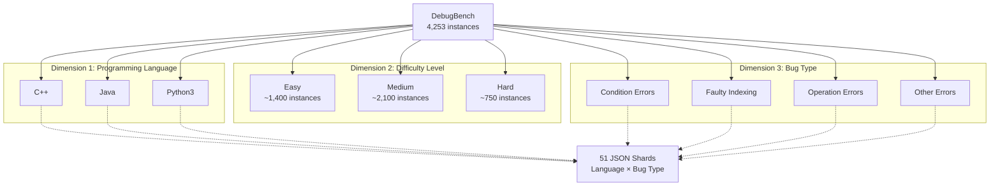
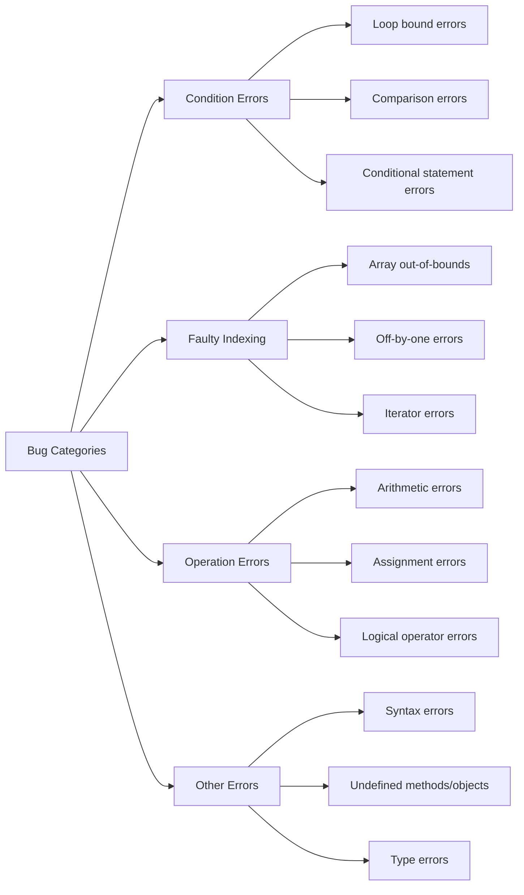
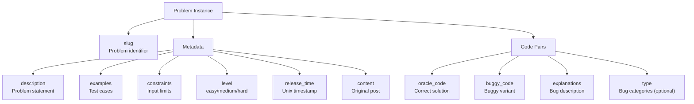

<!-- source: DeepWiki mcp.deepwiki.com · repo thunlp/DebugBench · page 3 Benchmark Dataset · fetched 2026-11-02 -->

# Benchmark Dataset

<details>
<summary>Relevant source files</summary>

The following files were used as context for generating this wiki page:

- [README.md](README.md)
- [benchmark/cpp_condition error.json](benchmark/cpp_condition error.json)
- [benchmark/cpp_double.json](benchmark/cpp_double.json)
- [benchmark/cpp_faulty indexing.json](benchmark/cpp_faulty indexing.json)

</details>


This document provides a comprehensive overview of the DebugBench benchmark dataset, including its structure, organization, content dimensions, and access methods. The benchmark dataset is the core artifact of DebugBench, containing 4,253 bug-implanted programming problems across three languages.

For information about how this dataset was constructed, see [Dataset Construction](#2). For details on how to evaluate models against this benchmark, see [Evaluation System](#4). For analysis of evaluation results, see [Results and Analysis](#5).

## Dataset Overview

The DebugBench benchmark consists of **4,253 instances** of LeetCode-style programming problems with systematically implanted bugs. Each instance pairs a correct solution (`oracle_code`) with a buggy version (`buggy_code`) along with comprehensive metadata including problem descriptions, constraints, and bug explanations.

**Key Statistics:**
- **Total instances:** 4,253
- **Languages:** C++, Java, Python3
- **Bug categories:** 4 major types, 18 minor types
- **Difficulty levels:** Easy (~1,400), Medium (~2,100), Hard (~750)
- **Organization:** 51 JSON shards
- **Source period:** All problems released after June 2022
- **Public access:** Hugging Face Dataset ([Rtian/DebugBench](https://huggingface.co/datasets/Rtian/DebugBench))

Sources: [README.md:11-22]()

## Multi-Dimensional Organization

The benchmark is organized along three independent dimensions, creating a 51-shard structure that enables fine-grained analysis of LLM debugging capabilities.



**Dataset Dimensions: Multi-axis Organization**

Sources: [README.md:17-21](), [benchmark/cpp_condition error.json:1-10](), [benchmark/cpp_faulty indexing.json:1-10]()

## Bug Taxonomy

The benchmark implements a hierarchical bug taxonomy with 4 major categories and 18 minor types, covering the most common debugging scenarios in competitive programming.



**Bug Taxonomy: Major and Minor Categories**

The file naming convention directly reflects this taxonomy. For example:
- `cpp_condition error.json` - C++ condition errors
- `cpp_faulty indexing.json` - C++ indexing errors
- `cpp_double.json` - Instances with multiple bug types

Sources: [README.md:18](), [benchmark/cpp_condition error.json:14-17](), [benchmark/cpp_faulty indexing.json:14-17]()

## Data Schema Structure

Each problem instance follows a consistent JSON schema with oracle-buggy code pairs and comprehensive metadata.



**Problem Instance Schema**

### Example Instance Structure

Here is a representative entry from the dataset showing the complete schema:

| Field | Type | Description | Example |
|-------|------|-------------|---------|
| `slug` | string | LeetCode problem identifier | `"knight-dialer"` |
| `description` | string | Full problem statement | `"The chess knight has a unique movement..."` |
| `examples` | array[string] | Input/output test cases | `["Input: n = 1\nOutput: 10", ...]` |
| `constraints` | string | Input constraints | `"1 <= n <= 5000"` |
| `release_time` | integer | Unix timestamp | `1680161413` |
| `oracle_code` | string | Correct C++/Java/Python3 code | `"class Solution {\n..."` |
| `content` | string | Original LeetCode community post | `"# Approach\n..."` |
| `level` | string | Difficulty level | `"easy"`, `"medium"`, or `"hard"` |
| `buggy_code` | string | Bug-implanted version | `"class Solution {\n..."` |
| `explanations` | string | Human-readable bug explanation | `"The logic error is..."` |
| `type` | array[string] | Bug type tags (optional) | `["indexing error", "conditional statement error"]` |

Sources: [benchmark/cpp_condition error.json:1-17](), [benchmark/cpp_double.json:2-18]()

## File Organization

The benchmark directory contains 51 JSON files organized by language and bug type:

```mermaid
graph TD
    BENCH["benchmark/"]
    
    CPP["C++ Files"]
    JAVA["Java Files"]
    PY["Python3 Files"]
    
    BENCH --> CPP
    BENCH --> JAVA
    BENCH --> PY
    
    CPP --> CPP1["cpp_condition error.json"]
    CPP --> CPP2["cpp_faulty indexing.json"]
    CPP --> CPP3["cpp_operation error.json"]
    CPP --> CPP4["cpp_other error.json"]
    CPP --> CPP5["cpp_double.json<br/>(multiple bug types)"]
    
    JAVA --> JAVA1["java_condition error.json"]
    JAVA --> JAVA2["java_faulty indexing.json"]
    JAVA --> JAVA3["java_operation error.json"]
    JAVA --> JAVA4["java_other error.json"]
    JAVA --> JAVA5["java_double.json"]
    
    PY --> PY1["python3_condition error.json"]
    PY --> PY2["python3_faulty indexing.json"]
    PY --> PY3["python3_operation error.json"]
    PY --> PY4["python3_other error.json"]
    PY --> PY5["python3_double.json"]
```



**Benchmark Directory Structure**

Each JSON file contains an array of problem instances sharing the same language and primary bug category. The `double.json` files contain instances with multiple bug types co-occurring in the same code.

Sources: [README.md:30](), [benchmark/cpp_condition error.json:1](), [benchmark/cpp_double.json:1](), [benchmark/cpp_faulty indexing.json:1]()

## Bug Categories in Detail

### Condition Errors

Bugs involving incorrect conditional logic, loop bounds, or comparison operators. Common patterns include:

- **Off-by-one in loops:** `i < n` changed to `i <= n`
- **Incorrect comparisons:** `==` changed to `>=` or `<=`
- **Inverted conditions:** `if(x < y)` changed to `if(x > y)`

Example from dataset:
```
Original: for(int i = 0; i < n; i++)
Buggy:    for(int i = 0; i <= n; i++)
```

Sources: [benchmark/cpp_condition error.json:14-17](), [benchmark/cpp_condition error.json:45-46]()

### Faulty Indexing

Bugs related to array/vector access, iterator usage, and boundary checking:

- **Out-of-bounds access:** Accessing `arr[n]` when size is `n`
- **Iterator past end:** `it != end()` changed to `it != end()+1`
- **Negative indexing:** Accessing `arr[i-1]` when `i` might be 0

Example from dataset:
```
Original: for(int i = 0; i < nums.size(); i++)
Buggy:    for(int i = 0; i <= nums.size(); i++)
```

Sources: [benchmark/cpp_faulty indexing.json:14-17](), [benchmark/cpp_faulty indexing.json:76-77]()

### Operation Errors

Bugs in arithmetic, logical, or assignment operations:

- **Arithmetic operator errors:** `+` changed to `-`, `*` changed to `/`
- **Assignment vs comparison:** `if(x = 5)` instead of `if(x == 5)`
- **Bitwise vs logical:** `&` instead of `&&`, `|` instead of `||`

Sources: [benchmark/cpp_double.json:19-35]()

### Other Errors

Miscellaneous bugs including syntax errors, undefined methods, and type issues:

- **Undefined method calls:** Calling `foo()` that doesn't exist
- **Missing semicolons or braces**
- **Wrong method names:** `reverseString()` instead of `reverse()`
- **Type mismatches**

Sources: [benchmark/cpp_double.json:126-142]()

## Instance Distribution

The following table summarizes the approximate distribution across difficulty levels:

| Difficulty | Approximate Count | Percentage |
|------------|------------------|------------|
| Easy | 1,400 | 33% |
| Medium | 2,100 | 49% |
| Hard | 750 | 18% |
| **Total** | **4,253** | **100%** |

This distribution mirrors real-world programming problem difficulty, with medium-difficulty problems being most common.

Sources: [README.md:20]()

## Data Provenance

All instances in the benchmark originate from the LeetCode community:

- **Source platform:** LeetCode (https://leetcode.com)
- **Time period:** Problems released after June 2022
- **Original content:** Community-submitted solutions from discussion forums
- **Bug implantation:** Performed using GPT-4 with validation
- **Quality control:** Each buggy variant verified to produce different output than oracle

This ensures the benchmark reflects realistic programming scenarios and contemporary coding patterns.

Sources: [README.md:15](), [README.md:21]()

## Accessing the Dataset

The benchmark is publicly available through multiple channels:

### 1. Hugging Face Hub
Primary access point: [https://huggingface.co/datasets/Rtian/DebugBench](https://huggingface.co/datasets/Rtian/DebugBench)

```python
from datasets import load_dataset
dataset = load_dataset("Rtian/DebugBench")
```

### 2. GitHub Repository
Direct file access: `benchmark/` directory containing all 51 JSON shards

```bash
git clone https://github.com/thunlp/DebugBench
cd DebugBench/benchmark
```

### 3. Programmatic Loading
JSON files can be loaded directly using standard libraries:

```python
import json

with open('benchmark/cpp_condition error.json', 'r') as f:
    cpp_condition_errors = json.load(f)
```

For detailed instructions and examples, see [Accessing the Dataset](#3.5).

Sources: [README.md:13](), [README.md:30]()

## Next Steps

- For detailed shard organization and navigation, see [Dataset Organization](#3.1)
- For complete field descriptions and examples, see [Data Schema and Format](#3.2)
- For language-specific bug examples, see [C++ Bug Examples](#3.3) and [Java and Python Bug Examples](#3.4)
- For programmatic access methods, see [Accessing the Dataset](#3.5)
- To evaluate models on this benchmark, see [Evaluation System](#4)

---

