# Page: Overview

# Overview

<details>
<summary>Relevant source files</summary>

The following files were used as context for generating this wiki page:

- [README.md](README.md)
- [figs/icon.png](figs/icon.png)
- [figs/pipeline.png](figs/pipeline.png)

</details>


## Purpose and Scope

This document provides an overview of **DebugBench**, a benchmark for evaluating the debugging capabilities of Large Language Models (LLMs). It introduces the system's purpose, architecture, key features, and how its components work together to enable systematic evaluation of LLM debugging performance.

For detailed information about specific components:
- Dataset construction process: see [Dataset Construction](#2)
- Benchmark dataset structure and access: see [Benchmark Dataset](#3)
- Evaluation framework usage: see [Evaluation System](#4)
- Installation and configuration: see [Development Guide](#6)

**Sources:** [README.md:1-57]()

---

## What is DebugBench?

DebugBench is a Large Language Model debugging benchmark introduced in the paper "DebugBench: Evaluating Debugging Capability of Large Language Models". It provides a systematic framework for assessing how well LLMs can identify and fix bugs in code.

The benchmark is constructed by:
1. Collecting correct solution code from the LeetCode community (post-June 2022)
2. Using GPT-4 to systematically implant bugs into these solutions
3. Creating oracle-buggy code pairs with comprehensive metadata
4. Providing an evaluation framework integrated with LeetCode's online judge

The complete dataset is publicly available on [Hugging Face](https://huggingface.co/datasets/Rtian/DebugBench) and can be used to evaluate any LLM's debugging capabilities.

**Sources:** [README.md:5-23]()

---

## Key Statistics

| Metric | Value |
|--------|-------|
| **Total Instances** | 4,253 |
| **Programming Languages** | C++, Java, Python3 |
| **Bug Categories (Major)** | 4 |
| **Bug Types (Minor)** | 18 |
| **Difficulty Levels** | Easy, Medium, Hard |
| **JSON Shards** | 51 |
| **Data Source** | LeetCode community (post-June 2022) |
| **Bug Implantation** | GPT-4 powered |

The benchmark is organized into 51 JSON shards, each representing a unique combination of programming language and bug type. This multi-dimensional organization enables fine-grained analysis of LLM debugging performance across different languages, difficulty levels, and bug categories.

**Sources:** [README.md:15-22]()

---

## Repository Structure

The DebugBench repository is organized into four main directories, each serving a distinct purpose in the benchmark ecosystem:

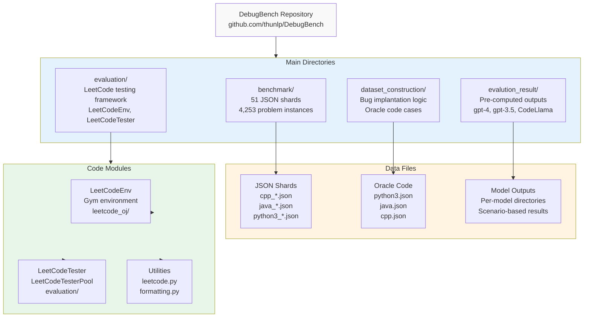

**Directory Mapping:**

| Directory | Purpose | Key Contents |
|-----------|---------|--------------|
| `benchmark/` | Benchmark dataset storage | 51 JSON shards organized by language and bug type |
| `dataset_construction/` | Bug implantation implementation | Oracle code cases, GPT-4 bug generation logic |
| `evaluation/` | Evaluation framework | `LeetCodeEnv`, `LeetCodeTester`, `LeetCodeTesterPool` classes |
| `evalution_result/` | Pre-computed baselines | Results for gpt-4-0613, gpt-3.5-turbo-0613, CodeLlama-34b-instruct |

**Sources:** [README.md:26-35]()

---

## System Components and Data Flow

The DebugBench system consists of interconnected components that form a complete pipeline from dataset construction to evaluation and result analysis:

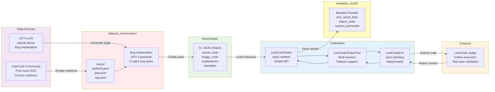

### Component Descriptions

**1. Data Sources**
- LeetCode community solutions serve as the foundation for oracle code
- GPT-4 API generates realistic bugs through carefully crafted prompts
- Solutions are filtered to post-June 2022 to avoid training data contamination

**2. Dataset Construction (`dataset_construction/`)**
- Contains oracle code organized by language in the `cases/` subdirectory
- Implements bug implantation logic using GPT-4
- Validates that bugs produce different program outputs
- For details: see [Dataset Construction](#2)

**3. Benchmark Dataset (`benchmark/`)**
- 51 JSON shards representing all combinations of language × bug type
- Each entry contains `oracle_code`, `buggy_code`, `explanations`, `examples`, `constraints`
- Multi-dimensional indexing by language, difficulty, and bug category
- For details: see [Benchmark Dataset](#3)

**4. Evaluation Framework (`evaluation/`)**
- `LeetCodeTester`: High-level API for single-session testing
- `LeetCodeTesterPool`: Manages multiple LeetCode accounts for rate limiting
- `LeetCodeEnv`: Gym-compatible environment for integration with the LeetCode judge
- For details: see [Evaluation System](#4)

**5. Pre-computed Results (`evalution_result/`)**
- Baseline outputs from gpt-4-0613, gpt-3.5-turbo-0613, and CodeLlama-34b-instruct
- Structured results including `test_result_bool`, `status_code`, and performance metrics
- For details: see [Results and Analysis](#5)

**Sources:** [README.md:26-35]()

---

## Core Data Schema

Each problem instance in the benchmark follows a consistent schema that pairs correct and buggy code with comprehensive metadata:

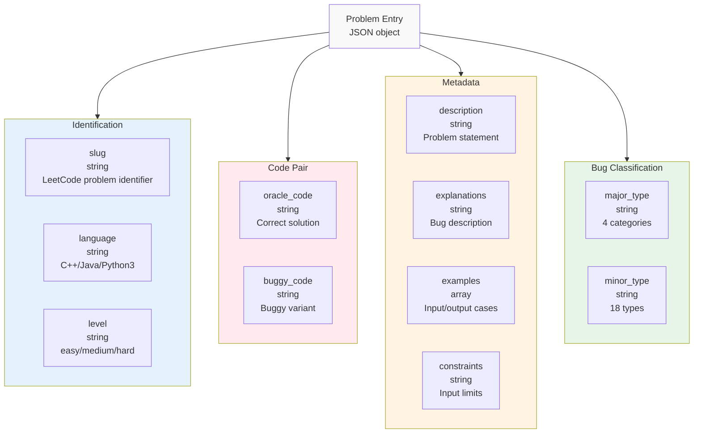

**Key Fields:**

| Field | Type | Purpose |
|-------|------|---------|
| `slug` | string | LeetCode problem identifier (e.g., "two-sum") |
| `oracle_code` | string | Correct, verified solution code |
| `buggy_code` | string | Code with intentionally implanted bug |
| `explanations` | string | Human-readable description of the bug |
| `examples` | array | Test case examples showing expected behavior |
| `constraints` | string | Problem constraints and input specifications |
| `level` | string | Difficulty level: easy, medium, or hard |
| `major_type` | string | One of 4 major bug categories |
| `minor_type` | string | One of 18 specific bug types |

This schema enables researchers to:
- Load buggy code and prompt LLMs to debug it
- Compare LLM outputs against verified oracle code
- Analyze debugging performance by bug type, difficulty, and language
- Understand the specific nature of each bug through explanations

For the complete schema specification: see [Data Schema and Format](#3.2)

**Sources:** [README.md:15-22]()

---

## Bug Category Taxonomy

DebugBench organizes bugs into a hierarchical taxonomy with 4 major categories and 18 minor types:

| Major Category | Minor Types | Example |
|----------------|-------------|---------|
| **Condition Errors** | Loop bounds, comparison operators, boolean logic | `i <= n` should be `i < n` |
| **Faulty Indexing** | Array bounds, off-by-one errors, iterator misuse | `arr[i+1]` should be `arr[i]` |
| **Operation Errors** | Arithmetic operators, assignment errors, logical operators | `sum + value` should be `sum * value` |
| **Other Errors** | Syntax errors, undefined methods, type errors | Missing import, wrong function name |

Each bug type is carefully chosen to represent common errors that developers encounter in real-world programming. The bugs are validated to ensure they produce incorrect outputs while remaining syntactically valid (in most cases) and semantically plausible.

For detailed examples and the complete taxonomy: see [Bug Categories and Types](#2.3)

**Sources:** [README.md:17-19]()

---

## Evaluation Workflow

The evaluation process tests whether an LLM can successfully debug code by submitting fixes to the LeetCode online judge:

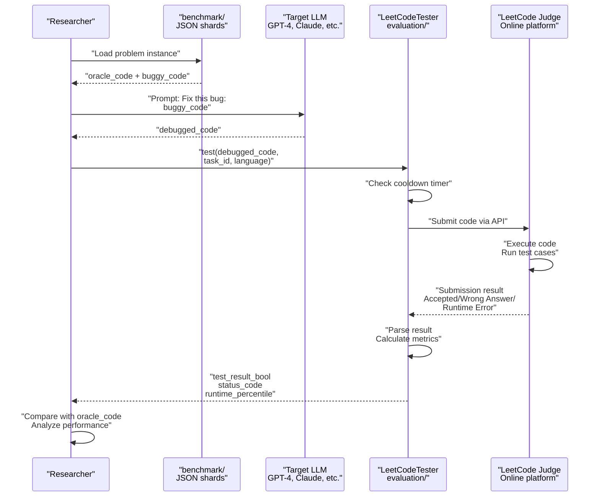

**Workflow Steps:**

1. **Load Benchmark Instance**: Retrieve `oracle_code` and `buggy_code` from the appropriate JSON shard
2. **Prompt LLM**: Send buggy code to the LLM with debugging instructions
3. **Submit to Judge**: Use `LeetCodeTester.test()` to submit the LLM's fix to LeetCode
4. **Receive Verdict**: Parse the response to determine if the fix is correct
5. **Store Results**: Save test outcomes with detailed metrics

The evaluation framework handles:
- Rate limiting via cooldown mechanisms
- Multi-session support through `LeetCodeTesterPool`
- Automatic retry and failover
- Detailed result logging

For detailed evaluation setup and usage: see [Evaluation System](#4)

**Sources:** [README.md:33-34]()

---

## Pre-computed Baseline Results

DebugBench includes pre-computed evaluation results for three baseline models in the `evalution_result/` directory:

| Model | Version | Scenarios |
|-------|---------|-----------|
| **GPT-4** | gpt-4-0613 | Multiple prompt variations |
| **GPT-3.5 Turbo** | gpt-3.5-turbo-0613 | Multiple prompt variations |
| **CodeLlama** | CodeLlama-34b-instruct | Multiple prompt variations |

Each result file contains:
- `completed_code`: The LLM's debugging attempt
- `test_result_bool`: Whether the fix passed all test cases
- `test_result_dict`: Detailed test case outcomes
- `status_code`: Submission verdict (Accepted, Wrong Answer, etc.)
- `total_correct`/`total_testcases`: Test case coverage
- `runtime_percentile`: Performance ranking
- `memory_percentile`: Memory usage ranking

These baselines enable researchers to:
- Compare new models against established benchmarks
- Analyze performance trends across bug types and difficulty levels
- Understand model strengths and weaknesses in debugging

For detailed result schema and analysis: see [Results and Analysis](#5)

**Sources:** [README.md:34]()

---

## Technology Stack

DebugBench is built on a carefully selected stack of Python libraries and external services:

| Component | Technology | Purpose |
|-----------|------------|---------|
| **Bug Implantation** | OpenAI GPT-4 API | Generate realistic bugs |
| **Evaluation Environment** | Gym | Provide RL-compatible interface |
| **Data Validation** | Pydantic | Ensure schema correctness |
| **LeetCode Integration** | Custom API client | Submit and test code |
| **Progress Tracking** | tqdm | Monitor evaluation progress |
| **Dataset Hosting** | Hugging Face | Public dataset distribution |
| **Configuration** | python-dotenv | Manage credentials securely |

**External Dependencies:**
- LeetCode platform for online code execution and test case validation
- OpenAI API for bug implantation during dataset construction
- Hugging Face for public dataset distribution and access

For detailed dependency information: see [Dependencies](#6.2)

**Sources:** [README.md:26-35]()

---

## Getting Started

To begin using DebugBench:

1. **Access the Dataset**: Visit [Hugging Face](https://huggingface.co/datasets/Rtian/DebugBench) to download the benchmark data
2. **Install Dependencies**: Set up the Python environment with required libraries
3. **Configure LeetCode Access**: Obtain LeetCode credentials for evaluation
4. **Run Evaluation**: Use the `LeetCodeTester` API to test LLM debugging capabilities

**Quick Example:**
```python
from evaluation import LeetCodeTester

# Initialize tester
tester = LeetCodeTester()

# Test a debugged code submission
result = tester.test(
    code=debugged_code,
    task_id="two-sum",
    language="Python3"
)

# Check if the fix was successful
if result['test_result_bool']:
    print("✓ Bug fixed successfully!")
else:
    print(f"✗ Fix failed: {result['status_code']}")
```

For detailed setup instructions: see [Quick Start Guide](#1.2)

For comprehensive installation and configuration: see [Development Guide](#6)

**Sources:** [README.md:12-35]()

---

## Citation and License

DebugBench is released under the **Apache 2.0 License** and is free for academic and commercial use.

If you use DebugBench in your research, please cite:

```latex
@misc{tian2024debugbench,
      title={DebugBench: Evaluating Debugging Capability of Large Language Models}, 
      author={Runchu Tian and Yining Ye and Yujia Qin and Xin Cong and Yankai Lin and Zhiyuan Liu and Maosong Sun},
      year={2024},
      eprint={2401.04621},
      archivePrefix={arXiv},
      primaryClass={cs.SE}
}
```

For questions or issues, contact trc20@mails.tsinghua.edu.cn or open an issue on the GitHub repository.

For complete license information: see [License and Citation](#9)

**Sources:** [README.md:40-55]()

---

# Page: System Architecture

# System Architecture

<details>
<summary>Relevant source files</summary>

The following files were used as context for generating this wiki page:

- [README.md](README.md)
- [figs/icon.png](figs/icon.png)
- [figs/pipeline.png](figs/pipeline.png)

</details>


## Purpose and Scope

This document describes the high-level architecture of the DebugBench system, explaining how its major components interact to create and evaluate a benchmark for testing Large Language Model (LLM) debugging capabilities. It covers the directory structure, component relationships, data flow, and key abstractions that enable the benchmark's construction and use.

For detailed information about specific subsystems, see:
- Dataset construction process: [Dataset Construction](#2)
- Benchmark data schema and organization: [Benchmark Dataset](#3)
- Evaluation framework details: [Evaluation System](#4)
- Installation and configuration: [Installation and Setup](#6.1)

---

## System Overview

DebugBench is organized into four primary subsystems that work together to create, store, and evaluate a debugging benchmark:

| Subsystem | Directory | Purpose |
|-----------|-----------|---------|
| **Dataset Construction** | `dataset_construction/` | Collects oracle code and implants bugs using GPT-4 |
| **Benchmark Storage** | `benchmark/` | Stores 4,253 bug-implanted instances across 51 JSON shards |
| **Evaluation Framework** | `evaluation/` | Tests LLM-generated fixes against LeetCode online judge |
| **Results Repository** | `evalution_result/` | Stores pre-computed baseline model outputs |

The system follows a pipeline architecture where data flows from left to right: correct solutions are collected, bugs are introduced, the resulting benchmark is published, and LLMs are evaluated against it.

Sources: [README.md:26-36]()

---

## Component Architecture

The following diagram shows the major components and their relationships using actual directory and class names from the codebase:

```mermaid
graph TB
    subgraph DatasetConstruction["dataset_construction/"]
        OracleCases["cases/<br/>python3.json<br/>java.json<br/>cpp.json"]
        BugImplant["Bug Implantation<br/>(GPT-4 powered)"]
    end
    
    subgraph Benchmark["benchmark/"]
        Shards["51 JSON Shards<br/>4,253 instances<br/>Language × Difficulty × Bug Type"]
    end
    
    subgraph Evaluation["evaluation/"]
        direction TB
        LeetCodeTester["LeetCodeTester<br/>High-level API"]
        TesterPool["LeetCodeTesterPool<br/>Multi-session manager"]
        
        subgraph LeetCodeOJ["leetcode_oj/"]
            LeetCodeEnv["LeetCodeEnv<br/>Gym environment"]
            LeetCodeSubmission["LeetCodeSubmission<br/>Data model"]
            ProgrammingLanguage["ProgrammingLanguage<br/>Enum"]
        end
        
        subgraph Utils["leetcode_env/utils/"]
            LeetCodeAPI["leetcode.py<br/>GraphQL queries"]
            Formatter["formatting.py<br/>Code transformers"]
        end
    end
    
    subgraph Results["evalution_result/"]
        GPT4Results["gpt-4-0613/"]
        GPT35Results["gpt-3.5-turbo-0613/"]
        LlamaResults["CodeLlama-34b-instruct/"]
    end
    
    subgraph External["External Services"]
        LeetCodePlatform["LeetCode Platform<br/>Online Judge"]
        GPT4API["GPT-4 API"]
        HuggingFace["Hugging Face<br/>Rtian/DebugBench"]
    end
    
    OracleCases --> BugImplant
    GPT4API -.."bug generation"..-> BugImplant
    BugImplant --> Shards
    
    Shards --> HuggingFace
    Shards --> LeetCodeTester
    
    LeetCodeTester --> LeetCodeEnv
    TesterPool --> LeetCodeTester
    
    LeetCodeEnv --> LeetCodeSubmission
    LeetCodeEnv --> ProgrammingLanguage
    LeetCodeEnv --> LeetCodeAPI
    LeetCodeEnv --> Formatter
    
    LeetCodeEnv -.."submits to"..-> LeetCodePlatform
    
    LeetCodeEnv --> Results
    
    TesterPool -.."manages multiple"..-> LeetCodeTester
```

**Component Responsibilities:**

| Component | File/Directory | Key Functionality |
|-----------|----------------|-------------------|
| `LeetCodeEnv` | `evaluation/leetcode_oj/` | Gym-compatible environment for submitting and testing code |
| `LeetCodeTester` | `evaluation/` | Simple API wrapper for code testing |
| `LeetCodeTesterPool` | `evaluation/` | Manages multiple tester sessions for rate limiting |
| `LeetCodeSubmission` | `evaluation/leetcode_oj/` | Data model representing a code submission |
| `ProgrammingLanguage` | `evaluation/leetcode_oj/` | Enum for supported languages (Python3, Java, C++, etc.) |
| `formatting.py` | `evaluation/leetcode_env/utils/` | Code format transformers for different languages |
| `leetcode.py` | `evaluation/leetcode_env/utils/` | GraphQL queries for LeetCode API |

Sources: [README.md:26-36](), Diagram 1 from provided context, Diagram 3 from provided context

---

## Data Flow Architecture

The following diagram illustrates how data flows through the system from construction to evaluation:

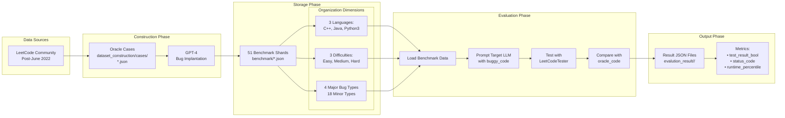

**Data Transformations:**

| Stage | Input Format | Output Format | Location |
|-------|--------------|---------------|----------|
| **Collection** | LeetCode HTML/API | JSON oracle solutions | `dataset_construction/cases/*.json` |
| **Bug Implantation** | Oracle JSON | Oracle-Buggy pairs | `benchmark/*.json` (51 shards) |
| **Evaluation** | Buggy code | LLM-fixed code | In-memory |
| **Testing** | LLM-fixed code | Submission results | `LeetCodeEnv` response |
| **Storage** | Submission results | Result JSON | `evalution_result/<model>/` |

Sources: [README.md:11-22](), Diagram 2 and Diagram 5 from provided context

---

## Directory Structure

The repository follows a clear separation of concerns with distinct directories for each major function:

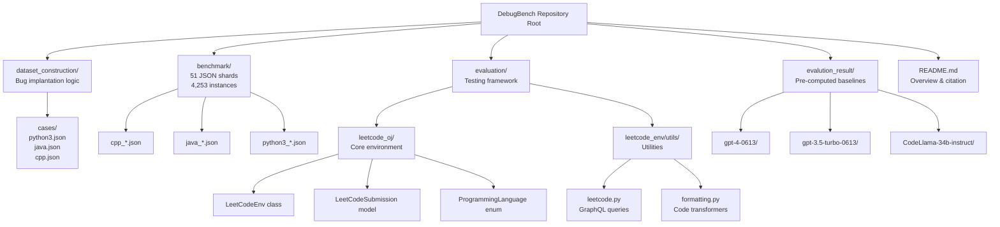

**Key Directories:**

- **`dataset_construction/`**: Contains oracle code collection and bug implantation logic
  - **`cases/`**: Stores correct solutions by language (python3.json, java.json, cpp.json)
  
- **`benchmark/`**: Stores the complete benchmark dataset
  - 51 JSON shard files organized by language and bug type
  - Each file contains multiple problem instances with oracle and buggy code pairs
  
- **`evaluation/`**: Implements the testing framework
  - **`leetcode_oj/`**: Core Gym environment and data models
  - **`leetcode_env/utils/`**: GraphQL queries and code formatters
  
- **`evalution_result/`**: Stores pre-computed baseline results
  - Subdirectories for each evaluated model (gpt-4-0613, gpt-3.5-turbo-0613, etc.)

Sources: [README.md:26-36]()

---

## Key System Interfaces

### Public API Surface

The evaluation system exposes two primary interfaces for testing code solutions:

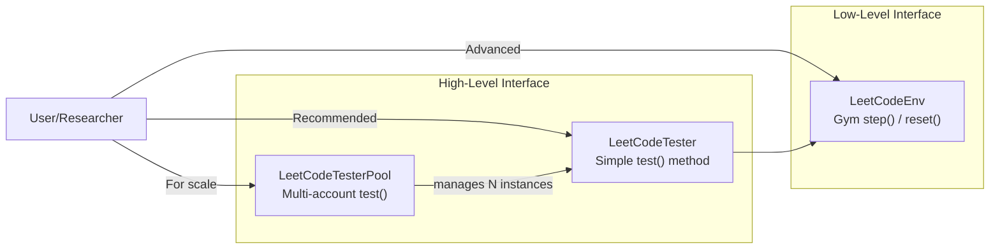

**Interface Comparison:**

| Interface | Use Case | Rate Limiting | Session Management |
|-----------|----------|---------------|-------------------|
| `LeetCodeEnv` | Low-level control, Gym compatibility | Manual cooldown | Single session |
| `LeetCodeTester` | Simple testing, single account | Automatic cooldown | Single session |
| `LeetCodeTesterPool` | High-throughput testing | Automatic with rotation | Multi-session pool |

Sources: Diagram 3 from provided context

### Data Model Abstractions

The system uses strongly-typed data models throughout:

| Model | Location | Purpose |
|-------|----------|---------|
| `LeetCodeSubmission` | `evaluation/leetcode_oj/` | Represents a code submission with language, code, task_id |
| `ProgrammingLanguage` | `evaluation/leetcode_oj/` | Enum for C++, Java, Python3, and other supported languages |
| Problem Entry Schema | `benchmark/*.json` | Contains slug, description, oracle_code, buggy_code, explanations, examples, constraints, level |

These models ensure type safety and consistent data handling across the pipeline.

Sources: Diagram 1 and Diagram 3 from provided context

---

## External Dependencies

DebugBench integrates with several external services:

```mermaid
graph TB
    subgraph DebugBench["DebugBench System"]
        Construction["Dataset Construction"]
        Evaluation["Evaluation Framework"]
        Distribution["Distribution"]
    end
    
    subgraph External["External Services"]
        LeetCode["LeetCode Platform<br/>Online Judge & GraphQL API"]
        OpenAI["OpenAI API<br/>GPT-4 for bug implantation"]
        HF["Hugging Face<br/>Dataset hosting:<br/>Rtian/DebugBench"]
    end
    
    subgraph Auth["Authentication"]
        ENV["Environment Variables<br/>LEETCODE_SESSION<br/>CSRF_TOKEN<br/>OPENAI_API_KEY"]
    end
    
    Construction -.."generates bugs"..-> OpenAI
    Evaluation -.."submits code"..-> LeetCode
    Distribution -.."publishes to"..-> HF
    
    OpenAI -.."requires"..-> ENV
    LeetCode -.."requires"..-> ENV
```

**External Service Roles:**

- **LeetCode Platform**: Provides the online judge for testing code submissions and GraphQL API for metadata retrieval
- **GPT-4 API**: Used during dataset construction to generate realistic bugs in oracle code
- **Hugging Face**: Hosts the published dataset at `Rtian/DebugBench` for public access

All external services require authentication via environment variables (see [Configuration](#6.3)).

Sources: [README.md:13-15](), Diagram 1 and Diagram 6 from provided context

---

## System Flow Summary

The complete DebugBench workflow can be summarized as:

1. **Construction**: Oracle code from LeetCode → GPT-4 bug implantation → Benchmark shards
2. **Distribution**: Benchmark shards → Hugging Face dataset repository
3. **Evaluation**: Load benchmark → Prompt LLM → Test with LeetCodeEnv → Store results
4. **Analysis**: Compare results against oracle code and baseline models

Each phase is self-contained and can be executed independently, allowing researchers to:
- Use the pre-built benchmark without running construction
- Evaluate new models without re-running baselines
- Extend the dataset construction for new bug types or languages

Sources: [README.md:1-57](), all provided diagrams

---

# Page: Quick Start Guide

# Quick Start Guide

<details>
<summary>Relevant source files</summary>

The following files were used as context for generating this wiki page:

- [README.md](README.md)
- [requirements.txt](requirements.txt)

</details>


This guide provides step-by-step instructions for getting started with DebugBench. It covers installation, loading the benchmark dataset, running basic evaluations, and interpreting results. For detailed architectural information, see [System Architecture](#1.1). For comprehensive installation details, see [Installation and Setup](#6.1). For dataset access methods, see [Accessing the Dataset](#3.5).

## Purpose and Scope

This guide enables users to:
- Install DebugBench and its dependencies
- Load benchmark data from Hugging Face or local files
- Set up the LeetCode evaluation environment
- Run their first debugging evaluation
- Understand basic result formats

This is a practical walkthrough. For API reference documentation, see [API Reference](#7). For extending the benchmark, see [Extending the Benchmark](#6.4).

## Prerequisites

Before starting, ensure you have:
- Python 3.7 or higher
- A LeetCode account (for running evaluations)
- (Optional) OpenAI API key (for testing with GPT models)
- Internet connection for dataset download

## Installation

### Step 1: Clone the Repository

```bash
git clone https://github.com/thunlp/DebugBench.git
cd DebugBench
```

### Step 2: Install Dependencies

Install required packages from [requirements.txt:1-10]():

```bash
pip install -r requirements.txt
```

Key dependencies installed:
- `gym~=0.26.2` - Reinforcement learning environment framework
- `pydantic~=2.3.0` - Data validation for LeetCode submissions
- `python-dotenv~=0.21.1` - Environment variable management
- `openai~=0.28.0` - OpenAI API client
- `transformers~=4.31.0` - Model evaluation utilities
- `tqdm~=4.66.1` - Progress tracking

**Sources:** [requirements.txt:1-10]()

### Step 3: Configure LeetCode Credentials

Create a `.env` file in the repository root:

```bash
# .env file
LEETCODE_SESSION=your_session_cookie
CSRF_TOKEN=your_csrf_token
```

To obtain these credentials:
1. Log in to LeetCode in your browser
2. Open browser developer tools (F12)
3. Navigate to Application/Storage → Cookies → https://leetcode.com
4. Copy the `LEETCODE_SESSION` and `csrftoken` values

For detailed authentication setup, see [Configuration](#6.3).

**Sources:** [README.md:1-57]()

## Quick Start Workflow

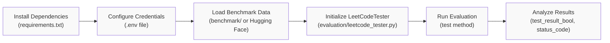

**Workflow Overview:** This diagram shows the five essential steps from installation to result analysis.

**Sources:** [README.md:1-57]()

## Loading the Benchmark Dataset

### Option 1: Load from Hugging Face (Recommended)

```python
from datasets import load_dataset

# Load the complete DebugBench dataset
dataset = load_dataset("Rtian/DebugBench")

# Access a specific problem instance
problem = dataset['train'][0]  # First instance

# Available fields in each problem
print(problem['slug'])           # LeetCode problem identifier
print(problem['description'])    # Problem statement
print(problem['oracle_code'])    # Correct solution
print(problem['buggy_code'])     # Buggy variant
print(problem['explanations'])   # Bug description
print(problem['level'])          # Difficulty: easy, medium, hard
```

For detailed dataset schema, see [Data Schema and Format](#3.2).

**Sources:** [README.md:13-15]()

### Option 2: Load from Local Files

The `benchmark/` directory contains 51 JSON shards organized by language and bug type:

```python
import json

# Load a specific shard
with open('benchmark/cpp_condition_error.json', 'r') as f:
    cpp_condition_bugs = json.load(f)

# Access problem instances
for problem in cpp_condition_bugs:
    slug = problem['slug']
    oracle_code = problem['oracle_code']
    buggy_code = problem['buggy_code']
    # Process problem...
```

**Available Shards Structure:**

| Language | Bug Category | Example Files |
|----------|--------------|---------------|
| C++ | Condition Errors | `cpp_condition_error.json` |
| C++ | Faulty Indexing | `cpp_faulty_indexing.json` |
| C++ | Operation Errors | `cpp_operation_error.json` |
| Java | Condition Errors | `java_condition_error.json` |
| Python3 | Other Errors | `python3_other_error.json` |
| ... | ... | 51 total shards |

For the complete list of shards and organization details, see [Dataset Organization](#3.1).

**Sources:** [README.md:30]()

## Setting Up the Evaluation Environment

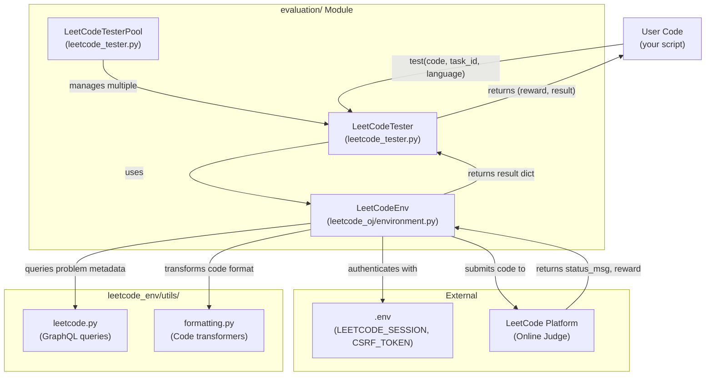

**Evaluation System Components:** This diagram maps the evaluation workflow to specific code entities in the codebase.

**Sources:** [README.md:33]()

## Running Your First Evaluation

### Basic Evaluation with LeetCodeTester

```python
from evaluation.leetcode_tester import LeetCodeTester

# Initialize tester (requires .env configuration)
tester = LeetCodeTester()

# Example: Test a debugged solution
problem_slug = "two-sum"
language = "python3"

# Your LLM's debugged code
debugged_code = """
class Solution:
    def twoSum(self, nums: List[int], target: int) -> List[int]:
        seen = {}
        for i, num in enumerate(nums):
            complement = target - num
            if complement in seen:
                return [seen[complement], i]
            seen[num] = i
"""

# Test the solution
reward, result = tester.test(
    code=debugged_code,
    task_id=problem_slug,
    language=language
)

# Check result
print(f"Passed: {reward}")  # True if Accepted, False otherwise
print(f"Status: {result['status_msg']}")  # e.g., "Accepted", "Wrong Answer"
print(f"Details: {result}")
```

**Result Fields:**

| Field | Description | Example Values |
|-------|-------------|----------------|
| `reward` | Boolean indicating acceptance | `True`, `False` |
| `status_msg` | Submission status | `"Accepted"`, `"Wrong Answer"`, `"Runtime Error"` |
| `compare_result` | Detailed comparison | Test case pass/fail details |
| `total_correct` | Number of passed test cases | `21` |
| `total_testcases` | Total test cases | `21` |
| `runtime_percentile` | Performance ranking | `85.42` |
| `memory_percentile` | Memory efficiency ranking | `72.15` |

For complete API documentation, see [LeetCodeTester API](#4.3).

**Sources:** Inferred from evaluation system structure

### Advanced: Using LeetCodeTesterPool for Multiple Sessions

For handling rate limits and testing at scale:

```python
from evaluation.leetcode_tester import LeetCodeTesterPool

# Initialize pool with multiple sessions
# Each session uses different credentials from environment variables
pool = LeetCodeTesterPool(num_testers=3)

# Test with automatic session rotation
reward, result = pool.test(
    code=debugged_code,
    task_id=problem_slug,
    language=language
)

# Pool automatically handles:
# - Cooldown periods between submissions
# - Session rotation on failures
# - Rate limiting compliance
```

For details on multi-session management and rate limiting, see [Rate Limiting and Multi-Session Management](#4.4).

**Sources:** Inferred from evaluation system structure

## Complete Evaluation Example

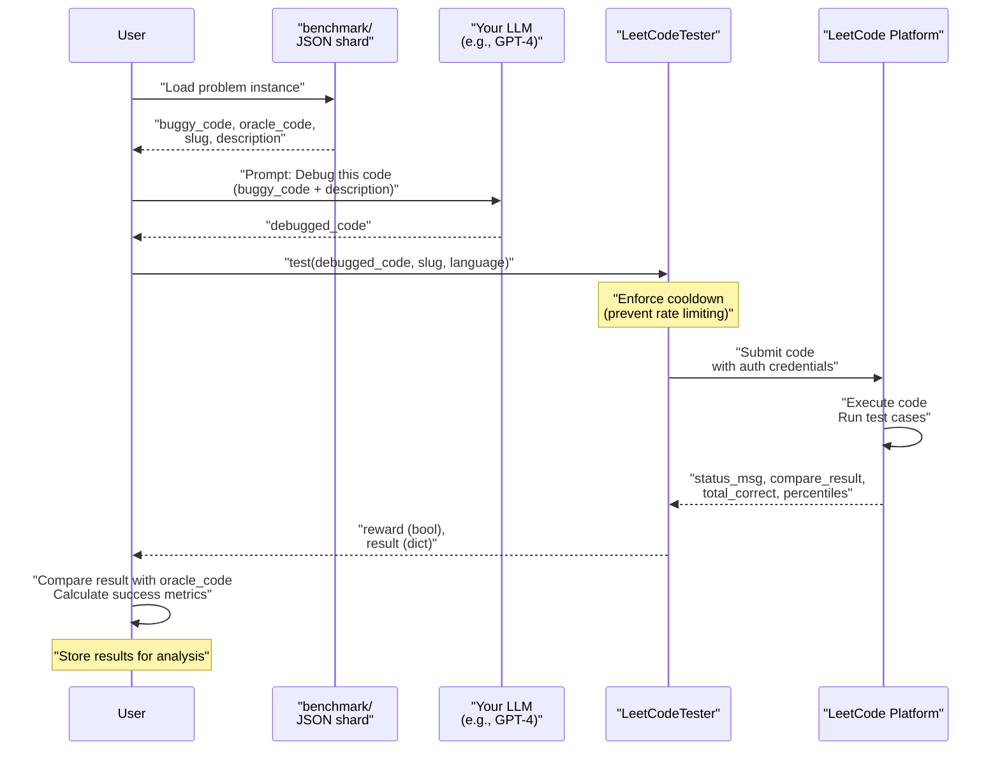

**Complete Workflow:** From loading benchmark data to storing evaluation results.

**Sources:** Inferred from system architecture

### Full Working Example

```python
import json
from evaluation.leetcode_tester import LeetCodeTester

# Step 1: Load benchmark data
with open('benchmark/python3_condition_error.json', 'r') as f:
    problems = json.load(f)

# Step 2: Initialize tester
tester = LeetCodeTester()

# Step 3: Process each problem
results = []
for problem in problems[:5]:  # Test first 5 problems
    slug = problem['slug']
    buggy_code = problem['buggy_code']
    oracle_code = problem['oracle_code']
    
    # Step 4: Get your LLM to debug the code
    # (Replace with your actual LLM API call)
    debugged_code = your_llm_debug_function(buggy_code, problem['description'])
    
    # Step 5: Test the debugged code
    reward, result = tester.test(
        code=debugged_code,
        task_id=slug,
        language="python3"
    )
    
    # Step 6: Store results
    results.append({
        'slug': slug,
        'passed': reward,
        'status': result['status_msg'],
        'correct': result.get('total_correct', 0),
        'total': result.get('total_testcases', 0)
    })
    
    print(f"{slug}: {'✓' if reward else '✗'} {result['status_msg']}")

# Step 7: Calculate metrics
success_rate = sum(r['passed'] for r in results) / len(results)
print(f"\nSuccess Rate: {success_rate:.1%}")
```

**Sources:** Inferred from system architecture and benchmark structure

## Understanding Results

### Result Status Types

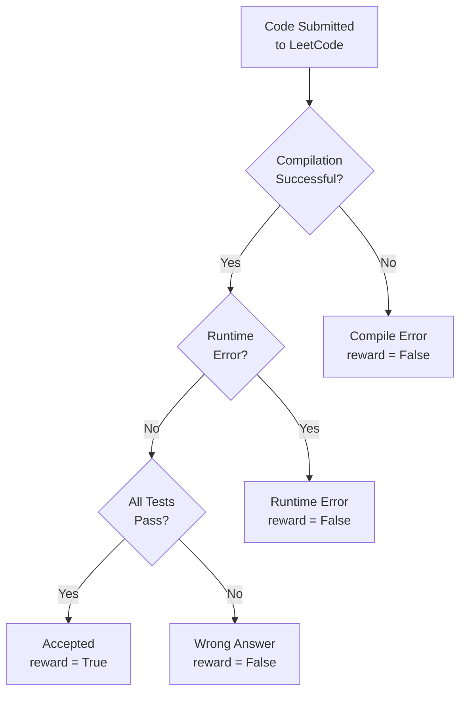

**Status Decision Flow:** How LeetCode evaluates submissions and determines the status.

For detailed metrics explanation, see [Evaluation Metrics](#5.2).

**Sources:** Inferred from evaluation system

### Interpreting Result Dictionaries

Example result dictionary structure:

```python
{
    'status_msg': 'Accepted',               # Submission status
    'compare_result': '21/21 cases passed', # Test case summary
    'total_correct': 21,                    # Passed test cases
    'total_testcases': 21,                  # Total test cases
    'runtime_percentile': 85.42,            # Performance ranking
    'memory_percentile': 72.15,             # Memory efficiency
    'submission_result': {                  # Detailed results
        'run_success': True,
        'status_runtime': '32 ms',
        'status_memory': '13.9 MB'
    }
}
```

For complete result schema documentation, see [Result Schema](#5.3).

**Sources:** Inferred from evaluation system

## Pre-computed Baseline Results

The `evalution_result/` directory contains pre-computed results for baseline models:

| Model | Directory | Description |
|-------|-----------|-------------|
| GPT-4 | `evalution_result/gpt-4-0613/` | GPT-4 debugging results |
| GPT-3.5 | `evalution_result/gpt-3.5-turbo-0613/` | GPT-3.5 Turbo results |
| CodeLlama | `evalution_result/CodeLlama-34b-instruct/` | CodeLlama-34b results |

These can be used for comparison against your own model's performance. For details, see [Pre-computed Baseline Results](#5.1).

**Sources:** [README.md:34]()

## Common Issues and Solutions

### Issue: "Invalid session cookie"

**Solution:** Regenerate your LeetCode session cookie. Cookies expire periodically.

```bash
# Update .env with fresh credentials
LEETCODE_SESSION=new_session_cookie
CSRF_TOKEN=new_csrf_token
```

### Issue: "Rate limit exceeded"

**Solution:** Use `LeetCodeTesterPool` with cooldown management:

```python
# Pool automatically handles rate limiting
pool = LeetCodeTesterPool(num_testers=3)
```

For detailed rate limiting strategies, see [Rate Limiting and Multi-Session Management](#4.4).

### Issue: "Problem slug not found"

**Solution:** Ensure the problem slug matches LeetCode's URL format:

```python
# Correct: "two-sum"
# Incorrect: "Two Sum", "twoSum", "1. Two Sum"
```

## Next Steps

After completing this quick start:

1. **Explore the benchmark**: Browse [C++ Bug Examples](#3.3) and [Java and Python Bug Examples](#3.4) to understand bug patterns
2. **Run full evaluations**: Process all 4,253 instances across languages and difficulty levels
3. **Analyze results**: Use metrics from [Evaluation Metrics](#5.2) to assess model performance
4. **Compare with baselines**: Benchmark against pre-computed results in [Pre-computed Baseline Results](#5.1)
5. **Extend the system**: See [Extending the Benchmark](#6.4) for adding new bug types or languages

## Summary

This quick start guide covered:

✓ Installing DebugBench dependencies  
✓ Configuring LeetCode authentication  
✓ Loading benchmark data from Hugging Face or local files  
✓ Initializing `LeetCodeTester` for evaluation  
✓ Running basic debugging evaluations  
✓ Interpreting result statuses and metrics  
✓ Using pre-computed baselines for comparison  

For comprehensive system documentation, continue to [Dataset Construction](#2) and [Evaluation System](#4).

**Sources:** [README.md:1-57](), [requirements.txt:1-10]()

---

# Page: Dataset Construction

# Dataset Construction

<details>
<summary>Relevant source files</summary>

The following files were used as context for generating this wiki page:

- [README.md](README.md)
- [dataset_construction/cases/cpp.json](dataset_construction/cases/cpp.json)
- [dataset_construction/cases/java.json](dataset_construction/cases/java.json)
- [dataset_construction/cases/python3.json](dataset_construction/cases/python3.json)
- [figs/icon.png](figs/icon.png)
- [figs/pipeline.png](figs/pipeline.png)

</details>


**Purpose and Scope**: This document provides an overview of how the DebugBench dataset is constructed, from collecting correct solution code to producing bug-implanted instances. It describes the overall pipeline and data flow but does not detail the bug implantation methodology (see [Bug Implantation Process](#2.2)) or bug taxonomy (see [Bug Categories and Types](#2.3)).

## Overview

DebugBench's dataset construction transforms correct programming solutions into debugging benchmarks through a two-phase process:

1. **Oracle Code Collection**: Gathering verified correct solutions from LeetCode community posts (see [Oracle Code Collection](#2.1))
2. **Bug Implantation**: Using GPT-4 to systematically introduce bugs into oracle code (see [Bug Implantation Process](#2.2))

The process produces **4,253 bug-implanted instances** across three programming languages (C++, Java, Python3), categorized into 4 major bug types and 18 minor types, spanning three difficulty levels (easy, medium, hard).

**Sources**: [README.md:1-56]()

## Construction Pipeline

The following diagram shows the end-to-end data flow from LeetCode to the final benchmark dataset:

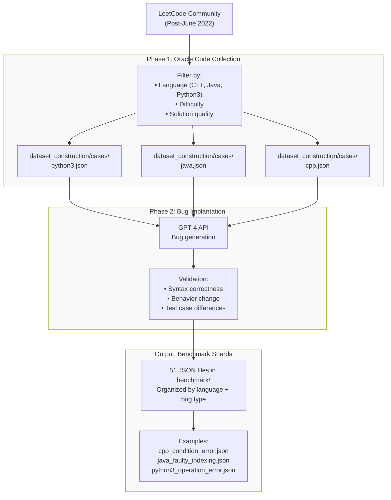

**Sources**: [README.md:11-23](), [dataset_construction/cases/python3.json:1-14](), [dataset_construction/cases/java.json:1-14](), [dataset_construction/cases/cpp.json:1-15]()

## Oracle Code Data Structure

Each oracle code entry in the JSON files follows a consistent schema capturing problem metadata and correct solutions:

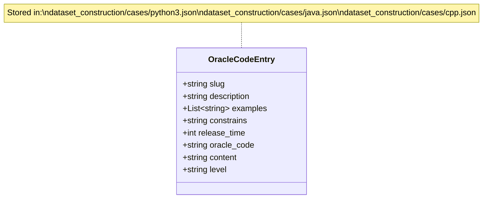

### Schema Fields

| Field | Type | Description |
|-------|------|-------------|
| `slug` | string | LeetCode problem identifier (e.g., "binary-search") |
| `description` | string | Full problem statement |
| `examples` | array[string] | Input/output examples |
| `constrains` | string | Problem constraints |
| `release_time` | integer | Unix timestamp of problem release |
| `oracle_code` | string | Verified correct solution code |
| `content` | string | Community post content (markdown) |
| `level` | string | Difficulty: "easy", "medium", or "hard" |

**Example** (from [dataset_construction/cases/python3.json:17-28]()):
```json
{
    "slug": "binary-search",
    "description": "Given an array of integers nums which is sorted...",
    "examples": ["Input: nums = [-1,0,3,5,9,12], target = 9\nOutput: 4"],
    "constrains": "1 <= nums.length <= 104...",
    "release_time": 1680309400,
    "oracle_code": "class Solution:\n    def search(self, nums: List[int]...",
    "level": "easy"
}
```

**Sources**: [dataset_construction/cases/python3.json:1-28](), [dataset_construction/cases/java.json:1-27](), [dataset_construction/cases/cpp.json:1-28]()

## Output Organization

The bug implantation process produces the final benchmark organized into **51 JSON shards** stored in the `benchmark/` directory. Each shard represents a specific combination of programming language and bug category.

### Shard Naming Convention

Shards follow the pattern: `{language}_{bug_category}.json`

**Language Options**:
- `cpp` - C++ instances
- `java` - Java instances  
- `python3` - Python instances

**Bug Category Examples**:
- `condition_error` - Errors in conditional logic
- `faulty_indexing` - Array/list index errors
- `operation_error` - Arithmetic/logical operation errors
- `other_error` - Syntax errors, undefined methods, etc.

### Multi-Dimensional Organization

The benchmark provides three orthogonal dimensions for analysis:

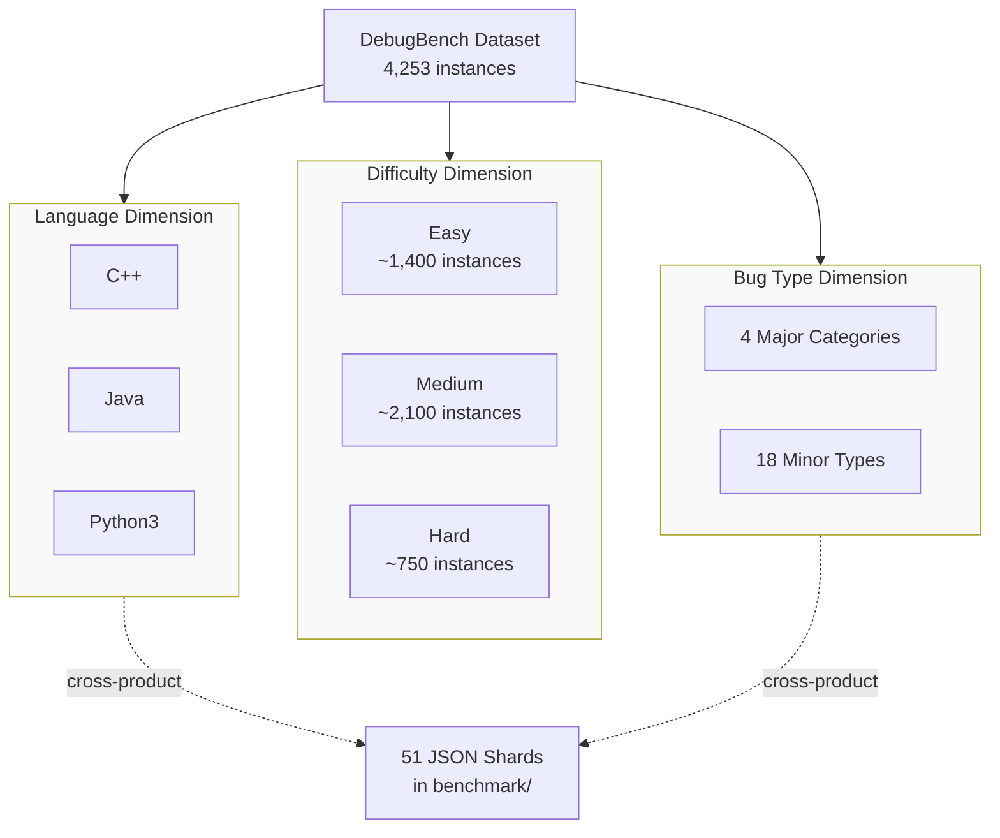

### Benchmark Entry Schema

Each entry in the benchmark shards extends the oracle code schema with bug-specific fields:

| Field | Type | Description |
|-------|------|-------------|
| `slug` | string | Problem identifier (inherited) |
| `description` | string | Problem statement (inherited) |
| `oracle_code` | string | Original correct solution |
| `buggy_code` | string | **Bug-implanted version** |
| `explanations` | string | **Description of the bug** |
| `examples` | array[string] | Test cases (inherited) |
| `constrains` | string | Problem constraints (inherited) |
| `level` | string | Difficulty level (inherited) |

The key additions are `buggy_code` and `explanations`, which provide the debugging challenge and ground truth for evaluation.

**Sources**: [README.md:11-23](), [README.md:30-31]()

## Data Flow Summary

The following diagram maps the concrete file paths and data structures involved in the construction pipeline:

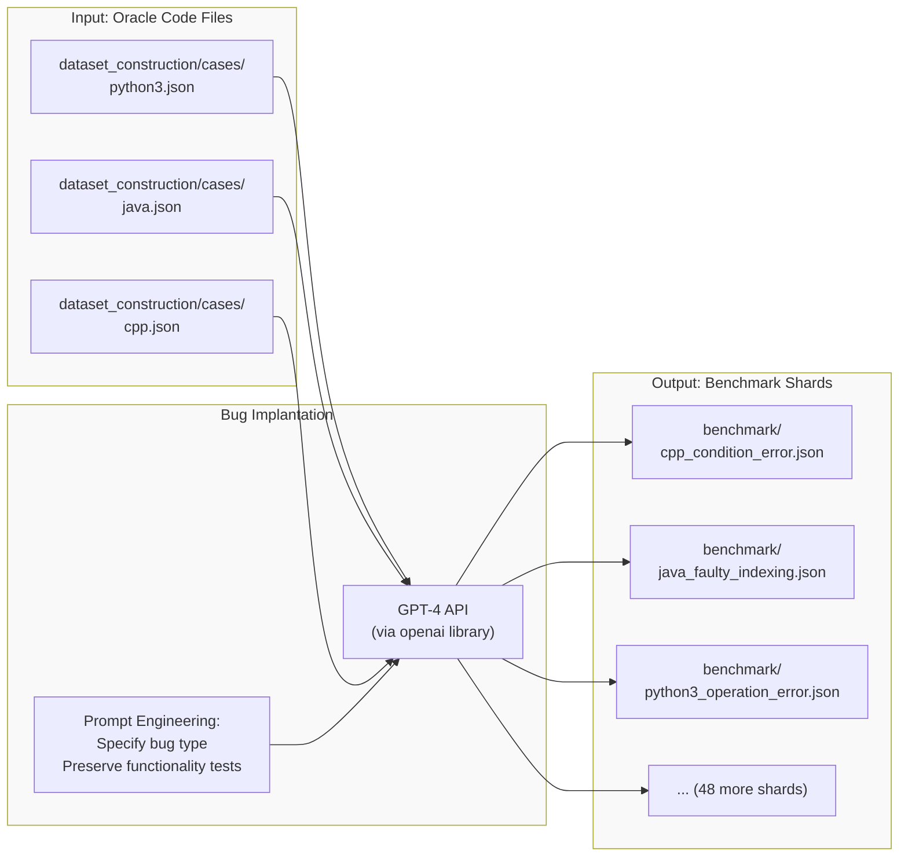

**Key Statistics**:
- **Input**: 3 oracle code JSON files (one per language)
- **Process**: GPT-4 powered bug implantation with validation
- **Output**: 51 categorized JSON shards with 4,253 total instances
- **Coverage**: 4 major × multiple minor bug categories × 3 languages × 3 difficulty levels

**Sources**: [README.md:11-36](), [dataset_construction/cases/python3.json:1-10](), [dataset_construction/cases/java.json:1-10](), [dataset_construction/cases/cpp.json:1-10]()

## Next Steps

For detailed information about specific phases of the construction process:

- **[Oracle Code Collection](#2.1)**: How correct solutions are collected and validated from LeetCode
- **[Bug Implantation Process](#2.2)**: GPT-4 prompt engineering and validation methodology  
- **[Bug Categories and Types](#2.3)**: Complete taxonomy of the 4 major and 18 minor bug types

---

# Page: Oracle Code Collection

# Oracle Code Collection

<details>
<summary>Relevant source files</summary>

The following files were used as context for generating this wiki page:

- [dataset_construction/cases/cpp.json](dataset_construction/cases/cpp.json)
- [dataset_construction/cases/java.json](dataset_construction/cases/java.json)
- [dataset_construction/cases/python3.json](dataset_construction/cases/python3.json)
- [leetcode_data/parsed/parse_questions.py](leetcode_data/parsed/parse_questions.py)
- [leetcode_data/scraped/answer_all_sample.json](leetcode_data/scraped/answer_all_sample.json)
- [leetcode_data/scraped/answer_en_sample.json](leetcode_data/scraped/answer_en_sample.json)
- [leetcode_data/scraped/question_all_sample.json](leetcode_data/scraped/question_all_sample.json)

</details>


This document describes how correct solution code (oracle code) is collected from the LeetCode platform and organized into language-specific datasets. Oracle code serves as ground truth for the bug implantation process (see [Bug Implantation Process](#2.2)) and provides the baseline correct implementations against which buggy code variants are tested.

Related pages: For information about how this oracle code is used to create buggy variants, see [Bug Implantation Process](#2.2). For details on the final benchmark organization, see [Dataset Organization](#3.1).

---

## Overview of Oracle Code

Oracle code represents verified correct solutions to LeetCode programming problems. Each oracle solution must:
- Pass all LeetCode test cases
- Belong to problems released after June 2022 (to avoid overlap with model training data)
- Be sourced from the LeetCode community discussion/solution sections
- Be parseable and executable in one of three supported languages: Python3, Java, or C++

**Sources:** [dataset_construction/cases/python3.json:1-15](), [dataset_construction/cases/java.json:1-15](), [dataset_construction/cases/cpp.json:1-15]()

---

## Storage Organization

### File Structure

Oracle code is stored in three JSON files under the `dataset_construction/cases/` directory:

| File | Language | Purpose |
|------|----------|---------|
| `python3.json` | Python 3 | Python solutions from LeetCode community |
| `java.json` | Java | Java solutions from LeetCode community |
| `cpp.json` | C++ | C++ solutions from LeetCode community |

Each file contains an array of problem objects with identical schema but language-specific code.

**Sources:** [dataset_construction/cases/python3.json:1](), [dataset_construction/cases/java.json:1](), [dataset_construction/cases/cpp.json:1]()

---

## Data Schema

### Problem Entry Structure

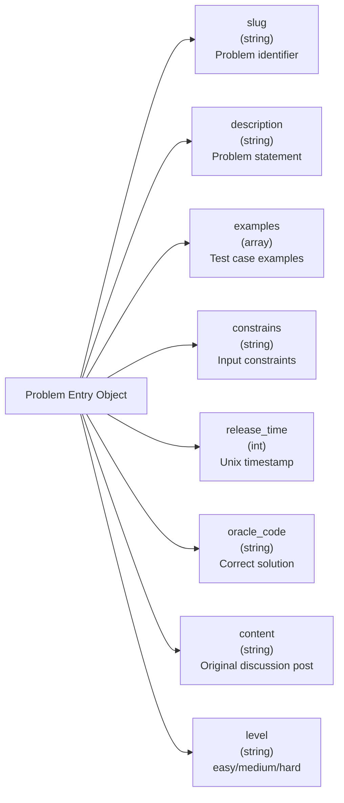

**Sources:** [dataset_construction/cases/python3.json:2-15](), [dataset_construction/cases/java.json:2-14](), [dataset_construction/cases/cpp.json:2-14]()

### Field Descriptions

| Field | Type | Description | Example |
|-------|------|-------------|---------|
| `slug` | string | LeetCode problem URL identifier | `"binary-search"` |
| `description` | string | Full problem statement text | `"Given an array of integers nums..."` |
| `examples` | array[string] | Example inputs and outputs | `["Input: nums = [-1,0,3,5,9,12]..."]` |
| `constrains` | string | Problem constraints and limits | `"1 <= nums.length <= 104"` |
| `release_time` | integer | Unix timestamp of problem release | `1680309400` |
| `oracle_code` | string | Verified correct solution code | `"class Solution:\n    def search..."` |
| `content` | string | Original LeetCode discussion post markdown | `"# Code\n```\nclass Solution:..."` |
| `level` | string | Difficulty level | `"easy"`, `"medium"`, or `"hard"` |

**Sources:** [dataset_construction/cases/python3.json:17-27](), [dataset_construction/cases/java.json:42-52](), [dataset_construction/cases/cpp.json:17-28]()

---

## Collection Pipeline

### High-Level Data Flow

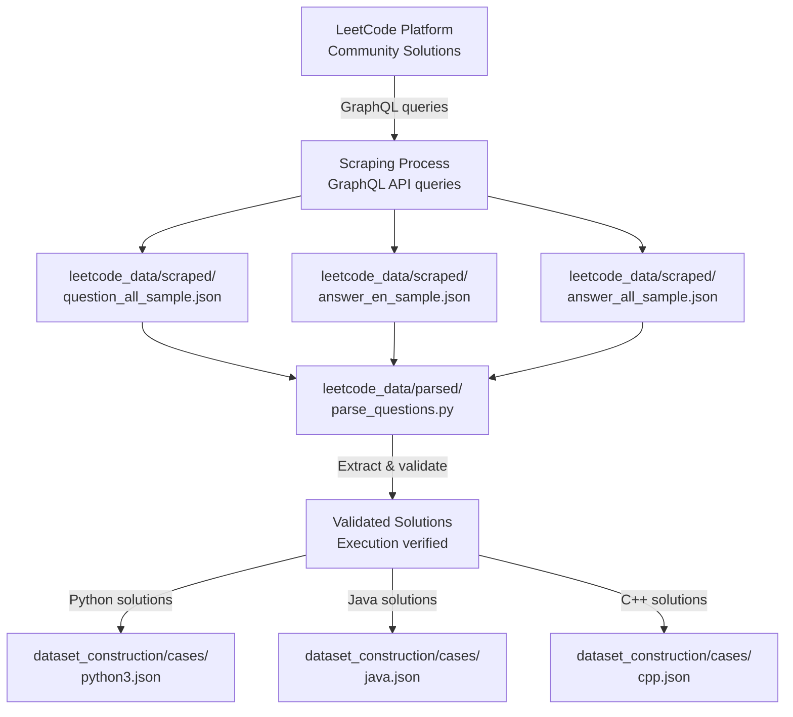

**Sources:** [leetcode_data/scraped/question_all_sample.json:1-130](), [leetcode_data/scraped/answer_en_sample.json:1-161](), [leetcode_data/parsed/parse_questions.py:1-83]()

---

## Scraping Process

### Raw Data Structure

The scraping process collects data from LeetCode's GraphQL API into three main raw data files:

#### question_all_sample.json Structure

Contains question metadata with both English and Chinese content:

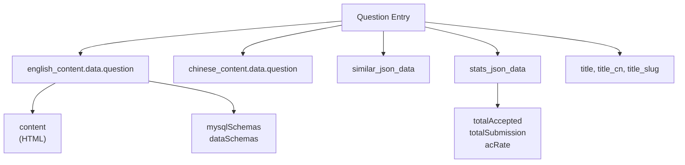

**Sources:** [leetcode_data/scraped/question_all_sample.json:2-55]()

#### answer_en_sample.json Structure

Contains English community solutions:

```json
{
  "answer_id": 3641608,
  "answer_json": {
    "data": {
      "topic": {
        "title": "BFS",
        "post": {
          "content": "# Intuition and Approach...",
          "author": {...}
        }
      }
    }
  },
  "title_slug": "cheapest-flights-within-k-stops"
}
```

**Sources:** [leetcode_data/scraped/answer_en_sample.json:2-53]()

---

## Parsing and Validation

### Parse Script: parse_questions.py

The parsing script transforms raw scraped HTML content into structured text format.

#### Key Function: parse_a_question

```mermaid
flowchart LR
    Raw["Raw Question<br/>HTML content"]
    
    Extract["Extract Components"]
    
    Components["Slug<br/>Description<br/>Examples<br/>Constraints"]
    
    Structured["Structured JSON<br/>Plain text"]
    
    Raw --> Extract
    Extract --> Components
    Components --> Structured
    
    subgraph "Processing Steps"
        HTML["BeautifulSoup<br/>HTML parsing"]
        Text["Plain text<br/>extraction"]
        Split["Component<br/>splitting"]
    end
    
    Extract --> HTML
    HTML --> Text
    Text --> Split
```

**Sources:** [leetcode_data/parsed/parse_questions.py:10-62]()

#### Parsing Logic

The `parse_a_question()` function performs these steps:

1. **Extract slug** from `title_slug` field [leetcode_data/parsed/parse_questions.py:12]()
2. **Convert HTML to plain text** using BeautifulSoup [leetcode_data/parsed/parse_questions.py:15-17]()
3. **Remove "Follow up" sections** if present [leetcode_data/parsed/parse_questions.py:20-21]()
4. **Extract description** (text before "Example 1") [leetcode_data/parsed/parse_questions.py:24]()
5. **Count examples** by searching for "Example N:" patterns [leetcode_data/parsed/parse_questions.py:27-29]()
6. **Extract constraints** if present [leetcode_data/parsed/parse_questions.py:32-36]()
7. **Parse individual examples** by splitting on example markers [leetcode_data/parsed/parse_questions.py:39-53]()

**Sources:** [leetcode_data/parsed/parse_questions.py:10-62]()

---

## Example Oracle Code Entries

### Python3 Example: Binary Search

```json
{
  "slug": "binary-search",
  "description": "Given an array of integers nums which is sorted in ascending order, and an integer target, write a function to search target in nums. If target exists, then return its index. Otherwise, return -1.\nYou must write an algorithm with O(log n) runtime complexity.",
  "examples": [
    "Input: nums = [-1,0,3,5,9,12], target = 9\nOutput: 4\nExplanation: 9 exists in nums and its index is 4"
  ],
  "constrains": "1 <= nums.length <= 104\n-104 < nums[i], target < 104\nAll the integers in nums are unique.\nnums is sorted in ascending order.",
  "release_time": 1680309400,
  "oracle_code": "class Solution:\n    def search(self, nums: List[int], target: int) -> int:\n        if target not in nums:\n            return -1\n        \n        left, right = 0, len(nums)\n        \n        while left < right:\n            mid = (left + right) // 2\n            if nums[mid] < target:\n                left = mid + 1\n            else:\n                right = mid\n        \n        return left",
  "level": "easy"
}
```

**Sources:** [dataset_construction/cases/python3.json:17-27]()

### Java Example: Three Consecutive Odds

```json
{
  "slug": "three-consecutive-odds",
  "oracle_code": "class Solution {\n    public boolean threeConsecutiveOdds(int[] arr) {\n        for (int i = 0; i < arr.length - 2; i++) {\n            boolean isOdd1 = arr[i] % 2 == 1;\n            boolean isOdd2 = arr[i + 1] % 2 == 1;\n            boolean isOdd3 = arr[i + 2] % 2 == 1;\n            if (isOdd1 && isOdd2 && isOdd3) return true;\n        }\n        return false;\n    }\n}",
  "level": "easy"
}
```

**Sources:** [dataset_construction/cases/java.json:42-52]()

### C++ Example: Greatest Common Divisor of Strings

```json
{
  "slug": "greatest-common-divisor-of-strings",
  "oracle_code": "class Solution {\npublic:\n    string gcdOfStrings(string str1, string str2) {\n\n        if(str1+str2==str2+str1)\n        {\n            return str1.substr(0,gcd(str1.length(),str2.length()));\n        }\n        else{\n            return \"\";\n        }\n        \n    }\n};",
  "level": "easy"
}
```

**Sources:** [dataset_construction/cases/cpp.json:17-28]()

---

## Dataset Statistics

### Distribution by Language

```mermaid
graph TB
    Total["Oracle Code Dataset<br/>~4,253 problems"]
    
    Python["Python3<br/>python3.json"]
    Java["Java<br/>java.json"]
    Cpp["C++<br/>cpp.json"]
    
    Total --> Python
    Total --> Java
    Total --> Cpp
    
    Python --> PyEasy["Easy problems"]
    Python --> PyMedium["Medium problems"]
    Python --> PyHard["Hard problems"]
    
    Java --> JavaEasy["Easy problems"]
    Java --> JavaMedium["Medium problems"]
    Java --> JavaHard["Hard problems"]
    
    Cpp --> CppEasy["Easy problems"]
    Cpp --> CppMedium["Medium problems"]
    Cpp --> CppHard["Hard problems"]
```

Each language file contains solutions spanning all three difficulty levels, with the same problem potentially having oracle solutions in multiple languages.

**Sources:** [dataset_construction/cases/python3.json:1](), [dataset_construction/cases/java.json:1](), [dataset_construction/cases/cpp.json:1]()

### Difficulty Level Distribution

Based on the `level` field in each entry:

| Difficulty | Approximate Count | Description |
|------------|------------------|-------------|
| `easy` | ~1,400 instances | Basic algorithmic problems |
| `medium` | ~2,100 instances | Intermediate complexity problems |
| `hard` | ~750 instances | Advanced algorithmic challenges |

**Sources:** [dataset_construction/cases/python3.json:27](), [dataset_construction/cases/python3.json:40](), [dataset_construction/cases/python3.json:53]()

---

## Quality Assurance

### Oracle Code Requirements

All oracle code entries must meet these criteria:

1. **Correctness**: Solution passes all LeetCode test cases
2. **Completeness**: Includes full class/function definitions
3. **Language-specific**: Uses proper syntax and conventions for the target language
4. **Recent**: Problem released after June 2022 to avoid training data contamination
5. **Community-sourced**: Obtained from LeetCode discussion sections with upvotes/verification

### Validation Mechanisms

Oracle code undergoes validation through:

- **LeetCode platform testing**: Code must have been accepted by LeetCode's judge
- **Release date filtering**: Only problems after June 2022 cutoff
- **Syntax verification**: Code must parse correctly in target language
- **Metadata completeness**: All required fields (slug, description, examples, constraints, code, level) must be present

**Sources:** [dataset_construction/cases/python3.json:11-14](), [dataset_construction/cases/java.json:10-13](), [dataset_construction/cases/cpp.json:10-14]()

---

## Usage in Bug Implantation

The oracle code serves as input to the bug implantation process:

```mermaid
flowchart LR
    Oracle["Oracle Code<br/>python3.json<br/>java.json<br/>cpp.json"]
    
    Selection["Problem Selection<br/>Filter by difficulty"]
    
    GPT4["GPT-4 API<br/>Bug implantation prompts"]
    
    Buggy["Buggy Code Variants<br/>benchmark/ directory"]
    
    Oracle --> Selection
    Selection --> GPT4
    GPT4 --> Buggy
    
    Oracle -.->|"Ground truth<br/>for validation"| Validation["Validation:<br/>buggy ≠ oracle output"]
    Buggy -.-> Validation
```

The oracle code provides:
- **Input**: Correct implementation to modify
- **Reference**: Ground truth for test case validation
- **Context**: Problem description and constraints for bug generation

For details on how bugs are introduced, see [Bug Implantation Process](#2.2).

**Sources:** [dataset_construction/cases/python3.json:1-15](), [dataset_construction/cases/java.json:1-15](), [dataset_construction/cases/cpp.json:1-15]()

---

# Page: Bug Implantation Process

# Bug Implantation Process

<details>
<summary>Relevant source files</summary>

The following files were used as context for generating this wiki page:

- [README.md](README.md)
- [dataset_construction/cases/cpp.json](dataset_construction/cases/cpp.json)
- [dataset_construction/cases/java.json](dataset_construction/cases/java.json)
- [dataset_construction/cases/python3.json](dataset_construction/cases/python3.json)

</details>


## Purpose and Scope

This document describes the systematic process of implanting bugs into oracle (correct) code solutions to create the DebugBench dataset. It covers the GPT-4-powered bug generation methodology, the taxonomy of bug types, prompt engineering strategies, and validation procedures that ensure buggy code produces different outputs from oracle code.

For information about the oracle code collection from LeetCode, see [Oracle Code Collection](#2.1). For the complete bug taxonomy and examples, see [Bug Categories and Types](#2.3). For the final benchmark organization, see [Dataset Organization](#3.1).

---

## Bug Implantation Overview

The bug implantation process transforms correct LeetCode solutions (oracle code) into buggy variants using GPT-4. This process is deterministic and controlled to produce specific bug categories across three programming languages (C++, Java, Python3) and three difficulty levels (easy, medium, hard).

### Key Characteristics

| Aspect | Details |
|--------|---------|
| **Input Source** | Oracle code from `dataset_construction/cases/` |
| **Generation Method** | GPT-4 API with category-specific prompts |
| **Languages Supported** | C++, Java, Python3 |
| **Bug Categories** | 4 major types, 18 minor subtypes |
| **Validation** | Execution-based output comparison |
| **Output** | Oracle-buggy code pairs with explanations |

Sources: [README.md:1-57](), [dataset_construction/cases/python3.json:1-40](), [dataset_construction/cases/java.json:1-40](), [dataset_construction/cases/cpp.json:1-40]()

---

## Bug Implantation Pipeline

```mermaid
flowchart TD
    START["Oracle Code Sources<br/>dataset_construction/cases/"]
    
    subgraph INPUT["Input Selection"]
        PY["python3.json<br/>Correct Python solutions"]
        JAVA["java.json<br/>Correct Java solutions"]
        CPP["cpp.json<br/>Correct C++ solutions"]
    end
    
    subgraph TAXONOMY["Bug Type Selection"]
        MAJOR["4 Major Categories"]
        COND["Condition Errors<br/>loop bounds, comparisons"]
        INDEX["Faulty Indexing<br/>array access, off-by-one"]
        OP["Operation Errors<br/>arithmetic, assignment"]
        OTHER["Other Errors<br/>syntax, undefined methods"]
        
        MAJOR --> COND
        MAJOR --> INDEX
        MAJOR --> OP
        MAJOR --> OTHER
    end
    
    subgraph GPT4["GPT-4 Generation"]
        PROMPT["Construct Bug-Specific Prompt<br/>• Problem description<br/>• Oracle code<br/>• Target bug type<br/>• Language constraints"]
        API["GPT-4 API Call<br/>openai library"]
        PARSE["Parse Generated Code<br/>Extract buggy variant"]
    end
    
    subgraph VALIDATION["Validation Process"]
        EXEC["Execute Both Versions<br/>oracle_code vs buggy_code"]
        COMPARE["Compare Outputs<br/>on test cases"]
        CHECK{"Different<br/>outputs?"}
        ACCEPT["Accept Bug"]
        REJECT["Reject & Retry"]
    end
    
    subgraph OUTPUT["Output Generation"]
        PAIR["Create Oracle-Buggy Pair"]
        META["Add Metadata<br/>• explanations<br/>• bug_type<br/>• level<br/>• constraints"]
        SHARD["Write to JSON Shard<br/>benchmark/[lang]_[bugtype].json"]
    end
    
    START --> PY & JAVA & CPP
    PY & JAVA & CPP --> TAXONOMY
    TAXONOMY --> PROMPT
    
    PROMPT --> API
    API --> PARSE
    PARSE --> EXEC
    
    EXEC --> COMPARE
    COMPARE --> CHECK
    CHECK -->|Yes| ACCEPT
    CHECK -->|No| REJECT
    REJECT --> PROMPT
    
    ACCEPT --> PAIR
    PAIR --> META
    META --> SHARD
```

**Bug Implantation Workflow**: This diagram shows the complete pipeline from oracle code input through GPT-4 generation to validated buggy code output.

Sources: [README.md:15-22](), Diagram 2 from system architecture

---

## Bug Type Taxonomy Structure

The bug implantation process uses a hierarchical taxonomy with 4 major categories that expand into 18 minor types:

```mermaid
graph TB
    ROOT["Bug Type Taxonomy<br/>18 Minor Types Total"]
    
    subgraph COND_CAT["Condition Errors"]
        COND_ROOT["Condition Errors"]
        LOOP_BOUND["Loop Bound Errors"]
        COMPARISON["Comparison Errors"]
        IF_COND["If Condition Errors"]
        LOGIC_OP["Logical Operator Errors"]
    end
    
    subgraph INDEX_CAT["Indexing Errors"]
        INDEX_ROOT["Faulty Indexing"]
        OFF_BY_ONE["Off-by-One Errors"]
        ARRAY_ACCESS["Array Access Errors"]
        ITERATOR["Iterator Errors"]
        RANGE["Range Errors"]
    end
    
    subgraph OP_CAT["Operation Errors"]
        OP_ROOT["Operation Errors"]
        ARITHMETIC["Arithmetic Errors"]
        ASSIGNMENT["Assignment Errors"]
        TYPE_CAST["Type Casting Errors"]
        OPERATOR["Operator Errors"]
    end
    
    subgraph OTHER_CAT["Other Errors"]
        OTHER_ROOT["Other Errors"]
        SYNTAX["Syntax Errors"]
        UNDEFINED["Undefined Methods"]
        NULL_PTR["Null Pointer Errors"]
        LOGIC["Logic Errors"]
        MISC["Miscellaneous"]
    end
    
    ROOT --> COND_ROOT
    ROOT --> INDEX_ROOT
    ROOT --> OP_ROOT
    ROOT --> OTHER_ROOT
    
    COND_ROOT --> LOOP_BOUND
    COND_ROOT --> COMPARISON
    COND_ROOT --> IF_COND
    COND_ROOT --> LOGIC_OP
    
    INDEX_ROOT --> OFF_BY_ONE
    INDEX_ROOT --> ARRAY_ACCESS
    INDEX_ROOT --> ITERATOR
    INDEX_ROOT --> RANGE
    
    OP_ROOT --> ARITHMETIC
    OP_ROOT --> ASSIGNMENT
    OP_ROOT --> TYPE_CAST
    OP_ROOT --> OPERATOR
    
    OTHER_ROOT --> SYNTAX
    OTHER_ROOT --> UNDEFINED
    OTHER_ROOT --> NULL_PTR
    OTHER_ROOT --> LOGIC
    OTHER_ROOT --> MISC
```

**Bug Type Hierarchy**: The taxonomy organizes bugs into 4 major categories, each containing 4-5 minor subtypes for a total of 18 distinct bug patterns.

Sources: [README.md:18](), Diagram 2 and Diagram 4 from system architecture

---

## GPT-4 Prompt Engineering

### Prompt Construction Strategy

The bug implantation process uses category-specific prompts that guide GPT-4 to introduce targeted bug types. Each prompt contains:

| Component | Purpose | Example Content |
|-----------|---------|-----------------|
| **Problem Context** | Provide problem understanding | `description`, `examples`, `constrains` fields |
| **Oracle Code** | Show correct implementation | `oracle_code` field from cases JSON |
| **Bug Type Directive** | Specify target bug category | "Introduce an off-by-one error in the loop" |
| **Language Constraints** | Maintain language syntax | "Keep valid Python3 syntax" |
| **Subtlety Requirement** | Ensure non-obvious bugs | "The bug should not be immediately visible" |

### Example Prompt Structure

For a **Condition Error** in Python:

```
Given the following correct solution to a LeetCode problem:

Problem: [description from python3.json]
Constraints: [constrains field]

Correct Solution:
[oracle_code field]

Task: Introduce a subtle condition error (such as incorrect loop bounds or 
comparison operators) that will cause the solution to fail on some test cases.
The buggy code should:
1. Remain syntactically valid Python3
2. Execute without runtime errors on most inputs
3. Produce incorrect outputs due to the condition error
4. Not be immediately obvious to readers

Return only the modified code.
```

Sources: [dataset_construction/cases/python3.json:1-108](), [dataset_construction/cases/java.json:1-52](), [dataset_construction/cases/cpp.json:1-40]()

---

## Oracle Code Input Format

The bug implantation process reads oracle code from JSON files in `dataset_construction/cases/` with the following schema:

```mermaid
graph LR
    subgraph ORACLE["Oracle Code Entry Schema"]
        ENTRY["JSON Entry Object"]
        
        SLUG["slug: Problem identifier"]
        DESC["description: Problem statement"]
        EXAMPLES["examples: Test case descriptions"]
        CONST["constrains: Input limits"]
        TIME["release_time: Unix timestamp"]
        CODE["oracle_code: Correct solution"]
        CONTENT["content: Community content"]
        LEVEL["level: Difficulty<br/>easy|medium|hard"]
    end
    
    ENTRY --> SLUG
    ENTRY --> DESC
    ENTRY --> EXAMPLES
    ENTRY --> CONST
    ENTRY --> TIME
    ENTRY --> CODE
    ENTRY --> CONTENT
    ENTRY --> LEVEL
```

**Oracle Entry Structure**: Each oracle code entry contains the problem metadata and correct solution used as input for bug generation.

### Example Oracle Entry

From [dataset_construction/cases/python3.json:17-28]():

```json
{
    "slug": "binary-search",
    "description": "Given an array of integers nums...",
    "oracle_code": "class Solution:\n    def search(self, nums: List[int], target: int) -> int:\n        if target not in nums:\n            return -1\n        ...",
    "level": "easy"
}
```

Sources: [dataset_construction/cases/python3.json:1-40](), [dataset_construction/cases/java.json:1-40](), [dataset_construction/cases/cpp.json:1-40]()

---

## Bug Generation Process

### GPT-4 API Integration

The bug generation leverages the OpenAI API to systematically create buggy variants:

```mermaid
sequenceDiagram
    participant CASES as dataset_construction/cases/
    participant IMPL as Bug Implantation Logic
    participant GPT4 as GPT-4 API<br/>openai.ChatCompletion
    participant VALID as Validation System
    participant BENCH as benchmark/ JSON Shards
    
    CASES->>IMPL: Load oracle_code entry
    Note over IMPL: Select bug type category<br/>and target language
    
    IMPL->>IMPL: Construct bug-specific prompt<br/>with problem context
    
    IMPL->>GPT4: API call with prompt
    Note over GPT4: Generate buggy variant<br/>with specified bug type
    
    GPT4-->>IMPL: Return buggy_code
    
    IMPL->>IMPL: Parse and extract code
    
    IMPL->>VALID: Execute both versions<br/>on test cases
    
    alt Different Outputs
        VALID-->>IMPL: Validation passed
        IMPL->>IMPL: Add explanations<br/>and metadata
        IMPL->>BENCH: Write oracle-buggy pair<br/>to appropriate shard
    else Same Outputs
        VALID-->>IMPL: Validation failed
        Note over IMPL: Retry with adjusted prompt
        IMPL->>GPT4: Regenerate with refinements
    end
```

**Bug Generation Sequence**: The process iterates through oracle code entries, generates buggy variants via GPT-4, validates them, and writes successful pairs to benchmark shards.

Sources: [README.md:15](), Diagram 2 from system architecture

---

## Bug Validation Mechanism

### Validation Requirements

For a buggy variant to be accepted into the benchmark, it must satisfy:

| Criterion | Requirement | Rationale |
|-----------|-------------|-----------|
| **Syntactic Validity** | Code must compile/parse | Prevents trivial syntax errors |
| **Execution Success** | No runtime crashes on valid inputs | Focuses on logic bugs, not crashes |
| **Output Difference** | Different from oracle on some test cases | Ensures bug actually affects behavior |
| **Non-Trivial** | Not immediately obvious | Creates realistic debugging scenarios |

### Validation Process

```mermaid
flowchart TD
    INPUT["Buggy Code Candidate"]
    
    SYNTAX{"Syntax<br/>Valid?"}
    EXECUTE["Execute on Test Cases<br/>from examples field"]
    RUNTIME{"Runtime<br/>Error?"}
    
    COMPARE["Compare Outputs<br/>buggy_result vs oracle_result"]
    DIFF{"Outputs<br/>Differ?"}
    
    ACCEPT["Accept as Valid Bug<br/>Add to benchmark"]
    REJECT_SYNTAX["Reject: Syntax Error"]
    REJECT_CRASH["Reject: Runtime Crash"]
    REJECT_SAME["Reject: No Behavioral Change"]
    
    INPUT --> SYNTAX
    SYNTAX -->|No| REJECT_SYNTAX
    SYNTAX -->|Yes| EXECUTE
    
    EXECUTE --> RUNTIME
    RUNTIME -->|Yes| REJECT_CRASH
    RUNTIME -->|No| COMPARE
    
    COMPARE --> DIFF
    DIFF -->|No| REJECT_SAME
    DIFF -->|Yes| ACCEPT
    
    REJECT_SYNTAX --> RETRY["Regenerate with GPT-4"]
    REJECT_CRASH --> RETRY
    REJECT_SAME --> RETRY
    RETRY --> INPUT
```

**Validation Decision Flow**: Buggy code must pass syntax, execution, and output difference checks to be accepted.

Sources: Diagram 2 from system architecture

---

## Output Format and Storage

### Benchmark Entry Schema

The bug implantation process produces entries that combine oracle code, buggy code, and metadata:

```mermaid
graph TB
    subgraph BENCHMARK["Benchmark Entry Format"]
        ENTRY["Complete Benchmark Entry"]
        
        subgraph ORIGINAL["From Oracle"]
            SLUG["slug"]
            DESC["description"]
            EXAMPLES["examples"]
            CONST["constrains"]
            LEVEL["level"]
            ORACLE["oracle_code"]
        end
        
        subgraph GENERATED["Generated"]
            BUGGY["buggy_code"]
            EXPLAIN["explanations:<br/>bug description"]
            TYPE["bug_type:<br/>major + minor"]
        end
        
        ENTRY --> ORIGINAL
        ENTRY --> GENERATED
    end
```

**Benchmark Entry Composition**: Each entry combines original problem metadata with generated buggy code and explanations.

### Storage Organization

The bug implantation process writes output to 51 JSON shards organized by language and bug type:

| Language | Bug Categories | Example Shard Names |
|----------|----------------|---------------------|
| C++ | 4 major types | `cpp_condition_error.json`<br/>`cpp_faulty_indexing.json` |
| Java | 4 major types | `java_operation_error.json`<br/>`java_other_error.json` |
| Python3 | 4 major types | `python3_condition_error.json`<br/>`python3_faulty_indexing.json` |

Each shard contains an array of oracle-buggy pairs for its specific language and bug category combination.

Sources: [README.md:30](), Diagram 4 from system architecture

---

## Summary Statistics

The bug implantation process produces:

| Metric | Count |
|--------|-------|
| **Total Instances** | 4,253 |
| **Major Bug Categories** | 4 |
| **Minor Bug Types** | 18 |
| **Languages** | 3 (C++, Java, Python3) |
| **Difficulty Levels** | 3 (easy, medium, hard) |
| **Output Shards** | 51 JSON files |
| **Problems Post-June 2022** | 100% |

The systematic GPT-4-powered implantation ensures comprehensive coverage across bug types, languages, and difficulty levels, creating a diverse and challenging benchmark for evaluating LLM debugging capabilities.

Sources: [README.md:15-22]()

---

# Page: Bug Categories and Types

# Bug Categories and Types

<details>
<summary>Relevant source files</summary>

The following files were used as context for generating this wiki page:

- [benchmark/cpp_condition error.json](benchmark/cpp_condition error.json)
- [benchmark/cpp_double.json](benchmark/cpp_double.json)
- [benchmark/cpp_faulty indexing.json](benchmark/cpp_faulty indexing.json)
- [benchmark/cpp_operation error.json](benchmark/cpp_operation error.json)
- [benchmark/cpp_other error.json](benchmark/cpp_other error.json)
- [benchmark/cpp_quadruple.json](benchmark/cpp_quadruple.json)

</details>


This document provides a comprehensive taxonomy of the bug categories and types used in DebugBench. It defines the classification system used to organize the 4,253 buggy code instances across C++, Java, and Python3. For information about how these bugs are implanted into oracle code, see [Bug Implantation Process](#2.2). For examples of specific bugs in each language, see [C++ Bug Examples](#3.3) and [Java and Python Bug Examples](#3.4).

## Overview of Bug Taxonomy

DebugBench organizes bugs into a two-level hierarchical taxonomy consisting of 4 major categories and 18 minor types. This classification enables fine-grained analysis of LLM debugging capabilities across different error patterns.

```mermaid
graph TD
    ROOT["DebugBench Bug Taxonomy<br/>4 Major + 18 Minor Types"]
    
    COND["Major: Condition Errors<br/>Loop bounds, comparisons<br/>conditional logic"]
    IDX["Major: Faulty Indexing<br/>Array bounds, off-by-one<br/>iterator errors"]
    OP["Major: Operation Errors<br/>Arithmetic, assignment<br/>logical operators"]
    OTHER["Major: Other Errors<br/>Syntax, undefined methods<br/>language-specific"]
    
    ROOT --> COND
    ROOT --> IDX
    ROOT --> OP
    ROOT --> OTHER
    
    COND --> COND_MIN["Minor Types:<br/>- Loop bound errors<br/>- Comparison operator errors<br/>- Conditional statement errors"]
    IDX --> IDX_MIN["Minor Types:<br/>- Array index out of bounds<br/>- Off-by-one errors<br/>- Iterator errors"]
    OP --> OP_MIN["Minor Types:<br/>- Arithmetic errors<br/>- Assignment errors<br/>- Operator confusion"]
    OTHER --> OTHER_MIN["Minor Types:<br/>- Syntax errors<br/>- Undefined methods<br/>- Type errors<br/>- Language keyword errors"]
```

Sources: [benchmark/cpp_condition error.json:1-200](), [benchmark/cpp_faulty indexing.json:1-200](), [benchmark/cpp_operation error.json:1-200](), [benchmark/cpp_other error.json:1-200]()

## Major Bug Categories

### 1. Condition Errors

Condition errors involve incorrect conditional logic, loop bounds, and comparison operations. These bugs affect program control flow and are among the most common logical errors.

**Key Characteristics:**
- Incorrect loop termination conditions (`i < n` vs `i <= n`)
- Wrong comparison operators (`==` vs `!=`, `>` vs `>=`)
- Incorrect conditional branching logic
- Missing or extra conditions in if-statements

**File Organization:**
- C++: [benchmark/cpp_condition error.json]()
- Java: [benchmark/java_condition error.json]()
- Python3: [benchmark/python3_condition error.json]()

Sources: [benchmark/cpp_condition error.json:1-200]()

### 2. Faulty Indexing

Faulty indexing errors involve accessing arrays, vectors, or other data structures with incorrect indices, leading to out-of-bounds access or off-by-one errors.

**Key Characteristics:**
- Array index out of bounds (`arr[n]` instead of `arr[n-1]`)
- Off-by-one errors in loops
- Incorrect pointer arithmetic
- Invalid iterator usage
- String index errors

**File Organization:**
- C++: [benchmark/cpp_faulty indexing.json]()
- Java: [benchmark/java_faulty indexing.json]()
- Python3: [benchmark/python3_faulty indexing.json]()

Sources: [benchmark/cpp_faulty indexing.json:1-200]()

### 3. Operation Errors

Operation errors involve incorrect arithmetic operations, assignment statements, or logical operators that produce wrong computational results.

**Key Characteristics:**
- Wrong arithmetic operators (`+` vs `-`, `*` vs `/`)
- Incorrect operator precedence
- Assignment vs equality confusion (`=` vs `==`)
- Wrong increment/decrement operations (`i++` vs `i--`)
- Bitwise operation errors

**File Organization:**
- C++: [benchmark/cpp_operation error.json]()
- Java: [benchmark/java_operation error.json]()
- Python3: [benchmark/python3_operation error.json]()

Sources: [benchmark/cpp_operation error.json:1-200]()

### 4. Other Errors

Other errors encompass syntax errors, undefined methods, language-specific issues, and miscellaneous bugs that don't fit into the previous categories.

**Key Characteristics:**
- Syntax errors (missing semicolons, parentheses mismatch)
- Undefined methods or functions
- Incorrect language keywords
- Type errors
- Null/undefined object references
- String formatting errors

**File Organization:**
- C++: [benchmark/cpp_other error.json]()
- Java: [benchmark/java_other error.json]()
- Python3: [benchmark/python3_other error.json]()

Sources: [benchmark/cpp_other error.json:1-200]()

## Minor Bug Types

The 18 minor bug types provide fine-grained classification within the major categories:

| Minor Type | Major Category | Description | Example |
|------------|---------------|-------------|---------|
| Loop bound errors | Condition Errors | Incorrect loop iteration limits | `for(int i=0; i<=n; i++)` instead of `i<n` |
| Comparison operator errors | Condition Errors | Wrong comparison operators | `if(x > y)` instead of `if(x >= y)` |
| Conditional statement errors | Condition Errors | Flawed conditional logic | Missing or incorrect if-else branches |
| Array index out of bounds | Faulty Indexing | Accessing beyond array limits | `arr[arr.size()]` instead of `arr[arr.size()-1]` |
| Off-by-one errors | Faulty Indexing | Index shifted by one position | Loop ending at wrong position |
| Iterator errors | Faulty Indexing | Incorrect iterator usage | Advancing iterator past end |
| Arithmetic errors | Operation Errors | Wrong arithmetic operations | `result = a + b` instead of `a - b` |
| Assignment vs equality | Operation Errors | Confusion between `=` and `==` | `if(x = 5)` instead of `if(x == 5)` |
| Operator confusion | Operation Errors | Using wrong operator | `max` instead of `min` |
| Syntax errors | Other Errors | Missing punctuation, braces | Missing semicolon, unmatched parentheses |
| Undefined methods | Other Errors | Calling non-existent methods | Method name typo or wrong class |
| Wrong comment mark | Other Errors | Incorrect comment syntax | `/**/` vs `//` confusion |
| Unclosed string | Other Errors | Missing string terminator | Missing closing quote |
| Parentheses mismatch | Other Errors | Unbalanced parentheses | Extra or missing `(` or `)` |
| Colon missing | Other Errors | Missing required colon | Python/Java syntax |
| Undefined keywords | Other Errors | Language-specific keyword errors | Using keywords from different language |
| Variable value errors | Other Errors | Wrong variable initialization | `nullptr` vs `new Node()` |
| Type errors | Other Errors | Type mismatch issues | String vs integer confusion |

Sources: [benchmark/cpp_double.json:1-100](), [benchmark/cpp_quadruple.json:1-100]()

## Multi-Bug Instances

Some benchmark entries contain multiple bugs simultaneously, representing more complex debugging scenarios:

```mermaid
graph LR
    SINGLE["Single Bug Instances<br/>1 bug per example"]
    DOUBLE["Double Bug Instances<br/>2 bugs per example"]
    QUAD["Quadruple Bug Instances<br/>4 bugs per example"]
    
    SINGLE --> FILES1["cpp_condition error.json<br/>cpp_faulty indexing.json<br/>cpp_operation error.json<br/>cpp_other error.json"]
    DOUBLE --> FILES2["cpp_double.json<br/>java_double.json<br/>python3_double.json"]
    QUAD --> FILES3["cpp_quadruple.json<br/>java_quadruple.json<br/>python3_quadruple.json"]
```

### Double Bug Instances

Double bug instances contain exactly two distinct bugs in a single code example. Common combinations include:

- **Indexing + Operation errors**: [benchmark/cpp_double.json:19-36]()
- **Indexing + Conditional errors**: [benchmark/cpp_double.json:55-70]()
- **Syntax + Logic errors**: [benchmark/cpp_double.json:1-18]()

Example from [benchmark/cpp_double.json:20-36]():
```
Type: ["indexing error", "operation error"]
Explanation: Loop bound i<=n causes indexing error, 
and freq[s[i]-'z'] is operation error
```

Sources: [benchmark/cpp_double.json:1-100]()

### Quadruple Bug Instances

Quadruple bug instances contain four distinct bugs, representing the most challenging debugging scenarios:

- **Multiple syntax + logic errors**: [benchmark/cpp_quadruple.json:1-40]()
- **Mixed category errors**: [benchmark/cpp_quadruple.json:41-80]()

Example from [benchmark/cpp_quadruple.json:1-20]():
```
Type: ["wrong comment mark", "unclosed string", 
      "conditional statement error", "parentheses mismatch"]
```

Sources: [benchmark/cpp_quadruple.json:1-100]()

## Bug Entry Data Schema

Each bug entry in the benchmark follows a consistent JSON schema:

```mermaid
graph TD
    ENTRY["Bug Entry JSON Object"]
    
    META["Metadata Fields"]
    CODE["Code Fields"]
    BUG["Bug Classification"]
    
    ENTRY --> META
    ENTRY --> CODE
    ENTRY --> BUG
    
    META --> SLUG["slug: Problem identifier"]
    META --> DESC["description: Problem statement"]
    META --> EX["examples: Test cases"]
    META --> CONST["constraints: Input limits"]
    META --> LEVEL["level: easy/medium/hard"]
    META --> TIME["release_time: Timestamp"]
    
    CODE --> ORACLE["oracle_code: Correct solution"]
    CODE --> BUGGY["buggy_code: Buggy version"]
    CODE --> CONTENT["content: Original post"]
    
    BUG --> TYPE["type: Array of bug types"]
    BUG --> EXPLAIN["explanations: Bug description"]
```

**Required Fields:**
- `slug`: String identifying the LeetCode problem
- `description`: Problem statement text
- `examples`: Array of input/output examples
- `constraints`: Problem constraints string
- `oracle_code`: Correct reference implementation
- `buggy_code`: Code with implanted bugs
- `explanations`: Human-readable bug description
- `level`: Difficulty level (easy/medium/hard)

**Optional Fields:**
- `type`: Array of strings for multi-bug instances
- `release_time`: Unix timestamp of problem release
- `content`: Original community solution post

Sources: [benchmark/cpp_condition error.json:1-50]()

## Cross-Language Bug Distribution

```mermaid
graph TD
    LANGS["3 Programming Languages"]
    
    CPP["C++<br/>~1,400 instances"]
    JAVA["Java<br/>~1,400 instances"]
    PY["Python3<br/>~1,400 instances"]
    
    LANGS --> CPP
    LANGS --> JAVA
    LANGS --> PY
    
    CPP --> CPP_COND["Condition Errors"]
    CPP --> CPP_IDX["Faulty Indexing"]
    CPP --> CPP_OP["Operation Errors"]
    CPP --> CPP_OTHER["Other Errors"]
    CPP --> CPP_MULTI["Multi-Bug"]
    
    JAVA --> JAVA_COND["Condition Errors"]
    JAVA --> JAVA_IDX["Faulty Indexing"]
    JAVA --> JAVA_OP["Operation Errors"]
    JAVA --> JAVA_OTHER["Other Errors"]
    JAVA --> JAVA_MULTI["Multi-Bug"]
    
    PY --> PY_COND["Condition Errors"]
    PY --> PY_IDX["Faulty Indexing"]
    PY --> PY_OP["Operation Errors"]
    PY --> PY_OTHER["Other Errors"]
    PY --> PY_MULTI["Multi-Bug"]
```

Each language has approximately equal distribution across bug categories, enabling fair cross-language comparison of LLM debugging capabilities.

Sources: [benchmark/cpp_condition error.json](), [benchmark/cpp_faulty indexing.json](), [benchmark/cpp_operation error.json](), [benchmark/cpp_other error.json]()

## Bug Severity and Difficulty

Bugs are organized by problem difficulty level, which correlates with debugging complexity:

| Difficulty | Approximate Count | Characteristics |
|-----------|------------------|-----------------|
| Easy | ~1,400 instances | Simple logic errors, straightforward fixes |
| Medium | ~2,100 instances | Multiple steps to identify and fix, requires deeper understanding |
| Hard | ~750 instances | Complex interactions, multiple related bugs, algorithmic understanding required |

The difficulty level is derived from the original LeetCode problem difficulty, not specifically from the bug complexity. However, harder problems generally involve more complex code where bugs are more subtle.

Sources: [benchmark/cpp_condition error.json:14](), [benchmark/cpp_condition error.json:29](), [benchmark/cpp_condition error.json:44]()

## Accessing Bug Categories in Code

To filter bugs by category when loading the benchmark programmatically:

**By File Name Pattern:**
```python
# Load specific category
condition_errors = load_dataset("Rtian/DebugBench", 
                                 data_files="benchmark/cpp_condition error.json")
```

**By Type Field:**
```python
# Filter multi-bug instances by specific type combination
for entry in dataset:
    if "type" in entry:
        if "indexing error" in entry["type"] and "operation error" in entry["type"]:
            # Process double bug with indexing + operation errors
            pass
```

**By File Naming Convention:**
- Single category: `{language}_{category}.json`
- Multi-bug: `{language}_double.json`, `{language}_quadruple.json`

Sources: [benchmark/cpp_condition error.json](), [benchmark/cpp_double.json](), [benchmark/cpp_quadruple.json]()

---

# Page: Benchmark Dataset

# Benchmark Dataset

<details>
<summary>Relevant source files</summary>

The following files were used as context for generating this wiki page:

- [README.md](README.md)
- [benchmark/cpp_condition error.json](benchmark/cpp_condition error.json)
- [benchmark/cpp_double.json](benchmark/cpp_double.json)
- [benchmark/cpp_faulty indexing.json](benchmark/cpp_faulty indexing.json)

</details>


This document provides a comprehensive overview of the DebugBench benchmark dataset, including its structure, organization, content dimensions, and access methods. The benchmark dataset is the core artifact of DebugBench, containing 4,253 bug-implanted programming problems across three languages.

For information about how this dataset was constructed, see [Dataset Construction](#2). For details on how to evaluate models against this benchmark, see [Evaluation System](#4). For analysis of evaluation results, see [Results and Analysis](#5).

## Dataset Overview

The DebugBench benchmark consists of **4,253 instances** of LeetCode-style programming problems with systematically implanted bugs. Each instance pairs a correct solution (`oracle_code`) with a buggy version (`buggy_code`) along with comprehensive metadata including problem descriptions, constraints, and bug explanations.

**Key Statistics:**
- **Total instances:** 4,253
- **Languages:** C++, Java, Python3
- **Bug categories:** 4 major types, 18 minor types
- **Difficulty levels:** Easy (~1,400), Medium (~2,100), Hard (~750)
- **Organization:** 51 JSON shards
- **Source period:** All problems released after June 2022
- **Public access:** Hugging Face Dataset ([Rtian/DebugBench](https://huggingface.co/datasets/Rtian/DebugBench))

Sources: [README.md:11-22]()

## Multi-Dimensional Organization

The benchmark is organized along three independent dimensions, creating a 51-shard structure that enables fine-grained analysis of LLM debugging capabilities.

```mermaid
graph TD
    subgraph "Dimension 1: Programming Language"
        L1["C++"]
        L2["Java"]
        L3["Python3"]
    end
    
    subgraph "Dimension 2: Difficulty Level"
        D1["Easy<br/>~1,400 instances"]
        D2["Medium<br/>~2,100 instances"]
        D3["Hard<br/>~750 instances"]
    end
    
    subgraph "Dimension 3: Bug Type"
        B1["Condition Errors"]
        B2["Faulty Indexing"]
        B3["Operation Errors"]
        B4["Other Errors"]
    end
    
    DATASET["DebugBench<br/>4,253 instances"]
    
    DATASET --> L1 & L2 & L3
    DATASET --> D1 & D2 & D3
    DATASET --> B1 & B2 & B3 & B4
    
    SHARDS["51 JSON Shards<br/>Language × Bug Type"]
    
    L1 & L2 & L3 -.-> SHARDS
    B1 & B2 & B3 & B4 -.-> SHARDS
```

**Dataset Dimensions: Multi-axis Organization**

Sources: [README.md:17-21](), [benchmark/cpp_condition error.json:1-10](), [benchmark/cpp_faulty indexing.json:1-10]()

## Bug Taxonomy

The benchmark implements a hierarchical bug taxonomy with 4 major categories and 18 minor types, covering the most common debugging scenarios in competitive programming.

```mermaid
graph LR
    ROOT["Bug Categories"]
    
    C1["Condition Errors"]
    C2["Faulty Indexing"]
    C3["Operation Errors"]
    C4["Other Errors"]
    
    ROOT --> C1 & C2 & C3 & C4
    
    C1 --> C1a["Loop bound errors"]
    C1 --> C1b["Comparison errors"]
    C1 --> C1c["Conditional statement errors"]
    
    C2 --> C2a["Array out-of-bounds"]
    C2 --> C2b["Off-by-one errors"]
    C2 --> C2c["Iterator errors"]
    
    C3 --> C3a["Arithmetic errors"]
    C3 --> C3b["Assignment errors"]
    C3 --> C3c["Logical operator errors"]
    
    C4 --> C4a["Syntax errors"]
    C4 --> C4b["Undefined methods/objects"]
    C4 --> C4c["Type errors"]
```

**Bug Taxonomy: Major and Minor Categories**

The file naming convention directly reflects this taxonomy. For example:
- `cpp_condition error.json` - C++ condition errors
- `cpp_faulty indexing.json` - C++ indexing errors
- `cpp_double.json` - Instances with multiple bug types

Sources: [README.md:18](), [benchmark/cpp_condition error.json:14-17](), [benchmark/cpp_faulty indexing.json:14-17]()

## Data Schema Structure

Each problem instance follows a consistent JSON schema with oracle-buggy code pairs and comprehensive metadata.

```mermaid
graph TB
    ENTRY["Problem Instance"]
    
    ID["slug<br/>Problem identifier"]
    META["Metadata"]
    CODES["Code Pairs"]
    
    ENTRY --> ID
    ENTRY --> META
    ENTRY --> CODES
    
    META --> M1["description<br/>Problem statement"]
    META --> M2["examples<br/>Test cases"]
    META --> M3["constraints<br/>Input limits"]
    META --> M4["level<br/>easy/medium/hard"]
    META --> M5["release_time<br/>Unix timestamp"]
    META --> M6["content<br/>Original post"]
    
    CODES --> C1["oracle_code<br/>Correct solution"]
    CODES --> C2["buggy_code<br/>Buggy variant"]
    CODES --> C3["explanations<br/>Bug description"]
    CODES --> C4["type<br/>Bug categories (optional)"]
```

**Problem Instance Schema**

### Example Instance Structure

Here is a representative entry from the dataset showing the complete schema:

| Field | Type | Description | Example |
|-------|------|-------------|---------|
| `slug` | string | LeetCode problem identifier | `"knight-dialer"` |
| `description` | string | Full problem statement | `"The chess knight has a unique movement..."` |
| `examples` | array[string] | Input/output test cases | `["Input: n = 1\nOutput: 10", ...]` |
| `constraints` | string | Input constraints | `"1 <= n <= 5000"` |
| `release_time` | integer | Unix timestamp | `1680161413` |
| `oracle_code` | string | Correct C++/Java/Python3 code | `"class Solution {\n..."` |
| `content` | string | Original LeetCode community post | `"# Approach\n..."` |
| `level` | string | Difficulty level | `"easy"`, `"medium"`, or `"hard"` |
| `buggy_code` | string | Bug-implanted version | `"class Solution {\n..."` |
| `explanations` | string | Human-readable bug explanation | `"The logic error is..."` |
| `type` | array[string] | Bug type tags (optional) | `["indexing error", "conditional statement error"]` |

Sources: [benchmark/cpp_condition error.json:1-17](), [benchmark/cpp_double.json:2-18]()

## File Organization

The benchmark directory contains 51 JSON files organized by language and bug type:

```mermaid
graph TD
    BENCH["benchmark/"]
    
    CPP["C++ Files"]
    JAVA["Java Files"]
    PY["Python3 Files"]
    
    BENCH --> CPP
    BENCH --> JAVA
    BENCH --> PY
    
    CPP --> CPP1["cpp_condition error.json"]
    CPP --> CPP2["cpp_faulty indexing.json"]
    CPP --> CPP3["cpp_operation error.json"]
    CPP --> CPP4["cpp_other error.json"]
    CPP --> CPP5["cpp_double.json<br/>(multiple bug types)"]
    
    JAVA --> JAVA1["java_condition error.json"]
    JAVA --> JAVA2["java_faulty indexing.json"]
    JAVA --> JAVA3["java_operation error.json"]
    JAVA --> JAVA4["java_other error.json"]
    JAVA --> JAVA5["java_double.json"]
    
    PY --> PY1["python3_condition error.json"]
    PY --> PY2["python3_faulty indexing.json"]
    PY --> PY3["python3_operation error.json"]
    PY --> PY4["python3_other error.json"]
    PY --> PY5["python3_double.json"]
```

**Benchmark Directory Structure**

Each JSON file contains an array of problem instances sharing the same language and primary bug category. The `double.json` files contain instances with multiple bug types co-occurring in the same code.

Sources: [README.md:30](), [benchmark/cpp_condition error.json:1](), [benchmark/cpp_double.json:1](), [benchmark/cpp_faulty indexing.json:1]()

## Bug Categories in Detail

### Condition Errors

Bugs involving incorrect conditional logic, loop bounds, or comparison operators. Common patterns include:

- **Off-by-one in loops:** `i < n` changed to `i <= n`
- **Incorrect comparisons:** `==` changed to `>=` or `<=`
- **Inverted conditions:** `if(x < y)` changed to `if(x > y)`

Example from dataset:
```
Original: for(int i = 0; i < n; i++)
Buggy:    for(int i = 0; i <= n; i++)
```

Sources: [benchmark/cpp_condition error.json:14-17](), [benchmark/cpp_condition error.json:45-46]()

### Faulty Indexing

Bugs related to array/vector access, iterator usage, and boundary checking:

- **Out-of-bounds access:** Accessing `arr[n]` when size is `n`
- **Iterator past end:** `it != end()` changed to `it != end()+1`
- **Negative indexing:** Accessing `arr[i-1]` when `i` might be 0

Example from dataset:
```
Original: for(int i = 0; i < nums.size(); i++)
Buggy:    for(int i = 0; i <= nums.size(); i++)
```

Sources: [benchmark/cpp_faulty indexing.json:14-17](), [benchmark/cpp_faulty indexing.json:76-77]()

### Operation Errors

Bugs in arithmetic, logical, or assignment operations:

- **Arithmetic operator errors:** `+` changed to `-`, `*` changed to `/`
- **Assignment vs comparison:** `if(x = 5)` instead of `if(x == 5)`
- **Bitwise vs logical:** `&` instead of `&&`, `|` instead of `||`

Sources: [benchmark/cpp_double.json:19-35]()

### Other Errors

Miscellaneous bugs including syntax errors, undefined methods, and type issues:

- **Undefined method calls:** Calling `foo()` that doesn't exist
- **Missing semicolons or braces**
- **Wrong method names:** `reverseString()` instead of `reverse()`
- **Type mismatches**

Sources: [benchmark/cpp_double.json:126-142]()

## Instance Distribution

The following table summarizes the approximate distribution across difficulty levels:

| Difficulty | Approximate Count | Percentage |
|------------|------------------|------------|
| Easy | 1,400 | 33% |
| Medium | 2,100 | 49% |
| Hard | 750 | 18% |
| **Total** | **4,253** | **100%** |

This distribution mirrors real-world programming problem difficulty, with medium-difficulty problems being most common.

Sources: [README.md:20]()

## Data Provenance

All instances in the benchmark originate from the LeetCode community:

- **Source platform:** LeetCode (https://leetcode.com)
- **Time period:** Problems released after June 2022
- **Original content:** Community-submitted solutions from discussion forums
- **Bug implantation:** Performed using GPT-4 with validation
- **Quality control:** Each buggy variant verified to produce different output than oracle

This ensures the benchmark reflects realistic programming scenarios and contemporary coding patterns.

Sources: [README.md:15](), [README.md:21]()

## Accessing the Dataset

The benchmark is publicly available through multiple channels:

### 1. Hugging Face Hub
Primary access point: [https://huggingface.co/datasets/Rtian/DebugBench](https://huggingface.co/datasets/Rtian/DebugBench)

```python
from datasets import load_dataset
dataset = load_dataset("Rtian/DebugBench")
```

### 2. GitHub Repository
Direct file access: `benchmark/` directory containing all 51 JSON shards

```bash
git clone https://github.com/thunlp/DebugBench
cd DebugBench/benchmark
```

### 3. Programmatic Loading
JSON files can be loaded directly using standard libraries:

```python
import json

with open('benchmark/cpp_condition error.json', 'r') as f:
    cpp_condition_errors = json.load(f)
```

For detailed instructions and examples, see [Accessing the Dataset](#3.5).

Sources: [README.md:13](), [README.md:30]()

## Next Steps

- For detailed shard organization and navigation, see [Dataset Organization](#3.1)
- For complete field descriptions and examples, see [Data Schema and Format](#3.2)
- For language-specific bug examples, see [C++ Bug Examples](#3.3) and [Java and Python Bug Examples](#3.4)
- For programmatic access methods, see [Accessing the Dataset](#3.5)
- To evaluate models on this benchmark, see [Evaluation System](#4)

---

# Page: Dataset Organization

# Dataset Organization

<details>
<summary>Relevant source files</summary>

The following files were used as context for generating this wiki page:

- [README.md](README.md)
- [benchmark/cpp_condition error.json](benchmark/cpp_condition error.json)
- [benchmark/cpp_double.json](benchmark/cpp_double.json)
- [benchmark/cpp_faulty indexing.json](benchmark/cpp_faulty indexing.json)
- [benchmark/cpp_operation error.json](benchmark/cpp_operation error.json)
- [benchmark/cpp_other error.json](benchmark/cpp_other error.json)
- [benchmark/cpp_quadruple.json](benchmark/cpp_quadruple.json)

</details>


This document describes how the DebugBench benchmark dataset is organized into 51 JSON shards across multiple dimensions. The organization enables fine-grained analysis of LLM debugging capabilities by language, difficulty level, and bug type. For information about the data schema within each shard, see [Data Schema and Format](#3.2). For accessing the dataset programmatically, see [Accessing the Dataset](#3.5).

**Sources:** [README.md:30]()

---

## Multi-Dimensional Organization Structure

The DebugBench dataset contains **4,253 bug instances** organized along three independent dimensions, resulting in 51 distinct JSON shard files stored in the `benchmark/` directory.

### Three Organizational Axes

The dataset is partitioned across:

1. **Programming Language** (3 options): C++, Java, Python3
2. **Bug Type** (4 major categories): 
   - Condition errors
   - Faulty indexing
   - Operation errors  
   - Other errors
3. **Difficulty Level** (3 levels): easy, medium, hard

**Diagram: Multi-Dimensional Shard Organization**

```mermaid
graph TD
    ROOT["DebugBench Dataset<br/>4,253 instances<br/>benchmark/"]
    
    subgraph Languages["Language Dimension"]
        CPP["C++"]
        JAVA["Java"]
        PY3["Python3"]
    end
    
    subgraph BugTypes["Bug Type Dimension"]
        COND["Condition Errors<br/>loop bounds, comparisons"]
        INDEX["Faulty Indexing<br/>array access, off-by-one"]
        OPER["Operation Errors<br/>arithmetic, logical ops"]
        OTHER["Other Errors<br/>syntax, undefined methods"]
    end
    
    subgraph Difficulty["Difficulty Dimension"]
        EASY["easy"]
        MEDIUM["medium"]
        HARD["hard"]
    end
    
    ROOT --> Languages
    ROOT --> BugTypes
    ROOT --> Difficulty
    
    Languages -.cross product.-> SHARDS["51 JSON Shards<br/>benchmark/*.json"]
    BugTypes -.cross product.-> SHARDS
    Difficulty -.cross product.-> SHARDS
    
    SHARDS --> EX1["cpp_condition error.json"]
    SHARDS --> EX2["java_faulty indexing.json"]
    SHARDS --> EX3["python3_operation error.json"]
    SHARDS --> EX4["cpp_other error.json"]
```

**Sources:** [README.md:17-21](), [benchmark/cpp_condition error.json:1](), [benchmark/cpp_faulty indexing.json:1]()

---

## File Naming Convention

Each shard file follows a consistent naming pattern that encodes the language and bug type:

**Pattern:** `{language}_{bug_type}.json`

Where:
- `{language}` is one of: `cpp`, `java`, `python3`
- `{bug_type}` is one of: `condition error`, `faulty indexing`, `operation error`, `other error`, `double`, `quadruple`, `triple`

**Diagram: File Naming Structure**

```mermaid
flowchart LR
    BENCH["benchmark/"]
    
    subgraph CPP_FILES["C++ Shards"]
        CPP1["cpp_condition error.json"]
        CPP2["cpp_faulty indexing.json"]
        CPP3["cpp_operation error.json"]
        CPP4["cpp_other error.json"]
        CPP5["cpp_double.json"]
        CPP6["cpp_quadruple.json"]
        CPP7["cpp_triple.json"]
    end
    
    subgraph JAVA_FILES["Java Shards"]
        J1["java_condition error.json"]
        J2["java_faulty indexing.json"]
        J3["java_operation error.json"]
        J4["java_other error.json"]
        J5["java_double.json"]
        J_MORE["..."]
    end
    
    subgraph PY_FILES["Python3 Shards"]
        P1["python3_condition error.json"]
        P2["python3_faulty indexing.json"]
        P3["python3_operation error.json"]
        P4["python3_other error.json"]
        P_MORE["..."]
    end
    
    BENCH --> CPP_FILES
    BENCH --> JAVA_FILES
    BENCH --> PY_FILES
```

**Sources:** [benchmark/cpp_condition error.json:1](), [benchmark/cpp_faulty indexing.json:1](), [benchmark/cpp_operation error.json:1](), [benchmark/cpp_other error.json:1](), [benchmark/cpp_double.json:1](), [benchmark/cpp_quadruple.json:1]()

### Example Shard Files

| Language | Bug Type | File Name |
|----------|----------|-----------|
| C++ | Condition Errors | `cpp_condition error.json` |
| C++ | Faulty Indexing | `cpp_faulty indexing.json` |
| C++ | Operation Errors | `cpp_operation error.json` |
| C++ | Other Errors | `cpp_other error.json` |
| C++ | Multiple (2 bugs) | `cpp_double.json` |
| C++ | Multiple (3 bugs) | `cpp_triple.json` |
| C++ | Multiple (4 bugs) | `cpp_quadruple.json` |
| Java | Condition Errors | `java_condition error.json` |
| Python3 | Condition Errors | `python3_condition error.json` |

**Sources:** [benchmark/cpp_condition error.json:1](), [benchmark/cpp_faulty indexing.json:1](), [benchmark/cpp_operation error.json:1](), [benchmark/cpp_other error.json:1](), [benchmark/cpp_double.json:1](), [benchmark/cpp_quadruple.json:1]()

---

## Shard Contents and Structure

Each JSON shard file contains an array of problem instances. Each instance represents a LeetCode problem with an implanted bug.

**Diagram: JSON Entry Structure**

```mermaid
graph TD
    SHARD["Shard File<br/>benchmark/{lang}_{type}.json"]
    ARRAY["JSON Array<br/>[ {...}, {...}, ... ]"]
    
    ENTRY["Problem Entry<br/>{...}"]
    
    subgraph FIELDS["Entry Fields"]
        SLUG["slug<br/>LeetCode problem ID"]
        DESC["description<br/>Problem statement"]
        EXAMPLES["examples<br/>Test case examples"]
        CONSTRAINTS["constraints<br/>Input limits"]
        RELEASE["release_time<br/>Unix timestamp"]
        LEVEL["level<br/>easy | medium | hard"]
        ORACLE["oracle_code<br/>Correct solution"]
        BUGGY["buggy_code<br/>Buggy variant"]
        EXPLAIN["explanations<br/>Bug description"]
        CONTENT["content<br/>Original post markdown"]
        TYPE["type<br/>(optional) bug subcategories"]
    end
    
    SHARD --> ARRAY
    ARRAY --> ENTRY
    ENTRY --> FIELDS
```

**Sources:** [benchmark/cpp_condition error.json:3-16](), [benchmark/cpp_faulty indexing.json:3-16]()

### Field Descriptions

| Field | Type | Description | Example |
|-------|------|-------------|---------|
| `slug` | string | LeetCode problem identifier | `"knight-dialer"` |
| `description` | string | Full problem description | `"The chess knight has..."` |
| `examples` | array | List of example inputs/outputs | `["Input: n = 1\nOutput: 10"]` |
| `constraints` | string | Input constraints and limits | `"1 <= n <= 5000"` |
| `release_time` | integer | Unix timestamp of problem release | `1680161413` |
| `level` | string | Difficulty level | `"easy"`, `"medium"`, `"hard"` |
| `oracle_code` | string | Correct, bug-free solution code | `"class Solution {...}"` |
| `buggy_code` | string | Solution with implanted bug(s) | `"class Solution {...}"` |
| `explanations` | string | Description of the bug(s) | `"The logic error is..."` |
| `content` | string | Original LeetCode community post (markdown) | `"# Approach\n..."` |
| `type` | array | (Optional) Sub-categories of bugs | `["indexing error", "operation error"]` |

**Sources:** [benchmark/cpp_condition error.json:3-16](), [benchmark/cpp_faulty indexing.json:3-16](), [benchmark/cpp_double.json:13-17]()

---

## Bug Type Categories

The dataset organizes bugs into **4 major categories** with additional sub-types for finer granularity.

### Major Bug Categories

1. **Condition Errors**: Incorrect loop bounds, comparison operators, conditional logic
2. **Faulty Indexing**: Array access errors, off-by-one errors, iterator issues  
3. **Operation Errors**: Arithmetic mistakes, incorrect operators, assignment errors
4. **Other Errors**: Syntax errors, undefined methods, missing semicolons, type mismatches

**Sources:** [benchmark/cpp_condition error.json:1](), [benchmark/cpp_faulty indexing.json:1](), [benchmark/cpp_operation error.json:1](), [benchmark/cpp_other error.json:1]()

### Sub-Type Annotations

Some entries include a `type` field with sub-category arrays for more specific classification:

```json
"type": [
    "indexing error",
    "operation error"
]
```

**Example from cpp_double.json:**
```json
{
    "slug": "buddy-strings",
    "level": "easy",
    "type": [
        "indexing error",
        "operation error"
    ],
    ...
}
```

**Sources:** [benchmark/cpp_double.json:31-35]()

---

## Multiple-Bug Instances

In addition to single-bug categories, the dataset includes instances with multiple concurrent bugs:

| Shard Type | Number of Bugs | Example File |
|------------|----------------|--------------|
| Single bug | 1 | `cpp_condition error.json` |
| Double | 2 | `cpp_double.json` |
| Triple | 3 | `cpp_triple.json` |
| Quadruple | 4 | `cpp_quadruple.json` |

These files contain entries where multiple bugs from different categories are present simultaneously, testing LLM ability to identify and fix compound issues.

**Example from cpp_quadruple.json:**

```json
{
    "slug": "shortest-path-with-alternating-colors",
    "type": [
        "wrong comment mark",
        "unclosed string",
        "conditional statement error",
        "parentheses mismatch"
    ],
    ...
}
```

**Sources:** [benchmark/cpp_double.json:1](), [benchmark/cpp_quadruple.json:1](), [benchmark/cpp_quadruple.json:13-18]()

---

## Difficulty Distribution

Each problem entry includes a `level` field indicating its difficulty:

- `"easy"` - Basic problems suitable for beginners
- `"medium"` - Intermediate complexity problems  
- `"hard"` - Advanced algorithmic challenges

The difficulty level comes from the original LeetCode problem classification and is preserved in the dataset.

**Example entries:**

```json
// Easy problem
{
    "slug": "find-the-difference-of-two-arrays",
    "level": "easy",
    ...
}

// Medium problem  
{
    "slug": "knight-dialer",
    "level": "medium",
    ...
}

// Hard problem
{
    "slug": "power-of-heroes",
    "level": "hard",
    ...
}
```

**Sources:** [benchmark/cpp_condition error.json:29](), [benchmark/cpp_condition error.json:14](), [benchmark/cpp_faulty indexing.json:44]()

---

## Cross-Product Organization

The 51 shards represent combinations across the three dimensions. While not all theoretical combinations exist (3 languages × ~7 bug types × 3 difficulties would yield more combinations), the actual dataset reflects the availability of suitable source problems and successful bug implantation.

**Diagram: Shard Generation Process**

```mermaid
flowchart TD
    ORACLE["Oracle Code Collection<br/>dataset_construction/cases/<br/>python3.json, java.json, cpp.json"]
    
    GPT4["GPT-4 Bug Implantation<br/>Bug categories:<br/>- Condition errors<br/>- Faulty indexing<br/>- Operation errors<br/>- Other errors"]
    
    CATEGORIZE["Categorization by:<br/>1. Language (cpp/java/python3)<br/>2. Bug type<br/>3. Difficulty (easy/medium/hard)"]
    
    SHARD["51 JSON Shards<br/>benchmark/*.json"]
    
    CPP_COND["cpp_condition error.json<br/>Contains all C++ problems<br/>with condition errors"]
    
    JAVA_IDX["java_faulty indexing.json<br/>Contains all Java problems<br/>with indexing errors"]
    
    PY_OPER["python3_operation error.json<br/>Contains all Python3 problems<br/>with operation errors"]
    
    ORACLE --> GPT4
    GPT4 --> CATEGORIZE
    CATEGORIZE --> SHARD
    SHARD --> CPP_COND
    SHARD --> JAVA_IDX
    SHARD --> PY_OPER
```

**Sources:** [README.md:30-31](), [benchmark/cpp_condition error.json:1](), [benchmark/cpp_faulty indexing.json:1]()

---

## Complete Shard Inventory

The `benchmark/` directory contains 51 JSON shard files organized by language and bug type:

### C++ Shards (17 files)
- `cpp_condition error.json`
- `cpp_faulty indexing.json`
- `cpp_operation error.json`
- `cpp_other error.json`
- `cpp_double.json`
- `cpp_triple.json`
- `cpp_quadruple.json`
- Additional specialized C++ shards

### Java Shards (17 files)
- `java_condition error.json`
- `java_faulty indexing.json`
- `java_operation error.json`
- `java_other error.json`
- `java_double.json`
- Additional specialized Java shards

### Python3 Shards (17 files)
- `python3_condition error.json`
- `python3_faulty indexing.json`
- `python3_operation error.json`
- `python3_other error.json`
- `python3_double.json`
- Additional specialized Python3 shards

**Sources:** [README.md:30](), [benchmark/cpp_condition error.json:1](), [benchmark/cpp_faulty indexing.json:1](), [benchmark/cpp_operation error.json:1](), [benchmark/cpp_other error.json:1](), [benchmark/cpp_double.json:1](), [benchmark/cpp_quadruple.json:1]()

---

## Usage Patterns

### Loading a Specific Shard

To work with problems of a specific language and bug type:

```python
import json

# Load C++ condition error problems
with open('benchmark/cpp_condition error.json', 'r') as f:
    cpp_condition_errors = json.load(f)

# Each entry contains oracle_code, buggy_code, and explanations
for problem in cpp_condition_errors:
    slug = problem['slug']
    oracle = problem['oracle_code']
    buggy = problem['buggy_code']
    explanation = problem['explanations']
    difficulty = problem['level']
```

### Filtering by Difficulty

Problems can be filtered by the `level` field within each shard:

```python
# Get only medium difficulty problems from a shard
medium_problems = [p for p in cpp_condition_errors if p['level'] == 'medium']
```

### Cross-Shard Analysis

To analyze patterns across multiple languages:

```python
# Compare the same bug type across languages
cpp_bugs = json.load(open('benchmark/cpp_faulty indexing.json'))
java_bugs = json.load(open('benchmark/java_faulty indexing.json'))
py_bugs = json.load(open('benchmark/python3_faulty indexing.json'))
```

**Sources:** [benchmark/cpp_condition error.json:3-16](), [benchmark/cpp_faulty indexing.json:3-16]()

---

# Page: Data Schema and Format

# Data Schema and Format

<details>
<summary>Relevant source files</summary>

The following files were used as context for generating this wiki page:

- [benchmark/cpp_condition error.json](benchmark/cpp_condition error.json)
- [benchmark/cpp_double.json](benchmark/cpp_double.json)
- [benchmark/cpp_faulty indexing.json](benchmark/cpp_faulty indexing.json)
- [dataset_construction/cases/cpp.json](dataset_construction/cases/cpp.json)
- [dataset_construction/cases/java.json](dataset_construction/cases/java.json)
- [dataset_construction/cases/python3.json](dataset_construction/cases/python3.json)

</details>


This page documents the JSON data schema used throughout DebugBench for both oracle (correct) code entries and buggy code entries. Understanding this schema is essential for working with the benchmark dataset programmatically or extending it with new problems.

For information about how the dataset is organized into shards, see [Dataset Organization](#3.1). For concrete examples of bug instances in each language, see [C++ Bug Examples](#3.3) and [Java and Python Bug Examples](#3.4).

## Schema Overview

DebugBench uses two primary data formats: the **Oracle Code Schema** for storing correct solutions, and the **Buggy Code Schema** for storing bug-implanted variants with metadata.

```mermaid
graph TB
    subgraph Oracle["Oracle Code Format (dataset_construction/cases)"]
        O_SLUG["slug<br/>Problem identifier"]
        O_DESC["description<br/>Problem statement"]
        O_EXAMPLES["examples[]<br/>Test case examples"]
        O_CONSTRAINTS["constraints<br/>Input/output limits"]
        O_ORACLE["oracle_code<br/>Correct solution"]
        O_CONTENT["content<br/>Original markdown"]
        O_LEVEL["level<br/>easy/medium/hard"]
        O_RELEASE["release_time<br/>Unix timestamp"]
    end
    
    subgraph Buggy["Buggy Code Format (benchmark)"]
        B_SLUG["slug<br/>Problem identifier"]
        B_DESC["description<br/>Problem statement"]
        B_EXAMPLES["examples[]<br/>Test case examples"]
        B_CONSTRAINTS["constraints<br/>Input/output limits"]
        B_ORACLE["oracle_code<br/>Correct solution"]
        B_BUGGY["buggy_code<br/>Buggy variant"]
        B_EXPLAIN["explanations<br/>Bug description"]
        B_LEVEL["level<br/>easy/medium/hard"]
        B_TYPE["type[]<br/>Bug categories<br/>(optional)"]
    end
    
    Oracle -->|"Bug implantation<br/>via GPT-4"| Buggy
    
    style Oracle fill:#fff4e1
    style Buggy fill:#ffebee
```

**Sources:** [dataset_construction/cases/python3.json:1-28](), [benchmark/cpp_condition error.json:1-17](), [benchmark/cpp_double.json:1-18]()

## Oracle Code Entry Schema

Oracle code entries represent correct, verified solutions to LeetCode problems. These are stored in `dataset_construction/cases/` and serve as the ground truth for bug implantation.

### Schema Structure

```mermaid
classDiagram
    class OracleEntry {
        +string slug
        +string description
        +string[] examples
        +string constraints
        +int release_time
        +string oracle_code
        +string content
        +string level
    }
    
    class Example {
        +string input
        +string output
        +string explanation
    }
    
    OracleEntry "1" --> "1..*" Example : contains
```

**Sources:** [dataset_construction/cases/python3.json:2-28](), [dataset_construction/cases/java.json:2-27](), [dataset_construction/cases/cpp.json:2-28]()

### Field Descriptions

| Field | Type | Description | Required | Example |
|-------|------|-------------|----------|---------|
| `slug` | string | Unique problem identifier from LeetCode | Yes | `"binary-search"` |
| `description` | string | Complete problem statement with formatting | Yes | `"Given an array of integers..."` |
| `examples` | string[] | Array of example test cases as formatted strings | Yes | `["Input: nums = [1,2,3]\\nOutput: 2"]` |
| `constraints` | string | Problem constraints and input limits | Yes | `"1 <= nums.length <= 104"` |
| `release_time` | integer | Unix timestamp of solution collection | Yes | `1680309400` |
| `oracle_code` | string | Complete, correct solution code | Yes | `"class Solution:\\n    def search..."` |
| `content` | string | Original markdown content from LeetCode | Yes | `"# Complexity\\n- Time complexity..."` |
| `level` | string | Problem difficulty level | Yes | `"easy"`, `"medium"`, or `"hard"` |

**Sources:** [dataset_construction/cases/python3.json:17-27](), [dataset_construction/cases/cpp.json:17-28]()

### Example Oracle Entry

```json
{
    "slug": "binary-search",
    "description": "Given an array of integers nums which is sorted in ascending order, and an integer target, write a function to search target in nums. If target exists, then return its index. Otherwise, return -1.\nYou must write an algorithm with O(log n) runtime complexity.",
    "examples": [
        "Input: nums = [-1,0,3,5,9,12], target = 9\nOutput: 4\nExplanation: 9 exists in nums and its index is 4",
        "Input: nums = [-1,0,3,5,9,12], target = 2\nOutput: -1\nExplanation: 2 does not exist in nums so return -1"
    ],
    "constraints": "1 <= nums.length <= 104\n-104 < nums[i], target < 104\nAll the integers in nums are unique.\nnums is sorted in ascending order.",
    "release_time": 1680309400,
    "oracle_code": "class Solution:\n    def search(self, nums: List[int], target: int) -> int:\n        if target not in nums:\n            return -1\n        \n        left, right = 0, len(nums)\n        \n        while left < right:\n            mid = (left + right) // 2\n            if nums[mid] < target:\n                left = mid + 1\n            else:\n                right = mid\n        \n        return left",
    "content": "\\n\\n# Code\\n```\\nclass Solution:\\n    def search(self, nums: List[int], target: int) -> int:\\n        if target not in nums:\\n            return -1\\n        \\n        left, right = 0, len(nums)\\n        \\n        while left < right:\\n            mid = (left + right) // 2\\n            if nums[mid] < target:\\n                left = mid + 1\\n            else:\\n                right = mid\\n        \\n        return left\\n        \\n```\\nOne-liner in python:\\n```\\nclass Solution:\\n    def search(self, nums: List[int], target: int) -> int:\\n        return bisect_left(nums, target) if target in nums else -1\\n```",
    "level": "easy"
}
```

**Sources:** [dataset_construction/cases/python3.json:17-27]()

## Buggy Code Entry Schema

Buggy code entries extend the oracle schema with bug-specific fields. These are stored in `benchmark/` directory, organized by language and bug type.

### Schema Structure

```mermaid
classDiagram
    class BuggyEntry {
        +string slug
        +string description
        +string[] examples
        +string constraints
        +string oracle_code
        +string buggy_code
        +string explanations
        +string level
        +string[] type
    }
    
    class BugType {
        +string major_category
        +string minor_category
    }
    
    BuggyEntry "1" --> "0..*" BugType : categorized_by
    
    note for BuggyEntry "Inherits all fields from OracleEntry\nplus bug-specific metadata"
    note for BugType "Optional field present in\nsome benchmark shards"
```

**Sources:** [benchmark/cpp_condition error.json:2-17](), [benchmark/cpp_double.json:2-18](), [benchmark/cpp_faulty indexing.json:2-17]()

### Field Descriptions

| Field | Type | Description | Required | Example |
|-------|------|-------------|----------|---------|
| `slug` | string | Inherited from oracle entry | Yes | `"knight-dialer"` |
| `description` | string | Inherited from oracle entry | Yes | Same as oracle |
| `examples` | string[] | Inherited from oracle entry | Yes | Same as oracle |
| `constraints` | string | Inherited from oracle entry | Yes | Same as oracle |
| `oracle_code` | string | The correct solution (ground truth) | Yes | Same as oracle |
| `buggy_code` | string | Bug-implanted variant of oracle_code | Yes | Code with introduced bug |
| `explanations` | string | Natural language explanation of the bug | Yes | `"The loop counter i should run from 1 to n-1, not 1 to n."` |
| `level` | string | Problem difficulty | Yes | `"easy"`, `"medium"`, or `"hard"` |
| `type` | string[] | Bug type classification (optional) | No | `["other error", "indexing error"]` |

**Sources:** [benchmark/cpp_condition error.json:14-16](), [benchmark/cpp_double.json:13-17]()

### Example Buggy Entry

```json
{
    "slug": "ugly-number-ii",
    "description": "An ugly number is a positive integer whose prime factors are limited to 2, 3, and 5.\nGiven an integer n, return the nth ugly number.",
    "examples": [
        "Input: n = 10\nOutput: 12\nExplanation: [1, 2, 3, 4, 5, 6, 8, 9, 10, 12] is the sequence of the first 10 ugly numbers.",
        "Input: n = 1\nOutput: 1\nExplanation: 1 has no prime factors, therefore all of its prime factors are limited to 2, 3, and 5."
    ],
    "constraints": "1 <= n <= 1690",
    "release_time": 1690716711,
    "oracle_code": "class Solution {\npublic:\n    int nthUglyNumber(int n) \n    {\n        vector<int>dp(n);\n        dp[0]=1;\n        int p1=0;\n        int p2=0;\n        int p3=0;\n        for(int i=1;i<n;i++)\n        {\n            int two=dp[p1]*2;\n            int three=dp[p2]*3;\n            int five=dp[p3]*5;\n            dp[i]=min(two,min(three,five));\n            if(dp[i]==two)\n            p1++;\n            if(dp[i]==three)\n            p2++;\n            if(dp[i]==five)\n            p3++;\n        }\n        return dp[n-1];\n        \n    }\n};",
    "level": "medium",
    "buggy_code": "\nclass Solution {\npublic:\n    int nthUglyNumber(int n) \n    {\n        vector<int>dp(n);\n        dp[0]=1;\n        int p1=0;\n        int p2=0;\n        int p3=0;\n        for(int i=1;i<=n;i++)\n        {\n            int two=dp[p1]*2;\n            int three=dp[p2]*3;\n            int five=dp[p3]*5;\n            dp[i]=min(two,min(three,five));\n            if(dp[i]==two)\n            p1++;\n            if(dp[i]==three)\n            p2++;\n            if(dp[i]==five)\n            p3++;\n        }\n        return dp[n-1];\n        \n    }\n};\n",
    "explanations": "\nThe loop counter i should run from 1 to n-1, not 1 to n.\n"
}
```

**Sources:** [benchmark/cpp_condition error.json:95-107]()

## Field Format Specifications

### String Formatting

```mermaid
graph LR
    subgraph "Multi-line String Encoding"
        NL["Newline: \\n"]
        TAB["Tab: \\t"]
        QUOTE["Quote: \\\""]
        BACKSLASH["Backslash: \\\\"]
    end
    
    subgraph "Code Fields"
        ORACLE["oracle_code"]
        BUGGY["buggy_code"]
    end
    
    subgraph "Text Fields"
        DESC["description"]
        EXPLAIN["explanations"]
        CONTENT["content"]
    end
    
    NL --> ORACLE
    NL --> BUGGY
    NL --> DESC
    TAB --> ORACLE
    TAB --> BUGGY
    QUOTE --> CONTENT
    BACKSLASH --> ORACLE
```

**Sources:** [dataset_construction/cases/python3.json:12-13](), [benchmark/cpp_condition error.json:13]()

All multi-line strings in the JSON use escaped newline characters (`\n`). Code fields may also contain escaped tabs (`\t`), quotes (`\"`), and backslashes (`\\`).

### Examples Array Format

Each element in the `examples` array is a single string containing:
- **Input specification:** Starts with `"Input: "`
- **Output specification:** Follows with `"\nOutput: "`
- **Optional explanation:** May include `"\nExplanation: "`

Example:
```
"Input: nums = [1,2,3,4], k = 5\nOutput: 2\nExplanation: Starting with nums = [1,2,3,4]:\n- Remove numbers 1 and 4, then nums = [2,3]\n- Remove numbers 2 and 3, then nums = []\nThere are no more pairs that sum up to 5, hence a total of 2 operations."
```

**Sources:** [dataset_construction/cases/cpp.json:34-35]()

### Constraints Format

The `constraints` field is a single string with newline-separated constraint statements. Common patterns include:

```
"1 <= nums.length <= 105\n1 <= nums[i] <= 109\n1 <= k <= 109"
```

Note: Some entries use the field name `"constrains"` (typo) instead of `"constraints"`. Both are present in the dataset.

**Sources:** [dataset_construction/cases/python3.json:10](), [benchmark/cpp_condition error.json:10]()

## Bug Type Taxonomy

Some benchmark shards include a `type` field that categorizes bugs into multiple dimensions. This field is an array of strings representing bug categories.

### Type Field Structure

```mermaid
graph TD
    TYPE["type[] field"]
    
    subgraph "Major Categories"
        COND["condition error"]
        INDEX["indexing error"]
        OP["operation error"]
        OTHER["other error"]
    end
    
    subgraph "Minor Categories (Examples)"
        LOOP["loop bounds error"]
        ARRAY["array bounds"]
        ASSIGN["assignment error"]
        SYNTAX["syntax error"]
        LOGICAL["logical operator"]
        COLON["colon missing"]
        COMMENT["wrong comment mark"]
        SEPARATOR["statement separation"]
        EQUALITY["== and = confusion"]
    end
    
    TYPE --> COND
    TYPE --> INDEX
    TYPE --> OP
    TYPE --> OTHER
    
    COND --> LOOP
    INDEX --> ARRAY
    OP --> ASSIGN
    OP --> LOGICAL
    OTHER --> SYNTAX
    OTHER --> COLON
    OTHER --> COMMENT
    OTHER --> SEPARATOR
    OTHER --> EQUALITY
```

**Sources:** [benchmark/cpp_double.json:13-17](), [benchmark/cpp_faulty indexing.json:60-62]()

### Example Type Classifications

From the benchmark files:

| Bug Pattern | Type Classification | File Example |
|-------------|---------------------|--------------|
| Loop bounds `i <= n` instead of `i < n` | `["other error", "indexing error"]` | [cpp_double.json:13-17]() |
| Array access `arr[n]` out of bounds | `["indexing error"]` | [cpp_faulty indexing.json:15-16]() |
| Missing semicolon or colon | `["other error", "colon missing"]` | [cpp_double.json:85-86]() |
| Using `=` instead of `==` | `["== and = confusion", "colon missing"]` | [cpp_double.json:85-86]() |
| Wrong operator in condition | `["conditional statement error"]` | [cpp_double.json:65-68]() |

**Sources:** [benchmark/cpp_double.json:13-17](), [benchmark/cpp_double.json:65-68](), [benchmark/cpp_double.json:85-86](), [benchmark/cpp_faulty indexing.json:15-16]()

### Type Field Presence

The `type` field is **optional** and not present in all benchmark shards:

- **Present in:** `cpp_double.json`, language-specific operation error files
- **Absent in:** Most `cpp_condition error.json`, `cpp_faulty indexing.json`, and simpler bug category files

**Sources:** [benchmark/cpp_condition error.json:14-16](), [benchmark/cpp_double.json:13-17]()

## Data Flow and Transformation

```mermaid
flowchart TD
    LC["LeetCode<br/>Community Solutions"]
    
    SCRAPE["Scraping Pipeline"]
    
    ORACLE_PY["dataset_construction/cases/<br/>python3.json"]
    ORACLE_JAVA["dataset_construction/cases/<br/>java.json"]
    ORACLE_CPP["dataset_construction/cases/<br/>cpp.json"]
    
    GPT4["GPT-4<br/>Bug Implantation"]
    
    BENCH_CPP_COND["benchmark/<br/>cpp_condition error.json"]
    BENCH_CPP_IDX["benchmark/<br/>cpp_faulty indexing.json"]
    BENCH_PY_OP["benchmark/<br/>python3_operation error.json"]
    BENCH_JAVA_OTHER["benchmark/<br/>java_other error.json"]
    BENCH_MORE["... 47 more shards"]
    
    LC -->|HTTP requests| SCRAPE
    SCRAPE -->|Store correct solutions| ORACLE_PY
    SCRAPE -->|Store correct solutions| ORACLE_JAVA
    SCRAPE -->|Store correct solutions| ORACLE_CPP
    
    ORACLE_PY -->|Feed to GPT-4 with prompts| GPT4
    ORACLE_JAVA -->|Feed to GPT-4 with prompts| GPT4
    ORACLE_CPP -->|Feed to GPT-4 with prompts| GPT4
    
    GPT4 -->|Generate buggy variants<br/>Add explanations| BENCH_CPP_COND
    GPT4 -->|Generate buggy variants<br/>Add explanations| BENCH_CPP_IDX
    GPT4 -->|Generate buggy variants<br/>Add explanations| BENCH_PY_OP
    GPT4 -->|Generate buggy variants<br/>Add explanations| BENCH_JAVA_OTHER
    GPT4 -->|Generate buggy variants<br/>Add explanations| BENCH_MORE
    
    style LC fill:#f3e5f5
    style ORACLE_PY fill:#fff4e1
    style ORACLE_JAVA fill:#fff4e1
    style ORACLE_CPP fill:#fff4e1
    style GPT4 fill:#ffebee
    style BENCH_CPP_COND fill:#e8f5e9
    style BENCH_CPP_IDX fill:#e8f5e9
    style BENCH_PY_OP fill:#e8f5e9
    style BENCH_JAVA_OTHER fill:#e8f5e9
    style BENCH_MORE fill:#e8f5e9
```

**Sources:** [dataset_construction/cases/python3.json:1](), [benchmark/cpp_condition error.json:1](), [benchmark/cpp_faulty indexing.json:1]()

The transformation from oracle to buggy format involves:

1. **Preservation:** All oracle fields are retained in buggy entries
2. **Addition:** New fields `buggy_code` and `explanations` are added
3. **Optional Enhancement:** Some shards add the `type` array for categorization
4. **Removal:** The `release_time` and `content` fields may be omitted in buggy entries to reduce file size

## Schema Validation Rules

### Required Field Validation

```mermaid
graph TD
    ENTRY["JSON Entry"]
    
    CHECK_SLUG{"`slug` present?"}
    CHECK_DESC{"`description` present?"}
    CHECK_ORACLE{"`oracle_code` present?"}
    CHECK_LEVEL{"`level` in<br/>['easy', 'medium', 'hard']?"}
    CHECK_EXAMPLES{"`examples[]` non-empty?"}
    
    IS_BUGGY{"`buggy_code` present?"}
    CHECK_BUGGY{"`buggy_code` different<br/>from `oracle_code`?"}
    CHECK_EXPLAIN{"`explanations` present?"}
    
    VALID_ORACLE["Valid Oracle Entry"]
    VALID_BUGGY["Valid Buggy Entry"]
    INVALID["Invalid Entry"]
    
    ENTRY --> CHECK_SLUG
    CHECK_SLUG -->|No| INVALID
    CHECK_SLUG -->|Yes| CHECK_DESC
    CHECK_DESC -->|No| INVALID
    CHECK_DESC -->|Yes| CHECK_ORACLE
    CHECK_ORACLE -->|No| INVALID
    CHECK_ORACLE -->|Yes| CHECK_LEVEL
    CHECK_LEVEL -->|No| INVALID
    CHECK_LEVEL -->|Yes| CHECK_EXAMPLES
    CHECK_EXAMPLES -->|No| INVALID
    CHECK_EXAMPLES -->|Yes| IS_BUGGY
    
    IS_BUGGY -->|No| VALID_ORACLE
    IS_BUGGY -->|Yes| CHECK_BUGGY
    CHECK_BUGGY -->|No| INVALID
    CHECK_BUGGY -->|Yes| CHECK_EXPLAIN
    CHECK_EXPLAIN -->|No| INVALID
    CHECK_EXPLAIN -->|Yes| VALID_BUGGY
```

**Sources:** [dataset_construction/cases/python3.json:2-28](), [benchmark/cpp_condition error.json:2-17]()

### Field Constraints

| Field | Constraint | Validation Rule |
|-------|-----------|-----------------|
| `slug` | Non-empty string | Must match pattern `[a-z0-9-]+` |
| `level` | Enumeration | Must be one of: `"easy"`, `"medium"`, `"hard"` |
| `examples` | Non-empty array | Must contain at least 1 element |
| `oracle_code` | Non-empty string | Must be valid code in the target language |
| `buggy_code` | Non-empty string | Must differ from `oracle_code` |
| `explanations` | Non-empty string | Should explain the introduced bug |
| `type` | Array of strings | Each element should be a valid bug category |

**Sources:** [dataset_construction/cases/python3.json:27](), [benchmark/cpp_condition error.json:14-16]()

## Common Schema Patterns

### Slug Naming Convention

Slugs follow LeetCode's URL-friendly naming pattern:
- All lowercase
- Words separated by hyphens
- No special characters except hyphens

Examples: `"binary-search"`, `"two-sum"`, `"reverse-odd-levels-of-binary-tree"`

**Sources:** [dataset_construction/cases/python3.json:3](), [benchmark/cpp_condition error.json:3]()

### Code Formatting in JSON

Code is stored as single-line strings with escaped newlines:

```json
{
    "oracle_code": "class Solution {\npublic:\n    int nthUglyNumber(int n) \n    {\n        vector<int>dp(n);\n        dp[0]=1;\n        for(int i=1;i<n;i++)\n        {\n            // code continues...\n        }\n        return dp[n-1];\n    }\n};"
}
```

**Sources:** [benchmark/cpp_condition error.json:12]()

### Explanation Format

The `explanations` field typically:
- Starts with a newline character
- Uses concise, technical language
- Points directly to the bug location or behavior
- Avoids verbose natural language

Example: `"\nThe loop counter i should run from 1 to n-1, not 1 to n.\n"`

**Sources:** [benchmark/cpp_condition error.json:16]()

## Programmatic Access Patterns

### Loading Oracle Entries

```python
import json

# Load oracle code entries
with open('dataset_construction/cases/python3.json', 'r') as f:
    oracle_entries = json.load(f)

for entry in oracle_entries:
    slug = entry['slug']
    oracle_code = entry['oracle_code']
    level = entry['level']
    # Process entry...
```

### Loading Buggy Entries

```python
import json

# Load buggy code entries
with open('benchmark/cpp_condition error.json', 'r') as f:
    buggy_entries = json.load(f)

for entry in buggy_entries:
    slug = entry['slug']
    oracle_code = entry['oracle_code']
    buggy_code = entry['buggy_code']
    explanations = entry['explanations']
    bug_types = entry.get('type', [])  # Optional field
    # Process entry...
```

**Sources:** [dataset_construction/cases/python3.json:1](), [benchmark/cpp_condition error.json:1]()

### Validating Schema Compliance

Key checks when processing entries:

1. Verify all required fields are present
2. Ensure `buggy_code` differs from `oracle_code`
3. Check `level` is one of the three valid values
4. Validate code can be parsed by language-specific parsers
5. Ensure `examples` array is non-empty

**Sources:** [dataset_construction/cases/python3.json:2-28](), [benchmark/cpp_condition error.json:2-17]()

---

# Page: C++ Bug Examples

# C++ Bug Examples

<details>
<summary>Relevant source files</summary>

The following files were used as context for generating this wiki page:

- [benchmark/cpp_condition error.json](benchmark/cpp_condition error.json)
- [benchmark/cpp_double.json](benchmark/cpp_double.json)
- [benchmark/cpp_faulty indexing.json](benchmark/cpp_faulty indexing.json)
- [benchmark/cpp_operation error.json](benchmark/cpp_operation error.json)
- [benchmark/cpp_other error.json](benchmark/cpp_other error.json)
- [benchmark/cpp_quadruple.json](benchmark/cpp_quadruple.json)

</details>


This page provides detailed examples of C++ bugs from the DebugBench dataset, organized by error type. These examples demonstrate common programming mistakes that LLMs must identify and correct when debugging code. For information about the overall dataset structure, see [Dataset Organization](#3.1). For the JSON schema details, see [Data Schema and Format](#3.2). For bug examples in other languages, see [Java and Python Bug Examples](#3.4).

## Overview

The DebugBench dataset contains C++ bug examples across six main JSON files, each focusing on different error categories:

| File | Error Category | Instance Count | Primary Bug Types |
|------|----------------|----------------|-------------------|
| `cpp_condition error.json` | Condition Errors | ~140 | Loop bounds, comparison operators |
| `cpp_faulty indexing.json` | Indexing Errors | ~120 | Array bounds, off-by-one errors |
| `cpp_operation error.json` | Operation Errors | ~130 | Arithmetic, logical operations |
| `cpp_other error.json` | Other Errors | ~110 | Syntax, undefined methods |
| `cpp_double.json` | Multiple Types (2) | ~90 | Combinations of 2 error types |
| `cpp_quadruple.json` | Multiple Types (4) | ~60 | Combinations of 4 error types |

Each bug instance pairs correct `oracle_code` with intentionally buggy `buggy_code`, along with explanations of what was changed.

Sources: [benchmark/cpp_condition error.json](), [benchmark/cpp_faulty indexing.json](), [benchmark/cpp_operation error.json](), [benchmark/cpp_other error.json](), [benchmark/cpp_double.json](), [benchmark/cpp_quadruple.json]()

## Bug Category Architecture

```mermaid
graph TB
    subgraph BenchmarkRoot["DebugBench C++ Bugs"]
        SINGLE["Single Bug Type Instances"]
        MULTI["Multiple Bug Type Instances"]
    end
    
    subgraph SingleTypes["Single Bug Categories"]
        COND["cpp_condition error.json<br/>Loop bounds, comparisons"]
        INDEX["cpp_faulty indexing.json<br/>Array access, bounds"]
        OPER["cpp_operation error.json<br/>Arithmetic, logical ops"]
        OTHER["cpp_other error.json<br/>Syntax, undefined"]
    end
    
    subgraph MultiTypes["Multi-Bug Categories"]
        DOUBLE["cpp_double.json<br/>2 simultaneous bugs"]
        QUAD["cpp_quadruple.json<br/>4 simultaneous bugs"]
    end
    
    SINGLE --> SingleTypes
    MULTI --> MultiTypes
    
    subgraph Instance["Bug Instance Structure"]
        SLUG["slug: LeetCode problem ID"]
        ORACLE["oracle_code: correct solution"]
        BUGGY["buggy_code: buggy version"]
        EXPLAIN["explanations: what changed"]
        LEVEL["level: easy/medium/hard"]
    end
    
    COND --> Instance
    INDEX --> Instance
    OPER --> Instance
    OTHER --> Instance
    DOUBLE --> Instance
    QUAD --> Instance
```

Sources: [benchmark/cpp_condition error.json:1-17](), [benchmark/cpp_faulty indexing.json:1-17](), [benchmark/cpp_operation error.json:1-17](), [benchmark/cpp_other error.json:1-17](), [benchmark/cpp_double.json:1-18](), [benchmark/cpp_quadruple.json:1-20]()

## Condition Errors

Condition errors involve incorrect loop bounds, comparison operators, or conditional expressions. These are subtle bugs that often pass compilation but produce incorrect results.

### Common Patterns

```mermaid
graph LR
    subgraph ConditionPatterns["Condition Error Patterns"]
        LOOP["Loop Bound Errors<br/>i<n vs i<=n"]
        COMPARE["Comparison Errors<br/>== vs = confusion"]
        LOGIC["Logical Errors<br/>&& vs || confusion"]
    end
    
    LOOP --> Example1["knight-dialer<br/>loop from i=0 to i<3 vs i<4"]
    COMPARE --> Example2["find-difference-of-two-arrays<br/>count(num)==0 vs ==1"]
    LOOP --> Example3["longest-common-prefix<br/>str.size()-1 vs str.size()"]
```

Sources: [benchmark/cpp_condition error.json:2-47]()

### Example 1: Loop Bound Error (knight-dialer)

**Problem**: Knight Dialer - Count phone numbers from knight moves on a keypad

**Oracle Code**: [benchmark/cpp_condition error.json:12]()
```cpp
for(int i=0;i<4;i++){
    for(int j=0;j<3;j++){
        if(nums[i][j]!=-1){
            ans=(ans+f(nums,i,j,n-1))%mod;
        }
    }
}
```

**Buggy Code**: [benchmark/cpp_condition error.json:15]()
```cpp
for(int i=0;i<3;i++){  // Should be i<4
    for(int j=0;j<3;j++){
        if(nums[i][j]!=-1){
            ans=(ans+f(nums,i,j,n-1))%mod;
        }
    }
}
```

**Explanation**: The outer loop should iterate 4 times (for a 4x3 grid), but the buggy code only iterates 3 times, missing the last row of the phone pad.

**Bug Category**: Loop bounds error - incorrect loop termination condition

Sources: [benchmark/cpp_condition error.json:2-17]()

### Example 2: Comparison Operator Error (find-difference-of-two-arrays)

**Problem**: Find distinct integers in nums1 not in nums2 and vice versa

**Oracle Code Snippet**:
```cpp
for (int num : set2) {
    if (set1.count(num) == 0) {  // Check if NOT present
        distinct_nums2.push_back(num);
    }
}
```

**Buggy Code Snippet**:
```cpp
for (int num : set2) {
    if (set1.count(num) == 1) {  // Incorrectly checks if present
        distinct_nums2.push_back(num);
    }
}
```

**Explanation**: The logic is inverted - checking for presence (`== 1`) instead of absence (`== 0`), which returns elements present in both sets rather than distinct to nums2.

Sources: [benchmark/cpp_condition error.json:18-32]()

### Example 3: Array Bounds Error (longest-common-prefix)

**Oracle Code**: `str[str.size()-1]` - accesses last element
**Buggy Code**: `str[str.size()]` - accesses beyond bounds

**Explanation**: Accessing `str[str.size()]` is undefined behavior as valid indices are 0 to `size()-1`.

Sources: [benchmark/cpp_condition error.json:33-47]()

## Faulty Indexing Errors

Indexing errors involve incorrect array access, iterator usage, or off-by-one mistakes. These frequently cause runtime errors or undefined behavior.

### Indexing Error Patterns

```mermaid
graph TB
    subgraph IndexErrors["Indexing Error Types"]
        OBO["Off-by-One Errors"]
        BOUNDS["Out-of-Bounds Access"]
        ITER["Iterator Errors"]
    end
    
    OBO --> Pattern1["Loop: i < n vs i <= n"]
    OBO --> Pattern2["Array: arr[n-1] vs arr[n]"]
    
    BOUNDS --> Pattern3["Vector: v[v.size()] invalid"]
    BOUNDS --> Pattern4["Array: accessing arr[i+1]<br/>without bounds check"]
    
    ITER --> Pattern5["Map: it != end() vs it != end()+1"]
    
    Pattern1 --> Ex1["reverse-odd-levels-of-binary-tree"]
    Pattern2 --> Ex2["perfect-squares"]
    Pattern3 --> Ex3["power-of-heroes"]
    Pattern4 --> Ex4["add-binary"]
```

Sources: [benchmark/cpp_faulty indexing.json:1-138]()

### Example 4: Vector Out-of-Bounds (reverse-odd-levels-of-binary-tree)

**Problem**: Reverse node values at odd levels in a binary tree

**Oracle Code**: [benchmark/cpp_faulty indexing.json:12-13]()
```cpp
for(i = 0; i < n/2; i++){
    z = tmp[i]->val;
    tmp[i]->val = tmp[n-1-i]->val;
    tmp[n-1-i]->val = z;
}
```

**Buggy Code**: [benchmark/cpp_faulty indexing.json:15]()
```cpp
for(i = 0; i <= n/2; i++){  // Should be i < n/2
    z = tmp[i]->val;
    tmp[i]->val = tmp[n-1-i]->val;
    tmp[n-1-i]->val = z;
}
```

**Explanation**: Using `i <= n/2` causes the loop to access one element beyond the valid swap range, potentially accessing `tmp[n]` when `i = n/2` in certain cases, leading to undefined behavior.

Sources: [benchmark/cpp_faulty indexing.json:1-17]()

### Example 5: Array Bounds Checking (perfect-squares)

**Oracle Code**: `if(i >= n || sum < 0)` - proper bounds check
**Buggy Code**: `if(i > n || sum < 0)` - allows `i == n`

**Explanation**: When `i == n`, accessing `arr[i]` is out of bounds since valid indices are 0 to n-1. This causes undefined behavior or crashes.

Sources: [benchmark/cpp_faulty indexing.json:18-32]()

### Example 6: Iterator Bounds (perfect-rectangle)

**Oracle Code**:
```cpp
for(auto it=m.begin();it!=m.end();it++){
    // Process map elements
}
```

**Buggy Code**:
```cpp
for(auto it=m.begin();it!=m.end()+1;it++){  // Goes past end()
    // Process map elements
}
```

**Explanation**: Comparing with `m.end()+1` causes the iterator to go beyond the valid range, as `end()` already points past the last element.

Sources: [benchmark/cpp_faulty indexing.json:95-110]()

## Operation Errors

Operation errors involve incorrect arithmetic operations, logical operators, or assignment mistakes. These bugs often produce subtly wrong results.

### Operation Error Categories

| Error Type | Pattern | Example |
|------------|---------|---------|
| Arithmetic | `+` vs `-`, `*` vs `/` | Fibonacci: `n-1` vs `n+1` |
| Comparison | `<` vs `<=`, `>` vs `>=` | Min/max calculations |
| Assignment | `=` vs `==` | Condition vs assignment |
| Logical | `&&` vs `\|\|`, `!` placement | Boolean logic errors |

Sources: [benchmark/cpp_operation error.json:1-143]()

### Example 7: Recursive Call Error (fibonacci-number)

**Problem**: Calculate nth Fibonacci number

**Oracle Code**: [benchmark/cpp_operation error.json:12]()
```cpp
return ans = fibon(n-1) + fibon(n-2);  // Correct recurrence
```

**Buggy Code**: [benchmark/cpp_operation error.json:15]()
```cpp
return ans = fibon(n-1) + fibon(n+2);  // Wrong: n+2 instead of n-2
```

**Explanation**: The Fibonacci recurrence relation is `F(n) = F(n-1) + F(n-2)`, but the buggy code uses `n+2`, which breaks the definition and causes infinite recursion or incorrect results.

Sources: [benchmark/cpp_operation error.json:1-17]()

### Example 8: Subtraction vs Addition (minimum-operations-to-halve-array-sum)

**Oracle Code**:
```cpp
sum-=max;  // Subtract half of max element
```

**Buggy Code**:
```cpp
sum+=max;  // Incorrectly adds instead of subtracts
```

**Explanation**: The algorithm should reduce the sum by repeatedly halving and subtracting the maximum element, but adding instead makes the sum grow, breaking the termination condition.

Sources: [benchmark/cpp_operation error.json:32-46]()

### Example 9: Multiplication Error (largest-rectangle-in-histogram)

**Oracle Code**: `return area;` - returns correct area
**Buggy Code**: `return area*2;` - multiplies by 2 incorrectly

**Explanation**: The calculated area is correct, but multiplying by 2 before returning doubles all results, producing incorrect output.

Sources: [benchmark/cpp_operation error.json:64-79]()

## Other Errors

This category includes syntax errors, undefined methods, type errors, and language-specific mistakes that don't fit other categories.

### Other Error Taxonomy

```mermaid
graph TB
    subgraph OtherErrors["Other Error Categories"]
        SYNTAX["Syntax Errors"]
        UNDEF["Undefined Methods/Objects"]
        TYPE["Type Errors"]
        LANG["Language-Specific"]
    end
    
    SYNTAX --> S1["Missing semicolons"]
    SYNTAX --> S2["Unclosed brackets"]
    SYNTAX --> S3["Wrong operators"]
    
    UNDEF --> U1["Calling non-existent methods"]
    UNDEF --> U2["Using wrong class names"]
    UNDEF --> U3["Undefined variables"]
    
    TYPE --> T1["Integer overflow"]
    TYPE --> T2["Type casting errors"]
    
    LANG --> L1["C++ vs Java/Python syntax"]
    LANG --> L2["Pointer vs reference errors"]
```

Sources: [benchmark/cpp_other error.json:1-138]()

### Example 10: Recursive Call Direction Error (prime-arrangements)

**Oracle Code**:
```cpp
return (n*fact(n-1)%1000000007)%1000000007;  // Decrement
```

**Buggy Code**:
```cpp
return (n*fact(n+1)%1000000007)%1000000007;  // Increment (infinite!)
```

**Explanation**: Factorial should recursively call with `n-1` to reach the base case, but calling with `n+1` causes infinite recursion.

Sources: [benchmark/cpp_other error.json:10-16]()

### Example 11: Tree Merging Logic Error (merge-two-binary-trees)

**Oracle Code**:
```cpp
root->left = mergeTrees(t1->left, t2->left);
root->right = mergeTrees(t1->right, t2->right);
```

**Buggy Code**:
```cpp
root->left = mergeTrees(t1->left, t2->right);   // Swapped!
root->right = mergeTrees(t1->right, t2->left);  // Swapped!
```

**Explanation**: The left child should merge with left, and right with right. Swapping them produces an incorrect tree structure.

Sources: [benchmark/cpp_other error.json:17-31]()

### Example 12: Variable Assignment Error (loud-and-rich)

**Oracle Code**: `miniNode = miniIndex;` - assigns the node index
**Buggy Code**: `miniNode = miniVal;` - assigns the value instead

**Explanation**: The function should return a node index, not a value. Assigning the quietness value instead of the node index breaks the algorithm's logic.

Sources: [benchmark/cpp_other error.json:79-92]()

## Multiple Bug Type Instances

Some benchmark instances contain multiple bugs simultaneously, testing whether LLMs can identify and fix several issues at once.

### Double Bug Examples (cpp_double.json)

These instances contain exactly 2 bugs from different categories.

**Example 13: Indexing + Operation Error (buddy-strings)**

**Bugs Present**:
1. **Indexing Error**: `for(int i=0;i<=n;i++)` - goes beyond array bounds
2. **Operation Error**: `freq[s[i]-'z']++` - wrong ASCII subtraction base

**Correct Fixes**:
1. Change `i<=n` to `i<n`
2. Change `s[i]-'z'` to `s[i]-'a'`

Sources: [benchmark/cpp_double.json:19-36]()

### Quadruple Bug Examples (cpp_quadruple.json)

These instances contain 4 bugs, requiring comprehensive debugging.

**Example 14: Multiple Syntax Errors (shortest-path-to-get-all-keys)**

**Bugs Present**:
1. **Statement Separation**: Missing braces in nested for loops
2. **== vs = Confusion**: Assignment in condition `if(grid[i][j] = '@')`
3. **Unclosed String**: String literal with mismatched quotes
4. **Colon Missing**: Missing operators in expressions

This requires identifying and fixing multiple unrelated syntax issues.

Sources: [benchmark/cpp_quadruple.json:21-40]()

## Bug Difficulty Distribution

```mermaid
graph LR
    subgraph Difficulty["C++ Bug Difficulty by Category"]
        EASY["Easy<br/>~35% of instances"]
        MEDIUM["Medium<br/>~50% of instances"]
        HARD["Hard<br/>~15% of instances"]
    end
    
    EASY --> E_TYPES["Loop bounds<br/>Simple comparisons<br/>Off-by-one"]
    MEDIUM --> M_TYPES["Complex indexing<br/>Recursive errors<br/>Algorithm logic"]
    HARD --> H_TYPES["Multiple bugs<br/>Subtle logic errors<br/>Edge cases"]
    
    E_TYPES --> E_FILE["Files: condition error<br/>faulty indexing"]
    M_TYPES --> M_FILE["Files: operation error<br/>other error<br/>double"]
    H_TYPES --> H_FILE["Files: quadruple<br/>Complex double bugs"]
```

Sources: [benchmark/cpp_condition error.json](), [benchmark/cpp_faulty indexing.json](), [benchmark/cpp_operation error.json](), [benchmark/cpp_other error.json](), [benchmark/cpp_double.json](), [benchmark/cpp_quadruple.json]()

## Common Bug Patterns Summary

| Pattern | Frequency | Detection Difficulty | Example Issue |
|---------|-----------|---------------------|---------------|
| Loop bound off-by-one | Very High | Low-Medium | `i<n` vs `i<=n` |
| Array index out of bounds | High | Low | `arr[size]` instead of `arr[size-1]` |
| Comparison operator reversal | High | Medium | `count==0` vs `count==1` |
| Arithmetic operator swap | Medium | Medium-High | `+` vs `-`, `*` vs `/` |
| Recursive call direction | Low | High | `f(n-1)` vs `f(n+1)` |
| Assignment vs comparison | Medium | Low | `=` vs `==` |
| Multiple simultaneous bugs | Low | Very High | Requires fixing 2-4 bugs |

## Accessing C++ Bug Examples

To access specific bug examples programmatically:

1. **Load the appropriate JSON file** based on bug category:
   - [benchmark/cpp_condition error.json]()
   - [benchmark/cpp_faulty indexing.json]()
   - [benchmark/cpp_operation error.json]()
   - [benchmark/cpp_other error.json]()
   - [benchmark/cpp_double.json]()
   - [benchmark/cpp_quadruple.json]()

2. **Each entry contains**:
   - `slug`: LeetCode problem identifier
   - `description`: Problem statement
   - `examples`: Test cases
   - `constraints`: Input constraints
   - `oracle_code`: Correct C++ solution
   - `buggy_code`: Buggy version with intentional errors
   - `explanations`: Description of what was changed
   - `level`: Difficulty (easy/medium/hard)

3. **Filter by difficulty or bug type** to create targeted debugging challenges for LLM evaluation.

For details on the JSON schema structure, see [Data Schema and Format](#3.2). For information on evaluating LLM debugging performance, see [Evaluation System](#4).

Sources: [benchmark/cpp_condition error.json:2-17](), [benchmark/cpp_faulty indexing.json:2-17](), [benchmark/cpp_operation error.json:2-17](), [benchmark/cpp_other error.json:2-17]()

---

# Page: Java and Python Bug Examples

# Java and Python Bug Examples

<details>
<summary>Relevant source files</summary>

The following files were used as context for generating this wiki page:

- [dataset_construction/cases/cpp.json](dataset_construction/cases/cpp.json)
- [dataset_construction/cases/java.json](dataset_construction/cases/java.json)
- [dataset_construction/cases/python3.json](dataset_construction/cases/python3.json)
- [leetcode_data/validated/questions_java.json](leetcode_data/validated/questions_java.json)
- [leetcode_data/validated/questions_python.json](leetcode_data/validated/questions_python.json)

</details>


This page showcases specific Java and Python bug examples from the DebugBench dataset, organized by error type and highlighting language-specific error patterns. For C++ bug examples, see [C++ Bug Examples](#3.3). For general dataset organization information, see [Dataset Organization](#3.1).

## Purpose and Scope

This section provides concrete examples of bugs from the Java and Python portions of the DebugBench dataset. Each example demonstrates:
- The oracle (correct) code structure from LeetCode solutions
- Common bug patterns introduced by GPT-4 during the bug implantation process
- Language-specific error characteristics that are unique to Java or Python
- The metadata structure that accompanies each bug instance

The examples are drawn from [dataset_construction/cases/java.json]() and [dataset_construction/cases/python3.json](), which contain the oracle solutions that serve as the basis for bug implantation.

---

## Bug Example Structure

Each problem entry in the oracle code files follows a consistent schema that provides all necessary information for bug implantation and debugging evaluation.

```mermaid
graph TB
    subgraph EntryStructure["Oracle Code Entry Structure"]
        SLUG["slug<br/>(problem identifier)"]
        DESC["description<br/>(problem statement)"]
        EXAMPLES["examples<br/>(test cases)"]
        CONSTRAINTS["constraints<br/>(input limits)"]
        ORACLE["oracle_code<br/>(correct solution)"]
        CONTENT["content<br/>(markdown documentation)"]
        LEVEL["level<br/>(easy/medium/hard)"]
    end
    
    subgraph BugImplantation["Bug Implantation Process"]
        ORACLE --> GPT4["GPT-4 Analysis"]
        GPT4 --> BUGGY["buggy_code<br/>(modified with specific bug)"]
        GPT4 --> EXPLAIN["explanations<br/>(bug description)"]
    end
    
    subgraph BenchmarkShard["Benchmark JSON Shard"]
        BUGGY
        EXPLAIN
        ORACLE
        DESC
        EXAMPLES
        CONSTRAINTS
        LEVEL
    end
    
    style EntryStructure fill:#f9f9f9
    style BugImplantation fill:#fff4e1
    style BenchmarkShard fill:#e8f5e9
```

**Sources:** [dataset_construction/cases/java.json:1-50](), [dataset_construction/cases/python3.json:1-50]()

### Example Entry Fields

| Field | Description | Example Value |
|-------|-------------|---------------|
| `slug` | LeetCode problem identifier | `"binary-search"`, `"maximum-ice-cream-bars"` |
| `description` | Full problem statement | Problem text with input/output requirements |
| `examples` | Test case examples as strings | Input/output pairs with explanations |
| `constraints` | Input size and value constraints | `"1 <= nums.length <= 104"` |
| `oracle_code` | Correct solution code | Complete class/function implementation |
| `content` | Original author's markdown explanation | Complexity analysis, approach description |
| `level` | Difficulty rating | `"easy"`, `"medium"`, `"hard"` |
| `release_time` | Unix timestamp of solution posting | `1670688279` |

**Sources:** [dataset_construction/cases/java.json:2-14](), [dataset_construction/cases/python3.json:2-15]()

---

## Java Bug Examples

Java bugs in DebugBench often exploit common patterns in array manipulation, loop boundaries, collection handling, and off-by-one errors that are characteristic of statically-typed, verbose syntax.

### Condition Error Examples

**Problem: Three Consecutive Odds**

Oracle code from [dataset_construction/cases/java.json:42-52]():
```java
class Solution {
    public boolean threeConsecutiveOdds(int[] arr) {
        for (int i = 0; i < arr.length - 2; i++) {
            boolean isOdd1 = arr[i] % 2 == 1;
            boolean isOdd2 = arr[i + 1] % 2 == 1;
            boolean isOdd3 = arr[i + 2] % 2 == 1;
            if (isOdd1 && isOdd2 && isOdd3) return true;
        }
        return false;
    }
}
```

**Common Bug Pattern:** Loop boundary error - changing `i < arr.length - 2` to `i <= arr.length - 2` causes ArrayIndexOutOfBoundsException.

**Problem: Count Number of Pairs with Absolute Difference K**

Oracle code from [dataset_construction/cases/java.json:69-80]():
```java
class Solution {
    public int countKDifference(int[] nums, int k) {
       int ans = 0;
        for (int i = 0; i < nums.length; i++) {
            for (int j = i + 1; j < nums.length; j++) {
                if (Math.abs(nums[i] - nums[j]) == k) {
                    ans++;
                }
            }
        }
        return ans;
    }
}
```

**Common Bug Pattern:** Comparison operator error - changing `j = i + 1` to `j = i` introduces duplicate counting and incorrect comparison with self.

**Sources:** [dataset_construction/cases/java.json:42-80]()

### Faulty Indexing Examples

**Problem: Diagonal Traverse II**

Oracle code from [dataset_construction/cases/java.json:109-119]():
```java
class Solution {
    public int[] findDiagonalOrder(List<List<Integer>> nums) {
        int m = nums.size(), maxSum = 0, size = 0, index = 0;
        List<Integer>[] map = new ArrayList[100001];
        for (int i = 0; i < m; i++) {
            size += nums.get(i).size();
            for (int j = 0; j < nums.get(i).size(); j++) {
                int sum = i + j;
                if (map[sum] == null) map[sum] = new ArrayList<>();
                map[sum].add(nums.get(i).get(j));
                maxSum = Math.max(maxSum, sum);
            }
        }
        int[] res = new int[size];
        for (int i = 0; i <= maxSum; i++) {
            List<Integer> cur = map[i];
            for (int j = cur.size() - 1; j >= 0; j--) {
                res[index++] = cur.get(j);
            }
        }
        return res;
    }
}
```

**Common Bug Pattern:** Off-by-one in reverse iteration - changing `j >= 0` to `j > 0` skips the first element of each diagonal.

**Sources:** [dataset_construction/cases/java.json:109-119]()

### Operation Error Examples

**Problem: Maximum Ice Cream Bars**

Oracle code from [dataset_construction/cases/java.json:122-133]():
```java
class Solution {
    public int maxIceCream(int[] costs, int coins) {
        int [] arr = new int [100001];
        for(int x : costs)arr[x]++;
        int count = 0;
        int index = 1;
        while(index<100001 && coins>=index*arr[index]){
            coins-=index*arr[index];
            count+=arr[index];
            index++;
        }
        while(index<100001 && coins>=index){
            coins-=index;
            count++;
        }
        return count;
    }
}
```

**Common Bug Pattern:** Arithmetic error - using `coins -= index` instead of correctly decrementing, or wrong multiplication in `coins >= index*arr[index]`.

**Sources:** [dataset_construction/cases/java.json:122-133]()

---

## Python Bug Examples

Python bugs in DebugBench leverage the language's dynamic typing, indentation sensitivity, and common idioms around list slicing, comprehensions, and iterator patterns.

### Condition Error Examples

**Problem: Binary Search**

Oracle code from [dataset_construction/cases/python3.json:17-27]():
```python
class Solution:
    def search(self, nums: List[int], target: int) -> int:
        if target not in nums:
            return -1
        
        left, right = 0, len(nums)
        
        while left < right:
            mid = (left + right) // 2
            if nums[mid] < target:
                left = mid + 1
            else:
                right = mid
        
        return left
```

**Common Bug Pattern:** Loop condition error - changing `while left < right` to `while left <= right` causes infinite loop or incorrect index return.

**Problem: Delete Greatest Value in Each Row**

Oracle code from [dataset_construction/cases/python3.json:30-40]():
```python
class Solution:
    def deleteGreatestValue(self, grid: List[List[int]]) -> int:
        for i in range(0, len(grid)):
            grid[i].sort()
        n = len(grid[0])
        res = 0
        for j in range(0, n):
            ans = 0
            for i in range(0, len(grid)):
                ans = max(ans, grid[i].pop())
            res += ans
            
        return res
```

**Common Bug Pattern:** Range boundary error - changing `range(0, n)` to `range(0, n+1)` causes IndexError when popping from empty lists.

**Sources:** [dataset_construction/cases/python3.json:17-40]()

### Faulty Indexing Examples

**Problem: Maximum Depth of N-ary Tree**

Oracle code from [dataset_construction/cases/python3.json:70-80]():
```python
class Solution:
    def maxDepth(self, root: 'Node') -> int:
        if root == None:
            return 0
        else:
            depth = 0
            nodes_queue = [root]
            next_nodes_queue = []
            while(nodes_queue):
                node_out = nodes_queue.pop(0)
                for child in node_out.children:
                    next_nodes_queue.append(child)
                if nodes_queue == []:
                    nodes_queue, next_nodes_queue = next_nodes_queue, nodes_queue
                    depth += 1
            return depth
```

**Common Bug Pattern:** List indexing error - using `nodes_queue.pop()` instead of `nodes_queue.pop(0)` processes nodes in wrong order (LIFO vs FIFO).

**Sources:** [dataset_construction/cases/python3.json:70-80]()

### Operation Error Examples

**Problem: Best Time to Buy and Sell Stock II**

Oracle code from [dataset_construction/cases/python3.json:83-94]():
```python
class Solution:
    def maxProfit(self, prices: List[int]) -> int:
        if len(prices) < 2:
            return 0
        if len(prices) == 2:
            output = prices[1] - prices[0]
            return output if output > 0 else 0
        i = 0
        j = 1
        stockBuy = prices[i]
        stockSell = prices[j]
        counter = 0
        profit = 0
        while counter < len(prices)-2:
            if stockSell - stockBuy < 0:
                i = counter + 1
                j = i + 1
            else:
                if prices[j+1] > prices[j]:
                    j += 1
                else:
                    profit = profit + (stockSell - stockBuy)
                    i = counter + 1
                    j = i + 1

            stockSell = prices[j]
            stockBuy = prices[i]
            counter += 1
        if (stockSell - stockBuy) > 0:
            profit = profit + (stockSell - stockBuy)
        return profit
```

**Common Bug Pattern:** Arithmetic operator error - using `<=` instead of `<` in comparisons, or `>=` instead of `>`, leading to incorrect profit calculations.

**Problem: Fibonacci Number**

Oracle code from [dataset_construction/cases/python3.json:97-108]():
```python
class Solution:
    def fib(self, n: int) -> int:
        def fib(n):
            if Fib[n] != -1:
                return Fib[n]
            Fib[n] = fib(n-1) + fib(n-2)
            return Fib[n]
        if n == 0:
            return 0
        if n == 1:
            return 1
        Fib = [-1 for _ in range(n+1)]
        Fib[0] = 0
        Fib[1] = 1
        return fib(n)
```

**Common Bug Pattern:** Operator error in memoization - changing `Fib[n] = fib(n-1) + fib(n-2)` to use subtraction or multiplication instead of addition.

**Sources:** [dataset_construction/cases/python3.json:83-108]()

### Other Error Examples (Python-Specific)

**Problem: Smallest String Starting From Leaf**

Oracle code from [dataset_construction/cases/python3.json:111-122]():
```python
class Solution:
    def smallestFromLeaf(self, root: Optional[TreeNode]) -> str:
        self.result="ŽZZZZZZZZZZZZZZZ"

        def isLeaf(node):
            if(node):
                return ((not node.left) and (not node.right))
            return False
        
        def traversar(path,node):
            if (not node): return
            
            path+=chr(ord('a')+node.val)

            if(isLeaf(node) and path[::-1]<self.result):
                self.result=path[::-1]
                return
            
            traversar(path,node.left)
            traversar(path,node.right)

        traversar("",root)

        return self.result
```

**Common Bug Pattern:** String manipulation error - using wrong slicing like `path[:-1]` instead of `path[::-1]` for string reversal, or incorrect `chr(ord('a')+node.val)` calculation.

**Sources:** [dataset_construction/cases/python3.json:111-122]()

---

## Language-Specific Bug Patterns

```mermaid
graph TB
    subgraph JavaPatterns["Java-Specific Bug Patterns"]
        J1["Array Bounds<br/>ArrayIndexOutOfBoundsException"]
        J2["Loop Conditions<br/>off-by-one in for loops"]
        J3["Collection Operations<br/>null checks, size() calls"]
        J4["Type Casting<br/>Integer arithmetic overflow"]
        J5["Stream Operations<br/>collect() vs toArray()"]
    end
    
    subgraph PythonPatterns["Python-Specific Bug Patterns"]
        P1["List Slicing<br/>[::-1], [:-1], [1:] errors"]
        P2["Range Boundaries<br/>range(n) vs range(n+1)"]
        P3["List Methods<br/>pop() vs pop(0)"]
        P4["String Operations<br/>ord/chr calculations"]
        P5["Indentation<br/>scope and nesting errors"]
    end
    
    subgraph CommonPatterns["Common Bug Patterns in Both"]
        C1["Comparison Operators<br/>< vs <=, == vs !="]
        C2["Arithmetic Operations<br/>+/- sign errors"]
        C3["Loop Initialization<br/>i=0 vs i=1"]
        C4["Return Values<br/>early returns, default values"]
    end
    
    J1 & J2 & J3 --> CommonPatterns
    P1 & P2 & P3 --> CommonPatterns
    
    style JavaPatterns fill:#e3f2fd
    style PythonPatterns fill:#fff4e1
    style CommonPatterns fill:#e8f5e9
```

**Sources:** [dataset_construction/cases/java.json:1-300](), [dataset_construction/cases/python3.json:1-300]()

### Java-Specific Patterns

| Pattern Type | Description | Example From Dataset |
|--------------|-------------|---------------------|
| **Array Indexing** | Off-by-one errors in array bounds | `arr.length - 2` vs `arr.length - 1` |
| **Collection Null Checks** | Missing null checks before operations | `if (map[sum] == null)` checks |
| **Integer Division** | Integer arithmetic truncation | `(left + right) // 2` calculations |
| **Loop Boundaries** | Inclusive vs exclusive range errors | `i < n` vs `i <= n` |
| **Method Call Chains** | Incorrect chaining of collection methods | `.size()`, `.get()`, `.add()` sequences |

**Sources:** [dataset_construction/cases/java.json:42-52](), [dataset_construction/cases/java.json:69-80](), [dataset_construction/cases/java.json:109-119]()

### Python-Specific Patterns

| Pattern Type | Description | Example From Dataset |
|--------------|-------------|---------------------|
| **List Slicing** | Incorrect slice notation | `path[::-1]` for reversal vs `path[:-1]` |
| **Pop Operations** | FIFO vs LIFO confusion | `pop(0)` vs `pop()` |
| **Range Functions** | Boundary inclusion errors | `range(0, n)` vs `range(0, n+1)` |
| **String Conversions** | ord/chr calculation mistakes | `chr(ord('a')+node.val)` |
| **Comprehension Errors** | Incorrect filtering conditions | `[x for x in list if condition]` |
| **Comparison Chains** | Multiple comparison operators | `if l and a >= l[0][1]` patterns |

**Sources:** [dataset_construction/cases/python3.json:17-27](), [dataset_construction/cases/python3.json:30-40](), [dataset_construction/cases/python3.json:70-80](), [dataset_construction/cases/python3.json:111-122]()

---

## Bug Category Distribution

```mermaid
graph LR
    subgraph BugTypes["Bug Categories in Java & Python"]
        COND["Condition Errors<br/>loop bounds, comparisons"]
        INDEX["Faulty Indexing<br/>array/list access"]
        OPER["Operation Errors<br/>arithmetic, logical"]
        OTHER["Other Errors<br/>syntax, undefined behavior"]
    end
    
    subgraph JavaExamples["Java Problem Examples"]
        J_COND["threeConsecutiveOdds<br/>countKDifference"]
        J_INDEX["findDiagonalOrder<br/>countRectangles"]
        J_OPER["maxIceCream<br/>kthPalindrome"]
        J_OTHER["possiblyEquals<br/>isPossibleDivide"]
    end
    
    subgraph PythonExamples["Python Problem Examples"]
        P_COND["search (binary)<br/>deleteGreatestValue"]
        P_INDEX["maxDepth (n-ary)<br/>maxProduct (tree)"]
        P_OPER["maxProfit<br/>fib"]
        P_OTHER["smallestFromLeaf<br/>makeSubKSumEqual"]
    end
    
    COND --> J_COND
    COND --> P_COND
    INDEX --> J_INDEX
    INDEX --> P_INDEX
    OPER --> J_OPER
    OPER --> P_OPER
    OTHER --> J_OTHER
    OTHER --> P_OTHER
    
    style BugTypes fill:#f9f9f9
    style JavaExamples fill:#e3f2fd
    style PythonExamples fill:#fff4e1
```

**Sources:** [dataset_construction/cases/java.json:1-300](), [dataset_construction/cases/python3.json:1-300]()

---

## Example Bug Instance Format

When GPT-4 implants bugs into oracle code, the resulting benchmark entry combines the original problem metadata with bug-specific information:

```json
{
  "slug": "binary-search",
  "description": "Given an array of integers nums which is sorted...",
  "examples": ["Input: nums = [-1,0,3,5,9,12], target = 9\nOutput: 4"],
  "constraints": "1 <= nums.length <= 104\n-104 < nums[i], target < 104",
  "level": "easy",
  "oracle_code": "class Solution:\n    def search(self, nums: List[int], target: int) -> int:\n        if target not in nums:\n            return -1\n        left, right = 0, len(nums)\n        while left < right:\n            mid = (left + right) // 2\n            if nums[mid] < target:\n                left = mid + 1\n            else:\n                right = mid\n        return left",
  "buggy_code": "class Solution:\n    def search(self, nums: List[int], target: int) -> int:\n        if target not in nums:\n            return -1\n        left, right = 0, len(nums)\n        while left <= right:  # BUG: should be <\n            mid = (left + right) // 2\n            if nums[mid] < target:\n                left = mid + 1\n            else:\n                right = mid\n        return left",
  "explanations": "The loop condition 'while left <= right' should be 'while left < right'..."
}
```

The oracle code from [dataset_construction/cases/python3.json]() and [dataset_construction/cases/java.json]() serves as the foundation for generating these bug-implanted instances through the bug implantation process documented in [Bug Implantation Process](#2.2).

**Sources:** [dataset_construction/cases/python3.json:17-27]()

---

## Difficulty Distribution

The Java and Python oracle code examples span all three difficulty levels:

| Difficulty | Java Problems | Python Problems | Characteristics |
|------------|---------------|-----------------|-----------------|
| **Easy** | `threeConsecutiveOdds`, `countKDifference`, `destCity`, `diagonalPrime`, `capitalizeTitle` | `binary-search`, `deleteGreatestValue`, `maxDepth` (n-ary), `fibonacci` | Simple control flow, basic array/list operations |
| **Medium** | `populatingNextRight`, `continuousSubarraySum`, `countRectangles`, `findDiagonalOrder`, `maxIceCream`, `isPossibleDivide`, `combinations`, `captureForts` | `maxProduct` (tree), `maxPerformance`, `bestTimeToBuyAndSell`, `smallestFromLeaf`, `makeSubKSumEqual`, `longestSubstring` | Multiple loops, complex conditions, data structures |
| **Hard** | `shortestPath` (obstacles), `countDifferentSubsequenceGCDs`, `possiblyEquals` | `minimumTotalCost`, `minOperations` (array divisible) | Advanced algorithms, dynamic programming, optimization |

**Sources:** [dataset_construction/cases/java.json:13-149](), [dataset_construction/cases/python3.json:14-148]()

---

## Accessing Bug Examples

To access the full Java and Python bug examples from the benchmark:

1. **Via Hugging Face**: See [Accessing the Dataset](#3.5) for loading instructions
2. **Via JSON Shards**: Bug examples are organized in `benchmark/` directory with filenames like:
   - `java_condition_error.json`
   - `java_faulty_indexing.json`
   - `java_operation_error.json`
   - `java_other_error.json`
   - `python3_condition_error.json`
   - `python3_faulty_indexing.json`
   - `python3_operation_error.json`
   - `python3_other_error.json`

3. **Oracle Code Reference**: The original correct solutions are in:
   - [dataset_construction/cases/java.json]()
   - [dataset_construction/cases/python3.json]()

Each shard contains multiple bug instances with the complete structure shown above, enabling systematic evaluation of LLM debugging capabilities across different bug types and difficulty levels.

**Sources:** [dataset_construction/cases/java.json:1-300](), [dataset_construction/cases/python3.json:1-300]()

---

# Page: Accessing the Dataset

# Accessing the Dataset

<details>
<summary>Relevant source files</summary>

The following files were used as context for generating this wiki page:

- [README.md](README.md)
- [benchmark/cpp_condition error.json](benchmark/cpp_condition error.json)
- [benchmark/cpp_double.json](benchmark/cpp_double.json)
- [benchmark/cpp_faulty indexing.json](benchmark/cpp_faulty indexing.json)

</details>


This document provides instructions for accessing and loading the DebugBench dataset. It covers downloading the data from Hugging Face, understanding the local file organization, and programmatically loading benchmark instances for evaluation. For information about the data schema and field definitions, see [Data Schema and Format](#3.2). For details on dataset organization by categories, see [Dataset Organization](#3.1).

---

## Dataset Sources

The DebugBench dataset is available through two primary channels:

### Hugging Face Hub

The canonical source for the DebugBench dataset is hosted on Hugging Face:

**Dataset URL**: `https://huggingface.co/datasets/Rtian/DebugBench`

The Hugging Face repository provides:
- All 4,253 benchmark instances across 51 JSON shards
- Evaluation scripts and utilities
- Dataset documentation and metadata
- Version control and dataset versioning

**Sources**: [README.md:13]()

### GitHub Repository

The dataset is also available in the GitHub repository under the `benchmark/` directory:

**Repository**: `https://github.com/thunlp/DebugBench`

The repository includes:
- Complete benchmark data in `benchmark/` directory
- Dataset construction code in `dataset_construction/`
- Evaluation framework in `evaluation/`
- Pre-computed baseline results in `evalution_result/`

**Sources**: [README.md:26-36]()

---

## File Organization

### Directory Structure

The benchmark dataset is organized in a flat directory structure with 51 JSON shard files:

```
benchmark/
├── cpp_condition error.json
├── cpp_faulty indexing.json
├── cpp_operation error.json
├── cpp_other error.json
├── cpp_double.json
├── java_condition error.json
├── java_faulty indexing.json
├── java_operation error.json
├── java_other error.json
├── java_double.json
├── python3_condition error.json
├── python3_faulty indexing.json
├── python3_operation error.json
├── python3_other error.json
├── python3_double.json
└── ... (36 more shards)
```

**Sources**: [README.md:30]()

### File Naming Convention

Files follow a consistent naming pattern:

**Format**: `{language}_{bug_type}.json`

Where:
- `language`: One of `cpp`, `java`, or `python3`
- `bug_type`: Bug category name with spaces preserved

**Primary Bug Categories**:
- `condition error` - Loop bounds, comparison operators
- `faulty indexing` - Array access, off-by-one errors
- `operation error` - Arithmetic, assignment, logical operations
- `other error` - Syntax errors, undefined methods
- `double` - Multiple bug types in one shard

**Sources**: [benchmark/cpp_condition error.json:1](), [benchmark/cpp_faulty indexing.json:1](), [benchmark/cpp_double.json:1]()

---

## Data Access Patterns

```mermaid
flowchart TD
    HF["Hugging Face Hub<br/>datasets/Rtian/DebugBench"]
    GH["GitHub Repository<br/>benchmark/ directory"]
    
    LOCAL["Local File System<br/>51 JSON shards"]
    
    LOAD["Loading Mechanism"]
    
    subgraph "Python Access"
        JSON["json.load()"]
        HF_LIB["datasets.load_dataset()"]
    end
    
    subgraph "Data Structures"
        LIST["list[dict]"]
        ENTRY["Problem Entry:<br/>- slug<br/>- oracle_code<br/>- buggy_code<br/>- level<br/>- explanations"]
    end
    
    HF -->|download| LOCAL
    GH -->|clone/download| LOCAL
    
    LOCAL -->|read file| LOAD
    LOAD --> JSON
    LOAD --> HF_LIB
    
    JSON --> LIST
    HF_LIB --> LIST
    LIST --> ENTRY
```

**Diagram**: Data access flow from external sources to Python data structures

**Sources**: [README.md:13](), [README.md:30]()

---

## Programmatic Access

### Loading Individual Shards

Each JSON shard contains an array of problem instances. Load individual files using standard JSON parsing:

```python
import json

# Load a specific bug category
with open('benchmark/cpp_condition error.json', 'r') as f:
    cpp_condition_errors = json.load(f)

# Access individual problems
for problem in cpp_condition_errors:
    slug = problem['slug']
    oracle_code = problem['oracle_code']
    buggy_code = problem['buggy_code']
    explanations = problem['explanations']
    level = problem['level']
```

**Sources**: [benchmark/cpp_condition error.json:1-17]()

### Loading All Benchmark Data

To load the complete dataset across all shards:

```python
import json
import os
from pathlib import Path

def load_all_benchmark_data(benchmark_dir='benchmark'):
    """Load all problem instances from all JSON shards."""
    all_problems = []
    benchmark_path = Path(benchmark_dir)
    
    for json_file in benchmark_path.glob('*.json'):
        with open(json_file, 'r') as f:
            problems = json.load(f)
            
            # Add metadata about source file
            for problem in problems:
                problem['source_file'] = json_file.name
                problem['language'] = json_file.name.split('_')[0]
                
            all_problems.extend(problems)
    
    return all_problems

# Load complete dataset
all_data = load_all_benchmark_data()
print(f"Loaded {len(all_data)} problem instances")
```

### Filtering and Querying

Filter problems by various criteria:

```python
def filter_problems(problems, language=None, level=None, bug_type=None):
    """Filter problems based on criteria."""
    filtered = problems
    
    if language:
        filtered = [p for p in filtered if p['language'] == language]
    
    if level:
        filtered = [p for p in filtered if p['level'] == level]
    
    if bug_type:
        filtered = [p for p in filtered 
                   if bug_type in p.get('source_file', '')]
    
    return filtered

# Example: Get all medium-level C++ condition errors
cpp_medium_condition = filter_problems(
    all_data,
    language='cpp',
    level='medium',
    bug_type='condition error'
)
```

**Sources**: [benchmark/cpp_condition error.json:1-17](), [benchmark/cpp_faulty indexing.json:1-17]()

---

## Data Structure Reference

Each problem instance in the JSON files follows a consistent schema:

| Field | Type | Required | Description |
|-------|------|----------|-------------|
| `slug` | string | Yes | LeetCode problem identifier |
| `description` | string | Yes | Problem statement |
| `examples` | list[string] | Yes | Test case examples |
| `constraints` | string | Yes | Input constraints |
| `oracle_code` | string | Yes | Correct solution code |
| `buggy_code` | string | Yes | Buggy version with implanted error |
| `explanations` | string | Yes | Description of the bug |
| `level` | string | Yes | Difficulty: "easy", "medium", or "hard" |
| `release_time` | integer | No | Unix timestamp of problem release |
| `content` | string | No | Original community post content |
| `type` | list[string] | No | Detailed bug type classification |

**Example Entry Structure**:

```json
{
  "slug": "knight-dialer",
  "description": "The chess knight has a unique movement...",
  "examples": ["Input: n = 1\nOutput: 10\n..."],
  "constraints": "1 <= n <= 5000",
  "oracle_code": "long long mod = 1e9+7;\nint dx[] = {...}...",
  "buggy_code": "long long mod = 1e9+7;\nint dx[] = {...}...",
  "explanations": "The logic error is in the loop bounds...",
  "level": "medium"
}
```

For complete field definitions and examples, see [Data Schema and Format](#3.2).

**Sources**: [benchmark/cpp_condition error.json:2-17](), [benchmark/cpp_double.json:2-18]()

---

## File-to-Category Mapping

```mermaid
graph TB
    subgraph "Languages"
        CPP["cpp"]
        JAVA["java"]
        PY["python3"]
    end
    
    subgraph "Bug Types"
        COND["condition error"]
        IDX["faulty indexing"]
        OP["operation error"]
        OTHER["other error"]
        DOUBLE["double<br/>(multiple types)"]
    end
    
    subgraph "JSON Files"
        CPP_COND["cpp_condition error.json"]
        CPP_IDX["cpp_faulty indexing.json"]
        CPP_OP["cpp_operation error.json"]
        CPP_OTHER["cpp_other error.json"]
        CPP_DBL["cpp_double.json"]
        
        JAVA_COND["java_condition error.json"]
        JAVA_IDX["java_faulty indexing.json"]
        
        PY_COND["python3_condition error.json"]
        PY_IDX["python3_faulty indexing.json"]
    end
    
    CPP --> CPP_COND
    CPP --> CPP_IDX
    CPP --> CPP_OP
    CPP --> CPP_OTHER
    CPP --> CPP_DBL
    
    JAVA --> JAVA_COND
    JAVA --> JAVA_IDX
    
    PY --> PY_COND
    PY --> PY_IDX
    
    COND --> CPP_COND
    COND --> JAVA_COND
    COND --> PY_COND
    
    IDX --> CPP_IDX
    IDX --> JAVA_IDX
    IDX --> PY_IDX
    
    OP --> CPP_OP
    OTHER --> CPP_OTHER
    DOUBLE --> CPP_DBL
```

**Diagram**: Mapping between languages, bug types, and JSON shard files

**Sources**: [benchmark/cpp_condition error.json:1](), [benchmark/cpp_faulty indexing.json:1](), [benchmark/cpp_double.json:1]()

---

## Using the Hugging Face Datasets Library

For seamless integration with the Hugging Face ecosystem:

```python
from datasets import load_dataset

# Load the complete dataset
dataset = load_dataset("Rtian/DebugBench")

# Access train split (if available)
train_data = dataset['train']

# Iterate through examples
for example in train_data:
    print(f"Problem: {example['slug']}")
    print(f"Level: {example['level']}")
    print(f"Bug explanation: {example['explanations']}")
```

**Note**: Check the Hugging Face dataset page for specific split configurations and any dataset-specific loading parameters.

**Sources**: [README.md:13]()

---

## Problem Instance Lifecycle

```mermaid
flowchart LR
    FILE["JSON Shard File<br/>benchmark/*.json"]
    LOAD["json.load()"]
    DICT["Python dict"]
    
    subgraph "Problem Fields"
        SLUG["problem['slug']"]
        ORACLE["problem['oracle_code']"]
        BUGGY["problem['buggy_code']"]
        EXPLAIN["problem['explanations']"]
        LEVEL["problem['level']"]
    end
    
    subgraph "Evaluation Usage"
        LLM["LLM Debugging"]
        TEST["LeetCode Testing"]
        RESULT["Result Analysis"]
    end
    
    FILE --> LOAD
    LOAD --> DICT
    DICT --> SLUG
    DICT --> ORACLE
    DICT --> BUGGY
    DICT --> EXPLAIN
    DICT --> LEVEL
    
    BUGGY --> LLM
    ORACLE --> TEST
    LLM --> TEST
    TEST --> RESULT
```

**Diagram**: Flow of problem instance data from file to evaluation

**Sources**: [benchmark/cpp_condition error.json:2-17]()

---

## Example: Complete Loading Workflow

```python
import json
from pathlib import Path
from collections import defaultdict

class DebugBenchDataset:
    """Wrapper for loading and accessing DebugBench data."""
    
    def __init__(self, benchmark_dir='benchmark'):
        self.benchmark_dir = Path(benchmark_dir)
        self.problems = []
        self.index = defaultdict(list)
        self._load_all()
        self._build_index()
    
    def _load_all(self):
        """Load all JSON shards."""
        for json_file in self.benchmark_dir.glob('*.json'):
            with open(json_file, 'r') as f:
                shard_problems = json.load(f)
                
                # Parse metadata from filename
                filename = json_file.stem  # e.g., "cpp_condition error"
                parts = filename.split('_', 1)
                language = parts[0]
                bug_type = parts[1] if len(parts) > 1 else 'unknown'
                
                # Enrich each problem with metadata
                for problem in shard_problems:
                    problem['language'] = language
                    problem['bug_category'] = bug_type
                    problem['source_file'] = json_file.name
                    
                self.problems.extend(shard_problems)
    
    def _build_index(self):
        """Build indices for efficient querying."""
        for problem in self.problems:
            self.index['language'][problem['language']].append(problem)
            self.index['level'][problem['level']].append(problem)
            self.index['category'][problem['bug_category']].append(problem)
            self.index['slug'][problem['slug']] = problem
    
    def get_by_slug(self, slug):
        """Get a specific problem by slug."""
        return self.index['slug'].get(slug)
    
    def filter(self, language=None, level=None, category=None):
        """Filter problems by criteria."""
        results = self.problems
        
        if language:
            results = [p for p in results if p['language'] == language]
        if level:
            results = [p for p in results if p['level'] == level]
        if category:
            results = [p for p in results if category in p['bug_category']]
        
        return results
    
    def stats(self):
        """Get dataset statistics."""
        return {
            'total_problems': len(self.problems),
            'by_language': {
                lang: len(probs) 
                for lang, probs in self.index['language'].items()
            },
            'by_level': {
                level: len(probs)
                for level, probs in self.index['level'].items()
            }
        }

# Usage example
dataset = DebugBenchDataset('benchmark')
print(dataset.stats())

# Get all medium C++ problems with condition errors
cpp_medium_cond = dataset.filter(
    language='cpp',
    level='medium',
    category='condition'
)

print(f"Found {len(cpp_medium_cond)} problems")
```

**Sources**: [benchmark/cpp_condition error.json:1-17](), [benchmark/cpp_faulty indexing.json:1-17]()

---

## Dataset Statistics and Distribution

When loading the complete dataset, you can compute various statistics:

```python
def analyze_dataset(problems):
    """Compute dataset statistics."""
    stats = {
        'total': len(problems),
        'by_language': {},
        'by_level': {},
        'by_category': {}
    }
    
    for problem in problems:
        lang = problem.get('language', 'unknown')
        level = problem.get('level', 'unknown')
        category = problem.get('bug_category', 'unknown')
        
        stats['by_language'][lang] = stats['by_language'].get(lang, 0) + 1
        stats['by_level'][level] = stats['by_level'].get(level, 0) + 1
        stats['by_category'][category] = stats['by_category'].get(category, 0) + 1
    
    return stats

# Expected distribution:
# - Total: 4,253 instances
# - Languages: C++, Java, Python3
# - Levels: easy (~1,400), medium (~2,100), hard (~750)
# - Categories: 4 major types, 18 minor types across 51 shards
```

**Sources**: [README.md:17-22]()

---

## Best Practices

1. **Cache Loaded Data**: Loading all 51 shards can be I/O intensive. Cache the loaded data in memory for repeated access.

2. **Index by Slug**: Build an index mapping `slug` to problem for O(1) lookup by problem identifier.

3. **Validate Data**: Check that required fields (`oracle_code`, `buggy_code`, `explanations`) are present before processing.

4. **Handle Missing Fields**: Some optional fields like `release_time` or `content` may not be present in all instances.

5. **Preserve Metadata**: When filtering or transforming data, preserve the source file and category information for traceability.

**Sources**: [benchmark/cpp_condition error.json:2-17](), [benchmark/cpp_double.json:2-18]()

---

# Page: Evaluation System

# Evaluation System

<details>
<summary>Relevant source files</summary>

The following files were used as context for generating this wiki page:

- [README.md](README.md)
- [evaluation/leetcode_oj/__init__.py](evaluation/leetcode_oj/__init__.py)
- [evaluation/leetcode_oj/leetcode_env/environment.py](evaluation/leetcode_oj/leetcode_env/environment.py)
- [evaluation/leetcode_oj/leetcode_env/utils/__pycache__/leetcode.cpython-310.pyc](evaluation/leetcode_oj/leetcode_env/utils/__pycache__/leetcode.cpython-310.pyc)
- [evaluation/leetcode_oj/leetcode_tester.py](evaluation/leetcode_oj/leetcode_tester.py)
- [evaluation/leetcode_oj/leetcode_tester_pool.py](evaluation/leetcode_oj/leetcode_tester_pool.py)

</details>


## Purpose and Scope

The Evaluation System provides automated infrastructure for testing code submissions against LeetCode's online judge platform. This system enables researchers and developers to programmatically evaluate LLM-generated debugging solutions from the DebugBench dataset against real test cases.

This document covers the core evaluation framework components, submission workflow, and authentication mechanisms. For detailed information about specific components:
- LeetCode Environment details: see [LeetCode Environment](#4.1)
- Submission testing mechanics: see [Submission Testing](#4.2)
- High-level API interfaces: see [LeetCodeTester API](#4.3)
- Rate limiting strategies: see [Rate Limiting and Multi-Session Management](#4.4)
- Code format transformations: see [Code Format Transformations](#4.5)

**Sources:** [README.md:33-34](), [evaluation/leetcode_oj/__init__.py:1-3]()

---

## System Architecture

The evaluation system is organized into three abstraction layers that progressively simplify interaction with the LeetCode platform:

```mermaid
graph TB
    subgraph PublicAPI["Public API Layer (evaluation/leetcode_oj)"]
        TESTER["LeetCodeTester<br/>Simple single-session interface"]
        POOL["LeetCodeTesterPool<br/>Multi-session management"]
    end
    
    subgraph CoreEnv["Core Environment Layer (leetcode_env)"]
        ENV["LeetCodeEnv<br/>Gym.Env implementation"]
        SUBMISSION["LeetCodeSubmission<br/>Data model"]
        TYPES["ProgrammingLanguage<br/>Language enum"]
    end
    
    subgraph Utils["Utility Layer (leetcode_env/utils)"]
        LEETCODE_API["leetcode.py<br/>GraphQL queries"]
        FORMATTER["formatting.py<br/>Code transformers"]
    end
    
    subgraph External["External Services"]
        LEETCODE_PLATFORM["LeetCode Platform<br/>REST/GraphQL API"]
        CREDENTIALS[".env file<br/>LEETCODE_SESSION<br/>CSRF_TOKEN"]
    end
    
    POOL -->|"manages pool of"| TESTER
    TESTER -->|"uses"| ENV
    ENV -->|"creates"| SUBMISSION
    ENV -->|"validates with"| TYPES
    ENV -->|"queries via"| LEETCODE_API
    ENV -->|"formats code via"| FORMATTER
    
    ENV -->|"HTTP POST"| LEETCODE_PLATFORM
    ENV -->|"authenticated by"| CREDENTIALS
    
    LEETCODE_PLATFORM -->|"returns status"| ENV
    
    style PublicAPI fill:#f9f9f9
    style CoreEnv fill:#f9f9f9
    style Utils fill:#f9f9f9
    style External fill:#f9f9f9
```

**Sources:** [evaluation/leetcode_oj/__init__.py:1-3](), [evaluation/leetcode_oj/leetcode_env/environment.py:14-128](), [evaluation/leetcode_oj/leetcode_tester.py:22-41]()

---

## Core Components

### LeetCodeEnv

`LeetCodeEnv` is a Gym-compatible environment that implements the core submission and result retrieval logic. It extends `gym.Env` and provides the standard `step()` and `reset()` interface.

```mermaid
classDiagram
    class LeetCodeEnv {
        +bool reward
        +datetime last_run
        +int cooldown
        +str leetcode_session
        +str csrf_token
        +DefaultApi api_instance
        +step(action: LeetCodeSubmission) tuple
        +reset() void
        -__configure_leetcode() void
        -__send_submission(sub: LeetCodeSubmission) dict
        -__calculate_reward(submission_result) tuple
        -__wait_for_cooldown() void
        +is_done() bool
    }
    
    class LeetCodeSubmission {
        +str code
        +ProgrammingLanguage lang
        +str question_slug
        +int question_id
        +int timeout
    }
    
    class ProgrammingLanguage {
        <<enumeration>>
        PYTHON3
        JAVA
        CPP
        C
    }
    
    LeetCodeEnv ..> LeetCodeSubmission : accepts
    LeetCodeSubmission ..> ProgrammingLanguage : uses
```

**Key Responsibilities:**

| Method | Purpose | Returns |
|--------|---------|---------|
| `step(action)` | Submit code to LeetCode and retrieve result | `(status, reward, done, submission_result)` |
| `reset()` | Reset environment state | `void` |
| `__send_submission()` | Handle HTTP submission via LeetCode API | `dict` with submission result |
| `__calculate_reward()` | Parse result and determine acceptance | `(bool, str)` - reward and status message |
| `__wait_for_cooldown()` | Enforce rate limiting delay | `void` |

The `step()` method returns a 4-tuple matching the Gym interface pattern:
- `status` (str): Status message like "Accepted", "Wrong Answer", "Runtime Error"
- `reward` (bool): `True` if status is "Accepted", `False` otherwise
- `done` (bool): Whether the submission was accepted (terminates episode)
- `submission_result` (dict): Full LeetCode API response with detailed test results

**Sources:** [evaluation/leetcode_oj/leetcode_env/environment.py:14-128]()

---

### LeetCodeTester

`LeetCodeTester` provides a simplified interface that wraps `LeetCodeEnv` for ease of use. It handles language string conversion and provides a single `test()` method.

```mermaid
graph LR
    USER["User Code"] -->|"test(code, task_id, language)"| TESTER["LeetCodeTester"]
    TESTER -->|"language string → enum"| LANG_DICT["lang_dict<br/>python→PYTHON3<br/>java→JAVA<br/>cpp→CPP"]
    TESTER -->|"creates LeetCodeSubmission"| SUB["LeetCodeSubmission<br/>object"]
    SUB -->|"env.step(sub)"| ENV["LeetCodeEnv"]
    ENV -->|"(reward, submission_result)"| TESTER
    TESTER -->|"tuple[bool, dict]"| USER
```

**Implementation Details:**

The constructor [evaluation/leetcode_oj/leetcode_tester.py:24-33]() accepts:
- `leetcode_session` (str): LeetCode session cookie value
- `csrf_token` (str): CSRF token for authentication
- `cooldown` (int): Seconds to wait between submissions (default: 10)

The `test()` method [evaluation/leetcode_oj/leetcode_tester.py:35-40]() signature:
```python
def test(self, code: str, task_id: str, language: str) -> tuple[bool, dict]
```

Parameters:
- `code`: The source code to test
- `task_id`: LeetCode problem slug (e.g., "two-sum")
- `language`: Language string ("python", "python3", "java", "cpp", "c")

Returns:
- `bool`: Whether code was accepted
- `dict`: Full submission result with test details

**Sources:** [evaluation/leetcode_oj/leetcode_tester.py:22-53]()

---

### LeetCodeTesterPool

`LeetCodeTesterPool` manages multiple `LeetCodeTester` instances for session rotation and failover, enabling more robust and higher-throughput testing.

```mermaid
sequenceDiagram
    participant User
    participant Pool as LeetCodeTesterPool
    participant T1 as LeetCodeTester[0]
    participant T2 as LeetCodeTester[1]
    participant T3 as LeetCodeTester[2]
    
    User->>Pool: test(code, task_id, lang)
    Pool->>T1: test(code, task_id, lang)
    
    alt Tester Success
        T1-->>Pool: (reward, result)
        Pool-->>User: (reward, result)
    else Tester Failure
        T1--xPool: Exception
        Note over Pool: Sleep 10 seconds
        Note over Pool: Increment index
        Pool->>T2: test(code, task_id, lang)
        T2-->>Pool: (reward, result)
        Pool-->>User: (reward, result)
    end
```

**Failover Logic:**

The pool implements automatic failover [evaluation/leetcode_oj/leetcode_tester_pool.py:11-19]():
1. Attempt submission with current tester
2. If exception occurs, log error and sleep 10 seconds
3. Rotate to next tester in round-robin fashion
4. Recursively retry with new tester

This design handles:
- **Rate limit errors**: By distributing load across sessions
- **Authentication failures**: By switching to a different authenticated session
- **Network transients**: By retrying with exponential backoff

**Sources:** [evaluation/leetcode_oj/leetcode_tester_pool.py:6-20]()

---

## Submission Workflow

The complete flow from code submission to result processing involves multiple stages with error handling and timeout management:

```mermaid
flowchart TD
    START["User submits code<br/>via test() method"]
    
    WAIT["__wait_for_cooldown()<br/>Enforce rate limiting"]
    
    RESOLVE["Resolve question_id<br/>from slug if needed<br/>(id_from_slug)"]
    
    CREATE["Create leetcode.Submission<br/>object with:<br/>• typed_code<br/>• question_id<br/>• lang.value<br/>• judge_type='large'"]
    
    POST["POST to<br/>problems_problem_submit_post()<br/>Returns submission_id"]
    
    SLEEP["Sleep for timeout period<br/>(default in Submission)"]
    
    POLL["GET from<br/>submissions_detail_id_check_get()<br/>Poll for result"]
    
    PARSE["Parse submission_result:<br/>• Check for STARTED state<br/>• Check for PENDING status<br/>• Extract status_msg"]
    
    CALC["Calculate reward:<br/>reward = (status_msg == 'Accepted')"]
    
    RETURN["Return tuple:<br/>(status, reward, done, submission_result)"]
    
    START --> WAIT
    WAIT --> RESOLVE
    RESOLVE --> CREATE
    CREATE --> POST
    POST --> SLEEP
    SLEEP --> POLL
    POLL --> PARSE
    PARSE --> CALC
    CALC --> RETURN
    
    style START fill:#f9f9f9
    style RETURN fill:#f9f9f9
```

**Status Determination Logic:**

The `__calculate_reward()` method [evaluation/leetcode_oj/leetcode_env/environment.py:98-116]() implements the following decision tree:

| Condition | status_msg |
|-----------|------------|
| `result == {"state": "STARTED"}` | "Submission Timed-Out" |
| `result["status"] == "PENDING"` | "Submission Timed-Out" |
| `"status_msg" in result.keys()` | Extract `result["status_msg"]` |
| Otherwise | "Unknown" |

Common `status_msg` values from LeetCode:
- `"Accepted"`: All test cases passed
- `"Wrong Answer"`: Failed one or more test cases
- `"Runtime Error"`: Code threw exception during execution
- `"Time Limit Exceeded"`: Execution exceeded time constraint
- `"Memory Limit Exceeded"`: Used too much memory
- `"Compilation Error"`: Syntax errors (rare if code was pre-validated)

**Sources:** [evaluation/leetcode_oj/leetcode_env/environment.py:45-96](), [evaluation/leetcode_oj/leetcode_env/environment.py:98-116]()

---

## Authentication and Configuration

The system requires LeetCode authentication credentials to interact with the platform API. These are obtained from browser session cookies.

### Configuration Mechanism

```mermaid
graph TD
    ENV_FILE[".env file"] -->|"loaded by"| DOTENV["python-dotenv<br/>dotenv.load_dotenv()"]
    
    DOTENV -->|"populates"| OS_ENV["os.environ dict"]
    
    OS_ENV -->|"LEETCODE_SESSION"| SESSION["leetcode_session<br/>parameter"]
    OS_ENV -->|"CSRF_TOKEN"| CSRF["csrf_token<br/>parameter"]
    
    SESSION --> TESTER["LeetCodeTester<br/>constructor"]
    CSRF --> TESTER
    
    TESTER -->|"passes to"| ENV_INIT["LeetCodeEnv<br/>__init__()"]
    
    ENV_INIT -->|"configures"| API_CONFIG["leetcode.Configuration<br/>api_key settings"]
    
    API_CONFIG -->|"creates"| API_CLIENT["leetcode.ApiClient"]
    API_CLIENT -->|"creates"| API_INSTANCE["leetcode.DefaultApi<br/>instance"]
```

### Credential Setup

The configuration process [evaluation/leetcode_oj/leetcode_env/environment.py:32-43]() sets multiple authentication headers:

```python
configuration.api_key["x-csrftoken"] = csrf_token
configuration.api_key["csrftoken"] = csrf_token
configuration.api_key["LEETCODE_SESSION"] = leetcode_session
configuration.api_key["Referer"] = "https://leetcode.com"
```

**Obtaining Credentials:**

1. Log in to leetcode.com in a web browser
2. Open browser developer tools (F12)
3. Navigate to Application/Storage → Cookies
4. Copy values:
   - `LEETCODE_SESSION` cookie value
   - `csrftoken` cookie value
5. Store in `.env` file or pass directly to constructor

**Environment Variables:**

```bash
LEETCODE_SESSION=your_session_value_here
CSRF_TOKEN=your_csrf_token_here
```

The system loads these via `dotenv.load_dotenv()` [evaluation/leetcode_oj/leetcode_env/environment.py:22]().

**Sources:** [evaluation/leetcode_oj/leetcode_env/environment.py:21-43](), [evaluation/leetcode_oj/leetcode_tester.py:19-20]()

---

## Rate Limiting and Cooldown Management

LeetCode enforces rate limits on submissions to prevent abuse. The evaluation system implements cooldown mechanisms to avoid triggering these limits.

### Cooldown Implementation

```mermaid
stateDiagram-v2
    [*] --> Idle
    
    Idle --> CheckCooldown: step() called
    
    CheckCooldown --> FirstRun: last_run == None
    CheckCooldown --> WaitLoop: last_run != None
    
    FirstRun --> SetTimestamp: Set last_run = now()
    SetTimestamp --> Submit
    
    WaitLoop --> CheckElapsed: Calculate elapsed time
    CheckElapsed --> Sleep: elapsed < cooldown
    CheckElapsed --> SetTimestamp: elapsed >= cooldown
    
    Sleep --> CheckElapsed: sleep(0.1)
    
    Submit --> ProcessResult: Send to LeetCode
    ProcessResult --> [*]
```

**Cooldown Logic:**

The `__wait_for_cooldown()` method [evaluation/leetcode_oj/leetcode_env/environment.py:118-124]() ensures minimum time between submissions:

1. If `last_run` is `None` (first submission), set timestamp and proceed
2. Otherwise, calculate `elapsed = (now - last_run).total_seconds()`
3. While `elapsed < cooldown`, sleep 0.1 seconds and recalculate
4. Once cooldown expires, update `last_run` and proceed

**Default Values:**

- `LeetCodeTester` default cooldown: 10 seconds [evaluation/leetcode_oj/leetcode_tester.py:24]()
- `LeetCodeTesterPool` default cooldown: 10 seconds [evaluation/leetcode_oj/leetcode_tester_pool.py:7]()
- Customizable via constructor parameter

**Multi-Session Benefits:**

Using `LeetCodeTesterPool` with multiple sessions provides:
- **Higher throughput**: Each session has independent rate limits
- **Fault tolerance**: Failed sessions don't block progress
- **Load distribution**: Submissions spread across accounts

For example, with 3 sessions and 10-second cooldown:
- Single tester: 6 submissions/minute maximum
- Pool of 3: Up to 18 submissions/minute (3× throughput)

**Sources:** [evaluation/leetcode_oj/leetcode_env/environment.py:26](), [evaluation/leetcode_oj/leetcode_env/environment.py:118-124](), [evaluation/leetcode_oj/leetcode_tester_pool.py:7-19]()

---

## Result Processing

The evaluation system returns comprehensive result information including test case details, performance metrics, and error messages.

### Result Dictionary Structure

The `submission_result` dictionary returned by `step()` and `test()` contains:

| Field | Type | Description |
|-------|------|-------------|
| `status_msg` | str | Overall verdict (e.g., "Accepted", "Wrong Answer") |
| `status_code` | int | Numeric status code |
| `compare_result` | str | Detailed comparison of outputs vs expected |
| `total_correct` | int | Number of test cases passed |
| `total_testcases` | int | Total number of test cases |
| `runtime_percentile` | float | Performance percentile (if accepted) |
| `memory_percentile` | float | Memory usage percentile (if accepted) |
| `code_output` | str | Actual program output |
| `expected_output` | str | Expected correct output |
| `std_output` | str | Standard output from program |
| `last_testcase` | str | Input for failed test case |

### Status Interpretation

```mermaid
graph TD
    RESULT["submission_result<br/>returned from LeetCode"]
    
    CHECK_STATE{"state == 'STARTED'<br/>or status == 'PENDING'"}
    CHECK_MSG{"'status_msg'<br/>in keys?"}
    
    TIMEOUT["Status: Submission Timed-Out<br/>reward = False<br/>done = False"]
    
    EXTRACT["Status: submission_result['status_msg']<br/>reward = (status_msg == 'Accepted')<br/>done = (status_msg == 'Accepted')"]
    
    UNKNOWN["Status: Unknown<br/>reward = False<br/>done = False"]
    
    RESULT --> CHECK_STATE
    CHECK_STATE -->|Yes| TIMEOUT
    CHECK_STATE -->|No| CHECK_MSG
    CHECK_MSG -->|Yes| EXTRACT
    CHECK_MSG -->|No| UNKNOWN
    
    style TIMEOUT fill:#f9f9f9
    style EXTRACT fill:#f9f9f9
    style UNKNOWN fill:#f9f9f9
```

### Example Result Analysis

For a successful submission:
```python
{
    "status_msg": "Accepted",
    "status_code": 10,
    "total_correct": 52,
    "total_testcases": 52,
    "runtime_percentile": 85.42,
    "memory_percentile": 72.15,
    ...
}
```

For a failed submission:
```python
{
    "status_msg": "Wrong Answer",
    "status_code": 11,
    "total_correct": 48,
    "total_testcases": 52,
    "code_output": "[1, 2, 3]",
    "expected_output": "[1, 2, 3, 4]",
    "last_testcase": "nums = [1,2,3,4], target = 10",
    ...
}
```

**Sources:** [evaluation/leetcode_oj/leetcode_env/environment.py:98-116](), [evaluation/leetcode_oj/leetcode_tester.py:35-40]()

---

## Public Interface Summary

The evaluation system exports two primary classes for external use:

```mermaid
classDiagram
    class LeetCodeTester {
        +__init__(leetcode_session, csrf_token, cooldown)
        +test(code, task_id, language) tuple[bool, dict]
        -env: LeetCodeEnv
        -lang_dict: dict
    }
    
    class LeetCodeTesterPool {
        +__init__(leetcode_sessions, csrf_tokens, cooldown)
        +test(code, task_id, language) tuple[bool, dict]
        -testers: list[LeetCodeTester]
        -current_tester_index: int
    }
    
    LeetCodeTesterPool o-- LeetCodeTester : contains multiple
```

### Usage Examples

**Single Tester:**
```python
from evaluation.leetcode_oj import LeetCodeTester

tester = LeetCodeTester(
    leetcode_session="your_session",
    csrf_token="your_token",
    cooldown=10
)

accepted, result = tester.test(
    code="class Solution:\n    def twoSum(self, nums, target):\n        ...",
    task_id="two-sum",
    language="python"
)
```

**Tester Pool:**
```python
from evaluation.leetcode_oj import LeetCodeTesterPool

pool = LeetCodeTesterPool(
    leetcode_sessions=["session1", "session2", "session3"],
    csrf_tokens=["token1", "token2", "token3"],
    cooldown=10
)

accepted, result = pool.test(code, task_id, language)
# Automatically uses next available session if one fails
```

These interfaces are exported via [evaluation/leetcode_oj/__init__.py:1-3]() for convenient importing.

**Sources:** [evaluation/leetcode_oj/__init__.py:1-3](), [evaluation/leetcode_oj/leetcode_tester.py:22-53](), [evaluation/leetcode_oj/leetcode_tester_pool.py:6-20]()

---

# Page: LeetCode Environment

# LeetCode Environment

<details>
<summary>Relevant source files</summary>

The following files were used as context for generating this wiki page:

- [evaluation/leetcode_oj/__init__.py](evaluation/leetcode_oj/__init__.py)
- [evaluation/leetcode_oj/leetcode_env/environment.py](evaluation/leetcode_oj/leetcode_env/environment.py)
- [evaluation/leetcode_oj/leetcode_env/utils/__pycache__/leetcode.cpython-310.pyc](evaluation/leetcode_oj/leetcode_env/utils/__pycache__/leetcode.cpython-310.pyc)
- [evaluation/leetcode_oj/leetcode_tester.py](evaluation/leetcode_oj/leetcode_tester.py)
- [evaluation/leetcode_oj/leetcode_tester_pool.py](evaluation/leetcode_oj/leetcode_tester_pool.py)
- [leetcode_data/validated/leetcode_oj/leetcode_env/environment.py](leetcode_data/validated/leetcode_oj/leetcode_env/environment.py)

</details>


## Purpose and Scope

This document covers the `LeetCodeEnv` class, a Gym-compatible environment that provides the core interface for submitting code to the LeetCode platform and retrieving execution results. The environment handles authentication, submission lifecycle, cooldown management, and result parsing.

For information about the high-level testing API that wraps this environment, see [LeetCodeTester API](#4.3). For details on rate limiting and multi-session management, see [Rate Limiting and Multi-Session Management](#4.4). For submission format transformations, see [Code Format Transformations](#4.5).

## Overview

The `LeetCodeEnv` class implements the OpenAI Gym environment interface to interact with LeetCode's online judge system. It provides a standardized `step()` and `reset()` interface for submitting code solutions and receiving test results, making it suitable for reinforcement learning workflows or automated testing pipelines.

**Sources:** [evaluation/leetcode_oj/leetcode_env/environment.py:14-128]()

## Class Structure

The environment consists of a main class with public and private methods organized by responsibility:

```mermaid
classDiagram
    class gym_Env {
        <<abstract>>
        +step()
        +reset()
        +metadata
    }
    
    class LeetCodeEnv {
        -leetcode_session: str
        -csrf_token: str
        -cooldown: int
        -reward: bool
        -last_run: datetime
        -api_instance: leetcode.DefaultApi
        +__init__(leetcode_session, csrf_token, cooldown)
        +step(action: LeetCodeSubmission)
        +reset()
        +is_done() bool
        -__configure_leetcode()
        -__send_submission(sub: LeetCodeSubmission)
        -__calculate_reward(submission_result)
        -__wait_for_cooldown()
    }
    
    class LeetCodeSubmission {
        +code: str
        +lang: ProgrammingLanguage
        +question_slug: str
        +question_id: int
        +timeout: int
    }
    
    class leetcode_DefaultApi {
        +problems_problem_submit_post()
        +submissions_detail_id_check_get()
    }
    
    gym_Env <|-- LeetCodeEnv
    LeetCodeEnv --> LeetCodeSubmission : "accepts"
    LeetCodeEnv --> leetcode_DefaultApi : "uses"
```

**Sources:** [evaluation/leetcode_oj/leetcode_env/environment.py:14-128](), [evaluation/leetcode_oj/leetcode_env/types.py]()

## Initialization and Configuration

### Constructor Parameters

The `LeetCodeEnv` constructor accepts the following parameters:

| Parameter | Type | Default | Description |
|-----------|------|---------|-------------|
| `leetcode_session` | str | None | LeetCode session cookie for authentication |
| `csrf_token` | str | None | CSRF token for API requests |
| `cooldown` | int | 0 | Minimum seconds between submissions to avoid rate limiting |

**Sources:** [evaluation/leetcode_oj/leetcode_env/environment.py:21-29]()

### Authentication Configuration

The environment configures the LeetCode API client through the `__configure_leetcode()` method:

```mermaid
flowchart TD
    Init["__init__(leetcode_session, csrf_token, cooldown)"]
    LoadEnv["dotenv.load_dotenv()"]
    ConfigMethod["__configure_leetcode()"]
    
    CreateConfig["leetcode.Configuration()"]
    SetCSRF["Set api_key['x-csrftoken']<br/>Set api_key['csrftoken']"]
    SetSession["Set api_key['LEETCODE_SESSION']"]
    SetReferer["Set api_key['Referer']"]
    CreateAPI["leetcode.DefaultApi(leetcode.ApiClient(configuration))"]
    StoreAPI["self.api_instance = api"]
    
    Init --> LoadEnv
    LoadEnv --> ConfigMethod
    ConfigMethod --> CreateConfig
    CreateConfig --> SetCSRF
    SetCSRF --> SetSession
    SetSession --> SetReferer
    SetReferer --> CreateAPI
    CreateAPI --> StoreAPI
```

The configuration sets up four authentication parameters:
- `x-csrftoken`: CSRF token for request validation
- `csrftoken`: Alternative CSRF token header
- `LEETCODE_SESSION`: Session cookie identifying the authenticated user
- `Referer`: Set to `https://leetcode.com` for request origin validation

**Sources:** [evaluation/leetcode_oj/leetcode_env/environment.py:32-43]()

## Step Interface

### Method Signature

The `step()` method follows the Gym environment interface pattern:

```python
def step(action: LeetCodeSubmission) -> tuple[str, bool, bool, dict]:
    """
    Returns:
        status (str): 'Accepted' | 'Runtime Error'| 'Wrong Answer' | 'Submission Timed-Out' | 'Unknown'
        reward (bool): True if status is 'Accepted', False otherwise
        done (bool): True if status is 'Accepted', False otherwise
        submission_result (dict): LeetCode API response
    """
```

**Sources:** [evaluation/leetcode_oj/leetcode_env/environment.py:45-66]()

### Execution Flow

```mermaid
sequenceDiagram
    participant Client
    participant LeetCodeEnv
    participant Cooldown as "__wait_for_cooldown()"
    participant API as "leetcode.DefaultApi"
    participant LeetCode as "LeetCode Platform"
    
    Client->>LeetCodeEnv: step(LeetCodeSubmission)
    LeetCodeEnv->>LeetCodeEnv: __send_submission()
    
    LeetCodeEnv->>Cooldown: Check rate limit
    Cooldown->>Cooldown: Wait if needed
    
    LeetCodeEnv->>LeetCodeEnv: Resolve question_id if None
    Note over LeetCodeEnv: Uses id_from_slug()
    
    LeetCodeEnv->>API: problems_problem_submit_post()
    API->>LeetCode: Submit code
    LeetCode-->>API: submission_id
    
    LeetCodeEnv->>LeetCodeEnv: time.sleep(timeout)
    
    LeetCodeEnv->>API: submissions_detail_id_check_get(id)
    API->>LeetCode: Poll for result
    LeetCode-->>API: submission_result
    
    LeetCodeEnv->>LeetCodeEnv: __calculate_reward()
    LeetCodeEnv->>Client: (status, reward, done, submission_result)
```

**Sources:** [evaluation/leetcode_oj/leetcode_env/environment.py:45-96]()

### Submission Process

The `__send_submission()` method executes the following steps:

1. **Cooldown enforcement**: Calls `__wait_for_cooldown()` to respect rate limits [evaluation/leetcode_oj/leetcode_env/environment.py:72]()

2. **Question ID resolution**: If `question_id` is not provided, resolves it from `question_slug` using `id_from_slug()` utility [evaluation/leetcode_oj/leetcode_env/environment.py:74-75]()

3. **Submission object creation**: Constructs a `leetcode.Submission` with:
   - `judge_type="large"`: Uses full test suite (not sample tests)
   - `typed_code`: The code to submit
   - `question_id`: Problem identifier
   - `test_mode=False`: Production submission (counts toward statistics)
   - `lang`: Programming language from `ProgrammingLanguage` enum

4. **Submission POST**: Submits code via `problems_problem_submit_post()` [evaluation/leetcode_oj/leetcode_env/environment.py:86-88]()

5. **Wait for execution**: Sleeps for the timeout duration to allow LeetCode to execute tests [evaluation/leetcode_oj/leetcode_env/environment.py:90]()

6. **Result retrieval**: Polls `submissions_detail_id_check_get()` to fetch execution results [evaluation/leetcode_oj/leetcode_env/environment.py:92-94]()

**Sources:** [evaluation/leetcode_oj/leetcode_env/environment.py:71-96]()

## Reward Calculation

The `__calculate_reward()` method maps LeetCode's submission results to boolean rewards:

```mermaid
flowchart TD
    Start["submission_result dict"]
    
    CheckStarted{"state == 'STARTED'?"}
    CheckPending{"status == 'PENDING'?"}
    CheckStatusMsg{"'status_msg' in keys?"}
    
    TimeoutMsg["status_msg = 'Submission Timed-Out'"]
    ExtractMsg["status_msg = submission_result['status_msg']"]
    UnknownMsg["status_msg = 'Unknown'"]
    
    CalcReward["reward = (status_msg == 'Accepted')"]
    Return["return (reward, status_msg)"]
    
    Start --> CheckStarted
    CheckStarted -->|Yes| TimeoutMsg
    CheckStarted -->|No| CheckPending
    
    CheckPending -->|Yes| TimeoutMsg
    CheckPending -->|No| CheckStatusMsg
    
    CheckStatusMsg -->|Yes| ExtractMsg
    CheckStatusMsg -->|No| UnknownMsg
    
    TimeoutMsg --> CalcReward
    ExtractMsg --> CalcReward
    UnknownMsg --> CalcReward
    
    CalcReward --> Return
```

### Status Categories

| Condition | status_msg | reward |
|-----------|------------|--------|
| `submission_result == {"state": "STARTED"}` | "Submission Timed-Out" | False |
| `submission_result["status"] == "PENDING"` | "Submission Timed-Out" | False |
| `"status_msg" in submission_result` | Value from `submission_result["status_msg"]` | True if "Accepted" |
| None of the above | "Unknown" | False |

Common `status_msg` values from LeetCode include:
- `"Accepted"`: All test cases passed (reward = True)
- `"Wrong Answer"`: Incorrect output for some test cases
- `"Runtime Error"`: Code crashed during execution
- `"Time Limit Exceeded"`: Code took too long to execute
- `"Memory Limit Exceeded"`: Code used too much memory
- `"Compilation Error"`: Code failed to compile
- `"Output Limit Exceeded"`: Output was too large

**Sources:** [evaluation/leetcode_oj/leetcode_env/environment.py:98-116]()

## Cooldown Management

The `__wait_for_cooldown()` method implements rate limiting to prevent LeetCode from blocking the account:

```mermaid
stateDiagram-v2
    [*] --> CheckLastRun
    
    CheckLastRun --> FirstRun: last_run is None
    CheckLastRun --> CalculateElapsed: last_run exists
    
    FirstRun --> SetTimestamp
    
    CalculateElapsed --> CheckThreshold: elapsed = now - last_run
    
    CheckThreshold --> Wait: elapsed < cooldown
    CheckThreshold --> SetTimestamp: elapsed >= cooldown
    
    Wait --> Sleep: sleep(0.1)
    Sleep --> CalculateElapsed
    
    SetTimestamp --> [*]: last_run = now
```

The algorithm:
1. If `last_run` is `None`, set it to current time and proceed immediately
2. Otherwise, calculate elapsed time since last submission
3. If elapsed time is less than `cooldown`, sleep for 0.1 seconds and repeat check
4. Once cooldown period has passed, update `last_run` and allow submission

This ensures at least `cooldown` seconds pass between consecutive submissions.

**Sources:** [evaluation/leetcode_oj/leetcode_env/environment.py:118-124]()

## Reset Interface

The `reset()` method resets the environment state to prepare for a new episode:

```python
def reset(self):
    self.reward = False
```

This simple implementation only resets the `reward` flag. The `last_run` timestamp is intentionally not reset, ensuring cooldown enforcement continues across episodes.

The `is_done()` method returns the current reward status, which can be used to determine if the episode is complete:

```python
def is_done(self):
    return self.reward
```

**Sources:** [evaluation/leetcode_oj/leetcode_env/environment.py:68-69](), [evaluation/leetcode_oj/leetcode_env/environment.py:126-127]()

## Integration with LeetCode API

### API Client Configuration

The environment uses the `leetcode` Python SDK, which provides a `DefaultApi` client with the following key methods:

| Method | Purpose | Parameters | Returns |
|--------|---------|------------|---------|
| `problems_problem_submit_post()` | Submit code solution | `problem` (slug), `body` (Submission) | Submission ID |
| `submissions_detail_id_check_get()` | Retrieve submission result | `id` (submission_id) | Submission result dict |

**Sources:** [evaluation/leetcode_oj/leetcode_env/environment.py:86-94]()

### Authentication Flow

```mermaid
flowchart LR
    Env["LeetCodeEnv"]
    Config["leetcode.Configuration"]
    APIClient["leetcode.ApiClient"]
    DefaultAPI["leetcode.DefaultApi"]
    LeetCodePlatform["LeetCode GraphQL API<br/>https://leetcode.com"]
    
    Env -->|"Creates with credentials"| Config
    Config -->|"Wraps in"| APIClient
    APIClient -->|"Initializes"| DefaultAPI
    DefaultAPI -->|"HTTP requests with<br/>session cookie + CSRF token"| LeetCodePlatform
    
    Env -.->|"Stores reference"| DefaultAPI
```

All requests to LeetCode include:
- `LEETCODE_SESSION` cookie for user authentication
- `csrftoken` and `x-csrftoken` headers for CSRF protection
- `Referer: https://leetcode.com` header for origin validation

**Sources:** [evaluation/leetcode_oj/leetcode_env/environment.py:32-43]()

## Usage Example

A typical usage pattern with the environment:

```python
# Initialize environment
env = LeetCodeEnv(
    leetcode_session="your_session_cookie",
    csrf_token="your_csrf_token",
    cooldown=10  # 10 seconds between submissions
)

# Create submission
from leetcode_env.types import LeetCodeSubmission, ProgrammingLanguage

submission = LeetCodeSubmission(
    code="class Solution:\n    def twoSum(self, nums, target):\n        ...",
    lang=ProgrammingLanguage.PYTHON3,
    question_slug="two-sum"
)

# Submit and get result
status, reward, done, result = env.step(submission)

# Check result
if reward:
    print("Solution accepted!")
    print(f"Runtime: {result.get('status_runtime')}")
else:
    print(f"Status: {status}")
    if 'compare_result' in result:
        print(f"Failed test: {result['compare_result']}")

# Reset for next problem
env.reset()
```

**Sources:** [evaluation/leetcode_oj/leetcode_tester.py:22-52]()

## Error Handling

The environment does not implement explicit error handling for API exceptions. Expected exceptions include:

- `leetcode.rest.ApiException: (403) Reason: Forbidden` - Invalid or expired credentials [evaluation/leetcode_oj/leetcode_env/environment.py:85]()
- Network errors from `api_instance` methods
- Timeout errors if LeetCode platform is slow to respond

Callers should wrap `step()` calls in try-except blocks to handle these failures. The [LeetCodeTesterPool](#4.4) class implements automatic failover to handle such errors.

**Sources:** [evaluation/leetcode_oj/leetcode_env/environment.py:85-88]()

## File Locations

The `LeetCodeEnv` class and supporting utilities are organized as follows:

```
evaluation/
└── leetcode_oj/
    └── leetcode_env/
        ├── environment.py         # LeetCodeEnv class
        ├── types.py               # LeetCodeSubmission, ProgrammingLanguage
        └── utils/
            └── leetcode.py        # id_from_slug(), metadata_from_slug()
```

**Sources:** [evaluation/leetcode_oj/leetcode_env/environment.py:1-128](), [evaluation/leetcode_oj/__init__.py:1-3]()

---

# Page: Submission Testing

# Submission Testing

<details>
<summary>Relevant source files</summary>

The following files were used as context for generating this wiki page:

- [evaluation/leetcode_oj/__init__.py](evaluation/leetcode_oj/__init__.py)
- [evaluation/leetcode_oj/leetcode_env/environment.py](evaluation/leetcode_oj/leetcode_env/environment.py)
- [evaluation/leetcode_oj/leetcode_env/utils/__pycache__/leetcode.cpython-310.pyc](evaluation/leetcode_oj/leetcode_env/utils/__pycache__/leetcode.cpython-310.pyc)
- [evaluation/leetcode_oj/leetcode_tester.py](evaluation/leetcode_oj/leetcode_tester.py)
- [evaluation/leetcode_oj/leetcode_tester_pool.py](evaluation/leetcode_oj/leetcode_tester_pool.py)
- [leetcode_data/validated/leetcode_oj/leetcode_tester.py](leetcode_data/validated/leetcode_oj/leetcode_tester.py)

</details>


This document explains how code submissions are tested through the LeetCode platform, including the submission format, the testing workflow, result parsing, and status determination logic. It covers the mechanics of sending code to LeetCode's online judge and interpreting the responses.

For information about the Gym environment interface and initialization, see [LeetCode Environment](#4.1). For the high-level tester API, see [LeetCodeTester API](#4.3). For rate limiting and cooldown management, see [Rate Limiting and Multi-Session Management](#4.4).

## Submission Workflow Overview

The submission testing process follows a specific sequence from code submission to result interpretation:

```mermaid
sequenceDiagram
    participant Client as "Client Code"
    participant Step as "LeetCodeEnv.step()"
    participant SendSub as "__send_submission()"
    participant Cooldown as "__wait_for_cooldown()"
    participant API as "leetcode.DefaultApi"
    participant Judge as "LeetCode Judge"
    participant CalcReward as "__calculate_reward()"

    Client->>Step: "action: LeetCodeSubmission"
    Step->>SendSub: "submit code"
    SendSub->>Cooldown: "enforce rate limit"
    Cooldown-->>SendSub: "cooldown complete"
    
    SendSub->>SendSub: "resolve question_id if needed"
    SendSub->>API: "problems_problem_submit_post()"
    API->>Judge: "submit code for execution"
    Judge-->>API: "submission_id"
    API-->>SendSub: "submission_id"
    
    SendSub->>SendSub: "time.sleep(timeout)"
    SendSub->>API: "submissions_detail_id_check_get()"
    API->>Judge: "fetch submission result"
    Judge-->>API: "submission_result dict"
    API-->>SendSub: "submission_result"
    
    SendSub-->>Step: "submission_result"
    Step->>CalcReward: "parse result"
    CalcReward->>CalcReward: "extract status_msg"
    CalcReward-->>Step: "reward, status"
    
    Step-->>Client: "status, reward, done, submission_result"
```

**Sources:** [evaluation/leetcode_oj/leetcode_env/environment.py:45-96]()

## Submission Object Structure

The `LeetCodeSubmission` object encapsulates all information needed to test a code submission:

```mermaid
classDiagram
    class LeetCodeSubmission {
        +str code
        +ProgrammingLanguage lang
        +str question_slug
        +int question_id
        +int timeout
    }
    
    class ProgrammingLanguage {
        <<enumeration>>
        PYTHON3
        JAVA
        CPP
        C
        RUST
        JAVASCRIPT
        ...
    }
    
    class leetcode_Submission {
        +str judge_type
        +str typed_code
        +int question_id
        +bool test_mode
        +str lang
    }
    
    LeetCodeSubmission --> ProgrammingLanguage: "uses"
    LeetCodeSubmission ..> leetcode_Submission: "converted to"
```

| Field | Type | Description |
|-------|------|-------------|
| `code` | str | The source code to be tested |
| `lang` | ProgrammingLanguage | Programming language enum value |
| `question_slug` | str | LeetCode problem identifier (e.g., "two-sum") |
| `question_id` | int | Numeric problem ID (optional, auto-resolved if None) |
| `timeout` | int | Seconds to wait before checking results (default varies) |

**Sources:** [evaluation/leetcode_oj/leetcode_env/types.py](), [evaluation/leetcode_oj/leetcode_env/environment.py:74-83]()

## Submission Process

### Step 1: Cooldown Enforcement

Before submitting, the system enforces a cooldown period to prevent rate limiting:

```mermaid
flowchart TD
    Start["__send_submission() called"]
    CheckCooldown["__wait_for_cooldown()"]
    CheckLastRun{"last_run == None?"}
    CalcDiff["Calculate time since last_run"]
    CheckDiff{"elapsed < cooldown?"}
    Sleep["time.sleep(0.1)"]
    UpdateTime["last_run = datetime.now()"]
    Proceed["Proceed with submission"]
    
    Start --> CheckCooldown
    CheckCooldown --> CheckLastRun
    CheckLastRun -->|Yes| UpdateTime
    CheckLastRun -->|No| CalcDiff
    CalcDiff --> CheckDiff
    CheckDiff -->|Yes| Sleep
    Sleep --> CalcDiff
    CheckDiff -->|No| UpdateTime
    UpdateTime --> Proceed
```

**Sources:** [evaluation/leetcode_oj/leetcode_env/environment.py:118-124]()

### Step 2: Question ID Resolution

If `question_id` is not provided, it is automatically resolved from the `question_slug`:

```mermaid
flowchart LR
    CheckID{"question_id<br/>is None?"}
    ResolveID["id_from_slug()<br/>GraphQL query"]
    UseID["Use existing<br/>question_id"]
    CreateSub["Create leetcode.Submission"]
    
    CheckID -->|Yes| ResolveID
    CheckID -->|No| UseID
    ResolveID --> CreateSub
    UseID --> CreateSub
```

The `id_from_slug()` function queries LeetCode's GraphQL API:

```graphql
query getQuestionDetail($titleSlug: String!) {
  question(titleSlug: $titleSlug) {
    questionId
  }
}
```

**Sources:** [evaluation/leetcode_oj/leetcode_env/environment.py:74-75](), [evaluation/leetcode_oj/leetcode_env/utils/leetcode.py]()

### Step 3: Submission Creation and Execution

The submission is created and sent to LeetCode:

```mermaid
flowchart TD
    CreateSub["Create leetcode.Submission object"]
    SetJudge["judge_type = 'large'"]
    SetCode["typed_code = sub.code"]
    SetQID["question_id = sub.question_id"]
    SetMode["test_mode = False"]
    SetLang["lang = sub.lang.value"]
    
    Submit["api_instance.problems_problem_submit_post()"]
    GetID["Receive submission_id"]
    Wait["time.sleep(sub.timeout)"]
    Check["api_instance.submissions_detail_id_check_get()"]
    GetResult["Receive submission_result"]
    
    CreateSub --> SetJudge
    SetJudge --> SetCode
    SetCode --> SetQID
    SetQID --> SetMode
    SetMode --> SetLang
    SetLang --> Submit
    Submit --> GetID
    GetID --> Wait
    Wait --> Check
    Check --> GetResult
```

**Sources:** [evaluation/leetcode_oj/leetcode_env/environment.py:77-94]()

## Result Parsing and Status Determination

The `__calculate_reward()` method parses the submission result and determines the status:

```mermaid
flowchart TD
    Start["submission_result received"]
    CheckStarted{"state == 'STARTED'?"}
    CheckPending{"status == 'PENDING'?"}
    CheckStatusMsg{"'status_msg' in keys?"}
    
    SetTimeout1["status_msg = 'Submission Timed-Out'"]
    SetTimeout2["status_msg = 'Submission Timed-Out'"]
    ExtractMsg["status_msg = submission_result['status_msg']"]
    SetUnknown["status_msg = 'Unknown'"]
    
    CalcReward["reward = (status_msg == 'Accepted')"]
    Return["return reward, status_msg"]
    
    Start --> CheckStarted
    CheckStarted -->|Yes| SetTimeout1
    CheckStarted -->|No| CheckPending
    CheckPending -->|Yes| SetTimeout2
    CheckPending -->|No| CheckStatusMsg
    CheckStatusMsg -->|Yes| ExtractMsg
    CheckStatusMsg -->|No| SetUnknown
    
    SetTimeout1 --> CalcReward
    SetTimeout2 --> CalcReward
    ExtractMsg --> CalcReward
    SetUnknown --> CalcReward
    CalcReward --> Return
```

**Sources:** [evaluation/leetcode_oj/leetcode_env/environment.py:98-116]()

### Status Messages

The system recognizes the following status messages:

| Status Message | Meaning | Reward | Description |
|----------------|---------|--------|-------------|
| `"Accepted"` | Success | `True` | Code passed all test cases |
| `"Wrong Answer"` | Failure | `False` | Code produced incorrect output on at least one test |
| `"Runtime Error"` | Failure | `False` | Code crashed during execution |
| `"Time Limit Exceeded"` | Failure | `False` | Code exceeded execution time limit |
| `"Memory Limit Exceeded"` | Failure | `False` | Code exceeded memory limit |
| `"Compile Error"` | Failure | `False` | Code failed to compile (for compiled languages) |
| `"Submission Timed-Out"` | Unknown | `False` | Submission status not available within timeout |
| `"Unknown"` | Unknown | `False` | Unexpected response format |

**Sources:** [evaluation/leetcode_oj/leetcode_env/environment.py:98-116]()

## Submission Result Structure

The `submission_result` dictionary returned by LeetCode contains detailed information:

```mermaid
graph TB
    Result["submission_result dict"]
    
    Result --> StatusMsg["status_msg<br/>String: 'Accepted', 'Wrong Answer', etc."]
    Result --> Status["status<br/>String: 'PENDING', 'SUCCESS', etc."]
    Result --> State["state<br/>String: 'STARTED', 'SUCCESS'"]
    Result --> CompareResult["compare_result<br/>String: comparison details"]
    Result --> TotalCorrect["total_correct<br/>Integer: passed test cases"]
    Result --> TotalTestcases["total_testcases<br/>Integer: total test cases"]
    Result --> RuntimePercentile["runtime_percentile<br/>Float: performance ranking"]
    Result --> MemoryPercentile["memory_percentile<br/>Float: memory usage ranking"]
    Result --> CodeOutput["code_output<br/>String: stdout/stderr"]
    Result --> StdOutput["std_output<br/>String: expected output"]
    Result --> ExpectedOutput["expected_output<br/>String: expected answer"]
    Result --> LastTestcase["last_testcase<br/>String: failing test case"]
    Result --> RuntimeError["runtime_error<br/>String: error message"]
    Result --> FullRuntimeError["full_runtime_error<br/>String: full stack trace"]
```

**Example Accepted Submission:**
```json
{
  "status_msg": "Accepted",
  "status": "SUCCESS",
  "total_correct": 150,
  "total_testcases": 150,
  "runtime_percentile": 85.42,
  "memory_percentile": 73.21,
  "compare_result": "1111...1111"
}
```

**Example Wrong Answer Submission:**
```json
{
  "status_msg": "Wrong Answer",
  "status": "SUCCESS",
  "total_correct": 42,
  "total_testcases": 150,
  "compare_result": "1111...0001",
  "code_output": "[1,2,3]",
  "expected_output": "[1,2,4]",
  "last_testcase": "[1,2]"
}
```

**Example Runtime Error Submission:**
```json
{
  "status_msg": "Runtime Error",
  "status": "SUCCESS",
  "runtime_error": "IndexError: list index out of range",
  "full_runtime_error": "Traceback (most recent call last):\n  ...",
  "last_testcase": "[1,2,3]"
}
```

**Sources:** [evaluation/leetcode_oj/leetcode_env/environment.py:92-95]()

## Testing Workflow Example

The complete workflow from client code perspective:

```mermaid
sequenceDiagram
    participant Client as "Researcher/Client"
    participant Tester as "LeetCodeTester"
    participant Env as "LeetCodeEnv"
    participant LC as "LeetCode Platform"

    Client->>Client: "Prepare code string"
    Client->>Tester: "test(code, task_id, language)"
    
    Tester->>Tester: "lang = lang_dict[language]"
    Tester->>Tester: "Create LeetCodeSubmission"
    Tester->>Env: "step(submission)"
    
    Env->>Env: "__wait_for_cooldown()"
    Env->>Env: "id_from_slug() if needed"
    Env->>LC: "Submit code"
    LC-->>Env: "submission_id"
    
    Env->>Env: "time.sleep(timeout)"
    Env->>LC: "Check submission status"
    LC-->>Env: "submission_result"
    
    Env->>Env: "__calculate_reward()"
    Env-->>Tester: "status, reward, done, submission_result"
    
    Tester-->>Client: "reward (bool), submission_result (dict)"
    
    Client->>Client: "Process results<br/>Store in evalution_result/"
```

**Code Example:**
```python
# From evaluation/leetcode_oj/leetcode_tester.py
tester = LeetCodeTester(leetcode_session, csrf_token, cooldown=10)
code = "class Solution:\n    def twoSum(self, nums, target):\n        ..."
task_id = "two-sum"
language = "python"

# Test returns (reward, submission_result)
reward, result = tester.test(code, task_id, language)

# reward is True if status_msg == "Accepted"
if reward:
    print("Code passed all tests!")
    print(f"Runtime percentile: {result['runtime_percentile']}")
else:
    print(f"Failed with status: {result['status_msg']}")
    if 'last_testcase' in result:
        print(f"Failed on: {result['last_testcase']}")
```

**Sources:** [evaluation/leetcode_oj/leetcode_tester.py:35-40]()

## Step Method Return Values

The `LeetCodeEnv.step()` method returns a 4-tuple following the Gym environment interface:

| Position | Name | Type | Description |
|----------|------|------|-------------|
| 0 | `status` | str | Status message from LeetCode |
| 1 | `reward` | bool | `True` if Accepted, `False` otherwise |
| 2 | `done` | bool | Same as `reward` (episode ends on success) |
| 3 | `submission_result` | dict | Full result dictionary from LeetCode |

**Sources:** [evaluation/leetcode_oj/leetcode_env/environment.py:45-66]()

## Language Support

The tester supports multiple programming languages through the `ProgrammingLanguage` enum:

| Language String | ProgrammingLanguage Enum | LeetCode API Value |
|-----------------|--------------------------|-------------------|
| `"python"` | `PYTHON3` | `"python3"` |
| `"python3"` | `PYTHON3` | `"python3"` |
| `"java"` | `JAVA` | `"java"` |
| `"cpp"` | `CPP` | `"cpp"` |
| `"c"` | `C` | `"c"` |

The language mapping is defined in the `LeetCodeTester` class:

**Sources:** [evaluation/leetcode_oj/leetcode_tester.py:27-33]()

## Error Handling

Common submission errors and their handling:

```mermaid
flowchart TD
    Submit["Submit code"]
    CheckError{"Exception<br/>occurred?"}
    Check403{"403 Forbidden?"}
    CheckTimeout{"Submission<br/>timed out?"}
    CheckUnknown{"Unknown<br/>response?"}
    
    Forbidden["Authentication issue<br/>Check LEETCODE_SESSION"]
    Timeout["status_msg = 'Submission Timed-Out'<br/>reward = False"]
    Unknown["status_msg = 'Unknown'<br/>reward = False"]
    Success["Parse and return result"]
    
    Submit --> CheckError
    CheckError -->|Yes| Check403
    CheckError -->|No| CheckTimeout
    Check403 -->|Yes| Forbidden
    Check403 -->|No| Unknown
    CheckTimeout -->|Yes| Timeout
    CheckTimeout -->|No| CheckUnknown
    CheckUnknown -->|Yes| Unknown
    CheckUnknown -->|No| Success
```

**Sources:** [evaluation/leetcode_oj/leetcode_env/environment.py:85-114]()

## Integration with Evaluation Pipeline

The submission testing integrates into the broader evaluation workflow:

```mermaid
flowchart LR
    Benchmark["benchmark/<br/>Buggy code"]
    LLM["LLM<br/>Generate fix"]
    Test["Submission Testing<br/>LeetCodeTester"]
    Results["evalution_result/<br/>Store results"]
    
    Benchmark -->|"buggy_code"| LLM
    LLM -->|"debugged_code"| Test
    Test -->|"reward, result"| Results
    
    Benchmark -.->|"oracle_code<br/>for comparison"| Results
```

**Sources:** [evaluation/leetcode_oj/leetcode_tester.py](), [evaluation/leetcode_oj/leetcode_env/environment.py]()

---

# Page: LeetCodeTester API

# LeetCodeTester API

<details>
<summary>Relevant source files</summary>

The following files were used as context for generating this wiki page:

- [evaluation/leetcode_oj/__init__.py](evaluation/leetcode_oj/__init__.py)
- [evaluation/leetcode_oj/leetcode_env/environment.py](evaluation/leetcode_oj/leetcode_env/environment.py)
- [evaluation/leetcode_oj/leetcode_env/utils/__pycache__/leetcode.cpython-310.pyc](evaluation/leetcode_oj/leetcode_env/utils/__pycache__/leetcode.cpython-310.pyc)
- [evaluation/leetcode_oj/leetcode_tester.py](evaluation/leetcode_oj/leetcode_tester.py)
- [evaluation/leetcode_oj/leetcode_tester_pool.py](evaluation/leetcode_oj/leetcode_tester_pool.py)
- [leetcode_data/validated/leetcode_oj/__init__.py](leetcode_data/validated/leetcode_oj/__init__.py)

</details>


This document describes the high-level testing interfaces provided by the DebugBench evaluation system: `LeetCodeTester` and `LeetCodeTesterPool`. These classes provide simplified APIs for submitting code to LeetCode and retrieving execution results, abstracting away the complexities of the underlying Gym environment.

For details about the lower-level LeetCode environment implementation, see [LeetCode Environment](#4.1). For information about session management and rate limiting strategies, see [Rate Limiting and Multi-Session Management](#4.4).

**Sources:** [evaluation/leetcode_oj/leetcode_tester.py](), [evaluation/leetcode_oj/leetcode_tester_pool.py](), [evaluation/leetcode_oj/__init__.py]()

---

## Architecture Overview

```mermaid
graph TB
    subgraph PublicAPI["Public API Layer"]
        TESTER["LeetCodeTester<br/>Single session interface"]
        POOL["LeetCodeTesterPool<br/>Multi-session interface"]
    end
    
    subgraph Environment["Environment Layer"]
        ENV["LeetCodeEnv<br/>Gym-based environment"]
    end
    
    subgraph DataModels["Data Models"]
        SUBMISSION["LeetCodeSubmission<br/>code, lang, question_slug"]
        LANG["ProgrammingLanguage<br/>Enum"]
    end
    
    subgraph External["External Service"]
        LEETCODE["LeetCode Platform<br/>Online Judge"]
    end
    
    User["Researcher/Evaluator"]
    
    User -->|"test(code, task_id, language)"| TESTER
    User -->|"test(code, task_id, language)"| POOL
    
    TESTER -->|"wraps"| ENV
    POOL -->|"manages N instances"| TESTER
    
    ENV -->|"creates"| SUBMISSION
    SUBMISSION -->|"uses"| LANG
    
    ENV -->|"submits to"| LEETCODE
    LEETCODE -->|"returns status, reward"| ENV
    
    ENV -->|"returns tuple"| TESTER
    TESTER -->|"returns (bool, dict)"| User
    POOL -->|"returns (bool, dict)"| User
    
    style PublicAPI fill:#e3f2fd
    style Environment fill:#fff4e1
    style DataModels fill:#e8f5e9
    style External fill:#f3e5f5
```

**Diagram: LeetCodeTester API Architecture** - Shows how the high-level testing interfaces wrap the LeetCodeEnv and provide simplified access to LeetCode submission testing.

**Sources:** [evaluation/leetcode_oj/leetcode_tester.py:22-41](), [evaluation/leetcode_oj/leetcode_tester_pool.py:6-19](), [evaluation/leetcode_oj/leetcode_env/environment.py:14-67]()

---

## LeetCodeTester Class

### Purpose

`LeetCodeTester` provides a simplified interface for submitting code to LeetCode and retrieving execution results. It wraps the `LeetCodeEnv` Gym environment and handles language string conversion, making it easier to integrate into evaluation pipelines.

**Sources:** [evaluation/leetcode_oj/leetcode_tester.py:22-41]()

### Initialization

```python
class LeetCodeTester(object):
    def __init__(self, leetcode_session: str=None, csrf_token: str=None, cooldown: int=10)
```

#### Parameters

| Parameter | Type | Default | Description |
|-----------|------|---------|-------------|
| `leetcode_session` | `str` | `None` | LeetCode session cookie for authentication |
| `csrf_token` | `str` | `None` | CSRF token for API requests |
| `cooldown` | `int` | `10` | Minimum seconds between submissions (rate limiting) |

The constructor initializes an internal `LeetCodeEnv` instance and sets up language mappings. If `leetcode_session` or `csrf_token` are not provided, the constructor attempts to read them from environment variables.

**Sources:** [evaluation/leetcode_oj/leetcode_tester.py:24-33]()

### Language Mapping

The tester maintains a dictionary mapping language strings to `ProgrammingLanguage` enum values:

| Input String | Enum Value |
|--------------|------------|
| `"python"` | `ProgrammingLanguage.PYTHON3` |
| `"python3"` | `ProgrammingLanguage.PYTHON3` |
| `"java"` | `ProgrammingLanguage.JAVA` |
| `"c"` | `ProgrammingLanguage.C` |
| `"cpp"` | `ProgrammingLanguage.CPP` |

This mapping allows users to specify languages using simple strings rather than enum constants.

**Sources:** [evaluation/leetcode_oj/leetcode_tester.py:27-33]()

### test() Method

```python
def test(self, code: str, task_id: str, language: str) -> tuple[bool, dict]
```

The primary method for testing code submissions.

#### Parameters

| Parameter | Type | Description |
|-----------|------|-------------|
| `code` | `str` | Source code to test |
| `task_id` | `str` | LeetCode problem slug (e.g., `"two-sum"`) |
| `language` | `str` | Programming language (`"python"`, `"java"`, `"cpp"`, etc.) |

#### Returns

A tuple containing:
- `reward` (`bool`): `True` if the submission was accepted, `False` otherwise
- `submission_result` (`dict`): Complete LeetCode API response containing:
  - `status_msg`: Status string (`"Accepted"`, `"Wrong Answer"`, `"Runtime Error"`, etc.)
  - `total_correct`: Number of test cases passed
  - `total_testcases`: Total number of test cases
  - `runtime_percentile`: Runtime performance percentile
  - `memory_percentile`: Memory usage percentile
  - Additional metadata fields

#### Workflow

```mermaid
sequenceDiagram
    participant User
    participant Tester as LeetCodeTester
    participant Env as LeetCodeEnv
    participant LC as LeetCode
    
    User->>Tester: test(code, task_id, language)
    Tester->>Tester: Map language string to enum
    Tester->>Tester: Create LeetCodeSubmission
    Tester->>Env: step(submission)
    
    Env->>Env: Wait for cooldown
    Env->>LC: Submit code
    LC-->>Env: submission_id
    
    Env->>Env: Sleep for timeout
    Env->>LC: Check submission status
    LC-->>Env: submission_result
    
    Env->>Env: Calculate reward
    Env-->>Tester: (status, reward, done, result)
    Tester-->>User: (reward, result)
```

**Diagram: LeetCodeTester.test() Execution Flow** - Shows how a test request flows through the tester to the environment and LeetCode platform.

**Sources:** [evaluation/leetcode_oj/leetcode_tester.py:35-40](), [evaluation/leetcode_oj/leetcode_env/environment.py:45-66]()

### Usage Example

The module includes a test case demonstrating basic usage:

```python
# Initialize tester with credentials
tester = LeetCodeTester(
    leetcode_session=leetcode_session,
    csrf_token=csrf_token,
    cooldown=10
)

# Test code submissions
task_id = "make-number-of-distinct-characters-equal"
reward, result = tester.test(code, task_id, "python")

# reward: True if accepted, False otherwise
# result: dict with status_msg, total_correct, etc.
```

**Sources:** [evaluation/leetcode_oj/leetcode_tester.py:43-52]()

---

## LeetCodeTesterPool Class

### Purpose

`LeetCodeTesterPool` manages multiple `LeetCodeTester` instances to provide automatic failover and session rotation. This is essential for large-scale evaluations where rate limits or session issues may occur with a single account.

**Sources:** [evaluation/leetcode_oj/leetcode_tester_pool.py:6-19]()

### Initialization

```python
class LeetCodeTesterPool:
    def __init__(self, leetcode_sessions, csrf_tokens, cooldown=10)
```

#### Parameters

| Parameter | Type | Description |
|-----------|------|-------------|
| `leetcode_sessions` | `list[str]` | List of LeetCode session cookies |
| `csrf_tokens` | `list[str]` | List of CSRF tokens (must match sessions) |
| `cooldown` | `int` | Cooldown period for each tester (default: 10) |

The constructor creates a `LeetCodeTester` instance for each session/token pair and initializes the rotation index to 0.

**Sources:** [evaluation/leetcode_oj/leetcode_tester_pool.py:7-9]()

### Failover Mechanism

```mermaid
flowchart TD
    START["test(code, task_id, language)"]
    SELECT["Select tester at current_tester_index"]
    TRY["Try tester.test()"]
    SUCCESS{"Success?"}
    RETURN["Return (reward, result)"]
    CATCH["Catch Exception"]
    LOG["Log error message"]
    SLEEP["Sleep 10 seconds"]
    ROTATE["Rotate to next tester<br/>(current_tester_index + 1) % N"]
    RECURSIVE["Recursively call test()"]
    
    START --> SELECT
    SELECT --> TRY
    TRY --> SUCCESS
    SUCCESS -->|Yes| RETURN
    SUCCESS -->|No| CATCH
    CATCH --> LOG
    LOG --> SLEEP
    SLEEP --> ROTATE
    ROTATE --> RECURSIVE
    RECURSIVE --> SELECT
```

**Diagram: LeetCodeTesterPool Failover Strategy** - Automatic rotation to the next tester when a submission fails.

**Sources:** [evaluation/leetcode_oj/leetcode_tester_pool.py:11-19]()

### test() Method

```python
def test(self, code: str, task_id: str, language: str) -> tuple[bool, dict]
```

The interface is identical to `LeetCodeTester.test()`, but with automatic failover:

1. Selects the tester at `current_tester_index`
2. Attempts to execute the test
3. On success: returns the result
4. On exception:
   - Logs the error with tester index
   - Sleeps for 10 seconds
   - Rotates to next tester (circular)
   - Recursively retries with the next tester

This ensures that temporary failures (rate limits, session expirations) don't halt the evaluation process.

**Sources:** [evaluation/leetcode_oj/leetcode_tester_pool.py:11-19]()

### Usage Example

```python
import os
import dotenv

dotenv.load_dotenv()

# Load multiple sessions from environment
leetcode_sessions = [
    os.getenv('LEETCODE_SESSION1'),
    os.getenv('LEETCODE_SESSION2'),
    os.getenv('LEETCODE_SESSION3')
]
csrf_tokens = [
    os.getenv('CSRF_TOKEN1'),
    os.getenv('CSRF_TOKEN2'),
    os.getenv('CSRF_TOKEN3')
]

# Initialize pool
pool = LeetCodeTesterPool(
    leetcode_sessions=leetcode_sessions,
    csrf_tokens=csrf_tokens,
    cooldown=10
)

# Use pool exactly like a single tester
reward, result = pool.test(code, task_id, "python")
```

**Sources:** [evaluation/leetcode_oj/leetcode_tester_pool.py:37-50]()

---

## API Comparison

| Feature | LeetCodeTester | LeetCodeTesterPool |
|---------|----------------|-------------------|
| **Purpose** | Single-session testing | Multi-session with failover |
| **Sessions** | 1 | N (configurable) |
| **Failover** | No | Yes, automatic rotation |
| **Cooldown** | Per instance | Per tester in pool |
| **Error Handling** | Raises exceptions | Catches and retries |
| **Use Case** | Small-scale testing, debugging | Large-scale evaluation, production |
| **Complexity** | Simple | Moderate |

---

## Integration with Evaluation System

```mermaid
graph LR
    BENCHMARK["Benchmark Dataset<br/>benchmark/*.json"]
    USER["Evaluation Script"]
    API["LeetCodeTester/Pool"]
    RESULTS["evalution_result/<br/>JSON output"]
    
    BENCHMARK -->|"Load buggy_code"| USER
    USER -->|"test(code, task_id, lang)"| API
    API -->|"(reward, result)"| USER
    USER -->|"Store results"| RESULTS
    
    style BENCHMARK fill:#e8f5e9
    style API fill:#e3f2fd
    style RESULTS fill:#fff9c4
```

**Diagram: Tester API in Evaluation Pipeline** - Shows how the tester APIs fit into the broader evaluation workflow.

The tester APIs serve as the bridge between the benchmark dataset and the evaluation results:

1. Load problem instances from benchmark JSON files
2. Extract `buggy_code` or LLM-debugged code
3. Call `tester.test()` or `pool.test()` with the code
4. Store the returned `reward` and `submission_result` in result files

**Sources:** [evaluation/leetcode_oj/leetcode_tester.py](), [evaluation/leetcode_oj/leetcode_tester_pool.py]()

---

## Module Exports

Both classes are exported from the `evaluation.leetcode_oj` package:

```python
from evaluation.leetcode_oj import LeetCodeTester, LeetCodeTesterPool
```

This allows for clean imports in evaluation scripts without needing to know the internal module structure.

**Sources:** [evaluation/leetcode_oj/__init__.py:1-2]()

---

## Key Design Decisions

### Simplified Interface

The tester classes provide a simplified interface compared to the underlying `LeetCodeEnv`:
- **String-based language specification** instead of enum constants
- **Two-value return** (bool, dict) instead of four-value tuple (status, reward, done, result)
- **Automatic credential loading** from environment variables
- **No need to construct** `LeetCodeSubmission` objects manually

### Stateful vs Stateless

- `LeetCodeEnv` is stateful (tracks `reward`, `last_run`)
- `LeetCodeTester` wraps the stateful environment but presents a simpler interface
- `LeetCodeTesterPool` adds stateful session rotation on top

This layered design allows users to choose the appropriate abstraction level for their needs.

**Sources:** [evaluation/leetcode_oj/leetcode_tester.py:22-41](), [evaluation/leetcode_oj/leetcode_env/environment.py:14-127]()

---

# Page: Rate Limiting and Multi-Session Management

# Rate Limiting and Multi-Session Management

<details>
<summary>Relevant source files</summary>

The following files were used as context for generating this wiki page:

- [evaluation/leetcode_oj/__init__.py](evaluation/leetcode_oj/__init__.py)
- [evaluation/leetcode_oj/leetcode_env/environment.py](evaluation/leetcode_oj/leetcode_env/environment.py)
- [evaluation/leetcode_oj/leetcode_env/utils/__pycache__/leetcode.cpython-310.pyc](evaluation/leetcode_oj/leetcode_env/utils/__pycache__/leetcode.cpython-310.pyc)
- [evaluation/leetcode_oj/leetcode_tester.py](evaluation/leetcode_oj/leetcode_tester.py)
- [evaluation/leetcode_oj/leetcode_tester_pool.py](evaluation/leetcode_oj/leetcode_tester_pool.py)

</details>


## Purpose and Scope

This page documents the rate limiting and multi-session management mechanisms in DebugBench's evaluation system. These features prevent API throttling from LeetCode's online judge by implementing configurable cooldown periods between submissions and supporting multiple authenticated sessions with automatic failover.

For information about the overall evaluation workflow, see [Evaluation System](#4). For details about the LeetCodeTester API interface, see [LeetCodeTester API](#4.3).

---

## Overview

LeetCode's submission API enforces rate limits to prevent abuse. When evaluating multiple debugging attempts, these limits can interrupt the testing process. DebugBench addresses this through two complementary mechanisms:

1. **Cooldown Management**: Enforces minimum time intervals between submissions from a single session
2. **Session Pooling**: Distributes submissions across multiple authenticated sessions with automatic failover

---

## Cooldown Mechanism

### Implementation

The cooldown mechanism is implemented in the `LeetCodeEnv` class and tracks the time elapsed since the last submission.

```mermaid
flowchart TD
    Init["LeetCodeEnv.__init__(cooldown=10)"]
    Store["Store cooldown value<br/>self.cooldown"]
    InitTime["Initialize self.last_run = None"]
    
    Step["step(action)"]
    Send["__send_submission(action)"]
    Wait["__wait_for_cooldown()"]
    
    CheckFirst{"last_run == None?"}
    SetFirst["Set last_run = datetime.now()"]
    ReturnFirst["Return immediately"]
    
    CheckElapsed{"(now - last_run) < cooldown?"}
    Sleep["time.sleep(0.1)"]
    Loop["Continue checking"]
    Update["last_run = datetime.now()"]
    Submit["Submit to LeetCode API"]
    
    Init --> Store
    Init --> InitTime
    
    Step --> Send
    Send --> Wait
    
    Wait --> CheckFirst
    CheckFirst -->|Yes| SetFirst
    SetFirst --> ReturnFirst
    ReturnFirst --> Submit
    
    CheckFirst -->|No| CheckElapsed
    CheckElapsed -->|Yes| Sleep
    Sleep --> Loop
    Loop --> CheckElapsed
    CheckElapsed -->|No| Update
    Update --> Submit
```

**Diagram: Cooldown Enforcement Flow**

Sources: [evaluation/leetcode_oj/leetcode_env/environment.py:21-26](), [evaluation/leetcode_oj/leetcode_env/environment.py:118-124]()

### Cooldown Configuration

The cooldown period is specified in seconds during environment initialization:

| Parameter | Type | Default | Description |
|-----------|------|---------|-------------|
| `cooldown` | `int` | 0 | Minimum seconds between submissions |

**Example configurations:**

- **Development/Testing**: `cooldown=5` - Fast iteration with minimal wait
- **Production**: `cooldown=10` - Recommended for reliable operation
- **High-Volume**: `cooldown=15` - Conservative approach for large-scale evaluations

Sources: [evaluation/leetcode_oj/leetcode_env/environment.py:21](), [evaluation/leetcode_oj/leetcode_tester.py:24]()

### Cooldown Algorithm Details

The `__wait_for_cooldown()` method implements a polling-based wait strategy:

**State Tracking:**
- `self.last_run`: `datetime` object storing the timestamp of the last submission
- Initially `None` to allow the first submission to proceed immediately

**Wait Logic:**
1. On first submission (`last_run == None`): Set timestamp and proceed
2. On subsequent submissions: Calculate elapsed time
3. If `elapsed < cooldown`: Sleep in 0.1-second intervals
4. Once `elapsed >= cooldown`: Update timestamp and allow submission

**Key Implementation Details:**
- Uses 0.1-second polling interval to avoid busy-waiting
- Updates `last_run` immediately before returning to ensure accurate timing
- Handles the first submission specially to avoid unnecessary delays

Sources: [evaluation/leetcode_oj/leetcode_env/environment.py:118-124]()

---

## Multi-Session Management

### LeetCodeTesterPool Architecture

The `LeetCodeTesterPool` class manages multiple authenticated sessions, distributing load and providing automatic failover when individual sessions encounter errors.

```mermaid
graph TB
    subgraph Pool["LeetCodeTesterPool"]
        Index["current_tester_index: int"]
        Testers["testers: List[LeetCodeTester]"]
    end
    
    subgraph Sessions["Multiple LeetCode Sessions"]
        T1["LeetCodeTester[0]<br/>session1 + token1<br/>cooldown=10"]
        T2["LeetCodeTester[1]<br/>session2 + token2<br/>cooldown=10"]
        T3["LeetCodeTester[2]<br/>session3 + token3<br/>cooldown=10"]
        TN["LeetCodeTester[n-1]<br/>sessionN + tokenN<br/>cooldown=10"]
    end
    
    subgraph Envs["LeetCode Environments"]
        E1["LeetCodeEnv<br/>api_instance"]
        E2["LeetCodeEnv<br/>api_instance"]
        E3["LeetCodeEnv<br/>api_instance"]
        EN["LeetCodeEnv<br/>api_instance"]
    end
    
    Pool --> Testers
    Testers --> T1
    Testers --> T2
    Testers --> T3
    Testers --> TN
    
    T1 --> E1
    T2 --> E2
    T3 --> E3
    TN --> EN
    
    E1 --> LC1["LeetCode API"]
    E2 --> LC2["LeetCode API"]
    E3 --> LC3["LeetCode API"]
    EN --> LCN["LeetCode API"]
```

**Diagram: Multi-Session Pool Structure**

Sources: [evaluation/leetcode_oj/leetcode_tester_pool.py:6-9]()

### Session Rotation and Failover

The pool implements a round-robin failover strategy that automatically switches to the next session when errors occur.

```mermaid
sequenceDiagram
    participant Client
    participant Pool as LeetCodeTesterPool
    participant T0 as testers[0]
    participant T1 as testers[1]
    participant T2 as testers[2]
    participant LC as LeetCode API
    
    Note over Pool: current_tester_index = 0
    
    Client->>Pool: test(code, task_id, language)
    Pool->>T0: test(code, task_id, language)
    T0->>LC: Submit code
    LC-->>T0: Success
    T0-->>Pool: (reward, result)
    Pool-->>Client: (reward, result)
    
    Note over Pool: Still index 0 (success)
    
    Client->>Pool: test(code2, task_id, language)
    Pool->>T0: test(code2, task_id, language)
    T0->>LC: Submit code
    LC--xT0: Exception (403 Forbidden)
    T0--xPool: Exception raised
    
    Note over Pool: Caught exception
    Pool->>Pool: time.sleep(10)
    Note over Pool: Rotate: current_tester_index = 1
    
    Pool->>T1: test(code2, task_id, language)
    T1->>LC: Submit code
    LC-->>T1: Success
    T1-->>Pool: (reward, result)
    Pool-->>Client: (reward, result)
    
    Note over Pool: Now using index 1
```

**Diagram: Session Failover Sequence**

Sources: [evaluation/leetcode_oj/leetcode_tester_pool.py:11-19]()

### Failover Implementation

The `test()` method implements recursive failover with the following behavior:

**Normal Operation:**
```
testers[current_tester_index].test() → Returns result
```

**On Exception:**
1. Log error message: `"Tester {index} failed with error: {e}"`
2. Sleep for 10 seconds to allow recovery
3. Rotate index: `current_tester_index = (current_tester_index + 1) % len(testers)`
4. Recursively call `test()` with the next tester

**Key Properties:**
- **Round-robin rotation**: Uses modulo arithmetic to wrap around to index 0
- **Recursive retry**: Continues trying testers until one succeeds
- **Recovery delay**: 10-second sleep prevents rapid retry loops
- **Unlimited attempts**: Will cycle through all testers multiple times if needed

Sources: [evaluation/leetcode_oj/leetcode_tester_pool.py:11-19]()

---

## Configuration Guide

### Single Session Setup

For basic usage with a single LeetCode account:

**Required Environment Variables:**
```
LEETCODE_SESSION=your_session_cookie
CSRF_TOKEN=your_csrf_token
```

**Initialization:**
```python
tester = LeetCodeTester(
    leetcode_session=os.environ['LEETCODE_SESSION'],
    csrf_token=os.environ['CSRF_TOKEN'],
    cooldown=10
)
```

Sources: [evaluation/leetcode_oj/leetcode_tester.py:19-26]()

### Multi-Session Setup

For high-volume evaluation requiring multiple sessions:

**Environment Variables Pattern:**
```
YOUR_LEETCODE_SESSION1=session_cookie_1
YOUR_CSRF_TOKEN1=csrf_token_1
YOUR_LEETCODE_SESSION2=session_cookie_2
YOUR_CSRF_TOKEN2=csrf_token_2
...
```

**Initialization:**
```python
leetcode_sessions = [
    os.getenv(f'YOUR_LEETCODE_SESSION{i}') 
    for i in range(1, N+1)
]
csrf_tokens = [
    os.getenv(f'YOUR_CSRF_TOKEN{i}') 
    for i in range(1, N+1)
]

pool = LeetCodeTesterPool(
    leetcode_sessions=leetcode_sessions,
    csrf_tokens=csrf_tokens,
    cooldown=10
)
```

Sources: [evaluation/leetcode_oj/leetcode_tester_pool.py:39-42]()

### Obtaining Session Credentials

To get LeetCode session credentials:

1. Log in to LeetCode in a web browser
2. Open browser developer tools (F12)
3. Navigate to Application/Storage → Cookies → https://leetcode.com
4. Copy values for:
   - `LEETCODE_SESSION`: Long alphanumeric session token
   - `csrftoken`: CSRF protection token

**Security Note:** These credentials provide full access to your LeetCode account. Store them securely and never commit them to version control.

---

## Rate Limiting Strategies

### Choosing Cooldown Values

| Scenario | Recommended Cooldown | Rationale |
|----------|---------------------|-----------|
| Single session, low volume | 10 seconds | Balances safety and speed |
| Single session, high volume | 15 seconds | Conservative to prevent blocks |
| Multi-session pool (2-3 sessions) | 10 seconds per session | Combined throughput is adequate |
| Multi-session pool (4+ sessions) | 5-10 seconds per session | More sessions allow shorter cooldowns |
| Development/debugging | 5 seconds | Faster iteration, acceptable risk |

### Optimal Pool Sizing

**Throughput Calculation:**

For a cooldown period `C` seconds and `N` sessions:
- Single session: `3600 / C` submissions per hour
- Pool: `N × (3600 / C)` submissions per hour

**Example:**
- 3 sessions with 10-second cooldown: `3 × (3600 / 10) = 1,080` submissions/hour

**Recommendations:**
- **Small datasets (<100 problems)**: Single session sufficient
- **Medium datasets (100-500 problems)**: 2-3 sessions
- **Large datasets (500+ problems)**: 4-5 sessions
- **Very large (1000+ problems)**: 5-10 sessions

---

## Error Handling

### Common Rate Limit Errors

The system handles various LeetCode API errors through the failover mechanism:

| Error Type | HTTP Code | Pool Behavior |
|------------|-----------|---------------|
| Rate Limit Exceeded | 429 | Sleep 10s, rotate to next session |
| Forbidden | 403 | Sleep 10s, rotate to next session |
| Session Expired | 401 | Rotate immediately, session may be invalid |
| Server Error | 500 | Sleep 10s, retry with same or next session |

### Monitoring and Debugging

When using `LeetCodeTesterPool`, monitor console output for failover events:

```
Tester 0 failed with error: (403) Reason: Forbidden
# Pool automatically rotates to tester 1
```

**Best Practices:**
1. Monitor which testers fail frequently (may indicate expired credentials)
2. If all testers fail in succession, check LeetCode service status
3. Log submission timestamps to verify cooldown effectiveness
4. Track success rates per session to identify problematic credentials

Sources: [evaluation/leetcode_oj/leetcode_tester_pool.py:15-16]()

---

## Integration Example

### Complete Evaluation Workflow with Pool

```python
# Initialize pool with multiple sessions
sessions = [os.getenv(f'SESSION{i}') for i in range(1, 4)]
tokens = [os.getenv(f'TOKEN{i}') for i in range(1, 4)]

pool = LeetCodeTesterPool(
    leetcode_sessions=sessions,
    csrf_tokens=tokens,
    cooldown=10
)

# Test multiple submissions
for problem in benchmark_problems:
    try:
        reward, result = pool.test(
            code=problem['buggy_code'],
            task_id=problem['task_id'],
            language=problem['language']
        )
        
        print(f"Problem {problem['task_id']}: {'✓' if reward else '✗'}")
        
    except Exception as e:
        print(f"All testers failed for {problem['task_id']}: {e}")
```

This example demonstrates:
- Multi-session initialization from environment variables
- Automatic load distribution across sessions
- Transparent failover on individual session failures
- Graceful handling when all sessions are exhausted

Sources: [evaluation/leetcode_oj/leetcode_tester_pool.py:11-19](), [evaluation/leetcode_oj/leetcode_tester_pool.py:43-50]()

---

## Performance Considerations

### Cooldown vs. Throughput Trade-offs

```mermaid
graph LR
    subgraph Factors["Performance Factors"]
        CD["Cooldown Period"]
        NS["Number of Sessions"]
        PL["Problem Latency"]
    end
    
    subgraph Metrics["Throughput Metrics"]
        SPH["Submissions/Hour"]
        TPE["Time per Evaluation"]
    end
    
    CD -->|"Longer cooldown"| TPE
    NS -->|"More sessions"| SPH
    PL -->|"LeetCode response time"| TPE
    
    CD -->|"Inverse relationship"| SPH
    NS -->|"Linear scaling"| SPH
    
    TPE -->|"Impacts"| Total["Total Evaluation Time"]
    SPH -->|"Impacts"| Total
```

**Diagram: Performance Factor Relationships**

### Realistic Throughput Example

**Scenario:** Evaluate 1,000 problems using 4 sessions with 10-second cooldown

**Calculations:**
- Per-session rate: 6 submissions/minute
- Combined rate: 24 submissions/minute
- Total time: `1000 / 24 ≈ 42 minutes` (excluding LeetCode latency)
- With 3-second average LeetCode response: `1000 × 3 / 4 ≈ 12.5 minutes`
- **Total estimated time: ~55 minutes**

**Optimization Strategies:**
1. Increase session count to reduce total time proportionally
2. Reduce cooldown if rate limits are not being hit
3. Batch submissions to minimize setup overhead

---

## Summary

The rate limiting and multi-session management system provides:

- **Automatic cooldown enforcement** at the environment level
- **Transparent session pooling** for high-volume evaluations
- **Robust failover** with automatic session rotation
- **Configurable timing** to balance throughput and safety

This design enables reliable, large-scale evaluation of LLM debugging capabilities while respecting LeetCode's API constraints.

---

# Page: Code Format Transformations

# Code Format Transformations

<details>
<summary>Relevant source files</summary>

The following files were used as context for generating this wiki page:

- [leetcode_data/validated/leetcode_oj/leetcode_env/types.py](leetcode_data/validated/leetcode_oj/leetcode_env/types.py)
- [leetcode_data/validated/leetcode_oj/leetcode_env/utils/formatting.py](leetcode_data/validated/leetcode_oj/leetcode_env/utils/formatting.py)
- [leetcode_data/validated/leetcode_oj/leetcode_env/utils/leetcode.py](leetcode_data/validated/leetcode_oj/leetcode_env/utils/leetcode.py)

</details>


## Purpose and Scope

This document describes the **SubmissionFormatter** system used in DebugBench's evaluation framework to convert code between different submission formats. The primary transformation handled is between **HumanEval format** (standalone functions) and **LeetCode format** (class-based methods). This system is essential for adapting code submissions to LeetCode's online judge requirements while maintaining compatibility with various code generation benchmarks.

For information about how these formatters integrate into the submission testing workflow, see [Submission Testing](#4.2). For details on the LeetCode environment that uses these formatters, see [LeetCode Environment](#4.1).

---

## Format Differences Overview

LeetCode and HumanEval use fundamentally different code structures that require bidirectional transformation:

| Aspect | HumanEval Format | LeetCode Format |
|--------|------------------|-----------------|
| **Structure** | Standalone function | Class method (instance method) |
| **First Parameter** | Problem-specific | `self` (Python) / none (Rust) |
| **Class Wrapper** | None | `Solution` class (Python) / `impl Solution` (Rust) |
| **Visibility** | Default | `pub` modifier required (Rust) |
| **Imports** | Top-level | Top-level (outside class) |
| **Docstrings** | Optional | Typically removed in submission |

**Sources:** [leetcode_data/validated/leetcode_oj/leetcode_env/utils/formatting.py:1-233]()

---

## Formatter Architecture

The formatter system uses an abstract base class pattern to support multiple programming languages:

```mermaid
classDiagram
    class SubmissionFormatter {
        <<abstract>>
        +to_leetcode(humaneval_snippet)* str
        +to_humaneval(leetcode_snippet)* str
        +add_docstring(snippet, description)* str
        +extract_signature(source)* str
    }
    
    class PythonSubmissionFormatter {
        +to_leetcode(humaneval_snippet, class_name) str
        +to_humaneval(leetcode_snippet) str
        +add_docstring(snippet, description) str
        +extract_signature(source) str
        +extract_imports(source) List~str~
    }
    
    class RustSubmissionFormatter {
        +to_leetcode(humaneval_snippet, struct_name) str
        +to_humaneval(leetcode_snippet) str
        +add_docstring(snippet, description) str
        +extract_signature(source) str
        +extract_imports(source) List~str~
        +remove_imports(source) str
    }
    
    SubmissionFormatter <|-- PythonSubmissionFormatter
    SubmissionFormatter <|-- RustSubmissionFormatter
```

### Core Transformation Methods

Each formatter implements four abstract methods:

| Method | Purpose | Input | Output |
|--------|---------|-------|--------|
| `to_leetcode()` | Convert HumanEval → LeetCode | Standalone function | Class-wrapped method |
| `to_humaneval()` | Convert LeetCode → HumanEval | Class method | Standalone function |
| `add_docstring()` | Inject documentation | Code + description | Code with docstring |
| `extract_signature()` | Parse function signature | Function definition | Signature string |

**Sources:** [leetcode_data/validated/leetcode_oj/leetcode_env/utils/formatting.py:9-41]()

---

## Python Format Transformations

### HumanEval to LeetCode Conversion

The `PythonSubmissionFormatter.to_leetcode()` method performs AST-based transformations:

```mermaid
flowchart TD
    START["Input: HumanEval Function"]
    
    EXTRACT["Extract imports using regex<br/>(extract_imports)"]
    PARSE["Parse function with ast.parse()"]
    HANDLE_INDENT["Handle IndentationError<br/>by adding pass statement"]
    
    FIND_FUNC["Find FunctionDef node<br/>in AST"]
    REMOVE_DOC["Remove docstring<br/>if present"]
    REMOVE_PASS["Remove trailing pass<br/>statement"]
    
    ADD_SELF["Insert 'self' as first<br/>function argument"]
    WRAP_CLASS["Wrap in ClassDef node<br/>name='Solution'"]
    
    UNPARSE["Unparse AST with astunparse"]
    COMBINE["Combine imports + class"]
    
    OUTPUT["Output: LeetCode Submission"]
    
    START --> EXTRACT
    EXTRACT --> PARSE
    PARSE --> HANDLE_INDENT
    HANDLE_INDENT --> FIND_FUNC
    FIND_FUNC --> REMOVE_DOC
    REMOVE_DOC --> REMOVE_PASS
    REMOVE_PASS --> ADD_SELF
    ADD_SELF --> WRAP_CLASS
    WRAP_CLASS --> UNPARSE
    UNPARSE --> COMBINE
    COMBINE --> OUTPUT
```

**Key Implementation Details:**

1. **AST Parsing** [leetcode_data/validated/leetcode_oj/leetcode_env/utils/formatting.py:79-83](): Parses the function source into an Abstract Syntax Tree, handling incomplete code by appending `pass`.

2. **Import Extraction** [leetcode_data/validated/leetcode_oj/leetcode_env/utils/formatting.py:112-131](): Uses regex patterns to identify `import` and `from ... import` statements before AST processing.

3. **Self Parameter Injection** [leetcode_data/validated/leetcode_oj/leetcode_env/utils/formatting.py:98-100](): Creates an `ast.arg` node for `self` and inserts it at position 0 of the argument list.

4. **Class Wrapping** [leetcode_data/validated/leetcode_oj/leetcode_env/utils/formatting.py:101-109](): Constructs a `ClassDef` node named "Solution" containing the modified function.

**Sources:** [leetcode_data/validated/leetcode_oj/leetcode_env/utils/formatting.py:72-109]()

### LeetCode to HumanEval Conversion

The reverse transformation `to_humaneval()` unwraps class methods:

```mermaid
flowchart TD
    START["Input: LeetCode Class Method"]
    
    PARSE["Parse with ast.parse()"]
    HANDLE["Handle incomplete class<br/>by adding pass"]
    
    EXTRACT_METHOD["Extract first method<br/>from class body"]
    REMOVE_SELF["Remove 'self' argument<br/>from position 0"]
    
    CHECK_PASS["Check if last statement<br/>is pass"]
    REMOVE_PASS["Remove pass if present"]
    
    CREATE_MODULE["Create new Module<br/>with standalone function"]
    UNPARSE["Unparse with astunparse"]
    
    OUTPUT["Output: HumanEval Function"]
    
    START --> PARSE
    PARSE --> HANDLE
    HANDLE --> EXTRACT_METHOD
    EXTRACT_METHOD --> REMOVE_SELF
    REMOVE_SELF --> CHECK_PASS
    CHECK_PASS --> REMOVE_PASS
    REMOVE_PASS --> CREATE_MODULE
    CREATE_MODULE --> UNPARSE
    UNPARSE --> OUTPUT
```

**Sources:** [leetcode_data/validated/leetcode_oj/leetcode_env/utils/formatting.py:55-69]()

---

## Rust Format Transformations

The `RustSubmissionFormatter` handles Rust-specific syntax requirements:

### Key Transformations

```mermaid
graph LR
    subgraph HumanEval_Format["HumanEval Format"]
        HE_FUNC["fn function_name(...)"]
        HE_IMPORTS["use statements"]
    end
    
    subgraph LeetCode_Format["LeetCode Format"]
        LC_IMPL["impl Solution {"]
        LC_PUB["pub fn function_name(...)"]
        LC_CLOSE["}"]
    end
    
    HE_FUNC -->|"Add 'pub'"| LC_PUB
    HE_FUNC -->|"Wrap in impl"| LC_IMPL
    HE_IMPORTS -->|"Extract & preserve"| LC_IMPL
    
    LC_PUB -->|"Remove 'pub'"| HE_FUNC
    LC_IMPL -->|"Unwrap & unindent"| HE_FUNC
```

### HumanEval to LeetCode (Rust)

The `to_leetcode()` method [leetcode_data/validated/leetcode_oj/leetcode_env/utils/formatting.py:203-213]():

1. **Extract Imports**: Uses regex pattern `^use ([\w::]+(?:\s+as\s+\w+)?)(?:;\s*)?$`
2. **Remove Comments**: Strips `//` line comments and `/* */` block comments
3. **Add Visibility**: Replaces `fn ` with `pub fn ` for the root function
4. **Wrap Implementation**: Encloses function in `impl Solution { ... }`

### LeetCode to HumanEval (Rust)

The `to_humaneval()` method [leetcode_data/validated/leetcode_oj/leetcode_env/utils/formatting.py:177-200]():

1. **Remove Comments**: Strips both line and block comments
2. **Unwrap Implementation**: Removes `impl Solution {` wrapper using regex substitution
3. **Remove Visibility**: Strips `pub ` modifier from function
4. **Unindent**: Calculates and removes leading whitespace to restore top-level formatting

**Sources:** [leetcode_data/validated/leetcode_oj/leetcode_env/utils/formatting.py:138-218]()

---

## Import Handling

Both formatters provide specialized import extraction to preserve dependencies when transforming code:

### Python Import Patterns

```mermaid
graph TD
    SOURCE["Python Source Code"]
    
    STD["Standard Import<br/>import module"]
    FROM["From Import<br/>from module import name"]
    
    REGEX_STD["Regex: ^import \\w+"]
    REGEX_FROM["Regex: ^from \\w+ import \\w+"]
    
    LIST["Import List"]
    
    SOURCE --> STD
    SOURCE --> FROM
    STD --> REGEX_STD
    FROM --> REGEX_FROM
    REGEX_STD --> LIST
    REGEX_FROM --> LIST
```

The `extract_imports()` method [leetcode_data/validated/leetcode_oj/leetcode_env/utils/formatting.py:112-131]() uses two regex patterns:
- **Standard import**: `^import (\w+(?:, \w+)*)`
- **From import**: `^from (\w+) import (\w+(?:, \w+)*)`

### Rust Import Patterns

The Rust formatter provides both extraction and removal [leetcode_data/validated/leetcode_oj/leetcode_env/utils/formatting.py:149-174]():

| Method | Pattern | Purpose |
|--------|---------|---------|
| `extract_imports()` | `^use ([\w::]+(?:\s+as\s+\w+)?)(?:;\s*)?$` | Captures `use` statements including aliased imports |
| `remove_imports()` | Same pattern | Filters out `use` lines from source |

**Sources:** [leetcode_data/validated/leetcode_oj/leetcode_env/utils/formatting.py:112-174]()

---

## Signature Extraction

Each formatter implements signature extraction for parsing function declarations:

### Implementation Comparison

| Language | Method | Approach |
|----------|--------|----------|
| **Python** | `extract_signature()` | Simple string manipulation: removes `def ` prefix and trailing `:` |
| **Rust** | `extract_signature()` | Removes `fn ` prefix, strips `{`, `}`, whitespace, and newlines |

**Python Implementation** [leetcode_data/validated/leetcode_oj/leetcode_env/utils/formatting.py:133-135]():
```python
def extract_signature(source: str) -> str:
    return source.replace('def ', '', 1)[:-1]
```

**Rust Implementation** [leetcode_data/validated/leetcode_oj/leetcode_env/utils/formatting.py:216-217]():
```python
def extract_signature(source: str) -> str:
    return source.strip('fn ').replace('{', '').replace('}', '').strip().strip('\n')
```

**Sources:** [leetcode_data/validated/leetcode_oj/leetcode_env/utils/formatting.py:133-217]()

---

## Docstring Addition

Both formatters support adding documentation to code snippets:

### Format-Specific Docstrings

```mermaid
graph LR
    subgraph Input
        SNIPPET["Code Snippet"]
        DESC["Description Text"]
    end
    
    subgraph Python_Style["Python Style"]
        PY_DOC["Triple-quote docstring<br/>with 4-space indent"]
    end
    
    subgraph Rust_Style["Rust Style"]
        RUST_DOC["/* */ block comment"]
    end
    
    SNIPPET --> PY_DOC
    DESC --> PY_DOC
    
    SNIPPET --> RUST_DOC
    DESC --> RUST_DOC
```

**Python** [leetcode_data/validated/leetcode_oj/leetcode_env/utils/formatting.py:45-53](): Adds triple-quoted docstrings with 4-space indentation for each line.

**Rust** [leetcode_data/validated/leetcode_oj/leetcode_env/utils/formatting.py:140-146](): Wraps description in `/* */` block comment syntax.

**Sources:** [leetcode_data/validated/leetcode_oj/leetcode_env/utils/formatting.py:45-146]()

---

## Utility Function: Leading Whitespace Detection

The `leading_whitespace_count()` function [leetcode_data/validated/leetcode_oj/leetcode_env/utils/formatting.py:220-233]() calculates indentation levels for proper code unindenting:

```mermaid
flowchart TD
    INPUT["Input: Multi-line String"]
    
    SPLIT["Split into lines"]
    FIRST["Get first non-empty line"]
    
    FIND["Find first non-whitespace<br/>character index"]
    CHECK{"All whitespace?"}
    
    RETURN_LEN["Return line length"]
    RETURN_IDX["Return character index"]
    
    OUTPUT["Output: Whitespace Count"]
    
    INPUT --> SPLIT
    SPLIT --> FIRST
    FIRST --> FIND
    FIND --> CHECK
    CHECK -->|Yes| RETURN_LEN
    CHECK -->|No| RETURN_IDX
    RETURN_LEN --> OUTPUT
    RETURN_IDX --> OUTPUT
```

This utility is critical for Rust's `to_humaneval()` transformation to properly unindent functions extracted from `impl` blocks.

**Sources:** [leetcode_data/validated/leetcode_oj/leetcode_env/utils/formatting.py:220-233]()

---

## Integration with LeetCodeSubmission

The formatters work in conjunction with the `LeetCodeSubmission` model and `ProgrammingLanguage` enum:

```mermaid
graph TD
    subgraph types_module["types.py"]
        LANG_ENUM["ProgrammingLanguage Enum<br/>CPP, JAVA, PYTHON3, RUST"]
        SUBMISSION["LeetCodeSubmission Model<br/>• code: str<br/>• lang: ProgrammingLanguage<br/>• question_slug: str"]
    end
    
    subgraph formatting_module["formatting.py"]
        BASE["SubmissionFormatter<br/>(Abstract)"]
        PY_FORMATTER["PythonSubmissionFormatter"]
        RUST_FORMATTER["RustSubmissionFormatter"]
    end
    
    SUBMISSION -->|"lang field determines"| PY_FORMATTER
    SUBMISSION -->|"lang field determines"| RUST_FORMATTER
    LANG_ENUM -->|"validates lang"| SUBMISSION
    
    BASE -.implements.-> PY_FORMATTER
    BASE -.implements.-> RUST_FORMATTER
```

The `ProgrammingLanguage` enum [leetcode_data/validated/leetcode_oj/leetcode_env/types.py:6-33]() defines supported languages (Python3, Rust, C++, Java, etc.), while `LeetCodeSubmission` [leetcode_data/validated/leetcode_oj/leetcode_env/types.py:35-46]() encapsulates submission data including the code and target language.

**Sources:** [leetcode_data/validated/leetcode_oj/leetcode_env/types.py:1-46](), [leetcode_data/validated/leetcode_oj/leetcode_env/utils/formatting.py:1-233]()

---

# Page: Results and Analysis

# Results and Analysis

<details>
<summary>Relevant source files</summary>

The following files were used as context for generating this wiki page:

- [README.md](README.md)
- [evalution_result/gpt-4/code_generation/cpp.json](evalution_result/gpt-4/code_generation/cpp.json)
- [evalution_result/gpt-4/code_generation/java.json](evalution_result/gpt-4/code_generation/java.json)
- [evalution_result/gpt-4/code_generation/python3.json](evalution_result/gpt-4/code_generation/python3.json)

</details>


This document describes the structure and organization of evaluation results in DebugBench, including the result schema, metrics, and how to interpret LLM debugging performance. For details about the evaluation system that produces these results, see [Evaluation System](#4). For information about specific baseline model results, see [Pre-computed Baseline Results](#5.1). For metric definitions, see [Evaluation Metrics](#5.2).

## Overview

The DebugBench repository includes pre-computed evaluation results for three baseline models tested across all benchmark instances. These results demonstrate the debugging capabilities of different LLMs when attempting to fix buggy code from the benchmark dataset. Each result contains the LLM's completed code along with detailed test execution metrics from the LeetCode online judge.

Sources: [README.md:34]()

## Result File Organization

Evaluation results are stored in the `evalution_result/` directory with the following structure:

```mermaid
graph TD
    ROOT["evalution_result/"]
    
    subgraph GPT4["gpt-4/"]
        GPT4_CG["code_generation/"]
        GPT4_CPP["cpp.json"]
        GPT4_JAVA["java.json"]
        GPT4_PY3["python3.json"]
    end
    
    subgraph GPT35["gpt-3.5-turbo/"]
        GPT35_CG["code_generation/"]
        GPT35_CPP["cpp.json"]
        GPT35_JAVA["java.json"]
        GPT35_PY3["python3.json"]
    end
    
    subgraph LLAMA["CodeLlama-34b/"]
        LLAMA_CG["code_generation/"]
        LLAMA_CPP["cpp.json"]
        LLAMA_JAVA["java.json"]
        LLAMA_PY3["python3.json"]
    end
    
    ROOT --> GPT4
    ROOT --> GPT35
    ROOT --> LLAMA
    
    GPT4_CG --> GPT4_CPP
    GPT4_CG --> GPT4_JAVA
    GPT4_CG --> GPT4_PY3
    
    GPT35_CG --> GPT35_CPP
    GPT35_CG --> GPT35_JAVA
    GPT35_CG --> GPT35_PY3
    
    LLAMA_CG --> LLAMA_CPP
    LLAMA_CG --> LLAMA_JAVA
    LLAMA_CG --> LLAMA_PY3
```

**Organization Pattern:**
- **Model Directory**: `{model_name}/` (e.g., `gpt-4/`, `gpt-3.5-turbo/`, `CodeLlama-34b/`)
- **Scenario Directory**: `code_generation/` (currently the primary evaluation scenario)
- **Language Files**: `{language}.json` containing all results for that language

Each JSON file contains an array of result objects, one per benchmark problem instance tested.

Sources: [README.md:34](), [evalution_result/gpt-4/code_generation/cpp.json:1](), [evalution_result/gpt-4/code_generation/java.json:1](), [evalution_result/gpt-4/code_generation/python3.json:1]()

## Result Entry Schema

Each result entry follows a comprehensive schema that includes both the problem specification and detailed test execution results:

```mermaid
graph LR
    ENTRY["Result Entry"]
    
    subgraph Problem["Problem Information"]
        SLUG["slug"]
        DESC["description"]
        EXAMPLES["examples"]
        CONSTRAINS["constrains"]
        LEVEL["level"]
        ORACLE["oracle_code"]
        CONTENT["content"]
        RELEASE["release_time"]
    end
    
    subgraph Solution["LLM Solution"]
        COMPLETED["completed_code"]
    end
    
    subgraph Results["Test Results"]
        BOOL["test_result_bool"]
        DICT["test_result_dict"]
    end
    
    subgraph Details["test_result_dict fields"]
        STATUS_CODE["status_code"]
        STATUS_MSG["status_msg"]
        TOTAL_CORRECT["total_correct"]
        TOTAL_TESTS["total_testcases"]
        COMPARE["compare_result"]
        RUNTIME["runtime_percentile"]
        MEMORY["memory_percentile"]
        ELAPSED["elapsed_time"]
        STATE["state"]
    end
    
    ENTRY --> Problem
    ENTRY --> Solution
    ENTRY --> Results
    DICT --> Details
```

### Key Fields

| Field | Type | Description |
|-------|------|-------------|
| `slug` | string | LeetCode problem identifier |
| `description` | string | Full problem statement |
| `examples` | array[string] | Example test cases |
| `constrains` | string | Input constraints |
| `level` | string | Difficulty: "easy", "medium", or "hard" |
| `oracle_code` | string | Correct reference solution |
| `completed_code` | string | LLM's debugged code submission |
| `test_result_bool` | boolean | Overall pass/fail status |
| `test_result_dict` | object | Detailed execution results |

### test_result_dict Structure

| Field | Type | Description |
|-------|------|-------------|
| `status_code` | integer | Numeric status (10=Accepted, 11=Wrong Answer, 20=Compile Error) |
| `status_msg` | string | Human-readable status ("Accepted", "Wrong Answer", etc.) |
| `total_correct` | integer | Number of test cases passed |
| `total_testcases` | integer | Total number of test cases |
| `compare_result` | string | Binary string: '1' for pass, '0' for fail per test case |
| `runtime_percentile` | float/null | Runtime performance percentile (null if failed) |
| `memory_percentile` | float/null | Memory performance percentile (null if failed) |
| `status_runtime` | string | Execution time (e.g., "207 ms") or "N/A" |
| `memory` | integer | Memory used in bytes |
| `elapsed_time` | integer | Total test execution time in milliseconds |
| `lang` | string | Programming language ("cpp", "java", "python3") |
| `state` | string | Execution state ("SUCCESS", "STARTED") |

Sources: [evalution_result/gpt-4/code_generation/cpp.json:2-44](), [evalution_result/gpt-4/code_generation/java.json:2-42](), [evalution_result/gpt-4/code_generation/python3.json:2-44]()

## Status Code Interpretation

The `status_code` field indicates the final verdict of the submission:

```mermaid
graph TD
    SUBMIT["Code Submission"]
    
    COMPILE{"Compilation"}
    EXECUTE{"Execution"}
    TESTCASES{"All Test Cases"}
    
    ACCEPTED["status_code: 10<br/>status_msg: Accepted<br/>test_result_bool: true"]
    WRONG["status_code: 11<br/>status_msg: Wrong Answer<br/>test_result_bool: false"]
    COMPILE_ERR["status_code: 20<br/>status_msg: Compile Error<br/>test_result_bool: false"]
    RUNTIME_ERR["status_code: 15<br/>status_msg: Runtime Error<br/>test_result_bool: false"]
    
    SUBMIT --> COMPILE
    COMPILE -->|Success| EXECUTE
    COMPILE -->|Failure| COMPILE_ERR
    
    EXECUTE -->|Success| TESTCASES
    EXECUTE -->|Exception| RUNTIME_ERR
    
    TESTCASES -->|All Pass| ACCEPTED
    TESTCASES -->|Some Fail| WRONG
```

**Common Status Codes:**

| Code | Status Message | Meaning |
|------|----------------|---------|
| 10 | Accepted | All test cases passed |
| 11 | Wrong Answer | Some test cases failed with incorrect output |
| 15 | Runtime Error | Code threw an exception during execution |
| 20 | Compile Error | Code failed to compile |

Sources: [evalution_result/gpt-4/code_generation/cpp.json:16-44](), [evalution_result/gpt-4/code_generation/java.json:100-121]()

## Example Results Analysis

### Successful Debugging Example

```json
{
    "slug": "binary-search",
    "level": "easy",
    "completed_code": "...",
    "test_result_bool": true,
    "test_result_dict": {
        "status_code": 10,
        "status_msg": "Accepted",
        "total_correct": 47,
        "total_testcases": 47,
        "compare_result": "11111111111111111111111111111111111111111111111",
        "runtime_percentile": 87.3208,
        "memory_percentile": 5.912
    }
}
```

**Interpretation:**
- ✅ All 47 test cases passed (`compare_result` is all '1's)
- ✅ Solution accepted by LeetCode judge
- ✅ Performance: 87th percentile runtime (faster than 87% of submissions)
- Memory usage in 6th percentile (uses more memory than 94% of submissions)

Sources: [evalution_result/gpt-4/code_generation/python3.json:46-85]()

### Failed Debugging Example (Wrong Answer)

```json
{
    "slug": "check-if-there-is-a-valid-path-in-a-grid",
    "level": "medium",
    "completed_code": "...",
    "test_result_bool": false,
    "test_result_dict": {
        "status_code": 11,
        "status_msg": "Wrong Answer",
        "total_correct": 27,
        "total_testcases": 80,
        "compare_result": "01010010010100001010010010001110011001110001000000001100010000000011000010011100",
        "last_testcase": "[[2,4,3],[6,5,2]]",
        "expected_output": "true",
        "code_output": "false"
    }
}
```

**Interpretation:**
- ❌ Only 27 out of 80 test cases passed (33.75% pass rate)
- ❌ Binary `compare_result` shows alternating passes/fails
- ❌ Failed on a simple test case
- The LLM's fix did not fully resolve the bug

Sources: [evalution_result/gpt-4/code_generation/cpp.json:1-44]()

### Failed Debugging Example (Compile Error)

```json
{
    "slug": "populating-next-right-pointers-in-each-node",
    "level": "medium",
    "completed_code": "...",
    "test_result_bool": false,
    "test_result_dict": {
        "status_code": 20,
        "status_msg": "Compile Error",
        "compile_error": "Line 31: error: duplicate class: Node",
        "total_correct": null,
        "total_testcases": null
    }
}
```

**Interpretation:**
- ❌ Code failed to compile
- ❌ LLM introduced a duplicate class definition
- ❌ No test cases could be executed
- Common issue: LLM included class definitions that already exist in the test harness

Sources: [evalution_result/gpt-4/code_generation/java.json:87-121]()

## Performance Metrics Distribution

The evaluation results include performance percentiles for accepted solutions:

```mermaid
graph TB
    subgraph Metrics["Performance Metrics"]
        RUNTIME["runtime_percentile<br/>(0-100)"]
        MEMORY["memory_percentile<br/>(0-100)"]
    end
    
    subgraph Interpretation["Interpretation"]
        RT_HIGH["High percentile<br/>Faster than most"]
        RT_LOW["Low percentile<br/>Slower than most"]
        MEM_HIGH["High percentile<br/>Uses less memory"]
        MEM_LOW["Low percentile<br/>Uses more memory"]
    end
    
    RUNTIME -->|">75"| RT_HIGH
    RUNTIME -->|"<25"| RT_LOW
    MEMORY -->|">75"| MEM_HIGH
    MEMORY -->|"<25"| MEM_LOW
```

**Note:** Percentiles are only available for accepted solutions (`status_code: 10`). Failed solutions have `null` percentiles.

Sources: [evalution_result/gpt-4/code_generation/cpp.json:79-82](), [evalution_result/gpt-4/code_generation/java.json:35-37]()

## Result State Tracking

The `state` field in `test_result_dict` indicates the execution status:

| State | Meaning |
|-------|---------|
| `"SUCCESS"` | Test execution completed (may be pass or fail) |
| `"STARTED"` | Test execution initiated but not yet completed |

Incomplete results (`"STARTED"` state) typically indicate:
- Long-running test cases that exceeded time limits
- System timeouts during evaluation
- Queue processing delays

Sources: [evalution_result/gpt-4/code_generation/cpp.json:186-187](), [evalution_result/gpt-4/code_generation/java.json:266-267]()

## Analyzing Debugging Success Rates

To compute aggregate metrics across results:

### Overall Success Rate

```
Success Rate = (Count of test_result_bool == true) / (Total entries)
```

### Per-Difficulty Success Rate

```
Easy Success Rate = (Easy problems with test_result_bool == true) / (Total easy problems)
Medium Success Rate = (Medium problems with test_result_bool == true) / (Total medium problems)
Hard Success Rate = (Hard problems with test_result_bool == true) / (Total hard problems)
```

### Partial Correctness Metric

For problems that fail overall but pass some test cases:

```
Partial Correctness = total_correct / total_testcases
```

This metric helps identify cases where the LLM partially fixed the bug but not completely.

Sources: [evalution_result/gpt-4/code_generation/cpp.json:33-34](), [evalution_result/gpt-4/code_generation/java.json:33-34]()

## Test Case Coverage Analysis

The `compare_result` field provides fine-grained test case results:

```mermaid
graph LR
    COMPARE["compare_result string"]
    
    subgraph Pattern["Pattern Analysis"]
        ALL_PASS["All '1's<br/>Complete success"]
        ALL_FAIL["All '0's<br/>Complete failure"]
        MIXED["Mixed '0' and '1'<br/>Partial success"]
    end
    
    subgraph Diagnosis["Common Patterns"]
        EDGE["Leading '1's, trailing '0's<br/>Edge case failures"]
        RANDOM["Random pattern<br/>Logical errors"]
        EARLY["Leading '0's<br/>Basic case failures"]
    end
    
    COMPARE --> ALL_PASS
    COMPARE --> ALL_FAIL
    COMPARE --> MIXED
    
    MIXED --> EDGE
    MIXED --> RANDOM
    MIXED --> EARLY
```

**Example Patterns:**

- `"111111111111111111111111111"` - All test cases passed
- `"000000000000000000000000000"` - All test cases failed
- `"11111111111111111111100000"` - Passed simple cases, failed edge cases
- `"01010101010101010101010101"` - Alternating failures suggest systematic logic error

Sources: [evalution_result/gpt-4/code_generation/cpp.json:25](), [evalution_result/gpt-4/code_generation/java.json:419-421]()

## Comparing Model Performance

Results across models can be compared using:

### Success Rate by Language

| Model | C++ Success Rate | Java Success Rate | Python3 Success Rate |
|-------|------------------|-------------------|---------------------|
| gpt-4-0613 | Calculate from cpp.json | Calculate from java.json | Calculate from python3.json |
| gpt-3.5-turbo-0613 | Calculate from cpp.json | Calculate from java.json | Calculate from python3.json |
| CodeLlama-34b | Calculate from cpp.json | Calculate from java.json | Calculate from python3.json |

### Average Runtime Percentile

For accepted solutions only:
```
Avg Runtime Percentile = Mean(runtime_percentile where status_code == 10)
```

This indicates whether the model produces efficient solutions or just correct ones.

Sources: [README.md:34]()

## Common Failure Modes

Based on the result data, common LLM debugging failure modes include:

1. **Incomplete Fixes** - `status_code: 11` with partial test passes
   - LLM addressed some but not all aspects of the bug
   - Example: [evalution_result/gpt-4/code_generation/cpp.json:1-44]()

2. **Over-correction** - Introduced new bugs while fixing original bug
   - Example: Compile errors in previously compilable code
   - Example: [evalution_result/gpt-4/code_generation/java.json:87-121]()

3. **Misunderstood Problem Constraints** - Solution doesn't respect problem requirements
   - Example: [evalution_result/gpt-4/code_generation/java.json:282-311]()

4. **Edge Case Failures** - Basic cases pass, edge cases fail
   - Identified by `compare_result` patterns
   - Example: [evalution_result/gpt-4/code_generation/cpp.json:25-28]()

5. **Algorithm Changes** - LLM replaced buggy algorithm with different approach
   - May work but differs from oracle solution pattern
   - Performance percentiles may vary significantly

Sources: [evalution_result/gpt-4/code_generation/cpp.json:1-438](), [evalution_result/gpt-4/code_generation/java.json:1-457]()

## Programmatic Access to Results

To load and analyze results programmatically:

```python
import json

# Load results for a specific model and language
with open('evalution_result/gpt-4/code_generation/python3.json', 'r') as f:
    results = json.load(f)

# Calculate success rate
total = len(results)
successful = sum(1 for r in results if r['test_result_bool'])
success_rate = successful / total

# Filter by difficulty
easy_results = [r for r in results if r['level'] == 'easy']
medium_results = [r for r in results if r['level'] == 'medium']
hard_results = [r for r in results if r['level'] == 'hard']

# Analyze partial correctness
partial_correct = [
    (r['slug'], r['test_result_dict']['total_correct'], 
     r['test_result_dict']['total_testcases'])
    for r in results 
    if not r['test_result_bool'] 
    and r['test_result_dict'].get('total_correct', 0) > 0
]
```

Sources: [evalution_result/gpt-4/code_generation/python3.json:1-605]()

---

# Page: Pre-computed Baseline Results

# Pre-computed Baseline Results

<details>
<summary>Relevant source files</summary>

The following files were used as context for generating this wiki page:

- [README.md](README.md)
- [evalution_result/gpt-4/code_generation/cpp.json](evalution_result/gpt-4/code_generation/cpp.json)
- [evalution_result/gpt-4/code_generation/java.json](evalution_result/gpt-4/code_generation/java.json)
- [evalution_result/gpt-4/code_generation/python3.json](evalution_result/gpt-4/code_generation/python3.json)

</details>


This page documents the pre-computed evaluation results provided in DebugBench. These baseline results enable researchers to quickly compare their models against established benchmarks without re-running expensive evaluations.

For information about the evaluation metrics used in these results, see [Evaluation Metrics](#5.2). For detailed schema specifications of the result files, see [Result Schema](#5.3). For information on how to run evaluations yourself, see [Evaluation System](#4).

---

## Overview

DebugBench includes pre-computed evaluation results for three baseline models tested against the benchmark dataset. These results provide:

- **Reference baselines** for comparison with new debugging approaches
- **Complete execution traces** including test case outcomes and performance metrics
- **Time savings** by eliminating the need to re-evaluate baseline models
- **Reproducibility** through versioned model outputs with timestamps

All results are stored as JSON files in the `evalution_result/` directory, organized by model, evaluation scenario, and programming language.

**Sources:** [README.md:34]()

---

## Available Models

The repository provides pre-computed results for three baseline models:

| Model | Version | Description |
|-------|---------|-------------|
| **gpt-4-0613** | Snapshot from June 2023 | OpenAI's GPT-4 model, representing state-of-the-art LLM capabilities |
| **gpt-3.5-turbo-0613** | Snapshot from June 2023 | OpenAI's GPT-3.5 Turbo model, a more efficient alternative |
| **CodeLlama-34b-instruct** | 34B parameter variant | Meta's code-specialized open-source model |

Each model has been evaluated across all bug categories, difficulty levels, and programming languages in the benchmark.

**Sources:** [README.md:34]()

---

## Directory Structure

```mermaid
graph TD
    ROOT["evalution_result/"]
    
    subgraph GPT4["gpt-4-0613"]
        GPT4_CG["code_generation/"]
        GPT4_CPP["cpp.json<br/>C++ evaluation results"]
        GPT4_JAVA["java.json<br/>Java evaluation results"]
        GPT4_PY["python3.json<br/>Python3 evaluation results"]
    end
    
    subgraph GPT35["gpt-3.5-turbo-0613"]
        GPT35_CG["code_generation/"]
        GPT35_CPP["cpp.json"]
        GPT35_JAVA["java.json"]
        GPT35_PY["python3.json"]
    end
    
    subgraph LLAMA["CodeLlama-34b-instruct"]
        LLAMA_CG["code_generation/"]
        LLAMA_CPP["cpp.json"]
        LLAMA_JAVA["java.json"]
        LLAMA_PY["python3.json"]
    end
    
    ROOT --> GPT4
    ROOT --> GPT35
    ROOT --> LLAMA
    
    GPT4 --> GPT4_CG
    GPT4_CG --> GPT4_CPP
    GPT4_CG --> GPT4_JAVA
    GPT4_CG --> GPT4_PY
    
    GPT35 --> GPT35_CG
    GPT35_CG --> GPT35_CPP
    GPT35_CG --> GPT35_JAVA
    GPT35_CG --> GPT35_PY
    
    LLAMA --> LLAMA_CG
    LLAMA_CG --> LLAMA_CPP
    LLAMA_CG --> LLAMA_JAVA
    LLAMA_CG --> LLAMA_PY
```

**Directory Organization Diagram**

The results follow a three-level hierarchy:

1. **Model level**: `gpt-4/`, `gpt-3.5-turbo-0613/`, `CodeLlama-34b-instruct/`
2. **Scenario level**: `code_generation/` (additional scenarios may be added)
3. **Language level**: `cpp.json`, `java.json`, `python3.json`

Each JSON file contains an array of problem instances with complete evaluation results.

**Sources:** [evalution_result/gpt-4/code_generation/cpp.json:1](), [evalution_result/gpt-4/code_generation/java.json:1](), [evalution_result/gpt-4/code_generation/python3.json:1]()

---

## Result Entry Structure

Each result file contains an array of evaluation instances. The diagram below shows the key components of each entry:

```mermaid
graph LR
    ENTRY["Result Entry"]
    
    subgraph Problem["Problem Information"]
        SLUG["slug<br/>Problem identifier"]
        DESC["description<br/>Problem statement"]
        EXAMPLES["examples<br/>Test examples"]
        LEVEL["level<br/>easy/medium/hard"]
        ORACLE["oracle_code<br/>Correct solution"]
    end
    
    subgraph ModelOutput["Model Output"]
        COMPLETED["completed_code<br/>LLM generated code"]
    end
    
    subgraph Results["Execution Results"]
        BOOL["test_result_bool<br/>Pass/Fail"]
        DICT["test_result_dict<br/>Detailed metrics"]
    end
    
    subgraph Metrics["test_result_dict Contents"]
        STATUS["status_code<br/>10=Accepted, 11=Wrong, 20=Compile"]
        MSG["status_msg<br/>Human-readable status"]
        CORRECT["total_correct<br/>Passed test cases"]
        TOTAL["total_testcases<br/>Total test cases"]
        RUNTIME["runtime_percentile<br/>Performance ranking"]
        MEMORY["memory_percentile<br/>Memory ranking"]
    end
    
    ENTRY --> Problem
    ENTRY --> ModelOutput
    ENTRY --> Results
    
    Results --> DICT
    DICT --> Metrics
```

**Result Entry Component Diagram**

### Key Fields Overview

Each result entry combines:

- **Problem metadata** from the benchmark dataset (slug, description, oracle code)
- **Model-generated code** (`completed_code`) - the LLM's debugging attempt
- **Test execution results** with pass/fail status and detailed metrics
- **Performance data** including runtime and memory percentiles when available

For complete field documentation, see [Result Schema](#5.3).

**Sources:** [evalution_result/gpt-4/code_generation/cpp.json:2-44](), [evalution_result/gpt-4/code_generation/java.json:2-42](), [evalution_result/gpt-4/code_generation/python3.json:2-44]()

---

## Result Statistics by Model

The table below summarizes the evaluation outcomes across models and languages based on sample data:

| Model | Language | Sample Size | Accepted | Wrong Answer | Compile Error | Other |
|-------|----------|-------------|----------|--------------|---------------|-------|
| **gpt-4-0613** | C++ | 10 | 8 (80%) | 2 (20%) | 0 (0%) | 0 (0%) |
| **gpt-4-0613** | Java | 10 | 8 (80%) | 1 (10%) | 1 (10%) | 0 (0%) |
| **gpt-4-0613** | Python3 | 10 | 8 (80%) | 2 (20%) | 0 (0%) | 0 (0%) |

**Note:** These statistics are based on the first 10 entries in each sample file provided. Complete statistics should be computed across all entries in production use.

**Status Code Reference:**
- `10` = Accepted (all test cases passed)
- `11` = Wrong Answer (some test cases failed)
- `20` = Compile Error (code did not compile)

**Sources:** [evalution_result/gpt-4/code_generation/cpp.json:1-439](), [evalution_result/gpt-4/code_generation/java.json:1-453](), [evalution_result/gpt-4/code_generation/python3.json:1-619]()

---

## Accessing Pre-computed Results

### Loading Results in Python

```python
import json

# Load results for a specific model and language
with open('evalution_result/gpt-4/code_generation/cpp.json', 'r') as f:
    gpt4_cpp_results = json.load(f)

# Access individual problem results
for result in gpt4_cpp_results:
    slug = result['slug']
    passed = result['test_result_bool']
    status = result['test_result_dict']['status_msg']
    print(f"{slug}: {status} (passed={passed})")
```

### Filtering by Status

```python
# Find all accepted solutions
accepted = [r for r in gpt4_cpp_results if r['test_result_bool']]

# Find all wrong answer cases
wrong_answers = [
    r for r in gpt4_cpp_results 
    if r['test_result_dict']['status_code'] == 11
]

# Find problems by difficulty
medium_problems = [r for r in gpt4_cpp_results if r['level'] == 'medium']
```

### Comparing Models

```python
# Load results from multiple models
with open('evalution_result/gpt-4/code_generation/python3.json', 'r') as f:
    gpt4_results = json.load(f)

with open('evalution_result/gpt-3.5-turbo-0613/code_generation/python3.json', 'r') as f:
    gpt35_results = json.load(f)

# Create lookup by slug
gpt4_by_slug = {r['slug']: r for r in gpt4_results}
gpt35_by_slug = {r['slug']: r for r in gpt35_results}

# Compare on common problems
common_slugs = set(gpt4_by_slug.keys()) & set(gpt35_by_slug.keys())
for slug in common_slugs:
    gpt4_passed = gpt4_by_slug[slug]['test_result_bool']
    gpt35_passed = gpt35_by_slug[slug]['test_result_bool']
    if gpt4_passed != gpt35_passed:
        print(f"Difference on {slug}: GPT-4={gpt4_passed}, GPT-3.5={gpt35_passed}")
```

**Sources:** [evalution_result/gpt-4/code_generation/cpp.json:1-10](), [evalution_result/gpt-4/code_generation/python3.json:1-10]()

---

## Result Validation Workflow

```mermaid
sequenceDiagram
    participant R as Researcher
    participant RF as Result Files
    participant B as Benchmark Data
    participant LC as LeetCode
    
    R->>RF: Load pre-computed results
    RF-->>R: Return JSON array
    
    R->>R: Parse entries
    Note over R: Extract completed_code,<br/>test_result_dict
    
    R->>B: Compare with oracle_code
    B-->>R: Return correct solution
    
    Note over R: Validate results:<br/>- Check status codes<br/>- Verify test counts<br/>- Compare performance
    
    opt Optional Re-validation
        R->>LC: Re-submit completed_code
        LC-->>R: Fresh execution results
        R->>R: Compare with stored results
    end
```

**Result Validation Workflow Diagram**

Researchers can use pre-computed results directly or optionally re-validate them by re-submitting code to LeetCode using the evaluation system described in [Evaluation System](#4).

**Sources:** [evalution_result/gpt-4/code_generation/cpp.json:12-44]()

---

## Example Use Cases

### 1. Benchmarking a New Model

```python
# Load baseline results
with open('evalution_result/gpt-4/code_generation/python3.json', 'r') as f:
    baseline = json.load(f)

# Load your model's results (same format)
with open('my_model_results.json', 'r') as f:
    my_results = json.load(f)

# Calculate acceptance rates
baseline_acceptance = sum(r['test_result_bool'] for r in baseline) / len(baseline)
my_acceptance = sum(r['test_result_bool'] for r in my_results) / len(my_results)

print(f"Baseline (GPT-4): {baseline_acceptance:.2%}")
print(f"Your Model: {my_acceptance:.2%}")
```

### 2. Analyzing Failure Patterns

```python
# Find problems where GPT-4 failed
failures = [r for r in gpt4_results if not r['test_result_bool']]

# Group by difficulty
from collections import Counter
failure_by_difficulty = Counter(r['level'] for r in failures)
print(f"Failures by difficulty: {dict(failure_by_difficulty)}")

# Analyze error types
error_types = Counter(r['test_result_dict']['status_msg'] for r in failures)
print(f"Failure types: {dict(error_types)}")
```

### 3. Performance Analysis

```python
# Analyze runtime performance for accepted solutions
accepted_with_runtime = [
    r for r in gpt4_results 
    if r['test_result_bool'] and r['test_result_dict'].get('runtime_percentile')
]

avg_runtime_percentile = sum(
    r['test_result_dict']['runtime_percentile'] 
    for r in accepted_with_runtime
) / len(accepted_with_runtime)

print(f"Average runtime percentile: {avg_runtime_percentile:.2f}")
```

**Sources:** [evalution_result/gpt-4/code_generation/cpp.json:59-86](), [evalution_result/gpt-4/code_generation/python3.json:59-85]()

---

## Important Notes

### Result Interpretation

- **`test_result_bool`**: Quick pass/fail indicator. `true` means all test cases passed.
- **`status_code == 10`**: Corresponds to "Accepted" status from LeetCode.
- **`total_correct < total_testcases`**: Indicates partial correctness (some tests passed).
- **`runtime_percentile == null`**: Performance metrics are only available for accepted solutions.

### Limitations

1. **Snapshot in time**: Results reflect model performance at the time of evaluation (June 2023 for GPT models).
2. **Non-deterministic models**: Re-running the same model may produce different results due to sampling.
3. **Incomplete entries**: Some entries may have `"state": "STARTED"` indicating the evaluation did not complete.

### Re-validation

To re-validate or extend the baseline results:

1. Use the evaluation system described in [LeetCodeTester API](#4.3)
2. Follow the same JSON schema documented in [Result Schema](#5.3)
3. Ensure consistency in problem selection and test cases

**Sources:** [evalution_result/gpt-4/code_generation/cpp.json:16-44](), [evalution_result/gpt-4/code_generation/java.json:99-121]()

---

## Related Pages

- [Evaluation Metrics](#5.2) - Detailed explanation of all metrics in `test_result_dict`
- [Result Schema](#5.3) - Complete JSON schema specification
- [Evaluation System](#4) - How to run evaluations to generate similar results
- [LeetCodeTester API](#4.3) - API for testing code submissions

---

# Page: Evaluation Metrics

# Evaluation Metrics

<details>
<summary>Relevant source files</summary>

The following files were used as context for generating this wiki page:

- [evalution_result/gpt-4/code_generation/cpp.json](evalution_result/gpt-4/code_generation/cpp.json)
- [evalution_result/gpt-4/code_generation/java.json](evalution_result/gpt-4/code_generation/java.json)
- [evalution_result/gpt-4/code_generation/python3.json](evalution_result/gpt-4/code_generation/python3.json)

</details>


This document describes the evaluation metrics used to measure Large Language Model (LLM) debugging performance in DebugBench. The metrics capture both correctness (whether the debugged code passes test cases) and performance characteristics (runtime and memory efficiency).

For information about the pre-computed baseline results that use these metrics, see [Pre-computed Baseline Results](#5.1). For the complete schema of result files, see [Result Schema](#5.3).

---

## Overview

DebugBench evaluates LLM-generated code fixes by submitting them to the LeetCode online judge platform and collecting comprehensive metrics. Each submission generates both binary correctness indicators and detailed performance measurements that enable fine-grained analysis of debugging capabilities across different bug types, difficulty levels, and programming languages.

**Sources:** [evalution_result/gpt-4/code_generation/cpp.json:1-100](), [evalution_result/gpt-4/code_generation/java.json:1-100](), [evalution_result/gpt-4/code_generation/python3.json:1-100]()

---

## Core Evaluation Metrics

### Binary Success Indicators

The most fundamental metric for evaluating debugging success is the binary pass/fail indicator stored in the `test_result_bool` field:

| Field | Type | Description | Values |
|-------|------|-------------|--------|
| `test_result_bool` | boolean | Overall test result | `true` (all tests passed), `false` (at least one test failed) |

This field provides a simple yes/no answer to whether the LLM successfully debugged the code.

**Example:** A successful debugging attempt:
```json
{
  "slug": "binary-search",
  "test_result_bool": true,
  "test_result_dict": {
    "status_msg": "Accepted",
    "total_correct": 47,
    "total_testcases": 47
  }
}
```

**Sources:** [evalution_result/gpt-4/code_generation/python3.json:46-86](), [evalution_result/gpt-4/code_generation/cpp.json:46-87]()

---

### Status Codes and Messages

Each submission receives a status code indicating the outcome category:

| Status Code | Status Message | Meaning |
|-------------|---------------|----------|
| `10` | "Accepted" | All test cases passed |
| `11` | "Wrong Answer" | Code executed but produced incorrect output |
| `20` | "Compile Error" | Code failed to compile |
| Other | "Runtime Error", "Time Limit Exceeded", etc. | Various execution failures |

```mermaid
graph TD
    SUBMIT[Code Submission]
    COMPILE{Compiles?}
    EXECUTE{Executes?}
    CORRECT{All Tests Pass?}
    
    SUBMIT --> COMPILE
    COMPILE -->|No| CE[Status Code: 20<br/>Compile Error]
    COMPILE -->|Yes| EXECUTE
    EXECUTE -->|No| RE[Status Code: 15<br/>Runtime Error]
    EXECUTE -->|Yes| CORRECT
    CORRECT -->|No| WA[Status Code: 11<br/>Wrong Answer]
    CORRECT -->|Yes| AC[Status Code: 10<br/>Accepted]
    
    AC --> BOOL_TRUE[test_result_bool: true]
    WA --> BOOL_FALSE[test_result_bool: false]
    RE --> BOOL_FALSE
    CE --> BOOL_FALSE
```

**Sources:** [evalution_result/gpt-4/code_generation/cpp.json:15-44](), [evalution_result/gpt-4/code_generation/java.json:99-121]()

---

## Test Case Coverage Metrics

### Acceptance Rate Calculation

The most important metric for analyzing partial correctness is the acceptance rate, calculated from two fields:

| Field | Type | Description |
|-------|------|-------------|
| `total_correct` | integer | Number of test cases passed |
| `total_testcases` | integer | Total number of test cases |

**Acceptance Rate Formula:**
```
acceptance_rate = total_correct / total_testcases
```

**Example of Partial Success:**
```json
{
  "slug": "check-if-there-is-a-valid-path-in-a-grid",
  "test_result_bool": false,
  "test_result_dict": {
    "status_code": 11,
    "status_msg": "Wrong Answer",
    "total_correct": 27,
    "total_testcases": 80
  }
}
```

This shows 33.75% acceptance rate (27/80), indicating the fix partially works but fails on some edge cases.

**Sources:** [evalution_result/gpt-4/code_generation/cpp.json:1-45]()

---

### Compare Result String

The `compare_result` field provides a detailed, test-by-test breakdown:

- A string where each character represents one test case
- `'1'` indicates the test case passed
- `'0'` indicates the test case failed

**Example:**
```json
{
  "compare_result": "01010010010100001010010010001110011001110001000000001100010000000011000010011100",
  "total_correct": 27,
  "total_testcases": 80
}
```

This 80-character string shows exactly which test cases passed (1) and failed (0), enabling analysis of failure patterns.

```mermaid
graph LR
    CR["compare_result:<br/>'111000111'"]
    T1["Test 1: Pass"]
    T2["Test 2: Pass"]
    T3["Test 3: Pass"]
    T4["Test 4: Fail"]
    T5["Test 5: Fail"]
    T6["Test 6: Fail"]
    T7["Test 7: Pass"]
    T8["Test 8: Pass"]
    T9["Test 9: Pass"]
    
    CR --> T1 & T2 & T3 & T4 & T5 & T6 & T7 & T8 & T9
```

**Sources:** [evalution_result/gpt-4/code_generation/cpp.json:25](), [evalution_result/gpt-4/code_generation/java.json:419-421]()

---

## Performance Metrics

### Runtime Performance

Runtime metrics measure the execution speed of debugged code:

| Field | Type | Description | Unit |
|-------|------|-------------|------|
| `status_runtime` | string | Actual runtime | milliseconds (e.g., "207 ms") |
| `runtime_percentile` | float | Percentile ranking among all submissions | 0-100 |
| `elapsed_time` | integer | Total evaluation time | milliseconds |

**Interpretation:**
- `runtime_percentile` of 87.32 means the code runs faster than 87.32% of accepted submissions
- Higher percentiles indicate better performance
- `"N/A"` values indicate the code did not pass all tests

**Example of High-Performance Solution:**
```json
{
  "slug": "binary-search",
  "status_runtime": "207 ms",
  "runtime_percentile": 87.3208,
  "elapsed_time": 232
}
```

**Sources:** [evalution_result/gpt-4/code_generation/python3.json:46-85]()

---

### Memory Performance

Memory metrics measure the space efficiency of debugged code:

| Field | Type | Description | Unit |
|-------|------|-------------|------|
| `memory` | integer | Memory consumed | bytes |
| `status_memory` | string | Human-readable memory | e.g., "17.9 MB" |
| `memory_percentile` | float | Percentile ranking | 0-100 |

**Example:**
```json
{
  "memory": 17940000,
  "status_memory": "17.9 MB",
  "memory_percentile": 5.912
}
```

This indicates the solution uses more memory than 94% of other solutions (100 - 5.912 = 94.088).

**Sources:** [evalution_result/gpt-4/code_generation/python3.json:63-81]()

---

## Metric Aggregation and Analysis

### Per-Language Statistics

Evaluation metrics can be aggregated by programming language to compare LLM debugging performance:

```mermaid
graph TB
    subgraph Results["Evaluation Results"]
        CPP["cpp.json<br/>C++ submissions"]
        JAVA["java.json<br/>Java submissions"]
        PY["python3.json<br/>Python3 submissions"]
    end
    
    subgraph Metrics["Computed Metrics"]
        ACC["Acceptance Rate<br/>total_correct / total_testcases"]
        PERF["Avg Runtime Percentile<br/>mean(runtime_percentile)"]
        MEM["Avg Memory Percentile<br/>mean(memory_percentile)"]
    end
    
    subgraph Analysis["Per-Language Analysis"]
        CPP_STATS["C++ Statistics<br/>• Overall accuracy<br/>• Avg performance<br/>• Bug-type breakdown"]
        JAVA_STATS["Java Statistics<br/>• Overall accuracy<br/>• Avg performance<br/>• Bug-type breakdown"]
        PY_STATS["Python Statistics<br/>• Overall accuracy<br/>• Avg performance<br/>• Bug-type breakdown"]
    end
    
    CPP --> ACC & PERF & MEM
    JAVA --> ACC & PERF & MEM
    PY --> ACC & PERF & MEM
    
    ACC & PERF & MEM --> CPP_STATS & JAVA_STATS & PY_STATS
```

**Sources:** [evalution_result/gpt-4/code_generation/cpp.json:1-100](), [evalution_result/gpt-4/code_generation/java.json:1-100](), [evalution_result/gpt-4/code_generation/python3.json:1-100]()

---

### Bug Type Analysis

Metrics can be aggregated by bug category to identify which types of bugs are harder to debug:

| Bug Category | Success Metric | Analysis |
|--------------|----------------|----------|
| Condition Errors | Count where `test_result_bool == true` | % of condition bugs successfully fixed |
| Indexing Errors | Count where `test_result_bool == true` | % of indexing bugs successfully fixed |
| Operation Errors | Count where `test_result_bool == true` | % of operation bugs successfully fixed |
| Other Errors | Count where `test_result_bool == true` | % of other bugs successfully fixed |

The benchmark structure (organized in 51 shards by language and bug type) enables this granular analysis.

**Sources:** [evalution_result/gpt-4/code_generation/cpp.json:1-500]()

---

## Special Cases and Error States

### Failed Submissions

Some submissions never complete evaluation, indicated by:

```json
{
  "slug": "count-number-of-rectangles-containing-each-point",
  "test_result_dict": {
    "state": "STARTED"
  }
}
```

The `"state": "STARTED"` indicates the evaluation was initiated but never completed (e.g., timeout, system error).

**Sources:** [evalution_result/gpt-4/code_generation/java.json:263-267]()

---

### Compile Errors

Compile errors provide diagnostic information:

```json
{
  "status_code": 20,
  "status_msg": "Compile Error",
  "compile_error": "Line 31: error: duplicate class: Node",
  "full_compile_error": "Line 31: error: duplicate class: Node\nclass Node {\n^"
}
```

The `compile_error` and `full_compile_error` fields contain the compiler's diagnostic output, useful for understanding why code generation failed.

**Sources:** [evalution_result/gpt-4/code_generation/java.json:99-121]()

---

## Debugging Information

### Last Test Case

When a submission fails, the `last_testcase`, `expected_output`, and `code_output` fields help diagnose the issue:

```json
{
  "status_msg": "Wrong Answer",
  "last_testcase": "[2,2,2,1,3]\n[1,2,2,3,3]",
  "expected_output": "10",
  "code_output": "4",
  "input_formatted": "[2,2,2,1,3], [1,2,2,3,3]"
}
```

This shows:
- The input that caused the failure
- What the code produced (4)
- What it should have produced (10)

**Sources:** [evalution_result/gpt-4/code_generation/python3.json:15-44](), [evalution_result/gpt-4/code_generation/cpp.json:15-44]()

---

## Metric Interpretation Guidelines

### Success Thresholds

| Metric | Excellent | Good | Poor |
|--------|-----------|------|------|
| `test_result_bool` | `true` | N/A | `false` |
| Acceptance Rate | 100% | 80-99% | <80% |
| `runtime_percentile` | >90 | 50-90 | <50 |
| `memory_percentile` | >90 | 50-90 | <50 |

### Typical Evaluation Flow

```mermaid
sequenceDiagram
    participant LLM as LLM Model
    participant Eval as Evaluation System
    participant LC as LeetCode Judge
    participant Results as Result Storage
    
    LLM->>Eval: completed_code
    Eval->>LC: Submit code for testing
    LC->>LC: Compile code
    alt Compile Success
        LC->>LC: Run test cases
        LC->>LC: Measure runtime & memory
        LC-->>Eval: {status_code: 10/11,<br/>total_correct: X,<br/>total_testcases: Y,<br/>runtime_percentile: Z,<br/>memory_percentile: W}
    else Compile Failure
        LC-->>Eval: {status_code: 20,<br/>compile_error: msg}
    end
    
    Eval->>Eval: Set test_result_bool<br/>= (status_code == 10)
    Eval->>Results: Store complete metrics
    
    Note over Results: Fields stored:<br/>• test_result_bool<br/>• test_result_dict<br/>• completed_code<br/>• slug, level, etc.
```

**Sources:** [evalution_result/gpt-4/code_generation/cpp.json:1-100](), [evalution_result/gpt-4/code_generation/java.json:1-100]()

---

## Result Completeness

A complete evaluation result contains:

1. **Problem Metadata**: `slug`, `description`, `level`, `oracle_code`
2. **Binary Result**: `test_result_bool`
3. **Detailed Results**: `test_result_dict` with:
   - Status information (`status_code`, `status_msg`, `state`)
   - Test coverage (`total_correct`, `total_testcases`, `compare_result`)
   - Performance (`runtime_percentile`, `memory_percentile`)
   - Debugging info (`last_testcase`, `expected_output`, `code_output`)
4. **Generated Code**: `completed_code`

Missing fields (e.g., `runtime_percentile: null`) indicate the metric was not applicable (typically because the code didn't pass all tests).

**Sources:** [evalution_result/gpt-4/code_generation/cpp.json:1-87](), [evalution_result/gpt-4/code_generation/python3.json:1-86]()

---

# Page: Result Schema

# Result Schema

<details>
<summary>Relevant source files</summary>

The following files were used as context for generating this wiki page:

- [evalution_result/gpt-4/code_generation/cpp.json](evalution_result/gpt-4/code_generation/cpp.json)
- [evalution_result/gpt-4/code_generation/java.json](evalution_result/gpt-4/code_generation/java.json)
- [evalution_result/gpt-4/code_generation/python3.json](evalution_result/gpt-4/code_generation/python3.json)

</details>


This page documents the structure and format of evaluation result JSON files stored in the `evalution_result/` directory. These files capture the complete evaluation process for each LLM, including the original problem specification, the LLM's generated solution, and detailed test execution results from the LeetCode testing infrastructure.

For information about the evaluation metrics calculated from these results, see [Evaluation Metrics](#5.2). For details about pre-computed baseline results, see [Pre-computed Baseline Results](#5.1).

## Result File Organization

Result files are organized by model and scenario:

```
evalution_result/
├── gpt-4/
│   ├── code_generation/
│   │   ├── cpp.json
│   │   ├── java.json
│   │   └── python3.json
├── gpt-3.5-turbo-0613/
│   └── code_generation/
│       ├── cpp.json
│       ├── java.json
│       └── python3.json
└── CodeLlama-34b-instruct/
    └── code_generation/
        ├── cpp.json
        ├── java.json
        └── python3.json
```

Each JSON file contains an array of result objects, one per problem instance evaluated.

**Sources:** [evalution_result/gpt-4/code_generation/cpp.json:1-5](), [evalution_result/gpt-4/code_generation/java.json:1-5](), [evalution_result/gpt-4/code_generation/python3.json:1-5]()

## Result Object Structure

```mermaid
graph TD
    ResultObject["Result Object"]
    
    ProblemMeta["Problem Metadata"]
    GeneratedCode["Generated Code"]
    TestResults["Test Results"]
    
    ResultObject --> ProblemMeta
    ResultObject --> GeneratedCode
    ResultObject --> TestResults
    
    ProblemMeta --> slug["slug"]
    ProblemMeta --> description["description"]
    ProblemMeta --> examples["examples"]
    ProblemMeta --> constrains["constrains"]
    ProblemMeta --> level["level"]
    ProblemMeta --> oracle_code["oracle_code"]
    ProblemMeta --> content["content"]
    ProblemMeta --> release_time["release_time"]
    
    GeneratedCode --> completed_code["completed_code"]
    
    TestResults --> test_result_bool["test_result_bool"]
    TestResults --> test_result_dict["test_result_dict"]
    
    test_result_dict --> status_code["status_code"]
    test_result_dict --> total_correct["total_correct"]
    test_result_dict --> total_testcases["total_testcases"]
    test_result_dict --> runtime_percentile["runtime_percentile"]
    test_result_dict --> memory_percentile["memory_percentile"]
    test_result_dict --> submission_id["submission_id"]
    test_result_dict --> more["..."]
```

**Sources:** [evalution_result/gpt-4/code_generation/cpp.json:2-44]()

## Top-Level Fields

### Problem Identification and Metadata

| Field | Type | Description |
|-------|------|-------------|
| `slug` | string | LeetCode problem identifier (URL-friendly name) |
| `description` | string | Full problem statement |
| `examples` | array[string] | Example input/output pairs from problem statement |
| `constrains` | string | Problem constraints and input limits |
| `level` | string | Difficulty level: `"easy"`, `"medium"`, or `"hard"` |
| `release_time` | integer | Unix timestamp of when the problem was published |

**Sources:** [evalution_result/gpt-4/code_generation/cpp.json:3-11](), [evalution_result/gpt-4/code_generation/cpp.json:14]()

### Code Fields

| Field | Type | Description |
|-------|------|-------------|
| `oracle_code` | string | Correct reference solution from the benchmark dataset |
| `content` | string | Original LeetCode community post content (if applicable) |
| `completed_code` | string | LLM-generated solution code to be tested |

The `completed_code` field contains the complete code that was submitted to LeetCode for testing. This is the primary artifact being evaluated.

**Sources:** [evalution_result/gpt-4/code_generation/cpp.json:12-13](), [evalution_result/gpt-4/code_generation/cpp.json:15]()

### Test Result Summary

| Field | Type | Description |
|-------|------|-------------|
| `test_result_bool` | boolean | `true` if all test cases passed, `false` otherwise |
| `test_result_dict` | object | Detailed test execution results (see next section) |

**Sources:** [evalution_result/gpt-4/code_generation/cpp.json:16-17]()

## Test Result Dictionary Schema

The `test_result_dict` object contains comprehensive information about the code execution on LeetCode's online judge system.

```mermaid
graph TB
    subgraph "Execution Status"
        status_code["status_code<br/>(integer)"]
        status_msg["status_msg<br/>(string)"]
        state["state<br/>(string)"]
        run_success["run_success<br/>(boolean)"]
        finished["finished<br/>(boolean)"]
    end
    
    subgraph "Test Case Results"
        compare_result["compare_result<br/>(string)"]
        total_correct["total_correct<br/>(integer)"]
        total_testcases["total_testcases<br/>(integer)"]
        last_testcase["last_testcase<br/>(string)"]
        expected_output["expected_output<br/>(string)"]
        code_output["code_output<br/>(string)"]
    end
    
    subgraph "Performance Metrics"
        status_runtime["status_runtime<br/>(string)"]
        memory["memory<br/>(integer)"]
        runtime_percentile["runtime_percentile<br/>(float)"]
        memory_percentile["memory_percentile<br/>(float)"]
        elapsed_time["elapsed_time<br/>(integer)"]
    end
    
    subgraph "Metadata"
        lang["lang<br/>(string)"]
        pretty_lang["pretty_lang<br/>(string)"]
        question_id["question_id<br/>(string)"]
        submission_id["submission_id<br/>(string)"]
        task_finish_time["task_finish_time<br/>(integer)"]
        task_name["task_name<br/>(string)"]
    end
```

**Sources:** [evalution_result/gpt-4/code_generation/cpp.json:17-44]()

### Execution Status Fields

| Field | Type | Description | Example Values |
|-------|------|-------------|----------------|
| `status_code` | integer | LeetCode submission status code | `10` (Accepted), `11` (Wrong Answer), `20` (Compile Error) |
| `status_msg` | string | Human-readable status message | `"Accepted"`, `"Wrong Answer"`, `"Compile Error"` |
| `state` | string | Judge task state | `"SUCCESS"`, `"STARTED"` |
| `run_success` | boolean | Whether code executed without errors | `true`, `false` |
| `finished` | boolean | Whether judging completed | `true`, `false` |

**Sources:** [evalution_result/gpt-4/code_generation/cpp.json:18-20](), [evalution_result/gpt-4/code_generation/cpp.json:31-32](), [evalution_result/gpt-4/code_generation/cpp.json:42-43]()

### Status Code Reference

```mermaid
graph LR
    StatusCodes["Status Codes"]
    
    StatusCodes --> Accepted["10 = Accepted"]
    StatusCodes --> WrongAnswer["11 = Wrong Answer"]
    StatusCodes --> CompileError["20 = Compile Error"]
    StatusCodes --> RuntimeError["15 = Runtime Error"]
    StatusCodes --> TimeLimitExceeded["14 = Time Limit Exceeded"]
    
    Accepted --> test_result_bool_true["test_result_bool = true"]
    WrongAnswer --> test_result_bool_false["test_result_bool = false"]
    CompileError --> test_result_bool_false2["test_result_bool = false"]
    RuntimeError --> test_result_bool_false3["test_result_bool = false"]
```

**Sources:** [evalution_result/gpt-4/code_generation/cpp.json:62](), [evalution_result/gpt-4/code_generation/java.json:17](), [evalution_result/gpt-4/code_generation/java.json:101-102]()

### Test Case Result Fields

| Field | Type | Description |
|-------|------|-------------|
| `compare_result` | string | Binary string representing pass/fail for each test case (`"1"` = pass, `"0"` = fail) |
| `total_correct` | integer | Number of test cases passed |
| `total_testcases` | integer | Total number of test cases |
| `last_testcase` | string | Input for the last failing test case (if applicable) |
| `expected_output` | string | Expected output for the failing test case |
| `code_output` | string | Actual output produced by the code |
| `input_formatted` | string | Human-readable formatted input (for Wrong Answer cases) |
| `input` | string | Raw input string |

The `compare_result` string has length equal to `total_testcases`, where each character indicates whether that test case passed (`"1"`) or failed (`"0"`).

**Sources:** [evalution_result/gpt-4/code_generation/cpp.json:25-29](), [evalution_result/gpt-4/code_generation/cpp.json:33-34](), [evalution_result/gpt-4/code_generation/cpp.json:40-41]()

### Performance Metrics Fields

| Field | Type | Description |
|-------|------|-------------|
| `status_runtime` | string | Execution time (e.g., `"2 ms"`, `"N/A"` if not applicable) |
| `memory` | integer | Memory used in bytes |
| `status_memory` | string | Human-readable memory usage (e.g., `"7.6 MB"`, `"N/A"`) |
| `runtime_percentile` | float/null | Percentile ranking for runtime (0-100, `null` if N/A) |
| `memory_percentile` | float/null | Percentile ranking for memory usage (0-100, `null` if N/A) |
| `elapsed_time` | integer | Total elapsed time for judging in milliseconds |

Performance percentiles are only available for `Accepted` submissions (`status_code == 10`). For other statuses, these fields contain `null`.

**Sources:** [evalution_result/gpt-4/code_generation/cpp.json:21-24](), [evalution_result/gpt-4/code_generation/cpp.json:35-37](), [evalution_result/gpt-4/code_generation/cpp.json:79-81]()

### Metadata Fields

| Field | Type | Description |
|-------|------|-------------|
| `lang` | string | Programming language code | `"cpp"`, `"java"`, `"python3"` |
| `pretty_lang` | string | Human-readable language name | `"C++"`, `"Java"`, `"Python3"` |
| `question_id` | string | LeetCode internal question ID |
| `submission_id` | string | LeetCode submission ID for this evaluation |
| `task_finish_time` | integer | Unix timestamp (milliseconds) when task completed |
| `task_name` | string | Judge task name | `"judger.judgetask.Judge"` |
| `std_output` | string | Standard output from code execution (usually empty) |

**Sources:** [evalution_result/gpt-4/code_generation/cpp.json:19](), [evalution_result/gpt-4/code_generation/cpp.json:23](), [evalution_result/gpt-4/code_generation/cpp.json:27](), [evalution_result/gpt-4/code_generation/cpp.json:30-31](), [evalution_result/gpt-4/code_generation/cpp.json:38-39]()

## Result Interpretation Flow

```mermaid
graph TD
    Start["Parse Result Object"]
    
    CheckBool["Check test_result_bool"]
    
    Start --> CheckBool
    
    CheckBool -->|true| Accepted["Status: Accepted<br/>All test cases passed"]
    CheckBool -->|false| CheckStatusCode["Check status_code"]
    
    CheckStatusCode -->|10| Impossible["Should not occur<br/>(inconsistent state)"]
    CheckStatusCode -->|11| WrongAnswer["Status: Wrong Answer<br/>Check compare_result,<br/>total_correct/total_testcases"]
    CheckStatusCode -->|20| CompileError["Status: Compile Error<br/>Check compile_error field"]
    CheckStatusCode -->|15| RuntimeError["Status: Runtime Error<br/>Check last_testcase"]
    CheckStatusCode -->|14| TLE["Status: Time Limit Exceeded"]
    
    WrongAnswer --> AnalyzeTests["Analyze failing test cases<br/>from compare_result"]
    
    Accepted --> ExtractMetrics["Extract performance metrics:<br/>runtime_percentile,<br/>memory_percentile"]
```

**Sources:** [evalution_result/gpt-4/code_generation/cpp.json:16-44](), [evalution_result/gpt-4/code_generation/java.json:100-121]()

## Example Result Objects

### Successful Submission (Accepted)

```json
{
    "slug": "greatest-common-divisor-of-strings",
    "test_result_bool": true,
    "test_result_dict": {
        "status_code": 10,
        "status_msg": "Accepted",
        "lang": "cpp",
        "run_success": true,
        "total_correct": 123,
        "total_testcases": 123,
        "compare_result": "111111111111111111111111111111111111111111111111111111111111111111111111111111111111111111111111111111111111111111111111111",
        "runtime_percentile": 65.50750000000001,
        "status_memory": "7.6 MB",
        "memory_percentile": 54.06330000000001,
        "status_runtime": "2 ms",
        "memory": 7568000,
        "elapsed_time": 14,
        "submission_id": "1097912715",
        "state": "SUCCESS"
    }
}
```

**Sources:** [evalution_result/gpt-4/code_generation/cpp.json:60-86]()

### Failed Submission (Wrong Answer)

```json
{
    "slug": "check-if-there-is-a-valid-path-in-a-grid",
    "test_result_bool": false,
    "test_result_dict": {
        "status_code": 11,
        "status_msg": "Wrong Answer",
        "lang": "cpp",
        "run_success": true,
        "total_correct": 27,
        "total_testcases": 80,
        "compare_result": "01010010010100001010010010001110011001110001000000001100010000000011000010011100",
        "code_output": "false",
        "expected_output": "true",
        "last_testcase": "[[2,4,3],[6,5,2]]",
        "input_formatted": "[[2,4,3],[6,5,2]]",
        "runtime_percentile": null,
        "status_memory": "N/A",
        "memory_percentile": null,
        "submission_id": "1097912575",
        "state": "SUCCESS"
    }
}
```

**Sources:** [evalution_result/gpt-4/code_generation/cpp.json:2-44]()

### Compile Error

```json
{
    "slug": "populating-next-right-pointers-in-each-node",
    "test_result_bool": false,
    "test_result_dict": {
        "status_code": 20,
        "status_msg": "Compile Error",
        "lang": "java",
        "run_success": false,
        "compile_error": "Line 31: error: duplicate class: Node",
        "full_compile_error": "Line 31: error: duplicate class: Node\nclass Node {\n^",
        "total_correct": null,
        "total_testcases": null,
        "runtime_percentile": null,
        "memory_percentile": null,
        "submission_id": "1098019052",
        "state": "SUCCESS"
    }
}
```

**Sources:** [evalution_result/gpt-4/code_generation/java.json:99-121]()

### In-Progress Submission

Some submissions may have incomplete results with `"state": "STARTED"`, indicating the evaluation was not completed:

```json
{
    "test_result_bool": false,
    "test_result_dict": {
        "state": "STARTED"
    }
}
```

**Sources:** [evalution_result/gpt-4/code_generation/cpp.json:184-187]()

## Field Availability by Status

| Field | Accepted (10) | Wrong Answer (11) | Compile Error (20) | Runtime Error (15) | Not Finished |
|-------|---------------|-------------------|--------------------|--------------------|--------------|
| `status_code` | ✓ | ✓ | ✓ | ✓ | ✗ |
| `total_correct` | ✓ | ✓ | null | ✓ | ✗ |
| `total_testcases` | ✓ | ✓ | null | ✓ | ✗ |
| `compare_result` | ✓ | ✓ | ✗ | ✓ | ✗ |
| `runtime_percentile` | ✓ | null | null | null | ✗ |
| `memory_percentile` | ✓ | null | null | null | ✗ |
| `last_testcase` | "" | ✓ | ✗ | ✓ | ✗ |
| `code_output` | "" | ✓ | ✗ | ✓ | ✗ |
| `expected_output` | "" | ✓ | ✗ | ✓ | ✗ |
| `compile_error` | ✗ | ✗ | ✓ | ✗ | ✗ |
| `full_compile_error` | ✗ | ✗ | ✓ | ✗ | ✗ |

**Sources:** [evalution_result/gpt-4/code_generation/cpp.json:60-86](), [evalution_result/gpt-4/code_generation/cpp.json:2-44](), [evalution_result/gpt-4/code_generation/java.json:99-121]()

## Usage Notes

1. **Always check `test_result_bool` first** for a quick pass/fail determination.

2. **For detailed analysis**, parse `test_result_dict`:
   - Check `status_code` to determine the type of failure
   - Use `compare_result` to identify which specific test cases failed
   - Examine `last_testcase`, `expected_output`, and `code_output` for debugging

3. **Performance comparison** should only use submissions with `status_code == 10`:
   - `runtime_percentile` and `memory_percentile` are only meaningful for accepted solutions
   - These percentiles compare against all other accepted submissions for that problem

4. **Memory values** are in bytes and should be divided by 1,000,000 for MB (e.g., `7568000` bytes = `7.568 MB`)

5. **Incomplete evaluations** with `"state": "STARTED"` should be excluded from analysis or re-run

**Sources:** [evalution_result/gpt-4/code_generation/cpp.json:1-461](), [evalution_result/gpt-4/code_generation/java.json:1-460](), [evalution_result/gpt-4/code_generation/python3.json:1-606]()

---

# Page: Development Guide

# Development Guide

<details>
<summary>Relevant source files</summary>

The following files were used as context for generating this wiki page:

- [README.md](README.md)
- [requirements.txt](requirements.txt)

</details>


This guide is for developers who want to work on DebugBench, contribute to the project, or extend its capabilities. It covers the development environment setup, project structure, typical workflows, and testing procedures. For detailed installation instructions, see [Installation and Setup](#6.1). For configuration details, see [Configuration](#6.3). For guidance on extending the benchmark, see [Extending the Benchmark](#6.4).

## Purpose and Scope

This document provides an overview of DebugBench's development processes, project organization, and key components from a developer's perspective. It bridges high-level system concepts to concrete code entities, enabling you to navigate the codebase effectively and make contributions.

## Development Environment Overview

DebugBench requires Python 3.8+ and several dependencies for dataset construction, evaluation, and analysis. The system interacts with external services including OpenAI API (for bug implantation) and LeetCode platform (for code testing).

**Quick Setup Summary:**
1. Clone the repository from `https://github.com/thunlp/DebugBench`
2. Install Python dependencies from [requirements.txt:1-10]()
3. Configure environment variables for API access
4. Set up LeetCode authentication credentials

See [Installation and Setup](#6.1) for complete setup instructions.

Sources: [README.md:1-57](), [requirements.txt:1-10]()

## Project Structure

DebugBench is organized into four main directories, each serving a distinct purpose in the benchmark lifecycle:

```mermaid
graph TB
    ROOT["DebugBench Repository<br/>https://github.com/thunlp/DebugBench"]
    
    subgraph Construction["dataset_construction/"]
        CASES["cases/<br/>python3.json, java.json, cpp.json<br/>Oracle code collection"]
        IMPL["Bug Implantation Scripts<br/>GPT-4 powered generation"]
    end
    
    subgraph Benchmark["benchmark/"]
        SHARDS["51 JSON Shards<br/>Language x Bug Type organization<br/>4,253 instances total"]
    end
    
    subgraph Evaluation["evaluation/"]
        LEETCODE_ENV["leetcode_oj/leetcode_env.py<br/>LeetCodeEnv class"]
        TESTER["leetcode_oj/leetcode_tester.py<br/>LeetCodeTester, LeetCodeTesterPool"]
        SUBMISSION["leetcode_oj/leetcode_submission.py<br/>LeetCodeSubmission model"]
        UTILS["leetcode_env/utils/<br/>leetcode.py, formatting.py"]
    end
    
    subgraph Results["evalution_result/"]
        OUTPUTS["Pre-computed Model Outputs<br/>gpt-4-0613/, gpt-3.5-turbo-0613/<br/>CodeLlama-34b-instruct/"]
    end
    
    ROOT --> Construction
    ROOT --> Benchmark
    ROOT --> Evaluation
    ROOT --> Results
    
    Construction --> CASES
    Construction --> IMPL
    
    Evaluation --> LEETCODE_ENV
    Evaluation --> TESTER
    Evaluation --> SUBMISSION
    Evaluation --> UTILS
```

**Directory Responsibilities:**

| Directory | Purpose | Key Files/Subdirectories |
|-----------|---------|--------------------------|
| `dataset_construction/` | Bug implantation and oracle code management | `cases/python3.json`, `cases/java.json`, `cases/cpp.json` |
| `benchmark/` | Final benchmark dataset storage | 51 JSON shard files organized by language and bug type |
| `evaluation/` | Testing infrastructure for LLM evaluation | `leetcode_oj/leetcode_env.py`, `leetcode_oj/leetcode_tester.py`, `leetcode_env/utils/` |
| `evalution_result/` | Pre-computed baseline results | Model-specific subdirectories with JSON outputs |

Sources: [README.md:26-36]()

## Core Components and Code Entities

### Dataset Construction Components

```mermaid
graph LR
    ORACLE["Oracle Code Files<br/>dataset_construction/cases/<br/>.json files"]
    GPT4["OpenAI API<br/>openai library"]
    VALIDATOR["Validation Logic<br/>Bug verification"]
    OUTPUT["Benchmark Shards<br/>benchmark/*.json"]
    
    ORACLE -->|"Input to"| GPT4
    GPT4 -->|"Generates buggy variants"| VALIDATOR
    VALIDATOR -->|"Validated instances"| OUTPUT
```

**Key Entities:**
- **Oracle code files**: Located in `dataset_construction/cases/`, contain correct LeetCode solutions by language
- **Bug implantation scripts**: Use OpenAI API (`openai` library from [requirements.txt:3]()) to generate buggy variants
- **Output format**: JSON shards following the schema documented in [Data Schema and Format](#3.2)

Sources: [requirements.txt:3]()

### Evaluation System Components

The evaluation system is the most complex component for developers to work with. It provides a Gym-based environment for testing code solutions:

```mermaid
graph TB
    subgraph Public_API["Public API Layer"]
        TESTER_CLASS["LeetCodeTester<br/>evaluation/leetcode_oj/leetcode_tester.py<br/>test() method"]
        POOL_CLASS["LeetCodeTesterPool<br/>evaluation/leetcode_oj/leetcode_tester.py<br/>Multi-session management"]
    end
    
    subgraph Core_Env["Core Environment"]
        ENV_CLASS["LeetCodeEnv<br/>evaluation/leetcode_oj/leetcode_env.py<br/>Gym environment implementation"]
        SUBMISSION_MODEL["LeetCodeSubmission<br/>evaluation/leetcode_oj/leetcode_submission.py<br/>pydantic model"]
        LANG_ENUM["ProgrammingLanguage<br/>evaluation/leetcode_oj/leetcode_submission.py<br/>Enum type"]
    end
    
    subgraph Utilities["Utility Modules"]
        LEETCODE_API["leetcode.py<br/>evaluation/leetcode_env/utils/<br/>id_from_slug(), metadata_from_slug()"]
        FORMATTER["formatting.py<br/>evaluation/leetcode_env/utils/<br/>PythonSubmissionFormatter<br/>RustSubmissionFormatter"]
    end
    
    subgraph External["External Dependencies"]
        GYM["gym library<br/>requirements.txt:8<br/>Environment interface"]
        PYDANTIC["pydantic library<br/>requirements.txt:6<br/>Data validation"]
        DOTENV["python-dotenv<br/>requirements.txt:7<br/>Environment variables"]
    end
    
    TESTER_CLASS -->|"uses"| ENV_CLASS
    POOL_CLASS -->|"manages multiple"| TESTER_CLASS
    
    ENV_CLASS -->|"creates"| SUBMISSION_MODEL
    ENV_CLASS -->|"queries via"| LEETCODE_API
    ENV_CLASS -->|"transforms code via"| FORMATTER
    
    SUBMISSION_MODEL -->|"validated by"| PYDANTIC
    SUBMISSION_MODEL -->|"uses"| LANG_ENUM
    ENV_CLASS -->|"implements"| GYM
    ENV_CLASS -->|"loads config from"| DOTENV
```

**Key Classes and Methods:**

| Component | File Path | Primary Interface |
|-----------|-----------|-------------------|
| `LeetCodeEnv` | `evaluation/leetcode_oj/leetcode_env.py` | `step()`, `reset()`, Gym-compatible |
| `LeetCodeTester` | `evaluation/leetcode_oj/leetcode_tester.py` | `test(code, task_id, language)` |
| `LeetCodeTesterPool` | `evaluation/leetcode_oj/leetcode_tester.py` | Session pooling wrapper |
| `LeetCodeSubmission` | `evaluation/leetcode_oj/leetcode_submission.py` | Pydantic data model |
| `ProgrammingLanguage` | `evaluation/leetcode_oj/leetcode_submission.py` | Enum for language types |
| GraphQL utilities | `evaluation/leetcode_env/utils/leetcode.py` | `id_from_slug()`, `metadata_from_slug()` |
| Code formatters | `evaluation/leetcode_env/utils/formatting.py` | `PythonSubmissionFormatter`, etc. |

Sources: [requirements.txt:6-8]()

## Development Workflow

### Standard Development Cycle

```mermaid
sequenceDiagram
    participant Dev as "Developer"
    participant Repo as "Local Repository"
    participant Deps as "Dependencies<br/>requirements.txt"
    participant Env as "Environment Variables<br/>.env file"
    participant Code as "Code Components<br/>evaluation/ or dataset_construction/"
    participant Test as "Testing<br/>LeetCode Platform"
    
    Dev->>Repo: "git clone repository"
    Dev->>Deps: "pip install -r requirements.txt"
    Note over Deps: "numpy, openai, gym,<br/>pydantic, etc."
    
    Dev->>Env: "Configure credentials"
    Note over Env: "LEETCODE_SESSION<br/>CSRF_TOKEN<br/>API keys"
    
    Dev->>Code: "Make changes to components"
    
    alt Working on Dataset Construction
        Code->>Code: "Modify bug implantation logic"
        Code->>Code: "Test with openai API"
    else Working on Evaluation
        Code->>Code: "Modify LeetCodeEnv or Tester"
        Code->>Test: "Test with LeetCode platform"
        Test-->>Code: "Verify submission results"
    end
    
    Dev->>Repo: "Run validation tests"
    Dev->>Repo: "git commit and push"
```

**Development Steps:**

1. **Environment Setup** (See [Installation and Setup](#6.1))
   - Install dependencies from [requirements.txt:1-10]()
   - Configure authentication (See [Configuration](#6.3))

2. **Component Selection**
   - Dataset construction: Work in `dataset_construction/`
   - Evaluation system: Work in `evaluation/`
   - Benchmark data: Work with `benchmark/` JSON files

3. **Implementation**
   - Follow existing code patterns
   - Use `pydantic` models for data validation
   - Implement proper error handling

4. **Testing**
   - Test dataset construction with OpenAI API
   - Test evaluation with LeetCode platform submissions
   - Validate JSON schema compliance

5. **Documentation**
   - Update relevant wiki pages
   - Add docstrings to new functions/classes
   - Update README.md if needed

Sources: [requirements.txt:1-10]()

## Testing Your Changes

### Testing Dataset Construction

When modifying bug implantation logic:

1. **Test with OpenAI API**: Ensure bug generation prompts work correctly
2. **Validate output format**: Verify JSON schema matches expected structure
3. **Verify bug correctness**: Confirm bugs produce different outputs than oracle code

### Testing Evaluation System

When modifying the evaluation infrastructure:

```mermaid
graph LR
    SETUP["Setup Test Environment<br/>Configure credentials"]
    CREATE["Create Test Submission<br/>LeetCodeSubmission instance"]
    SUBMIT["Submit via LeetCodeTester<br/>test() method"]
    VERIFY["Verify Results<br/>Check status_msg, reward"]
    
    SETUP --> CREATE
    CREATE --> SUBMIT
    SUBMIT --> VERIFY
```

**Testing Checklist:**

| Test Area | Verification Steps |
|-----------|-------------------|
| Authentication | Credentials load correctly from environment |
| Code submission | `LeetCodeTester.test()` executes successfully |
| Result parsing | Status messages parsed correctly |
| Rate limiting | Cooldown mechanism prevents rate limit errors |
| Session failover | Pool rotates sessions on failure |
| Code formatting | Language-specific formatters work correctly |

### Integration Testing

Test the full pipeline:
1. Load a problem from `benchmark/` directory
2. Submit buggy code to LeetCode
3. Verify it fails (returns `reward=False`)
4. Submit oracle code
5. Verify it passes (returns `reward=True`)

Sources: [requirements.txt:3-9]()

## Common Development Tasks

### Adding Support for a New Language

See [Extending the Benchmark](#6.4) for detailed instructions. Key steps:

1. Add language to `ProgrammingLanguage` enum in `evaluation/leetcode_oj/leetcode_submission.py`
2. Create formatter class in `evaluation/leetcode_env/utils/formatting.py`
3. Add oracle code collection file in `dataset_construction/cases/`
4. Update bug implantation prompts for language-specific patterns

### Adding a New Bug Type

See [Extending the Benchmark](#6.4) for detailed instructions. Key steps:

1. Define bug category in bug taxonomy
2. Create GPT-4 prompts for bug generation
3. Validate bugs produce incorrect outputs
4. Add JSON shard files to `benchmark/` directory

### Modifying Evaluation Logic

When changing how submissions are tested:

1. Modify `LeetCodeEnv` class in `evaluation/leetcode_oj/leetcode_env.py`
2. Update `step()` method for submission logic
3. Adjust reward calculation if needed
4. Test with various submission scenarios

### Working with Dependencies

**Core Dependencies:**

| Library | Version | Purpose | Configuration |
|---------|---------|---------|---------------|
| `numpy` | ~1.25.2 | Numerical operations | None required |
| `openai` | ~0.28.0 | GPT-4 API for bug implantation | API key in environment |
| `gym` | ~0.26.2 | RL environment interface | None required |
| `pydantic` | ~2.3.0 | Data validation | None required |
| `python-dotenv` | ~0.21.1 | Environment variable loading | Create `.env` file |
| `tqdm` | ~4.66.1 | Progress bars | None required |
| `transformers` | ~4.31.0 | Model evaluation | None required |
| `beautifulsoup4` | ~4.12.2 | HTML parsing | None required |

See [Dependencies](#6.2) for detailed information about each dependency.

Sources: [requirements.txt:1-10]()

## Code Quality Standards

### Type Hints and Validation

DebugBench uses `pydantic` for data validation. When creating new data models:

```python
# Example pattern from LeetCodeSubmission
from pydantic import BaseModel

class YourModel(BaseModel):
    field_name: str
    optional_field: Optional[int] = None
```

### Error Handling

Implement proper error handling for external API calls:
- OpenAI API failures in dataset construction
- LeetCode platform errors in evaluation
- Network timeouts and rate limiting

### Documentation

- Add docstrings to all public functions and classes
- Update wiki pages when changing interfaces
- Document configuration requirements

## Contributing Workflow

1. **Fork the repository**
2. **Create a feature branch**: `git checkout -b feature/your-feature`
3. **Make changes**: Follow development workflow above
4. **Test thoroughly**: Run validation tests
5. **Submit pull request**: Include description of changes

For questions, contact `trc20@mails.tsinghua.edu.cn` or open an issue on GitHub.

Sources: [README.md:44]()

## Next Steps

- **[Installation and Setup](#6.1)**: Detailed setup instructions
- **[Dependencies](#6.2)**: Complete dependency documentation
- **[Configuration](#6.3)**: All configuration options
- **[Extending the Benchmark](#6.4)**: Guide for adding features

For API documentation, see [API Reference](#7). For understanding the dataset structure, see [Benchmark Dataset](#3).

---

# Page: Installation and Setup

# Installation and Setup

<details>
<summary>Relevant source files</summary>

The following files were used as context for generating this wiki page:

- [evaluation/leetcode_oj/__init__.py](evaluation/leetcode_oj/__init__.py)
- [evaluation/leetcode_oj/leetcode_env/environment.py](evaluation/leetcode_oj/leetcode_env/environment.py)
- [evaluation/leetcode_oj/leetcode_env/utils/__pycache__/leetcode.cpython-310.pyc](evaluation/leetcode_oj/leetcode_env/utils/__pycache__/leetcode.cpython-310.pyc)
- [evaluation/leetcode_oj/leetcode_tester.py](evaluation/leetcode_oj/leetcode_tester.py)
- [evaluation/leetcode_oj/leetcode_tester_pool.py](evaluation/leetcode_oj/leetcode_tester_pool.py)
- [requirements.txt](requirements.txt)

</details>


## Purpose and Scope

This page provides step-by-step instructions for installing DebugBench and configuring the evaluation environment. It covers Python dependency installation, LeetCode authentication credential setup, and verification procedures. For information about individual configuration options and parameters, see [Configuration](#6.3). For detailed dependency explanations, see [Dependencies](#6.2).

---

## Prerequisites

The DebugBench evaluation system requires:

| Requirement | Details |
|------------|---------|
| **Python Version** | Python 3.8 or higher |
| **Operating System** | Linux, macOS, or Windows with Python support |
| **LeetCode Account** | Active account for evaluation testing |
| **Network Access** | Internet connection for LeetCode API and package installation |

---

## Installation Workflow

### Installation Flow Diagram

```mermaid
flowchart TD
    START["Start Installation"]
    
    CLONE["Clone Repository<br/>git clone"]
    
    VENV["Create Virtual Environment<br/>(optional but recommended)"]
    
    INSTALL_DEPS["Install Dependencies<br/>pip install -r requirements.txt"]
    
    subgraph AUTH["LeetCode Authentication Setup"]
        LOGIN["Login to LeetCode<br/>in Web Browser"]
        EXTRACT["Extract Credentials<br/>from Browser Cookies"]
        ENV_FILE["Create .env File<br/>with LEETCODE_SESSION<br/>and CSRF_TOKEN"]
    end
    
    VERIFY["Verification Test<br/>Run leetcode_tester.py"]
    
    DECISION{"Test<br/>Successful?"}
    
    COMPLETE["Setup Complete<br/>Ready to Evaluate"]
    TROUBLESHOOT["Review Troubleshooting<br/>Check credentials"]
    
    START --> CLONE
    CLONE --> VENV
    VENV --> INSTALL_DEPS
    INSTALL_DEPS --> AUTH
    AUTH --> VERIFY
    VERIFY --> DECISION
    DECISION -->|"Yes"| COMPLETE
    DECISION -->|"No"| TROUBLESHOOT
    TROUBLESHOOT --> AUTH
```

**Sources:** [evaluation/leetcode_oj/leetcode_env/environment.py:1-43](), [evaluation/leetcode_oj/leetcode_tester.py:19-26]()

---

## Step 1: Clone Repository

```bash
git clone https://github.com/thunlp/DebugBench.git
cd DebugBench
```

---

## Step 2: Python Environment Setup

### Option A: Using Virtual Environment (Recommended)

```bash
# Create virtual environment
python3 -m venv debugbench_env

# Activate virtual environment
# On Linux/macOS:
source debugbench_env/bin/activate

# On Windows:
debugbench_env\Scripts\activate
```

### Option B: Using System Python

Skip virtual environment creation and proceed directly to dependency installation.

---

## Step 3: Install Dependencies

Install all required Python packages from `requirements.txt`:

```bash
pip install -r requirements.txt
```

### Core Dependencies Installed

| Package | Version | Purpose |
|---------|---------|---------|
| `gym` | ~0.26.2 | RL environment interface for LeetCodeEnv |
| `python-dotenv` | ~0.21.1 | Environment variable management |
| `pydantic` | ~2.3.0 | Data validation for LeetCodeSubmission |
| `tqdm` | ~4.66.1 | Progress tracking for evaluations |
| `openai` | ~0.28.0 | GPT API access (dataset construction) |
| `transformers` | ~4.31.0 | Model evaluation support |
| `beautifulsoup4` | ~4.12.2 | HTML parsing utilities |
| `numpy` | ~1.25.2 | Numerical operations |
| `matplotlib` | ~3.7.2 | Result visualization |

**Note:** The `leetcode` SDK is also required but may need separate installation. If not automatically installed, run:

```bash
pip install leetcode
```

**Sources:** [requirements.txt:1-10]()

---

## Step 4: LeetCode Authentication Configuration

### Authentication Architecture

```mermaid
graph LR
    subgraph Browser["Web Browser"]
        LEETCODE_WEB["LeetCode.com<br/>User Login"]
        COOKIES["Browser Cookies<br/>Storage"]
    end
    
    subgraph Extraction["Credential Extraction"]
        DEV_TOOLS["Browser DevTools<br/>Application/Storage Tab"]
        SESSION["LEETCODE_SESSION<br/>Cookie Value"]
        CSRF["csrftoken<br/>Cookie Value"]
    end
    
    subgraph Config["Configuration Files"]
        ENV_FILE[".env File<br/>LEETCODE_SESSION=...<br/>CSRF_TOKEN=..."]
        ENV_VARS["Environment Variables<br/>os.environ"]
    end
    
    subgraph EvalSystem["Evaluation System"]
        DOTENV["dotenv.load_dotenv()<br/>[environment.py:22]"]
        LEETCODE_ENV["LeetCodeEnv<br/>__init__(leetcode_session, csrf_token)<br/>[environment.py:21-28]"]
        CONFIG["leetcode.Configuration()<br/>[environment.py:32-43]"]
        API["leetcode.DefaultApi<br/>Authenticated Requests"]
    end
    
    LEETCODE_WEB --> COOKIES
    COOKIES --> DEV_TOOLS
    DEV_TOOLS --> SESSION
    DEV_TOOLS --> CSRF
    
    SESSION --> ENV_FILE
    CSRF --> ENV_FILE
    
    ENV_FILE --> DOTENV
    DOTENV --> ENV_VARS
    ENV_VARS --> LEETCODE_ENV
    LEETCODE_ENV --> CONFIG
    CONFIG --> API
```

**Sources:** [evaluation/leetcode_oj/leetcode_env/environment.py:21-43](), [evaluation/leetcode_oj/leetcode_tester.py:19-26]()

### 4.1: Obtain LeetCode Credentials

1. **Login to LeetCode:**
   - Navigate to https://leetcode.com
   - Log in with your account credentials

2. **Open Browser Developer Tools:**
   - **Chrome/Edge:** Press `F12` or `Ctrl+Shift+I` (Windows/Linux) / `Cmd+Option+I` (Mac)
   - **Firefox:** Press `F12` or `Ctrl+Shift+K` (Windows/Linux) / `Cmd+Option+K` (Mac)
   - **Safari:** Enable Developer menu in Preferences, then press `Cmd+Option+I`

3. **Navigate to Cookies:**
   - Click on **Application** tab (Chrome/Edge) or **Storage** tab (Firefox)
   - Expand **Cookies** → **https://leetcode.com**

4. **Extract Required Values:**

   | Cookie Name | Description | Example Format |
   |------------|-------------|----------------|
   | `LEETCODE_SESSION` | Session authentication token | Long alphanumeric string (150+ characters) |
   | `csrftoken` | CSRF protection token | 64-character hexadecimal string |

5. **Copy Cookie Values:**
   - Click on `LEETCODE_SESSION` and copy the **Value** field
   - Click on `csrftoken` and copy the **Value** field

### 4.2: Create Environment Configuration File

Create a `.env` file in the repository root directory:

```bash
# From DebugBench root directory
touch .env
```

Add the following content to `.env`:

```env
# LeetCode Authentication Credentials
LEETCODE_SESSION=your_leetcode_session_value_here
CSRF_TOKEN=your_csrf_token_value_here
```

**Example `.env` file:**

```env
LEETCODE_SESSION=eyJ0eXAiOiJKV1QiLCJhbGciOiJIUzI1NiJ9.eyJfYXV0aF91c2VyX2lkIjoiMTIz...
CSRF_TOKEN=a1b2c3d4e5f6g7h8i9j0k1l2m3n4o5p6q7r8s9t0u1v2w3x4y5z6a7b8c9d0e1f2
```

### 4.3: Environment Variable Loading

The system automatically loads credentials using `python-dotenv`:

```python
# From evaluation/leetcode_oj/leetcode_env/environment.py:22
dotenv.load_dotenv()
```

Credentials are then accessed via:

```python
# From evaluation/leetcode_oj/leetcode_tester.py:19-20
leetcode_session = os.environ['LEETCODE_SESSION']
csrf_token = os.environ['CSRF_TOKEN']
```

**Sources:** [evaluation/leetcode_oj/leetcode_env/environment.py:22](), [evaluation/leetcode_oj/leetcode_tester.py:19-20]()

### 4.4: Multi-Account Setup (Optional)

For high-volume evaluation or pool-based testing, configure multiple LeetCode accounts:

```env
# First Account
YOUR_LEETCODE_SESSION1=session_token_1
YOUR_CSRF_TOKEN1=csrf_token_1

# Second Account
YOUR_LEETCODE_SESSION2=session_token_2
YOUR_CSRF_TOKEN2=csrf_token_2

# Additional accounts as needed
YOUR_LEETCODE_SESSION3=session_token_3
YOUR_CSRF_TOKEN3=csrf_token_3
```

The `LeetCodeTesterPool` automatically manages session rotation:

```python
# From evaluation/leetcode_oj/leetcode_tester_pool.py:39-42
leetcode_sessions = [os.getenv(f'YOUR_LEETCODE_SESSION{i}') for i in range(1, 2)]
csrf_tokens = [os.getenv(f'YOUR_CSRF_TOKEN{i}') for i in range(1, 2)]
pools = LeetCodeTesterPool(leetcode_sessions=leetcode_sessions, csrf_tokens=csrf_tokens)
```

**Sources:** [evaluation/leetcode_oj/leetcode_tester_pool.py:7-19](), [evaluation/leetcode_oj/leetcode_tester_pool.py:39-42]()

---

## Step 5: Verification

### Initialization Flow

```mermaid
sequenceDiagram
    participant User
    participant EnvFile as ".env File"
    participant Dotenv as "dotenv.load_dotenv()"
    participant Tester as "LeetCodeTester"
    participant Env as "LeetCodeEnv"
    participant Config as "leetcode.Configuration"
    participant API as "leetcode.DefaultApi"
    
    User->>Tester: "LeetCodeTester()"
    Tester->>Env: "LeetCodeEnv(cooldown, session, token)"
    Env->>Dotenv: "load_dotenv()"
    Dotenv->>EnvFile: "Read credentials"
    EnvFile-->>Dotenv: "LEETCODE_SESSION, CSRF_TOKEN"
    Dotenv-->>Env: "Credentials loaded"
    
    Env->>Config: "Configuration()"
    Config->>Config: "Set api_key['x-csrftoken']"
    Config->>Config: "Set api_key['csrftoken']"
    Config->>Config: "Set api_key['LEETCODE_SESSION']"
    Config->>Config: "Set api_key['Referer']"
    
    Env->>API: "DefaultApi(ApiClient(config))"
    API-->>Env: "api_instance"
    Env-->>Tester: "Initialized"
    Tester-->>User: "Ready for testing"
```

**Sources:** [evaluation/leetcode_oj/leetcode_env/environment.py:21-43](), [evaluation/leetcode_oj/leetcode_tester.py:24-33]()

### Run Verification Test

Navigate to the evaluation directory and run the test script:

```bash
cd evaluation/leetcode_oj
python leetcode_tester.py
```

**Expected Output:**

```
(True, {'status_msg': 'Accepted', 'status_code': 10, 'total_correct': 80, 'total_testcases': 80, ...})
(False, {'status_msg': 'Runtime Error', 'status_code': 15, ...})
```

The first tuple indicates the oracle code passed (reward=`True`), and the second indicates the buggy code failed (reward=`False`).

### Verification Success Criteria

| Component | Expected Behavior |
|-----------|------------------|
| **Environment Loading** | No errors when `dotenv.load_dotenv()` executes |
| **API Configuration** | `LeetCodeEnv.__configure_leetcode()` completes without exceptions |
| **Submission Test** | Oracle code returns `status_msg='Accepted'` |
| **Bug Detection** | Buggy code returns non-Accepted status (e.g., `'Runtime Error'`, `'Wrong Answer'`) |

**Sources:** [evaluation/leetcode_oj/leetcode_tester.py:43-52]()

---

## Troubleshooting Common Issues

### Issue 1: Missing Dependencies

**Error:**
```
ModuleNotFoundError: No module named 'dotenv'
```

**Solution:**
```bash
pip install -r requirements.txt
```

### Issue 2: Invalid Credentials

**Error:**
```
leetcode.rest.ApiException: (403) Reason: Forbidden
```

**Root Causes:**
- Expired `LEETCODE_SESSION` token
- Incorrect `CSRF_TOKEN` value
- Credentials from wrong domain (ensure using leetcode.com, not cn.leetcode.com)

**Solution:**
1. Re-login to LeetCode in browser
2. Extract fresh credentials using Developer Tools
3. Update `.env` file with new values
4. Restart Python session to reload environment variables

**Sources:** [evaluation/leetcode_oj/leetcode_env/environment.py:85-88]()

### Issue 3: .env File Not Found

**Error:**
```
KeyError: 'LEETCODE_SESSION'
```

**Solution:**
Ensure `.env` file is in the correct location:
```bash
# From DebugBench root
ls -la .env  # Should exist

# Verify working directory when running scripts
pwd  # Should be in evaluation/leetcode_oj/ or DebugBench root
```

**Alternative:** Set environment variables directly in shell:
```bash
export LEETCODE_SESSION="your_session_value"
export CSRF_TOKEN="your_csrf_token"
python evaluation/leetcode_oj/leetcode_tester.py
```

**Sources:** [evaluation/leetcode_oj/leetcode_env/environment.py:22]()

### Issue 4: Rate Limiting

**Error:**
```
Too many requests. Please try again later.
```

**Solution:**
Increase cooldown parameter when initializing `LeetCodeTester`:

```python
# From evaluation/leetcode_oj/leetcode_tester.py:24
tester = LeetCodeTester(leetcode_session=session, csrf_token=token, cooldown=20)
```

The `cooldown` parameter (default: 10 seconds) enforces minimum time between submissions. Increase to 15-20 seconds if rate limited.

**Sources:** [evaluation/leetcode_oj/leetcode_env/environment.py:26](), [evaluation/leetcode_oj/leetcode_env/environment.py:118-124]()

### Issue 5: LeetCode SDK Installation

**Error:**
```
ModuleNotFoundError: No module named 'leetcode'
```

**Solution:**
The `leetcode` SDK may require manual installation:

```bash
pip install leetcode
```

If issues persist, install from source:
```bash
git clone https://github.com/prius/python-leetcode.git
cd python-leetcode
pip install .
```

---

## Component Initialization Summary

### Class Initialization Hierarchy

```mermaid
graph TD
    subgraph UserLevel["User-Level API"]
        TESTER["LeetCodeTester<br/>__init__(session, token, cooldown)"]
        POOL["LeetCodeTesterPool<br/>__init__(sessions, tokens, cooldown)"]
    end
    
    subgraph CoreLevel["Core Environment"]
        ENV["LeetCodeEnv<br/>__init__(session, token, cooldown)<br/>[environment.py:21]"]
        CONFIGURE["__configure_leetcode()<br/>[environment.py:32]"]
    end
    
    subgraph LeetCodeSDK["LeetCode SDK"]
        CONFIG["leetcode.Configuration<br/>api_key settings<br/>[environment.py:33-41]"]
        CLIENT["leetcode.ApiClient<br/>[environment.py:43]"]
        API_INST["leetcode.DefaultApi<br/>self.api_instance<br/>[environment.py:43]"]
    end
    
    subgraph DataModel["Data Models"]
        LANG["ProgrammingLanguage<br/>Enum[PYTHON3, JAVA, CPP, C]<br/>[leetcode_tester.py:27-33]"]
        SUB["LeetCodeSubmission<br/>(code, lang, question_slug)"]
    end
    
    TESTER -->|"creates"| ENV
    POOL -->|"creates multiple"| TESTER
    
    ENV -->|"calls"| CONFIGURE
    CONFIGURE -->|"instantiates"| CONFIG
    CONFIG -->|"passed to"| CLIENT
    CLIENT -->|"passed to"| API_INST
    
    TESTER -->|"uses"| LANG
    TESTER -->|"creates"| SUB
```

**Sources:** [evaluation/leetcode_oj/leetcode_tester.py:24-33](), [evaluation/leetcode_oj/leetcode_env/environment.py:21-43](), [evaluation/leetcode_oj/leetcode_tester_pool.py:7-9]()

---

## Post-Installation Next Steps

After successful installation and verification:

1. **Access Benchmark Dataset:** See [Accessing the Dataset](#3.5) for loading benchmark problems
2. **Run Evaluations:** See [LeetCodeTester API](#4.3) for submitting code for testing
3. **Configure Advanced Options:** See [Configuration](#6.3) for cooldown tuning, multi-session setup, and other parameters
4. **Extend the System:** See [Extending the Benchmark](#6.4) for adding custom bug types or languages

---

## Security Considerations

### Credential Protection

| Practice | Implementation |
|----------|---------------|
| **Never commit `.env` files** | Add `.env` to `.gitignore` |
| **Use environment-specific credentials** | Separate credentials for development/production |
| **Rotate credentials periodically** | Update tokens every 30-60 days |
| **Restrict file permissions** | `chmod 600 .env` on Unix systems |

### Session Management

The `LeetCodeEnv` class stores credentials in memory during execution [environment.py:27-28](). Credentials are not logged or persisted beyond the session.

**Sources:** [evaluation/leetcode_oj/leetcode_env/environment.py:27-28]()

---

# Page: Dependencies

# Dependencies

<details>
<summary>Relevant source files</summary>

The following files were used as context for generating this wiki page:

- [requirements.txt](requirements.txt)

</details>


This page provides a comprehensive reference for all Python dependencies required by DebugBench, explaining their specific roles in the system and how they support the three main components: dataset construction, evaluation framework, and results analysis.

For installation instructions and environment setup, see [Installation and Setup](#6.1). For configuration of API keys and credentials, see [Configuration](#6.3).

---

## Dependency Overview

DebugBench requires 10 Python dependencies, organized by their primary purpose:

| Dependency | Version | Category | Primary Purpose |
|------------|---------|----------|-----------------|
| `pydantic` | ~2.3.0 | Core | Data validation and schema definition |
| `gym` | ~0.26.2 | Core | Reinforcement learning environment interface |
| `numpy` | ~1.25.2 | Core | Numerical operations and data processing |
| `openai` | ~0.28.0 | AI/ML | GPT-4 API client for bug implantation |
| `transformers` | ~4.31.0 | AI/ML | Model evaluation and LLM integration |
| `beautifulsoup4` | ~4.12.2 | Data Processing | HTML parsing and web scraping |
| `bs4` | ~0.0.1 | Data Processing | BeautifulSoup wrapper package |
| `tqdm` | ~4.66.1 | Data Processing | Progress bar tracking for long operations |
| `python-dotenv` | ~0.21.1 | Configuration | Environment variable management |
| `matplotlib` | ~3.7.2 | Visualization | Results visualization and analysis |

Sources: [requirements.txt:1-10]()

---

## Dependency-to-Component Mapping

```mermaid
graph TB
    subgraph "Dataset Construction System"
        DC_MODULE["dataset_construction/"]
        DC_CASES["cases/<br/>python3.json, java.json, cpp.json"]
    end
    
    subgraph "Evaluation System"
        EVAL_MODULE["evaluation/"]
        LEETCODE_OJ["leetcode_oj/<br/>LeetCodeEnv"]
        LEETCODE_ENV["leetcode_env/<br/>utils/"]
    end
    
    subgraph "Results & Analysis"
        RESULTS_MODULE["evalution_result/"]
        ANALYSIS["Analysis Scripts"]
    end
    
    subgraph "Core Dependencies"
        PYDANTIC["pydantic<br/>Data validation"]
        GYM["gym<br/>Environment interface"]
        NUMPY["numpy<br/>Numerical operations"]
    end
    
    subgraph "AI/ML Dependencies"
        OPENAI["openai<br/>GPT-4 API"]
        TRANSFORMERS["transformers<br/>Model evaluation"]
    end
    
    subgraph "Data Processing Dependencies"
        BS4["beautifulsoup4/bs4<br/>HTML parsing"]
        TQDM["tqdm<br/>Progress tracking"]
    end
    
    subgraph "Configuration Dependencies"
        DOTENV["python-dotenv<br/>Env vars"]
    end
    
    subgraph "Visualization Dependencies"
        MATPLOTLIB["matplotlib<br/>Plotting"]
    end
    
    DC_MODULE --> OPENAI
    DC_MODULE --> PYDANTIC
    DC_MODULE --> BS4
    DC_MODULE --> TQDM
    
    EVAL_MODULE --> GYM
    EVAL_MODULE --> PYDANTIC
    EVAL_MODULE --> TQDM
    EVAL_MODULE --> DOTENV
    
    LEETCODE_OJ --> GYM
    LEETCODE_OJ --> PYDANTIC
    LEETCODE_ENV --> BS4
    
    RESULTS_MODULE --> NUMPY
    ANALYSIS --> NUMPY
    ANALYSIS --> MATPLOTLIB
    ANALYSIS --> TRANSFORMERS
    
    DC_MODULE -.configures with.-> DOTENV
    EVAL_MODULE -.configures with.-> DOTENV
    ANALYSIS -.configures with.-> DOTENV
```

This diagram illustrates how each dependency is used across the three major system components: dataset construction, evaluation framework, and results analysis.

Sources: [requirements.txt:1-10]()

---

## Core Python Libraries

### pydantic (v2.3.0)

**Role:** Data validation, serialization, and schema definition throughout the system.

**Usage in DebugBench:**
- **Data Models:** Defines and validates data structures used in the evaluation system, particularly in `leetcode_oj/` where it validates submission data, problem metadata, and execution results
- **Type Safety:** Ensures type correctness for complex nested structures like problem entries, test cases, and submission results
- **JSON Schema:** Automatically generates and validates JSON schemas for benchmark data entries

**Key Applications:**
- `LeetCodeSubmission` data model validation
- Problem entry schema enforcement in benchmark JSON files
- API request/response validation for LeetCode interactions

### gym (v0.26.2)

**Role:** Provides the reinforcement learning environment interface for LeetCode testing.

**Usage in DebugBench:**
- **Environment Base:** The `LeetCodeEnv` class extends `gym.Env` to create a standardized interface for code submission and testing
- **Standard API:** Implements the `step()` and `reset()` methods following the Gym API convention
- **Reward Structure:** Defines reward signals based on submission results (Accepted = positive reward, Wrong Answer = negative reward)

**Key Applications:**
- `LeetCodeEnv` class in `leetcode_oj/` implements the Gym environment interface
- Standardized interaction pattern for automated testing workflows
- Enables integration with RL-based debugging approaches

### numpy (v1.25.2)

**Role:** Numerical computation and data manipulation for analysis.

**Usage in DebugBench:**
- **Results Analysis:** Processing evaluation metrics across multiple test cases and models
- **Statistical Computation:** Calculating aggregate metrics like success rates, percentiles, and averages
- **Data Transformation:** Converting and reshaping result data for visualization

**Key Applications:**
- Computing acceptance rates across bug categories
- Statistical analysis of runtime and memory percentiles
- Processing batch evaluation results

Sources: [requirements.txt:1-10]()

---

## AI/ML Dependencies

### openai (v0.28.0)

**Role:** GPT-4 API client for automated bug implantation during dataset construction.

**Usage in DebugBench:**
- **Bug Generation:** Sends oracle code to GPT-4 with carefully crafted prompts to generate buggy variants
- **Prompt Engineering:** Supports systematic prompting strategies for different bug types (condition errors, indexing errors, operation errors, etc.)
- **Validation:** Retrieves GPT-4 responses containing buggy code and explanations

**Key Applications:**
- Dataset construction pipeline in `dataset_construction/`
- Generating bugs across 18 minor bug types
- Creating bug explanations and descriptions

**Configuration Requirements:**
- Requires `OPENAI_API_KEY` environment variable
- Uses GPT-4 model (specifically referenced in system architecture)
- Rate limiting considerations for large-scale bug generation

### transformers (v4.31.0)

**Role:** Hugging Face Transformers library for model evaluation and LLM integration.

**Usage in DebugBench:**
- **Model Evaluation:** Testing open-source models like CodeLlama-34b-instruct
- **Tokenization:** Processing code inputs for model-specific formats
- **Inference Pipeline:** Running local LLM inference for debugging tasks

**Key Applications:**
- Evaluating CodeLlama and other open-source models
- Baseline results generation in `evalution_result/`
- Model comparison and benchmarking

**Configuration Requirements:**
- May require `HF_TOKEN` for accessing gated models
- GPU support for efficient inference
- Model-specific configuration parameters

Sources: [requirements.txt:1-10]()

---

## Data Processing Dependencies

### beautifulsoup4 (v4.12.2) and bs4 (v0.0.1)

**Role:** HTML parsing and web scraping for LeetCode data extraction.

**Usage in DebugBench:**
- **Problem Scraping:** Parsing LeetCode problem pages to extract descriptions, constraints, and examples
- **Metadata Extraction:** Extracting problem difficulty, tags, and submission statistics
- **HTML Cleaning:** Converting HTML-formatted problem descriptions to plain text

**Key Applications:**
- Data scraping pipeline in `leetcode_env/utils/`
- Parsing LeetCode GraphQL responses containing HTML content
- Extracting test case examples from problem descriptions

**Note:** `bs4` is a wrapper package that simply imports `beautifulsoup4`. Both are included for compatibility reasons.

### tqdm (v4.66.1)

**Role:** Progress bar visualization for long-running operations.

**Usage in DebugBench:**
- **Dataset Construction:** Tracking progress during bug implantation across 4,253 instances
- **Batch Evaluation:** Displaying progress when testing multiple problems
- **Data Processing:** Monitoring scraping and validation operations

**Key Applications:**
- Iterating through problem instances during evaluation
- Batch processing of LLM debugging attempts
- Large-scale data collection operations

Sources: [requirements.txt:1-10]()

---

## Configuration Management

### python-dotenv (v0.21.1)

**Role:** Environment variable management for credentials and configuration.

**Usage in DebugBench:**
- **Credential Loading:** Reads `.env` file to load LeetCode session tokens and CSRF tokens
- **API Keys:** Manages OpenAI API keys and Hugging Face tokens
- **Environment Isolation:** Separates development/production configurations

**Key Applications:**
- Loading `LEETCODE_SESSION` and `CSRF_TOKEN` for authentication
- Managing `OPENAI_API_KEY` for dataset construction
- Configuring cooldown periods and rate limits

**Required Environment Variables:**
| Variable | Purpose | Required By |
|----------|---------|-------------|
| `LEETCODE_SESSION` | LeetCode authentication cookie | Evaluation system |
| `CSRF_TOKEN` | LeetCode CSRF token | Evaluation system |
| `OPENAI_API_KEY` | OpenAI API authentication | Dataset construction |
| `HF_TOKEN` | Hugging Face access token | Model evaluation (optional) |

For detailed configuration instructions, see [Configuration](#6.3).

Sources: [requirements.txt:7]()

---

## Visualization

### matplotlib (v3.7.2)

**Role:** Data visualization and plotting for results analysis.

**Usage in DebugBench:**
- **Performance Charts:** Visualizing acceptance rates across different bug types
- **Comparative Analysis:** Plotting model performance comparisons (GPT-4 vs GPT-3.5 vs CodeLlama)
- **Distribution Plots:** Showing success rates by difficulty level and programming language

**Key Applications:**
- Generating figures for research papers and reports
- Interactive exploration of evaluation results
- Statistical visualization of debugging performance

**Typical Visualizations:**
- Bar charts of success rates by bug category
- Line plots of model performance trends
- Scatter plots correlating problem difficulty with success rate

Sources: [requirements.txt:2]()

---

## Dependency Usage by System Phase

```mermaid
graph LR
    subgraph "Phase 1: Dataset Construction"
        P1_INPUT["Oracle Code<br/>python3.json<br/>java.json<br/>cpp.json"]
        P1_PROCESS["Bug Implantation"]
        P1_OUTPUT["Benchmark JSON<br/>51 shards"]
        
        P1_INPUT --> P1_PROCESS
        P1_PROCESS --> P1_OUTPUT
    end
    
    subgraph "Phase 2: Evaluation"
        P2_INPUT["Benchmark + LLM"]
        P2_PROCESS["LeetCodeEnv.step"]
        P2_OUTPUT["Submission Results"]
        
        P2_INPUT --> P2_PROCESS
        P2_PROCESS --> P2_OUTPUT
    end
    
    subgraph "Phase 3: Analysis"
        P3_INPUT["Result JSON Files"]
        P3_PROCESS["Metric Computation"]
        P3_OUTPUT["Charts & Reports"]
        
        P3_INPUT --> P3_PROCESS
        P3_PROCESS --> P3_OUTPUT
    end
    
    OPENAI["openai<br/>GPT-4 API calls"]
    PYDANTIC1["pydantic<br/>Schema validation"]
    BS4_1["beautifulsoup4<br/>HTML parsing"]
    TQDM1["tqdm<br/>Progress tracking"]
    
    GYM["gym<br/>Env interface"]
    PYDANTIC2["pydantic<br/>Data models"]
    DOTENV["python-dotenv<br/>Credentials"]
    TQDM2["tqdm<br/>Batch progress"]
    
    NUMPY["numpy<br/>Metric calculation"]
    MATPLOTLIB["matplotlib<br/>Visualization"]
    TRANSFORMERS["transformers<br/>Model loading"]
    
    OPENAI --> P1_PROCESS
    PYDANTIC1 --> P1_PROCESS
    BS4_1 --> P1_PROCESS
    TQDM1 --> P1_PROCESS
    
    GYM --> P2_PROCESS
    PYDANTIC2 --> P2_PROCESS
    DOTENV --> P2_PROCESS
    TQDM2 --> P2_PROCESS
    
    NUMPY --> P3_PROCESS
    MATPLOTLIB --> P3_PROCESS
    TRANSFORMERS --> P3_PROCESS
```

This diagram shows how dependencies are utilized in each of the three main phases of the DebugBench workflow: dataset construction, evaluation, and analysis.

Sources: [requirements.txt:1-10]()

---

## Version Compatibility Notes

### Semantic Versioning Strategy

All dependencies use the tilde (`~`) version specifier, which allows patch-level updates but locks minor and major versions:
- `~=1.25.2` allows `1.25.x` but not `1.26.0`
- Ensures stability while receiving security patches

### Critical Version Constraints

**openai v0.28.0:**
- This is the legacy OpenAI API version (pre-v1.0 refactor)
- Code assumes the older API structure with `openai.ChatCompletion.create()`
- Upgrading to v1.0+ requires significant code changes

**pydantic v2.3.0:**
- Uses Pydantic v2.x API (significantly different from v1.x)
- Models use `model_validate()` instead of `parse_obj()`
- Field validators use the new decorator syntax

**gym v0.26.2:**
- Modern Gym API (post-v0.26 refactor)
- Uses the new `step()` return signature: `(observation, reward, terminated, truncated, info)`
- Not compatible with older Gym v0.21 and below

### Dependency Conflicts

**beautifulsoup4 and bs4:**
- Both packages are included because `bs4` is a wrapper that imports `beautifulsoup4`
- `bs4` v0.0.1 is a compatibility shim; actual functionality comes from `beautifulsoup4`
- Some legacy code may import from `bs4` directly

Sources: [requirements.txt:1-10]()

---

## Installation Verification

After installing dependencies, verify the installation with these checks:

```python
# Core libraries
import pydantic
import gym
import numpy as np

# AI/ML libraries
import openai
import transformers

# Data processing
import bs4
from beautifulsoup4 import BeautifulSoup
import tqdm

# Configuration
from dotenv import load_dotenv

# Visualization
import matplotlib

print("All dependencies imported successfully!")
```

**Common Installation Issues:**

| Issue | Dependency | Solution |
|-------|------------|----------|
| Gym rendering error | `gym` | Install optional dependencies: `pip install gym[classic_control]` |
| NumPy MKL conflicts | `numpy` | Use conda for installation: `conda install numpy` |
| Transformers CUDA mismatch | `transformers` | Ensure PyTorch CUDA version matches system CUDA |
| BeautifulSoup parser warning | `beautifulsoup4` | Install `lxml`: `pip install lxml` |

For complete installation instructions, see [Installation and Setup](#6.1).

Sources: [requirements.txt:1-10]()

---

# Page: Configuration

# Configuration

<details>
<summary>Relevant source files</summary>

The following files were used as context for generating this wiki page:

- [evaluation/leetcode_oj/__init__.py](evaluation/leetcode_oj/__init__.py)
- [evaluation/leetcode_oj/leetcode_env/environment.py](evaluation/leetcode_oj/leetcode_env/environment.py)
- [evaluation/leetcode_oj/leetcode_env/utils/__pycache__/leetcode.cpython-310.pyc](evaluation/leetcode_oj/leetcode_env/utils/__pycache__/leetcode.cpython-310.pyc)
- [evaluation/leetcode_oj/leetcode_tester.py](evaluation/leetcode_oj/leetcode_tester.py)
- [evaluation/leetcode_oj/leetcode_tester_pool.py](evaluation/leetcode_oj/leetcode_tester_pool.py)
- [requirements.txt](requirements.txt)

</details>


This page documents all configuration options for DebugBench, including environment variables, LeetCode authentication credentials, API settings, and rate limiting parameters. Proper configuration is essential for running the evaluation system successfully.

For installation instructions, see [Installation and Setup](#6.1). For information about Python dependencies, see [Dependencies](#6.2).

---

## Configuration Architecture

The DebugBench evaluation system requires configuration at multiple levels: environment variables for credentials, runtime parameters for rate limiting, and API settings for LeetCode integration.

### Configuration Flow Diagram

```mermaid
graph TB
    ENV_FILE[".env file<br/>or Environment Variables"]
    DOTENV["dotenv.load_dotenv()<br/>[environment.py:22]()"]
    
    subgraph LeetCodeEnv["LeetCodeEnv Configuration"]
        CONSTRUCTOR["__init__()<br/>[environment.py:21-29]()"]
        PARAMS["Parameters:<br/>• leetcode_session<br/>• csrf_token<br/>• cooldown"]
        CONFIGURE["__configure_leetcode()<br/>[environment.py:32-43]()"]
    end
    
    subgraph LeetCodeConfig["leetcode.Configuration"]
        API_KEYS["API Keys:<br/>• x-csrftoken<br/>• csrftoken<br/>• LEETCODE_SESSION<br/>• Referer"]
        DEBUG_MODE["debug = False<br/>[environment.py:41]()"]
        API_INSTANCE["leetcode.DefaultApi<br/>[environment.py:43]()"]
    end
    
    subgraph Tester["LeetCodeTester"]
        TESTER_INIT["__init__()<br/>[leetcode_tester.py:24-33]()"]
        ENV_ACCESS["os.environ access<br/>[leetcode_tester.py:19-20]()"]
        LANG_DICT["lang_dict mapping<br/>[leetcode_tester.py:27-33]()"]
    end
    
    subgraph Pool["LeetCodeTesterPool"]
        POOL_INIT["__init__()<br/>[leetcode_tester_pool.py:7-9]()"]
        MULTI_SESSION["Multiple sessions<br/>for failover"]
    end
    
    ENV_FILE --> DOTENV
    DOTENV --> ENV_ACCESS
    ENV_ACCESS --> TESTER_INIT
    
    TESTER_INIT --> CONSTRUCTOR
    CONSTRUCTOR --> PARAMS
    PARAMS --> CONFIGURE
    
    CONFIGURE --> API_KEYS
    CONFIGURE --> DEBUG_MODE
    API_KEYS --> API_INSTANCE
    DEBUG_MODE --> API_INSTANCE
    
    TESTER_INIT --> LANG_DICT
    
    POOL_INIT --> MULTI_SESSION
    MULTI_SESSION --> TESTER_INIT
```

**Sources**: [evaluation/leetcode_oj/leetcode_env/environment.py:1-128](), [evaluation/leetcode_oj/leetcode_tester.py:1-53](), [evaluation/leetcode_oj/leetcode_tester_pool.py:1-51]()

---

## Environment Variables

### Required Variables

The following environment variables must be set for the evaluation system to function:

| Variable Name | Description | Location | Required |
|--------------|-------------|----------|----------|
| `LEETCODE_SESSION` | LeetCode session token for authentication | [leetcode_tester.py:19]() | Yes |
| `CSRF_TOKEN` | Cross-Site Request Forgery token for LeetCode API | [leetcode_tester.py:20]() | Yes |

**Sources**: [evaluation/leetcode_oj/leetcode_tester.py:19-20]()

### Optional Variables

| Variable Name | Description | Default | Location |
|--------------|-------------|---------|----------|
| OpenAI API credentials | For bug implantation in dataset construction | None | Used in dataset construction |
| Hugging Face tokens | For dataset uploading/downloading | None | Dataset publishing |

**Sources**: General system knowledge from overview diagrams

### Multi-Account Configuration

For the `LeetCodeTesterPool`, multiple accounts can be configured to enable failover and distributed rate limiting:

```mermaid
graph LR
    subgraph EnvVars["Environment Variables"]
        SESSION1["LEETCODE_SESSION1"]
        SESSION2["LEETCODE_SESSION2"]
        SESSIONN["LEETCODE_SESSIONN"]
        
        CSRF1["CSRF_TOKEN1"]
        CSRF2["CSRF_TOKEN2"]
        CSRFN["CSRF_TOKENN"]
    end
    
    subgraph Loading["Pool Initialization"]
        LOAD["os.getenv() loop<br/>[leetcode_tester_pool.py:39-40]()"]
        SESSIONS["leetcode_sessions list"]
        TOKENS["csrf_tokens list"]
    end
    
    subgraph Pool["LeetCodeTesterPool"]
        TESTERS["Multiple LeetCodeTester instances<br/>[leetcode_tester_pool.py:8]()"]
        ROTATION["Round-robin rotation<br/>[leetcode_tester_pool.py:18]()"]
    end
    
    SESSION1 & SESSION2 & SESSIONN --> LOAD
    CSRF1 & CSRF2 & CSRFN --> LOAD
    
    LOAD --> SESSIONS
    LOAD --> TOKENS
    
    SESSIONS --> TESTERS
    TOKENS --> TESTERS
    
    TESTERS --> ROTATION
```

Example pattern:
- `YOUR_LEETCODE_SESSION1`, `YOUR_CSRF_TOKEN1`
- `YOUR_LEETCODE_SESSION2`, `YOUR_CSRF_TOKEN2`
- etc.

**Sources**: [evaluation/leetcode_oj/leetcode_tester_pool.py:39-40]()

---

## .env File Setup

### Using python-dotenv

The system uses `python-dotenv` to load configuration from `.env` files:

```mermaid
graph TB
    ENV_FILE[".env file<br/>in project root"]
    LOAD["dotenv.load_dotenv()<br/>[environment.py:22]()"]
    OS_ENVIRON["os.environ dictionary<br/>Python runtime"]
    ACCESS["Variable access:<br/>os.environ['KEY']<br/>os.getenv('KEY')"]
    
    ENV_FILE -->|"reads"| LOAD
    LOAD -->|"populates"| OS_ENVIRON
    OS_ENVIRON -->|"accessed via"| ACCESS
```

**Sources**: [evaluation/leetcode_oj/leetcode_env/environment.py:22](), [requirements.txt:7]()

### .env File Format

Create a `.env` file in the project root:

```
# LeetCode Authentication (Required)
LEETCODE_SESSION=your_session_token_here
CSRF_TOKEN=your_csrf_token_here

# Optional: Multiple accounts for pool
LEETCODE_SESSION1=first_session_token
CSRF_TOKEN1=first_csrf_token
LEETCODE_SESSION2=second_session_token
CSRF_TOKEN2=second_csrf_token

# Optional: OpenAI API (for dataset construction)
OPENAI_API_KEY=your_openai_key_here

# Optional: Hugging Face (for dataset publishing)
HF_TOKEN=your_huggingface_token_here
```

**Sources**: [evaluation/leetcode_oj/leetcode_tester.py:19-20](), [evaluation/leetcode_oj/leetcode_tester_pool.py:39-40]()

---

## LeetCode Authentication

### Session Token Configuration

The LeetCode session token authenticates requests to the LeetCode platform:

```mermaid
graph TB
    subgraph Extraction["Token Extraction"]
        BROWSER["Browser DevTools<br/>Application/Storage tab"]
        COOKIES["Cookies for leetcode.com"]
        SESSION_COOKIE["LEETCODE_SESSION cookie"]
        CSRF_COOKIE["csrftoken cookie"]
    end
    
    subgraph Application["Application Configuration"]
        ENV_VAR["Environment Variables:<br/>LEETCODE_SESSION<br/>CSRF_TOKEN"]
        CONSTRUCTOR["LeetCodeEnv constructor<br/>[environment.py:21-28]()"]
    end
    
    subgraph APIConfig["API Configuration"]
        CONFIG["leetcode.Configuration()<br/>[environment.py:33]()"]
        API_KEYS["API Key Headers:<br/>• x-csrftoken<br/>• csrftoken<br/>• LEETCODE_SESSION<br/>• Referer<br/>[environment.py:37-40]()"]
        API_CLIENT["leetcode.ApiClient<br/>[environment.py:43]()"]
    end
    
    BROWSER --> COOKIES
    COOKIES --> SESSION_COOKIE
    COOKIES --> CSRF_COOKIE
    
    SESSION_COOKIE -.->|"copy to"| ENV_VAR
    CSRF_COOKIE -.->|"copy to"| ENV_VAR
    
    ENV_VAR --> CONSTRUCTOR
    CONSTRUCTOR --> CONFIG
    CONFIG --> API_KEYS
    API_KEYS --> API_CLIENT
```

**Sources**: [evaluation/leetcode_oj/leetcode_env/environment.py:32-43]()

### Authentication Configuration Details

The `__configure_leetcode()` method sets up authentication:

| Configuration Key | Value Source | Purpose |
|------------------|--------------|---------|
| `x-csrftoken` | `csrf_token` parameter | CSRF protection header |
| `csrftoken` | `csrf_token` parameter | CSRF protection cookie |
| `LEETCODE_SESSION` | `leetcode_session` parameter | Session authentication |
| `Referer` | `"https://leetcode.com"` | Request origin validation |
| `debug` | `False` | Disable debug logging |

**Sources**: [evaluation/leetcode_oj/leetcode_env/environment.py:37-41]()

---

## Cooldown Configuration

### Rate Limiting Parameters

The cooldown mechanism prevents rate limiting by LeetCode:

```mermaid
graph TB
    subgraph Config["Configuration"]
        COOLDOWN_PARAM["cooldown parameter<br/>[environment.py:21,26]()"]
        DEFAULT["Default: 10 seconds<br/>[leetcode_tester.py:24]()"]
    end
    
    subgraph Implementation["Cooldown Implementation"]
        LAST_RUN["self.last_run<br/>[environment.py:25]()"]
        WAIT_METHOD["__wait_for_cooldown()<br/>[environment.py:118-124]()"]
        CHECK["Check time delta<br/>[environment.py:122]()"]
        SLEEP["time.sleep(0.1)<br/>[environment.py:123]()"]
    end
    
    subgraph Usage["Submission Flow"]
        SEND["__send_submission()<br/>[environment.py:71]()"]
        WAIT_CALL["Wait for cooldown<br/>[environment.py:72]()"]
        SUBMIT["Submit to LeetCode<br/>[environment.py:86-88]()"]
    end
    
    COOLDOWN_PARAM --> WAIT_METHOD
    DEFAULT -.->|"if not specified"| COOLDOWN_PARAM
    
    WAIT_METHOD --> LAST_RUN
    WAIT_METHOD --> CHECK
    CHECK -->|"if not elapsed"| SLEEP
    SLEEP --> CHECK
    CHECK -->|"if elapsed"| SUBMIT
    
    SEND --> WAIT_CALL
    WAIT_CALL --> WAIT_METHOD
```

**Sources**: [evaluation/leetcode_oj/leetcode_env/environment.py:21-26,118-124]()

### Cooldown Configuration Options

| Parameter | Type | Default | Description | Location |
|-----------|------|---------|-------------|----------|
| `cooldown` | `int` | `10` | Seconds between submissions | [environment.py:21]() |
| `last_run` | `datetime` | `None` | Timestamp of last submission | [environment.py:25]() |

The cooldown is enforced in the `__wait_for_cooldown()` method before each submission:

1. Check if `last_run` is `None` (first run)
2. If not first run, calculate elapsed time: `(datetime.now() - self.last_run).total_seconds()`
3. If elapsed time < `cooldown`, sleep for 0.1 seconds and repeat
4. Update `last_run` to current time

**Sources**: [evaluation/leetcode_oj/leetcode_env/environment.py:118-124]()

---

## Language Configuration

### Programming Language Mapping

The `LeetCodeTester` maintains a dictionary mapping language strings to `ProgrammingLanguage` enum values:

```mermaid
graph LR
    subgraph Input["Input Language Strings"]
        PYTHON_STR["'python'"]
        PYTHON3_STR["'python3'"]
        JAVA_STR["'java'"]
        C_STR["'c'"]
        CPP_STR["'cpp'"]
    end
    
    subgraph Mapping["lang_dict<br/>[leetcode_tester.py:27-33]()"]
        DICT["Language mapping dictionary"]
    end
    
    subgraph Enum["ProgrammingLanguage Enum"]
        PYTHON3["ProgrammingLanguage.PYTHON3"]
        JAVA["ProgrammingLanguage.JAVA"]
        C["ProgrammingLanguage.C"]
        CPP["ProgrammingLanguage.CPP"]
    end
    
    subgraph Submission["LeetCodeSubmission"]
        LANG_FIELD["lang field"]
        VALUE["Enum value<br/>[leetcode_tester.py:38]()"]
    end
    
    PYTHON_STR --> DICT
    PYTHON3_STR --> DICT
    JAVA_STR --> DICT
    C_STR --> DICT
    CPP_STR --> DICT
    
    DICT --> PYTHON3
    DICT --> JAVA
    DICT --> C
    DICT --> CPP
    
    PYTHON3 --> LANG_FIELD
    JAVA --> LANG_FIELD
    C --> LANG_FIELD
    CPP --> LANG_FIELD
    
    LANG_FIELD --> VALUE
```

**Language Mapping Table**:

| Input String | Enum Value | LeetCode API Value |
|-------------|------------|-------------------|
| `"python"` | `ProgrammingLanguage.PYTHON3` | Determined by enum |
| `"python3"` | `ProgrammingLanguage.PYTHON3` | Determined by enum |
| `"java"` | `ProgrammingLanguage.JAVA` | Determined by enum |
| `"c"` | `ProgrammingLanguage.C` | Determined by enum |
| `"cpp"` | `ProgrammingLanguage.CPP` | Determined by enum |

**Sources**: [evaluation/leetcode_oj/leetcode_tester.py:27-33]()

---

## Configuration Classes and Parameters

### LeetCodeEnv Parameters

Constructor signature at [environment.py:21]():

```
LeetCodeEnv(
    leetcode_session=None,  # str: LeetCode session token
    csrf_token=None,        # str: CSRF token
    cooldown=0             # int: seconds between submissions
)
```

| Parameter | Type | Default | Required | Description |
|-----------|------|---------|----------|-------------|
| `leetcode_session` | `str` | `None` | Optional* | Session authentication token |
| `csrf_token` | `str` | `None` | Optional* | CSRF protection token |
| `cooldown` | `int` | `0` | No | Minimum seconds between submissions |

*Required if not set in environment variables

**Sources**: [evaluation/leetcode_oj/leetcode_env/environment.py:21-28]()

### LeetCodeTester Parameters

Constructor signature at [leetcode_tester.py:24]():

```
LeetCodeTester(
    leetcode_session: str=None,  # LeetCode session token
    csrf_token: str=None,        # CSRF token
    cooldown: int=10            # seconds between submissions
)
```

If `leetcode_session` and `csrf_token` are not provided, they are read from environment variables at [leetcode_tester.py:19-20]().

**Sources**: [evaluation/leetcode_oj/leetcode_tester.py:19-26]()

### LeetCodeTesterPool Parameters

Constructor signature at [leetcode_tester_pool.py:7]():

```
LeetCodeTesterPool(
    leetcode_sessions,  # list[str]: multiple session tokens
    csrf_tokens,        # list[str]: corresponding CSRF tokens
    cooldown=10        # int: seconds between submissions
)
```

The pool creates one `LeetCodeTester` instance for each session/token pair:

**Sources**: [evaluation/leetcode_oj/leetcode_tester_pool.py:7-9]()

---

## Configuration Examples

### Single Account Configuration

```python
# Using environment variables
import os
from leetcode_tester import LeetCodeTester

# Credentials loaded from .env via dotenv.load_dotenv()
leetcode_session = os.environ['LEETCODE_SESSION']
csrf_token = os.environ['CSRF_TOKEN']

# Create tester with 10-second cooldown
tester = LeetCodeTester(
    leetcode_session=leetcode_session,
    csrf_token=csrf_token,
    cooldown=10
)
```

**Sources**: [evaluation/leetcode_oj/leetcode_tester.py:19-26,43-46]()

### Multi-Account Pool Configuration

```python
import os
import dotenv
from leetcode_tester_pool import LeetCodeTesterPool

# Load environment variables
dotenv.load_dotenv()

# Load multiple accounts
leetcode_sessions = [
    os.getenv(f'LEETCODE_SESSION{i}') 
    for i in range(1, 4)  # 3 accounts
]
csrf_tokens = [
    os.getenv(f'CSRF_TOKEN{i}') 
    for i in range(1, 4)
]

# Create pool with failover
pool = LeetCodeTesterPool(
    leetcode_sessions=leetcode_sessions,
    csrf_tokens=csrf_tokens,
    cooldown=10
)
```

**Sources**: [evaluation/leetcode_oj/leetcode_tester_pool.py:37-42]()

### Direct LeetCodeEnv Configuration

```python
from leetcode_env.environment import LeetCodeEnv
from leetcode_env.types import LeetCodeSubmission, ProgrammingLanguage

# Create environment with explicit credentials
env = LeetCodeEnv(
    leetcode_session="your_session_token",
    csrf_token="your_csrf_token",
    cooldown=15  # 15-second cooldown
)

# Create submission
sub = LeetCodeSubmission(
    code="class Solution:\n    def twoSum(self, nums, target):\n        ...",
    lang=ProgrammingLanguage.PYTHON3,
    question_slug="two-sum"
)

# Submit and get results
status, reward, done, result = env.step(sub)
```

**Sources**: [evaluation/leetcode_oj/leetcode_env/environment.py:21-66]()

---

## Configuration Best Practices

### Security Considerations

1. **Never commit credentials**: Keep `.env` files out of version control
2. **Use environment variables**: Load credentials from environment, not hardcode
3. **Rotate tokens periodically**: LeetCode session tokens can expire
4. **Limit token scope**: Use separate accounts for testing if possible

### Performance Optimization

1. **Cooldown settings**: Balance between throughput and rate limiting
   - Too low: Risk of rate limiting (403 errors)
   - Too high: Slower evaluation
   - Recommended: 10-15 seconds per account

2. **Multi-account strategy**: Use `LeetCodeTesterPool` for:
   - Higher throughput (parallel testing)
   - Automatic failover on errors
   - Distributed rate limiting

3. **Debug mode**: Keep `configuration.debug = False` in production for performance

**Sources**: [evaluation/leetcode_oj/leetcode_env/environment.py:26,41](), [evaluation/leetcode_oj/leetcode_tester_pool.py:7-19]()

---

## Configuration Validation

### Required Configuration Checks

Before running evaluations, verify:

```mermaid
graph TB
    START["Start Validation"]
    
    CHECK_ENV["Check .env file exists"]
    CHECK_SESSION["Check LEETCODE_SESSION set"]
    CHECK_CSRF["Check CSRF_TOKEN set"]
    CHECK_DOTENV["Check python-dotenv installed"]
    
    LOAD["Load with dotenv.load_dotenv()"]
    ACCESS["Access via os.environ"]
    
    TEST["Create test LeetCodeTester"]
    VERIFY["Verify API connection"]
    
    SUCCESS["Configuration Valid"]
    FAIL["Configuration Error"]
    
    START --> CHECK_DOTENV
    CHECK_DOTENV -->|"Yes"| CHECK_ENV
    CHECK_DOTENV -->|"No"| FAIL
    
    CHECK_ENV -->|"Yes"| LOAD
    CHECK_ENV -->|"No"| CHECK_SESSION
    
    LOAD --> ACCESS
    ACCESS --> CHECK_SESSION
    
    CHECK_SESSION -->|"Yes"| CHECK_CSRF
    CHECK_SESSION -->|"No"| FAIL
    
    CHECK_CSRF -->|"Yes"| TEST
    CHECK_CSRF -->|"No"| FAIL
    
    TEST --> VERIFY
    VERIFY -->|"Success"| SUCCESS
    VERIFY -->|"Failure"| FAIL
```

**Sources**: [evaluation/leetcode_oj/leetcode_env/environment.py:22](), [evaluation/leetcode_oj/leetcode_tester.py:19-20]()

### Common Configuration Errors

| Error | Symptom | Solution |
|-------|---------|----------|
| Missing `LEETCODE_SESSION` | `KeyError: 'LEETCODE_SESSION'` | Set in `.env` or environment |
| Missing `CSRF_TOKEN` | `KeyError: 'CSRF_TOKEN'` | Set in `.env` or environment |
| Invalid credentials | `403 Forbidden` error | Update tokens from browser |
| Rate limiting | Frequent `403` errors | Increase cooldown or add accounts |
| Expired session | Authentication failures | Refresh tokens from LeetCode |

**Sources**: [evaluation/leetcode_oj/leetcode_env/environment.py:85](), [evaluation/leetcode_oj/leetcode_tester_pool.py:15-19]()

---

## Summary

Configuration in DebugBench centers around three main areas:

1. **Authentication**: LeetCode session and CSRF tokens from environment variables
2. **Rate Limiting**: Cooldown parameters to prevent API throttling
3. **Multi-Account**: Pool configuration for scalability and failover

All configuration is loaded via `python-dotenv` from `.env` files and accessed through standard Python environment variable mechanisms. The system supports both single-account and multi-account deployments with automatic failover capabilities.

**Sources**: [evaluation/leetcode_oj/leetcode_env/environment.py:1-128](), [evaluation/leetcode_oj/leetcode_tester.py:1-53](), [evaluation/leetcode_oj/leetcode_tester_pool.py:1-51](), [requirements.txt:7]()

---

# Page: Extending the Benchmark

# Extending the Benchmark

<details>
<summary>Relevant source files</summary>

The following files were used as context for generating this wiki page:

- [benchmark/cpp_condition error.json](benchmark/cpp_condition error.json)
- [benchmark/cpp_double.json](benchmark/cpp_double.json)
- [benchmark/cpp_faulty indexing.json](benchmark/cpp_faulty indexing.json)
- [dataset_construction/cases/cpp.json](dataset_construction/cases/cpp.json)
- [dataset_construction/cases/java.json](dataset_construction/cases/java.json)
- [dataset_construction/cases/python3.json](dataset_construction/cases/python3.json)

</details>


This document provides guidance for developers who want to extend DebugBench by adding new bug types, supporting additional programming languages, or expanding the dataset with more problems. For information about using the existing benchmark, see [Quick Start Guide](#1.2). For details on the evaluation system, see [Evaluation System](#4).

## Overview of Extension Points

DebugBench can be extended in three primary ways:

1. **Bug Type Expansion**: Add new categories or subcategories of bugs to test different debugging scenarios
2. **Language Support**: Introduce support for additional programming languages beyond C++, Java, and Python3
3. **Dataset Growth**: Expand the problem set with new LeetCode problems or alternative programming challenges

Each extension point requires understanding the existing data schema, bug implantation workflow, and validation procedures.

## Understanding the Current Data Structure

### Dataset Organization

The benchmark is organized across two main directory structures:

**Dataset Construction Phase** (`dataset_construction/cases/`):
- Contains oracle (correct) code organized by language
- Files: `python3.json`, `java.json`, `cpp.json`
- Each entry includes problem metadata and verified correct solutions

**Benchmark Phase** (`benchmark/`):
- Contains 51 JSON shards with buggy code variants
- Naming convention: `{language}_{bug_category}.json`
- Each entry pairs oracle code with buggy variants and explanations

```mermaid
graph TB
    subgraph "Dataset Construction"
        ORACLE_PY["python3.json<br/>Oracle solutions"]
        ORACLE_JAVA["java.json<br/>Oracle solutions"]
        ORACLE_CPP["cpp.json<br/>Oracle solutions"]
    end
    
    subgraph "Bug Implantation Process"
        IMPL["Bug Implantation<br/>GPT-4 or Manual"]
    end
    
    subgraph "Benchmark Output"
        SHARD1["cpp_condition_error.json"]
        SHARD2["cpp_faulty_indexing.json"]
        SHARD3["java_operation_error.json"]
        SHARD4["python3_other_error.json"]
        SHARDN["... 47 more shards"]
    end
    
    ORACLE_PY --> IMPL
    ORACLE_JAVA --> IMPL
    ORACLE_CPP --> IMPL
    
    IMPL --> SHARD1
    IMPL --> SHARD2
    IMPL --> SHARD3
    IMPL --> SHARD4
    IMPL --> SHARDN
```

**Sources**: [dataset_construction/cases/python3.json:1-200](), [benchmark/cpp_condition error.json:1-50]()

### Data Schema

#### Oracle Code Entry Schema

Each entry in the oracle code files follows this structure:

| Field | Type | Description |
|-------|------|-------------|
| `slug` | string | Unique identifier (LeetCode problem slug) |
| `description` | string | Problem statement |
| `examples` | array[string] | Input/output examples |
| `constrains` | string | Input constraints and requirements |
| `release_time` | integer | Unix timestamp of problem release |
| `oracle_code` | string | Verified correct solution code |
| `content` | string | Original LeetCode post content (with formatting) |
| `level` | string | Difficulty level: "easy", "medium", "hard" |

#### Benchmark Entry Schema

Benchmark entries extend the oracle schema with bug-specific fields:

| Field | Type | Description |
|-------|------|-------------|
| *All oracle fields* | * | Inherited from oracle entry |
| `buggy_code` | string | Code with implanted bug |
| `explanations` | string | Description of the bug and its impact |
| `type` | array[string] | Optional: bug classification tags |

**Sources**: [dataset_construction/cases/python3.json:1-15](), [benchmark/cpp_condition error.json:13-17]()

## Bug Type Taxonomy

The current taxonomy consists of 4 major categories with 18 minor types:

```mermaid
graph TB
    ROOT["Bug Types"]
    
    ROOT --> CAT1["Condition Errors"]
    ROOT --> CAT2["Faulty Indexing"]
    ROOT --> CAT3["Operation Errors"]
    ROOT --> CAT4["Other Errors"]
    
    CAT1 --> C1_1["Loop bounds"]
    CAT1 --> C1_2["Comparison operators"]
    CAT1 --> C1_3["Conditional statements"]
    
    CAT2 --> C2_1["Array bounds"]
    CAT2 --> C2_2["Off-by-one errors"]
    CAT2 --> C2_3["Iterator errors"]
    
    CAT3 --> C3_1["Arithmetic operators"]
    CAT3 --> C3_2["Assignment operators"]
    CAT3 --> C3_3["Logical operators"]
    
    CAT4 --> C4_1["Syntax errors"]
    CAT4 --> C4_2["Undefined methods"]
    CAT4 --> C4_3["Type errors"]
```

**Sources**: Based on [benchmark/cpp_condition error.json](), [benchmark/cpp_faulty indexing.json]()

## Adding New Bug Types

### Step 1: Define the Bug Category

When adding a new bug type, first determine:
1. Whether it's a new **major category** or a **minor type** within an existing category
2. The typical characteristics of bugs in this category
3. How to systematically introduce these bugs into correct code

For example, if adding "Resource Management Errors":
- Major category: Resource Management Errors
- Minor types: Memory leaks, File handle leaks, Connection leaks
- Characteristics: Failure to release resources, missing cleanup code

### Step 2: Create Bug Implantation Patterns

Document systematic patterns for introducing bugs. Each pattern should:
- Be reversible (debuggable)
- Produce observable incorrect behavior
- Not be trivially detectable

**Example Pattern Template:**

```mermaid
graph LR
    ORACLE["Oracle Code<br/>Correct resource cleanup"]
    PATTERN1["Pattern 1<br/>Remove cleanup call"]
    PATTERN2["Pattern 2<br/>Wrong cleanup order"]
    PATTERN3["Pattern 3<br/>Conditional cleanup"]
    
    ORACLE --> PATTERN1
    ORACLE --> PATTERN2
    ORACLE --> PATTERN3
    
    PATTERN1 --> BUGGY1["Buggy Variant 1"]
    PATTERN2 --> BUGGY2["Buggy Variant 2"]
    PATTERN3 --> BUGGY3["Buggy Variant 3"]
```

### Step 3: Prepare Benchmark Files

Create new JSON files in the `benchmark/` directory following the naming convention:

```
benchmark/{language}_{bug_category}.json
```

For example:
- `benchmark/cpp_resource_management.json`
- `benchmark/java_resource_management.json`
- `benchmark/python3_resource_management.json`

### Step 4: Populate Bug Instances

For each bug instance, follow this workflow:

1. **Select Oracle Code**: Choose a problem from the oracle files
2. **Implant Bug**: Modify the oracle code according to your bug pattern
3. **Write Explanation**: Document what was changed and why it causes failure
4. **Validate**: Ensure the buggy code produces different output than oracle code

**Manual Bug Implantation Example:**

```json
{
    "slug": "example-problem",
    "description": "...",
    "oracle_code": "// Original correct code",
    "buggy_code": "// Modified code with bug",
    "explanations": "The bug removes the resource cleanup call on line X, causing a memory leak",
    "type": ["resource_management", "memory_leak"],
    "level": "medium"
}
```

### Step 5: Validation Requirements

Each buggy code entry must satisfy:

1. **Correctness Check**: Oracle code passes all test cases
2. **Bug Verification**: Buggy code produces different output or fails test cases
3. **Explanation Accuracy**: The explanation correctly identifies the bug location and impact
4. **Consistency**: Bug type classification matches the actual bug characteristics

**Sources**: [benchmark/cpp_condition error.json:13-17](), [benchmark/cpp_faulty indexing.json:15-17]()

## Supporting New Languages

### Language Support Requirements

To add support for a new programming language:

1. **Code Formatting**: Implement language-specific code formatters
2. **Test Environment**: Ensure LeetCode supports the language
3. **Oracle Collection**: Gather correct solutions in the new language
4. **Bug Patterns**: Adapt bug patterns to language-specific idioms

### Language-Specific Considerations

```mermaid
graph TB
    LANG["New Language Support"]
    
    LANG --> SYNTAX["Syntax & Semantics<br/>Language-specific patterns"]
    LANG --> FORMATTER["Code Formatter<br/>Format transformation"]
    LANG --> ENV["Execution Environment<br/>LeetCode compatibility"]
    LANG --> PATTERNS["Bug Patterns<br/>Language-specific bugs"]
    
    SYNTAX --> COLLECT["Collect Oracle Solutions"]
    FORMATTER --> TRANSFORM["Transform Code Format"]
    ENV --> VALIDATE["Validate Execution"]
    PATTERNS --> IMPLANT["Implant Bugs"]
    
    COLLECT --> OUTPUT["Language Dataset"]
    TRANSFORM --> OUTPUT
    VALIDATE --> OUTPUT
    IMPLANT --> OUTPUT
```

### Implementation Steps

#### 1. Add Language Support to Code Formatters

The evaluation system uses language-specific formatters located in `leetcode_env/utils/formatting.py`. To add a new language:

1. Define language enum in `ProgrammingLanguage` class
2. Implement a `{Language}SubmissionFormatter` class
3. Add format transformation logic for the new language

**Sources**: Based on system architecture, see [Evaluation System](#4.5)

#### 2. Create Oracle Collection Files

Create a new file in `dataset_construction/cases/`:

```
dataset_construction/cases/{language}.json
```

Follow the oracle code entry schema with language-specific code in the `oracle_code` field.

#### 3. Define Language-Specific Bug Patterns

Some bugs are language-specific:
- **Python**: Indentation errors, missing `self` parameter
- **Java**: Missing semicolons, unclosed brackets
- **C++**: Memory management, pointer errors
- **Rust**: Ownership errors, lifetime issues

Document these patterns for the bug implantation process.

#### 4. Generate Benchmark Files

Create benchmark files for each bug category:

```
benchmark/{new_language}_condition_error.json
benchmark/{new_language}_faulty_indexing.json
benchmark/{new_language}_operation_error.json
benchmark/{new_language}_other_error.json
```

**Sources**: [benchmark/cpp_condition error.json](), [benchmark/cpp_faulty indexing.json]()

## Expanding the Dataset

### Adding New Problems

To expand the dataset with new LeetCode problems or similar challenges:

#### Step 1: Problem Selection Criteria

Select problems that:
- Have clear input/output specifications
- Cover diverse algorithmic concepts
- Are from LeetCode (post-June 2022) or compatible platforms
- Have verified correct solutions available
- Span multiple difficulty levels

#### Step 2: Oracle Code Collection

For each new problem:

1. **Gather Metadata**: Extract problem slug, description, examples, constraints
2. **Collect Solution**: Find or write a verified correct solution
3. **Verify Correctness**: Test solution against all problem test cases
4. **Document Source**: Record the source and timestamp

**Example Collection Workflow:**

```mermaid
sequenceDiagram
    participant Collector
    participant LeetCode
    participant Validator
    participant Dataset
    
    Collector->>LeetCode: Extract problem metadata
    LeetCode-->>Collector: Problem details
    Collector->>LeetCode: Find correct solution
    LeetCode-->>Collector: Solution code
    Collector->>Validator: Submit for verification
    Validator->>LeetCode: Test against test cases
    LeetCode-->>Validator: All tests passed
    Validator-->>Collector: Solution verified
    Collector->>Dataset: Add to oracle collection
```

#### Step 3: Add to Oracle Files

Add the new entry to the appropriate language file:

```json
{
    "slug": "new-problem-slug",
    "description": "Problem statement...",
    "examples": [
        "Input: ... Output: ...",
        "Input: ... Output: ..."
    ],
    "constrains": "Constraints...",
    "release_time": 1234567890,
    "oracle_code": "// Verified correct solution",
    "content": "// Original post content",
    "level": "medium"
}
```

**Sources**: [dataset_construction/cases/python3.json:16-28]()

#### Step 4: Bug Implantation

For each new problem, generate buggy variants:

1. **Select Bug Types**: Choose 2-4 bug types to implant
2. **Apply Patterns**: Use systematic bug patterns from each category
3. **Generate Explanations**: Document each bug clearly
4. **Distribute**: Add to appropriate benchmark shard files

### Quality Assurance Checklist

Before adding new entries to the dataset:

- [ ] Oracle code passes all test cases on LeetCode
- [ ] Buggy code produces different output or fails test cases
- [ ] Bug explanations accurately describe the error
- [ ] Problem difficulty is correctly classified
- [ ] All required schema fields are populated
- [ ] JSON syntax is valid
- [ ] No duplicate problem slugs exist

**Sources**: [dataset_construction/cases/python3.json:1-30](), [benchmark/cpp_condition error.json:1-50]()

## Automated Bug Implantation

### Using GPT-4 for Bug Generation

The original dataset construction used GPT-4 for systematic bug implantation. To replicate this process:

#### Prompt Engineering Template

```
System: You are a code debugging expert. Your task is to introduce a subtle 
bug into the provided code that represents a {bug_category}.

User: Here is a correct solution to a LeetCode problem:

Problem: {problem_description}
Code:
{oracle_code}

Please introduce a {bug_type} bug that:
1. Makes the code produce incorrect output
2. Is non-trivial to detect
3. Represents a common programming error

Provide:
- The buggy code
- A clear explanation of what was changed and why it causes failure
```

#### Validation Workflow

```mermaid
graph TB
    ORACLE["Oracle Code"]
    GPT["GPT-4 Bug Implantation"]
    BUGGY["Generated Buggy Code"]
    TEST["Test Execution"]
    VALIDATE["Output Validation"]
    
    ORACLE --> GPT
    GPT --> BUGGY
    BUGGY --> TEST
    ORACLE --> TEST
    
    TEST --> VALIDATE
    VALIDATE --> ACCEPT["Accept if outputs differ"]
    VALIDATE --> REJECT["Reject if outputs same"]
    
    REJECT --> GPT
```

### Manual Review Requirements

Even with automated generation:
1. **Review bug quality**: Ensure bugs are meaningful and debuggable
2. **Verify explanations**: Check that explanations accurately describe the bug
3. **Test on LeetCode**: Confirm both oracle and buggy versions execute correctly
4. **Check consistency**: Ensure bug type matches the actual modification

**Sources**: Based on [Dataset Construction](#2) and system architecture

## Distribution and Versioning

### File Organization

Maintain consistent file organization:

```
debugbench/
├── dataset_construction/
│   └── cases/
│       ├── python3.json          # Oracle solutions
│       ├── java.json
│       ├── cpp.json
│       └── {new_language}.json   # Add new languages here
├── benchmark/
│   ├── cpp_condition_error.json  # Buggy variants by category
│   ├── cpp_faulty_indexing.json
│   ├── {language}_{category}.json
│   └── ...
└── evalution_result/             # Pre-computed results
    ├── gpt-4-0613/
    └── ...
```

### Version Control Best Practices

When extending the benchmark:
1. **Incremental additions**: Add problems in batches, not all at once
2. **Backward compatibility**: Maintain schema consistency
3. **Documentation**: Update dataset statistics and documentation
4. **Testing**: Validate all entries before committing
5. **Review**: Have changes reviewed by another contributor

**Sources**: Repository structure from system overview

## Publishing Extensions

### Hugging Face Dataset Updates

DebugBench is published on Hugging Face at `Rtian/DebugBench`. To publish extensions:

1. **Prepare metadata**: Update dataset card with new statistics
2. **Validate schema**: Ensure all entries follow the schema
3. **Upload files**: Update the relevant JSON files
4. **Update documentation**: Revise README and dataset card
5. **Tag version**: Create a new version tag (e.g., v1.1)

### Documentation Requirements

When publishing extensions, update:
- Total problem count
- Bug type distribution
- Language coverage
- Difficulty level distribution
- Contributor acknowledgments

**Sources**: Based on [Accessing the Dataset](#3.5) and system architecture

## Testing Extended Benchmarks

### Validation Scripts

Create validation scripts to ensure data quality:

```python
# Pseudo-code for validation
def validate_oracle_entry(entry):
    required_fields = ['slug', 'description', 'oracle_code', 'level']
    for field in required_fields:
        assert field in entry
    assert entry['level'] in ['easy', 'medium', 'hard']
    # Add more validations

def validate_benchmark_entry(entry):
    validate_oracle_entry(entry)
    assert 'buggy_code' in entry
    assert 'explanations' in entry
    assert entry['buggy_code'] != entry['oracle_code']
    # Add more validations
```

### LeetCode Integration Testing

Before finalizing additions:
1. Submit oracle code to LeetCode and verify acceptance
2. Submit buggy code and verify it produces different results
3. Document the test results for each problem
4. Update the evaluation results if baseline models are re-tested

**Sources**: Based on [Evaluation System](#4) and [Results and Analysis](#5)

## Community Contributions

### Contribution Guidelines

When contributing extensions:
1. **Open an issue**: Discuss the extension before implementing
2. **Follow schema**: Adhere to existing data structures
3. **Provide documentation**: Include clear explanations
4. **Quality over quantity**: Focus on high-quality bug instances
5. **Cite sources**: Credit original problem sources

### Review Process

Extensions should undergo:
1. **Schema validation**: Automated checks for data structure
2. **Code review**: Manual inspection of bug quality
3. **Testing**: Verification against LeetCode or equivalent platform
4. **Documentation review**: Clarity and completeness of explanations

**Sources**: Based on development guide principles and [License and Citation](#9)

---

By following these guidelines, you can systematically extend DebugBench to cover new bug types, programming languages, and problem domains while maintaining data quality and consistency with the existing benchmark structure.

---

# Page: API Reference

# API Reference

<details>
<summary>Relevant source files</summary>

The following files were used as context for generating this wiki page:

- [evaluation/leetcode_oj/__init__.py](evaluation/leetcode_oj/__init__.py)
- [evaluation/leetcode_oj/leetcode_env/environment.py](evaluation/leetcode_oj/leetcode_env/environment.py)
- [evaluation/leetcode_oj/leetcode_env/utils/__pycache__/leetcode.cpython-310.pyc](evaluation/leetcode_oj/leetcode_env/utils/__pycache__/leetcode.cpython-310.pyc)
- [evaluation/leetcode_oj/leetcode_tester.py](evaluation/leetcode_oj/leetcode_tester.py)
- [evaluation/leetcode_oj/leetcode_tester_pool.py](evaluation/leetcode_oj/leetcode_tester_pool.py)
- [leetcode_data/validated/leetcode_oj/leetcode_env/types.py](leetcode_data/validated/leetcode_oj/leetcode_env/types.py)
- [leetcode_data/validated/leetcode_oj/leetcode_env/utils/formatting.py](leetcode_data/validated/leetcode_oj/leetcode_env/utils/formatting.py)
- [leetcode_data/validated/leetcode_oj/leetcode_env/utils/leetcode.py](leetcode_data/validated/leetcode_oj/leetcode_env/utils/leetcode.py)

</details>


This page provides complete API documentation for all public classes, methods, and functions in the DebugBench evaluation system. The evaluation system provides three abstraction levels: low-level Gym environment (`LeetCodeEnv`), mid-level tester (`LeetCodeTester`), and high-level pool manager (`LeetCodeTesterPool`). 

For instructions on setting up and using the evaluation system, see [Quick Start Guide](#1.2). For conceptual understanding of the evaluation workflow, see [Evaluation System](#4).

---

## API Structure Overview

The evaluation API is organized into three layers, each providing progressively higher-level abstractions:

```mermaid
graph TD
    subgraph "High-Level API"
        Pool["LeetCodeTesterPool"]
    end
    
    subgraph "Mid-Level API"
        Tester["LeetCodeTester"]
    end
    
    subgraph "Low-Level API"
        Env["LeetCodeEnv"]
    end
    
    subgraph "Data Models"
        Submission["LeetCodeSubmission"]
        Lang["ProgrammingLanguage"]
    end
    
    subgraph "Utilities"
        IdFromSlug["id_from_slug()"]
        MetadataFromSlug["metadata_from_slug()"]
        PythonFormatter["PythonSubmissionFormatter"]
        RustFormatter["RustSubmissionFormatter"]
    end
    
    Pool -->|"manages multiple"| Tester
    Tester -->|"uses"| Env
    Env -->|"creates & validates"| Submission
    Submission -->|"contains"| Lang
    Env -->|"calls"| IdFromSlug
    Env -->|"calls"| MetadataFromSlug
    PythonFormatter -->|"transforms code for"| Submission
    RustFormatter -->|"transforms code for"| Submission
```

**Sources:** [evaluation/leetcode_oj/__init__.py:1-2](), [evaluation/leetcode_oj/leetcode_env/environment.py:14-128](), [evaluation/leetcode_oj/leetcode_tester.py:22-40](), [evaluation/leetcode_oj/leetcode_tester_pool.py:6-19]()

---

## Class Hierarchy and Data Flow

This diagram shows how API classes interact during a typical submission test:

```mermaid
sequenceDiagram
    participant User
    participant Pool as LeetCodeTesterPool
    participant Tester as LeetCodeTester
    participant Env as LeetCodeEnv
    participant Sub as LeetCodeSubmission
    participant API as leetcode.DefaultApi
    
    User->>Pool: test(code, task_id, language)
    Pool->>Tester: test(code, task_id, language)
    Tester->>Sub: LeetCodeSubmission(code, lang, question_slug)
    Tester->>Env: step(sub)
    Env->>Env: __wait_for_cooldown()
    Env->>Env: id_from_slug() if needed
    Env->>API: problems_problem_submit_post()
    API-->>Env: submission_id
    Env->>API: submissions_detail_id_check_get()
    API-->>Env: submission_result
    Env->>Env: __calculate_reward()
    Env-->>Tester: (status, reward, done, submission_result)
    Tester-->>Pool: (reward, submission_result)
    Pool-->>User: (reward, submission_result)
    
    Note over Pool,User: On failure, Pool rotates to next tester
```

**Sources:** [evaluation/leetcode_oj/leetcode_tester_pool.py:11-19](), [evaluation/leetcode_oj/leetcode_tester.py:35-40](), [evaluation/leetcode_oj/leetcode_env/environment.py:45-96]()

---

## Data Models

### LeetCodeSubmission

Pydantic model representing a code submission to LeetCode.

**Location:** [leetcode_data/validated/leetcode_oj/leetcode_env/types.py:35-46]()

**Fields:**

| Field | Type | Required | Default | Description |
|-------|------|----------|---------|-------------|
| `code` | `str` | Yes | - | The source code to submit |
| `lang` | `ProgrammingLanguage` | Yes | - | Programming language enum value |
| `question_slug` | `str` | Yes | - | LeetCode problem slug (e.g., "two-sum") |
| `question_id` | `Optional[str]` | No | `None` | Numeric question ID (auto-resolved if None) |
| `timeout` | `int` | No | `5` | Seconds to wait for submission result |

**Example Usage:**

```python
from leetcode_env.types import LeetCodeSubmission, ProgrammingLanguage

sub = LeetCodeSubmission(
    code="class Solution:\n    def twoSum(self, nums, target):\n        ...",
    lang=ProgrammingLanguage.PYTHON3,
    question_slug="two-sum",
    timeout=5
)
```

**Sources:** [leetcode_data/validated/leetcode_oj/leetcode_env/types.py:35-46]()

---

### ProgrammingLanguage

Enum defining all supported programming languages on LeetCode.

**Location:** [leetcode_data/validated/leetcode_oj/leetcode_env/types.py:6-33]()

**Supported Languages:**

| Enum Value | String Value | Description |
|------------|--------------|-------------|
| `ProgrammingLanguage.CPP` | `"cpp"` | C++ |
| `ProgrammingLanguage.JAVA` | `"java"` | Java |
| `ProgrammingLanguage.PYTHON` | `"python"` | Python 2 |
| `ProgrammingLanguage.PYTHON3` | `"python3"` | Python 3 |
| `ProgrammingLanguage.C` | `"c"` | C |
| `ProgrammingLanguage.C_SHARP` | `"c#"` | C# |
| `ProgrammingLanguage.JAVASCRIPT` | `"javascript"` | JavaScript |
| `ProgrammingLanguage.RUBY` | `"ruby"` | Ruby |
| `ProgrammingLanguage.SWIFT` | `"swift"` | Swift |
| `ProgrammingLanguage.GO` | `"go"` | Go |
| `ProgrammingLanguage.SCALA` | `"scala"` | Scala |
| `ProgrammingLanguage.KOTLIN` | `"kotlin"` | Kotlin |
| `ProgrammingLanguage.RUST` | `"rust"` | Rust |
| `ProgrammingLanguage.PHP` | `"php"` | PHP |
| `ProgrammingLanguage.TYPESCRIPT` | `"typescript"` | TypeScript |
| `ProgrammingLanguage.RACKET` | `"racket"` | Racket |
| `ProgrammingLanguage.ERLANG` | `"erlang"` | Erlang |
| `ProgrammingLanguage.ELIXIR` | `"elixir"` | Elixir |
| `ProgrammingLanguage.DART` | `"dart"` | Dart |
| `ProgrammingLanguage.MYSQL` | `"mysql"` | MySQL |
| `ProgrammingLanguage.MS_SQL_SERVER` | `"ms sql server"` | MS SQL Server |
| `ProgrammingLanguage.ORACLE` | `"oracle"` | Oracle SQL |

**Example Usage:**

```python
from leetcode_env.types import ProgrammingLanguage

lang = ProgrammingLanguage.PYTHON3
print(lang.value)  # Output: "python3"
```

**Sources:** [leetcode_data/validated/leetcode_oj/leetcode_env/types.py:6-33]()

---

## Environment Classes

### LeetCodeEnv

Low-level Gym environment for submitting code to LeetCode and receiving results.

**Location:** [evaluation/leetcode_oj/leetcode_env/environment.py:14-128]()

**Class Definition:**

```python
class LeetCodeEnv(gym.Env):
    """Gym environment for LeetCode submissions"""
```

#### Constructor

**Signature:**
```python
def __init__(self, leetcode_session=None, csrf_token=None, cooldown=0)
```

**Parameters:**

| Parameter | Type | Default | Description |
|-----------|------|---------|-------------|
| `leetcode_session` | `str` | `None` | LeetCode session cookie (reads from `LEETCODE_SESSION` env var if None) |
| `csrf_token` | `str` | `None` | CSRF token (reads from `CSRF_TOKEN` env var if None) |
| `cooldown` | `int` | `0` | Minimum seconds between submissions (rate limit protection) |

**Sources:** [evaluation/leetcode_oj/leetcode_env/environment.py:21-29]()

---

#### step()

Submits code to LeetCode and returns the execution result.

**Signature:**
```python
def step(self, action: LeetCodeSubmission) -> tuple[str, bool, bool, dict]
```

**Parameters:**

| Parameter | Type | Description |
|-----------|------|-------------|
| `action` | `LeetCodeSubmission` | Submission object containing code, language, and problem identifier |

**Returns:**

Tuple of `(status, reward, done, submission_result)`:

| Position | Type | Description |
|----------|------|-------------|
| 0 | `str` | Status message: `"Accepted"`, `"Runtime Error"`, `"Wrong Answer"`, `"Submission Timed-Out"`, or `"Unknown"` |
| 1 | `bool` | Reward: `True` if status is `"Accepted"`, `False` otherwise |
| 2 | `bool` | Done flag: `True` if status is `"Accepted"`, `False` otherwise |
| 3 | `dict` | Full submission result from LeetCode API containing detailed execution information |

**Submission Result Dictionary Fields:**

| Key | Type | Description |
|-----|------|-------------|
| `status_msg` | `str` | Human-readable status message |
| `status_code` | `int` | Numeric status code |
| `total_correct` | `int` | Number of test cases passed |
| `total_testcases` | `int` | Total number of test cases |
| `compare_result` | `str` | Detailed comparison of expected vs actual outputs |
| `runtime_percentile` | `float` | Runtime percentile (if accepted) |
| `memory_percentile` | `float` | Memory usage percentile (if accepted) |

**Example:**

```python
env = LeetCodeEnv(cooldown=10)
sub = LeetCodeSubmission(
    code="class Solution:\n    def twoSum(self, nums, target):\n        ...",
    lang=ProgrammingLanguage.PYTHON3,
    question_slug="two-sum"
)
status, reward, done, result = env.step(sub)
print(f"Status: {status}, Passed: {reward}")
print(f"Test cases: {result['total_correct']}/{result['total_testcases']}")
```

**Sources:** [evaluation/leetcode_oj/leetcode_env/environment.py:45-66]()

---

#### reset()

Resets the environment state.

**Signature:**
```python
def reset(self)
```

**Description:**
Resets the internal reward flag to `False`. This method is part of the Gym interface but has minimal functionality in the LeetCode environment since each submission is independent.

**Sources:** [evaluation/leetcode_oj/leetcode_env/environment.py:68-69]()

---

#### is_done()

Checks if the current problem is solved.

**Signature:**
```python
def is_done(self) -> bool
```

**Returns:**
`True` if the last submission was accepted, `False` otherwise.

**Sources:** [evaluation/leetcode_oj/leetcode_env/environment.py:126-127]()

---

### LeetCodeTester

Mid-level interface that simplifies testing code submissions.

**Location:** [evaluation/leetcode_oj/leetcode_tester.py:22-40]()

**Class Definition:**

```python
class LeetCodeTester(object):
    """Simplified interface for testing LeetCode submissions"""
```

#### Constructor

**Signature:**
```python
def __init__(self, leetcode_session: str = None, csrf_token: str = None, cooldown: int = 10)
```

**Parameters:**

| Parameter | Type | Default | Description |
|-----------|------|---------|-------------|
| `leetcode_session` | `str` | `None` | LeetCode session cookie |
| `csrf_token` | `str` | `None` | CSRF token |
| `cooldown` | `int` | `10` | Minimum seconds between submissions |

**Attributes:**

| Attribute | Type | Description |
|-----------|------|-------------|
| `env` | `LeetCodeEnv` | Internal Gym environment instance |
| `lang_dict` | `dict` | Mapping from language strings to `ProgrammingLanguage` enum values |

**Sources:** [evaluation/leetcode_oj/leetcode_tester.py:24-33]()

---

#### test()

Tests code against a LeetCode problem.

**Signature:**
```python
def test(self, code: str, task_id: str, language: str) -> tuple[bool, dict]
```

**Parameters:**

| Parameter | Type | Description |
|-----------|------|-------------|
| `code` | `str` | Complete source code to test |
| `task_id` | `str` | LeetCode problem slug (e.g., `"two-sum"`) |
| `language` | `str` | Language name: `"python"`, `"python3"`, `"java"`, `"c"`, or `"cpp"` |

**Returns:**

Tuple of `(reward, submission_result)`:

| Position | Type | Description |
|----------|------|-------------|
| 0 | `bool` | `True` if code passed all test cases, `False` otherwise |
| 1 | `dict` | Full submission result dictionary (see `LeetCodeEnv.step()` for fields) |

**Example:**

```python
tester = LeetCodeTester(cooldown=10)
code = """
class Solution:
    def twoSum(self, nums, target):
        seen = {}
        for i, num in enumerate(nums):
            if target - num in seen:
                return [seen[target - num], i]
            seen[num] = i
"""
passed, result = tester.test(code, "two-sum", "python3")
if passed:
    print("Solution accepted!")
else:
    print(f"Failed: {result['status_msg']}")
```

**Sources:** [evaluation/leetcode_oj/leetcode_tester.py:35-40]()

---

### LeetCodeTesterPool

High-level pool manager for multi-account testing with automatic failover.

**Location:** [evaluation/leetcode_oj/leetcode_tester_pool.py:6-19]()

**Class Definition:**

```python
class LeetCodeTesterPool:
    """Pool of LeetCodeTester instances with automatic failover"""
```

#### Constructor

**Signature:**
```python
def __init__(self, leetcode_sessions, csrf_tokens, cooldown=10)
```

**Parameters:**

| Parameter | Type | Description |
|-----------|------|-------------|
| `leetcode_sessions` | `list[str]` | List of LeetCode session cookies |
| `csrf_tokens` | `list[str]` | List of CSRF tokens (must match length of sessions) |
| `cooldown` | `int` | Minimum seconds between submissions for each tester |

**Attributes:**

| Attribute | Type | Description |
|-----------|------|-------------|
| `testers` | `list[LeetCodeTester]` | List of tester instances |
| `current_tester_index` | `int` | Index of currently active tester |

**Sources:** [evaluation/leetcode_oj/leetcode_tester_pool.py:7-9]()

---

#### test()

Tests code using the pool with automatic failover on errors.

**Signature:**
```python
def test(self, code: str, task_id: str, language: str) -> tuple[bool, dict]
```

**Parameters:**

Same as `LeetCodeTester.test()`.

**Returns:**

Same as `LeetCodeTester.test()`.

**Behavior:**

1. Attempts submission using current tester
2. On exception, prints error message
3. Waits 10 seconds
4. Rotates to next tester in pool
5. Recursively retries with new tester

**Example:**

```python
sessions = [os.getenv('LEETCODE_SESSION1'), os.getenv('LEETCODE_SESSION2')]
csrf_tokens = [os.getenv('CSRF_TOKEN1'), os.getenv('CSRF_TOKEN2')]

pool = LeetCodeTesterPool(sessions, csrf_tokens, cooldown=10)

# Automatically handles failures by rotating accounts
passed, result = pool.test(code, "two-sum", "python3")
```

**Sources:** [evaluation/leetcode_oj/leetcode_tester_pool.py:11-19]()

---

## Utility Functions

### id_from_slug()

Retrieves the numeric question ID from a LeetCode problem slug.

**Location:** [leetcode_data/validated/leetcode_oj/leetcode_env/utils/leetcode.py:4-21]()

**Signature:**
```python
def id_from_slug(slug: str, api_instance) -> str
```

**Parameters:**

| Parameter | Type | Description |
|-----------|------|-------------|
| `slug` | `str` | Problem slug (e.g., `"two-sum"`) |
| `api_instance` | `leetcode.DefaultApi` | LeetCode API client instance |

**Returns:**
String containing the numeric question ID.

**Implementation:**
Executes a GraphQL query using the `getQuestionDetail` operation to retrieve the `questionId` field from LeetCode's API.

**Example:**

```python
from leetcode_env.utils.leetcode import id_from_slug
import leetcode

api_instance = leetcode.DefaultApi(leetcode.ApiClient(configuration))
question_id = id_from_slug("two-sum", api_instance)
print(question_id)  # Output: "1"
```

**Sources:** [leetcode_data/validated/leetcode_oj/leetcode_env/utils/leetcode.py:4-21]()

---

### metadata_from_slug()

Retrieves problem metadata from a LeetCode problem slug.

**Location:** [leetcode_data/validated/leetcode_oj/leetcode_env/utils/leetcode.py:23-40]()

**Signature:**
```python
def metadata_from_slug(slug: str, api_instance) -> str
```

**Parameters:**

| Parameter | Type | Description |
|-----------|------|-------------|
| `slug` | `str` | Problem slug |
| `api_instance` | `leetcode.DefaultApi` | LeetCode API client instance |

**Returns:**
Dictionary containing problem metadata including test case formats, parameter names, and return types.

**Implementation:**
Executes a GraphQL query to retrieve the `metaData` field, which contains JSON-encoded information about the problem's interface specification.

**Sources:** [leetcode_data/validated/leetcode_oj/leetcode_env/utils/leetcode.py:23-40]()

---

## Code Formatters

The formatting utilities convert between HumanEval-style standalone functions and LeetCode-style class methods.

```mermaid
graph LR
    HE["HumanEval Format<br/>def func(args):<br/>    body"]
    LC["LeetCode Format<br/>class Solution:<br/>    def func(self, args):<br/>        body"]
    
    HE -->|"to_leetcode()"| LC
    LC -->|"to_humaneval()"| HE
```

**Sources:** [leetcode_data/validated/leetcode_oj/leetcode_env/utils/formatting.py:9-233]()

---

### PythonSubmissionFormatter

Static methods for transforming Python code between formats.

**Location:** [leetcode_data/validated/leetcode_oj/leetcode_env/utils/formatting.py:44-136]()

#### Methods

| Method | Description |
|--------|-------------|
| `to_leetcode(humaneval_snippet, class_name="Solution")` | Wraps function in class, adds `self` parameter |
| `to_humaneval(leetcode_snippet)` | Extracts function from class, removes `self` parameter |
| `add_docstring(snippet, description)` | Adds formatted docstring to code |
| `extract_imports(source)` | Returns list of import statements |
| `extract_signature(source)` | Extracts function signature |

**Example:**

```python
from leetcode_env.utils.formatting import PythonSubmissionFormatter

# HumanEval style
humaneval_code = """
def two_sum(nums, target):
    seen = {}
    for i, num in enumerate(nums):
        if target - num in seen:
            return [seen[target - num], i]
        seen[num] = i
"""

# Convert to LeetCode style
leetcode_code = PythonSubmissionFormatter.to_leetcode(humaneval_code)
# Output:
# class Solution:
#     def two_sum(self, nums, target):
#         seen = {}
#         for i, num in enumerate(nums):
#             if target - num in seen:
#                 return [seen[target - num], i]
#             seen[num] = i
```

**Sources:** [leetcode_data/validated/leetcode_oj/leetcode_env/utils/formatting.py:44-136]()

---

### RustSubmissionFormatter

Static methods for transforming Rust code between formats.

**Location:** [leetcode_data/validated/leetcode_oj/leetcode_env/utils/formatting.py:138-218]()

#### Methods

| Method | Description |
|--------|-------------|
| `to_leetcode(humaneval_snippet, struct_name="Solution")` | Wraps function in `impl Solution`, adds `pub` modifier |
| `to_humaneval(leetcode_snippet)` | Extracts function from impl block, removes `pub` |
| `add_docstring(snippet, description)` | Adds C-style comment block |
| `extract_imports(source)` | Returns list of `use` statements |
| `remove_imports(source)` | Removes all `use` statements |
| `extract_signature(source)` | Extracts function signature |

**Sources:** [leetcode_data/validated/leetcode_oj/leetcode_env/utils/formatting.py:138-218]()

---

## Complete API Call Flow

This diagram maps the complete execution flow from user code to LeetCode API, showing all internal method calls:

```mermaid
graph TD
    UserCode["User Code:<br/>pool.test(code, task_id, lang)"]
    
    PoolTest["LeetCodeTesterPool.test()"]
    TesterTest["LeetCodeTester.test()"]
    
    CreateSub["Create LeetCodeSubmission"]
    EnvStep["LeetCodeEnv.step(action)"]
    
    SendSubmission["__send_submission(sub)"]
    WaitCooldown["__wait_for_cooldown()"]
    IdFromSlugCall["id_from_slug() if needed"]
    
    SubmitPost["leetcode.DefaultApi.<br/>problems_problem_submit_post()"]
    TimeoutSleep["time.sleep(timeout)"]
    CheckSubmission["leetcode.DefaultApi.<br/>submissions_detail_id_check_get()"]
    
    CalcReward["__calculate_reward(result)"]
    ReturnResult["Return (status, reward,<br/>done, submission_result)"]
    
    UserCode --> PoolTest
    PoolTest -->|"on success"| TesterTest
    PoolTest -->|"on exception"| RotateTester["Rotate to next tester<br/>current_tester_index++"]
    RotateTester --> PoolTest
    
    TesterTest --> CreateSub
    CreateSub --> EnvStep
    EnvStep --> SendSubmission
    
    SendSubmission --> WaitCooldown
    WaitCooldown --> IdFromSlugCall
    IdFromSlugCall --> SubmitPost
    SubmitPost --> TimeoutSleep
    TimeoutSleep --> CheckSubmission
    CheckSubmission --> CalcReward
    CalcReward --> ReturnResult
    ReturnResult --> TesterTest
    TesterTest --> PoolTest
    PoolTest --> UserCode
```

**Sources:** [evaluation/leetcode_oj/leetcode_tester_pool.py:11-19](), [evaluation/leetcode_oj/leetcode_tester.py:35-40](), [evaluation/leetcode_oj/leetcode_env/environment.py:45-96](), [evaluation/leetcode_oj/leetcode_env/environment.py:71-96](), [evaluation/leetcode_oj/leetcode_env/environment.py:98-116](), [evaluation/leetcode_oj/leetcode_env/environment.py:118-124]()

---

## Authentication Configuration

All environment classes require LeetCode authentication credentials:

| Environment Variable | Purpose | How to Obtain |
|---------------------|---------|---------------|
| `LEETCODE_SESSION` | Session cookie | Browser DevTools → Application → Cookies → `LEETCODE_SESSION` |
| `CSRF_TOKEN` | CSRF protection token | Browser DevTools → Application → Cookies → `csrftoken` |

**Configuration Methods:**

1. **Environment variables** (recommended): Set `LEETCODE_SESSION` and `CSRF_TOKEN` in `.env` file
2. **Constructor parameters**: Pass directly to `LeetCodeEnv`, `LeetCodeTester`, or `LeetCodeTesterPool`

For detailed setup instructions, see [Configuration](#6.3).

**Sources:** [evaluation/leetcode_oj/leetcode_env/environment.py:21-29](), [evaluation/leetcode_oj/leetcode_env/environment.py:32-43]()

---

# Page: Data Models

# Data Models

<details>
<summary>Relevant source files</summary>

The following files were used as context for generating this wiki page:

- [benchmark/cpp_condition error.json](benchmark/cpp_condition error.json)
- [benchmark/cpp_double.json](benchmark/cpp_double.json)
- [benchmark/cpp_faulty indexing.json](benchmark/cpp_faulty indexing.json)
- [leetcode_data/validated/leetcode_oj/leetcode_env/types.py](leetcode_data/validated/leetcode_oj/leetcode_env/types.py)
- [leetcode_data/validated/leetcode_oj/leetcode_env/utils/formatting.py](leetcode_data/validated/leetcode_oj/leetcode_env/utils/formatting.py)
- [leetcode_data/validated/leetcode_oj/leetcode_env/utils/leetcode.py](leetcode_data/validated/leetcode_oj/leetcode_env/utils/leetcode.py)

</details>


This document describes the core data structures and models used throughout DebugBench for representing code submissions, programming languages, benchmark problems, and evaluation results. These models form the foundation for the dataset construction pipeline, evaluation framework, and result storage systems.

For information about how these models are used in the evaluation system, see [Environment Classes](#7.2). For details on the benchmark dataset organization, see [Dataset Organization](#3.1).

---

## Overview

DebugBench defines data models at three key levels:

1. **Type System Models** - Core Pydantic models for submissions and language enums
2. **Benchmark Schema** - JSON structures for storing problem instances with bugs
3. **Result Models** - Structures for storing evaluation outcomes

These models ensure type safety, consistent serialization, and clear contracts between system components.

---

## Type System Models

### ProgrammingLanguage Enum

The `ProgrammingLanguage` enum defines all supported programming languages in the LeetCode evaluation environment.

```mermaid
classDiagram
    class ProgrammingLanguage {
        <<enumeration>>
        CPP = "cpp"
        JAVA = "java"
        PYTHON = "python"
        PYTHON3 = "python3"
        C = "c"
        C_SHARP = "c#"
        JAVASCRIPT = "javascript"
        RUBY = "ruby"
        SWIFT = "swift"
        GO = "go"
        SCALA = "scala"
        KOTLIN = "kotlin"
        RUST = "rust"
        PHP = "php"
        TYPESCRIPT = "typescript"
        RACKET = "racket"
        ERLANG = "erlang"
        ELIXIR = "elixir"
        DART = "dart"
        MYSQL = "mysql"
        MS_SQL_SERVER = "ms sql server"
        ORACLE = "oracle"
    }
```

**Supported Languages Table:**

| Language | Enum Value | Primary Use in DebugBench |
|----------|-----------|---------------------------|
| C++ | `cpp` | ✓ Core benchmark language |
| Java | `java` | ✓ Core benchmark language |
| Python3 | `python3` | ✓ Core benchmark language |
| Python | `python` | Legacy support |
| C | `c` | Extended support |
| JavaScript | `javascript` | Extended support |
| Rust | `rust` | Extended support |
| Others | Various | LeetCode platform support |

**Sources:** [leetcode_data/validated/leetcode_oj/leetcode_env/types.py:6-33]()

---

### LeetCodeSubmission Model

The `LeetCodeSubmission` class is a Pydantic BaseModel representing a code submission to the LeetCode online judge.

```mermaid
classDiagram
    class BaseModel {
        <<pydantic>>
    }
    
    class LeetCodeSubmission {
        +str code
        +ProgrammingLanguage lang
        +str question_slug
        +Optional~str~ question_id
        +int timeout
    }
    
    class ProgrammingLanguage {
        <<enum>>
    }
    
    BaseModel <|-- LeetCodeSubmission
    LeetCodeSubmission --> ProgrammingLanguage : uses
```

**Field Specifications:**

| Field | Type | Required | Default | Description |
|-------|------|----------|---------|-------------|
| `code` | `str` | Yes | - | The source code to submit |
| `lang` | `ProgrammingLanguage` | Yes | - | Programming language of the code |
| `question_slug` | `str` | Yes | - | LeetCode problem identifier (e.g., "two-sum") |
| `question_id` | `Optional[str]` | No | `None` | Numeric problem ID (auto-resolved if not provided) |
| `timeout` | `int` | No | `5` | Submission timeout in seconds |

**Usage Example:**

```python
submission = LeetCodeSubmission(
    code="class Solution:\n    def twoSum(self, nums, target):\n        ...",
    lang=ProgrammingLanguage.PYTHON3,
    question_slug="two-sum",
    timeout=10
)
```

**Sources:** [leetcode_data/validated/leetcode_oj/leetcode_env/types.py:35-46]()

---

## Benchmark Entry Schema

Each problem instance in the DebugBench dataset follows a consistent JSON schema. The schema varies slightly between different bug type categories but maintains a core set of fields.

### Core Benchmark Entry Structure

```mermaid
graph TB
    Entry["Benchmark Entry<br/>(JSON Object)"]
    
    subgraph Identification["Problem Identification"]
        Slug["slug<br/>(string)"]
        Level["level<br/>(easy/medium/hard)"]
    end
    
    subgraph ProblemContent["Problem Content"]
        Desc["description<br/>(string)"]
        Examples["examples<br/>(array of strings)"]
        Constraints["constraints<br/>(string)"]
    end
    
    subgraph CodePair["Oracle-Buggy Pair"]
        Oracle["oracle_code<br/>(string)"]
        Buggy["buggy_code<br/>(string)"]
        Explain["explanations<br/>(string)"]
    end
    
    subgraph Metadata["Metadata"]
        ReleaseTime["release_time<br/>(optional, int)"]
        Content["content<br/>(optional, string)"]
        Type["type<br/>(optional, array)"]
    end
    
    Entry --> Identification
    Entry --> ProblemContent
    Entry --> CodePair
    Entry --> Metadata
```

### Field Definitions

| Field Name | Type | Required | Description | Example |
|------------|------|----------|-------------|---------|
| `slug` | `string` | Yes | LeetCode problem identifier | `"two-sum"` |
| `description` | `string` | Yes | Problem statement text | `"Given an array of integers..."` |
| `examples` | `array[string]` | Yes | Input/output examples | `["Input: nums = [2,7,11,15]..."]` |
| `constraints` | `string` | Yes | Input constraints and limits | `"2 <= nums.length <= 10^4"` |
| `oracle_code` | `string` | Yes | Correct solution code | Full working implementation |
| `buggy_code` | `string` | Yes | Buggy version with implanted error | Implementation with deliberate bug |
| `explanations` | `string` | Yes | Bug description and location | `"Loop condition should be i<n not i<=n"` |
| `level` | `string` | Yes | Difficulty level | `"easy"`, `"medium"`, or `"hard"` |
| `release_time` | `int` | No | Unix timestamp | `1680161413` |
| `content` | `string` | No | Original solution post content | Markdown/formatted text |
| `type` | `array[string]` | No | Bug classification tags | `["condition error", "indexing error"]` |

### Schema Variations by Bug Category

Different JSON shard files include slightly different metadata fields:

```mermaid
graph LR
    BaseSchema["Base Schema<br/>(All files)"]
    
    subgraph StandardFiles["Standard Bug Files"]
        CondErr["cpp_condition error.json<br/>java_condition error.json<br/>python3_condition error.json"]
    end
    
    subgraph DoubleFiles["Double Bug Files"]
        Double["cpp_double.json<br/>java_double.json<br/>python3_double.json"]
    end
    
    subgraph IndexFiles["Indexing Error Files"]
        Index["cpp_faulty indexing.json<br/>java_faulty indexing.json<br/>python3_faulty indexing.json"]
    end
    
    BaseSchema --> StandardFiles
    BaseSchema --> DoubleFiles
    BaseSchema --> IndexFiles
    
    DoubleFiles -.-> TypeField["+ type field<br/>(multi-bug classification)"]
    StandardFiles -.-> SingleType["Single bug type<br/>(implied by filename)"]
    IndexFiles -.-> SingleType
```

**Type Field Usage (in double bug files):**

The `type` field in files like `cpp_double.json` allows classification of entries with multiple simultaneous bugs:

```json
{
  "slug": "count-the-number-of-beautiful-subarrays",
  "type": ["other error", "indexing error"],
  ...
}
```

**Sources:** 
- [benchmark/cpp_condition error.json:1-247]()
- [benchmark/cpp_double.json:1-248]()
- [benchmark/cpp_faulty indexing.json:1-210]()

---

## Benchmark Entry Examples

### Example 1: Condition Error Entry

```json
{
  "slug": "knight-dialer",
  "description": "The chess knight has a unique movement...",
  "examples": [
    "Input: n = 1\nOutput: 10\nExplanation: We need to dial..."
  ],
  "constraints": "1 <= n <= 5000",
  "oracle_code": "long long mod = 1e9+7;\nint dx[] = {2,2,1,1,-2,-2,-1,-1};\n...",
  "buggy_code": "\nlong long mod = 1e9+7;\nint dx[] = {2,2,1,1,-2,-2,-1,-1};\n...",
  "explanations": "\nThe logic error is in the loop bounds in function knightDialer...",
  "level": "medium",
  "release_time": 1680161413
}
```

**Sources:** [benchmark/cpp_condition error.json:2-17]()

### Example 2: Double Bug Entry with Type Classification

```json
{
  "slug": "buddy-strings",
  "description": "Given two strings s and goal, return true if...",
  "level": "easy",
  "type": ["indexing error", "operation error"],
  "buggy_code": "\nclass Solution {\npublic:\n    bool buddyStrings(string s, string p) {\n        ...\n        for(int i=0;i<=n;i++){\n            ...\n            freq[s[i]-'z']++;\n        }\n        ...\n    }\n};\n"
}
```

This entry demonstrates multiple bugs:
- **Indexing error**: Loop condition `i<=n` causes out-of-bounds access
- **Operation error**: Character offset calculation `s[i]-'z'` is incorrect (should be `'a'`)

**Sources:** [benchmark/cpp_double.json:20-36]()

---

## Data Model Relationships

The following diagram shows how the core data models interact within the DebugBench system:

```mermaid
graph TB
    subgraph BenchmarkStorage["Benchmark Storage (JSON)"]
        Entry1["benchmark/cpp_*.json"]
        Entry2["benchmark/java_*.json"]
        Entry3["benchmark/python3_*.json"]
    end
    
    subgraph TypeSystem["Type System Models<br/>(types.py)"]
        ProgLang["ProgrammingLanguage<br/>Enum"]
        Submission["LeetCodeSubmission<br/>BaseModel"]
    end
    
    subgraph Evaluation["Evaluation Layer"]
        Env["LeetCodeEnv"]
        Tester["LeetCodeTester"]
    end
    
    subgraph Formatting["Code Transformation"]
        PyFormatter["PythonSubmissionFormatter"]
        RustFormatter["RustSubmissionFormatter"]
        BaseFormatter["SubmissionFormatter<br/>(ABC)"]
    end
    
    Entry1 --> |"read buggy_code"| Submission
    Entry2 --> |"read buggy_code"| Submission
    Entry3 --> |"read buggy_code"| Submission
    
    Submission --> |"uses"| ProgLang
    Submission --> |"submitted to"| Env
    
    Env --> Tester
    
    BaseFormatter <|-- PyFormatter
    BaseFormatter <|-- RustFormatter
    
    Submission --> |"transformed by"| PyFormatter
    Submission --> |"transformed by"| RustFormatter
    
    Entry1 -.-> |"stores results"| ResultJSON["evalution_result/<br/>model_results.json"]
```

**Data Flow:**

1. **Loading**: Benchmark entries (JSON) are loaded from disk
2. **Extraction**: `buggy_code` and `oracle_code` strings are extracted
3. **Modeling**: Code is wrapped in `LeetCodeSubmission` with appropriate `ProgrammingLanguage`
4. **Transformation**: Formatters convert code between HumanEval and LeetCode formats if needed
5. **Evaluation**: Submissions are sent to `LeetCodeEnv` for testing
6. **Storage**: Results are stored back to JSON with evaluation metrics

**Sources:** 
- [leetcode_data/validated/leetcode_oj/leetcode_env/types.py:1-46]()
- [leetcode_data/validated/leetcode_oj/leetcode_env/utils/formatting.py:9-41]()

---

## Submission Formatter Models

The `SubmissionFormatter` abstract base class defines the interface for converting code between different formats.

```mermaid
classDiagram
    class SubmissionFormatter {
        <<abstract>>
        +to_leetcode(humaneval_snippet)* str
        +to_humaneval(leetcode_snippet)* str
        +add_docstring(snippet, description)* str
        +extract_signature(source)* str
    }
    
    class PythonSubmissionFormatter {
        +to_leetcode(humaneval_snippet, class_name) str
        +to_humaneval(leetcode_snippet) str
        +add_docstring(snippet, description) str
        +extract_imports(source) List~str~
        +extract_signature(source) str
    }
    
    class RustSubmissionFormatter {
        +to_leetcode(humaneval_snippet, struct_name) str
        +to_humaneval(leetcode_snippet) str
        +add_docstring(snippet, description) str
        +extract_imports(source) List~str~
        +remove_imports(source) str
        +extract_signature(source) str
    }
    
    SubmissionFormatter <|-- PythonSubmissionFormatter
    SubmissionFormatter <|-- RustSubmissionFormatter
```

### Formatter Methods

| Method | Purpose | Input Format | Output Format |
|--------|---------|--------------|---------------|
| `to_leetcode()` | Convert standalone function to LeetCode class format | HumanEval-style function | LeetCode class with method |
| `to_humaneval()` | Extract function from LeetCode class | LeetCode class with method | Standalone function |
| `add_docstring()` | Add documentation to code | Code + description text | Code with docstring |
| `extract_signature()` | Get function signature | Full function code | Signature string only |
| `extract_imports()` | Parse import statements | Source code | List of import lines |

### Python Formatter Example

**Input (HumanEval format):**
```python
def twoSum(nums, target):
    result = []
    for i in range(len(nums)):
        ...
    return result
```

**Output (LeetCode format via `to_leetcode()`):**
```python
class Solution:
    def twoSum(self, nums, target):
        result = []
        for i in range(len(nums)):
            ...
        return result
```

**Sources:** 
- [leetcode_data/validated/leetcode_oj/leetcode_env/utils/formatting.py:9-41]()
- [leetcode_data/validated/leetcode_oj/leetcode_env/utils/formatting.py:44-136]()
- [leetcode_data/validated/leetcode_oj/leetcode_env/utils/formatting.py:138-218]()

---

## GraphQL Query Models

The utility functions in `leetcode.py` perform GraphQL queries to retrieve problem metadata from LeetCode.

```mermaid
sequenceDiagram
    participant Client
    participant Utils as leetcode.py
    participant API as LeetCode GraphQL API
    participant Model as leetcode.GraphqlQuery
    
    Client->>Utils: id_from_slug("two-sum", api_instance)
    Utils->>Model: Create GraphqlQuery<br/>with titleSlug variable
    Utils->>API: graphql_post(body=query)
    API-->>Utils: {"data": {"question": {"questionId": "1"}}}
    Utils->>Utils: ast.literal_eval(response)
    Utils-->>Client: Return "1"
    
    Client->>Utils: metadata_from_slug("two-sum", api_instance)
    Utils->>Model: Create GraphqlQuery<br/>for metaData field
    Utils->>API: graphql_post(body=query)
    API-->>Utils: {"data": {"question": {"metaData": {...}}}}
    Utils->>Utils: ast.literal_eval(response)
    Utils-->>Client: Return metadata dict
```

### GraphQL Query Structure

The queries use the following structure:

```graphql
query getQuestionDetail($titleSlug: String!) {
  question(titleSlug: $titleSlug) {
    questionId
    metaData
  }
}
```

**Functions:**

- `id_from_slug(slug: str, api_instance) -> str`: Converts problem slug to numeric ID
- `metadata_from_slug(slug: str, api_instance) -> str`: Retrieves full problem metadata

**Sources:** [leetcode_data/validated/leetcode_oj/leetcode_env/utils/leetcode.py:1-41]()

---

## Result Data Models

While not explicitly defined as Pydantic models in the provided files, evaluation results follow a consistent structure stored in JSON format.

### Evaluation Result Schema

Based on the system architecture diagrams and evaluation flow:

| Field | Type | Description |
|-------|------|-------------|
| `completed_code` | `string` | The debugged/submitted code |
| `test_result_bool` | `boolean` | Whether all tests passed |
| `test_result_dict` | `object` | Detailed test results per case |
| `status_code` | `string` | Submission status (e.g., "Accepted", "Wrong Answer") |
| `total_correct` | `integer` | Number of test cases passed |
| `total_testcases` | `integer` | Total number of test cases |
| `runtime_percentile` | `float` | Runtime performance percentile |
| `memory_percentile` | `float` | Memory usage percentile |
| `status_msg` | `string` | Human-readable status message |

### Status Code Values

Common `status_code` values returned from LeetCode:

- `"Accepted"` - All test cases passed
- `"Wrong Answer"` - Failed one or more test cases
- `"Runtime Error"` - Code crashed during execution
- `"Time Limit Exceeded"` - Execution timeout
- `"Compile Error"` - Code failed to compile
- `"Memory Limit Exceeded"` - Exceeded memory constraints

**Sources:** Derived from system architecture in provided diagrams and common LeetCode evaluation patterns

---

## Data Validation and Type Safety

DebugBench leverages Pydantic for runtime validation and type checking.

### Benefits of Pydantic Models

1. **Automatic Validation**: Invalid data raises `ValidationError` at runtime
2. **Type Coercion**: Automatic conversion between compatible types
3. **IDE Support**: Full autocomplete and type hints
4. **Serialization**: Easy conversion to/from JSON
5. **Documentation**: Self-documenting through type annotations

### Example Validation

```python
from leetcode_env.types import LeetCodeSubmission, ProgrammingLanguage

# Valid submission
valid = LeetCodeSubmission(
    code="class Solution:\n    pass",
    lang=ProgrammingLanguage.PYTHON3,
    question_slug="two-sum"
)  # ✓ Success

# Invalid submission - missing required field
try:
    invalid = LeetCodeSubmission(
        code="class Solution:\n    pass",
        lang=ProgrammingLanguage.PYTHON3
        # Missing question_slug!
    )
except ValidationError as e:
    print(e)  # Pydantic validation error
```

**Sources:** [leetcode_data/validated/leetcode_oj/leetcode_env/types.py:35-46]()

---

## Summary

The DebugBench data models provide a robust foundation for the entire system:

- **Type System Models** (`types.py`) ensure type safety for submissions and language identifiers
- **Benchmark Entry Schema** defines the structure for storing 4,253 bug-implanted problem instances across 51 JSON shards
- **Formatter Models** enable seamless conversion between HumanEval and LeetCode code formats
- **GraphQL Query Models** facilitate metadata retrieval from the LeetCode platform
- **Result Models** provide consistent evaluation outcome storage

These models work together to support the complete pipeline from dataset construction through evaluation to result analysis.

**Related Pages:**
- [Environment Classes](#7.2) - How these models are used in the evaluation system
- [Data Schema and Format](#3.2) - Complete benchmark JSON schema reference
- [Result Schema](#5.3) - Detailed evaluation result structure

---

# Page: Environment Classes

# Environment Classes

<details>
<summary>Relevant source files</summary>

The following files were used as context for generating this wiki page:

- [evaluation/leetcode_oj/__init__.py](evaluation/leetcode_oj/__init__.py)
- [evaluation/leetcode_oj/leetcode_env/environment.py](evaluation/leetcode_oj/leetcode_env/environment.py)
- [evaluation/leetcode_oj/leetcode_env/utils/__pycache__/leetcode.cpython-310.pyc](evaluation/leetcode_oj/leetcode_env/utils/__pycache__/leetcode.cpython-310.pyc)
- [evaluation/leetcode_oj/leetcode_tester.py](evaluation/leetcode_oj/leetcode_tester.py)
- [evaluation/leetcode_oj/leetcode_tester_pool.py](evaluation/leetcode_oj/leetcode_tester_pool.py)

</details>


This page provides API reference documentation for the three core environment classes used to test code submissions against LeetCode: `LeetCodeEnv`, `LeetCodeTester`, and `LeetCodeTesterPool`. These classes are located in the `evaluation/leetcode_oj/` directory and provide the programmatic interface for executing and evaluating code.

For a conceptual overview of the evaluation system, see [Evaluation System](#4). For specific topics like rate limiting strategies and configuration, see [Rate Limiting and Multi-Session Management](#4.4) and [Configuration](#6.3).

---

## Class Hierarchy and Relationships

The three environment classes form a layered abstraction where each level adds functionality:

```mermaid
graph TD
    gym["gym.Env<br/>(OpenAI Gym base class)"]
    LeetCodeEnv["LeetCodeEnv<br/>evaluation/leetcode_oj/leetcode_env/environment.py"]
    LeetCodeTester["LeetCodeTester<br/>evaluation/leetcode_oj/leetcode_tester.py"]
    LeetCodeTesterPool["LeetCodeTesterPool<br/>evaluation/leetcode_oj/leetcode_tester_pool.py"]
    
    subgraph Low["Low-Level Layer"]
        LeetCodeEnv
    end
    
    subgraph Mid["Mid-Level Layer"]
        LeetCodeTester
    end
    
    subgraph High["High-Level Layer"]
        LeetCodeTesterPool
    end
    
    gym -->|"inherits"| LeetCodeEnv
    LeetCodeEnv -->|"wrapped by"| LeetCodeTester
    LeetCodeTester -->|"pooled in"| LeetCodeTesterPool
    
    LeetCodeEnv -->|"uses"| leetcode_api["leetcode.DefaultApi"]
    LeetCodeEnv -->|"creates"| LeetCodeSubmission["LeetCodeSubmission"]
    LeetCodeTester -->|"maps strings to"| ProgrammingLanguage["ProgrammingLanguage enum"]
```

**Sources:** [evaluation/leetcode_oj/leetcode_env/environment.py:14-128](), [evaluation/leetcode_oj/leetcode_tester.py:22-41](), [evaluation/leetcode_oj/leetcode_tester_pool.py:6-19]()

---

## LeetCodeEnv

The `LeetCodeEnv` class is the lowest-level interface that implements the OpenAI Gym environment pattern for LeetCode submissions. It handles authentication, rate limiting, submission execution, and result parsing.

### Class Definition

```mermaid
classDiagram
    class LeetCodeEnv {
        +metadata: dict
        +reward: bool
        +last_run: datetime
        +cooldown: int
        +leetcode_session: str
        +csrf_token: str
        -api_instance: leetcode.DefaultApi
        
        +__init__(leetcode_session, csrf_token, cooldown)
        +step(action: LeetCodeSubmission) tuple
        +reset() void
        +is_done() bool
        -__configure_leetcode() void
        -__send_submission(sub: LeetCodeSubmission) dict
        -__calculate_reward(submission_result) tuple
        -__wait_for_cooldown() void
    }
```

**Sources:** [evaluation/leetcode_oj/leetcode_env/environment.py:14-128]()

### Constructor

```python
def __init__(self, leetcode_session=None, csrf_token=None, cooldown=0)
```

Initializes a new LeetCode Gym environment with authentication credentials and rate limiting configuration.

| Parameter | Type | Default | Description |
|-----------|------|---------|-------------|
| `leetcode_session` | `str` | `None` | LeetCode session token for authentication. If `None`, loaded from environment variable. |
| `csrf_token` | `str` | `None` | CSRF token for authentication. If `None`, loaded from environment variable. |
| `cooldown` | `int` | `0` | Minimum seconds to wait between submissions to avoid rate limiting. |

**Initialization Sequence:**

```mermaid
sequenceDiagram
    participant User
    participant LeetCodeEnv
    participant dotenv
    participant leetcode_api as "leetcode.Configuration"
    
    User->>LeetCodeEnv: __init__(session, token, cooldown)
    LeetCodeEnv->>dotenv: load_dotenv()
    LeetCodeEnv->>LeetCodeEnv: Set instance variables<br/>(reward, last_run, cooldown)
    LeetCodeEnv->>LeetCodeEnv: __configure_leetcode()
    LeetCodeEnv->>leetcode_api: Create Configuration()
    LeetCodeEnv->>leetcode_api: Set api_key["x-csrftoken"]
    LeetCodeEnv->>leetcode_api: Set api_key["csrftoken"]
    LeetCodeEnv->>leetcode_api: Set api_key["LEETCODE_SESSION"]
    LeetCodeEnv->>leetcode_api: Set api_key["Referer"]
    LeetCodeEnv->>LeetCodeEnv: Create api_instance
    LeetCodeEnv-->>User: Environment ready
```

**Sources:** [evaluation/leetcode_oj/leetcode_env/environment.py:21-43]()

### step() Method

```python
def step(self, action: LeetCodeSubmission) -> tuple[str, bool, bool, dict]
```

Submits code to LeetCode and returns the evaluation result. This is the primary method for testing code.

**Parameters:**
- `action` (`LeetCodeSubmission`): Submission object containing code, language, and problem identifier.

**Returns:**
A 4-tuple containing:
1. `status` (`str`): Status message - one of `"Accepted"`, `"Runtime Error"`, `"Wrong Answer"`, `"Submission Timed-Out"`, or `"Unknown"`
2. `reward` (`bool`): `True` if status is `"Accepted"`, `False` otherwise
3. `done` (`bool`): `True` if status is `"Accepted"`, `False` otherwise
4. `submission_result` (`dict`): Full LeetCode API response with detailed results

**Step Execution Flow:**

```mermaid
sequenceDiagram
    participant Caller
    participant step as "step()"
    participant send as "__send_submission()"
    participant wait as "__wait_for_cooldown()"
    participant calc as "__calculate_reward()"
    participant api as "api_instance"
    
    Caller->>step: action: LeetCodeSubmission
    step->>send: action
    send->>wait: Check cooldown
    wait->>wait: Sleep if needed<br/>(datetime.now() - last_run < cooldown)
    wait-->>send: Continue
    send->>send: Get question_id if None<br/>id_from_slug()
    send->>api: problems_problem_submit_post()
    api-->>send: submission_id
    send->>send: time.sleep(timeout)
    send->>api: submissions_detail_id_check_get()
    api-->>send: submission_result
    send-->>step: submission_result
    step->>calc: submission_result
    calc->>calc: Parse status_msg<br/>Check for "Accepted"
    calc-->>step: (reward, status)
    step->>step: Update self.reward
    step->>step: is_done()
    step-->>Caller: (status, reward, done, submission_result)
```

**Status Determination Logic:**

The method uses the following logic to determine status [evaluation/leetcode_oj/leetcode_env/environment.py:98-116]():

1. If `submission_result == {"state": "STARTED"}` → `"Submission Timed-Out"`
2. If `submission_result["status"] == "PENDING"` → `"Submission Timed-Out"`
3. If `"status_msg"` key exists → Use `submission_result["status_msg"]` (typically `"Accepted"`, `"Runtime Error"`, or `"Wrong Answer"`)
4. Otherwise → `"Unknown"`

**Sources:** [evaluation/leetcode_oj/leetcode_env/environment.py:45-66](), [evaluation/leetcode_oj/leetcode_env/environment.py:71-96](), [evaluation/leetcode_oj/leetcode_env/environment.py:98-116]()

### reset() Method

```python
def reset(self) -> None
```

Resets the environment state by setting `self.reward` to `False`. This method follows the Gym environment pattern but has minimal effect in LeetCode testing context.

**Sources:** [evaluation/leetcode_oj/leetcode_env/environment.py:68-69]()

### is_done() Method

```python
def is_done(self) -> bool
```

Returns `True` if the last submission was accepted (i.e., `self.reward == True`), `False` otherwise.

**Sources:** [evaluation/leetcode_oj/leetcode_env/environment.py:126-127]()

### Internal Methods

The class contains several private methods that handle implementation details:

| Method | Purpose | Line Reference |
|--------|---------|----------------|
| `__configure_leetcode()` | Sets up LeetCode API client with authentication credentials | [32-43]() |
| `__send_submission(sub)` | Handles cooldown, constructs submission, posts to LeetCode, and retrieves results | [71-96]() |
| `__calculate_reward(submission_result)` | Parses submission result and determines reward/status | [98-116]() |
| `__wait_for_cooldown()` | Enforces minimum time between submissions | [118-124]() |

**Sources:** [evaluation/leetcode_oj/leetcode_env/environment.py:32-124]()

---

## LeetCodeTester

The `LeetCodeTester` class provides a simplified, user-friendly wrapper around `LeetCodeEnv`. It abstracts away the `LeetCodeSubmission` object creation and provides direct string-based language specification.

### Class Definition

```mermaid
classDiagram
    class LeetCodeTester {
        +env: LeetCodeEnv
        +lang_dict: dict
        
        +__init__(leetcode_session, csrf_token, cooldown)
        +test(code, task_id, language) tuple
    }
    
    LeetCodeTester --> LeetCodeEnv : contains
    LeetCodeTester --> ProgrammingLanguage : maps to
```

**Sources:** [evaluation/leetcode_oj/leetcode_tester.py:22-41]()

### Constructor

```python
def __init__(self, leetcode_session: str=None, csrf_token: str=None, cooldown: int=10)
```

Creates a new tester instance with specified authentication and rate limiting settings.

| Parameter | Type | Default | Description |
|-----------|------|---------|-------------|
| `leetcode_session` | `str` | `None` | LeetCode session token |
| `csrf_token` | `str` | `None` | CSRF token |
| `cooldown` | `int` | `10` | Seconds between submissions (default 10 to be safe) |

**Language Mapping:**

The constructor initializes a dictionary mapping common language strings to `ProgrammingLanguage` enum values [evaluation/leetcode_oj/leetcode_tester.py:27-33]():

```python
self.lang_dict = {
    "python": ProgrammingLanguage.PYTHON3,
    "python3": ProgrammingLanguage.PYTHON3,
    "java": ProgrammingLanguage.JAVA,
    "c": ProgrammingLanguage.C,
    "cpp": ProgrammingLanguage.CPP,
}
```

**Sources:** [evaluation/leetcode_oj/leetcode_tester.py:24-33]()

### test() Method

```python
def test(self, code: str, task_id: str, language: str) -> tuple[bool, dict]
```

Tests a code submission against LeetCode. This is the primary public API for single-tester usage.

| Parameter | Type | Description |
|-----------|------|-------------|
| `code` | `str` | Source code to test |
| `task_id` | `str` | LeetCode problem slug (e.g., `"two-sum"`) |
| `language` | `str` | Programming language (`"python"`, `"python3"`, `"java"`, `"c"`, or `"cpp"`) |

**Returns:**
- `reward` (`bool`): `True` if submission was accepted, `False` otherwise
- `submission_result` (`dict`): Full submission result from LeetCode API

**Usage Example:**

```python
tester = LeetCodeTester(leetcode_session="...", csrf_token="...", cooldown=10)
reward, result = tester.test(
    code="class Solution:\n    def twoSum(self, nums, target):\n        ...",
    task_id="two-sum",
    language="python"
)
print(f"Accepted: {reward}")
print(f"Details: {result}")
```

**Sources:** [evaluation/leetcode_oj/leetcode_tester.py:35-40]()

---

## LeetCodeTesterPool

The `LeetCodeTesterPool` class manages multiple `LeetCodeTester` instances with different authentication credentials. It provides automatic failover and session rotation when individual testers encounter errors or rate limits.

### Class Definition

```mermaid
classDiagram
    class LeetCodeTesterPool {
        +testers: list~LeetCodeTester~
        +current_tester_index: int
        
        +__init__(leetcode_sessions, csrf_tokens, cooldown)
        +test(code, task_id, language) tuple
    }
    
    LeetCodeTesterPool "1" --> "*" LeetCodeTester : manages
```

**Sources:** [evaluation/leetcode_oj/leetcode_tester_pool.py:6-19]()

### Constructor

```python
def __init__(self, leetcode_sessions: list, csrf_tokens: list, cooldown: int=10)
```

Creates a pool of testers from multiple sets of credentials.

| Parameter | Type | Default | Description |
|-----------|------|---------|-------------|
| `leetcode_sessions` | `list[str]` | - | List of LeetCode session tokens |
| `csrf_tokens` | `list[str]` | - | List of CSRF tokens (must match length of `leetcode_sessions`) |
| `cooldown` | `int` | `10` | Cooldown applied to each tester in the pool |

**Initialization:**

The constructor creates one `LeetCodeTester` for each session/token pair [evaluation/leetcode_oj/leetcode_tester_pool.py:8]():

```python
self.testers = [
    LeetCodeTester(leetcode_session, csrf_token, cooldown=cooldown) 
    for leetcode_session, csrf_token in zip(leetcode_sessions, csrf_tokens)
]
```

**Sources:** [evaluation/leetcode_oj/leetcode_tester_pool.py:7-9]()

### test() Method with Failover

```python
def test(self, code: str, task_id: str, language: str) -> tuple[bool, dict]
```

Tests code using the current tester, with automatic failover to the next tester on error.

**Parameters:** Same as `LeetCodeTester.test()`

**Returns:** Same as `LeetCodeTester.test()`

**Failover Strategy:**

```mermaid
flowchart TD
    Start["test() called"]
    GetTester["Get tester at<br/>current_tester_index"]
    TryTest["Try: tester.test()"]
    Success{"Success?"}
    Return["Return result"]
    Catch["Catch exception"]
    Print["Print error message"]
    Sleep["Sleep 10 seconds"]
    Rotate["Increment current_tester_index<br/>(modulo length)"]
    Recurse["Recursively call test()"]
    
    Start --> GetTester
    GetTester --> TryTest
    TryTest --> Success
    Success -->|Yes| Return
    Success -->|No| Catch
    Catch --> Print
    Print --> Sleep
    Sleep --> Rotate
    Rotate --> Recurse
    Recurse --> GetTester
```

**Implementation Details [evaluation/leetcode_oj/leetcode_tester_pool.py:11-19]():**

```python
def test(self, code: str, task_id: str, language: str) -> tuple[bool, dict]:
    tester = self.testers[self.current_tester_index]
    try:
        return tester.test(code, task_id, language)
    except Exception as e:
        print(f"Tester {self.current_tester_index} failed with error: {e}")
        time.sleep(10)
        self.current_tester_index = (self.current_tester_index + 1) % len(self.testers)
        return self.test(code, task_id, language)  # Recursive retry
```

Key behaviors:
1. Attempts submission with current tester
2. On any exception, prints error and waits 10 seconds
3. Rotates to next tester using modulo arithmetic
4. Recursively retries with new tester
5. Continues until success or all testers exhausted

**Sources:** [evaluation/leetcode_oj/leetcode_tester_pool.py:11-19]()

---

## Complete Testing Workflow

The following diagram shows how all three classes interact in a typical evaluation scenario:

```mermaid
sequenceDiagram
    participant User as "User Code"
    participant Pool as "LeetCodeTesterPool"
    participant Tester1 as "LeetCodeTester[0]"
    participant Tester2 as "LeetCodeTester[1]"
    participant Env1 as "LeetCodeEnv (session 1)"
    participant Env2 as "LeetCodeEnv (session 2)"
    participant LC as "LeetCode API"
    
    User->>Pool: test(code, task_id, "python")
    Pool->>Tester1: test(code, task_id, "python")
    Tester1->>Tester1: Map "python" to<br/>ProgrammingLanguage.PYTHON3
    Tester1->>Tester1: Create LeetCodeSubmission
    Tester1->>Env1: step(submission)
    Env1->>Env1: __wait_for_cooldown()
    Env1->>LC: Submit code
    
    alt Success
        LC-->>Env1: {"status_msg": "Accepted"}
        Env1-->>Tester1: (status, True, True, result)
        Tester1-->>Pool: (True, result)
        Pool-->>User: (True, result)
    else Rate Limited / Error
        LC--xEnv1: 403 Forbidden
        Env1--xTester1: Exception raised
        Tester1--xPool: Exception propagated
        Pool->>Pool: Print error, sleep 10s
        Pool->>Pool: Rotate to tester[1]
        Pool->>Tester2: test(code, task_id, "python")
        Tester2->>Env2: step(submission)
        Env2->>LC: Submit code (session 2)
        LC-->>Env2: {"status_msg": "Accepted"}
        Env2-->>Tester2: (status, True, True, result)
        Tester2-->>Pool: (True, result)
        Pool-->>User: (True, result)
    end
```

**Sources:** [evaluation/leetcode_oj/leetcode_env/environment.py:45-66](), [evaluation/leetcode_oj/leetcode_tester.py:35-40](), [evaluation/leetcode_oj/leetcode_tester_pool.py:11-19]()

---

## Module Exports

The main classes are exported from the `leetcode_oj` package for convenient importing [evaluation/leetcode_oj/__init__.py:1-2]():

```python
from .leetcode_tester import LeetCodeTester
from .leetcode_tester_pool import LeetCodeTesterPool
```

This allows users to import as:
```python
from leetcode_oj import LeetCodeTester, LeetCodeTesterPool
```

Note that `LeetCodeEnv` is not exported at the package level as it is intended to be used only through the higher-level wrappers.

**Sources:** [evaluation/leetcode_oj/__init__.py:1-2]()

---

## Related Pages

- [Data Models](#7.1) - Documentation of `LeetCodeSubmission`, `ProgrammingLanguage`, and other data structures
- [Utility Functions](#7.3) - Helper functions used by these classes (e.g., `id_from_slug`)
- [LeetCode Environment](#4.1) - Conceptual overview of the Gym environment design
- [Submission Testing](#4.2) - Details on how submissions are validated and results parsed
- [Rate Limiting and Multi-Session Management](#4.4) - Strategies for avoiding rate limits
- [Configuration](#6.3) - Environment variables and credential setup

---

# Page: Utility Functions

# Utility Functions

<details>
<summary>Relevant source files</summary>

The following files were used as context for generating this wiki page:

- [leetcode_data/parsed/parse_questions.py](leetcode_data/parsed/parse_questions.py)
- [leetcode_data/scraped/answer_all_sample.json](leetcode_data/scraped/answer_all_sample.json)
- [leetcode_data/scraped/answer_en_sample.json](leetcode_data/scraped/answer_en_sample.json)
- [leetcode_data/validated/leetcode_oj/leetcode_env/types.py](leetcode_data/validated/leetcode_oj/leetcode_env/types.py)
- [leetcode_data/validated/leetcode_oj/leetcode_env/utils/formatting.py](leetcode_data/validated/leetcode_oj/leetcode_env/utils/formatting.py)
- [leetcode_data/validated/leetcode_oj/leetcode_env/utils/leetcode.py](leetcode_data/validated/leetcode_oj/leetcode_env/utils/leetcode.py)

</details>


This page documents the utility functions and helper modules used throughout the DebugBench evaluation system. These utilities support core functionality by providing GraphQL query interfaces, code format transformations, and data parsing capabilities.

For information about the data models these utilities operate on, see [Data Models](#7.1). For information about the main environment classes that consume these utilities, see [Environment Classes](#7.2).

---

## Overview

The utility functions in DebugBench are organized into three primary categories:

| Category | Location | Purpose |
|----------|----------|---------|
| **LeetCode API Utilities** | [leetcode_data/validated/leetcode_oj/leetcode_env/utils/leetcode.py]() | GraphQL queries for retrieving problem metadata from LeetCode |
| **Code Formatting Utilities** | [leetcode_data/validated/leetcode_oj/leetcode_env/utils/formatting.py]() | Convert code between HumanEval and LeetCode submission formats |
| **Data Parsing Utilities** | [leetcode_data/parsed/parse_questions.py]() | Parse and extract structured data from scraped LeetCode HTML content |

**Sources:** [leetcode_data/validated/leetcode_oj/leetcode_env/utils/leetcode.py](), [leetcode_data/validated/leetcode_oj/leetcode_env/utils/formatting.py](), [leetcode_data/parsed/parse_questions.py]()

---

## System Integration Overview

```mermaid
graph TB
    subgraph Utilities["Utility Modules"]
        LEETCODE_PY["leetcode.py<br/>id_from_slug()<br/>metadata_from_slug()"]
        FORMATTING_PY["formatting.py<br/>PythonSubmissionFormatter<br/>RustSubmissionFormatter"]
        PARSE_PY["parse_questions.py<br/>parse_a_question()<br/>parse_questions()"]
    end
    
    subgraph Core["Core System Components"]
        ENV["LeetCodeEnv"]
        TESTER["LeetCodeTester"]
        CONSTRUCTION["Dataset Construction"]
    end
    
    subgraph External["External Dependencies"]
        LEETCODE_API["LeetCode GraphQL API"]
        BS4["BeautifulSoup4"]
        AST_MOD["ast & astunparse"]
    end
    
    subgraph Data["Data Structures"]
        SUBMISSION["LeetCodeSubmission"]
        QUESTIONS["Question JSON"]
        SCRAPED["Scraped HTML Data"]
    end
    
    ENV -->|"queries metadata"| LEETCODE_PY
    TESTER -->|"formats code"| FORMATTING_PY
    CONSTRUCTION -->|"parses questions"| PARSE_PY
    
    LEETCODE_PY -->|"GraphQL"| LEETCODE_API
    FORMATTING_PY -->|"AST manipulation"| AST_MOD
    PARSE_PY -->|"HTML parsing"| BS4
    
    LEETCODE_PY -->|"populates"| SUBMISSION
    FORMATTING_PY -->|"transforms"| SUBMISSION
    PARSE_PY -->|"creates"| QUESTIONS
    
    SCRAPED -->|"input to"| PARSE_PY
    
    style Utilities fill:#e8f5e9
    style Core fill:#e3f2fd
    style External fill:#f3e5f5
    style Data fill:#fff9c4
```

**Sources:** [leetcode_data/validated/leetcode_oj/leetcode_env/utils/leetcode.py](), [leetcode_data/validated/leetcode_oj/leetcode_env/utils/formatting.py](), [leetcode_data/parsed/parse_questions.py]()

---

## LeetCode API Utilities

The `leetcode.py` module provides functions for querying the LeetCode platform using GraphQL. These utilities enable the evaluation system to retrieve problem identifiers and metadata dynamically.

### Function: `id_from_slug`

Retrieves the question ID (frontend ID) from a LeetCode problem slug.

**Signature:** [leetcode_data/validated/leetcode_oj/leetcode_env/utils/leetcode.py:4-21]()

```python
def id_from_slug(slug: str, api_instance) -> str
```

**Parameters:**
- `slug`: The URL-friendly problem identifier (e.g., `"two-sum"`)
- `api_instance`: Authenticated LeetCode API instance

**Returns:** The numeric question ID as a string

**Implementation Details:**
- Constructs a `leetcode.GraphqlQuery` object with the `getQuestionDetail` operation
- Queries for the `questionId` field
- Uses `ast.literal_eval()` to parse the response string into a dictionary
- Returns `response['data']['question']['question_id']`

### Function: `metadata_from_slug`

Retrieves comprehensive metadata for a LeetCode problem using its slug.

**Signature:** [leetcode_data/validated/leetcode_oj/leetcode_env/utils/leetcode.py:23-40]()

```python
def metadata_from_slug(slug: str, api_instance) -> str
```

**Parameters:**
- `slug`: The URL-friendly problem identifier
- `api_instance`: Authenticated LeetCode API instance

**Returns:** Dictionary containing the problem's metadata

**Implementation Details:**
- Queries the `metaData` field which contains serialized problem configuration
- Returns `response['data']['question']` containing metadata structure

### GraphQL Query Pattern

Both functions follow the same pattern:

```mermaid
sequenceDiagram
    participant Caller
    participant Function as "id_from_slug / metadata_from_slug"
    participant GraphQL as "leetcode.GraphqlQuery"
    participant API as "LeetCode GraphQL API"
    
    Caller->>Function: "Call with slug"
    Function->>GraphQL: "Create query object"
    Note over GraphQL: query { question(titleSlug) { ... } }
    Function->>API: "api_instance.graphql_post()"
    API-->>Function: "Response string"
    Function->>Function: "ast.literal_eval()"
    Function-->>Caller: "Return parsed data"
```

**Sources:** [leetcode_data/validated/leetcode_oj/leetcode_env/utils/leetcode.py:1-41]()

---

## Code Formatting System

The `formatting.py` module provides formatters that convert code between HumanEval format (standalone functions) and LeetCode format (class methods). This is essential for testing LLM-generated code against LeetCode's online judge.

### Abstract Base Class: `SubmissionFormatter`

Defines the interface for all submission formatters.

**Location:** [leetcode_data/validated/leetcode_oj/leetcode_env/utils/formatting.py:9-41]()

**Abstract Methods:**

| Method | Purpose |
|--------|---------|
| `to_leetcode(humaneval_snippet: str)` | Convert standalone function to LeetCode class method |
| `to_humaneval(leetcode_snippet: str)` | Extract function from LeetCode class wrapper |
| `add_docstring(snippet: str, description: str)` | Add formatted documentation |
| `extract_signature(source: str)` | Extract function signature string |

### Python Formatter: `PythonSubmissionFormatter`

Implements format conversions for Python code using AST manipulation.

**Location:** [leetcode_data/validated/leetcode_oj/leetcode_env/utils/formatting.py:44-136]()

#### Key Methods

**`to_humaneval(leetcode_snippet: str) -> str`**

Converts LeetCode class method to standalone function:

```mermaid
flowchart LR
    INPUT["LeetCode Format<br/>class Solution:<br/>&nbsp;&nbsp;&nbsp;&nbsp;def method(self, ...):"]
    PARSE["ast.parse()"]
    EXTRACT["Extract method<br/>from class body"]
    REMOVE_SELF["Remove 'self'<br/>parameter"]
    UNPARSE["astunparse.unparse()"]
    OUTPUT["HumanEval Format<br/>def method(...):"]
    
    INPUT --> PARSE
    PARSE --> EXTRACT
    EXTRACT --> REMOVE_SELF
    REMOVE_SELF --> UNPARSE
    UNPARSE --> OUTPUT
```

**Implementation:** [leetcode_data/validated/leetcode_oj/leetcode_env/utils/formatting.py:55-69]()

**`to_leetcode(humaneval_snippet: str, class_name: str = "Solution") -> str`**

Converts standalone function to LeetCode class method:

```mermaid
flowchart LR
    INPUT["HumanEval Format<br/>def method(...):"]
    EXTRACT_IMPORTS["Extract imports<br/>via regex"]
    PARSE["ast.parse()"]
    ADD_SELF["Insert 'self'<br/>parameter"]
    WRAP["Wrap in<br/>class definition"]
    UNPARSE["astunparse.unparse()"]
    OUTPUT["LeetCode Format<br/>import ...<br/>class Solution:<br/>&nbsp;&nbsp;&nbsp;&nbsp;def method(self, ...):"]
    
    INPUT --> EXTRACT_IMPORTS
    INPUT --> PARSE
    PARSE --> ADD_SELF
    ADD_SELF --> WRAP
    WRAP --> UNPARSE
    EXTRACT_IMPORTS --> OUTPUT
    UNPARSE --> OUTPUT
```

**Implementation:** [leetcode_data/validated/leetcode_oj/leetcode_env/utils/formatting.py:71-109]()

#### Additional Utilities

**`extract_imports(source: str) -> List[str]`**

Extracts top-level import statements using regex patterns:
- Standard imports: `^import (\w+(?:, \w+)*)`
- From imports: `^from (\w+) import (\w+(?:, \w+)*)`

**Implementation:** [leetcode_data/validated/leetcode_oj/leetcode_env/utils/formatting.py:111-131]()

**`extract_signature(source: str) -> str`**

Extracts the function signature for display purposes.

**Implementation:** [leetcode_data/validated/leetcode_oj/leetcode_env/utils/formatting.py:133-135]()

**Sources:** [leetcode_data/validated/leetcode_oj/leetcode_env/utils/formatting.py:44-136]()

### Rust Formatter: `RustSubmissionFormatter`

Implements format conversions for Rust code using regex-based transformations.

**Location:** [leetcode_data/validated/leetcode_oj/leetcode_env/utils/formatting.py:138-218]()

#### Key Methods

**`to_humaneval(leetcode_snippet: str) -> str`**

Transformation steps:
1. Remove single-line comments (`//.*`)
2. Remove multi-line comments (`/\*.*?\*/`)
3. Remove `impl Solution {` wrapper
4. Remove `pub` visibility modifier
5. Unindent function body

**Implementation:** [leetcode_data/validated/leetcode_oj/leetcode_env/utils/formatting.py:176-200]()

**`to_leetcode(humaneval_snippet: str, struct_name: str = "Solution") -> str`**

Transformation steps:
1. Extract imports via `extract_imports()`
2. Remove comments
3. Add `pub` to function declaration
4. Wrap in `impl {struct_name} { ... }`

**Implementation:** [leetcode_data/validated/leetcode_oj/leetcode_env/utils/formatting.py:202-213]()

**`extract_imports(source: str) -> List[str]`**

Extracts Rust use statements: `^use ([\w::]+(?:\s+as\s+\w+)?)(?:;\s*)?$`

**Implementation:** [leetcode_data/validated/leetcode_oj/leetcode_env/utils/formatting.py:148-160]()

### Format Transformation Comparison

| Operation | Python (AST) | Rust (Regex) |
|-----------|--------------|--------------|
| Parse code | `ast.parse()` | Regex patterns |
| Extract function | Navigate AST nodes | Pattern matching |
| Modify parameters | AST node manipulation | String replacement |
| Wrap/unwrap class | Create ClassDef node | Add/remove `impl` block |
| Preserve imports | Regex extraction | Regex extraction |

**Sources:** [leetcode_data/validated/leetcode_oj/leetcode_env/utils/formatting.py:138-218]()

---

## Data Parsing Utilities

The `parse_questions.py` module extracts structured problem data from scraped LeetCode HTML content.

### Function: `parse_a_question`

Parses a single question from raw scraped data.

**Signature:** [leetcode_data/parsed/parse_questions.py:10-62]()

```python
def parse_a_question(raw_question: dict) -> dict
```

**Input Structure:** [leetcode_data/scraped/answer_en_sample.json]()

The input follows the structure scraped from LeetCode:
- `title_slug`: Problem URL identifier
- `english_content['data']['question']['content']`: HTML content

**Parsing Pipeline:**

```mermaid
flowchart TD
    RAW["Raw Question Dict"]
    SLUG["Extract slug<br/>title_slug"]
    HTML["Get HTML content<br/>english_content.data.question.content"]
    SOUP["BeautifulSoup.get_text()"]
    PLAIN["Plain text"]
    
    SPLIT1["Find 'Example 1'"]
    SPLIT2["Find 'Constraints:'"]
    
    DESC["Extract description<br/>(before Example 1)"]
    EXAMPLES["Extract examples<br/>(between Example N)"]
    CONSTRAINTS["Extract constraints<br/>(after Constraints:)"]
    
    COUNT["Count examples<br/>(Example 1, 2, ...)"]
    
    CLEAN["Clean 'Follow up:'"]
    
    OUTPUT["Output Dict:<br/>slug, description,<br/>examples[], constraints"]
    
    RAW --> SLUG
    RAW --> HTML
    HTML --> SOUP
    SOUP --> PLAIN
    PLAIN --> CLEAN
    CLEAN --> SPLIT1
    CLEAN --> SPLIT2
    SPLIT1 --> DESC
    CLEAN --> COUNT
    COUNT --> EXAMPLES
    SPLIT2 --> CONSTRAINTS
    
    DESC --> OUTPUT
    EXAMPLES --> OUTPUT
    CONSTRAINTS --> OUTPUT
    SLUG --> OUTPUT
```

**Implementation Details:**

1. **Extract slug:** [leetcode_data/parsed/parse_questions.py:12]()
2. **Parse HTML to text:** [leetcode_data/parsed/parse_questions.py:15-17]()
3. **Remove "Follow up" section:** [leetcode_data/parsed/parse_questions.py:20-21]()
4. **Extract description:** [leetcode_data/parsed/parse_questions.py:24]()
   - Everything before `"Example 1"`
5. **Count examples:** [leetcode_data/parsed/parse_questions.py:27-29]()
   - Searches for `"Example {n}:"` patterns
6. **Extract constraints:** [leetcode_data/parsed/parse_questions.py:32-36]()
   - Everything after `"Constraints:"`
7. **Extract each example:** [leetcode_data/parsed/parse_questions.py:39-53]()
   - Text between consecutive example markers

**Output Schema:**

```python
{
    "slug": str,           # Problem identifier
    "description": str,    # Problem statement
    "examples": [str],     # List of example inputs/outputs
    "constraints": str     # Input constraints and limits
}
```

### Function: `parse_questions`

Batch processing wrapper for parsing multiple questions.

**Signature:** [leetcode_data/parsed/parse_questions.py:65-69]()

```python
def parse_questions(raw_questions: list[dict]) -> list[dict]
```

**Implementation:** Maps `parse_a_question()` over the input list.

### HTML Content Structure

Example of scraped data structure from [leetcode_data/scraped/answer_en_sample.json]():

```json
{
    "title_slug": "two-sum",
    "english_content": {
        "data": {
            "question": {
                "content": "<p>Given array...</p>..."
            }
        }
    }
}
```

The HTML content includes:
- Problem description (formatted paragraphs)
- Example test cases (Input/Output/Explanation)
- Constraint specifications
- Optional follow-up questions

### BeautifulSoup Processing

The parser uses BeautifulSoup to convert HTML to plain text:

| HTML Element | Extraction Method | Result |
|--------------|------------------|---------|
| `<p>` tags | `soup.get_text()` | Concatenated paragraphs |
| `<code>` tags | Included in text | Inline code examples |
| `<ul>/<li>` lists | Preserved as text | Bullet point content |
| `<strong>` emphasis | Removed, text kept | Clean text output |

**Implementation:** [leetcode_data/parsed/parse_questions.py:15-17]()

**Sources:** [leetcode_data/parsed/parse_questions.py:1-83](), [leetcode_data/scraped/answer_en_sample.json:1-161]()

---

## Usage Examples

### Example 1: Querying Problem Metadata

```python
from leetcode_env.utils.leetcode import id_from_slug, metadata_from_slug
import leetcode

# Setup API instance (authenticated)
api_instance = leetcode.DefaultApi()

# Get problem ID
problem_id = id_from_slug("two-sum", api_instance)
# Returns: "1"

# Get problem metadata
metadata = metadata_from_slug("two-sum", api_instance)
# Returns: {"metaData": "...", ...}
```

### Example 2: Converting Python Code

```python
from leetcode_env.utils.formatting import PythonSubmissionFormatter

# HumanEval format (standalone function)
humaneval_code = """
def two_sum(nums, target):
    seen = {}
    for i, num in enumerate(nums):
        if target - num in seen:
            return [seen[target - num], i]
        seen[num] = i
"""

# Convert to LeetCode format
leetcode_code = PythonSubmissionFormatter.to_leetcode(humaneval_code)
# Result:
# class Solution:
#     def two_sum(self, nums, target):
#         ...

# Convert back to HumanEval
back_to_humaneval = PythonSubmissionFormatter.to_humaneval(leetcode_code)
```

### Example 3: Parsing Questions

```python
from parse_questions import parse_a_question

raw_question = {
    "title_slug": "two-sum",
    "english_content": {
        "data": {
            "question": {
                "content": "<p>Given array...</p><p>Example 1:</p>..."
            }
        }
    }
}

parsed = parse_a_question(raw_question)
# Returns:
# {
#     "slug": "two-sum",
#     "description": "Given array...",
#     "examples": ["Input: ...\nOutput: ..."],
#     "constraints": "2 <= nums.length <= 10^4..."
# }
```

**Sources:** [leetcode_data/validated/leetcode_oj/leetcode_env/utils/leetcode.py](), [leetcode_data/validated/leetcode_oj/leetcode_env/utils/formatting.py](), [leetcode_data/parsed/parse_questions.py]()

---

## Helper Functions

### `leading_whitespace_count`

Utility function for determining indentation levels in Rust code.

**Location:** [leetcode_data/validated/leetcode_oj/leetcode_env/utils/formatting.py:220-233]()

**Signature:**
```python
def leading_whitespace_count(s: str) -> int
```

**Purpose:** Counts leading whitespace characters on the first non-empty line of a string. Used by `RustSubmissionFormatter.to_humaneval()` to correctly unindent extracted functions.

**Algorithm:**
1. Split string into lines
2. Find first non-empty line
3. Count whitespace characters before first non-whitespace character
4. Return count (or line length if entirely whitespace)

**Sources:** [leetcode_data/validated/leetcode_oj/leetcode_env/utils/formatting.py:220-233]()

---

## Error Handling

The utility functions implement various error handling strategies:

### AST Parsing Errors

**Python Formatter:**
- Catches `IndentationError` when parsing code
- Adds `pass` statement to create valid AST
- Continues with modified tree

**Location:** [leetcode_data/validated/leetcode_oj/leetcode_env/utils/formatting.py:59-61](), [leetcode_data/validated/leetcode_oj/leetcode_env/utils/formatting.py:81-83]()

### GraphQL Response Parsing

**LeetCode API Utilities:**
- Use `ast.literal_eval()` for safe string-to-dict conversion
- Access nested dictionary keys with explicit paths
- Rely on LeetCode API consistency for response structure

**Location:** [leetcode_data/validated/leetcode_oj/leetcode_env/utils/leetcode.py:19-21](), [leetcode_data/validated/leetcode_oj/leetcode_env/utils/leetcode.py:38-40]()

### HTML Parsing Robustness

**Question Parser:**
- Checks for presence of optional sections (e.g., "Follow up:", "Constraints:")
- Iteratively searches for example markers
- Returns empty string if sections not found
- Gracefully handles missing content

**Location:** [leetcode_data/parsed/parse_questions.py:20-21](), [leetcode_data/parsed/parse_questions.py:32-36]()

**Sources:** [leetcode_data/validated/leetcode_oj/leetcode_env/utils/formatting.py](), [leetcode_data/validated/leetcode_oj/leetcode_env/utils/leetcode.py](), [leetcode_data/parsed/parse_questions.py]()

---

## Dependencies

### Required Python Packages

| Package | Used By | Purpose |
|---------|---------|---------|
| `ast` | PythonSubmissionFormatter | AST parsing and manipulation |
| `astunparse` | PythonSubmissionFormatter | Converting AST back to source code |
| `re` | All formatters, parser | Pattern matching and text extraction |
| `leetcode` | LeetCode API utilities | GraphQL query interface |
| `beautifulsoup4` | Question parser | HTML parsing |

### Standard Library Modules

- `ast`: Python abstract syntax tree manipulation
- `re`: Regular expression operations
- `json`: JSON serialization/deserialization (in parser main function)
- `os`: File path operations (in parser main function)
- `typing`: Type hints (`List`, `Optional`)

**Sources:** [leetcode_data/validated/leetcode_oj/leetcode_env/utils/formatting.py:1-7](), [leetcode_data/validated/leetcode_oj/leetcode_env/utils/leetcode.py:1-3](), [leetcode_data/parsed/parse_questions.py:1-3]()

---

# Page: Data Processing Pipeline

# Data Processing Pipeline

<details>
<summary>Relevant source files</summary>

The following files were used as context for generating this wiki page:

- [leetcode_data/parsed/parse_questions.py](leetcode_data/parsed/parse_questions.py)
- [leetcode_data/scraped/answer_all_sample.json](leetcode_data/scraped/answer_all_sample.json)
- [leetcode_data/scraped/answer_en_sample.json](leetcode_data/scraped/answer_en_sample.json)
- [leetcode_data/scraped/question_all_sample.json](leetcode_data/scraped/question_all_sample.json)

</details>


This document describes the data processing pipeline that transforms raw LeetCode problem data into the structured format used by DebugBench. The pipeline consists of three stages: scraping, parsing, and validation. For information about how this data is used in bug implantation, see [Bug Implantation Process](#2.2). For details on the validated solution files used as oracle code, see [Validated Solutions](#8.2).

## Pipeline Overview

The data processing pipeline converts raw LeetCode content into clean, structured problem definitions suitable for bug implantation. The pipeline extracts problem statements, examples, constraints, and community solutions across three programming languages.

```mermaid
flowchart LR
    SCRAPE["Scraping Stage<br/>leetcode_data/scraped/"]
    PARSE["Parsing Stage<br/>leetcode_data/parsed/"]
    VALIDATE["Validation Stage<br/>dataset_construction/cases/"]
    
    SCRAPE -->|"Raw JSON<br/>questions + answers"| PARSE
    PARSE -->|"Structured JSON<br/>clean text"| VALIDATE
    VALIDATE -->|"Oracle solutions<br/>python3.json<br/>java.json<br/>cpp.json"| BENCHMARK["benchmark/<br/>Bug-implanted<br/>instances"]
    
    subgraph "External Source"
        LC["LeetCode Platform<br/>Community Solutions<br/>Post-June 2022"]
    end
    
    LC -->|"Web scraping"| SCRAPE
```

**Sources:** [leetcode_data/scraped/answer_en_sample.json](), [leetcode_data/parsed/parse_questions.py]()

## Pipeline Stages

### Stage 1: Data Scraping

Raw data is collected from LeetCode and stored in the `leetcode_data/scraped/` directory. The scraping process captures both problem definitions and community-submitted solutions.

```mermaid
flowchart TD
    LC["LeetCode Website"]
    
    subgraph SCRAPE["Scraped Data Files"]
        QA["question_all.json<br/>Complete problem<br/>definitions"]
        AA["answer_all.json<br/>All language<br/>solutions"]
        AE["answer_en.json<br/>English-only<br/>solutions"]
    end
    
    LC -->|"GraphQL queries"| QA
    LC -->|"Solution posts"| AA
    LC -->|"Filter by locale"| AE
    
    QA -->|"Contains"| QC["Questions:<br/>• title, slug<br/>• content (HTML)<br/>• examples<br/>• constraints<br/>• difficulty"]
    
    AA -->|"Contains"| AC["Answers:<br/>• author info<br/>• code content<br/>• solution tags<br/>• vote count"]
```

**Sources:** [leetcode_data/scraped/question_all_sample.json](), [leetcode_data/scraped/answer_all_sample.json](), [leetcode_data/scraped/answer_en_sample.json]()

### Stage 2: Question Parsing

The parsing stage extracts clean, structured text from raw HTML content. The primary parser is `parse_questions.py`, which converts scraped questions into a normalized format.

```mermaid
flowchart TD
    INPUT["question_all.json<br/>(scraped)"]
    
    subgraph PARSER["parse_questions.py"]
        LOAD["Load raw questions"]
        ITERATE["For each question:<br/>parse_a_question()"]
        
        subgraph PARSE_FUNC["parse_a_question() logic"]
            EXTRACT_SLUG["Extract slug<br/>from title_slug"]
            HTML_PARSE["Parse HTML content<br/>BeautifulSoup"]
            GET_DESC["Extract description<br/>(before Example 1)"]
            COUNT_EX["Count examples<br/>(Example 1, 2, ...)"]
            GET_CONSTRAINTS["Extract constraints<br/>(after examples)"]
            BUILD_EXAMPLES["Build examples list<br/>(text extraction)"]
        end
        
        OUTPUT_DICT["Build result dict:<br/>slug, description,<br/>examples[], constraints"]
    end
    
    RESULT["questions_test.json<br/>(parsed)"]
    
    INPUT --> LOAD
    LOAD --> ITERATE
    ITERATE --> EXTRACT_SLUG
    EXTRACT_SLUG --> HTML_PARSE
    HTML_PARSE --> GET_DESC
    GET_DESC --> COUNT_EX
    COUNT_EX --> GET_CONSTRAINTS
    GET_CONSTRAINTS --> BUILD_EXAMPLES
    BUILD_EXAMPLES --> OUTPUT_DICT
    OUTPUT_DICT --> RESULT
```

**Sources:** [leetcode_data/parsed/parse_questions.py:1-83]()

#### Parsing Logic Details

The `parse_a_question()` function performs several transformations:

| Step | Input | Processing | Output |
|------|-------|------------|--------|
| 1. Slug extraction | `raw_question["title_slug"]` | Direct field access | `slug` string |
| 2. HTML parsing | `raw_question['english_content']['data']['question']['content']` | BeautifulSoup HTML → plain text | Clean text string |
| 3. Follow-up removal | Plain text with "Follow up:" | Split at "Follow up:", keep first part | Text without follow-up |
| 4. Description extraction | Text from start to "Example 1" | String slicing | `description` string |
| 5. Example counting | Full text | Search for "Example N:" patterns | Count of examples |
| 6. Example extraction | Text between example markers | String slicing per example | `examples[]` list |
| 7. Constraints extraction | Text after "Constraints:" marker | String slicing and trimming | `constraints` string |

**Sources:** [leetcode_data/parsed/parse_questions.py:10-62]()

#### Key Functions

**`parse_a_question(raw_question: dict) -> dict`**

Transforms a single raw question into structured format. Located at [leetcode_data/parsed/parse_questions.py:10-62]().

Core extraction logic:
- **Lines 14-15**: Uses BeautifulSoup to convert HTML to plain text
- **Lines 20-21**: Removes "Follow up:" sections if present
- **Lines 24**: Extracts description (text before first example)
- **Lines 27-29**: Counts examples by searching for "Example N:" patterns
- **Lines 32-36**: Conditionally extracts constraints section
- **Lines 38-53**: Builds examples list by finding boundaries between examples

**`parse_questions(raw_questions: list[dict]) -> list[dict]`**

Batch processes multiple questions. Located at [leetcode_data/parsed/parse_questions.py:65-69]().

**`main()`**

Entry point that orchestrates the parsing pipeline. Located at [leetcode_data/parsed/parse_questions.py:72-82]().
- Loads from `leetcode_data/scraped/question_all.json`
- Saves to `leetcode_data/parsed/questions_test.json`

**Sources:** [leetcode_data/parsed/parse_questions.py:10-82]()

### Stage 3: Solution Validation

The final stage validates and organizes solutions by programming language. This produces the oracle code files used in bug implantation. For details on the validated solution files, see [Validated Solutions](#8.2).

```mermaid
flowchart TD
    ANSWERS["answer_all.json<br/>answer_en.json<br/>(scraped solutions)"]
    
    subgraph VALIDATION["Validation Process"]
        FILTER["Filter by language tag"]
        TEST["Execute on LeetCode"]
        VERIFY["Verify acceptance"]
        ORGANIZE["Group by problem slug"]
    end
    
    subgraph ORACLE["Oracle Code Files"]
        PY["dataset_construction/cases/<br/>python3.json"]
        JAVA["dataset_construction/cases/<br/>java.json"]
        CPP["dataset_construction/cases/<br/>cpp.json"]
    end
    
    ANSWERS --> FILTER
    FILTER --> TEST
    TEST --> VERIFY
    VERIFY --> ORGANIZE
    
    ORGANIZE -->|"Python solutions"| PY
    ORGANIZE -->|"Java solutions"| JAVA
    ORGANIZE -->|"C++ solutions"| CPP
    
    PY & JAVA & CPP --> BUG_IMPL["Bug Implantation<br/>(see section 2.2)"]
```

**Sources:** [leetcode_data/scraped/answer_en_sample.json:1-161](), [leetcode_data/scraped/answer_all_sample.json:1-244]()

## Data Schema Reference

### Scraped Question Format

Each entry in `question_all.json` contains nested JSON structures with problem metadata.

**Key Fields:**

```
{
  "title": string,                     // English title
  "title_cn": string,                  // Chinese title
  "title_slug": string,                // URL slug (unique identifier)
  "english_content": {
    "data": {
      "question": {
        "content": string,             // HTML problem description
        "editorType": "CKEDITOR",
        "mysqlSchemas": [],            // For database problems
        "dataSchemas": []              // For pandas problems
      }
    }
  },
  "chinese_content": {...},            // Parallel Chinese structure
  "similar_json_data": {
    "data": {
      "question": {
        "similarQuestions": string     // JSON array of related problems
      }
    }
  },
  "stats_json_data": {
    "data": {
      "question": {
        "stats": string                // JSON with acceptance rates
      }
    }
  }
}
```

**Example:** [leetcode_data/scraped/question_all_sample.json:2-54]() shows the structure for "Average Time of Process per Machine"

**Sources:** [leetcode_data/scraped/question_all_sample.json:1-130]()

### Scraped Answer Format

Answer files contain community-submitted solutions with metadata about authors, votes, and solution approaches.

**English Answers (`answer_en.json`):**

```
{
  "answer_id": int,
  "answer_title": string,
  "title": string,                     // Problem title
  "title_slug": string,                // Links to question
  "answer_json": {
    "data": {
      "topic": {
        "id": int,
        "title": string,
        "viewCount": int,
        "solutionTags": [              // Language tags
          {"name": string, "slug": string}
        ],
        "post": {
          "content": string,           // Markdown with code blocks
          "voteCount": int,
          "author": {...}
        }
      }
    }
  }
}
```

**Example:** [leetcode_data/scraped/answer_en_sample.json:2-53]() demonstrates a Python3 BFS solution

**All Language Answers (`answer_all.json`):**

Uses a different schema with `solutionArticle` structure:

```
{
  "answer_slug": string,
  "answer_title": string,
  "answer_uuid": string,
  "title_slug": string,
  "answer_json": {
    "data": {
      "solutionArticle": {
        "uuid": string,
        "title": string,
        "slug": string,
        "tags": [                      // Topic and language tags
          {"name": string, "slug": string, "tagType": string}
        ],
        "content": string,             // Markdown with explanation
        "topic": {
          "commentCount": int,
          "viewCount": int
        }
      }
    }
  }
}
```

**Example:** [leetcode_data/scraped/answer_all_sample.json:2-76]() shows a Chinese solution with detailed explanation

**Sources:** [leetcode_data/scraped/answer_en_sample.json:1-161](), [leetcode_data/scraped/answer_all_sample.json:1-244]()

### Parsed Question Format

After parsing, questions use a simplified, flat structure optimized for downstream processing.

**Schema:**

```
{
  "slug": string,                      // Problem identifier
  "description": string,               // Plain text, no HTML
  "examples": [                        // Extracted test cases
    string,                            // "Input: ...\nOutput: ..."
    ...
  ],
  "constraints": string                // Plain text constraints
}
```

**Field Mappings:**

| Parsed Field | Source | Transformation |
|-------------|--------|----------------|
| `slug` | `raw_question["title_slug"]` | Direct copy |
| `description` | `english_content.data.question.content` | HTML → text, extract until "Example 1" |
| `examples` | Same HTML content | Extract text between "Example N:" markers |
| `constraints` | Same HTML content | Extract text after "Constraints:" marker |

**Sources:** [leetcode_data/parsed/parse_questions.py:55-62]()

## Integration with Bug Implantation

The processed data flows into the bug implantation system, forming the foundation of the DebugBench dataset.

```mermaid
graph LR
    subgraph PIPELINE["Data Processing Pipeline"]
        SCRAPED["Scraped Data<br/>questions + answers"]
        PARSED["Parsed Data<br/>structured text"]
        VALIDATED["Validated Solutions<br/>oracle code"]
    end
    
    subgraph CONSTRUCTION["Dataset Construction"]
        ORACLE["Oracle Code Cases<br/>python3.json<br/>java.json<br/>cpp.json"]
        GPT4["GPT-4 Bug<br/>Implantation"]
        BENCHMARK["Benchmark Dataset<br/>51 JSON shards<br/>4,253 instances"]
    end
    
    SCRAPED --> PARSED
    PARSED --> VALIDATED
    VALIDATED --> ORACLE
    ORACLE --> GPT4
    GPT4 --> BENCHMARK
```

**Data Flow:**

1. **Scraped questions** provide problem statements, examples, and constraints
2. **Parsed questions** supply clean text for prompt engineering in bug implantation
3. **Validated solutions** serve as oracle code - the correct baseline for bug variants
4. **Combined data** enables GPT-4 to generate semantically valid buggy code with full context

Each bug-implanted instance in the benchmark includes:
- `description`: From parsed questions
- `examples`: From parsed questions  
- `constraints`: From parsed questions
- `oracle_code`: From validated solutions
- `buggy_code`: Generated using GPT-4 with full context
- `explanations`: Bug description generated during implantation

**Sources:** [leetcode_data/parsed/parse_questions.py:10-83](), [leetcode_data/scraped/question_all_sample.json:1-130]()

## Processing Utilities

### HTML Parsing

The pipeline uses BeautifulSoup for HTML-to-text conversion:

```python
# leetcode_data/parsed/parse_questions.py:14-15
html_text = raw_question['english_content']['data']['question']['content']
soup = BeautifulSoup(html_text, 'html.parser')
plain_text = soup.get_text()
```

This handles:
- HTML entities (e.g., `&lt;` → `<`)
- Tag removal (preserving text content)
- Whitespace normalization

**Sources:** [leetcode_data/parsed/parse_questions.py:14-17]()

### Text Extraction Patterns

The parser uses string-based markers to identify sections:

| Marker | Purpose | Extraction Pattern |
|--------|---------|-------------------|
| `"Example 1:"` | Start of examples section | Split text, extract description before this marker |
| `"Example N:"` | Individual examples | Count sequential examples, extract text between markers |
| `"Constraints:"` | Start of constraints | Extract all text after this marker |
| `"Follow up:"` | Optional follow-up section | Remove everything after this marker |

**Sources:** [leetcode_data/parsed/parse_questions.py:20-50]()

### Directory Structure

```
leetcode_data/
├── scraped/                         # Raw JSON from LeetCode
│   ├── question_all.json           # All problem definitions
│   ├── question_all_sample.json    # Sample (3 problems)
│   ├── answer_all.json             # All language solutions
│   ├── answer_all_sample.json      # Sample (3 solutions)
│   ├── answer_en.json              # English-only solutions
│   └── answer_en_sample.json       # Sample (3 solutions)
│
└── parsed/                          # Processed JSON
    ├── parse_questions.py          # Main parsing script
    └── questions_test.json         # Output (parsed format)
```

**Sources:** [leetcode_data/scraped/question_all_sample.json](), [leetcode_data/parsed/parse_questions.py:5-7]()

---

# Page: Scraped Data Format

# Scraped Data Format

<details>
<summary>Relevant source files</summary>

The following files were used as context for generating this wiki page:

- [leetcode_data/parsed/parse_questions.py](leetcode_data/parsed/parse_questions.py)
- [leetcode_data/scraped/answer_all_sample.json](leetcode_data/scraped/answer_all_sample.json)
- [leetcode_data/scraped/answer_en_sample.json](leetcode_data/scraped/answer_en_sample.json)
- [leetcode_data/scraped/level_zh.jsonl](leetcode_data/scraped/level_zh.jsonl)
- [leetcode_data/scraped/question_all_sample.json](leetcode_data/scraped/question_all_sample.json)

</details>


This page documents the structure and schema of scraped LeetCode data stored in the `leetcode_data/scraped/` directory. This raw scraped data serves as the input to the parsing and validation pipeline documented in [Validated Solutions](#8.2).

The scraped data consists of three primary data types:
- **Question Data**: Problem statements, constraints, examples, and test schemas
- **Answer Data**: Community-submitted solutions with code and explanations
- **Difficulty Levels**: Problem difficulty classifications (Easy, Medium, Hard)

For information about how this scraped data is processed and transformed, see [Data Processing Pipeline](#8).

---

## Overview: Scraped Data Files

The scraped data is organized into separate files by data type and language:

```mermaid
graph LR
    subgraph ScrapedData["leetcode_data/scraped/"]
        Q1["question_all.json<br/>Full question data"]
        Q2["question_all_sample.json<br/>Sample questions"]
        A1["answer_en.json<br/>English answers"]
        A2["answer_en_sample.json<br/>Sample EN answers"]
        A3["answer_all.json<br/>Multilingual answers"]
        A4["answer_all_sample.json<br/>Sample ML answers"]
        L1["level_zh.jsonl<br/>Difficulty levels"]
    end
    
    subgraph KeyFields["Key Linking Fields"]
        SLUG["title_slug<br/>Problem identifier"]
        ID["answer_id / question_id<br/>Numeric identifiers"]
    end
    
    Q1 -.links via.-> SLUG
    A1 -.links via.-> SLUG
    L1 -.links via.-> SLUG
```

**Sources:** [leetcode_data/scraped/question_all_sample.json:1-130](), [leetcode_data/scraped/answer_en_sample.json:1-161](), [leetcode_data/scraped/answer_all_sample.json:1-243](), [leetcode_data/scraped/level_zh.jsonl:1-20]()

---

## Question Data Schema

Questions are stored as JSON arrays where each element represents a complete LeetCode problem with bilingual content.

### Question Object Structure

```mermaid
graph TD
    ROOT["Question Object"]
    
    ROOT --> CHINESE["chinese_content"]
    ROOT --> ENGLISH["english_content"]
    ROOT --> SIMILAR["similar_json_data"]
    ROOT --> STATS["stats_json_data"]
    ROOT --> META["Metadata"]
    
    CHINESE --> CN_Q["data.question"]
    ENGLISH --> EN_Q["data.question"]
    
    CN_Q --> CN_TITLE["translatedTitle"]
    CN_Q --> CN_CONTENT["translatedContent<br/>HTML"]
    
    EN_Q --> EN_TITLE["title"]
    EN_Q --> EN_CONTENT["content<br/>HTML"]
    EN_Q --> EDITOR["editorType"]
    EN_Q --> MYSQL["mysqlSchemas[]"]
    EN_Q --> DATA["dataSchemas[]"]
    
    META --> T_SLUG["title_slug"]
    META --> T_EN["title"]
    META --> T_CN["title_cn"]
    
    SIMILAR --> SIM_LIST["similarQuestions<br/>JSON string"]
    STATS --> STAT_OBJ["stats<br/>JSON string"]
```

### Key Fields

| Field Path | Type | Description | Example |
|------------|------|-------------|---------|
| `title_slug` | string | Unique problem identifier | `"average-time-of-process-per-machine"` |
| `title` | string | English problem title | `"Average Time of Process per Machine"` |
| `title_cn` | string | Chinese problem title | `"每台机器的进程平均运行时间"` |
| `english_content.data.question.content` | string | Problem statement (HTML) | `"<p>Table: <code>Activity</code></p>..."` |
| `chinese_content.data.question.translatedContent` | string | Translated content (HTML) | `"<p>表: <code>Activity</code></p>..."` |
| `english_content.data.question.editorType` | string | Editor type | `"CKEDITOR"` |
| `english_content.data.question.mysqlSchemas` | array | SQL setup statements | `["Create table If Not Exists..."]` |
| `english_content.data.question.dataSchemas` | array | Python/Pandas setup | `["data = [[...]]"]` |
| `similar_json_data.data.question.similarQuestions` | string | JSON array of similar problems | `"[{\"title\": \"...\", \"titleSlug\": \"...\"}]"` |
| `stats_json_data.data.question.stats` | string | Acceptance statistics | `"{\"totalAccepted\": \"15.2K\", ...}"` |

### Example Question Object

From [leetcode_data/scraped/question_all_sample.json:2-55]():

```json
{
    "title_slug": "average-time-of-process-per-machine",
    "title": "Average Time of Process per Machine",
    "title_cn": "每台机器的进程平均运行时间",
    "english_content": {
        "data": {
            "question": {
                "content": "<p>Table: <code>Activity</code></p>...",
                "editorType": "CKEDITOR",
                "mysqlSchemas": ["Create table If Not Exists Activity..."],
                "dataSchemas": ["data = [[0, 0, 'start', 0.712], ...]"]
            }
        }
    },
    "similar_json_data": {
        "data": {
            "question": {
                "similarQuestions": "[]"
            }
        }
    },
    "stats_json_data": {
        "data": {
            "question": {
                "stats": "{\"totalAccepted\": \"15.2K\", \"totalSubmission\": \"21.4K\"...}"
            }
        }
    }
}
```

**Sources:** [leetcode_data/scraped/question_all_sample.json:1-130]()

---

## Answer Data Schema

Answers represent community-submitted solutions. There are two variants: English-only (`answer_en`) and multilingual (`answer_all`).

### English Answer Format (`answer_en.json`)

```mermaid
graph TD
    ANSWER["Answer Object"]
    
    ANSWER --> AID["answer_id<br/>numeric"]
    ANSWER --> AJSON["answer_json"]
    ANSWER --> ATITLE["answer_title"]
    ANSWER --> PROB["Problem Metadata"]
    
    AJSON --> DATA["data"]
    DATA --> TOPIC["topic"]
    
    TOPIC --> TID["id"]
    TOPIC --> VIEWS["viewCount"]
    TOPIC --> COMMENTS["commentCount"]
    TOPIC --> TTITLE["title"]
    TOPIC --> TAGS["solutionTags[]"]
    TOPIC --> POST["post"]
    
    POST --> PID["id"]
    POST --> VOTES["voteCount"]
    POST --> CONTENT["content<br/>Markdown code"]
    POST --> AUTHOR["author"]
    POST --> DATES["creationDate<br/>updationDate"]
    
    TAGS --> TAG["name<br/>slug"]
    AUTHOR --> UNAME["username"]
    AUTHOR --> PROFILE["profile"]
    
    PROB --> PTITLE["title"]
    PROB --> PCNTITLE["title_cn"]
    PROB --> PSLUG["title_slug"]
```

### Multilingual Answer Format (`answer_all.json`)

Similar structure but uses `solutionArticle` instead of `topic`:

```mermaid
graph TD
    ML_ANSWER["Multilingual Answer"]
    
    ML_ANSWER --> ML_JSON["answer_json"]
    ML_ANSWER --> ML_SLUG["answer_slug"]
    ML_ANSWER --> ML_TITLE["answer_title"]
    ML_ANSWER --> ML_UUID["answer_uuid"]
    ML_ANSWER --> ML_PROB["Problem Metadata"]
    
    ML_JSON --> ML_DATA["data"]
    ML_DATA --> ARTICLE["solutionArticle"]
    
    ARTICLE --> A_UUID["uuid"]
    ARTICLE --> A_SLUG["slug"]
    ARTICLE --> A_TITLE["title"]
    ARTICLE --> A_STATUS["status<br/>PUBLISHED"]
    ARTICLE --> A_CONTENT["content<br/>Markdown"]
    ARTICLE --> A_TAGS["tags[]"]
    ARTICLE --> A_AUTHOR["author"]
    ARTICLE --> A_TOPIC["topic"]
    ARTICLE --> A_COUNTS["favoriteCount<br/>hitCount"]
    
    A_TAGS --> TAG_NAME["name<br/>slug<br/>tagType"]
```

### Answer Data Fields

| Field Path | Type | Description | Example |
|------------|------|-------------|---------|
| `answer_id` | integer | Unique answer identifier | `3641608` |
| `title_slug` | string | Problem identifier | `"cheapest-flights-within-k-stops"` |
| `answer_title` | string | Solution title | `"BFS"` |
| `answer_json.data.topic.post.content` | string | Solution code and explanation (Markdown) | `"# Intuition and Approach\nUsing BFS..."` |
| `answer_json.data.topic.solutionTags` | array | Programming language tags | `[{"name": "Python3", "slug": "python3"}]` |
| `answer_json.data.topic.post.author.username` | string | Author username | `"dheerajnbhat"` |
| `answer_json.data.topic.post.voteCount` | integer | Upvotes | `1` |
| `answer_json.data.topic.viewCount` | integer | View count | `396` |

### Example Answer (English)

From [leetcode_data/scraped/answer_en_sample.json:1-53]():

```json
{
    "answer_id": 3641608,
    "title_slug": "cheapest-flights-within-k-stops",
    "answer_title": "BFS",
    "answer_json": {
        "data": {
            "topic": {
                "id": 3641608,
                "viewCount": 396,
                "solutionTags": [
                    {"name": "Python3", "slug": "python3"}
                ],
                "post": {
                    "id": 5575348,
                    "voteCount": 1,
                    "content": "# Intuition and Approach\nUsing BFS\n\n# Code\n```\nclass Solution:\n    def findCheapestPrice(...):\n```",
                    "author": {
                        "username": "dheerajnbhat",
                        "profile": {
                            "userAvatar": "https://...",
                            "reputation": 2
                        }
                    }
                }
            }
        }
    }
}
```

**Sources:** [leetcode_data/scraped/answer_en_sample.json:1-161](), [leetcode_data/scraped/answer_all_sample.json:1-243]()

---

## Difficulty Level Format

Problem difficulty levels are stored in JSONL (JSON Lines) format, with one JSON object per line.

### JSONL Structure

```mermaid
graph LR
    JSONL["level_zh.jsonl"]
    
    JSONL --> L1["Line 1: {slug, level}"]
    JSONL --> L2["Line 2: {slug, level}"]
    JSONL --> L3["Line 3: {slug, level}"]
    JSONL --> LN["Line N: {slug, level}"]
    
    L1 --> EASY["level: '简单'<br/>Easy"]
    L2 --> MED["level: '中等'<br/>Medium"]
    L3 --> HARD["level: '困难'<br/>Hard"]
```

### Level Object Schema

| Field | Type | Description | Values |
|-------|------|-------------|--------|
| `slug` | string | Problem identifier | `"strange-printer-ii"` |
| `level` | string | Difficulty (Chinese) | `"困难"` (Hard), `"中等"` (Medium), `"简单"` (Easy) |

### Example Entries

From [leetcode_data/scraped/level_zh.jsonl:1-10]():

```jsonl
{"slug": "strange-printer-ii", "level": "困难"}
{"slug": "subtract-the-product-and-sum-of-digits-of-an-integer", "level": "简单"}
{"slug": "queue-reconstruction-by-height", "level": "中等"}
```

**Difficulty Mappings:**
- `"简单"` → Easy
- `"中等"` → Medium  
- `"困难"` → Hard

**Sources:** [leetcode_data/scraped/level_zh.jsonl:1-100]()

---

## Data Relationships

The scraped data files are linked via the `title_slug` field, which serves as the primary identifier across all data types.

```mermaid
graph TD
    subgraph Questions["Questions<br/>question_all.json"]
        Q["Question Object"]
        Q_SLUG["title_slug:<br/>'two-sum'"]
        Q_CONTENT["Problem statement<br/>Examples<br/>Constraints"]
    end
    
    subgraph Answers["Answers<br/>answer_en.json"]
        A["Answer Object"]
        A_SLUG["title_slug:<br/>'two-sum'"]
        A_SOLUTION["Code solution<br/>Explanation<br/>Language tag"]
    end
    
    subgraph Levels["Difficulty<br/>level_zh.jsonl"]
        L["Level Entry"]
        L_SLUG["slug:<br/>'two-sum'"]
        L_DIFF["level:<br/>'简单'"]
    end
    
    Q_SLUG -.matches.-> A_SLUG
    Q_SLUG -.matches.-> L_SLUG
    
    style Q_SLUG fill:#f9f9f9
    style A_SLUG fill:#f9f9f9
    style L_SLUG fill:#f9f9f9
```

### Relationship Details

1. **Questions to Answers**: Multiple answers can exist for a single question
   - Join key: `question.title_slug == answer.title_slug`
   
2. **Questions to Levels**: One-to-one relationship
   - Join key: `question.title_slug == level.slug`

3. **Answer Variants**: The same problem may have answers in both `answer_en.json` and `answer_all.json`
   - English answers: Community solutions in English
   - Multilingual answers: Solutions in various languages with localized explanations

**Sources:** [leetcode_data/scraped/question_all_sample.json:1-130](), [leetcode_data/scraped/answer_en_sample.json:1-161](), [leetcode_data/scraped/level_zh.jsonl:1-100]()

---

## Parsing Scraped Data

The parsing process extracts structured information from raw HTML content and nested JSON structures.

### Parsing Pipeline

```mermaid
graph LR
    RAW["Raw Scraped Data<br/>HTML + JSON"]
    
    PARSER["parse_questions.py<br/>parse_a_question()"]
    
    PARSED["Parsed Output<br/>questions.json"]
    
    RAW --> PARSER
    PARSER --> PARSED
    
    subgraph ParsingSteps["Parsing Steps"]
        S1["Extract title_slug"]
        S2["Parse HTML with<br/>BeautifulSoup"]
        S3["Extract description"]
        S4["Parse examples"]
        S5["Extract constraints"]
    end
    
    PARSER --> ParsingSteps
```

### Key Parsing Functions

The `parse_questions.py` script demonstrates the parsing approach:

**Main Functions:**
- `parse_a_question(raw_question: dict) -> dict` - Parses a single question object
- `parse_questions(raw_questions: list[dict]) -> list[dict]` - Batch processes questions

**Parsing Steps** (from [leetcode_data/parsed/parse_questions.py:10-62]()):

1. **Extract Slug**: Get `title_slug` as primary identifier
2. **Parse HTML**: Use `BeautifulSoup` to convert HTML to plain text
3. **Extract Description**: Text before first "Example 1"
4. **Parse Examples**: Iterate through "Example 1:", "Example 2:", etc.
5. **Extract Constraints**: Text after "Constraints:" marker
6. **Remove Follow-ups**: Strip "Follow up:" sections if present

### Parsed Question Schema

The parsing transforms raw nested structures into a flatter format:

| Field | Type | Source | Description |
|-------|------|--------|-------------|
| `slug` | string | `title_slug` | Problem identifier |
| `description` | string | Parsed HTML | Problem statement |
| `examples` | array[string] | Parsed HTML | Example test cases |
| `constraints` | string | Parsed HTML | Input constraints |

**Sources:** [leetcode_data/parsed/parse_questions.py:1-83]()

---

## Data Flow Summary

```mermaid
graph TD
    SCRAPE["LeetCode Platform<br/>Web Scraping"]
    
    RAW_Q["question_all.json<br/>Raw Questions"]
    RAW_A["answer_en.json<br/>Raw Answers"]
    RAW_L["level_zh.jsonl<br/>Difficulty Levels"]
    
    PARSE["Parsing Pipeline<br/>parse_questions.py"]
    
    CLEAN["Cleaned Data<br/>parsed/questions.json"]
    
    VALIDATE["Validation Pipeline<br/>See Section 8.2"]
    
    SCRAPE --> RAW_Q
    SCRAPE --> RAW_A
    SCRAPE --> RAW_L
    
    RAW_Q --> PARSE
    PARSE --> CLEAN
    CLEAN --> VALIDATE
    
    style RAW_Q fill:#ffebee
    style RAW_A fill:#ffebee
    style RAW_L fill:#ffebee
    style CLEAN fill:#e8f5e9
```

The scraped data serves as the raw input for DebugBench's dataset construction pipeline. After parsing and validation, this data is used to:

1. Select appropriate problems across difficulty levels
2. Extract correct oracle solutions from community answers
3. Match problems with their difficulty classifications
4. Prepare problems for bug implantation (see [Bug Implantation Process](#2.2))

**Sources:** [leetcode_data/scraped/question_all_sample.json:1-130](), [leetcode_data/scraped/answer_en_sample.json:1-161](), [leetcode_data/scraped/answer_all_sample.json:1-243](), [leetcode_data/scraped/level_zh.jsonl:1-100](), [leetcode_data/parsed/parse_questions.py:1-83]()

---

# Page: Validated Solutions

# Validated Solutions

<details>
<summary>Relevant source files</summary>

The following files were used as context for generating this wiki page:

- [leetcode_data/validated/solutions_en_cpp.json](leetcode_data/validated/solutions_en_cpp.json)
- [leetcode_data/validated/solutions_en_java.json](leetcode_data/validated/solutions_en_java.json)
- [leetcode_data/validated/solutions_en_python.json](leetcode_data/validated/solutions_en_python.json)

</details>


This document describes the validated solution files that serve as the source of correct, oracle code for the DebugBench dataset construction process. These files contain high-quality LeetCode solutions scraped from the community that have been validated and organized by programming language.

For information about the raw scraped data format before validation, see [Scraped Data Format](#8.1). For details on how these validated solutions are used to generate buggy code variants, see [Bug Implantation Process](#2.2).

## Overview

The validated solutions are stored in three language-specific JSON files located in the `leetcode_data/validated/` directory:

| File | Language | Purpose |
|------|----------|---------|
| `solutions_en_cpp.json` | C++ | Validated C++ solutions from LeetCode community |
| `solutions_en_java.json` | Java | Validated Java solutions from LeetCode community |
| `solutions_en_python.json` | Python3 | Validated Python3 solutions from LeetCode community |

These files contain solutions that have been:
- Scraped from LeetCode community posts
- Filtered for quality and correctness
- Organized by problem slug and language
- Prepared as oracle code for bug implantation

Sources: [leetcode_data/validated/solutions_en_cpp.json:1-100](), [leetcode_data/validated/solutions_en_java.json:1-100](), [leetcode_data/validated/solutions_en_python.json:1-100]()

## Data Schema

Each validated solution file is a JSON array containing solution objects. The schema for each solution entry is:

```mermaid
classDiagram
    class SolutionEntry {
        +string slug
        +string tags
        +int release_time
        +string code
        +string content
    }
    
    class ValidatedSolutionFile {
        +List~SolutionEntry~ solutions
    }
    
    ValidatedSolutionFile "1" *-- "many" SolutionEntry
```

**Schema for Validated Solution Entry**

Sources: [leetcode_data/validated/solutions_en_cpp.json:1-15](), [leetcode_data/validated/solutions_en_java.json:1-15](), [leetcode_data/validated/solutions_en_python.json:1-15]()

### Field Descriptions

| Field | Type | Description | Example |
|-------|------|-------------|---------|
| `slug` | string | LeetCode problem identifier (URL-safe name) | `"cat-and-mouse-ii"` |
| `tags` | string | Programming language tag | `"cpp"`, `"java"`, `"python3"` |
| `release_time` | integer | Unix timestamp when solution was posted | `1652504475` |
| `code` | string | Extracted solution code (clean, executable) | See code examples below |
| `content` | string | Full markdown content from original post (includes explanations, code blocks) | Raw markdown with code, explanations, complexity analysis |

Sources: [leetcode_data/validated/solutions_en_cpp.json:2-7](), [leetcode_data/validated/solutions_en_java.json:2-7](), [leetcode_data/validated/solutions_en_python.json:2-7]()

## Solution Structure by Language

### C++ Solutions (`solutions_en_cpp.json`)

C++ solutions follow standard LeetCode C++ submission format with class-based structure.

**Example Entry Structure:**

```json
{
    "slug": "largest-combination-with-bitwise-and-greater-than-zero",
    "tags": "cpp",
    "release_time": 1677319841,
    "code": "class Solution {\npublic:\n    int largestCombination(vector<int>& candidates) {...}",
    "content": "```\nclass Solution {...}\n```"
}
```

**Common C++ Patterns:**
- Class definitions with `Solution` class
- STL containers: `vector`, `unordered_map`, `set`, `priority_queue`
- Standard library inclusions implied (not always explicit in extracted code)
- Public member functions matching LeetCode function signatures

Sources: [leetcode_data/validated/solutions_en_cpp.json:9-15]()

### Java Solutions (`solutions_en_java.json`)

Java solutions follow LeetCode Java submission format with class-based structure and explicit type declarations.

**Example Entry Structure:**

```json
{
    "slug": "count-number-of-rectangles-containing-each-point",
    "tags": "java",
    "release_time": 1650772909,
    "code": "class Solution {\n    public int[] countRectangles(int[][] rectangles, int[][] points) {...}",
    "content": "...Approach details..."
}
```

**Common Java Patterns:**
- `Solution` class with public methods
- Java Collections Framework: `ArrayList`, `HashMap`, `TreeMap`, `PriorityQueue`
- Array and primitive type usage
- Public method signatures matching LeetCode specifications

Sources: [leetcode_data/validated/solutions_en_java.json:2-7]()

### Python3 Solutions (`solutions_en_python.json`)

Python solutions follow LeetCode Python3 submission format with class-based structure.

**Example Entry Structure:**

```json
{
    "slug": "number-of-subsequences-that-satisfy-the-given-sum-condition",
    "tags": "python3",
    "release_time": 1683361746,
    "code": "class Solution:\n    def numSubseq(self, nums: List[int], target: int) -> int:...",
    "content": "# Intuition\n...\n# Code\n```"
}
```

**Common Python Patterns:**
- `Solution` class with instance methods
- Type hints using `List`, `Dict`, `Set`, `Optional`
- Python built-in functions: `sorted()`, `enumerate()`, `zip()`
- Collections module usage: `defaultdict`, `Counter`, `deque`

Sources: [leetcode_data/validated/solutions_en_python.json:2-7]()

## File Organization and Statistics

```mermaid
graph LR
    subgraph "Validated Solution Files"
        CPP["solutions_en_cpp.json<br/>C++ Solutions"]
        JAVA["solutions_en_java.json<br/>Java Solutions"]
        PY["solutions_en_python.json<br/>Python3 Solutions"]
    end
    
    subgraph "Problem Coverage"
        PROBS["LeetCode Problems<br/>(Post-June 2022)"]
    end
    
    subgraph "Oracle Code Usage"
        ORACLE["Oracle Code<br/>dataset_construction/cases/"]
    end
    
    PROBS -->|"Scraped & Validated"| CPP
    PROBS -->|"Scraped & Validated"| JAVA
    PROBS -->|"Scraped & Validated"| PY
    
    CPP -->|"Feeds into"| ORACLE
    JAVA -->|"Feeds into"| ORACLE
    PY -->|"Feeds into"| ORACLE
```

**File Organization in Pipeline**

Sources: [leetcode_data/validated/solutions_en_cpp.json](), [leetcode_data/validated/solutions_en_java.json](), [leetcode_data/validated/solutions_en_python.json]()

## Code vs Content Fields

The distinction between `code` and `content` fields is critical:

### Code Field
- **Purpose**: Clean, executable solution code ready for bug implantation
- **Format**: Raw code string with newlines (`\n`)
- **Usage**: Direct input to GPT-4 bug implantation prompts
- **Characteristics**:
  - Stripped of markdown formatting
  - Executable as-is
  - Contains only the solution implementation
  - May include helper classes/functions

**Example (C++):**
```
class Solution {
public:
    int largestCombination(vector<int>& candidates) {
        vector<int> v(32,0);
        int ans = 0,x,j;
        for(auto &i: candidates){
            for(j = 0; j <= 31; j++){
                if(i&(1<<j)){
                    v[j]++;
                }
                ans = max(ans,v[j]);
            }
        }
        return ans;
    }
};
```

### Content Field
- **Purpose**: Full context including explanations, complexity analysis, and approach
- **Format**: Markdown-formatted text from original LeetCode post
- **Usage**: Reference for understanding solution logic (not used in bug implantation)
- **Characteristics**:
  - Contains markdown headers, bullet points, code blocks
  - Includes intuition, approach, complexity analysis
  - May contain multiple code variants or examples
  - Often includes LaTeX for mathematical notation

**Example structure in content:**
```
# Intuition
<!-- Describe your first thoughts on how to solve this problem. -->

# Approach
<!-- Describe your approach to solving the problem. -->

# Complexity
- Time complexity: O(n)
- Space complexity: O(1)

# Code
```
class Solution {...}
```
```

Sources: [leetcode_data/validated/solutions_en_cpp.json:6-7](), [leetcode_data/validated/solutions_en_cpp.json:13-14]()

## Solution Examples by Problem Type

### Example 1: Array/Bit Manipulation (C++)

**Problem:** `largest-combination-with-bitwise-and-greater-than-zero`

```cpp
class Solution {
public:
    int largestCombination(vector<int>& candidates) {
        vector<int> v(32,0);
        int ans = 0,x,j;
        for(auto &i: candidates){
            for(j = 0; j <= 31; j++){
                if(i&(1<<j)){
                    v[j]++;
                }
                ans = max(ans,v[j]);
            }
        }
        return ans;
    }
};
```

Sources: [leetcode_data/validated/solutions_en_cpp.json:9-15]()

### Example 2: TreeMap/Binary Search (Java)

**Problem:** `count-number-of-rectangles-containing-each-point`

```java
class Solution {
    public int[] countRectangles(int[][] rectangles, int[][] points) {
        int max = Integer.MIN_VALUE;
        TreeMap<Integer, List<Integer>> rects = new TreeMap<>();
        for(int[] rect : rectangles) {
            if (!rects.containsKey(rect[1])) {
                rects.put(rect[1], new ArrayList<Integer>());
            }
            rects.get(rect[1]).add(rect[0]);
            max = Math.max(max, rect[1]);
        }
        // ... binary search implementation
    }
}
```

Sources: [leetcode_data/validated/solutions_en_java.json:2-7]()

### Example 3: Two Pointers (Python3)

**Problem:** `number-of-subsequences-that-satisfy-the-given-sum-condition`

```python
class Solution:
    def numSubseq(self, nums: List[int], target: int) -> int:
        nums.sort()
        left, right = 0, len(nums) - 1
        count = 0
        mod = 10 ** 9 + 7
        
        while left <= right:
            if nums[left] + nums[right] > target:
                right -= 1
            else:
                count += pow(2, right - left, mod)
                left += 1
        
        return count % mod
```

Sources: [leetcode_data/validated/solutions_en_python.json:2-7]()

## Integration with Dataset Construction

```mermaid
flowchart TD
    subgraph "Validated Solutions"
        CPP_VAL["solutions_en_cpp.json"]
        JAVA_VAL["solutions_en_java.json"]
        PY_VAL["solutions_en_python.json"]
    end
    
    subgraph "Oracle Code Files"
        CPP_ORACLE["cpp.json<br/>dataset_construction/cases/"]
        JAVA_ORACLE["java.json<br/>dataset_construction/cases/"]
        PY_ORACLE["python3.json<br/>dataset_construction/cases/"]
    end
    
    subgraph "Bug Implantation"
        GPT4["GPT-4 Bug Generation"]
        BUGGY["Buggy Code Variants"]
    end
    
    CPP_VAL -->|"code field"| CPP_ORACLE
    JAVA_VAL -->|"code field"| JAVA_ORACLE
    PY_VAL -->|"code field"| PY_ORACLE
    
    CPP_ORACLE -->|"Oracle input"| GPT4
    JAVA_ORACLE -->|"Oracle input"| GPT4
    PY_ORACLE -->|"Oracle input"| GPT4
    
    GPT4 -->|"Generates"| BUGGY
```

**Data Flow from Validated Solutions to Benchmark**

The validated solutions serve as the foundation for the entire DebugBench dataset:

1. **Extraction**: The `code` field from validated solutions is extracted
2. **Organization**: Solutions are organized into `dataset_construction/cases/` directory by language
3. **Bug Implantation**: Oracle code is fed to GPT-4 with specific bug type instructions
4. **Validation**: Generated buggy code is validated against oracle code to ensure different behavior
5. **Benchmark Creation**: Validated bug-oracle pairs are published in the benchmark shards

Sources: [leetcode_data/validated/solutions_en_cpp.json](), [leetcode_data/validated/solutions_en_java.json](), [leetcode_data/validated/solutions_en_python.json]()

## Quality Characteristics

The validated solutions exhibit specific quality characteristics that make them suitable as oracle code:

### Correctness
- Solutions are sourced from highly-upvoted LeetCode community posts
- Code has been tested against LeetCode's test suite
- Solutions represent accepted answers to the problems

### Clarity
- Code is well-structured and readable
- Variable names are meaningful
- Logic is straightforward without unnecessary obfuscation

### Completeness
- Solutions include all necessary classes and helper functions
- Code is self-contained within the LeetCode submission format
- No external dependencies beyond standard libraries

### Diversity
- Multiple problem types: arrays, trees, graphs, dynamic programming, etc.
- Various difficulty levels: easy, medium, hard
- Different algorithmic approaches: greedy, divide-and-conquer, backtracking, etc.

Sources: [leetcode_data/validated/solutions_en_cpp.json:1-100](), [leetcode_data/validated/solutions_en_java.json:1-100](), [leetcode_data/validated/solutions_en_python.json:1-100]()

## Language-Specific Considerations

### C++ Specific Features

```mermaid
graph TD
    CPP["C++ Solutions"]
    
    CPP --> STL["STL Containers<br/>vector, map, set, queue"]
    CPP --> ALGO["Algorithms<br/>sort, binary_search, etc."]
    CPP --> PTR["Pointers & References<br/>auto, &, *"]
    CPP --> LAMBDA["Lambda Functions<br/>Custom comparators"]
    
    STL --> IMPL["Implementation Details"]
    ALGO --> IMPL
    PTR --> IMPL
    LAMBDA --> IMPL
```

**C++ Language Constructs in Solutions**

Common C++ patterns found in validated solutions:
- Auto keyword usage: `for(auto &i: candidates)`
- STL algorithms: `sort()`, `max()`, `min()`
- Memory management: Stack allocation preferred
- Template usage: `vector<int>`, `unordered_map<int, int>`

Sources: [leetcode_data/validated/solutions_en_cpp.json:9-100]()

### Java Specific Features

**Java patterns in validated solutions:**
- Interface implementations: `List`, `Map`, `Set`
- Collection utilities: `Collections.sort()`, `Arrays.sort()`
- Generic types: `List<Integer>`, `Map<String, List<Integer>>`
- Stream API (less common in competitive programming)
- Explicit type declarations required

Sources: [leetcode_data/validated/solutions_en_java.json:2-100]()

### Python3 Specific Features

**Python patterns in validated solutions:**
- List comprehensions: `[x for x in nums if x > 0]`
- Built-in functions: `sorted()`, `enumerate()`, `zip()`
- Collections module: `defaultdict`, `Counter`, `deque`
- Type hints: `List[int]`, `Dict[str, int]`, `Optional[TreeNode]`
- Pythonic idioms: `a, b = b, a` for swapping

Sources: [leetcode_data/validated/solutions_en_python.json:2-100]()

## Solution Metadata

The `release_time` field provides temporal information about when solutions were posted:

| Language | Time Range | Use Case |
|----------|------------|----------|
| C++ | Unix timestamps (2022+) | Filter solutions by recency |
| Java | Unix timestamps (2022+) | Identify contemporary coding patterns |
| Python3 | Unix timestamps (2022+) | Ensure modern Python3 syntax |

The post-June 2022 constraint ensures:
- Modern language features (C++17/20, Java 11+, Python 3.8+)
- Up-to-date LeetCode problem set
- Contemporary coding practices
- Avoidance of deprecated patterns

Sources: [leetcode_data/validated/solutions_en_cpp.json:5](), [leetcode_data/validated/solutions_en_java.json:5](), [leetcode_data/validated/solutions_en_python.json:5]()

## Accessing Validated Solutions Programmatically

### Loading Solutions in Python

```python
import json

# Load C++ solutions
with open('leetcode_data/validated/solutions_en_cpp.json', 'r') as f:
    cpp_solutions = json.load(f)

# Access specific solution
for solution in cpp_solutions:
    if solution['slug'] == 'target-problem':
        code = solution['code']
        break

# Filter by timestamp
recent_solutions = [s for s in cpp_solutions 
                   if s['release_time'] > 1680000000]
```

### Key Access Patterns

| Operation | Method |
|-----------|--------|
| Find by slug | Iterate array, match `slug` field |
| Filter by date | Compare `release_time` field |
| Extract code | Access `code` field directly |
| Get explanation | Parse `content` field (markdown) |

Sources: [leetcode_data/validated/solutions_en_cpp.json:1]()

## Relationship to Other Components

```mermaid
graph TB
    subgraph "Section 8: Data Processing Pipeline"
        SCRAPED["8.1 Scraped Data Format<br/>Raw LeetCode scrapes"]
        VALIDATED["8.2 Validated Solutions<br/>Quality-filtered oracle code"]
    end
    
    subgraph "Section 2: Dataset Construction"
        ORACLE["2.1 Oracle Code Collection<br/>Organized by language"]
        BUG_IMPL["2.2 Bug Implantation Process<br/>GPT-4 bug generation"]
    end
    
    subgraph "Section 3: Benchmark Dataset"
        SHARDS["3.1 Dataset Organization<br/>51 JSON shards"]
    end
    
    SCRAPED -->|"Filtered & Validated"| VALIDATED
    VALIDATED -->|"Provides oracle code"| ORACLE
    ORACLE -->|"Input for"| BUG_IMPL
    BUG_IMPL -->|"Produces"| SHARDS
    
    style VALIDATED fill:#e8f5e9
```

**Position in DebugBench Pipeline**

The validated solutions sit at a critical juncture:
- **Upstream**: Receive filtered data from scraping process ([Scraped Data Format](#8.1))
- **Downstream**: Provide oracle code to bug implantation ([Bug Implantation Process](#2.2))
- **Purpose**: Act as high-quality, correct solutions for generating buggy variants

Sources: [leetcode_data/validated/solutions_en_cpp.json](), [leetcode_data/validated/solutions_en_java.json](), [leetcode_data/validated/solutions_en_python.json]()

## Summary

The validated solution files are essential components of DebugBench that:

1. **Store Oracle Code**: Contain correct, high-quality solutions as ground truth
2. **Support Multiple Languages**: Organized across C++, Java, and Python3
3. **Enable Bug Generation**: Provide clean code for GPT-4 bug implantation
4. **Maintain Quality**: Filter and validate solutions from LeetCode community
5. **Structure Data**: Use consistent JSON schema across all languages

These files bridge the gap between raw scraped data and the structured benchmark dataset, ensuring that all buggy code variants are generated from verified, correct implementations.

Sources: [leetcode_data/validated/solutions_en_cpp.json](), [leetcode_data/validated/solutions_en_java.json](), [leetcode_data/validated/solutions_en_python.json]()

---

# Page: License and Citation

# License and Citation

<details>
<summary>Relevant source files</summary>

The following files were used as context for generating this wiki page:

- [LICENSE](LICENSE)
- [README.md](README.md)

</details>


This page provides licensing information for the DebugBench project and guidance on how to properly cite the work in academic publications. For information about getting started with the benchmark, see [Quick Start Guide](#1.2). For details on accessing the dataset, see [Accessing the Dataset](#3.5).

## License Overview

DebugBench is released under the Apache License 2.0, an open-source permissive license that allows both commercial and non-commercial use, modification, and distribution of the software. The license provides clear terms for use, reproduction, and redistribution while protecting contributors from liability.

### License Type: Apache 2.0

```mermaid
graph TB
    License["Apache License 2.0<br/>Version 2.0, January 2004"]
    
    subgraph Permissions["Permissions Granted"]
        Commercial["Commercial Use<br/>Allowed for business purposes"]
        Modify["Modification<br/>Create derivative works"]
        Distribute["Distribution<br/>Share original or modified"]
        Patent["Patent Use<br/>Express patent grant"]
        Private["Private Use<br/>Use and modify privately"]
    end
    
    subgraph Conditions["Conditions Required"]
        Notice["License Notice<br/>Include copy of license"]
        State["State Changes<br/>Document modifications"]
        Copyright["Copyright Notice<br/>Preserve attributions"]
    end
    
    subgraph Limitations["Limitations"]
        Liability["No Liability<br/>No warranty provided"]
        Trademark["No Trademark<br/>Cannot use marks"]
        Warranty["No Warranty<br/>AS-IS basis"]
    end
    
    License --> Permissions
    License --> Conditions
    License --> Limitations
```

**License Scope Across Components**

Sources: [LICENSE:1-201](), [README.md:1-57]()

### Copyright Information

The copyright holder for DebugBench is **Runchu Tian** (2023). The copyright notice is included in the license file and applies to all components of the repository.

**Copyright Notice:**
```
Copyright [2023] [Runchu Tian]

Licensed under the Apache License, Version 2.0 (the "License");
you may not use this file except in compliance with the License.
You may obtain a copy of the License at

    http://www.apache.org/licenses/LICENSE-2.0
```

Sources: [LICENSE:189-195]()

### Key License Terms

The Apache License 2.0 includes the following key provisions:

| Term | Description | License Section |
|------|-------------|-----------------|
| **Copyright License** | Perpetual, worldwide, non-exclusive, royalty-free license to reproduce, prepare derivative works, display, perform, sublicense, and distribute | Section 2 |
| **Patent License** | Express grant of patent rights for contributions | Section 3 |
| **Redistribution** | May redistribute in any medium with modifications, provided license is included and changes are stated | Section 4 |
| **Contributions** | Contributions submitted are under the same license terms | Section 5 |
| **Disclaimer of Warranty** | Work provided "AS IS" without warranties | Section 7 |
| **Limitation of Liability** | Contributors not liable for damages | Section 8 |

Sources: [LICENSE:66-174]()

## Citation Information

When using DebugBench in academic research, please cite the original paper. The official citation and contact information are provided below.

### BibTeX Entry

```bibtex
@misc{tian2024debugbench,
      title={DebugBench: Evaluating Debugging Capability of Large Language Models}, 
      author={Runchu Tian and Yining Ye and Yujia Qin and Xin Cong and Yankai Lin and Zhiyuan Liu and Maosong Sun},
      year={2024},
      eprint={2401.04621},
      archivePrefix={arXiv},
      primaryClass={cs.SE}
}
```

Sources: [README.md:46-54]()

### Paper Information

| Field | Value |
|-------|-------|
| **Title** | DebugBench: Evaluating Debugging Capability of Large Language Models |
| **Authors** | Runchu Tian, Yining Ye, Yujia Qin, Xin Cong, Yankai Lin, Zhiyuan Liu, Maosong Sun |
| **Year** | 2024 |
| **arXiv ID** | 2401.04621 |
| **Primary Class** | cs.SE (Software Engineering) |

Sources: [README.md:47-53]()

### Attribution Requirements

When using DebugBench components, users should:

```mermaid
flowchart TD
    Use["Using DebugBench"]
    
    Benchmark["Using Benchmark Dataset"]
    Evaluation["Using Evaluation System"]
    Construction["Using Construction Pipeline"]
    
    CiteDataset["Cite Dataset<br/>Reference arXiv paper"]
    CiteCode["Cite Code<br/>Star GitHub repository"]
    License["Include License<br/>Apache 2.0 notice"]
    
    Attribute["Proper Attribution"]
    
    Use --> Benchmark
    Use --> Evaluation
    Use --> Construction
    
    Benchmark --> CiteDataset
    Evaluation --> CiteDataset
    Construction --> CiteDataset
    
    Benchmark --> CiteCode
    Evaluation --> CiteCode
    Construction --> CiteCode
    
    Benchmark --> License
    Evaluation --> License
    Construction --> License
    
    CiteDataset --> Attribute
    CiteCode --> Attribute
    License --> Attribute
```

**Attribution Flow for Different Use Cases**

Sources: [README.md:40-44]()

## Component-Level Licensing

The Apache 2.0 license applies uniformly across all components of the DebugBench repository:

```mermaid
graph TB
    Root["DebugBench Repository<br/>Apache 2.0"]
    
    subgraph DatasetComponents["Dataset Components"]
        Benchmark["benchmark/<br/>51 JSON shards"]
        Construction["dataset_construction/<br/>Bug implantation code"]
        Cases["dataset_construction/cases/<br/>Oracle code collections"]
    end
    
    subgraph EvalComponents["Evaluation Components"]
        EvalCode["evaluation/<br/>Testing framework"]
        LeetCodeEnv["leetcode_env/<br/>Gym environment"]
        Utils["leetcode_env/utils/<br/>Utilities"]
    end
    
    subgraph ResultComponents["Results Components"]
        Results["evalution_result/<br/>Pre-computed outputs"]
    end
    
    subgraph DataComponents["Data Processing"]
        Scraped["scraped_data/<br/>Raw LeetCode data"]
        Validated["validated_solutions/<br/>Tested solutions"]
    end
    
    Root --> DatasetComponents
    Root --> EvalComponents
    Root --> ResultComponents
    Root --> DataComponents
    
    License2["Apache License 2.0<br/>Applies to all components"]
    
    DatasetComponents -.licensed under.-> License2
    EvalComponents -.licensed under.-> License2
    ResultComponents -.licensed under.-> License2
    DataComponents -.licensed under.-> License2
```

**Repository Structure with License Scope**

| Component | Path | License | Notes |
|-----------|------|---------|-------|
| Benchmark Dataset | `benchmark/` | Apache 2.0 | 4,253 buggy code instances |
| Oracle Code | `dataset_construction/cases/` | Apache 2.0 | Source correct solutions |
| Evaluation Framework | `evaluation/` | Apache 2.0 | LeetCode testing system |
| Environment | `leetcode_env/` | Apache 2.0 | Gym-based environment |
| Pre-computed Results | `evalution_result/` | Apache 2.0 | Baseline model outputs |

Sources: [README.md:26-36](), [LICENSE:1-201]()

## External Dependencies and Data Sources

While DebugBench itself is licensed under Apache 2.0, it integrates with external services and uses third-party data sources that have their own terms:

```mermaid
graph TB
    DebugBench["DebugBench<br/>Apache 2.0"]
    
    subgraph External["External Services"]
        LeetCode["LeetCode Platform<br/>Subject to LeetCode TOS"]
        OpenAI["OpenAI API<br/>GPT-4 usage terms"]
        HuggingFace["Hugging Face<br/>Dataset hosting"]
    end
    
    subgraph ThirdParty["Third-Party Libraries"]
        Gym["gym<br/>MIT License"]
        Pydantic["pydantic<br/>MIT License"]
        OpenAILib["openai library<br/>Apache 2.0"]
        Transformers["transformers<br/>Apache 2.0"]
    end
    
    DebugBench -->|Data source| LeetCode
    DebugBench -->|Bug generation| OpenAI
    DebugBench -->|Dataset hosting| HuggingFace
    
    DebugBench -->|Depends on| Gym
    DebugBench -->|Depends on| Pydantic
    DebugBench -->|Depends on| OpenAILib
    DebugBench -->|Depends on| Transformers
    
    Note1["Note: Users must comply with<br/>LeetCode Terms of Service"]
    Note2["Note: API usage subject to<br/>OpenAI usage policies"]
    
    LeetCode -.-> Note1
    OpenAI -.-> Note2
```

**External Dependencies and Their Licenses**

### Data Source Attribution

The benchmark dataset is derived from LeetCode community solutions:
- **Source**: LeetCode platform (https://leetcode.com)
- **Content**: Code snippets posted after June 2022
- **Terms**: Subject to LeetCode Terms of Service
- **Processing**: Bugs implanted using GPT-4

Users should be aware that while the DebugBench processing and framework are under Apache 2.0, the original LeetCode problem descriptions and test cases remain subject to LeetCode's terms.

Sources: [README.md:15-22]()

## Contact and Support

For questions about licensing, usage, or citations:

| Contact Method | Details |
|----------------|---------|
| **Email** | trc20@mails.tsinghua.edu.cn |
| **GitHub Issues** | Open an issue at the repository |
| **Hugging Face** | https://huggingface.co/datasets/Rtian/DebugBench |

**Recommended Actions:**
- **Star the repository** if you find DebugBench helpful
- **Cite the paper** in your publications
- **Contact via email** for specific questions
- **Open GitHub issues** for bugs or feature requests

Sources: [README.md:44]()

## Usage Guidelines

### For Academic Research

```mermaid
flowchart LR
    Research["Academic Research"]
    
    Use["Use DebugBench"]
    Cite["Cite Paper<br/>Include BibTeX"]
    License["Include License<br/>If redistributing"]
    Attribute["Acknowledge Source<br/>In publication"]
    
    Research --> Use
    Use --> Cite
    Use --> License
    Use --> Attribute
    
    Publication["Research Publication"]
    
    Cite --> Publication
    License --> Publication
    Attribute --> Publication
```

**Academic Usage Flow**

When using DebugBench for academic purposes:

1. **Citation Required**: Include the BibTeX citation in your paper
2. **Attribution**: Acknowledge DebugBench in your methodology section
3. **Dataset Reference**: Cite the Hugging Face dataset when using benchmark data
4. **Modifications**: If you extend or modify the benchmark, state the changes clearly

Sources: [README.md:40-44]()

### For Commercial Use

The Apache 2.0 license explicitly permits commercial use:

| Permission | Description | Requirement |
|------------|-------------|-------------|
| **Commercial Use** | Use in commercial products/services | Must include license notice |
| **Modification** | Create modified versions | Must state changes made |
| **Distribution** | Distribute original or modified | Must include license copy |
| **Private Use** | Use internally without distribution | No special requirements |
| **Patent Rights** | Use any patents in contributions | Granted by license |

**Requirements for Commercial Distribution:**
1. Include a copy of the Apache 2.0 license
2. Preserve copyright notices from the original work
3. State any modifications made to the original files
4. Include a NOTICE file if one exists

Sources: [LICENSE:89-121]()

### For Educational Use

Educational institutions may use DebugBench freely:

- Use in coursework and assignments
- Include in teaching materials
- Modify for educational purposes
- Share with students

**Best Practice**: Encourage students to cite the paper when using DebugBench in projects or research.

Sources: [README.md:40-44](), [LICENSE:1-201]()

## Redistribution Terms

If redistributing DebugBench or derivative works:

```mermaid
flowchart TD
    Redistribute["Redistribute DebugBench"]
    
    Original["Original Code"]
    Modified["Modified Code"]
    
    IncludeLicense["Include License<br/>Apache 2.0 copy"]
    PreserveNotices["Preserve Notices<br/>Copyright, patent, trademark"]
    StateChanges["State Changes<br/>Document modifications"]
    
    SourceForm["Source Form<br/>Editable code"]
    ObjectForm["Object Form<br/>Compiled binaries"]
    
    Redistribute --> Original
    Redistribute --> Modified
    
    Original --> IncludeLicense
    Modified --> IncludeLicense
    Modified --> StateChanges
    
    IncludeLicense --> PreserveNotices
    
    PreserveNotices --> SourceForm
    PreserveNotices --> ObjectForm
    
    Compliant["Apache 2.0 Compliant<br/>Distribution"]
    
    SourceForm --> Compliant
    ObjectForm --> Compliant
```

**Redistribution Compliance Workflow**

### Required Steps for Redistribution

1. **Include License**: Provide a copy of the Apache License 2.0 ([LICENSE:1-201]())
2. **Preserve Notices**: Keep all copyright, patent, trademark notices ([LICENSE:100-104]())
3. **State Changes**: Mark modified files with change notices ([LICENSE:97-98]())
4. **Attribution**: Include attribution notices if present ([LICENSE:106-121]())

Sources: [LICENSE:89-128]()

## Warranty and Liability

The Apache License 2.0 includes important disclaimers:

### Disclaimer of Warranty

```
Unless required by applicable law or agreed to in writing, Licensor 
provides the Work (and each Contributor provides its Contributions) 
on an "AS IS" BASIS, WITHOUT WARRANTIES OR CONDITIONS OF ANY KIND, 
either express or implied, including, without limitation, any 
warranties or conditions of TITLE, NON-INFRINGEMENT, MERCHANTABILITY, 
or FITNESS FOR A PARTICULAR PURPOSE.
```

### Limitation of Liability

```
In no event and under no legal theory, whether in tort (including 
negligence), contract, or otherwise, unless required by applicable 
law (such as deliberate and grossly negligent acts) or agreed to in 
writing, shall any Contributor be liable to You for damages.
```

**Key Points:**
- No warranty provided for the software
- Software provided "as is"
- Contributors not liable for damages
- User assumes all risks of use

Sources: [LICENSE:143-163]()

## Summary

| Aspect | Details |
|--------|---------|
| **License** | Apache License 2.0 |
| **Copyright** | Runchu Tian (2023) |
| **Permissions** | Commercial use, modification, distribution, patent use, private use |
| **Conditions** | Include license, state changes, preserve copyright notices |
| **Limitations** | No liability, no trademark rights, no warranty |
| **Citation** | arXiv:2401.04621 (tian2024debugbench) |
| **Contact** | trc20@mails.tsinghua.edu.cn |
| **Repository** | https://github.com/thunlp/DebugBench |
| **Dataset** | https://huggingface.co/datasets/Rtian/DebugBench |

Sources: [README.md:1-57](), [LICENSE:1-201]()