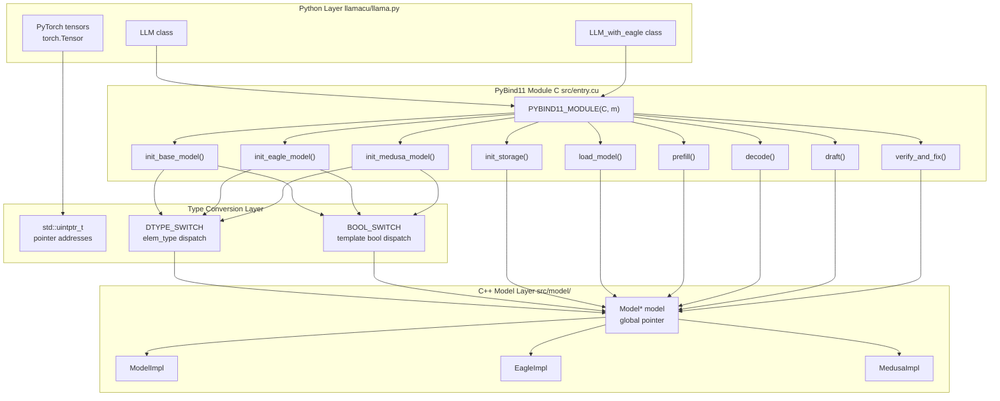
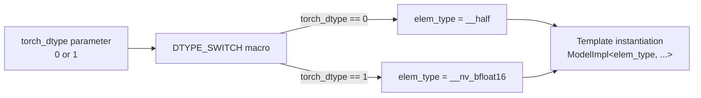
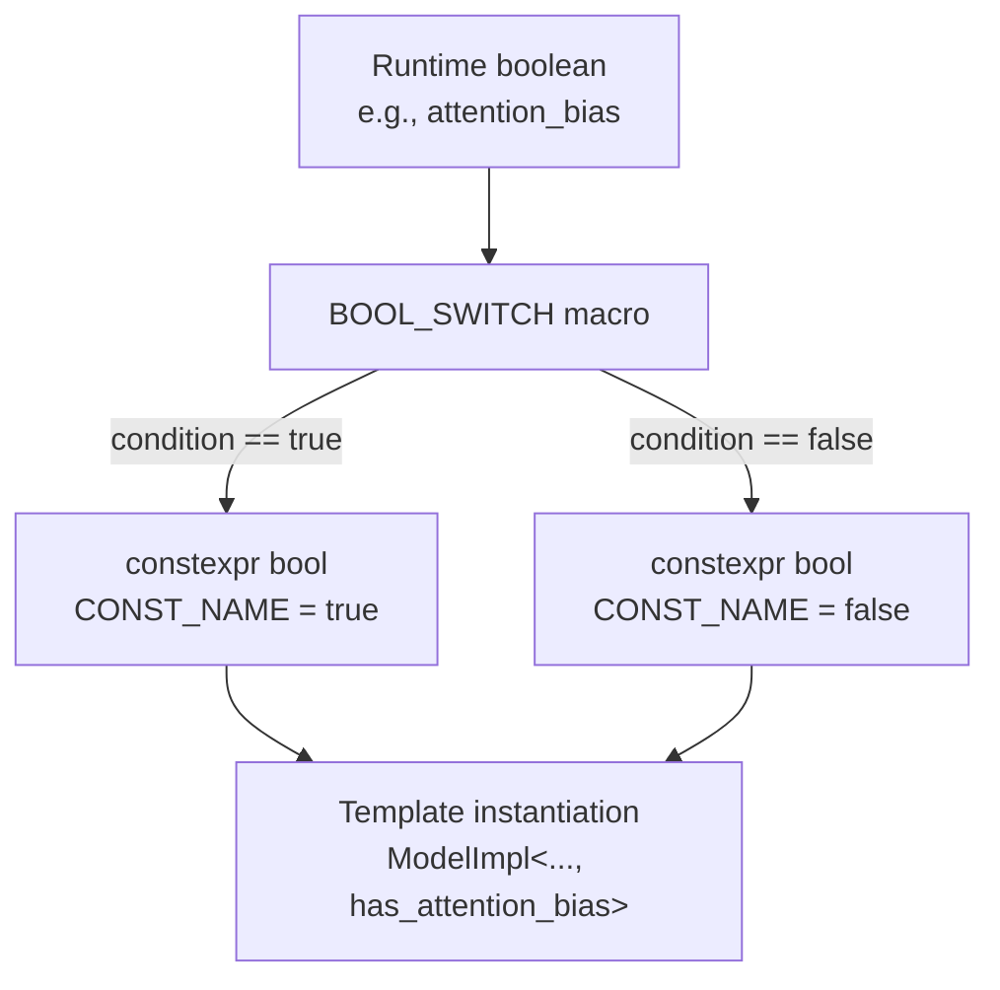
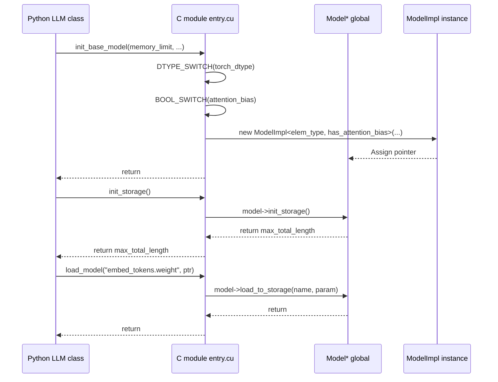
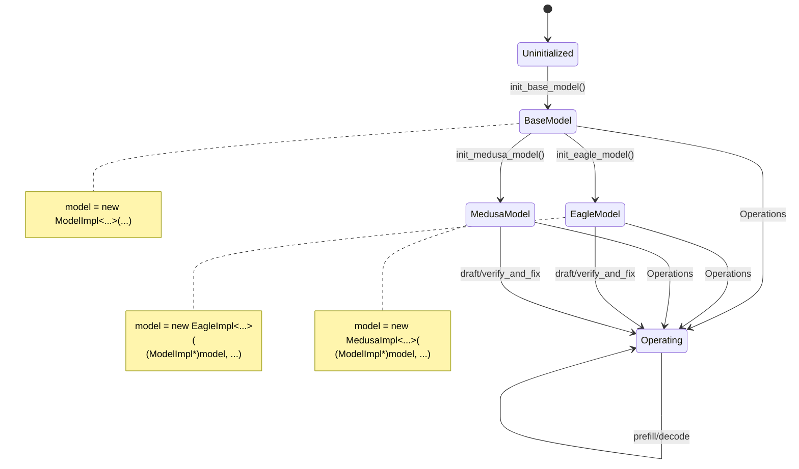
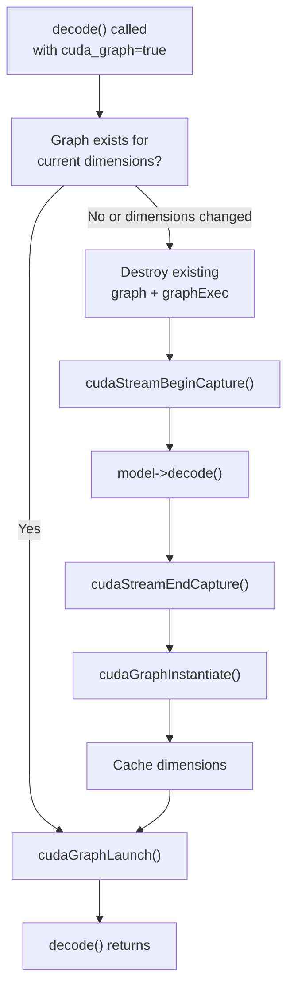
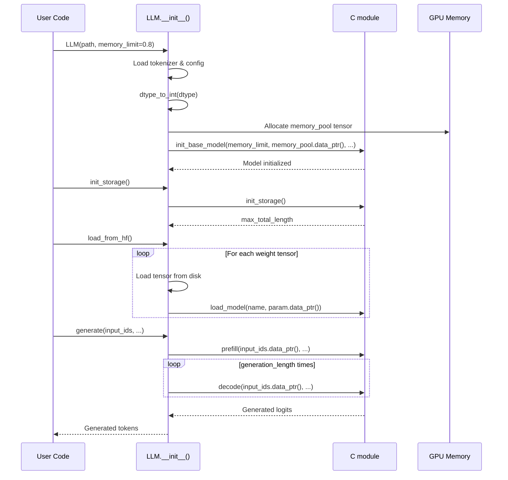

<!-- source: DeepWiki mcp.deepwiki.com · repo thunlp/FR-Spec · page 3.1 Python to CUDA Bridge · fetched 2026-11-02 -->

# Python to CUDA Bridge

<details>
<summary>Relevant source files</summary>

The following files were used as context for generating this wiki page:

- [llamacu/llama.py](llamacu/llama.py)
- [src/entry.cu](src/entry.cu)

</details>


## Purpose and Scope

The Python to CUDA Bridge is the interface layer that enables Python code to invoke high-performance CUDA kernels and C++ implementations. This page documents the PyBind11 module implementation in [src/entry.cu](), which exposes C++ model operations to Python, handles type conversions between Python and C++ representations, and manages the lifecycle of GPU resources.

For information about the Python API that calls this bridge, see [8](#8). For details on the C++/CUDA model implementations that this bridge exposes, see [4](#4) and [5](#5).

## Module Architecture

The bridge is implemented as a PyBind11 module named `C`, which is imported by Python code as `from llamacu import C`. The module exposes nine entry point functions that correspond to different stages of the model lifecycle and inference pipeline.



**Diagram: PyBind11 Bridge Architecture**

Sources: [src/entry.cu:1-184](), [llamacu/llama.py:1-198]()

## Type Conversion Mechanism

The bridge handles type conversion between Python and C++ using two primary strategies: pointer marshaling for tensor data and integer encoding for configuration parameters.

### Pointer Marshaling

PyTorch tensors are passed to C++ by extracting their underlying data pointer addresses as `std::uintptr_t` values. The C++ code then casts these addresses back to appropriate pointer types.

**Python Side (tensor to pointer):**
```python
# From llamacu/llama.py
C.prefill(
    input_length, history_length,
    input_ids.data_ptr(),           # torch.Tensor -> uintptr_t
    position_ids.data_ptr(),        # torch.Tensor -> uintptr_t
    self.logits.data_ptr()          # torch.Tensor -> uintptr_t
)
```

**C++ Side (pointer reconstruction):**
```cpp
// From src/entry.cu
void prefill(int input_length, int history_length, 
             std::uintptr_t input, std::uintptr_t position_ids, 
             std::uintptr_t output) {
    model->prefill(
        input_length, history_length, 
        reinterpret_cast<int32_t*>(input),           // uintptr_t -> int32_t*
        reinterpret_cast<int32_t*>(position_ids),    // uintptr_t -> int32_t*
        (void*)(output)                               // uintptr_t -> void*
    );
}
```

### Data Type Encoding

PyTorch data types are encoded as integers for transmission across the bridge:

| PyTorch Type | Integer Code | C++ Type |
|--------------|--------------|----------|
| `torch.float16` | 0 | `__half` |
| `torch.bfloat16` | 1 | `__nv_bfloat16` |

Sources: [llamacu/llama.py:9-18](), [src/entry.cu:138-140](), [src/entry.cu:10-19]()

## Template Dispatch Mechanism

The C++ implementation uses template metaprogramming to support multiple data types and configuration options without code duplication. Two macro-based dispatch mechanisms handle this:

### DTYPE_SWITCH Macro

Dispatches based on the `torch_dtype` parameter to select between `__half` (FP16) and `__nv_bfloat16` (BF16):



**Diagram: Data Type Dispatch Flow**

### BOOL_SWITCH Macro

Dispatches based on boolean conditions (e.g., whether the model has attention bias) to instantiate templates with appropriate compile-time constants:



**Diagram: Boolean Template Dispatch**

The macros are implemented as immediately-invoked lambda expressions that capture the surrounding context and return the result:

```cpp
#define DTYPE_SWITCH(COND, ...)               \
  [&] {                                      \
    if (COND == 0) {                              \
      using elem_type = __half;     \
      return __VA_ARGS__();                  \
    } else {                                 \
      using elem_type = __nv_bfloat16; \
      return __VA_ARGS__();                  \
    }                                        \
  }()
```

Sources: [src/entry.cu:10-30](), [src/entry.cu:51-67]()

## Entry Point Functions

The PyBind11 module exposes nine functions, organized by lifecycle stage:

### Model Initialization Functions

| Function | Purpose | Key Parameters | Return Type |
|----------|---------|----------------|-------------|
| `init_base_model` | Initialize base transformer model | `memory_limit`, `memory_pool`, model dimensions, `torch_dtype`, `attention_bias` | void |
| `init_eagle_model` | Initialize EAGLE speculative drafter | `num_layers`, `num_iter`, `topk_per_iter`, `tree_size`, `V` | void |
| `init_medusa_model` | Initialize Medusa speculative drafter | `num_heads`, `num_layers`, `topk_per_head`, `tree_size`, `V` | void |
| `init_storage` | Allocate KV cache and workspace memory | None | int (max_total_length) |
| `load_model` | Load weight tensor into GPU memory | `name` (string), `param` (pointer) | void |

### Inference Functions

| Function | Purpose | Key Parameters | Return Type |
|----------|---------|----------------|-------------|
| `prefill` | Process initial prompt | `input_length`, `input`, `position_ids`, `output` | void |
| `decode` | Single-step autoregressive decode | `input_length`, `padded_length`, `input`, `cache_length`, `mask_2d`, `cuda_graph` | void |
| `draft` | Generate speculative token tree | `tree_draft_ids`, `tree_position_ids`, `cache_length`, `attn_mask`, `tree_parent` | void |
| `verify_and_fix` | Verify drafts and fix KV cache | `num_tokens`, `pred`, `gt`, `position_ids`, `cache_length`, `attn_mask`, `tree_parent` | int (accepted_tokens) |

### Initialization Sequence Example



**Diagram: Model Initialization Call Sequence**

Sources: [src/entry.cu:34-68](), [src/entry.cu:97-128](), [src/entry.cu:130-136](), [src/entry.cu:174-184]()

## Global State Management

The bridge maintains a single global pointer to the active model instance:

```cpp
Model* model;  // src/entry.cu:32
```

This pointer follows a specific lifecycle:

1. **Base Model Creation**: `init_base_model()` allocates a `ModelImpl` instance and assigns it to `model`
2. **Speculative Extension**: `init_eagle_model()` or `init_medusa_model()` wraps the existing base model with `EagleImpl` or `MedusaImpl`, reassigning `model`
3. **Operation Dispatch**: All subsequent operations (`prefill`, `decode`, `draft`, `verify_and_fix`) invoke methods on the current `model` pointer
4. **Type Safety**: The wrapper implementations maintain type consistency through template parameters



**Diagram: Global Model Pointer State Machine**

The type-safe downcasting in speculative model initialization extracts the base model pointer with the correct template parameters:

```cpp
// src/entry.cu:110-127
DTYPE_SWITCH(torch_dtype, [&] {
    const bool attention_bias = dynamic_cast<ModelImpl<elem_type, true>*>(model) != nullptr;
    BOOL_SWITCH(attention_bias, has_attention_bias, [&] {
        model = new EagleImpl<elem_type, has_attention_bias>(
            (ModelImpl<elem_type, has_attention_bias>*)model,
            num_layers, intermediate_size, ...
        );
    });
});
```

Sources: [src/entry.cu:32](), [src/entry.cu:34-68](), [src/entry.cu:97-128](), [src/entry.cu:70-95]()

## CUDA Graph Optimization

The `decode()` function supports CUDA graph capture to reduce kernel launch overhead during autoregressive decoding. CUDA graphs record a sequence of kernel launches and allow replaying them with minimal CPU overhead.

### Graph Management

Three global variables track the CUDA graph state:

```cpp
cudaGraph_t graph = nullptr;               // Graph definition
cudaGraphExec_t graphExec = nullptr;       // Executable graph instance
int graphCreated_padding_length = -1;      // Cached padded_length
int graphCreated_input_length = -1;        // Cached input_length
```

### Conditional Graph Capture Logic



**Diagram: CUDA Graph Capture and Replay Flow**

The graph is invalidated and recreated when either `input_length` or `padded_length` changes, ensuring correctness across different batch sizes and sequence lengths:

```cpp
// src/entry.cu:142-164
if (cuda_graph) {
    if (graphCreated_padding_length != padded_length || 
        graphCreated_input_length != input_length) {
        // Destroy old graph if exists
        if (graphExec != nullptr) cudaGraphExecDestroy(graphExec);
        if (graph != nullptr) cudaGraphDestroy(graph);
        
        // Capture new graph
        cudaStreamBeginCapture(calc_stream.stream, cudaStreamCaptureModeGlobal);
        model->decode(/* ... *);
        cudaStreamEndCapture(calc_stream.stream, &graph);
        cudaGraphInstantiate(&graphExec, graph, nullptr, nullptr, 0);
        
        // Cache dimensions
        graphCreated_padding_length = padded_length;
        graphCreated_input_length = input_length;
    }
    cudaGraphLaunch(graphExec, calc_stream.stream);
}
```

Sources: [src/entry.cu:142-164]()

## Python-Side Usage Pattern

The Python `LLM` class demonstrates typical usage of the bridge. The following sequence shows how Python code initializes and operates the model:



**Diagram: Python-Side Usage Flow**

Key patterns:

1. **Tensor Pointer Extraction**: All tensor data is passed via `.data_ptr()` method
2. **Type Assertions**: Python code validates tensor dtypes before passing to C++
3. **Dimension Tracking**: Python maintains metadata (lengths, shapes) and passes as separate parameters
4. **Result Cloning**: Logits are cloned immediately after C++ operations to prevent data races

Example from `LLM.decode()`:

```python
# llamacu/llama.py:152-172
def decode(self, input_ids, position_ids, cache_length, mask_2d=None):
    assert input_ids.dtype == torch.int32
    assert position_ids.dtype == torch.int32
    assert cache_length.dtype == torch.int32
    if mask_2d is not None:
        assert mask_2d.dtype == torch.uint64
    
    cache_length += input_ids.numel()  # Temporary adjustment
    padded_length = (cache_length[0].item() + 128 - 1) // 128 * 128
    
    C.decode(
        input_ids.numel(), padded_length,
        input_ids.data_ptr(), position_ids.data_ptr(), cache_length.data_ptr(),
        mask_2d.data_ptr() if mask_2d is not None else 0,
        self.logits.data_ptr(),
        self.cuda_graph
    )
    
    cache_length -= input_ids.numel()  # Restore original value
    return self.logits[:input_ids.numel()].clone()
```

Sources: [llamacu/llama.py:20-198](), [llamacu/llama.py:34-59](), [llamacu/llama.py:140-172]()

## PyBind11 Module Definition

The module definition at the end of [src/entry.cu:174-184]() registers all entry point functions with PyBind11:

```cpp
PYBIND11_MODULE(C, m) {
    m.def("init_base_model", &init_base_model, "Init base model");
    m.def("init_medusa_model", &init_medusa_model, "Init medusa model");
    m.def("init_eagle_model", &init_eagle_model, "Init eagle model");
    m.def("init_storage", &init_storage, "Init storage");
    m.def("load_model", &load_model, "Load model");
    m.def("prefill", &prefill, "Prefill");
    m.def("decode", &decode, "Decode");
    m.def("draft", &draft, "Draft");
    m.def("verify_and_fix", &verify_and_fix, "Verify and fix");
}
```

This module is compiled into a Python extension that can be imported as `from llamacu import C`. The build process is handled by `setup.py` (see [10](#10) for build system details).

Sources: [src/entry.cu:174-184]()

---

