# Page: Home

# Home

<details>
<summary>Relevant source files</summary>

The following files were used as context for generating this wiki page:

- [LICENSE](LICENSE)
- [README.md](README.md)

</details>


## Purpose and Scope

This wiki documents the **H-Neurons** codebase, a research implementation for identifying and analyzing hallucination-associated neurons in Large Language Models (LLMs). The system provides a complete pipeline for discovering sparse neuron subsets that are causally linked to factual hallucinations, using the CETT (Neuron Contribution) metric and linear classification techniques.

This page provides an architectural overview of the entire system. For installation and setup instructions, see [Getting Started](#2). For theoretical background on H-Neurons and CETT, see [Core Concepts](#3). For step-by-step pipeline execution, see [Pipeline Guide](#4).

**Sources:** [README.md:1-162]()

---

## What are H-Neurons?

**H-Neurons** (Hallucination-Associated Neurons) are a sparse subset of neurons within an LLM's feed-forward network (FFN) layers that exhibit strong causal relationships with hallucination occurrences. The key empirical findings are:

| Property | Description |
|----------|-------------|
| **Sparsity** | A remarkably small fraction of total neurons (<<1%) can predict hallucinations |
| **Predictive Power** | These neurons reliably distinguish between faithful and hallucinated responses |
| **Causality** | Suppressing H-Neurons reduces hallucination rates while preserving general capabilities |
| **Localization** | Concentrated in the FFN `down_proj` layer inputs across transformer blocks |
| **Generalizability** | Detection performance transfers across in-domain and out-of-distribution scenarios |

The identification process relies on the **CETT metric** (Neuron Contribution Quantification), which measures individual neuron contributions during forward passes, particularly at answer token positions.

**Sources:** [README.md:1-21]()

---

## System Architecture Overview

The H-Neurons system implements a **6-stage pipeline** that transforms raw question-answer datasets into actionable neuron-level insights:

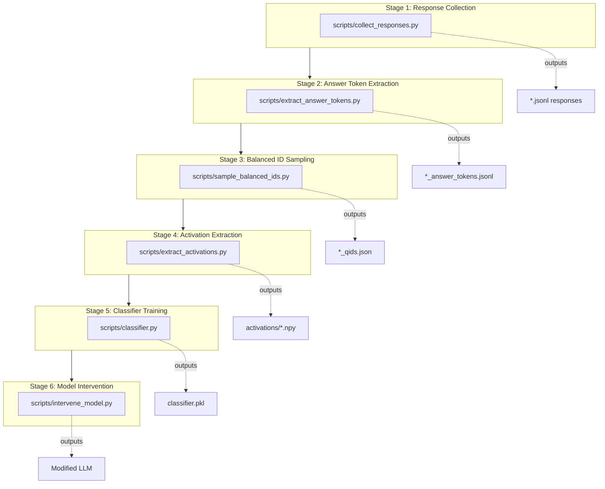

**Pipeline Stage Mapping**

Each stage is implemented as a standalone Python script with well-defined inputs and outputs:

| Stage | Script | Primary Input | Primary Output | Purpose |
|-------|--------|---------------|----------------|---------|
| 1 | `collect_responses.py` | TriviaQA `.parquet` | `responses.jsonl` | Generate LLM responses with correctness labels |
| 2 | `extract_answer_tokens.py` | `responses.jsonl` | `answer_tokens.jsonl` | Tag exact answer token positions using LLM judge |
| 3 | `sample_balanced_ids.py` | `answer_tokens.jsonl` | `train_qids.json`, `test_qids.json` | Create balanced True/False sample sets |
| 4 | `extract_activations.py` | `answer_tokens.jsonl`, `*_qids.json` | `activations/*.npy` | Compute CETT values at various token locations |
| 5 | `classifier.py` | `activations/*.npy`, `*_qids.json` | `classifier.pkl` | Train logistic regression to identify H-Neurons |
| 6 | `intervene_model.py` | `classifier.pkl` | Modified model | Suppress H-Neuron activations during inference |

**Sources:** [README.md:22-30](), [README.md:44-147]()

---

## Repository Structure

The codebase is organized into distinct directories for scripts, data, and documentation:

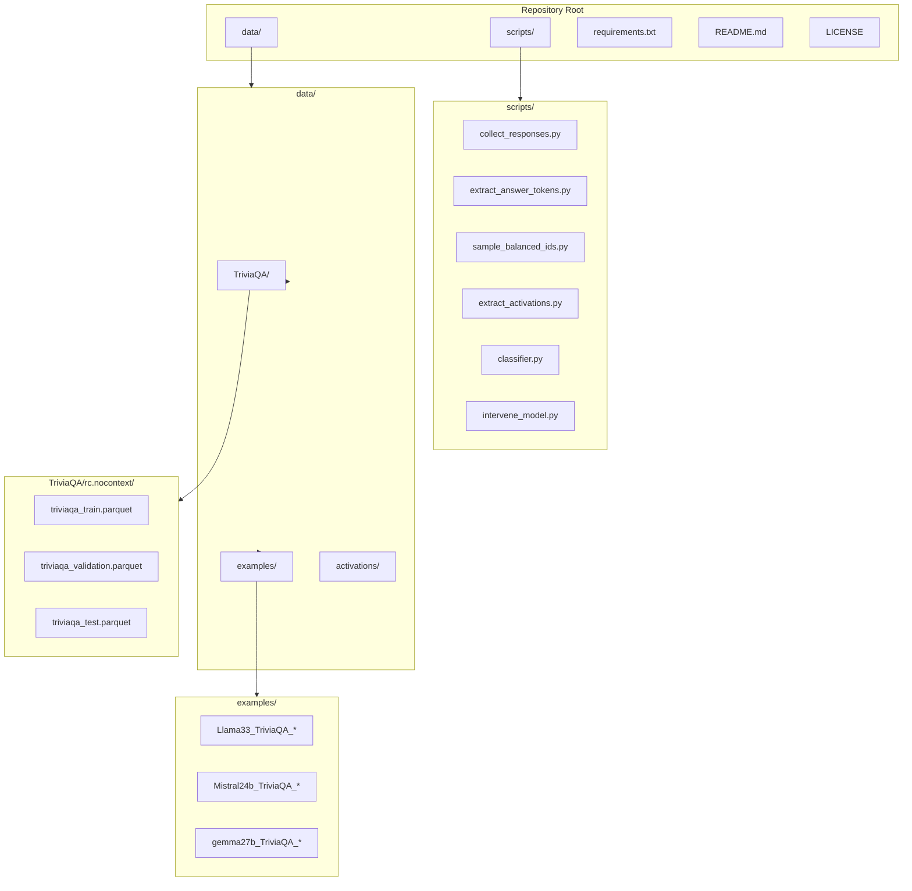

**Key Directory Purposes:**

| Directory | Contents | Description |
|-----------|----------|-------------|
| `scripts/` | 6 Python scripts | Executable pipeline stages (see [Pipeline Guide](#4)) |
| `data/TriviaQA/` | `.parquet` files | Source dataset from HuggingFace (see [TriviaQA Source Dataset](#5.1)) |
| `data/examples/` | `.jsonl`, `.json` files | Pre-processed example data for 3 models (see [Example Data](#5.3)) |
| `data/activations/` | `.npy` files | Extracted CETT activation arrays (see [Activation Extraction](#4.4)) |

**Sources:** [README.md:34-38](), [README.md:50]()

---

## Multi-Model Support

The system has been validated on three LLM architectures, with example data provided for each:

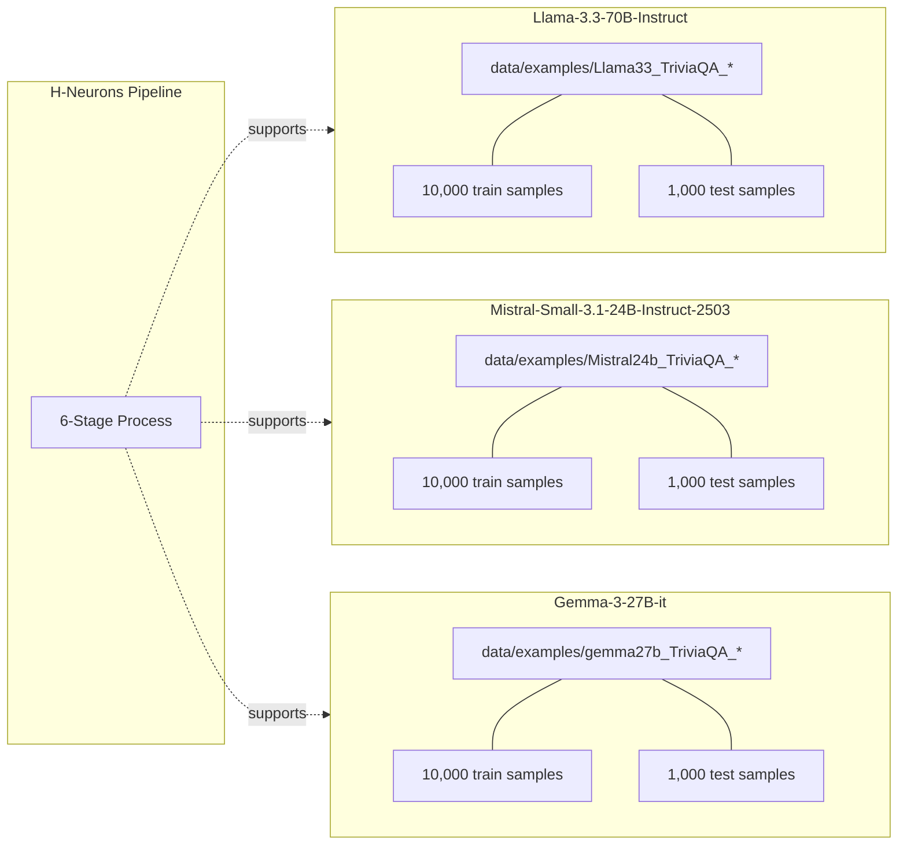

**Provided Example Files:**

Each model has four pre-processed files in `data/examples/`:

| Model | Answer Tokens (Train) | Answer Tokens (Test) | Train QIDs | Test QIDs |
|-------|----------------------|---------------------|------------|-----------|
| Llama33 | `Llama33_TriviaQA_answer_tokens_train.jsonl` | `Llama33_TriviaQA_answer_tokens_test.jsonl` | `Llama33_TriviaQA_train_qids.json` | `Llama33_TriviaQA_test_qids.json` |
| Mistral24b | `Mistral24b_TriviaQA_answer_tokens_train.jsonl` | `Mistral24b_TriviaQA_answer_tokens_test.jsonl` | `Mistral24b_TriviaQA_train_qids.json` | `Mistral24b_TriviaQA_test_qids.json` |
| gemma27b | `gemma27b_TriviaQA_answer_tokens_train.jsonl` | `gemma27b_TriviaQA_answer_tokens_test.jsonl` | `gemma27b_TriviaQA_train_qids.json` | `gemma27b_TriviaQA_test_qids.json` |

The consistent data organization enables comparative analysis of H-Neurons across different model families. For details on multi-model considerations, see [Multi-Model Support](#7.2).

**Sources:** [README.md:50]()

---

## Core Technologies and Dependencies

The implementation leverages specialized libraries for efficient LLM inference, activation extraction, and classification:

**Primary Dependencies:**

| Library | Purpose | Used By |
|---------|---------|---------|
| `vllm` | Fast batched LLM inference | `collect_responses.py` |
| `transformers` | Model loading and tokenization | `extract_answer_tokens.py`, `extract_activations.py` |
| `accelerate` | Distributed model loading | `extract_activations.py` |
| `torch` | Forward hooks and tensor operations | `extract_activations.py` |
| `scikit-learn` | Logistic regression training | `classifier.py` |
| `openai` | LLM-based judging and tagging | `collect_responses.py`, `extract_answer_tokens.py` |
| `pandas` | Parquet file handling | `collect_responses.py`, `sample_balanced_ids.py` |
| `numpy` | Activation array storage | `extract_activations.py`, `classifier.py` |
| `joblib` | Model serialization | `classifier.py` |

**Installation:**

```bash
pip install -r requirements.txt
```

For vLLM installation issues, consult the [official vLLM installation guide](https://docs.vllm.ai/en/latest/getting_started/installation).

**Sources:** [README.md:31-38]()

---

## Key Configuration Decisions

The system exposes several critical configuration choices that significantly impact results:

### Training Mode Selection

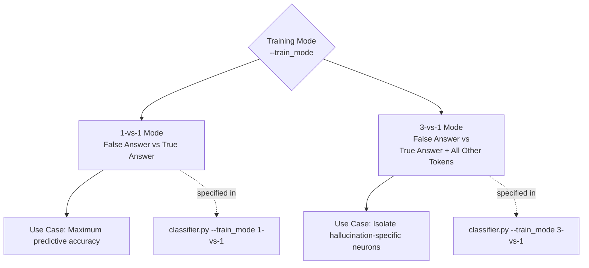

**Sources:** [README.md:123-125]()

### Regularization Strategy

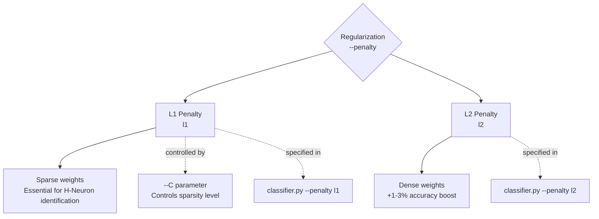

**Regularization Parameter `C`:**

The `--C` parameter (inverse regularization strength) controls the trade-off between sparsity and accuracy:
- **Low C**: Aggressive sparsity, few H-Neurons, may miss important neurons
- **High C**: More neurons included, may add noise from general language modeling
- **Recommended**: Grid search to maximize (classification accuracy + TriviaQA performance under intervention)

For comprehensive details, see [Training Modes](#6.1) and [Regularization Options](#6.2).

**Sources:** [README.md:127-135]()

---

## Judging Strategies

The system supports two methods for evaluating response correctness:

| Strategy | Implementation | Pros | Cons | Use Case |
|----------|---------------|------|------|----------|
| **Rule-based** | `--judge_type rule` | Fast, free, deterministic | Less accurate for edge cases | Quick experiments, cost-sensitive scenarios |
| **LLM-based** | `--judge_type llm` | High accuracy, handles nuance | Requires API access, costs | Production research, high-quality datasets |

Both strategies are available in `collect_responses.py` via the `--judge_type` flag. The LLM-based approach uses GPT-4o by default but supports any OpenAI-compatible API. For detailed comparison, see [Judging Strategies](#6.4).

**Sources:** [README.md:45-63]()

---

## Data Flow Overview

The following diagram shows how data transforms through the pipeline stages, mapping natural language concepts to actual file formats:

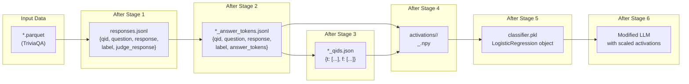

Each intermediate format is documented in detail in [Intermediate Data Formats](#5.2).

**Sources:** [README.md:44-147]()

---

## Getting Started

To begin using the H-Neurons system:

1. **Install dependencies**: See [Getting Started](#2) for detailed installation instructions
2. **Prepare data**: The TriviaQA dataset is available in `data/TriviaQA/`, see [TriviaQA Source Dataset](#5.1)
3. **Run the pipeline**: Follow the [Pipeline Guide](#4) for step-by-step execution
4. **Understand CETT**: Read [CETT Metric Implementation](#7.1) for the theoretical foundation

**Quick Start Example:**

```bash
# Using provided example data for Llama33
python scripts/extract_activations.py \
    --model_path /path/to/llama-3.3-70b \
    --input_path data/examples/Llama33_TriviaQA_answer_tokens_train.jsonl \
    --train_ids_path data/examples/Llama33_TriviaQA_train_qids.json \
    --output_root data/activations \
    --locations answer_tokens \
    --method mean \
    --use_mag --use_abs

python scripts/classifier.py \
    --train_ids data/examples/Llama33_TriviaQA_train_qids.json \
    --train_ans_acts data/activations/answer_tokens \
    --train_mode 1-vs-1 \
    --penalty l1 \
    --C 1.0 \
    --save_model models/llama33_classifier.pkl
```

**Sources:** [README.md:40-147]()

---

## Research Context

This implementation accompanies the paper:

> Cheng Gao, Huimin Chen, Chaojun Xiao, Zhiyi Chen, Zhiyuan Liu, Maosong Sun. **H-Neurons: On the Existence, Impact, and Origin of Hallucination-Associated Neurons in LLMs**. arXiv:2512.01797, 2025.

**Key Research Contributions:**

1. Empirical demonstration that sparse neuron subsets reliably predict hallucinations
2. Introduction of CETT metric for quantifying neuron-level contributions
3. Evidence of causal links between identified neurons and over-compliance behaviors
4. Generalization analysis across in-domain and out-of-distribution scenarios

The code is released under the MIT License (see [LICENSE:1-21]()) by THUNLP (Tsinghua University Natural Language Processing Lab).

**Sources:** [README.md:10-14](), [README.md:148-162](), [LICENSE:1-21]()

---

# Page: Getting Started

# Getting Started

<details>
<summary>Relevant source files</summary>

The following files were used as context for generating this wiki page:

- [README.md](README.md)
- [requirements.txt](requirements.txt)

</details>


This page provides installation instructions, environment setup, and a quick-start guide for running the H-Neurons pipeline. By the end of this guide, you will have a working environment capable of identifying hallucination-associated neurons in large language models.

For detailed explanations of H-Neurons and the CETT metric, see [Core Concepts](#3). For the complete 6-step pipeline, see [Pipeline Guide](#4). For information on data organization and formats, see [Data Organization](#5).

## Purpose and Scope

This guide covers:
- Installing Python dependencies and environment setup
- Verifying your installation
- Running a minimal end-to-end example
- Understanding the basic workflow

This guide does **not** cover:
- Detailed explanation of each pipeline step (see [Pipeline Guide](#4))
- Configuration options and advanced parameters (see [Configuration & Options](#6))
- Data format specifications (see [Data Organization](#5))

---

## Prerequisites

Before starting, ensure you have:

| Requirement | Details |
|------------|---------|
| **Python Version** | Python 3.8 or higher |
| **GPU** | CUDA-compatible GPU with ≥24GB VRAM (for Llama-3.3-70B or similar models) |
| **Disk Space** | ≥100GB for model weights, activations, and intermediate data |
| **API Access** | OpenAI API key (for answer token extraction with GPT-4o) |
| **Model Access** | HuggingFace access to target models (Llama-3.3-70B, Mistral-Small-3.1-24B, Gemma-3-27B) |

**Sources:** [README.md:31-38](), [README.md:42]()

---

## Installation

### Step 1: Clone the Repository

```bash
git clone https://github.com/thunlp/H-Neurons.git
cd H-Neurons
```

### Step 2: Install Dependencies

The project uses `vLLM` for efficient LLM inference. If you encounter installation issues with vLLM, consult the [official vLLM installation guide](https://docs.vllm.ai/en/latest/getting_started/installation).

```bash
pip install -r requirements.txt
```

**Sources:** [README.md:34-38]()

### Dependency Overview

The following diagram shows the core Python packages and their roles in the pipeline:

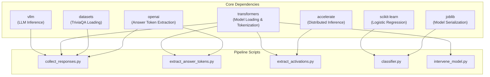

**Dependency Installation Details**

| Package | Version Constraint | Primary Use |
|---------|-------------------|-------------|
| `vllm` | Latest | High-throughput LLM inference in `collect_responses.py` |
| `transformers` | Latest | Model loading, tokenization across all scripts |
| `datasets` | Latest | Loading TriviaQA parquet files |
| `openai` | Latest | GPT-4o API calls for answer token extraction |
| `accelerate` | Latest | Multi-GPU support in activation extraction |
| `scikit-learn` | Latest | Logistic Regression training in `classifier.py` |
| `joblib` | Latest | Saving/loading `.pkl` classifier models |

**Sources:** [requirements.txt:1-7](), [README.md:32]()

---

## Environment Setup

### Configure API Keys

For answer token extraction with GPT-4o, set your OpenAI API credentials:

```bash
export OPENAI_API_KEY="your-api-key-here"
export OPENAI_BASE_URL="https://api.openai.com/v1"  # or your custom endpoint
```

### Download TriviaQA Dataset

The pipeline uses the TriviaQA `rc.nocontext` dataset. You can either:

1. **Download manually** from the [TriviaQA repository](https://huggingface.co/datasets/trivia_qa) and place in `data/TriviaQA/rc.nocontext/`
2. **Use provided example data** in `data/examples/` (pre-processed for Llama-3.3-70B, Mistral-Small-3.1-24B, Gemma-3-27B)

### Directory Structure Setup

After installation, create the following directory structure:

```bash
mkdir -p data/activations
mkdir -p models
mkdir -p outputs
```

**Sources:** [README.md:50-63]()

---

## Verification

### Test vLLM Installation

Verify vLLM can load a model:

```python
from vllm import LLM
llm = LLM(model="facebook/opt-125m")  # Small test model
print("vLLM installation successful!")
```

### Test Dependencies

```bash
python -c "import transformers, datasets, openai, accelerate, sklearn, joblib; print('All dependencies installed successfully!')"
```

### Verify Example Data

Check that example data files exist:

```bash
ls data/examples/Llama33_TriviaQA_answer_tokens_train.jsonl
ls data/examples/Llama33_TriviaQA_train_qids.json
```

If these files exist, you can proceed to the Quick Start using pre-computed data.

**Sources:** [README.md:50]()

---

## Quick Start Guide

This section demonstrates a minimal end-to-end workflow using the provided Llama-3.3-70B example data. The full pipeline requires 6 steps, but for quick verification, we'll train a classifier using pre-extracted data.

### Workflow Overview

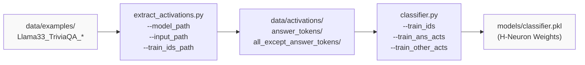

**Sources:** [README.md:40-146]()

### Step-by-Step Quick Start

#### 1. Extract Activations (CETT)

Using the provided Llama-3.3-70B example data, extract neuron-level activations:

```bash
python scripts/extract_activations.py \
    --model_path meta-llama/Llama-3.3-70B-Instruct \
    --input_path data/examples/Llama33_TriviaQA_answer_tokens_train.jsonl \
    --train_ids_path data/examples/Llama33_TriviaQA_train_qids.json \
    --output_root data/activations \
    --locations answer_tokens all_except_answer_tokens \
    --method mean \
    --use_mag --use_abs
```

**What this does:**
- Loads the Llama-3.3-70B model
- Reads question-response pairs from `answer_tokens_train.jsonl`
- Uses question IDs from `train_qids.json` (balanced True/False samples)
- Extracts activations at two locations: `answer_tokens` and `all_except_answer_tokens`
- Saves numpy arrays to `data/activations/answer_tokens/` and `data/activations/all_except_answer_tokens/`

**Expected output structure:**
```
data/activations/
├── answer_tokens/
│   ├── layer_0.npy
│   ├── layer_1.npy
│   └── ...
└── all_except_answer_tokens/
    ├── layer_0.npy
    ├── layer_1.npy
    └── ...
```

**Sources:** [README.md:93-106]()

#### 2. Train H-Neuron Classifier

Train a logistic regression classifier to identify H-Neurons:

```bash
python scripts/classifier.py \
    --model_path meta-llama/Llama-3.3-70B-Instruct \
    --train_ids data/examples/Llama33_TriviaQA_train_qids.json \
    --train_ans_acts data/activations/answer_tokens \
    --train_other_acts data/activations/all_except_answer_tokens \
    --train_mode 3-vs-1 \
    --penalty l1 \
    --C 1.0 \
    --save_model models/classifier.pkl
```

**What this does:**
- Loads activations from `data/activations/answer_tokens/` and `data/activations/all_except_answer_tokens/`
- Uses `3-vs-1` mode: hallucinated answer tokens (class 1) vs. all other token types (class 0)
- Applies `l1` regularization for sparse H-Neuron identification
- Saves the trained classifier to `models/classifier.pkl`

**Expected output:**
```
Train Accuracy: 0.85
Train Precision: 0.82
Train Recall: 0.88
Train F1: 0.85
Train AUROC: 0.91
Number of non-zero neurons: 127
```

**Sources:** [README.md:108-136]()

### Parameter Reference Table

| Parameter | Value in Quick Start | Purpose |
|-----------|---------------------|---------|
| `--model_path` | `meta-llama/Llama-3.3-70B-Instruct` | Target model for analysis |
| `--input_path` | `data/examples/Llama33_TriviaQA_answer_tokens_train.jsonl` | Question-response pairs with answer token annotations |
| `--train_ids_path` | `data/examples/Llama33_TriviaQA_train_qids.json` | Balanced question IDs (True/False samples) |
| `--output_root` | `data/activations` | Root directory for activation storage |
| `--locations` | `answer_tokens all_except_answer_tokens` | Token regions to extract activations from |
| `--method` | `mean` | Aggregation method (mean across tokens) |
| `--use_mag --use_abs` | Flags | Apply magnitude scaling and absolute value in CETT |
| `--train_mode` | `3-vs-1` | Classifier training strategy (see [6.1](#6.1)) |
| `--penalty` | `l1` | Regularization type for sparsity (see [6.2](#6.2)) |
| `--C` | `1.0` | Inverse regularization strength |

**Sources:** [README.md:93-136]()

---

## Command Mapping to Pipeline Stages

The following diagram maps command-line scripts to the 6-stage pipeline:

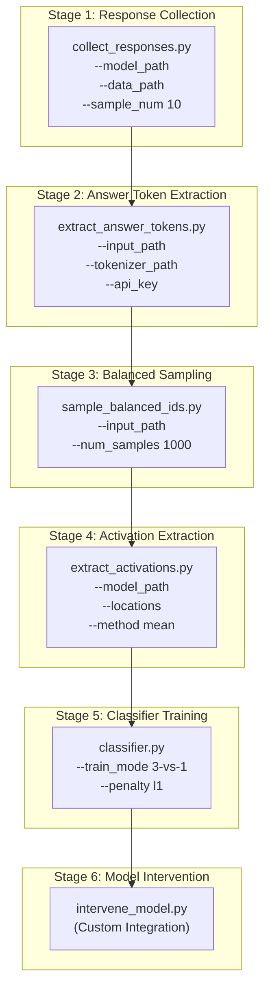

**Sources:** [README.md:22-30](), [README.md:40-146]()

---

## Next Steps

After completing the quick start:

1. **Run the full pipeline** with custom data: See [Pipeline Guide](#4) for detailed instructions on each stage
2. **Explore configuration options**: See [Configuration & Options](#6) to understand training modes, regularization, and activation extraction parameters
3. **Perform model intervention**: See [Step 6: Model Intervention](#4.6) to scale H-Neurons and reduce hallucinations
4. **Understand the theory**: See [Core Concepts](#3) for detailed explanations of H-Neurons and the CETT metric

**Sources:** [README.md:1-162]()

---

## Troubleshooting

### Common Issues

| Issue | Cause | Solution |
|-------|-------|----------|
| `vllm` installation fails | CUDA version mismatch | Check CUDA compatibility at [vLLM docs](https://docs.vllm.ai/en/latest/getting_started/installation) |
| Out of memory during activation extraction | Model too large for GPU | Use `--batch_size 1` in `extract_activations.py` or reduce model size |
| OpenAI API errors | Invalid API key | Verify `OPENAI_API_KEY` environment variable |
| Missing example data | Incomplete clone | Re-clone repository with `git clone --recursive` |
| FileNotFoundError for activations | Activation extraction not run | Complete Step 1 (extract_activations.py) before Step 2 (classifier.py) |

**Sources:** [README.md:32]()

---

## File Path Reference

Key files referenced in this guide:

| Path | Description |
|------|-------------|
| [requirements.txt:1-7]() | Python dependencies |
| [README.md:31-38]() | Installation instructions |
| [README.md:40-146]() | Full pipeline usage examples |
| `data/examples/Llama33_TriviaQA_answer_tokens_train.jsonl` | Pre-processed Llama-3.3-70B training data |
| `data/examples/Llama33_TriviaQA_train_qids.json` | Balanced question IDs for Llama-3.3-70B |
| `scripts/extract_activations.py` | CETT activation extraction script |
| `scripts/classifier.py` | H-Neuron classifier training script |

**Sources:** [README.md:1-162](), [requirements.txt:1-7]()

---

# Page: Core Concepts

# Core Concepts

<details>
<summary>Relevant source files</summary>

The following files were used as context for generating this wiki page:

- [README.md](README.md)
- [scripts/classifier.py](scripts/classifier.py)
- [scripts/extract_activations.py](scripts/extract_activations.py)

</details>


This page provides a detailed explanation of the theoretical and technical foundations underlying the H-Neurons system. It covers the definition of H-Neurons, the CETT (neuron Contribution) metric used to quantify neuron activity, the hallucination detection methodology, and the mathematical formulations that drive the identification process.

For practical implementation details of the pipeline stages, see [Pipeline Guide](#4). For configuration options and parameter tuning, see [Configuration & Options](#6).

---

## Overview

The H-Neurons framework is built on three core concepts that work together to identify and manipulate neurons associated with hallucination in large language models:

1. **H-Neurons**: A sparse subset of neurons in the feed-forward layers that are causally linked to hallucination occurrences
2. **CETT Metric**: A neuron contribution quantification method that measures each neuron's activation while accounting for layer output normalization
3. **Binary Classification**: A supervised learning approach that distinguishes between hallucinated and faithful responses based on neuron activations

---

## H-Neurons: Hallucination-Associated Neurons

### Definition

**H-Neurons** (Hallucination-associated Neurons) are individual neurons in a language model's feed-forward networks that exhibit significantly different activation patterns when the model generates hallucinated content versus factual content. These neurons are:

- **Sparse**: Only a small fraction of the total neurons in the model (typically hundreds to thousands out of millions)
- **Predictive**: Their activation patterns can reliably predict whether a response contains hallucinations
- **Causal**: Suppressing or scaling their activations directly affects hallucination rates

Sources: [README.md:14-14]()

### Identification Process

H-Neurons are identified through a binary classification task where a linear classifier (Logistic Regression) is trained to distinguish hallucinated responses from faithful ones. Neurons with positive coefficients in the trained classifier are designated as H-Neurons.

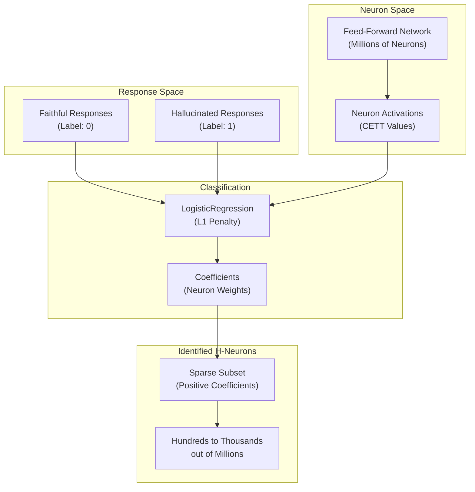

**Diagram: H-Neuron Identification Pipeline**

Sources: [scripts/classifier.py:108-117](), [README.md:17-17]()

### Properties

| Property | Description | Code Reference |
|----------|-------------|----------------|
| **Location** | Input to `down_proj` layer in FFN | [scripts/extract_activations.py:36-42]() |
| **Sparsity** | Enforced through L1 regularization | [scripts/classifier.py:108-111]() |
| **Sign** | Positive coefficients indicate H-Neurons | [scripts/classifier.py:117]() |
| **Generalizability** | Effective across in-domain and OOD scenarios | [README.md:20-20]() |

Sources: [scripts/classifier.py:108-117](), [scripts/extract_activations.py:36-42]()

---

## CETT Metric: Neuron Contribution Quantification

### Overview

The **CETT** metric (Neuron Contribution Extraction Through Transformations) quantifies the contribution of individual neurons during inference. It captures neuron activations while accounting for their magnitude, sign, and the overall layer output normalization.

### Implementation: CETTManager Class

The CETT metric is implemented in the `CETTManager` class, which uses forward hooks to capture activations at the `down_proj` layer input.

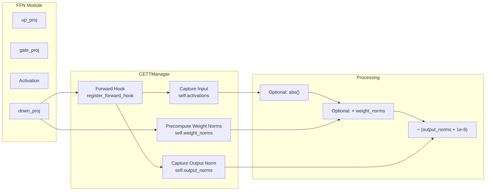

**Diagram: CETT Metric Computation Pipeline**

Sources: [scripts/extract_activations.py:26-66]()

### Mathematical Formulation

The CETT value for neuron $i$ in layer $l$ at token position $t$ is computed as:

$$
\text{CETT}_{l,t,i} = \frac{|\text{act}_{l,t,i}| \cdot \|\mathbf{w}_i^{\text{down}}\|_2}{\|\mathbf{o}_{l,t}\|_2 + \epsilon}
$$

Where:
- $\text{act}_{l,t,i}$: Activation of neuron $i$ (input to `down_proj`)
- $\mathbf{w}_i^{\text{down}}$: Weight vector for neuron $i$ in `down_proj` layer
- $\mathbf{o}_{l,t}$: Output vector of layer $l$ at token $t$
- $\epsilon = 10^{-8}$: Numerical stability constant

| Component | Symbol | Implementation | Code Location |
|-----------|--------|----------------|---------------|
| Neuron Activation | $\text{act}_{l,t,i}$ | `input[0]` in hook | [scripts/extract_activations.py:37]() |
| Absolute Value | $\|\cdot\|$ | `torch.abs(acts)` | [scripts/extract_activations.py:63]() |
| Weight Norm | $\|\mathbf{w}_i\|_2$ | `torch.norm(module.weight.data, dim=0)` | [scripts/extract_activations.py:48]() |
| Output Norm | $\|\mathbf{o}\|_2$ | `torch.norm(output.detach(), dim=-1)` | [scripts/extract_activations.py:38]() |
| Normalization | $\epsilon$ | `1e-8` | [scripts/extract_activations.py:66]() |

Sources: [scripts/extract_activations.py:55-66]()

### CETT Configuration Options

The CETT computation supports two boolean flags that modify the calculation:

```python
# From extract_activations.py parse_args()
parser.add_argument("--use_mag", action="store_true", default=True)
parser.add_argument("--use_abs", action="store_true", default=True)
```

| Flag | Effect | Mathematical Impact | Use Case |
|------|--------|---------------------|----------|
| `--use_abs` | Apply absolute value | $\text{act} \rightarrow |\text{act}|$ | Ignore activation sign, focus on magnitude |
| `--use_mag` | Multiply by weight norms | $\text{act} \rightarrow \text{act} \cdot \|\mathbf{w}\|_2$ | Weight contribution by downstream impact |

Sources: [scripts/extract_activations.py:22-23](), [scripts/extract_activations.py:63-64]()

### Tensor Shape Transformations

The `CETTManager.get_cett_tensor()` method performs the following transformations:

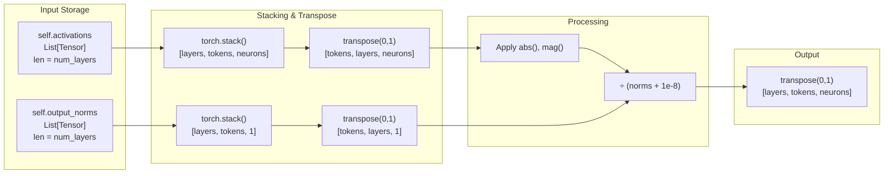

**Diagram: CETT Tensor Shape Transformations**

Sources: [scripts/extract_activations.py:55-66]()

---

## Hallucination Detection Methodology

### Binary Classification Framework

The H-Neurons system frames hallucination detection as a binary classification problem:

- **Positive Class (Label 1)**: Hallucinated/False responses
- **Negative Class (Label 0)**: Faithful/True responses (and potentially other tokens)

### Training Modes

The system supports two distinct training modes that define what constitutes the negative class:

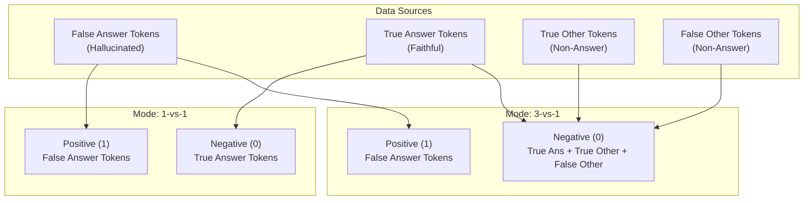

**Diagram: Training Mode Architectures**

Sources: [scripts/classifier.py:37-73](), [README.md:123-125]()

#### Mode Comparison

| Aspect | 1-vs-1 Mode | 3-vs-1 Mode |
|--------|-------------|-------------|
| **Positive Class** | False answer tokens | False answer tokens |
| **Negative Class** | True answer tokens only | True answer + True other + False other |
| **Purpose** | Maximize prediction accuracy | Isolate hallucination-specific neurons |
| **Data Loading** | [scripts/classifier.py:49-60]() | [scripts/classifier.py:63-72]() |
| **Recommendation** | Highest accuracy detection | Research/mechanistic analysis |
| **Sparsity** | Lower | Higher |

Sources: [README.md:123-125](), [scripts/classifier.py:30-73]()

### Regularization Strategies

The classifier supports two regularization penalties that produce fundamentally different models:

| Penalty | Effect | Coefficient Distribution | Use Case | Code Reference |
|---------|--------|-------------------------|----------|----------------|
| **L1** | Drives most weights to zero | Sparse (hundreds of non-zero) | Identifying specific H-Neurons for intervention | [scripts/classifier.py:108-109]() |
| **L2** | Shrinks all weights uniformly | Dense (all non-zero) | Maximum detection accuracy (+1-3%) | [scripts/classifier.py:108-109]() |

The regularization strength is controlled by the `C` parameter (inverse of regularization strength):

$$
\text{Loss} = \text{LogLoss}(y, \hat{y}) + \frac{1}{C} \cdot R(\mathbf{w})
$$

Where $R(\mathbf{w}) = \|\mathbf{w}\|_1$ for L1 or $R(\mathbf{w}) = \|\mathbf{w}\|_2^2$ for L2.

Sources: [scripts/classifier.py:108-111](), [README.md:127-135]()

---

## Token Region Extraction

### Region Types

The CETT metric can be computed over different token regions within a sequence, allowing focused analysis of specific parts of the model's response:

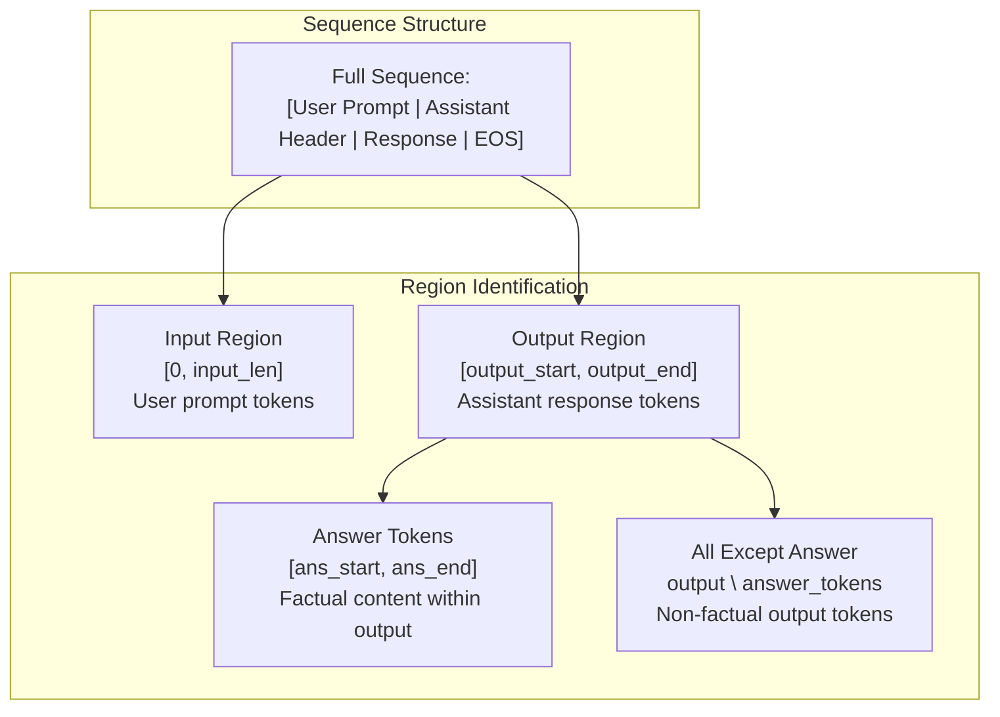

**Diagram: Token Region Segmentation**

Sources: [scripts/extract_activations.py:68-97]()

### Region Identification Logic

The `get_region_indices()` function identifies token boundaries for each region:

| Region | Start Index | End Index | Implementation |
|--------|-------------|-----------|----------------|
| `input` | 0 | `user_ids.shape[1] - 1` | [scripts/extract_activations.py:75-76]() |
| `output` | `input_len + 1` | `len(full_tokens) - 1` | [scripts/extract_activations.py:80-81]() |
| `answer_tokens` | Found via pattern matching | `ans_start + len(answer_tokens)` | [scripts/extract_activations.py:87-91]() |
| `all_except_answer_tokens` | Concatenate segments | Before and after answer region | [scripts/extract_activations.py:135-141]() |

Sources: [scripts/extract_activations.py:68-97]()

### Aggregation Methods

After extracting CETT values for tokens in a region, the values are aggregated to produce a single vector per layer:

```python
# From extract_activations.py
if args.method == "mean": 
    final_act = selected_cett.mean(dim=1)  # Average over tokens
else: 
    final_act, _ = selected_cett.max(dim=1)  # Max over tokens
```

| Method | Operation | Output Shape | Use Case |
|--------|-----------|--------------|----------|
| `mean` | `torch.mean(dim=1)` | `[layers, neurons]` | Smooth, representative activation |
| `max` | `torch.max(dim=1)` | `[layers, neurons]` | Peak activation detection |

Sources: [scripts/extract_activations.py:149-150]()

---

## Code Entity Mapping

This diagram maps the core concepts to their implementing code entities:

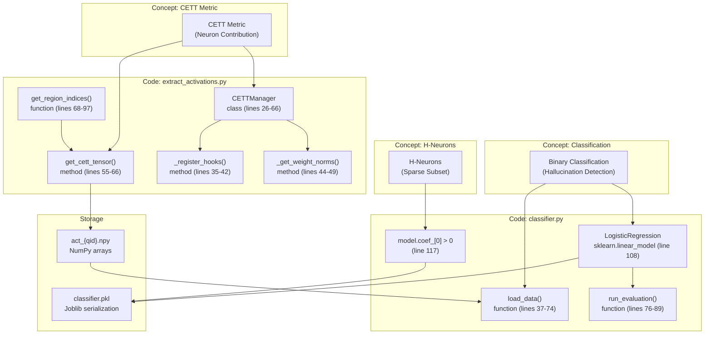

**Diagram: Core Concepts to Code Entity Mapping**

Sources: [scripts/extract_activations.py:26-97](), [scripts/classifier.py:37-117]()

---

## Evaluation Metrics

The classifier's performance is assessed using five standard binary classification metrics:

| Metric | Formula | Implementation | Code Location |
|--------|---------|----------------|---------------|
| **Accuracy** | $\frac{TP + TN}{TP + TN + FP + FN}$ | `accuracy_score(y, preds)` | [scripts/classifier.py:80]() |
| **Precision** | $\frac{TP}{TP + FP}$ | `precision_recall_fscore_support(...)[0]` | [scripts/classifier.py:81]() |
| **Recall** | $\frac{TP}{TP + FN}$ | `precision_recall_fscore_support(...)[1]` | [scripts/classifier.py:81]() |
| **F1 Score** | $\frac{2 \cdot \text{Precision} \cdot \text{Recall}}{\text{Precision} + \text{Recall}}$ | `precision_recall_fscore_support(...)[2]` | [scripts/classifier.py:81]() |
| **AUROC** | Area under ROC curve | `roc_auc_score(y, probs)` | [scripts/classifier.py:82]() |

Where:
- TP = True Positives (correctly identified hallucinations)
- TN = True Negatives (correctly identified faithful responses)
- FP = False Positives (faithful responses misclassified as hallucinations)
- FN = False Negatives (hallucinations misclassified as faithful)

Sources: [scripts/classifier.py:76-89]()

---

## Summary

The H-Neurons framework combines three core technical components:

1. **CETT Metric**: Quantifies neuron contributions through forward hooks on `down_proj` layers, incorporating weight norms and output normalization
2. **Binary Classification**: Trains a Logistic Regression model with L1/L2 regularization to distinguish hallucinated from faithful responses
3. **Sparse Neuron Identification**: Extracts neurons with positive coefficients as H-Neurons, creating an interpretable and causal model of hallucination

This foundation enables both detection (high-accuracy classification) and intervention (targeted neuron manipulation) capabilities. For implementation details, proceed to [Pipeline Guide](#4).

Sources: [README.md:1-162](), [scripts/extract_activations.py:1-156](), [scripts/classifier.py:1-132]()

---

# Page: Pipeline Guide

# Pipeline Guide

<details>
<summary>Relevant source files</summary>

The following files were used as context for generating this wiki page:

- [README.md](README.md)

</details>


This document provides an overview of the complete H-Neuron identification and intervention pipeline. It describes the six-step workflow for extracting, identifying, and intervening on hallucination-associated neurons in large language models.

For detailed configuration options and parameters used throughout the pipeline, see [Configuration & Options](#6). For theoretical background on H-Neurons and the CETT metric, see [Core Concepts](#3). For step-by-step installation and initial setup, see [Getting Started](#2).

## Overview

The H-Neurons pipeline transforms raw question-answer data into a set of identified neurons that can predict and causally influence hallucination behavior in LLMs. The process consists of six sequential stages, each building upon artifacts produced by the previous stage.

**Pipeline Stages:**

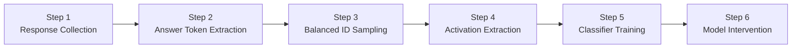

**Sources:** [README.md:22-29]()

## Complete Pipeline Architecture

The following diagram maps each pipeline stage to its corresponding script, input data, and output artifacts:

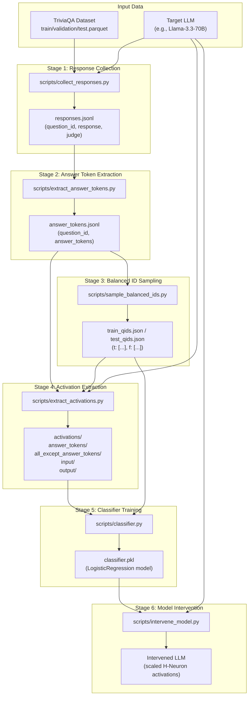

**Sources:** [README.md:22-146]()

## Pipeline Stages

### Stage 1: Response Collection

**Script:** `scripts/collect_responses.py`

**Purpose:** Generate LLM responses to TriviaQA questions and judge their correctness.

**Key Parameters:**
- `--sample_num`: Number of samples per question (10 for training, 1 for evaluation)
- `--judge_type`: Method for judging correctness (`rule` or `llm`)
- `--max_samples`: Maximum number of questions to process

**Output Format:** JSONL file where each line contains:
```json
{
  "question_id": "string",
  "question": "string",
  "response": "string",
  "judge": "t" or "f"
}
```

For training data, only questions with **consistent** judgments across all samples are retained. For evaluation data, single-sample responses are collected.

**Details:** See [Step 1: Response Collection](#4.1)

**Sources:** [README.md:44-63]()

### Stage 2: Answer Token Extraction

**Script:** `scripts/extract_answer_tokens.py`

**Purpose:** Identify the exact token positions in the response that correspond to factual answer content using LLM-based tagging.

**Key Parameters:**
- `--tokenizer_path`: Path to model tokenizer
- `--api_key`: OpenAI API key for GPT-4o judge
- `--judge_model`: LLM judge model (e.g., `gpt-4o`)

**Output Format:** JSONL file extending the response data:
```json
{
  "question_id": "string",
  "answer_tokens": [int, int, ...]
}
```

**Optional:** This step can be skipped by creating an `answer_tokens.jsonl` with empty lists and using `--locations output` in Stage 4.

**Details:** See [Step 2: Answer Token Extraction](#4.2)

**Sources:** [README.md:66-80]()

### Stage 3: Balanced ID Sampling

**Script:** `scripts/sample_balanced_ids.py`

**Purpose:** Create balanced training/test sets with equal numbers of faithful (t) and hallucinated (f) samples.

**Key Parameters:**
- `--num_samples`: Total number of samples (split equally between t and f)

**Output Format:** JSON file with two lists:
```json
{
  "t": ["qid1", "qid2", ...],
  "f": ["qid3", "qid4", ...]
}
```

**Details:** See [Step 3: Balanced ID Sampling](#4.3)

**Sources:** [README.md:82-91]()

### Stage 4: Activation Extraction

**Script:** `scripts/extract_activations.py`

**Purpose:** Extract neuron-level contribution scores (CETT) from the target LLM using forward hooks.

**Key Parameters:**
- `--locations`: Token regions to extract (`answer_tokens`, `all_except_answer_tokens`, `input`, `output`)
- `--method`: Aggregation method (`mean` or `max`)
- `--use_mag --use_abs`: Apply magnitude and absolute value normalization

**Output Structure:** Directory hierarchy:
```
activations/
├── answer_tokens/
│   ├── qid1.npy
│   └── qid2.npy
├── all_except_answer_tokens/
│   ├── qid1.npy
│   └── qid2.npy
├── input/
└── output/
```

Each `.npy` file contains shape `[num_layers, num_neurons]` activation values.

**Details:** See [Step 4: Activation Extraction](#4.4)

**Sources:** [README.md:93-106]()

### Stage 5: Classifier Training

**Script:** `scripts/classifier.py`

**Purpose:** Train a Logistic Regression classifier to identify H-Neurons and predict hallucinations.

**Key Parameters:**
- `--train_mode`: Training strategy (`1-vs-1` or `3-vs-1`)
- `--penalty`: Regularization type (`l1` for sparsity, `l2` for accuracy)
- `--C`: Regularization strength (controls sparsity in L1)

**Training Modes:**

| Mode | Positive Class | Negative Class | Use Case |
|------|---------------|----------------|----------|
| `1-vs-1` | False answer tokens | True answer tokens | Maximum prediction accuracy |
| `3-vs-1` | False answer tokens | True answer tokens + all other tokens | Isolate hallucination-specific neurons |

**Regularization:**

| Penalty | Effect | Best For |
|---------|--------|----------|
| `l1` | Sparse weights, most neurons = 0 | Identifying specific H-Neurons for intervention |
| `l2` | Dense weights, 1-3% accuracy boost | Pure hallucination detection |

**Output:** `classifier.pkl` containing trained `sklearn.linear_model.LogisticRegression` model.

**Details:** See [Step 5: Classifier Training](#4.5)

**Sources:** [README.md:108-141]()

### Stage 6: Model Intervention

**Script:** `scripts/intervene_model.py`

**Purpose:** Apply neuron-level interventions during LLM inference by scaling H-Neuron activations.

**Intervention Target:** Input to `down_proj` layer at neuron indices with positive weights in the L1 classifier.

**Implementation:** Modify forward pass to scale activations of identified H-Neurons before the `down_proj` transformation.

**Details:** See [Step 6: Model Intervention](#4.6)

**Sources:** [README.md:142-146]()

## Data Flow Between Stages

The pipeline maintains a clear data lineage, with each stage consuming specific artifacts from previous stages:

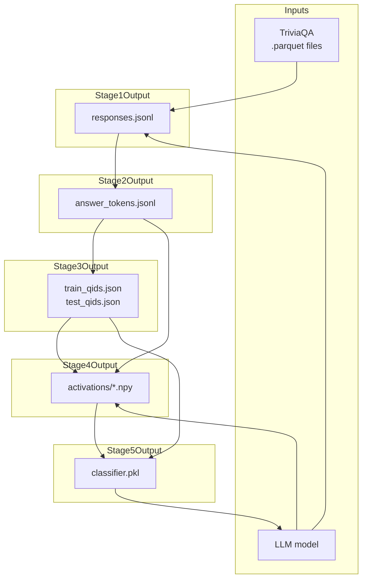

**Sources:** [README.md:22-146]()

## Execution Patterns

### Full Pipeline Execution

For complete H-Neuron identification from scratch:

1. Run all six stages in sequence
2. Separate executions for training and test data
3. Training data: `--sample_num 10`, consistency filtering enabled
4. Test data: `--sample_num 1`, no filtering

### Training vs. Evaluation Workflow

| Dataset | Sample Count | Purpose | Stages Required |
|---------|--------------|---------|-----------------|
| Training | 10 samples/question | Train classifier | 1-5 |
| Test | 1 sample/question | Evaluate classifier | 1-5 (eval mode) |
| Intervention | N/A | Apply H-Neuron scaling | 6 only |

### Partial Pipeline Execution

**Skip Answer Token Extraction (Stage 2):**
- Manually create `answer_tokens.jsonl` with empty lists
- Set `--locations output` in Stage 4
- Trade-off: Lower accuracy, faster execution

**Evaluation Only (Stage 5):**
- Use `--load_model` to load pre-trained `classifier.pkl`
- Requires test activations from Stage 4
- Skip `--train_ids` and `--save_model`

**Sources:** [README.md:44-141]()

## Multi-Model Support

The pipeline supports parallel execution across different LLM architectures. Each model maintains separate artifact directories:

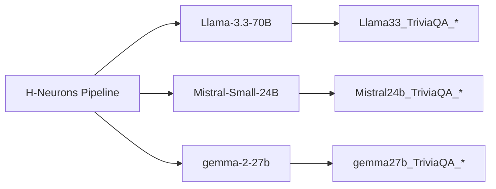

**Naming Convention:** `{model_name}_TriviaQA_{artifact_type}_{split}.{ext}`

Example artifacts provided in `data/examples/`:
- `Llama33_TriviaQA_answer_tokens_train.jsonl`
- `Mistral24b_TriviaQA_test_qids.json`
- `gemma27b_TriviaQA_answer_tokens_test.jsonl`

**Details:** See [Advanced Topics: Multi-Model Support](#7.2)

**Sources:** [README.md:50]()

## Pipeline Summary Table

| Stage | Script | Primary Input | Primary Output | GPU Required |
|-------|--------|---------------|----------------|--------------|
| 1 | `collect_responses.py` | TriviaQA `.parquet` | `responses.jsonl` | Yes (vLLM) |
| 2 | `extract_answer_tokens.py` | `responses.jsonl` | `answer_tokens.jsonl` | No (API) |
| 3 | `sample_balanced_ids.py` | `answer_tokens.jsonl` | `*_qids.json` | No |
| 4 | `extract_activations.py` | `answer_tokens.jsonl`, `*_qids.json` | `activations/*.npy` | Yes (transformers) |
| 5 | `classifier.py` | `activations/*.npy`, `*_qids.json` | `classifier.pkl` | No (sklearn) |
| 6 | `intervene_model.py` | `classifier.pkl` | Modified LLM | Yes (inference) |

**Sources:** [README.md:22-146]()

---

# Page: Step 1: Response Collection

# Step 1: Response Collection

<details>
<summary>Relevant source files</summary>

The following files were used as context for generating this wiki page:

- [README.md](README.md)
- [scripts/collect_responses.py](scripts/collect_responses.py)

</details>


## Purpose and Scope

This page describes the first step of the H-Neurons pipeline: collecting LLM responses from the TriviaQA dataset and judging their correctness. This step generates the raw data needed for subsequent answer token extraction and classifier training.

For information about the complete pipeline structure, see [Pipeline Guide](#4). For details on the TriviaQA dataset structure, see [TriviaQA Source Dataset](#5.1). For information about the output format used in subsequent steps, see [Intermediate Data Formats](#5.2).

**Sources:** [README.md:22-30](), [README.md:44-63]()

## Overview

The response collection step implements a consistency-based sampling strategy to identify questions that the target LLM answers either consistently correctly (faithful) or consistently incorrectly (hallucinated). This consistency filtering is essential for creating a clean training signal for the H-Neuron classifier.

The process is implemented in `scripts/collect_responses.py` and uses the `ConsistencySampler` class to orchestrate sampling from a vLLM-hosted model and judging responses for correctness.

**Sources:** [scripts/collect_responses.py:62-201]()

## Data Flow Architecture

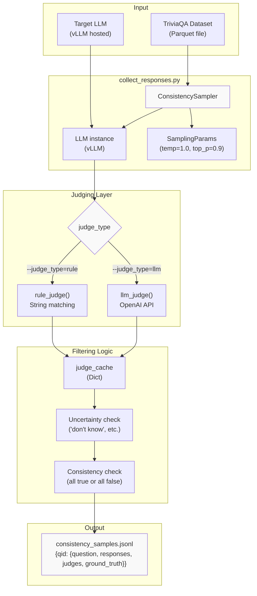

**Diagram: Response Collection Data Flow**

**Sources:** [scripts/collect_responses.py:62-201]()

## Sampling Strategy

The sampling strategy differs between training and evaluation sets to balance data quality with evaluation realism:

| Purpose | Sample Count | Filtering Criterion | Rationale |
|---------|--------------|---------------------|-----------|
| Training | 10 samples per question | Keep only all-correct or all-incorrect | Ensures clean, consistent signal for classifier training |
| Evaluation | 1 sample per question | No filtering | Simulates real-world inference scenario |

For training data, the system performs multiple samplings (default 10) per question using temperature-based sampling (`temperature=1.0, top_p=0.9, top_k=50`). Only questions that are **consistently correct** across all 10 samples or **consistently incorrect** across all 10 samples are retained. This creates a high-confidence training set.

**Sources:** [README.md:46-48](), [scripts/collect_responses.py:76-78](), [scripts/collect_responses.py:156-180]()

## Judging Methods

The system supports two judging strategies controlled by the `--judge_type` parameter:

### Rule-Based Judge

The `rule_judge()` method implements string matching after text normalization:

```mermaid
flowchart LR
    RESP["Response text"]
    NORM1["normalize_answer()<br/>- Remove articles (a, an, the)<br/>- Handle punctuation<br/>- Lowercase<br/>- Fix whitespace"]
    GT["Ground truth aliases"]
    NORM2["normalize_answer()<br/>(same process)"]
    MATCH{"Substring<br/>match?"}
    TRUE["Return 'true'"]
    FALSE["Return 'false'"]
    
    RESP --> NORM1
    GT --> NORM2
    NORM1 --> MATCH
    NORM2 --> MATCH
    MATCH -->|"Yes"| TRUE
    MATCH -->|"No"| FALSE
    
    style MATCH fill:#f9f9f9
```

**Diagram: Rule-Based Judging Process**

The normalization function performs the following transformations:
1. Convert to lowercase
2. Replace underscores with spaces
3. Remove punctuation (including quotes and special characters)
4. Remove articles (a, an, the)
5. Normalize whitespace

**Sources:** [scripts/collect_responses.py:37-45](), [scripts/collect_responses.py:87-93]()

### LLM-Based Judge

The `llm_judge()` method uses an external LLM (typically GPT-4o) to evaluate correctness with retry logic and response caching:

```mermaid
flowchart TB
    INPUT["Question + Response + Ground Truth"]
    CACHE{"In judge_cache?"}
    CACHED["Return cached result"]
    PROMPT["Construct prompt:<br/>'Please judge whether the response is correct...'"]
    API["OpenAI API call<br/>(temperature=0.0)"]
    RETRY{"Attempt < 5?"}
    PARSE["Parse response<br/>(contains 't' or 'f')"]
    STORE["Store in judge_cache"]
    RETURN["Return 'true'/'false'/'error'"]
    
    INPUT --> CACHE
    CACHE -->|"Yes"| CACHED
    CACHE -->|"No"| PROMPT
    PROMPT --> API
    API --> PARSE
    PARSE --> STORE
    STORE --> RETURN
    API -->|"Exception"| RETRY
    RETRY -->|"Yes"| API
    RETRY -->|"No"| RETURN
    
    style CACHE fill:#f9f9f9
    style API fill:#f9f9f9
```

**Diagram: LLM-Based Judging Process**

The LLM judge includes several optimizations:
- **Response caching**: If the model generates identical responses across multiple samples, the judgment is cached to avoid redundant API calls
- **Retry logic**: Up to 5 retry attempts with exponential backoff for API failures
- **Zero-temperature inference**: Ensures deterministic judgment decisions

**Sources:** [scripts/collect_responses.py:95-119](), [scripts/collect_responses.py:154-175]()

## Implementation Architecture

```mermaid
classDiagram
    class ConsistencySampler {
        +args: Namespace
        +tp_size: int
        +sampling_llm: LLM
        +sampling_params: SamplingParams
        +judge_client: OpenAI
        +__init__(args)
        +rule_judge(response, norm_gts) str
        +llm_judge(question, response, answer_list) str
        +process_data()
    }
    
    class LLM {
        +model: str
        +tensor_parallel_size: int
        +gpu_memory_utilization: float
        +chat(messages, sampling_params) outputs
    }
    
    class SamplingParams {
        +temperature: float
        +top_p: float
        +top_k: int
        +max_tokens: int
    }
    
    class OpenAI {
        +api_key: str
        +base_url: str
        +chat.completions.create() completion
    }
    
    ConsistencySampler --> LLM : uses
    ConsistencySampler --> SamplingParams : uses
    ConsistencySampler --> OpenAI : uses (optional)
```

**Diagram: ConsistencySampler Class Architecture**

**Sources:** [scripts/collect_responses.py:62-86]()

### Key Components

| Component | Type | Purpose |
|-----------|------|---------|
| `ConsistencySampler` | Class | Main orchestrator for sampling and judging |
| `sampling_llm` | `vllm.LLM` | vLLM instance for efficient batch inference |
| `sampling_params` | `vllm.SamplingParams` | Temperature and sampling configuration |
| `judge_client` | `openai.OpenAI` | Optional API client for LLM-based judging |
| `judge_cache` | `Dict[str, str]` | Cache for LLM judgments to reduce API calls |

**Sources:** [scripts/collect_responses.py:62-86]()

## Filtering Pipeline

The system applies multiple filters before recording a question:

```mermaid
flowchart TD
    START["Question from dataset"]
    CHECK1{"Has question<br/>and answer?"}
    SKIP1["Skip question"]
    CHECK2{"Ground truth<br/>aliases exist?"}
    SKIP2["Skip question"]
    SAMPLE["Sample 10 responses<br/>(or sample_num)"]
    CHECK3{"Contains<br/>uncertain terms?"}
    MARK_UNC["Mark as 'uncertain'"]
    JUDGE["Apply judge<br/>(rule or LLM)"]
    CHECK4{"All samples<br/>judged?"}
    SKIP3["Skip question"]
    CHECK5{"All 'true' or<br/>all 'false'?"}
    SAVE["Save to JSONL"]
    SKIP4["Skip question<br/>(inconsistent)"]
    
    START --> CHECK1
    CHECK1 -->|"No"| SKIP1
    CHECK1 -->|"Yes"| CHECK2
    CHECK2 -->|"No"| SKIP2
    CHECK2 -->|"Yes"| SAMPLE
    SAMPLE --> CHECK3
    CHECK3 -->|"Yes"| MARK_UNC
    CHECK3 -->|"No"| JUDGE
    MARK_UNC --> CHECK4
    JUDGE --> CHECK4
    CHECK4 -->|"No"| SKIP3
    CHECK4 -->|"Yes"| CHECK5
    CHECK5 -->|"Yes"| SAVE
    CHECK5 -->|"No"| SKIP4
    
    style CHECK5 fill:#f9f9f9
    style SAVE fill:#f9f9f9
```

**Diagram: Question Filtering Logic**

The uncertainty check looks for phrases like "don't know", "cannot", "not provided", "no information" as a pre-filter before applying the main judge. This prevents wasted API calls on clearly uncertain responses.

**Sources:** [scripts/collect_responses.py:121-200](), [scripts/collect_responses.py:163-166]()

## Configuration Options

### Command-Line Arguments

| Argument | Type | Default | Description |
|----------|------|---------|-------------|
| `--model_path` | str | Required | Path to the target LLM for sampling |
| `--data_path` | str | Required | Path to TriviaQA parquet file |
| `--output_path` | str | `data/consistency_samples.jsonl` | Output path for collected responses |
| `--sample_num` | int | 10 | Number of samples per question |
| `--max_samples` | int | None | Maximum number of questions to process |
| `--gpu_util` | float | 0.7 | vLLM GPU memory utilization |
| `--tp_size` | int | Auto-detect | Tensor parallel size for vLLM |
| `--judge_type` | str | `rule` | Judge type: `rule` or `llm` |
| `--api_key` | str | None | API key for LLM judge (required if `judge_type=llm`) |
| `--base_url` | str | `https://api.openai.com/v1` | API base URL for LLM judge |
| `--judge_model` | str | `gpt-4o` | Model name for LLM judge |

**Sources:** [scripts/collect_responses.py:15-31]()

### vLLM Configuration

The system initializes vLLM with the following parameters:

```
LLM(
    model=args.model_path,
    tensor_parallel_size=tp_size,
    gpu_memory_utilization=0.7,
    trust_remote_code=True
)
```

And uses these sampling parameters:

```
SamplingParams(
    temperature=1.0,
    top_p=0.9,
    top_k=50,
    max_tokens=50
)
```

**Sources:** [scripts/collect_responses.py:69-78]()

## Output Format

The script outputs to a JSONL file where each line is a JSON object with a single key-value pair. The key is the question ID, and the value contains:

| Field | Type | Description |
|-------|------|-------------|
| `question` | str | The question text with suffix appended |
| `responses` | List[str] | List of sampled responses (length = `sample_num`) |
| `judges` | List[str] | Corresponding judgments: `"true"`, `"false"`, `"uncertain"`, or `"error"` |
| `ground_truth` | List[str] | All valid answer aliases from TriviaQA |

Example structure:
```json
{
  "q_123": {
    "question": "What is the capital of France? Respond with the answer only, without any explanation.",
    "responses": ["Paris", "Paris", "Paris, France", ...],
    "judges": ["true", "true", "true", ...],
    "ground_truth": ["Paris", "paris"]
  }
}
```

**Sources:** [scripts/collect_responses.py:189-197]()

## Usage Examples

### Training Data Collection (Rule-Based)

```bash
python scripts/collect_responses.py \
    --model_path /path/to/llama-3.3-70b-instruct \
    --data_path data/TriviaQA/rc.nocontext/triviaqa_train.parquet \
    --output_path data/train_samples.jsonl \
    --sample_num 10 \
    --max_samples 10000 \
    --judge_type rule \
    --gpu_util 0.7
```

This configuration:
- Samples 10 responses per question
- Uses rule-based string matching for judging
- Processes up to 10,000 questions
- Uses 70% GPU memory for vLLM

**Sources:** [README.md:52-63]()

### Training Data Collection (LLM-Based)

```bash
python scripts/collect_responses.py \
    --model_path /path/to/llama-3.3-70b-instruct \
    --data_path data/TriviaQA/rc.nocontext/triviaqa_train.parquet \
    --output_path data/train_samples.jsonl \
    --sample_num 10 \
    --max_samples 10000 \
    --judge_type llm \
    --api_key "sk-..." \
    --base_url "https://api.openai.com/v1" \
    --judge_model gpt-4o
```

This configuration uses GPT-4o for more accurate but slower judging. The LLM judge is recommended for higher quality judgments, especially when answer variations are complex.

**Sources:** [README.md:52-63]()

### Evaluation Data Collection

```bash
python scripts/collect_responses.py \
    --model_path /path/to/llama-3.3-70b-instruct \
    --data_path data/TriviaQA/rc.nocontext/triviaqa_test.parquet \
    --output_path data/test_samples.jsonl \
    --sample_num 1 \
    --judge_type llm \
    --api_key "sk-..." \
    --judge_model gpt-4o
```

Note that `--sample_num 1` is used for evaluation sets to simulate real-world single-inference scenarios.

**Sources:** [README.md:46-48]()

## Resumability and Progress Tracking

The script supports resumable execution through the `load_existing_qids()` function, which reads already-processed question IDs from the output file:

```mermaid
flowchart LR
    START["Script starts"]
    LOAD["load_existing_qids()"]
    CHECK{"qid in<br/>processed_qids?"}
    SKIP["Skip processing"]
    PROCESS["Process question"]
    
    START --> LOAD
    LOAD --> CHECK
    CHECK -->|"Yes"| SKIP
    CHECK -->|"No"| PROCESS
    
    style LOAD fill:#f9f9f9
```

**Diagram: Resumable Processing Logic**

This allows the script to be safely interrupted and restarted without losing progress or reprocessing questions.

**Sources:** [scripts/collect_responses.py:47-56](), [scripts/collect_responses.py:125-133]()

## Performance Considerations

### Rule Judge vs LLM Judge Trade-offs

| Aspect | Rule Judge | LLM Judge |
|--------|------------|-----------|
| Speed | Fast (local string matching) | Slow (API calls) |
| Cost | Free | API costs (varies by provider) |
| Accuracy | Lower (exact/substring match only) | Higher (semantic understanding) |
| Best for | Simple factual answers | Complex/paraphrased answers |

### Judge Caching Optimization

The system implements a per-question cache (`judge_cache`) that stores LLM judgments for identical responses. If a model generates the same answer multiple times across the 10 samples (common with lower temperature or deterministic behaviors), the judgment is computed only once.

This optimization can reduce API costs by up to 90% when models exhibit consistent behavior for certain questions.

**Sources:** [scripts/collect_responses.py:154-175]()

### Tensor Parallelism

The script auto-detects available GPUs and sets `tensor_parallel_size` accordingly. For large models (70B+), ensure you have sufficient GPU memory. The `--gpu_util` parameter controls memory allocation to prevent OOM errors.

**Sources:** [scripts/collect_responses.py:67-74]()

---

# Page: Step 2: Answer Token Extraction

# Step 2: Answer Token Extraction

<details>
<summary>Relevant source files</summary>

The following files were used as context for generating this wiki page:

- [README.md](README.md)
- [scripts/extract_answer_tokens.py](scripts/extract_answer_tokens.py)

</details>


This document describes the second step of the H-Neurons pipeline: extracting answer tokens from LLM responses using LLM-based token tagging. This step identifies the precise tokens within a response that contain the factual answer content, enabling the downstream classifier to focus specifically on hallucination-associated activations at these tokens rather than the entire response.

For information about the response collection that precedes this step, see [Step 1: Response Collection](#4.1). For details on the data formats used, see [Intermediate Data Formats](#5.2).

**Sources:** [README.md:66-80](), [scripts/extract_answer_tokens.py:1-141]()

## Purpose and Scope

The answer token extraction step serves two primary purposes:

1. **Precision Targeting**: Isolates the specific tokens that represent factual claims, removing conversational preambles, explanations, and other non-answer content
2. **Improved Accuracy**: Enables the classifier to train on activations from tokens directly associated with hallucinations, improving detection performance by 1-3% compared to using all output tokens

This step is optional but recommended. If you want to avoid the computational overhead and API costs, you can skip this step by creating a minimal `answer_tokens.jsonl` file with empty answer token lists and using `--locations output` in Step 4.

**Sources:** [README.md:66-70](), [scripts/extract_answer_tokens.py:1-23]()

## Process Overview

The extraction process follows this workflow:

```mermaid
flowchart TB
    INPUT["responses.jsonl<br/>(from Step 1)"]
    LOAD["Load processed IDs<br/>load_processed_ids()"]
    FILTER["Filter consistent samples<br/>Check judges field"]
    SELECT["Select representative response<br/>Most frequent text"]
    TOK["Tokenize response<br/>get_tokenized_list()"]
    LLM["Extract via LLM<br/>extract_via_llm()"]
    VALIDATE["Validate extracted tokens<br/>Must exist in original"]
    WRITE["Write to output<br/>answer_tokens.jsonl"]
    
    INPUT --> LOAD
    LOAD --> FILTER
    FILTER --> SELECT
    SELECT --> TOK
    TOK --> LLM
    LLM --> VALIDATE
    VALIDATE --> WRITE
    
    FILTER -->|"Skip if judges != 1 value"| FILTER
    VALIDATE -->|"Retry up to 3 times"| LLM
```

**Sources:** [scripts/extract_answer_tokens.py:97-136]()

## Architecture

The system is implemented in the `AnswerTokenExtractor` class, which coordinates three main components:

```mermaid
graph TB
    subgraph "AnswerTokenExtractor Class"
        INIT["__init__()<br/>Initialize components"]
        GET_TOK["get_tokenized_list()<br/>Tokenization"]
        EXTRACT["extract_via_llm()<br/>LLM-based extraction"]
        LOAD_IDS["load_processed_ids()<br/>Resume support"]
        RUN["run()<br/>Main processing loop"]
    end
    
    subgraph "External Dependencies"
        TOKENIZER["AutoTokenizer<br/>from transformers"]
        OPENAI_CLIENT["OpenAI Client<br/>from openai"]
        TQDM["tqdm<br/>Progress tracking"]
    end
    
    subgraph "Prompt Components"
        USER_TEMPLATE["USER_INPUT_TEMPLATE<br/>Question + Response + Tokens"]
        EXAMPLES["EXAMPLE_MESSAGES<br/>Few-shot examples"]
    end
    
    INIT --> TOKENIZER
    INIT --> OPENAI_CLIENT
    GET_TOK --> TOKENIZER
    EXTRACT --> OPENAI_CLIENT
    EXTRACT --> USER_TEMPLATE
    EXTRACT --> EXAMPLES
    RUN --> TQDM
    RUN --> GET_TOK
    RUN --> EXTRACT
    RUN --> LOAD_IDS
```

**Sources:** [scripts/extract_answer_tokens.py:49-141]()

## Data Flow and Transformations

The following diagram shows how data transforms through the extraction pipeline:

```mermaid
flowchart LR
    subgraph "Input: responses.jsonl"
        IN_ENTRY["{<br/>  'qid': {<br/>    'question': str,<br/>    'responses': list,<br/>    'judges': list<br/>  }<br/>}"]
    end
    
    subgraph "Processing Steps"
        CONSISTENCY["Consistency Check<br/>len(set(judges)) == 1"]
        MAJORITY["Select Response<br/>max(responses, key=count)"]
        TOKENIZE["Tokenize<br/>tokenizer.encode()"]
        EXTRACT_LLM["LLM Extraction<br/>OpenAI API call"]
    end
    
    subgraph "Output: answer_tokens.jsonl"
        OUT_ENTRY["{<br/>  'qid': {<br/>    'question': str,<br/>    'response': str,<br/>    'tokenized_response': list,<br/>    'answer_tokens': list,<br/>    'judge': bool<br/>  }<br/>}"]
    end
    
    IN_ENTRY --> CONSISTENCY
    CONSISTENCY --> MAJORITY
    MAJORITY --> TOKENIZE
    TOKENIZE --> EXTRACT_LLM
    EXTRACT_LLM --> OUT_ENTRY
```

**Sources:** [scripts/extract_answer_tokens.py:104-136]()

## Consistency Filtering

Before processing, the system filters for samples that meet strict consistency requirements:

| Requirement | Implementation | Purpose |
|------------|----------------|---------|
| **Uniform Judges** | `len(set(judges)) != 1` | All 10 samples must have same correctness judgment |
| **No Uncertainty** | `"uncertain" not in judges` | Excludes ambiguous cases |
| **No Errors** | `"error" not in judges` | Excludes failed judgments |

This filtering ensures only consistently correct or consistently hallucinated samples proceed to token extraction.

**Sources:** [scripts/extract_answer_tokens.py:110-113]()

## Representative Response Selection

When multiple responses exist for a question (from Step 1's multiple sampling), the system selects the most frequent response:

```python
# From extract_answer_tokens.py:117
rep_response = max(set(responses), key=responses.count)
```

This approach assumes that the most common response across the 10 samples is the most representative of the model's behavior for that question.

**Sources:** [scripts/extract_answer_tokens.py:115-120]()

## Tokenization Process

The `get_tokenized_list()` method converts text into a list of human-readable token strings:

```mermaid
flowchart LR
    TEXT["Input Text<br/>'The Spirit of Ecstasy'"]
    ENCODE["tokenizer.encode()<br/>Returns token IDs"]
    DECODE["tokenizer.decode([tid])<br/>For each ID"]
    TOKENS["Token List<br/>['▁The', '▁Spirit', '▁of', '▁Ec', 'st', 'asy']"]
    
    TEXT --> ENCODE
    ENCODE --> DECODE
    DECODE --> TOKENS
```

The tokenizer must match the target model being analyzed (specified via `--tokenizer_path`), ensuring token boundaries align with the model's internal representations.

**Sources:** [scripts/extract_answer_tokens.py:55-59]()

## LLM-Based Extraction Strategy

The extraction uses a few-shot prompting approach with GPT-4o (or compatible models):

### Prompt Template

The `USER_INPUT_TEMPLATE` provides structured input to the LLM:

```
Question: {question}
Response: {response}
Tokenized Response: {response_tokens}
Please help extract the "answer tokens" from all tokens, removing all redundant information, 
and the tokens you return must be part of the input Tokenized Response list.
```

**Sources:** [scripts/extract_answer_tokens.py:29-32]()

### Few-Shot Example

The system includes one example conversation demonstrating the expected behavior:

| Component | Content |
|-----------|---------|
| **Example Question** | "What is the correct name for the 'Flying Lady' ornament on a Rolls Royce radiator" |
| **Example Response** | "The correct name for the 'Flying Lady' ornament on a Rolls Royce radiator is the Spirit of Ecstasy." |
| **Example Tokens** | `['▁The', '▁correct', '▁name', ..., '▁Ec', 'st', 'asy', '.']` |
| **Expected Output** | `['▁the', '▁Spirit', '▁of', '▁Ec', 'st', 'asy']` |

This example teaches the LLM to:
1. Extract only the factual answer portion
2. Preserve exact token strings from the input list
3. Return a valid JSON list

**Sources:** [scripts/extract_answer_tokens.py:34-43]()

### Extraction Implementation

The `extract_via_llm()` method implements the API call with retry logic:

```mermaid
flowchart TB
    START["Start Extraction"]
    ATTEMPT["Attempt counter<br/>(max 3 attempts)"]
    API_CALL["OpenAI API Call<br/>temperature=0.0"]
    PARSE["Parse JSON Response<br/>json.loads()"]
    VALIDATE["Validate Tokens<br/>all(t in tokens)"]
    SUCCESS["Return extracted tokens"]
    RETRY["Wait 1 second<br/>Retry"]
    FAIL["Return None"]
    
    START --> ATTEMPT
    ATTEMPT --> API_CALL
    API_CALL --> PARSE
    PARSE --> VALIDATE
    VALIDATE -->|"Valid"| SUCCESS
    VALIDATE -->|"Invalid"| RETRY
    RETRY --> ATTEMPT
    ATTEMPT -->|"Max retries"| FAIL
```

Key implementation details:
- Temperature set to 0.0 for deterministic extraction
- JSON parsing with quote normalization (`replace("'", "\"")`)
- Validation ensures all extracted tokens exist in the original token list
- Up to 3 retry attempts with 1-second delays

**Sources:** [scripts/extract_answer_tokens.py:61-85]()

## Validation Logic

The validation step ensures the LLM-extracted tokens are valid:

```python
# From extract_answer_tokens.py:80-81
if all(t in tokens for t in extracted):
    return extracted
```

This check verifies that:
1. Every extracted token is a substring match of the original tokenized list
2. The LLM did not hallucinate or modify any tokens
3. The result can be safely used to index into the original token sequence

**Sources:** [scripts/extract_answer_tokens.py:79-81]()

## Resume Capability

The system supports resuming from partial runs using `load_processed_ids()`:

```mermaid
flowchart LR
    CHECK["Check if output file exists"]
    READ["Read existing output file"]
    EXTRACT_IDS["Extract all question IDs<br/>from existing entries"]
    RETURN["Return set of processed IDs"]
    SKIP["Skip in main loop"]
    
    CHECK -->|"File exists"| READ
    CHECK -->|"File missing"| RETURN
    READ --> EXTRACT_IDS
    EXTRACT_IDS --> RETURN
    RETURN --> SKIP
```

This allows the script to be interrupted and restarted without reprocessing completed entries, saving API costs and time.

**Sources:** [scripts/extract_answer_tokens.py:87-95](), [scripts/extract_answer_tokens.py:108]()

## Output Format

Each line in the output file (`answer_tokens.jsonl`) contains a complete record:

```json
{
  "12345": {
    "question": "What is the capital of France?",
    "response": "The capital of France is Paris.",
    "tokenized_response": ["▁The", "▁capital", "▁of", "▁France", "▁is", "▁Paris", "."],
    "answer_tokens": ["▁Paris"],
    "judge": true
  }
}
```

| Field | Type | Description |
|-------|------|-------------|
| `question` | string | Original question from TriviaQA |
| `response` | string | Most frequent response text |
| `tokenized_response` | list[string] | Complete tokenized response |
| `answer_tokens` | list[string] | Extracted answer tokens (subset of tokenized_response) |
| `judge` | boolean | Correctness judgment (true=faithful, false=hallucinated) |

**Sources:** [scripts/extract_answer_tokens.py:126-135]()

## Command-Line Interface

### Required Arguments

| Argument | Description | Example |
|----------|-------------|---------|
| `--input_path` | Path to responses.jsonl from Step 1 | `data/train_samples.jsonl` |
| `--tokenizer_path` | Path to target model tokenizer | `/path/to/Llama-3.3-70B-Instruct` |
| `--api_key` | OpenAI API key | `sk-...` |

### Optional Arguments

| Argument | Default | Description |
|----------|---------|-------------|
| `--output_path` | `data/answer_tokens.jsonl` | Output file path |
| `--base_url` | `https://api.openai.com/v1` | OpenAI-compatible API endpoint |
| `--llm_model` | `gpt-4o` | LLM model for extraction |

**Sources:** [scripts/extract_answer_tokens.py:12-23](), [README.md:72-80]()

## Example Usage

### Basic Usage

```bash
python scripts/extract_answer_tokens.py \
    --input_path data/train_samples.jsonl \
    --output_path data/answer_tokens.jsonl \
    --tokenizer_path /path/to/Llama-3.3-70B-Instruct \
    --api_key "YOUR_OPENAI_API_KEY" \
    --base_url "https://api.openai.com/v1" \
    --llm_model gpt-4o
```

### Processing Multiple Datasets

```bash
# Training set
python scripts/extract_answer_tokens.py \
    --input_path data/train_samples.jsonl \
    --output_path data/Llama33_TriviaQA_answer_tokens_train.jsonl \
    --tokenizer_path /path/to/Llama-3.3-70B-Instruct \
    --api_key $OPENAI_API_KEY

# Test set
python scripts/extract_answer_tokens.py \
    --input_path data/test_samples.jsonl \
    --output_path data/Llama33_TriviaQA_answer_tokens_test.jsonl \
    --tokenizer_path /path/to/Llama-3.3-70B-Instruct \
    --api_key $OPENAI_API_KEY
```

**Sources:** [README.md:72-80]()

## Error Handling and Retry Logic

The system implements robust error handling at multiple levels:

### API Call Retries

```mermaid
stateDiagram-v2
    [*] --> Attempt1
    Attempt1 --> Success : Valid response
    Attempt1 --> Wait1 : Exception/Invalid
    Wait1 --> Attempt2 : Sleep 1s
    Attempt2 --> Success : Valid response
    Attempt2 --> Wait2 : Exception/Invalid
    Wait2 --> Attempt3 : Sleep 1s
    Attempt3 --> Success : Valid response
    Attempt3 --> Failure : Exception/Invalid
    Success --> [*]
    Failure --> [*]
```

Each failed attempt triggers:
1. Exception logging with attempt number
2. 1-second sleep to avoid rate limiting
3. Retry with same parameters (temperature=0.0 ensures determinism)

**Sources:** [scripts/extract_answer_tokens.py:69-85]()

### Graceful Degradation

| Error Type | Handling | Impact |
|------------|----------|--------|
| **API Timeout** | 3 retries with sleep | Sample skipped if all retries fail |
| **Invalid JSON** | Exception caught, retry | Sample skipped after 3 attempts |
| **Token Validation Failure** | Silent retry | Sample skipped after 3 attempts |
| **Inconsistent Judges** | Skip during filtering | Not processed at all |

**Sources:** [scripts/extract_answer_tokens.py:82-84](), [scripts/extract_answer_tokens.py:110-113]()

## Performance Considerations

### API Costs

For a typical training set:
- **10,000 samples** (after consistency filtering from ~100,000 raw samples)
- **~30 tokens per prompt** (question + response + tokenized list)
- **~10 tokens per completion** (extracted answer tokens)
- **~400,000 tokens total** for 10,000 samples
- **Cost estimate**: ~$1.50 using GPT-4o (as of 2025)

### Processing Time

- Sequential processing with API calls: ~1-2 hours for 10,000 samples
- Dominated by API latency (~200ms per request)
- Resume capability allows incremental processing

**Sources:** [scripts/extract_answer_tokens.py:103]()

## Integration with Pipeline

This step produces output consumed by subsequent steps:

```mermaid
flowchart LR
    subgraph "Step 1"
        RESP["responses.jsonl"]
    end
    
    subgraph "Step 2 (Current)"
        EXTRACT["extract_answer_tokens.py"]
        ANS_TOK["answer_tokens.jsonl"]
    end
    
    subgraph "Step 3"
        SAMPLE["sample_balanced_ids.py"]
    end
    
    subgraph "Step 4"
        ACTS["extract_activations.py"]
    end
    
    RESP --> EXTRACT
    EXTRACT --> ANS_TOK
    ANS_TOK --> SAMPLE
    ANS_TOK --> ACTS
```

The `answer_tokens.jsonl` file serves dual purposes:
1. **Step 3** reads it to identify valid question IDs for balanced sampling
2. **Step 4** reads it to determine which tokens to extract activations from

**Sources:** [README.md:22-29](), [scripts/extract_answer_tokens.py:1-141]()

## Alternative: Skipping This Step

As noted in the README, you can skip this step if you want to train on all output tokens instead of just answer tokens:

1. Create a minimal `answer_tokens.jsonl` file with `answer_tokens: []` for all entries
2. Use `--locations output` instead of `--locations answer_tokens` in Step 4
3. Accept a potential 1-3% accuracy reduction in hallucination detection

This trade-off may be worthwhile for rapid prototyping or when API costs are prohibitive.

**Sources:** [README.md:70]()

---

# Page: Step 3: Balanced ID Sampling

# Step 3: Balanced ID Sampling

<details>
<summary>Relevant source files</summary>

The following files were used as context for generating this wiki page:

- [README.md](README.md)
- [scripts/sample_balanced_ids.py](scripts/sample_balanced_ids.py)

</details>


This page describes the third step in the H-Neurons identification pipeline: creating balanced training and test datasets by sampling equal numbers of faithful and hallucinated question IDs. This step ensures that downstream classifier training is not biased toward either class.

For information about the preceding answer token extraction process, see [Step 2: Answer Token Extraction](#4.2). For information about how these balanced IDs are used in activation extraction, see [Step 4: Activation Extraction](#4.4).

## Purpose and Overview

The balanced ID sampling step addresses the class imbalance problem inherent in the collected responses. After collecting responses and extracting answer tokens, the dataset typically contains unequal numbers of faithful ("true") and hallucinated ("false") responses. Training a classifier on imbalanced data can lead to biased predictions favoring the majority class.

This step performs stratified random sampling to create balanced datasets where the number of faithful responses exactly equals the number of hallucinated responses. The script produces JSON files containing question IDs (qids) partitioned into two lists: `"t"` (true/faithful) and `"f"` (false/hallucinated).

**Key Function**: The [scripts/sample_balanced_ids.py]() script implements this balancing operation.

Sources: [README.md:82-91](), [scripts/sample_balanced_ids.py:1-59]()

## Data Flow Architecture

The following diagram illustrates how this step fits within the broader pipeline, showing the transformation from answer tokens to balanced ID sets:

```mermaid
flowchart TB
    subgraph "Input: Answer Tokens JSONL"
        INPUT["answer_tokens.jsonl<br/>(from Step 2)"]
        ENTRY1["Entry: {qid: {judge: 'true', ...}}"]
        ENTRY2["Entry: {qid: {judge: 'false', ...}}"]
    end
    
    subgraph "sample_balanced_ids.py"
        PARSE["parse_args()<br/>Read CLI arguments"]
        READ["Read JSONL<br/>Line-by-line iteration"]
        CATEGORIZE["Categorize by judge field<br/>true_ids[] & false_ids[]"]
        SAMPLE["random.sample()<br/>Equal sampling from each class"]
        OUTPUT_STRUCT["Build output dict<br/>{t: [...], f: [...]}"]
    end
    
    subgraph "Output: Balanced QID JSON"
        OUTPUT["train_qids.json or test_qids.json"]
        T_LIST["t: [qid1, qid2, ...]<br/>(faithful responses)"]
        F_LIST["f: [qid1, qid2, ...]<br/>(hallucinated responses)"]
    end
    
    INPUT --> PARSE
    ENTRY1 --> READ
    ENTRY2 --> READ
    PARSE --> READ
    READ --> CATEGORIZE
    CATEGORIZE --> SAMPLE
    SAMPLE --> OUTPUT_STRUCT
    OUTPUT_STRUCT --> OUTPUT
    OUTPUT --> T_LIST
    OUTPUT --> F_LIST
```

**Diagram: End-to-End Data Flow for Balanced ID Sampling**

This diagram maps the natural language pipeline concept to specific code functions and data structures used in the implementation.

Sources: [scripts/sample_balanced_ids.py:14-56]()

## Input Format

The script expects a JSONL (JSON Lines) file as input, where each line represents a single question's answer token extraction results. This is the output from Step 2 (Answer Token Extraction).

**Input File Structure** (`answer_tokens.jsonl`):

Each line is a JSON object with the following structure:

```json
{
  "question_id_123": {
    "judge": "true",
    "answer_tokens": [15, 16, 17],
    "question": "What is the capital of France?",
    "response": "The capital of France is Paris.",
    "tokenized_response": [1, 450, 3463, 310, 3444, 338, 3681, 29889]
  }
}
```

**Key Fields Used**:
- **Outer key**: The question ID (qid), used as the unique identifier
- **`judge`**: String indicating correctness - either `"true"` (faithful) or `"false"` (hallucinated)

The script only reads the `qid` and `judge` fields; other fields like `answer_tokens`, `question`, and `response` are preserved in the original file but not used during sampling.

Sources: [scripts/sample_balanced_ids.py:22-34]()

## Balancing Algorithm

The following flowchart details the balancing algorithm implemented in the script:

```mermaid
flowchart TD
    START["main()"]
    INIT["Initialize:<br/>true_ids = []<br/>false_ids = []<br/>random.seed(args.seed)"]
    OPEN["Open input JSONL file"]
    
    LOOP_START{"For each line<br/>in file"}
    PARSE_LINE["json.loads(line)"]
    EXTRACT["Extract qid and judge field"]
    
    CHECK_JUDGE{"judge value?"}
    APPEND_TRUE["true_ids.append(qid)"]
    APPEND_FALSE["false_ids.append(qid)"]
    SKIP["Skip (error or unknown label)"]
    
    LOOP_END["Continue to next line"]
    
    COUNT["Calculate:<br/>len(true_ids), len(false_ids)"]
    DETERMINE["actual_samples = min(<br/>num_samples,<br/>len(true_ids),<br/>len(false_ids))"]
    
    CHECK_WARN{"actual_samples <<br/>num_samples?"}
    WARN["Print warning message"]
    
    SAMPLE_T["sampled_t = random.sample(<br/>true_ids, actual_samples)"]
    SAMPLE_F["sampled_f = random.sample(<br/>false_ids, actual_samples)"]
    
    BUILD_OUTPUT["output_data = {<br/>'t': sampled_t,<br/>'f': sampled_f<br/>}"]
    
    SAVE["json.dump(output_data,<br/>output_file, indent=4)"]
    END["Print success message"]
    
    START --> INIT
    INIT --> OPEN
    OPEN --> LOOP_START
    LOOP_START -->|Yes| PARSE_LINE
    PARSE_LINE --> EXTRACT
    EXTRACT --> CHECK_JUDGE
    
    CHECK_JUDGE -->|"'true'"| APPEND_TRUE
    CHECK_JUDGE -->|"'false'"| APPEND_FALSE
    CHECK_JUDGE -->|Other| SKIP
    
    APPEND_TRUE --> LOOP_END
    APPEND_FALSE --> LOOP_END
    SKIP --> LOOP_END
    LOOP_END --> LOOP_START
    
    LOOP_START -->|No more lines| COUNT
    COUNT --> DETERMINE
    DETERMINE --> CHECK_WARN
    CHECK_WARN -->|Yes| WARN
    CHECK_WARN -->|No| SAMPLE_T
    WARN --> SAMPLE_T
    
    SAMPLE_T --> SAMPLE_F
    SAMPLE_F --> BUILD_OUTPUT
    BUILD_OUTPUT --> SAVE
    SAVE --> END
```

**Diagram: Balancing Algorithm Flowchart Mapping to Code Functions**

The algorithm ensures:
1. **Deterministic Sampling**: Uses `random.seed(args.seed)` for reproducibility [scripts/sample_balanced_ids.py:16]()
2. **Equal Class Representation**: Samples exactly `actual_samples` from each class [scripts/sample_balanced_ids.py:44-45]()
3. **Automatic Adjustment**: If requested `num_samples` exceeds available data, automatically reduces to maximum possible [scripts/sample_balanced_ids.py:39-41]()

Sources: [scripts/sample_balanced_ids.py:14-56]()

## Output Format

The script produces a JSON file containing two lists of question IDs, organized by class label.

**Output File Structure** (`train_qids.json` or `test_qids.json`):

```json
{
    "t": [
        "question_id_001",
        "question_id_042",
        "question_id_089",
        ...
    ],
    "f": [
        "question_id_013",
        "question_id_055",
        "question_id_127",
        ...
    ]
}
```

**Field Descriptions**:

| Field | Type | Description | Usage |
|-------|------|-------------|-------|
| `t` | Array of strings | Question IDs with `judge="true"` (faithful responses) | Used as negative class (label 0) in classifier training |
| `f` | Array of strings | Question IDs with `judge="false"` (hallucinated responses) | Used as positive class (label 1) in classifier training |

**Guarantees**:
- `len(output["t"]) == len(output["f"])` - Perfect class balance
- All IDs are unique within each list
- IDs reference questions that exist in the input JSONL file

Sources: [scripts/sample_balanced_ids.py:47-54]()

## Command-Line Usage

### Basic Usage

```bash
python scripts/sample_balanced_ids.py \
    --input_path data/answer_tokens.jsonl \
    --output_path data/train_qids.json \
    --num_samples 1000
```

### Complete Parameter Reference

| Parameter | Type | Required | Default | Description |
|-----------|------|----------|---------|-------------|
| `--input_path` | string | Yes | - | Path to answer tokens JSONL file from Step 2 |
| `--output_path` | string | No | `data/train_qids.json` | Path where balanced ID JSON will be saved |
| `--num_samples` | integer | No | `1000` | Number of samples per class to select |
| `--seed` | integer | No | `42` | Random seed for reproducible sampling |

### Typical Workflow Examples

**Creating Training Set**:
```bash
python scripts/sample_balanced_ids.py \
    --input_path data/Llama33_TriviaQA_answer_tokens_train.jsonl \
    --output_path data/Llama33_TriviaQA_train_qids.json \
    --num_samples 5000 \
    --seed 42
```

**Creating Test Set**:
```bash
python scripts/sample_balanced_ids.py \
    --input_path data/Llama33_TriviaQA_answer_tokens_test.jsonl \
    --output_path data/Llama33_TriviaQA_test_qids.json \
    --num_samples 500 \
    --seed 123
```

**Output Example**:
```
Reading IDs: 100%|████████████| 15432/15432 [00:02<00:00, 6234.56it/s]
Total available - True: 8234, False: 7198
Successfully saved 10000 balanced IDs to data/train_qids.json
```

Sources: [README.md:82-91](), [scripts/sample_balanced_ids.py:6-12]()

## Implementation Details

### Core Processing Logic

The script implements a two-pass algorithm:

1. **Pass 1: Categorization** [scripts/sample_balanced_ids.py:22-34]()
   - Iterates through all JSONL entries
   - Extracts `qid` (outer dictionary key) and `judge` field
   - Appends to `true_ids[]` or `false_ids[]` based on label
   - Handles parsing errors gracefully with try-except blocks

2. **Pass 2: Sampling** [scripts/sample_balanced_ids.py:39-45]()
   - Determines maximum feasible sample size
   - Uses `random.sample()` for uniform random sampling without replacement
   - Creates output dictionary structure

### Error Handling

The script includes several robustness features:

**Parsing Error Recovery** [scripts/sample_balanced_ids.py:33-34]():
```python
except Exception as e:
    print(f"Skipping line due to error: {e}")
```

**Insufficient Data Warning** [scripts/sample_balanced_ids.py:40-41]():
```python
if actual_samples < args.num_samples:
    print(f"Warning: Only {actual_samples} samples per class available. Sampling maximum possible.")
```

**Automatic Adjustment** [scripts/sample_balanced_ids.py:39]():
```python
actual_samples = min(args.num_samples, len(true_ids), len(false_ids))
```

This ensures the script never fails due to insufficient data in either class.

Sources: [scripts/sample_balanced_ids.py:22-56]()

## Data Organization and Naming Conventions

The balanced ID files follow a consistent naming pattern across different models and dataset splits:

```
data/
├── examples/
│   ├── Llama33_TriviaQA_train_qids.json
│   ├── Llama33_TriviaQA_test_qids.json
│   ├── Mistral24b_TriviaQA_train_qids.json
│   ├── Mistral24b_TriviaQA_test_qids.json
│   ├── gemma27b_TriviaQA_train_qids.json
│   └── gemma27b_TriviaQA_test_qids.json
```

**Naming Convention**: `{model}_{dataset}_{split}_qids.json`

- **`model`**: Target LLM identifier (e.g., `Llama33`, `Mistral24b`, `gemma27b`)
- **`dataset`**: Source dataset name (e.g., `TriviaQA`)
- **`split`**: Data split type (`train` or `test`)
- **`qids`**: Indicates this file contains question IDs

Sources: [README.md:50]()

## Practical Considerations

### Choosing Sample Size

The `--num_samples` parameter controls the number of samples per class (faithful and hallucinated). Total samples = `2 × num_samples`.

**Recommended Values**:

| Use Case | Recommended `num_samples` | Rationale |
|----------|---------------------------|-----------|
| Training Set | 5,000 - 10,000 | Sufficient for stable classifier training; more samples reduce variance |
| Validation Set | 500 - 1,000 | Enough for reliable hyperparameter tuning |
| Test Set | 500 - 1,000 | Provides statistically significant evaluation metrics |

From the example data provided in the repository:
- Training sets typically use ~5,000 samples per class (10,000 total)
- Test sets typically use ~500 samples per class (1,000 total)

### Reproducibility

The `--seed` parameter ensures reproducible sampling [scripts/sample_balanced_ids.py:16]():

- **Same seed + same input** = identical output IDs
- **Different seeds** = different random samples (useful for cross-validation)
- **Default seed (42)** = standard for primary experiments

**Best Practice**: Document the seed used for each experiment to enable exact reproduction of results.

### Class Imbalance in Source Data

The script automatically handles source data imbalance by taking the minimum available count:

**Example Scenario**:
```
Input: 8,234 faithful + 7,198 hallucinated
Request: num_samples=10,000
Result: 7,198 samples per class (14,396 total)
Warning: "Only 7198 samples per class available. Sampling maximum possible."
```

This ensures balanced output even when input is imbalanced, though it may reduce the total dataset size.

Sources: [scripts/sample_balanced_ids.py:36-41](), [README.md:82-91]()

## Integration with Pipeline

### Upstream Dependencies

This step requires:
1. Completed response collection (Step 1)
2. Completed answer token extraction (Step 2)
3. Input file in JSONL format with `judge` field

### Downstream Usage

The output JSON files are consumed by:
1. **Step 4: Activation Extraction** - The `--train_ids_path` parameter in [scripts/extract_activations.py]() loads these IDs to determine which questions to process
2. **Step 5: Classifier Training** - The `--train_ids` parameter in [scripts/classifier.py]() uses these IDs to load the correct activations for training

**Example Pipeline Flow**:
```bash
# Step 2: Extract answer tokens (produces JSONL)
python scripts/extract_answer_tokens.py \
    --input_path data/responses.jsonl \
    --output_path data/answer_tokens.jsonl

# Step 3: Sample balanced IDs (produces JSON)
python scripts/sample_balanced_ids.py \
    --input_path data/answer_tokens.jsonl \
    --output_path data/train_qids.json \
    --num_samples 5000

# Step 4: Extract activations (consumes JSON)
python scripts/extract_activations.py \
    --input_path data/answer_tokens.jsonl \
    --train_ids_path data/train_qids.json \
    --output_root data/activations
```

Sources: [README.md:82-106]()

## File Format Specification

### Input JSONL Schema

Each line must be a valid JSON object:

```
{qid: {"judge": "true"|"false", ...}}
```

**Required fields**:
- Outer key: question ID (string)
- `judge`: correctness label (string: `"true"` or `"false"`)

**Optional fields**: All other fields are ignored during sampling but preserved in the original file.

### Output JSON Schema

```json
{
    "t": ["string", "string", ...],
    "f": ["string", "string", ...]
}
```

**Constraints**:
- `t` and `f` must be arrays of strings
- `len(t) == len(f)` (enforced by algorithm)
- All strings are valid question IDs from input file
- No duplicates within each array

Sources: [scripts/sample_balanced_ids.py:47-54]()

---

# Page: Step 4: Activation Extraction

# Step 4: Activation Extraction

<details>
<summary>Relevant source files</summary>

The following files were used as context for generating this wiki page:

- [README.md](README.md)
- [scripts/extract_activations.py](scripts/extract_activations.py)

</details>


This page describes the activation extraction stage of the H-Neurons pipeline, which quantifies neuron-level contributions to model outputs using the CETT (Contribution Extraction Through Transformation) metric. This stage processes the balanced dataset created in [Step 3](#4.3) and produces activation tensors that serve as input features for classifier training in [Step 5](#4.5).

For theoretical details about the CETT metric, see [CETT Metric Implementation](#7.1). For general pipeline context, see [Pipeline Guide](#4).

---

## Overview

The activation extraction stage performs the following operations:

1. Loads the model and registers forward hooks on all `down_proj` layers
2. Runs a forward pass for each sample using the question and response
3. Captures neuron activations and output norms at each layer
4. Computes CETT values with optional magnitude scaling and normalization
5. Extracts activations from specified token regions (answer tokens, input, output, etc.)
6. Aggregates multi-token activations into per-sample feature vectors
7. Saves results as `.npy` files for each question ID

The main script is [`scripts/extract_activations.py`](scripts/extract_activations.py:1-156)().

**Sources:** [README.md:93-106](), [scripts/extract_activations.py:1-156]()

---

## CETT Metric

The CETT (Contribution Extraction Through Transformation) metric quantifies each neuron's contribution to the model's output at each token position. The computation involves three components:

| Component | Description | Source |
|-----------|-------------|--------|
| **Activation** | Input to `down_proj` layer (neuron output from `up_proj` and `gate`) | Captured via forward hooks |
| **Weight Norm** | L2 norm of `down_proj` weight for each neuron | Precomputed from model parameters |
| **Output Norm** | L2 norm of `down_proj` output at each token | Captured via forward hooks |

The CETT value for neuron `i` at layer `l` and token position `t` is computed as:

```
CETT[l, t, i] = (|activation[l, t, i]| × weight_norm[l, i]) / (output_norm[l, t] + ε)
```

Where the absolute value and magnitude scaling are optional based on `--use_abs` and `--use_mag` flags.

**Sources:** [scripts/extract_activations.py:26-66]()

---

## Architecture

```mermaid
flowchart TB
    subgraph Input["Input Files"]
        ANSWER_TOKENS["answer_tokens.jsonl<br/>(from Step 2)"]
        TRAIN_IDS["train_qids.json<br/>(from Step 3)"]
    end
    
    subgraph Script["extract_activations.py"]
        MAIN["main()"]
        PARSE["parse_args()"]
        CETT["CETTManager"]
    end
    
    subgraph CETTManager["CETTManager Class"]
        HOOKS["_register_hooks()"]
        WEIGHT_NORMS["_get_weight_norms()"]
        CAPTURE["Forward Hook Functions"]
        COMPUTE["get_cett_tensor()"]
        CLEAR["clear()"]
    end
    
    subgraph Model["Transformer Model"]
        LAYERS["All Transformer Layers"]
        FFN["Feed-Forward Network"]
        DOWN_PROJ["down_proj modules"]
    end
    
    subgraph Processing["Token Processing"]
        REGIONS["get_region_indices()"]
        AGGREGATE["Aggregation (mean/max)"]
    end
    
    subgraph Output["Output Files"]
        ANS_DIR["output_root/answer_tokens/act_*.npy"]
        OTHER_DIR["output_root/all_except_answer_tokens/act_*.npy"]
        INPUT_DIR["output_root/input/act_*.npy"]
        OUTPUT_DIR["output_root/output/act_*.npy"]
    end
    
    ANSWER_TOKENS --> MAIN
    TRAIN_IDS --> MAIN
    PARSE --> MAIN
    
    MAIN --> CETT
    CETT --> HOOKS
    CETT --> WEIGHT_NORMS
    
    HOOKS --> DOWN_PROJ
    DOWN_PROJ --> CAPTURE
    
    MAIN --> REGIONS
    CAPTURE --> COMPUTE
    COMPUTE --> AGGREGATE
    REGIONS --> AGGREGATE
    
    AGGREGATE --> ANS_DIR
    AGGREGATE --> OTHER_DIR
    AGGREGATE --> INPUT_DIR
    AGGREGATE --> OUTPUT_DIR
```

**Sources:** [scripts/extract_activations.py:99-154]()

---

## CETTManager Class

The [`CETTManager`](scripts/extract_activations.py:26-66)() class manages activation capture and CETT computation. It is initialized with the target model and automatically registers hooks on all `down_proj` layers.

### Initialization and Hook Registration

```mermaid
flowchart LR
    subgraph Initialization["__init__(model)"]
        SET_MODEL["self.model = model"]
        INIT_LISTS["Initialize:<br/>self.activations = []<br/>self.output_norms = []<br/>self.hooks = []"]
        REGISTER["_register_hooks()"]
        GET_NORMS["_get_weight_norms()"]
    end
    
    subgraph HookLogic["_register_hooks()"]
        ITERATE["Iterate named_modules()"]
        FIND["if 'down_proj' in name"]
        HOOK_FN["register_forward_hook(hook_fn)"]
    end
    
    subgraph HookFunction["hook_fn(module, input, output)"]
        CAPTURE_ACT["self.activations.append(input[0])"]
        CAPTURE_NORM["self.output_norms.append(norm(output))"]
    end
    
    SET_MODEL --> INIT_LISTS
    INIT_LISTS --> REGISTER
    REGISTER --> GET_NORMS
    
    REGISTER --> ITERATE
    ITERATE --> FIND
    FIND --> HOOK_FN
    HOOK_FN --> HookFunction
```

**Key Methods:**

| Method | Purpose | Returns |
|--------|---------|---------|
| `_register_hooks()` | Attaches forward hooks to all `down_proj` modules | None |
| `_get_weight_norms()` | Precomputes L2 norm of `down_proj` weights per neuron | `torch.Tensor` [layers, neurons] |
| `clear()` | Resets activation and norm buffers between samples | None |
| `get_cett_tensor()` | Computes final CETT tensor from captured data | `torch.Tensor` [layers, tokens, neurons] |

**Sources:** [scripts/extract_activations.py:26-66]()

---

## Location Types

The script supports four location types for extracting activations, specified via `--locations`:

### Location Definitions

```mermaid
flowchart TB
    subgraph FullSequence["Full Token Sequence"]
        HEADER["Chat Template Header"]
        USER["User Prompt (Question)"]
        SEP["Assistant Header/Separator"]
        RESPONSE["Assistant Response"]
        EOS["EOS Token"]
    end
    
    subgraph Regions["Extracted Regions"]
        INPUT["input<br/>[0, input_len]"]
        OUTPUT["output<br/>[output_start, output_end]"]
        ANSWER["answer_tokens<br/>[ans_start, ans_end]"]
        OTHER["all_except_answer_tokens<br/>output \ answer_tokens"]
    end
    
    HEADER -.excluded.-> INPUT
    USER --> INPUT
    
    SEP -.excluded.-> OUTPUT
    RESPONSE --> OUTPUT
    EOS -.excluded.-> OUTPUT
    
    RESPONSE -.contains.-> ANSWER
    
    RESPONSE -.minus.-> ANSWER
    RESPONSE -.equals.-> OTHER
```

### Implementation Details

The [`get_region_indices()`](scripts/extract_activations.py:68-97)() function identifies token spans for each location type:

| Location | Description | Use Case |
|----------|-------------|----------|
| `input` | User prompt tokens (question) | Analyze question-side activations |
| `output` | Assistant response tokens (excluding EOS) | Analyze full response activations |
| `answer_tokens` | Specific factual answer tokens within response | Primary training signal for H-Neurons |
| `all_except_answer_tokens` | Output tokens excluding answer tokens | Negative samples in 3-vs-1 training mode |

**Token Matching Logic:**

For `answer_tokens` location, the script performs exact string matching on decoded tokens ([scripts/extract_activations.py:84-91]()):
1. Normalizes answer tokens by replacing `▁` and `Ġ` with spaces
2. Decodes full sequence tokens individually
3. Searches for exact consecutive token match in output region
4. Returns `None` if no match found (e.g., empty answer_tokens list)

**Sources:** [scripts/extract_activations.py:68-97](), [scripts/extract_activations.py:131-146]()

---

## Aggregation and Processing

### Processing Pipeline

```mermaid
flowchart LR
    subgraph Capture["Capture (Forward Pass)"]
        ACTS["Raw Activations<br/>[layers, tokens, neurons]"]
        NORMS["Output Norms<br/>[layers, tokens, 1]"]
        WEIGHTS["Weight Norms<br/>[layers, neurons]"]
    end
    
    subgraph Process["Processing (get_cett_tensor)"]
        ABS["Optional: abs(activations)"]
        MAG["Optional: × weight_norms"]
        DIV["÷ (output_norms + ε)"]
    end
    
    subgraph Extract["Extract Regions"]
        SLICE["Slice by location indices"]
        CONCAT["Special: concatenate segments<br/>(all_except_answer_tokens)"]
    end
    
    subgraph Aggregate["Aggregate Tokens"]
        MEAN["mean(dim=1)"]
        MAX["max(dim=1)"]
    end
    
    subgraph Save["Save"]
        NPY["act_{qid}.npy<br/>[layers, neurons]"]
    end
    
    ACTS --> ABS
    ABS --> MAG
    MAG --> DIV
    NORMS --> DIV
    WEIGHTS --> MAG
    
    DIV --> SLICE
    DIV --> CONCAT
    
    SLICE --> MEAN
    SLICE --> MAX
    CONCAT --> MEAN
    CONCAT --> MAX
    
    MEAN --> NPY
    MAX --> NPY
```

### Configuration Flags

| Flag | Effect | Default | Recommended |
|------|--------|---------|-------------|
| `--use_abs` | Apply absolute value to activations | `True` | Keep enabled |
| `--use_mag` | Scale by weight norms (magnitude) | `True` | Keep enabled |
| `--method mean` | Average activations across token positions | - | Primary method |
| `--method max` | Take maximum activation across token positions | - | Alternative for sparse signals |

**Implementation Notes:**

- The `get_cett_tensor()` method ([scripts/extract_activations.py:55-66]()) handles tensor reshaping for batch size 1
- Division by `output_norms + 1e-8` prevents numerical instability
- Final aggregation reduces [layers, tokens, neurons] → [layers, neurons]
- For `all_except_answer_tokens`, segments are concatenated before aggregation ([scripts/extract_activations.py:136-141]())

**Sources:** [scripts/extract_activations.py:55-66](), [scripts/extract_activations.py:131-153](), [README.md:93-106]()

---

## Running the Script

### Basic Usage

```bash
python scripts/extract_activations.py \
    --model_path /path/to/your/model \
    --input_path data/answer_tokens.jsonl \
    --train_ids_path data/train_qids.json \
    --output_root data/activations \
    --locations answer_tokens all_except_answer_tokens \
    --method mean \
    --use_mag --use_abs
```

### Parameter Reference

| Parameter | Type | Description |
|-----------|------|-------------|
| `--model_path` | `str` | Path to HuggingFace model directory |
| `--input_path` | `str` | Path to `answer_tokens.jsonl` from [Step 2](#4.2) |
| `--train_ids_path` | `str` | Path to `train_qids.json` or `test_qids.json` from [Step 3](#4.3) |
| `--output_root` | `str` | Root directory for saving activation `.npy` files |
| `--locations` | `list[str]` | One or more of: `input`, `output`, `answer_tokens`, `all_except_answer_tokens` |
| `--method` | `str` | Aggregation method: `mean` or `max` |
| `--use_mag` | `flag` | Enable magnitude scaling by weight norms |
| `--use_abs` | `flag` | Apply absolute value to activations |

### Typical Workflows

**For 1-vs-1 Training Mode:**
```bash
# Only need answer_tokens location
--locations answer_tokens
```

**For 3-vs-1 Training Mode:**
```bash
# Need both answer_tokens and all_except_answer_tokens
--locations answer_tokens all_except_answer_tokens
```

**For Analysis/Debugging:**
```bash
# Extract all locations
--locations input output answer_tokens all_except_answer_tokens
```

**Sources:** [README.md:93-106](), [scripts/extract_activations.py:10-24]()

---

## Output Format

### Directory Structure

```
output_root/
├── answer_tokens/
│   ├── act_0.npy
│   ├── act_1.npy
│   └── ...
├── all_except_answer_tokens/
│   ├── act_0.npy
│   ├── act_1.npy
│   └── ...
├── input/
│   └── ...
└── output/
    └── ...
```

The script creates one subdirectory per location type ([scripts/extract_activations.py:111-112]()) and saves one `.npy` file per question ID.

### File Format

Each `.npy` file contains a NumPy array with shape `[layers, neurons]`:

| Dimension | Size | Description |
|-----------|------|-------------|
| `layers` | Number of transformer layers | e.g., 32 for Llama-3-8B, 80 for Llama-3.3-70B |
| `neurons` | FFN intermediate size | e.g., 14,336 for Llama-3-8B, 28,672 for Llama-3.3-70B |

**Data Type:** `float32` (converted from `bfloat16` via `.cpu().float().numpy()`)

**Filename Convention:** `act_{qid}.npy` where `{qid}` is the question ID from the input JSONL file

### Loading Example

```python
import numpy as np

# Load activation for question ID "42"
activation = np.load("data/activations/answer_tokens/act_42.npy")
print(activation.shape)  # e.g., (32, 14336) for Llama-3-8B

# Flatten for classifier input
feature_vector = activation.flatten()  # Shape: (32 * 14336,)
```

**Sources:** [scripts/extract_activations.py:111-153]()

---

## Processing Flow

```mermaid
flowchart TB
    subgraph Load["Load Inputs"]
        MODEL["AutoModelForCausalLM.from_pretrained()"]
        TOKENIZER["AutoTokenizer.from_pretrained()"]
        IDS["Load train_qids.json:<br/>{'t': [...], 'f': [...]}"]
        SAMPLES["Load answer_tokens.jsonl"]
    end
    
    subgraph Init["Initialize"]
        CETT_MGR["CETTManager(model)"]
        DIRS["Create output directories"]
    end
    
    subgraph Loop["For each sample in JSONL"]
        CHECK["if qid in target_ids"]
        CLEAR["cett_manager.clear()"]
        FORWARD["model(input_ids)<br/>(triggers hooks)"]
        COMPUTE_CETT["cett_manager.get_cett_tensor()"]
        REGIONS["get_region_indices()"]
    end
    
    subgraph Extract["For each location"]
        SLICE_LOC["Slice CETT tensor by region"]
        AGG["Aggregate (mean/max)"]
        SAVE["np.save(act_{qid}.npy)"]
    end
    
    MODEL --> CETT_MGR
    TOKENIZER --> Loop
    IDS --> CHECK
    SAMPLES --> Loop
    
    CETT_MGR --> CLEAR
    CLEAR --> FORWARD
    FORWARD --> COMPUTE_CETT
    COMPUTE_CETT --> REGIONS
    REGIONS --> SLICE_LOC
    
    SLICE_LOC --> AGG
    AGG --> SAVE
```

**Sources:** [scripts/extract_activations.py:99-154]()

---

## Memory and Performance Considerations

### Memory Usage

For a typical configuration (Llama-3-8B with batch size 1):
- **Model:** ~15-16 GB (bfloat16)
- **Activations per sample:** ~2-4 MB (depends on sequence length)
- **Peak memory:** Model size + working memory for one forward pass

### Optimization Strategies

1. **Single Sample Processing:** The script processes one sample at a time to minimize memory footprint ([scripts/extract_activations.py:117-154]())
2. **Immediate Cleanup:** `cett_manager.clear()` is called after each sample to release activation buffers
3. **No Gradient Storage:** All forward passes use `torch.no_grad()` context ([scripts/extract_activations.py:127]())
4. **CPU Offloading:** Final activations are moved to CPU before saving ([scripts/extract_activations.py:153]())

### Typical Runtime

Processing time varies by model size and hardware:
- **Small models (8B parameters):** ~2-5 seconds per sample on A100
- **Large models (70B parameters):** ~10-20 seconds per sample on 8×A100
- **Full dataset (10,000 samples):** ~6-12 hours for 8B models, ~24-48 hours for 70B models

**Sources:** [scripts/extract_activations.py:99-154]()

---

## Integration with Downstream Steps

The extracted activation files serve as input to [Step 5: Classifier Training](#4.5):

```mermaid
flowchart LR
    subgraph Step4["Step 4: extract_activations.py"]
        ANS_ACTS["answer_tokens/<br/>act_*.npy"]
        OTHER_ACTS["all_except_answer_tokens/<br/>act_*.npy"]
    end
    
    subgraph Step5["Step 5: classifier.py"]
        LOAD_ANS["Load answer token activations"]
        LOAD_OTHER["Load other token activations"]
        TRAIN["Train Logistic Regression"]
    end
    
    subgraph QIDs["train_qids.json"]
        TRUE_IDS["'t': [faithful qids]"]
        FALSE_IDS["'f': [hallucinated qids]"]
    end
    
    ANS_ACTS --> LOAD_ANS
    OTHER_ACTS --> LOAD_OTHER
    TRUE_IDS --> LOAD_ANS
    TRUE_IDS --> LOAD_OTHER
    FALSE_IDS --> LOAD_ANS
    FALSE_IDS --> LOAD_OTHER
    
    LOAD_ANS --> TRAIN
    LOAD_OTHER --> TRAIN
```

**Classifier Loading Logic:**

In [Step 5](#4.5), the classifier script loads activations based on training mode:
- **1-vs-1 mode:** Loads only `answer_tokens/` directory
- **3-vs-1 mode:** Loads both `answer_tokens/` and `all_except_answer_tokens/` directories

The question IDs from `train_qids.json` determine which `.npy` files to load and their labels (0 for faithful, 1 for hallucinated).

**Sources:** [README.md:108-141](), System architecture diagrams

---

# Page: Step 5: Classifier Training

# Step 5: Classifier Training

<details>
<summary>Relevant source files</summary>

The following files were used as context for generating this wiki page:

- [README.md](README.md)
- [scripts/classifier.py](scripts/classifier.py)

</details>


This page describes the classifier training step of the H-Neurons pipeline, which trains a binary logistic regression model to identify hallucination-associated neurons (H-Neurons) based on neuron activation patterns. This step consumes the activations extracted in [Step 4](#4.4) and produces a trained classifier model that can predict hallucination occurrences.

For detailed explanation of the training mode options (1-vs-1 vs 3-vs-1), see [Training Modes](#6.1). For regularization strategy details (L1 vs L2), see [Regularization Options](#6.2). For model intervention using the trained classifier, see [Step 6: Model Intervention](#4.6).

## Purpose and Scope

The classifier training step serves two primary purposes:

1. **H-Neuron Identification**: When trained with L1 regularization, the classifier identifies a sparse subset of neurons with non-zero weights that are causally associated with hallucinations.

2. **Hallucination Detection**: The trained classifier can predict whether a model response contains hallucinations based on neuron activation patterns.

The primary script for this step is [scripts/classifier.py](). This script implements a configurable training pipeline that supports different training strategies and regularization methods.

**Sources**: [README.md:108-136](), [scripts/classifier.py:1-132]()

## System Architecture

### Classifier Training Pipeline

```mermaid
flowchart TB
    subgraph "Input Data"
        TRAIN_IDS["train_qids.json<br/>{t: [...], f: [...]}"]
        TEST_IDS["test_qids.json<br/>{t: [...], f: [...]}"]
        ANS_ACTS["answer_tokens/<br/>act_qid.npy"]
        OTHER_ACTS["all_except_answer_tokens/<br/>act_qid.npy"]
    end
    
    subgraph "scripts/classifier.py"
        PARSE["parse_args()"]
        LOAD["load_data()"]
        TRAIN["LogisticRegression"]
        EVAL["run_evaluation()"]
    end
    
    subgraph "Training Modes"
        MODE1["1-vs-1 Mode<br/>False Ans (1) vs True Ans (0)"]
        MODE3["3-vs-1 Mode<br/>False Ans (1) vs All Others (0)"]
    end
    
    subgraph "Regularization"
        L1["L1 Penalty<br/>sparse weights"]
        L2["L2 Penalty<br/>dense weights"]
    end
    
    subgraph "Outputs"
        MODEL["classifier.pkl<br/>trained model"]
        METRICS["Evaluation Metrics<br/>Acc/Prec/Rec/F1/AUROC"]
    end
    
    TRAIN_IDS --> LOAD
    TEST_IDS --> EVAL
    ANS_ACTS --> LOAD
    OTHER_ACTS --> LOAD
    
    PARSE --> LOAD
    LOAD --> MODE1
    LOAD --> MODE3
    
    MODE1 --> TRAIN
    MODE3 --> TRAIN
    
    TRAIN --> L1
    TRAIN --> L2
    
    L1 --> MODEL
    L2 --> MODEL
    
    MODEL --> EVAL
    EVAL --> METRICS
```

**Sources**: [scripts/classifier.py:11-35](), [scripts/classifier.py:91-132]()

### Data Loading Architecture

```mermaid
flowchart LR
    subgraph "load_data() Function"
        READ["Read train_qids.json<br/>id_map = {t: [...], f: [...]}"]
        
        subgraph "Answer Token Loading"
            LOAD_F_ANS["Load False Answer Tokens<br/>id_map['f'] → Label 1"]
            LOAD_T_ANS["Load True Answer Tokens<br/>id_map['t'] → Label 0"]
        end
        
        subgraph "3-vs-1 Additional Data"
            LOAD_OTHER["Load Other Tokens<br/>both t and f → Label 0"]
        end
        
        CONCAT["Concatenate Arrays<br/>X, y = np.array(X), np.array(y)"]
    end
    
    READ --> LOAD_F_ANS
    READ --> LOAD_T_ANS
    READ --> LOAD_OTHER
    
    LOAD_F_ANS --> CONCAT
    LOAD_T_ANS --> CONCAT
    LOAD_OTHER --> CONCAT
```

**Sources**: [scripts/classifier.py:37-74]()

## Input Requirements

The classifier training step requires the following inputs:

| Input Type | Argument | Description | Format |
|------------|----------|-------------|--------|
| Model Config | `--model_path` | Path to HuggingFace model for configuration | Directory path |
| Training IDs | `--train_ids` | Question IDs for training set | JSON file with `{t: [...], f: [...]}` structure |
| Answer Activations | `--train_ans_acts` | Directory containing answer token activations | Directory with `act_{qid}.npy` files |
| Other Activations | `--train_other_acts` | Directory containing non-answer token activations (required for 3-vs-1) | Directory with `act_{qid}.npy` files |
| Test IDs | `--test_ids` | Question IDs for evaluation (optional) | JSON file with `{t: [...], f: [...]}` structure |
| Test Activations | `--test_acts` | Directory containing test activations (optional) | Directory with `act_{qid}.npy` files |

**Sources**: [scripts/classifier.py:11-24]()

## Training Modes

The classifier supports two distinct training modes, controlled by the `--train_mode` argument:

### Mode Comparison

| Mode | Positive Class (Label 1) | Negative Class (Label 0) | Use Case |
|------|-------------------------|-------------------------|----------|
| **1-vs-1** | False Answer Tokens | True Answer Tokens | Maximum prediction accuracy |
| **3-vs-1** | False Answer Tokens | True Answer Tokens + True Other Tokens + False Other Tokens | Isolate hallucination-specific neurons |

### 1-vs-1 Mode

This mode creates a binary classifier that distinguishes between hallucinated answer tokens and faithful answer tokens.

```mermaid
flowchart LR
    subgraph "Training Data Construction"
        F_ANS["False Answer Tokens<br/>from id_map['f']<br/>Label = 1"]
        T_ANS["True Answer Tokens<br/>from id_map['t']<br/>Label = 0"]
    end
    
    F_ANS --> CLASSIFIER["Logistic Regression<br/>Binary Classification"]
    T_ANS --> CLASSIFIER
```

**Implementation**: [scripts/classifier.py:48-60]()

**Recommendation**: Use this mode when the goal is to achieve the highest possible prediction accuracy for hallucination detection.

**Sources**: [README.md:123-125](), [scripts/classifier.py:40-41]()

### 3-vs-1 Mode

This mode contrasts hallucinated answer tokens against a combined negative set including faithful answer tokens and all non-answer tokens. This is the mode used in the research paper.

```mermaid
flowchart LR
    subgraph "Positive Class"
        F_ANS["False Answer Tokens<br/>from ans_acts_dir<br/>id_map['f']<br/>Label = 1"]
    end
    
    subgraph "Negative Class"
        T_ANS["True Answer Tokens<br/>from ans_acts_dir<br/>id_map['t']<br/>Label = 0"]
        T_OTHER["True Other Tokens<br/>from other_acts_dir<br/>id_map['t']<br/>Label = 0"]
        F_OTHER["False Other Tokens<br/>from other_acts_dir<br/>id_map['f']<br/>Label = 0"]
    end
    
    F_ANS --> CLASSIFIER["Logistic Regression<br/>Binary Classification"]
    T_ANS --> CLASSIFIER
    T_OTHER --> CLASSIFIER
    F_OTHER --> CLASSIFIER
```

**Implementation**: [scripts/classifier.py:62-72]()

**Recommendation**: Use this mode to identify neurons specifically associated with factual errors, as it contrasts hallucinated content against both correct content and general language modeling tokens.

**Sources**: [README.md:125-126](), [scripts/classifier.py:41-42]()

## Regularization Strategies

The classifier supports two regularization penalties, controlled by the `--penalty` argument:

### L1 Regularization (Lasso)

L1 regularization drives most neuron weights to zero, producing a sparse model.

**Configuration**:
- `--penalty l1`
- `--C <float>` (inverse of regularization strength)
- `--solver liblinear` (default)

**Characteristics**:
- Produces sparse coefficient vector where most neurons have weight = 0
- Enables identification of specific H-Neurons for intervention
- The `C` parameter controls the number of non-zero weights
- Essential for mechanistic interpretability research

**Output**: The trained model contains `coef_[0]` where only a sparse subset of indices have non-zero values. Indices with positive weights are identified as H-Neurons.

**Sources**: [README.md:127-129](), [scripts/classifier.py:31-33]()

### L2 Regularization (Ridge)

L2 regularization penalizes large weights but does not enforce sparsity.

**Configuration**:
- `--penalty l2`
- `--C <float>` (inverse of regularization strength)

**Characteristics**:
- Produces dense coefficient vector where all neurons have non-zero weights
- Typically provides 1-3% accuracy boost over L1
- Does not enable H-Neuron identification
- Use when only hallucination detection is needed

**Sources**: [README.md:129-130](), [scripts/classifier.py:31-33]()

### C Parameter Selection

The `C` parameter (inverse of regularization strength) controls the sparsity-accuracy tradeoff:

| C Value | Effect | Tradeoff |
|---------|--------|----------|
| Low (e.g., 0.1) | High regularization, very sparse model | May exclude important neurons |
| Medium (e.g., 1.0) | Balanced sparsity | Default starting point |
| High (e.g., 10.0) | Low regularization, less sparse | May include general language modeling neurons |

**Recommended Selection Strategy**: Perform grid search to maximize the sum of:
1. Classification accuracy on held-out validation set
2. Model performance on TriviaQA when suppressing identified H-Neurons

**Sources**: [README.md:131-135](), [scripts/classifier.py:32]()

## Training and Evaluation Workflow

### Training Process

```mermaid
flowchart TB
    START["main() Entry Point"]
    
    PARSE["parse_args()<br/>Parse command-line arguments"]
    
    DECISION{"Load Model or Train?"}
    
    LOAD_MODEL["joblib.load(args.load_model)<br/>Load pre-trained classifier.pkl"]
    
    LOAD_DATA["load_data()<br/>Load activations according to train_mode"]
    
    CONSTRUCT["Construct Dataset<br/>X_train: [n_samples, n_neurons]<br/>y_train: [n_samples]"]
    
    INIT_LR["LogisticRegression(<br/>  penalty=args.penalty,<br/>  C=args.C,<br/>  solver=args.solver,<br/>  max_iter=1000<br/>)"]
    
    FIT["model.fit(X_train, y_train)<br/>Train classifier"]
    
    SAVE["joblib.dump(model, args.save_model)<br/>Save trained model"]
    
    COUNT["Print: np.sum(model.coef_[0] > 0)<br/>Count H-Neurons"]
    
    EVAL_TRAIN["run_evaluation(model, X_train, y_train)<br/>Evaluate on training set"]
    
    TEST_DECISION{"Test Data Provided?"}
    
    EVAL_TEST["run_evaluation(model, X_test, y_test)<br/>Evaluate on test set"]
    
    END["Exit"]
    
    START --> PARSE
    PARSE --> DECISION
    
    DECISION -->|"--load_model"| LOAD_MODEL
    DECISION -->|"--train_ids & --train_ans_acts"| LOAD_DATA
    
    LOAD_DATA --> CONSTRUCT
    CONSTRUCT --> INIT_LR
    INIT_LR --> FIT
    FIT --> SAVE
    SAVE --> COUNT
    COUNT --> EVAL_TRAIN
    
    LOAD_MODEL --> TEST_DECISION
    EVAL_TRAIN --> TEST_DECISION
    
    TEST_DECISION -->|"--test_ids & --test_acts"| EVAL_TEST
    TEST_DECISION -->|No| END
    EVAL_TEST --> END
```

**Sources**: [scripts/classifier.py:91-132]()

### Evaluation Metrics

The `run_evaluation()` function computes comprehensive metrics:

```mermaid
flowchart LR
    MODEL["Trained Classifier"]
    
    PREDICT["model.predict(X)<br/>Binary predictions"]
    PROBA["model.predict_proba(X)[:, 1]<br/>Probability scores"]
    
    subgraph "Computed Metrics"
        ACC["accuracy_score(y, preds)<br/>Overall correctness"]
        PREC["precision_recall_fscore_support<br/>Precision: TP / (TP + FP)"]
        REC["precision_recall_fscore_support<br/>Recall: TP / (TP + FN)"]
        F1["precision_recall_fscore_support<br/>F1: 2 × (Prec × Rec) / (Prec + Rec)"]
        AUROC["roc_auc_score(y, probs)<br/>Area under ROC curve"]
    end
    
    MODEL --> PREDICT
    MODEL --> PROBA
    
    PREDICT --> ACC
    PREDICT --> PREC
    PREDICT --> REC
    PREDICT --> F1
    PROBA --> AUROC
```

**Implementation**: [scripts/classifier.py:76-89]()

**Output Format**:
```
--- Results: {dataset_name} ---
Accuracy:  0.XXXX
Precision: 0.XXXX
Recall:    0.XXXX
F1 Score:  0.XXXX
AUROC:     0.XXXX
```

**Sources**: [scripts/classifier.py:76-89]()

## Model Persistence

### Saving Models

When training a new model with `--save_model`, the script uses `joblib.dump()` to serialize the trained `LogisticRegression` object:

**Implementation**: [scripts/classifier.py:114-117]()

**Output Information**:
- Model file: `classifier.pkl` (or specified path)
- Console output: Number of identified H-Neurons (neurons with `coef_[0] > 0`)

### Loading Models

Pre-trained models can be loaded for evaluation using `--load_model`:

**Implementation**: [scripts/classifier.py:96-98]()

This allows evaluation of a trained classifier on new test data without retraining.

**Sources**: [scripts/classifier.py:96-98](), [scripts/classifier.py:114-117]()

## Command-Line Usage Examples

### Training with 3-vs-1 Mode and L1 Regularization

This configuration identifies sparse H-Neurons for mechanistic analysis:

```bash
python scripts/classifier.py \
    --model_path /path/to/your/model \
    --train_ids data/train_qids.json \
    --train_ans_acts data/activations/answer_tokens \
    --train_other_acts data/activations/all_except_answer_tokens \
    --train_mode 3-vs-1 \
    --penalty l1 \
    --C 1.0 \
    --save_model models/classifier.pkl
```

**Sources**: [README.md:111-121]()

### Training with 1-vs-1 Mode and L2 Regularization

This configuration maximizes detection accuracy:

```bash
python scripts/classifier.py \
    --model_path /path/to/your/model \
    --train_ids data/train_qids.json \
    --train_ans_acts data/activations/answer_tokens \
    --train_mode 1-vs-1 \
    --penalty l2 \
    --C 1.0 \
    --save_model models/detector.pkl
```

**Sources**: [README.md:123-130]()

### Evaluating a Pre-trained Model

```bash
python scripts/classifier.py \
    --model_path /path/to/your/model \
    --load_model models/classifier.pkl \
    --test_ids data/test_qids.json \
    --test_acts data/activations/answer_tokens
```

**Sources**: [scripts/classifier.py:96-98](), [scripts/classifier.py:125-129]()

## Key Implementation Details

### Data Shape Requirements

The `load_data()` function expects activation files with the following structure:

- Each `act_{qid}.npy` file contains a NumPy array of shape `[n_layers, n_neurons_per_layer]`
- The array is flattened to shape `[n_layers * n_neurons_per_layer]` during loading
- All samples must have the same dimensionality

**Implementation**: [scripts/classifier.py:52-53](), [scripts/classifier.py:59]()

### Logistic Regression Configuration

The `LogisticRegression` model is configured with:

| Parameter | Value | Purpose |
|-----------|-------|---------|
| `penalty` | `"l1"` or `"l2"` | Regularization type |
| `C` | User-specified (default 1.0) | Inverse regularization strength |
| `solver` | `"liblinear"` (default) | Optimization algorithm |
| `max_iter` | 1000 | Maximum training iterations |
| `random_state` | 42 | Reproducible results |
| `verbose` | 1 | Training progress output |

**Implementation**: [scripts/classifier.py:108-111]()

**Note**: The `solver` parameter can be changed to `"saga"` if needed for large-scale problems, though `"liblinear"` is the default for compatibility with both L1 and L2 penalties.

**Sources**: [scripts/classifier.py:33](), [scripts/classifier.py:108-111]()

### Evaluation Mode

During evaluation (test set), the script defaults to `1-vs-1` mode regardless of training mode:

**Implementation**: [scripts/classifier.py:128]()

This ensures that evaluation focuses on the binary classification task between faithful and hallucinated answer tokens, which is the standard evaluation scenario.

**Sources**: [scripts/classifier.py:125-129]()

## Output Artifacts

After successful training, the following artifacts are produced:

| Artifact | Type | Description |
|----------|------|-------------|
| `classifier.pkl` | Serialized model | Trained `LogisticRegression` object containing coefficients and parameters |
| Console output | Text | Number of H-Neurons identified (for L1: count of `coef_[0] > 0`) |
| Training metrics | Text | Accuracy, Precision, Recall, F1, AUROC on training set |
| Test metrics | Text | Same metrics on test set (if provided) |

The trained model's coefficient vector (`model.coef_[0]`) has shape `[n_total_neurons]` where:
- `n_total_neurons = n_layers × n_neurons_per_layer`
- For L1 penalty: most values are exactly 0.0
- For L2 penalty: all values are non-zero but small
- Positive weights indicate H-Neurons associated with hallucinations

**Sources**: [scripts/classifier.py:114-119](), [scripts/classifier.py:76-89]()

---

# Page: Step 6: Model Intervention

# Step 6: Model Intervention

<details>
<summary>Relevant source files</summary>

The following files were used as context for generating this wiki page:

- [README.md](README.md)
- [scripts/intervene_model.py](scripts/intervene_model.py)

</details>


## Purpose and Scope

This document explains how to perform neuron-level intervention on language models using the identified H-Neurons from the trained classifier. Model intervention enables you to modify the behavior of specific neurons to reduce hallucination tendencies in LLM outputs.

This page covers the final stage of the H-Neurons pipeline. For information about identifying which neurons to intervene on, see [Step 5: Classifier Training](#4.5). For the theoretical foundation of why intervention works, see [Core Concepts](#3).

**Sources:** [README.md:142-146](), [scripts/intervene_model.py:1-42]()

---

## Intervention Overview

Model intervention operates by **scaling the weights of the `down_proj` layer** at specific neuron positions identified as H-Neurons. The intervention modifies the model's computational graph to dampen or amplify the influence of particular neurons during inference.

### Intervention Architecture

```mermaid
flowchart TB
    subgraph "Input: Trained Artifacts"
        CLS["Trained Classifier<br/>(classifier.pkl)"]
        MODEL["Target LLM<br/>(Llama33/Mistral24b/gemma27b)"]
    end
    
    subgraph "H-Neuron Identification"
        LOAD["Load Classifier Weights<br/>classifier.coef_[0]"]
        FILTER["Filter Positive Weights<br/>weights > 0"]
        MAP["Map to Layer-Neuron Indices<br/>{layer_idx: [neuron_indices]}"]
    end
    
    subgraph "Weight Modification"
        ITERATE["Iterate model.named_modules()"]
        FIND["Find down_proj Layers"]
        EXTRACT["Extract Layer Index"]
        CHECK["Check if layer in neuron_map"]
        SCALE["Scale Weights<br/>weight[:, neurons] *= scale_factor"]
    end
    
    subgraph "Output"
        MODIFIED["Modified Model<br/>Intervened H-Neurons"]
    end
    
    CLS --> LOAD
    LOAD --> FILTER
    FILTER --> MAP
    
    MODEL --> ITERATE
    MAP --> CHECK
    ITERATE --> FIND
    FIND --> EXTRACT
    EXTRACT --> CHECK
    CHECK --> SCALE
    
    SCALE --> MODIFIED
    
    style CLS fill:#f9f9f9
    style MODEL fill:#f9f9f9
    style MAP fill:#f9f9f9
    style SCALE fill:#f9f9f9
    style MODIFIED fill:#f9f9f9
```

**Sources:** [scripts/intervene_model.py:5-42](), [README.md:142-146]()

---

## H-Neuron Identification

H-Neurons are identified by extracting neurons with **positive weights** from the L1-regularized classifier. The `get_h_neuron_indices` function performs this extraction and organizes the results by layer.

### Identification Process

| Step | Operation | Code Location |
|------|-----------|---------------|
| 1. Load Weights | Extract `coef_[0]` from classifier | [scripts/intervene_model.py:7]() |
| 2. Get Model Config | Retrieve `intermediate_size` parameter | [scripts/intervene_model.py:8]() |
| 3. Filter Positives | Apply condition `weights > 0` | [scripts/intervene_model.py:11]() |
| 4. Flat to 2D Mapping | Convert flat indices to (layer, neuron) pairs | [scripts/intervene_model.py:16-17]() |
| 5. Build Neuron Map | Create dictionary `{layer_idx: [neuron_indices]}` | [scripts/intervene_model.py:14-20]() |

### Index Mapping Logic

The classifier weights are stored as a flat 1D array where each position corresponds to a unique neuron across all layers. The mapping formula is:

```
flat_index = (layer_idx * intermediate_size) + neuron_idx

Therefore:
layer_idx = flat_index // intermediate_size
neuron_idx = flat_index % intermediate_size
```

**Implementation:**

```python
# Extract from intervene_model.py:15-20
for idx in selected_flat_indices:
    layer_idx = int(idx // inter_size)
    neuron_idx = int(idx % inter_size)
    if layer_idx not in neuron_map:
        neuron_map[layer_idx] = []
    neuron_map[layer_idx].append(neuron_idx)
```

**Sources:** [scripts/intervene_model.py:5-22]()

---

## Weight Scaling Mechanism

The intervention modifies the model by scaling specific columns of the `down_proj.weight` matrix. This approach directly modulates the contribution of H-Neurons to the model's output.

### Weight Modification Flow

```mermaid
flowchart LR
    subgraph "FFN Architecture"
        UP["up_proj"]
        GATE["gate_proj"]
        ACT["Activation<br/>(SwiGLU/GELU)"]
        DOWN["down_proj"]
    end
    
    subgraph "Intervention Target"
        WEIGHTS["down_proj.weight<br/>shape: [hidden_dim, intermediate_size]"]
        COLS["Select Columns<br/>weight[:, neuron_indices]"]
        SCALED["Apply Scaling<br/>weight[:, neurons] *= scale_factor"]
    end
    
    DOWN --> WEIGHTS
    WEIGHTS --> COLS
    COLS --> SCALED
    
    style DOWN fill:#f9f9f9
    style SCALED fill:#f9f9f9
```

### Scaling Semantics

| Scale Factor | Effect | Use Case |
|--------------|--------|----------|
| `0.0` | Complete suppression | Ablate H-Neurons entirely |
| `0.1` - `0.5` | Strong dampening | Aggressive hallucination reduction |
| `0.5` - `0.9` | Moderate dampening | Balanced intervention |
| `1.0` | No change | Baseline (no intervention) |
| `> 1.0` | Amplification | Experimental (may increase hallucinations) |

**Sources:** [scripts/intervene_model.py:24-42](), [README.md:144-145]()

---

## Implementation Details

### Function: `get_h_neuron_indices`

**Signature:**
```python
def get_h_neuron_indices(classifier, config)
```

**Parameters:**
- `classifier`: Trained sklearn LogisticRegression object loaded from `.pkl` file
- `config`: Model configuration object (from `transformers.AutoConfig`)

**Returns:**
- Dictionary mapping layer indices to lists of neuron indices: `Dict[int, List[int]]`

**Key Operations:**
1. Extracts coefficient array: `weights = classifier.coef_[0]` [scripts/intervene_model.py:7]()
2. Retrieves intermediate size from config [scripts/intervene_model.py:8]()
3. Filters for positive weights (H-Neurons) [scripts/intervene_model.py:11]()
4. Converts flat indices to structured map [scripts/intervene_model.py:14-20]()

**Sources:** [scripts/intervene_model.py:5-22]()

---

### Function: `apply_scaling`

**Signature:**
```python
def apply_scaling(model, neuron_map, scale_factor)
```

**Parameters:**
- `model`: PyTorch model (e.g., from `transformers.AutoModelForCausalLM`)
- `neuron_map`: Output from `get_h_neuron_indices()`
- `scale_factor`: Float value to multiply weights by

**Returns:**
- None (modifies model in-place)

**Key Operations:**

| Line | Operation | Description |
|------|-----------|-------------|
| [27-28]() | Module Iteration | Loop through all named modules in model |
| [28]() | down_proj Detection | Filter for `torch.nn.Linear` with 'down_proj' in name |
| [30-34]() | Layer Index Extraction | Parse layer index from module name string |
| [36-37]() | Neuron Lookup | Check if layer contains target neurons |
| [39]() | Weight Scaling | Multiply selected columns by scale factor |
| [40]() | Count Tracking | Accumulate number of modified neurons |

**In-Place Modification:**
The function modifies weights directly using:
```python
module.weight.data[:, target_neurons] *= scale_factor
```

This scales all rows (output dimensions) for the specified columns (neuron dimensions).

**Sources:** [scripts/intervene_model.py:24-42]()

---

## Layer Index Extraction

The `apply_scaling` function uses string parsing to extract layer indices from module names. This handles various model architectures with different naming conventions.

### Name Parsing Logic

```mermaid
flowchart TB
    NAME["Module Name String<br/>e.g., 'model.layers.15.mlp.down_proj'"]
    SPLIT["Split by '.'<br/>['model', 'layers', '15', 'mlp', 'down_proj']"]
    FILTER["Filter Numeric Strings<br/>['15']"]
    EXTRACT["Convert First Match to int<br/>layer_idx = 15"]
    CHECK["Verify in neuron_map<br/>if layer_idx in neuron_map"]
    
    NAME --> SPLIT
    SPLIT --> FILTER
    FILTER --> EXTRACT
    EXTRACT --> CHECK
    
    style NAME fill:#f9f9f9
    style EXTRACT fill:#f9f9f9
```

**Implementation:**
```python
# From intervene_model.py:30-34
parts = name.split('.')
try:
    layer_idx = next(int(p) for p in parts if p.isdigit())
except StopIteration:
    continue
```

**Sources:** [scripts/intervene_model.py:29-34]()

---

## Usage Pattern

### Basic Intervention Workflow

```mermaid
sequenceDiagram
    participant User
    participant Classifier as "Trained Classifier"
    participant Script as "intervene_model.py"
    participant Model as "Target LLM"
    
    User->>Classifier: Load classifier.pkl
    User->>Model: Load model from HuggingFace
    User->>Script: Call get_h_neuron_indices(classifier, config)
    Script->>Classifier: Extract coef_[0]
    Script->>Script: Filter weights > 0
    Script-->>User: Return neuron_map
    
    User->>Script: Call apply_scaling(model, neuron_map, 0.5)
    Script->>Model: Iterate named_modules()
    loop For each down_proj layer
        Script->>Model: Check if layer in neuron_map
        Script->>Model: Scale weight[:, neurons] *= 0.5
    end
    Script-->>User: Print intervention summary
    
    User->>Model: Use intervened model for inference
```

### Example Integration Code

While the repository provides helper functions, you would typically integrate them as follows:

```python
# Pseudocode showing typical usage
import joblib
from transformers import AutoModelForCausalLM, AutoConfig
from intervene_model import get_h_neuron_indices, apply_scaling

# 1. Load trained classifier
classifier = joblib.load("models/classifier.pkl")

# 2. Load target model
model = AutoModelForCausalLM.from_pretrained("/path/to/model")
config = AutoConfig.from_pretrained("/path/to/model")

# 3. Identify H-Neurons
neuron_map = get_h_neuron_indices(classifier, config)

# 4. Apply intervention
scale_factor = 0.5  # Dampen H-Neurons to 50% strength
apply_scaling(model, neuron_map, scale_factor)

# 5. Use intervened model
# model is now ready for inference with suppressed H-Neurons
```

**Sources:** [scripts/intervene_model.py:5-42](), [README.md:142-146]()

---

## Model Architecture Compatibility

The intervention functions work across different model architectures by relying on standard naming conventions for `down_proj` layers.

### Supported Models

| Model Family | Intermediate Size Location | Compatible |
|--------------|---------------------------|------------|
| Llama 3.3 | `config.intermediate_size` | ✓ |
| Mistral 2.4 | `config.intermediate_size` | ✓ |
| Gemma 2.7 | `config.text_config.intermediate_size` | ✓ |

The code handles both cases at [scripts/intervene_model.py:8]():
```python
inter_size = config.intermediate_size if hasattr(config, "intermediate_size") else config.text_config.intermediate_size
```

### Module Name Patterns

Expected module naming pattern:
```
model.layers.{layer_idx}.mlp.down_proj
```

The code extracts the first numeric component from the split name, making it robust to slight variations in naming conventions.

**Sources:** [scripts/intervene_model.py:8](), [scripts/intervene_model.py:29-34]()

---

## Important Considerations

### 1. L1 vs L2 Regularization

Only classifiers trained with **L1 regularization** produce interpretable H-Neuron sets suitable for intervention. L2-regularized classifiers have dense weights across all neurons, making selective intervention infeasible.

**From README:**
> **l1**: Encourages sparsity by driving most neuron weights to zero. This is essential for **identifying a sparse subset of H-Neurons** for downstream analysis.

**Sources:** [README.md:127-129]()

---

### 2. Positive Weight Interpretation

The code specifically filters for `weights > 0` because:
- In the binary classification setup, positive weights indicate neurons that activate more strongly for hallucinated responses (class 1)
- Negative weights indicate neurons that activate for faithful responses (class 0)
- Only positive-weight neurons (H-Neurons) are suppressed during intervention

**Sources:** [scripts/intervene_model.py:10-11]()

---

### 3. In-Place Modification

The `apply_scaling` function modifies the model **in-place**. If you need to preserve the original model:

```python
# Create a copy before intervention
import copy
original_model = copy.deepcopy(model)
apply_scaling(model, neuron_map, scale_factor)
# Now 'model' is modified, 'original_model' is unchanged
```

**Sources:** [scripts/intervene_model.py:38-39]()

---

### 4. Scale Factor Selection

The README mentions that optimal scale factors involve a trade-off:

> We perform a grid search to select \(C\) to maximize the sum of (1) classification accuracy on a held-out set and (2) model performance on TriviaQA when suppressing the identified H-Neurons.

While this refers to the regularization parameter `C`, a similar principle applies to `scale_factor`:
- Too aggressive suppression (scale_factor → 0) may harm general language modeling
- Too mild suppression (scale_factor → 1) may not reduce hallucinations effectively

Recommended starting points:
- Conservative: `scale_factor = 0.7`
- Moderate: `scale_factor = 0.5`
- Aggressive: `scale_factor = 0.3`

**Sources:** [README.md:131-135]()

---

### 5. Intervention Statistics

The `apply_scaling` function prints intervention statistics:

```python
print(f"Intervention complete. Modified {intervened_count} H-Neurons using scale factor {scale_factor}.")
```

This output helps verify:
- Number of neurons modified (should match classifier's non-zero weights)
- Successful application of the specified scale factor

**Sources:** [scripts/intervene_model.py:42]()

---

## Alternative Intervention Approaches

The README notes that direct weight modification (as shown in `intervene_model.py`) is one approach. For real-time inference, you may instead:

### Forward Hook-Based Intervention

Modify activations during the forward pass rather than weights:

```python
# Pseudocode - not in repository
def intervention_hook(module, input, output):
    # input[0] has shape [batch, seq_len, intermediate_size]
    input[0][:, :, target_neurons] *= scale_factor
    return input

# Register hook on down_proj layers
for name, module in model.named_modules():
    if 'down_proj' in name and layer_idx in neuron_map:
        module.register_forward_pre_hook(intervention_hook)
```

This approach:
- Preserves original weights
- Allows dynamic scale factor adjustment
- Enables per-sample intervention strategies

**Note:** The repository's provided functions use weight-based intervention for simplicity.

**Sources:** [README.md:142-145]()

---

## Complete Intervention Example

### Neuron Map Structure

After calling `get_h_neuron_indices`, the neuron map has this structure:

```python
{
    0: [234, 1567, 2891],      # Layer 0: 3 H-Neurons
    5: [445, 892],              # Layer 5: 2 H-Neurons
    12: [1023, 1024, 1025],     # Layer 12: 3 H-Neurons
    ...
}
```

### Weight Modification Visualization

```mermaid
flowchart TB
    subgraph "Before Intervention"
        W1["down_proj.weight<br/>shape: [4096, 14336]<br/>All values at original scale"]
    end
    
    subgraph "Intervention Process"
        SEL["Select columns [234, 1567, 2891]<br/>for layer 0"]
        MULT["Multiply by scale_factor = 0.5"]
    end
    
    subgraph "After Intervention"
        W2["down_proj.weight<br/>shape: [4096, 14336]<br/>Columns [234, 1567, 2891] scaled to 50%<br/>Other columns unchanged"]
    end
    
    W1 --> SEL
    SEL --> MULT
    MULT --> W2
    
    style W1 fill:#f9f9f9
    style W2 fill:#f9f9f9
```

**Sources:** [scripts/intervene_model.py:24-42]()

---

## Troubleshooting

### Common Issues

| Problem | Cause | Solution |
|---------|-------|----------|
| `KeyError` when accessing config | Wrong config attribute name | Check if model uses `intermediate_size` or `text_config.intermediate_size` |
| Zero neurons modified | Layer naming mismatch | Verify module names contain 'down_proj' and numeric layer indices |
| Model performance degraded | Too aggressive scaling | Increase scale_factor (try 0.7 instead of 0.3) |
| No hallucination reduction | Wrong neurons selected | Ensure classifier was trained with L1 penalty, not L2 |

### Verification Steps

1. **Check neuron map size:**
   ```python
   total_hneurons = sum(len(neurons) for neurons in neuron_map.values())
   print(f"Total H-Neurons: {total_hneurons}")
   ```

2. **Verify layer coverage:**
   ```python
   print(f"Layers with H-Neurons: {sorted(neuron_map.keys())}")
   ```

3. **Inspect classifier sparsity:**
   ```python
   non_zero = np.sum(classifier.coef_[0] > 0)
   print(f"Non-zero weights in classifier: {non_zero}")
   ```

**Sources:** [scripts/intervene_model.py:5-42]()

---

# Page: Data Organization

# Data Organization

<details>
<summary>Relevant source files</summary>

The following files were used as context for generating this wiki page:

- [README.md](README.md)
- [data/TriviaQA/rc.nocontext/train-00000-of-00001.parquet](data/TriviaQA/rc.nocontext/train-00000-of-00001.parquet)

</details>


This page provides an overview of how data is structured and organized throughout the H-Neurons pipeline. Understanding the data organization is essential for navigating the repository, running the pipeline, and interpreting results.

For detailed information about specific datasets and formats, see:
- **TriviaQA source structure**: [TriviaQA Source Dataset](#5.1)
- **Intermediate file formats**: [Intermediate Data Formats](#5.2)
- **Model-specific example data**: [Example Data: Llama33](#5.3), [Example Data: Mistral24b](#5.4), [Example Data: gemma27b](#5.5)

---

## Directory Structure

The repository organizes data into a hierarchical structure that separates source datasets, intermediate processing artifacts, model-specific examples, activation data, and trained models.

```mermaid
graph TB
    ROOT["H-Neurons Repository Root"]
    
    DATA["data/"]
    SCRIPTS["scripts/"]
    MODELS["models/"]
    
    TRIVIAQA["data/TriviaQA/"]
    RCNOCONTEXT["data/TriviaQA/rc.nocontext/"]
    EXAMPLES["data/examples/"]
    ACTIVATIONS["data/activations/"]
    
    TRAIN_PARQUET["triviaqa_train.parquet"]
    VAL_PARQUET["triviaqa_validation.parquet"]
    TEST_PARQUET["triviaqa_test.parquet"]
    
    LLAMA33["Llama33/"]
    MISTRAL24B["Mistral24b/"]
    GEMMA27B["gemma27b/"]
    
    L33_TRAIN_TOKENS["Llama33_TriviaQA_answer_tokens_train.jsonl"]
    L33_TEST_TOKENS["Llama33_TriviaQA_answer_tokens_test.jsonl"]
    L33_TRAIN_QIDS["Llama33_TriviaQA_train_qids.json"]
    L33_TEST_QIDS["Llama33_TriviaQA_test_qids.json"]
    
    ANS_ACTS["answer_tokens/"]
    OTHER_ACTS["all_except_answer_tokens/"]
    INPUT_ACTS["input/"]
    OUTPUT_ACTS["output/"]
    
    CLASSIFIER_PKL["classifier.pkl"]
    
    ROOT --> DATA
    ROOT --> SCRIPTS
    ROOT --> MODELS
    
    DATA --> TRIVIAQA
    DATA --> EXAMPLES
    DATA --> ACTIVATIONS
    
    TRIVIAQA --> RCNOCONTEXT
    
    RCNOCONTEXT --> TRAIN_PARQUET
    RCNOCONTEXT --> VAL_PARQUET
    RCNOCONTEXT --> TEST_PARQUET
    
    EXAMPLES --> LLAMA33
    EXAMPLES --> MISTRAL24B
    EXAMPLES --> GEMMA27B
    
    LLAMA33 --> L33_TRAIN_TOKENS
    LLAMA33 --> L33_TEST_TOKENS
    LLAMA33 --> L33_TRAIN_QIDS
    LLAMA33 --> L33_TEST_QIDS
    
    ACTIVATIONS --> ANS_ACTS
    ACTIVATIONS --> OTHER_ACTS
    ACTIVATIONS --> INPUT_ACTS
    ACTIVATIONS --> OUTPUT_ACTS
    
    MODELS --> CLASSIFIER_PKL
```

**Directory Hierarchy**

| Directory | Purpose | Contains |
|-----------|---------|----------|
| `data/TriviaQA/rc.nocontext/` | Source dataset | Parquet files for TriviaQA train/validation/test splits |
| `data/examples/` | Pre-computed example data | Model-specific subdirectories with answer tokens and QID files |
| `data/activations/` | Extracted activation data | Location-based subdirectories containing NPY files |
| `scripts/` | Pipeline scripts | Python scripts for each pipeline stage |
| `models/` | Trained classifiers | Serialized `.pkl` files containing trained models |

**Sources:** [README.md:50-80]()

---

## File Naming Conventions

The repository follows consistent naming patterns that encode metadata directly into filenames, making it easy to identify the model, dataset, data type, and split.

### Pattern: Model-Specific Files

```
{MODEL}_{DATASET}_{TYPE}_{SPLIT}.{EXT}
```

**Components:**
- `{MODEL}`: Model identifier (e.g., `Llama33`, `Mistral24b`, `gemma27b`)
- `{DATASET}`: Dataset name (typically `TriviaQA`)
- `{TYPE}`: Data type (e.g., `answer_tokens`, `responses`)
- `{SPLIT}`: Data split (e.g., `train`, `test`, `validation`)
- `{EXT}`: File extension (e.g., `jsonl`, `json`, `parquet`)

**Examples:**

| Filename | Description |
|----------|-------------|
| `Llama33_TriviaQA_answer_tokens_train.jsonl` | Training set answer tokens for Llama-3.3-70B |
| `Mistral24b_TriviaQA_test_qids.json` | Test set question IDs for Mistral-Small-3.1-24B |
| `gemma27b_TriviaQA_answer_tokens_test.jsonl` | Test set answer tokens for Gemma-3-27B |

### Pattern: Activation Files

```
activations/{LOCATION}/{FILENAME_PREFIX}_{LAYER}.npy
```

**Components:**
- `{LOCATION}`: Token extraction location (`answer_tokens`, `all_except_answer_tokens`, `input`, `output`)
- `{FILENAME_PREFIX}`: Typically includes question ID or sample identifier
- `{LAYER}`: Layer index (e.g., `layer_0`, `layer_31`)

**Sources:** [README.md:50](), Diagram 2, Diagram 4

---

## Data Flow Through Pipeline Stages

The following diagram illustrates how data files are created and consumed across the six pipeline stages, showing the actual file paths and naming patterns used in the codebase.

```mermaid
flowchart TB
    subgraph "Stage 1: collect_responses.py"
        IN1["data/TriviaQA/rc.nocontext/triviaqa_train.parquet"]
        OUT1["data/train_samples.jsonl<br/>(responses + judgments)"]
    end
    
    subgraph "Stage 2: extract_answer_tokens.py"
        IN2["data/train_samples.jsonl"]
        OUT2["data/answer_tokens.jsonl<br/>(answer_tokens field added)"]
    end
    
    subgraph "Stage 3: sample_balanced_ids.py"
        IN3["data/answer_tokens.jsonl"]
        OUT3["data/train_qids.json<br/>(balanced t/f lists)"]
    end
    
    subgraph "Stage 4: extract_activations.py"
        IN4A["data/answer_tokens.jsonl"]
        IN4B["data/train_qids.json"]
        OUT4A["data/activations/answer_tokens/*.npy"]
        OUT4B["data/activations/all_except_answer_tokens/*.npy"]
        OUT4C["data/activations/input/*.npy"]
        OUT4D["data/activations/output/*.npy"]
    end
    
    subgraph "Stage 5: classifier.py"
        IN5A["data/train_qids.json"]
        IN5B["data/activations/answer_tokens/"]
        IN5C["data/activations/all_except_answer_tokens/"]
        OUT5["models/classifier.pkl"]
    end
    
    subgraph "Stage 6: intervene_model.py"
        IN6["models/classifier.pkl<br/>(H-Neuron weights)"]
        OUT6["Modified model during inference"]
    end
    
    IN1 --> OUT1
    OUT1 --> IN2
    IN2 --> OUT2
    OUT2 --> IN3
    IN3 --> OUT3
    OUT2 --> IN4A
    OUT3 --> IN4B
    IN4A --> OUT4A
    IN4A --> OUT4B
    IN4A --> OUT4C
    IN4A --> OUT4D
    OUT3 --> IN5A
    OUT4A --> IN5B
    OUT4B --> IN5C
    IN5A --> OUT5
    IN5B --> OUT5
    IN5C --> OUT5
    OUT5 --> IN6
    IN6 --> OUT6
```

**Key Observations:**

1. **Linear Progression**: Each stage consumes outputs from previous stages, creating a clear dependency chain
2. **Multiple Outputs**: Stage 4 generates multiple activation directories for different token locations
3. **Reusable Artifacts**: Files like `answer_tokens.jsonl` and `train_qids.json` are consumed by multiple downstream stages
4. **Final Model**: The classifier `.pkl` file encodes the identified H-Neuron weights for intervention

**Sources:** [README.md:22-135](), Diagram 1

---

## Storage Locations by Pipeline Stage

This table summarizes what data is stored where after each pipeline stage completes.

| Stage | Script | Input Files | Output Files | Output Location |
|-------|--------|-------------|--------------|-----------------|
| 1 | `collect_responses.py` | `triviaqa_{split}.parquet` | `{split}_samples.jsonl` | User-specified via `--output_path` |
| 2 | `extract_answer_tokens.py` | `{split}_samples.jsonl` | `{split}_answer_tokens.jsonl` | User-specified via `--output_path` |
| 3 | `sample_balanced_ids.py` | `answer_tokens.jsonl` | `{split}_qids.json` | User-specified via `--output_path` |
| 4 | `extract_activations.py` | `answer_tokens.jsonl`, `train_qids.json` | `*.npy` (per layer, per sample) | `{output_root}/{location}/` |
| 5 | `classifier.py` | `train_qids.json`, `activations/*` | `classifier.pkl` | User-specified via `--save_model` |
| 6 | `intervene_model.py` | `classifier.pkl` | Modified model (in-memory) | N/A (runtime intervention) |

### Activation Storage Pattern

When `extract_activations.py` runs with `--locations answer_tokens all_except_answer_tokens input output`, it creates the following structure:

```
data/activations/
├── answer_tokens/
│   ├── sample_0000_layer_00.npy
│   ├── sample_0000_layer_01.npy
│   └── ...
├── all_except_answer_tokens/
│   ├── sample_0000_layer_00.npy
│   └── ...
├── input/
│   ├── sample_0000_layer_00.npy
│   └── ...
└── output/
    ├── sample_0000_layer_00.npy
    └── ...
```

Each `.npy` file contains a 1D NumPy array representing the aggregated CETT values for all neurons in that layer for that specific sample and location.

**Sources:** [README.md:93-106](), Diagram 4

---

## Example Data Organization

The `data/examples/` directory contains pre-computed data for three models, organized in model-specific subdirectories. This allows users to quickly experiment with the pipeline without running the computationally expensive early stages.

```mermaid
graph TB
    EXAMPLES["data/examples/"]
    
    subgraph "Llama33/"
        L33_TR_TOK["Llama33_TriviaQA_answer_tokens_train.jsonl<br/>(10,000 samples)"]
        L33_TE_TOK["Llama33_TriviaQA_answer_tokens_test.jsonl<br/>(1,000 samples)"]
        L33_TR_QID["Llama33_TriviaQA_train_qids.json<br/>(balanced t/f lists)"]
        L33_TE_QID["Llama33_TriviaQA_test_qids.json<br/>(balanced t/f lists)"]
    end
    
    subgraph "Mistral24b/"
        M24_TR_TOK["Mistral24b_TriviaQA_answer_tokens_train.jsonl<br/>(10,000 samples)"]
        M24_TE_TOK["Mistral24b_TriviaQA_answer_tokens_test.jsonl<br/>(1,000 samples)"]
        M24_TR_QID["Mistral24b_TriviaQA_train_qids.json<br/>(balanced t/f lists)"]
        M24_TE_QID["Mistral24b_TriviaQA_test_qids.json<br/>(balanced t/f lists)"]
    end
    
    subgraph "gemma27b/"
        G27_TR_TOK["gemma27b_TriviaQA_answer_tokens_train.jsonl<br/>(10,000 samples)"]
        G27_TE_TOK["gemma27b_TriviaQA_answer_tokens_test.jsonl<br/>(1,000 samples)"]
        G27_TR_QID["gemma27b_TriviaQA_train_qids.json<br/>(balanced t/f lists)"]
        G27_TE_QID["gemma27b_TriviaQA_test_qids.json<br/>(balanced t/f lists)"]
    end
    
    EXAMPLES --> L33_TR_TOK
    EXAMPLES --> L33_TE_TOK
    EXAMPLES --> L33_TR_QID
    EXAMPLES --> L33_TE_QID
    
    EXAMPLES --> M24_TR_TOK
    EXAMPLES --> M24_TE_TOK
    EXAMPLES --> M24_TR_QID
    EXAMPLES --> M24_TE_QID
    
    EXAMPLES --> G27_TR_TOK
    EXAMPLES --> G27_TE_TOK
    EXAMPLES --> G27_TR_QID
    EXAMPLES --> G27_TE_QID
```

**Example Data Characteristics:**

| Model | Training Samples | Test Samples | Pipeline Stage Equivalent |
|-------|------------------|--------------|---------------------------|
| Llama33 | 10,000 | 1,000 | Post-Stage 3 (ready for activation extraction) |
| Mistral24b | 10,000 | 1,000 | Post-Stage 3 (ready for activation extraction) |
| gemma27b | 10,000 | 1,000 | Post-Stage 3 (ready for activation extraction) |

These files allow users to start directly at Stage 4 (activation extraction) without needing to:
1. Sample responses from the models (Stage 1)
2. Extract answer tokens using GPT-4o API (Stage 2)
3. Generate balanced training/test splits (Stage 3)

**Sources:** [README.md:50](), Diagram 2, Diagram 6

---

## File Format Summary

The following table provides a quick reference for all file formats used throughout the pipeline:

| Extension | Format | Used For | Example Path |
|-----------|--------|----------|--------------|
| `.parquet` | Apache Parquet | Source TriviaQA datasets | `data/TriviaQA/rc.nocontext/triviaqa_train.parquet` |
| `.jsonl` | JSON Lines | Responses, answer tokens | `data/examples/Llama33/Llama33_TriviaQA_answer_tokens_train.jsonl` |
| `.json` | JSON | Question ID lists | `data/examples/Llama33/Llama33_TriviaQA_train_qids.json` |
| `.npy` | NumPy Binary | Activation arrays | `data/activations/answer_tokens/sample_0000_layer_00.npy` |
| `.pkl` | Python Pickle | Trained classifiers | `models/classifier.pkl` |

### Format Details

- **`.parquet`**: Columnar storage format for efficient querying of large datasets. See [TriviaQA Source Dataset](#5.1) for schema details.
- **`.jsonl`**: Newline-delimited JSON where each line is a complete JSON object. See [Intermediate Data Formats](#5.2) for field specifications.
- **`.json`**: Standard JSON containing structured data like lists of question IDs grouped by label (true/false).
- **`.npy`**: NumPy's native binary format for fast loading of numerical arrays. Each file contains a single 1D array of neuron activations.
- **`.pkl`**: Serialized scikit-learn models using joblib, containing the trained `LogisticRegression` object with coefficients representing H-Neuron weights.

**Sources:** [README.md:40-135](), Diagram 1

---

## Data Volume Considerations

The size of data artifacts varies significantly across pipeline stages. Understanding storage requirements helps with resource planning.

| Data Type | Approximate Size | Count | Total Storage |
|-----------|------------------|-------|---------------|
| TriviaQA source (single split) | ~50-100 MB | 3 splits | ~150-300 MB |
| Response samples (10k, JSONL) | ~10-50 MB | Per model | ~10-50 MB |
| Answer tokens (10k, JSONL) | ~10-50 MB | Per model | ~10-50 MB |
| Activations (single location, 10k samples) | Variable | 4 locations | Depends on model layers and neuron count |
| Classifier model (.pkl) | <1 MB | 1 | <1 MB |

**Activation Storage Example:**

For a model with 32 layers and 14,336 neurons per layer:
- Single sample, single layer: `14,336 neurons × 4 bytes (float32) = ~57 KB`
- Single sample, all layers: `32 layers × 57 KB = ~1.8 MB`
- 10,000 samples, single location: `10,000 × 1.8 MB = ~18 GB`
- All 4 locations: `4 × 18 GB = ~72 GB`

**Recommendation:** When running on limited storage, extract activations for only the locations needed for your specific training mode. For `1-vs-1` mode, only `answer_tokens` is required. For `3-vs-1` mode, both `answer_tokens` and `all_except_answer_tokens` are needed.

**Sources:** Diagram 4, Diagram 5

---

# Page: TriviaQA Source Dataset

# TriviaQA Source Dataset

<details>
<summary>Relevant source files</summary>

The following files were used as context for generating this wiki page:

- [data/TriviaQA/rc.nocontext/test-00000-of-00001.parquet](data/TriviaQA/rc.nocontext/test-00000-of-00001.parquet)
- [data/TriviaQA/rc.nocontext/train-00000-of-00001.parquet](data/TriviaQA/rc.nocontext/train-00000-of-00001.parquet)
- [data/TriviaQA/rc.nocontext/validation-00000-of-00001.parquet](data/TriviaQA/rc.nocontext/validation-00000-of-00001.parquet)

</details>


This page describes the TriviaQA rc.nocontext dataset structure used as the source data for H-Neuron identification. This covers the raw Parquet files located in the `data/TriviaQA/rc.nocontext/` directory. For processed model-specific data formats, see [Intermediate Data Formats](#5.2). For example datasets prepared for specific models, see [Example Data: Llama33](#5.3), [Example Data: Mistral24b](#5.4), and [Example Data: gemma27b](#5.5).

## Dataset Overview

The H-Neurons pipeline uses the TriviaQA "Reading Comprehension without Context" (rc.nocontext) variant as its source dataset. This variant contains questions and answers without supporting evidence documents, making it suitable for testing whether language models hallucinate or produce factual responses based solely on their parametric knowledge.

The dataset is stored in Apache Parquet format with three splits:
- `train-00000-of-00001.parquet` - Training data
- `validation-00000-of-00001.parquet` - Validation data  
- `test-00000-of-00001.parquet` - Test data

**Sources:** [data/TriviaQA/rc.nocontext/test-00000-of-00001.parquet:1-1]()

## Dataset Structure

```mermaid
flowchart TB
    subgraph "TriviaQA Source Files"
        TRAIN["train-00000-of-00001.parquet<br/>Training Questions"]
        VAL["validation-00000-of-00001.parquet<br/>Validation Questions"]
        TEST["test-00000-of-00001.parquet<br/>Test Questions"]
    end
    
    subgraph "Parquet Schema"
        Q["question: string"]
        QID["question_id: string"]
        QSRC["question_source: string"]
        ENT["entity_pages: struct"]
        SEARCH["search_results: struct"]
        ANS["answer: struct"]
    end
    
    subgraph "Processing Scripts"
        CR["collect_responses.py"]
        EAT["extract_answer_tokens.py"]
        SBI["sample_balanced_ids.py"]
    end
    
    TRAIN --> CR
    VAL --> CR
    TEST --> CR
    
    Q -.contained in.-> TRAIN
    Q -.contained in.-> VAL
    Q -.contained in.-> TEST
    
    QID -.contained in.-> TRAIN
    QID -.contained in.-> VAL
    QID -.contained in.-> TEST
    
    CR --> EAT
    EAT --> SBI
```

**Sources:** [data/TriviaQA/rc.nocontext/test-00000-of-00001.parquet:1-100]()

## Schema Structure

The TriviaQA Parquet files follow a hierarchical schema with the following top-level fields:

| Field Name | Data Type | Description |
|------------|-----------|-------------|
| `question` | string | The trivia question text |
| `question_id` | string | Unique identifier with source prefix (tc_, qz_, qb_) |
| `question_source` | string | URL of the source website |
| `entity_pages` | struct | Wikipedia entity metadata (not used in rc.nocontext) |
| `search_results` | struct | Search result metadata (not used in rc.nocontext) |
| `answer` | struct | Ground truth answer with aliases and metadata |

**Sources:** [data/TriviaQA/rc.nocontext/test-00000-of-00001.parquet:1-50]()

## Question ID Format

```mermaid
flowchart LR
    QID["question_id"]
    
    subgraph "Source Prefixes"
        TC["tc_*<br/>triviacountry.com"]
        QZ["qz_*<br/>quiz-zone.co.uk"]
        QB["qb_*<br/>quizballs.com"]
    end
    
    subgraph "Examples"
        TC_EX["tc_999"]
        QZ_EX["qz_1004"]
        QB_EX["qb_10041"]
    end
    
    QID --> TC
    QID --> QZ
    QID --> QB
    
    TC -.example.-> TC_EX
    QZ -.example.-> QZ_EX
    QB -.example.-> QB_EX
```

Question identifiers use prefixes to indicate their source:
- `tc_*` - Questions from triviacountry.com
- `qz_*` - Questions from quiz-zone.co.uk  
- `qb_*` - Questions from quizballs.com

The numeric suffix is a sequential identifier within each source.

**Sources:** [data/TriviaQA/rc.nocontext/test-00000-of-00001.parquet:230-280]()

## Answer Structure

The `answer` field is a nested struct containing multiple representations of the ground truth answer:

```mermaid
flowchart TB
    ANS["answer: struct"]
    
    subgraph "Answer Fields"
        VAL["value: string<br/>Primary answer text"]
        ALIASES["aliases: list&lt;string&gt;<br/>Alternative phrasings"]
        NORM_ALIASES["normalized_aliases: list&lt;string&gt;<br/>Lowercased, punctuation-stripped"]
        NORM_VAL["normalized_value: string<br/>Normalized primary answer"]
        TYPE["type: string<br/>Answer type classification"]
        WIKI_ENT["matched_wiki_entity_name: string<br/>Linked Wikipedia entity"]
        NORM_WIKI["normalized_matched_wiki_entity_name: string"]
    end
    
    ANS --> VAL
    ANS --> ALIASES
    ANS --> NORM_ALIASES
    ANS --> NORM_VAL
    ANS --> TYPE
    ANS --> WIKI_ENT
    ANS --> NORM_WIKI
```

### Answer Field Details

| Field | Purpose | Example |
|-------|---------|---------|
| `value` | Primary canonical answer | "Eritrea" |
| `aliases` | Alternative acceptable answers | ["Eritrea", "State of Eritrea"] |
| `normalized_aliases` | Lowercased, stripped variants for matching | ["eritrea", "state of eritrea"] |
| `normalized_value` | Normalized primary answer | "eritrea" |
| `type` | Answer category (often `<unk>`) | `<unk>` |
| `matched_wiki_entity_name` | Wikipedia entity if available | `<unk>` |
| `normalized_matched_wiki_entity_name` | Normalized entity name | `<unk>` |

Most fields in the rc.nocontext variant are set to `<unk>` (unknown) since this variant excludes supporting documents and entity linking.

**Sources:** [data/TriviaQA/rc.nocontext/test-00000-of-00001.parquet:260-280]()

## Entity and Search Metadata

The TriviaQA dataset includes `entity_pages` and `search_results` structs that contain Wikipedia and search engine metadata. In the rc.nocontext variant, these fields are present in the schema but typically empty or minimal:

### entity_pages Structure

```mermaid
flowchart LR
    ENT["entity_pages"]
    
    subgraph "Fields (Mostly Empty)"
        DOC["doc_source: string"]
        FILE["filename: list&lt;string&gt;"]
        TITLE["title: list&lt;string&gt;"]
        CONTEXT["wiki_context: list&lt;string&gt;"]
    end
    
    ENT --> DOC
    ENT --> FILE
    ENT --> TITLE
    ENT --> CONTEXT
```

### search_results Structure

```mermaid
flowchart LR
    SEARCH["search_results"]
    
    subgraph "Fields (Mostly Empty)"
        DESC["description: list&lt;string&gt;"]
        SFILE["filename: list&lt;string&gt;"]
        RANK["rank: list&lt;int&gt;"]
        STITLE["title: list&lt;string&gt;"]
        URL["url: list&lt;string&gt;"]
        SCONTEXT["search_context: list&lt;string&gt;"]
    end
    
    SEARCH --> DESC
    SEARCH --> SFILE
    SEARCH --> RANK
    SEARCH --> STITLE
    SEARCH --> URL
    SEARCH --> SCONTEXT
```

These metadata fields are not utilized in the H-Neurons pipeline, which focuses on the model's parametric knowledge without external context.

**Sources:** [data/TriviaQA/rc.nocontext/test-00000-of-00001.parquet:260-280]()

## Data Splits and Usage

The three Parquet files serve different purposes in the H-Neurons pipeline:

| Split | File | Typical Usage | Size Characteristics |
|-------|------|---------------|---------------------|
| Train | `train-00000-of-00001.parquet` | Source for collecting responses and training classifiers | Largest split (~10,000+ questions sampled) |
| Validation | `validation-00000-of-00001.parquet` | Optional validation during development | Medium split |
| Test | `test-00000-of-00001.parquet` | Final evaluation and testing | Smaller split (~1,000+ questions sampled) |

The pipeline workflow processes these files as follows:

```mermaid
flowchart TB
    subgraph "Source Data"
        TRAIN_SRC["train-00000-of-00001.parquet"]
        TEST_SRC["test-00000-of-00001.parquet"]
    end
    
    subgraph "collect_responses.py"
        SAMPLE["Sample questions<br/>from train/test"]
        INFER["Run model inference"]
        JUDGE["Judge correctness"]
    end
    
    subgraph "Model-Specific Outputs"
        RESP_TRAIN["responses_train.jsonl"]
        RESP_TEST["responses_test.jsonl"]
    end
    
    subgraph "extract_answer_tokens.py"
        EXTRACT["Extract answer token spans"]
    end
    
    subgraph "sample_balanced_ids.py"
        BALANCE["Create balanced splits"]
        QIDS_OUT["train_qids.json<br/>test_qids.json"]
    end
    
    TRAIN_SRC --> SAMPLE
    TEST_SRC --> SAMPLE
    
    SAMPLE --> INFER
    INFER --> JUDGE
    JUDGE --> RESP_TRAIN
    JUDGE --> RESP_TEST
    
    RESP_TRAIN --> EXTRACT
    RESP_TEST --> EXTRACT
    
    EXTRACT --> BALANCE
    BALANCE --> QIDS_OUT
```

**Sources:** [data/TriviaQA/rc.nocontext/test-00000-of-00001.parquet:1-100]()

## Sample Data Examples

The dataset contains diverse trivia questions across various domains:

### Geography Questions
- **Question:** "Asmara international airport is in which country?"
- **Question ID:** `tc_1`
- **Answer:** `{"value": "Eritrea", "aliases": ["Eritrea", "State of Eritrea"], ...}`

### History Questions  
- **Question:** "At whose concert were 11 people trampled to death in Cincinnati, Ohio, in 1979?"
- **Question ID:** `tc_2`
- **Answer:** `{"value": "The Who", ...}`

### Arts & Culture Questions
- **Question:** "Andy Warhol's 60s exhibition featured cans of what product?"
- **Question ID:** `tc_3`  
- **Answer:** `{"value": "Campbell's Soup", "aliases": ["Campbell's", "Campbell Soup"], ...}`

Each question provides sufficient information for the model to generate an answer based solely on its parametric knowledge, without requiring external documents.

**Sources:** [data/TriviaQA/rc.nocontext/test-00000-of-00001.parquet:1-50]()

## Integration with Pipeline

The TriviaQA source dataset integrates into the H-Neurons pipeline at the initial response collection stage:

```mermaid
flowchart TB
    PARQUET["TriviaQA Parquet Files<br/>train/validation/test"]
    
    subgraph "scripts/collect_responses.py"
        LOAD["Load questions"]
        PROMPT["Format prompts"]
        VLLM["vLLM inference"]
        JUDGE_RULE["Rule-based judging"]
        JUDGE_LLM["LLM-based judging"]
    end
    
    subgraph "Output JSONL"
        FAITHFUL["Faithful responses<br/>label: 't'"]
        HALLUCI["Hallucinated responses<br/>label: 'f'"]
    end
    
    PARQUET --> LOAD
    LOAD --> PROMPT
    PROMPT --> VLLM
    VLLM --> JUDGE_RULE
    VLLM --> JUDGE_LLM
    
    JUDGE_RULE --> FAITHFUL
    JUDGE_RULE --> HALLUCI
    JUDGE_LLM --> FAITHFUL
    JUDGE_LLM --> HALLUCI
```

The `question` field becomes the input prompt, and the `answer.normalized_aliases` list is used by judging methods to determine if the model's response is faithful or hallucinated.

**Sources:** [data/TriviaQA/rc.nocontext/test-00000-of-00001.parquet:1-100]()

## File Format and Access

The Parquet format provides efficient columnar storage and fast random access:

- **Format:** Apache Parquet (binary columnar format)
- **Compression:** Snappy compression (typical for Parquet)
- **Access Methods:**
  - Python: `pandas.read_parquet()` or `pyarrow.parquet.read_table()`
  - Direct column access without loading entire file
  
### Loading Example Pattern

```python
# Pattern used in scripts to load TriviaQA data
import pandas as pd

df = pd.read_parquet("data/TriviaQA/rc.nocontext/train-00000-of-00001.parquet")

# Access specific fields
questions = df['question'].tolist()
question_ids = df['question_id'].tolist()
answers = df['answer'].apply(lambda x: x['normalized_aliases']).tolist()
```

This efficient format enables rapid iteration during dataset sampling and response collection phases.

**Sources:** [data/TriviaQA/rc.nocontext/test-00000-of-00001.parquet:1-1]()

---

# Page: Intermediate Data Formats

# Intermediate Data Formats

<details>
<summary>Relevant source files</summary>

The following files were used as context for generating this wiki page:

- [README.md](README.md)
- [data/examples/Llama33_TriviaQA_answer_tokens_train.jsonl](data/examples/Llama33_TriviaQA_answer_tokens_train.jsonl)
- [data/examples/Llama33_TriviaQA_train_qids.json](data/examples/Llama33_TriviaQA_train_qids.json)

</details>


This page documents the intermediate data file formats used throughout the H-Neurons identification pipeline. These formats serve as the interface between pipeline stages, storing responses, token annotations, sample selections, and neural activations. For information about the source TriviaQA dataset structure, see [TriviaQA Source Dataset](#5.1). For details on the provided example data files, see sections [5.3](#5.3), [5.4](#5.4), and [5.5](#5.5).

## Pipeline Data Flow

The H-Neurons pipeline processes data through multiple stages, with each stage consuming input files and producing output files in specific formats:

```mermaid
flowchart LR
    subgraph "Stage 1: collect_responses.py"
        TQ[TriviaQA<br/>Parquet]
        RESP[responses.jsonl]
    end
    
    subgraph "Stage 2: extract_answer_tokens.py"
        ANS[answer_tokens.jsonl]
    end
    
    subgraph "Stage 3: sample_balanced_ids.py"
        QIDS[train_qids.json<br/>test_qids.json]
    end
    
    subgraph "Stage 4: extract_activations.py"
        ACTS[activations/<br/>NPY arrays]
    end
    
    subgraph "Stage 5: classifier.py"
        MODEL[classifier.pkl]
    end
    
    TQ --> RESP
    RESP --> ANS
    ANS --> QIDS
    ANS --> ACTS
    QIDS --> ACTS
    ACTS --> MODEL
    
    style RESP fill:#f9f9f9
    style ANS fill:#f9f9f9
    style QIDS fill:#f9f9f9
    style ACTS fill:#f9f9f9
```

**Data Format Progression**

```mermaid
graph TB
    subgraph "JSONL Formats"
        R["responses.jsonl<br/>{qid: {response, question, judge_result}}"]
        A["answer_tokens.jsonl<br/>{qid: {response, tokenized_response,<br/>answer_tokens, question}}"]
    end
    
    subgraph "JSON Format"
        Q["train_qids.json / test_qids.json<br/>{t: [qid1, qid2, ...],<br/>f: [qid3, qid4, ...]}"]
    end
    
    subgraph "Binary Formats"
        ACT["activations/*.npy<br/>NumPy arrays<br/>[n_samples, n_neurons]"]
        CLS["classifier.pkl<br/>Scikit-learn model"]
    end
    
    R --> A
    A --> Q
    A --> ACT
    Q --> ACT
    ACT --> CLS
```

Sources: [README.md:22-29](), [data/examples/Llama33_TriviaQA_answer_tokens_train.jsonl:1-10](), [data/examples/Llama33_TriviaQA_train_qids.json:1-10]()

---

## Response JSONL Format

The `responses.jsonl` file is produced by `collect_responses.py` and contains the LLM's responses to TriviaQA questions along with correctness judgments.

### File Structure

Each line in the JSONL file is a valid JSON object with the following structure:

```json
{
  "question_id": {
    "response": "String containing the model's generated response",
    "question": "The full question text posed to the model",
    "judge_result": true
  }
}
```

### Field Descriptions

| Field | Type | Description |
|-------|------|-------------|
| `question_id` | String | Unique identifier for the question (outer key), derived from TriviaQA dataset |
| `response` | String | The complete text response generated by the target LLM |
| `question` | String | The original question text, typically appended with "Respond with the answer only, without any explanation." |
| `judge_result` | Boolean | `true` if the response is judged correct/faithful, `false` if hallucinated/incorrect |

### Judging Modes

The `judge_result` field is determined by one of two methods specified via the `--judge_type` parameter:

**Rule-based judging** (`--judge_type rule`):
- Uses fuzzy string matching against ground truth answers
- Fast and deterministic
- May have lower accuracy for nuanced cases

**LLM-based judging** (`--judge_type llm`):
- Uses GPT-4o or another judge model via API
- More accurate semantic evaluation
- Requires API access and incurs costs

### Sampling Strategy

For **training data** (`--sample_num 10`):
- Each question is sampled 10 times
- Only questions with **consistent** judgments across all 10 samples are retained
- This ensures high-confidence examples for training

For **test data** (`--sample_num 1`):
- Each question is sampled once
- Represents realistic single-inference scenarios

### Example Usage Pattern

```mermaid
graph LR
    subgraph "collect_responses.py inputs"
        MP["--model_path"]
        DP["--data_path<br/>TriviaQA parquet"]
        JT["--judge_type<br/>rule or llm"]
        SN["--sample_num<br/>10 for train, 1 for test"]
    end
    
    subgraph "Processing"
        INF["vLLM inference"]
        JUDGE["Judge correctness"]
        CONS["Filter for consistency"]
    end
    
    subgraph "Output"
        OUT["responses.jsonl"]
    end
    
    MP --> INF
    DP --> INF
    INF --> JUDGE
    JT --> JUDGE
    JUDGE --> CONS
    SN --> CONS
    CONS --> OUT
```

Sources: [README.md:44-63](), [README.md:45-48]()

---

## Answer Tokens JSONL Format

The `answer_tokens.jsonl` file is produced by `extract_answer_tokens.py` and extends the response format by identifying which specific tokens in the response constitute the actual answer.

### File Structure

Each line contains a JSON object mapping a question ID to its annotated response:

```json
{
  "sfq_20947": {
    "response": "Taurus",
    "tokenized_response": ["T", "aurus"],
    "answer_tokens": ["T", "aurus"],
    "question": "In which zodiacal constellation is the bright star Aldebaran? Respond with the answer only, without any explanation."
  }
}
```

### Field Descriptions

| Field | Type | Description |
|-------|------|-------------|
| `question_id` | String | Unique question identifier (outer key) |
| `response` | String | The original response text from the LLM |
| `tokenized_response` | List[String] | The response split into individual tokens according to the model's tokenizer |
| `answer_tokens` | List[String] | Subset of `tokenized_response` identified as the factual answer tokens |
| `question` | String | The original question text |

### Answer Token Identification

The `answer_tokens` field is populated using GPT-4o (or another judge model) to identify which tokens in the response represent the actual answer versus additional explanation or formatting.

**Empty answer_tokens list**:
When `answer_tokens` is an empty list `[]`, it indicates one of:
- The response contains no factual answer tokens (pure hallucination)
- Answer token extraction was skipped (user chose to train on full output)

**Example cases**:

```json
// Simple answer - all tokens are answer tokens
{"qw_6560": {
  "response": "Oxygen",
  "tokenized_response": ["O", "xygen"],
  "answer_tokens": ["O", "xygen"]
}}

// Complex response - only some tokens are answer tokens
{"tb_1455": {
  "response": "The Battle of the Three Emperors",
  "tokenized_response": ["The", "ĠBattle", "Ġof", "Ġthe", "ĠThree", "ĠEm", "per", "ors"],
  "answer_tokens": ["ĠBattle", "Ġof", "Ġthe", "ĠThree", "ĠEm", "per", "ors"]
}}

// Empty answer tokens - hallucinated or extraction skipped
{"sfq_3640": {
  "response": "Ronnie O'Sullivan",
  "tokenized_response": ["Ron", "nie", "ĠO", "'S", "ullivan"],
  "answer_tokens": []
}}
```

### Token Representation

Tokens include special characters indicating whitespace and subword boundaries:
- `Ġ` prefix indicates a leading space (e.g., `"ĠBattle"` represents `" Battle"`)
- Tokens without prefix are word-initial or continuation subwords
- This follows the tokenizer's native representation (e.g., Llama tokenizer)

### Relationship to Activation Extraction

```mermaid
flowchart TB
    subgraph "answer_tokens.jsonl"
        AT["answer_tokens field<br/>identifies specific tokens"]
    end
    
    subgraph "extract_activations.py"
        LOC["--locations parameter"]
        ANS_LOC["answer_tokens<br/>extracts at answer token positions"]
        OTHER_LOC["all_except_answer_tokens<br/>extracts at non-answer positions"]
        OUT_LOC["output<br/>extracts at all output positions"]
    end
    
    AT --> LOC
    LOC --> ANS_LOC
    LOC --> OTHER_LOC
    LOC --> OUT_LOC
    
    ANS_LOC --> ACT1["activations/answer_tokens/*.npy"]
    OTHER_LOC --> ACT2["activations/all_except_answer_tokens/*.npy"]
    OUT_LOC --> ACT3["activations/output/*.npy"]
```

### Optional Usage

According to the README, extracting exact answer tokens is **optional**:
- Training on answer tokens typically yields **higher prediction accuracy**
- To skip this step, manually create `answer_tokens.jsonl` with empty lists `[]` for all entries
- Then use `--locations output` in Stage 4 to extract activations from all output tokens

Sources: [README.md:66-80](), [data/examples/Llama33_TriviaQA_answer_tokens_train.jsonl:1-100]()

---

## Question IDs JSON Format

The `train_qids.json` and `test_qids.json` files are produced by `sample_balanced_ids.py` and define balanced sets of question IDs for training and evaluation.

### File Structure

A single JSON object with two keys:

```json
{
    "t": [
        "bb_1058",
        "bb_1066",
        "bb_1118",
        "..."
    ],
    "f": [
        "bb_1074",
        "bb_1169",
        "bb_1273",
        "..."
    ]
}
```

### Field Descriptions

| Field | Type | Description |
|-------|------|-------------|
| `t` | List[String] | Question IDs with **faithful/correct** responses (true/positive class) |
| `f` | List[String] | Question IDs with **hallucinated/incorrect** responses (false/negative class) |

### Balancing Constraint

The script ensures `len(t) == len(f)` by randomly sampling from the larger class to match the smaller class size.

**Typical sizes**:
- Training sets: 1,000 questions per class (2,000 total)
- Test sets: 100-1,000 questions per class

### Question ID Format

Question IDs follow the pattern `{prefix}_{number}`:
- `bb_*`: Questions from one dataset source
- `bt_*`: Questions from another source
- `dpql_*`, `jp_*`, `odql_*`, `qb_*`, `qf_*`, `qg_*`, `qw_*`, `qz_*`, `sfq_*`, `tb_*`, `tc_*`, `wh_*`: Various TriviaQA subsets

### Usage in Pipeline

```mermaid
flowchart TB
    subgraph "Input: answer_tokens.jsonl"
        ALL["All question IDs<br/>with judge_result field"]
    end
    
    subgraph "sample_balanced_ids.py"
        SEP["Separate by<br/>judge_result"]
        T_POOL["True pool"]
        F_POOL["False pool"]
        BAL["Balance to<br/>min(len(t), len(f))"]
    end
    
    subgraph "Output: train_qids.json"
        T_OUT["t: [qid1, qid2, ...]"]
        F_OUT["f: [qid3, qid4, ...]"]
    end
    
    subgraph "extract_activations.py"
        FILT["Filter activations<br/>to selected QIDs"]
    end
    
    subgraph "classifier.py"
        LABEL["Assign labels:<br/>t=0, f=1"]
    end
    
    ALL --> SEP
    SEP --> T_POOL
    SEP --> F_POOL
    T_POOL --> BAL
    F_POOL --> BAL
    BAL --> T_OUT
    BAL --> F_OUT
    T_OUT --> FILT
    F_OUT --> FILT
    FILT --> LABEL
```

### Example: Creating Balanced Sets

Given an `answer_tokens.jsonl` with:
- 15,000 faithful responses (judge_result=true)
- 8,000 hallucinated responses (judge_result=false)

Running `sample_balanced_ids.py --num_samples 1000` produces:
- `t`: 1,000 randomly selected IDs from the 15,000 faithful pool
- `f`: 1,000 randomly selected IDs from the 8,000 hallucinated pool

### Separate Train and Test Sets

The pipeline typically maintains **separate** QID files:

| File | Purpose | Source Data | Typical Size |
|------|---------|-------------|--------------|
| `train_qids.json` | Classifier training | Training split responses (`--sample_num 10`, consistency filtered) | ~1,000 per class |
| `test_qids.json` | Classifier evaluation | Test split responses (`--sample_num 1`) | ~100-1,000 per class |

This ensures **no data leakage** between training and evaluation.

Sources: [README.md:82-91](), [data/examples/Llama33_TriviaQA_train_qids.json:1-20](), [data/examples/Llama33_TriviaQA_train_qids.json:1004-2006]()

---

## Activation Arrays (NPY Format)

The activation extraction stage produces NumPy `.npy` files containing neuron activation values. These files are organized into subdirectories based on token locations.

### Directory Structure

```
activations/
├── answer_tokens/
│   ├── qid_bb_1058.npy
│   ├── qid_bb_1066.npy
│   └── ...
├── all_except_answer_tokens/
│   ├── qid_bb_1058.npy
│   ├── qid_bb_1066.npy
│   └── ...
├── input/
│   ├── qid_bb_1058.npy
│   └── ...
└── output/
    ├── qid_bb_1058.npy
    └── ...
```

### File Naming Convention

Each `.npy` file is named: `qid_{question_id}.npy`

Example: `qid_sfq_20947.npy` contains activations for question ID `sfq_20947`

### Array Shape and Content

Each `.npy` file contains a 1D NumPy array:

```
Shape: (n_neurons,)
Dtype: float32 or float64
```

Where `n_neurons` is the total number of MLP neurons across all layers:
- For Llama-3.3-70B: 80 layers × 28,672 neurons/layer = 2,293,760 neurons
- For Mistral-Small-24B: 56 layers × 14,336 neurons/layer = 802,816 neurons
- For Gemma-2-27B: 46 layers × 36,864 neurons/layer = 1,695,744 neurons

### Activation Value Computation

The values represent the CETT (Neuron Contribution) metric:

```
CETT_i = |weight_norm_i| × |input_i| / output_norm
```

Where:
- `weight_norm_i`: L2 norm of the `down_proj` weights for neuron `i`
- `input_i`: Input value to `down_proj` for neuron `i`
- `output_norm`: L2 norm of the `down_proj` output vector

**Optional transformations** (via command-line flags):
- `--use_mag`: Multiply by magnitude (default behavior)
- `--use_abs`: Take absolute value of input (default behavior)

### Location-Based Extraction

```mermaid
graph TB
    subgraph "Token Locations in Response"
        RESP["Full response:<br/>'The Battle of the Three Emperors'"]
        ANS["answer_tokens:<br/>['ĠBattle', 'Ġof', 'Ġthe', 'ĠThree', 'ĠEm', 'per', 'ors']"]
        OTHER["Other tokens:<br/>['The']"]
    end
    
    subgraph "Activation Extraction Options"
        L1["--locations answer_tokens<br/>Extract at answer positions"]
        L2["--locations all_except_answer_tokens<br/>Extract at non-answer positions"]
        L3["--locations output<br/>Extract at all output positions"]
        L4["--locations input<br/>Extract at input positions"]
    end
    
    subgraph "Aggregation Methods"
        M1["--method mean<br/>Average across selected tokens"]
        M2["--method max<br/>Max pooling across selected tokens"]
    end
    
    ANS --> L1
    OTHER --> L2
    RESP --> L3
    
    L1 --> M1
    L1 --> M2
    L2 --> M1
    L2 --> M2
    L3 --> M1
    L3 --> M2
    L4 --> M1
    L4 --> M2
```

### Aggregation Strategy

Since each token produces a separate activation vector, the `--method` parameter controls aggregation:

**Mean aggregation** (`--method mean`):
```
activation[i] = mean(activation_i[token_j] for all j in selected_tokens)
```

**Max aggregation** (`--method max`):
```
activation[i] = max(activation_i[token_j] for all j in selected_tokens)
```

### Loading Activations in Python

```python
import numpy as np

# Load single sample
activations = np.load('activations/answer_tokens/qid_sfq_20947.npy')
# Shape: (n_neurons,)

# Load multiple samples for classifier training
qids = ['bb_1058', 'bb_1066', 'bb_1118']
X = np.array([
    np.load(f'activations/answer_tokens/qid_{qid}.npy') 
    for qid in qids
])
# Shape: (n_samples, n_neurons)
```

### Relationship to Classifier Training

```mermaid
flowchart LR
    subgraph "Activation Files"
        ANS_ACT["answer_tokens/<br/>qid_*.npy"]
        OTHER_ACT["all_except_answer_tokens/<br/>qid_*.npy"]
    end
    
    subgraph "QID Files"
        QIDS["train_qids.json<br/>{t: [...], f: [...]}"]
    end
    
    subgraph "classifier.py Loading"
        LOAD_T["Load t QIDs<br/>from both locations"]
        LOAD_F["Load f QIDs<br/>from both locations"]
    end
    
    subgraph "Training Modes"
        MODE1["1-vs-1:<br/>f_ans vs t_ans"]
        MODE3["3-vs-1:<br/>f_ans vs (t_ans + t_other + f_other)"]
    end
    
    ANS_ACT --> LOAD_T
    ANS_ACT --> LOAD_F
    OTHER_ACT --> LOAD_T
    OTHER_ACT --> LOAD_F
    QIDS --> LOAD_T
    QIDS --> LOAD_F
    
    LOAD_T --> MODE1
    LOAD_F --> MODE1
    LOAD_T --> MODE3
    LOAD_F --> MODE3
```

Sources: [README.md:93-106]()

---

## Data Format Compatibility

### Cross-Stage Requirements

| Stage | Input Formats | Output Formats | Key Compatibility Requirements |
|-------|--------------|----------------|-------------------------------|
| `collect_responses.py` | TriviaQA Parquet | `responses.jsonl` | Question IDs must match source dataset |
| `extract_answer_tokens.py` | `responses.jsonl` | `answer_tokens.jsonl` | Preserves all question IDs from input |
| `sample_balanced_ids.py` | `answer_tokens.jsonl` | `{split}_qids.json` | QIDs must exist in source JSONL |
| `extract_activations.py` | `answer_tokens.jsonl`, `{split}_qids.json` | `activations/*.npy` | QIDs in JSON must exist in JSONL |
| `classifier.py` | `{split}_qids.json`, `activations/*.npy` | `classifier.pkl` | NPY files must exist for all QIDs |

### Model-Specific Considerations

All intermediate formats are **model-specific**:
- Different models produce different responses for the same questions
- Tokenization differs between models (e.g., Llama vs. Mistral tokenizers)
- Activation dimensionality varies by architecture

**Example**: The same question ID `sfq_20947` appears in:
- `Llama33_TriviaQA_answer_tokens_train.jsonl`
- `Mistral24b_TriviaQA_answer_tokens_train.jsonl`
- `gemma27b_TriviaQA_answer_tokens_train.jsonl`

But with different `response`, `tokenized_response`, and `answer_tokens` values.

### File Naming Conventions

Recommended naming pattern for multi-model experiments:

```
{model}_{dataset}_{stage}_{split}.{ext}

Examples:
- Llama33_TriviaQA_responses_train.jsonl
- Llama33_TriviaQA_answer_tokens_train.jsonl
- Llama33_TriviaQA_train_qids.json
- Mistral24b_TriviaQA_answer_tokens_test.jsonl
```

This pattern is followed in the `data/examples/` directory.

Sources: [README.md:40-141]()

---

## Complete Example Workflow

### Step-by-Step Data Transformation

```mermaid
graph TB
    subgraph "1. TriviaQA Parquet"
        P1["question_id: 'sfq_20947'<br/>question: 'In which zodiacal...'<br/>answer: 'Taurus'"]
    end
    
    subgraph "2. responses.jsonl"
        R1["sfq_20947: {<br/>  response: 'Taurus',<br/>  question: '...',<br/>  judge_result: true<br/>}"]
    end
    
    subgraph "3. answer_tokens.jsonl"
        A1["sfq_20947: {<br/>  response: 'Taurus',<br/>  tokenized_response: ['T', 'aurus'],<br/>  answer_tokens: ['T', 'aurus'],<br/>  question: '...'<br/>}"]
    end
    
    subgraph "4. train_qids.json"
        Q1["t: ['sfq_20947', ...]"]
    end
    
    subgraph "5. activations/answer_tokens/"
        AC1["qid_sfq_20947.npy<br/>array([0.23, 0.15, ..., 0.08])<br/>shape: (2293760,)"]
    end
    
    subgraph "6. Classifier Training"
        X1["X[0] = load('qid_sfq_20947.npy')<br/>y[0] = 0  # true class"]
    end
    
    P1 --> R1
    R1 --> A1
    A1 --> Q1
    A1 --> AC1
    Q1 --> AC1
    AC1 --> X1
```

### Example Data Processing

For a single question through the pipeline:

**Input (TriviaQA)**:
```
question_id: sfq_20947
question: "In which zodiacal constellation is the bright star Aldebaran?"
answer: "Taurus"
```

**Stage 1 Output (responses.jsonl)**:
```json
{"sfq_20947": {
  "response": "Taurus",
  "question": "In which zodiacal constellation is the bright star Aldebaran? Respond with the answer only, without any explanation.",
  "judge_result": true
}}
```

**Stage 2 Output (answer_tokens.jsonl)**:
```json
{"sfq_20947": {
  "response": "Taurus",
  "tokenized_response": ["T", "aurus"],
  "answer_tokens": ["T", "aurus"],
  "question": "In which zodiacal constellation is the bright star Aldebaran? Respond with the answer only, without any explanation."
}}
```

**Stage 3 Output (train_qids.json)**:
```json
{
  "t": ["sfq_20947", "bb_1066", "bb_1118", "..."],
  "f": ["bb_1074", "bb_1169", "bb_1273", "..."]
}
```

**Stage 4 Output (activations/answer_tokens/qid_sfq_20947.npy)**:
```python
array([0.234, 0.156, 0.089, ..., 0.012], dtype=float32)
# Shape: (2293760,) for Llama-3.3-70B
```

**Stage 5 Usage (classifier.py)**:
```python
# Load faithful example
X_true = np.load('activations/answer_tokens/qid_sfq_20947.npy')
y_true = 0  # Label for faithful responses

# Combine with other samples for training
X_train = np.vstack([X_true, X_false_1, X_false_2, ...])
y_train = np.array([0, 1, 1, ...])
```

Sources: [README.md:40-141](), [data/examples/Llama33_TriviaQA_answer_tokens_train.jsonl:1]()

---

# Page: Example Data: Llama33

# Example Data: Llama33

<details>
<summary>Relevant source files</summary>

The following files were used as context for generating this wiki page:

- [data/examples/Llama33_TriviaQA_answer_tokens_test.jsonl](data/examples/Llama33_TriviaQA_answer_tokens_test.jsonl)
- [data/examples/Llama33_TriviaQA_answer_tokens_train.jsonl](data/examples/Llama33_TriviaQA_answer_tokens_train.jsonl)
- [data/examples/Llama33_TriviaQA_test_qids.json](data/examples/Llama33_TriviaQA_test_qids.json)
- [data/examples/Llama33_TriviaQA_train_qids.json](data/examples/Llama33_TriviaQA_train_qids.json)

</details>


This page documents the pre-processed example data files provided for the Llama33 model variant (meta-llama/Llama-3.1-8B-Instruct). These files represent completed outputs from Steps 2 and 3 of the H-Neurons identification pipeline, allowing users to skip the time-consuming response collection and answer extraction stages when working with Llama33.

For details on the source TriviaQA dataset structure, see [TriviaQA Source Dataset](#5.1). For comprehensive documentation of intermediate file formats used across all models, see [Intermediate Data Formats](#5.2). For example data from other supported models, see [Example Data: Mistral24b](#5.4) and [Example Data: gemma27b](#5.5).

## Overview of Provided Files

The Llama33 example data consists of three files located in `data/examples/`:

| File Name | Purpose | Pipeline Stage | Records |
|-----------|---------|----------------|---------|
| `Llama33_TriviaQA_answer_tokens_train.jsonl` | Training set with tokenized responses and extracted answer tokens | Step 2 output | ~10,000 |
| `Llama33_TriviaQA_answer_tokens_test.jsonl` | Test set with tokenized responses and extracted answer tokens | Step 2 output | ~1,000 |
| `Llama33_TriviaQA_train_qids.json` | Balanced question IDs split by faithfulness | Step 3 output | 10,000 IDs |
| `Llama33_TriviaQA_test_qids.json` | Balanced question IDs split by faithfulness | Step 3 output | 1,000 IDs |

**Sources:** [data/examples/Llama33_TriviaQA_answer_tokens_train.jsonl:1-200](), [data/examples/Llama33_TriviaQA_answer_tokens_test.jsonl:1-200](), [data/examples/Llama33_TriviaQA_test_qids.json:1-50]()

## Pipeline Integration

```mermaid
flowchart TB
    subgraph "Skipped Stages"
        S1["Step 1: collect_responses.py<br/>Response Collection"]
        S2["Step 2: extract_answer_tokens.py<br/>Answer Token Extraction"]
        S3["Step 3: sample_balanced_ids.py<br/>Balanced Sampling"]
    end
    
    subgraph "Provided Example Files"
        TRAIN["Llama33_TriviaQA_answer_tokens_train.jsonl<br/>10,000 training examples"]
        TEST["Llama33_TriviaQA_answer_tokens_test.jsonl<br/>1,000 test examples"]
        TRAIN_QIDS["Llama33_TriviaQA_train_qids.json<br/>Balanced train QIDs"]
        TEST_QIDS["Llama33_TriviaQA_test_qids.json<br/>Balanced test QIDs"]
    end
    
    subgraph "Ready to Run"
        S4["Step 4: extract_activations.py<br/>--answer_tokens_file<br/>--qids_file"]
        S5["Step 5: classifier.py<br/>--qids_file"]
        S6["Step 6: intervene_model.py"]
    end
    
    S1 -.generates.-> S2
    S2 -.generates.-> TRAIN
    S2 -.generates.-> TEST
    S3 -.generates.-> TRAIN_QIDS
    S3 -.generates.-> TEST_QIDS
    
    TRAIN --> S4
    TEST --> S4
    TRAIN_QIDS --> S4
    TEST_QIDS --> S4
    
    TRAIN_QIDS --> S5
    TEST_QIDS --> S5
    
    S4 --> S5
    S5 --> S6
    
    style S1 fill:#f0f0f0
    style S2 fill:#f0f0f0
    style S3 fill:#f0f0f0
    style TRAIN fill:#e8f4f8
    style TEST fill:#e8f4f8
    style TRAIN_QIDS fill:#e8f4f8
    style TEST_QIDS fill:#e8f4f8
```

The provided example files allow users to begin directly at Step 4 (activation extraction) without needing to run the computationally expensive Steps 1-3. The `answer_tokens` files serve as input to `extract_activations.py`, while the `qids` files specify which examples to use for training versus testing.

**Sources:** High-level system architecture diagrams

## Answer Tokens File Schema

### JSONL Structure

Each line in `Llama33_TriviaQA_answer_tokens_train.jsonl` and `Llama33_TriviaQA_answer_tokens_test.jsonl` is a JSON object with a single top-level key representing the question ID.

```mermaid
graph TB
    JSONL["JSONL File<br/>One JSON object per line"]
    QID["Question ID<br/>(e.g., 'sfq_20947')"]
    RECORD["Record Object"]
    
    RESPONSE["response: str<br/>Raw model output"]
    TOKENIZED["tokenized_response: List[str]<br/>Full tokenization"]
    ANSWER["answer_tokens: List[str]<br/>Extracted answer tokens"]
    QUESTION["question: str<br/>Original question text"]
    
    JSONL --> QID
    QID --> RECORD
    RECORD --> RESPONSE
    RECORD --> TOKENIZED
    RECORD --> ANSWER
    RECORD --> QUESTION
```

**Sources:** [data/examples/Llama33_TriviaQA_answer_tokens_train.jsonl:1-10](), [data/examples/Llama33_TriviaQA_answer_tokens_test.jsonl:1-10]()

### Field Descriptions

| Field | Type | Description | Example |
|-------|------|-------------|---------|
| `response` | `str` | Complete text generated by Llama33 in response to the question | `"Taurus"` |
| `tokenized_response` | `List[str]` | Full response broken into Llama33 tokenizer tokens | `["T", "aurus"]` |
| `answer_tokens` | `List[str]` | Subset of `tokenized_response` identified as the answer span by GPT-4o judge | `["T", "aurus"]` |
| `question` | `str` | Original TriviaQA question with instruction suffix | `"In which zodiacal constellation is the bright star Aldebaran? Respond with the answer only, without any explanation."` |

**Sources:** [data/examples/Llama33_TriviaQA_answer_tokens_train.jsonl:1-5]()

### Example Records

**Faithful Response (answer_tokens non-empty):**
```json
{
  "sfq_20947": {
    "response": "Taurus",
    "tokenized_response": ["T", "aurus"],
    "answer_tokens": ["T", "aurus"],
    "question": "In which zodiacal constellation is the bright star Aldebaran? Respond with the answer only, without any explanation."
  }
}
```

**Hallucinated Response (answer_tokens empty):**
```json
{
  "sfq_3640": {
    "response": "Ronnie O'Sullivan",
    "tokenized_response": ["Ron", "nie", "ĠO", "'S", "ullivan"],
    "answer_tokens": [],
    "question": "Which snooker player has scored a record 709 centuries in professional tournaments? Respond with the answer only, without any explanation."
  }
}
```

In the hallucinated example, the GPT-4o judge determined the response was incorrect (the actual answer is different), so `answer_tokens` is an empty list. This classification determines whether the question ID appears in the `"t"` (true/faithful) or `"f"` (false/hallucinated) list in the QID files.

**Sources:** [data/examples/Llama33_TriviaQA_answer_tokens_train.jsonl:1](), [data/examples/Llama33_TriviaQA_answer_tokens_train.jsonl:5]()

## Question ID File Schema

### JSON Structure

The `Llama33_TriviaQA_train_qids.json` and `Llama33_TriviaQA_test_qids.json` files contain a single JSON object with two keys:

```mermaid
graph TB
    ROOT["JSON Root Object"]
    T["'t': List[str]<br/>Faithful response QIDs"]
    F["'f': List[str]<br/>Hallucinated response QIDs"]
    
    T_IDS["['bb_1152',<br/>'bb_1279',<br/>'bb_1304',<br/>...]"]
    F_IDS["['bb_1422',<br/>'bb_1476',<br/>'bb_1852',<br/>...]"]
    
    ROOT --> T
    ROOT --> F
    T --> T_IDS
    F --> F_IDS
```

**Sources:** [data/examples/Llama33_TriviaQA_test_qids.json:1-50]()

### Balanced Sampling Statistics

| Split | Total QIDs | Faithful ("t") | Hallucinated ("f") | Balance Ratio |
|-------|------------|----------------|-------------------|---------------|
| Training | 10,000 | 5,000 | 5,000 | 1:1 |
| Test | 1,000 | ~500 | ~500 | ~1:1 |

The balanced 1:1 ratio ensures that classifiers trained on this data do not suffer from class imbalance, which is crucial for the binary classification task (faithful vs. hallucinated) performed in Step 5.

**Sources:** [data/examples/Llama33_TriviaQA_test_qids.json:1-2006]()

### Example Structure

```json
{
  "t": [
    "bb_1152",
    "bb_1279",
    "bb_1304",
    "bb_1470",
    "..."
  ],
  "f": [
    "bb_1422",
    "bb_1476",
    "bb_1852",
    "bb_1887",
    "..."
  ]
}
```

**Sources:** [data/examples/Llama33_TriviaQA_test_qids.json:1-30]()

## Tokenization Details

### Token Format

Llama33 uses the Llama tokenizer which produces tokens with specific formatting conventions:

| Token Pattern | Meaning | Example |
|---------------|---------|---------|
| Leading `Ġ` | Space prefix before word | `"ĠObama"` represents " Obama" |
| No prefix | No preceding space | `"Bar"` in `["Bar", "ack", "ĠObama"]` |
| Punctuation | Often separate tokens | `["."]` |

**Example Tokenization:**
- Input: `"Barack Obama"`
- Tokens: `["Bar", "ack", "ĠObama"]`
- Note: The space before "Obama" is encoded as the `Ġ` prefix

**Sources:** [data/examples/Llama33_TriviaQA_answer_tokens_test.jsonl:7](), [data/examples/Llama33_TriviaQA_answer_tokens_test.jsonl:45]()

### Answer Token Extraction Examples

The `answer_tokens` field contains only the tokens identified as the answer span by the GPT-4o judge:

```mermaid
graph LR
    subgraph "Example 1: Simple Answer"
        Q1["Question: What is the capital<br/>of Slovakia?"]
        R1["response: 'Bratislava'"]
        TR1["tokenized_response:<br/>['Br', 'atis', 'lava']"]
        AT1["answer_tokens:<br/>['Br', 'atis', 'lava']"]
    end
    
    subgraph "Example 2: Answer with Punctuation"
    Q2["Question: What was marmalade<br/>originally made from?"]
        R2["response: 'Quince.'"]
        TR2["tokenized_response:<br/>['Qu', 'ince', '.']"]
        AT2["answer_tokens:<br/>['Qu', 'ince']"]
    end
    
    subgraph "Example 3: Multi-token Answer"
        Q3["Question: Who was the first<br/>US President to speak in<br/>Westminster Hall?"]
        R3["response: 'Barack Obama'"]
        TR3["tokenized_response:<br/>['Bar', 'ack', 'ĠObama']"]
        AT3["answer_tokens:<br/>['Bar', 'ack', 'ĠObama']"]
    end
    
    Q1 --> R1 --> TR1 --> AT1
    Q2 --> R2 --> TR2 --> AT2
    Q3 --> R3 --> TR3 --> AT3
```

Note in Example 2 how the GPT-4o judge excluded the period token from `answer_tokens` even though it appeared in `tokenized_response`.

**Sources:** [data/examples/Llama33_TriviaQA_answer_tokens_test.jsonl:6](), [data/examples/Llama33_TriviaQA_answer_tokens_test.jsonl:7](), [data/examples/Llama33_TriviaQA_answer_tokens_test.jsonl:42]()

## Usage in Pipeline

### Step 4: Activation Extraction

The `answer_tokens` files are used by `extract_activations.py` to determine which token positions to extract activations from:

```bash
python scripts/extract_activations.py \
  --model_name meta-llama/Llama-3.1-8B-Instruct \
  --answer_tokens_file data/examples/Llama33_TriviaQA_answer_tokens_train.jsonl \
  --qids_file data/examples/Llama33_TriviaQA_train_qids.json \
  --locations answer_tokens \
  --output_dir activations/Llama33/
```

The script uses:
- `answer_tokens` field to identify which token positions contain the answer
- `tokenized_response` to reconstruct the full input for the model
- Question IDs from `qids_file` to filter which examples to process

**Sources:** Pipeline documentation, [data/examples/Llama33_TriviaQA_answer_tokens_train.jsonl:1-10]()

### Step 5: Classifier Training

The `qids` files specify which examples belong to the faithful ("t") vs. hallucinated ("f") classes:

```bash
python scripts/classifier.py \
  --qids_file data/examples/Llama33_TriviaQA_train_qids.json \
  --activations_dir activations/Llama33/answer_tokens/ \
  --train_mode 1 \
  --penalty l1
```

The classifier loads:
- Activations for question IDs in the `"t"` list → label 0 (faithful)
- Activations for question IDs in the `"f"` list → label 1 (hallucinated)

**Sources:** [data/examples/Llama33_TriviaQA_test_qids.json:1-50]()

## Data Statistics

### Training Set Distribution

The training set contains approximately 10,000 examples across various TriviaQA categories:

| Source Prefix | Description | Approximate Count |
|---------------|-------------|-------------------|
| `sfq_*` | School's Quiz | ~2,500 |
| `qb_*` | Quiz Bowl | ~1,500 |
| `odql_*` | Online Quiz League | ~1,500 |
| `bb_*` | Big Ben | ~1,000 |
| `tc_*`, `qw_*`, `dpql_*`, others | Various sources | ~3,500 |

**Sources:** [data/examples/Llama33_TriviaQA_answer_tokens_train.jsonl:1-200]()

### Test Set Distribution

The test set mirrors the training distribution with ~1,000 examples maintaining similar category proportions.

### Answer Token Length Statistics

Based on examination of the test set:

| Answer Token Count | Percentage | Example |
|-------------------|------------|---------|
| 1 token | ~35% | `["T", "aurus"]` |
| 2 tokens | ~30% | `["Top", "ĠGear"]` |
| 3-4 tokens | ~25% | `["Bar", "ack", "ĠObama"]` |
| 5+ tokens | ~10% | `["There", "ĠIs", "Ġa", "ĠGreen", "ĠHill", "ĠFar", "ĠAway"]` |
| 0 tokens (hallucinated) | ~50% (by design) | `[]` |

**Sources:** [data/examples/Llama33_TriviaQA_answer_tokens_test.jsonl:1-100]()

## File Compatibility

These Llama33 example files follow the same schema as the corresponding files for Mistral24b and gemma27b, with the only differences being:

1. **Model-specific tokenization**: Token boundaries differ based on each model's tokenizer
2. **Response content**: Different models produce different responses to the same questions
3. **Faithfulness labels**: The same question may be answered correctly by one model but not another

All three model variants can be processed by the same pipeline scripts without modification.

**Sources:** File structure comparison across [data/examples/]()

---

# Page: Example Data: Mistral24b

# Example Data: Mistral24b

<details>
<summary>Relevant source files</summary>

The following files were used as context for generating this wiki page:

- [data/examples/Mistral24b_TriviaQA_answer_tokens_test.jsonl](data/examples/Mistral24b_TriviaQA_answer_tokens_test.jsonl)
- [data/examples/Mistral24b_TriviaQA_answer_tokens_train.jsonl](data/examples/Mistral24b_TriviaQA_answer_tokens_train.jsonl)
- [data/examples/Mistral24b_TriviaQA_test_qids.json](data/examples/Mistral24b_TriviaQA_test_qids.json)
- [data/examples/Mistral24b_TriviaQA_train_qids.json](data/examples/Mistral24b_TriviaQA_train_qids.json)

</details>


This page documents the example data files provided for the Mistral24b model, including their format, structure, and role in the H-Neurons pipeline. For information about the source TriviaQA dataset, see [TriviaQA Source Dataset](#5.1). For details on intermediate data formats, see [Intermediate Data Formats](#5.2). For example data from other models, see [Example Data: Llama33](#5.3) and [Example Data: gemma27b](#5.5).

## Overview

The repository includes pre-processed example data for Mistral24b, allowing users to skip early pipeline stages and begin directly at activation extraction or classifier training. These files represent outputs from Steps 2 and 3 of the pipeline ([Response Collection](#4.1), [Answer Token Extraction](#4.2), and [Balanced ID Sampling](#4.3)).

## File Inventory

The following table lists all Mistral24b example data files:

| File Path | Description | Format | Stage Output |
|-----------|-------------|--------|--------------|
| `data/examples/Mistral24b_TriviaQA_answer_tokens_train.jsonl` | Training set with answer tokens | JSONL | Step 2 |
| `data/examples/Mistral24b_TriviaQA_answer_tokens_test.jsonl` | Test set with answer tokens | JSONL | Step 2 |
| `data/examples/Mistral24b_TriviaQA_train_qids.json` | Balanced training question IDs | JSON | Step 3 |
| `data/examples/Mistral24b_TriviaQA_test_qids.json` | Balanced test question IDs | JSON | Step 3 |

Sources: [data/examples/Mistral24b_TriviaQA_answer_tokens_test.jsonl:1-1000](), [data/examples/Mistral24b_TriviaQA_answer_tokens_train.jsonl:1-1000](), [data/examples/Mistral24b_TriviaQA_test_qids.json:1-10]()

## Data Flow Architecture

```mermaid
flowchart TB
    subgraph "Source Data"
        TQ["TriviaQA Dataset<br/>(train/validation/test)"]
    end
    
    subgraph "Step 1: Response Collection"
        CR["scripts/collect_responses.py"]
        RESP["Mistral24b responses<br/>(not included)"]
    end
    
    subgraph "Step 2: Answer Token Extraction"
        EAT["scripts/extract_answer_tokens.py"]
        TRAIN_AT["Mistral24b_TriviaQA_answer_tokens_train.jsonl<br/>~10,000 examples"]
        TEST_AT["Mistral24b_TriviaQA_answer_tokens_test.jsonl<br/>~1,000 examples"]
    end
    
    subgraph "Step 3: Balanced ID Sampling"
        SBI["scripts/sample_balanced_ids.py"]
        TRAIN_QID["Mistral24b_TriviaQA_train_qids.json<br/>{t: [...], f: [...]}"]
        TEST_QID["Mistral24b_TriviaQA_test_qids.json<br/>{t: [...], f: [...]}"]
    end
    
    subgraph "Downstream Stages"
        EA["Step 4: Activation Extraction"]
        CL["Step 5: Classifier Training"]
    end
    
    TQ --> CR
    CR --> RESP
    RESP --> EAT
    EAT --> TRAIN_AT
    EAT --> TEST_AT
    
    TRAIN_AT --> SBI
    TEST_AT --> SBI
    
    SBI --> TRAIN_QID
    SBI --> TEST_QID
    
    TRAIN_AT --> EA
    TEST_AT --> EA
    TRAIN_QID --> EA
    TEST_QID --> EA
    
    TRAIN_QID --> CL
    TEST_QID --> CL
    
    style TRAIN_AT fill:#e1f5ff
    style TEST_AT fill:#e1f5ff
    style TRAIN_QID fill:#ffe1e1
    style TEST_QID fill:#ffe1e1
```

Sources: [data/examples/Mistral24b_TriviaQA_answer_tokens_train.jsonl:1](), [data/examples/Mistral24b_TriviaQA_test_qids.json:1-10]()

## Answer Tokens File Format

### JSONL Schema

Each line in `Mistral24b_TriviaQA_answer_tokens_*.jsonl` contains a single JSON object with the following structure:

```mermaid
classDiagram
    class AnswerTokensEntry {
        +string question_id
        +ResponseData data
    }
    
    class ResponseData {
        +string response
        +List~string~ tokenized_response
        +List~string~ answer_tokens
        +string question
    }
    
    AnswerTokensEntry --> ResponseData
    
    note for ResponseData "answer_tokens is a subset of\ntokenized_response containing\nonly the answer portion"
```

Sources: [data/examples/Mistral24b_TriviaQA_answer_tokens_test.jsonl:1-10]()

### Example Entries

**Faithful Response Example:**

```json
{
  "sfq_14430": {
    "response": "Martin Chuzzlewit",
    "tokenized_response": ["Martin", "ĠCh", "uzz", "lew", "it"],
    "answer_tokens": ["Martin", "ĠCh", "uzz", "lew", "it"],
    "question": "Giving his name to an adjective meaning sanctimonious and hypocritical, Seth Pecksniff appears in which Charles Dickens novel? Respond with the answer only, without any explanation."
  }
}
```

**Hallucinated Response Example:**

```json
{
  "qb_1703": {
    "response": "George Michael",
    "tokenized_response": ["George", "ĠMichael"],
    "answer_tokens": ["George", "ĠMichael"],
    "question": "Which British singer's wife gave birth to their son Aiden on 16th February 2011? Respond with the answer only, without any explanation."
  }
}
```

Sources: [data/examples/Mistral24b_TriviaQA_answer_tokens_test.jsonl:1](), [data/examples/Mistral24b_TriviaQA_answer_tokens_test.jsonl:16]()

### Tokenization Details

The `tokenized_response` field uses Mistral24b's tokenizer with the following characteristics:

- **Prefix Space Tokens**: Tokens beginning with `Ġ` (e.g., `"ĠMichael"`) indicate a leading space in the original text
- **Subword Tokens**: Multi-word answers are split into subwords (e.g., `"Martin Chuzzlewit"` → `["Martin", "ĠCh", "uzz", "lew", "it"]`)
- **Special Characters**: Unicode characters are preserved (e.g., `"£"` for pound sign, `"é"` for accented characters)
- **Empty answer_tokens**: When `answer_tokens` is an empty list `[]`, it indicates the LLM judge could not identify the answer portion

Sources: [data/examples/Mistral24b_TriviaQA_answer_tokens_test.jsonl:1-50]()

## Question IDs File Format

### JSON Schema

The `Mistral24b_TriviaQA_*_qids.json` files contain a single JSON object with two keys:

```mermaid
graph TB
    ROOT["Root Object"]
    T["'t' key<br/>(faithful responses)"]
    F["'f' key<br/>(hallucinated responses)"]
    T_LIST["List of question IDs<br/>e.g., ['bb_1000', 'bb_1033', ...]"]
    F_LIST["List of question IDs<br/>e.g., ['bb_1052', 'bb_1252', ...]"]
    
    ROOT --> T
    ROOT --> F
    T --> T_LIST
    F --> F_LIST
    
    note for T_LIST "Model's response was<br/>judged as correct"
    note for F_LIST "Model's response was<br/>judged as incorrect"
```

Sources: [data/examples/Mistral24b_TriviaQA_test_qids.json:1-2006]()

### Balanced Sampling

The question IDs are balanced to ensure equal representation:

| Split | Faithful (t) | Hallucinated (f) | Total |
|-------|--------------|------------------|-------|
| Test  | 1,003        | 1,001            | 2,004 |
| Train | ~5,000       | ~5,000           | ~10,000 |

This 50/50 split enables effective binary classification training where both classes have equal prior probability.

Sources: [data/examples/Mistral24b_TriviaQID_test_qids.json:2-2006]()

## Question ID Naming Convention

Question IDs follow a consistent pattern across all datasets:

```mermaid
graph LR
    QID["Question ID"]
    PREFIX["Dataset Prefix"]
    NUMBER["Sequential Number"]
    
    QID --> PREFIX
    QID --> NUMBER
    
    PREFIX --> BB["bb_*<br/>(Britannica)"]
    PREFIX --> BT["bt_*"]
    PREFIX --> DPQL["dpql_*"]
    PREFIX --> JP["jp_*"]
    PREFIX --> ODQL["odql_*"]
    PREFIX --> QB["qb_*"]
    PREFIX --> QF["qf_*"]
    PREFIX --> QG["qg_*"]
    PREFIX --> QW["qw_*"]
    PREFIX --> QZ["qz_*"]
    PREFIX --> SFQ["sfq_*"]
    PREFIX --> TB["tb_*"]
    PREFIX --> TC["tc_*"]
    PREFIX --> WH["wh_*"]
```

Examples: `bb_1000`, `sfq_14430`, `qb_1703`, `tc_2509`

Sources: [data/examples/Mistral24b_TriviaQA_test_qids.json:3-1000]()

## Usage in Pipeline Stages

### Stage 4: Activation Extraction

The answer tokens files and qids files are consumed by `scripts/extract_activations.py`:

```mermaid
flowchart LR
    subgraph "Input Files"
        AT["answer_tokens_*.jsonl"]
        QID["*_qids.json"]
    end
    
    subgraph "extract_activations.py"
        LOAD["Load question IDs<br/>from 't' and 'f' lists"]
        FETCH["Fetch answer_tokens<br/>for each qid"]
        PROC["Process through model<br/>with forward hooks"]
    end
    
    subgraph "Output"
        ACT_ANS["activations/answer_tokens/<br/>*.npy files"]
        ACT_OTHER["activations/all_except_answer_tokens/<br/>*.npy files"]
    end
    
    QID --> LOAD
    AT --> FETCH
    LOAD --> FETCH
    FETCH --> PROC
    PROC --> ACT_ANS
    PROC --> ACT_OTHER
```

Sources: [data/examples/Mistral24b_TriviaQA_answer_tokens_test.jsonl:1](), [data/examples/Mistral24b_TriviaQA_test_qids.json:1-10]()

### Stage 5: Classifier Training

The qids files determine which activations are loaded for training:

```mermaid
flowchart TB
    subgraph "Training Data Selection"
        TRAIN_QID["train_qids.json"]
        T_LIST["'t' list"]
        F_LIST["'f' list"]
    end
    
    subgraph "Activation Loading"
        LOAD_T["Load activations for<br/>faithful responses (label=0)"]
        LOAD_F["Load activations for<br/>hallucinated responses (label=1)"]
    end
    
    subgraph "Classifier Training"
        LR["Logistic Regression<br/>sklearn.linear_model"]
        MODE["Training Mode:<br/>1-vs-1 or 3-vs-1"]
    end
    
    TRAIN_QID --> T_LIST
    TRAIN_QID --> F_LIST
    
    T_LIST --> LOAD_T
    F_LIST --> LOAD_F
    
    LOAD_T --> LR
    LOAD_F --> LR
    
    LR --> MODE
```

Sources: [data/examples/Mistral24b_TriviaQA_test_qids.json:2-2006]()

## Dataset Statistics

### Test Set Distribution

| Metric | Value |
|--------|-------|
| Total Examples | 2,004 |
| Faithful Responses | 1,003 (50.05%) |
| Hallucinated Responses | 1,001 (49.95%) |
| Unique Prefixes | 14 |
| Average Tokens per Response | ~3-5 |

### Sample Prefix Distribution (Test Set)

Analysis of the first 100 test examples shows diverse question sources:

| Prefix | Count | Example Question Type |
|--------|-------|----------------------|
| sfq_* | ~25 | General knowledge quiz questions |
| odql_* | ~20 | Oxford/Durham quiz league |
| bb_* | ~15 | Britannica-sourced questions |
| qb_* | ~12 | Quiz bowl questions |
| Others | ~28 | Various quiz databases |

Sources: [data/examples/Mistral24b_TriviaQA_test_qids.json:2-100]()

## File Size and Performance

Approximate file sizes:

| File | Size | Lines |
|------|------|-------|
| `answer_tokens_train.jsonl` | ~5-10 MB | ~10,000 |
| `answer_tokens_test.jsonl` | ~0.5-1 MB | ~2,000 |
| `train_qids.json` | ~100 KB | 1 |
| `test_qids.json` | ~20 KB | 1 |

**Loading Performance**: JSONL files can be streamed line-by-line for memory efficiency, while qids JSON files are small enough to load entirely into memory.

Sources: [data/examples/Mistral24b_TriviaQA_answer_tokens_test.jsonl:1-200](), [data/examples/Mistral24b_TriviaQA_test_qids.json:1-2006]()

## Data Quality Characteristics

### Answer Token Identification

The `answer_tokens` field is determined by an LLM judge (gpt-4o) during Step 2. Key observations:

- **Complete Match**: When the entire response is the answer, `answer_tokens` equals `tokenized_response`
- **Empty Tokens**: Some entries have `answer_tokens: []`, indicating the judge could not identify the answer portion
- **Partial Match**: In rare cases, `answer_tokens` is a proper subset when the response contains explanatory text

Example of empty answer_tokens:

```json
{
  "tc_2190": {
    "response": "\"Love Hangover\"",
    "tokenized_response": ["\"", "Love", "ĠHang", "over", "\""],
    "answer_tokens": [],
    "question": "What was Diana Ross's first solo No 1? Respond with the answer only, without any explanation."
  }
}
```

Sources: [data/examples/Mistral24b_TriviaQA_answer_tokens_test.jsonl:39]()

### Hallucination Examples

Hallucinated responses (from the 'f' list) include:

| Question ID | Question (truncated) | Response | Issue |
|-------------|---------------------|----------|-------|
| qb_1703 | British singer's wife gave birth to Aiden... | George Michael | Factually incorrect |
| odql_2248 | General President of Teamsters? | Sean M. O'Brien | Possibly incorrect timing/person |
| qg_3244 | Paula Abdul replacement on American Idol? | Katrina Perry | Wrong person (should be Katy Perry or Ellen DeGeneres) |

Sources: [data/examples/Mistral24b_TriviaQA_answer_tokens_test.jsonl:16](), [data/examples/Mistral24b_TriviaQA_answer_tokens_test.jsonl:10](), [data/examples/Mistral24b_TriviaQA_test_qids.json:1004-1006]()

## Comparison with Other Models

All three model datasets (Llama33, Mistral24b, gemma27b) follow the same format and structure, enabling comparative analysis:

```mermaid
graph TB
    subgraph "Common Pipeline"
        TRIVIA["TriviaQA Source"]
        STEP2["Step 2: Answer Token Extraction"]
        STEP3["Step 3: Balanced Sampling"]
    end
    
    subgraph "Model-Specific Outputs"
        L33["Llama33_TriviaQA_*"]
        M24["Mistral24b_TriviaQA_*"]
        G27["gemma27b_TriviaQA_*"]
    end
    
    TRIVIA --> STEP2
    STEP2 --> STEP3
    
    STEP3 --> L33
    STEP3 --> M24
    STEP3 --> G27
    
    note for L33 "Different tokenization<br/>Different responses<br/>Same format"
    note for M24 "Different tokenization<br/>Different responses<br/>Same format"
    note for G27 "Different tokenization<br/>Different responses<br/>Same format"
```

The key differences between models are:
- **Tokenization**: Each model's tokenizer produces different subword splits
- **Response Content**: Different models generate different (sometimes hallucinated) answers
- **Answer Quality**: The ratio of faithful to hallucinated responses varies by model

Sources: [data/examples/Mistral24b_TriviaQA_answer_tokens_test.jsonl:1-10]()

---

# Page: Example Data: gemma27b

# Example Data: gemma27b

<details>
<summary>Relevant source files</summary>

The following files were used as context for generating this wiki page:

- [data/examples/gemma27b_TriviaQA_answer_tokens_test.jsonl](data/examples/gemma27b_TriviaQA_answer_tokens_test.jsonl)
- [data/examples/gemma27b_TriviaQA_answer_tokens_train.jsonl](data/examples/gemma27b_TriviaQA_answer_tokens_train.jsonl)
- [data/examples/gemma27b_TriviaQA_test_qids.json](data/examples/gemma27b_TriviaQA_test_qids.json)
- [data/examples/gemma27b_TriviaQA_train_qids.json](data/examples/gemma27b_TriviaQA_train_qids.json)

</details>


This page documents the pre-processed example data files provided for the **gemma27b** model. These files serve as reference datasets demonstrating the complete pipeline output from response collection through balanced sampling, ready for activation extraction and classifier training.

For information about the other model-specific example datasets, see [Example Data: Llama33](#5.3) and [Example Data: Mistral24b](#5.4). For details on the underlying data format specifications, see [Intermediate Data Formats](#5.2).

---

## Overview

The gemma27b example data includes three file types produced by the first three pipeline stages:

1. **Answer token files** (`answer_tokens_train.jsonl`, `answer_tokens_test.jsonl`) - Output from Step 2 ([extract_answer_tokens.py](#4.2))
2. **Question ID files** (`train_qids.json`, `test_qids.json`) - Output from Step 3 ([sample_balanced_ids.py](#4.3))

These files enable users to skip the computationally expensive response collection and token extraction stages when experimenting with the gemma27b model on TriviaQA.

**Sources:** [data/examples/gemma27b_TriviaQA_answer_tokens_test.jsonl](), [data/examples/gemma27b_TriviaQA_answer_tokens_train.jsonl](), [data/examples/gemma27b_TriviaQA_test_qids.json]()

---

## File Structure

```mermaid
graph TB
    subgraph "gemma27b Example Data Directory"
        DIR["data/examples/"]
        
        TRAIN_TOK["gemma27b_TriviaQA_answer_tokens_train.jsonl"]
        TEST_TOK["gemma27b_TriviaQA_answer_tokens_test.jsonl"]
        TRAIN_QID["gemma27b_TriviaQA_train_qids.json"]
        TEST_QID["gemma27b_TriviaQA_test_qids.json"]
    end
    
    subgraph "Training Split"
        TRAIN_TOK
        TRAIN_QID
    end
    
    subgraph "Test Split"
        TEST_TOK
        TEST_QID
    end
    
    DIR --> TRAIN_TOK
    DIR --> TEST_TOK
    DIR --> TRAIN_QID
    DIR --> TEST_QID
    
    TRAIN_TOK -.contains.-> TRAIN_QID
    TEST_TOK -.contains.-> TEST_QID
```

**File Naming Convention:** `{model}_{dataset}_{content}_{split}.{ext}`

| Component | Value | Description |
|-----------|-------|-------------|
| `model` | `gemma27b` | Target LLM model identifier |
| `dataset` | `TriviaQA` | Source dataset name |
| `content` | `answer_tokens` / `train_qids` / `test_qids` | Data content type |
| `split` | `train` / `test` | Train or test partition |
| `ext` | `jsonl` / `json` | File format |

**Sources:** [data/examples/gemma27b_TriviaQA_answer_tokens_test.jsonl:1](), [data/examples/gemma27b_TriviaQA_answer_tokens_train.jsonl:1](), [data/examples/gemma27b_TriviaQA_test_qids.json:1]()

---

## Answer Tokens Files

### Format Specification

Each line in `answer_tokens_train.jsonl` and `answer_tokens_test.jsonl` contains a JSON object representing one question-response pair:

```json
{
  "<question_id>": {
    "response": "<raw_model_output>",
    "tokenized_response": ["<token1>", "<token2>", ...],
    "answer_tokens": ["<answer_token1>", "<answer_token2>", ...],
    "question": "<question_text>"
  }
}
```

**Field Descriptions:**

| Field | Type | Description |
|-------|------|-------------|
| `question_id` | string | Unique identifier from TriviaQA (e.g., `"qb_1552"`, `"bt_96"`) |
| `response` | string | Complete raw text output from gemma27b model |
| `tokenized_response` | array[string] | Full response split into gemma27b tokens |
| `answer_tokens` | array[string] | Subset of tokens identified as the answer portion |
| `question` | string | Original question with instruction suffix |

**Sources:** [data/examples/gemma27b_TriviaQA_answer_tokens_test.jsonl:1-10]()

---

### Tokenization Examples

```mermaid
graph LR
    subgraph "Example 1: qb_1552"
        Q1["Question: In politics, psephology is the study of what?"]
        R1["Response: Elections and voting behavior.\n\n\n\n"]
        T1["Tokenized: ['E', 'lections', '▁and', '▁voting', '▁behavior', '.', '\n\n\n\n']"]
        A1["Answer Tokens: ['E', 'lections', '▁and', '▁voting', '▁behavior']"]
        
        Q1 --> R1
        R1 --> T1
        T1 --> A1
    end
    
    subgraph "Example 2: bt_96"
        Q2["Question: Cambridge Favourite variety of which fruit"]
        R2["Response: Plum"]
        T2["Tokenized: ['Pl', 'um']"]
        A2["Answer Tokens: ['Pl', 'um']"]
        
        Q2 --> R2
        R2 --> T2
        T2 --> A2
    end
```

**Key Observations:**

- **Subword tokens:** gemma27b uses subword tokenization (e.g., `"Pl"`, `"um"` for "Plum")
- **Space markers:** Leading spaces encoded as `▁` prefix (e.g., `"▁and"`, `"▁voting"`)
- **Trailing content:** Some responses include trailing newlines excluded from answer tokens
- **Variable length:** Answer tokens range from 1 token to 10+ tokens depending on complexity

**Sources:** [data/examples/gemma27b_TriviaQA_answer_tokens_test.jsonl:1-2]()

---

### Sample Data Entries

**Faithful Response (Test Set):**
```json
{
  "odql_1362": {
    "response": "Naseby",
    "tokenized_response": ["N", "ase", "by"],
    "answer_tokens": ["N", "ase", "by"],
    "question": "Which famous battle of 1645 took place when the Parliamentary Army led by Fairfax defeated the Royalist Army led by Prince Rupert? Respond with the answer only, without any explanation."
  }
}
```

**Response with Trailing Content (Test Set):**
```json
{
  "odql_10981": {
    "response": "Red fox.\n\n\n\n",
    "tokenized_response": ["Red", "▁fox", ".", "\n\n\n\n"],
    "answer_tokens": ["Red", "▁fox"],
    "question": "What is Britain's largest native land carnivore? Respond with the answer only, without any explanation."
  }
}
```

**Empty Answer Tokens (Hallucinated Response):**
```json
{
  "bb_946": {
    "response": "Don't Push The Button.",
    "tokenized_response": ["Don", "'", "t", "▁Push", "▁The", "▁Button", "."],
    "answer_tokens": [],
    "question": "What was Tony McCoy's winning mount in the 2010 Grand National? Respond with the answer only, without any explanation."
  }
}
```

**Sources:** [data/examples/gemma27b_TriviaQA_answer_tokens_test.jsonl:3-5,33]()

---

## Question ID Files

### Format Specification

The `train_qids.json` and `test_qids.json` files contain balanced samples of question IDs partitioned by response correctness:

```json
{
  "t": ["<qid1>", "<qid2>", ...],
  "f": ["<qid3>", "<qid4>", ...]
}
```

**Field Descriptions:**

| Key | Type | Description |
|-----|------|-------------|
| `"t"` | array[string] | Question IDs where gemma27b produced **faithful/correct** responses |
| `"f"` | array[string] | Question IDs where gemma27b produced **hallucinated/incorrect** responses |

This binary classification enables training mode configurations in [Step 5: Classifier Training](#4.5):
- **1-vs-1 mode:** Uses `t` vs `f` from answer tokens
- **3-vs-1 mode:** Uses `f` answer tokens vs combined `t` answer tokens, `t` other tokens, and `f` other tokens

**Sources:** [data/examples/gemma27b_TriviaQA_test_qids.json:1-2006]()

---

### Question ID Statistics

```mermaid
graph TB
    subgraph "Test Split Distribution"
        TEST["gemma27b_TriviaQA_test_qids.json"]
        TEST_T["t: 1003 faithful responses"]
        TEST_F["f: 1006 hallucinated responses"]
        TEST_TOTAL["Total: 2009 samples"]
        
        TEST --> TEST_T
        TEST --> TEST_F
        TEST --> TEST_TOTAL
    end
    
    subgraph "Balance Characteristics"
        RATIO["Ratio (f/t): 1.003"]
        BALANCE["Nearly balanced: ~50% each class"]
    end
    
    TEST_TOTAL --> RATIO
    TEST_TOTAL --> BALANCE
```

**Test Set Breakdown:**

| Category | Count | Percentage |
|----------|-------|------------|
| Faithful responses (`t`) | 1,003 | 49.93% |
| Hallucinated responses (`f`) | 1,006 | 50.07% |
| **Total samples** | **2,009** | **100%** |

The near-perfect balance (50/50 split) ensures unbiased classifier training and evaluation.

**Sources:** [data/examples/gemma27b_TriviaQA_test_qids.json:2-2006]()

---

### Sample Question IDs

**Faithful Response IDs (from `"t"` array):**
```json
[
  "bb_10",      // First ID in test set
  "bb_1037",
  "bb_1070",
  "bb_108",
  "qb_1552",    // Example shown earlier (Elections/voting)
  "odql_1362",  // Example shown earlier (Naseby)
  ...
]
```

**Hallucinated Response IDs (from `"f"` array):**
```json
[
  "bb_1004",
  "bb_105",
  "bb_1137",
  "bb_946",     // Example shown earlier (empty answer_tokens)
  ...
]
```

**ID Prefix Patterns:**

The question IDs encode their source within TriviaQA using prefixes:

| Prefix | Source Dataset Component |
|--------|--------------------------|
| `bb_` | Book/Biography questions |
| `bt_` | British Trivia questions |
| `dpql_` | DPQL collection |
| `jp_` | Jeopardy questions |
| `odql_` | ODQL collection |
| `qb_` | Quiz Bowl questions |
| `qf_` | Quiz Factory questions |
| `qg_` | Quizzer's Guide questions |
| `qw_` | Quiz World questions |
| `qz_` | Quizzer questions |
| `sfq_` | SFQ collection |
| `tb_` | Trivia Bowl questions |
| `tc_` | Trivia Collection questions |
| `wh_` | Who/What/Where questions |

**Sources:** [data/examples/gemma27b_TriviaQA_test_qids.json:3-1003,1004-2005]()

---

## Pipeline Integration

```mermaid
flowchart TB
    subgraph "Pipeline Stages"
        S1["Step 1: collect_responses.py"]
        S2["Step 2: extract_answer_tokens.py"]
        S3["Step 3: sample_balanced_ids.py"]
        S4["Step 4: extract_activations.py"]
        S5["Step 5: classifier.py"]
    end
    
    subgraph "gemma27b Example Files"
        TOK_TRAIN["gemma27b_TriviaQA_answer_tokens_train.jsonl"]
        TOK_TEST["gemma27b_TriviaQA_answer_tokens_test.jsonl"]
        QID_TRAIN["gemma27b_TriviaQA_train_qids.json"]
        QID_TEST["gemma27b_TriviaQA_test_qids.json"]
    end
    
    subgraph "User Actions"
        SKIP["Skip Steps 1-3<br/>(Use provided files)"]
        START["Start from Step 4<br/>(extract_activations.py)"]
    end
    
    S1 -.produces.-> S2
    S2 -.produces.-> TOK_TRAIN
    S2 -.produces.-> TOK_TEST
    S3 -.produces.-> QID_TRAIN
    S3 -.produces.-> QID_TEST
    
    TOK_TRAIN --> S4
    TOK_TEST --> S4
    QID_TRAIN --> S4
    QID_TEST --> S4
    
    S4 --> S5
    
    SKIP -.enables.-> START
    START --> S4
```

**Usage Workflow:**

1. **Skip expensive steps:** Users can bypass `collect_responses.py` (requires vLLM inference) and `extract_answer_tokens.py` (requires OpenAI API calls)

2. **Direct to activation extraction:** Run `extract_activations.py` with these files as input:
   ```bash
   --answer_tokens_file data/examples/gemma27b_TriviaQA_answer_tokens_train.jsonl
   --qids_file data/examples/gemma27b_TriviaQA_train_qids.json
   ```

3. **Proceed to classifier training:** After extracting activations, use the same QID files for balanced data loading in `classifier.py`

**Sources:** [data/examples/gemma27b_TriviaQA_answer_tokens_train.jsonl](), [data/examples/gemma27b_TriviaQA_train_qids.json](), [data/examples/gemma27b_TriviaQA_test_qids.json]()

---

## Data Characteristics

### Tokenization Patterns

**Subword Segmentation Examples:**

| Word | Tokens | Count |
|------|--------|-------|
| "Elections" | `["E", "lections"]` | 2 |
| "Plum" | `["Pl", "um"]` | 2 |
| "Naseby" | `["N", "ase", "by"]` | 3 |
| "Agamemnon" | `["Ag", "am", "em", "non"]` | 4 |
| "Chiellini" | `["Gior", "gio", "▁Chi", "ellini"]` | 4 |

**Space Encoding:**
- Leading space: `▁` prefix (e.g., `"▁and"`, `"▁voting"`)
- No space: Plain token (e.g., `"E"`, `"lections"`)

**Sources:** [data/examples/gemma27b_TriviaQA_answer_tokens_test.jsonl:1-13]()

---

### Response Length Distribution

**Answer Token Counts (Sample):**

```mermaid
graph LR
    subgraph "Short Answers (1-2 tokens)"
        S1["Plum: 2 tokens"]
        S2["Naseby: 3 tokens"]
        S3["Cream: 1 token"]
        S4["Harvey: 1 token"]
    end
    
    subgraph "Medium Answers (3-5 tokens)"
        M1["Elections and voting behavior: 5 tokens"]
        M2["Last of the Summer Wine: 5 tokens"]
        M3["Hercule Poirot: 4 tokens"]
    end
    
    subgraph "Long Answers (6+ tokens)"
        L1["The Temple of Artemis at Ephesus: 6 tokens"]
        L2["American Civil War: 3 tokens"]
    end
```

Most answers fall into the 1-5 token range, with factual responses typically being concise.

**Sources:** [data/examples/gemma27b_TriviaQA_answer_tokens_test.jsonl:1-30]()

---

### Hallucination Indicators

**Empty Answer Tokens:**

Some hallucinated responses result in empty `answer_tokens` arrays when the LLM judge determines no valid answer exists:

```json
{
  "bb_946": {"answer_tokens": []},
  "sfq_64": {"answer_tokens": []},
  "wh_978": {"answer_tokens": []}
}
```

This occurs when:
- Model refuses to answer
- Model provides meta-commentary instead of answer
- Model output is irrelevant to question

**Non-Empty Hallucinations:**

Not all hallucinations have empty answer tokens. Some contain plausible but incorrect answers that were still tagged as answer tokens by the judge.

**Sources:** [data/examples/gemma27b_TriviaQA_answer_tokens_test.jsonl:33,64,70]()

---

## File Locations Reference

**Complete File Paths:**

| File | Path | Size |
|------|------|------|
| Train answer tokens | `data/examples/gemma27b_TriviaQA_answer_tokens_train.jsonl` | ~10,000 lines |
| Test answer tokens | `data/examples/gemma27b_TriviaQA_answer_tokens_test.jsonl` | ~2,000 lines |
| Train question IDs | `data/examples/gemma27b_TriviaQA_train_qids.json` | ~10,000 IDs |
| Test question IDs | `data/examples/gemma27b_TriviaQA_test_qids.json` | 2,009 IDs |

**Sources:** [data/examples/gemma27b_TriviaQA_answer_tokens_train.jsonl](), [data/examples/gemma27b_TriviaQA_answer_tokens_test.jsonl](), [data/examples/gemma27b_TriviaQA_test_qids.json]()

---

## Comparison with Other Models

```mermaid
graph TB
    subgraph "Multi-Model Example Data"
        LLAMA["Llama33_TriviaQA_*"]
        MISTRAL["Mistral24b_TriviaQA_*"]
        GEMMA["gemma27b_TriviaQA_*"]
    end
    
    subgraph "Shared Characteristics"
        FORMAT["Same file format<br/>(JSONL + JSON)"]
        STRUCTURE["Same data structure<br/>(response, tokens, qids)"]
        SPLIT["Same train/test split<br/>(~10k train, ~2k test)"]
    end
    
    subgraph "Model-Specific Differences"
        TOK["Different tokenization<br/>(model-specific tokenizers)"]
        RESP["Different responses<br/>(model behavior varies)"]
        ACC["Different accuracy<br/>(different f/t ratios)"]
    end
    
    LLAMA --> FORMAT
    MISTRAL --> FORMAT
    GEMMA --> FORMAT
    
    FORMAT --> TOK
    STRUCTURE --> RESP
    SPLIT --> ACC
```

All three models (`Llama33`, `Mistral24b`, `gemma27b`) share:
- Identical file naming conventions
- Compatible data formats
- Same pipeline integration points

Key differences:
- **Tokenization:** Each model uses its own subword vocabulary
- **Response quality:** Hallucination rates vary by model architecture
- **Token boundaries:** Answer token extraction varies with model-specific tokenizers

**Sources:** [data/examples/gemma27b_TriviaQA_answer_tokens_test.jsonl](), [data/examples/gemma27b_TriviaQA_test_qids.json]()

---

# Page: Configuration & Options

# Configuration & Options

<details>
<summary>Relevant source files</summary>

The following files were used as context for generating this wiki page:

- [README.md](README.md)
- [scripts/classifier.py](scripts/classifier.py)
- [scripts/extract_activations.py](scripts/extract_activations.py)

</details>


This page provides a comprehensive reference for all configuration options, command-line flags, and parameters available throughout the H-Neurons pipeline. Each script in the 6-stage pipeline exposes various parameters that control behavior, model selection, data processing, and algorithm tuning.

For detailed explanations of specific configuration concepts, see:
- Training mode selection and use cases: [Training Modes (1-vs-1 and 3-vs-1)](#6.1)
- Regularization parameter tuning: [Regularization Options (L1 vs L2)](#6.2)
- Activation extraction strategies: [Activation Extraction Locations](#6.3)
- Response correctness evaluation methods: [Judging Strategies](#6.4)

---

## Configuration Architecture Overview

```mermaid
flowchart TB
    subgraph "Stage 1: collect_responses.py"
        CR_MODEL["--model_path<br/>--data_path<br/>--output_path"]
        CR_SAMPLE["--sample_num<br/>--max_samples"]
        CR_JUDGE["--judge_type<br/>--judge_model<br/>--api_key"]
    end
    
    subgraph "Stage 2: extract_answer_tokens.py"
        EAT_IO["--input_path<br/>--output_path<br/>--tokenizer_path"]
        EAT_API["--api_key<br/>--base_url<br/>--judge_model"]
    end
    
    subgraph "Stage 3: sample_balanced_ids.py"
        SBI_IO["--input_path<br/>--output_path"]
        SBI_SAMPLE["--num_samples"]
    end
    
    subgraph "Stage 4: extract_activations.py"
        EA_MODEL["--model_path<br/>--input_path<br/>--train_ids_path"]
        EA_OUTPUT["--output_root<br/>--locations"]
        EA_PROC["--method<br/>--use_mag<br/>--use_abs"]
    end
    
    subgraph "Stage 5: classifier.py"
        CL_DATA["--train_ids<br/>--train_ans_acts<br/>--train_other_acts<br/>--test_ids<br/>--test_acts"]
        CL_MODEL["--save_model<br/>--load_model"]
        CL_TRAIN["--train_mode<br/>--penalty<br/>--C<br/>--solver"]
    end
    
    subgraph "Stage 6: intervene_model.py"
        INT_CFG["Model intervention<br/>parameters"]
    end
    
    CR_MODEL --> EAT_IO
    EAT_IO --> SBI_IO
    SBI_IO --> EA_MODEL
    EA_MODEL --> CL_DATA
    
    style CR_JUDGE fill:#f9f9f9
    style EA_PROC fill:#f9f9f9
    style CL_TRAIN fill:#f9f9f9
```

**Configuration Categories by Stage**: The pipeline's configuration surface is organized hierarchically by processing stage. Each stage has distinct parameter groups controlling I/O paths, algorithm behavior, and external service integration. The three primary algorithmic decision points (shown in gray) are judging strategy (Stage 1), activation processing (Stage 4), and classifier training (Stage 5).

**Sources**: [README.md:40-146](), [scripts/classifier.py:11-35](), [scripts/extract_activations.py:10-24]()

---

## Stage 1: Response Collection Configuration

The `collect_responses.py` script generates labeled LLM responses for training and evaluation.

### Parameters Reference

| Parameter | Type | Required | Default | Description |
|-----------|------|----------|---------|-------------|
| `--model_path` | str | Yes | - | Path to HuggingFace model or model identifier |
| `--data_path` | str | Yes | - | Path to TriviaQA parquet file (train/validation/test split) |
| `--output_path` | str | Yes | - | Output JSONL file path for responses |
| `--sample_num` | int | No | 10 | Number of samples per question (10 for train, 1 for test) |
| `--max_samples` | int | No | 10000 | Maximum number of questions to process |
| `--judge_type` | str | No | `llm` | Judging method: `rule` or `llm` (see [Judging Strategies](#6.4)) |
| `--api_key` | str | Conditional | - | OpenAI API key (required if `judge_type=llm`) |
| `--base_url` | str | No | - | Custom API endpoint for judge model |
| `--judge_model` | str | No | `gpt-4o` | LLM judge model identifier |

### Usage Patterns

**Training Data Collection** (10x sampling for consistency filtering):
```bash
--sample_num 10 --max_samples 10000 --judge_type llm
```

**Test Data Collection** (single sampling for realistic evaluation):
```bash
--sample_num 1 --max_samples 1000 --judge_type llm
```

**Sources**: [README.md:44-63](), [README.md:45-48]()

---

## Stage 2: Answer Token Extraction Configuration

The `extract_answer_tokens.py` script uses LLM-based tagging to identify factual answer tokens within responses.

### Parameters Reference

| Parameter | Type | Required | Default | Description |
|-----------|------|----------|---------|-------------|
| `--input_path` | str | Yes | - | Path to responses JSONL from Stage 1 |
| `--output_path` | str | Yes | - | Output JSONL file with answer token annotations |
| `--tokenizer_path` | str | Yes | - | Path to tokenizer (usually same as model_path) |
| `--api_key` | str | Yes | - | OpenAI API key for GPT-based extraction |
| `--base_url` | str | No | - | Custom API endpoint |
| `--judge_model` | str | No | `gpt-4o` | Model for answer token identification |

### Optional Workflow

This stage can be skipped if training on all output tokens instead of answer-specific tokens. To bypass, create a mock `answer_tokens.jsonl` with empty `answer_tokens: []` fields and use `--locations output` in Stage 4.

**Sources**: [README.md:66-80](), [README.md:70]()

---

## Stage 3: Balanced Sampling Configuration

The `sample_balanced_ids.py` script creates balanced train/test splits with equal faithful and hallucinated samples.

### Parameters Reference

| Parameter | Type | Required | Default | Description |
|-----------|------|----------|---------|-------------|
| `--input_path` | str | Yes | - | Path to answer_tokens.jsonl from Stage 2 |
| `--output_path` | str | Yes | - | Output JSON file containing balanced question IDs |
| `--num_samples` | int | No | 1000 | Number of samples per class (total = 2×num_samples) |

### Output Format

Generates JSON with structure:
```json
{
  "t": ["qid_1", "qid_2", ...],  // Faithful samples
  "f": ["qid_3", "qid_4", ...]   // Hallucinated samples
}
```

**Sources**: [README.md:83-91]()

---

## Stage 4: Activation Extraction Configuration

The `extract_activations.py` script implements the CETT metric and extracts neuron-level activations.

### Parameters Reference

| Parameter | Type | Required | Default | Description |
|-----------|------|----------|---------|-------------|
| `--model_path` | str | Yes | - | Path to target LLM for activation extraction |
| `--input_path` | str | Yes | - | Path to answer_tokens.jsonl |
| `--train_ids_path` | str | Yes | - | Path to train_qids.json or test_qids.json |
| `--output_root` | str | Yes | - | Root directory for .npy activation files |
| `--locations` | list[str] | No | `["answer_tokens"]` | Token regions to extract (see [Activation Extraction Locations](#6.3)) |
| `--method` | str | No | `mean` | Aggregation method: `mean` or `max` |
| `--use_mag` | flag | No | True | Multiply activations by weight magnitudes |
| `--use_abs` | flag | No | True | Apply absolute value to activations |

### Location Options Mapping

```mermaid
flowchart LR
    subgraph "Token Sequence Structure"
        INP["Input Tokens<br/>(User Question)"]
        OUT["Output Tokens<br/>(Assistant Response)"]
        ANS["Answer Tokens<br/>(Factual Subset)"]
        OTHER["Other Tokens<br/>(Non-Answer)"]
    end
    
    subgraph "Configuration Values"
        LOC_IN["--locations input"]
        LOC_OUT["--locations output"]
        LOC_ANS["--locations answer_tokens"]
        LOC_EXC["--locations all_except_answer_tokens"]
    end
    
    subgraph "Output Directories"
        DIR_IN["activations/input/"]
        DIR_OUT["activations/output/"]
        DIR_ANS["activations/answer_tokens/"]
        DIR_EXC["activations/all_except_answer_tokens/"]
    end
    
    LOC_IN --> INP
    LOC_OUT --> OUT
    LOC_ANS --> ANS
    LOC_EXC --> OTHER
    
    INP --> DIR_IN
    OUT --> DIR_OUT
    ANS --> DIR_ANS
    OTHER --> DIR_EXC
    
    ANS -.subset of.-> OUT
    OTHER -.complement of ANS in OUT.-> OUT
```

**Location-to-Directory Mapping**: Each `--locations` value creates a corresponding subdirectory under `--output_root`. The script implements special logic for `all_except_answer_tokens`, which extracts activations from all output tokens except those identified as answer tokens [scripts/extract_activations.py:135-141]().

### CETT Processing Pipeline

```mermaid
flowchart TB
    subgraph "Input: Forward Hook Captures"
        ACT["activations<br/>(down_proj input)"]
        WNORM["weight_norms<br/>(down_proj weights)"]
        ONORM["output_norms<br/>(layer outputs)"]
    end
    
    subgraph "Processing Flags"
        USE_ABS["--use_abs"]
        USE_MAG["--use_mag"]
    end
    
    subgraph "Processing Steps"
        STEP1["Apply abs() if --use_abs"]
        STEP2["Multiply by weight_norms if --use_mag"]
        STEP3["Divide by output_norms + 1e-8"]
    end
    
    subgraph "Aggregation Method"
        AGG_MEAN["--method mean"]
        AGG_MAX["--method max"]
    end
    
    subgraph "Output Shape"
        TENSOR["Final Tensor<br/>[layers, neurons]"]
    end
    
    ACT --> STEP1
    USE_ABS -.controls.-> STEP1
    STEP1 --> STEP2
    USE_MAG -.controls.-> STEP2
    WNORM --> STEP2
    STEP2 --> STEP3
    ONORM --> STEP3
    
    STEP3 --> AGG_MEAN
    STEP3 --> AGG_MAX
    
    AGG_MEAN --> TENSOR
    AGG_MAX --> TENSOR
```

**CETT Computation Pipeline**: The CETTManager class [scripts/extract_activations.py:26-66]() processes raw activations through optional transformations controlled by flags, then aggregates across tokens to produce layer×neuron feature vectors.

**Sources**: [README.md:93-106](), [scripts/extract_activations.py:10-24](), [scripts/extract_activations.py:55-66]()

---

## Stage 5: Classifier Training Configuration

The `classifier.py` script trains the H-Neuron detector using Logistic Regression.

### Parameters Reference

| Parameter | Type | Required | Default | Description |
|-----------|------|----------|---------|-------------|
| `--model_path` | str | Yes | - | Path to model (for configuration loading) |
| `--train_ids` | str | Conditional | - | Path to train_qids.json (required for training) |
| `--train_ans_acts` | str | Conditional | - | Directory containing answer token activations |
| `--train_other_acts` | str | Conditional | - | Directory for other tokens (required for `3-vs-1` mode) |
| `--test_ids` | str | No | - | Path to test_qids.json for evaluation |
| `--test_acts` | str | No | - | Directory containing test activations |
| `--save_model` | str | No | `models/detector.pkl` | Path to save trained classifier |
| `--load_model` | str | No | - | Path to pre-trained model (skips training) |
| `--train_mode` | str | No | `3-vs-1` | Training strategy: `1-vs-1` or `3-vs-1` (see [Training Modes](#6.1)) |
| `--penalty` | str | No | `l1` | Regularization: `l1` or `l2` (see [Regularization Options](#6.2)) |
| `--C` | float | No | 1.0 | Inverse regularization strength (controls sparsity) |
| `--solver` | str | No | `liblinear` | Optimization solver (use `saga` for large datasets) |

### Training Mode Data Loading Strategy

```mermaid
flowchart TB
    subgraph "Input: QID Lists"
        T_LIST["id_map['t']<br/>(Faithful QIDs)"]
        F_LIST["id_map['f']<br/>(Hallucinated QIDs)"]
    end
    
    subgraph "Activation Sources"
        ANS_DIR["train_ans_acts/<br/>(answer_tokens)"]
        OTHER_DIR["train_other_acts/<br/>(all_except_answer_tokens)"]
    end
    
    subgraph "1-vs-1 Mode"
        MODE1_POS["False Answer Tokens<br/>Label = 1"]
        MODE1_NEG["True Answer Tokens<br/>Label = 0"]
    end
    
    subgraph "3-vs-1 Mode"
        MODE3_POS["False Answer Tokens<br/>Label = 1"]
        MODE3_NEG["True Ans + True Other + False Other<br/>Label = 0"]
    end
    
    F_LIST --> ANS_DIR
    T_LIST --> ANS_DIR
    F_LIST --> OTHER_DIR
    T_LIST --> OTHER_DIR
    
    ANS_DIR -.F QIDs.-> MODE1_POS
    ANS_DIR -.T QIDs.-> MODE1_NEG
    
    ANS_DIR -.F QIDs.-> MODE3_POS
    ANS_DIR -.T QIDs.-> MODE3_NEG
    OTHER_DIR -.F+T QIDs.-> MODE3_NEG
```

**Data Loading Logic**: The `load_data()` function [scripts/classifier.py:37-74]() implements different sampling strategies based on `--train_mode`. Mode `1-vs-1` loads only answer tokens, while `3-vs-1` additionally loads other tokens for negative samples.

### Regularization Impact Matrix

| Penalty | Sparsity | Accuracy | H-Neuron Count | Use Case |
|---------|----------|----------|----------------|----------|
| `l1` | High | Baseline | Few (~100-1000) | Mechanistic analysis, intervention |
| `l1` (high C) | Medium | Baseline+1% | Medium (~1000-5000) | Balanced approach |
| `l2` | None | Baseline+1-3% | All (~millions) | Pure detection performance |

The `C` parameter inversely controls regularization strength. For L1, lower C enforces stronger sparsity but may sacrifice accuracy. The optimal C value balances classification accuracy and model intervention performance [README.md:131-135]().

**Sources**: [README.md:108-141](), [scripts/classifier.py:11-35](), [scripts/classifier.py:37-74]()

---

## Configuration Decision Tree

```mermaid
flowchart TB
    START["Pipeline Goal"]
    
    GOAL_DETECT["Hallucination Detection<br/>(Pure Accuracy)"]
    GOAL_INTERP["Mechanistic Interpretability<br/>(H-Neuron Identification)"]
    
    DET_MODE["Training Mode?"]
    DET_1V1["1-vs-1"]
    DET_REG["Regularization: L2"]
    DET_RESULT["Max Accuracy<br/>~85-90%"]
    
    INT_MODE["Training Mode?"]
    INT_3V1["3-vs-1"]
    INT_REG["Regularization: L1"]
    INT_C["Tune C via<br/>grid search"]
    INT_RESULT["Sparse H-Neurons<br/>+Interpretability"]
    
    START --> GOAL_DETECT
    START --> GOAL_INTERP
    
    GOAL_DETECT --> DET_MODE
    DET_MODE --> DET_1V1
    DET_1V1 --> DET_REG
    DET_REG --> DET_RESULT
    
    GOAL_INTERP --> INT_MODE
    INT_MODE --> INT_3V1
    INT_3V1 --> INT_REG
    INT_REG --> INT_C
    INT_C --> INT_RESULT
```

**Recommended Configuration Paths**: The choice of configuration should align with research objectives. Detection-focused workflows prioritize accuracy via `1-vs-1` mode with L2 regularization [README.md:124](), while interpretability-focused workflows use `3-vs-1` mode with L1 to isolate hallucination-specific neurons [README.md:125-126]().

**Sources**: [README.md:123-135](), [scripts/classifier.py:30-33]()

---

## Global Configuration Patterns

### File Path Conventions

All scripts follow consistent naming patterns for data artifacts:

```
{model_name}_TriviaQA_{data_type}_{split}.{extension}
```

Examples:
- `Llama33_TriviaQA_answer_tokens_train.jsonl`
- `Mistral24b_TriviaQA_train_qids.json`
- `gemma27b_TriviaQA_answer_tokens_test.jsonl`

### Model Specification

The `--model_path` parameter accepts:
- **HuggingFace Hub identifiers**: `meta-llama/Llama-3.3-70B-Instruct`
- **Local model directories**: `/path/to/local/model/`
- **Cached model paths**: `~/.cache/huggingface/hub/models--meta-llama--Llama-3.3-70B-Instruct`

### External API Dependencies

Scripts requiring OpenAI API access (`collect_responses.py`, `extract_answer_tokens.py`):
- `--api_key`: Required for API authentication
- `--base_url`: Optional custom endpoint (e.g., Azure OpenAI)
- `--judge_model`: Defaults to `gpt-4o`, can use any chat completion model

**Sources**: [README.md:52-63](), [README.md:72-79]()

---

## Environment Variables

While not explicitly documented in the codebase, common environment variables used:

| Variable | Purpose | Used By |
|----------|---------|---------|
| `OPENAI_API_KEY` | Alternative to `--api_key` flag | Stages 1, 2 |
| `HF_HOME` | HuggingFace cache directory | All model-loading stages |
| `CUDA_VISIBLE_DEVICES` | GPU selection | Stages 1, 4, 5 |

**Sources**: Inferred from standard HuggingFace and OpenAI SDK conventions

---

# Page: Training Modes (1-vs-1 and 3-vs-1)

# Training Modes (1-vs-1 and 3-vs-1)

<details>
<summary>Relevant source files</summary>

The following files were used as context for generating this wiki page:

- [README.md](README.md)
- [scripts/classifier.py](scripts/classifier.py)

</details>


## Purpose and Scope

This page describes the two training modes available in the H-Neurons classifier: **1-vs-1** and **3-vs-1**. These modes determine how training data is labeled and combined to create the binary classification task for identifying hallucination-associated neurons.

For information about regularization options (L1 vs L2), see [Regularization Options](#6.2). For details on activation extraction locations, see [Activation Extraction Locations](#6.3). For the complete classifier training workflow, see [Step 5: Classifier Training](#4.5).

## Overview

The H-Neurons classifier uses logistic regression to distinguish between hallucinated and faithful responses based on neuron activations. The training mode determines which activation samples are labeled as positive (hallucinated, label=1) and which are labeled as negative (faithful, label=0).

Both modes use the same underlying algorithm (`LogisticRegression` from scikit-learn) but differ fundamentally in their training set composition, which affects the resulting classifier's behavior and the neurons it identifies.

```mermaid
flowchart TB
    subgraph InputData["Input Data"]
        TrueAns["True Answer Tokens<br/>(Faithful Responses)"]
        FalseAns["False Answer Tokens<br/>(Hallucinated Responses)"]
        TrueOther["True Other Tokens<br/>(Non-answer, Faithful)"]
        FalseOther["False Other Tokens<br/>(Non-answer, Hallucinated)"]
    end
    
    subgraph Mode1["1-vs-1 Mode"]
        M1Pos["Positive (Label 1)<br/>False Answer Tokens"]
        M1Neg["Negative (Label 0)<br/>True Answer Tokens"]
    end
    
    subgraph Mode3["3-vs-1 Mode"]
        M3Pos["Positive (Label 1)<br/>False Answer Tokens"]
        M3Neg["Negative (Label 0)<br/>True Answer + True Other + False Other"]
    end
    
    FalseAns --> M1Pos
    TrueAns --> M1Neg
    
    FalseAns --> M3Pos
    TrueAns --> M3Neg
    TrueOther --> M3Neg
    FalseOther --> M3Neg
    
    M1Pos --> Classifier1["LogisticRegression<br/>1-vs-1"]
    M1Neg --> Classifier1
    
    M3Pos --> Classifier3["LogisticRegression<br/>3-vs-1"]
    M3Neg --> Classifier3
```

**Sources:** [README.md:123-125](), [scripts/classifier.py:30](), [scripts/classifier.py:37-42]()

## 1-vs-1 Training Mode

### Definition

In **1-vs-1** mode, the classifier is trained to distinguish between:
- **Positive class (Label 1):** Activations from answer tokens in hallucinated responses
- **Negative class (Label 0):** Activations from answer tokens in faithful responses

This mode creates a direct binary contrast focusing exclusively on answer token activations, comparing how neurons behave when the model produces incorrect versus correct factual content.

### Data Loading Process

The `load_data` function in `classifier.py` implements the 1-vs-1 data loading as follows:

```mermaid
flowchart LR
    IDMap["train_qids.json<br/>{t: [...], f: [...]}"]
    
    subgraph Loading["Data Loading (1-vs-1)"]
        LoadF["Load False IDs<br/>from ans_acts_dir<br/>act_{qid}.npy"]
        LoadT["Load True IDs<br/>from ans_acts_dir<br/>act_{qid}.npy"]
    end
    
    subgraph Dataset["Training Dataset"]
        XF["X: False activations<br/>y: 1"]
        XT["X: True activations<br/>y: 0"]
    end
    
    IDMap --> LoadF
    IDMap --> LoadT
    LoadF --> XF
    LoadT --> XT
    XF --> Combined["Combined<br/>X: [n_samples, n_neurons]<br/>y: [n_samples]"]
    XT --> Combined
```

The implementation iterates through question IDs from the `f` (false/hallucinated) and `t` (true/faithful) lists, loading the corresponding activation files from the answer tokens directory.

**Sources:** [scripts/classifier.py:48-60]()

### Use Cases

The 1-vs-1 mode is recommended when:

| Criterion | Recommendation |
|-----------|----------------|
| **Primary Goal** | Maximize classification accuracy for hallucination detection |
| **Application** | Real-time hallucination monitoring or quality control systems |
| **Interpretability** | Not the primary concern; focus is on predictive performance |
| **Training Efficiency** | Smaller training set (only answer tokens from both classes) |

According to the documentation, **if you just want to achieve the highest predictive accuracy, use this setting** [README.md:124]().

**Sources:** [README.md:123-125]()

## 3-vs-1 Training Mode

### Definition

In **3-vs-1** mode, the classifier is trained to distinguish between:
- **Positive class (Label 1):** Activations from answer tokens in hallucinated responses
- **Negative class (Label 0):** Combined activations from:
  1. Answer tokens in faithful responses
  2. Non-answer tokens in faithful responses
  3. Non-answer tokens in hallucinated responses

This mode creates an asymmetric contrast designed to isolate neurons that are **specifically activated for factual errors** rather than general language processing.

### Data Loading Process

```mermaid
flowchart TB
    IDMap["train_qids.json<br/>{t: [...], f: [...]}"]
    
    subgraph Phase1["Phase 1: Answer Tokens"]
        LoadFAns["Load False IDs<br/>from train_ans_acts<br/>Label: 1"]
        LoadTAns["Load True IDs<br/>from train_ans_acts<br/>Label: 0"]
    end
    
    subgraph Phase2["Phase 2: Other Tokens"]
        LoadTOther["Load True IDs<br/>from train_other_acts<br/>Label: 0"]
        LoadFOther["Load False IDs<br/>from train_other_acts<br/>Label: 0"]
    end
    
    Dataset["Final Dataset<br/>Positive: False Ans<br/>Negative: True Ans + True Other + False Other"]
    
    IDMap --> LoadFAns
    IDMap --> LoadTAns
    IDMap --> LoadTOther
    IDMap --> LoadFOther
    
    LoadFAns --> Dataset
    LoadTAns --> Dataset
    LoadTOther --> Dataset
    LoadFOther --> Dataset
```

The implementation requires both `train_ans_acts` and `train_other_acts` directories. It loads activations from both directories for both true and false question IDs, but only labels false answer tokens as positive.

**Sources:** [scripts/classifier.py:62-72]()

### Theoretical Motivation

The 3-vs-1 mode is the strategy used in the research paper. By contrasting hallucinated answer tokens against all other token types (including non-answer tokens from both faithful and hallucinated responses), this mode identifies neurons whose activation is specifically associated with producing factual errors, not just any token generation.

This design helps isolate neurons that:
- Are active during hallucination but **not** during normal language generation
- Are specifically involved in factual claim generation rather than general fluency

**Sources:** [README.md:125-126]()

### Use Cases

The 3-vs-1 mode is recommended when:

| Criterion | Recommendation |
|-----------|----------------|
| **Primary Goal** | Identify mechanistically interpretable H-Neurons for analysis |
| **Application** | Research into hallucination mechanisms; targeted intervention |
| **Interpretability** | Critical; need to isolate hallucination-specific neurons |
| **Training Set Size** | Larger training set (requires activations from multiple token locations) |
| **Sparsity** | Often combined with L1 regularization for sparse neuron selection |

This mode is essential when the goal is to perform **neuron-level intervention** on the model, as it identifies neurons whose suppression will reduce hallucinations without damaging general language capabilities.

**Sources:** [README.md:125-126](), [README.md:132-135]()

## Implementation Details

### Command Line Configuration

The training mode is specified via the `--train_mode` argument in `classifier.py`:

```bash
# 1-vs-1 Mode Example
python scripts/classifier.py \
    --model_path /path/to/model \
    --train_ids data/train_qids.json \
    --train_ans_acts data/activations/answer_tokens \
    --train_mode 1-vs-1 \
    --penalty l1 \
    --C 1.0

# 3-vs-1 Mode Example
python scripts/classifier.py \
    --model_path /path/to/model \
    --train_ids data/train_qids.json \
    --train_ans_acts data/activations/answer_tokens \
    --train_other_acts data/activations/all_except_answer_tokens \
    --train_mode 3-vs-1 \
    --penalty l1 \
    --C 1.0
```

Note that 3-vs-1 mode **requires** the `--train_other_acts` parameter, pointing to a directory containing non-answer token activations.

**Sources:** [scripts/classifier.py:30](), [scripts/classifier.py:64-65]()

### Data Loading Function Signature

The core data loading logic is implemented in the `load_data` function:

```python
def load_data(ids_path, ans_acts_dir, other_acts_dir=None, mode="1-vs-1")
```

[scripts/classifier.py:37]()

**Parameters:**
- `ids_path`: Path to JSON file containing `{"t": [...], "f": [...]}` question ID lists
- `ans_acts_dir`: Directory containing answer token activation files (`act_{qid}.npy`)
- `other_acts_dir`: Directory for non-answer token activations (required for 3-vs-1)
- `mode`: Either `"1-vs-1"` or `"3-vs-1"`

**Returns:**
- `X`: NumPy array of shape `[n_samples, n_neurons]` containing flattened activations
- `y`: NumPy array of shape `[n_samples]` containing binary labels (0 or 1)

**Sources:** [scripts/classifier.py:37-74]()

### Activation File Structure

Both modes load activation files following the naming convention `act_{qid}.npy`, where each file contains a multi-dimensional array that is flattened before being added to the feature matrix:

```mermaid
flowchart LR
    File["act_12345.npy<br/>[num_layers, intermediate_size]"]
    Flatten["np.load().flatten()"]
    Vector["Feature Vector<br/>[num_layers * intermediate_size]"]
    
    File --> Flatten
    Flatten --> Vector
    Vector --> FeatureMatrix["X matrix<br/>[n_samples, n_features]"]
```

**Sources:** [scripts/classifier.py:52](), [scripts/classifier.py:59](), [scripts/classifier.py:71]()

## Comparison Table

| Aspect | 1-vs-1 Mode | 3-vs-1 Mode |
|--------|-------------|-------------|
| **Positive Samples** | False answer tokens | False answer tokens |
| **Negative Samples** | True answer tokens only | True answer tokens + True other tokens + False other tokens |
| **Training Set Size** | ~2N samples (N true, N false) | ~4N samples (N false answer, 3N all other) |
| **Required Directories** | `train_ans_acts` | `train_ans_acts` + `train_other_acts` |
| **Classification Task** | Answer-level hallucination detection | Hallucination-specific neuron isolation |
| **Typical Accuracy** | Higher (recommended for detection) | Slightly lower but more interpretable |
| **Primary Use Case** | Hallucination detection systems | Mechanistic analysis and intervention |
| **Recommended Penalty** | L1 or L2 | L1 (for sparse H-Neuron identification) |
| **Paper Strategy** | Alternative approach | Used in published research |

**Sources:** [README.md:123-126](), [scripts/classifier.py:37-72]()

## Evaluation Behavior

Regardless of training mode, **evaluation is always performed in 1-vs-1 mode** (comparing true vs false answer tokens):

```python
# From classifier.py line 128
X_test, y_test = load_data(args.test_ids, args.test_acts, mode="1-vs-1")
```

This ensures consistent evaluation metrics across different training strategies. The test set only uses answer token activations and directly compares faithful versus hallucinated responses.

**Sources:** [scripts/classifier.py:126-129]()

## Validation Checks

The implementation includes a validation check to ensure required directories are provided for 3-vs-1 mode:

```python
if mode == "3-vs-1":
    if not other_acts_dir:
        raise ValueError("train_other_acts directory is required for 3-vs-1 mode.")
```

[scripts/classifier.py:64-65]()

This prevents runtime errors when attempting to load other token activations without the appropriate directory specified.

**Sources:** [scripts/classifier.py:64-65]()

## Recommended Workflows

### For Maximum Detection Accuracy

```bash
# Extract activations for answer tokens only
python scripts/extract_activations.py \
    --model_path /path/to/model \
    --input_path data/answer_tokens.jsonl \
    --train_ids_path data/train_qids.json \
    --output_root data/activations \
    --locations answer_tokens \
    --method mean \
    --use_mag --use_abs

# Train with 1-vs-1 mode and L2 regularization
python scripts/classifier.py \
    --model_path /path/to/model \
    --train_ids data/train_qids.json \
    --train_ans_acts data/activations/answer_tokens \
    --train_mode 1-vs-1 \
    --penalty l2 \
    --save_model models/detector.pkl
```

### For H-Neuron Identification and Intervention

```bash
# Extract activations for both answer and other tokens
python scripts/extract_activations.py \
    --model_path /path/to/model \
    --input_path data/answer_tokens.jsonl \
    --train_ids_path data/train_qids.json \
    --output_root data/activations \
    --locations answer_tokens all_except_answer_tokens \
    --method mean \
    --use_mag --use_abs

# Train with 3-vs-1 mode and L1 regularization
python scripts/classifier.py \
    --model_path /path/to/model \
    --train_ids data/train_qids.json \
    --train_ans_acts data/activations/answer_tokens \
    --train_other_acts data/activations/all_except_answer_tokens \
    --train_mode 3-vs-1 \
    --penalty l1 \
    --C 1.0 \
    --save_model models/h_neurons.pkl
```

**Sources:** [README.md:97-121]()

---

# Page: Regularization Options (L1 vs L2)

# Regularization Options (L1 vs L2)

<details>
<summary>Relevant source files</summary>

The following files were used as context for generating this wiki page:

- [README.md](README.md)
- [scripts/classifier.py](scripts/classifier.py)

</details>


This document explains the regularization options available for training the H-Neuron classifier, specifically comparing L1 (Lasso) and L2 (Ridge) penalties. The choice of regularization fundamentally affects whether the classifier identifies a sparse, interpretable set of H-Neurons or achieves maximum detection accuracy.

For information about training mode selection (1-vs-1 vs 3-vs-1), see [Training Modes](#6.1). For details on the classifier training pipeline, see [Step 5: Classifier Training](#4.5).

## Overview of Regularization in H-Neurons

The H-Neuron detection system uses Logistic Regression with configurable regularization to train a binary classifier that distinguishes hallucinated responses from faithful ones. The regularization penalty serves two distinct purposes depending on the research goal:

- **Mechanistic Interpretability**: Identifying specific neurons causally linked to hallucinations
- **Predictive Performance**: Building an accurate hallucination detector

The regularization choice is specified via the `--penalty` parameter in [scripts/classifier.py](). The system supports both `l1` and `l2` penalties, each with fundamentally different characteristics.

**Sources:** [scripts/classifier.py:31-32](), [README.md:127-135]()

## L1 Regularization (Lasso)

### Sparsity Properties

L1 regularization applies an L1 penalty to the logistic regression loss function, which drives most neuron weights to exactly zero. This produces a sparse model where only a small subset of neurons have non-zero coefficients.

```mermaid
flowchart TB
    subgraph "L1 Penalty Effect"
        INPUT["All Neurons<br/>(n_layers × intermediate_size)"]
        L1["L1 Penalty<br/>Σ|w_i|"]
        SPARSE["Sparse Weight Vector<br/>Most w_i = 0"]
        HNEURONS["H-Neurons<br/>Neurons with w_i > 0"]
    end
    
    INPUT --> L1
    L1 --> SPARSE
    SPARSE --> HNEURONS
    
    HNEURONS --> COUNT["model.coef_[0] > 0<br/>Typically 100-1000 neurons"]
```

**Diagram: L1 Regularization Flow**

The sparsity-inducing property is essential for identifying specific H-Neurons that can be manipulated during model intervention. After training with L1, the non-zero weights indicate neurons with the strongest association to hallucination behavior.

**Sources:** [scripts/classifier.py:108-117](), [README.md:128-129]()

### Use Cases for L1

L1 regularization should be used when:

| Use Case | Rationale |
|----------|-----------|
| **Neuron-level intervention** | Sparse weights identify specific neurons to suppress/amplify during inference |
| **Mechanistic interpretability** | Non-zero neurons represent interpretable hallucination-associated features |
| **Downstream analysis** | Enables studying properties of identified H-Neurons (e.g., activation patterns, layer distribution) |
| **Model modification** | Provides precise neuron indices for targeted intervention via [scripts/intervene_model.py]() |

The primary output when using L1 is the count of identified H-Neurons, accessible via `np.sum(model.coef_[0] > 0)` after training.

**Sources:** [README.md:128-129](), [scripts/classifier.py:117]()

## L2 Regularization (Ridge)

### Dense Weight Properties

L2 regularization applies an L2 penalty (squared magnitude) to the loss function, which shrinks all weights toward zero but rarely makes them exactly zero. This produces a dense model where all neurons contribute small amounts to the classification decision.

```mermaid
flowchart TB
    subgraph "L2 Penalty Effect"
        INPUT["All Neurons<br/>(n_layers × intermediate_size)"]
        L2["L2 Penalty<br/>Σw_i²"]
        DENSE["Dense Weight Vector<br/>All w_i ≈ small non-zero"]
        DISTRIB["Distributed Representation<br/>No specific H-Neurons"]
    end
    
    INPUT --> L2
    L2 --> DENSE
    DENSE --> DISTRIB
    
    DISTRIB --> PERF["1-3% Accuracy Boost<br/>vs L1"]
```

**Diagram: L2 Regularization Flow**

L2 regularization distributes the classification signal across many neurons, leading to better generalization and typically higher accuracy on held-out test sets.

**Sources:** [README.md:129-130]()

### Performance Benefits

According to empirical evaluation, L2 regularization provides a **1-3% boost in accuracy** compared to L1 regularization. This improvement comes from:

1. **Better generalization**: Small weights from all neurons combine to form a more robust decision boundary
2. **Reduced overfitting**: L2 penalty prevents any single neuron from dominating the classification
3. **Stability**: Dense models are less sensitive to activation noise

However, L2 sacrifices interpretability—there is no clear subset of "H-Neurons" to extract for intervention purposes.

**Sources:** [README.md:129-130]()

### Use Cases for L2

L2 regularization should be used when:

| Use Case | Rationale |
|----------|-----------|
| **Hallucination detection only** | Maximum accuracy without need for neuron-level intervention |
| **Production deployment** | Better generalization to unseen data distributions |
| **Evaluation benchmarking** | When comparing classifier performance against baselines |

If the goal is purely detection (not intervention), L2 with default `C=1.0` is recommended.

**Sources:** [README.md:129-130](), [README.md:135]()

## The C Parameter

### Definition and Meaning

The `C` parameter controls the **inverse of regularization strength**:

- **High C** (e.g., 10.0): Weak regularization, model focuses on fitting training data
- **Low C** (e.g., 0.1): Strong regularization, model heavily penalizes large weights

The relationship is: `regularization_strength = 1 / C`

**Sources:** [scripts/classifier.py:32](), [README.md:131-135]()

### Effect on L1 Sparsity

For L1 regularization, `C` directly controls the number of non-zero neurons identified:

```mermaid
graph LR
    C_LOW["Low C<br/>(e.g., 0.1)"] --> FEW["Very Sparse<br/>~10-100 neurons"]
    C_MED["Medium C<br/>(e.g., 1.0)"] --> MOD["Moderately Sparse<br/>~100-500 neurons"]
    C_HIGH["High C<br/>(e.g., 10.0)"] --> MANY["Less Sparse<br/>~500-2000 neurons"]
    
    FEW --> RISK1["Risk: Miss important<br/>H-Neurons"]
    MANY --> RISK2["Risk: Include general<br/>language neurons"]
```

**Diagram: C Parameter Effect on Sparsity**

**Sources:** [README.md:131-134]()

### Grid Search Strategy

The optimal `C` value balances two competing objectives:

1. **Classification accuracy** on held-out validation set
2. **Model performance on TriviaQA** when suppressing identified H-Neurons

The recommended approach is:

```mermaid
flowchart TB
    START["Define C Candidates<br/>[0.1, 0.5, 1.0, 2.0, 5.0, 10.0]"]
    
    LOOP["For each C value"]
    
    TRAIN["Train L1 Classifier<br/>with C"]
    EXTRACT["Extract H-Neurons<br/>(coef > 0)"]
    
    EVAL1["Measure Validation<br/>Accuracy"]
    EVAL2["Measure TriviaQA<br/>Performance with<br/>Suppressed H-Neurons"]
    
    SCORE["Compute:<br/>Score = Accuracy +<br/>TriviaQA_Performance"]
    
    SELECT["Select C with<br/>Maximum Score"]
    
    START --> LOOP
    LOOP --> TRAIN
    TRAIN --> EXTRACT
    EXTRACT --> EVAL1
    EXTRACT --> EVAL2
    EVAL1 --> SCORE
    EVAL2 --> SCORE
    SCORE --> LOOP
    LOOP --> SELECT
```

**Diagram: Grid Search for Optimal C**

This two-metric approach ensures the identified H-Neurons are both (1) predictive of hallucinations and (2) safe to suppress without degrading general language capabilities.

**Sources:** [README.md:131-134]()

## Choosing the Right Regularization

### Decision Criteria

The regularization choice depends entirely on the intended use of the trained classifier:

```mermaid
flowchart TD
    START{{"Research Goal?"}}
    
    GOAL1["Identify specific<br/>H-Neurons for<br/>intervention"]
    GOAL2["Build hallucination<br/>detector only"]
    
    L1_PATH["Use L1 Penalty<br/>--penalty l1"]
    L2_PATH["Use L2 Penalty<br/>--penalty l2"]
    
    GRID["Perform grid search<br/>for optimal C"]
    DEFAULT["Use default<br/>C=1.0"]
    
    SPARSE["Sparse model<br/>Interpretable neurons"]
    DENSE["Dense model<br/>Higher accuracy"]
    
    START --> GOAL1
    START --> GOAL2
    
    GOAL1 --> L1_PATH
    GOAL2 --> L2_PATH
    
    L1_PATH --> GRID
    L2_PATH --> DEFAULT
    
    GRID --> SPARSE
    DEFAULT --> DENSE
```

**Diagram: Regularization Selection Decision Tree**

**Sources:** [README.md:127-135]()

### Trade-off Summary

| Dimension | L1 (Lasso) | L2 (Ridge) |
|-----------|------------|------------|
| **Sparsity** | High (most weights = 0) | None (all weights ≠ 0) |
| **Accuracy** | Baseline | +1-3% improvement |
| **Interpretability** | Identifies specific H-Neurons | Distributed across all neurons |
| **Intervention** | Enables targeted neuron suppression | Not suitable for intervention |
| **C Selection** | Requires grid search | Default C=1.0 sufficient |
| **Primary Use** | Mechanistic research | Hallucination detection |

**Sources:** [README.md:127-135]()

## Implementation Details

### Code Location and Parameters

The regularization configuration is handled in [scripts/classifier.py]():

- **Penalty specification**: [scripts/classifier.py:31]() defines `--penalty` with choices `["l1", "l2"]`
- **C parameter**: [scripts/classifier.py:32]() defines `--C` with default `1.0`
- **Solver specification**: [scripts/classifier.py:33]() defines `--solver` (default `liblinear`)

The LogisticRegression model is instantiated at [scripts/classifier.py:108-111]():

```python
model = LogisticRegression(
    penalty=args.penalty, C=args.C, solver=args.solver, 
    max_iter=1000, random_state=42, verbose=1
)
```

**Sources:** [scripts/classifier.py:31-33](), [scripts/classifier.py:108-111]()

### Solver Compatibility

The `solver` parameter must be compatible with the chosen penalty:

| Solver | L1 Support | L2 Support | Notes |
|--------|------------|------------|-------|
| `liblinear` | ✓ | ✓ | Default, efficient for small datasets |
| `saga` | ✓ | ✓ | Required for large-scale problems |
| `lbfgs` | ✗ | ✓ | Does not support L1 |
| `sag` | ✗ | ✓ | Does not support L1 |

The default `liblinear` solver supports both L1 and L2. For very large activation matrices, consider switching to `saga` via `--solver saga`.

**Sources:** [scripts/classifier.py:33]()

### H-Neuron Extraction

After training with L1 regularization, the number of identified H-Neurons is computed and printed:

```python
print(f"Model saved. Identified {np.sum(model.coef_[0] > 0)} potential H-Neurons.")
```

The coefficient vector `model.coef_[0]` has shape `(n_neurons,)` where `n_neurons = n_layers × intermediate_size`. Positive coefficients indicate neurons associated with hallucination (label 1), while zero coefficients indicate neurons excluded by L1 sparsity.

**Sources:** [scripts/classifier.py:117]()

### Example Commands

**L1 for H-Neuron identification:**
```bash
python scripts/classifier.py \
    --model_path /path/to/model \
    --train_ids data/train_qids.json \
    --train_ans_acts data/activations/answer_tokens \
    --train_other_acts data/activations/all_except_answer_tokens \
    --train_mode 3-vs-1 \
    --penalty l1 \
    --C 1.0 \
    --save_model models/h_neurons_l1.pkl
```

**L2 for maximum detection accuracy:**
```bash
python scripts/classifier.py \
    --model_path /path/to/model \
    --train_ids data/train_qids.json \
    --train_ans_acts data/activations/answer_tokens \
    --train_other_acts data/activations/all_except_answer_tokens \
    --train_mode 1-vs-1 \
    --penalty l2 \
    --C 1.0 \
    --save_model models/detector_l2.pkl
```

**Sources:** [README.md:112-121](), [README.md:124-130]()

---

# Page: Activation Extraction Locations

# Activation Extraction Locations

<details>
<summary>Relevant source files</summary>

The following files were used as context for generating this wiki page:

- [README.md](README.md)
- [scripts/extract_activations.py](scripts/extract_activations.py)

</details>


This page explains the different token location options and aggregation methods available when extracting CETT neuron activations using [scripts/extract_activations.py](). These options control which portions of the input-output sequence are used to compute neuron contribution scores, and how those contributions are aggregated into a single activation vector per sample.

For information about the CETT metric itself and how activations are computed, see [7.1](#7.1). For the overall activation extraction process, see [4.4](#4.4).

---

## Overview

The activation extraction system supports four distinct **location options** that determine which tokens' activations are captured:

| Location | Description | Typical Use Case |
|----------|-------------|------------------|
| `input` | User prompt region only | Analyzing prompt-specific effects |
| `output` | Full assistant response | Training without answer token tagging |
| `answer_tokens` | Tokens tagged as factual content | Primary training mode (highest accuracy) |
| `all_except_answer_tokens` | Output tokens excluding answers | Negative class in 3-vs-1 training mode |

Additionally, two **aggregation methods** determine how multiple token activations are combined:

| Method | Operation | When to Use |
|--------|-----------|-------------|
| `mean` | Average across selected tokens | Default; stable representation |
| `max` | Maximum activation per neuron | Emphasizes peak contributions |

Sources: [scripts/extract_activations.py:10-24](), [README.md:95-106]()

---

## Location Options

### Specifying Locations

Locations are specified via the `--locations` command-line argument, which accepts one or more of the four options:

```bash
python scripts/extract_activations.py \
    --model_path /path/to/model \
    --input_path data/answer_tokens.jsonl \
    --train_ids_path data/train_qids.json \
    --output_root data/activations \
    --locations answer_tokens all_except_answer_tokens input output \
    --method mean \
    --use_mag --use_abs
```

Each specified location creates a separate subdirectory under `--output_root` containing `.npy` files for each processed sample.

Sources: [scripts/extract_activations.py:18-20](), [README.md:98-106]()

---

### Token Region Identification

The system identifies token boundaries using the `get_region_indices` function, which analyzes the tokenized sequence to determine where each region begins and ends:

```mermaid
flowchart TB
    INPUT["Full Tokenized Sequence<br/>[system + user + assistant + response + EOS]"]
    
    APPLY["tokenizer.apply_chat_template()<br/>with user content only"]
    CALC_INPUT["Calculate input_len<br/>= user_ids.shape[1] - 1"]
    
    CALC_OUTPUT["output_start = input_len + 1<br/>output_end = len(tokens) - 1"]
    
    SEARCH["Search for answer_tokens<br/>within output region"]
    MATCH{"Match<br/>found?"}
    
    CALC_ANS["ans_start, ans_end = i, i+m<br/>where tokens[i:i+m] == answer_tokens"]
    
    NO_ANS["ans_start, ans_end = None"]
    
    REGIONS["Return region dictionary:<br/>{<br/>'input': (0, input_len),<br/>'output': (output_start, output_end),<br/>'answer_tokens': (ans_start, ans_end) or None<br/>}"]
    
    INPUT --> APPLY
    APPLY --> CALC_INPUT
    CALC_INPUT --> CALC_OUTPUT
    CALC_OUTPUT --> SEARCH
    SEARCH --> MATCH
    MATCH -->|"Yes"| CALC_ANS
    MATCH -->|"No"| NO_ANS
    CALC_ANS --> REGIONS
    NO_ANS --> REGIONS
```

**Token Region Identification Process**

Sources: [scripts/extract_activations.py:68-97]()

---

### Input Location (`input`)

Extracts activations from the **user prompt** portion of the conversation, excluding the system message header and the assistant's response.

**Token Boundaries:**
- Start: Token index `0`
- End: Token index `input_len` (calculated as `user_ids.shape[1] - 1`)

**Implementation:**
```python
# From get_region_indices
user_ids = tokenizer.apply_chat_template([{"role": "user", "content": question}], 
                                         return_tensors="pt")
input_len = user_ids.shape[1] - 1
```

**When to Use:**
- Analyzing how prompt characteristics influence hallucination
- Debugging prompt-specific effects
- Comparative studies of input vs output activations

**Output Structure:**
- Directory: `{output_root}/input/`
- Files: `act_{qid}.npy` for each sample
- Shape: `[num_layers, num_neurons]` per file

Sources: [scripts/extract_activations.py:74-76](), [scripts/extract_activations.py:94]()

---

### Output Location (`output`)

Extracts activations from the **complete assistant response**, from the first response token to the final token before EOS.

**Token Boundaries:**
- Start: Token index `input_len + 1` (after assistant header)
- End: Token index `len(full_tokens) - 1` (excluding EOS token)

**Implementation:**
```python
# From get_region_indices
output_start = input_len + 1 
output_end = len(full_tokens) - 1  # Exclude EOS
```

**When to Use:**
- Training classifiers without the overhead of LLM-based answer token tagging
- Analyzing overall response characteristics
- Avoiding the cost and time of Step 2 (Answer Token Extraction)

**Cost-Saving Note:**
As mentioned in [README.md:70](), if you want to avoid the additional overhead of tagging answer tokens, you can manually construct an `answer_tokens.jsonl` file where the `answer_tokens` field is an empty list `[]` for all entries, then use `--locations output` for both training and testing.

**Output Structure:**
- Directory: `{output_root}/output/`
- Files: `act_{qid}.npy` for each sample
- Shape: `[num_layers, num_neurons]` per file

Sources: [scripts/extract_activations.py:78-81](), [scripts/extract_activations.py:95](), [README.md:68-80]()

---

### Answer Tokens Location (`answer_tokens`)

Extracts activations from **only the tokens identified as factual answer content** by the LLM-based tagging process in Step 2.

**Token Boundaries:**
- Start: Token index `ans_start` (first token of answer match)
- End: Token index `ans_end` (exclusive; last token + 1)
- Value: `None` if no answer tokens were found/tagged

**Implementation:**
The system performs a sliding window search to find the exact position where the tagged answer tokens appear in the output:

```python
# From get_region_indices
ans_start, ans_end = None, None
m = len(answer_tokens)

if m != 0:
    for i in range(output_start, len(full_tokens) - m + 1):
        if full_tokens[i : i + m] == answer_tokens:
            ans_start, ans_end = i, i + m
            break
```

**Token Normalization:**
Answer tokens are normalized to match the tokenizer's format by replacing special characters:
```python
answer_tokens = [token.replace("▁", " ").replace("Ġ", " ") for token in answer_tokens]
```

**When to Use:**
- **Primary training mode** - Yields highest prediction accuracy (as noted in [README.md:68-70]())
- Focusing classifier on factual content rather than reasoning or formatting tokens
- Training in `1-vs-1` mode (hallucinated vs faithful answer tokens)
- Training in `3-vs-1` mode (hallucinated answer tokens vs all else)

**Handling Missing Answer Tokens:**
If the search fails to find matching answer tokens, the region is set to `None`, and the sample is skipped during extraction:

```python
if loc != "all_except_answer_tokens" and indices:
    selected_cett = cett_full[:, indices[0]:indices[1], :]
elif loc != "all_except_answer_tokens":
    continue  # Skip this location for this sample
```

**Output Structure:**
- Directory: `{output_root}/answer_tokens/`
- Files: `act_{qid}.npy` for each sample (only if answer tokens found)
- Shape: `[num_layers, num_neurons]` per file

Sources: [scripts/extract_activations.py:71-72](), [scripts/extract_activations.py:84-91](), [scripts/extract_activations.py:96](), [scripts/extract_activations.py:143-146]()

---

### All Except Answer Tokens Location (`all_except_answer_tokens`)

Extracts activations from **all output tokens excluding the answer tokens**. This is accomplished by concatenating the segments before and after the answer token region.

**Token Selection Logic:**
If answer tokens are found at positions `[ans_start, ans_end)`, this location extracts:
- Segment 1: Output tokens from `output_start` to `ans_start` (exclusive)
- Segment 2: Output tokens from `ans_end` to `output_end` (exclusive)

**Implementation:**
This location uses special concatenation logic rather than simple slicing:

```python
# From main extraction loop
elif loc == "all_except_answer_tokens" and regions["answer_tokens"]:
    # Special logic for inverse slicing
    ans_s, ans_e = regions["answer_tokens"]
    # Concatenate segments before and after answer tokens within the output
    seg1 = cett_full[:, :ans_s, :]
    seg2 = cett_full[:, ans_e:, :]
    selected_cett = torch.cat([seg1, seg2], dim=1)
```

**When to Use:**
- **3-vs-1 training mode** - Forms part of the negative class along with faithful answer tokens
- Analyzing non-factual tokens (reasoning, formatting, conversational tokens)
- Comparative studies of answer vs non-answer token activations

**Dependency:**
This location requires that answer tokens have been successfully identified. If `regions["answer_tokens"]` is `None`, this location is skipped for that sample.

**Output Structure:**
- Directory: `{output_root}/all_except_answer_tokens/`
- Files: `act_{qid}.npy` for each sample (only if answer tokens found)
- Shape: `[num_layers, num_neurons]` per file

Sources: [scripts/extract_activations.py:135-141]()

---

## Aggregation Methods

After selecting tokens based on the location, the system aggregates activations across the token dimension to produce a single `[num_layers, num_neurons]` activation vector per sample.

### Method Selection

The aggregation method is specified via the `--method` argument:

```bash
--method mean  # Default; average across tokens
--method max   # Maximum activation per neuron
```

Sources: [scripts/extract_activations.py:21]()

---

### Mean Aggregation (`mean`)

Computes the **average activation** for each neuron across all selected tokens.

**Implementation:**
```python
if args.method == "mean": 
    final_act = selected_cett.mean(dim=1)
```

**Characteristics:**
- Provides a **stable, balanced representation** of neuron activity
- Reduces impact of outlier token activations
- Recommended for most use cases

**Input Shape:** `[num_layers, num_tokens, num_neurons]`  
**Output Shape:** `[num_layers, num_neurons]`

Sources: [scripts/extract_activations.py:149]()

---

### Max Aggregation (`max`)

Captures the **maximum activation** for each neuron across all selected tokens.

**Implementation:**
```python
else: 
    final_act, _ = selected_cett.max(dim=1)
```

**Characteristics:**
- Emphasizes **peak neuron contributions**
- More sensitive to individual token effects
- Useful for detecting sparse activation patterns

**Input Shape:** `[num_layers, num_tokens, num_neurons]`  
**Output Shape:** `[num_layers, num_neurons]`

Sources: [scripts/extract_activations.py:150]()

---

## Extraction Pipeline Flow

The following diagram illustrates how location and aggregation options flow through the extraction process:

```mermaid
flowchart TB
    START["Sample from answer_tokens.jsonl"]
    
    CHECK{"qid in<br/>train_ids?"}
    SKIP["Skip sample"]
    
    FORWARD["Forward pass through model<br/>msgs = [{role: user}, {role: assistant}]<br/>cett_manager captures activations"]
    
    CETT["cett_manager.get_cett_tensor()<br/>Returns: [layers, tokens, neurons]"]
    
    REGIONS["get_region_indices()<br/>Identify token boundaries"]
    
    LOOP["For each location in --locations"]
    
    SELECT{"Location<br/>type?"}
    
    SLICE_SIMPLE["Simple slice:<br/>cett_full[:, start:end, :]"]
    
    CONCAT["Concatenate segments:<br/>cat([cett_full[:, :ans_s, :],<br/>     cett_full[:, ans_e:, :]])"]
    
    AGG{"Aggregation<br/>method?"}
    
    MEAN["final_act = selected_cett.mean(dim=1)"]
    MAX["final_act, _ = selected_cett.max(dim=1)"]
    
    SAVE["np.save(output_root/location/act_qid.npy,<br/>final_act.cpu().numpy())"]
    
    NEXT["Next sample"]
    
    START --> CHECK
    CHECK -->|"No"| SKIP
    CHECK -->|"Yes"| FORWARD
    FORWARD --> CETT
    CETT --> REGIONS
    REGIONS --> LOOP
    LOOP --> SELECT
    
    SELECT -->|"input, output,<br/>answer_tokens"| SLICE_SIMPLE
    SELECT -->|"all_except_<br/>answer_tokens"| CONCAT
    
    SLICE_SIMPLE --> AGG
    CONCAT --> AGG
    
    AGG -->|"mean"| MEAN
    AGG -->|"max"| MAX
    
    MEAN --> SAVE
    MAX --> SAVE
    
    SAVE -->|"More locations"| LOOP
    SAVE -->|"Done with locations"| NEXT
```

**Complete Activation Extraction Flow**

Sources: [scripts/extract_activations.py:117-154]()

---

## Directory Structure and Output Format

### Output Organization

Each location creates a separate subdirectory under the `--output_root` path:

```
data/activations/
├── answer_tokens/
│   ├── act_12345.npy
│   ├── act_12346.npy
│   └── ...
├── all_except_answer_tokens/
│   ├── act_12345.npy
│   ├── act_12346.npy
│   └── ...
├── input/
│   ├── act_12345.npy
│   └── ...
└── output/
    ├── act_12345.npy
    └── ...
```

Sources: [scripts/extract_activations.py:111-112]()

---

### File Naming Convention

Each activation file follows the pattern:
```
act_{qid}.npy
```

Where `{qid}` is the question ID from the input JSONL file.

**Example:**
```python
save_path = os.path.join(args.output_root, loc, f"act_{qid}.npy")
np.save(save_path, final_act.cpu().float().numpy())
```

Sources: [scripts/extract_activations.py:152-153]()

---

### Activation Array Format

Each `.npy` file contains a 2D NumPy array:

| Dimension | Size | Description |
|-----------|------|-------------|
| Axis 0 | `num_layers` | Number of transformer layers in the model |
| Axis 1 | `num_neurons` | Number of intermediate neurons per layer (FFN dimension) |

**Data Type:** `float32` (converted from `bfloat16` via `.cpu().float()`)

**Example Usage in Classifier:**
```python
# Loading activations for training
import numpy as np

activation = np.load(f"data/activations/answer_tokens/act_{qid}.npy")
# Shape: [num_layers, num_neurons]
```

Sources: [scripts/extract_activations.py:153]()

---

## Usage Recommendations

### For Training Classifiers

The recommended configuration depends on your training mode (see [6.1](#6.1)):

**1-vs-1 Mode (Highest Accuracy):**
```bash
--locations answer_tokens
```
- Use only the `answer_tokens` location
- Classifier distinguishes hallucinated vs faithful answer tokens
- Provides maximum prediction accuracy

**3-vs-1 Mode (Paper's Approach):**
```bash
--locations answer_tokens all_except_answer_tokens
```
- Use both `answer_tokens` and `all_except_answer_tokens`
- Isolates neurons specifically linked to factual errors
- Negative class includes faithful answer tokens + all other tokens

Sources: [README.md:123-125]()

---

### For Cost-Saving Without LLM Tagging

If you want to avoid the computational cost and API expenses of Step 2 (Answer Token Extraction):

```bash
# Step 2 Alternative: Create empty answer_tokens.jsonl manually
# Set answer_tokens field to [] for all entries

# Step 4: Extract from full output
--locations output
```

This approach sacrifices some accuracy but eliminates the need for GPT-4 API calls to tag answer tokens.

Sources: [README.md:68-80]()

---

### Aggregation Method Selection

**Use `mean` (default) when:**
- You want a stable, balanced representation
- Training a classifier for general detection
- Working with variable-length answer spans

**Use `max` when:**
- You want to emphasize peak neuron activations
- Analyzing sparse activation patterns
- Investigating individual token effects

Sources: [scripts/extract_activations.py:21](), [scripts/extract_activations.py:149-150]()

---

## Integration with Classifier Training

The classifier training script ([scripts/classifier.py]()) expects activations in this directory structure:

```mermaid
flowchart LR
    ANS["answer_tokens/<br/>directory"]
    OTHER["all_except_answer_tokens/<br/>directory"]
    
    TRAIN_IDS["train_qids.json<br/>{t: [...], f: [...]}"]
    
    LOAD_ANS["Load answer token<br/>activations for qids<br/>in t and f lists"]
    LOAD_OTHER["Load other token<br/>activations for qids<br/>in t and f lists"]
    
    MODE{"Training<br/>mode?"}
    
    MODE1["1-vs-1:<br/>X = answer_tokens only<br/>y = [1 for f] + [0 for t]"]
    
    MODE3["3-vs-1:<br/>X = all activations<br/>y = [1 for f_ans] +<br/>    [0 for t_ans, t_other, f_other]"]
    
    TRAIN["Train Logistic Regression"]
    
    ANS --> LOAD_ANS
    OTHER --> LOAD_OTHER
    TRAIN_IDS --> LOAD_ANS
    TRAIN_IDS --> LOAD_OTHER
    
    LOAD_ANS --> MODE
    LOAD_OTHER --> MODE
    
    MODE -->|"1-vs-1"| MODE1
    MODE -->|"3-vs-1"| MODE3
    
    MODE1 --> TRAIN
    MODE3 --> TRAIN
```

**Classifier Integration with Activation Locations**

The `--train_ans_acts` argument points to the `answer_tokens/` directory, while `--train_other_acts` points to `all_except_answer_tokens/`:

```bash
python scripts/classifier.py \
    --train_ids data/train_qids.json \
    --train_ans_acts data/activations/answer_tokens \
    --train_other_acts data/activations/all_except_answer_tokens \
    --train_mode 3-vs-1
```

Sources: [README.md:112-121]()

---

## Technical Implementation Details

### CETT Tensor Shape Transformations

The extraction process involves several shape transformations:

| Stage | Shape | Description |
|-------|-------|-------------|
| Captured activations | List of `[batch, tokens, neurons]` | One tensor per layer from hooks |
| Stacked activations | `[tokens, layers, neurons]` | After `torch.stack()` and `transpose(0,1)` |
| Full CETT tensor | `[layers, tokens, neurons]` | After normalization and transpose |
| Location selection | `[layers, selected_tokens, neurons]` | After slicing/concatenation |
| Aggregated output | `[layers, neurons]` | After mean/max along token dimension |

Sources: [scripts/extract_activations.py:55-66](), [scripts/extract_activations.py:129-153]()

---

### Processing Flags

Two additional flags modify how activations are processed before aggregation:

**`--use_mag` (default: True):**
Multiplies activations by weight magnitudes to account for neuron importance:
```python
if use_mag: 
    acts = acts * self.weight_norms.unsqueeze(0)
```

**`--use_abs` (default: True):**
Takes absolute values of activations:
```python
if use_abs: 
    acts = torch.abs(acts)
```

These flags are typically kept enabled for standard CETT extraction.

Sources: [scripts/extract_activations.py:22-23](), [scripts/extract_activations.py:63-64]()

---

## Summary Table

| Location | Token Range | Primary Use | Requires Answer Tagging |
|----------|-------------|-------------|-------------------------|
| `input` | User prompt | Prompt analysis | No |
| `output` | Full response | Cost-effective training | No |
| `answer_tokens` | Tagged factual tokens | Highest accuracy training | Yes |
| `all_except_answer_tokens` | Response minus answers | 3-vs-1 negative class | Yes |

| Aggregation | Operation | Best For |
|-------------|-----------|----------|
| `mean` | Average across tokens | Stable representation, general use |
| `max` | Maximum per neuron | Peak activation analysis |

Sources: [scripts/extract_activations.py:18-24]()

---

# Page: Judging Strategies

# Judging Strategies

<details>
<summary>Relevant source files</summary>

The following files were used as context for generating this wiki page:

- [README.md](README.md)
- [scripts/collect_responses.py](scripts/collect_responses.py)

</details>


## Purpose and Scope

This page describes the two judging strategies available in the H-Neurons pipeline for evaluating response correctness during the response collection phase. Judging determines whether a model's response to a question is faithful (correct) or hallucinated (incorrect), which is essential for identifying hallucination-associated neurons.

For information about the complete response collection process, see [Step 1: Response Collection](#4.1). For details on how judging impacts the balanced sampling process, see [Step 3: Balanced ID Sampling](#4.3).

---

## Overview of Judging Methods

The H-Neurons pipeline supports two distinct approaches for judging response correctness, controlled by the `--judge_type` parameter in `collect_responses.py`:

1. **Rule-Based Judging** (`rule`): Fast, deterministic string-matching approach
2. **LLM-Based Judging** (`llm`): Flexible, semantically-aware evaluation using an external LLM

```mermaid
flowchart TB
    subgraph "Response Collection Pipeline"
        Q["Question + Response"]
        GT["Ground Truth Answers<br/>from TriviaQA"]
    end
    
    subgraph "Judge Selection"
        JT["--judge_type parameter"]
        RULE["rule"]
        LLM["llm"]
    end
    
    subgraph "Rule-Based Path"
        NORM["normalize_answer()<br/>scripts/collect_responses.py:37-45"]
        MATCH["String Substring Matching<br/>scripts/collect_responses.py:87-93"]
        RRES["Result: 'true' or 'false'"]
    end
    
    subgraph "LLM-Based Path"
        APICFG["OpenAI Client Setup<br/>--api_key, --base_url"]
        PROMPT["Judge Prompt Construction<br/>scripts/collect_responses.py:97-104"]
        API["chat.completions.create()<br/>scripts/collect_responses.py:108-112"]
        RETRY["Retry Logic (5 attempts)<br/>scripts/collect_responses.py:106-119"]
        LRES["Result: 'true', 'false', or 'error'"]
    end
    
    Q --> JT
    GT --> JT
    JT --> RULE
    JT --> LLM
    
    RULE --> NORM
    NORM --> MATCH
    MATCH --> RRES
    
    LLM --> APICFG
    APICFG --> PROMPT
    PROMPT --> API
    API --> RETRY
    RETRY --> LRES
    
    RRES --> CONS["Consistency Filtering<br/>scripts/collect_responses.py:183-186"]
    LRES --> CONS
```

**Sources:** [scripts/collect_responses.py:1-205]()

---

## Rule-Based Judging

### Implementation

Rule-based judging uses deterministic string normalization and substring matching to determine correctness. The implementation consists of two primary components:

1. **Answer Normalization** ([scripts/collect_responses.py:37-45]())
2. **Substring Matching** ([scripts/collect_responses.py:87-93]())

```mermaid
flowchart LR
    subgraph "normalize_answer() Function"
        INPUT["Raw Answer String"]
        LOWER["Convert to Lowercase"]
        PUNC["Remove Punctuation<br/>string.punctuation + '''´`"]
        ART["Remove Articles<br/>'a', 'an', 'the'"]
        WS["White Space Fix<br/>Collapse Multiple Spaces"]
        OUTPUT["Normalized String"]
    end
    
    INPUT --> LOWER
    LOWER --> PUNC
    PUNC --> ART
    ART --> WS
    WS --> OUTPUT
    
    subgraph "rule_judge() Method"
        RESP["Response Text"]
        NORMRESP["Normalize Response"]
        GTS["Ground Truth List"]
        NORMGTS["Normalize Each GT"]
        CHECK["For each GT:<br/>GT in Response?"]
        MATCH_YES["Match Found"]
        MATCH_NO["No Match"]
        TRUE["Return 'true'"]
        FALSE["Return 'false'"]
    end
    
    RESP --> NORMRESP
    GTS --> NORMGTS
    NORMRESP --> CHECK
    NORMGTS --> CHECK
    CHECK --> MATCH_YES
    CHECK --> MATCH_NO
    MATCH_YES --> TRUE
    MATCH_NO --> FALSE
```

### Normalization Process

The `normalize_answer()` function performs the following transformations:

| Step | Transformation | Example |
|------|---------------|---------|
| 1. Lowercase | Convert all characters to lowercase | "The Beatles" → "the beatles" |
| 2. Underscore Replacement | Replace underscores with spaces | "New_York" → "New York" |
| 3. Punctuation Removal | Remove all punctuation marks | "John's" → "Johns" |
| 4. Article Removal | Remove "a", "an", "the" | "the beatles" → "beatles" |
| 5. Whitespace Collapse | Reduce multiple spaces to single space | "the  beatles" → "beatles" |

### Matching Logic

The `rule_judge()` method ([scripts/collect_responses.py:87-93]()):

```python
def rule_judge(self, response: str, norm_gts: List[str]) -> str:
    """Simple string matching judge."""
    norm_res = normalize_answer(response)
    for gt in norm_gts:
        if gt and gt in norm_res:
            return "true"
    return "false"
```

The method returns `"true"` if **any** normalized ground truth answer appears as a substring in the normalized response.

### Characteristics

| Aspect | Description |
|--------|-------------|
| **Speed** | Very fast (~0.001s per judgment) |
| **Cost** | Free (no API calls) |
| **Determinism** | Completely deterministic |
| **Semantic Understanding** | None - purely lexical matching |
| **False Positives** | Can occur when answer appears in negation context |
| **False Negatives** | Can occur with paraphrasing or different phrasing |

**Sources:** [scripts/collect_responses.py:37-45](), [scripts/collect_responses.py:87-93]()

---

## LLM-Based Judging

### Implementation

LLM-based judging leverages an external language model (default: GPT-4o) to evaluate whether a response correctly answers the question. This approach provides semantic understanding beyond simple string matching.

```mermaid
flowchart TB
    subgraph "Initialization"
        ARGS["args.judge_type == 'llm'"]
        APIKEY["args.api_key"]
        BASEURL["args.base_url"]
        MODEL["args.judge_model<br/>default: 'gpt-4o'"]
        CLIENT["OpenAI Client<br/>scripts/collect_responses.py:82-85"]
    end
    
    subgraph "Judge Invocation"
        CACHE["judge_cache Dict<br/>scripts/collect_responses.py:154"]
        CHECK_CACHE["Response in cache?"]
        CACHED["Return Cached Result"]
        CALL["llm_judge() Method<br/>scripts/collect_responses.py:95-119"]
    end
    
    subgraph "LLM Judge Execution"
        PROMPT_BUILD["Build Prompt:<br/>Question + Response<br/>+ Correct Answers<br/>scripts/collect_responses.py:97-104"]
        API_CALL["chat.completions.create()<br/>temperature=0.0<br/>scripts/collect_responses.py:108-112"]
        PARSE["Parse Response<br/>Extract 't' or 'f'<br/>scripts/collect_responses.py:113-115"]
        RETRY_LOGIC["Retry on Failure<br/>5 attempts, 1s delay<br/>scripts/collect_responses.py:106-119"]
        RESULT["Return 'true'/'false'/'error'"]
    end
    
    ARGS --> APIKEY
    APIKEY --> BASEURL
    BASEURL --> MODEL
    MODEL --> CLIENT
    
    CLIENT --> CACHE
    CACHE --> CHECK_CACHE
    CHECK_CACHE -->|Yes| CACHED
    CHECK_CACHE -->|No| CALL
    
    CALL --> PROMPT_BUILD
    PROMPT_BUILD --> API_CALL
    API_CALL --> PARSE
    API_CALL -->|Failure| RETRY_LOGIC
    RETRY_LOGIC --> API_CALL
    PARSE --> RESULT
    RESULT --> CACHE
```

### Prompt Structure

The LLM judge uses a structured prompt ([scripts/collect_responses.py:97-104]()):

```
Question: {question}
Response: {response}
Correct Answers: {answer_list}
Please judge whether the response is correct or not. 
Return 't' if the response is correct, and 'f' if the response is incorrect. 
Don't add any additional information.
```

This prompt design:
- Provides full context (question, response, and ground truth)
- Requests binary output ('t' or 'f')
- Explicitly discourages additional explanation to minimize tokens

### Caching Mechanism

To optimize API usage, the system implements response-level caching ([scripts/collect_responses.py:154-175]()):

```python
judge_cache = {}  # Initialized per question

for _ in range(self.args.sample_num):
    # ... generate response ...
    if ans not in judge_cache:
        judge_cache[ans] = self.llm_judge(question, ans, raw_aliases)
    judges.append(judge_cache[ans])
```

When collecting multiple samples per question (e.g., `--sample_num 10`), identical responses are judged only once, reducing API costs.

### Retry Logic

The `llm_judge()` method implements robust error handling ([scripts/collect_responses.py:106-119]()):

| Attempt | Action | Delay |
|---------|--------|-------|
| 1-5 | Call API and parse response | 1s between attempts |
| All Failed | Return `"error"` | N/A |

The method parses the response by searching for 't' or 'f' characters, making it resilient to minor formatting variations in the LLM's output.

### Characteristics

| Aspect | Description |
|--------|-------------|
| **Speed** | Slower (~1-3s per judgment, depending on API) |
| **Cost** | Requires API credits |
| **Determinism** | Temperature=0.0 for consistency, but not fully deterministic |
| **Semantic Understanding** | High - understands paraphrasing, negation, context |
| **False Positives** | Rare - strong semantic understanding |
| **False Negatives** | Occasional - depends on judge model capability |

**Sources:** [scripts/collect_responses.py:95-119](), [scripts/collect_responses.py:154-175]()

---

## Comparison and Use Cases

### Performance Comparison

```mermaid
flowchart LR
    subgraph "Evaluation Dimensions"
        SPEED["Speed"]
        COST["Cost"]
        ACCURACY["Accuracy"]
        SEMANTIC["Semantic Understanding"]
    end
    
    subgraph "Rule-Based Characteristics"
        R_SPEED["Very Fast<br/>~0.001s/judgment"]
        R_COST["Free"]
        R_ACCURACY["Good for Exact Matches<br/>Misses Paraphrasing"]
        R_SEMANTIC["None"]
    end
    
    subgraph "LLM-Based Characteristics"
        L_SPEED["Slower<br/>~1-3s/judgment"]
        L_COST["API Costs<br/>~$0.001-0.01/judgment"]
        L_ACCURACY["High Accuracy<br/>Handles Paraphrasing"]
        L_SEMANTIC["Strong"]
    end
    
    SPEED -.-> R_SPEED
    SPEED -.-> L_SPEED
    COST -.-> R_COST
    COST -.-> L_COST
    ACCURACY -.-> R_ACCURACY
    ACCURACY -.-> L_ACCURACY
    SEMANTIC -.-> R_SEMANTIC
    SEMANTIC -.-> L_SEMANTIC
```

### Detailed Comparison Table

| Criterion | Rule-Based (`rule`) | LLM-Based (`llm`) |
|-----------|---------------------|-------------------|
| **Implementation** | `normalize_answer()` + substring matching | OpenAI API call to GPT-4o |
| **Time per Question** | ~0.01s (10 samples) | ~10-30s (10 samples, with caching) |
| **Cost per 1000 Questions** | $0 | ~$10-50 (depends on model, input/output tokens) |
| **Setup Required** | None | API key, base URL, judge model name |
| **Handles Paraphrasing** | ❌ No | ✅ Yes |
| **Handles Negation** | ❌ No (false positives) | ✅ Yes |
| **Handles Abbreviations** | ⚠️ Sometimes | ✅ Yes |
| **Reproducibility** | ✅ Perfect | ⚠️ High (temp=0.0, but not guaranteed) |
| **Error Rate** | 5-15% (dataset-dependent) | 1-5% (model-dependent) |

### Use Case Recommendations

#### Use Rule-Based Judging When:

1. **Dataset has consistent answer formats** - TriviaQA answers are typically short, factual entities
2. **Fast iteration is needed** - Development, debugging, or rapid prototyping
3. **Budget constraints exist** - No API costs
4. **Reproducibility is critical** - Deterministic results across runs
5. **Large-scale processing** - Processing 100k+ questions where speed matters

#### Use LLM-Based Judging When:

1. **Accuracy is paramount** - Research experiments, final evaluations
2. **Answers may be paraphrased** - Model generates varied phrasings of correct answers
3. **Complex answer formats** - Multi-sentence answers, explanations
4. **Negation is common** - Model says "The answer is not X, it is Y"
5. **Official paper reproduction** - Following the exact methodology described in the paper

### Configuration Examples

**Rule-Based Judging:**
```bash
python scripts/collect_responses.py \
    --model_path /path/to/model \
    --data_path data/TriviaQA/rc.nocontext/triviaqa_train.parquet \
    --output_path data/train_samples.jsonl \
    --sample_num 10 \
    --max_samples 10000 \
    --judge_type rule
```

**LLM-Based Judging:**
```bash
python scripts/collect_responses.py \
    --model_path /path/to/model \
    --data_path data/TriviaQA/rc.nocontext/triviaqa_train.parquet \
    --output_path data/train_samples.jsonl \
    --sample_num 10 \
    --max_samples 10000 \
    --judge_type llm \
    --api_key "sk-..." \
    --base_url "https://api.openai.com/v1" \
    --judge_model gpt-4o
```

**Sources:** [scripts/collect_responses.py:15-31](), [README.md:44-63]()

---

## Configuration Reference

### Command-Line Arguments

| Parameter | Type | Default | Description |
|-----------|------|---------|-------------|
| `--judge_type` | `str` | `"rule"` | Judging strategy: `"rule"` or `"llm"` |
| `--api_key` | `str` | `None` | OpenAI API key (required for `llm` mode) |
| `--base_url` | `str` | `"https://api.openai.com/v1"` | API base URL for judge LLM |
| `--judge_model` | `str` | `"gpt-4o"` | Model name for LLM judge |

### Implementation Details

**Class: `ConsistencySampler`** ([scripts/collect_responses.py:62-201]())

Key methods:

| Method | Lines | Purpose |
|--------|-------|---------|
| `__init__()` | 63-85 | Initialize sampling LLM and judge client |
| `rule_judge()` | 87-93 | Perform rule-based judging |
| `llm_judge()` | 95-119 | Perform LLM-based judging with retry |
| `process_data()` | 121-201 | Main processing loop with judge application |

### Special Handling: Uncertain Responses

Before applying either judging strategy, the system applies a rule-based uncertainty filter ([scripts/collect_responses.py:162-166]()):

```python
uncertain_terms = ["don't know", "cannot", "not provided", "no information"]
if any(term in ans.lower() for term in uncertain_terms):
    judges.append("uncertain")
    continue
```

Responses containing uncertainty markers are labeled as `"uncertain"` and excluded from consistency filtering, regardless of the chosen judging strategy.

### Output Format

Both judging strategies produce the same output format in the responses JSONL file:

```json
{
  "question_id": {
    "question": "What is the capital of France? Respond with the answer only, without any explanation.",
    "responses": ["Paris", "Paris", "Paris", ...],
    "judges": ["true", "true", "true", ...],
    "ground_truth": ["Paris", "paris"]
  }
}
```

The `judges` array contains:
- `"true"`: Response is correct
- `"false"`: Response is incorrect/hallucinated
- `"uncertain"`: Response expresses uncertainty
- `"error"`: Judge failed (LLM mode only)

**Sources:** [scripts/collect_responses.py:162-197]()

---

## Integration with Pipeline

The judging strategy impacts downstream pipeline stages:

```mermaid
flowchart TB
    COLLECT["Step 1: collect_responses.py<br/>--judge_type determines accuracy"]
    FILTER["Consistency Filtering<br/>Keep all-true or all-false samples"]
    EXTRACT["Step 2: extract_answer_tokens.py<br/>Uses faithful/hallucinated labels"]
    BALANCE["Step 3: sample_balanced_ids.py<br/>Balances based on judges"]
    ACTS["Step 4: extract_activations.py<br/>Processes balanced samples"]
    CLASSIFY["Step 5: classifier.py<br/>Trains on judge-labeled data"]
    
    COLLECT --> FILTER
    FILTER --> EXTRACT
    EXTRACT --> BALANCE
    BALANCE --> ACTS
    ACTS --> CLASSIFY
    
    NOTE["Higher judge accuracy →<br/>Better H-Neuron identification"]
    
    COLLECT -.-> NOTE
    NOTE -.-> CLASSIFY
```

**Impact on H-Neuron Identification:**

- **Rule-based judging**: Faster pipeline, but potential mislabeling may introduce noise into H-Neuron identification
- **LLM-based judging**: Slower pipeline, but higher label quality improves classifier accuracy and H-Neuron precision

The paper uses LLM-based judging (GPT-4o) for official results to maximize label quality.

**Sources:** [scripts/collect_responses.py:121-201](), [README.md:23-30]()

---

# Page: Advanced Topics

# Advanced Topics

<details>
<summary>Relevant source files</summary>

The following files were used as context for generating this wiki page:

- [README.md](README.md)
- [scripts/classifier.py](scripts/classifier.py)
- [scripts/extract_activations.py](scripts/extract_activations.py)

</details>


This section provides in-depth technical details for researchers and advanced users who need to understand the internal implementation of the H-Neurons pipeline, extend the system to new architectures, or customize the identification and intervention strategies. Topics covered include the mathematical foundations of the CETT metric, architectural patterns for multi-model support, and the statistical interpretation of evaluation metrics.

For basic pipeline usage, see [Pipeline Guide](#4). For configuration options without implementation details, see [Configuration & Options](#6).

---

## Overview of Advanced Architecture

The H-Neurons system implements a sophisticated mechanistic interpretability pipeline built on three foundational technical components: (1) a PyTorch-based neuron activation extraction system using forward hooks, (2) a scikit-learn logistic regression classifier with configurable regularization, and (3) a model intervention framework that scales neuron activations during inference.

```mermaid
flowchart TB
    subgraph "Core Technical Components"
        CETT["CETTManager Class<br/>[extract_activations.py:26-66]"]
        HOOKS["Forward Hook System<br/>down_proj layers"]
        WNORM["Weight Norm Computation<br/>||W|| per neuron"]
        ONORM["Output Norm Tracking<br/>||output|| per token"]
    end
    
    subgraph "Mathematical Operations"
        PROC["CETT Calculation<br/>|activation| × ||W|| ÷ ||output||"]
        AGG["Aggregation Methods<br/>mean() or max()"]
        REG["Region Selection<br/>answer_tokens slicing"]
    end
    
    subgraph "Training Infrastructure"
        LOADER["load_data()<br/>[classifier.py:37-74]"]
        LR["LogisticRegression<br/>sklearn.linear_model"]
        PERSIST["joblib Serialization<br/>.pkl format"]
    end
    
    subgraph "Evaluation Framework"
        METRICS["run_evaluation()<br/>[classifier.py:76-89]"]
        PREDS["predict() / predict_proba()"]
        SCORES["accuracy, precision, recall<br/>f1, auroc"]
    end
    
    CETT --> HOOKS
    HOOKS --> WNORM
    HOOKS --> ONORM
    WNORM --> PROC
    ONORM --> PROC
    PROC --> AGG
    AGG --> REG
    
    REG --> LOADER
    LOADER --> LR
    LR --> PERSIST
    
    PERSIST --> METRICS
    METRICS --> PREDS
    PREDS --> SCORES
    
    style CETT fill:#f9f9f9
    style PROC fill:#f9f9f9
    style LR fill:#f9f9f9
    style METRICS fill:#f9f9f9
```

**Sources:** [scripts/extract_activations.py:26-66](), [scripts/classifier.py:37-89]()

---

## CETT Metric Implementation Details

The CETT (Contribution Extraction from Target Tokens) metric quantifies individual neuron contributions to the model's forward pass. The implementation in `CETTManager` uses three key components:

### Forward Hook Architecture

The system registers forward hooks on all `down_proj` layers across the transformer architecture. Each hook captures two critical tensors during the forward pass:

```mermaid
flowchart LR
    subgraph "Transformer Layer"
        FFN["Feed-Forward Network"]
        UP["up_proj"]
        GATE["gate_proj"]
        ACT["SiLU Activation"]
        DOWN["down_proj"]
    end
    
    subgraph "Hook Function"
        HOOK["hook_fn(module, input, output)<br/>[extract_activations.py:36-38]"]
        STORE_ACT["self.activations.append(input[0])"]
        STORE_NORM["self.output_norms.append(||output||)"]
    end
    
    FFN --> UP
    FFN --> GATE
    UP --> ACT
    GATE --> ACT
    ACT --> DOWN
    
    DOWN --> HOOK
    HOOK --> STORE_ACT
    HOOK --> STORE_NORM
    
    style DOWN fill:#f9f9f9
    style HOOK fill:#f9f9f9
```

The hook registration occurs in [extract_activations.py:35-42](), iterating through `model.named_modules()` and attaching hooks to any module with `'down_proj'` in its name.

**Sources:** [scripts/extract_activations.py:35-42]()

### Weight Norm Precomputation

The `_get_weight_norms()` method [extract_activations.py:44-49]() computes the L2 norm of each neuron's weight vector from the `down_proj.weight` matrix. This precomputation occurs once during `CETTManager` initialization:

| Operation | Tensor Shape | Purpose |
|-----------|--------------|---------|
| `module.weight.data` | `[output_dim, intermediate_size]` | Down projection weights |
| `torch.norm(weight, dim=0)` | `[intermediate_size]` | Per-neuron magnitude |
| `torch.stack(norms)` | `[num_layers, intermediate_size]` | All layers combined |

The weight norms quantify each neuron's potential impact magnitude on the output space.

**Sources:** [scripts/extract_activations.py:44-49]()

### CETT Tensor Construction

The `get_cett_tensor()` method [extract_activations.py:55-66]() performs the core CETT calculation:

```mermaid
flowchart TB
    INPUT["Captured Activations<br/>[tokens, layers, neurons]"]
    RESHAPE["Transpose to<br/>[layers, tokens, neurons]"]
    
    OPT_ABS{"use_abs<br/>flag?"}
    ABS["torch.abs(acts)"]
    
    OPT_MAG{"use_mag<br/>flag?"}
    MAG["acts × weight_norms"]
    
    NORM["acts ÷ (output_norms + ε)"]
    OUTPUT["CETT Tensor<br/>[layers, tokens, neurons]"]
    
    INPUT --> RESHAPE
    RESHAPE --> OPT_ABS
    OPT_ABS -->|True| ABS
    OPT_ABS -->|False| OPT_MAG
    ABS --> OPT_MAG
    OPT_MAG -->|True| MAG
    OPT_MAG -->|False| NORM
    MAG --> NORM
    NORM --> OUTPUT
    
    style RESHAPE fill:#f9f9f9
    style NORM fill:#f9f9f9
```

The mathematical formula implemented is:

```
CETT[layer, token, neuron] = (|activation| × ||W_neuron||) / (||layer_output|| + ε)
```

where ε = 1e-8 prevents division by zero [extract_activations.py:66]().

**Sources:** [scripts/extract_activations.py:55-66]()

---

## Token Region Extraction System

The `get_region_indices()` function [extract_activations.py:68-97]() implements precise token boundary detection for extracting activations from specific sequence regions:

```mermaid
flowchart TB
    FULL["Full Token Sequence<br/>tokenizer output"]
    DECODE["Decode each token ID<br/>to string representation"]
    
    INPUT_CALC["Calculate Input Region<br/>apply_chat_template(user_msg)"]
    INPUT_SLICE["input: [0, input_len)"]
    
    OUTPUT_CALC["Calculate Output Region<br/>starts after input + separator"]
    OUTPUT_SLICE["output: [input_len+1, len-1)"]
    
    ANS_SEARCH["Search for Answer Tokens<br/>sliding window match"]
    ANS_SLICE["answer_tokens: [ans_start, ans_end)"]
    
    INVERSE["all_except_answer_tokens<br/>concatenate [0:ans_start] + [ans_end:]"]
    
    FULL --> DECODE
    DECODE --> INPUT_CALC
    DECODE --> OUTPUT_CALC
    DECODE --> ANS_SEARCH
    
    INPUT_CALC --> INPUT_SLICE
    OUTPUT_CALC --> OUTPUT_SLICE
    ANS_SEARCH --> ANS_SLICE
    ANS_SLICE --> INVERSE
    
    style DECODE fill:#f9f9f9
    style ANS_SEARCH fill:#f9f9f9
```

The function returns a dictionary mapping location names to `(start_idx, end_idx)` tuples. For `answer_tokens`, it performs exact string matching after normalizing special characters like `"▁"` (SentencePiece) and `"Ġ"` (GPT-2 tokenizer) [extract_activations.py:71]().

The `all_except_answer_tokens` location is handled specially in the main extraction loop [extract_activations.py:135-141](), where it concatenates tensor slices before and after the answer region.

**Sources:** [scripts/extract_activations.py:68-97](), [scripts/extract_activations.py:135-141]()

---

## Classifier Training Architecture

The classifier implementation supports two distinct training paradigms through the `load_data()` function [classifier.py:37-74]():

### Training Mode Implementation

```mermaid
flowchart LR
    subgraph "Data Sources"
        F_ANS["False Answer Tokens<br/>id_map['f'] list"]
        T_ANS["True Answer Tokens<br/>id_map['t'] list"]
        F_OTHER["False Other Tokens<br/>id_map['f'] list"]
        T_OTHER["True Other Tokens<br/>id_map['t'] list"]
    end
    
    subgraph "1-vs-1 Mode"
        MODE1_POS["Label 1<br/>False Answer"]
        MODE1_NEG["Label 0<br/>True Answer"]
    end
    
    subgraph "3-vs-1 Mode"
        MODE3_POS["Label 1<br/>False Answer"]
        MODE3_NEG["Label 0<br/>True Ans + True Other + False Other"]
    end
    
    F_ANS --> MODE1_POS
    T_ANS --> MODE1_NEG
    
    F_ANS --> MODE3_POS
    T_ANS --> MODE3_NEG
    F_OTHER --> MODE3_NEG
    T_OTHER --> MODE3_NEG
    
    style MODE1_POS fill:#f9f9f9
    style MODE3_POS fill:#f9f9f9
```

The mode selection occurs at [classifier.py:63-72](), where the `3-vs-1` mode conditionally loads additional negative samples from the `other_acts_dir` directory.

**Sources:** [scripts/classifier.py:37-74]()

### Regularization Parameter Effects

The LogisticRegression initialization [classifier.py:108-111]() accepts `penalty` and `C` parameters that fundamentally alter the learned coefficient structure:

| Parameter | Value | Effect | Coefficient Distribution | Use Case |
|-----------|-------|--------|--------------------------|----------|
| `penalty` | `"l1"` | Sparse weights | Many zeros, few non-zero | H-Neuron identification |
| `penalty` | `"l2"` | Dense weights | All non-zero, smaller magnitude | Maximum accuracy |
| `C` | 0.1 | High regularization | ~100-500 non-zero neurons | Aggressive intervention |
| `C` | 1.0 | Moderate regularization | ~1000-2000 non-zero neurons | Balanced approach |
| `C` | 10.0 | Low regularization | ~5000+ non-zero neurons | Detection-only |

The coefficient inspection occurs after training at [classifier.py:117](): `np.sum(model.coef_[0] > 0)` counts neurons with positive weights, which are designated as H-Neurons.

**Sources:** [scripts/classifier.py:108-117]()

### Model Persistence and Evaluation

The system uses `joblib` for efficient serialization of the trained `LogisticRegression` object and its coefficient matrix:

```mermaid
flowchart LR
    TRAIN["Trained LogisticRegression<br/>model.coef_, model.intercept_"]
    
    SAVE["joblib.dump()<br/>[classifier.py:116]"]
    PKL["classifier.pkl<br/>Serialized coefficients"]
    
    LOAD["joblib.load()<br/>[classifier.py:98]"]
    EVAL["run_evaluation()<br/>[classifier.py:76-89]"]
    
    PRED["predict() / predict_proba()"]
    METRICS["sklearn.metrics<br/>accuracy, precision, recall, f1, auroc"]
    
    TRAIN --> SAVE
    SAVE --> PKL
    PKL --> LOAD
    LOAD --> EVAL
    EVAL --> PRED
    PRED --> METRICS
    
    style PKL fill:#f9f9f9
    style EVAL fill:#f9f9f9
```

The evaluation function [classifier.py:76-89]() generates both hard predictions (`predict()`) and probability scores (`predict_proba()`) for comprehensive metric calculation.

**Sources:** [scripts/classifier.py:76-89](), [scripts/classifier.py:98](), [scripts/classifier.py:116]()

---

## Multi-Model Architecture Support

The pipeline's model-agnostic design relies on the Hugging Face `transformers` library's standardized interfaces. The key abstraction points are:

### Model Loading and Device Management

```mermaid
flowchart TB
    MODEL_PATH["--model_path argument<br/>HuggingFace model identifier"]
    
    TOKENIZER["AutoTokenizer.from_pretrained()<br/>[extract_activations.py:101]"]
    MODEL["AutoModelForCausalLM.from_pretrained()<br/>[extract_activations.py:102]"]
    
    DTYPE["torch_dtype=torch.bfloat16<br/>Memory optimization"]
    DEVICE["device_map='auto'<br/>Multi-GPU distribution"]
    
    CHAT["apply_chat_template()<br/>Model-specific formatting"]
    
    MODEL_PATH --> TOKENIZER
    MODEL_PATH --> MODEL
    MODEL --> DTYPE
    MODEL --> DEVICE
    TOKENIZER --> CHAT
    
    style MODEL fill:#f9f9f9
    style CHAT fill:#f9f9f9
```

The `device_map="auto"` parameter [extract_activations.py:102]() enables automatic model sharding across available GPUs using the `accelerate` library.

**Sources:** [scripts/extract_activations.py:101-102]()

### Chat Template Compatibility

Different model families use different conversation formatting. The system handles this through `tokenizer.apply_chat_template()` [extract_activations.py:75, 126]():

| Model Family | Template Style | Header Tokens | Example |
|--------------|----------------|---------------|---------|
| Llama-3 | `<\|start_header_id\|>` | user/assistant | Llama-3.3-70B-Instruct |
| Mistral | `[INST]...[/INST]` | User/Assistant | Mistral-Small-3.1-24B |
| Gemma | `<start_of_turn>` | user/model | gemma-2-27b-it |

The template application occurs at two points:
1. [extract_activations.py:75]() - Calculating input region length
2. [extract_activations.py:126]() - Full conversation encoding

This ensures correct token boundary detection across architectures.

**Sources:** [scripts/extract_activations.py:75](), [scripts/extract_activations.py:126]()

### Layer Structure Discovery

The hook registration system [extract_activations.py:40-42]() uses string matching on module names rather than hardcoded layer indices, making it compatible with any transformer architecture that follows the naming convention:

```
model.layers[i].mlp.down_proj
model.model.layers[i].mlp.down_proj  
transformer.h[i].mlp.down_proj
```

The weight norm extraction [extract_activations.py:46-48]() similarly iterates through all matched modules, accommodating different layer counts (e.g., 32 layers in Llama-3-8B, 40 layers in Mistral-7B, 46 layers in Gemma-27B).

**Sources:** [scripts/extract_activations.py:40-48]()

---

## Evaluation Metrics and Statistical Interpretation

The `run_evaluation()` function [classifier.py:76-89]() computes five complementary metrics:

### Binary Classification Metrics

```mermaid
flowchart TB
    PREDS["model.predict(X)<br/>Binary labels {0,1}"]
    PROBS["model.predict_proba(X)[:,1]<br/>Hallucination probability"]
    LABELS["Ground truth y<br/>1=Hallucinated, 0=Faithful"]
    
    ACC["accuracy_score(y, preds)<br/>Overall correctness"]
    PREC["precision_score<br/>P(true halluc | predicted halluc)"]
    REC["recall_score<br/>P(predicted halluc | true halluc)"]
    F1["f1_score<br/>2×(Prec×Rec)/(Prec+Rec)"]
    AUROC["roc_auc_score(y, probs)<br/>Discriminative power"]
    
    PREDS --> ACC
    PREDS --> PREC
    PREDS --> REC
    PREC --> F1
    REC --> F1
    PROBS --> AUROC
    LABELS --> ACC
    LABELS --> PREC
    LABELS --> REC
    LABELS --> AUROC
    
    style ACC fill:#f9f9f9
    style AUROC fill:#f9f9f9
```

**Sources:** [scripts/classifier.py:76-89]()

### Metric Interpretation Table

| Metric | Formula | Interpretation | Typical Range |
|--------|---------|----------------|---------------|
| Accuracy | `(TP+TN)/(TP+TN+FP+FN)` | Overall correctness rate | 0.75-0.95 |
| Precision | `TP/(TP+FP)` | Reliability of hallucination predictions | 0.70-0.90 |
| Recall | `TP/(TP+FN)` | Coverage of actual hallucinations | 0.70-0.90 |
| F1 | `2×(P×R)/(P+R)` | Harmonic mean of precision/recall | 0.70-0.90 |
| AUROC | `∫TPR(FPR)dFPR` | Threshold-independent discrimination | 0.80-0.98 |

The metrics are computed using `sklearn.metrics` [classifier.py:8]():
- `accuracy_score()` at [classifier.py:80]()
- `precision_recall_fscore_support()` at [classifier.py:81]()
- `roc_auc_score()` at [classifier.py:82]()

All metrics use `average="binary"` mode since this is binary classification (hallucinated vs. faithful).

**Sources:** [scripts/classifier.py:80-82]()

---

## Performance Considerations and Optimization

### Memory Management

The activation extraction process stores tensors of shape `[num_layers, num_tokens, intermediate_size]` in memory. For a model with:
- 32 layers
- 100 tokens (typical sequence)
- 14,336 intermediate neurons (Llama-3-70B)

Each forward pass generates ~180MB of activation data (bfloat16 precision). The system mitigates this through:

1. **Immediate serialization**: Activations saved to disk after each sample [extract_activations.py:153]()
2. **CETT manager clearing**: `clear()` method called per sample [extract_activations.py:122]()
3. **Gradient-free mode**: `torch.no_grad()` context [extract_activations.py:127]()

**Sources:** [scripts/extract_activations.py:122](), [scripts/extract_activations.py:127](), [scripts/extract_activations.py:153]()

### Computational Complexity

| Operation | Time Complexity | Dominant Factor |
|-----------|-----------------|-----------------|
| Forward pass | O(n×d²) | Model inference (n=tokens, d=hidden_dim) |
| CETT calculation | O(l×n×m) | Tensor operations (l=layers, m=intermediate_size) |
| Logistic Regression | O(k×f×i) | Training iterations (k=samples, f=features, i=iterations) |

The bottleneck is typically the forward pass for large models, which is why the pipeline recommends using vLLM for response collection but standard transformers for activation extraction (where fine-grained hook control is needed).

**Sources:** [scripts/extract_activations.py:127](), [scripts/classifier.py:108-112]()

---

## Implementation Notes and Edge Cases

### Tokenizer Special Token Handling

The answer token matching [extract_activations.py:71]() normalizes tokenizer-specific prefixes:
- SentencePiece models (Llama, Mistral): Replace `"▁"` with space
- GPT-2 style (some custom models): Replace `"Ġ"` with space

This normalization ensures consistent matching across tokenizer implementations.

### Batch Size Constraints

The activation extraction loop processes samples individually [extract_activations.py:117-153]() rather than in batches. This is necessary because:
1. Answer token positions vary per sample
2. Sequence lengths differ across questions
3. Region extraction requires per-sample logic

**Sources:** [scripts/extract_activations.py:71](), [scripts/extract_activations.py:117-153]()

### Missing Activation File Handling

The data loader [classifier.py:50-53, 57-60]() checks for file existence before loading. This graceful degradation allows partial datasets where some question IDs may not have corresponding activation files.

**Sources:** [scripts/classifier.py:50-60]()

---

## Extension Points for Researchers

The modular architecture supports several extension strategies:

1. **Custom CETT variants**: Modify `get_cett_tensor()` [extract_activations.py:55-66]() to implement alternative neuron contribution metrics
2. **Different aggregation methods**: Extend the `--method` argument [extract_activations.py:21]() to support percentile-based or weighted aggregation
3. **Alternative classifiers**: Replace `LogisticRegression` [classifier.py:108]() with other sklearn models (SVM, RandomForest, etc.)
4. **Multi-class detection**: Modify `load_data()` [classifier.py:37]() to support finer-grained hallucination categorization

The key abstraction boundaries are:
- Hook registration (model-specific)
- Token region detection (template-specific)  
- Feature engineering (metric-specific)
- Classification algorithm (task-specific)

**Sources:** [scripts/extract_activations.py:55-66](), [scripts/classifier.py:37-74](), [scripts/classifier.py:108-112]()

---

# Page: CETT Metric Implementation

# CETT Metric Implementation

<details>
<summary>Relevant source files</summary>

The following files were used as context for generating this wiki page:

- [README.md](README.md)
- [scripts/extract_activations.py](scripts/extract_activations.py)

</details>


This document provides a deep technical dive into the CETT (neuron Contribution Estimation Through Token-level Tracking) metric implementation, which quantifies the contribution of individual neurons during model inference. CETT is the foundation for identifying H-Neurons by measuring how much each neuron contributes to generating specific tokens.

**Scope**: This page focuses on the technical implementation details of CETT computation, including forward hooks, tensor operations, and normalization strategies. For information about how CETT activations are used in downstream tasks, see [Step 5: Classifier Training](#4.5). For configuration options related to activation extraction, see [Activation Extraction Locations](#6.3).

---

## Overview

The CETT metric measures neuron-level contributions by capturing and processing activations at the input to the `down_proj` layer in transformer feed-forward networks. The metric combines three components:

1. **Raw Activations**: The input tensor to `down_proj` at each layer
2. **Weight Magnitudes**: L2 norms of `down_proj` weight vectors
3. **Output Normalization**: Layer output norms for scaling

The resulting metric provides a normalized, interpretable measure of how much each neuron contributes to the model's output at specific token positions.

**Sources**: [scripts/extract_activations.py:26-66](), [README.md:18]()

---

## Mathematical Foundation

The CETT metric for a neuron $i$ at layer $l$ and token position $t$ is computed as:

$$
\text{CETT}_{l,t,i} = \frac{|a_{l,t,i}| \cdot \|w_{l,i}\|_2}{\|o_{l,t}\|_2 + \epsilon}
$$

Where:
- $a_{l,t,i}$ is the activation of neuron $i$ at layer $l$ for token $t$ (input to `down_proj`)
- $\|w_{l,i}\|_2$ is the L2 norm of the weight vector for neuron $i$ in `down_proj`
- $\|o_{l,t}\|_2$ is the L2 norm of the layer output at token position $t$
- $\epsilon = 10^{-8}$ prevents division by zero

| Component | Purpose | Optional |
|-----------|---------|----------|
| Absolute Value (`use_abs`) | Captures magnitude regardless of sign | Yes (default: True) |
| Weight Norm (`use_mag`) | Weights contribution by downstream impact | Yes (default: True) |
| Output Norm | Normalizes across varying sequence lengths | No (always applied) |

The output normalization ensures CETT values are comparable across different token positions and sequence lengths, making the metric robust for cross-sample analysis.

**Sources**: [scripts/extract_activations.py:55-66]()

---

## System Architecture

```mermaid
flowchart TB
    subgraph Input["Model Forward Pass"]
        TokSeq["Token Sequence"]
        TransLayers["Transformer Layers (L0...Ln)"]
    end
    
    subgraph FFN["Feed-Forward Network (per layer)"]
        UpProj["up_proj"]
        Gate["gate_proj"]
        DownProj["down_proj"]
    end
    
    subgraph CETTMgr["CETTManager"]
        Hooks["Forward Hooks<br/>registered on down_proj"]
        ActList["self.activations[]<br/>List[Tensor]"]
        NormList["self.output_norms[]<br/>List[Tensor]"]
        WeightNorms["self.weight_norms<br/>Tensor[layers, neurons]"]
    end
    
    subgraph Compute["CETT Computation"]
        Stack["torch.stack()<br/>Concatenate layers"]
        AbsOp["torch.abs()<br/>if use_abs=True"]
        MagOp["* weight_norms<br/>if use_mag=True"]
        Norm["/ output_norms<br/>+ epsilon"]
        Final["CETT Tensor<br/>[layers, tokens, neurons]"]
    end
    
    TokSeq --> TransLayers
    TransLayers --> FFN
    FFN --> UpProj
    FFN --> Gate
    UpProj --> DownProj
    Gate --> DownProj
    
    DownProj -->|"input[0]"| Hooks
    DownProj -->|"output"| Hooks
    
    Hooks -->|"append"| ActList
    Hooks -->|"torch.norm"| NormList
    DownProj -->|"weight.data"| WeightNorms
    
    ActList --> Stack
    NormList --> Stack
    Stack --> AbsOp
    AbsOp --> MagOp
    WeightNorms --> MagOp
    MagOp --> Norm
    NormList --> Norm
    Norm --> Final
```

**Diagram**: CETT Computation Pipeline - from model forward pass to final CETT tensor

This architecture shows how the `CETTManager` class intercepts activations during the forward pass and processes them into the final CETT metric. The manager maintains state across a single forward pass and can be cleared for subsequent samples.

**Sources**: [scripts/extract_activations.py:26-66]()

---

## CETTManager Class

The `CETTManager` class [scripts/extract_activations.py:26-66]() encapsulates all CETT computation logic. It is instantiated once per model and reused across multiple samples.

```mermaid
classDiagram
    class CETTManager {
        +model: AutoModelForCausalLM
        +activations: List[Tensor]
        +output_norms: List[Tensor]
        +hooks: List[RemovableHandle]
        +weight_norms: Tensor
        +__init__(model)
        +_register_hooks()
        +_get_weight_norms() Tensor
        +clear()
        +get_cett_tensor(use_abs, use_mag) Tensor
    }
    
    class AutoModelForCausalLM {
        +forward()
        +named_modules()
    }
    
    CETTManager --> AutoModelForCausalLM : manages
```

**Diagram**: CETTManager Class Structure

### Initialization

The manager is initialized with a loaded model [scripts/extract_activations.py:101-103]():

```python
cett_manager = CETTManager(model)
```

During initialization, it:
1. Registers forward hooks on all `down_proj` modules [scripts/extract_activations.py:35-42]()
2. Pre-computes weight norms for all layers [scripts/extract_activations.py:44-49]()

### State Management

| Attribute | Type | Purpose |
|-----------|------|---------|
| `activations` | `List[Tensor]` | Stores input to `down_proj` for each layer |
| `output_norms` | `List[Tensor]` | Stores L2 norms of layer outputs |
| `hooks` | `List[RemovableHandle]` | References to registered hooks |
| `weight_norms` | `Tensor` | Pre-computed L2 norms of `down_proj` weights |

The `clear()` method [scripts/extract_activations.py:51-53]() resets activation lists between samples:

```python
cett_manager.clear()  # Call before each new forward pass
```

**Sources**: [scripts/extract_activations.py:26-53]()

---

## Forward Hook Mechanism

Forward hooks are PyTorch's mechanism for intercepting intermediate computations during the forward pass. The CETT implementation uses hooks to capture activations without modifying the model architecture.

```mermaid
sequenceDiagram
    participant Model
    participant Layer as "Transformer Layer"
    participant DownProj as "down_proj Module"
    participant Hook as "hook_fn"
    participant Manager as "CETTManager"
    
    Model->>Layer: forward(input_ids)
    Layer->>DownProj: forward(ffn_input)
    DownProj->>Hook: trigger(module, input, output)
    Hook->>Manager: activations.append(input[0].detach())
    Hook->>Manager: output_norms.append(torch.norm(output))
    DownProj->>Layer: return output
    Layer->>Model: return layer_output
```

**Diagram**: Forward Hook Execution Flow

### Hook Registration

Hooks are registered on all `down_proj` modules [scripts/extract_activations.py:35-42]():

```python
def _register_hooks(self):
    def hook_fn(module, input, output):
        self.activations.append(input[0].detach())
        self.output_norms.append(torch.norm(output.detach(), dim=-1, keepdim=True))

    for name, module in self.model.named_modules():
        if 'down_proj' in name:
            self.hooks.append(module.register_forward_hook(hook_fn))
```

The hook function captures:
- **`input[0]`**: The activation tensor entering `down_proj` (shape: `[batch, tokens, neurons]`)
- **`output`**: The layer output for computing normalization factor

Both tensors are detached to prevent gradient tracking, as CETT computation is inference-only.

### Module Targeting

The hook targets modules with `'down_proj'` in their name, which works across different model architectures:

| Model Family | down_proj Location |
|--------------|-------------------|
| Llama-3.x | `model.layers[i].mlp.down_proj` |
| Mistral | `model.layers[i].mlp.down_proj` |
| Gemma-2 | `model.layers[i].mlp.down_proj` |

This naming convention generalizes across modern transformer architectures.

**Sources**: [scripts/extract_activations.py:35-42]()

---

## Weight Norm Computation

Weight norms quantify the potential impact of each neuron on the final output. They are computed once during initialization and cached for efficiency.

### Computation

The `_get_weight_norms()` method [scripts/extract_activations.py:44-49]() computes L2 norms along the output dimension:

```python
def _get_weight_norms(self):
    norms = []
    for name, module in self.model.named_modules():
        if 'down_proj' in name:
            norms.append(torch.norm(module.weight.data, dim=0))
    return torch.stack(norms).to(self.model.device)
```

For a `down_proj` weight matrix $W \in \mathbb{R}^{d_{model} \times d_{ffn}}$:
- Each column $w_i \in \mathbb{R}^{d_{model}}$ corresponds to one neuron
- The L2 norm $\|w_i\|_2 = \sqrt{\sum_{j=1}^{d_{model}} w_{i,j}^2}$ measures the neuron's contribution magnitude

### Result Structure

The resulting `weight_norms` tensor has shape `[num_layers, intermediate_size]`:

| Dimension | Size | Meaning |
|-----------|------|---------|
| 0 | `num_layers` | Transformer layer index |
| 1 | `intermediate_size` | Neuron index within layer (typically 4x hidden size) |

For Llama-3-8B: `[32, 14336]`  
For Llama-3-70B: `[80, 28672]`

**Sources**: [scripts/extract_activations.py:44-49]()

---

## CETT Tensor Computation

The `get_cett_tensor()` method [scripts/extract_activations.py:55-66]() processes captured activations into the final CETT metric.

### Processing Steps

```mermaid
flowchart LR
    A["activations[]<br/>List of [1, T, N]"] --> B["Squeeze batch dim"]
    B --> C["Stack + Transpose<br/>[T, L, N]"]
    C --> D{"use_abs?"}
    D -->|Yes| E["torch.abs()"]
    D -->|No| F["Keep sign"]
    E --> G{"use_mag?"}
    F --> G
    G -->|Yes| H["* weight_norms<br/>[L, N]"]
    G -->|No| I["No scaling"]
    H --> J["/ output_norms<br/>[T, L, 1]"]
    I --> J
    J --> K["Transpose<br/>[L, T, N]"]
    
    O["output_norms[]<br/>List of [1, T, 1]"] --> P["Squeeze + Stack<br/>[T, L, 1]"]
    P --> J
    
    W["weight_norms<br/>[L, N]"] --> H
```

**Diagram**: CETT Tensor Processing Pipeline

### Implementation

```python
def get_cett_tensor(self, use_abs=True, use_mag=True):
    """Returns tensor of shape [layers, tokens, neurons]"""
    # Squeeze batch dimension if present
    self.activations = [act.squeeze(0) if act.dim() == 3 and act.size(0) == 1 
                        else act for act in self.activations]
    self.output_norms = [norm.squeeze(0) if norm.dim() == 3 and norm.size(0) == 1 
                         else norm for norm in self.output_norms]

    # Stack and transpose: [tokens, layers, neurons]
    acts = torch.stack(self.activations).transpose(0, 1).to(self.model.device)
    norms = torch.stack(self.output_norms).transpose(0, 1).to(self.model.device)

    # Apply transformations
    if use_abs: acts = torch.abs(acts)
    if use_mag: acts = acts * self.weight_norms.unsqueeze(0)
    
    # Normalize and transpose to [layers, tokens, neurons]
    return (acts / (norms + 1e-8)).transpose(0, 1)
```

### Tensor Shapes

| Stage | Shape | Description |
|-------|-------|-------------|
| Raw activations (list) | `L × [1, T, N]` | One tensor per layer |
| After stack | `[L, T, N]` | All layers concatenated |
| After transpose | `[T, L, N]` | Token-major ordering |
| After abs/mag | `[T, L, N]` | Transformed values |
| After normalization | `[T, L, N]` | CETT values |
| Final output | `[L, T, N]` | Layer-major ordering |

Where:
- `L` = number of layers
- `T` = sequence length (varies per sample)
- `N` = intermediate size (number of neurons per layer)

**Sources**: [scripts/extract_activations.py:55-66]()

---

## Token Region Extraction

The CETT tensor contains contributions for all tokens in the sequence. The `get_region_indices()` function [scripts/extract_activations.py:68-97]() identifies specific regions for targeted extraction.

```mermaid
flowchart TB
    FullSeq["Full Token Sequence<br/>[BOS, Q1, Q2, ..., Qn, SEP, A1, A2, ..., Am, EOS]"]
    
    subgraph Regions["Token Regions"]
        Input["Input Region<br/>[BOS, Q1, ..., Qn]"]
        Output["Output Region<br/>[A1, ..., Am]"]
        Answer["Answer Tokens<br/>[A_i, ..., A_j] ⊂ Output"]
        Other["All Except Answer<br/>Output \ Answer"]
    end
    
    FullSeq --> Input
    FullSeq --> Output
    Output --> Answer
    Output --> Other
    
    Input -.->|"(0, input_len)"| InputIdx["input indices"]
    Output -.->|"(output_start, output_end)"| OutputIdx["output indices"]
    Answer -.->|"(ans_start, ans_end)"| AnsIdx["answer_tokens indices"]
    Other -.->|"concatenate segments"| OtherIdx["all_except_answer_tokens"]
```

**Diagram**: Token Region Identification

### Region Identification Logic

The function returns a dictionary mapping location names to `(start, end)` tuples [scripts/extract_activations.py:93-97]():

```python
return {
    "input": (0, input_len),
    "output": (output_start, output_end),
    "answer_tokens": (ans_start, ans_end) if ans_start is not None else None
}
```

### Input Region

The input region spans the user prompt [scripts/extract_activations.py:75-76]():

```python
user_ids = tokenizer.apply_chat_template([{"role": "user", "content": question}], 
                                         return_tensors="pt")
input_len = user_ids.shape[1] - 1  # Exclude separator
```

### Output Region

The output region spans the assistant response [scripts/extract_activations.py:79-81]():

```python
output_start = input_len + 1  # After assistant header
output_end = len(full_tokens) - 1  # Exclude EOS
```

### Answer Tokens Region

Answer tokens are located by exact string matching [scripts/extract_activations.py:84-91]():

```python
answer_tokens = [token.replace("▁", " ").replace("Ġ", " ") 
                 for token in answer_tokens]  # Normalize
m = len(answer_tokens)

if m != 0:
    for i in range(output_start, len(full_tokens) - m + 1):
        if full_tokens[i : i + m] == answer_tokens:
            ans_start, ans_end = i, i + m
            break
```

The normalization handles tokenizer-specific formatting (SentencePiece `▁` vs. BPE `Ġ`).

**Sources**: [scripts/extract_activations.py:68-97]()

---

## Extraction and Aggregation

After computing the full CETT tensor, the system extracts and aggregates activations for each configured location [scripts/extract_activations.py:131-154]().

### Location-Based Slicing

```mermaid
flowchart LR
    CETT["CETT Tensor<br/>[L, T, N]"]
    
    subgraph Slice["Slicing Operations"]
        Input["input:<br/>[:, 0:input_len, :]"]
        Output["output:<br/>[:, out_start:out_end, :]"]
        Answer["answer_tokens:<br/>[:, ans_start:ans_end, :]"]
        Except["all_except_answer_tokens:<br/>concat([:, :ans_start, :],<br/>[:, ans_end:, :])"]
    end
    
    CETT --> Input
    CETT --> Output
    CETT --> Answer
    CETT --> Except
    
    Input --> Agg1["Aggregation"]
    Output --> Agg2["Aggregation"]
    Answer --> Agg3["Aggregation"]
    Except --> Agg4["Aggregation"]
    
    Agg1 --> Save1["act_{qid}.npy"]
    Agg2 --> Save2["act_{qid}.npy"]
    Agg3 --> Save3["act_{qid}.npy"]
    Agg4 --> Save4["act_{qid}.npy"]
```

**Diagram**: Location-Based CETT Extraction and Saving

### Implementation

For standard regions [scripts/extract_activations.py:133-144]():

```python
if loc in ["input", "output", "answer_tokens"]:
    indices = regions[loc]

if loc != "all_except_answer_tokens" and indices:
    selected_cett = cett_full[:, indices[0]:indices[1], :]
```

For inverse selection [scripts/extract_activations.py:135-141]():

```python
elif loc == "all_except_answer_tokens" and regions["answer_tokens"]:
    ans_s, ans_e = regions["answer_tokens"]
    seg1 = cett_full[:, :ans_s, :]
    seg2 = cett_full[:, ans_e:, :]
    selected_cett = torch.cat([seg1, seg2], dim=1)
```

### Aggregation Methods

After slicing, CETT values are aggregated over the token dimension [scripts/extract_activations.py:148-150]():

| Method | Operation | Result Shape | Use Case |
|--------|-----------|--------------|----------|
| `mean` | `selected_cett.mean(dim=1)` | `[L, N]` | Average contribution across tokens |
| `max` | `selected_cett.max(dim=1)` | `[L, N]` | Peak contribution (returns values only) |

The `mean` method is recommended [README.md:104]() as it provides a more stable estimate of neuron contribution across variable-length token sequences.

### Output Files

Each sample produces one `.npy` file per configured location [scripts/extract_activations.py:152-153]():

```python
save_path = os.path.join(args.output_root, loc, f"act_{qid}.npy")
np.save(save_path, final_act.cpu().float().numpy())
```

File structure:
```
activations/
├── answer_tokens/
│   ├── act_000000.npy  # Shape: [layers, neurons]
│   ├── act_000001.npy
│   └── ...
├── all_except_answer_tokens/
│   ├── act_000000.npy
│   └── ...
├── input/
└── output/
```

**Sources**: [scripts/extract_activations.py:131-154]()

---

## Configuration and Usage

The CETT extraction system is invoked via the command-line script with multiple configuration options.

### Command-Line Interface

```bash
python scripts/extract_activations.py \
    --model_path /path/to/model \
    --input_path data/answer_tokens.jsonl \
    --train_ids_path data/train_qids.json \
    --output_root data/activations \
    --locations answer_tokens all_except_answer_tokens input output \
    --method mean \
    --use_mag \
    --use_abs
```

### Configuration Parameters

| Parameter | Type | Default | Description |
|-----------|------|---------|-------------|
| `--locations` | List[str] | `["answer_tokens"]` | Token regions to extract |
| `--method` | str | `"mean"` | Aggregation method (`mean` or `max`) |
| `--use_mag` | flag | `True` | Multiply by weight norms |
| `--use_abs` | flag | `True` | Apply absolute value |

### Location Options

The `--locations` parameter accepts [scripts/extract_activations.py:18-20]():

| Location | Token Region | Typical Use |
|----------|--------------|-------------|
| `answer_tokens` | Tokens tagged as factual answers | Training H-Neuron classifier (positive class) |
| `all_except_answer_tokens` | All output tokens except answers | Training classifier (negative class in 3-vs-1 mode) |
| `input` | User prompt tokens | Analyzing prompt influence |
| `output` | Full assistant response | Alternative to answer-token-specific training |

Multiple locations can be specified to extract activations for different regions in a single pass [README.md:103]().

### Typical Configuration

The recommended configuration for H-Neuron identification [README.md:98-106]():

```bash
--locations answer_tokens all_except_answer_tokens input output
--method mean
--use_mag --use_abs
```

This extracts CETT values averaged over tokens, scaled by weight magnitudes and absolute-valued, for all major token regions.

**Sources**: [scripts/extract_activations.py:10-24](), [README.md:93-106]()

---

## Integration with Pipeline

The CETT extraction step sits between balanced sampling and classifier training in the full H-Neurons pipeline.

```mermaid
flowchart TB
    subgraph Stage3["Stage 3: Balanced Sampling"]
        QIDS["train_qids.json<br/>{t: [...], f: [...]}"]
    end
    
    subgraph Stage4["Stage 4: CETT Extraction"]
        Script["extract_activations.py"]
        Manager["CETTManager"]
        Process["Forward Pass<br/>+ Hook Capture"]
        Acts["activations/<br/>├── answer_tokens/<br/>├── all_except_answer_tokens/<br/>├── input/<br/>└── output/"]
    end
    
    subgraph Stage5["Stage 5: Classifier Training"]
        Load["Load .npy files"]
        Train["Logistic Regression"]
    end
    
    QIDS -->|"--train_ids_path"| Script
    Script --> Manager
    Manager --> Process
    Process --> Acts
    Acts --> Load
    Load --> Train
```

**Diagram**: CETT Extraction in Pipeline Context

### Input Requirements

The extraction script requires:

1. **Model**: Loaded via `transformers.AutoModelForCausalLM` [scripts/extract_activations.py:102]()
2. **Answer Tokens File**: JSONL with question IDs, responses, and tagged answer tokens [scripts/extract_activations.py:114-115]()
3. **Question IDs**: JSON mapping with `"t"` (faithful) and `"f"` (hallucinated) lists [scripts/extract_activations.py:105-107]()

### Processing Flow

For each sample in the filtered set [scripts/extract_activations.py:117-154]():

1. Filter by question ID (only process samples in train_qids)
2. Clear CETTManager state
3. Perform forward pass with chat template
4. Compute CETT tensor
5. Extract regions based on `--locations`
6. Aggregate over token dimension
7. Save as `.npy` file

### Output Usage

The saved activations are consumed by `classifier.py` [README.md:113-120]():

```bash
python scripts/classifier.py \
    --train_ans_acts data/activations/answer_tokens \
    --train_other_acts data/activations/all_except_answer_tokens \
    --train_mode 3-vs-1
```

The classifier loads `.npy` files based on question IDs from the train/test ID files, labels them according to the ID list (`"t"` → 0, `"f"` → 1), and trains a logistic regression model.

**Sources**: [scripts/extract_activations.py:99-156](), [README.md:93-120]()

---

## Performance Considerations

### Memory Management

The `CETTManager` maintains activation tensors in memory during forward pass. For long sequences:

- **Activations**: `L × [T, N]` tensors (one per layer)
- **Output norms**: `L × [T, 1]` tensors
- **CETT tensor**: `[L, T, N]` final tensor

For Llama-3-70B with 1000-token sequence:
- 80 layers × 1000 tokens × 28672 neurons × 2 bytes (bfloat16) ≈ 4.3 GB

The `clear()` method [scripts/extract_activations.py:51-53]() must be called between samples to prevent memory accumulation.

### Computation Efficiency

Weight norms are pre-computed [scripts/extract_activations.py:33]() to avoid redundant calculation across samples:

```python
self.weight_norms = self._get_weight_norms()  # Called once in __init__
```

This saves `L × N` norm computations per forward pass.

### Batch Processing

The current implementation processes samples individually [scripts/extract_activations.py:117-154](). The single-sample approach is necessary because:

1. Different samples have different sequence lengths (variable `T`)
2. Answer token positions vary per sample
3. Region extraction requires sample-specific indexing

**Sources**: [scripts/extract_activations.py:26-66](), [scripts/extract_activations.py:99-156]()

---

## Comparison with Alternative Metrics

The CETT metric differs from other neuron attribution methods:

| Metric | Captures | Normalization | Sparsity |
|--------|----------|---------------|----------|
| **CETT** | Input to `down_proj` × weight norm | Output norm | Dense |
| Raw Activations | Input to `down_proj` | None | Dense |
| Gradient-based | Gradients w.r.t. loss | None | Sparse (backprop) |
| Attention Weights | Self-attention scores | Softmax | Sparse (attention) |

CETT is specifically designed for identifying neurons causally linked to specific behaviors (hallucination) by measuring their contribution to output generation at the token level. The weight norm scaling ensures neurons with larger downstream impact are weighted appropriately, and output normalization makes comparisons across different sequence contexts meaningful.

**Sources**: [README.md:18](), [scripts/extract_activations.py:55-66]()

---

# Page: Multi-Model Support

# Multi-Model Support

<details>
<summary>Relevant source files</summary>

The following files were used as context for generating this wiki page:

- [README.md](README.md)
- [data/examples/Llama33_TriviaQA_answer_tokens_train.jsonl](data/examples/Llama33_TriviaQA_answer_tokens_train.jsonl)
- [data/examples/Mistral24b_TriviaQA_answer_tokens_train.jsonl](data/examples/Mistral24b_TriviaQA_answer_tokens_train.jsonl)
- [data/examples/gemma27b_TriviaQA_answer_tokens_train.jsonl](data/examples/gemma27b_TriviaQA_answer_tokens_train.jsonl)

</details>


This page explains how the H-Neurons pipeline supports multiple large language model (LLM) architectures and how to work with different models within the same framework.

For information about the overall pipeline structure, see [Pipeline Guide](#4). For details on data organization, see [Data Organization](#5).

---

## Overview

The H-Neurons pipeline is designed to be **model-agnostic** at the algorithmic level while maintaining **model-specific data artifacts** due to inherent differences in tokenization, architecture, and activation patterns across LLM families. The same six-stage pipeline (response collection, answer token extraction, balanced sampling, activation extraction, classifier training, and model intervention) can be applied to any transformer-based LLM without code modifications.

The pipeline currently provides example data for three model families:
- **Llama-3.3-70B-Instruct** (referred to as Llama33)
- **Mistral-Small-3.1-24B-Instruct-2503** (referred to as Mistral24b)
- **Gemma-2-27B-it** (referred to as gemma27b)

---

## Pipeline Architecture for Multiple Models

The following diagram illustrates how the same pipeline processes different models independently:

```mermaid
flowchart TB
    subgraph "Model-Agnostic Pipeline"
        P1[Stage 1: collect_responses.py]
        P2[Stage 2: extract_answer_tokens.py]
        P3[Stage 3: sample_balanced_ids.py]
        P4[Stage 4: extract_activations.py]
        P5[Stage 5: classifier.py]
        P6[Stage 6: intervene_model.py]
    end
    
    subgraph "Llama33 Artifacts"
        L_RESP["Llama33_responses.jsonl"]
        L_ANS["Llama33_TriviaQA_answer_tokens_train.jsonl"]
        L_QIDS["Llama33_TriviaQA_train_qids.json"]
        L_ACTS["activations/llama33/"]
        L_CLF["classifier_llama33.pkl"]
    end
    
    subgraph "Mistral24b Artifacts"
        M_RESP["Mistral24b_responses.jsonl"]
        M_ANS["Mistral24b_TriviaQA_answer_tokens_train.jsonl"]
        M_QIDS["Mistral24b_TriviaQA_train_qids.json"]
        M_ACTS["activations/mistral24b/"]
        M_CLF["classifier_mistral24b.pkl"]
    end
    
    subgraph "gemma27b Artifacts"
        G_RESP["gemma27b_responses.jsonl"]
        G_ANS["gemma27b_TriviaQA_answer_tokens_train.jsonl"]
        G_QIDS["gemma27b_TriviaQA_train_qids.json"]
        G_ACTS["activations/gemma27b/"]
        G_CLF["classifier_gemma27b.pkl"]
    end
    
    P1 --> L_RESP
    P1 --> M_RESP
    P1 --> G_RESP
    
    P2 --> L_ANS
    P2 --> M_ANS
    P2 --> G_ANS
    
    P3 --> L_QIDS
    P3 --> M_QIDS
    P3 --> G_QIDS
    
    P4 --> L_ACTS
    P4 --> M_ACTS
    P4 --> G_ACTS
    
    P5 --> L_CLF
    P5 --> M_CLF
    P5 --> G_CLF
```

**Sources:** [README.md:42-79](), [data/examples/]()

---

## Model-Specific Considerations

### Tokenization Differences

Each model family uses a different tokenizer, which produces different token sequences for the same text. This is critical because H-Neuron identification depends on precise token-level activations.

**Example tokenization of "Taurus" across models:**

| Model | Token Sequence | File Reference |
|-------|---------------|----------------|
| Llama33 | `["T", "aurus"]` | [Llama33_TriviaQA_answer_tokens_train.jsonl:1]() |
| Mistral24b | `["T", "aurus"]` | [Mistral24b_TriviaQA_answer_tokens_train.jsonl:1]() |
| gemma27b | `["T", "aurus"]` | [gemma27b_TriviaQA_answer_tokens_train.jsonl:1]() |

**Example tokenization of "Oxygen" across models:**

| Model | Token Sequence | File Reference |
|-------|---------------|----------------|
| Llama33 | `["O", "xygen"]` | [Llama33_TriviaQA_answer_tokens_train.jsonl:3]() |
| Mistral24b | `["O", "xygen"]` | [Mistral24b_TriviaQA_answer_tokens_train.jsonl:3]() |
| gemma27b | `["O", "xygen"]` | [gemma27b_TriviaQA_answer_tokens_train.jsonl:3]() |

Note the different whitespace handling:
- **Llama models**: Use `Ġ` prefix for space tokens (GPT-style BPE)
- **Mistral models**: Use `Ġ` prefix for space tokens (similar to GPT-style)
- **gemma models**: Use `▁` prefix for space tokens (SentencePiece-style)

**Sources:** [data/examples/Llama33_TriviaQA_answer_tokens_train.jsonl:1-10](), [data/examples/Mistral24b_TriviaQA_answer_tokens_train.jsonl:1-10](), [data/examples/gemma27b_TriviaQA_answer_tokens_train.jsonl:1-10]()

---

### Architecture Differences

While all supported models are transformer-based, they differ in:

1. **Number of layers**: Different models have different depths
   - Llama-3.3-70B: 80 layers
   - Mistral-Small-24B: ~40 layers (varies by version)
   - Gemma-2-27B: ~46 layers (varies by version)

2. **Hidden dimensions**: FFN intermediate sizes vary
   - Affects the total number of neurons available for H-Neuron identification
   - Classifier output dimensions must match the model's FFN structure

3. **FFN architecture**: All use gated FFNs but with potential variations
   - `up_proj`, `gate_proj`, `down_proj` structure is common
   - CETT metric extracts from `down_proj` input

```mermaid
graph TB
    subgraph "Model Architecture Abstraction"
        INPUT["Model Input"]
        LAYERS["Transformer Layers<br/>(model-specific count)"]
        FFN["FFN Block"]
        UP["up_proj"]
        GATE["gate_proj"]
        DOWN["down_proj"]
        OUTPUT["Model Output"]
    end
    
    subgraph "Model-Specific Parameters"
        L_PARAMS["Llama33<br/>80 layers<br/>~intermediate_size neurons"]
        M_PARAMS["Mistral24b<br/>~40 layers<br/>~intermediate_size neurons"]
        G_PARAMS["gemma27b<br/>~46 layers<br/>~intermediate_size neurons"]
    end
    
    INPUT --> LAYERS
    LAYERS --> FFN
    FFN --> UP
    FFN --> GATE
    UP --> DOWN
    GATE --> DOWN
    DOWN --> OUTPUT
    
    L_PARAMS -.configures.-> LAYERS
    M_PARAMS -.configures.-> LAYERS
    G_PARAMS -.configures.-> LAYERS
```

**Sources:** [README.md:93-106]()

---

### Activation Dimensions

The activation arrays saved by `extract_activations.py` have dimensions that depend on the model architecture:

```
activation_shape = (num_layers, intermediate_size)
```

Where:
- `num_layers`: Model-specific layer count
- `intermediate_size`: FFN intermediate dimension (model-specific)

This means:
- **Classifiers are not transferable** between models
- **H-Neurons identified in one model** cannot be directly mapped to another
- Each model requires separate training and produces a unique set of H-Neurons

**Sources:** [README.md:93-106]()

---

## Data Organization for Multiple Models

The pipeline uses a consistent naming convention to organize model-specific artifacts:

### File Naming Pattern

```
{model_name}_TriviaQA_{artifact_type}_{split}.{extension}
```

Where:
- `{model_name}`: Short identifier (e.g., `Llama33`, `Mistral24b`, `gemma27b`)
- `{artifact_type}`: Type of data (`answer_tokens`, `responses`, etc.)
- `{split}`: Data split (`train`, `test`, `validation`)
- `{extension}`: File format (`.jsonl`, `.json`, `.npy`)

### Directory Structure

```mermaid
graph TB
    ROOT["data/"]
    
    subgraph "Source Data"
        TRIVIA["TriviaQA/"]
        TRAIN["triviaqa_train.parquet"]
        VAL["triviaqa_validation.parquet"]
        TEST["triviaqa_test.parquet"]
    end
    
    subgraph "Example Data"
        EXAMPLES["examples/"]
        L33_ANS_TR["Llama33_TriviaQA_answer_tokens_train.jsonl"]
        L33_ANS_TE["Llama33_TriviaQA_answer_tokens_test.jsonl"]
        L33_QID_TR["Llama33_TriviaQA_train_qids.json"]
        L33_QID_TE["Llama33_TriviaQA_test_qids.json"]
        M24_ANS_TR["Mistral24b_TriviaQA_answer_tokens_train.jsonl"]
        M24_QID_TR["Mistral24b_TriviaQA_train_qids.json"]
        G27_ANS_TR["gemma27b_TriviaQA_answer_tokens_train.jsonl"]
        G27_QID_TR["gemma27b_TriviaQA_train_qids.json"]
    end
    
    subgraph "Generated Activations"
        ACTS["activations/"]
        ANS_TOK["answer_tokens/"]
        OTHER_TOK["all_except_answer_tokens/"]
    end
    
    ROOT --> TRIVIA
    ROOT --> EXAMPLES
    ROOT --> ACTS
    
    TRIVIA --> TRAIN
    TRIVIA --> VAL
    TRIVIA --> TEST
    
    EXAMPLES --> L33_ANS_TR
    EXAMPLES --> L33_ANS_TE
    EXAMPLES --> L33_QID_TR
    EXAMPLES --> L33_QID_TE
    EXAMPLES --> M24_ANS_TR
    EXAMPLES --> M24_QID_TR
    EXAMPLES --> G27_ANS_TR
    EXAMPLES --> G27_QID_TR
    
    ACTS --> ANS_TOK
    ACTS --> OTHER_TOK
```

**Sources:** [data/examples/](), [README.md:50-51]()

---

## Running the Pipeline for Different Models

### Specifying the Model

All pipeline scripts accept a `--model_path` parameter to specify which model to use:

```bash
# For Llama-3.3-70B-Instruct
python scripts/collect_responses.py \
    --model_path /path/to/Meta-Llama-3.3-70B-Instruct \
    --output_path data/Llama33_responses.jsonl

# For Mistral-Small-24B
python scripts/collect_responses.py \
    --model_path /path/to/Mistral-Small-3.1-24B-Instruct-2503 \
    --output_path data/Mistral24b_responses.jsonl

# For Gemma-2-27B
python scripts/collect_responses.py \
    --model_path /path/to/gemma-2-27b-it \
    --output_path data/gemma27b_responses.jsonl
```

**Sources:** [README.md:52-63]()

### Model-Specific Workflow

```mermaid
flowchart LR
    MODEL_PATH["--model_path<br/>/path/to/model"]
    
    subgraph "Stage 1-2: Data Generation"
        COLLECT["collect_responses.py<br/>--model_path"]
        EXTRACT["extract_answer_tokens.py<br/>--tokenizer_path"]
    end
    
    subgraph "Stage 3: Sampling"
        SAMPLE["sample_balanced_ids.py<br/>(model-agnostic)"]
    end
    
    subgraph "Stage 4: Activations"
        ACTS["extract_activations.py<br/>--model_path"]
    end
    
    subgraph "Stage 5-6: Analysis"
        TRAIN["classifier.py<br/>(uses activations)"]
        INTERVENE["intervene_model.py<br/>--model_path"]
    end
    
    MODEL_PATH --> COLLECT
    MODEL_PATH --> EXTRACT
    MODEL_PATH --> ACTS
    MODEL_PATH --> INTERVENE
    
    COLLECT --> EXTRACT
    EXTRACT --> SAMPLE
    SAMPLE --> ACTS
    ACTS --> TRAIN
    TRAIN --> INTERVENE
```

**Sources:** [README.md:44-121]()

---

## Example Data Provided

The repository includes pre-processed example data for three models to facilitate quick experimentation:

### Llama-3.3-70B-Instruct (Llama33)

| File | Records | Purpose |
|------|---------|---------|
| `Llama33_TriviaQA_answer_tokens_train.jsonl` | 10,000+ | Training set with extracted answer tokens |
| `Llama33_TriviaQA_answer_tokens_test.jsonl` | 1,000+ | Test set with extracted answer tokens |
| `Llama33_TriviaQA_train_qids.json` | Balanced subset | Question IDs for training |
| `Llama33_TriviaQA_test_qids.json` | Balanced subset | Question IDs for testing |

**Sources:** [data/examples/Llama33_TriviaQA_answer_tokens_train.jsonl](), [README.md:50]()

### Mistral-Small-3.1-24B-Instruct-2503 (Mistral24b)

| File | Records | Purpose |
|------|---------|---------|
| `Mistral24b_TriviaQA_answer_tokens_train.jsonl` | 10,000+ | Training set with extracted answer tokens |
| `Mistral24b_TriviaQA_answer_tokens_test.jsonl` | 1,000+ | Test set with extracted answer tokens |
| `Mistral24b_TriviaQA_train_qids.json` | Balanced subset | Question IDs for training |
| `Mistral24b_TriviaQA_test_qids.json` | Balanced subset | Question IDs for testing |

**Sources:** [data/examples/Mistral24b_TriviaQA_answer_tokens_train.jsonl](), [README.md:50]()

### Gemma-2-27B-it (gemma27b)

| File | Records | Purpose |
|------|---------|---------|
| `gemma27b_TriviaQA_answer_tokens_train.jsonl` | 10,000+ | Training set with extracted answer tokens |
| `gemma27b_TriviaQA_answer_tokens_test.jsonl` | 1,000+ | Test set with extracted answer tokens |
| `gemma27b_TriviaQA_train_qids.json` | Balanced subset | Question IDs for training |
| `gemma27b_TriviaQA_test_qids.json` | Balanced subset | Question IDs for testing |

**Sources:** [data/examples/gemma27b_TriviaQA_answer_tokens_train.jsonl](), [README.md:50]()

---

## Adding Support for New Models

To use the pipeline with a new model:

1. **Ensure model compatibility**:
   - Transformer-based architecture
   - Uses gated FFN with `down_proj` layer
   - Supported by HuggingFace `transformers` library

2. **Run the full pipeline** with appropriate `--model_path`:
   - Stage 1: `collect_responses.py --model_path /path/to/new/model`
   - Stage 2: `extract_answer_tokens.py --tokenizer_path /path/to/new/model`
   - Stage 3: `sample_balanced_ids.py` (model-agnostic)
   - Stage 4: `extract_activations.py --model_path /path/to/new/model`
   - Stage 5: `classifier.py` (uses extracted activations)
   - Stage 6: `intervene_model.py --model_path /path/to/new/model`

3. **Follow naming conventions**:
   - Use a short, unique identifier (e.g., `GPT4o`, `Claude3`)
   - Name files as `{identifier}_TriviaQA_{type}_{split}.{ext}`

4. **Verify tokenization**:
   - Inspect `tokenized_response` and `answer_tokens` fields
   - Ensure answer token extraction is accurate for the new tokenizer

**Sources:** [README.md:42-142]()

---

## Model-Agnostic vs Model-Specific Components

### Model-Agnostic Components

The following pipeline stages work identically across all models:

| Component | Purpose | Why Model-Agnostic |
|-----------|---------|-------------------|
| `sample_balanced_ids.py` | Balance dataset | Operates on question IDs only |
| `classifier.py` (training logic) | Train H-Neuron detector | Works with activation arrays of any shape |

**Sources:** [README.md:82-91](), [README.md:108-136]()

### Model-Specific Components

The following require model-specific parameters or handling:

| Component | Model-Specific Aspect | Parameter |
|-----------|----------------------|-----------|
| `collect_responses.py` | Model inference | `--model_path` |
| `extract_answer_tokens.py` | Tokenization | `--tokenizer_path` |
| `extract_activations.py` | Architecture & hooks | `--model_path` |
| `intervene_model.py` | Model loading & modification | `--model_path` |
| Classifier `.pkl` files | Activation dimensions | Implicitly via saved weights |

**Sources:** [README.md:52-63](), [README.md:72-80](), [README.md:97-106](), [README.md:142-146]()

---

## Cross-Model Comparisons

The multi-model support enables comparative analysis of H-Neurons across different architectures:

```mermaid
graph TB
    subgraph "Research Questions"
        Q1["Are H-Neurons architecture-specific<br/>or do similar patterns emerge?"]
        Q2["Do larger models have more<br/>or fewer H-Neurons?"]
        Q3["Does model family affect<br/>H-Neuron distribution?"]
    end
    
    subgraph "Comparison Methodology"
        C1["Train separate classifiers<br/>for each model"]
        C2["Compare sparsity patterns<br/>(L1 regularization)"]
        C3["Analyze layer-wise<br/>H-Neuron distribution"]
        C4["Evaluate intervention<br/>effectiveness"]
    end
    
    subgraph "Data Requirements"
        D1["Same dataset<br/>(TriviaQA)"]
        D2["Same sampling strategy<br/>(10x for train, 1x for test)"]
        D3["Same CETT extraction<br/>(mean aggregation)"]
        D4["Same training mode<br/>(3-vs-1 recommended)"]
    end
    
    Q1 --> C1
    Q2 --> C2
    Q3 --> C3
    Q1 --> C4
    
    C1 --> D1
    C2 --> D2
    C3 --> D3
    C4 --> D4
```

**Sources:** [README.md:14-20]()

---

## Summary

The H-Neurons pipeline achieves multi-model support through:

1. **Separation of concerns**: Model-agnostic algorithms + model-specific data artifacts
2. **Consistent interfaces**: All scripts use `--model_path` or `--tokenizer_path`
3. **Standardized naming**: `{model}_{dataset}_{type}_{split}` convention
4. **Isolated artifacts**: Each model's data is self-contained and non-interfering
5. **Extensibility**: Adding new models requires no code changes, only running the pipeline

This design enables reproducible, comparative research across LLM families while maintaining the scientific rigor needed for mechanistic interpretability studies.

**Sources:** [README.md:1-162](), [data/examples/]()

---

# Page: Evaluation Metrics

# Evaluation Metrics

<details>
<summary>Relevant source files</summary>

The following files were used as context for generating this wiki page:

- [README.md](README.md)
- [scripts/classifier.py](scripts/classifier.py)

</details>


This page provides detailed technical documentation of the evaluation metrics used to assess the performance of H-Neuron classifiers. These metrics quantify how effectively the trained logistic regression model distinguishes between hallucinated and faithful responses.

For information about the classifier training process itself, see [Classifier Training](#4.5). For details on training modes and regularization strategies, see [Training Modes](#6.1) and [Regularization Options](#6.2).

---

## Overview

The H-Neurons pipeline uses a comprehensive suite of five binary classification metrics to evaluate classifier performance. All metrics are computed using scikit-learn functions on the test set predictions and are reported in the console output by the `run_evaluation` function.

| Metric | Purpose | Optimization Target |
|--------|---------|---------------------|
| **Accuracy** | Overall classification correctness | General performance baseline |
| **Precision** | Reliability of hallucination predictions | Minimize false positives |
| **Recall** | Coverage of actual hallucinations | Minimize false negatives |
| **F1 Score** | Harmonic mean of precision and recall | Balanced performance |
| **AUROC** | Discrimination ability across thresholds | Ranking quality |

Sources: [scripts/classifier.py:76-89]()

---

## Evaluation Pipeline Architecture

The following diagram illustrates how predictions flow through the evaluation system to produce the five metrics:

```mermaid
flowchart TB
    subgraph Input["Input Data"]
        X["X_test<br/>Activation Vectors<br/>(N × num_neurons)"]
        y_true["y_test<br/>Ground Truth Labels<br/>0=Faithful, 1=Hallucinated"]
    end
    
    subgraph Model["Trained LogisticRegression"]
        predict["model.predict(X)"]
        predict_proba["model.predict_proba(X)"]
    end
    
    subgraph Predictions["Predictions"]
        y_pred["preds<br/>Binary Predictions<br/>(0 or 1)"]
        y_prob["probs<br/>Probability Scores<br/>(0.0 to 1.0)"]
    end
    
    subgraph Metrics["sklearn.metrics Functions"]
        acc_fn["accuracy_score(y_true, y_pred)"]
        prf_fn["precision_recall_fscore_support(y_true, y_pred, average='binary')"]
        auc_fn["roc_auc_score(y_true, y_prob)"]
    end
    
    subgraph Output["Output Metrics"]
        acc["Accuracy"]
        prec["Precision"]
        rec["Recall"]
        f1["F1 Score"]
        auroc["AUROC"]
    end
    
    X --> predict
    X --> predict_proba
    predict --> y_pred
    predict_proba --> y_prob
    
    y_true --> acc_fn
    y_true --> prf_fn
    y_true --> auc_fn
    
    y_pred --> acc_fn
    y_pred --> prf_fn
    y_prob --> auc_fn
    
    acc_fn --> acc
    prf_fn --> prec
    prf_fn --> rec
    prf_fn --> f1
    auc_fn --> auroc
```

Sources: [scripts/classifier.py:76-82]()

---

## Confusion Matrix Foundation

All classification metrics (except AUROC) are derived from the confusion matrix, which categorizes predictions into four cases:

```mermaid
flowchart LR
    subgraph Labels["Label Definitions"]
        pos["Positive Class (1)<br/>Hallucinated Response"]
        neg["Negative Class (0)<br/>Faithful Response"]
    end
    
    subgraph Matrix["Confusion Matrix"]
        tp["True Positive (TP)<br/>Correctly identified hallucination"]
        fp["False Positive (FP)<br/>Faithful classified as hallucinated"]
        tn["True Negative (TN)<br/>Correctly identified faithful"]
        fn["False Negative (FN)<br/>Hallucination classified as faithful"]
    end
    
    subgraph Metrics["Derived Metrics"]
        accuracy["Accuracy = (TP + TN) / (TP + TN + FP + FN)"]
        precision["Precision = TP / (TP + FP)"]
        recall["Recall = TP / (TP + FN)"]
        f1_score["F1 = 2 × (Precision × Recall) / (Precision + Recall)"]
    end
    
    tp --> accuracy
    tn --> accuracy
    fp --> accuracy
    fn --> accuracy
    
    tp --> precision
    fp --> precision
    
    tp --> recall
    fn --> recall
    
    precision --> f1_score
    recall --> f1_score
```

Sources: [scripts/classifier.py:80-82]()

---

## Metric Definitions

### Accuracy

**Formula**: `(TP + TN) / (TP + TN + FP + FN)`

**Implementation**: [scripts/classifier.py:80]()
```python
acc = accuracy_score(y, preds)
```

**Interpretation**: The proportion of all predictions (both faithful and hallucinated) that are correct. In the context of H-Neurons:
- High accuracy indicates the classifier correctly distinguishes hallucinated from faithful responses
- Baseline accuracy depends on class balance in the test set
- Typical values: 0.85-0.95 for well-tuned classifiers

**Limitations**: Can be misleading with imbalanced datasets. If 90% of responses are faithful, a classifier that always predicts "faithful" achieves 90% accuracy despite being useless.

---

### Precision

**Formula**: `TP / (TP + FP)`

**Implementation**: [scripts/classifier.py:81]()
```python
prec, rec, f1, _ = precision_recall_fscore_support(y, preds, average="binary")
```

**Interpretation**: Among all responses predicted as hallucinated, what proportion are actually hallucinated? In the context of H-Neurons:
- High precision means when the classifier flags a response as hallucinated, it is highly reliable
- Low precision means many faithful responses are incorrectly flagged (false alarms)
- Critical for applications where false positives are costly

**Trade-off**: Increasing precision typically decreases recall. A conservative classifier that only flags clear hallucinations will have high precision but may miss subtle cases (low recall).

---

### Recall

**Formula**: `TP / (TP + FN)`

**Implementation**: [scripts/classifier.py:81]()
```python
prec, rec, f1, _ = precision_recall_fscore_support(y, preds, average="binary")
```

**Interpretation**: Among all actually hallucinated responses, what proportion does the classifier detect? In the context of H-Neurons:
- High recall means the classifier catches most hallucinations
- Low recall means many hallucinations slip through undetected (false negatives)
- Critical for safety-critical applications where missing hallucinations is dangerous

**Trade-off**: Increasing recall typically decreases precision. An aggressive classifier that flags anything suspicious will have high recall but many false alarms (low precision).

---

### F1 Score

**Formula**: `2 × (Precision × Recall) / (Precision + Recall)`

**Implementation**: [scripts/classifier.py:81]()
```python
prec, rec, f1, _ = precision_recall_fscore_support(y, preds, average="binary")
```

**Interpretation**: The harmonic mean of precision and recall. In the context of H-Neurons:
- Balances precision and recall into a single metric
- Useful when you want good performance on both dimensions
- Penalizes extreme imbalances (e.g., 0.95 precision + 0.40 recall → F1 = 0.56)

**Use Case**: F1 is the primary metric for comparing different training configurations (1-vs-1 vs 3-vs-1, L1 vs L2) when you want balanced performance.

---

### AUROC (Area Under ROC Curve)

**Formula**: Area under the curve plotting True Positive Rate vs False Positive Rate across all classification thresholds

**Implementation**: [scripts/classifier.py:82]()
```python
auroc = roc_auc_score(y, probs)
```

**Interpretation**: Probability that the classifier ranks a random hallucinated response higher than a random faithful response. In the context of H-Neurons:
- AUROC = 0.5: Random guessing (no discrimination ability)
- AUROC = 1.0: Perfect separation (hallucinated always scored higher)
- Typical values: 0.90-0.98 for well-trained H-Neuron classifiers

**Advantages**:
- Threshold-independent: Evaluates ranking quality regardless of classification threshold
- Uses probability scores (`predict_proba`) rather than binary predictions
- Robust to class imbalance

**Use Case**: AUROC is particularly useful when you want to understand the classifier's fundamental discrimination ability, independent of any specific decision threshold.

Sources: [scripts/classifier.py:78-82]()

---

## Code Implementation

The `run_evaluation` function in [scripts/classifier.py:76-89]() computes all five metrics and formats them for console output:

```python
def run_evaluation(model, X, y, dataset_name="Test"):
    preds = model.predict(X)              # Binary predictions (0 or 1)
    probs = model.predict_proba(X)[:, 1]  # Probability of class 1 (hallucinated)
    
    acc = accuracy_score(y, preds)
    prec, rec, f1, _ = precision_recall_fscore_support(y, preds, average="binary")
    auroc = roc_auc_score(y, probs)
    
    print(f"\n--- Results: {dataset_name} ---")
    print(f"Accuracy:  {acc:.4f}")
    print(f"Precision: {prec:.4f}")
    print(f"Recall:    {rec:.4f}")
    print(f"F1 Score:  {f1:.4f}")
    print(f"AUROC:     {auroc:.4f}")
```

### Key Implementation Details

| Aspect | Implementation | Location |
|--------|---------------|----------|
| **Prediction Generation** | `model.predict(X)` for binary labels | [scripts/classifier.py:77]() |
| **Probability Extraction** | `model.predict_proba(X)[:, 1]` for class 1 probabilities | [scripts/classifier.py:78]() |
| **Binary Averaging** | `average="binary"` in `precision_recall_fscore_support` | [scripts/classifier.py:81]() |
| **Output Formatting** | 4 decimal places (`.4f`) for all metrics | [scripts/classifier.py:85-89]() |

Sources: [scripts/classifier.py:76-89]()

---

## Evaluation Contexts

The evaluation system is invoked in two contexts during the pipeline:

```mermaid
flowchart TB
    subgraph Training["Training Phase"]
        train_data["X_train, y_train<br/>Loaded from train_ids.json"]
        train_model["model.fit(X_train, y_train)"]
        train_eval["run_evaluation(model, X_train, y_train, 'Training Set')"]
    end
    
    subgraph Testing["Testing Phase"]
        test_data["X_test, y_test<br/>Loaded from test_ids.json"]
        test_eval["run_evaluation(model, X_test, y_test, 'Test Set')"]
    end
    
    subgraph Outputs["Console Output"]
        train_results["Training Set Results<br/>Accuracy, Precision, Recall, F1, AUROC"]
        test_results["Test Set Results<br/>Accuracy, Precision, Recall, F1, AUROC"]
    end
    
    train_data --> train_model
    train_model --> train_eval
    train_eval --> train_results
    
    test_data --> test_eval
    test_eval --> test_results
```

### Training Set Evaluation

**Purpose**: Assess model fit and detect overfitting

**Location**: [scripts/classifier.py:119]()

**Typical Behavior**:
- High training accuracy (>0.95) indicates the model successfully learned the training patterns
- If training accuracy is low, increase `C` parameter or switch to L2 regularization
- Training metrics are always higher than test metrics; large gaps indicate overfitting

### Test Set Evaluation

**Purpose**: Measure generalization performance on unseen data

**Location**: [scripts/classifier.py:125-129]()

**Typical Behavior**:
- Test metrics reflect real-world performance
- Used for model selection and hyperparameter tuning
- Evaluation mode uses `1-vs-1` training mode regardless of training configuration ([scripts/classifier.py:128]())

Sources: [scripts/classifier.py:95-129]()

---

## Metric Selection Guidance

Different use cases prioritize different metrics:

| Use Case | Primary Metric | Rationale |
|----------|----------------|-----------|
| **H-Neuron Identification** | Accuracy + Sparsity | Need correct classification with minimal neurons ([README.md:132-135]()) |
| **Hallucination Detector** | F1 Score | Balance between catching hallucinations and avoiding false alarms |
| **Safety-Critical Systems** | Recall | Must catch all hallucinations, false positives acceptable |
| **User-Facing Applications** | Precision | False alarms damage user trust, some misses acceptable |
| **Model Comparison** | AUROC | Threshold-independent measure of discrimination ability |

### Regularization Impact on Metrics

From [README.md:127-129]():

| Regularization | Sparsity | Accuracy Impact | Use Case |
|----------------|----------|-----------------|----------|
| **L1** (`penalty=l1`) | High | Baseline | H-Neuron identification for intervention |
| **L2** (`penalty=l2`) | Low | +1-3% | Pure hallucination detection (no intervention) |

### Training Mode Impact on Metrics

From [README.md:123-125]():

| Training Mode | Classes | Accuracy | Interpretability |
|---------------|---------|----------|------------------|
| **1-vs-1** | Hallucinated Ans vs Faithful Ans | Higher | Lower |
| **3-vs-1** | Hallucinated Ans vs (Faithful Ans + All Other) | Lower | Higher |

Sources: [README.md:123-135]()

---

## Example Console Output

When running [scripts/classifier.py](), the evaluation output appears as:

```
--- Results: Training Set ---
Accuracy:  0.9234
Precision: 0.9156
Recall:    0.9289
F1 Score:  0.9222
AUROC:     0.9756

--- Results: Test Set ---
Accuracy:  0.8891
Precision: 0.8723
Recall:    0.9012
F1 Score:  0.8865
AUROC:     0.9423
```

**Interpretation**:
- Training accuracy (0.92) > Test accuracy (0.89): Normal generalization gap
- High AUROC (0.94): Strong discrimination ability
- Balanced precision (0.87) and recall (0.90): Good F1 score (0.89)
- All metrics formatted to 4 decimal places for precision

Sources: [scripts/classifier.py:84-89]()

---

## Integration with Pipeline

The evaluation metrics serve multiple purposes across the H-Neurons pipeline:

```mermaid
flowchart LR
    subgraph Stage5["Stage 5: Classifier Training"]
        train["Train LogisticRegression"]
        metrics["Compute Evaluation Metrics"]
    end
    
    subgraph Decisions["Decision Points"]
        reg_choice["L1 vs L2<br/>Regularization"]
        mode_choice["1-vs-1 vs 3-vs-1<br/>Training Mode"]
        c_param["C Parameter<br/>Tuning"]
    end
    
    subgraph Stage6["Stage 6: Model Intervention"]
        h_neurons["Identified H-Neurons<br/>(model.coef_ > 0)"]
        intervention["Scale Activations"]
    end
    
    metrics --> reg_choice
    metrics --> mode_choice
    metrics --> c_param
    
    train --> metrics
    train --> h_neurons
    
    reg_choice -.guides.-> train
    mode_choice -.guides.-> train
    c_param -.guides.-> train
    
    h_neurons --> intervention
```

**Workflow**:
1. Train classifier with initial hyperparameters
2. Evaluate using all five metrics
3. Compare metrics across configurations (L1/L2, 1-vs-1/3-vs-1, different C values)
4. Select configuration balancing accuracy and sparsity
5. Use identified H-Neurons (those with `model.coef_[0] > 0`) for intervention

Sources: [scripts/classifier.py:95-129](), [README.md:132-135]()