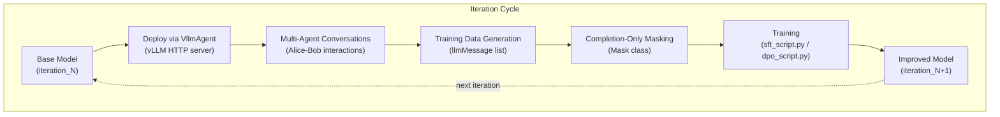
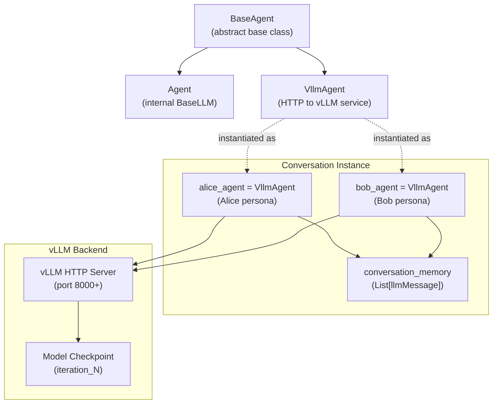
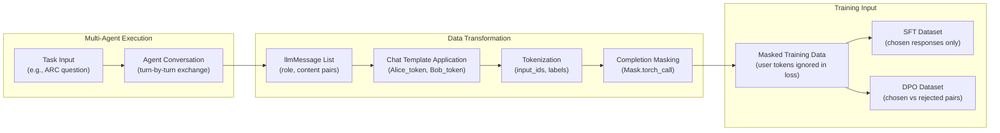

<!-- source: DeepWiki mcp.deepwiki.com · repo thunlp/Optima · page 3 Core Concepts · fetched 2026-11-02 -->

# Core Concepts

<details>
<summary>Relevant source files</summary>

The following files were used as context for generating this wiki page:

- [README.md](README.md)
- [README_revise.md](README_revise.md)

</details>


This page explains the fundamental concepts behind Optima's approach to optimizing LLM-based multi-agent systems. It covers the core problem Optima addresses, the iterative training methodology, and how multi-agent conversations generate training data for continuous improvement.

For specific training method details (iSFT, iDPO, iSFT-DPO), see [Iterative Training Methods](#3.1). For agent implementation details, see [Multi-Agent System Architecture](#3.2). For preference optimization specifics, see [Direct Preference Optimization](#3.3).

## The Multi-Agent Optimization Problem

Multi-agent LLM systems face a fundamental challenge: balancing **communication effectiveness** with **token efficiency**. Traditional multi-agent systems produce verbose exchanges that consume excessive tokens while often failing to improve accuracy proportionally. Optima addresses this by training agents to communicate more efficiently without sacrificing—and often improving—response quality.

The framework targets two primary objectives:

| Optimization Goal | Description | Measurement |
|-------------------|-------------|-------------|
| **Token Efficiency** | Reduce the number of tokens used in agent-to-agent communication | Total tokens per conversation |
| **Communication Effectiveness** | Improve the quality and accuracy of multi-agent reasoning | Task accuracy metrics |

Sources: [README.md:1-21]()

## Iterative Self-Improvement Architecture

Optima's core innovation is an **iterative training loop** where models from iteration N generate training data for iteration N+1. This creates a self-improvement cycle that progressively optimizes both objectives.



**Diagram: Iterative Self-Improvement Loop**

The cycle operates as follows:

1. **Deployment**: The current model checkpoint is deployed using `VllmAgent` instances that communicate via HTTP with vLLM servers
2. **Multi-Agent Generation**: Agents engage in structured conversations to solve reasoning tasks
3. **Data Processing**: Conversations are converted to training examples with completion-only masking
4. **Training**: The next iteration model is trained using supervised fine-tuning (SFT) or direct preference optimization (DPO)
5. **Iteration**: The improved model becomes the base for the next cycle

Sources: [README.md:11-21](), [README_revise.md:7-14]()

## Multi-Agent Conversation Framework

Optima employs a two-agent conversation paradigm where agents named **Alice** and **Bob** collaborate to solve tasks. This framework is implemented through the agent class hierarchy:



**Diagram: Agent System Architecture and Code Entities**

### Agent Roles

- **Alice**: Typically initiates conversations and drives the reasoning process
- **Bob**: Responds to Alice's queries, providing complementary reasoning perspectives
- **Conversation Memory**: Maintains the dialogue history as a list of `llmMessage` objects

Each agent instance uses chat templates with role-specific tokens (`Alice_token`, `Bob_token`) to distinguish speakers in the training data.

Sources: [README.md:114-137]()

## Training Data Generation Process

The conversion from agent conversations to training data involves several key transformations:



**Diagram: Training Data Generation Pipeline**

### Completion-Only Masking

A critical component is the **Mask** data collator from the alignment-handbook integration, which implements completion-only language modeling. This ensures that:

- **User/System tokens**: Masked in the loss calculation (labels set to `-100`)
- **Assistant tokens**: Contribute to the training loss
- **Rationale**: Agents should learn to generate high-quality responses, not to predict user inputs

The masking is applied in [alignment-handbook/src/alignment/data.py]() via the `Mask` class's `torch_call` method.

Sources: [README.md:48-55]()

## Training Methodologies

Optima supports three training approaches, each targeting different aspects of optimization:

| Method | Full Name | Implementation | Primary Optimization |
|--------|-----------|----------------|---------------------|
| **iSFT** | Iterative Supervised Fine-Tuning | `sft_script.py` | Behavior cloning from successful multi-agent trajectories |
| **iDPO** | Iterative Direct Preference Optimization | `dpo_script.py` | Preference learning between response pairs |
| **iSFT-DPO** | Combined Iterative Training | `sft_dpo_script.py` | Sequential application of both methods |

### Method Selection Guidelines

- **iSFT**: Best for establishing baseline communication patterns from demonstration data
- **iDPO**: Optimal when preference pairs (chosen vs. rejected) are available, provides stronger optimization signal
- **iSFT-DPO**: Combines the stability of SFT with the refinement of DPO for maximum performance

Each method shares the same iterative loop structure but differs in the training objective and data format requirements.

Sources: [README.md:58-92]()

## Configuration-Driven Execution

All training executions are driven by **YAML recipe files** located in:
- `train/sft_recipes/` - SFT configurations
- `train/dpo_recipes/` - DPO configurations  
- `train/sft_dpo_recipes/` - Combined method configurations

Each recipe specifies:

```yaml
# Key configuration elements
model_name_or_path: path/to/checkpoint
dataset_mixer: {dataset_name: weight}
num_train_epochs: 4
learning_rate: 5.0e-7
per_device_train_batch_size: 1
gradient_accumulation_steps: 8
```

Recipe files enable reproducible experiments and systematic hyperparameter exploration. See [Recipe Configuration System](#6.2) for complete documentation.

Sources: [README.md:59-60]()

## Dual Environment Design

Optima's architecture requires two separate conda environments:

| Environment | Name | Purpose | Key Dependencies |
|-------------|------|---------|------------------|
| **Serving** | `optima-vllm` | Deploy models for inference during data generation | vLLM 0.5.3, PyTorch 2.3.1 |
| **Training** | `optima-train` | Execute training scripts and optimization | alignment-handbook, Flash Attention 2 |

This separation prevents resource conflicts—vLLM deploys models on specific GPUs for inference while training occurs on separate devices. The `VllmAgent` class bridges these environments via HTTP communication.

Scripts accept `--vllm_env` and `--alignment_env` arguments to specify which conda environments to activate for each phase.

Sources: [README.md:22-55](), [README_revise.md:16-46]()

## Checkpoint Iteration Management

Model checkpoints are organized by iteration number:

```
checkpoints/
├── arc_sft/
│   ├── iteration_0/    # First training iteration
│   ├── iteration_1/    # Second iteration
│   └── iteration_N/    # Nth iteration
├── arc_dpo/
│   └── ...
```

Each iteration directory contains a complete model checkpoint that can be:
- Deployed via vLLM for inference
- Used as the base model for the next training iteration
- Evaluated independently via `inference_script.py`

The iteration number is automatically incremented by training scripts based on existing checkpoint directories.

Sources: [README.md:66-92](), [README.md:102-109]()

## Inference-Time Scaling Laws

Beyond training optimizations, Optima explores **inference-time scaling** through multi-agent self-consistency. The `multi_sc_data_generate_script.py` implements this by:

1. Sampling multiple conversation trajectories at temperature > 0
2. Aggregating responses across trajectories
3. Selecting final answers via majority voting or confidence scoring

This approach enables trading inference compute (multiple samples) for improved accuracy, creating a new dimension for scaling model performance.

Sources: [README.md:103-137]()

## Key Concepts Summary

The core concepts work together to create a comprehensive optimization framework:

1. **Problem**: Multi-agent systems are token-inefficient with suboptimal accuracy
2. **Solution**: Iterative training using self-generated multi-agent conversations
3. **Mechanism**: VllmAgent instances generate data → Mask class processes it → Training scripts optimize models
4. **Methods**: iSFT, iDPO, or iSFT-DPO depending on data and objectives
5. **Architecture**: Dual environments (serving + training) enable efficient pipeline execution
6. **Output**: Progressive model improvements across iterations, measurable via token usage and accuracy metrics

The following subsections provide detailed technical documentation for each component.

Sources: [README.md:1-147](), [README_revise.md:1-131]()

---

