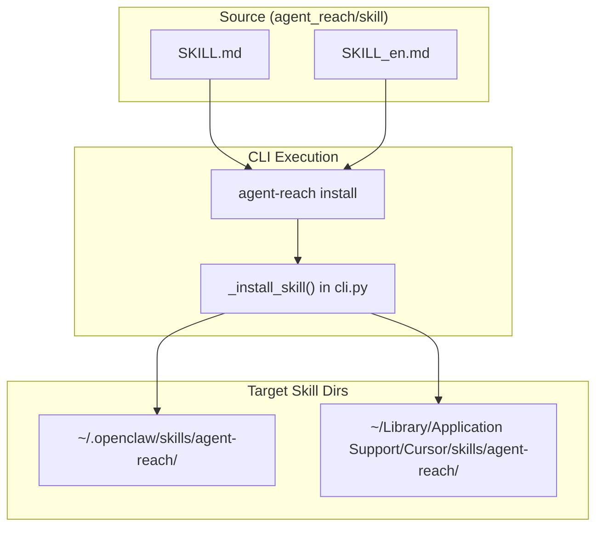
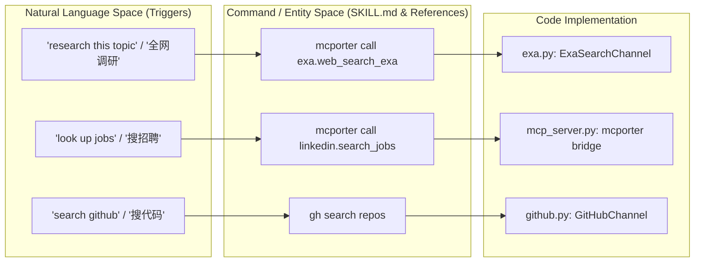
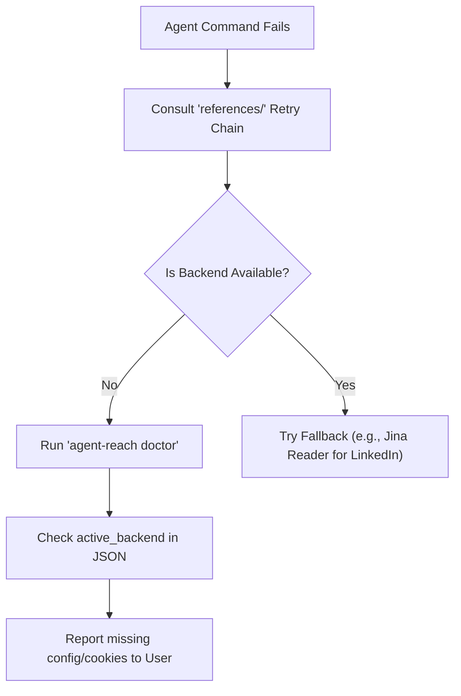

<!-- source: DeepWiki mcp.deepwiki.com · repo Panniantong/Agent-Reach · page 5 AI Agent Integration · fetched 2026-10-30 -->

# AI Agent Integration

<details>
<summary>Relevant source files</summary>

The following files were used as context for generating this wiki page:

- [agent_reach/skill/SKILL.md](agent_reach/skill/SKILL.md)
- [agent_reach/skill/SKILL_en.md](agent_reach/skill/SKILL_en.md)
- [agent_reach/skill/references/career.md](agent_reach/skill/references/career.md)
- [agent_reach/skill/references/search.md](agent_reach/skill/references/search.md)
- [agent_reach/skill/references/web.md](agent_reach/skill/references/web.md)
- [tests/test_skill_command.py](tests/test_skill_command.py)

</details>


This page documents how AI agents (Claude Code, Cursor, OpenClaw, Windsurf, and others) discover and use agent-reach capabilities through the `SKILL.md` skill registration mechanism. It covers the skill file structure, installation into agent skill directories, natural language trigger mapping, and the expected agent interaction model.

---

## Overview

Agent Reach is a CLI tool, but it is primarily intended to be driven by an AI agent. The integration works through a single mechanism: a file called `SKILL.md` that is installed into the agent's skill directory. Once installed, the agent reads this file to learn what agent-reach can do, when to invoke it, and how to invoke it.

### Agent Interaction Flow
```mermaid
sequenceDiagram
    participant "User" as User
    participant "AI Agent" as Agent
    participant "SKILL.md" as Skill Definition
    participant "agent-reach CLI" as CLI / Backends

    User->>Agent: "Search Twitter for opinions on this product"
    Agent->>Skill Definition: Consult registered skill metadata
    Skill Definition-->>Agent: Trigger matched; Use "twitter search" or "agent-reach search-twitter"
    Agent->>CLI: twitter search "product opinions" -n 10
    CLI-->>Agent: Structured JSON/Text results
    Agent-->>User: Summarized response with citations
```

Sources: [agent_reach/skill/SKILL.md:1-18](), [agent_reach/skill/SKILL.md:91-92]()

---

## The SKILL.md File

`SKILL.md` is the contract between the agent-reach package and any agent that supports the skills protocol. It lives at `agent_reach/skill/SKILL.md` (and `SKILL_en.md` for English environments) and serves as the primary instruction set for the agent.

### Frontmatter: Registration Metadata
The file begins with YAML frontmatter that defines the skill's identity and activation triggers.

[agent_reach/skill/SKILL.md:1-24]()

| Field | Purpose |
|---|---|
| `name` | Unique identifier (`agent-reach`) |
| `description` | Tells the agent *when* to use this skill (e.g., "MUST USE when user wants to research/search/look up anything") |
| `metadata` | Integration-specific data (e.g., `homepage` link) |

### Skill Body: Command Reference
The body of the file provides the agent with specific shell commands to execute for different platforms. The agent is encouraged to use direct backends or `mcporter` for MCP-based channels.

**Key Command Examples for Agents:**
- **Web Search (Exa via mcporter):** `mcporter call exa.web_search_exa query="query" numResults=5` [agent_reach/skill/SKILL.md:59-61]()
- **Twitter (twitter-cli):** `twitter search "query" -n 10` [agent_reach/skill/SKILL.md:91-92]()
- **Reddit (OpenCLI):** `opencli reddit search "query" -f yaml` [agent_reach/skill/SKILL.md:94-95]()
- **GitHub Search:** `gh search repos "query" --sort stars --limit 10` [agent_reach/skill/SKILL.md:66-67]()

Sources: [agent_reach/skill/SKILL.md:57-106](), [agent_reach/skill/SKILL_en.md:61-112]()

---

## Skill Installation

Installation is handled by internal CLI helpers that detect common agent skill directories and copy the localized markdown files.

### Implementation: `_install_skill` and `_uninstall_skill`
The functions `_install_skill()` and `_uninstall_skill()` manage the lifecycle of the `SKILL.md` file within the agent's environment.

- **Detection:** It looks for directories like `~/.openclaw/skills/` or paths defined by environment variables. [tests/test_skill_command.py:126-151]()
- **Localization:** The package includes both `SKILL.md` (Default/Chinese) and `SKILL_en.md` (English). [tests/test_skill_command.py:19-28]()
- **Action:** It creates an `agent-reach` subdirectory and populates it with the instruction set. [tests/test_skill_command.py:152-162]()

### Installation Logic Flow


Sources: [tests/test_skill_command.py:19-162](), [agent_reach/cli.py:13-13]()

---

## Natural Language to Code Mapping

This section illustrates how the agent bridges the gap between a user's natural language request and the specific code entities or commands defined in `agent-reach`.

### Intent Mapping Table

| User Prompt (Natural Language) | Agent Action (Command) | Internal Logic / Backend |
|---|---|---|
| "Read this link" | `curl -s "https://r.jina.ai/URL"` | `WebChannel` via Jina Reader |
| "Search Twitter for AI news" | `twitter search "AI news"` | `TwitterChannel` via `bird` CLI |
| "Find LinkedIn jobs" | `mcporter call linkedin.search_jobs ...` | `LinkedInChannel` via MCP |
| "Transcribe this podcast" | `transcribe.sh <url>` | `XiaoyuzhouChannel` (Groq Whisper) |
| "Search Bilibili" | `bili search "query" --type video` | `BilibiliChannel` via `bili-cli` |

### Bridge: Natural Language to Code Entity Space


Sources: [agent_reach/skill/SKILL.md:4-11](), [agent_reach/skill/SKILL.md:57-77](), [agent_reach/skill/references/career.md:17-18](), [agent_reach/skill/references/search.md:9-12]()

---

## Agent Interaction Model

### Diagnostic-Driven Interaction
Agents are instructed to perform a health check before acting on platforms requiring login or multi-backend routing.

1. **Trigger:** User asks to search a specific platform (e.g., Reddit).
2. **Action:** Agent runs `agent-reach doctor --json`. [agent_reach/skill/SKILL.md:32-35]()
3. **Analysis:** Agent checks the `active_backend` field. If `null`, it uses the fallback/retry chains defined in the `references/` directory. [agent_reach/skill/SKILL_en.md:30-34]()
4. **Execution:** Agent announces the backend being used (e.g., "Using agent-reach, platform Reddit via backend OpenCLI"). [agent_reach/skill/SKILL_en.md:35-36]()

### Workspace and Safety Rules
To ensure stability, the `SKILL.md` enforces strict operational boundaries:
- **No Workspace Files:** Agents must use `/tmp/` for temporary output and `~/.agent-reach/` for persistent data, never creating files in the project workspace. [agent_reach/skill/SKILL.md:123-124]()
- **Version Watching:** After completing a major task, agents run `agent-reach check-update` and suggest an update command if a new version is available. [agent_reach/skill/SKILL.md:39-43]()
- **Credential Safety:** For platforms like Twitter, agents must provide `TWITTER_AUTH_TOKEN` in the environment without logging or echoing the values. [agent_reach/skill/SKILL.md:81-84]()

### Troubleshooting Model


Sources: [agent_reach/skill/SKILL.md:32-43](), [agent_reach/skill/references/career.md:23-29](), [agent_reach/skill/SKILL_en.md:85-94]()

---

