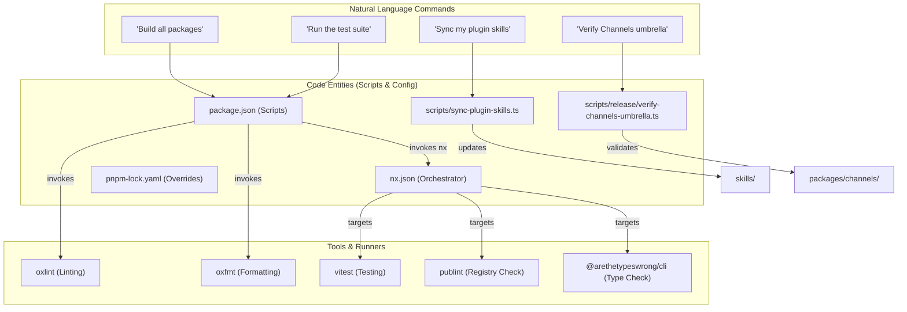
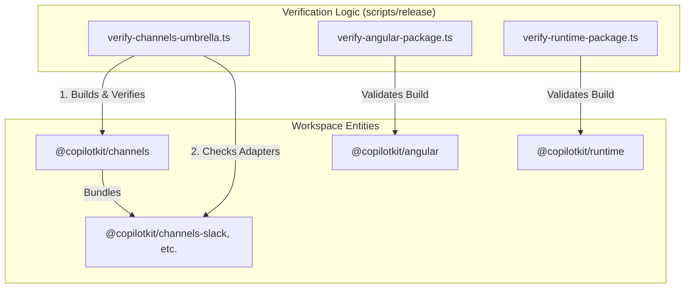

<!-- source: DeepWiki mcp.deepwiki.com · repo CopilotKit/CopilotKit · page 8.2 Build System and Scripts · fetched 2026-10-30 -->

# Build System and Scripts

Relevant source files

The following files were used as context for generating this wiki page:

- [.github/workflows/plugin-skills-check.yml](.github/workflows/plugin-skills-check.yml)
- [.github/workflows/publish-commit.yml](.github/workflows/publish-commit.yml)
- [.github/workflows/showcase_eval.yml](.github/workflows/showcase_eval.yml)
- [.github/workflows/static_danger.yml](.github/workflows/static_danger.yml)
- [.github/workflows/static_quality.yml](.github/workflows/static_quality.yml)
- [.github/workflows/test_e2e-dojo.yml](.github/workflows/test_e2e-dojo.yml)
- [.github/workflows/test_e2e-legacy-v1.yml](.github/workflows/test_e2e-legacy-v1.yml)
- [.github/workflows/test_e2e-showcase-on-demand.yml](.github/workflows/test_e2e-showcase-on-demand.yml)
- [.github/workflows/test_integration-docs.yml](.github/workflows/test_integration-docs.yml)
- [.github/workflows/test_integration-runtime.yml](.github/workflows/test_integration-runtime.yml)
- [.github/workflows/test_showcase-frontend-matrix.yml](.github/workflows/test_showcase-frontend-matrix.yml)
- [.github/workflows/test_smoke-starter.yml](.github/workflows/test_smoke-starter.yml)
- [.github/workflows/test_unit-showcase.yml](.github/workflows/test_unit-showcase.yml)
- [.github/workflows/test_unit.yml](.github/workflows/test_unit.yml)
- [.npmrc](.npmrc)
- [examples/slack/.env.example](examples/slack/.env.example)
- [examples/slack/README.md](examples/slack/README.md)
- [examples/slack/app/commands/__tests__/commands.test.ts](examples/slack/app/commands/__tests__/commands.test.ts)
- [examples/slack/app/commands/index.ts](examples/slack/app/commands/index.ts)
- [examples/slack/app/index.ts](examples/slack/app/index.ts)
- [examples/slack/app/managed.test.ts](examples/slack/app/managed.test.ts)
- [examples/slack/app/managed.ts](examples/slack/app/managed.ts)
- [examples/slack/app/modals/__tests__/file-issue.test.tsx](examples/slack/app/modals/__tests__/file-issue.test.tsx)
- [examples/slack/app/modals/file-issue.tsx](examples/slack/app/modals/file-issue.tsx)
- [examples/slack/app/tools/__tests__/read-thread.test.ts](examples/slack/app/tools/__tests__/read-thread.test.ts)
- [examples/slack/package.json](examples/slack/package.json)
- [examples/slack/slack-app-manifest.json](examples/slack/slack-app-manifest.json)
- [examples/slack/slack-app-manifest.yaml](examples/slack/slack-app-manifest.yaml)
- [examples/slack/tsconfig.json](examples/slack/tsconfig.json)
- [examples/teams/.env.example](examples/teams/.env.example)
- [examples/teams/README.md](examples/teams/README.md)
- [examples/teams/app/index.tsx](examples/teams/app/index.tsx)
- [examples/v2/react/demo/tsconfig.json](examples/v2/react/demo/tsconfig.json)
- [lefthook.yml](lefthook.yml)
- [migrations.json](migrations.json)
- [nx.json](nx.json)
- [package.json](package.json)
- [packages/react-core/src/v2/components/chat/__tests__/CopilotChatPerf.e2e.test.tsx](packages/react-core/src/v2/components/chat/__tests__/CopilotChatPerf.e2e.test.tsx)
- [patches/eventsource@3.0.7.patch](patches/eventsource@3.0.7.patch)
- [pnpm-lock.yaml](pnpm-lock.yaml)
- [pnpm-workspace.yaml](pnpm-workspace.yaml)
- [showcase/scripts/__tests__/sync-promote-service-options.test.ts](showcase/scripts/__tests__/sync-promote-service-options.test.ts)
- [showcase/scripts/sync-promote-service-options.ts](showcase/scripts/sync-promote-service-options.ts)
- [skills/setup-slack-channel/SKILL.md](skills/setup-slack-channel/SKILL.md)
- [skills/setup-slack-channel/assets/slack-app-manifest.yaml](skills/setup-slack-channel/assets/slack-app-manifest.yaml)
- [skills/setup-slack-channel/references/intelligence-channel.md](skills/setup-slack-channel/references/intelligence-channel.md)
- [skills/setup-slack-channel/references/local-runtime.md](skills/setup-slack-channel/references/local-runtime.md)
- [skills/setup-slack-channel/references/optional-e2e.md](skills/setup-slack-channel/references/optional-e2e.md)
- [skills/setup-slack-channel/references/secrets-and-credentials.md](skills/setup-slack-channel/references/secrets-and-credentials.md)
- [skills/setup-slack-channel/references/slack-workspace-and-app.md](skills/setup-slack-channel/references/slack-workspace-and-app.md)
- [skills/setup-slack-channel/references/troubleshooting.md](skills/setup-slack-channel/references/troubleshooting.md)

This page documents the build orchestration layer for the CopilotKit monorepo, including the `nx` task runner configuration, the `pnpm` workspace scripts, and the scripts directory structure. It covers development workflows, quality assurance hooks, and the release validation system.

---

## Build Orchestrator: nx

The repository uses [nx](https://nx.dev) as its primary task orchestrator. `nx` is responsible for running targets across packages in parallel, managing task caching, and handling project dependencies [nx.json:1-100](). Developers are encouraged to run tasks through `nx` (e.g., `nx run`, `nx run-many`) rather than calling underlying tools directly to leverage the caching and dependency graph [package.json:5-18]().

### nx Configuration (`nx.json`)

The `nx.json` file defines the global task pipeline and caching behavior.

- **Named Inputs**:
    - `default`: Includes all files in the project root except `node_modules`, `.md`, and `.yml` files [nx.json:4-10]().
    - `production`: Inherits from `default` but excludes test files and specifications from the build hash [nx.json:11-16]().
    - `test`: Specifically targets source files and test patterns (`*.test.*`, `*.spec.*`) [nx.json:17-23]().
- **Target Defaults**:
    - `build`: Depends on the `build` of all upstream dependencies (`^build`). It uses the `production` input and caches outputs in the `{projectRoot}/dist/**` folder [nx.json:26-31]().
    - `dev`: Depends on `^build` but disables caching for local iteration [nx.json:32-35]().
    - `test`: Depends on `^build` and caches coverage reports in `{projectRoot}/coverage/**` [nx.json:36-41]().
    - `check-types`: Ensures upstream projects are built before verifying types [nx.json:50-53]().
    - `build:css`: Caches generated CSS outputs like `dist/styles.css` [nx.json:69-75]().
    - `publint` / `attw`: Quality checks that depend on a completed `build` to verify package distribution health [nx.json:81-90]().
- **Parallelism**: Configured to run up to 14 tasks in parallel by default [nx.json:97]().

**Sources:** [nx.json:1-100](), [package.json:5-18]()

---

## Development Workflows

CopilotKit uses [pnpm](https://pnpm.io) (version 10.33.4) as its package manager [package.json:90](). The workspace configuration includes core `packages/*`, example applications (`examples/v1/*`, `examples/v2/*`), and various showcase components [pnpm-workspace.yaml:1-26]().

### Root `package.json` Scripts

The root `package.json` provides centralized access to common development tasks [package.json:4-47]().

| Script Name | Command | Description |
|---|---|---|
| `build` | `nx run-many -t build --projects=packages/** --exclude=@copilotkit/demo-agents` | Builds all core packages [package.json:5]() |
| `lint` | `oxlint .` | Runs the high-performance `oxlint` linter [package.json:11]() |
| `format` | `oxfmt --write .` | Formats code using `oxfmt` [package.json:12]() |
| `test` | `nx run-many -t test --projects=packages/**` | Runs unit tests for all core packages [package.json:14]() |
| `dev` | `pnpm run build && nx watch --projects=packages/** -- pnpm run build` | Watches packages and rebuilds on change [package.json:17]() |
| `check:packages` | `nx run-many -t publint,attw --projects=packages/**` | Runs `publint` and `attw` for package quality [package.json:37]() |
| `sync:plugin-skills`| `tsx scripts/sync-plugin-skills.ts` | Synchronizes Claude Code plugin skills [package.json:43]() |
| `verify:channels-umbrella` | `tsx scripts/release/verify-channels-umbrella.ts` | Validates the Channels umbrella package integrity [package.json:29]() |
| `parity:sync` | `tsx examples/integrations/_parity/sync.ts` | Syncs integration parity configurations [package.json:44]() |

### Local Package Development
Specialized scripts target framework-specific demos and storybooks:
- **Vue**: `pnpm demo:vue` [package.json:26]() or `pnpm storybook:vue` [package.json:21]().
- **Angular**: `pnpm demo:angular` which runs both the demo app and demo server [package.json:24]().
- **React**: `pnpm demo:react` [package.json:25]() or `pnpm storybook:react` [package.json:20]().

**Sources:** [package.json:4-47](), [pnpm-workspace.yaml:1-26](), [pnpm-lock.yaml:1-80]()

---

## Build System Architecture

The build system bridges Natural Language developer intents to concrete code entities and tool invocations.

**Build System Entity Map**

**Sources:** [nx.json:25-96](), [package.json:4-47](), [pnpm-lock.yaml:7-79]()

---

## Quality Assurance and Git Hooks

CopilotKit employs `lefthook` for pre-commit validation and `oxlint`/`oxfmt` for high-performance linting and formatting.

### Pre-commit Checks (`lefthook.yml`)
The `lefthook.yml` configuration defines commands that run before a commit is finalized [lefthook.yml:11-120]().

1.  **`check-binaries`**: Runs `bash scripts/hooks/check-binaries.sh` to block accidental commits of compiled binaries [lefthook.yml:14-16]().
2.  **`sync-lockfile`**: Automatically runs `pnpm i --lockfile-only` when `package.json` files are modified [lefthook.yml:29-33]().
3.  **`lint-fix`**: Scopes `oxlint --fix` and `oxfmt --write` to staged files [lefthook.yml:34-86](). It intentionally excludes `.json` files from `oxfmt` to prevent `pnpm` parsing errors caused by JSON5 formatting [lefthook.yml:44-51]().
4.  **`check-plugin-skills`**: Ensures the Claude Code plugin mirror is in sync with the source code [lefthook.yml:106-114]().
5.  **`test-and-check-packages`**: Dynamically identifies affected packages using `nx show projects --affected` and runs tests and quality checks only on modified code [lefthook.yml:87-104]().
6.  **`commitlint`**: Validates that commit messages follow the conventional commit specification [lefthook.yml:117-119]().

### Continuous Integration
The CI pipeline is defined in several GitHub Actions workflows:
- **`static_quality.yml`**: Runs `oxfmt` and `ruff` (for Python) to ensure code quality on PRs [static_quality.yml:29-155]().
- **`test_unit.yml`**: Executes unit tests across a matrix of Node.js (20, 22, 24) and React (18, 19) versions [test_unit.yml:42-160]().
- **`test_e2e-dojo.yml`**: Runs specialized E2E test suites for different agent frameworks like `langgraph`, `crew-ai`, and `mastra` [test_e2e-dojo.yml:69-145]().

**Sources:** [lefthook.yml:1-120](), [static_quality.yml:1-155](), [test_unit.yml:42-160](), [test_e2e-dojo.yml:69-145]()

---

## Release Scripts and Validation

The `scripts/release/` directory contains critical automation for maintaining package integrity during the release cycle.

### Channels Umbrella Validation
The `@copilotkit/channels` package is an "umbrella" package that bundles several adapters (Slack, Teams, Discord, etc.) [examples/slack/README.md:3-8](). To ensure version consistency across these sub-packages, the build system uses a dedicated verification script.

- **`verify-channels-umbrella.ts`**: This script packs the umbrella package and its dependencies locally, creates a temporary consumer workspace, and verifies that only a single version of core foundation packages is resolved [package.json:29-30]().
- **`verify-angular-package.ts`**: Validates the build integrity of the Angular integration [package.json:31]().
- **`verify-runtime-package.ts`**: Validates the build integrity of the core runtime package [package.json:32]().

### Dependency Management and Gates
- **`pnpm.overrides`**: The repository root `package.json` uses `pnpm.overrides` to enforce consistent versions of critical dependencies like `react`, `next`, and `zod` across the entire monorepo [package.json:102-175]().
- **Release Preparation**: Scripts like `prepare-release.ts` and `prerelease.ts` handle version bumping and dry-run validations before publishing to the registry [package.json:27-28]().

**Channels Verification Flow**

**Sources:** [package.json:27-32](), [package.json:102-175](), [examples/slack/README.md:1-15]()

---

