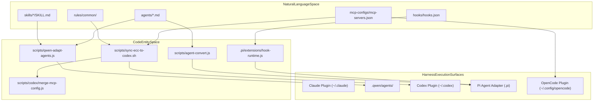
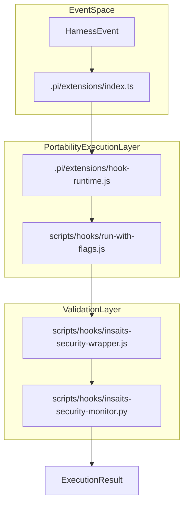
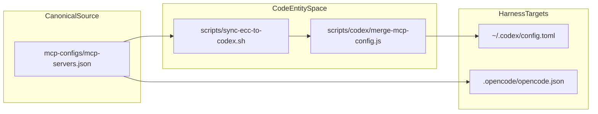

<!-- source: DeepWiki mcp.deepwiki.com · repo affaan-m/ECC · page 2.2 Cross-Harness Portability · fetched 2026-10-30 -->

# Cross-Harness Portability

Relevant source files

The following files were used as context for generating this wiki page:

- [.agents/skills/skill-host-compat/SKILL.md](.agents/skills/skill-host-compat/SKILL.md)
- [.agents/skills/skill-host-compat/agents/openai.yaml](.agents/skills/skill-host-compat/agents/openai.yaml)
- [.pi/README.md](.pi/README.md)
- [.pi/extensions/hook-runtime.js](.pi/extensions/hook-runtime.js)
- [.pi/extensions/index.ts](.pi/extensions/index.ts)
- [.qwen/QWEN.md](.qwen/QWEN.md)
- [docs/QWEN-GUIDE.md](docs/QWEN-GUIDE.md)
- [docs/architecture/cross-harness.md](docs/architecture/cross-harness.md)
- [docs/architecture/harness-adapter-compliance.md](docs/architecture/harness-adapter-compliance.md)
- [docs/architecture/platform-value-loop.md](docs/architecture/platform-value-loop.md)
- [docs/releases/2.0.0-rc.1/ito-prediction-market-skill-pack.md](docs/releases/2.0.0-rc.1/ito-prediction-market-skill-pack.md)
- [schemas/agent.schema.json](schemas/agent.schema.json)
- [scripts/agent-convert.js](scripts/agent-convert.js)
- [scripts/ci/validate-skill-host-compat.js](scripts/ci/validate-skill-host-compat.js)
- [scripts/ci/verify-release-gates.js](scripts/ci/verify-release-gates.js)
- [scripts/lib/agent-emit-pi.js](scripts/lib/agent-emit-pi.js)
- [scripts/lib/agent-ir.js](scripts/lib/agent-ir.js)
- [scripts/lib/agent-tool-map.js](scripts/lib/agent-tool-map.js)
- [scripts/lib/harness-adapter-compliance.js](scripts/lib/harness-adapter-compliance.js)
- [scripts/lib/harness-capabilities.js](scripts/lib/harness-capabilities.js)
- [scripts/lib/install-targets/qwen-home.js](scripts/lib/install-targets/qwen-home.js)
- [scripts/qwen-adapt-agents.js](scripts/qwen-adapt-agents.js)
- [scripts/sync-ecc-to-codex.sh](scripts/sync-ecc-to-codex.sh)
- [skills/skill-host-compat/SKILL.md](skills/skill-host-compat/SKILL.md)
- [tests/ci/packed-artifact-lifecycle.js](tests/ci/packed-artifact-lifecycle.js)
- [tests/ci/packed-artifact-lifecycle.test.js](tests/ci/packed-artifact-lifecycle.test.js)
- [tests/ci/release-packed-artifact-workflow.test.js](tests/ci/release-packed-artifact-workflow.test.js)
- [tests/ci/validate-skill-host-compat.test.js](tests/ci/validate-skill-host-compat.test.js)
- [tests/docs/harness-adapter-compliance.test.js](tests/docs/harness-adapter-compliance.test.js)
- [tests/docs/platform-value-loop.test.js](tests/docs/platform-value-loop.test.js)
- [tests/lib/harness-capabilities.test.js](tests/lib/harness-capabilities.test.js)
- [tests/pi/agent-convert.test.js](tests/pi/agent-convert.test.js)
- [tests/pi/agent-emit.test.js](tests/pi/agent-emit.test.js)
- [tests/pi/pi-extension-adapter.test.js](tests/pi/pi-extension-adapter.test.js)
- [tests/pi/pi-hook-runtime.test.js](tests/pi/pi-hook-runtime.test.js)
- [tests/pi/pi-package-manifest.test.js](tests/pi/pi-package-manifest.test.js)
- [tests/scripts/qwen-adapt-agents.test.js](tests/scripts/qwen-adapt-agents.test.js)
- [tests/scripts/sync-ecc-to-codex.test.js](tests/scripts/sync-ecc-to-codex.test.js)

## Purpose and Scope

This page details the cross-harness architecture of Everything Claude Code (ECC), explaining how core durable assets—such as skills, rules, hooks, agent frontmatter, and MCP configurations—are projected and adapted across diverse AI harnesses (including Claude Code, Codex, Pi, OpenCode, Qwen Code, Cursor, and Zed) without duplicating workflow business logic. It covers the adapter compliance matrix, the asset portability model, runner mechanics, agent adaptation scripts, and MCP connector synchronization policies.

Sources: `[docs/architecture/cross-harness.md:1-33]()`, `[scripts/qwen-adapt-agents.js:1-45]()`, `[docs/architecture/harness-adapter-compliance.md:1-20]()`

---

## Portability Model & Asset Projection

ECC employs a projection model where canonical assets are authored once in shared source directories, then adapted at the edges for each supported AI harness. This design keeps core durable units (skills, rules, hooks, MCP configs, commands, agents) centralized and consistent, minimizing duplication and divergence in logic across different runtimes.

The harness capability catalog registers each install target, defining availability channels, scope roots, and hook support details. Agent definitions are mapped via specialized adaptation scripts, such as `scripts/qwen-adapt-agents.js`, which translates Claude Code tool specifications (e.g., mapping `Edit` to `edit`, `WebSearch` to `web_search`) and normalizes unsupported color properties (e.g., remapping `teal` to `cyan`) for Qwen Code compatibility.

### Natural Language Space to Code Entity Space: Core Asset Projection

| Conceptual Asset        | Code Entity (Source)                                  | Harness Target & Adaptation                                                                                     | Details & Projection Logic                                                                               |
|------------------------|------------------------------------------------------|---------------------------------------------------------------------------------------------------------------|---------------------------------------------------------------------------------------------------------|
| **Skills**             | `skills/*/SKILL.md`                                  | `.agents/skills/`, `.cursor/skills/`, Pi package manifest and mount                                           | YAML frontmatter with `name`, `description`, `origin`; installed via native plugins or symlinks         |
| **Agents**             | `agents/*.md`                                        | `.qwen/agents/`, `.pi/agents/`, `.codex/agents/`                                                              | Adapted via `scripts/qwen-adapt-agents.js` and `scripts/agent-convert.js` to align tool naming and models |
| **Rules & Instructions**| `rules/`, `AGENTS.md`                                | `.cursor/rules/`, `~/.codex/AGENTS.md`, Pi system prompt injection                                            | Flattened and collision-safe injection or files; some harnesses use instruction-only enforcement       |
| **Hooks**               | `hooks/hooks.json`, `scripts/hooks/`                 | Native Claude hooks, OpenCode event adapter, `.pi/extensions/hook-runtime.js` for Pi                          | Shared hook runner (`scripts/hooks/run-with-flags.js`) orchestrates platform-agnostic invocation       |
| **MCP Configurations**  | `mcp-configs/mcp-servers.json`, `.mcp.json`          | `~/.codex/config.toml`, `.opencode/opencode.json`, Pi community adapters                                     | Merged via node-based TOML/JSON parsers integrated during sync scripts (`scripts/sync-ecc-to-codex.sh`)   |

**Diagram: Asset Projection and Natural-to-Code Mapping**

Sources: `[docs/architecture/cross-harness.md:22-33]()`, `[scripts/qwen-adapt-agents.js:16-43]()`, `[scripts/sync-ecc-to-codex.sh:11-48]`, `[tests/pi/pi-extension-adapter.test.js:48-50]()`

---

## Hook Portability & Runner Architecture

Because some harnesses do not natively support the full Claude Code style hook system, ECC provides portable hook runtimes and adaptation layers that proxy or emulate hook invocation.

- Claude Code uses native plugin-driven hooks configured through profiles.
- Pi coding agent's adapter (`.pi/extensions/index.ts`) invokes ECC's hook runtime (`scripts/hooks/run-with-flags.js`) via a dedicated runtime resolver (`.pi/extensions/hook-runtime.js`) that ensures hook scripts resolve relative to the installed ECC package root rather than the current working directory.
- Hooks run with strict isolation using `execFile`, timeout enforcement, and EPIPE stream protection on standard input/output.

### Diagram: Hook Execution and Adaptation Flow

Sources: `[tests/pi/pi-extension-adapter.test.js:4-90]()`, `[.pi/extensions/hook-runtime.js:1-30]()`, `[scripts/hooks/run-with-flags.js:1-45]()`

---

## MCP Connector Policy & Synchronization

ECC manages Model Context Protocol (MCP) server connectors centrally to limit security risk and complexity.

- The canonical default MCP connector is `chrome-devtools`.
- Other MCP servers are opt-in via `mcp-configs/mcp-servers.json`.
- Cross-harness synchronization of MCP identities is managed via scripts like `scripts/sync-ecc-to-codex.sh`, which invokes `scripts/codex/merge-mcp-config.js` to safely merge TOML configurations without overwriting unmanaged user settings.

### Diagram: MCP Configuration Synchronization

Sources: `[scripts/sync-ecc-to-codex.sh:11-48]`, `[mcp-configs/mcp-servers.json:1-30]()`

---

## Harness Adapter Compliance Matrix

This table summarizes the current adapter support state for ECC assets across major harnesses, verified by `scripts/lib/harness-adapter-compliance.js`.

| Harness or Runtime | State              | Supported Assets                                    | Unsupported or Different Surfaces                         | Install / Onramp                          | Verification Command                      |
|--------------------|--------------------|----------------------------------------------------|-----------------------------------------------------------|-------------------------------------------|-------------------------------------------|
| **Claude Code**     | Native             | Plugin assets, skills, commands, hooks, MCP config | Non-Claude hook runtimes not included                     | `./install.sh --profile minimal --target claude` | `npm run harness:audit`                   |
| **Codex**           | Instruction-backed | `AGENTS.md`, plugin metadata, skills, MCP config   | Native hook enforcement not present                       | `./install.sh --profile minimal --target codex`  | `npm run harness:audit`                   |
| **Pi**              | Adapter-backed     | Pi package manifest, canonical ECC skills, rules   | Subagents and MCP surface require community packages      | `pi install git:github.com/affaan-m/ECC`| `node tests/pi/pi-extension-adapter.test.js` |
| **Cursor**          | Adapter-backed     | Cursor rules, project-local skills, hook adapter   | Claude-style slash-command semantics differ               | `./install.sh --profile minimal --target cursor` | `node tests/lib/install-targets.test.js` |
| **Qwen Code**       | Adapter-backed     | Adapted agent frontmatter, shared skills, rules    | Claude-specific model tiers and tool names require mapping | `node scripts/qwen-adapt-agents.js`        | `node tests/scripts/qwen-adapt-agents.test.js` |

Sources: `[docs/architecture/harness-adapter-compliance.md:30-51]()`, `[scripts/lib/harness-adapter-compliance.js:42-180]()`, `[tests/scripts/qwen-adapt-agents.test.js:10-45]()`

---

## Key Code Entities & Functions

- `adaptFrontmatter` in `scripts/qwen-adapt-agents.js`: Parses YAML frontmatter for agent files, normalizing tool allowlists using `TOOL_NAME_MAP` and adjusting color attributes against `VALID_COLORS`.
- `runEccHook` in Pi extensions: Invokes `scripts/hooks/run-with-flags.js` via Node child processes with JSON payloads piped across standard streams.
- `createGithubClient` and release gate verifiers in `scripts/ci/verify-release-gates.js`: Ensure compliance across packed artifacts.

Sources: `[scripts/qwen-adapt-agents.js:94-135]()`, `[tests/pi/pi-extension-adapter.test.js:80-95]()`, `[scripts/ci/verify-release-gates.js:84-115]()`

---

# References

- `[docs/architecture/cross-harness.md]()`
- `[docs/architecture/harness-adapter-compliance.md]()`
- `[scripts/qwen-adapt-agents.js]()`
- `[scripts/sync-ecc-to-codex.sh]()`
- `[.pi/extensions/index.ts]()`
- `[scripts/hooks/run-with-flags.js]()`

---

