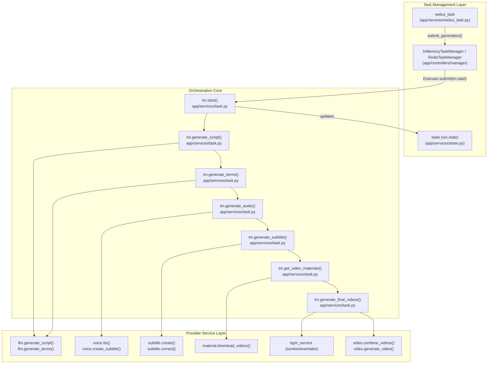
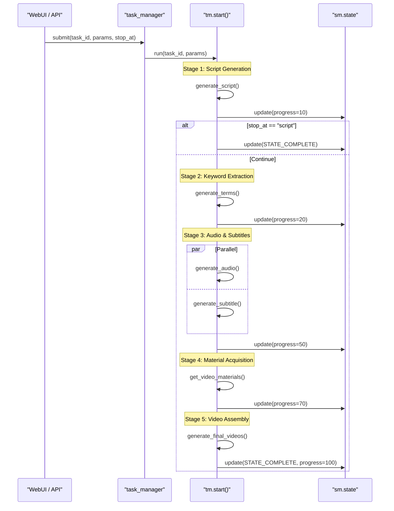

<!-- source: DeepWiki mcp.deepwiki.com · repo harry0703/MoneyPrinterTurbo · page 5.1 Task Orchestration · fetched 2026-10-30 -->

# Task Orchestration

Relevant source files

The following files were used as context for generating this wiki page:

- [app/models/const.py](app/models/const.py)
- [app/models/schema.py](app/models/schema.py)
- [app/services/state.py](app/services/state.py)
- [app/services/task.py](app/services/task.py)
- [app/services/webui_task.py](app/services/webui_task.py)
- [test/README.md](test/README.md)
- [test/services/test_schema.py](test/services/test_schema.py)
- [test/services/test_state.py](test/services/test_state.py)
- [test/services/test_task.py](test/services/test_task.py)

This document covers the task orchestration system in MoneyPrinterTurbo, which serves as the central coordinator for video generation workflows. The orchestrator manages the execution of sequential and parallel tasks across multiple AI services to produce complete videos from user inputs.

For information about individual service implementations, see [LLM Integration (5.2)](), [Voice Synthesis (5.3)](), [Video Processing (5.4)](), and [Material Acquisition (5.5)](). 

## Core Architecture

The task orchestration system is built around a central coordinator pattern that manages stateful workflows through multiple processing stages. The system supports both in-memory and Redis-based task state management, with configurable concurrency limits and progress tracking. 

A specialized `InMemoryTaskManager` is used for WebUI sessions to ensure configuration consistency by limiting concurrency to 1 [app/services/webui_task.py:19-22]().

### System Component Relationship

The following diagram bridges natural language concepts to the specific code entities responsible for task lifecycle management.

Sources: [app/services/task.py:16-32](), [app/services/webui_task.py:53-87](), [app/services/state.py:24-41]()

## Task Workflow Pipeline

The orchestration system executes a 5-stage pipeline with configurable `stop_at` checkpoints. This allows the system to pause after generating a script or audio for user review before proceeding to video synthesis.

### Stage Transitions and Checkpoints

Sources: [app/services/task.py:104-121](), [app/services/webui_task.py:122-156]()

## Implementation Details

### Progress Tracking
Each function in `app/services/task.py` is responsible for updating the `sm.state` object. Progress is mapped as follows:
- **Script**: 10%
- **Terms**: 20%
- **Audio/Subtitle**: 50%
- **Materials**: 70%
- **Final Assembly**: 100%

### Video Music Orchestration
The orchestrator supports specialized BGM providers like **Sonilo** and **ElevenLabs**. Unlike static BGM, these generate music specifically for individual video segments [app/services/task.py:73-88]().
- `_VIDEO_MUSIC_PROVIDERS` registry defines service-specific error types, file suffixes, and warning codes [app/services/task.py:73-88]().
- `_get_video_music_prompt` handles backward compatibility for Sonilo-specific prompt fields [app/services/task.py:91-101]().
- During final assembly, if `bgm_type` matches a generative provider, `generate_bgm` is invoked per video count to create unique tracks [test/services/test_task.py:122-157]().

### Cross-Posting Orchestration
Post-generation, tasks can enter a `cross_post_state` for platforms like TikTok or Instagram.
- Managed by `_cross_post_executor` with a fixed thread pool (default 2 workers) [app/services/task.py:41-44]().
- State is tracked via `_cross_post_futures` and protected by `_cross_post_registry_lock` to prevent redundant uploads [app/services/task.py:124-136]().
- A task is considered "busy" if either generation or cross-posting is active [app/services/task.py:104-121]().

## Error Handling & Recovery

The orchestrator uses a `try-except` block in `_run_generation` to catch stage failures and ensure the task does not hang in a processing state [app/services/webui_task.py:88-111]().

1.  **Stage Failure**: If a stage fails, the orchestrator updates the task state to `TASK_STATE_FAILED` (-1) [app/models/const.py:25]().
2.  **State Update**: The pipeline calls `sm.state.update_task` recording the `failed_stage` and `error` message [app/services/webui_task.py:100-106]().
3.  **Process Liveness**: For cross-posting, the system uses Win32 API on Windows (`OpenProcess`) to verify if the process owner of a task is still alive before allowing state cleanup [app/services/task.py:146-197]().
4.  **Redis Atomicity**: The `RedisState.patch_task` implementation uses a Lua script (`_PATCH_EXISTING_TASK_SCRIPT`) to ensure updates only happen if the task still exists, preventing race conditions between deletion and background updates [app/services/state.py:10-20](), [app/services/state.py:185-202]().

### Task Deletion Protection
The function `is_task_busy` prevents deleting folders of tasks that are currently being processed or uploaded [app/services/task.py:104-121]().

| State | Const Value | Description |
| :--- | :--- | :--- |
| Processing | `const.TASK_STATE_PROCESSING` (4) | Generation pipeline active [app/models/const.py:27]() |
| Complete | `const.TASK_STATE_COMPLETE` (1) | Generation finished [app/models/const.py:26]() |
| Failed | `const.TASK_STATE_FAILED` (-1) | Pipeline error [app/models/const.py:25]() |
| Cross-Post Pending | `const.CROSS_POST_STATE_PENDING` | Queued for social media [app/models/const.py:29]() |
| Cross-Post Active | `const.CROSS_POST_STATE_PROCESSING` | Uploading to platform [app/models/const.py:30]() |

Sources: [app/services/task.py:104-121](), [app/models/const.py:25-32](), [app/services/state.py:10-20](), [app/services/webui_task.py:88-111]()

---

