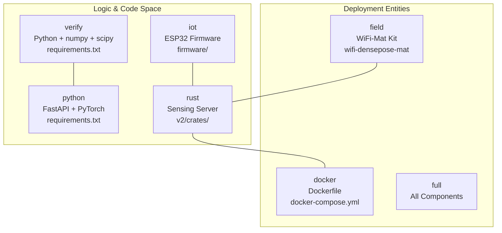
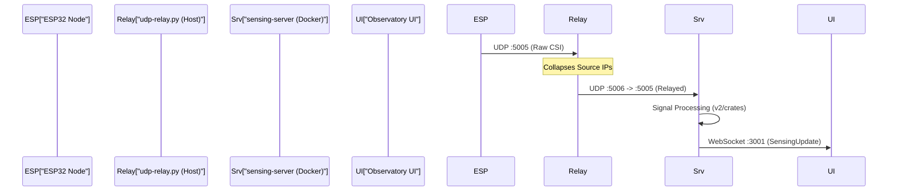

<!-- source: DeepWiki mcp.deepwiki.com · repo ruvnet/RuView · page 2 Quick Start · fetched 2026-10-30 -->

# Quick Start

<details>
<summary>Relevant source files</summary>

The following files were used as context for generating this wiki page:

- [.claude-flow/daemon-state.json](.claude-flow/daemon-state.json)
- [.claude-flow/metrics/codebase-map.json](.claude-flow/metrics/codebase-map.json)
- [.claude-flow/metrics/consolidation.json](.claude-flow/metrics/consolidation.json)
- [.claude-flow/metrics/performance.json](.claude-flow/metrics/performance.json)
- [.claude-flow/metrics/security-audit.json](.claude-flow/metrics/security-audit.json)
- [.claude-flow/metrics/test-gaps.json](.claude-flow/metrics/test-gaps.json)
- [.claude/scheduled_tasks.lock](.claude/scheduled_tasks.lock)
- [Makefile](Makefile)
- [docs/adr/ADR-126-ruview-native-ha-port-master.md](docs/adr/ADR-126-ruview-native-ha-port-master.md)
- [example.env](example.env)
- [install.sh](install.sh)
- [requirements-dev.txt](requirements-dev.txt)
- [requirements.txt](requirements.txt)

</details>


This guide walks you through installing RuView and running your first WiFi sensing demonstration. It covers installation using the multi-profile installer, choosing the appropriate deployment profile based on your hardware and use case, and verifying the system works with either real ESP32 hardware or simulated data.

For detailed API usage and advanced configuration, see [REST API Endpoints](#8.1). For ESP32 hardware setup and provisioning, see [ESP32 Setup & Provisioning](#3.1). For training custom models, see [Training & Model Deployment](#6).

---

## Prerequisites

Before installation, ensure your system meets minimum requirements. The `install.sh` script performs automatic detection of these resources.

| Resource | Minimum | Recommended | Detection Method |
|----------|---------|-------------|------------------|
| **OS** | Windows 10/11, macOS 10.15, Ubuntu 18.04 | Latest stable | `uname -s` [install.sh:137-148]() |
| **RAM** | 4 GB | 8 GB+ | `sysctl` / `/proc/meminfo` [install.sh:160-171]() |
| **Disk** | 2 GB free | 5 GB free | `df -m` [install.sh:174-181]() |
| **Python** | 3.10+ | 3.12+ | `python3 --version` [requirements.txt:2-5]() |
| **Rust** | 1.80+ | 1.89+ | `rustc --version` |

**Hardware for live sensing** (optional):

| Option | Cost | CSI Capability | Supported Platforms |
|--------|------|----------------|---------------------|
| ESP32-S3 mesh (3-6 boards) | ~$54 | Full CSI (64 subcarriers) | All platforms |
| No hardware | $0 | Simulated mode | All platforms |

Sources: [install.sh:47-67](), [requirements.txt:1-39]()

---

## Installation

### Interactive Installation

The guided installer detects your hardware and recommends an appropriate profile:

```bash
git clone https://github.com/ruvnet/RuView.git
cd RuView
./install.sh
```

The installer performs 7 steps:
1. **System Detection** — OS, architecture, RAM, disk space, GPU [install.sh:132-157]()
2. **Toolchain Detection** — Python, Rust, Cargo, Docker, Node.js, ESP-IDF
3. **WiFi Hardware Detection** — WiFi interfaces, USB serial devices
4. **Profile Recommendation** — Suggests optimal profile based on detected hardware
5. **Installation** — Installs dependencies and builds binaries
6. **Verification** — Runs deterministic signal processing proof
7. **Summary** — Next steps and verification commands

**Installation Profiles and System Association**:


Sources: [install.sh:14-23](), [requirements.txt:1-15]()

**Profile Decision Guide**:

| Profile | Install When | Key Dependency | Makefile Shortcut |
|---------|-------------|----------------|-------------------|
| `verify` | Validating DSP logic | `numpy`, `scipy` [install.sh:15-15]() | `make install-verify` [Makefile:14-15]() |
| `python` | Using legacy v1 API | `fastapi`, `torch` [requirements.txt:4-8]() | `make install-python` [Makefile:17-18]() |
| `rust` | Production sensing | `cargo`, `rustc` [Makefile:53-54]() | `make install-rust` [Makefile:20-21]() |
| `browser` | WASM browser deployment | `wasm-pack` [Makefile:56-57]() | `make install-browser` [Makefile:23-24]() |
| `docker` | Containerized setup | `docker-compose` [Makefile:78-79]() | `make install-docker` [Makefile:26-27]() |
| `field` | Disaster response | `wifi-densepose-mat` [Makefile:29-30]() | `make install-field` [Makefile:29-30]() |
| `full` | Core development | All Toolchains [install.sh:22-22]() | `make install-full` [Makefile:32-33]() |

For detailed breakdowns of each installation profile, dependencies, and Makefile shortcuts, see [Installation Profiles](#2.1).

Sources: [install.sh:14-23](), [Makefile:14-34](), [requirements.txt:1-15]()

---

## Quick Start Paths

### Path 1: Docker (Fastest)

The fastest way to see RuView in action without installing local toolchains.

```bash
# Start the sensing server and UI
docker compose up
```

By default, the container runs `sensing-server` with `CSI_SOURCE=auto`, which probes for ESP32 hardware before falling back to simulated data.

Sources: [Makefile:78-79]()

---

### Path 2: Verification (Deterministic Proof)

Verify the signal processing pipeline produces correct output on a reference signal using the "Trust Kill Switch".

```bash
# Run the verification proof
make verify
```

This executes a one-command proof replay that validates signal integrity across the pipeline [Makefile:40-42](). Use `make verify-audit` to also scan the codebase for mock or random patterns [Makefile:49-50]().

Sources: [Makefile:40-51]()

---

### Path 3: Running Your First Demo

To launch the sensing server in simulation mode, connect the Observatory UI, and interpret pose and vitals output, follow the step-by-step instructions in [Running Your First Demo](#2.2).

**Data Flow Architecture**:


Sources: [Makefile:1-123]()

---

## Next Steps

After completing quick start, explore these child pages for deeper details:

- **[Installation Profiles](#2.1)** — Detailed dependency lists for `verify`, `python`, `rust`, `browser`, `iot`, `docker`, `field`, and `full` profiles.
- **[Running Your First Demo](#2.2)** — Step-by-step guide to simulation mode and interpreting pose/vital signs output.

For hardware details, see **[Hardware & Edge Nodes](#3)**. To understand the processing logic, see **[Core Sensing Engine](#4)**.

---

