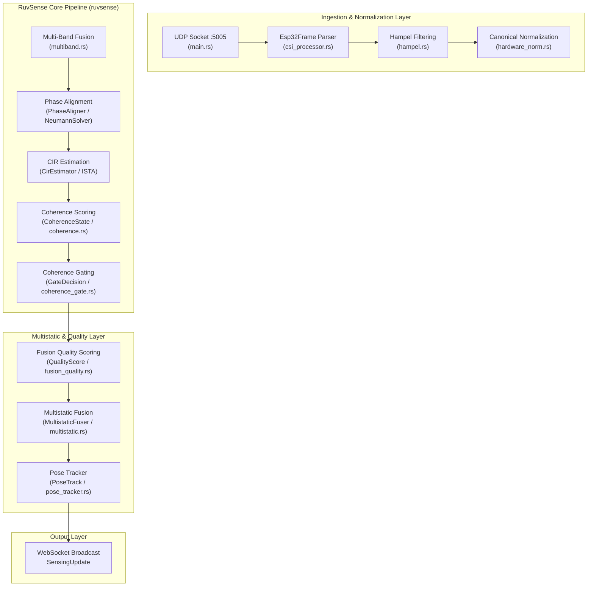
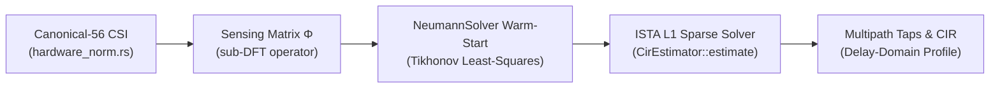

<!-- source: DeepWiki mcp.deepwiki.com · repo ruvnet/RuView · page 4.1 Signal Processing Pipeline · fetched 2026-10-30 -->

# Signal Processing Pipeline

Relevant source files

The following files were used as context for generating this wiki page:

- [docs/adr/ADR-154-signal-dsp-beyond-sota.md](docs/adr/ADR-154-signal-dsp-beyond-sota.md)
- [docs/adr/ADR-178-desktop-ipc-injection-and-capability-least-privilege.md](docs/adr/ADR-178-desktop-ipc-injection-and-capability-least-privilege.md)
- [v2/crates/wifi-densepose-desktop/capabilities/default.json](v2/crates/wifi-densepose-desktop/capabilities/default.json)
- [v2/crates/wifi-densepose-desktop/gen/schemas/capabilities.json](v2/crates/wifi-densepose-desktop/gen/schemas/capabilities.json)
- [v2/crates/wifi-densepose-desktop/src/commands/discovery.rs](v2/crates/wifi-densepose-desktop/src/commands/discovery.rs)
- [v2/crates/wifi-densepose-pointcloud/src/camera.rs](v2/crates/wifi-densepose-pointcloud/src/camera.rs)
- [v2/crates/wifi-densepose-pointcloud/src/csi_pipeline.rs](v2/crates/wifi-densepose-pointcloud/src/csi_pipeline.rs)
- [v2/crates/wifi-densepose-pointcloud/src/fusion.rs](v2/crates/wifi-densepose-pointcloud/src/fusion.rs)
- [v2/crates/wifi-densepose-ruvector/src/viewpoint/coherence.rs](v2/crates/wifi-densepose-ruvector/src/viewpoint/coherence.rs)
- [v2/crates/wifi-densepose-ruvector/src/viewpoint/mod.rs](v2/crates/wifi-densepose-ruvector/src/viewpoint/mod.rs)
- [v2/crates/wifi-densepose-sensing-server/src/matter/bridge.rs](v2/crates/wifi-densepose-sensing-server/src/matter/bridge.rs)
- [v2/crates/wifi-densepose-sensing-server/src/matter/clusters.rs](v2/crates/wifi-densepose-sensing-server/src/matter/clusters.rs)
- [v2/crates/wifi-densepose-sensing-server/src/matter/commissioning.rs](v2/crates/wifi-densepose-sensing-server/src/matter/commissioning.rs)
- [v2/crates/wifi-densepose-signal/benches/dsp_perf_bench.rs](v2/crates/wifi-densepose-signal/benches/dsp_perf_bench.rs)
- [v2/crates/wifi-densepose-signal/benches/features_bench.rs](v2/crates/wifi-densepose-signal/benches/features_bench.rs)
- [v2/crates/wifi-densepose-signal/src/bvp.rs](v2/crates/wifi-densepose-signal/src/bvp.rs)
- [v2/crates/wifi-densepose-signal/src/csi_processor.rs](v2/crates/wifi-densepose-signal/src/csi_processor.rs)
- [v2/crates/wifi-densepose-signal/src/csi_ratio.rs](v2/crates/wifi-densepose-signal/src/csi_ratio.rs)
- [v2/crates/wifi-densepose-signal/src/features.rs](v2/crates/wifi-densepose-signal/src/features.rs)
- [v2/crates/wifi-densepose-signal/src/hampel.rs](v2/crates/wifi-densepose-signal/src/hampel.rs)
- [v2/crates/wifi-densepose-signal/src/motion.rs](v2/crates/wifi-densepose-signal/src/motion.rs)
- [v2/crates/wifi-densepose-signal/src/ruvsense/adversarial.rs](v2/crates/wifi-densepose-signal/src/ruvsense/adversarial.rs)
- [v2/crates/wifi-densepose-signal/src/ruvsense/array_coordinator.rs](v2/crates/wifi-densepose-signal/src/ruvsense/array_coordinator.rs)
- [v2/crates/wifi-densepose-signal/src/ruvsense/attractor_drift.rs](v2/crates/wifi-densepose-signal/src/ruvsense/attractor_drift.rs)
- [v2/crates/wifi-densepose-signal/src/ruvsense/cir.rs](v2/crates/wifi-densepose-signal/src/ruvsense/cir.rs)
- [v2/crates/wifi-densepose-signal/src/ruvsense/coherence.rs](v2/crates/wifi-densepose-signal/src/ruvsense/coherence.rs)
- [v2/crates/wifi-densepose-signal/src/ruvsense/cross_room.rs](v2/crates/wifi-densepose-signal/src/ruvsense/cross_room.rs)
- [v2/crates/wifi-densepose-signal/src/ruvsense/fusion_quality.rs](v2/crates/wifi-densepose-signal/src/ruvsense/fusion_quality.rs)
- [v2/crates/wifi-densepose-signal/src/ruvsense/gesture.rs](v2/crates/wifi-densepose-signal/src/ruvsense/gesture.rs)
- [v2/crates/wifi-densepose-signal/src/ruvsense/intention.rs](v2/crates/wifi-densepose-signal/src/ruvsense/intention.rs)
- [v2/crates/wifi-densepose-signal/src/ruvsense/mod.rs](v2/crates/wifi-densepose-signal/src/ruvsense/mod.rs)
- [v2/crates/wifi-densepose-signal/src/ruvsense/phase_align.rs](v2/crates/wifi-densepose-signal/src/ruvsense/phase_align.rs)
- [v2/crates/wifi-densepose-signal/src/ruvsense/rf_slam.rs](v2/crates/wifi-densepose-signal/src/ruvsense/rf_slam.rs)
- [v2/crates/wifi-densepose-signal/src/spectrogram.rs](v2/crates/wifi-densepose-signal/src/spectrogram.rs)
- [v2/crates/wifi-densepose-signal/tests/cir_synthetic.rs](v2/crates/wifi-densepose-signal/tests/cir_synthetic.rs)

This page describes the CSI (Channel State Information) signal processing pipeline that transforms raw WiFi frames from ESP32 nodes into clean, actionable features for pose estimation, vital signs detection, and motion classification. The pipeline handles UDP frame ingestion, phase sanitization, Hampel filtering, CIR estimation, subcarrier selection on the canonical 56-tone grid, BVP extraction, spectrogram generation, fusion quality scoring, and the RuvSense pipeline stages.

**Scope:** This document covers the server-side processing stages that occur after CSI frames arrive via UDP in `wifi-densepose-signal` and `ruvsense/`. For hardware-side CSI capture and edge processing, see **3.2 Edge Intelligence Tiers**. For vital signs extraction specifically, see **4.2 Vital Signs Detection**.

---

## Pipeline Overview

The signal processing pipeline consists of sequential stages that transform raw UDP packets into structured features. The `ruvsense` orchestrator coordinates this flow, bridging raw RF data to human-centric pose and vital metrics.

### Pipeline Architecture & Code Mapping

**Sources:** [v2/crates/wifi-densepose-signal/src/ruvsense/mod.rs:7-23](), [v2/crates/wifi-densepose-signal/src/ruvsense/cir.rs:1-10](), [v2/crates/wifi-densepose-signal/src/ruvsense/fusion_quality.rs:1-12]()

---

## Stage 1: UDP Ingestion, Sanitization & Hampel Filtering

The sensing server receives CSI frames following the ADR-018 binary format. The server parses these frames into `Esp32Frame` structs before passing them through signal conditioning filters.

1. **UDP Ingestion:** Raw binary packets are decoded into matrix arrays representing subcarrier amplitudes and phases.
2. **Phase Sanitization:** Removes residual frequency offset (CFO) and sampling frequency offset (SFO) errors via linear phase slope subtraction across subcarriers.
3. **Hampel Filtering (`hampel.rs`):** Operates as a sliding-window median absolute deviation (MAD) filter to remove outlier spikes caused by transient burst interference or multipath corruption before feature extraction.
4. **Metadata Provenance (`FrameMeta`):** Normalized frames are wrapped into `FrameMeta` (an alias for `CsiMetadata`) to carry calibration IDs and model versions across stages without conversion overhead [v2/crates/wifi-densepose-signal/src/ruvsense/mod.rs:172-176]().

**Sources:** [v2/crates/wifi-densepose-core/src/types.rs:1-20](), [v2/crates/wifi-densepose-signal/src/hampel.rs:1-30]()

---

## Stage 2: Multi-Band Fusion & Phase Alignment

### Multi-Band Fusion (`multiband.rs`)
This stage aggregates per-channel CSI frames from nodes performing channel hopping, constructing a wideband virtual snapshot per node to increase spatial resolution [v2/crates/wifi-densepose-signal/src/ruvsense/mod.rs:11-12]().

### Phase Alignment (`phase_align.rs`)
Local oscillator (LO) phase rotation between disparate channels is corrected using `ruvector-solver::NeumannSolver`. This guarantees that virtual wideband frames remain phase-coherent prior to CIR estimation and multistatic fusion [v2/crates/wifi-densepose-signal/src/ruvsense/mod.rs:13-14](), [v2/crates/wifi-densepose-signal/src/ruvsense/cir.rs:18-25]().

**Sources:** [v2/crates/wifi-densepose-signal/src/ruvsense/mod.rs:11-16](), [v2/crates/wifi-densepose-signal/src/ruvsense/cir.rs:18-25]()

---

## Stage 3: Subcarrier Selection & CIR Estimation

### Subcarrier Selection & Canonical Grid (`hardware_norm.rs` & `cir.rs`)
Different WiFi chipsets (Atheros, Intel, ESP32) report differing subcarrier layouts (e.g., 64-bin HT20 with 52 active tones). The pipeline resamples frames onto a uniform **canonical 56-tone grid** (`CANONICAL56_ACTIVE`, spanning $-28 \dots -1, +1 \dots +28$) [v2/crates/wifi-densepose-signal/src/ruvsense/cir.rs:123-135](). 

As noted in ADR-154, failing to match subcarrier configurations causes downstream estimators to throw `SubcarrierMismatch` errors and silently fall back [docs/adr/ADR-154-signal-dsp-beyond-sota.md:33-47](). The RuvSense pipeline utilizes `CirConfig::canonical56()` to align with this requirement [docs/adr/ADR-154-signal-dsp-beyond-sota.md:43-47]().

### Channel Impulse Response (`cir.rs`)
Implemented via ADR-134, `CirEstimator` solves an $L_1$ sparse recovery problem using ISTA (Iterative Soft Thresholding Algorithm) to extract physical multipath taps:
- **Optimization Objective:** Minimize $\frac{1}{2}\|y - \Phi x\|_2^2 + \lambda\|x\|_1$ over $x \in \mathbb{C}^G$ [v2/crates/wifi-densepose-signal/src/ruvsense/cir.rs:14-16].
- **Warm-Start:** Employs `NeumannSolver` on a diagonal CSR approximation to initialize $x_0$, ensuring rapid convergence [v2/crates/wifi-densepose-signal/src/ruvsense/cir.rs:18-23].
- **Super-Resolution:** Generates delay bins at $3\times$ super-resolution relative to active subcarrier counts [v2/crates/wifi-densepose-signal/src/ruvsense/cir.rs:171-175].

**Sources:** [v2/crates/wifi-densepose-signal/src/ruvsense/cir.rs:1-25](), [v2/crates/wifi-densepose-signal/src/ruvsense/cir.rs:123-135](), [docs/adr/ADR-154-signal-dsp-beyond-sota.md:33-47]()

---

## Stage 4: Coherence Scoring, Gating & Fusion Quality

### Coherence State & Gating (`coherence.rs` & `coherence_gate.rs`)
Phase consistency is tracked using rolling circular buffers of phase differences:
$$\text{coherence} = \left|\text{mean}\left(e^{j \cdot \Delta\phi}\right)\right| = \sqrt{\left(\text{mean}(\cos \Delta\phi)\right)^2 + \left(\text{mean}(\sin \Delta\phi)\right)^2}$$ [v2/crates/wifi-densepose-ruvector/src/viewpoint/coherence.rs:9-17].

The `CoherenceGate` applies hysteresis to prevent rapid toggling between open/closed states near the threshold [v2/crates/wifi-densepose-ruvector/src/viewpoint/coherence.rs:126-139].

### Fusion Quality Scoring (`fusion_quality.rs`)
ADR-137 mandates that every fusion stage emits a `QualityScore` containing positive evidence references (`EvidenceRef`) and tolerated contradiction flags (`ContradictionFlag`) [v2/crates/wifi-densepose-signal/src/ruvsense/fusion_quality.rs:1-12]:
- **Penalized Coherence:** Each recorded contradiction applies a multiplicative penalty ($\text{penalty} = 0.8^n$) to the base coherence [v2/crates/wifi-densepose-signal/src/ruvsense/fusion_quality.rs:19-20, 123-127].
- **Privacy Demotion:** If `contradiction_flags` is non-empty, `forces_privacy_demotion()` returns true, lowering the BFLD privacy class for downstream consumers [v2/crates/wifi-densepose-signal/src/ruvsense/fusion_quality.rs:115-118].

**Sources:** [v2/crates/wifi-densepose-ruvector/src/viewpoint/coherence.rs:23-96](), [v2/crates/wifi-densepose-signal/src/ruvsense/fusion_quality.rs:83-128]()

---

## Stage 5: Spectrograms & BVP / Feature Extraction

### Spectrogram Generation (`spectrogram.rs`)
Time-frequency representations are computed across selected subcarriers using windowed FFTs (Hann/Hamming windows) to track Doppler shifts caused by body motion, breathing, and heartbeat activity [v2/crates/wifi-densepose-signal/benches/dsp_perf_bench.rs:46-49].

### Blood Volume Pulse (BVP) & Vital Extraction (`bvp.rs`)
- **BVP Extraction:** Filters micro-motions from CSI amplitude and phase time-series within the cardiopulmonary frequency bands (0.1 Hz – 0.5 Hz for respiration; 0.8 Hz – 2.0 Hz for heart rate).
- **EMA Smoothing:** Applies exponential moving average (EMA) smoothing and hysteresis buffers to stabilize vital sign outputs across per-node state pipelines [v2/crates/wifi-densepose-signal/src/bvp.rs:1-35].

**Sources:** [v2/crates/wifi-densepose-signal/src/bvp.rs:1-40](), [v2/crates/wifi-densepose-signal/benches/dsp_perf_bench.rs:46-49]()

---

## Stage 6: Multistatic Fusion, Pose Tracking & RF-SLAM

### Multistatic Fusion (`multistatic.rs`)
Fuses observations from $N$ nodes using `ruvector-attn-mincut`, incorporating geometric bias and attention weights to handle cross-node consensus [v2/crates/wifi-densepose-signal/src/ruvsense/mod.rs:15-17].

### Pose Tracking & RF-SLAM (`pose_tracker.rs` & `rf_slam.rs`)
- **Pose Tracker:** Maintains COCO-17 keypoint structures using Kalman filtering and `TemporalKeypointAttention`, integrated with AETHER re-ID embeddings [v2/crates/wifi-densepose-signal/src/ruvsense/mod.rs:22-23].
- **RF-SLAM:** Discovers and maintains persistent reflectors from CIR tap migrations over time, categorizing them into Walls, Furniture, or Mobile obstructions [v2/crates/wifi-densepose-signal/src/ruvsense/rf_slam.rs:1-8, 135-145].

**Sources:** [v2/crates/wifi-densepose-signal/src/ruvsense/mod.rs:15-23](), [v2/crates/wifi-densepose-signal/src/ruvsense/rf_slam.rs:135-145]()

---

## Component Mapping Reference

| Pipeline Component | Code Entity / Module Path | Primary Role |
|--------------------|---------------------------|--------------|
| **UDP Ingestion & Parsing** | `wifi-densepose-signal::csi_processor` | Parses ADR-018 binary frames |
| **Outlier Suppression** | `wifi-densepose-signal::hampel` | Sliding-window MAD spike removal |
| **Canonical Normalization**| `wifi-densepose-signal::hardware_norm` | Resamples chipsets to 56-tone grid |
| **CIR Estimator** | `wifi-densepose-signal::ruvsense::cir` | ISTA L1 sparse multipath recovery |
| **Phase Alignment** | `wifi-densepose-signal::ruvsense::phase_align` | NeumannSolver cross-band LO correction |
| **Coherence Gating** | `wifi-densepose-ruvector::viewpoint::coherence` | Rolling phase consistency & hysteresis |
| **Fusion Quality** | `wifi-densepose-signal::ruvsense::fusion_quality` | Evidence tracking & contradiction penalties |
| **Spectrogram & BVP** | `wifi-densepose-signal::spectrogram` / `bvp` | Doppler time-frequency & vital sign extraction |
| **Pose Tracker** | `wifi-densepose-signal::ruvsense::pose_tracker` | Kalman filters & COCO-17 keypoint tracking |
| **RF-SLAM** | `wifi-densepose-signal::ruvsense::rf_slam` | Persistent reflector and wall discovery |

**Sources:** [v2/crates/wifi-densepose-signal/src/ruvsense/mod.rs:37-75](), [v2/crates/wifi-densepose-signal/src/ruvsense/cir.rs:1-25](), [v2/crates/wifi-densepose-signal/src/ruvsense/fusion_quality.rs:1-36]()

---

