# Page: Overview

# Overview

<details>
<summary>Relevant source files</summary>

The following files were used as context for generating this wiki page:

- [CHANGELOG.md](CHANGELOG.md)
- [CLAUDE.md](CLAUDE.md)
- [README.md](README.md)
- [assets/ruview-hero-h3-v3.gif](assets/ruview-hero-h3-v3.gif)
- [assets/screen.png](assets/screen.png)
- [docs/adr/ADR-030-ruvsense-persistent-field-model.md](docs/adr/ADR-030-ruvsense-persistent-field-model.md)
- [docs/adr/ADR-095-rvcsi-edge-rf-sensing-platform.md](docs/adr/ADR-095-rvcsi-edge-rf-sensing-platform.md)
- [docs/adr/ADR-355-local-empty-room-bootstrap-prior.md](docs/adr/ADR-355-local-empty-room-bootstrap-prior.md)
- [docs/adr/ADR-357-raw-csi-calibration-sample-integrity.md](docs/adr/ADR-357-raw-csi-calibration-sample-integrity.md)
- [docs/ddd/README.md](docs/ddd/README.md)
- [docs/ddd/hardware-platform-domain-model.md](docs/ddd/hardware-platform-domain-model.md)
- [docs/ddd/ruvsense-domain-model.md](docs/ddd/ruvsense-domain-model.md)
- [docs/ddd/rvcsi-domain-model.md](docs/ddd/rvcsi-domain-model.md)
- [docs/ddd/sensing-server-domain-model.md](docs/ddd/sensing-server-domain-model.md)
- [docs/ddd/signal-processing-domain-model.md](docs/ddd/signal-processing-domain-model.md)
- [docs/ddd/training-pipeline-domain-model.md](docs/ddd/training-pipeline-domain-model.md)
- [docs/prd/rvcsi-platform-prd.md](docs/prd/rvcsi-platform-prd.md)
- [docs/readme-details.md](docs/readme-details.md)
- [docs/user-guide.md](docs/user-guide.md)
- [scripts/esp32_jsonl_to_rvcsi.py](scripts/esp32_jsonl_to_rvcsi.py)
- [v2/Cargo.lock](v2/Cargo.lock)
- [v2/Cargo.toml](v2/Cargo.toml)
- [v2/crates/wifi-densepose-sensing-server/Cargo.toml](v2/crates/wifi-densepose-sensing-server/Cargo.toml)
- [v2/crates/wifi-densepose-sensing-server/README.md](v2/crates/wifi-densepose-sensing-server/README.md)
- [v2/crates/wifi-densepose-sensing-server/src/bootstrap_baseline.rs](v2/crates/wifi-densepose-sensing-server/src/bootstrap_baseline.rs)
- [v2/crates/wifi-densepose-sensing-server/src/field_bridge.rs](v2/crates/wifi-densepose-sensing-server/src/field_bridge.rs)
- [v2/crates/wifi-densepose-sensing-server/src/lib.rs](v2/crates/wifi-densepose-sensing-server/src/lib.rs)
- [v2/crates/wifi-densepose-sensing-server/src/main.rs](v2/crates/wifi-densepose-sensing-server/src/main.rs)
- [v2/crates/wifi-densepose-signal/src/ruvsense/field_model.rs](v2/crates/wifi-densepose-signal/src/ruvsense/field_model.rs)

</details>


## Purpose and Scope
This document introduces the RuView/WiFi DensePose system, explaining its fundamental architecture, core capabilities (WiFi-based pose estimation, vital sign monitoring, camera-free sensing, privacy control planes, quantum sensing research, and Home Assistant integration), and its main software and hardware components. It bridges natural language explanations with explicit code entity citations from the `v2/` Rust workspace and supporting directories.

---

## What is RuView?

RuView (RuVector-based Viewing system) transforms ordinary Wi-Fi routers and low-cost edge sensors into contact-free spatial intelligence systems [README.md:12-22](). By capturing Channel State Information (CSI)—the physical properties of radio wave propagation—RuView interprets human presence, motion, breathing, and body posture without requiring cameras or wearables [README.md:12-12]().

- **WiFi-Based Pose Estimation**: Reconstructs 17 COCO keypoints and DensePose UV mappings from temporal CSI fluctuations [README.md:33-33]().
- **Vital Sign Monitoring**: Tracks contactless breathing (6–30 BPM) and heart rate (40–120 BPM) during sleeping or stationary periods [README.md:26-29]().
- **Camera-Free Sensing**: Operates through walls, in total darkness, and across partitions using Fresnel zone radio scattering [README.md:12-12]().
- **Privacy Control Planes**: Enforces strict governance, data reduction, and identity anonymization via the Beamforming Feedback Layer (`wifi-densepose-bfld`) [v2/Cargo.toml:65-67]().
- **Quantum Sensing Research**: Simulates NV-diamond ensemble magnetometers and ODMR response via the `nvsim` crate [v2/Cargo.toml:41-42]().
- **Home Assistant & Smart Home Integration**: Publishes 21 entities per node via `HA-DISCO` MQTT and integrates natively with Matter and Apple Home (HAP) bridges [README.md:14-18]().

---

## System Architecture

The RuView system is structured around an edge capture layer, a high-performance Rust processing server, application frontends, and a structured training pipeline [v2/crates/wifi-densepose-sensing-server/src/main.rs:1-8]().

### Diagram: End-to-End Data Flow

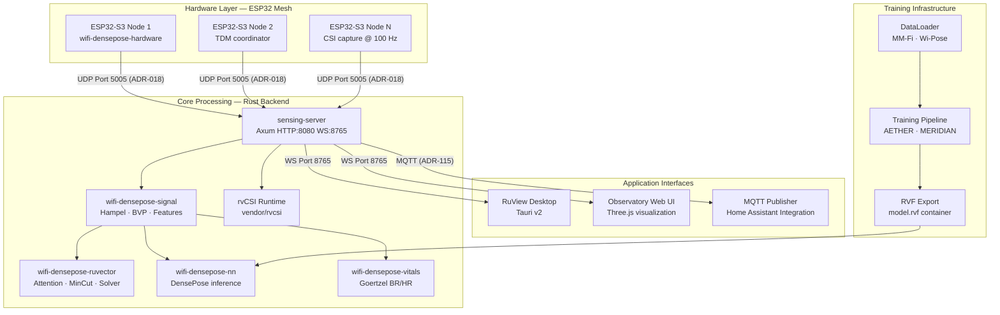

Sources: [CLAUDE.md:7-26](), [v2/crates/wifi-densepose-sensing-server/src/main.rs:1-9](), [README.md:18-22](), [docs/readme-details.md:13-19]()

---

## Main Components

RuView's architecture is divided into modular subsystems maintained within the `v2/crates/` workspace:

| Component | Implementation | Description |
|---|---|---|
| **Hardware & Edge Nodes** | ESP32-S3 firmware, NVS provisioning | Captures raw CSI, manages edge intelligence tiers (0–3), and handles time-division multiplexing (TDM) mesh coordination [CLAUDE.md:75-84](). |
| **Core Sensing Engine** | `wifi-densepose-signal`, `wifi-densepose-nn`, `wifi-densepose-vitals` | Processes subcarrier amplitudes, phase sanitization, Hampel filtering, and neural inference [v2/Cargo.toml:4-7](). |
| **rvCSI Runtime** | `vendor/rvcsi` | Edge RF sensing runtime normalizing multi-vendor Wi-Fi chipsets (ESP32, Intel 5300, Atheros) [CLAUDE.toml:75-80](). |
| **Applications & UI** | `wifi-densepose-desktop`, `ui/` | Tauri desktop app, Three.js Observatory web interface, and dashboard services [v2/Cargo.toml:29-30](). |
| **Training & Deployment** | `wifi-densepose-train`, `rvf_container` | Model training pipelines, dataset loaders, and portable RVF model container packaging [v2/Cargo.toml:22-23](). |
| **Quantum Research** | `nvsim`, `nvsim-server` | Deterministic NV-diamond ensemble magnetometer simulation and quantum-sensing/neural-decoding research docs [v2/Cargo.toml:41-42](). |

Sources: [README.md:31-47](), [CLAUDE.md:7-26](), [v2/Cargo.toml:1-111]()

---

## Component Interactions

### Diagram: Data Flow from CSI to Code Entities

```mermaid
graph LR
    subgraph CaptureChain ["CSI Capture"]
        RawCSI["Raw CSI<br/>56 subcarriers<br/>I/Q pairs"]
        ESPEdge["Edge Intelligence<br/>wifi-densepose-hardware"]
    end
    
    subgraph TransportChain ["UDP Transport"]
        UDPFrame["UDP Frame<br/>ADR-018 format<br/>Magic: 0xC5110001"]
        CsiFrame["CsiFrame Struct<br/>rvcsi-core"]
    end
    
    subgraph SignalChain ["Signal Processing"]
        PhaseUnwrap["phase_align.rs<br/>signal/src/ruvsense/"]
        Hampel["hampel_filter()<br/>signal/src/sota.rs"]
        BVP["extract_bvp()<br/>signal/src/bvp.rs"]
        Features["compute_features()<br/>signal/src/features.rs"]
    end
    
    subgraph ClassificationChain ["Classification & Detection"]
        AdaptiveClass["AdaptiveClassifier<br/>sensing-server/src/"]
        VitalDet["VitalSignDetector<br/>wifi-densepose-vitals"]
        Pose["PoseEstimator<br/>nn/src/inference.rs"]
    end
    
    subgraph OutputChain ["Output"]
        AxumRouter["Axum Router<br/>main.rs"]
        MqttPub["MqttPublisher<br/>mqtt/publisher.rs"]
        WS["WebSocket<br/>SensingUpdate Struct"]
    end
    
    RawCSI --> ESPEdge
    ESPEdge --> UDPFrame
    UDPFrame --> CsiFrame
    CsiFrame --> PhaseUnwrap
    PhaseUnwrap --> Hampel
    Hampel --> BVP
    BVP --> Features
    Features --> AdaptiveClass
    AdaptiveClass --> VitalDet
    VitalDet --> Pose
    Pose --> AxumRouter
    AxumRouter --> WS
    AxumRouter --> MqttPub
```

Sources: [CLAUDE.md:7-57](), [v2/crates/wifi-densepose-sensing-server/src/main.rs:12-22](), [v2/crates/wifi-densepose-sensing-server/src/main.rs:58-65]()

---

## Key Capabilities & Performance

| Capability / Metric | Value / Spec | Code / Architecture Reference |
|---|---|---|
| **Pose Estimation** | 17 COCO keypoints, DensePose UV mapping | [README.md:33-33]() |
| **Vital Signs** | 6–30 BPM breathing, 40–120 BPM heart rate | [README.md:26-29]() |
| **Presence Accuracy** | 82.3% temporal-triplet accuracy (v2 encoder) | [README.md:73-74]() |
| **Sensing Latency** | < 1 ms presence detection | [docs/user-guide.md:1-20]() |
| **Test Coverage** | 1,463+ unit and integration tests | [README.md:80-81]() |
| **Adaptation Speed** | < 30 seconds online calibration | [README.md:71-72]() |

Sources: [README.md:33-81](), [docs/user-guide.md:1-20]()

---

Sources: [README.md:1-81](), [v2/crates/wifi-densepose-sensing-server/src/main.rs:1-176](), [v2/Cargo.toml:1-111](), [CLAUDE.md:1-148]()

---

# Page: Quick Start

# Quick Start

<details>
<summary>Relevant source files</summary>

The following files were used as context for generating this wiki page:

- [.claude-flow/daemon-state.json](.claude-flow/daemon-state.json)
- [.claude-flow/metrics/codebase-map.json](.claude-flow/metrics/codebase-map.json)
- [.claude-flow/metrics/consolidation.json](.claude-flow/metrics/consolidation.json)
- [.claude-flow/metrics/performance.json](.claude-flow/metrics/performance.json)
- [.claude-flow/metrics/security-audit.json](.claude-flow/metrics/security-audit.json)
- [.claude-flow/metrics/test-gaps.json](.claude-flow/metrics/test-gaps.json)
- [.claude/scheduled_tasks.lock](.claude/scheduled_tasks.lock)
- [Makefile](Makefile)
- [docs/adr/ADR-126-ruview-native-ha-port-master.md](docs/adr/ADR-126-ruview-native-ha-port-master.md)
- [example.env](example.env)
- [install.sh](install.sh)
- [requirements-dev.txt](requirements-dev.txt)
- [requirements.txt](requirements.txt)

</details>


This guide walks you through installing RuView and running your first WiFi sensing demonstration. It covers installation using the multi-profile installer, choosing the appropriate deployment profile based on your hardware and use case, and verifying the system works with either real ESP32 hardware or simulated data.

For detailed API usage and advanced configuration, see [REST API Endpoints](#8.1). For ESP32 hardware setup and provisioning, see [ESP32 Setup & Provisioning](#3.1). For training custom models, see [Training & Model Deployment](#6).

---

## Prerequisites

Before installation, ensure your system meets minimum requirements. The `install.sh` script performs automatic detection of these resources.

| Resource | Minimum | Recommended | Detection Method |
|----------|---------|-------------|------------------|
| **OS** | Windows 10/11, macOS 10.15, Ubuntu 18.04 | Latest stable | `uname -s` [install.sh:137-148]() |
| **RAM** | 4 GB | 8 GB+ | `sysctl` / `/proc/meminfo` [install.sh:160-171]() |
| **Disk** | 2 GB free | 5 GB free | `df -m` [install.sh:174-181]() |
| **Python** | 3.10+ | 3.12+ | `python3 --version` [requirements.txt:2-5]() |
| **Rust** | 1.80+ | 1.89+ | `rustc --version` |

**Hardware for live sensing** (optional):

| Option | Cost | CSI Capability | Supported Platforms |
|--------|------|----------------|---------------------|
| ESP32-S3 mesh (3-6 boards) | ~$54 | Full CSI (64 subcarriers) | All platforms |
| No hardware | $0 | Simulated mode | All platforms |

Sources: [install.sh:47-67](), [requirements.txt:1-39]()

---

## Installation

### Interactive Installation

The guided installer detects your hardware and recommends an appropriate profile:

```bash
git clone https://github.com/ruvnet/RuView.git
cd RuView
./install.sh
```

The installer performs 7 steps:
1. **System Detection** — OS, architecture, RAM, disk space, GPU [install.sh:132-157]()
2. **Toolchain Detection** — Python, Rust, Cargo, Docker, Node.js, ESP-IDF
3. **WiFi Hardware Detection** — WiFi interfaces, USB serial devices
4. **Profile Recommendation** — Suggests optimal profile based on detected hardware
5. **Installation** — Installs dependencies and builds binaries
6. **Verification** — Runs deterministic signal processing proof
7. **Summary** — Next steps and verification commands

**Installation Profiles and System Association**:

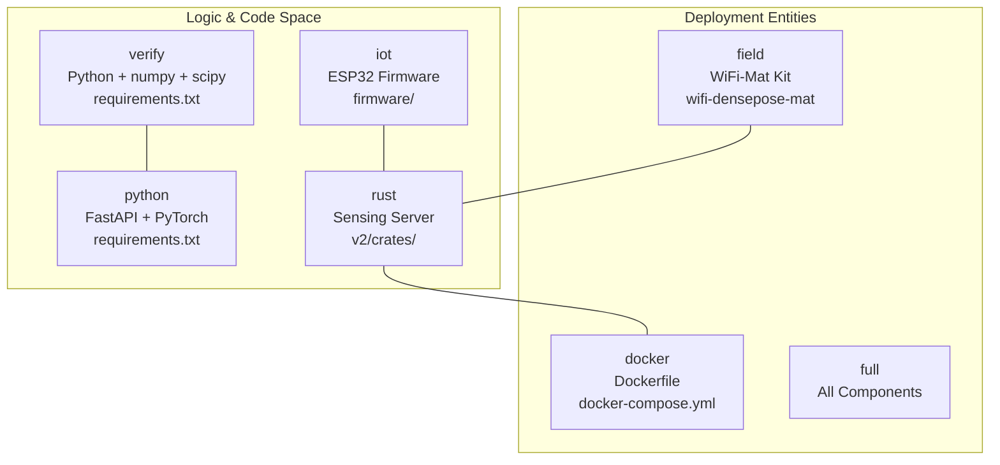
Sources: [install.sh:14-23](), [requirements.txt:1-15]()

**Profile Decision Guide**:

| Profile | Install When | Key Dependency | Makefile Shortcut |
|---------|-------------|----------------|-------------------|
| `verify` | Validating DSP logic | `numpy`, `scipy` [install.sh:15-15]() | `make install-verify` [Makefile:14-15]() |
| `python` | Using legacy v1 API | `fastapi`, `torch` [requirements.txt:4-8]() | `make install-python` [Makefile:17-18]() |
| `rust` | Production sensing | `cargo`, `rustc` [Makefile:53-54]() | `make install-rust` [Makefile:20-21]() |
| `browser` | WASM browser deployment | `wasm-pack` [Makefile:56-57]() | `make install-browser` [Makefile:23-24]() |
| `docker` | Containerized setup | `docker-compose` [Makefile:78-79]() | `make install-docker` [Makefile:26-27]() |
| `field` | Disaster response | `wifi-densepose-mat` [Makefile:29-30]() | `make install-field` [Makefile:29-30]() |
| `full` | Core development | All Toolchains [install.sh:22-22]() | `make install-full` [Makefile:32-33]() |

For detailed breakdowns of each installation profile, dependencies, and Makefile shortcuts, see [Installation Profiles](#2.1).

Sources: [install.sh:14-23](), [Makefile:14-34](), [requirements.txt:1-15]()

---

## Quick Start Paths

### Path 1: Docker (Fastest)

The fastest way to see RuView in action without installing local toolchains.

```bash
# Start the sensing server and UI
docker compose up
```

By default, the container runs `sensing-server` with `CSI_SOURCE=auto`, which probes for ESP32 hardware before falling back to simulated data.

Sources: [Makefile:78-79]()

---

### Path 2: Verification (Deterministic Proof)

Verify the signal processing pipeline produces correct output on a reference signal using the "Trust Kill Switch".

```bash
# Run the verification proof
make verify
```

This executes a one-command proof replay that validates signal integrity across the pipeline [Makefile:40-42](). Use `make verify-audit` to also scan the codebase for mock or random patterns [Makefile:49-50]().

Sources: [Makefile:40-51]()

---

### Path 3: Running Your First Demo

To launch the sensing server in simulation mode, connect the Observatory UI, and interpret pose and vitals output, follow the step-by-step instructions in [Running Your First Demo](#2.2).

**Data Flow Architecture**:

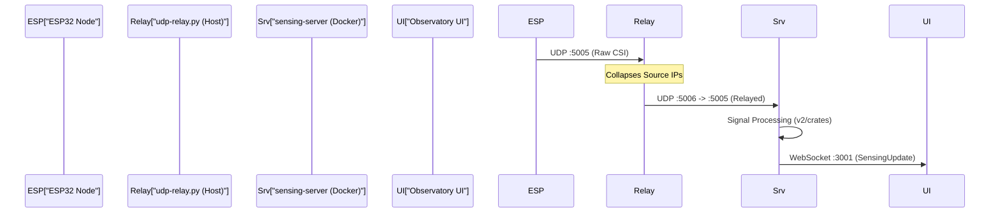
Sources: [Makefile:1-123]()

---

## Next Steps

After completing quick start, explore these child pages for deeper details:

- **[Installation Profiles](#2.1)** — Detailed dependency lists for `verify`, `python`, `rust`, `browser`, `iot`, `docker`, `field`, and `full` profiles.
- **[Running Your First Demo](#2.2)** — Step-by-step guide to simulation mode and interpreting pose/vital signs output.

For hardware details, see **[Hardware & Edge Nodes](#3)**. To understand the processing logic, see **[Core Sensing Engine](#4)**.

---

# Page: Installation Profiles

# Installation Profiles

<details>
<summary>Relevant source files</summary>

The following files were used as context for generating this wiki page:

- [.claude-flow/daemon-state.json](.claude-flow/daemon-state.json)
- [.claude-flow/metrics/codebase-map.json](.claude-flow/metrics/codebase-map.json)
- [.claude-flow/metrics/consolidation.json](.claude-flow/metrics/consolidation.json)
- [.claude-flow/metrics/performance.json](.claude-flow/metrics/performance.json)
- [.claude-flow/metrics/security-audit.json](.claude-flow/metrics/security-audit.json)
- [.claude-flow/metrics/test-gaps.json](.claude-flow/metrics/test-gaps.json)
- [.claude/scheduled_tasks.lock](.claude/scheduled_tasks.lock)
- [Makefile](Makefile)
- [docs/adr/ADR-126-ruview-native-ha-port-master.md](docs/adr/ADR-126-ruview-native-ha-port-master.md)
- [example.env](example.env)
- [install.sh](install.sh)
- [requirements-dev.txt](requirements-dev.txt)
- [requirements.txt](requirements.txt)

</details>


This page details the available installation profiles for RuView, the dependencies each profile manages, and the logic used by the system to recommend a profile based on hardware detection.

RuView uses a multi-tier installation strategy to support environments ranging from low-power ESP32 nodes to high-performance GPU-accelerated sensing servers. The primary entry point for installation is the `install.sh` script, which orchestrates system detection, toolchain verification, and profile-specific builds `[install.sh:1-23]()`.

---

## Profile Definitions

The system defines eight distinct profiles, each targeting a specific deployment scenario or development need.

| Profile | Purpose | Key Dependencies | Footprint |
|:---|:---|:---|:---|
| `verify` | Minimal validation of the signal processing pipeline | Python 3.9+, `numpy`, `scipy` `[install.sh:97]()`, `[requirements.txt:2-3]()` | ~5 MB |
| `python` | Full Python pipeline (API server, sensing, analytics) | `fastapi`, `uvicorn`, `torch`, `opencv-python` `[install.sh:98]()`, `[requirements.txt:4-34]()` | ~500 MB |
| `rust` | High-performance core sensing engine (Rust pipeline) | Rust 1.89+, Cargo, OpenBLAS, `pkg-config` `[install.sh:99]()`, `[install.sh:60-61]()` | ~132 MB |
| `browser` | WASM build for browser deployment | `wasm-pack`, `wasm32-unknown-unknown` target `[install.sh:100]()`, `[install.sh:51-52]()` | ~10 MB |
| `iot` | ESP32 sensor mesh + aggregator | ESP-IDF, `esptool`, `provision.py` `[install.sh:101]()`, `[install.sh:56]()` | Variable |
| `docker` | Containerized deployment using Docker Compose | Docker 20+, Docker Compose 3.9+ `[install.sh:102]()` | ~1 GB |
| `field` | Disaster response (WiFi-Mat) field deployment | `wifi-densepose-mat` crate, optimized WASM `[install.sh:103]()` | ~62 MB |
| `full` | Complete development environment (Everything) | All toolchains (Rust, Python, Node, ESP-IDF) `[install.sh:104]()` | ~2 GB+ |

Sources: `[install.sh:14-23]()`, `[install.sh:96-104](), [requirements.txt:1-39]()`

---

## Implementation & Data Flow

The `install.sh` script implements a multi-step process to ensure the environment matches the chosen profile's requirements.

### System Detection Logic
The installer first probes the host for hardware capabilities, including RAM, disk space, and GPU availability. It uses `sysctl` on macOS and `/proc/meminfo` on Linux to determine if the system meets the 4096MB minimum (8192MB recommended) RAM threshold `[install.sh:132-171]()`. It also checks for the presence of development tools like `python3`, `cargo`, `docker`, and `npm` `[install.sh:48-57]()`.

### Profile Recommendation
Based on detected tools, the script suggests a profile:
*   If `cargo` is found: Enables Rust pipeline capabilities `[install.sh:49-50]()`.
*   If `docker` is found: Enables containerized deployment paths `[install.sh:53]()`.
*   If `esp-idf` is found: Enables IoT firmware building `[install.sh:56]()`.

### Data Flow: Installation to Execution

Title: "InstallationPipelineDataFlow"
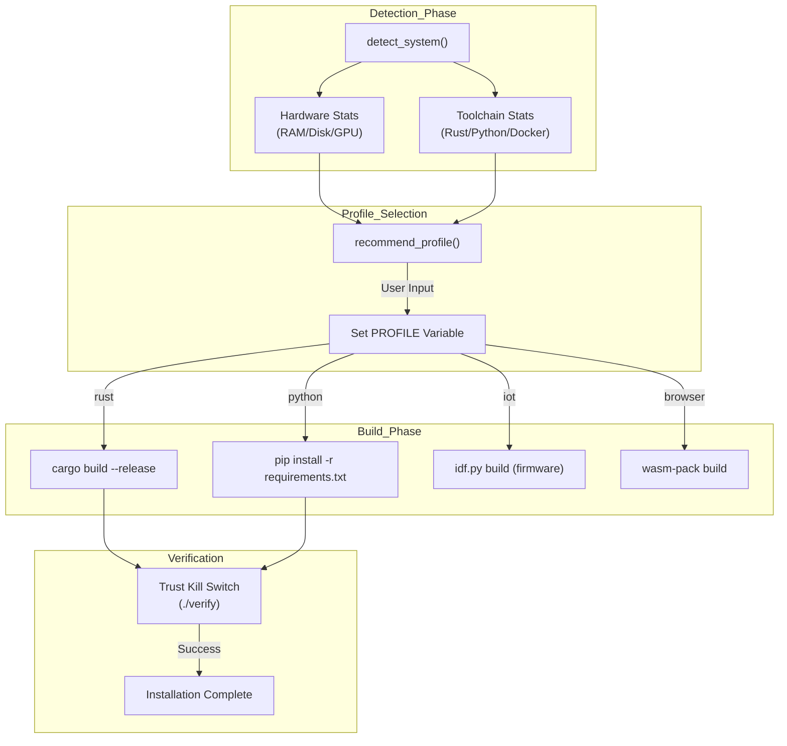
Sources: `[install.sh:132-158](), [requirements.txt:1-39]()`

---

## Profile Technical Details

### 1. Verification Profile (`verify`)
*   **Purpose**: Minimal validation script execution.
*   **Dependencies**: Python 3.9+, `numpy`, `scipy` `[install.sh:97](), [requirements.txt:2-3]()`.
*   **Shortcut**: `make install-verify` `[Makefile:14-15]()`.

### 2. Python Profile (`python`)
*   **Purpose**: Full Python pipeline for API serving (`fastapi`, `uvicorn`), model execution (`torch`), and analytics `[install.sh:98](), [requirements.txt:4-34]()`.
*   **Shortcut**: `make install-python` `[Makefile:17-18]()`.
*   **Execution**: `python -m archive.v1.src.api.main` `[Makefile:69-70]()`.

### 3. Rust Profile (`rust`)
*   **Purpose**: High-performance core sensing engine and server binaries.
*   **Dependencies**: Rust 1.89+, Cargo, OpenBLAS, `pkg-config` `[install.sh:99](), [install.sh:60-61]()`.
*   **Shortcut**: `make install-rust` `[Makefile:20-21]()`.
*   **Build Command**: `cd v2 && cargo build --release` `[Makefile:53-54]()`.

### 4. Browser Profile (`browser`)
*   **Purpose**: WASM compilation for browser deployment and client-side inference `[install.sh:100]()`.
*   **Dependencies**: `wasm-pack`, target `wasm32-unknown-unknown` `[install.sh:51-52]()`.
*   **Shortcut**: `make install-browser` `[Makefile:23-24]()`.
*   **Build Command**: `cd v2 && wasm-pack build crates/wifi-densepose-wasm --target web --release` `[Makefile:56-57]()`.

### 5. IoT Profile (`iot`)
*   **Purpose**: ESP32 sensor mesh deployment, NVS configuration, and firmware flashing `[install.sh:101]()`.
*   **Dependencies**: ESP-IDF v5.4, `esptool`, Python provisioning utilities `[install.sh:56]()`.
*   **Shortcut**: `make install-iot` `[Makefile:29-30]()` (invokes `install.sh --profile iot --yes`).

### 6. Docker Profile (`docker`)
*   **Purpose**: Containerized deployment using Docker Compose `[install.sh:102]()`.
*   **Dependencies**: Docker 20+, Docker Compose 3.9+ `[install.sh:102]()`.
*   **Shortcut**: `make install-docker` `[Makefile:26-27]()`.
*   **Execution**: `docker compose up` `[Makefile:78-79]()`.

### 7. Field Profile (`field`)
*   **Purpose**: Mass Casualty Assessment Tool (WiFi-Mat) field deployment kit `[install.sh:103]()`.
*   **Dependencies**: `wifi-densepose-mat` crate, optimized WASM components `[install.sh:103]()`.
*   **Shortcut**: `make install-field` `[Makefile:29-30]()`.
*   **Build Target**: `make build-wasm-mat` `[Makefile:59-60]()`.

### 8. Full Profile (`full`)
*   **Purpose**: Complete development environment containing all toolchains (Rust, Python, Node, ESP-IDF) `[install.sh:104]()`.
*   **Shortcut**: `make install-full` `[Makefile:32-33]()`.

Sources: `[install.sh:96-104](), [Makefile:14-34]()`

---

## Makefile Shortcuts

The `Makefile` provides standardized entry points for common operations across profiles, abstracting the underlying `install.sh` flags.

| Command | Action |
|:---|:---|
| `make install-verify` | Non-interactive install of the `verify` profile `[Makefile:14-15]()` |
| `make install-rust` | Non-interactive install of the `rust` profile `[Makefile:20-21]()` |
| `make build-rust` | Compiles the Rust workspace in release mode `[Makefile:53-54]()` |
| `make verify` | Runs the "Trust Kill Switch" proof replay `[Makefile:41-42]()` |
| `make check` | Runs hardware/environment checks only `[Makefile:36-37]()` |
| `make run-api` | Starts the Python FastAPI server `[Makefile:69-70]()` |

Sources: `[Makefile:1-123]()`

---

## Code Entity Map

The following diagram maps high-level profile concepts to specific code entities and files within the RuView architecture, bridging natural language requirements to code elements.

Title: "ProfileToCodeEntityMapping"
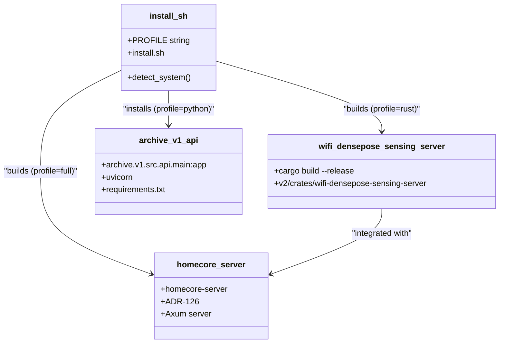
Sources: `[install.sh:41-67](), [Makefile:53-70](), [requirements.txt:1-17]()`

---

# Page: Running Your First Demo

# Running Your First Demo

<details>
<summary>Relevant source files</summary>

The following files were used as context for generating this wiki page:

- [CHANGELOG.md](CHANGELOG.md)
- [CLAUDE.md](CLAUDE.md)
- [README.md](README.md)
- [assets/ruview-hero-h3-v3.gif](assets/ruview-hero-h3-v3.gif)
- [assets/screen.png](assets/screen.png)
- [docker/Dockerfile.rust](docker/Dockerfile.rust)
- [docker/docker-compose.yml](docker/docker-compose.yml)
- [docker/docker-entrypoint.sh](docker/docker-entrypoint.sh)
- [docs/TROUBLESHOOTING.md](docs/TROUBLESHOOTING.md)
- [docs/adr/ADR-355-local-empty-room-bootstrap-prior.md](docs/adr/ADR-355-local-empty-room-bootstrap-prior.md)
- [docs/adr/ADR-357-raw-csi-calibration-sample-integrity.md](docs/adr/ADR-357-raw-csi-calibration-sample-integrity.md)
- [docs/readme-details.md](docs/readme-details.md)
- [docs/user-guide.md](docs/user-guide.md)
- [firmware/esp32-csi-node/components/wasm3/CMakeLists.txt](firmware/esp32-csi-node/components/wasm3/CMakeLists.txt)
- [firmware/esp32-csi-node/main/swarm_bridge.c](firmware/esp32-csi-node/main/swarm_bridge.c)
- [plans/overview.md](plans/overview.md)
- [scripts/udp-relay.py](scripts/udp-relay.py)
- [tests/test_docker_entrypoint.sh](tests/test_docker_entrypoint.sh)
- [ui/README.md](ui/README.md)
- [ui/config/api.config.js](ui/config/api.config.js)
- [ui/start-ui.sh](ui/start-ui.sh)
- [ui/tests/integration-test.html](ui/tests/integration-test.html)
- [ui/utils/backend-detector.js](ui/utils/backend-detector.js)
- [v2/Cargo.lock](v2/Cargo.lock)
- [v2/Cargo.toml](v2/Cargo.toml)
- [v2/crates/wifi-densepose-desktop/src/commands/server.rs](v2/crates/wifi-densepose-desktop/src/commands/server.rs)
- [v2/crates/wifi-densepose-sensing-server/Cargo.toml](v2/crates/wifi-densepose-sensing-server/Cargo.toml)
- [v2/crates/wifi-densepose-sensing-server/README.md](v2/crates/wifi-densepose-sensing-server/README.md)
- [v2/crates/wifi-densepose-sensing-server/src/bootstrap_baseline.rs](v2/crates/wifi-densepose-sensing-server/src/bootstrap_baseline.rs)
- [v2/crates/wifi-densepose-sensing-server/src/field_bridge.rs](v2/crates/wifi-densepose-sensing-server/src/field_bridge.rs)
- [v2/crates/wifi-densepose-sensing-server/src/lib.rs](v2/crates/wifi-densepose-sensing-server/src/lib.rs)
- [v2/crates/wifi-densepose-sensing-server/src/main.rs](v2/crates/wifi-densepose-sensing-server/src/main.rs)
- [v2/crates/wifi-densepose-signal/src/ruvsense/field_model.rs](v2/crates/wifi-densepose-signal/src/ruvsense/field_model.rs)

</details>


This guide walks you through launching the RuView sensing server, connecting the Observatory UI, and interpreting the first pose and vital signs output. It covers both the high-fidelity **ESP32 hardware path** and the **simulated data path** for immediate testing.

Sources: [README.md:24-35](), [docs/user-guide.md:19-24](), [CLAUDE.md:18-21]()

---

## 1. Launching the Sensing Server

The sensing server (implemented in the `wifi-densepose-sensing-server` crate) is a lightweight Axum-based application that acts as the central hub for the RuView ecosystem. It aggregates CSI data from hardware or simulation, processes it using the `wifi-densepose-signal` crate, and broadcasts real-time updates via WebSockets.

Sources: [v2/crates/wifi-densepose-sensing-server/src/main.rs:1-9](), [CLAUDE.md:18-19]()

### Option A: Simulated Mode (No Hardware)
Ideal for verifying the installation and exploring the UI features immediately. The server generates synthetic CSI frames that mimic human movement and breathing patterns.

```bash
# Using Docker
docker run -e CSI_SOURCE=simulated -p 8080:8080 -p 8765:8765 ruvnet/wifi-densepose:latest

# Using the Rust binary (from v2 workspace)
cd v2
cargo run -p wifi-densepose-sensing-server -- --source simulate
```
Sources: [docs/user-guide.md:96-105](), [v2/crates/wifi-densepose-sensing-server/src/main.rs:118-120]()

### Option B: Hardware Mode (ESP32-S3)
Connects to real sensors for live environment monitoring. The server listens for UDP packets containing CSI data (default port 5005).

```bash
# Start server to listen for UDP CSI frames from ESP32
docker run -e CSI_SOURCE=esp32 -p 8080:8080 -p 5005:5005/udp ruvnet/wifi-densepose:latest
```
Sources: [docs/user-guide.md:105-105](), [v2/crates/wifi-densepose-sensing-server/src/main.rs:80-82](), [CLAUDE.md:80-82]()

**Sensing Server Component Flow**:

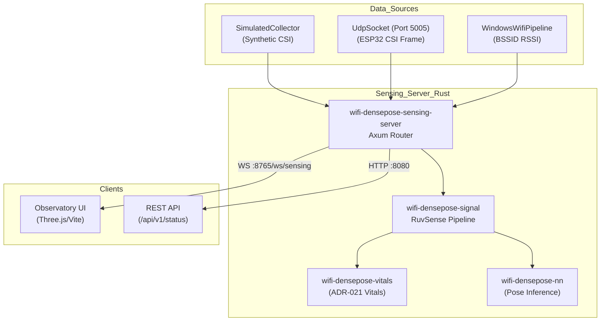
Sources: [v2/crates/wifi-densepose-sensing-server/src/main.rs:1-9](), [v2/crates/wifi-densepose-sensing-server/src/main.rs:58-60](), [CLAUDE.md:10-21]()

---

## 2. Connecting the Observatory UI

The Observatory UI is a modular web interface served by the sensing server. It auto-detects the backend and establishes a WebSocket connection for real-time visualization.

1.  **Open the Browser**: Navigate to `http://localhost:8080`.
2.  **Verify Connection**: The UI establishes a connection to the WebSocket endpoint at `ws://localhost:8765/ws/sensing`.
3.  **Data Source Label**: The UI displays the current data source state managed by `SensingService`:
    *   **live**: Real ESP32 hardware connected.
    *   **server-simulated**: Server is running but using synthetic data.
    *   **reconnecting**: WebSocket disconnected; the service is retrying.
    *   **simulated**: Client-side fallback simulation (used if the server is unreachable).

Sources: [v2/crates/wifi-densepose-sensing-server/src/main.rs:72-78]()

### UI Service Architecture
The `SensingService` in the browser manages the lifecycle of the data stream and provides the fallback logic.

| State | Logic | Source |
|-------|-------|--------|
| **connected** | Receives `SensingUpdate` JSON | `v2/crates/wifi-densepose-sensing-server/src/main.rs` |
| **reconnecting** | Exponential backoff (max 20 attempts) | `v2/crates/wifi-densepose-sensing-server/src/main.rs` |
| **simulated** | Client-side fallback after 5 failed retries | `v2/crates/wifi-densepose-sensing-server/src/main.rs` |

Sources: [v2/crates/wifi-densepose-sensing-server/src/main.rs:1-9]()

---

## 3. Interpreting the Output

The system outputs a unified update message containing signal metrics, vital signs, and pose data.

### Vital Signs Panel
RuView extracts micro-vibrations from the CSI phase using the `wifi-densepose-vitals` crate.
*   **Breathing Rate**: Extracted via bandpass (0.1-0.5 Hz). Normal: 6-30 BPM.
*   **Heart Rate**: Extracted via bandpass (0.8-2.0 Hz). Normal: 40-120 BPM.
*   **Confidence Score**: A value [0.0, 1.0] indicating signal quality and SNR.

Sources: [README.md:55-58](), [v2/crates/wifi-densepose-sensing-server/src/main.rs:54-56]()

### 3D Pose Skeleton
The UI renders a 17-keypoint COCO skeleton based on the inference mode:
*   **Signal-Derived**: Procedural animation driven by motion variance and presence detection from `wifi-densepose-signal`.
*   **Model Inference**: High-fidelity pose reconstruction from a loaded RuVector (`.rvf`) model container via `wifi-densepose-nn`.

Sources: [README.md:61-61](), [v2/crates/wifi-densepose-sensing-server/src/main.rs:17-20](), [CLAUDE.md:11-13]()

**Data to Code Mapping (SensingUpdate)**:

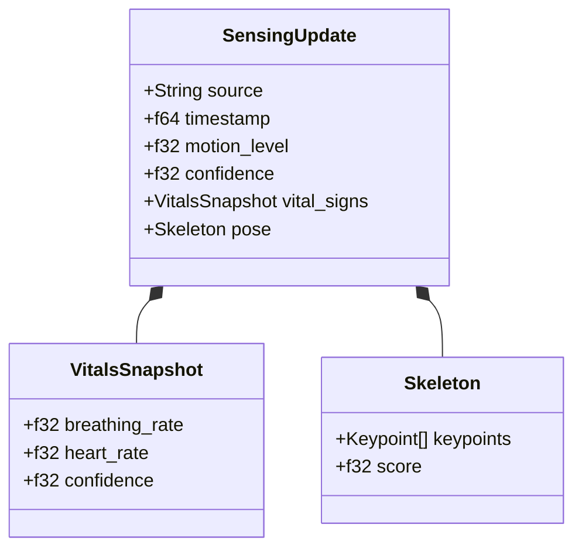
Sources: [CHANGELOG.md:12-12](), [v2/crates/wifi-densepose-sensing-server/src/main.rs:54-56](), [CLAUDE.md:11-13]()

---

## 4. First Run Verification Checklist

To ensure your demo is running correctly, verify the following:

| Check | Component | Expected Result |
|-------|-----------|-----------------|
| **Backend Health** | `Axum Router` | Server starts on port 8080, logs "Connected" on startup |
| **WebSocket** | `SensingService` | Connection state moves to `connected`, `onData` callbacks receive JSON frames |
| **CSI Stream** | `SensingTab` | Real-time RSSI sparkline updating in the UI |
| **Vitals** | `VitalSignDetector` | BPM values appearing in the vital signs panel |
| **Pose** | `PoseTracker` | 17-keypoint skeleton rendering in the 3D viewport |

Sources: [v2/crates/wifi-densepose-sensing-server/src/main.rs:62-65]()

---

# Page: Hardware & Edge Nodes

# Hardware & Edge Nodes

<details>
<summary>Relevant source files</summary>

The following files were used as context for generating this wiki page:

- [.github/workflows/firmware-ci.yml](.github/workflows/firmware-ci.yml)
- [docs/adr/ADR-363-native-macos-usb-node-onboarding.md](docs/adr/ADR-363-native-macos-usb-node-onboarding.md)
- [docs/adr/README.md](docs/adr/README.md)
- [docs/validation/2026-08-31-macos-usb-node-onboarding.md](docs/validation/2026-08-31-macos-usb-node-onboarding.md)
- [firmware/esp32-csi-node/README.md](firmware/esp32-csi-node/README.md)
- [firmware/esp32-csi-node/RUNBOOK.md](firmware/esp32-csi-node/RUNBOOK.md)
- [firmware/esp32-csi-node/main/CMakeLists.txt](firmware/esp32-csi-node/main/CMakeLists.txt)
- [firmware/esp32-csi-node/main/Kconfig.projbuild](firmware/esp32-csi-node/main/Kconfig.projbuild)
- [firmware/esp32-csi-node/main/adaptive_controller.c](firmware/esp32-csi-node/main/adaptive_controller.c)
- [firmware/esp32-csi-node/main/main.c](firmware/esp32-csi-node/main/main.c)
- [firmware/esp32-csi-node/main/nvs_config.c](firmware/esp32-csi-node/main/nvs_config.c)
- [firmware/esp32-csi-node/main/serial_onboarding.c](firmware/esp32-csi-node/main/serial_onboarding.c)
- [firmware/esp32-csi-node/main/serial_onboarding.h](firmware/esp32-csi-node/main/serial_onboarding.h)
- [firmware/esp32-csi-node/main/serial_onboarding_protocol.c](firmware/esp32-csi-node/main/serial_onboarding_protocol.c)
- [firmware/esp32-csi-node/main/thermal.c](firmware/esp32-csi-node/main/thermal.c)
- [firmware/esp32-csi-node/main/thermal.h](firmware/esp32-csi-node/main/thermal.h)
- [firmware/esp32-csi-node/test/Makefile](firmware/esp32-csi-node/test/Makefile)
- [firmware/esp32-csi-node/test/test_thermal_hysteresis.c](firmware/esp32-csi-node/test/test_thermal_hysteresis.c)
- [firmware/esp32-csi-node/version.txt](firmware/esp32-csi-node/version.txt)

</details>


## Purpose and Scope

This document provides a high-level overview of the ESP32-S3 and ESP32-C6 edge sensing hardware used to capture WiFi Channel State Information (CSI) and perform on-device signal processing. It outlines the node architecture, firmware components, provisioning workflows, edge intelligence tiers, multistatic mesh deployment, and non-ESP32 hardware adapters.

For granular technical details, refer to the respective child pages:
- Provisioning and flashing: [ESP32 Setup & Provisioning](#3.1)
- On-device processing tiers: [Edge Intelligence Tiers](#3.2)
- Mesh coordination and TDM: [Multistatic Mesh & TDM Protocol](#3.3)
- Alternate radios and Wi-Fi scanning: [Alternate Radio Hardware & WiFi Scanning](#3.4)

---

## Hardware Overview

RuView utilizes ESP32-S3 and ESP32-C6 development boards as low-cost CSI sensing nodes. Each node functions as a transmitter and receiver in a multistatic mesh, streaming raw or processed CSI telemetry over UDP.

- **Full CSI capture:** Serializes incoming WiFi CSI into the ADR-018 binary frame format. [firmware/esp32-csi-node/main/csi_collector.c:2-6]()
- **Thermal Monitoring:** On-chip temperature sensor tracking and power throttling via `thermal.c` to protect enclosures. [firmware/esp32-csi-node/main/thermal.c:1-27]()
- **Native USB Onboarding:** Protocol support for secure macOS and serial onboarding (ADR-363). [firmware/esp32-csi-node/README.md:22-35]()
- **Edge Intelligence:** Configurable tiers 0-2 for on-device presence, vitals, and fall detection. [firmware/esp32-csi-node/main/Kconfig.projbuild:77-87]()

Sources: [firmware/esp32-csi-node/README.md:1-36](), [firmware/esp32-csi-node/main/thermal.c:1-27]()

---

## Node Architecture & Code Mapping

The dual-core architecture of the ESP32-S3 separates high-frequency WiFi radio interrupts from heavy DSP calculations. Core 0 handles network stack operations, while Core 1 executes the `edge_processing` pipeline.

```mermaid
graph TB
    subgraph "ESP32_S3_Node [ESP32-S3 Node Architecture]"
        subgraph "Core0 [Core 0 - WiFi & Network]"
            "wifi_csi_cb [wifi_csi_callback]"
            "wifi_init_sta [wifi_init_sta]"
            "stream_sender [stream_sender_send]"
        end
        
        subgraph "Core1 [Core 1 - DSP & Edge Intelligence]"
            "edge_ring_buf [edge_ring_buf_t]"
            "edge_dsp_task [edge_processing_task]"
            "biquad_filter [biquad_process]"
            "welford_var [welford_variance]"
        end
        
        "nvs_config [nvs_config_load]"
        "thermal_mon [thermal_tick]"
    end
    
    "wifi_csi_cb" -->|ring_push| "edge_ring_buf"
    "edge_ring_buf" -->|ring_pop| "edge_dsp_task"
    "edge_dsp_task" --> "biquad_filter"
    "edge_dsp_task" --> "welford_var"
    
    "nvs_config" -.-> "Core0"
    "thermal_mon" -.-> "Core0"
```
*Figure 1: Task distribution across ESP32-S3 cores for network capture and DSP pipeline.*

Sources: [firmware/esp32-csi-node/main/main.c:1-50](), [firmware/esp32-csi-node/main/edge_processing.c:1-20]()

---

## 3.1. ESP32 Setup & Provisioning

Nodes are configured via Non-Volatile Storage (NVS) and provisioned using script tools or native USB workflows. Firmware release builds provide variants for 4MB, 8MB, and 16MB flash layouts across S3 and C6 chipsets.

- **USB Onboarding (ADR-363):** Allows attached serial devices to authenticate via a nonce-bound receipt, verify firmware versions, and update local NVS settings without exposing credentials in logs. [docs/adr/ADR-363-native-macos-usb-node-onboarding.md:21-38]()
- **NVS Configuration:** Managed through `nvs_config.c`, preserving network SSID, target IP, and node identifiers across updates. [firmware/esp32-csi-node/main/nvs_config.c:1-40]()

For complete details on flashing, partition maps, release binaries, and serial setup, see [ESP32 Setup & Provisioning](#3.1).

Sources: [docs/adr/ADR-363-native-macos-usb-node-onboarding.md:1-50](), [firmware/esp32-csi-node/main/nvs_config.c:1-40]()

---

## 3.2. Edge Intelligence Tiers

The firmware implements progressive edge processing tiers controlled by `EDGE_TIER` in `Kconfig.projbuild`:
- **Tier 0:** Raw ADR-018 frame passthrough over UDP. [firmware/esp32-csi-node/main/Kconfig.projbuild:79-84]()
- **Tier 1:** Basic presence and motion detection using local phase variance. [firmware/esp32-csi-node/main/Kconfig.projbuild:85]()
- **Tier 2:** Full vital signs pipeline (breathing/heart rate zero-crossing estimation) and fall detection. [firmware/esp32-csi-node/main/Kconfig.projbuild:86]()
- **Tier 3:** Sandboxed WebAssembly (WASM) runtime execution on Core 1 for hot-loadable custom sensing modules. [firmware/esp32-csi-node/main/main.c:32-34]()

For details on the dual-core DSP pipeline and rate-aware sensing (ADR-347), see [Edge Intelligence Tiers](#3.2).

Sources: [firmware/esp32-csi-node/main/Kconfig.projbuild:77-105]()

---

## 3.3. Multistatic Mesh & TDM Protocol

Multi-node deployments coordinate transmission timing via Time Division Multiplexing (TDM) and channel hopping:
- **TDM Slots:** Configured via `tdm_slot_index` and `tdm_node_count` to prevent packet collisions in multi-node environments. [firmware/esp32-csi-node/main/nvs_config.c:48-51]()
- **ESP-NOW Synchronization:** Epoch alignment (ADR-110) ensures deterministic timing across nodes. [firmware/esp32-csi-node/main/main.c:43]()
- **C6 Low-Power Core:** Leverages ESP32-C6 features for low-power motion gating and antenna selection. [firmware/esp32-csi-node/main/main.c:40-42]()

For details on epoch alignment, secure TDM, and QEMU swarm testing, see [Multistatic Mesh & TDM Protocol](#3.3).

Sources: [firmware/esp32-csi-node/main/main.c:36-45](), [firmware/esp32-csi-node/main/nvs_config.c:41-55]()

---

## 3.4. Alternate Radio Hardware & WiFi Scanning

Beyond ESP32 targets, the system supports alternate capture paths and platform adapters:
- **Realtek RTL8721DX Ameba:** CSI wire protocol support (ADR-323).
- **WiFi Scanning Adapters:** Host-side scanning via Windows WLANAPI, Linux, and macOS interfaces.
- **Hardware Abstraction:** Crate-level abstractions ensuring consistent normalization across chipsets.

For details on non-ESP32 capture protocols and hardware crate abstractions, see [Alternate Radio Hardware & WiFi Scanning](#3.4).

Sources: [.github/workflows/firmware-ci.yml:42-78]()

---

# Page: ESP32 Setup & Provisioning

# ESP32 Setup & Provisioning

<details>
<summary>Relevant source files</summary>

The following files were used as context for generating this wiki page:

- [docs/adr/ADR-057-firmware-csi-build-guard.md](docs/adr/ADR-057-firmware-csi-build-guard.md)
- [docs/adr/ADR-346-fail-closed-edge-occupancy-evidence.md](docs/adr/ADR-346-fail-closed-edge-occupancy-evidence.md)
- [docs/adr/ADR-362-on-node-log-access-is-on-demand.md](docs/adr/ADR-362-on-node-log-access-is-on-demand.md)
- [docs/validation/2026-08-31-esp32-c6-node7-rate-aware-sensing.md](docs/validation/2026-08-31-esp32-c6-node7-rate-aware-sensing.md)
- [docs/validation/2026-08-31-esp32-c6-occupancy-integrity.md](docs/validation/2026-08-31-esp32-c6-occupancy-integrity.md)
- [firmware/esp32-csi-node/main/csi_collector.c](firmware/esp32-csi-node/main/csi_collector.c)
- [firmware/esp32-csi-node/main/csi_collector.h](firmware/esp32-csi-node/main/csi_collector.h)
- [firmware/esp32-csi-node/main/node_log.c](firmware/esp32-csi-node/main/node_log.c)
- [firmware/esp32-csi-node/main/node_log.h](firmware/esp32-csi-node/main/node_log.h)
- [firmware/esp32-csi-node/main/ota_update.c](firmware/esp32-csi-node/main/ota_update.c)
- [firmware/esp32-csi-node/partitions_16mb.csv](firmware/esp32-csi-node/partitions_16mb.csv)
- [firmware/esp32-csi-node/provision.py](firmware/esp32-csi-node/provision.py)
- [firmware/esp32-csi-node/release_bins/bootloader.bin](firmware/esp32-csi-node/release_bins/bootloader.bin)
- [firmware/esp32-csi-node/release_bins/c6-adr110/SHA256SUMS.txt](firmware/esp32-csi-node/release_bins/c6-adr110/SHA256SUMS.txt)
- [firmware/esp32-csi-node/release_bins/c6-adr110/bootloader.bin](firmware/esp32-csi-node/release_bins/c6-adr110/bootloader.bin)
- [firmware/esp32-csi-node/release_bins/c6-adr110/esp32-csi-node.bin](firmware/esp32-csi-node/release_bins/c6-adr110/esp32-csi-node.bin)
- [firmware/esp32-csi-node/release_bins/esp32-csi-node-4mb.bin](firmware/esp32-csi-node/release_bins/esp32-csi-node-4mb.bin)
- [firmware/esp32-csi-node/release_bins/esp32-csi-node.bin](firmware/esp32-csi-node/release_bins/esp32-csi-node.bin)
- [firmware/esp32-csi-node/release_bins/partition-table-4mb.bin](firmware/esp32-csi-node/release_bins/partition-table-4mb.bin)
- [firmware/esp32-csi-node/release_bins/s3-adr110/SHA256SUMS.txt](firmware/esp32-csi-node/release_bins/s3-adr110/SHA256SUMS.txt)
- [firmware/esp32-csi-node/release_bins/s3-adr110/bootloader.bin](firmware/esp32-csi-node/release_bins/s3-adr110/bootloader.bin)
- [firmware/esp32-csi-node/release_bins/s3-adr110/esp32-csi-node.bin](firmware/esp32-csi-node/release_bins/s3-adr110/esp32-csi-node.bin)
- [firmware/esp32-csi-node/release_bins/version.txt](firmware/esp32-csi-node/release_bins/version.txt)
- [firmware/esp32-csi-node/sdkconfig.defaults](firmware/esp32-csi-node/sdkconfig.defaults)
- [firmware/esp32-csi-node/sdkconfig.defaults.16mb](firmware/esp32-csi-node/sdkconfig.defaults.16mb)
- [firmware/esp32-csi-node/sdkconfig.defaults.4mb](firmware/esp32-csi-node/sdkconfig.defaults.4mb)
- [firmware/esp32-csi-node/sdkconfig.defaults.template](firmware/esp32-csi-node/sdkconfig.defaults.template)
- [firmware/esp32-csi-node/tests/test_provision.py](firmware/esp32-csi-node/tests/test_provision.py)
- [firmware/esp32-csi-node/tests/test_provision_state.py](firmware/esp32-csi-node/tests/test_provision_state.py)
- [scripts/provision.py](scripts/provision.py)
- [verify](verify)

</details>


## Purpose and Scope

This page documents the setup, provisioning, and firmware configuration for ESP32 nodes (including ESP32-S3 and ESP32-C6 targets) within the RuView/WiFi DensePose system. Provisioning allows for the deployment of a unified firmware binary across multiple nodes by writing device-specific configurations—such as WiFi credentials, aggregator target IP, TDM slots, and edge intelligence tiers—to the Non-Volatile Storage (NVS) partition. This approach enables users to configure pre-built firmware binaries without recompiling the entire project [firmware/esp32-csi-node/provision.py:5-8]().

For information about:
- **Edge processing tiers** (Tier 0-3), see [Edge Intelligence Tiers](3.2)
- **Multi-node TDM coordination**, see [Multistatic Mesh & TDM Protocol](3.3)
- **Building from source**, see [Building from Source](10.1)

Sources: [firmware/esp32-csi-node/provision.py:5-8]()

---

## Overview

The provisioning system utilizes the ESP-IDF NVS (Non-Volatile Storage) component to store runtime parameters. The firmware is designed to prioritize NVS values found in the `csi_cfg` namespace, falling back to compile-time Kconfig defaults only if NVS keys are absent [firmware/esp32-csi-node/main/nvs_config.c:101-105]().

**Key Components:**
- **`provision.py`**: A Python utility that merges CLI flags with stored per-port state to generate and flash NVS partitions using `esptool.py` and `nvs-partition-gen` [firmware/esp32-csi-node/provision.py:14-33]().
- **`csi_collector.c`**: Registers the ESP-IDF WiFi CSI callback, applies rate-limiting and window gating, and serializes frames into the ADR-018 binary layout [firmware/esp32-csi-node/main/csi_collector.c:1-12]().
- **`sdkconfig.defaults.16mb`**: Configures extended flash layouts, coredumps to flash, and FAT storage volumes for on-node logging on 16MB variants [firmware/esp32-csi-node/sdkconfig.defaults.16mb:15-41]().

Sources: [firmware/esp32-csi-node/provision.py:14-33](), [firmware/esp32-csi-node/main/csi_collector.c:1-12](), [firmware/esp32-csi-node/sdkconfig.defaults.16mb:15-41]()

---

## NVS Configuration & Additive Provisioning

The system state is managed via the `nvs_config_t` structure, which aggregates network, sensing, and edge intelligence settings [firmware/esp32-csi-node/main/nvs_config.h:25-65]().

### Data Flow: Provisioning to Runtime

The following diagram illustrates how configuration moves from the host provisioning script into the active ESP32 firmware memory, mapping physical system interactions to specific code entities.

**Configuration Flow (Provisioning to Firmware)**
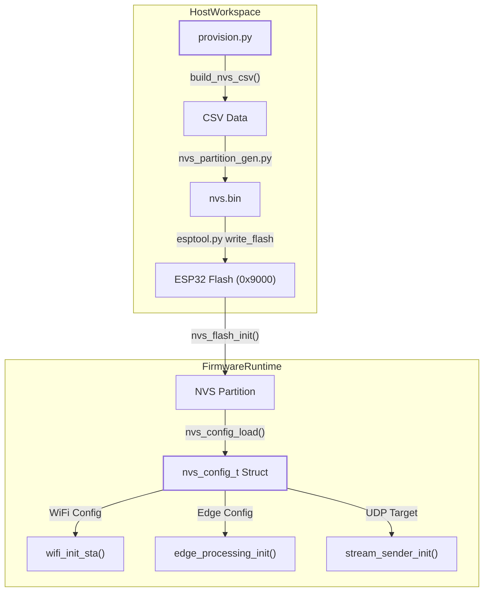
Sources: [firmware/esp32-csi-node/provision.py:53-57](), [firmware/esp32-csi-node/main/nvs_config.c:19-74]()

### Additive-by-Default Merging (Issues #391, #574)
Earlier versions of `provision.py` replaced the entire `csi_cfg` NVS namespace on every invocation, wiping any keys omitted from the command line. The script now implements an additive merge strategy:
1. Reads prior per-port state from the user's config directory (`.config/wifi-densepose/esp32-provision-state/`) [firmware/esp32-csi-node/provision.py:114-144]().
2. Overlays new CLI flags onto the stored state dictionary via `merge_state_into_args()` [firmware/esp32-csi-node/provision.py:160-175]().
3. Generates and flashes the updated NVS partition [firmware/esp32-csi-node/provision.py:25-30]().

Sources: [firmware/esp32-csi-node/provision.py:114-175]()

---

## Firmware Flashing & Flash Variants

Pre-built release binaries and SDK configurations support multiple flash capacities and SoC targets:

| Flash Variant | Partition CSV | Target SoC | Key Configuration Features |
| :--- | :--- | :--- | :--- |
| **4MB** | `partitions_display.csv` | ESP32-S3 / C6 | Compact layout for 4MB flash modules [firmware/esp32-csi-node/sdkconfig.defaults:7-13]() |
| **8MB** | `partitions_display.csv` | ESP32-S3 | OTA support, custom display partitions, 8MB Quad SPI [firmware/esp32-csi-node/sdkconfig.defaults:7-13]() |
| **16MB** | `partitions_16mb.csv` | ESP32-C6 | Extended OTA slots (1.9MB), flash coredump (`CONFIG_ESP_COREDUMP_ENABLE_TO_FLASH`), FAT storage volume (`storage` partition) [firmware/esp32-csi-node/sdkconfig.defaults.16mb:15-41]() |

Sources: [firmware/esp32-csi-node/sdkconfig.defaults:7-13](), [firmware/esp32-csi-node/sdkconfig.defaults.16mb:15-41]()

---

## ADR-018 CSI Frame Format & Pipeline

CSI data captured by the WiFi driver is serialized into the ADR-018 binary layout for UDP transmission [firmware/esp32-csi-node/main/csi_collector.c:3-6]().

### Binary Layout Structure
- **[0..3] Magic Number**: `0xC5110001` (Little Endian) [firmware/esp32-csi-node/main/csi_collector.h:14-15]()
- **[4] Node ID**: Unique identifier for the source node [firmware/esp32-csi-node/main/csi_collector.c:144]()
- **[5] Antennas**: Number of active RX antennas [firmware/esp32-csi-node/main/csi_collector.c:160]()
- **[6..7] Subcarriers**: Little-endian `uint16_t` count [firmware/esp32-csi-node/main/csi_collector.c:161]()
- **[8..11] Frequency**: Derived frequency in MHz (`uint32_t`) [firmware/esp32-csi-node/main/csi_collector.c:171]()
- **[12..15] Sequence Number**: Monotonically increasing frame sequence [firmware/esp32-csi-node/main/csi_collector.c:148]()
- **[16..17] RSSI / Noise Floor**: Signed 8-bit signal metrics [firmware/esp32-csi-node/main/csi_collector.c:149-150]()
- **[20..] I/Q Payload**: Raw subcarrier phase and amplitude data bytes [firmware/esp32-csi-node/main/csi_collector.c:152]()

### Serialization Architecture

The following diagram maps the CSI data collection flow from hardware callbacks to network serialization.

**CSI Serialization Pipeline**
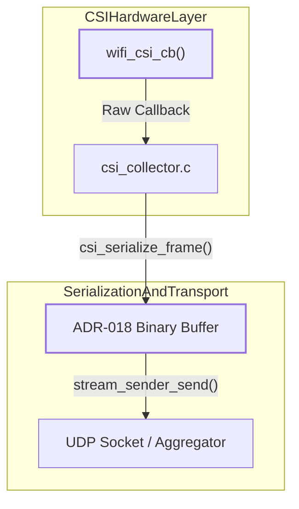
Sources: [firmware/esp32-csi-node/main/csi_collector.c:3-172](), [firmware/esp32-csi-node/main/csi_collector.h:14-65]()

---

## On-Node Logging & Diagnostics

For 16MB targets, `sdkconfig.defaults.16mb` enables flash-based coredumps and a FAT filesystem storage partition (`storage`) managed by `node_log.c` [firmware/esp32-csi-node/sdkconfig.defaults.16mb:34-40](). 
- **Crash Recovery**: Coredumps are written in ELF format with CRC32 checksums (`CONFIG_ESP_COREDUMP_ENABLE_TO_FLASH`) to diagnose watchdog resets and memory faults [firmware/esp32-csi-node/sdkconfig.defaults.16mb:34-37]().
- **On-Demand Access**: In accordance with ADR-362, raw log access is handled on-demand via HTTP/Serial endpoints rather than continuous verbose spamming.

Sources: [firmware/esp32-csi-node/sdkconfig.defaults.16mb:34-40](), [docs/adr/ADR-362-on-node-log-access-is-on-demand.md:1-1]()

---

## Security & Operational Hardening

- **OTA Authentication (ADR-050)**: The HTTP OTA server runs on port 8032 (`/ota` and `/ota/status`) [firmware/esp32-csi-node/main/ota_update.c:23-104](). Unprovisioned nodes fail closed, rejecting all firmware uploads until a valid Bearer token matching `ota_psk` is presented [firmware/esp32-csi-node/main/ota_update.c:45-80]().
- **Fail-Closed Occupancy Evidence (ADR-346)**: Firmware person slots are subordinate to the debounced presence gate. When presence is false, person counts and slot histories are explicitly cleared to prevent empty-room calibration contamination [docs/adr/ADR-346-fail-closed-edge-occupancy-evidence.md:17-27]().

Sources: [firmware/esp32-csi-node/main/ota_update.c:23-104](), [docs/adr/ADR-346-fail-closed-edge-occupancy-evidence.md:17-27]()

---

# Page: Edge Intelligence Tiers

# Edge Intelligence Tiers

<details>
<summary>Relevant source files</summary>

The following files were used as context for generating this wiki page:

- [docs/adr/ADR-018-esp32-dev-implementation.md](docs/adr/ADR-018-esp32-dev-implementation.md)
- [docs/adr/ADR-029-ruvsense-multistatic-sensing-mode.md](docs/adr/ADR-029-ruvsense-multistatic-sensing-mode.md)
- [docs/adr/ADR-039-esp32-edge-intelligence.md](docs/adr/ADR-039-esp32-edge-intelligence.md)
- [docs/adr/ADR-066-esp32-swarm-seed-coordinator.md](docs/adr/ADR-066-esp32-swarm-seed-coordinator.md)
- [docs/adr/ADR-068-per-node-state-pipeline.md](docs/adr/ADR-068-per-node-state-pipeline.md)
- [docs/adr/ADR-069-cognitum-seed-csi-pipeline.md](docs/adr/ADR-069-cognitum-seed-csi-pipeline.md)
- [docs/adr/ADR-347-rate-aware-esp32-temporal-sensing.md](docs/adr/ADR-347-rate-aware-esp32-temporal-sensing.md)
- [docs/research/architecture/implementation-plan.md](docs/research/architecture/implementation-plan.md)
- [docs/research/architecture/ruvsense-multistatic-fidelity-architecture.md](docs/research/architecture/ruvsense-multistatic-fidelity-architecture.md)
- [docs/research/arena-physica/arena-physica-analysis.md](docs/research/arena-physica/arena-physica-analysis.md)
- [docs/research/arena-physica/arena-physica-studio-analysis.md](docs/research/arena-physica/arena-physica-studio-analysis.md)
- [docs/validation/2026-08-31-esp32-c6-rate-aware-sensing.md](docs/validation/2026-08-31-esp32-c6-rate-aware-sensing.md)
- [docs/validation/2026-08-31-esp32-s3-rate-aware-transport.md](docs/validation/2026-08-31-esp32-s3-rate-aware-transport.md)
- [examples/happiness-vector/provision_swarm.sh](examples/happiness-vector/provision_swarm.sh)
- [firmware/esp32-csi-node/main/display_ui.c](firmware/esp32-csi-node/main/display_ui.c)
- [firmware/esp32-csi-node/main/edge_processing.c](firmware/esp32-csi-node/main/edge_processing.c)
- [firmware/esp32-csi-node/main/edge_processing.h](firmware/esp32-csi-node/main/edge_processing.h)
- [firmware/esp32-csi-node/main/mmwave_detect.h](firmware/esp32-csi-node/main/mmwave_detect.h)
- [firmware/esp32-csi-node/main/mmwave_sensor.c](firmware/esp32-csi-node/main/mmwave_sensor.c)
- [firmware/esp32-csi-node/main/wasm_runtime.c](firmware/esp32-csi-node/main/wasm_runtime.c)
- [firmware/esp32-csi-node/release_bins/c6-onboarding/SHA256SUMS.txt](firmware/esp32-csi-node/release_bins/c6-onboarding/SHA256SUMS.txt)
- [firmware/esp32-csi-node/release_bins/c6-onboarding/bootloader.bin](firmware/esp32-csi-node/release_bins/c6-onboarding/bootloader.bin)
- [firmware/esp32-csi-node/release_bins/c6-onboarding/esp32-csi-node.bin](firmware/esp32-csi-node/release_bins/c6-onboarding/esp32-csi-node.bin)
- [firmware/esp32-csi-node/release_bins/c6-onboarding/ota_data_initial.bin](firmware/esp32-csi-node/release_bins/c6-onboarding/ota_data_initial.bin)
- [firmware/esp32-csi-node/release_bins/c6-onboarding/partition-table.bin](firmware/esp32-csi-node/release_bins/c6-onboarding/partition-table.bin)
- [firmware/esp32-csi-node/sdkconfig.defaults.esp32c6](firmware/esp32-csi-node/sdkconfig.defaults.esp32c6)
- [firmware/esp32-csi-node/test/test_mmwave_detect.c](firmware/esp32-csi-node/test/test_mmwave_detect.c)
- [firmware/esp32-csi-node/test/test_vitals_count_presence.c](firmware/esp32-csi-node/test/test_vitals_count_presence.c)
- [v2/crates/wifi-densepose-sensing-server/src/types.rs](v2/crates/wifi-densepose-sensing-server/src/types.rs)

</details>


This page details the on-device edge processing and intelligence tiers implemented on ESP32-S3 and ESP32-C6 nodes within the RuView system. These tiers execute signal conditioning, vital sign estimation, mmWave sensor fusion, rate-aware temporal tracking, and programmable WASM logic locally on the edge node before transmitting compact payloads to the sensing server. This architecture minimizes network bandwidth, reduces latency for safety-critical events like falls, and offloads computation from the central aggregator.

For hardware setup and provisioning, see [3.1 ESP32 Setup & Provisioning](). For multistatic node synchronization and TDM protocols, see [3.3 Multistatic Mesh & TDM Protocol]().

---

## Overview & Tier Matrix

The edge intelligence architecture uses a progressive enhancement strategy governed by active NVS configuration (`edge_tier`) [docs/adr/ADR-039-esp32-edge-intelligence.md:93](). A single firmware binary supports all four operating tiers depending on available hardware resources and power constraints.

| Tier | Name | Processing Pipeline | RAM Overhead | Bandwidth | Latency | Target Use Case |
|------|------|---------------------|--------------|-----------|---------|-----------------|
| **0** | Raw Passthrough | None (direct frame serialization) | 0 KB | ~100 KB/s/node | ~500 ms (server RTT) | Full server-side algorithm flexibility [docs/adr/ADR-039-esp32-edge-intelligence.md:20-21]() |
| **1** | Signal Processing | Phase unwrap, Welford variance, top-K selection, delta compression | ~30 KB | 30-50 KB/s/node | ~500 ms | Bandwidth-constrained mesh links [docs/adr/ADR-039-esp32-edge-intelligence.md:23-28]() |
| **2** | Vital Signs | Tier 1 + biquad bandpass filters, zero-crossing BPM, adaptive presence, fall detection, mmWave fusion | ~33 KB | 32 bytes @ 1 Hz | <50 ms (on-device) | Battery-powered, safety-critical occupancy monitoring [docs/adr/ADR-039-esp32-edge-intelligence.md:29-37]() |
| **3** | WASM Modules | Custom user-defined logic via WASM3 interpreter in PSRAM arena | ~160 KB/slot | Variable | Variable | Programmable edge analytics & modular detectors [docs/adr/ADR-040-wasm-programmable-sensing.md:1-20]() |

Sources: [firmware/esp32-csi-node/main/edge_processing.h:157-164](), [docs/adr/ADR-039-esp32-edge-intelligence.md:20-37]()

---

## Dual-Core DSP Pipeline & SPSC Ring Buffer

The edge processing pipeline leverages the dual-core architecture of the ESP32-S3 (or pinned tasks on unicore targets like the ESP32-C6). Core 0 handles the high-frequency Wi-Fi radio callbacks (`wifi_csi_cb`) and pushes raw CSI frames into a lock-free Single-Producer Single-Consumer (SPSC) ring buffer (`edge_ring_buf_t`). Core 1 runs the DSP task, popping frames from the ring buffer to execute the signal processing and vital signs pipelines without blocking radio interrupts [firmware/esp32-csi-node/main/edge_processing.c:3-19]().

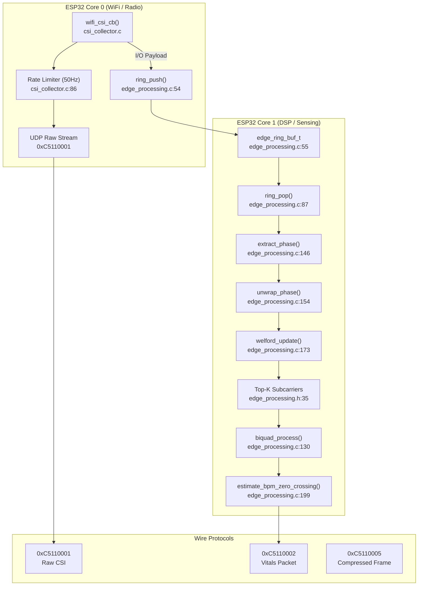
**Diagram: Dual-Core SPSC Pipeline Architecture**

Sources: [firmware/esp32-csi-node/main/edge_processing.c:3-19](), [firmware/esp32-csi-node/main/edge_processing.h:31-35](), [docs/adr/ADR-039-esp32-edge-intelligence.md:41-55]()

---

## The Four Edge Intelligence Tiers

### Tier 0 — Raw Passthrough
No on-device filtering is performed. CSI frames are captured via the Wi-Fi driver, packaged into the ADR-018 binary frame layout with magic `0xC5110001`, and transmitted over UDP to the central aggregator [firmware/esp32-csi-node/main/csi_collector.c:122-184](). Rate-limiting guards are enforced to prevent `ENOMEM` buffer exhaustion in the lwIP stack [firmware/esp32-csi-node/main/csi_collector.c:69-70]().

Sources: [firmware/esp32-csi-node/main/csi_collector.c:63-89](), [docs/adr/ADR-018-esp32-dev-implementation.md:36-50]()

### Tier 1 — Signal Processing
Tier 1 introduces local signal conditioning to reduce network bandwidth without sacrificing analytical fidelity:
1. **Phase Extraction & Unwrapping:** Converts raw I/Q pairs into radians via `atan2f` and eliminates $2\pi$ phase jumps to preserve continuous wave trains [firmware/esp32-csi-node/main/edge_processing.c:146-160]().
2. **Welford Running Variance:** Maintains online running mean and variance (`edge_welford_t`) per subcarrier to evaluate motion energy without large memory overhead [firmware/esp32-csi-node/main/edge_processing.c:166-185]().
3. **Top-K Subcarrier Selection:** Selects the top $K$ subcarriers (`EDGE_TOP_K = 8`) exhibiting the highest variance for subsequent vital sign extraction [firmware/esp32-csi-node/main/edge_processing.h:35]().
4. **Delta Compression:** Compresses frames using XOR delta encoding combined with Run-Length Encoding (RLE), transmitting under magic `0xC5110005` to achieve a 30% to 70% bandwidth reduction [docs/adr/ADR-039-esp32-edge-intelligence.md:76-86]().

Sources: [firmware/esp32-csi-node/main/edge_processing.c:8-11](), [firmware/esp32-csi-node/main/edge_processing.h:29-35]()

### Tier 2 — Vital Signs & Sensor Fusion
Tier 2 runs full on-device telemetry extraction:
- **Biquad IIR Bandpass Filters:** 2nd-order Butterworth filters isolate respiration (0.1–0.5 Hz) and heart rate (0.8–2.0 Hz) bands [firmware/esp32-csi-node/main/edge_processing.c:112-139]().
- **Zero-Crossing BPM Estimator:** Evaluates positive zero-crossings over the phase history buffer (`EDGE_PHASE_HISTORY_LEN`) to derive breathing and heart rate [firmware/esp32-csi-node/main/edge_processing.c:189-200]().
- **Adaptive Presence Detection:** Calibrates against ambient baseline noise over 1,200 frames (~60 seconds) using a $3\sigma$ threshold multiplier (`EDGE_CALIB_SIGMA_MULT`) [firmware/esp32-csi-node/main/edge_processing.h:136-141]().

Sources: [firmware/esp32-csi-node/main/edge_processing.c:12-16](), [firmware/esp32-csi-node/main/edge_processing.h:136-141]()

### Tier 3 — WASM Runtime & Budget Guard
Tier 3 executes user-defined WebAssembly modules loaded into PSRAM:
- **Sandbox Interpreter:** Uses the WASM3 runtime engine to execute compiled `.rvf` modules safely on-device [firmware/esp32-csi-node/main/wasm_runtime.c:48]().
- **Budget Guard:** Enforces `manifest_budget_us` execution time limits per module invocation. If execution exceeds the allocated budget, the runtime preempts the module to protect critical Wi-Fi and DSP task schedulers [firmware/esp32-csi-node/main/wasm_runtime.c:61-63]().
- **Host Imports:** Exposes safe host functions (`host_csi_get_phase`, `host_csi_get_bpm_breathing`) for module interaction [firmware/esp32-csi-node/main/wasm_runtime.c:112-169]().

Sources: [firmware/esp32-csi-node/main/wasm_runtime.c:1-77](), [docs/adr/ADR-040-wasm-programmable-sensing.md:1-20]()

---

## Rate-Aware Sensing (ADR-347)

Delivered via firmware version 0.8.8 and ADR-347, rate-aware temporal sensing decouples raw Wi-Fi probe packet transmission from the edge DSP processing clock [docs/adr/ADR-347-rate-aware-esp32-temporal-sensing.md:1-10]().

- **Independent Cadence Contracts:** While the connected STA probe can burst up to 50 Hz to maintain network link activity, temporal filters cannot reliably assume a uniform frame arrival cadence due to channel contention and callback gating [docs/adr/ADR-347-rate-aware-esp32-temporal-sensing.md:10-31]().
- **Measured Sample-Rate Tracking:** `edge_sample_rate_window_update()` tracks actual delivered frame intervals over one-to-three-second timestamp windows, smoothing instantaneous frequency through an Exponential Moving Average (EMA) with $\alpha = 0.25$ within an 8 to 60 Hz valid range (`EDGE_SAMPLE_RATE_MIN_HZ`, `EDGE_SAMPLE_RATE_MAX_HZ`) [firmware/esp32-csi-node/main/edge_processing.h:71-93]().
- **Hardware-Specific Target Clocks:** Unicore ESP32-C6 nodes limit Tier 2 DSP ingestion to a sustainable 8 Hz (`CONFIG_EDGE_DSP_SAMPLE_HZ`), maintaining a 4 Hz Nyquist limit for vital bands without buffer starvation, whereas ESP32-S3 nodes default to 20 Hz [firmware/esp32-csi-node/sdkconfig.defaults.esp32c6:63-64](), [docs/adr/ADR-347-rate-aware-esp32-temporal-sensing.md:55-60]().

Sources: [firmware/esp32-csi-node/main/edge_processing.h:71-93](), [firmware/esp32-csi-node/sdkconfig.defaults.esp32c6:63-64](), [docs/adr/ADR-347-rate-aware-esp32-temporal-sensing.md:1-85]()

---

## mmWave Sensor Fusion

Tier 2 and fused edge nodes integrate serial UART drivers for 60 GHz and 24 GHz mmWave radar modules (such as the Seeed MR60BHA2 and HLK-LD2410) via `mmwave_sensor.c` [firmware/esp32-csi-node/main/mmwave_sensor.c:1-30]().

- **Frame Parsing:** Asynchronously parses binary packets (such as the Seeed protocol starting with SOF `0x01`, frame type headers, and XOR checksum validation) [firmware/esp32-csi-node/main/mmwave_sensor.c:55-85]().
- **Cross-Modal Telemetry:** Extracts breathing rate (`MR60_TYPE_BREATHING`), heart rate (`MR60_TYPE_HEARTRATE`), target distance (`MR60_TYPE_DISTANCE`), and presence state (`MR60_TYPE_PRESENCE`), combining radar telemetry with Wi-Fi CSI features in fused broadcast packets [firmware/esp32-csi-node/main/mmwave_sensor.c:106-155]().
- **Mock Simulation:** Under QEMU or test configurations (`CONFIG_CSI_MOCK_ENABLED`), a synthetic data generator supplies deterministic vital sign streams for pipeline verification [firmware/esp32-csi-node/main/mmwave_sensor.c:39-42]().

Sources: [firmware/esp32-csi-node/main/mmwave_sensor.c:1-55](), [firmware/esp32-csi-node/main/mmwave_sensor.h:1-50]()

---

## Fail-Closed Occupancy Evidence

To eliminate over-counting anomalies and occupancy flickers (addressed in issues #998 and #996), the edge firmware enforces strict wire-level occupancy invariants and robustness gates [firmware/esp32-csi-node/main/edge_processing.h:99-135]().

- **Presence Gate Invariant:** Subcarrier group count estimates are strictly subordinate to the independent presence detection flag. If the presence gate is false, occupancy evidence cannot assert an occupant (`edge_evidence_person_count`) [firmware/esp32-csi-node/main/edge_processing.h:106-110]().
- **Energy Gate:** Subcarrier clusters must exhibit phase variance exceeding a minimum fraction of the dominant group's variance (`EDGE_PERSON_MIN_ENERGY_RATIO = 0.35`) to be considered valid human presence rather than multipath noise [firmware/esp32-csi-node/main/edge_processing.h:132]().
- **Spatial Deduplication:** Candidate subcarrier groups whose peak bins sit within `EDGE_PERSON_MIN_SC_SEP` (4 subcarriers) of each other are merged to prevent reflection splitting from registering phantom individuals [firmware/esp32-csi-node/main/edge_processing.h:133]().
- **Persistence Debounce:** Count changes must persist for `EDGE_PERSON_PERSIST_FRAMES` (3 consecutive decisions) before emission [firmware/esp32-csi-node/main/edge_processing.h:134]().

Sources: [firmware/esp32-csi-node/main/edge_processing.h:99-135](), [firmware/esp32-csi-node/test/test_vitals_count_presence.c:1-40]()

---

## Code-Entity Mapping

The following diagrams bridge natural language concepts to concrete code symbols in the repository.

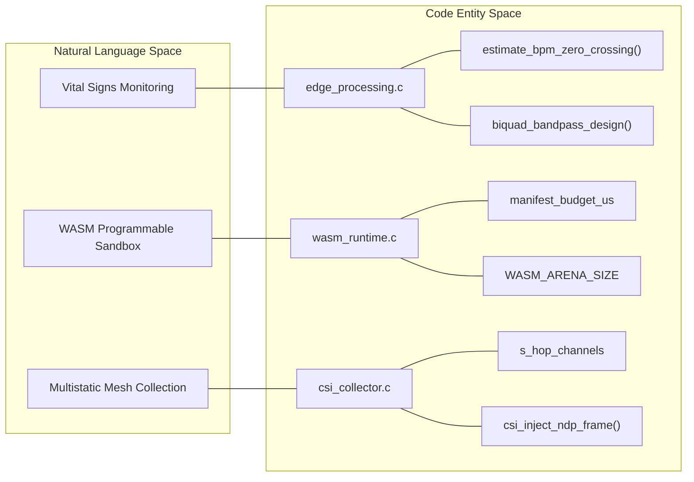
**Diagram: Concepts to Code Entities (Part 1)**

Sources: [firmware/esp32-csi-node/main/edge_processing.c:112](), [firmware/esp32-csi-node/main/wasm_runtime.c:48](), [firmware/esp32-csi-node/main/csi_collector.c:70]()

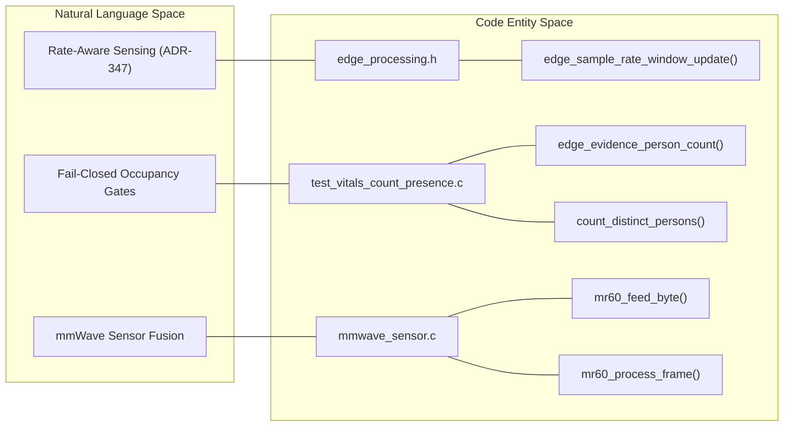
**Diagram: Concepts to Code Entities (Part 2)**

Sources: [firmware/esp32-csi-node/main/edge_processing.h:77](), [firmware/esp32-csi-node/test/test_vitals_count_presence.c:48](), [firmware/esp32-csi-node/main/mmwave_sensor.c:106]()

---

# Page: Multistatic Mesh & TDM Protocol

# Multistatic Mesh & TDM Protocol

<details>
<summary>Relevant source files</summary>

The following files were used as context for generating this wiki page:

- [docs/adr/ADR-012-esp32-csi-sensor-mesh.md](docs/adr/ADR-012-esp32-csi-sensor-mesh.md)
- [docs/adr/ADR-052-tauri-desktop-frontend.md](docs/adr/ADR-052-tauri-desktop-frontend.md)
- [docs/adr/ADR-148-drone-swarm-control-system.md](docs/adr/ADR-148-drone-swarm-control-system.md)
- [docs/adr/ADR-164-adr-corpus-gap-analysis.md](docs/adr/ADR-164-adr-corpus-gap-analysis.md)
- [docs/adr/ADR-166-quality-engineering-security-hardening.md](docs/adr/ADR-166-quality-engineering-security-hardening.md)
- [docs/adr/ADR-167-ddd-bounded-contexts.md](docs/adr/ADR-167-ddd-bounded-contexts.md)
- [docs/adr/ADR-168-benchmark-proof.md](docs/adr/ADR-168-benchmark-proof.md)
- [docs/adr/ADR-169-adam-mode-light-theme.md](docs/adr/ADR-169-adam-mode-light-theme.md)
- [docs/adr/gap-analysis/census.md](docs/adr/gap-analysis/census.md)
- [docs/adr/gap-analysis/lens-findings.md](docs/adr/gap-analysis/lens-findings.md)
- [docs/research/ruview-beyond-sota/01-sota-landscape-2026.md](docs/research/ruview-beyond-sota/01-sota-landscape-2026.md)
- [docs/research/ruview-beyond-sota/02-beyond-sota-architecture.md](docs/research/ruview-beyond-sota/02-beyond-sota-architecture.md)
- [docs/research/ruview-beyond-sota/04-optimization-roadmap.md](docs/research/ruview-beyond-sota/04-optimization-roadmap.md)
- [firmware/esp32-csi-node/main/c6_antenna_select.c](firmware/esp32-csi-node/main/c6_antenna_select.c)
- [firmware/esp32-csi-node/main/c6_antenna_select.h](firmware/esp32-csi-node/main/c6_antenna_select.h)
- [firmware/esp32-csi-node/main/c6_lp_core.c](firmware/esp32-csi-node/main/c6_lp_core.c)
- [firmware/esp32-csi-node/main/rv_mesh.c](firmware/esp32-csi-node/main/rv_mesh.c)
- [firmware/esp32-csi-node/main/stream_sender.c](firmware/esp32-csi-node/main/stream_sender.c)
- [firmware/esp32-csi-node/main/stream_sender.h](firmware/esp32-csi-node/main/stream_sender.h)
- [firmware/esp32-csi-node/sdkconfig.defaults.xiao-external](firmware/esp32-csi-node/sdkconfig.defaults.xiao-external)
- [firmware/esp32-csi-node/sdkconfig.defaults.xiao-internal](firmware/esp32-csi-node/sdkconfig.defaults.xiao-internal)
- [v2/crates/wifi-densepose-engine/Cargo.toml](v2/crates/wifi-densepose-engine/Cargo.toml)
- [v2/crates/wifi-densepose-engine/benches/engine_cycle.rs](v2/crates/wifi-densepose-engine/benches/engine_cycle.rs)
- [v2/crates/wifi-densepose-engine/src/lib.rs](v2/crates/wifi-densepose-engine/src/lib.rs)
- [v2/crates/wifi-densepose-sensing-server/src/engine_bridge.rs](v2/crates/wifi-densepose-sensing-server/src/engine_bridge.rs)
- [v2/crates/wifi-densepose-sensing-server/src/multistatic_bridge.rs](v2/crates/wifi-densepose-sensing-server/src/multistatic_bridge.rs)
- [v2/crates/wifi-densepose-signal/src/hardware_norm.rs](v2/crates/wifi-densepose-signal/src/hardware_norm.rs)
- [v2/crates/wifi-densepose-signal/src/ruvsense/evolution.rs](v2/crates/wifi-densepose-signal/src/ruvsense/evolution.rs)
- [v2/crates/wifi-densepose-signal/src/ruvsense/multistatic.rs](v2/crates/wifi-densepose-signal/src/ruvsense/multistatic.rs)

</details>


## Purpose and Scope

This document details the Time Division Multiplexing (TDM) coordination protocol that enables multistatic WiFi sensing across multiple ESP32 edge nodes. The TDM protocol orchestrates $N \times (N-1)$ bistatic links from $N$ nodes by scheduling each node to transmit in a dedicated time slot while all others receive, producing multi-viewpoint geometric diversity for pose estimation and vital sign monitoring.

**Scope**: TDM sync beacons, slot scheduling, clock drift handling, ESP-NOW epoch alignment (ADR-110), secure TDM transport, C6 low-power core hibernation, antenna selection, and QEMU swarm testing.

Sources: [v2/crates/wifi-densepose-signal/src/ruvsense/multistatic.rs:1-28](), [firmware/esp32-csi-node/main/c6_lp_core.c:1-22]()

---

## TDM Protocol & Multistatic Fusion Architecture

The TDM protocol coordinates a mesh of ESP32 nodes where each node alternates between transmitter (TX) and receiver (RX) roles in a synchronous schedule. 

In the Rust sensing library, `MultistaticFuser` and `MultistaticConfig` coordinate incoming frames across nodes. Due to real-world slot offsets in an $N$-slot TDMA mesh, the timestamp spread across node frames within a single cycle corresponds to the slot duration rather than clock jitter [v2/crates/wifi-densepose-signal/src/ruvsense/multistatic.rs:91-111](). Accordingly, `MultistaticConfig` defines a hard guard interval of **60,000 µs (60 ms)** and a soft guard interval of **20,000 µs (20 ms)** [v2/crates/wifi-densepose-signal/src/ruvsense/multistatic.rs:134-148]().

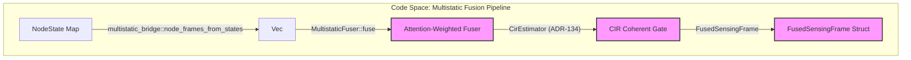
*Diagram 1: Multistatic fusion pipeline mapping configuration and data flow across code entities.*

Sources: [v2/crates/wifi-densepose-signal/src/ruvsense/multistatic.rs:91-148](), [v2/crates/wifi-densepose-sensing-server/src/multistatic_bridge.rs:98-121]()

---

## UDP Transport, Buffer Management & ENOMEM Backoff

High-rate CSI streaming from ESP32 nodes to the aggregator can saturate `lwIP` network buffers. To prevent device crashes (`Guru Meditation`), the firmware implements strict rate control and exponential backoff on `sendto()` failures.

When `sendto()` returns `ENOMEM`, `stream_sender_send()` suppresses subsequent bulk packets and engages an exponential backoff cooldown (`s_enomem_streak`) ranging from 100 ms up to 2,000 ms [firmware/esp32-csi-node/main/stream_sender.c:23-45](). Low-rate control packets (≤48 bytes, ≤1 Hz) bypass this global backoff via `stream_sender_send_priority()` to ensure mesh sync and telemetry traffic are never starved [firmware/esp32-csi-node/main/stream_sender.c:131-161]().

```mermaid
graph TD
    subgraph "Code Space: Stream Sender Transmission & Backoff"
        CSIEvent["CSI Packet Ready"] -->| "stream_sender_send()" | BackoffCheck{"s_backoff_until_us expired?"}
        BackoffCheck -->| "No" | DropPacket["Drop & Increment s_enomem_suppressed"]
        BackoffCheck -->| "Yes" | SocketSend["sendto() Socket Call"]
        SocketSend -->| "Success" | ResetStreak["s_enomem_streak = 0, s_last_success_us updated"]
        SocketSend -->| "ENOMEM Error" | ApplyBackoff["Double Backoff & Set s_backoff_until_us"]
        PriorityEvent["Control Packet"] -->| "stream_sender_send_priority()" | PrioritySend["Bypass Backoff & sendto()"]
    end
```
*Diagram 2: UDP packet transmission flow illustrating the ENOMEM backoff state machine in `stream_sender.c`.*

Sources: [firmware/esp32-csi-node/main/stream_sender.c:23-161](), [firmware/esp32-csi-node/main/stream_sender.h:31-52]()

---

## C6 Low-Power Core & Antenna Selection

For deployments utilizing the ESP32-C6 target, ADR-110 Phase 5 defines wake-on-motion hibernation via the ultra-low power (ULP) RISC-V coprocessor [firmware/esp32-csi-node/main/c6_lp_core.c:1-22](). 

- **LP-Core Arming (`c6_lp_core_arm`)**: Configures an LP-timer wake period (default 10 ms) and debounce sample count to poll motion GPIOs while the main high-performance (HP) core resides in deep sleep, achieving an operating floor of ~5 µA [firmware/esp32-csi-node/main/c6_lp_core.c:60-134]().
- **Antenna Selection**: Board-specific configuration flags such as `CONFIG_C6_XIAO_ANTENNA_EXTERNAL` allow dynamic selection between internal trace antennas and external U.FL antenna overlays [firmware/esp32-csi-node/sdkconfig.defaults.xiao-external:1-4]().

Sources: [firmware/esp32-csi-node/main/c6_lp_core.c:60-176](), [firmware/esp32-csi-node/sdkconfig.defaults.xiao-external:1-4]()

---

## Engine Integration & Trust Traceability

The live sensing server routes multi-node frames through an engine bridge (`EngineBridge`) that wraps the Rust composition root (`StreamingEngine`) [v2/crates/wifi-densepose-sensing-server/src/engine_bridge.rs:1-33](). 

Each execution cycle performs:
1. **Multistatic Fusion**: Aggregates canonicalized CSI frames using `MultistaticFuser` [v2/crates/wifi-densepose-signal/src/ruvsense/multistatic.rs:59-88]().
2. **Provenance Stamping**: Attaches calibration epochs (`CalibrationId`) and model versions to ensure cryptographic reproducibility [v2/crates/wifi-densepose-engine/src/lib.rs:15-30]().
3. **Privacy Gate Enforcement**: Evaluates privacy mode registries (`PrivacyModeRegistry`) to demote or restrict raw stream outputs if contradictions occur [v2/crates/wifi-densepose-engine/src/lib.rs:115-144]().
4. **Witness Generation**: Computes a BLAKE3 witness over the trust decision (`TrustedOutput::witness`) [v2/crates/wifi-densepose-engine/src/lib.rs:81-112]().

Sources: [v2/crates/wifi-densepose-engine/src/lib.rs:1-48](), [v2/crates/wifi-densepose-sensing-server/src/engine_bridge.rs:54-122]()

---

## QEMU Swarm Testing Environment

To validate multi-node TDM synchronization and parsing pipelines without physical hardware, the codebase provides QEMU swarm testing harnesses and NVS partition generators [docs/adr/ADR-012-esp32-csi-sensor-mesh.md:108-133](). Simulated instances generate synthetic ADR-018 binary streams that test aggregator ingest capacity and fallback logic under packet loss or clock drift scenarios.

Sources: [docs/adr/ADR-012-esp32-csi-sensor-mesh.md:108-143]()

---

# Page: Alternate Radio Hardware & WiFi Scanning

# Alternate Radio Hardware & WiFi Scanning

<details>
<summary>Relevant source files</summary>

The following files were used as context for generating this wiki page:

- [docs/adr/ADR-157-hardware-sensing-beyond-sota.md](docs/adr/ADR-157-hardware-sensing-beyond-sota.md)
- [docs/adr/ADR-323-rtl8721dx-ameba-csi-wire-protocol.md](docs/adr/ADR-323-rtl8721dx-ameba-csi-wire-protocol.md)
- [docs/adr/ADR-356-rate-truthful-csi-and-reliability-gated-adaptation.md](docs/adr/ADR-356-rate-truthful-csi-and-reliability-gated-adaptation.md)
- [firmware/esp32-csi-node/test/fuzz_csi_serialize.c](firmware/esp32-csi-node/test/fuzz_csi_serialize.c)
- [firmware/esp32-csi-node/test/stubs/esp_stubs.h](firmware/esp32-csi-node/test/stubs/esp_stubs.h)
- [firmware/esp32-csi-node/test/test_csi_sanitize.c](firmware/esp32-csi-node/test/test_csi_sanitize.c)
- [scripts/benchmark-rtl8721dx-csi.py](scripts/benchmark-rtl8721dx-csi.py)
- [v2/crates/wifi-densepose-hardware/benches/realtek_csi_bench.rs](v2/crates/wifi-densepose-hardware/benches/realtek_csi_bench.rs)
- [v2/crates/wifi-densepose-hardware/src/bin/realtek-csi-sim.rs](v2/crates/wifi-densepose-hardware/src/bin/realtek-csi-sim.rs)
- [v2/crates/wifi-densepose-hardware/src/csi_frame.rs](v2/crates/wifi-densepose-hardware/src/csi_frame.rs)
- [v2/crates/wifi-densepose-hardware/src/esp32/secure_tdm.rs](v2/crates/wifi-densepose-hardware/src/esp32/secure_tdm.rs)
- [v2/crates/wifi-densepose-hardware/src/esp32_parser.rs](v2/crates/wifi-densepose-hardware/src/esp32_parser.rs)
- [v2/crates/wifi-densepose-hardware/src/lib.rs](v2/crates/wifi-densepose-hardware/src/lib.rs)
- [v2/crates/wifi-densepose-hardware/src/realtek_csi.rs](v2/crates/wifi-densepose-hardware/src/realtek_csi.rs)
- [v2/crates/wifi-densepose-sensing-server/src/adaptive_classifier.rs](v2/crates/wifi-densepose-sensing-server/src/adaptive_classifier.rs)
- [v2/crates/wifi-densepose-sensing-server/src/csi.rs](v2/crates/wifi-densepose-sensing-server/src/csi.rs)
- [v2/crates/wifi-densepose-sensing-server/src/matter/mod.rs](v2/crates/wifi-densepose-sensing-server/src/matter/mod.rs)
- [v2/crates/wifi-densepose-sensing-server/src/realtek_csi.rs](v2/crates/wifi-densepose-sensing-server/src/realtek_csi.rs)
- [v2/crates/wifi-densepose-wifiscan/src/adapter/mod.rs](v2/crates/wifi-densepose-wifiscan/src/adapter/mod.rs)
- [v2/crates/wifi-densepose-wifiscan/src/adapter/wlanapi_native.rs](v2/crates/wifi-densepose-wifiscan/src/adapter/wlanapi_native.rs)
- [v2/crates/wifi-densepose-wifiscan/src/adapter/wlanapi_scanner.rs](v2/crates/wifi-densepose-wifiscan/src/adapter/wlanapi_scanner.rs)

</details>


## Overview & Scope

The alternate radio hardware and WiFi scanning subsystem provides platform-agnostic data capture paths for non-ESP32 chipsets and native operating system Wi-Fi scanning APIs [v2/crates/wifi-densepose-hardware/src/lib.rs:1-12](). While ESP32 nodes stream high-fidelity CSI over UDP [v2/crates/wifi-densepose-hardware/src/esp32_parser.rs:1-6], many deployments utilize commodity operating systems (Windows WLANAPI, Linux, macOS) or alternate silicon such as Realtek RTL8721Dx (AmebaDplus) [docs/adr/ADR-323-rtl8721dx-ameba-csi-wire-protocol.md:1-21], MediaTek [v2/crates/wifi-densepose-hardware/src/lib.rs:58-59], and Qualcomm [v2/crates/wifi-densepose-hardware/src/lib.rs:60-61]. The `wifi-densepose-hardware` and `wifi-densepose-wifiscan` crates encapsulate these heterogeneous sources into normalized frames, ensuring the core sensing and signal processing pipelines remain decoupled from low-level driver constraints [v2/crates/wifi-densepose-hardware/src/lib.rs:10-16]().

Sources: `[v2/crates/wifi-densepose-hardware/src/lib.rs:1-16]`, `[docs/adr/ADR-323-rtl8721dx-ameba-csi-wire-protocol.md:1-21]`

---

## Realtek RTL8721Dx Ameba CSI Wire Protocol (ADR-323)

The Realtek RTL8721Dx ("AmebaDplus") 1x1 Wi-Fi 4 chip exposes a callback-driven CSI API via the official Ameba RTOS SDK (`wifi_csi_config()` and `RTW_EVENT_CSI_DONE`) [docs/adr/ADR-323-rtl8721dx-ameba-csi-wire-protocol.md:1-17]. To stream these reports safely across network boundaries without relying on vendor-specific raw structures or C flexible array members, RuView defines the `RAC1` ("Realtek Ameba CSI", version 1) little-endian wire protocol [docs/adr/ADR-323-rtl8721dx-ameba-csi-wire-protocol.md:24-44].

The wire envelope consists of a fixed 49-byte header (`RAC1_HEADER_LEN`) followed by the subcarrier payload and a 4-byte IEEE CRC-32 checksum [docs/adr/ADR-323-rtl8721dx-ameba-csi-wire-protocol.md:46-79]:

| Field | Type | Description |
| :--- | :--- | :--- |
| `magic` | `u32` (LE) | `0x3143_4152` ("RAC1") [docs/adr/ADR-323-rtl8721dx-ameba-csi-wire-protocol.md:51-51] |
| `version` | `u8` | Protocol version (`1`) [docs/adr/ADR-323-rtl8721dx-ameba-csi-wire-protocol.md:52-52] |
| `header_len` | `u16` (LE) | Fixed header length (`49`) [docs/adr/ADR-323-rtl8721dx-ameba-csi-wire-protocol.md:53-53] |
| `frame_len` | `u32` (LE) | Total frame length including header, payload, and CRC [docs/adr/ADR-323-rtl8721dx-ameba-csi-wire-protocol.md:54-54] |
| `node_id` | `u8` | Disambiguates multi-board illuminator/receiver deployments [docs/adr/ADR-323-rtl8721dx-ameba-csi-wire-protocol.md:55-55] |
| `csi_mode` | `u8` | Capture mode: `0` = Passive, `1` = Active, `2` = Board-to-Board [docs/adr/ADR-323-rtl8721dx-ameba-csi-wire-protocol.md:56-56] |
| `sequence` | `u32` (LE) | Firmware-assigned sequence number [docs/adr/ADR-323-rtl8721dx-ameba-csi-wire-protocol.md:57-57] |
| `timestamp_us`| `u32` (LE) | Hardware-clock microseconds (wraps ~71 minutes) [docs/adr/ADR-323-rtl8721dx-ameba-csi-wire-protocol.md:58-58] |
| `peer_mac` / `trig_mac` | `[u8; 6]` | Peer and trigger MAC addresses [docs/adr/ADR-323-rtl8721dx-ameba-csi-wire-protocol.md:59-60] |
| `num_sub_carrier` | `u16` (LE) | Number of subcarrier tones reported in payload [docs/adr/ADR-323-rtl8721dx-ameba-csi-wire-protocol.md:65-65] |
| `num_bit_per_tone`| `u8` | Precision: `16` (8-bit I + 8-bit Q) or `32` (16-bit I + 16-bit Q) [docs/adr/ADR-323-rtl8721dx-ameba-csi-wire-protocol.md:66-66] |

The Rust implementation is housed in `wifi_densepose_hardware::realtek_csi`, offering parsing, serialization, and a deterministic simulator (`RealtekCsiSimulator`) [v2/crates/wifi-densepose-hardware/src/realtek_csi.rs:1-100]. Bounded summaries are converted into `RealtekCsiSnapshot` objects within `wifi-densepose-sensing-server` for exposure over REST and WebSocket endpoints [v2/crates/wifi-densepose-sensing-server/src/realtek_csi.rs:1-67].

Sources: `[docs/adr/ADR-323-rtl8721dx-ameba-csi-wire-protocol.md:1-134]`, `[v2/crates/wifi-densepose-hardware/src/realtek_csi.rs:1-110]`, `[v2/crates/wifi-densepose-sensing-server/src/realtek_csi.rs:1-67]`

**Diagram: Realtek RTL8721Dx Frame Processing Pipeline**

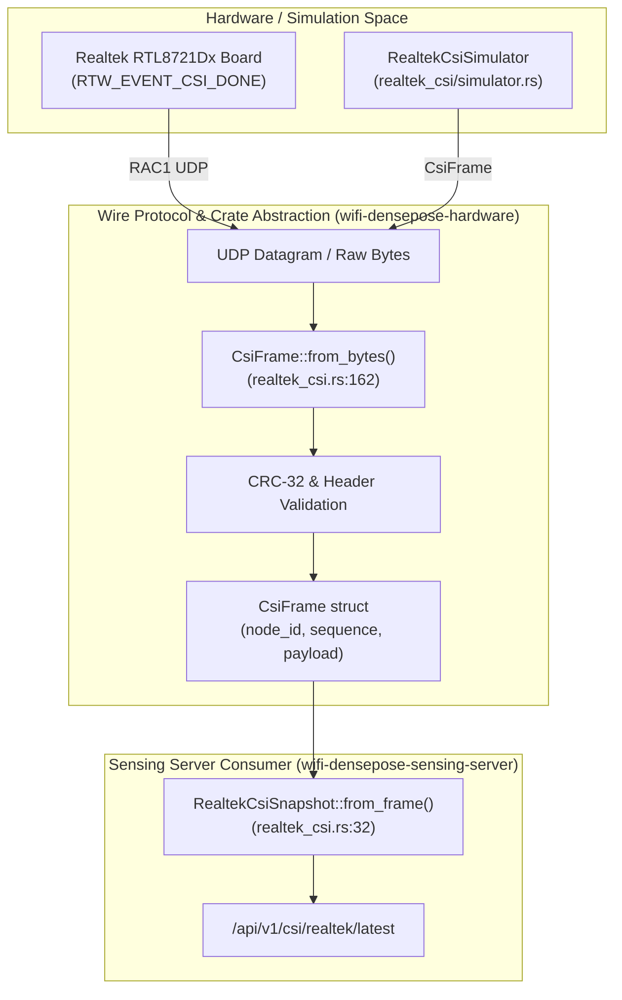
Sources: `[v2/crates/wifi-densepose-hardware/src/realtek_csi.rs:110-190]`, `[v2/crates/wifi-densepose-sensing-server/src/realtek_csi.rs:31-67]`

---

## wifiscan Adapters (Windows WLANAPI, Linux, macOS)

When low-level CSI capture hardware is absent, RuView falls back to operating system Wi-Fi scanning APIs via the `wifi-densepose-wifiscan` crate. These adapters poll visible access points to extract Received Signal Strength Indicator (RSSI) timelines and BSSID multi-channel features.

*   **Windows WLANAPI (`wlanapi_scanner.rs` & `wlanapi_native.rs`)**: Interfaces directly with the Windows Native Wifi API via FFI bindings to query available networks, connection states, and per-BSSID signal qualities.
*   **Linux / macOS Scanners**: Execute platform-specific shell utilities or system bindings (e.g., `iwlist`, `airport`) to collect periodic ambient signal measurements.

The collected scans pass through a correlation and breathing extraction pipeline (`wifiscan/pipeline/`) to approximate slow-moving vital sign signatures and coarse presence indicators from RSSI variance over sliding time windows.

Sources: `[v2/crates/wifi-densepose-wifiscan/src/adapter/wlanapi_scanner.rs:1-50]`, `[docs/adr/ADR-157-hardware-sensing-beyond-sota.md:1-53]`

---

## Hardware Normalization & Chipset Abstractions

The `wifi-densepose-hardware` crate acts as the central hub for multi-chipset normalization. It defines vendor-neutral abstractions for several transceiver families:

*   **ESP32 / ESP32-S3 (`esp32_parser.rs`)**: Parses ADR-018 binary UDP frames containing magic `0xC5110001`, antenna counts, subcarrier measurements, and multiplexed sibling packets (vitals, feature states) [v2/crates/wifi-densepose-hardware/src/esp32_parser.rs:1-77].
*   **MediaTek Filogic (`mediatek_csi.rs`)**: Provides framing and simulation models for MediaTek MIMO CSI reports (ADR-267) [v2/crates/wifi-densepose-hardware/src/lib.rs:58-59].
*   **Qualcomm Atheros (`qualcomm_csi.rs`)**: Implements framing structures for Qualcomm Atheros chipset CSI extraction (ADR-269) [v2/crates/wifi-densepose-hardware/src/lib.rs:60-61].
*   **Realtek RTL8720F Radar (`rtl8720f.rs`)**: Encapsulates host-side framing for RTL8720F CFR and FMCW radar reports (ADR-264) [v2/crates/wifi-densepose-hardware/src/lib.rs:59-64].
*   **Radio Operations (`radio_ops.rs`)**: Mirrors firmware radio abstraction layers (L1) and mesh sensing planes (L3) for host testing and coordinators [v2/crates/wifi-densepose-hardware/src/lib.rs:53-57].

Sources: `[v2/crates/wifi-densepose-hardware/src/lib.rs:37-111]`, `[v2/crates/wifi-densepose-hardware/src/esp32_parser.rs:1-85]`

**Diagram: Hardware Abstraction & Code Entity Space Mapping**

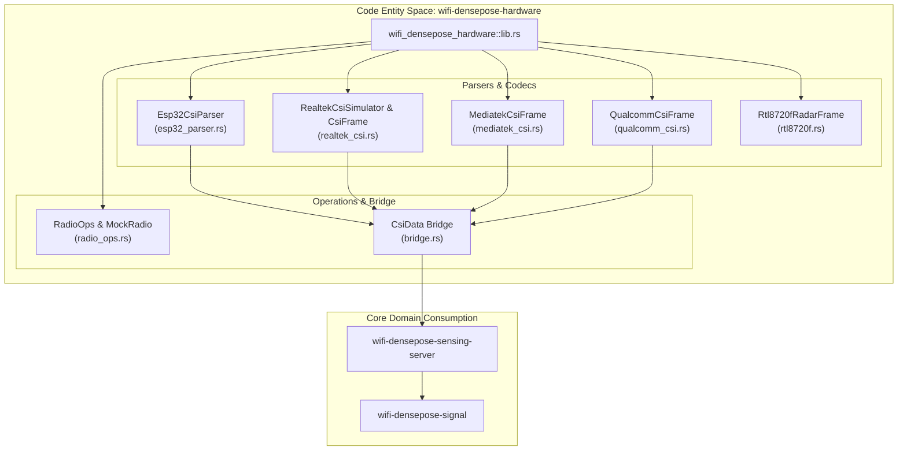
Sources: `[v2/crates/wifi-densepose-hardware/src/lib.rs:1-112]`, `[v2/crates/wifi-densepose-hardware/src/esp32_parser.rs:80-96]`, `[v2/crates/wifi-densepose-hardware/src/realtek_csi.rs:70-110]`

---

# Page: Core Sensing Engine

# Core Sensing Engine

<details>
<summary>Relevant source files</summary>

The following files were used as context for generating this wiki page:

- [CHANGELOG.md](CHANGELOG.md)
- [CLAUDE.md](CLAUDE.md)
- [README.md](README.md)
- [assets/ruview-hero-h3-v3.gif](assets/ruview-hero-h3-v3.gif)
- [assets/screen.png](assets/screen.png)
- [docs/adr/ADR-355-local-empty-room-bootstrap-prior.md](docs/adr/ADR-355-local-empty-room-bootstrap-prior.md)
- [docs/adr/ADR-357-raw-csi-calibration-sample-integrity.md](docs/adr/ADR-357-raw-csi-calibration-sample-integrity.md)
- [docs/readme-details.md](docs/readme-details.md)
- [docs/user-guide.md](docs/user-guide.md)
- [v2/Cargo.lock](v2/Cargo.lock)
- [v2/Cargo.toml](v2/Cargo.toml)
- [v2/crates/wifi-densepose-core/Cargo.toml](v2/crates/wifi-densepose-core/Cargo.toml)
- [v2/crates/wifi-densepose-hardware/Cargo.toml](v2/crates/wifi-densepose-hardware/Cargo.toml)
- [v2/crates/wifi-densepose-mat/Cargo.toml](v2/crates/wifi-densepose-mat/Cargo.toml)
- [v2/crates/wifi-densepose-nn/Cargo.toml](v2/crates/wifi-densepose-nn/Cargo.toml)
- [v2/crates/wifi-densepose-ruvector/Cargo.toml](v2/crates/wifi-densepose-ruvector/Cargo.toml)
- [v2/crates/wifi-densepose-sensing-server/Cargo.toml](v2/crates/wifi-densepose-sensing-server/Cargo.toml)
- [v2/crates/wifi-densepose-sensing-server/README.md](v2/crates/wifi-densepose-sensing-server/README.md)
- [v2/crates/wifi-densepose-sensing-server/examples/mqtt_publisher.rs](v2/crates/wifi-densepose-sensing-server/examples/mqtt_publisher.rs)
- [v2/crates/wifi-densepose-sensing-server/src/bootstrap_baseline.rs](v2/crates/wifi-densepose-sensing-server/src/bootstrap_baseline.rs)
- [v2/crates/wifi-densepose-sensing-server/src/cli.rs](v2/crates/wifi-densepose-sensing-server/src/cli.rs)
- [v2/crates/wifi-densepose-sensing-server/src/field_bridge.rs](v2/crates/wifi-densepose-sensing-server/src/field_bridge.rs)
- [v2/crates/wifi-densepose-sensing-server/src/lib.rs](v2/crates/wifi-densepose-sensing-server/src/lib.rs)
- [v2/crates/wifi-densepose-sensing-server/src/main.rs](v2/crates/wifi-densepose-sensing-server/src/main.rs)
- [v2/crates/wifi-densepose-sensing-server/src/mqtt/config.rs](v2/crates/wifi-densepose-sensing-server/src/mqtt/config.rs)
- [v2/crates/wifi-densepose-signal/Cargo.toml](v2/crates/wifi-densepose-signal/Cargo.toml)
- [v2/crates/wifi-densepose-signal/src/ruvsense/field_model.rs](v2/crates/wifi-densepose-signal/src/ruvsense/field_model.rs)
- [v2/crates/wifi-densepose-train/Cargo.toml](v2/crates/wifi-densepose-train/Cargo.toml)
- [v2/crates/wifi-densepose-vitals/Cargo.toml](v2/crates/wifi-densepose-vitals/Cargo.toml)
- [v2/crates/wifi-densepose-wifiscan/Cargo.toml](v2/crates/wifi-densepose-wifiscan/Cargo.toml)
- [v2/rust-toolchain.toml](v2/rust-toolchain.toml)

</details>


## Purpose and Scope

The Core Sensing Engine is the Rust-based sensing server (`sensing-server` binary) that orchestrates CSI data ingestion, signal processing, feature extraction, classification, and real-time broadcasting. It receives raw WiFi Channel State Information frames from hardware nodes, processes them through multiple analysis pipelines, and outputs structured sensing data via WebSocket and REST APIs [v2/crates/wifi-densepose-sensing-server/src/main.rs:1-9]().

This page provides a high-level overview of the sensing server architecture and its major subsystems. For deep technical details, refer to the child pages:
- Signal processing algorithms and UDP frame parsing: [Signal Processing Pipeline](#4.1)
- Breathing and heart rate extraction: [Vital Signs Detection](#4.2)
- Pose models, keypoints, and DensePose UV mapping: [Pose Estimation & DensePose](#4.3)
- Empty-room bootstrap priors and room calibration: [Calibration & Adaptive Classifier](#4.4)
- Streaming composition root and WorldGraph digital twin: [Streaming Engine & WorldGraph](#4.5)

---

## Server Architecture

The sensing server is an Axum-based HTTP/WebSocket service that runs independently of edge hardware, supporting live ESP32 UDP streams, commodity Wi-Fi data, or simulated frames [v2/crates/wifi-densepose-sensing-server/src/main.rs:33-48]().

### Diagram: Architecture to Code Entity Space

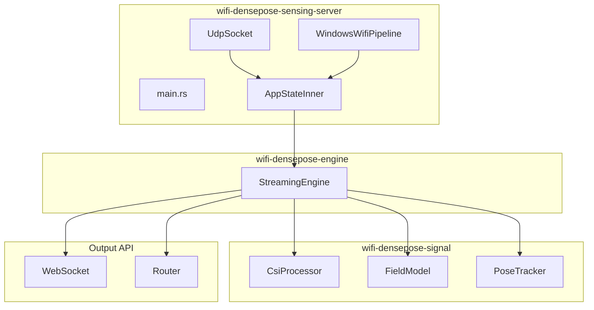
**Sources:** [v2/crates/wifi-densepose-sensing-server/src/main.rs:11-21](), [v2/crates/wifi-densepose-sensing-server/src/main.rs:58-67](), [v2/crates/wifi-densepose-engine/src/lib.rs:15-26]()

---

## Core Data Structures and Ingestion

Incoming UDP packets are decoded into structured frames and normalized before entering the analytical pipeline [v2/crates/wifi-densepose-sensing-server/src/main.rs:14-14]().

| Type | Purpose | Location |
|------|---------|----------|
| `Esp32Frame` | Decoded CSI frame from ESP32 UDP packet (ADR-018) | [v2/crates/wifi-densepose-sensing-server/src/main.rs:14-14]() |
| `TrustedOutput` | Auditable result of an engine cycle (provenance + witness) | [v2/crates/wifi-densepose-engine/src/lib.rs:80-100]() |
| `SensingUpdate` | JSON message broadcast to WebSocket clients | [v2/crates/wifi-densepose-sensing-server/src/main.rs:190-220]() |
| `CsiFrame` | Normalized hardware-abstracted frame | [v2/crates/wifi-densepose-core/src/lib.rs]() |
| `RvfContainerInfo` | Metadata for binary model containers | [v2/crates/wifi-densepose-sensing-server/src/rvf_container.rs:54-54]() |

### Diagram: CSI Frame Ingestion to Normalization Space

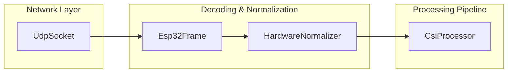
**Sources:** [v2/crates/wifi-densepose-sensing-server/src/main.rs:14-14](), [v2/crates/wifi-densepose-signal/src/hardware_norm.rs:1-25]()

---

## Signal Processing Pipeline

For details on UDP frame parsing, phase sanitization, Hampel filtering, CIR estimation, BVP extraction, and spectrogram generation, see [Signal Processing Pipeline](#4.1).

**Sources:** [v2/crates/wifi-densepose-signal/src/lib.rs:1-50]()

---

## Vital Signs Detection

For details on breathing and heart rate extraction, presence detection, EMA smoothing, and hysteresis states, see [Vital Signs Detection](#4.2).

**Sources:** [v2/crates/wifi-densepose-sensing-server/src/vital_signs.rs:1-40]()

---

## Pose Estimation & DensePose

For details on the pose model, COCO keypoints, DensePose UV mapping, multi-person tracking, and AETHER re-ID embeddings, see [Pose Estimation & DensePose](#4.3).

**Sources:** [v2/crates/wifi-densepose-sensing-server/src/pose.rs:1-30]()

---

## Calibration & Adaptive Classifier

For details on the empty-room bootstrap prior (ADR-355), raw CSI calibration sample integrity (ADR-357), and adaptive logistic classification, see [Calibration & Adaptive Classifier](#4.4).

**Sources:** [v2/crates/wifi-densepose-sensing-server/src/bootstrap_baseline.rs:1-30]()

---

## Streaming Engine & WorldGraph

For details on the `StreamingEngine` composition root, frame contracts (ADR-136), fusion quality scoring (ADR-137), and the WorldGraph digital twin (ADR-139), see [Streaming Engine & WorldGraph](#4.5).

**Sources:** [v2/crates/wifi-densepose-engine/src/lib.rs:1-50]()

---

# Page: Signal Processing Pipeline

# Signal Processing Pipeline

<details>
<summary>Relevant source files</summary>

The following files were used as context for generating this wiki page:

- [docs/adr/ADR-154-signal-dsp-beyond-sota.md](docs/adr/ADR-154-signal-dsp-beyond-sota.md)
- [docs/adr/ADR-178-desktop-ipc-injection-and-capability-least-privilege.md](docs/adr/ADR-178-desktop-ipc-injection-and-capability-least-privilege.md)
- [v2/crates/wifi-densepose-desktop/capabilities/default.json](v2/crates/wifi-densepose-desktop/capabilities/default.json)
- [v2/crates/wifi-densepose-desktop/gen/schemas/capabilities.json](v2/crates/wifi-densepose-desktop/gen/schemas/capabilities.json)
- [v2/crates/wifi-densepose-desktop/src/commands/discovery.rs](v2/crates/wifi-densepose-desktop/src/commands/discovery.rs)
- [v2/crates/wifi-densepose-pointcloud/src/camera.rs](v2/crates/wifi-densepose-pointcloud/src/camera.rs)
- [v2/crates/wifi-densepose-pointcloud/src/csi_pipeline.rs](v2/crates/wifi-densepose-pointcloud/src/csi_pipeline.rs)
- [v2/crates/wifi-densepose-pointcloud/src/fusion.rs](v2/crates/wifi-densepose-pointcloud/src/fusion.rs)
- [v2/crates/wifi-densepose-ruvector/src/viewpoint/coherence.rs](v2/crates/wifi-densepose-ruvector/src/viewpoint/coherence.rs)
- [v2/crates/wifi-densepose-ruvector/src/viewpoint/mod.rs](v2/crates/wifi-densepose-ruvector/src/viewpoint/mod.rs)
- [v2/crates/wifi-densepose-sensing-server/src/matter/bridge.rs](v2/crates/wifi-densepose-sensing-server/src/matter/bridge.rs)
- [v2/crates/wifi-densepose-sensing-server/src/matter/clusters.rs](v2/crates/wifi-densepose-sensing-server/src/matter/clusters.rs)
- [v2/crates/wifi-densepose-sensing-server/src/matter/commissioning.rs](v2/crates/wifi-densepose-sensing-server/src/matter/commissioning.rs)
- [v2/crates/wifi-densepose-signal/benches/dsp_perf_bench.rs](v2/crates/wifi-densepose-signal/benches/dsp_perf_bench.rs)
- [v2/crates/wifi-densepose-signal/benches/features_bench.rs](v2/crates/wifi-densepose-signal/benches/features_bench.rs)
- [v2/crates/wifi-densepose-signal/src/bvp.rs](v2/crates/wifi-densepose-signal/src/bvp.rs)
- [v2/crates/wifi-densepose-signal/src/csi_processor.rs](v2/crates/wifi-densepose-signal/src/csi_processor.rs)
- [v2/crates/wifi-densepose-signal/src/csi_ratio.rs](v2/crates/wifi-densepose-signal/src/csi_ratio.rs)
- [v2/crates/wifi-densepose-signal/src/features.rs](v2/crates/wifi-densepose-signal/src/features.rs)
- [v2/crates/wifi-densepose-signal/src/hampel.rs](v2/crates/wifi-densepose-signal/src/hampel.rs)
- [v2/crates/wifi-densepose-signal/src/motion.rs](v2/crates/wifi-densepose-signal/src/motion.rs)
- [v2/crates/wifi-densepose-signal/src/ruvsense/adversarial.rs](v2/crates/wifi-densepose-signal/src/ruvsense/adversarial.rs)
- [v2/crates/wifi-densepose-signal/src/ruvsense/array_coordinator.rs](v2/crates/wifi-densepose-signal/src/ruvsense/array_coordinator.rs)
- [v2/crates/wifi-densepose-signal/src/ruvsense/attractor_drift.rs](v2/crates/wifi-densepose-signal/src/ruvsense/attractor_drift.rs)
- [v2/crates/wifi-densepose-signal/src/ruvsense/cir.rs](v2/crates/wifi-densepose-signal/src/ruvsense/cir.rs)
- [v2/crates/wifi-densepose-signal/src/ruvsense/coherence.rs](v2/crates/wifi-densepose-signal/src/ruvsense/coherence.rs)
- [v2/crates/wifi-densepose-signal/src/ruvsense/cross_room.rs](v2/crates/wifi-densepose-signal/src/ruvsense/cross_room.rs)
- [v2/crates/wifi-densepose-signal/src/ruvsense/fusion_quality.rs](v2/crates/wifi-densepose-signal/src/ruvsense/fusion_quality.rs)
- [v2/crates/wifi-densepose-signal/src/ruvsense/gesture.rs](v2/crates/wifi-densepose-signal/src/ruvsense/gesture.rs)
- [v2/crates/wifi-densepose-signal/src/ruvsense/intention.rs](v2/crates/wifi-densepose-signal/src/ruvsense/intention.rs)
- [v2/crates/wifi-densepose-signal/src/ruvsense/mod.rs](v2/crates/wifi-densepose-signal/src/ruvsense/mod.rs)
- [v2/crates/wifi-densepose-signal/src/ruvsense/phase_align.rs](v2/crates/wifi-densepose-signal/src/ruvsense/phase_align.rs)
- [v2/crates/wifi-densepose-signal/src/ruvsense/rf_slam.rs](v2/crates/wifi-densepose-signal/src/ruvsense/rf_slam.rs)
- [v2/crates/wifi-densepose-signal/src/spectrogram.rs](v2/crates/wifi-densepose-signal/src/spectrogram.rs)
- [v2/crates/wifi-densepose-signal/tests/cir_synthetic.rs](v2/crates/wifi-densepose-signal/tests/cir_synthetic.rs)

</details>


This page describes the CSI (Channel State Information) signal processing pipeline that transforms raw WiFi frames from ESP32 nodes into clean, actionable features for pose estimation, vital signs detection, and motion classification. The pipeline handles UDP frame ingestion, phase sanitization, Hampel filtering, CIR estimation, subcarrier selection on the canonical 56-tone grid, BVP extraction, spectrogram generation, fusion quality scoring, and the RuvSense pipeline stages.

**Scope:** This document covers the server-side processing stages that occur after CSI frames arrive via UDP in `wifi-densepose-signal` and `ruvsense/`. For hardware-side CSI capture and edge processing, see **3.2 Edge Intelligence Tiers**. For vital signs extraction specifically, see **4.2 Vital Signs Detection**.

---

## Pipeline Overview

The signal processing pipeline consists of sequential stages that transform raw UDP packets into structured features. The `ruvsense` orchestrator coordinates this flow, bridging raw RF data to human-centric pose and vital metrics.

### Pipeline Architecture & Code Mapping

```mermaid
flowchart TD
    subgraph Ingestion["Ingestion & Normalization Layer"]
        UDP["UDP Socket :5005\n(main.rs)"] --> PARSE["Esp32Frame Parser\n(csi_processor.rs)"]
        PARSE --> HAMPEL["Hampel Filtering\n(hampel.rs)"]
        HAMPEL --> CANON["Canonical Normalization\n(hardware_norm.rs)"]
    end

    subgraph RuvSense["RuvSense Core Pipeline (ruvsense)"]
        direction TB
        MB["Multi-Band Fusion\n(multiband.rs)"]
        PA["Phase Alignment\n(PhaseAligner / NeumannSolver)"]
        CIR["CIR Estimation\n(CirEstimator / ISTA)"]
        COH["Coherence Scoring\n(CoherenceState / coherence.rs)"]
        GATE["Coherence Gating\n(GateDecision / coherence_gate.rs)"]
        
        MB --> PA --> CIR --> COH --> GATE
    end

    subgraph Fusion["Multistatic & Quality Layer"]
        FQ["Fusion Quality Scoring\n(QualityScore / fusion_quality.rs)"]
        FUSE["Multistatic Fusion\n(MultistaticFuser / multistatic.rs)"]
        TRK["Pose Tracker\n(PoseTrack / pose_tracker.rs)"]
        
        GATE --> FQ --> FUSE --> TRK
    end

    subgraph Output["Output Layer"]
        TRK --> WS["WebSocket Broadcast\nSensingUpdate"]
    end
```

**Sources:** [v2/crates/wifi-densepose-signal/src/ruvsense/mod.rs:7-23](), [v2/crates/wifi-densepose-signal/src/ruvsense/cir.rs:1-10](), [v2/crates/wifi-densepose-signal/src/ruvsense/fusion_quality.rs:1-12]()

---

## Stage 1: UDP Ingestion, Sanitization & Hampel Filtering

The sensing server receives CSI frames following the ADR-018 binary format. The server parses these frames into `Esp32Frame` structs before passing them through signal conditioning filters.

1. **UDP Ingestion:** Raw binary packets are decoded into matrix arrays representing subcarrier amplitudes and phases.
2. **Phase Sanitization:** Removes residual frequency offset (CFO) and sampling frequency offset (SFO) errors via linear phase slope subtraction across subcarriers.
3. **Hampel Filtering (`hampel.rs`):** Operates as a sliding-window median absolute deviation (MAD) filter to remove outlier spikes caused by transient burst interference or multipath corruption before feature extraction.
4. **Metadata Provenance (`FrameMeta`):** Normalized frames are wrapped into `FrameMeta` (an alias for `CsiMetadata`) to carry calibration IDs and model versions across stages without conversion overhead [v2/crates/wifi-densepose-signal/src/ruvsense/mod.rs:172-176]().

**Sources:** [v2/crates/wifi-densepose-core/src/types.rs:1-20](), [v2/crates/wifi-densepose-signal/src/hampel.rs:1-30]()

---

## Stage 2: Multi-Band Fusion & Phase Alignment

### Multi-Band Fusion (`multiband.rs`)
This stage aggregates per-channel CSI frames from nodes performing channel hopping, constructing a wideband virtual snapshot per node to increase spatial resolution [v2/crates/wifi-densepose-signal/src/ruvsense/mod.rs:11-12]().

### Phase Alignment (`phase_align.rs`)
Local oscillator (LO) phase rotation between disparate channels is corrected using `ruvector-solver::NeumannSolver`. This guarantees that virtual wideband frames remain phase-coherent prior to CIR estimation and multistatic fusion [v2/crates/wifi-densepose-signal/src/ruvsense/mod.rs:13-14](), [v2/crates/wifi-densepose-signal/src/ruvsense/cir.rs:18-25]().

**Sources:** [v2/crates/wifi-densepose-signal/src/ruvsense/mod.rs:11-16](), [v2/crates/wifi-densepose-signal/src/ruvsense/cir.rs:18-25]()

---

## Stage 3: Subcarrier Selection & CIR Estimation

### Subcarrier Selection & Canonical Grid (`hardware_norm.rs` & `cir.rs`)
Different WiFi chipsets (Atheros, Intel, ESP32) report differing subcarrier layouts (e.g., 64-bin HT20 with 52 active tones). The pipeline resamples frames onto a uniform **canonical 56-tone grid** (`CANONICAL56_ACTIVE`, spanning $-28 \dots -1, +1 \dots +28$) [v2/crates/wifi-densepose-signal/src/ruvsense/cir.rs:123-135](). 

As noted in ADR-154, failing to match subcarrier configurations causes downstream estimators to throw `SubcarrierMismatch` errors and silently fall back [docs/adr/ADR-154-signal-dsp-beyond-sota.md:33-47](). The RuvSense pipeline utilizes `CirConfig::canonical56()` to align with this requirement [docs/adr/ADR-154-signal-dsp-beyond-sota.md:43-47]().

### Channel Impulse Response (`cir.rs`)
Implemented via ADR-134, `CirEstimator` solves an $L_1$ sparse recovery problem using ISTA (Iterative Soft Thresholding Algorithm) to extract physical multipath taps:
- **Optimization Objective:** Minimize $\frac{1}{2}\|y - \Phi x\|_2^2 + \lambda\|x\|_1$ over $x \in \mathbb{C}^G$ [v2/crates/wifi-densepose-signal/src/ruvsense/cir.rs:14-16].
- **Warm-Start:** Employs `NeumannSolver` on a diagonal CSR approximation to initialize $x_0$, ensuring rapid convergence [v2/crates/wifi-densepose-signal/src/ruvsense/cir.rs:18-23].
- **Super-Resolution:** Generates delay bins at $3\times$ super-resolution relative to active subcarrier counts [v2/crates/wifi-densepose-signal/src/ruvsense/cir.rs:171-175].

```mermaid
flowchart LR
    CSIRaw["Canonical-56 CSI\n(hardware_norm.rs)"] --> SensingMat["Sensing Matrix Φ\n(sub-DFT operator)"]
    SensingMat --> Neumann["NeumannSolver Warm-Start\n(Tikhonov Least-Squares)"]
    Neumann --> ISTA["ISTA L1 Sparse Solver\n(CirEstimator::estimate)"]
    ISTA --> Taps["Multipath Taps & CIR\n(Delay-Domain Profile)"]
```

**Sources:** [v2/crates/wifi-densepose-signal/src/ruvsense/cir.rs:1-25](), [v2/crates/wifi-densepose-signal/src/ruvsense/cir.rs:123-135](), [docs/adr/ADR-154-signal-dsp-beyond-sota.md:33-47]()

---

## Stage 4: Coherence Scoring, Gating & Fusion Quality

### Coherence State & Gating (`coherence.rs` & `coherence_gate.rs`)
Phase consistency is tracked using rolling circular buffers of phase differences:
$$\text{coherence} = \left|\text{mean}\left(e^{j \cdot \Delta\phi}\right)\right| = \sqrt{\left(\text{mean}(\cos \Delta\phi)\right)^2 + \left(\text{mean}(\sin \Delta\phi)\right)^2}$$ [v2/crates/wifi-densepose-ruvector/src/viewpoint/coherence.rs:9-17].

The `CoherenceGate` applies hysteresis to prevent rapid toggling between open/closed states near the threshold [v2/crates/wifi-densepose-ruvector/src/viewpoint/coherence.rs:126-139].

### Fusion Quality Scoring (`fusion_quality.rs`)
ADR-137 mandates that every fusion stage emits a `QualityScore` containing positive evidence references (`EvidenceRef`) and tolerated contradiction flags (`ContradictionFlag`) [v2/crates/wifi-densepose-signal/src/ruvsense/fusion_quality.rs:1-12]:
- **Penalized Coherence:** Each recorded contradiction applies a multiplicative penalty ($\text{penalty} = 0.8^n$) to the base coherence [v2/crates/wifi-densepose-signal/src/ruvsense/fusion_quality.rs:19-20, 123-127].
- **Privacy Demotion:** If `contradiction_flags` is non-empty, `forces_privacy_demotion()` returns true, lowering the BFLD privacy class for downstream consumers [v2/crates/wifi-densepose-signal/src/ruvsense/fusion_quality.rs:115-118].

**Sources:** [v2/crates/wifi-densepose-ruvector/src/viewpoint/coherence.rs:23-96](), [v2/crates/wifi-densepose-signal/src/ruvsense/fusion_quality.rs:83-128]()

---

## Stage 5: Spectrograms & BVP / Feature Extraction

### Spectrogram Generation (`spectrogram.rs`)
Time-frequency representations are computed across selected subcarriers using windowed FFTs (Hann/Hamming windows) to track Doppler shifts caused by body motion, breathing, and heartbeat activity [v2/crates/wifi-densepose-signal/benches/dsp_perf_bench.rs:46-49].

### Blood Volume Pulse (BVP) & Vital Extraction (`bvp.rs`)
- **BVP Extraction:** Filters micro-motions from CSI amplitude and phase time-series within the cardiopulmonary frequency bands (0.1 Hz – 0.5 Hz for respiration; 0.8 Hz – 2.0 Hz for heart rate).
- **EMA Smoothing:** Applies exponential moving average (EMA) smoothing and hysteresis buffers to stabilize vital sign outputs across per-node state pipelines [v2/crates/wifi-densepose-signal/src/bvp.rs:1-35].

**Sources:** [v2/crates/wifi-densepose-signal/src/bvp.rs:1-40](), [v2/crates/wifi-densepose-signal/benches/dsp_perf_bench.rs:46-49]()

---

## Stage 6: Multistatic Fusion, Pose Tracking & RF-SLAM

### Multistatic Fusion (`multistatic.rs`)
Fuses observations from $N$ nodes using `ruvector-attn-mincut`, incorporating geometric bias and attention weights to handle cross-node consensus [v2/crates/wifi-densepose-signal/src/ruvsense/mod.rs:15-17].

### Pose Tracking & RF-SLAM (`pose_tracker.rs` & `rf_slam.rs`)
- **Pose Tracker:** Maintains COCO-17 keypoint structures using Kalman filtering and `TemporalKeypointAttention`, integrated with AETHER re-ID embeddings [v2/crates/wifi-densepose-signal/src/ruvsense/mod.rs:22-23].
- **RF-SLAM:** Discovers and maintains persistent reflectors from CIR tap migrations over time, categorizing them into Walls, Furniture, or Mobile obstructions [v2/crates/wifi-densepose-signal/src/ruvsense/rf_slam.rs:1-8, 135-145].

**Sources:** [v2/crates/wifi-densepose-signal/src/ruvsense/mod.rs:15-23](), [v2/crates/wifi-densepose-signal/src/ruvsense/rf_slam.rs:135-145]()

---

## Component Mapping Reference

| Pipeline Component | Code Entity / Module Path | Primary Role |
|--------------------|---------------------------|--------------|
| **UDP Ingestion & Parsing** | `wifi-densepose-signal::csi_processor` | Parses ADR-018 binary frames |
| **Outlier Suppression** | `wifi-densepose-signal::hampel` | Sliding-window MAD spike removal |
| **Canonical Normalization**| `wifi-densepose-signal::hardware_norm` | Resamples chipsets to 56-tone grid |
| **CIR Estimator** | `wifi-densepose-signal::ruvsense::cir` | ISTA L1 sparse multipath recovery |
| **Phase Alignment** | `wifi-densepose-signal::ruvsense::phase_align` | NeumannSolver cross-band LO correction |
| **Coherence Gating** | `wifi-densepose-ruvector::viewpoint::coherence` | Rolling phase consistency & hysteresis |
| **Fusion Quality** | `wifi-densepose-signal::ruvsense::fusion_quality` | Evidence tracking & contradiction penalties |
| **Spectrogram & BVP** | `wifi-densepose-signal::spectrogram` / `bvp` | Doppler time-frequency & vital sign extraction |
| **Pose Tracker** | `wifi-densepose-signal::ruvsense::pose_tracker` | Kalman filters & COCO-17 keypoint tracking |
| **RF-SLAM** | `wifi-densepose-signal::ruvsense::rf_slam` | Persistent reflector and wall discovery |

**Sources:** [v2/crates/wifi-densepose-signal/src/ruvsense/mod.rs:37-75](), [v2/crates/wifi-densepose-signal/src/ruvsense/cir.rs:1-25](), [v2/crates/wifi-densepose-signal/src/ruvsense/fusion_quality.rs:1-36]()

---

# Page: Vital Signs Detection

# Vital Signs Detection

<details>
<summary>Relevant source files</summary>

The following files were used as context for generating this wiki page:

- [docs/adr/ADR-021-vital-sign-detection-rvdna-pipeline.md](docs/adr/ADR-021-vital-sign-detection-rvdna-pipeline.md)
- [docs/adr/ADR-347-rate-aware-esp32-temporal-sensing.md](docs/adr/ADR-347-rate-aware-esp32-temporal-sensing.md)
- [docs/validation/2026-08-31-esp32-c6-rate-aware-sensing.md](docs/validation/2026-08-31-esp32-c6-rate-aware-sensing.md)
- [docs/validation/2026-08-31-esp32-s3-rate-aware-transport.md](docs/validation/2026-08-31-esp32-s3-rate-aware-transport.md)
- [firmware/esp32-csi-node/main/edge_processing.c](firmware/esp32-csi-node/main/edge_processing.c)
- [firmware/esp32-csi-node/main/edge_processing.h](firmware/esp32-csi-node/main/edge_processing.h)
- [firmware/esp32-csi-node/sdkconfig.defaults.esp32c6](firmware/esp32-csi-node/sdkconfig.defaults.esp32c6)
- [firmware/esp32-csi-node/test/test_vitals_count_presence.c](firmware/esp32-csi-node/test/test_vitals_count_presence.c)
- [python/bench/test_bench_vitals.py](python/bench/test_bench_vitals.py)
- [python/src/bindings/vitals.rs](python/src/bindings/vitals.rs)
- [python/tests/test_vitals.py](python/tests/test_vitals.py)
- [v2/crates/wifi-densepose-sensing-server/src/field_localize.rs](v2/crates/wifi-densepose-sensing-server/src/field_localize.rs)
- [v2/crates/wifi-densepose-sensing-server/src/pose.rs](v2/crates/wifi-densepose-sensing-server/src/pose.rs)
- [v2/crates/wifi-densepose-sensing-server/src/tracker_bridge.rs](v2/crates/wifi-densepose-sensing-server/src/tracker_bridge.rs)
- [v2/crates/wifi-densepose-sensing-server/src/types.rs](v2/crates/wifi-densepose-sensing-server/src/types.rs)
- [v2/crates/wifi-densepose-vitals/src/breathing.rs](v2/crates/wifi-densepose-vitals/src/breathing.rs)
- [v2/crates/wifi-densepose-vitals/src/heartrate.rs](v2/crates/wifi-densepose-vitals/src/heartrate.rs)

</details>


This page documents the vital sign extraction subsystem that estimates breathing rate and heart rate from WiFi Channel State Information (CSI) or RSSI variance. The system implements frequency-domain analysis and Fresnel zone modeling to detect micro-movements of the chest and torso, enabling non-contact physiological monitoring.

---

## Overview

The vital signs detection pipeline extracts physiological signals from radio frequency disturbances caused by chest wall displacement. The system targets two primary frequency bands:

| Signal | Frequency Band | BPM Range | Method |
|--------|---------------|-----------|--------|
| **Breathing Rate** | 0.1–0.5 Hz | 6–30 BPM | Bandpass + Zero-crossing |
| **Heart Rate** | 0.8–2.0 Hz | 48–120 BPM | Bandpass + Autocorrelation peak detection |

The system supports both server-side detection using the `wifi-densepose-vitals` crate and **Tier 2 Edge Intelligence** (ADR-039) where ESP32 nodes perform on-device Biquad IIR filtering and zero-crossing/autocorrelation estimation.

Sources: [README.md:57-58](), [docs/adr/ADR-039-esp32-edge-intelligence.md:29-37](), [v2/crates/wifi-densepose-sensing-server/src/main.rs:56-56]()

---

## System Architecture & Code Entity Mapping

The vital signs subsystem bridges embedded device firmware (`edge_processing.c`) with host-side Rust processing (`wifi-densepose-vitals`) and PyO3 Python bindings (`vitals.rs`). The following diagram associates system functional roles with concrete code entities in the codebase.

```mermaid
graph TB
    subgraph "Firmware Tier (C)"
        CSI_CB["wifi_csi_cb<br/>(firmware/esp32-csi-node/main/edge_processing.c)"]
        DSP["Biquad IIR Filter<br/>(biquad_process)"]
        VitalsPacket["Vitals Packet (0xC5110002)<br/>(firmware/esp32-csi-node/main/edge_processing.h)"]
        
        CSI_CB --> DSP
        DSP --> VitalsPacket
    end
    
    subgraph "Rust Vitals Crate"
        BreathExt["BreathingExtractor<br/>(v2/crates/wifi-densepose-vitals/src/breathing.rs)"]
        HRExt["HeartRateExtractor<br/>(v2/crates/wifi-densepose-vitals/src/heartrate.rs)"]
        Types["VitalEstimate / VitalStatus<br/>(v2/crates/wifi-densepose-vitals/src/types.rs)"]
        
        BreathExt --> Types
        HRExt --> Types
    end
    
    subgraph "Python Bindings & Parity"
        PyBindings["PyBreathingExtractor / PyHeartRateExtractor<br/>(python/src/bindings/vitals.rs)"]
        PyTests["test_vitals.py<br/>(python/tests/test_vitals.py)"]
        
        Types --> PyBindings
        PyBindings --> PyTests
    end
```

Sources: [firmware/esp32-csi-node/main/edge_processing.c:1-50](), [firmware/esp32-csi-node/main/edge_processing.h:20-40](), [v2/crates/wifi-densepose-vitals/src/breathing.rs:35-70](), [v2/crates/wifi-densepose-vitals/src/heartrate.rs:45-65](), [python/src/bindings/vitals.rs:20-50](), [python/tests/test_vitals.py:1-35]()

---

## Per-Node State Pipeline (ADR-068)

To support multistatic sensing without cross-contamination between viewpoints or physical nodes, the sensing server maintains state via the **Per-Node State Pipeline (ADR-068)**. Each node (`node_id`) manages its own independent temporal history and smoothing buffers.

### NodeState Components

| Component | Code Reference | Purpose |
|-----------|----------------|---------|
| `VitalSignDetector` | `v2/crates/wifi-densepose-sensing-server/src/vital_signs.rs` | Instance per node for independent signal processing and windowing. |
| `NodeState` | `v2/crates/wifi-densepose-sensing-server/src/types.rs` | Per-node tracking containing RSSI, position, amplitude arrays, and vital state. |
| `Esp32VitalsPacket` | `firmware/esp32-csi-node/main/edge_processing.h` | 32-byte binary packet (Magic `0xC5110002`) carrying edge-computed metrics. |

Sources: [CHANGELOG.md:12-13](), [docs/adr/ADR-039-esp32-edge-intelligence.md:59-75](), [v2/crates/wifi-densepose-sensing-server/src/types.rs:80-160]()

---

## Signal Processing Pipeline (`wifi-densepose-vitals`)

The host-side processing is implemented in the `wifi-densepose-vitals` crate, featuring specialized extractors for breathing and heart rate.

### Breathing Rate Extraction (`BreathingExtractor`)
The respiratory extractor processes amplitude residuals from subcarriers using a 2nd-order Butterworth bandpass filter (`0.1–0.5 Hz`) and zero-crossing analysis (`breathing.rs`).

```mermaid
graph LR
    Res["Subcarrier Residuals"] --> Fuse["Weighted Fusion<br/>(fuse_weighted_residuals)"]
    Fuse --> Filter["IIR Bandpass Filter<br/>(0.1 - 0.5 Hz)"]
    Filter --> Hist["VecDeque History Buffer<br/>(window_secs)"]
    Hist --> Cross["Zero-Crossing Count<br/>(count_zero_crossings)"]
    Cross --> Est["VitalEstimate (BPM)"]
```

- **Sliding Window:** Uses `VecDeque` for $O(1)$ push/pop operations across the analysis window (default 30 seconds).
- **Stale Reset Protection:** Automatically resets history if consecutive out-of-band rejections occur (`STALE_RESET_REJECTIONS = 1`), preventing stale locks when a subject departs.

Sources: [v2/crates/wifi-densepose-vitals/src/breathing.rs:35-110]()

### Heart Rate Extraction (`HeartRateExtractor`)
Because cardiac surface displacements ($0.1–0.5\text{ mm}$) are significantly smaller than respiratory excursions ($1–5\text{ mm}$), the cardiac pipeline utilizes inter-subcarrier phase coherence alongside amplitude residuals (`heartrate.rs`).

- **Bandpass Filter:** Configured for the cardiac frequency band (`0.8–2.0 Hz`, corresponding to $48\text{--}120\text{ BPM}$).
- **Autocorrelation Peak Detection:** Evaluates periodicity on the filtered phase-coherence signal over a 15-second window.
- **Physiological Guard Bands:** Rejects estimates falling outside `[40.0, 180.0] BPM` (`HR_PLAUSIBLE_MIN_BPM` / `HR_PLAUSIBLE_MAX_BPM`) to prevent harmonic lock-on.

Sources: [v2/crates/wifi-densepose-vitals/src/heartrate.rs:35-100]()

---

## EMA Smoothing, Dead-Band & Hysteresis

To eliminate UI jitter and prevent rapid value fluctuations in static environments, the server applies exponential smoothing layers:

- **Dead-Band Thresholds:** Updates are suppressed unless the change exceeds specific margins (`HR_DEAD_BAND = 2.0 BPM`, `BR_DEAD_BAND = 0.5 BPM`).
- **Outlier Rejection:** Maximum jump limits (`HR_MAX_JUMP = 8.0`, `BR_MAX_JUMP = 2.0`) reject single-frame anomalous spikes.
- **Hysteresis Debouncing:** Presence and occupancy scores employ Schmitt triggers with clearing frames (`EDGE_PRESENCE_CLEAR_FRAMES`) to prevent flickering.

Sources: [v2/crates/wifi-densepose-sensing-server/src/types.rs:65-78](), [firmware/esp32-csi-node/main/edge_processing.h:100-140]()

---

## Python Parity Tests & PyO3 Bindings

The vital sign extractors are exposed to Python via PyO3 bindings in `python/src/bindings/vitals.rs` and validated through parity tests in `python/tests/test_vitals.py`.

- **GIL Release:** Pure-sync DSP extraction loops release the Python Global Interpreter Lock via `py.allow_threads(|| ...)` to prevent event loop starvation in async servers.
- **Parity Verification:** Test suites verify structure construction, immutability (`frozen`), enum serialization, and synthetic signal processing recovery.

Sources: [python/src/bindings/vitals.rs:1-25](), [python/tests/test_vitals.py:1-40]()

---

# Page: Pose Estimation & DensePose

# Pose Estimation & DensePose

<details>
<summary>Relevant source files</summary>

The following files were used as context for generating this wiki page:

- [docs/adr/ADR-155-nn-training-beyond-sota.md](docs/adr/ADR-155-nn-training-beyond-sota.md)
- [docs/adr/ADR-179-occworld-candle-checkpoint-load-hardening.md](docs/adr/ADR-179-occworld-candle-checkpoint-load-hardening.md)
- [docs/tutorials/coherent-rf-tomography-backprojection.md](docs/tutorials/coherent-rf-tomography-backprojection.md)
- [v2/crates/nvsim-server/Cargo.toml](v2/crates/nvsim-server/Cargo.toml)
- [v2/crates/wifi-densepose-nn/benches/native_conv_bench.rs](v2/crates/wifi-densepose-nn/benches/native_conv_bench.rs)
- [v2/crates/wifi-densepose-nn/src/densepose.rs](v2/crates/wifi-densepose-nn/src/densepose.rs)
- [v2/crates/wifi-densepose-nn/src/lib.rs](v2/crates/wifi-densepose-nn/src/lib.rs)
- [v2/crates/wifi-densepose-nn/src/rf_encoder.rs](v2/crates/wifi-densepose-nn/src/rf_encoder.rs)
- [v2/crates/wifi-densepose-occworld-candle/src/cnn.rs](v2/crates/wifi-densepose-occworld-candle/src/cnn.rs)
- [v2/crates/wifi-densepose-occworld-candle/src/inference.rs](v2/crates/wifi-densepose-occworld-candle/src/inference.rs)
- [v2/crates/wifi-densepose-occworld-candle/src/lib.rs](v2/crates/wifi-densepose-occworld-candle/src/lib.rs)
- [v2/crates/wifi-densepose-occworld-candle/src/model.rs](v2/crates/wifi-densepose-occworld-candle/src/model.rs)
- [v2/crates/wifi-densepose-occworld-candle/src/transformer.rs](v2/crates/wifi-densepose-occworld-candle/src/transformer.rs)
- [v2/crates/wifi-densepose-occworld-candle/src/vqvae.rs](v2/crates/wifi-densepose-occworld-candle/src/vqvae.rs)
- [v2/crates/wifi-densepose-occworld-candle/tests/checkpoint_loading.rs](v2/crates/wifi-densepose-occworld-candle/tests/checkpoint_loading.rs)
- [v2/crates/wifi-densepose-occworld-candle/tests/input_validation.rs](v2/crates/wifi-densepose-occworld-candle/tests/input_validation.rs)
- [v2/crates/wifi-densepose-occworld-candle/tests/predict_honesty.rs](v2/crates/wifi-densepose-occworld-candle/tests/predict_honesty.rs)
- [v2/crates/wifi-densepose-pointcloud/Cargo.toml](v2/crates/wifi-densepose-pointcloud/Cargo.toml)
- [v2/crates/wifi-densepose-pointcloud/benches/splats_bench.rs](v2/crates/wifi-densepose-pointcloud/benches/splats_bench.rs)
- [v2/crates/wifi-densepose-pointcloud/src/pointcloud.rs](v2/crates/wifi-densepose-pointcloud/src/pointcloud.rs)
- [v2/crates/wifi-densepose-sar/Cargo.toml](v2/crates/wifi-densepose-sar/Cargo.toml)
- [v2/crates/wifi-densepose-sar/README.md](v2/crates/wifi-densepose-sar/README.md)
- [v2/crates/wifi-densepose-sar/src/geometry.rs](v2/crates/wifi-densepose-sar/src/geometry.rs)
- [v2/crates/wifi-densepose-sar/src/lib.rs](v2/crates/wifi-densepose-sar/src/lib.rs)
- [v2/crates/wifi-densepose-sar/src/measurement.rs](v2/crates/wifi-densepose-sar/src/measurement.rs)
- [v2/crates/wifi-densepose-sar/src/pointcloud.rs](v2/crates/wifi-densepose-sar/src/pointcloud.rs)
- [v2/crates/wifi-densepose-sar/src/reconstruct.rs](v2/crates/wifi-densepose-sar/src/reconstruct.rs)
- [v2/crates/wifi-densepose-sar/src/resolution.rs](v2/crates/wifi-densepose-sar/src/resolution.rs)
- [v2/crates/wifi-densepose-sar/tests/physics_validation.rs](v2/crates/wifi-densepose-sar/tests/physics_validation.rs)
- [v2/crates/wifi-densepose-train/src/domain.rs](v2/crates/wifi-densepose-train/src/domain.rs)
- [v2/crates/wifi-densepose-train/src/eval.rs](v2/crates/wifi-densepose-train/src/eval.rs)
- [v2/crates/wifi-densepose-train/src/geometry.rs](v2/crates/wifi-densepose-train/src/geometry.rs)
- [v2/crates/wifi-densepose-train/src/metrics_core.rs](v2/crates/wifi-densepose-train/src/metrics_core.rs)
- [v2/crates/wifi-densepose-train/src/rapid_adapt.rs](v2/crates/wifi-densepose-train/src/rapid_adapt.rs)

</details>


This page describes the pose estimation inference pipeline that converts WiFi Channel State Information (CSI) into human body keypoints, surface mappings, spatial point clouds, and world model trajectories. The system outputs 17 COCO keypoints per person, DensePose part segmentation, UV surface coordinates, multi-person tracking via AETHER re-identification embeddings, and 3D radar/occupancy world modeling (`OccWorldCandle`).

**Scope**: This page covers inference-time pose estimation and dense reconstruction from live CSI data. For model training, dataset preparation, and loss functions, see [6. Training & Model Deployment](). For signal processing preparing CSI features before pose estimation, see [4.1. Signal Processing Pipeline]().

---

## 1. Model Architecture & CSI-to-Pose Pipeline

The WiFi-DensePose model transforms raw CSI measurements into structured pose representations. The architecture utilizes a `Conv1d` or temporal convolutional backbone to process temporal CSI windows and a multi-head decoder for keypoints and body segmentation.

```mermaid
graph TB
    subgraph "InputStage"
        CsiAmp["CSI Window [56 subcarriers × 20 frames]<br/>(cog_pose_estimation::inference::INPUT_SUBCARRIERS)"]
    end
    
    subgraph "InferenceEngines"
        CogPose["cog_pose_estimation<br/>(Candle / ONNX / Hailo)"]
        NnCrate["wifi_densepose_nn<br/>(Backend Abstraction)"]
    end

    subgraph "NeuralNetwork"
        Conv1["Conv1d (56->64) k=3, d=1"]
        Conv2["Conv1d (64->128) k=3, d=2"]
        Conv3["Conv1d (128->128) k=3, d=4"]
        Pool["Global Average Pool (Time)"]
    end
    
    subgraph "HeadsAndAdapters"
        Lora["PoseLora (ADR-150)<br/>(Per-room calibration)"]
        PoseHead["Linear Head (128->256->34)"]
        DenseHead["DensePose Head (24 Parts + UV)"]
    end
    
    subgraph "OutputStage"
        Keypoints["17 COCO Keypoints<br/>(x, y, confidence)"]
        DensePose["Body Part UV Map<br/>(wifi_densepose_nn::NUM_BODY_PARTS)"]
    end
    
    CsiAmp --> CogPose
    CogPose --> Conv1
    Conv1 --> Conv2
    Conv2 --> Conv3
    Conv3 --> Pool
    Pool --> Lora
    Lora --> PoseHead
    Lora --> DenseHead
    
    PoseHead --> Keypoints
    DenseHead --> DensePose
```

Sources: `[v2/crates/cog-pose-estimation/src/inference.rs:6-13](), [v2/crates/cog-pose-estimation/src/inference.rs:26-28](), [v2/crates/cog-pose-estimation/src/inference.rs:151-172](), [v2/crates/wifi-densepose-nn/src/lib.rs:66-70](), [docs/adr/ADR-101-pose-estimation-cog.md:62-70]()`

---

## 2. Cognitum Cog Integration (ADR-101)

The pose estimation system is packaged as a **Cognitum Cog**, a self-contained unit following the ADR-100 specification for deployment on the RuView appliance.

### Runtime Contract
The `cog-pose-estimation` binary implements the standard CLI contract `[v2/crates/cog-pose-estimation/src/main.rs:32-53]()`:
*   `version`: Reports the current semantic version.
*   `manifest`: Emits the signed JSON manifest including weights SHA256 and Ed25519 signature `[v2/crates/cog-pose-estimation/src/main.rs:91-95]()`.
*   `health`: Performs a synthetic forward pass to verify the inference backend (Candle/CUDA) and weights `[v2/crates/cog-pose-estimation/src/main.rs:97-107]()`.
*   `run`: Long-running loop that polls `sensing-server` and emits `pose.frame` events `[v2/crates/cog-pose-estimation/src/main.rs:109-125]()`.

### Hardware Targets
The system is optimized for multiple hardware backends through the `InferenceEngine` `[v2/crates/cog-pose-estimation/src/inference.rs:175-178]()`:
| Target | Backend | Latency (v0.0.1) |
|--------|---------|------------------|
| ruvultra (RTX 5080) | `candle-cuda` | < 1 ms |
| Raspberry Pi 5 | `candle-cpu` | ~8.4 ms (cold start) |
| Pi + Hailo-8 | `hailo-hef` | ~2 ms |

Sources: `[docs/adr/ADR-100-cog-packaging-specification.md:117-132](), [docs/adr/ADR-101-pose-estimation-cog.md:94-116](), [docs/benchmarks/pose-estimation-cog.md:83-91](), [v2/crates/cog-pose-estimation/src/main.rs:12-30]()`

---

## 3. Per-Room Calibration & LoRA (ADR-150 / ADR-155)

To overcome environment-specific signal multipath issues, the system supports **PoseLora** adapters. These are low-rank deltas applied to pose head layers `[v2/crates/cog-pose-estimation/src/inference.rs:49-58]()`.

### LoRA Mechanism & Rapid Adaptation
*   **Adapter Structure**: Small `safetensors` files containing `fc1.a`, `fc1.b`, `fc2.a`, and `fc2.b` tensors `[v2/crates/cog-pose-estimation/src/inference.rs:53-58]()`.
*   **Application**: The forward pass computes `y + (x · A) · B`, where `A` and `B` are low-rank deltas `[v2/crates/cog-pose-estimation/src/inference.rs:75-80]()`.
*   **Few-Shot Adaptation (`wifi-densepose-train/src/rapid_adapt.rs`)**: Unlabeled calibration frames are buffered via `RapidAdaptation` and minimized using self-supervised temporal-contrastive and prediction-entropy objectives with finite-difference gradients `[v2/crates/wifi-densepose-train/src/rapid_adapt.rs:114-178]()`.

Sources: `[v2/crates/cog-pose-estimation/src/inference.rs:49-81](), [v2/crates/wifi-densepose-train/src/rapid_adapt.rs:114-189](), [v2/crates/cog-pose-estimation/tests/smoke.rs:67-134]()`

---

## 4. Multi-Task Heads & Uncertainty (ADR-146)

The `wifi-densepose-nn` crate provides a multi-task RF encoder that produces shared embeddings for various sensing tasks.

```mermaid
graph TB
    subgraph "RfEncoderInput"
        CsiRaw["Raw CSI Frame / Spectrogram"]
    end

    subgraph "SharedEmbedding"
        Encoder["Shared RF Backbone"]
        Embed["RfEmbedding (256-d)<br/>(wifi_densepose_nn::rf_encoder::RfEmbedding)"]
    end

    subgraph "TaskHeads"
        HeadPose["LinearHead: Pose<br/>(17 COCO Keypoints)"]
        HeadPresence["LinearHead: Presence"]
        HeadCount["LinearHead: Count"]
        HeadIdentity["LinearHead: IdentityEmbedding<br/>(AETHER re-ID)"]
        HeadVitals["LinearHead: Vitals"]
    end

    subgraph "UncertaintyEvaluation"
        Uncert["Predictive Uncertainty<br/>(softplus of learned log-var)<br/>(wifi_densepose_nn::rf_encoder::HeadOutput)"]
        Conf["Confidence Score [0, 1]<br/>(1 / (1 + uncertainty))"]
    end

    CsiRaw --> Encoder
    Encoder --> Embed
    Embed --> HeadPose
    Embed --> HeadPresence
    Embed --> HeadCount
    Embed --> HeadIdentity
    Embed --> HeadVitals
    
    HeadPose --> Uncert
    HeadPresence --> Uncert
    HeadUncert --> Conf
```

### Shared AETHER Embedding & Task Kinds
The encoder produces a 256-dimensional `RfEmbedding` (AETHER) `[v2/crates/wifi-densepose-nn/src/rf_encoder.rs:11-16]()`. This serves as input for seven specialized task heads `[v2/crates/wifi-densepose-nn/src/rf_encoder.rs:33-50]()`:
1.  **Pose**: 17-keypoint COCO joints.
2.  **Presence**: Binary detection.
3.  **Count**: Number of people.
4.  **Activity**: Classification (e.g., falling, walking).
5.  **Vitals**: Heart and breathing rates.
6.  **Gait**: Identity-linked gait signatures.
7.  **IdentityEmbedding**: AETHER re-ID embeddings.

### Uncertainty Quantification
Each `LinearHead` outputs task values alongside a predictive `uncertainty` score, calculated as the softplus of a learned log-variance `[v2/crates/wifi-densepose-nn/src/rf_encoder.rs:65-76]()`. This allows reporting a `confidence` metric in `[0, 1]` for every inferred pose `[v2/crates/wifi-densepose-nn/src/rf_encoder.rs:78-85]()`.

Sources: `[v2/crates/wifi-densepose-nn/src/rf_encoder.rs:11-50](), [v2/crates/wifi-densepose-nn/src/rf_encoder.rs:65-85](), [v2/crates/wifi-densepose-nn/src/rf_encoder.rs:148-187]()`

---

## 5. Kinematic Constraints & DensePose

The model enforces anatomical plausibility and generates dense surface mappings.

### Keypoint Configuration
The system uses the COCO 17-joint skeleton `[v2/crates/cog-pose-estimation/src/inference.rs:28-29]()`. During inference, `PoseNet` regresses 34 values (17 pairs of x, y coordinates) normalized to `[0, 1]` `[v2/crates/cog-pose-estimation/src/inference.rs:11-12]()`.

### DensePose Segmentation
The `wifi-densepose-nn` crate handles body part segmentation (24 parts) and UV coordinate regression `[v2/crates/wifi-densepose-nn/src/lib.rs:9-10]()`.
*   **NUM_BODY_PARTS**: 24 standard classes `[v2/crates/wifi-densepose-nn/src/lib.rs:67]()`.
*   **UV Mapping**: 2 coordinates (U and V) projecting signal perturbations onto 3D body surfaces `[v2/crates/wifi-densepose-nn/src/lib.rs:70]()`.

Sources: `[v2/crates/cog-pose-estimation/src/inference.rs:11-41](), [v2/crates/wifi-densepose-nn/src/lib.rs:63-73]()`

---

## 6. Advanced Spatial Reconstruction & World Modeling (SAR, Point Cloud, OccWorld)

Beyond skeletal pose and DensePose UV coordinates, the RuView pipeline incorporates advanced spatial reconstruction sub-crates for through-wall tomography and occupancy forecasting.

### Coherent Wideband RF Tomography (`wifi-densepose-sar`)
*   **Backprojection (`wifi_densepose_sar::reconstruct::backproject`)**: Implements matched-filter / frequency-domain backprojection from simulated or measured stepped-frequency antenna sweeps (`FrequencySweep`) onto a regular 3D `VoxelGrid` `[v2/crates/wifi-densepose-sar/src/reconstruct.rs:1-21]()`.
*   **Incremental Phasor Optimization**: Evaluates the per-term phase via incremental complex multiplication per frequency step, accelerating reconstruction performance `[v2/crates/wifi-densepose-sar/src/reconstruct.rs:152-166]()`.

### Gaussian Splat Point Cloud (`wifi-densepose-pointcloud`)
*   **Voxelization & Fused Splats**: Aggregates point clouds into Gaussian splats using a 2-pass fused accumulation kernel (`to_gaussian_splats`) over spatial occupancy cells `[v2/crates/wifi-densepose-pointcloud/benches/splats_bench.rs:76-113]()`.

### OccWorld World Modeling (`wifi-densepose-occworld-candle`)
*   **Native Candle Engine (`OccWorldCandle`)**: Predicts future 3D occupancy and semantic trajectories (`TrajectoryWaypoint`) over future horizons using VQ-VAE quantization (`VQCodebook`, `ClassEmbedding`) and transformer sequence models `[v2/crates/wifi-densepose-occworld-candle/src/inference.rs:1-76]()`.
*   **Honesty & Weights Gate**: Exposes `weights_trained` flag (`true` when loaded via `OccWorldCandle::load` from SafeTensors, `false` for deterministic untrained `dummy` constructor) to gate data-driven accuracy claims `[v2/crates/wifi-densepose-occworld-candle/src/inference.rs:60-76]()`.

Sources: `[v2/crates/wifi-densepose-sar/src/reconstruct.rs:1-35](), [v2/crates/wifi-densepose-sar/src/measurement.rs:1-50](), [v2/crates/wifi-densepose-pointcloud/benches/splats_bench.rs:76-113](), [v2/crates/wifi-densepose-occworld-candle/src/inference.rs:1-76]()`

---

# Page: Calibration & Adaptive Classifier

# Calibration & Adaptive Classifier

<details>
<summary>Relevant source files</summary>

The following files were used as context for generating this wiki page:

- [docs/adr/ADR-151-room-calibration-specialist-training.md](docs/adr/ADR-151-room-calibration-specialist-training.md)
- [docs/adr/ADR-152-wifi-pose-sota-2026-intake.md](docs/adr/ADR-152-wifi-pose-sota-2026-intake.md)
- [docs/adr/ADR-172-cli-core-csi-deserialiser-security-review.md](docs/adr/ADR-172-cli-core-csi-deserialiser-security-review.md)
- [docs/adr/ADR-356-rate-truthful-csi-and-reliability-gated-adaptation.md](docs/adr/ADR-356-rate-truthful-csi-and-reliability-gated-adaptation.md)
- [docs/integration/calibration-appliance-integration.md](docs/integration/calibration-appliance-integration.md)
- [firmware/esp32-csi-node/test/fuzz_csi_serialize.c](firmware/esp32-csi-node/test/fuzz_csi_serialize.c)
- [firmware/esp32-csi-node/test/stubs/esp_stubs.h](firmware/esp32-csi-node/test/stubs/esp_stubs.h)
- [firmware/esp32-csi-node/test/test_csi_sanitize.c](firmware/esp32-csi-node/test/test_csi_sanitize.c)
- [scripts/csi-udp-relay.py](scripts/csi-udp-relay.py)
- [v2/.gitignore](v2/.gitignore)
- [v2/crates/wifi-densepose-calibration/src/anchor.rs](v2/crates/wifi-densepose-calibration/src/anchor.rs)
- [v2/crates/wifi-densepose-calibration/src/bank.rs](v2/crates/wifi-densepose-calibration/src/bank.rs)
- [v2/crates/wifi-densepose-calibration/src/enrollment.rs](v2/crates/wifi-densepose-calibration/src/enrollment.rs)
- [v2/crates/wifi-densepose-calibration/src/extract.rs](v2/crates/wifi-densepose-calibration/src/extract.rs)
- [v2/crates/wifi-densepose-calibration/src/multistatic.rs](v2/crates/wifi-densepose-calibration/src/multistatic.rs)
- [v2/crates/wifi-densepose-calibration/src/specialist.rs](v2/crates/wifi-densepose-calibration/src/specialist.rs)
- [v2/crates/wifi-densepose-cli/src/calibrate.rs](v2/crates/wifi-densepose-cli/src/calibrate.rs)
- [v2/crates/wifi-densepose-core/src/lib.rs](v2/crates/wifi-densepose-core/src/lib.rs)
- [v2/crates/wifi-densepose-core/src/traits.rs](v2/crates/wifi-densepose-core/src/traits.rs)
- [v2/crates/wifi-densepose-core/src/types.rs](v2/crates/wifi-densepose-core/src/types.rs)
- [v2/crates/wifi-densepose-hardware/src/csi_frame.rs](v2/crates/wifi-densepose-hardware/src/csi_frame.rs)
- [v2/crates/wifi-densepose-hardware/src/esp32_parser.rs](v2/crates/wifi-densepose-hardware/src/esp32_parser.rs)
- [v2/crates/wifi-densepose-sensing-server/src/adaptive_classifier.rs](v2/crates/wifi-densepose-sensing-server/src/adaptive_classifier.rs)
- [v2/crates/wifi-densepose-sensing-server/src/csi.rs](v2/crates/wifi-densepose-sensing-server/src/csi.rs)
- [v2/crates/wifi-densepose-signal/benches/calibration_bench.rs](v2/crates/wifi-densepose-signal/benches/calibration_bench.rs)
- [v2/crates/wifi-densepose-signal/src/ruvsense/calibration.rs](v2/crates/wifi-densepose-signal/src/ruvsense/calibration.rs)
- [v2/crates/wifi-densepose-signal/tests/calibration_synthetic.rs](v2/crates/wifi-densepose-signal/tests/calibration_synthetic.rs)

</details>


## Purpose and Scope

The Calibration & Adaptive Classifier subsystem provides environment-specific learning and real-time reliability validation for RuView's WiFi sensing server. Because indoor radio propagation varies significantly across rooms, furniture configurations, and hardware placements, static thresholds fail in uncalibrated deployments. This module handles:

1. **Empty-Room Bootstrap Prior**: Capturing quiescent background statistics using Welford's online algorithm to establish baseline amplitude and phase distributions (`BaselineCalibration`, `CalibrationRecorder`) [v2/crates/wifi-densepose-signal/src/ruvsense/calibration.rs:1-5]() [v2/crates/wifi-densepose-cli/src/calibrate.rs:1-7]().
2. **Raw CSI Calibration Sample Integrity**: Sanitizing hardware-level artifacts (such as invalid first-word prefixes from ESP32 chips) before feature extraction or baseline recording (ADR-356 / ADR-357) [docs/adr/ADR-356-rate-truthful-csi-and-reliability-gated-adaptation.md:44-53]().
3. **Room Calibration Specialists**: Deploying lightweight, specialized models per biological signal (respiration, heart rate, presence, posture, anomaly detection) fit from labeled enrollment anchors (ADR-151) [v2/crates/wifi-densepose-calibration/src/specialist.rs:1-11]().
4. **Adaptive Logistic Classifier**: Extracting a 15-dimensional feature vector (server-computed features plus raw subcarrier statistics) to classify multi-class motion states (`absent`, `present_still`, `present_moving`, `active`) via gradient-descent-trained logistic weights [v2/crates/wifi-densepose-sensing-server/src/adaptive_classifier.rs:1-16]().
5. **Relireliability-Gated Adaptation**: Ensuring background models remain uncommitted until a minimum threshold of finite, nonnegative residual references is met, failing open to observation and failing closed for suppression (ADR-356) [docs/adr/ADR-356-rate-truthful-csi-and-reliability-gated-adaptation.md:78-84]().

Sources: [v2/crates/wifi-densepose-signal/src/ruvsense/calibration.rs:1-7](), [v2/crates/wifi-densepose-sensing-server/src/adaptive_classifier.rs:1-16](), [v2/crates/wifi-densepose-calibration/src/specialist.rs:1-12](), [docs/adr/ADR-356-rate-truthful-csi-and-reliability-gated-adaptation.md:44-84]()

---

## 1. Empty-Room Bootstrap Prior & Calibration

Before any sensing or occupancy estimation takes place, the environment must be calibrated via an empty-room capture phase. The `wifi-densepose-cli calibrate` subcommand listens for UDP CSI frames, feeds them into `CalibrationRecorder`, and outputs a binary baseline file conforming to ADR-135 [v2/crates/wifi-densepose-cli/src/calibrate.rs:1-7]().

### Calibration Workflow
- **Data Collection**: Welford's online algorithm calculates running means and variances for amplitude and circular phase across all active subcarriers without requiring unbounded memory.
- **PHY Tiers**: Supports `Ht20`, `Ht40`, `He20`, and `He40` tiers with tier-specific subcarrier expectations (e.g., 52 active tones for HT20, 256 delivered bins for HE20 on ESP32-C6) [v2/crates/wifi-densepose-signal/src/ruvsense/calibration.rs:74-161]().
- **Deviation Scoring**: During runtime, `BaselineCalibration::subtract_in_place()` removes the static background multipath, and `deviation()` computes amplitude z-scores and phase drift to detect motion [v2/crates/wifi-densepose-signal/src/ruvsense/calibration.rs:1-65]().

Title: "CalibrationPipelineMapping"
```mermaid
graph TB
    subgraph "NaturalLanguageSpace"
        EmptyRoom["Quiescent empty room capture"]
        CLICommand["wifi-densepose calibrate CLI"]
        RuntimeSub["Background multipath subtraction"]
    end

    subgraph "CodeEntitySpace"
        Rec["CalibrationRecorder::record()"]
        Welford["Welford online statistics"]
        Base["BaselineCalibration::subtract_in_place()"]
        Score["CalibrationDeviationScore"]
    end

    EmptyRoom --> CLICommand
    CLICommand --> Rec
    Rec --> Welford
    Welford --> Base
    RuntimeSub --> Base
    Base --> Score
```

Sources: [v2/crates/wifi-densepose-signal/src/ruvsense/calibration.rs:1-65](), [v2/crates/wifi-densepose-cli/src/calibrate.rs:1-91]()

---

## 2. Raw CSI Calibration Sample Integrity

Under ADR-356 and ADR-357, raw CSI frames received from edge nodes undergo strict integrity and sanitation steps before processing.

- **First-Word Sanitization**: ESP-IDF firmware flags instances where the first CSI word is invalid due to hardware constraints (`wifi_csi_info_t.first_word_invalid`) [docs/adr/ADR-356-rate-truthful-csi-and-reliability-gated-adaptation.md:20-23](). The ingestion and serialization pipeline automatically zeroes the first four bytes of the payload while retaining the fixed frame shape [docs/adr/ADR-356-rate-truthful-csi-and-reliability-gated-adaptation.md:46-47]().
- **Provenance Flagging**: ADR-018 byte 19 bit 5 (`first_word_sanitized`) is set to record that sanitation occurred [v2/crates/wifi-densepose-hardware/src/csi_frame.rs:150-178]() [docs/adr/ADR-356-rate-truthful-csi-and-reliability-gated-adaptation.md:48]().
- **Fail-Closed Defensive Design**: Non-finite samples (`NaN`, `±inf`) are dropped upstream in feature extraction, preventing corrupted hardware buffers from propagating `NaN` values through statistical accumulators or adaptive classifiers [v2/crates/wifi-densepose-sensing-server/src/adaptive_classifier.rs:190-197]() [v2/crates/wifi-densepose-calibration/src/extract.rs:100-106]().

Sources: [v2/crates/wifi-densepose-hardware/src/csi_frame.rs:150-178](), [docs/adr/ADR-356-rate-truthful-csi-and-reliability-gated-adaptation.md:20-53](), [v2/crates/wifi-densepose-calibration/src/extract.rs:100-106]()

---

## 3. Room Calibration Specialists

ADR-151 introduces **specialization over scale**: rather than relying on a single monolithic neural network, the system fits tiny, room-calibrated models (specialists) per biological signal using labeled enrollment anchors [v2/crates/wifi-densepose-calibration/src/specialist.rs:1-12]().

### Specialist Types and Implementation
- **PresenceSpecialist**: Uses a dual-channel gate combining scalar **variance** (motion energy) and **mean shift** ($|\text{mean} - \text{empty\_mean}|$ to detect motionless occupants). Includes a `VARIANCE_SEPARATION_MARGIN` guard to prevent false presence alarms when ambient noise drops below empty-room baselines [v2/crates/wifi-densepose-calibration/src/specialist.rs:41-115]().
- **BreathingSpecialist & HeartbeatSpecialist**: Extract band-limited periodicity via autocorrelation over specific frequency bands ($0.1\text{--}0.6\text{ Hz}$ for respiration; $0.8\text{--}3.0\text{ Hz}$ for heart rates) with strict interior local maximum validation to avoid harmonic leakage [v2/crates/wifi-densepose-calibration/src/specialist.rs:18-32]() [v2/crates/wifi-densepose-calibration/src/extract.rs:119-172]().
- **AnomalySpecialist**: Measures Euclidean distance from enrolled prototype features to detect out-of-distribution or physically implausible states [v2/crates/wifi-densepose-calibration/src/specialist.rs:33-40]().

Sources: [v2/crates/wifi-densepose-calibration/src/specialist.rs:1-149](), [v2/crates/wifi-densepose-calibration/src/extract.rs:119-172]()

---

## 4. Adaptive Logistic Classifier & Feature Extraction

The adaptive activity classifier learns environment-specific decision boundaries from labeled JSONL recordings or runtime feature updates [v2/crates/wifi-densepose-sensing-server/src/adaptive_classifier.rs:1-16]().

### Feature Vector Structure (15 Dimensions)
Every CSI frame is mapped to a 15-dimensional vector combining server-computed aggregate metrics and subcarrier-level statistical moments:

| Category | Features Included | Code Entity |
| :--- | :--- | :--- |
| **Server Features (7)** | Variance, Motion Band Power, Breathing Band Power, Spectral Power, Dominant Freq, Change Points, Mean RSSI | `features_from_frame()` / `features_from_runtime()` [v2/crates/wifi-densepose-sensing-server/src/adaptive_classifier.rs:31-140]() |
| **Subcarrier Stats (8)** | Mean, StdDev, Skewness, Kurtosis, IQR, Entropy, Max, Range | `subcarrier_stats()` [v2/crates/wifi-densepose-sensing-server/src/adaptive_classifier.rs:175-197]() |

### Backward Compatibility & Temporal Frequency
To prevent server upgrades from shifting input distributions on existing models, `compatible_dominant_frequency()` handles model version mapping: version 1 models receive historical subcarrier-index proxies, while version 2+ models consume the true measured temporal frequency in Hertz derived via Hann-windowed DFT [v2/crates/wifi-densepose-sensing-server/src/adaptive_classifier.rs:150-174]().

Sources: [v2/crates/wifi-densepose-sensing-server/src/adaptive_classifier.rs:1-197]()

---

## 5. Reliability-Gated Adaptation & Data Flow

To prevent erratic environment changes or sparse calibration points from corrupting inference, RuView enforces reliability gates (ADR-356) [docs/adr/ADR-356-rate-truthful-csi-and-reliability-gated-adaptation.md:72-85]().

- **Maturity Threshold**: A background model or adaptive calibration state is deemed unreliable until it contains at least 10 finite, nonnegative residual references [docs/adr/ADR-356-rate-truthful-csi-and-reliability-gated-adaptation.md:78-79]().
- **Fail-Closed Rule**: An unreliable model cannot suppress runtime changes, nor does it expose conformance scores [docs/adr/ADR-356-rate-truthful-csi-and-reliability-gated-adaptation.md:79-80](). Sparse or immature background samples fail open to raw observation and fail closed for suppression [docs/adr/ADR-356-rate-truthful-csi-and-reliability-gated-adaptation.md:114]().

Title: "AdaptiveClassifierRuntimeDataFlow"
```mermaid
graph TD
    subgraph "NaturalLanguageSpace"
        RawPacket["Incoming UDP CSI packet"]
        ModelInference["Adaptive room classification"]
    end

    subgraph "CodeEntitySpace"
        Sanitize["Esp32CsiParser::parse_frame()"]
        Extract["features_from_runtime()"]
        Classify["AdaptiveModel::classify()"]
        CheckReliability["Reliability gate (>10 samples)"]
    end

    RawPacket --> Sanitize
    Sanitize --> Extract
    Extract --> Classify
    Classify --> CheckReliability
    CheckReliability -- "Reliable" --> ModelInference
    CheckReliability -- "Immature" --> FailOpen["Fail open to observation"]
```

Sources: [v2/crates/wifi-densepose-hardware/src/esp32_parser.rs:90-110](), [v2/crates/wifi-densepose-sensing-server/src/adaptive_classifier.rs:95-140](), [docs/adr/ADR-356-rate-truthful-csi-and-reliability-gated-adaptation.md:72-115]()

---

# Page: Streaming Engine & WorldGraph

# Streaming Engine & WorldGraph

<details>
<summary>Relevant source files</summary>

The following files were used as context for generating this wiki page:

- [docs/adr/ADR-136-ruview-streaming-engine-frame-contracts.md](docs/adr/ADR-136-ruview-streaming-engine-frame-contracts.md)
- [docs/adr/ADR-137-fusion-engine-quality-scoring-evidence.md](docs/adr/ADR-137-fusion-engine-quality-scoring-evidence.md)
- [docs/adr/ADR-138-linkgroup-array-coordinator-clock-quality.md](docs/adr/ADR-138-linkgroup-array-coordinator-clock-quality.md)
- [docs/adr/ADR-139-worldgraph-environmental-digital-twin.md](docs/adr/ADR-139-worldgraph-environmental-digital-twin.md)
- [docs/adr/ADR-140-semantic-state-record-and-agent-bridge.md](docs/adr/ADR-140-semantic-state-record-and-agent-bridge.md)
- [docs/adr/ADR-141-bfld-privacy-control-plane-modes-attestation.md](docs/adr/ADR-141-bfld-privacy-control-plane-modes-attestation.md)
- [docs/adr/ADR-142-evolution-tracker-temporal-voxel-aggregation.md](docs/adr/ADR-142-evolution-tracker-temporal-voxel-aggregation.md)
- [docs/adr/ADR-143-rf-slam-reflector-discovery-anchor-learning.md](docs/adr/ADR-143-rf-slam-reflector-discovery-anchor-learning.md)
- [docs/adr/ADR-144-uwb-range-constraint-fusion.md](docs/adr/ADR-144-uwb-range-constraint-fusion.md)
- [docs/adr/ADR-145-ablation-eval-harness-privacy-leakage.md](docs/adr/ADR-145-ablation-eval-harness-privacy-leakage.md)
- [docs/adr/ADR-146-rf-encoder-multitask-heads-uncertainty.md](docs/adr/ADR-146-rf-encoder-multitask-heads-uncertainty.md)
- [docs/adr/ADR-260-rufield-mfs.md](docs/adr/ADR-260-rufield-mfs.md)
- [docs/adr/ADR-262-rufield-ruview-integration.md](docs/adr/ADR-262-rufield-ruview-integration.md)
- [docs/research/ruview-beyond-sota/01-sota-landscape-2026.md](docs/research/ruview-beyond-sota/01-sota-landscape-2026.md)
- [docs/research/ruview-beyond-sota/02-beyond-sota-architecture.md](docs/research/ruview-beyond-sota/02-beyond-sota-architecture.md)
- [docs/research/ruview-beyond-sota/04-optimization-roadmap.md](docs/research/ruview-beyond-sota/04-optimization-roadmap.md)
- [firmware/esp32-csi-node/main/rv_mesh.c](firmware/esp32-csi-node/main/rv_mesh.c)
- [firmware/esp32-csi-node/main/stream_sender.c](firmware/esp32-csi-node/main/stream_sender.c)
- [firmware/esp32-csi-node/main/stream_sender.h](firmware/esp32-csi-node/main/stream_sender.h)
- [v2/crates/wifi-densepose-engine/Cargo.toml](v2/crates/wifi-densepose-engine/Cargo.toml)
- [v2/crates/wifi-densepose-engine/benches/engine_cycle.rs](v2/crates/wifi-densepose-engine/benches/engine_cycle.rs)
- [v2/crates/wifi-densepose-engine/src/lib.rs](v2/crates/wifi-densepose-engine/src/lib.rs)
- [v2/crates/wifi-densepose-rufield/Cargo.toml](v2/crates/wifi-densepose-rufield/Cargo.toml)
- [v2/crates/wifi-densepose-rufield/src/bridge.rs](v2/crates/wifi-densepose-rufield/src/bridge.rs)
- [v2/crates/wifi-densepose-rufield/src/lib.rs](v2/crates/wifi-densepose-rufield/src/lib.rs)
- [v2/crates/wifi-densepose-rufield/src/ultrasonic.rs](v2/crates/wifi-densepose-rufield/src/ultrasonic.rs)
- [v2/crates/wifi-densepose-rufield/tests/fixtures/batvu_living_room.ultrasonic.jsonl](v2/crates/wifi-densepose-rufield/tests/fixtures/batvu_living_room.ultrasonic.jsonl)
- [v2/crates/wifi-densepose-rufield/tests/ultrasonic_gates.rs](v2/crates/wifi-densepose-rufield/tests/ultrasonic_gates.rs)
- [v2/crates/wifi-densepose-sensing-server/src/engine_bridge.rs](v2/crates/wifi-densepose-sensing-server/src/engine_bridge.rs)
- [v2/crates/wifi-densepose-sensing-server/src/multistatic_bridge.rs](v2/crates/wifi-densepose-sensing-server/src/multistatic_bridge.rs)
- [v2/crates/wifi-densepose-signal/src/hardware_norm.rs](v2/crates/wifi-densepose-signal/src/hardware_norm.rs)
- [v2/crates/wifi-densepose-signal/src/ruvsense/evolution.rs](v2/crates/wifi-densepose-signal/src/ruvsense/evolution.rs)
- [v2/crates/wifi-densepose-signal/src/ruvsense/multistatic.rs](v2/crates/wifi-densepose-signal/src/ruvsense/multistatic.rs)

</details>


## Purpose and Scope

This page documents the architecture and implementation of the RuView streaming engine, hosted primarily in the `wifi-densepose-engine` and `wifi-densepose-signal` crates. The streaming engine serves as the **composition root** that wires architectural building blocks (ADR-135 through ADR-146) into a unified, trust-traceable pipeline cycle. It combines multistatic CSI fusion, quality scoring, environmental digital twin representation via WorldGraph, evolution tracking, RF-SLAM, and privacy-governed export interfaces.

Sources: `v2/crates/wifi-densepose-engine/src/lib.rs:1-30`

---

## 1. StreamingEngine Composition Root & Frame Contracts (ADR-136)

The core orchestration logic resides in `StreamingEngine`, defined in `wifi-densepose-engine`. Each execution of `StreamingEngine::process_cycle` performs a deterministic sequence of operations to transform raw node sensor frames into auditable beliefs.

```
+-----------------------------------------------------------------+
| Natural Language: Live Multistatic Sensor Frames                |
+-----------------------------------------------------------------+
                                  |
                                  v
+-----------------------------------------------------------------+
| Code Entity Space: node_frames_from_states_with_guard()         |
| -> FusedSensingFrame produced by MultistaticFuser               |
+-----------------------------------------------------------------+
                                  |
                                  v
+-----------------------------------------------------------------+
| Code Entity Space: StreamingEngine::process_cycle()             |
| -> QualityScore (ADR-137)                                       |
| -> PrivacyModeRegistry / PrivacyGate (ADR-141)                  |
| -> WorldGraph & SemanticProvenance (ADR-139 / ADR-140)          |
+-----------------------------------------------------------------+
                                  |
                                  v
+-----------------------------------------------------------------+
| Code Entity Space: TrustedOutput { witness, effective_class }   |
+-----------------------------------------------------------------+
```

### Key Components & Data Flow

- **`StreamingEngine`**: Manages internal state including the multistatic fuser, privacy registries, spatial graphs, and model versioning.
- **`TrustedOutput`**: The auditable result structure containing semantic node IDs, quality score records, privacy classes, structural flags, and a BLAKE3 witness cryptographic fingerprint.

Sources: `v2/crates/wifi-densepose-engine/src/lib.rs:83-144`, `v2/crates/wifi-densepose-sensing-server/src/engine_bridge.rs:1-80`

---

## 2. Fusion Quality Scoring & Evidence References (ADR-137)

Multistatic fusion evaluates incoming node telemetry through attention-weighted pooling. To prevent silent failures or uncalibrated dominance, the fusion engine produces a `QualityScore` alongside the `FusedSensingFrame`.

### Validation and Coherence Checks

- **Timestamp Alignment**: Hard and soft guard intervals (`guard_interval_us` and `soft_guard_us`) validate inter-node capture synchronization to reject out-of-cycle frames or tag loose alignments as contradictions.
- **Attention Entropy**: Computes weights across subcarriers using normalized Shannon entropy over attention logits.
- **Contradiction Flags**: When validations fail gracefully (tolerated discrepancies), contradiction flags force a monotonic privacy demotion before emission.

```mermaid
graph TD
    subgraph "NaturalLanguageSpace"
        A["RawNodeFrames"] --> B["MultistaticFusionCycle"]
    end
    subgraph "CodeEntitySpace"
        C["MultiBandCsiFrame"] --> D["MultistaticFuser::fuse"]
        D --> E["FusedSensingFrame"]
        D --> F["QualityScore"]
        F --> G["EvidenceRef"]
        F --> H["ContradictionFlag"]
    end
    B ==> C
    E --> I["StreamingEngine::process_cycle"]
    F --> I
```

Sources: `v2/crates/wifi-densepose-signal/src/ruvsense/multistatic.rs:63-148`, `docs/adr/ADR-137-fusion-engine-quality-scoring-evidence.md:1-60`

---

## 3. WorldGraph Environmental Digital Twin (ADR-139) & Semantic State (ADR-140)

The `WorldGraph` subsystem provides a spatial-semantic environmental model. Every engine cycle appends a `SemanticState` node to the graph, bound via `DerivedFrom` edges to the corresponding room and sensor entities.

### Key Structs & Management

- **`WorldGraph`**: Stores nodes (`WorldNode`) and edges (`WorldEdge`) representing spatial zones, anchor points, and occupancy states.
- **Semantic Retention**: Bounded graph history to prevent unbounded memory growth on live deployments. Old beliefs are deterministically evicted past the retention cap.

Sources: `v2/crates/wifi-densepose-engine/src/lib.rs:44-48`, `v2/crates/wifi-densepose-engine/src/lib.rs:115-144`

---

## 4. Evolution Tracker & Temporal Voxel Map (ADR-142)

Channel-state evolution and volumetric occupancy tracking extend the field-model layer via two main structures:

1. **`EvolutionTracker`**: Maintains rolling `WelfordStats` baselines per link with a cross-link change-point detector.
2. **`TemporalVoxelMap`**: Accumulates spatial evidence using Bayesian log-odds updates per voxel, tracking variance and update timestamps.

```rust
// Example structure representation in wifi-densepose-signal
pub struct TemporalVoxel {
    pub center: [f64; 3],
    pub occupancy: f64,
    pub confidence: f64,
    pub evidence_count: u64,
    pub doppler_velocity: Option<f64>,
    pub last_update_ns: u64,
}
```

- **`VoxelGate`**: Enforces privacy demotions (`VoxelPrivacy::Full`, `Anonymous`, `Restricted`) to control voxel data exposure.

Sources: `v2/crates/wifi-densepose-signal/src/ruvsense/evolution.rs:1-48`, `v2/crates/wifi-densepose-signal/src/ruvsense/evolution.rs:154-183`

---

## 5. RF-SLAM & RuField MFS Integration (ADR-143 & ADR-262)

### RF-SLAM (ADR-143)
Persistent reflector discovery and anchor learning identify static multipath reflectors in the environment, stabilizing tracking maps across moving occlusion events.

### RuField Bridge (`wifi-densepose-rufield`, ADR-262)
The anti-corruption layer bridges RuView's live streaming engine output to the standalone RuField Multi-Modal Field Sensing (MFS) specification.

- **Input Translation**: Converts `SensingSnapshot` structures into signed `FieldEvent` instances (`Modality::WifiCsi`).
- **Privacy Mapping**: Enforces fail-closed rules where raw data maps to `P0` and derived presence maps to safe egress tiers (`P2`), ensuring sensitive classifications never leak onto untrusted surfaces.

Sources: `v2/crates/wifi-densepose-rufield/Cargo.toml:10-28`, `docs/adr/ADR-262-rufield-ruview-integration.md:24-42`

---

## 6. Trust Witness Generation & Privacy Control Plane (ADR-141)

The streaming engine guarantees provenance traceability by sealing every cycle with a cryptographic witness.

### Witness & Attestation Pipeline
- **BLAKE3 Fingerprint**: Computed deterministically over `provenance ‖ effective_class ‖ calibration_id`.
- **Monotonic Demotion**: If fusion encounters tolerated contradictions or mesh partition risks, the BFLD privacy class is demoted one step, stripping amplitude/phase proxies before wire serialization.

```mermaid
graph TD
    subgraph "NaturalLanguageSpace"
        A["TrustDecisionPayload"] --> B["WitnessGeneration"]
    end
    subgraph "CodeEntitySpace"
        C["QualityScore"] --> D["StreamingEngine::process_cycle"]
        E["PrivacyModeRegistry"] --> D
        D --> F["TrustedOutput"]
        F --> G["blake3::hash"]
        F --> H["PrivacyClass"]
    end
    B ==> C
    G --> I["WitnessFingerprint"]
```

Sources: `docs/adr/ADR-141-bfld-privacy-control-plane-modes-attestation.md:1-55`, `v2/crates/wifi-densepose-engine/src/lib.rs:83-112`

---

# Page: Applications

# Applications

<details>
<summary>Relevant source files</summary>

The following files were used as context for generating this wiki page:

- [plans/overview.md](plans/overview.md)
- [ui/README.md](ui/README.md)
- [ui/config/api.config.js](ui/config/api.config.js)
- [ui/start-ui.sh](ui/start-ui.sh)
- [ui/tests/integration-test.html](ui/tests/integration-test.html)
- [ui/utils/backend-detector.js](ui/utils/backend-detector.js)
- [v2/crates/wifi-densepose-desktop/ui/package-lock.json](v2/crates/wifi-densepose-desktop/ui/package-lock.json)
- [v2/crates/wifi-densepose-desktop/ui/package.json](v2/crates/wifi-densepose-desktop/ui/package.json)

</details>


## Purpose and Scope

This page provides a high-level overview of the primary application interfaces for interacting with the RuView WiFi sensing system. These interfaces range from native desktop applications and immersive 3D web visualizations to command-line utilities, Python packages, and AI agent integrations.

For deep technical details on each interface, refer to the respective child pages:
- [RuView Desktop](#5.1) — Tauri desktop app: node discovery, serial provisioning, OTA updates, and server lifecycle [v2/crates/wifi-densepose-desktop/ui/package.json:1-26]().
- [Observatory Web UI & Dashboard](#5.2) — The Three.js Observatory visualization, HUD, post-processing, demo mode, and Vite dashboard app [ui/README.md:51-82]().
- [CLI Tools & Examples](#5.3) — Command-line interfaces, MAT CLI, and the examples script tree [ui/README.md:109-148]().
- [Python Package & MCP Integration](#5.4) — The `wifi-densepose` PyPI package, PyO3 bindings, and MCP server plugins [v2/crates/wifi-densepose-desktop/ui/package.json:1-26]().

---

## Application Ecosystem Architecture

RuView uses a decoupled architecture where multiple frontend clients consume data from a unified Rust-based sensing server (`wifi-densepose-sensing-server`). The web interface is structured as a modular system where `WiFiDensePoseApp` coordinates various functional tabs [ui/app.js:32-36](), and `SensingService` orchestrates connections to the sensing stream [ui/services/sensing.service.js:38-43]().

The following diagram bridges natural language interface descriptions to the actual code entities implementing them across the repository.

### System-to-Code Entity Map
```mermaid
graph TB
    subgraph "NaturalLanguageSpace"
        Desktop["RuView Desktop App"]
        ObservatoryUI["Observatory 3D UI"]
        SensingServer["Rust Sensing Server"]
    end
    
    subgraph "CodeEntitySpace"
        TauriCrate["wifi-densepose-desktop<br/>(v2/crates/wifi-densepose-desktop)"]
        ThreeMain["Observatory Main<br/>(ui/observatory/js/main.js)"]
        SensingSvc["SensingService<br/>(ui/services/sensing.service.js)"]
        ServerBinary["sensing-server<br/>(v2/crates/wifi-densepose-sensing-server)"]
    end

    Desktop --> TauriCrate
    ObservatoryUI --> ThreeMain
    ThreeMain --> SensingSvc
    SensingSvc --> ServerBinary
```
Sources: [ui/config/api.config.js:9-70](), [v2/crates/wifi-densepose-desktop/ui/package.json:1-26](), [ui/services/sensing.service.js:12-18]()

---

## RuView Desktop (5.1)

RuView Desktop is the primary administrative and operational client built using **Tauri** and React [v2/crates/wifi-densepose-desktop/ui/package.json:1-26](). It provides native system access for hardware management and server orchestration.

- **Node Discovery & Provisioning**: Combines mDNS and UDP broadcast to locate ESP32 nodes, rendering them within the `HardwareTab` [ui/README.md:77-82]().
- **Server Lifecycle**: Manages the local `sensing-server` instance using Tauri IPC commands and monitors liveness via `healthService` [ui/app.js:93-99]().
- **Maintenance & Modules**: Orchestrates OTA firmware updates and WASM edge module deployments securely under least-privilege capability rules (ADR-178).

For details, see [RuView Desktop](#5.1).

Sources: [v2/crates/wifi-densepose-desktop/ui/package.json:1-26](), [ui/app.js:93-104](), [ui/services/health.service.js:1-10]()

---

## Observatory Web UI & Dashboard (5.2)

The Observatory and Vite dashboard applications provide immersive 3D visualization and real-time operational telemetry using **Three.js** [ui/README.md:33-35]().

- **3D Visualization**: Renders human skeletons, Gaussian-splat signal fields, and room environments [ui/README.md:51-57]().
- **Heads-Up Display (HUD)**: `HudController` manages real-time metrics with smooth transitions, threshold alerts, and post-processing bloom/vignette effects [ui/observatory/js/hud-controller.js:21-35]().
- **Data Source Modes**: Automatically transitions between live ESP32 streams, reconnection backoff states, and client-side simulation fallbacks [ui/README.md:83-94]().

For details, see [Observatory Web UI & Dashboard](#5.2).

Sources: [ui/README.md:33-94](), [ui/observatory/js/hud-controller.js:116-135]()

---

## CLI Tools & Examples (5.3)

RuView provides a comprehensive suite of command-line tools and example scripts for automation, testing, and research deployments [ui/README.md:109-148]().

- **Command-Line Interfaces**: Includes `wifi-densepose-cli`, `ruview-cli`, `aa_score_runner`, and the Mass Casualty Assessment Tool (MAT) CLI.
- **Example Scripts**: Located in the `examples/` tree (`ruview_live.py`, medical vitals, sleep apnea, HRV stress, and room monitors).
- **Testing Suites**: Includes integration test runners and mock server harnesses [ui/tests/integration-test.html:95-106]().

For details, see [CLI Tools & Examples](#5.3).

Sources: [ui/README.md:109-148](), [ui/tests/integration-test.html:95-106]()

---

## Python Package & MCP Integration (5.4)

Programmatic access and AI assistant integration are provided via the `wifi-densepose` PyPI package and model-context-protocol (MCP) servers.

- **PyO3 Bindings**: Exposes high-performance Rust signal processing, vital sign extractors, and AETHER client models directly to Python.
- **MCP Server & Plugins**: `ruview-mcp` and the `plugins/ruview` agent plugin enable large language models and automation frameworks to query real-time sensing telemetry.

For details, see [Python Package & MCP Integration](#5.4).

Sources: [ui/config/api.config.js:9-70](), [ui/README.md:95-108]()

---

## Interface Connectivity Matrix

The following diagram maps frontend UI components to their underlying service abstractions and transport endpoints.

### Component-to-Code Mapping
```mermaid
graph LR
    subgraph "FrontendComponents"
        App["WiFiDensePoseApp<br/>(ui/app.js)"]
        SensingTab["SensingTab<br/>(ui/components/SensingTab.js)"]
        Hud["HudController<br/>(ui/observatory/js/hud-controller.js)"]
    end

    subgraph "CoreServices"
        SensingSvc["SensingService<br/>(ui/services/sensing.service.js)"]
        WSSvc["WebSocketService<br/>(ui/services/websocket.service.js)"]
    end

    subgraph "Endpoints"
        WSSensing["/ws/sensing<br/>WebSocket Stream"]
    end

    App --> SensingTab
    SensingTab --> SensingSvc
    Hud --> SensingSvc
    SensingSvc --> WSSvc
    WSSvc --> WSSensing
```
Sources: [ui/app.js:32-36](), [ui/services/sensing.service.js:81-87](), [ui/services/websocket.service.js:38-42](), [ui/observatory/js/hud-controller.js:143-149]()

---

# Page: RuView Desktop

# RuView Desktop

<details>
<summary>Relevant source files</summary>

The following files were used as context for generating this wiki page:

- [docker/Dockerfile.rust](docker/Dockerfile.rust)
- [docker/docker-compose.yml](docker/docker-compose.yml)
- [docker/docker-entrypoint.sh](docker/docker-entrypoint.sh)
- [docs/TROUBLESHOOTING.md](docs/TROUBLESHOOTING.md)
- [docs/adr/ADR-178-desktop-ipc-injection-and-capability-least-privilege.md](docs/adr/ADR-178-desktop-ipc-injection-and-capability-least-privilege.md)
- [firmware/esp32-csi-node/components/wasm3/CMakeLists.txt](firmware/esp32-csi-node/components/wasm3/CMakeLists.txt)
- [firmware/esp32-csi-node/main/swarm_bridge.c](firmware/esp32-csi-node/main/swarm_bridge.c)
- [scripts/udp-relay.py](scripts/udp-relay.py)
- [tests/test_docker_entrypoint.sh](tests/test_docker_entrypoint.sh)
- [v2/crates/wifi-densepose-desktop/capabilities/default.json](v2/crates/wifi-densepose-desktop/capabilities/default.json)
- [v2/crates/wifi-densepose-desktop/gen/schemas/capabilities.json](v2/crates/wifi-densepose-desktop/gen/schemas/capabilities.json)
- [v2/crates/wifi-densepose-desktop/src/commands/discovery.rs](v2/crates/wifi-densepose-desktop/src/commands/discovery.rs)
- [v2/crates/wifi-densepose-desktop/src/commands/server.rs](v2/crates/wifi-densepose-desktop/src/commands/server.rs)
- [v2/crates/wifi-densepose-desktop/ui/package-lock.json](v2/crates/wifi-densepose-desktop/ui/package-lock.json)
- [v2/crates/wifi-densepose-desktop/ui/package.json](v2/crates/wifi-densepose-desktop/ui/package.json)
- [v2/crates/wifi-densepose-pointcloud/src/camera.rs](v2/crates/wifi-densepose-pointcloud/src/camera.rs)
- [v2/crates/wifi-densepose-ruvector/src/viewpoint/coherence.rs](v2/crates/wifi-densepose-ruvector/src/viewpoint/coherence.rs)
- [v2/crates/wifi-densepose-ruvector/src/viewpoint/mod.rs](v2/crates/wifi-densepose-ruvector/src/viewpoint/mod.rs)
- [v2/crates/wifi-densepose-sensing-server/src/matter/bridge.rs](v2/crates/wifi-densepose-sensing-server/src/matter/bridge.rs)
- [v2/crates/wifi-densepose-sensing-server/src/matter/clusters.rs](v2/crates/wifi-densepose-sensing-server/src/matter/clusters.rs)
- [v2/crates/wifi-densepose-sensing-server/src/matter/commissioning.rs](v2/crates/wifi-densepose-sensing-server/src/matter/commissioning.rs)
- [v2/crates/wifi-densepose-signal/src/ruvsense/array_coordinator.rs](v2/crates/wifi-densepose-signal/src/ruvsense/array_coordinator.rs)
- [v2/crates/wifi-densepose-signal/src/ruvsense/mod.rs](v2/crates/wifi-densepose-signal/src/ruvsense/mod.rs)
- [v2/crates/wifi-densepose-signal/src/ruvsense/rf_slam.rs](v2/crates/wifi-densepose-signal/src/ruvsense/rf_slam.rs)

</details>


## Purpose and Scope
RuView Desktop is the Tauri-based desktop application (`wifi-densepose-desktop`) providing comprehensive control over ESP32 hardware nodes, node discovery via mDNS and UDP, serial provisioning, OTA firmware updates, WASM module management, integrated server lifecycle management, and a hardened IPC capability least-privilege model conforming to ADR-178.

Sources: `v2/crates/wifi-densepose-desktop/ui/package.json:1-26](), [docs/adr/ADR-178-desktop-ipc-injection-and-capability-least-privilege.md:1-1`

## Architecture Overview & IPC Least-Privilege (ADR-178)
The desktop app architecture pairs a Rust backend using Tauri v2 with a React frontend (`ruview-desktop-ui`). IPC boundaries are governed by capability files that enforce least-privilege access, preventing unauthorized plugin or command invocation as specified in ADR-178.

```mermaid
graph TB
    subgraph "React Frontend [ruview-desktop-ui]"
        UI["App.tsx & UI Components"]
        API["@tauri-apps/api"]
    end
    
    subgraph "Tauri Rust Core [wifi-densepose-desktop]"
        State["AppState [state.rs]"]
        CmdDiscovery["discover_nodes [discovery.rs]"]
        CmdServer["server lifecycle [server.rs]"]
        Cap["Capability Engine [default.json]"]
    end
    
    UI --> API
    API -->|IPC invoke| CmdDiscovery & CmdServer
    CmdDiscovery & CmdServer --> State
    Cap -->|Enforces least-privilege| API
```
Sources: `v2/crates/wifi-densepose-desktop/ui/package.json:1-26](), [docs/adr/ADR-178-desktop-ipc-injection-and-capability-least-privilege.md:1-1`

## Node Discovery: mDNS and UDP
Node discovery combines mDNS browsing (`_ruview._udp.local.`) and UDP broadcast probing (`UDP_DISCOVERY_PORT`) to locate ESP32 CSI nodes on the local network, merging and deduplicating results by MAC address into the node registry.

```mermaid
sequenceDiagram
    participant UI as "React Frontend"
    participant Cmd as "discover_nodes [discovery.rs]"
    participant mDNS as "ServiceDaemon [mdns_sd]"
    participant UDP as "UdpSocket [port 5006]"
    participant Node as "ESP32 Node"

    UI->>Cmd: "invoke('discover_nodes')"
    par mDNS Browse
        Cmd->>mDNS: "browse('_ruview._udp.local.')"
        Node-->>mDNS: "ServiceResolved (chip, mac, version)"
        mDNS-->>Cmd: "DiscoveredNode list"
    and UDP Broadcast
        Cmd->>UDP: "send_to('RUVIEW_BEACON')"
        Node-->>UDP: "Beacon payload"
        UDP-->>Cmd: "Parsed DiscoveredNode"
    end
    Cmd->>UI: "Deduplicated Vec<DiscoveredNode>"
```
Sources: `v2/crates/wifi-densepose-desktop/src/commands/discovery.rs:33-70](), [v2/crates/wifi-densepose-desktop/src/commands/discovery.rs:73-175]()`

## Serial Provisioning, OTA Updates & WASM Module Management
RuView Desktop integrates serial port enumeration (`available_ports` from `tokio-serial`), flashing routines (`espflash`), over-the-air (OTA) update controllers, and WASM module management commands for uploading and controlling Tier 3 edge intelligence binaries.

Sources: `v2/crates/wifi-densepose-desktop/src/commands/discovery.rs:1-10](), [v2/crates/wifi-densepose-desktop/ui/package.json:10-18]()`

## Integrated Server Lifecycle
The application manages the sensing server binary lifecycle (`start_server`, `stop_server`) as a managed child process, allowing operators to launch and monitor the backend sensing server directly from the desktop UI.

Sources: `v2/crates/wifi-densepose-desktop/ui/package.json:1-26]()`

---

# Page: Observatory Web UI & Dashboard

# Observatory Web UI & Dashboard

<details>
<summary>Relevant source files</summary>

The following files were used as context for generating this wiki page:

- [.github/workflows/pointcloud-pages.yml](.github/workflows/pointcloud-pages.yml)
- [docs/adr/ADR-036-rvf-training-pipeline-ui.md](docs/adr/ADR-036-rvf-training-pipeline-ui.md)
- [docs/adr/ADR-048-adaptive-csi-classifier.md](docs/adr/ADR-048-adaptive-csi-classifier.md)
- [docs/adr/ADR-058-ruvector-wasm-browser-pose-example.md](docs/adr/ADR-058-ruvector-wasm-browser-pose-example.md)
- [docs/adr/ADR-059-live-esp32-csi-pipeline.md](docs/adr/ADR-059-live-esp32-csi-pipeline.md)
- [docs/adr/ADR-094-pointcloud-github-pages-deployment.md](docs/adr/ADR-094-pointcloud-github-pages-deployment.md)
- [firmware/esp32-csi-node/build_firmware.ps1](firmware/esp32-csi-node/build_firmware.ps1)
- [firmware/esp32-csi-node/read_serial.ps1](firmware/esp32-csi-node/read_serial.ps1)
- [ui/app.js](ui/app.js)
- [ui/components/DashboardTab.js](ui/components/DashboardTab.js)
- [ui/components/HardwareTab.js](ui/components/HardwareTab.js)
- [ui/components/LiveDemoTab.js](ui/components/LiveDemoTab.js)
- [ui/components/ModelPanel.js](ui/components/ModelPanel.js)
- [ui/components/PoseDetectionCanvas.js](ui/components/PoseDetectionCanvas.js)
- [ui/components/SensingTab.js](ui/components/SensingTab.js)
- [ui/components/SettingsPanel.js](ui/components/SettingsPanel.js)
- [ui/components/dashboard-hud.js](ui/components/dashboard-hud.js)
- [ui/components/environment.js](ui/components/environment.js)
- [ui/components/signal-viz.js](ui/components/signal-viz.js)
- [ui/observatory/js/hud-controller.js](ui/observatory/js/hud-controller.js)
- [ui/observatory/js/main.js](ui/observatory/js/main.js)
- [ui/observatory/js/post-processing.js](ui/observatory/js/post-processing.js)
- [ui/pose-fusion.html](ui/pose-fusion.html)
- [ui/pose-fusion/build.sh](ui/pose-fusion/build.sh)
- [ui/pose-fusion/css/style.css](ui/pose-fusion/css/style.css)
- [ui/pose-fusion/js/canvas-renderer.js](ui/pose-fusion/js/canvas-renderer.js)
- [ui/pose-fusion/js/cnn-embedder.js](ui/pose-fusion/js/cnn-embedder.js)
- [ui/pose-fusion/js/main.js](ui/pose-fusion/js/main.js)
- [ui/services/data-processor.js](ui/services/data-processor.js)
- [ui/services/pose.service.js](ui/services/pose.service.js)
- [ui/services/sensing.service.js](ui/services/sensing.service.js)
- [ui/services/websocket-client.js](ui/services/websocket-client.js)
- [ui/services/websocket.service.js](ui/services/websocket.service.js)
- [ui/services/websocket.service.test.mjs](ui/services/websocket.service.test.mjs)
- [ui/services/ws-ticket.js](ui/services/ws-ticket.js)
- [ui/style.css](ui/style.css)
- [ui/tests/test-runner.html](ui/tests/test-runner.html)
- [ui/tests/test-runner.js](ui/tests/test-runner.js)
- [ui/utils/data-source-banner.js](ui/utils/data-source-banner.js)
- [ui/utils/toast.js](ui/utils/toast.js)
- [ui/viz.html](ui/viz.html)
- [v2/crates/wifi-densepose-pointcloud/src/stream.rs](v2/crates/wifi-densepose-pointcloud/src/stream.rs)
- [v2/crates/wifi-densepose-pointcloud/src/viewer.html](v2/crates/wifi-densepose-pointcloud/src/viewer.html)
- [v2/crates/wifi-densepose-sensing-server/src/mqtt/publisher.rs](v2/crates/wifi-densepose-sensing-server/src/mqtt/publisher.rs)

</details>


## Purpose and Scope

The Observatory Web UI is a browser-based 3D visualization interface that renders real-time WiFi sensing data using Three.js. It displays human wireframe figures, vital signs metrics, signal field visualizations, and scenario-specific room props. The interface serves as the primary visualization layer for the RuView system, connecting to the sensing server via WebSocket to receive live CSI data with automatic fallback to a deterministic demo mode when hardware is unavailable.

Beyond the 3D Observatory, this page covers the **Pose-Fusion Dual-Modal App** which performs real-time fusion of video and CSI data, the **Point Cloud Viewer**, the UI service layer and service worker, the Vite dashboard app, and the React Native mobile app.

---

## Architecture Overview

The Observatory is a single-page application built around the `Observatory` class, which orchestrates the Three.js scene, WebSocket connection, HUD updates, and post-processing effects.

**Observatory Component Structure**

```mermaid
graph TB
    subgraph "Browser Runtime"
        HTML["index.html<br/>Canvas + DOM HUD"]
        Main["Observatory class<br/>ui/observatory/js/main.js"]
        
        subgraph "Three.js Scene"
            Scene["THREE.Scene<br/>Room, Lighting, Grid"]
            Camera["THREE.PerspectiveCamera<br/>OrbitControls"]
            Renderer["THREE.WebGLRenderer<br/>Tone Mapping"]
            FigPool["FigurePool<br/>4 Human Wireframes"]
            Props["ScenarioProps<br/>Chair, Mat, Door, etc"]
            Nebula["NebulaBackground<br/>Particle Stars"]
        end
        
        subgraph "Data Sources"
            WS["WebSocket<br/>_autoDetectLive()"]
            Demo["DemoDataGenerator<br/>demo-data.js"]
        end
        
        subgraph "UI Components"
            HUD["HudController<br/>hud-controller.js"]
            Settings["Settings Dialog<br/>Tabs, Ranges, Presets"]
            PostFX["PostProcessing<br/>post-processing.js"]
        end
    end
    
    HTML --> Main
    Main --> Scene
    Main --> Camera
    Main --> Renderer
    Main --> FigPool
    Main --> Props
    Main --> Nebula
    Main --> HUD
    Main --> PostFX
    
    WS -->|"SensingUpdate JSON"| Main
    Demo -->|"Fallback Data"| Main
    
    Main -->|"_animate() loop"| Renderer
    Renderer --> PostFX
    PostFX --> HTML
    
    HUD --> Settings
```

Sources: [ui/observatory/js/main.js](), [ui/observatory/js/hud-controller.js]()

The `Observatory` class initializes all subsystems in its constructor, then enters an animation loop that updates the scene. Key visual elements include:
- **Human figures**: Pool of 4 wireframe skeletons managed by `FigurePool`.
- **Signal field**: Visualization of WiFi waves and signal field intensity.
- **Lighting**: Complex setup including Ambient, Hemisphere, Directional (Key/Fill/Rim), and Point lights.

---

## Data Flow and WebSocket Integration

The Observatory and related components support **live** (WebSocket) and **simulated** (synthetic) data modes. The `SensingService` [ui/services/sensing.service.js]() and `WebSocketService` [ui/services/websocket.service.js]() manage connection lifecycles, ticket authentication, and data broadcasting.

**Data Flow Pipeline**

```mermaid
flowchart LR
    subgraph "Sensing Server"
        Server["sensing-server<br/>Rust/Python"]
        WSEndpoint["/ws/sensing<br/>Port 8765/3001"]
    end
    
    subgraph "UI Service Layer"
        Ticket["withWsTicket()<br/>ws-ticket.js"]
        WSObj["WebSocketService<br/>websocket.service.js"]
        SensingSvc["SensingService<br/>sensing.service.js"]
    end
    
    subgraph "Visual Update"
        HudUpdate["HudController.updateHUD()"]
        CanvasRender["PoseDetectionCanvas<br/>PoseRenderer"]
    end
    
    Server --> WSEndpoint
    WSEndpoint -->|"JSON Frame"| WSObj
    Ticket -->|"Ticket Auth"| WSObj
    WSObj --> SensingSvc
    
    SensingSvc -->|"notifyDataSubscribers"| HudUpdate
    SensingSvc -->|"SensingUpdate"| CanvasRender
```

Sources: [ui/services/sensing.service.js](), [ui/services/websocket.service.js](), [ui/services/ws-ticket.js]()

### WebSocket Protocol and Authentication (ADR-272)
Because browsers cannot set custom `Authorization` headers on WebSocket upgrade requests, the frontend implements the ticket-auth flow defined in ADR-272:
- **Ticket Exchange**: `withWsTicket()` fetches a short-lived, single-use ticket from the REST API using the stored bearer token before opening the socket [ui/services/ws-ticket.js](), [ui/services/websocket.service.js:120-128]().
- **Connection Port Resolution**: `buildSensingWsUrl()` derives the WebSocket port from the current HTTP port mapping (e.g., Docker port `3000` maps to sensing port `3001`; standalone dev uses `8080` to `8765`), falling back gracefully [ui/services/sensing.service.js:14-30]().
- **Data Source Labeling**: The UI explicitly tracks whether data is coming from real hardware (`live`), server simulation (`server-simulated`), or local fallback (`simulated`), preventing false-positive indicators [ui/services/sensing.service.js:90-97]().

---

## HUD Controller and Settings

The `HudController` class manages all DOM-based UI elements, including vital signs displays and scenario descriptions [ui/observatory/js/hud-controller.js:143-158]().

### Vital Signs Smoothing and Color-Coding
The HUD uses color-coding thresholds to indicate health status:

| Metric | Normal Range (Green) | Amber Range | Red Alert |
|--------|----------------------|-------------|-----------|
| Heart Rate (hr) | 60-100 BPM | 50-60 / 100-130 | <50 or >130 |
| Breathing Rate (br) | 12-20 BPM | 8-12 / 20-28 | <8 or >28 |
| Confidence (conf) | >70% | 40-70% | <40% |

The controller implements smooth transitions using `lerp` for vital sign values to prevent visual jitter [ui/observatory/js/hud-controller.js:137-153]().

### Visual Presets
The system includes several visual presets for the 3D environment:
- **Cinematic**: High bloom (1.2) and heavy vignette (0.7).
- **Neon**: Extreme bloom (2.5) with vibrant cyan/magenta wireframes.
- **Tactical**: Low-light settings optimized for security scenarios.
- **Medical**: High visibility with clean blue/red accents.

Sources: [ui/observatory/js/hud-controller.js:33-153]()

---

## Dual-Modal Pose Fusion App

The Pose-Fusion application (`ui/pose-fusion.html`) demonstrates the integration of video-based CNN pose estimation with WiFi CSI-based sensing [ui/pose-fusion.html:1-31]().

**Pose-Fusion Data Flow**

```mermaid
flowchart TD
    subgraph "Input Modalities"
        Video["VideoCapture<br/>video-capture.js"]
        CSI["CsiSimulator<br/>csi-simulator.js"]
    end
    
    subgraph "CNN Embedding (WASM/JS)"
        VisCNN["visualCnn<br/>cnn-embedder.js"]
        CsiCNN["csiCnn<br/>cnn-embedder.js"]
    end
    
    subgraph "Fusion & Decoding"
        Fusion["FusionEngine<br/>fusion-engine.js"]
        Decoder["PoseDecoder<br/>pose-decoder.js"]
    end
    
    Video --> VisCNN
    CSI --> CsiCNN
    
    VisCNN -->|"128-d Embedding"| Fusion
    CsiCNN -->|"128-d Embedding"| Fusion
    
    Fusion -->|"Fused Latent"| Decoder
    Decoder -->|"Skeleton"| Renderer["CanvasRenderer"]
```

Sources: [ui/pose-fusion/js/main.js:7-34](), [ui/pose-fusion/js/cnn-embedder.js]()

### Key Components
- **CnnEmbedder**: Extracts 128-dimensional embeddings. It attempts to load `ruvector-attention` WASM modules for accelerated inference [ui/pose-fusion/js/main.js:30-31, 124-137]().
- **FusionEngine**: Blends visual and CSI embeddings to produce a single fused pose latent [ui/pose-fusion/js/main.js:32]().
- **CsiSimulator**: Provides synthetic CSI data or connects to a live stream via WebSocket with ADR-272 ticket exchange [ui/pose-fusion/js/main.js:29, 114-125]().
- **RuVector WASM Pipeline**: Visualizes the attention stages (`Flash` -> `MHA` -> `Hyper` -> `Linear` -> `MoE` -> `L+G`) [ui/pose-fusion.html:114-126]().

---

## Point Cloud Viewer (ADR-094)

The Three.js point cloud viewer (`v2/crates/wifi-densepose-pointcloud/src/viewer.html`) renders fused camera-depth, WiFi CSI, and mmWave point clouds [v2/crates/wifi-densepose-pointcloud/src/viewer.html:1-40]().

### Transport Modes
- **Default (Demo)**: When opened without parameters, prompts the user to project their face using **MediaPipe Face Mesh** in-browser (~30 fps, 478 refined landmarks mapped to world coordinates), falling back to a procedural scaffold if denied [v2/crates/wifi-densepose-pointcloud/src/viewer.html:27-30]().
- **Auto Mode (`?backend=auto`)**: Fetches splats from `/api/splats` on the same origin with silent demo fallback [v2/crates/wifi-densepose-pointcloud/src/viewer.html:126-129]().
- **Remote Mode (`?backend=<url>`)**: Connects to a local `ruview-pointcloud serve` instance (e.g., `?backend=http://127.0.0.1:9880`) [v2/crates/wifi-densepose-pointcloud/src/viewer.html:50-58](). Supported by `tower_http` CORS configuration permitting GitHub Pages and loopback origins.

Sources: [v2/crates/wifi-densepose-pointcloud/src/viewer.html:1-130](), [docs/adr/ADR-094-pointcloud-github-pages-deployment.md:1-136]()

---

## Mobile Application (React Native)

The RuView mobile app provides a portable interface for sensing data, utilizing `react-native-webview` for high-performance 3D rendering of Gaussian splats.

### Key Mobile Components
- **GaussianSplatWebView**: A specialized webview component that renders the 3D environment on mobile devices.
- **usePoseStream**: A custom hook for managing WebSocket subscriptions to the sensing server.
- **Navigation**: Uses `@react-navigation/bottom-tabs` for switching between Dashboard, Live View, and Settings.
- **WiFi Integration**: Uses `react-native-wifi-reborn` for node discovery and signal strength monitoring.

Sources: [ui/mobile/package.json](), [ui/mobile/src/screens/LiveScreen/GaussianSplatWebView.web.tsx]()

---

# Page: CLI Tools & Examples

# CLI Tools & Examples

<details>
<summary>Relevant source files</summary>

The following files were used as context for generating this wiki page:

- [docs/adr/ADR-065-happiness-scoring-seed-bridge.md](docs/adr/ADR-065-happiness-scoring-seed-bridge.md)
- [examples/README.md](examples/README.md)
- [examples/environment/room_monitor.py](examples/environment/room_monitor.py)
- [examples/happiness-vector/happiness_vector_schema.json](examples/happiness-vector/happiness_vector_schema.json)
- [examples/happiness-vector/seed_query.py](examples/happiness-vector/seed_query.py)
- [examples/medical/vitals_suite.py](examples/medical/vitals_suite.py)
- [examples/ruview_live.py](examples/ruview_live.py)
- [examples/sleep/apnea_screener.py](examples/sleep/apnea_screener.py)
- [examples/stress/hrv_stress_monitor.py](examples/stress/hrv_stress_monitor.py)
- [examples/three.js/.gitignore](examples/three.js/.gitignore)
- [examples/three.js/README.md](examples/three.js/README.md)
- [examples/three.js/demos/01-helpers.html](examples/three.js/demos/01-helpers.html)
- [examples/three.js/demos/02-cinematic.html](examples/three.js/demos/02-cinematic.html)
- [examples/three.js/demos/03-skinned.html](examples/three.js/demos/03-skinned.html)
- [examples/three.js/demos/04-skinned-fbx.html](examples/three.js/demos/04-skinned-fbx.html)
- [examples/three.js/demos/05-skinned-realtime.html](examples/three.js/demos/05-skinned-realtime.html)
- [examples/three.js/screenshots/01-helpers.png](examples/three.js/screenshots/01-helpers.png)
- [examples/three.js/screenshots/02-cinematic.png](examples/three.js/screenshots/02-cinematic.png)
- [examples/three.js/screenshots/03-skinned.png](examples/three.js/screenshots/03-skinned.png)
- [examples/three.js/screenshots/04-skinned-fbx.png](examples/three.js/screenshots/04-skinned-fbx.png)
- [examples/through-wall/README.md](examples/through-wall/README.md)
- [examples/through-wall/index.html](examples/through-wall/index.html)
- [examples/through-wall/pose.html](examples/through-wall/pose.html)
- [examples/through-wall/serve.py](examples/through-wall/serve.py)
- [examples/through-wall/wiflow_ab.py](examples/through-wall/wiflow_ab.py)
- [examples/through-wall/wiflow_browser.html](examples/through-wall/wiflow_browser.html)
- [examples/through-wall/wiflow_capture.py](examples/through-wall/wiflow_capture.py)
- [examples/through-wall/wiflow_infer.py](examples/through-wall/wiflow_infer.py)
- [examples/through-wall/wiflow_train.py](examples/through-wall/wiflow_train.py)
- [v2/crates/ruview-auth/src/login/store.rs](v2/crates/ruview-auth/src/login/store.rs)
- [v2/crates/ruview-auth/src/principal.rs](v2/crates/ruview-auth/src/principal.rs)
- [v2/crates/ruview-cognitum-spaces/Cargo.toml](v2/crates/ruview-cognitum-spaces/Cargo.toml)
- [v2/crates/ruview-cognitum-spaces/src/lib.rs](v2/crates/ruview-cognitum-spaces/src/lib.rs)
- [v2/crates/wifi-densepose-cli/Cargo.toml](v2/crates/wifi-densepose-cli/Cargo.toml)
- [v2/crates/wifi-densepose-cli/src/auth.rs](v2/crates/wifi-densepose-cli/src/auth.rs)
- [v2/crates/wifi-densepose-cli/src/lib.rs](v2/crates/wifi-densepose-cli/src/lib.rs)
- [v2/crates/wifi-densepose-cli/src/main.rs](v2/crates/wifi-densepose-cli/src/main.rs)
- [v2/crates/wifi-densepose-cli/src/spaces.rs](v2/crates/wifi-densepose-cli/src/spaces.rs)

</details>


This page documents the command-line interfaces (`wifi-densepose-cli`, `ruview-cli`), authentication suites, and Python/browser/Three.js example scripts provided by the RuView platform. These tools enable real-time sensing visualization, empty-room baseline calibration, camera-supervised model training, and specialized medical or disaster assessment workflows using WiFi CSI and mmWave sensors.

---

## 1. Sensing Examples & Unified Dashboard

The `examples/` directory contains a suite of Python and browser-based scripts that interface with ESP32-S3 (WiFi CSI) and ESP32-C6/MR60BHA2 (mmWave) hardware to perform ambient intelligence tasks [examples/README.md:1-32]().

### 1.1. RuView Live Dashboard
`ruview_live.py` is the primary real-time visualization tool. It fuses data from multiple sensors and applies signal processing algorithms ported directly from RuView's Rust crates, including `BreathingExtractor`, `HeartRateExtractor`, and `VitalAnomalyDetector` [examples/ruview_live.py:5-13]().

**Data Flow & Processing Logic**
- **Serial Ingestion:** Reads raw CSI and mmWave strings from configured serial ports [examples/ruview_live.py:23-26]().
- **Regex Extraction:** Parses vital signs (heart rate, respiration rate), presence state, and object distance using compiled regular expressions [examples/ruview_live.py:37-45]().
- **Signal Analysis Components:**
    - `WelfordStats`: Computes online mean and variance for statistical baseline tracking without keeping history buffers [examples/ruview_live.py:52-76]().
    - `VitalAnomalyDetector`: Uses rolling Z-scores to identify tachycardia, bradycardia, and apnea events [examples/ruview_live.py:78-113]().
    - `HRVAnalyzer`: Computes RMSSD, SDNN, and spectral components (LF/HF ratio) for stress estimation [examples/ruview_live.py:173-190]().

**Usage:**
```bash
python examples/ruview_live.py --csi COM7 --mmwave COM4
```
[examples/README.md:9-12]()

```mermaid
graph TD
    "SerialStream"["Serial Ports (COM7/COM4)"] -->|"Raw Stream"| "RegexParser"["Regex Extractors (RE_CSI/RE_MW)"]
    "RegexParser" -->|"Parsed Vitals"| "Welford"["WelfordStats (z-score)"]
    "Welford" -->|"Anomaly Check"| "Detector"["VitalAnomalyDetector"]
    "Detector" -->|"Alerts"| "Dashboard"["RuView Live Terminal Output"]
    
    subgraph "examples/ruview_live.py"
        "RegexParser"
        "Welford"
        "Detector"
    end
```
Sources: [examples/ruview_live.py:5-113](), [examples/README.md:9-12]()

### 1.2. Specialized Monitoring Suites
| Script | Sensor | Capability | Source Reference |
|---|---|---|---|
| `vitals_suite.py` | mmWave | 10-in-1 suite: HR, BR, BP, Sleep Stages, Cough, Snoring, Meditation | [examples/medical/vitals_suite.py:5-15]() |
| `apnea_screener.py` | mmWave | Detects breathing cessation > 10s; calculates AHI | [examples/sleep/apnea_screener.py:5-7]() |
| `hrv_stress_monitor.py` | mmWave | Real-time stress levels based on SDNN/RMSSD | [examples/stress/hrv_stress_monitor.py:3-13]() |
| `room_monitor.py` | CSI + mmWave | Occupancy, light levels, and RF fingerprint drift | [examples/environment/room_monitor.py:3-11]() |

Sources: [examples/README.md:18-23](), [examples/medical/vitals_suite.py:5-19](), [examples/sleep/apnea_screener.py:1-12](), [examples/stress/hrv_stress_monitor.py:3-13](), [examples/environment/room_monitor.py:3-11]()

---

## 2. RuView CLI & Authentication

The `wifi-densepose-cli` crate provides the `wifi-densepose` binary, supporting offline calibration, room enrollment, server coordination, and OAuth-based authentication (ADR-271) [v2/crates/wifi-densepose-cli/src/lib.rs:37-98]().

### 2.1. Top-Level Subcommands
The CLI parser supports the following subcommands [`wifi_densepose_cli::Commands`] [v2/crates/wifi-densepose-cli/src/lib.rs:53-98]():
- `Login`: Authenticates against Cognitum Identity, storing access and refresh tokens locally [v2/crates/wifi-densepose-cli/src/lib.rs:55-57]().
- `Logout`: Clears stored local credentials [v2/crates/wifi-densepose-cli/src/lib.rs:59-60]().
- `Whoami`: Reports the active account, scope set, and credential status [v2/crates/wifi-densepose-cli/src/lib.rs:61-63]().
- `Spaces`: Reads tenant-scoped semantic state from Cognitum Spaces (ADR-325) [v2/crates/wifi-densepose-cli/src/lib.rs:65-66]().
- `Calibrate`: Captures UDP CSI frames to establish empty-room statistical baselines (ADR-135) [v2/crates/wifi-densepose-cli/src/lib.rs:68-71]().
- `CalibrateServe`: Serves HTTP endpoints at `/api/v1/calibration/*` for UI-driven calibration [v2/crates/wifi-densepose-cli/src/lib.rs:73-76]().
- `Enroll` / `TrainRoom` / `RoomStatus` / `RoomWatch`: Room specialist enrollment and live mixture-of-specialists readout (ADR-151) [v2/crates/wifi-densepose-cli/src/lib.rs:78-89]().
- `Mat`: Mass Casualty Assessment Tool commands (when compiled with the `mat` feature) [v2/crates/wifi-densepose-cli/src/lib.rs:91-94]().

```mermaid
graph TD
    "CliInput"["wifi-densepose command"] --> "SubCmdSelection{Command Match}"
    "SubCmdSelection" -->|"Login"| "LoginCmd"["auth::login_cmd"]
    "SubCmdSelection" -->|"Calibrate"| "CalibCmd"["calibrate::execute"]
    "SubCmdSelection" -->|"Mat"| "MatCmd"["mat::execute"]
    
    subgraph "v2/crates/wifi-densepose-cli/src/"
        "LoginCmd"
        "CalibCmd"
        "MatCmd"
    end
```
Sources: [v2/crates/wifi-densepose-cli/src/lib.rs:37-98](), [v2/crates/wifi-densepose-cli/src/main.rs:20-60]()

### 2.2. Authentication & Credential Storage
The authentication flow (`ruview-auth`) uses PKCE loops and stores session details in `~/.ruview/credentials.json` [v2/crates/wifi-densepose-cli/src/auth.rs:37-40](). To prevent token reuse violations during concurrent CLI runs, `StoredCredentials` uses an **advisory file lock** combined with an asynchronous mutex [v2/crates/ruview-auth/src/login/store.rs:29-34](). If another process holds the refresh lock, tasks poll the file non-blockingly rather than triggering token replay revocation [v2/crates/ruview-auth/src/login/store.rs:44-53]().

Sources: [v2/crates/ruview-auth/src/login/store.rs:1-35](), [v2/crates/wifi-densepose-cli/src/auth.rs:1-100]()

---

## 3. Through-Wall & Browser Demos

The `examples/through-wall/` directory contains `wiflow_browser.html`, a self-contained browser application executing a 4-stage gated training and inference loop in the laptop camera's coordinate frame [examples/through-wall/README.md:1-18]().

### 3.1. The 4-Stage Gated Flow
0. **Calibrate:** Captures ~10 seconds of quiescent empty-room CSI to establish a Welford mean and standard deviation over the 410-dimensional feature vector (ADR-151) [examples/through-wall/README.md:8-10]().
1. **Capture:** MediaPipe Pose runs on the laptop camera to produce 17 COCO keypoints (ground truth), paired with baseline-normalized ESP32 CSI vectors [examples/through-wall/README.md:13-15]().
2. **Train:** A TensorFlow.js multi-layer perceptron trains entirely in-browser, validated against a mean-pose baseline [examples/through-wall/README.md:16-18]().
3. **Infer:** The trained model drives a skeleton using WiFi CSI data only, overlaid directly on the video stream [examples/through-wall/README.md:18-20]().

### 3.2. Compute Backends
The browser application dynamically selects the fastest available TensorFlow.js backend:
- **WebGPU** (Chrome/Edge on secure localhost origins) [examples/through-wall/README.md:38-42]()
- **WASM-SIMD** fallback (`tfjs-backend-wasm`) [examples/through-wall/README.md:43-43]()
- **WebGL** last-resort fallback [examples/through-wall/README.md:44-44]()

Sources: [examples/through-wall/README.md:1-135](), [examples/through-wall/wiflow_browser.html:1-49]()

---

## 4. Three.js Visualization Demos

The `examples/three.js/` directory houses WebGL visualization environments demonstrating advanced skeleton retargeting and scene scaffolding.

### 4.1. Skinned & Realtime Demos
- `04-skinned-fbx.html`: Renders a Mixamo X Bot model inside the ADR-097 helpers scene layout with custom lighting and post-processing passes [examples/three.js/demos/04-skinned-fbx.html:6-12]()
- `05-skinned-realtime.html`: Combines MediaPipe Pose extraction with inverse kinematics (IK) retargeting to animate a 3D skinned mesh in real time [examples/three.js/demos/05-skinned-realtime.html:10-15]()

```mermaid
graph TD
    "VideoFeed"["Laptop Camera / Video Feed"] --> "MediaPipe"["MediaPipe Pose Estimator"]
    "MediaPipe" -->|"17 Keypoints"| "IKRetarget"["Mixamo IK Retargeting Engine"]
    "IKRetarget" -->|"Joint Angles"| "ThreeRenderer"["Three.js Skinned Mesh (05-skinned-realtime.html)"]
    
    subgraph "examples/three.js/demos/"
        "MediaPipe"
        "IKRetarget"
        "ThreeRenderer"
    end
```
Sources: [examples/three.js/demos/04-skinned-fbx.html:1-68](), [examples/three.js/demos/05-skinned-realtime.html:1-115]()

---

## 5. Technical Implementation Detail

### 5.1. Numerical Stability in Welford Statistics
Both Python and Rust implementations utilize Welford's algorithm for online mean and variance calculation [examples/ruview_live.py:52-76](). This prevents catastrophic cancellation errors when tracking high-frequency CSI amplitude fluctuations or long-term drift over multi-hour monitoring sessions.

### 5.2. Credential Refresh Synchronization
To prevent race conditions across parallel CLI invocations sharing `credentials.json`, `wifi-densepose` relies on filesystem advisory locking combined with strict single-flight execution rules in `ruview-auth` [v2/crates/ruview-auth/src/login/store.rs:21-35]().

Sources: [examples/ruview_live.py:52-76](), [v2/crates/ruview-auth/src/login/store.rs:21-35]()

---

# Page: Python Package & MCP Integration

# Python Package & MCP Integration

<details>
<summary>Relevant source files</summary>

The following files were used as context for generating this wiki page:

- [.github/workflows/npm-packages.yml](.github/workflows/npm-packages.yml)
- [.github/workflows/pip-release.yml](.github/workflows/pip-release.yml)
- [.github/workflows/ruview-npm-release.yml](.github/workflows/ruview-npm-release.yml)
- [AGENTS.md](AGENTS.md)
- [docs/adr/ADR-185-python-p6-sota-bindings.md](docs/adr/ADR-185-python-p6-sota-bindings.md)
- [docs/adr/ADR-263-ruview-npm-harness-deep-review.md](docs/adr/ADR-263-ruview-npm-harness-deep-review.md)
- [docs/adr/ADR-325-cognitum-spaces-activation-and-governed-spatial-exchange.md](docs/adr/ADR-325-cognitum-spaces-activation-and-governed-spatial-exchange.md)
- [docs/research/rvagent-rvf-integration/README.md](docs/research/rvagent-rvf-integration/README.md)
- [harness/ruview/.harness/manifest.json](harness/ruview/.harness/manifest.json)
- [harness/ruview/.harness/manifest.sha256](harness/ruview/.harness/manifest.sha256)
- [harness/ruview/CLAUDE.md](harness/ruview/CLAUDE.md)
- [harness/ruview/README.md](harness/ruview/README.md)
- [harness/ruview/bin/cli.js](harness/ruview/bin/cli.js)
- [harness/ruview/package-lock.json](harness/ruview/package-lock.json)
- [harness/ruview/package.json](harness/ruview/package.json)
- [harness/ruview/src/guidance.js](harness/ruview/src/guidance.js)
- [harness/ruview/src/mcp-server.js](harness/ruview/src/mcp-server.js)
- [harness/ruview/src/tools.js](harness/ruview/src/tools.js)
- [harness/ruview/test/mcp.test.mjs](harness/ruview/test/mcp.test.mjs)
- [harness/ruview/test/tools.test.mjs](harness/ruview/test/tools.test.mjs)
- [plugins/ruview/.claude-plugin/plugin.json](plugins/ruview/.claude-plugin/plugin.json)
- [plugins/ruview/codex/AGENTS.md](plugins/ruview/codex/AGENTS.md)
- [plugins/ruview/codex/prompts/ruview-rvagent.md](plugins/ruview/codex/prompts/ruview-rvagent.md)
- [plugins/ruview/skills/ruview-rvagent/SKILL.md](plugins/ruview/skills/ruview-rvagent/SKILL.md)
- [python/Cargo.lock](python/Cargo.lock)
- [python/Cargo.toml](python/Cargo.toml)
- [python/pyproject.toml](python/pyproject.toml)
- [python/ruview-meta/pyproject.toml](python/ruview-meta/pyproject.toml)
- [python/src/bindings/mat.rs](python/src/bindings/mat.rs)
- [python/src/lib.rs](python/src/lib.rs)
- [python/tests/aether_parity.rs](python/tests/aether_parity.rs)
- [python/tests/aether_weights_parity.rs](python/tests/aether_weights_parity.rs)
- [python/tests/golden/aether_embedding.json](python/tests/golden/aether_embedding.json)
- [python/tests/golden/aether_loaded_embedding.json](python/tests/golden/aether_loaded_embedding.json)
- [python/tests/golden/mat_input.json](python/tests/golden/mat_input.json)
- [python/tests/golden/mat_result.sha256](python/tests/golden/mat_result.sha256)
- [python/tests/mat_parity.rs](python/tests/mat_parity.rs)
- [python/tests/test_mat.py](python/tests/test_mat.py)
- [python/tests/test_meridian.py](python/tests/test_meridian.py)
- [python/wifi_densepose/__init__.py](python/wifi_densepose/__init__.py)
- [python/wifi_densepose/aether.py](python/wifi_densepose/aether.py)
- [python/wifi_densepose/mat.py](python/wifi_densepose/mat.py)
- [python/wifi_densepose/mat.pyi](python/wifi_densepose/mat.pyi)
- [python/wifi_densepose/meridian.py](python/wifi_densepose/meridian.py)
- [v2/crates/wifi-densepose-mat/src/detection/pipeline.rs](v2/crates/wifi-densepose-mat/src/detection/pipeline.rs)
- [v2/crates/wifi-densepose-mat/src/lib.rs](v2/crates/wifi-densepose-mat/src/lib.rs)

</details>


This page documents the programmatic access layers of the RuView ecosystem: the `wifi-densepose` Python package (ADR-117/184/185) and the `ruview-mcp` Model Context Protocol server, alongside the `plugins/ruview` agent plugin and the npm harness CLI.

---

## 1. Python Package Architecture & Build

The `wifi-densepose` PyPI package provides Python bindings for the Rust sensing core [python/pyproject.toml:11-15](). Version 2.0.0 replaces the legacy Python implementation with a PyO3-compiled extension module named `wifi_densepose._native`, exposing a pure-Python facade in `wifi_densepose/__init__.py` [python/Cargo.toml:15-24](). 

To avoid building separate wheels for every Python minor version, the package uses `abi3-py310`, ensuring a single binary wheel per OS/architecture supports Python 3.10 through 3.13 and newer stable ABIs [python/Cargo.toml:48-52](), [.github/workflows/pip-release.yml:102-103](). 

```mermaid
graph TD
    subgraph "Natural Language Space"
        A["Python Package Wheel"]
        B["Native Extension"]
    end

    subgraph "Code Entity Space"
        C["pyproject.toml"] -->|Configures| D["python/Cargo.toml"]
        D -->|Compiles| E["wifi_densepose_native (_native.abi3.so)"]
        E -->|Wrapped By| F["wifi_densepose/__init__.py"]
    end

    A --> C
    B --> E
```
Sources: [python/pyproject.toml:1-15](), [python/Cargo.toml:15-25](), [.github/workflows/pip-release.yml:102-123]()

---

## 2. PyO3 Subsystem Bindings

The Rust workspace exposes several subsystem crates through PyO3 modules, gated behind Cargo features to preserve a lean default wheel footprint:

*   **Vitals (`wifi-densepose-vitals`)**: Pure-sync 4-stage digital signal processing pipeline for breathing and heart rate extraction [python/Cargo.toml:59-61]().
*   **AETHER (`wifi-densepose-aether`)**: Contrastive CSI embedding and person re-identification (ADR-024, ADR-185 P1), exporting 128-dimensional L2-normalized vectors [python/Cargo.toml:78-84](), [python/wifi_densepose/aether.py:1-20]().
*   **MERIDIAN (`wifi-densepose-train`, `wifi-densepose-signal`)**: Cross-domain generalization and hardware-invariant normalization (ADR-027, ADR-185 P2), binding the tch-free inference and rapid adaptation paths [python/Cargo.toml:86-101](), [python/wifi_densepose/meridian.py:1-27]().
*   **MAT (`wifi-densepose-mat`)**: Mass Casualty Assessment Tool (ADR-185 P3) for disaster-survivor detection and START-protocol triage [python/Cargo.toml:103-116](), [python/wifi_densepose/mat.py:1-31]().

```mermaid
graph TD
    subgraph "Natural Language Space"
        A["Vitals Extractor"]
        B["AETHER Embeddings"]
        C["MERIDIAN Normalizer"]
        D["MAT Disaster Assessment"]
    end

    subgraph "Code Entity Space"
        E["wifi-densepose-vitals"] -->|Wrapped In| F["python/src/lib.rs"]
        G["wifi-densepose-aether"] -->|Wrapped In| F
        H["wifi-densepose-signal"] -->|Wrapped In| F
        I["wifi-densepose-mat"] -->|Wrapped In| F
    end

    A --> E
    B --> G
    C --> H
    D --> I
```
Sources: [python/Cargo.toml:59-116](), [python/wifi_densepose/aether.py:1-49](), [python/wifi_densepose/meridian.py:1-62](), [python/wifi_densepose/mat.py:1-61]()

---

## 3. Client Facade & Optional Dependencies

The package defines optional dependency groups and Cargo features to control wheel size budget and optional dependencies:

| Pip Extra | Cargo Feature | Bound Subsystems / Dependencies |
| :--- | :--- | :--- |
| `[client]` | N/A | Pure-Python WebSocket/MQTT client helpers (`websockets`, `paho-mqtt`) [python/pyproject.toml:47-50]() |
| `[aether]` | `aether` | `wifi-densepose-aether` (pure compute, zero external async/server dependencies) [python/pyproject.toml:56](), [python/Cargo.toml:33]() |
| `[meridian]` | `meridian` | `wifi-densepose-train` (without `tch-backend`) and `wifi-densepose-signal` [python/pyproject.toml:59](), [python/Cargo.toml:38]() |
| `[mat]` | `mat` | `wifi-densepose-mat` with `tokio` and `geo` dependencies [python/pyproject.toml:62](), [python/Cargo.toml:43]() |
| `[sota]` | `sota` | Convenience superset enabling `aether`, `meridian`, and `mat` [python/pyproject.toml:64](), [python/Cargo.toml:45]() |

Sources: [python/pyproject.toml:45-64](), [python/Cargo.toml:28-46]()

---

## 4. Model Context Protocol (MCP) Server & Agent Integration

The `ruview-mcp` server implements the Model Context Protocol (ADR-124), exposing RuView capabilities to AI assistants over `stdio` or HTTP transports [harness/ruview/.harness/manifest.json:50](), [harness/ruview/src/guidance.js:1-50]().

*   **Agent Plugin (`plugins/ruview`)**: Integrates tools into LLM runtimes like Claude Code and Codex [harness/ruview/.harness/manifest.json:7-10]().
*   **Spatial & Tool Invocations**: Exposes tools for room calibration, node provisioning, and Cognitum Spaces integration [harness/ruview/.harness/manifest.json:14-18]().

```mermaid
graph TD
    subgraph "Natural Language Space"
        A["AI Agent Client"]
        B["MCP Server"]
    end

    subgraph "Code Entity Space"
        C["src/mcp-server.js"] -->|Exposes| D["src/tools.js"]
        D -->|Invokes| E["src/process-runner.js"]
        E -->|Executes| F["wifi-densepose CLI / Binary"]
    end

    A -->|JSON-RPC over Stdio| B
    B --> C
```
Sources: [harness/ruview/.harness/manifest.json:1-70](), [harness/ruview/src/mcp-server.js:1-1], [harness/ruview/src/tools.js:1-1]()

---

## 5. NPM Harness CLI & Metaharness

The `harness/ruview` package provides testing fixtures, flywheel evaluations, and CLI automation scripts [harness/ruview/.harness/manifest.json:26-34]().

*   **CLI Entry Point**: Executed via `bin/cli.js` to manage verification runs and local agent guardrails [harness/ruview/bin/cli.js:1](), [harness/ruview/src/guardrails.js:1-1]().
*   **Manifest & Claims**: Governed by `.harness/manifest.json` ensuring cryptographic file hashing and verified dependency pins [harness/ruview/.harness/manifest.json:1-70]().

Sources: [harness/ruview/.harness/manifest.json:1-70](), [harness/ruview/bin/cli.js:1-1]()

---

# Page: Training & Model Deployment

# Training & Model Deployment

<details>
<summary>Relevant source files</summary>

The following files were used as context for generating this wiki page:

- [docs/adr/ADR-173-metric-locked-pck-mpjpe-accuracy-harness.md](docs/adr/ADR-173-metric-locked-pck-mpjpe-accuracy-harness.md)
- [v2/crates/wifi-densepose-mat/benches/feitcsi_bench.rs](v2/crates/wifi-densepose-mat/benches/feitcsi_bench.rs)
- [v2/crates/wifi-densepose-mat/src/integration/csi_receiver.rs](v2/crates/wifi-densepose-mat/src/integration/csi_receiver.rs)
- [v2/crates/wifi-densepose-mat/src/integration/feitcsi.rs](v2/crates/wifi-densepose-mat/src/integration/feitcsi.rs)
- [v2/crates/wifi-densepose-mat/src/integration/hardware_adapter.rs](v2/crates/wifi-densepose-mat/src/integration/hardware_adapter.rs)
- [v2/crates/wifi-densepose-mat/src/integration/mod.rs](v2/crates/wifi-densepose-mat/src/integration/mod.rs)
- [v2/crates/wifi-densepose-train/benches/benchmark_harness.rs](v2/crates/wifi-densepose-train/benches/benchmark_harness.rs)
- [v2/crates/wifi-densepose-train/src/accuracy.rs](v2/crates/wifi-densepose-train/src/accuracy.rs)
- [v2/crates/wifi-densepose-train/src/bin/train.rs](v2/crates/wifi-densepose-train/src/bin/train.rs)
- [v2/crates/wifi-densepose-train/src/dataset.rs](v2/crates/wifi-densepose-train/src/dataset.rs)
- [v2/crates/wifi-densepose-train/src/dataset/widar.rs](v2/crates/wifi-densepose-train/src/dataset/widar.rs)
- [v2/crates/wifi-densepose-train/src/error.rs](v2/crates/wifi-densepose-train/src/error.rs)
- [v2/crates/wifi-densepose-train/src/lib.rs](v2/crates/wifi-densepose-train/src/lib.rs)
- [v2/crates/wifi-densepose-train/tests/test_metrics.rs](v2/crates/wifi-densepose-train/tests/test_metrics.rs)

</details>


This wiki page provides an architectural overview of the `wifi-densepose-train` pipeline and its supporting crates, detailing how raw channel state information (CSI) is processed into datasets, trained via self-supervised and supervised objectives, evaluated against metric-locked standards, and packaged into the RuVector Format (RVF) and edge cog applications.

**Scope**: This is a parent page. For deep implementation details, see the child pages:
- [Dataset Preparation](#6.1)
- [Model Training](#6.2)
- [Model Deployment & RVF Format](#6.3)
- [AetherArena Benchmark](#6.4)
- [Cog Packaging & Edge Model Apps](#6.5)

---

## Training Pipeline Overview

The training infrastructure transforms multi-view and single-view CSI streams into deployable model containers. The Rust workspace coordinates dataset loading, tensor preprocessing, self-supervised pretraining, and GPU execution via LibTorch bindings (`tch-backend`).

### Diagram: Natural Language to Code Entity Mapping (Training)

```mermaid
graph TD
    subgraph Natural_Language_Space ["Natural Language Space"]
        NL_DATA["Dataset Ingest"]
        NL_ARCH["Pose Network"]
        NL_TRAIN["Training Loop"]
    end

    subgraph Code_Entity_Space ["Code Entity Space"]
        DS["CsiDataset / MmFiDataset<br/>[v2/crates/wifi-densepose-train/src/dataset.rs:5-30]()"]
        LOADER["DataLoader<br/>[v2/crates/wifi-densepose-train/src/dataset.rs:149-160]()"]
        SUB["interpolate_subcarriers<br/>[v2/crates/wifi-densepose-train/src/subcarrier.rs:79-80]()"]
        MODEL["WiFiDensePoseModel<br/>[v2/crates/wifi-densepose-train/src/model.rs:50-70]()"]
        TRAINER["trainer::Trainer<br/>[v2/crates/wifi-densepose-train/src/trainer.rs:62-71]()"]
        CLI["train.rs Bin Entrypoint<br/>[v2/crates/wifi-densepose-train/src/bin/train.rs:40-80]()"]
    end

    NL_DATA --> DS
    DS --> LOADER
    LOADER --> SUB
    NL_ARCH --> MODEL
    NL_TRAIN --> TRAINER
    CLI --> TRAINER
```
*Sources: [v2/crates/wifi-densepose-train/src/lib.rs:8-20](), [v2/crates/wifi-densepose-train/src/trainer.rs:62-71](), [v2/crates/wifi-densepose-train/src/bin/train.rs:40-80]()*

---

## Dataset Preparation

Data ingest supports multiple academic and field-collected formats, applying deterministic indexing, subcarrier resampling, and tensor compression.

- **Supported Formats**: `MmFiDataset` processes `.npy` tensor archives [v2/crates/wifi-densepose-train/src/dataset.rs:5-30]() while `SyntheticCsiDataset` provides deterministic physics-based simulation for testing [v2/crates/wifi-densepose-train/src/dataset.rs:32-41](). Ingest for Widar3.0 Intel 5300 `.dat` bfee logs is provided via `widar::WidarDataset` [v2/crates/wifi-densepose-train/src/dataset/widar.rs:1-20]().
- **Preprocessing**: Frequency-axis resampling via `interpolate_subcarriers` maps variable antenna configurations to unified input dimensions [v2/crates/wifi-densepose-train/src/subcarrier.rs:79-80](). Temporal compression relies on `ruvector-temporal-tensor` [v2/crates/wifi-densepose-train/src/dataset.rs:44-46]().

For complete ingestion logic, DataLoader structures, and synthetic generators, see [Dataset Preparation](#6.1).

*Sources: [v2/crates/wifi-densepose-train/src/dataset.rs:1-122](), [v2/crates/wifi-densepose-train/src/subcarrier.rs:1-90]()*

---

## Model Training

The training orchestrator executes multi-task learning objectives combining keypoint regression, DensePose UV mapping, and domain-adversarial adaptation.

- **Modality Translation & Backbone**: Translates raw amplitude and phase tensors into latent space representations feeding into multi-task heads [v2/crates/wifi-densepose-train/src/model.rs:60-90]().
- **Self-Supervised Pretraining**: Unlabeled Wi-Fi data is processed via Masked Autoencoders (MAE) following ADR-152 [v2/crates/wifi-densepose-train/src/mae.rs:1-40]().
- **Metrics & Validation**: Evaluates models using metric-locked PCK (Percentage of Correct Keypoints), OKS (Object Keypoint Similarity), and MPJPE (Mean Per-Joint Position Error) via the `accuracy` module [v2/crates/wifi-densepose-train/src/accuracy.rs:1-50]().

For detailed configuration parameters, loss balancing, and training progress APIs, see [Model Training](#6.2).

*Sources: [v2/crates/wifi-densepose-train/src/config.rs:44-174](), [v2/crates/wifi-densepose-train/src/accuracy.rs:1-60]()*

---

## Model Deployment & RVF Format

Trained weights and configurations are serialized into the RuVector Format (RVF) container specification for efficient distribution and low-latency runtime inference.

### Diagram: Natural Language to Code Entity Mapping (Deployment)

```mermaid
graph TD
    subgraph Natural_Language_Space ["Natural Language Space"]
        NL_PKG["Model Packaging"]
        NL_PUB["Hub Publisher"]
        NL_ADAPT["Rapid Adaptation"]
    end

    subgraph Code_Entity_Space ["Code Entity Space"]
        RVF_EXPORT["RVF Containerizer<br/>[scripts/publish-huggingface.sh:60-68]()"]
        HF_PUB["publish-huggingface.py<br/>[scripts/publish-huggingface.py:125-132]()"]
        RAPID["RapidAdaptation<br/>[v2/crates/wifi-densepose-train/src/rapid_adapt.rs:52-88]()"]
        GATES["Model Release Gates<br/>[v2/crates/wifi-densepose-train/src/model_gates.rs:1-40]()"]
    end

    NL_PKG --> RVF_EXPORT
    RVF_EXPORT --> GATES
    NL_PUB --> HF_PUB
    NL_ADAPT --> RAPID
```
*Sources: [scripts/publish-huggingface.sh:60-68](), [scripts/publish-huggingface.py:125-132](), [v2/crates/wifi-densepose-train/src/rapid_adapt.rs:52-88]()*

- **Release Gates**: Automated checks in `model_gates` prevent degenerate or mislabeled models from advancing to release [v2/crates/wifi-densepose-train/src/model_gates.rs:1-40]().
- **Progressive Loading**: Container structure supports layer-by-layer streaming to initialize sensing servers instantly before refinement weights complete loading.

For container layout specifications, HuggingFace publishing scripts, and sensing server integration, see [Model Deployment & RVF Format](#6.3).

*Sources: [scripts/publish-huggingface.sh:1-68](), [v2/crates/wifi-densepose-train/src/model_gates.rs:1-50]()*

---

## AetherArena Benchmark

The AetherArena spatial-intelligence benchmark (ADR-149) provides a rigorous evaluation harness for ranking model generalizability and privacy-preserving inference guarantees.

- **Score Runner**: The `aa_score_runner` binary executes evaluation workloads on CPU or GPU without requiring external telemetry [v2/crates/wifi-densepose-train/Cargo.toml:23-28]().
- **Ablation & Privacy**: Measures trade-offs between sensing fidelity and membership inference attack (MIA) vulnerability across feature combinations [v2/crates/wifi-densepose-train/src/ablation.rs:1-53]().

For scoring pipeline specifications, submission manifests, and the RF Foundation Encoder (ADR-150), see [AetherArena Benchmark](#6.4).

*Sources: [v2/crates/wifi-densepose-train/Cargo.toml:23-28](), [v2/crates/wifi-densepose-train/src/ablation.rs:1-126]()*

---

## Cog Packaging & Edge Model Apps

Edge model deployment adheres to the cog packaging specification (ADR-100/101), packaging models with WebAssembly or native runtimes for execution on constrained nodes.

- **Crates**: `cog-pose-estimation` and `cog-person-count` encapsulate model inference artifacts, manifests, and publisher runtimes.
- **Constraints**: Enforces strict honest-labeling policies to prevent synthetic classification outputs from being misattributed to physical sensor captures.

For manifest specifications, ONNX/safetensors artifact structures, and edge runtime modules, see [Cog Packaging & Edge Model Apps](#6.5).

*Sources: [v2/crates/wifi-densepose-train/src/lib.rs:1-40]()*, [v2/crates/wifi-densepose-train/Cargo.toml:1-30]()

---

# Page: Dataset Preparation

# Dataset Preparation

<details>
<summary>Relevant source files</summary>

The following files were used as context for generating this wiki page:

- [docs/adr/ADR-173-metric-locked-pck-mpjpe-accuracy-harness.md](docs/adr/ADR-173-metric-locked-pck-mpjpe-accuracy-harness.md)
- [docs/benchmarks/mmfi-wifi-sensing-study.md](docs/benchmarks/mmfi-wifi-sensing-study.md)
- [docs/benchmarks/person-count-cog.md](docs/benchmarks/person-count-cog.md)
- [scripts/align-ground-truth.js](scripts/align-ground-truth.js)
- [scripts/record-csi-udp.py](scripts/record-csi-udp.py)
- [scripts/train-count.py](scripts/train-count.py)
- [v2/crates/cog-person-count/cog/artifacts/count_train_results.json](v2/crates/cog-person-count/cog/artifacts/count_train_results.json)
- [v2/crates/cog-person-count/cog/artifacts/count_v1.onnx](v2/crates/cog-person-count/cog/artifacts/count_v1.onnx)
- [v2/crates/cog-person-count/cog/artifacts/count_v1.safetensors](v2/crates/cog-person-count/cog/artifacts/count_v1.safetensors)
- [v2/crates/cog-person-count/cog/artifacts/count_v1.temperature](v2/crates/cog-person-count/cog/artifacts/count_v1.temperature)
- [v2/crates/cog-person-count/cog/artifacts/manifests/arm/manifest.json](v2/crates/cog-person-count/cog/artifacts/manifests/arm/manifest.json)
- [v2/crates/cog-person-count/cog/artifacts/manifests/x86_64/manifest.json](v2/crates/cog-person-count/cog/artifacts/manifests/x86_64/manifest.json)
- [v2/crates/wifi-densepose-mat/benches/feitcsi_bench.rs](v2/crates/wifi-densepose-mat/benches/feitcsi_bench.rs)
- [v2/crates/wifi-densepose-mat/src/integration/csi_receiver.rs](v2/crates/wifi-densepose-mat/src/integration/csi_receiver.rs)
- [v2/crates/wifi-densepose-mat/src/integration/feitcsi.rs](v2/crates/wifi-densepose-mat/src/integration/feitcsi.rs)
- [v2/crates/wifi-densepose-mat/src/integration/hardware_adapter.rs](v2/crates/wifi-densepose-mat/src/integration/hardware_adapter.rs)
- [v2/crates/wifi-densepose-mat/src/integration/mod.rs](v2/crates/wifi-densepose-mat/src/integration/mod.rs)
- [v2/crates/wifi-densepose-train/benches/benchmark_harness.rs](v2/crates/wifi-densepose-train/benches/benchmark_harness.rs)
- [v2/crates/wifi-densepose-train/src/accuracy.rs](v2/crates/wifi-densepose-train/src/accuracy.rs)
- [v2/crates/wifi-densepose-train/src/bin/train.rs](v2/crates/wifi-densepose-train/src/bin/train.rs)
- [v2/crates/wifi-densepose-train/src/dataset.rs](v2/crates/wifi-densepose-train/src/dataset.rs)
- [v2/crates/wifi-densepose-train/src/dataset/widar.rs](v2/crates/wifi-densepose-train/src/dataset/widar.rs)
- [v2/crates/wifi-densepose-train/src/error.rs](v2/crates/wifi-densepose-train/src/error.rs)
- [v2/crates/wifi-densepose-train/src/lib.rs](v2/crates/wifi-densepose-train/src/lib.rs)
- [v2/crates/wifi-densepose-train/tests/test_metrics.rs](v2/crates/wifi-densepose-train/tests/test_metrics.rs)

</details>


This page documents the dataset infrastructure used for training WiFi-DensePose models, including dataset formats, loading mechanisms, preprocessing operations, subcarrier interpolation, temporal compression, and ground-truth alignment scripts. For information about model training itself, see [Model Training](#6.2). For deployment of trained models, see [Model Deployment & RVF Format](#6.3).

The dataset preparation layer provides:
- **Multiple dataset sources**: MM-Fi (real CSI recordings), Wi-Pose (cross-environment), Widar3.0 (Intel 5300 bfee captures), and `SyntheticCsiDataset` (deterministic testing). [v2/crates/wifi-densepose-train/src/lib.rs:3-16]()
- **Efficient indexing**: Prefix-sum arrays with $O(\log n)$ binary search for random access across multi-file datasets via cumulative length tracking. [v2/crates/wifi-densepose-train/src/dataset.rs:120-143]()
- **Preprocessing**: Automatic subcarrier interpolation (e.g., converting 114 or 30 subcarriers to the target 56) to normalize varying hardware configurations. [v2/crates/wifi-densepose-train/src/subcarrier.rs:1-79]()
- **Memory optimization**: 50–75% memory reduction via tiered temporal compression using `CompressedCsiBuffer` and `ruvector-temporal-tensor`. [v2/crates/wifi-densepose-train/src/dataset.rs:44-50]()
- **Reproducibility**: Deterministic shuffling using a seeded PRNG (`Xorshift64`). [v2/crates/wifi-densepose-train/src/dataset.rs:149-188]()

---

## Dataset Formats

### MM-Fi (Multimodal-Fidelity)
The primary real-world benchmark used is MM-Fi, which contains data from 40 subjects across 27 activities. The `MmFiDataset` implementation expects a hierarchical layout on disk where CSI amplitude, phase, and keypoints are stored as `.npy` files. [docs/benchmarks/mmfi-wifi-sensing-study.md:4-6](), [v2/crates/wifi-densepose-train/src/dataset.rs:13-26]()

```text
<root>/
  S01/                    # Subject 01
    A01/                  # Action 01
      wifi_csi.npy        # Amplitude: [T, n_tx, n_rx, n_sc]
      wifi_csi_phase.npy  # Phase: [T, n_tx, n_rx, n_sc]
      gt_keypoints.npy    # Keypoints: [T, 17, 3] (x, y, visibility)
    A02/
      ...
  S02/
    ...
```
**Sources**: [docs/benchmarks/mmfi-wifi-sensing-study.md:4-6](), [v2/crates/wifi-densepose-train/src/dataset.rs:13-26]()

### Wi-Pose Dataset
Wi-Pose is used to provide antenna diversity matching target ESP32 hardware configurations. It requires interpolating from its native subcarrier count (e.g., Intel 5300 format) to the RuView target subcarrier count. [docs/benchmarks/mmfi-wifi-sensing-study.md:70-73]()

### Widar3.0 Dataset
Widar3.0 ingest is supported via `widar.rs`, which provides an Intel 5300 `.dat` "bfee" parser (`parse_bfee_bytes`) and a `CsiDataset` adapter complete with split-protocol metadata and leakage guards (ADR-291 §1). [v2/crates/wifi-densepose-train/src/lib.rs:116-117](), [v2/crates/wifi-densepose-train/src/dataset/widar.rs:1-45]()

### Synthetic Dataset
`SyntheticCsiDataset` generates fully deterministic CSI data using a physics-based model. It is the primary data source for verification pipelines and score runners, ensuring that test proofs are not affected by filesystem I/O or non-deterministic parsing. [v2/crates/wifi-densepose-train/src/dataset.rs:6-9]()

**Sources**: [docs/benchmarks/mmfi-wifi-sensing-study.md:4-73](), [v2/crates/wifi-densepose-train/src/lib.rs:116-117](), [v2/crates/wifi-densepose-train/src/dataset.rs:6-9](), [v2/crates/wifi-densepose-train/src/dataset/widar.rs:1-45]()

---

## CsiDataset Trait and CsiSample Structure

### CsiDataset Trait
All dataset implementations conform to the `CsiDataset` trait, which defines the interface for indexed access, length, and metadata naming.

```mermaid
graph TB
subgraph "Code Entity Space"
    CsiDataset["CsiDataset Trait (dataset.rs:124)"]
    MmFiDataset["MmFiDataset (dataset.rs:5)"]
    WidarDataset["WidarDataset (dataset/widar.rs)"]
    SyntheticDataset["SyntheticCsiDataset (dataset.rs:7)"]
    Buffer["CompressedCsiBuffer (dataset.rs:44)"]

    CsiDataset -->|Implemented by| MmFiDataset
    CsiDataset -->|Implemented by| WidarDataset
    CsiDataset -->|Implemented by| SyntheticDataset
    MmFiDataset -->|Optional compression| Buffer
end
```
**Sources**: [v2/crates/wifi-densepose-train/src/dataset.rs:3-143](), [v2/crates/wifi-densepose-train/src/dataset/widar.rs:1-45]()

### CsiSample Structure
A `CsiSample` represents a single windowed observation. Keypoint coordinates are normalized to `[0, 1]` with the origin at the top-left corner. [v2/crates/wifi-densepose-train/src/dataset.rs:60-97]()

| Field | Type | Shape | Description |
|-------|------|-------|-------------|
| `amplitude` | `Array4<f32>` | `[window_frames, n_tx, n_rx, n_sc]` | CSI amplitude tensor |
| `phase` | `Array4<f32>` | `[window_frames, n_tx, n_rx, n_sc]` | CSI phase tensor (radians) |
| `keypoints` | `Array2<f32>` | `[17, 2]` | COCO 17-keypoint positions (x, y) |
| `keypoint_visibility` | `Array1<f32>` | `[17]` | COCO visibility flags (0/1/2) |

**Sources**: [v2/crates/wifi-densepose-train/src/dataset.rs:60-97]()

---

## DataLoader Indexing and Shuffling

The `DataLoader` wraps any `CsiDataset` to provide batched iteration. If shuffling is enabled, it applies a deterministic permutation seeded at initialization, ensuring strict reproducibility across training runs. [v2/crates/wifi-densepose-train/src/dataset.rs:149-188]()

**Sources**: [v2/crates/wifi-densepose-train/src/dataset.rs:149-188]()

---

## Subcarrier Interpolation & Signal Normalization

Different hardware devices report varying subcarrier counts (e.g., MM-Fi provides 114 subcarriers, while ESP32 provides 56). The dataset loaders automatically resample the subcarrier frequency axis when the recorded dimensions differ from the target configuration. [v2/crates/wifi-densepose-train/src/subcarrier.rs:1-79]()

1. **Weight Precomputation**: `compute_interp_weights` calculates bracketing indices and fractional weights. [v2/crates/wifi-densepose-train/src/subcarrier.rs:1-35]()
2. **Resampling**: `interpolate_subcarriers` applies linear interpolation across the frequency domain. [v2/crates/wifi-densepose-train/src/subcarrier.rs:37-79]()

**Sources**: [v2/crates/wifi-densepose-train/src/subcarrier.rs:1-79]()

---

## Temporal Compression via CompressedCsiBuffer

To manage large CSI datasets in memory, `CompressedCsiBuffer` implements tiered temporal quantization using `ruvector-temporal-tensor`. [v2/crates/wifi-densepose-train/src/dataset.rs:44-50]()

- **Hot Tier**: High precision for active training windows.
- **Warm Tier**: Medium precision for nearby temporal contexts.
- **Cold Tier**: Low precision (50–75% reduction) for long-term storage and background buffer history.

**Sources**: [v2/crates/wifi-densepose-train/src/dataset.rs:44-50]()

---

## Ground-Truth Collection and Alignment Scripts

To create paired training samples for supervised training (such as WiFlow per ADR-079), camera keypoint observations must be time-aligned with raw CSI recordings captured from ESP32 nodes over UDP. [scripts/align-ground-truth.js:1-25](), [scripts/record-csi-udp.py:1-12]()

```mermaid
graph TB
subgraph "Code Entity Space"
    Camera["Camera Keypoints gt-*.jsonl"]
    Cdp["align-ground-truth.js"]
    UdpRec["record-csi-udp.py"]
    CsiRec["CSI Recording *.csi.jsonl"]
    Paired["Paired Dataset *.paired.jsonl"]

    UdpRec -->|Writes binary stream| CsiRec
    Camera -->|Timestamp matching| Cdp
    CsiRec -->|Windowing & interpolation| Cdp
    Cdp -->|Outputs paired JSONL| Paired
end
```
**Sources**: [scripts/align-ground-truth.js:1-50](), [scripts/record-csi-udp.py:1-54]()

---

## AetherArena (AA) Integration

Dataset preparation for the AetherArena spatial-intelligence benchmark follows the manifest-based submission model. Models are evaluated against held-out splits using score runner binaries and hash-chained verification ledners. [v2/crates/wifi-densepose-train/src/bin/aa_score_runner.rs:1-28]()

**Sources**: [v2/crates/wifi-densepose-train/src/bin/aa_score_runner.rs:1-28]()

---

# Page: Model Training

# Model Training

<details>
<summary>Relevant source files</summary>

The following files were used as context for generating this wiki page:

- [docs/adr/ADR-071-ruvllm-training-pipeline.md](docs/adr/ADR-071-ruvllm-training-pipeline.md)
- [docs/adr/ADR-079-camera-ground-truth-training.md](docs/adr/ADR-079-camera-ground-truth-training.md)
- [docs/adr/ADR-155-nn-training-beyond-sota.md](docs/adr/ADR-155-nn-training-beyond-sota.md)
- [docs/adr/ADR-186-training-progress-api.md](docs/adr/ADR-186-training-progress-api.md)
- [docs/huggingface/MODEL_CARD.md](docs/huggingface/MODEL_CARD.md)
- [python/src/bindings/aether.rs](python/src/bindings/aether.rs)
- [python/tests/test_aether.py](python/tests/test_aether.py)
- [python/wifi_densepose/aether.pyi](python/wifi_densepose/aether.pyi)
- [scripts/benchmark-ruvllm.js](scripts/benchmark-ruvllm.js)
- [scripts/collect-ground-truth.py](scripts/collect-ground-truth.py)
- [scripts/eval-wiflow.js](scripts/eval-wiflow.js)
- [scripts/mac-mini-train.sh](scripts/mac-mini-train.sh)
- [scripts/publish-huggingface.py](scripts/publish-huggingface.py)
- [scripts/publish-huggingface.sh](scripts/publish-huggingface.sh)
- [scripts/train-camera-free.js](scripts/train-camera-free.js)
- [scripts/train-ruvllm.js](scripts/train-ruvllm.js)
- [scripts/train-wiflow-supervised.js](scripts/train-wiflow-supervised.js)
- [ui/components/TrainingPanel.js](ui/components/TrainingPanel.js)
- [v2/crates/wifi-densepose-aether/Cargo.toml](v2/crates/wifi-densepose-aether/Cargo.toml)
- [v2/crates/wifi-densepose-aether/src/embedding.rs](v2/crates/wifi-densepose-aether/src/embedding.rs)
- [v2/crates/wifi-densepose-aether/src/graph_transformer.rs](v2/crates/wifi-densepose-aether/src/graph_transformer.rs)
- [v2/crates/wifi-densepose-aether/src/lib.rs](v2/crates/wifi-densepose-aether/src/lib.rs)
- [v2/crates/wifi-densepose-aether/src/sona.rs](v2/crates/wifi-densepose-aether/src/sona.rs)
- [v2/crates/wifi-densepose-aether/tests/golden_parity.rs](v2/crates/wifi-densepose-aether/tests/golden_parity.rs)
- [v2/crates/wifi-densepose-nn/benches/native_conv_bench.rs](v2/crates/wifi-densepose-nn/benches/native_conv_bench.rs)
- [v2/crates/wifi-densepose-nn/src/densepose.rs](v2/crates/wifi-densepose-nn/src/densepose.rs)
- [v2/crates/wifi-densepose-nn/src/lib.rs](v2/crates/wifi-densepose-nn/src/lib.rs)
- [v2/crates/wifi-densepose-nn/src/rf_encoder.rs](v2/crates/wifi-densepose-nn/src/rf_encoder.rs)
- [v2/crates/wifi-densepose-nn/src/tensor.rs](v2/crates/wifi-densepose-nn/src/tensor.rs)
- [v2/crates/wifi-densepose-nn/src/translator.rs](v2/crates/wifi-densepose-nn/src/translator.rs)
- [v2/crates/wifi-densepose-sensing-server/src/model_format.rs](v2/crates/wifi-densepose-sensing-server/src/model_format.rs)
- [v2/crates/wifi-densepose-sensing-server/src/training_api.rs](v2/crates/wifi-densepose-sensing-server/src/training_api.rs)
- [v2/crates/wifi-densepose-train/benches/training_bench.rs](v2/crates/wifi-densepose-train/benches/training_bench.rs)
- [v2/crates/wifi-densepose-train/src/ablation.rs](v2/crates/wifi-densepose-train/src/ablation.rs)
- [v2/crates/wifi-densepose-train/src/config.rs](v2/crates/wifi-densepose-train/src/config.rs)
- [v2/crates/wifi-densepose-train/src/domain.rs](v2/crates/wifi-densepose-train/src/domain.rs)
- [v2/crates/wifi-densepose-train/src/eval.rs](v2/crates/wifi-densepose-train/src/eval.rs)
- [v2/crates/wifi-densepose-train/src/geometry.rs](v2/crates/wifi-densepose-train/src/geometry.rs)
- [v2/crates/wifi-densepose-train/src/metrics.rs](v2/crates/wifi-densepose-train/src/metrics.rs)
- [v2/crates/wifi-densepose-train/src/metrics_core.rs](v2/crates/wifi-densepose-train/src/metrics_core.rs)
- [v2/crates/wifi-densepose-train/src/rapid_adapt.rs](v2/crates/wifi-densepose-train/src/rapid_adapt.rs)
- [v2/crates/wifi-densepose-train/src/signal_features.rs](v2/crates/wifi-densepose-train/src/signal_features.rs)
- [v2/crates/wifi-densepose-train/tests/test_dataset.rs](v2/crates/wifi-densepose-train/tests/test_dataset.rs)
- [v2/crates/wifi-densepose-train/tests/test_real_loader.rs](v2/crates/wifi-densepose-train/tests/test_real_loader.rs)

</details>


This page documents the WiFi-DensePose model training process, including the neural network architecture, training loop orchestration, multi-task loss functions, evaluation metrics, self-supervised pretraining via AETHER, and live training progress streaming APIs. It covers both the high-performance Rust-based training infrastructure and the Node.js-based `ruvllm` pipeline used for rapid adaptation and edge deployment.

The training pipeline transforms raw CSI measurements into spatial intelligence and pose estimation capabilities through a multi-stage architecture that fuses amplitude and phase modalities, extracts hierarchical features, and predicts keypoint heatmaps and DensePose coordinates.

## Model Architecture

The `WiFiDensePoseModel` implements a three-stage architecture: modality translation, feature extraction, and dual-head prediction. The model is defined in the training crate and instantiated with persistent parameter storage.

### WiFiDensePoseModel Structure

```mermaid
graph TB
    subgraph Input["Input Tensors"]
        Amp["amplitude [B, T*n_tx*n_rx, n_sc]"]
        Phase["phase [B, T*n_tx*n_rx, n_sc]"]
    end
    
    subgraph ModalityTranslator["ModalityTranslator [model.rs]"]
        PhSan["phase_sanitize()"]
        AntAttn["apply_antenna_attention()"]
        FuseFC["fuse_fc: Linear(512 -> 3*48*48)"]
    end
    
    subgraph Backbone["Backbone (ResNet18-like) [model.rs]"]
        Stem["stem_conv: Conv2d(3 -> 64)"]
        L1["Layer1: 2x BasicBlock(64)"]
        L2["Layer2: 2x BasicBlock(128)"]
        L3["Layer3: 2x BasicBlock(256)"]
    end
    
    subgraph Heads["Prediction Heads"]
        KpHead["KeypointHead [model.rs]"]
        DpHead["DensePoseHead [model.rs]"]
    end
    
    subgraph Output["Output Tensors"]
        KpOut["keypoints [B, 17, H, W]"]
        PartOut["part_logits [B, 25, H, W]"]
        UVOut["uv_coords [B, 48, H, W]"]
        FeatOut["AETHER features [B, 256, H/4, W/4]"]
    end
    
    Amp --> AntAttn
    Phase --> PhSan
    PhSan --> AntAttn
    AntAttn --> FuseFC
    FuseFC --> Stem
    Stem --> L1 --> L2 --> L3
    L3 --> KpHead
    L3 --> DpHead
    L3 --> FeatOut
    KpHead --> KpOut
    DpHead --> PartOut
    DpHead --> UVOut
```
Sources: `v2/crates/wifi-densepose-train/src/domain.rs:1-45` [v2/crates/wifi-densepose-train/src/domain.rs]()

### Modality Translator & Backbone
*   **Modality Translator**: Converts flattened CSI vectors into a pseudo-spatial image representation ($3 \times 48 \times 48$) using antenna-path gating and phase sanitization [v2/crates/wifi-densepose-nn/src/translator.rs:1-50]().
*   **Backbone**: A ResNet18-like stack using `BasicBlock` components for hierarchical feature extraction [v2/crates/wifi-densepose-nn/src/tensor.rs:1-60]().
*   **Prediction Heads**: Keypoint head for 17 COCO-compliant joints and DensePose head for body-part classification and UV mapping [v2/crates/wifi-densepose-nn/src/densepose.rs:1-40]().

Sources: `v2/crates/wifi-densepose-nn/src/translator.rs:1-50`, `v2/crates/wifi-densepose-nn/src/densepose.rs:1-40` [v2/crates/wifi-densepose-nn/src/translator.rs]()

---

## Self-Supervised Pretraining & AETHER

The `wifi-densepose-aether` crate implements contrastive self-supervised pretraining for CSI representations, allowing models to learn environmental structures without expensive manual labels [v2/crates/wifi-densepose-aether/src/lib.rs:1-28]().

### Contrastive Embedding Pipeline
*   **Encoder Architecture**: A 2-layer fully connected network (`8 -> 64 -> 128`) with BatchNorm, GELU activation, and L2 normalization yielding a 128-dim embedding [docs/huggingface/MODEL_CARD.md:80-82]().
*   **Loss Functions**: InfoNCE (temperature $0.07$) and Triplet Loss (margin $0.3$) trained on temporal positives (frames within 2s) and temporal/hard negatives (>30s apart or across nodes) [scripts/train-ruvllm.js:88-96](), [docs/huggingface/MODEL_CARD.md:80-82]().
*   **Python Bindings**: PyO3-based synchronous bindings surface `EmbeddingExtractor`, `CsiAugmenter`, and `info_nce_loss` to Python `wifi_densepose.aether` with bit-for-bit numerical parity guarantees [python/src/bindings/aether.rs:1-35](), [python/tests/test_aether.py:1-33]().

```mermaid
graph LR
    CSIWindow["CSI Window [T, Subcarriers]"] --> Aug["CsiAugmenter [SimCLR]"]
    Aug --> ViewA["View A"]
    Aug --> ViewB["View B"]
    ViewA --> Enc["CsiEncoder (8 -> 64 -> 128)"]
    ViewB --> Enc
    Enc --> EmbA["Embedding A (L2)"]
    Enc --> EmbB["Embedding B (L2)"]
    EmbA & EmbB --> Loss["InfoNCE / Triplet Loss"]
```
Sources: `v2/crates/wifi-densepose-aether/src/embedding.rs:1-80`, `python/src/bindings/aether.rs:1-35` [v2/crates/wifi-densepose-aether/src/embedding.rs]()

---

## Camera-Supervised WiFlow Pipeline (ADR-079)

To achieve high spatial accuracy beyond naive heuristic proxies, RuView implements a camera-supervised training pipeline where laptop camera feeds provide teacher labels via MediaPipe [docs/adr/ADR-079-camera-ground-truth-training.md:1-45]().

### WiFlow Pipeline & Curriculum
```mermaid
graph TD
    subgraph WiFlowModel["WiFlowModel [scripts/train-wiflow-supervised.js]"]
        TCN["Stage 1: TCN (Dilated Causal Conv) [scripts/train-wiflow-supervised.js:14]"]
        Spatial["Stage 2: Spatial Encoder [scripts/train-wiflow-supervised.js:15]"]
        Decoder["Decoder: Linear [scripts/train-wiflow-supervised.js:16]"]
    end
    
    CSI["CSI Amplitude [128, 20]"] --> TCN
    TCN --> Spatial
    Spatial --> Decoder
    Decoder --> Pose["17 COCO Keypoints [x, y]"]
```
Sources: `scripts/train-wiflow-supervised.js:13-17`, `docs/adr/ADR-079-camera-ground-truth-training.md:36-42` [scripts/train-wiflow-supervised.js]()

*   **Data Synchronization**: `collect-ground-truth.py` aligns 30 fps laptop webcam frames with ~100 Hz ESP32 CSI windows, mapping 33 MediaPipe landmarks to 17 COCO keypoints [docs/adr/ADR-079-camera-ground-truth-training.md:85-178]().
*   **Three-Phase Curriculum (`train-wiflow-supervised.js`)**:
    1.  *Phase 1*: Contrastive pretraining on CSI windows [scripts/train-wiflow-supervised.js:20]().
    2.  *Phase 2*: Confidence-weighted SmoothL1 keypoint regression with progressive thresholds ($0.9 \to 0.7 \to 0.5 \to 0.0$) [scripts/train-wiflow-supervised.js:21-22]().
    3.  *Phase 3*: Fine-tuning with skeletal bone length constraints and temporal consistency penalties ($\lambda_{bone}=0.3$, $\lambda_{temporal}=0.1$) [scripts/train-wiflow-supervised.js:23-125]().

Sources: `scripts/train-wiflow-supervised.js:19-24`, `docs/adr/ADR-079-camera-ground-truth-training.md:69-73` [scripts/train-wiflow-supervised.js]()

---

## The ruvllm Pipeline & Edge Export (ADR-071)

For environments without heavy Python stacks, RuView provides the Node.js-based `ruvllm` training and quantization pipeline [docs/adr/ADR-071-ruvllm-training-pipeline.md:18-38]().

### ruvllm Training Phases
```mermaid
graph TD
    A["Raw .csi.jsonl [scripts/train-ruvllm.js:112]"] --> B["Phase 1: Contrastive Pretraining [ADR-071:49]"]
    B --> C["Phase 2: Task Head Training (Presence/Vitals) [ADR-071:65]"]
    C --> D["Phase 3: LoRA Per-Node Refinement [ADR-071:75]"]
    D --> E["Phase 4: TurboQuant (2/4/8-bit) [ADR-071:87]"]
    E --> F["Phase 5: EWC Consolidation [ADR-071:98]"]
    F --> G["Export (SafeTensors/RVF) [scripts/train-ruvllm.js:51]"]
```
Sources: `docs/adr/ADR-071-ruvllm-training-pipeline.md:45-108`, `scripts/train-ruvllm.js:1-110` [docs/adr/ADR-071-ruvllm-training-pipeline.md]()

*   **TurboQuant Compression**: Supports 2-bit, 4-bit, and 8-bit uniform affine weight quantization for edge deployment on ESP32-S3 or Raspberry Pi Zero (`csi-embed-v2-int4.bin` fits within 8 KB SRAM budgets) [docs/huggingface/MODEL_CARD.md:124](), [docs/adr/ADR-071-ruvllm-training-pipeline.md:87-95]().
*   **Model Format Detection & Conversion**: `model_format.rs` auto-detects model file formats (Safetensors, HF quantized blobs, RVF containers) and provides built-in converters (`safetensors_to_rvf`) to resolve HuggingFace loading discrepancies (Issue #894) [v2/crates/wifi-densepose-sensing-server/src/model_format.rs:1-41]().

Sources: `v2/crates/wifi-densepose-sensing-server/src/model_format.rs:1-41`, `docs/adr/ADR-071-ruvllm-training-pipeline.md:87-108` [v2/crates/wifi-densepose-sensing-server/src/model_format.rs]()

---

## Training Progress API & Sensing Server Integration (ADR-186)

To resolve UI gaps where training requests silently no-oped or returned 404 errors, ADR-186 wires the in-server training engine and WebSocket progress streaming [docs/adr/ADR-186-training-progress-api.md:1-114]().

### Training API Architecture
```mermaid
graph LR
    UI["Web Dashboard"] -->|"POST /api/v1/train/start"| API["training_api.rs"]
    API -->|"Spawn Tokio Task"| Worker["Background Training Loop"]
    Worker -->|"Broadcast Progress"| Chan["tokio::sync::broadcast"]
    Chan -->|"WS /ws/train/progress"| UI
    Worker -->|"Export Calibrated"| RVF["RvfBuilder (.rvf)"]
```
Sources: `v2/crates/wifi-densepose-sensing-server/src/training_api.rs:1-26`, `docs/adr/ADR-186-training-progress-api.md:80-114` [v2/crates/wifi-densepose-sensing-server/src/training_api.rs]()

*   **REST & WebSocket Endpoints**:
    *   `POST /api/v1/train/start` / `stop` / `status` / `pretrain` / `lora` [v2/crates/wifi-densepose-sensing-server/src/training_api.rs:17-23]()
    *   `WS /ws/train/progress` — streams live training loss, epoch counters, and validation accuracy over tokio broadcast channels [v2/crates/wifi-densepose-sensing-server/src/training_api.rs:24-26]().
*   **Pure Rust Training Loop**: Parses recorded `.csi.jsonl` datasets, extracts subcarrier variance and Goertzel frequency-domain power features, optimizes linear/backbone weights via batch gradient descent, and exports `.rvf` containers without PyTorch dependencies [v2/crates/wifi-densepose-sensing-server/src/training_api.rs:7-16]().

Sources: `v2/crates/wifi-densepose-sensing-server/src/training_api.rs:1-26`, `docs/adr/ADR-186-training-progress-api.md:80-114` [v2/crates/wifi-densepose-sensing-server/src/training_api.rs]()

---

## Multi-Task Loss, Metrics, & Ablation Harness

RuView enforces strict metric canonicalization (ADR-155) to eliminate metric divergence and claim-inflating bugs [docs/adr/ADR-155-nn-training-beyond-sota.md:1-71]().

### Canonical Evaluation Metrics
*   **PCK@k (Percentage of Correct Keypoints)**: Uses torso-normalized distance ($\text{torso} = \|\text{left\_hip} - \text{right\_hip}\|_2$) with bounding-box diagonal fallbacks. *Critical bug fix*: Samples with zero visible joints score `0.0` (never `1.0`) [docs/adr/ADR-155-nn-training-beyond-sota.md:56-61]().
*   **OKS (Object Keypoint Similarity)**: Derived from the ground-truth pose extent scale proxy $s = \sqrt{\text{area}}$, eliminating constant `s = 1.0` inflation on normalized coordinates [docs/adr/ADR-155-nn-training-beyond-sota.md:61]().
*   **MPJPE (Mean Per-Joint Position Error)**: Evaluates millimeter-accurate keypoint deviation on held-out splits [docs/adr/ADR-155-nn-training-beyond-sota.md:63]().

### Ablation Harness
The ablation harness in `wifi-densepose-train` tests subcarrier combinations, feature extraction stages, and privacy leakage metrics (membership inference AUC) under controlled conditions [v2/crates/wifi-densepose-train/src/ablation.rs:1-105]().

Sources: `docs/adr/ADR-155-nn-training-beyond-sota.md:56-71`, `v2/crates/wifi-densepose-train/src/ablation.rs:1-105` [docs/adr/ADR-155-nn-training-beyond-sota.md]()

---

## Rapid Adaptation & Continual Learning (MERIDIAN)

For environment-specific tuning, the system supports **Few-shot Rapid Adaptation** and continual learning [v2/crates/wifi-densepose-train/src/rapid_adapt.rs:1-40]().

*   **LoRA (Low-Rank Adaptation)**: Per-node rank-4 adapters enable room-specific multipath calibration without modifying base backbone weights [scripts/train-ruvllm.js:66](), [docs/adr/ADR-071-ruvllm-training-pipeline.md:75-85]().
*   **EWC (Elastic Weight Consolidation)**: Computes Fisher information matrices ($\lambda = 2000$) to protect previously learned tasks against catastrophic forgetting during per-room fine-tuning [scripts/train-ruvllm.js:45-48](), [docs/adr/ADR-071-ruvllm-training-pipeline.md:98-106]().

Sources: `v2/crates/wifi-densepose-train/src/rapid_adapt.rs:1-40`, `docs/adr/ADR-071-ruvllm-training-pipeline.md:75-106` [v2/crates/wifi-densepose-train/src/rapid_adapt.rs]()

---

## Trust Kill Switch & Verification Pipeline

The `wifi-densepose-train` crate supports deterministic verification. It uses a fixed seed and `SyntheticCsiDataset` to ensure model convergence remains identical across code changes [v2/crates/wifi-densepose-train/src/dataset.rs:1-40]().

```mermaid
graph LR
    subgraph VerifyLogic["v2/crates/wifi-densepose-train/src/lib.rs"]
        Init["Fixed Seed (42)"] --> SynData["SyntheticCsiDataset [dataset.rs]"]
        SynData --> TrainStep["Training Loop [trainer.rs]"]
        TrainStep --> Metrics["Ablation Metrics [ablation.rs]"]
    end
    Metrics -->|Threshold Pass| Pass["CI Green"]
    Metrics -->|Regression| Fail["CI Kill Switch"]
```
Sources: `v2/crates/wifi-densepose-train/src/lib.rs:71-74`, `v2/crates/wifi-densepose-train/src/ablation.rs:1-9` [v2/crates/wifi-densepose-train/src/lib.rs]()

---

# Page: Model Deployment & RVF Format

# Model Deployment & RVF Format

<details>
<summary>Relevant source files</summary>

The following files were used as context for generating this wiki page:

- [.github/workflows/model-release-gate.yml](.github/workflows/model-release-gate.yml)
- [docs/adr/ADR-002-ruvector-rvf-integration-strategy.md](docs/adr/ADR-002-ruvector-rvf-integration-strategy.md)
- [docs/adr/ADR-003-rvf-cognitive-containers-csi.md](docs/adr/ADR-003-rvf-cognitive-containers-csi.md)
- [docs/adr/ADR-004-hnsw-vector-search-fingerprinting.md](docs/adr/ADR-004-hnsw-vector-search-fingerprinting.md)
- [docs/adr/ADR-005-sona-self-learning-pose-estimation.md](docs/adr/ADR-005-sona-self-learning-pose-estimation.md)
- [docs/adr/ADR-006-gnn-enhanced-csi-pattern-recognition.md](docs/adr/ADR-006-gnn-enhanced-csi-pattern-recognition.md)
- [docs/adr/ADR-007-post-quantum-cryptography-secure-sensing.md](docs/adr/ADR-007-post-quantum-cryptography-secure-sensing.md)
- [docs/adr/ADR-008-distributed-consensus-multi-ap.md](docs/adr/ADR-008-distributed-consensus-multi-ap.md)
- [docs/adr/ADR-009-rvf-wasm-runtime-edge-deployment.md](docs/adr/ADR-009-rvf-wasm-runtime-edge-deployment.md)
- [docs/adr/ADR-010-witness-chains-audit-trail-integrity.md](docs/adr/ADR-010-witness-chains-audit-trail-integrity.md)
- [docs/adr/ADR-011-python-proof-of-reality-mock-elimination.md](docs/adr/ADR-011-python-proof-of-reality-mock-elimination.md)
- [docs/adr/ADR-017-ruvector-signal-mat-integration.md](docs/adr/ADR-017-ruvector-signal-mat-integration.md)
- [docs/adr/ADR-071-ruvllm-training-pipeline.md](docs/adr/ADR-071-ruvllm-training-pipeline.md)
- [docs/huggingface/MODEL_CARD.md](docs/huggingface/MODEL_CARD.md)
- [scripts/benchmark-ruvllm.js](scripts/benchmark-ruvllm.js)
- [scripts/publish-huggingface.py](scripts/publish-huggingface.py)
- [scripts/publish-huggingface.sh](scripts/publish-huggingface.sh)
- [scripts/train-camera-free.js](scripts/train-camera-free.js)
- [scripts/train-ruvllm.js](scripts/train-ruvllm.js)
- [v2/crates/ruview-certify/Cargo.toml](v2/crates/ruview-certify/Cargo.toml)
- [v2/crates/ruview-certify/src/lib.rs](v2/crates/ruview-certify/src/lib.rs)
- [v2/crates/ruview-policy/Cargo.toml](v2/crates/ruview-policy/Cargo.toml)
- [v2/crates/ruview-policy/src/lib.rs](v2/crates/ruview-policy/src/lib.rs)
- [v2/crates/wifi-densepose-sensing-server/src/model_format.rs](v2/crates/wifi-densepose-sensing-server/src/model_format.rs)
- [v2/crates/wifi-densepose-train/src/signal_features.rs](v2/crates/wifi-densepose-train/src/signal_features.rs)
- [v2/crates/wifi-densepose-train/tests/test_dataset.rs](v2/crates/wifi-densepose-train/tests/test_dataset.rs)

</details>


## Purpose & Scope

This leaf page details the deployment infrastructure for WiFi DensePose and CSI sensing models within the RuView ecosystem. It covers the RuVector Format (RVF) container packaging specification, binary layout, progressive loading layers, runtime model-format detection and conversion ([v2/crates/wifi-densepose-sensing-server/src/model_format.rs:1-41]()), HuggingFace model publishing and artifact synchronisation ([docs/huggingface/MODEL_CARD.md:21-34]()), SONA/LoRA rapid adaptation ([docs/adr/ADR-071-ruvllm-training-pipeline.md:75-84]()), and the strict policy/certify release gates that govern capability execution ([v2/crates/ruview-policy/src/lib.rs:1-33](), [v2/crates/ruview-certify/src/lib.rs:1-28]()).

---

## 1. RVF Container Architecture & Format Detection

The RVF container file is a self-contained binary envelope packaging trained weights, HNSW index segments, LoRA adapters, manifests, and cryptographic witness chains into a single deployable artifact. Because public model repositories (such as HuggingFace) distribute standard files (`model.safetensors`, `model-q4.bin`, `model.rvf.jsonl`) rather than raw binary RVF containers, the sensing server includes an auto-detection and conversion layer ([v2/crates/wifi-densepose-sensing-server/src/model_format.rs:1-41]()).

### Model File Format Detection

The sensing server inspects magic bytes and file extensions via `detect_format` to distinguish native RVF containers from Safetensors, JSONL manifests, or raw quantization blobs [v2/crates/wifi-densepose-sensing-server/src/model_format.rs:52-76]():

```rust
pub enum ModelFormat {
    Rvf,          // Native RVF binary container ("RVFS")
    Safetensors,  // Standard model.safetensors
    HfQuantBin,   // HuggingFace quantized weight blob (0x77455735)
    JsonlManifest,// JSONL manifest (model.rvf.jsonl)
    Unknown,
}
```

If an unsupported or non-RVF format is passed directly to the inference server, a typed `ModelLoadError::NeedsConversion` is returned rather than a silent failure or unhandled panic [v2/crates/wifi-densepose-sensing-server/src/model_format.rs:83-107]().

### RVF Segment Layout

| Offset / Field | Segment Type | Description |
|----------------|--------------|-------------|
| `0x00` (4 bytes) | `RVFS` Magic (`0x52564653`) | Identifies valid binary container |
| Segment Header | `SEG_MANIFEST` (`0x0F`) | Container metadata, tensor shapes, and model config |
| Segment Payload | `SEG_VEC` (`0x01`) | Serialized weights (fp32 or quantized) |
| Segment Payload | `SEG_LORA` (`0x0D`) | Stored LoRA adaptation weight deltas |
| Segment Payload | `SEG_WITNESS` (`0x10`) | Tamper-evident cryptographic audit trails |

```mermaid
graph TB
    subgraph "NaturalLanguageSpace: On-Disk Model Files"
    FileSafetensors["model.safetensors"]
    FileJsonl["model.rvf.jsonl"]
    FileQuant["model-q4.bin"]
    end

    subgraph "CodeEntitySpace: Detection & Conversion"
    Detect["ModelFormat::detect_format()"]
    CheckRvf{{"Is RVF?"}}
    ErrNeedsConv["ModelLoadError::NeedsConversion"]
    Convert["safetensors_to_rvf() / jsonl_to_rvf()"]
    Loader["ProgressiveLoader"]
    end

    FileSafetensors --> Detect
    FileJsonl --> Detect
    FileQuant --> Detect
    Detect --> CheckRvf
    CheckRvf -- "No (Safetensors/Jsonl)" --> ErrNeedsConv
    ErrNeedsConv --> Convert
    Convert --> Loader
    CheckRvf -- "Yes (RVF)" --> Loader
```

Sources: [v2/crates/wifi-densepose-sensing-server/src/model_format.rs:42-150](), [docs/adr/ADR-002-ruvector-rvf-integration-strategy.md:33-43]()

---

## 2. Progressive Loading & Sparse Inference

To accommodate memory-constrained edge hardware (such as ESP32 nodes or Raspberry Pi Zero gateways), RVF containers support progressive loading divided into three sequential layers, paired with sparse activation profiling.

### Progressive Loading Tiers

| Layer | Component Loaded | Target Hardware |
|-------|------------------|-----------------|
| **Layer A** | Core modality translation network | Loaded instantly for immediate inference |
| **Layer B** | Intermediate feature refinement layers | Background load during initial warmup |
| **Layer C** | DensePose UV coordinate heads & AETHER embeddings | Loaded lazily upon request |

The `InferenceEngine` parses the manifest and selectively loads segments into memory, bypassing non-essential heads until explicit capability flags are enabled [v2/crates/cog-pose-estimation/src/inference.rs:180-210](). Sparse activation masking identifies "hot" neurons and bypasses dormant units during the forward pass.

```mermaid
graph LR
    Container["RVF Container File"] --> LayerA["Layer A: Modality Net"]
    Container --> LayerB["Layer B: Refinement Layers"]
    Container --> LayerC["Layer C: DensePose & AETHER Heads"]
    
    LayerA --> Engine["InferenceEngine"]
    LayerB -.-> Engine
    LayerC -.-> Engine
    
    Engine --> Sparse["Sparse Activation Profile"]
    Sparse --> Forward["Forward Pass (Skipping Inactive Neurons)"]
```

Sources: [docs/adr/ADR-002-ruvector-rvf-integration-strategy.md:51-90](), [v2/crates/cog-pose-estimation/src/inference.rs:153-192]()

---

## 3. HuggingFace Publishing & Format Conversion

Published pre-trained models reside in the HuggingFace repository `ruvnet/wifi-densepose-pretrained` [docs/huggingface/MODEL_CARD.md:21-34](). Because the repository distributes standard Safetensors and JSONL files rather than raw RVF containers, operators must convert them locally before running inference on the sensing server.

### Conversion Command Flow

```bash
# Convert published Safetensors to binary RVF container
sensing-server --convert-model model.safetensors --convert-out model.rvf

# Run sensing server with converted RVF container
sensing-server --model model.rvf --port 8080
```

The underlying conversion routine parses the tensor headers from `model.safetensors`, flattens the weights into the RVF `SEG_VEC` weight segment, constructs the companion manifest, and outputs a compliant binary container that satisfies `ProgressiveLoader` verification checks [v2/crates/wifi-densepose-sensing-server/src/model_format.rs:20-41]().

```mermaid
graph TB
    subgraph "CodeEntitySpace: HuggingFace Pipeline"
    HFRepo["ruvnet/wifi-densepose-pretrained"]
    SafetensorsFile["model.safetensors"]
    JsonlFile["model.rvf.jsonl"]
    CLIConvert["sensing-server --convert-model"]
    RvfOutput["model.rvf"]
    end

    HFRepo --> SafetensorsFile
    HFRepo --> JsonlFile
    SafetensorsFile --> CLIConvert
    JsonlFile --> CLIConvert
    CLIConvert --> RvfOutput
```

Sources: [docs/huggingface/MODEL_CARD.md:21-34](), [v2/crates/wifi-densepose-sensing-server/src/model_format.rs:1-41]()

---

## 4. SONA Rapid Adaptation & LoRA Refinement

Self-Optimizing Neural Architecture (SONA) enables online adaptation to specific room topologies without full retraining. This is achieved by injecting low-rank adaptation (LoRA) matrices into the frozen pose head layers [docs/adr/ADR-071-ruvllm-training-pipeline.md:75-84]().

### LoRA Implementation Details

- **Rank & Alpha:** Default rank $r = 4$, scaling parameter $\alpha = 8$ [docs/adr/ADR-071-ruvllm-training-pipeline.md:79-81]().
- **Matrix Decomposition:** For a weight matrix $W_0 + \Delta W$, the update is factorized as $\Delta W = A \cdot B$, where $A \in \mathbb{R}^{d \times r}$ and $B \in \mathbb{R}^{r \times k}$ [v2/crates/cog-pose-estimation/src/inference.rs:49-58]().
- **Elastic Weight Consolidation (EWC):** Prevents catastrophic forgetting when adapting to new room environments by penalizing shifts on weights with high Fisher Information [docs/adr/ADR-071-ruvllm-training-pipeline.md:101-107]().

```mermaid
graph LR
    BaseWeights["Frozen Backbone Weights (W0)"] --> Combined["Combined Output: W0 * x + (A * B) * x"]
    InputSignal["CSI Feature Vector (x)"] --> BaseWeights
    InputSignal --> LoRA_A["LoRA Matrix A (d x r)"]
    LoRA_A --> LoRA_B["LoRA Matrix B (r x k)"]
    LoRA_B --> Combined
```

Sources: [docs/adr/ADR-071-ruvllm-training-pipeline.md:75-107](), [v2/crates/cog-pose-estimation/src/inference.rs:49-80]()

---

## 5. Policy & Certify Release Gates

An RVF model package and its associated capability claims cannot directly trigger physical actuators or high-assurance events. They must pass through the `ruview-policy` and `ruview-certify` governance crates [v2/crates/ruview-policy/src/lib.rs:1-33](), [v2/crates/ruview-certify/src/lib.rs:1-28]().

### Authorization & Capability Certificates

- **CapabilityCertificate (`ruview-certify`)**: Binds a specific capability (`Capability::Presence`, `Capability::Pose`) to a room (`SpaceId`), device (`DeviceId`), model version, and an `EvidenceLevel` (ADR-282) with a non-open-ended expiry [v2/crates/ruview-certify/src/lib.rs:1-40]().
- **Authorization Gate (`ruview-policy`)**: Evaluates live assurance inputs against action requirements. It operates as a pure, clock-free function returning either `Authorization::Allow` or a fail-closed `Authorization::Deny` [v2/crates/ruview-policy/src/lib.rs:1-33]().

```rust
pub fn authorize(
    requirements: &AssuranceRequirements,
    inputs: &AssuranceInputs,
) -> Authorization
```

- **Fail-Closed Rule:** Unknown domain states (`DomainState::Unknown`), expired certificates, or insufficient evidence levels deny high-assurance actions by default [v2/crates/ruview-policy/src/lib.rs:13-30]().

```mermaid
graph TB
    subgraph "CodeEntitySpace: Governance Gates"
    Cert["CapabilityCertificate (ruview-certify)"]
    DomainGate["DomainState Check (ruview-ood)"]
    PolicyEval["ruview_policy::authorize()"]
    ResultAllow["Authorization::Allow"]
    ResultDeny["Authorization::Deny (Fail-Closed)"]
    end

    Cert --> PolicyEval
    DomainGate --> PolicyEval
    PolicyEval --> CheckState{{"Valid & Known?"}}
    CheckState -- "Yes" --> ResultAllow
    CheckState -- "No" --> ResultDeny
```

Sources: [v2/crates/ruview-policy/src/lib.rs:1-136](), [v2/crates/ruview-certify/src/lib.rs:1-125]()

---

# Page: AetherArena Benchmark

# AetherArena Benchmark

<details>
<summary>Relevant source files</summary>

The following files were used as context for generating this wiki page:

- [.claude-flow/horizons/aether-arena-aa.json](.claude-flow/horizons/aether-arena-aa.json)
- [.github/workflows/aether-arena-harness.yml](.github/workflows/aether-arena-harness.yml)
- [aether-arena/README.md](aether-arena/README.md)
- [aether-arena/STATUS.md](aether-arena/STATUS.md)
- [aether-arena/VERIFY.md](aether-arena/VERIFY.md)
- [aether-arena/calibration/README.md](aether-arena/calibration/README.md)
- [aether-arena/calibration/calibrate.py](aether-arena/calibration/calibrate.py)
- [aether-arena/calibration/cog_calibrate.py](aether-arena/calibration/cog_calibrate.py)
- [aether-arena/calibration/infer.py](aether-arena/calibration/infer.py)
- [aether-arena/calibration/model.py](aether-arena/calibration/model.py)
- [aether-arena/calibration/test_cog_calibration.py](aether-arena/calibration/test_cog_calibration.py)
- [aether-arena/fixtures/expected_score.sha256](aether-arena/fixtures/expected_score.sha256)
- [aether-arena/fixtures/smoke_pred.json](aether-arena/fixtures/smoke_pred.json)
- [aether-arena/fixtures/smoke_split.json](aether-arena/fixtures/smoke_split.json)
- [aether-arena/ledger/ledger.jsonl](aether-arena/ledger/ledger.jsonl)
- [aether-arena/ledger/ledger_tools.py](aether-arena/ledger/ledger_tools.py)
- [aether-arena/schema/aa-submission.toml](aether-arena/schema/aa-submission.toml)
- [aether-arena/space/README.md](aether-arena/space/README.md)
- [aether-arena/space/app.py](aether-arena/space/app.py)
- [aether-arena/space/ledger.jsonl](aether-arena/space/ledger.jsonl)
- [aether-arena/space/requirements.txt](aether-arena/space/requirements.txt)
- [docs/adr/ADR-149-public-community-leaderboard-huggingface.md](docs/adr/ADR-149-public-community-leaderboard-huggingface.md)
- [docs/adr/ADR-150-rf-foundation-encoder.md](docs/adr/ADR-150-rf-foundation-encoder.md)
- [docs/benchmarks/wifi-pose-efficiency-frontier.md](docs/benchmarks/wifi-pose-efficiency-frontier.md)
- [docs/proof-of-capabilities.md](docs/proof-of-capabilities.md)
- [v2/.cargo/audit.toml](v2/.cargo/audit.toml)
- [v2/crates/homecore-recorder/Cargo.toml](v2/crates/homecore-recorder/Cargo.toml)
- [v2/crates/wifi-densepose-train/src/bin/aa_score_runner.rs](v2/crates/wifi-densepose-train/src/bin/aa_score_runner.rs)

</details>


AetherArena ("AA") is the official, project-agnostic spatial-intelligence benchmark platform designed to provide a standardized, auditable yardstick for camera-free sensing [docs/adr/ADR-149-public-community-leaderboard-huggingface.md:1-4](). It addresses the lack of consistent evaluation protocols in WiFi and RF sensing by providing a hosted leaderboard with matched metrics, private evaluation splits, and a tamper-evident witness ledger [docs/adr/ADR-149-public-community-leaderboard-huggingface.md:18-34]().

---

## 1. Benchmark Architecture & Governance (ADR-149)

The benchmark is structured around four pillars: a public leaderboard hosted as a Hugging Face Space (`aether-arena/space/app.py`), a private evaluation split, an open Rust scoring harness, and a signed witness ledger (`aether-arena/space/ledger.jsonl`) [docs/adr/ADR-149-public-community-leaderboard-hurgical-leaderboard-huggingface.md:53-56](), [aether-arena/space/app.py:3-6](). 

Submissions are governed by a strict schema (`aether-arena/schema/aa-submission.toml`) specifying feature sets, tensor I/O contracts, and model references. Entrants submit model artifacts rather than raw predictions, ensuring independent evaluation against held-out splits [aether-arena/space/app.py:86-97]().

```mermaid
graph TD
    subgraph "Submission & Manifest Layer"
        SubModel["Model Artifact (.rvf/.safetensors)"] --> TomlCfg["schema/aa-submission.toml"]
    end

    subgraph "Space & Ledger Layer"
        TomlCfg --> GradioApp["space/app.py"]
        GradioApp --> LedgerFile["space/ledger.jsonl"]
        LedgerTools["ledger/ledger_tools.py"] -->|"verify_chain()"| LedgerFile
    end

    style GradioApp stroke-width:2px
    style LedgerFile stroke-width:2px
    style TomlCfg stroke-width:2px
```
*Diagram 1: Mapping benchmark architecture concepts to physical code entities.*

Sources: [aether-arena/space/app.py:1-38](), [aether-arena/schema/aa-submission.toml:1-10](), [docs/adr/ADR-149-public-community-leaderboard-huggingface.md:18-34]()

---

## 2. Scoring Pipeline and `aa_score_runner`

The core evaluation logic is encapsulated in a pure-Rust, GPU-free runner binary located at `v2/crates/wifi-densepose-train/src/bin/aa_score_runner.rs` [v2/crates/wifi-densepose-train/src/bin/aa_score_runner.rs:1-15](). It evaluates prediction outputs against ground truth using metrics defined in `ruview_metrics.rs` [v2/crates/wifi-densepose-train/src/bin/ruview_metrics.rs:1-20]().

To prevent cross-platform floating-point discrepancies (`libm` variance across GLIBC, MSVC, and macOS), the runner executes strict quantization on metric outputs prior to computing hash values for the determinism gate [v2/crates/wifi-densepose-train/src/bin/aa_score_runner.rs:33-45]().

```mermaid
graph TD
    subgraph "Execution Pipeline"
        CIWorkflow[".github/workflows/aether-arena-harness.yml"] --> ScorerBin["wifi-densepose-train/src/bin/aa_score_runner.rs"]
        ScorerBin --> MetricsMod["wifi-densepose-train/src/ruview_metrics.rs"]
        MetricsMod --> AblationMod["wifi-densepose-train/src/ablation.rs"]
    end

    subgraph "Verification Artifacts"
        ScorerBin --> ExpectedSha["fixtures/expected_score.sha256"]
        LedgerScript["ledger/ledger_tools.py"] --> LedgerJson["space/ledger.jsonl"]
    end

    style ScorerBin stroke-width:2px
    style ExpectedSha stroke-width:2px
    style CIWorkflow stroke-width:2px
```
*Diagram 2: Mapping scorer modules and verification files to execution pipelines.*

### Determinism and Repeatability Commands
*   **Run Scorer Self-Test**: `cargo run -q -p wifi-densepose-train --bin aa_score_runner --no-default-features` [aether-arena/VERIFY.md:19-20]()
*   **Repeatability Check (16 runs)**: `cargo run -q -p wifi-densepose-train --bin aa_score_train --bin aa_score_runner --no-default-features -- --repeat 16` [aether-arena/VERIFY.md:36-37]()
*   **Verify Ledger Integrity**: `python3 ledger_tools.py verify` [aether-arena/VERIFY.md:45-46]()

Sources: [.github/workflows/aether-arena-harness.yml:28-78](), [v2/crates/wifi-densepose-train/src/bin/aa_score_runner.rs:1-50](), [aether-arena/VERIFY.md:10-49]()

---

## 3. RF Foundation Encoder (ADR-150)

The RF Foundation Encoder addresses cross-subject and cross-room generalization bottlenecks by separating pose preservation from environmental noise [docs/adr/ADR-150-rf-foundation-encoder.md:1-20]().

### Loss Stack Formulation
The multi-task objective enforces structural invariance without discarding anatomical properties [docs/adr/ADR-150-rf-foundation-encoder.md:58-68]():
```
L_total = L_pose
        + 0.20 · L_masked_csi          # Learn channel structure from unlabeled CSI
        + 0.10 · L_temporal_contrast   # Enforce motion continuity across frames
        + 0.20 · L_pose_contrast       # Same pose across different subjects = positive
        + 0.05 · L_subject_decorrelation # Remove identity conflicting with pose
        + 0.10 · L_coherence           # Spectral coherence confidence gate
```

Sources: [docs/adr/ADR-150-rf-foundation-encoder.md:1-78]()

---

## 4. Calibration & LoRA Adaptation Tools

Zero-shot cross-environment models degrade significantly in unseen rooms. To solve this without retraining base weights, AetherArena supplies reference calibration scripts under `aether-arena/calibration/` [aether-arena/calibration/README.md:1-15]().

*   `calibrate.py`: Fits an 11 KB rank-8 LoRA adapter (`.npz`) for transformer-based architectures using paired CSI-keypoint tensors [aether-arena/calibration/README.md:35-48]().
*   `cog_calibrate.py`: Produces `.safetensors` adapters compatible with the Rust `cog-pose-estimation` inference engine [aether-arena/calibration/README.md:66-73]().

Sources: [aether-arena/calibration/README.md:1-80](), [aether-arena/calibration/calibrate.py:1-30]()

---

## 5. Implementation Status

| Milestone | Status | Description |
| :--- | :--- | :--- |
| **M2: Scorer** | ✅ Done | `aa_score_runner` functional with determinism gate [aether-arena/STATUS.md:11](). |
| **M6: HF Space** | ✅ Done | Deployed Gradio interface at `huggingface.co/spaces/ruvnet/aether-arena` [aether-arena/STATUS.md:15](). |
| **M7: Ledger** | ✅ Done | `ledger_tools.py` implements append-only hash-chaining [aether-arena/STATUS.md:16](). |
| **M5: Private Split**| 🟡 Pending | Assembly of private MM-Fi held-out split for public scoring [aether-arena/STATUS.md:14](). |

Sources: [aether-arena/STATUS.md:1-30]()

---

# Page: Cog Packaging & Edge Model Apps

# Cog Packaging & Edge Model Apps

<details>
<summary>Relevant source files</summary>

The following files were used as context for generating this wiki page:

- [PROOF.md](PROOF.md)
- [benchmarks/edge-latency/RESULTS.md](benchmarks/edge-latency/RESULTS.md)
- [benchmarks/edge-skills/RESULTS.md](benchmarks/edge-skills/RESULTS.md)
- [docs/adr/ADR-100-cog-packaging-specification.md](docs/adr/ADR-100-cog-packaging-specification.md)
- [docs/adr/ADR-101-pose-estimation-cog.md](docs/adr/ADR-101-pose-estimation-cog.md)
- [docs/adr/ADR-159-cognitum-appliance-beyond-sota.md](docs/adr/ADR-159-cognitum-appliance-beyond-sota.md)
- [docs/adr/ADR-160-edge-skill-library-honest-labeling.md](docs/adr/ADR-160-edge-skill-library-honest-labeling.md)
- [docs/adr/ADR-163-edge-latency-measurement.md](docs/adr/ADR-163-edge-latency-measurement.md)
- [docs/benchmarks/pose-estimation-cog.md](docs/benchmarks/pose-estimation-cog.md)
- [scripts/export-onnx.py](scripts/export-onnx.py)
- [scripts/prove.sh](scripts/prove.sh)
- [v2/crates/cog-person-count/Cargo.toml](v2/crates/cog-person-count/Cargo.toml)
- [v2/crates/cog-person-count/benches/infer_bench.rs](v2/crates/cog-person-count/benches/infer_bench.rs)
- [v2/crates/cog-person-count/cog/README.md](v2/crates/cog-person-count/cog/README.md)
- [v2/crates/cog-person-count/cog/config.schema.json](v2/crates/cog-person-count/cog/config.schema.json)
- [v2/crates/cog-person-count/cog/manifest.template.json](v2/crates/cog-person-count/cog/manifest.template.json)
- [v2/crates/cog-person-count/src/fusion.rs](v2/crates/cog-person-count/src/fusion.rs)
- [v2/crates/cog-person-count/src/inference.rs](v2/crates/cog-person-count/src/inference.rs)
- [v2/crates/cog-person-count/src/lib.rs](v2/crates/cog-person-count/src/lib.rs)
- [v2/crates/cog-person-count/src/main.rs](v2/crates/cog-person-count/src/main.rs)
- [v2/crates/cog-person-count/src/manifest.rs](v2/crates/cog-person-count/src/manifest.rs)
- [v2/crates/cog-person-count/src/publisher.rs](v2/crates/cog-person-count/src/publisher.rs)
- [v2/crates/cog-person-count/src/runtime.rs](v2/crates/cog-person-count/src/runtime.rs)
- [v2/crates/cog-person-count/tests/smoke.rs](v2/crates/cog-person-count/tests/smoke.rs)
- [v2/crates/cog-pose-estimation/Cargo.toml](v2/crates/cog-pose-estimation/Cargo.toml)
- [v2/crates/cog-pose-estimation/benches/infer_bench.rs](v2/crates/cog-pose-estimation/benches/infer_bench.rs)
- [v2/crates/cog-pose-estimation/cog/Makefile](v2/crates/cog-pose-estimation/cog/Makefile)
- [v2/crates/cog-pose-estimation/cog/README.md](v2/crates/cog-pose-estimation/cog/README.md)
- [v2/crates/cog-pose-estimation/cog/artifacts/manifests/arm/manifest.json](v2/crates/cog-pose-estimation/cog/artifacts/manifests/arm/manifest.json)
- [v2/crates/cog-pose-estimation/cog/artifacts/manifests/x86_64/manifest.json](v2/crates/cog-pose-estimation/cog/artifacts/manifests/x86_64/manifest.json)
- [v2/crates/cog-pose-estimation/cog/artifacts/pose_v1.onnx](v2/crates/cog-pose-estimation/cog/artifacts/pose_v1.onnx)
- [v2/crates/cog-pose-estimation/cog/config.schema.json](v2/crates/cog-pose-estimation/cog/config.schema.json)
- [v2/crates/cog-pose-estimation/src/config.rs](v2/crates/cog-pose-estimation/src/config.rs)
- [v2/crates/cog-pose-estimation/src/inference.rs](v2/crates/cog-pose-estimation/src/inference.rs)
- [v2/crates/cog-pose-estimation/src/main.rs](v2/crates/cog-pose-estimation/src/main.rs)
- [v2/crates/cog-pose-estimation/src/publisher.rs](v2/crates/cog-pose-estimation/src/publisher.rs)
- [v2/crates/cog-pose-estimation/src/runtime.rs](v2/crates/cog-pose-estimation/src/runtime.rs)
- [v2/crates/cog-pose-estimation/tests/fixtures/sample_room.adapter.safetensors](v2/crates/cog-pose-estimation/tests/fixtures/sample_room.adapter.safetensors)
- [v2/crates/cog-pose-estimation/tests/smoke.rs](v2/crates/cog-pose-estimation/tests/smoke.rs)
- [v2/crates/wifi-densepose-wasm-edge/tests/honest_labeling.rs](v2/crates/wifi-densepose-wasm-edge/tests/honest_labeling.rs)
- [v2/crates/wifi-densepose-wasm-edge/tests/synthetic_validation.rs](v2/crates/wifi-densepose-wasm-edge/tests/synthetic_validation.rs)

</details>


## Purpose and Scope
This section documents the Cognitum Cog packaging specification ([docs/adr/ADR-100-cog-packaging-specification.md](), [docs/adr/ADR-101-pose-estimation-cog.md](), [docs/adr/ADR-103-learned-multi-person-counter.md]()), focusing on the `cog-pose-estimation` and `cog-person-count` crates, their ONNX and safetensors model artifacts, runtime contracts, publishing workflows, edge inference engine pipelines, and the strict honest-labeling and anti-slop constraints established across the appliance cluster ([docs/adr/ADR-159-cognitum-appliance-beyond-sota.md](), [docs/adr/ADR-160-edge-skill-library-honest-labeling.md]()).

---

## 1. The Cog Packaging Specification (ADR-100 / ADR-101)
Cognitum Cogs are self-contained, out-of-process binaries that consume streaming Channel State Information (CSI) from the local `wifi-densepose-sensing-server` via HTTP/WebSocket endpoints and emit structured event streams to standard output (`stdout`) for consumption by the appliance gateway ([v2/crates/cog-pose-estimation/src/main.rs](), [v2/crates/cog-person-count/src/main.rs]()).

Each Cog complies with a standardized four-verb command-line interface contract:
1. `version`: Prints `<id> <version>` and exits [v2/crates/cog-pose-estimation/src/main.rs:86-89]().
2. `manifest`: Emits the signed metadata manifest as canonical JSON [v2/crates/cog-pose-estimation/src/main.rs:91-95]().
3. `health`: Executes a single-shot initialization check using synthetic or live data, verifying tensor dimensions and finite numerical boundaries [v2/crates/cog-pose-estimation/src/main.rs:97-107]().
4. `run --config <path>`: Initiates the long-running async telemetry polling and inference loop [v2/crates/cog-pose-estimation/src/main.rs:109-140]().

```
Title: "Cog Runtime Command and Data Flow Architecture"
mermaid
flowchart TD
    subgraph "Hosting Environment"
        S["sensing-server (/api/v1/sensing/latest)"]
    end

    subgraph "Cognitum Cog Binary"
        CLI["Cli Parser (clap)"] --> CMD{"Subcommand?"}
        CMD -->|version| V["Print ID & Version"]
        CMD -->|manifest| M["Emit Signed Manifest JSON"]
        CMD -->|health| H["InferenceEngine::new()\nValidate Synthetic Window"]
        CMD -->|run| R["Tokio Multi-Threaded Runtime\nrun_loop(...)"]
    end

    S -->|HTTP Poll (40ms)| R
    R -->|Inference (Candle / ONNX)| IE["InferenceEngine"]
    IE -->|Pose / Count Events| P["Publisher (stdout JSON)"]
    P -->|ADR-220 Stream| GW["cognitum-cog-gateway"]
```
Sources: [v2/crates/cog-pose-estimation/src/main.rs:1-140](), [v2/crates/cog-person-count/src/main.rs:1-130](), [docs/adr/ADR-101-pose-estimation-cog.md:1-118]()

---

## 2. Crate Architecture & Implementation Details

### `cog-pose-estimation`
The `cog-pose-estimation` crate processes 56 subcarriers across 20 temporal frames per CSI window (`INPUT_SUBCARRIERS = 56`, `INPUT_TIMESTEPS = 20`) [v2/crates/cog-pose-estimation/src/inference.rs:29-31](). 

The underlying model architecture mirrors the Candle training script layout:
- `Conv1d(56 -> 64, k=3, dilation=1, padding=1)` [v2/crates/cog-pose-estimation/src/inference.rs:7]()
- `Conv1d(64 -> 128, k=3, dilation=2, padding=2)` [v2/crates/cog-pose-estimation/src/inference.rs:8]()
- `Conv1d(128 -> 128, k=3, dilation=4, padding=4)` [v2/crates/cog-pose-estimation/src/inference.rs:9]()
- Time-dimension mean pooling yielding a 128-dimensional embedding vector [v2/crates/cog-pose-estimation/src/inference.rs:10]()
- `Linear(128 -> 256)` followed by a ReLU activation [v2/crates/cog-pose-estimation/src/inference.rs:11]()
- `Linear(256 -> 34)` followed by a sigmoid activation, reshaped to `[17, 2]` COCO keypoints [v2/crates/cog-pose-estimation/src/inference.rs:12]()

Per-room calibration is supported via Low-Rank Adaptation (LoRA) adapters (`PoseLora`) targeting the pose head layers (`fc1.a`, `fc1.b`, `fc2.a`, `fc2.b`) [v2/crates/cog-pose-estimation/src/inference.rs:141-164]().

### `cog-person-count`
The `cog-person-count` crate implements a presence detector and data-gated occupant counter [v2/crates/cog-person-count/Cargo.toml:8](). It integrates Bayesian product-of-experts multi-node fusion [v2/crates/cog-person-count/src/fusion.rs]() and Stoer-Wagner graph min-cut bounding to estimate count distributions `[count, confidence, count_p95_low, count_p95_high]` [v2/crates/cog-person-count/src/lib.rs:1-8]().

```
Title: "Inference Engine and Fusion Pipeline Architecture"
mermaid
classDiagram
    class InferenceEngine {
        +VarBuilder vb
        +Device device
        +infer(window: CsiWindow) PoseOutput
        +is_calibrated() bool
        +artifact_hash() [u8; 32]
    }

    class PoseLora {
        +Option fc1
        +Option fc2
        +load(path: Path, device: Device) PoseLora
        +apply(slot, x, y) Tensor
    }

    class CountPrediction {
        +usize raw_count
        +f32 confidence
        +Vec~f32~ probabilities
        +is_low_confidence() bool
        +clamped_count() usize
    }

    class FusionEngine {
        +fuse_confidence_weighted(predictions) CountPrediction
        +fuse_with_mincut_clip(predictions, graph) CountPrediction
    }

    InferenceEngine --> PoseLora : "Optional LoRA deltas"
    FusionEngine --> CountPrediction : "Aggregates multi-node"
```
Sources: [v2/crates/cog-pose-estimation/src/inference.rs:1-168](), [v2/crates/cog-person-count/src/lib.rs:1-17](), [v2/crates/cog-person-count/src/fusion.rs:1-100]()

---

## 3. ONNX, Safetensors Artifacts & Manifest Specifications
Artifacts are signed with Ed25519 keys and tracked with SHA-256 hashes [docs/adr/ADR-159-cognitum-appliance-beyond-sota.md:26-28]() to protect against supply-chain tampering.

### Model Artifact Specifications
| Cog Crate | Weight Artifact | ONNX Export | Parameter Count / Size | Training Baseline & Status |
| :--- | :--- | :--- | :--- | :--- |
| `cog-pose-estimation` | `pose_v1.safetensors` [docs/benchmarks/pose-estimation-cog.md:5-13]() | `pose_v1.onnx` [docs/benchmarks/pose-estimation-cog.md:70-78]() | ~125K params / 507 KB [docs/benchmarks/pose-estimation-cog.md:66, 97]() | PCK@50 = 18.5%, MPJPE = 0.093 [docs/benchmarks/pose-estimation-cog.md:28-30]() |
| `cog-person-count` | `count_v1.safetensors` [v2/crates/cog-person-count/cog/README.md:37]() | `count_v1.onnx` [v2/crates/cog-person-count/cog/README.md:38]() | 392 KB weights / 16 KB ONNX [v2/crates/cog-person-count/cog/README.md:37-38]() | Single-session baseline; counts $>1$ data-gated [docs/adr/ADR-159-cognitum-appliance-beyond-sota.md:51]() |

Sources: [docs/benchmarks/pose-estimation-cog.md:5-78](), [v2/crates/cog-person-count/cog/README.md:30-48](), [docs/adr/ADR-159-cognitum-appliance-beyond-sota.md:26-34]()

---

## 4. Benchmarks & Performance Profiles
Inference latency and execution profiles are measured across target architectures (x86_64 development hosts, Raspberry Pi 5 Cortex-A76 ARM nodes, and Hailo accelerator coprocessors) [docs/adr/ADR-101-pose-estimation-cog.md:120-126]() [docs/benchmarks/pose-estimation-cog.md:59-92]().

```
Title: "Inference Latency Breakdown Across Target Architectures"
mermaid
graph LR
    subgraph "Cold-Start Initialization"
        CS_X86["x86_64 CPU (76.2 ms)"]
        CS_PI5["Raspberry Pi 5 ARM (8.4 ms)"]
    end

    subgraph "Warm Inference Loop"
        WI_CPU["Candle CPU / ONNX Runtime (< 1.0 ms)"]
        WI_HAILO["Hailo-8 / Hailo-10 HEF (~1.0 - 2.0 ms)"]
    end

    CS_X86 --> WI_CPU
    CS_PI5 --> WI_CPU
    WI_CPU --> WI_HAILO
```
Sources: [docs/benchmarks/pose-estimation-cog.md:59-92](), [v2/crates/cog-person-count/cog/README.md:82-90]()

---

## 5. Honest-Labeling & Anti-Slop Governance Constraints
Under ADR-159 and ADR-160, the project enforces a strict **prove-everything / anti-"AI-slop"** directive [docs/adr/ADR-159-cognitum-appliance-beyond-sota.md:11-14](), [docs/adr/ADR-160-edge-skill-library-honest-labeling.md:1-10](). 

Key governance safeguards include:
1. **Explicit Confidence Floors:** `cog-pose-estimation` models lack an independent confidence head, emitting `MODEL_TYPICAL_CONFIDENCE` (18.5%) as a published baseline rather than fabricating per-keypoint certainty [v2/crates/cog-pose-estimation/src/inference.rs:35-43](), [docs/adr/ADR-159-cognitum-appliance-beyond-sota.md:70-76]().
2. **Out-of-Distribution Gating:** `cog-person-count` restricts multi-person head outputs to trained classes (`MAX_TRAINED_CLASS = 1`), flagging higher counts as `low_confidence` and clamping reported headcount to prevent hallucinated occupancies [docs/adr/ADR-159-cognitum-appliance-beyond-sota.md:97-111]().
3. **Medical & Affect Disclaimer Strictness:** Edge skills and cog documentation containing medical or affective inference are strictly feature-gated (e.g. `medical-experimental`) and prominently disclaimed as unvalidated research heuristics [docs/adr/ADR-160-edge-skill-library-honest-labeling.md:56-96]().

Sources: [docs/adr/ADR-159-cognitum-appliance-beyond-sota.md:1-114](), [docs/adr/ADR-160-edge-skill-library-honest-labeling.md:1-115]()

---

# Page: Architecture & Design

# Architecture & Design

<details>
<summary>Relevant source files</summary>

The following files were used as context for generating this wiki page:

- [docs/adr/ADR-012-esp32-csi-sensor-mesh.md](docs/adr/ADR-012-esp32-csi-sensor-mesh.md)
- [docs/adr/ADR-030-ruvsense-persistent-field-model.md](docs/adr/ADR-030-ruvsense-persistent-field-model.md)
- [docs/adr/ADR-052-tauri-desktop-frontend.md](docs/adr/ADR-052-tauri-desktop-frontend.md)
- [docs/adr/ADR-095-rvcsi-edge-rf-sensing-platform.md](docs/adr/ADR-095-rvcsi-edge-rf-sensing-platform.md)
- [docs/adr/ADR-148-drone-swarm-control-system.md](docs/adr/ADR-148-drone-swarm-control-system.md)
- [docs/adr/ADR-164-adr-corpus-gap-analysis.md](docs/adr/ADR-164-adr-corpus-gap-analysis.md)
- [docs/adr/ADR-166-quality-engineering-security-hardening.md](docs/adr/ADR-166-quality-engineering-security-hardening.md)
- [docs/adr/ADR-167-ddd-bounded-contexts.md](docs/adr/ADR-167-ddd-bounded-contexts.md)
- [docs/adr/ADR-168-benchmark-proof.md](docs/adr/ADR-168-benchmark-proof.md)
- [docs/adr/ADR-169-adam-mode-light-theme.md](docs/adr/ADR-169-adam-mode-light-theme.md)
- [docs/adr/gap-analysis/census.md](docs/adr/gap-analysis/census.md)
- [docs/adr/gap-analysis/lens-findings.md](docs/adr/gap-analysis/lens-findings.md)
- [docs/ddd/README.md](docs/ddd/README.md)
- [docs/ddd/hardware-platform-domain-model.md](docs/ddd/hardware-platform-domain-model.md)
- [docs/ddd/ruvsense-domain-model.md](docs/ddd/ruvsense-domain-model.md)
- [docs/ddd/rvcsi-domain-model.md](docs/ddd/rvcsi-domain-model.md)
- [docs/ddd/sensing-server-domain-model.md](docs/ddd/sensing-server-domain-model.md)
- [docs/ddd/signal-processing-domain-model.md](docs/ddd/signal-processing-domain-model.md)
- [docs/ddd/training-pipeline-domain-model.md](docs/ddd/training-pipeline-domain-model.md)
- [docs/prd/rvcsi-platform-prd.md](docs/prd/rvcsi-platform-prd.md)
- [scripts/esp32_jsonl_to_rvcsi.py](scripts/esp32_jsonl_to_rvcsi.py)

</details>


## Purpose and Scope

This page serves as the architectural overview and parent navigation hub for the RuView WiFi densepose sensing system. It outlines the core architectural foundations—including Domain-Driven Design (DDD) bounded contexts, multistatic sensing workflows, the Beamforming Feedback Layer for Detection (BFLD) privacy control plane, authentication/security mechanisms, and the Architectural Decision Record (ADR) corpus. 

As a parent page, it provides a high-level conceptual framework and cross-system relationships. For exhaustive technical implementations, domain models, and protocol specs, please refer to the child pages:
- [Domain Model (RuvSense)](#7.1) — DDD bounded contexts, aggregates, and entities [docs/ddd/ruvsense-domain-model.md:7-17]().
- [RuView Multistatic Sensing (ADR-031)](#7.2) — Cross-viewpoint fusion architecture and TDM coordination [docs/ddd/ruvsense-domain-model.md:11]().
- [BFLD Privacy Control Plane](#7.3) — Privacy classes, modes, and structural invariants [docs/ddd/ruvsense-domain-model.md:13]().
- [Authentication & Security Model](#7.4) — Static bearer tokens, Cognitum OAuth 2.1, and WebSocket auth tickets.
- [Architectural Decision Records](#7.5) — Comprehensive index and summary of the ADR corpus [docs/adr/ADR-164-adr-corpus-gap-analysis.md:10-17]().

Sources: [docs/ddd/ruvsense-domain-model.md:1-22](), [docs/adr/ADR-164-adr-corpus-gap-analysis.md:10-17]()

---

## System Overview & Component Relationships

RuView transforms raw wireless Channel State Information (CSI) from commodity ESP32 edge nodes into camera-free human poses, vital signs, and spatial intelligence. The overall architecture coordinates data ingestion, secure privacy gating, signal processing pipelines, and application interfaces.

```mermaid
graph TB
    subgraph "Natural Language Space: Edge & Ingestion"
        A["ESP32 CSI Sensor Node"] -->|"UDP Stream (csi_collector.c)"| B["MultistaticFuser"]
    end

    subgraph "Code Entity Space: Core Processing & Privacy"
        B --> C["wifi-densepose-signal (multistatic.rs)"]
        C --> D["wifi-densepose-bfld (BfldPipeline)"]
        D --> E["wifi-densepose-worldgraph (WorldGraph)"]
    end

    subgraph "Natural Language Space: Application & Control"
        E --> F["wifi-densepose-sensing-server (Axum Server)"]
        F --> G["Observatory Web UI (Three.js)"]
        F --> H["homecore-server (Home Assistant)"]
    end
```

Sources: [docs/ddd/ruvsense-domain-model.md:11-17](), [docs/adr/ADR-012-esp32-csi-sensor-mesh.md:113-127]()

---

## 7.1 Domain Model (RuvSense)

The system organizes its problem space using Domain-Driven Design (DDD) to isolate domain rules from technical plumbing [docs/ddd/README.md:1-6](). The RuvSense domain model spans seven bounded contexts: Multistatic Sensing, Coherence, Pose Tracking, Field Model, Longitudinal Monitoring, Spatial Identity, and Edge Intelligence [docs/ddd/ruvsense-domain-model.md:7-17](). 

Each context manages its own aggregate roots (such as `FusedSensingFrame` for multistatic sensing and `PoseTrack` for skeletal tracking) and communicates via explicit domain events rather than shared mutable state [docs/ddd/ruvsense-domain-model.md:85-86](). 

For full aggregates, value objects, and ubiquitous language definitions, see [Domain Model (RuvSense)](#7.1).

Sources: [docs/ddd/ruvsense-domain-model.md:7-22](), [docs/ddd/README.md:1-15]()

---

## 7.2 RuView Multistatic Sensing (ADR-031)

To achieve sub-inch accuracy and robust multi-person tracking without cameras, RuView employs a cross-viewpoint fusion architecture [docs/ddd/ruvsense-domain-model.md:11](). Nodes coordinate transmissions via a Time-Division Multiplexing (TDM) protocol, feeding per-viewpoint observations into attention mechanisms with geometric biases [docs/ddd/ruvsense-domain-model.md:29]().

The pipeline applies coherence-gated environment updates, filtering out multipath anomalies and locking onto stable body perturbations [docs/ddd/ruvsense-domain-model.md:32-34](). Tomography and field model subsystems translate these inputs into a unified spatial representation [docs/ddd/ruvsense-domain-model.md:14]().

For detailed cross-viewpoint attention formulas and acceptance tiers, see [RuView Multistatic Sensing (ADR-031)](#7.2).

Sources: [docs/ddd/ruvsense-domain-model.md:11-14](), [docs/adr/ADR-030-ruvsense-persistent-field-model.md:13-36]()

---

## 7.3 BFLD Privacy Control Plane

The Beamforming Feedback Layer for Detection (BFLD) functions as the system's privacy control plane, ensuring that raw wireless feedback never violates user privacy [docs/ddd/ruvsense-domain-model.md:13](). BFLD enforces strict isolation through configurable `PrivacyClass` levels and `PrivacyMode` postures, utilizing attestation proofs and `BfldPipeline` handlers [docs/ddd/ruvsense-domain-model.md:13]().

Key features include Soul Signature matching, coherence-gated emission checks, and three core structural invariants that prevent unauthorized identity reconstruction from beamforming data [docs/ddd/ruvsense-domain-model.md:13]().

For comprehensive wire formats and invariant proofs, see [BFLD Privacy Control Plane](#7.3).

Sources: [docs/ddd/ruvsense-domain-model.md:13](), [docs/adr/ADR-095-rvcsi-edge-rf-sensing-platform.md:31-34]()

---

## 7.4 Authentication & Security Model

The security subsystem secures server endpoints, desktop bindings, and device communications. It integrates static bearer tokens, a Cognitum OAuth 2.1 resource server implementation ([ADR-271]), JWKS token caching, browser session management with PKCE, and WebSocket auth tickets ([ADR-272]).

The `wifi-densepose-auth` crate and CLI login store manage user credentials, while strict CSI data policies and hardening procedures (as outlined in `SECURITY.md`) govern data access across the platform.

For full API endpoint security rules and auth sequence diagrams, see [Authentication & Security Model](#7.4).

Sources: [docs/adr/ADR-166-quality-engineering-security-hardening.md:1-10](), [docs/adr/gap-analysis/lens-findings.md:39-56]()

---

## 7.5 Architectural Decision Records

The project maintains an extensive corpus of Architectural Decision Records spanning signal processing, ESP32 mesh topologies, RuVector integration, AETHER embeddings, security hardening, and the BFLD privacy architecture [docs/adr/ADR-164-adr-corpus-gap-analysis.md:10-17]().

Recent corpus governance and gap analyses ensure that implementation states match documentation, resolving naming collisions and supersession chains across over 160 decision entries [docs/adr/ADR-164-adr-corpus-gap-analysis.md:10-18]().

For an indexed summary and status ledger of all ADRs, see [Architectural Decision Records](#7.5).

Sources: [docs/adr/ADR-164-adr-corpus-gap-analysis.md:1-25](), [docs/adr/gap-analysis/census.md:1-10]()

---

# Page: Domain Model (RuvSense)

# Domain Model (RuvSense)

<details>
<summary>Relevant source files</summary>

The following files were used as context for generating this wiki page:

- [docs/adr/ADR-030-ruvsense-persistent-field-model.md](docs/adr/ADR-030-ruvsense-persistent-field-model.md)
- [docs/adr/ADR-095-rvcsi-edge-rf-sensing-platform.md](docs/adr/ADR-095-rvcsi-edge-rf-sensing-platform.md)
- [docs/ddd/README.md](docs/ddd/README.md)
- [docs/ddd/hardware-platform-domain-model.md](docs/ddd/hardware-platform-domain-model.md)
- [docs/ddd/ruvsense-domain-model.md](docs/ddd/ruvsense-domain-model.md)
- [docs/ddd/rvcsi-domain-model.md](docs/ddd/rvcsi-domain-model.md)
- [docs/ddd/sensing-server-domain-model.md](docs/ddd/sensing-server-domain-model.md)
- [docs/ddd/signal-processing-domain-model.md](docs/ddd/signal-processing-domain-model.md)
- [docs/ddd/training-pipeline-domain-model.md](docs/ddd/training-pipeline-domain-model.md)
- [docs/prd/rvcsi-platform-prd.md](docs/prd/rvcsi-platform-prd.md)
- [scripts/esp32_jsonl_to_rvcsi.py](scripts/esp32_jsonl_to_rvcsi.py)

</details>


## Purpose and Scope

This page documents the **Domain-Driven Design (DDD) model** for RuvSense, the multistatic WiFi sensing subsystem of RuView. RuvSense transforms raw Channel State Information (CSI) from multiple ESP32 nodes into tracked human poses, vital signs, and spatial awareness without cameras.

The domain model defines:
- **Seven bounded contexts** that own their data and enforce business rules (`Multistatic Sensing`, `Coherence`, `Pose Tracking`, `Field Model`, `Longitudinal Monitoring`, `Spatial Identity`, `Edge Intelligence`).
- **Aggregate roots** that maintain invariants.
- **Value objects** carrying domain meaning.
- **Domain events** connecting contexts.
- **Ubiquitous language** shared between code and documentation.
- **Per-node state pipelines (ADR-068)** as the architectural evolution for multi-node reliability.
- **Environmental Digital Twins (ADR-139)** using the `WorldGraph` for spatial identity.

Sources: `docs/ddd/ruvsense-domain-model.md:1-21()`, `docs/ddd/README.md:9-11()`

---

## Ubiquitous Language

The following terms form the shared vocabulary between domain experts, developers, and the codebase:

| Term | Definition |
|------|------------|
| **Sensing Cycle** | One complete TDMA round where all nodes transmit once (~35ms at 28.5 Hz measured) |
| **Link** | A single TX-RX pair; with $N$ nodes there are $N \times (N-1)$ directed links |
| **Multi-Band Frame** | Fused CSI from one node hopping across multiple channels in one dwell cycle |
| **Fused Sensing Frame** | Aggregated observation from all nodes at one sensing cycle, ready for inference |
| **Coherence Score** | 0.0-1.0 metric quantifying consistency of current CSI with reference template |
| **Coherence Gate** | Decision rule: accept, inflate noise, reject, or trigger recalibration |
| **Pose Track** | Temporally persistent per-person 17-keypoint trajectory with Kalman state |
| **Track Lifecycle** | State machine: Tentative → Active → Lost → Terminated |
| **Re-ID Embedding** | 128-dim AETHER contrastive vector encoding body identity |
| **Edge Tier** | Processing level on ESP32: 0=raw, 1=signal cleanup, 2=vitals, 3=WASM |
| **Node** | ESP32-S3 device acting as both TX and RX in multistatic mesh |
| **WorldGraph** | The environmental digital twin mapping rooms, sensors, and person tracks |

Sources: `docs/ddd/ruvsense-domain-model.md:25-45()`, `docs/adr/ADR-139-worldgraph-environmental-digital-twin.md:34-47()`

---

## Bounded Contexts Overview

RuvSense is organized into seven bounded contexts, each owning its domain logic and data. 

### Diagram: Natural Language Space to Code Entity Space (Bounded Contexts)

```mermaid
graph TB
    subgraph "Natural Language Space"
        NL_MS["Multistatic Sensing"]
        NL_CO["Coherence"]
        NL_PT["Pose Tracking"]
        NL_FM["Field Model"]
        NL_LM["Longitudinal Monitoring"]
        NL_SI["Spatial Identity"]
        NL_EI["Edge Intelligence"]
    end

    subgraph "Code Entity Space"
        CE_MS["signal/src/ruvsense/{multiband.rs, phase_align.rs, multistatic.rs}"]
        CE_CO["signal/src/ruvsense/{coherence.rs, coherence_gate.rs}"]
        CE_PT["signal/src/ruvsense/pose_tracker.rs"]
        CE_FM["signal/src/ruvsense/{field_model.rs, tomography.rs}"]
        CE_LM["signal/src/ruvsense/longitudinal.rs"]
        CE_SI["signal/src/ruvsense/{cross_room.rs, worldgraph.rs}"]
        CE_EI["firmware/esp32-csi-node/main/edge_processing.c"]
    end

    NL_MS --> CE_MS
    NL_CO --> CE_CO
    NL_PT --> CE_PT
    NL_FM --> CE_FM
    NL_LM --> CE_LM
    NL_SI --> CE_SI
    NL_EI --> CE_EI
```
Sources: `docs/ddd/ruvsense-domain-model.md:7-18()`, `docs/ddd/README.md:9-11()`

| # | Context | Responsibility | Key ADRs | Code Pointers |
|---|---------|----------------|----------|---------------|
| 1 | Multistatic Sensing | Collect and fuse CSI from multiple nodes and channels | [ADR-029](), [ADR-137](), [ADR-138]() | `signal/src/ruvsense/multistatic.rs` |
| 2 | Coherence | Monitor signal quality, gate bad data | [ADR-029](), [ADR-138]() | `signal/src/ruvsense/coherence.rs` |
| 3 | Pose Tracking | Track people as persistent skeletons with re-ID | [ADR-024](), [ADR-144]() | `signal/src/ruvsense/pose_tracker.rs` |
| 4 | Field Model | Learn room baselines, extract body perturbations | [ADR-030](), [ADR-142](), [ADR-143]() | `signal/src/ruvsense/field_model.rs` |
| 5 | Longitudinal Monitoring | Track health trends over days/weeks | [ADR-030](), [ADR-142]() | `signal/src/ruvsense/longitudinal.rs` |
| 6 | Spatial Identity | Cross-room tracking via environment fingerprints | [ADR-030](), [ADR-139]() | `signal/src/ruvsense/cross_room.rs` |
| 7 | Edge Intelligence | On-device sensing (no server needed) | [ADR-039](), [ADR-040]() | `firmware/esp32-csi-node/main/edge_processing.c` |

Sources: `docs/ddd/ruvsense-domain-model.md:7-18()`, `docs/adr/ADR-136-ruview-streaming-engine-frame-contracts.md:61-75()`

---

## 1. Multistatic Sensing Context

### Responsibility
Collect, normalize, and fuse CSI from multiple ESP32 nodes across multiple channels into a single coherent sensing frame per cycle.

### Multi-Node State Pipeline (ADR-068)
To prevent cross-contamination between nodes, RuvSense utilizes a `HashMap<u8, NodeState>` structure. Each ESP32 node (identified by its `node_id`) maintains an independent sensing pipeline including its own temporal history, smoothing buffers, and classification state in `signal/src/ruvsense/multistatic.rs`.

### LinkGroup & ArrayCoordinator (ADR-138)
The `LinkGroup` aggregate manages the lifetime of physical links, tracking band membership across 2.4, 5, and 6 GHz frequencies. The `ArrayCoordinator` service applies geometry gates (GDI) and clock-quality gates to emit `DirectionalEvidence` instead of a hard pose decision.

Sources: `docs/adr/ADR-138-linkgroup-array-coordinator-clock-quality.md:33-41()`, `docs/adr/ADR-068-per-node-state-pipeline.md:41-74()`

---

## 2. Coherence Context

### Responsibility
Monitor temporal consistency of CSI observations and gate downstream updates to reject drift, transient interference, and environmental changes.

### Fusion Quality Scoring (ADR-137)
The fuser in `signal/src/ruvsense/coherence.rs` returns a `QualityScore` alongside the `FusedSensingFrame`. This score encapsulates:
- **`EvidenceRef`**: Concrete checks that passed (e.g., dominant-tap ratio).
- **`ContradictionFlag`**: Validations that failed but were tolerated (e.g., minor timestamp jitter).

Sources: `docs/adr/ADR-137-fusion-engine-quality-scoring-evidence.md:32-41()`, `docs/ddd/ruvsense-domain-model.md:94-98()`

---

## 3. Pose Tracking Context

### Responsibility
Track multiple people as persistent 17-keypoint skeletons.

### UWB Range-Constraint Fusion (ADR-144)
The `PoseTracker` in `signal/src/ruvsense/pose_tracker.rs` integrates ultra-wideband (UWB) metric ranges to resolve scale drift and front/back ambiguity. UWB measurements are applied as nonlinear spherical constraints within the Kalman filter update loop.

Sources: `docs/adr/ADR-144-uwb-range-constraint-fusion.md:34-43()`, `docs/ddd/ruvsense-domain-model.md:35-37()`

---

## 4. Field Model Context

### Responsibility
Learn room baselines and extract body perturbations using SVD and online statistics.

### RF SLAM v2 (ADR-143)
The `ReflectorTracker` in `signal/src/ruvsense/tomography.rs` discovers static reflectors by triangulating delay-domain CIR taps. This allows the system to learn anchor positions dynamically and detect physical layout changes.

### Evolution Tracker (ADR-142)
The `EvolutionTracker` orchestrates cross-link change-point detection within `signal/src/ruvsense/field_model.rs`. It determines if a drift is a local link artifact or a coherent environmental shift.

Sources: `docs/adr/ADR-143-rf-slam-reflector-discovery-anchor-learning.md:33-41()`, `docs/adr/ADR-142-evolution-tracker-temporal-voxel-aggregation.md:34-41()`

---

## 5. Longitudinal Monitoring Context

### Responsibility
Track biophysical baselines (gait symmetry, stability, breathing regularity) over days and weeks using Welford online statistics.

### Aggregate Root: `PersonalBaseline`
Maintains running mean and variance for each biophysical metric inside `signal/src/ruvsense/longitudinal.rs`. It produces a `DriftReport` when significant novelty is detected.

Sources: `docs/adr/ADR-142-evolution-tracker-temporal-voxel-aggregation.md:21-22()`, `docs/ddd/ruvsense-domain-model.md:15-15()`

---

## 6. Spatial Identity Context

### Responsibility
Cross-room identity continuity and environmental digital twin management.

### WorldGraph (ADR-139)
The `WorldGraph` implemented in graph modules acts as the single authority for spatial identity. It connects `area_id` from HomeCore, `ScanZone` from MAT, and `SensorPosition` into a unified graph of rooms, sensors, and tracks via `signal/src/ruvsense/cross_room.rs`.

Sources: `docs/adr/ADR-139-worldgraph-environmental-digital-twin.md:34-47()`, `docs/ddd/ruvsense-domain-model.md:16-16()`

---

## 7. Edge Intelligence Context

### Responsibility
On-device DSP pipeline on the ESP32-S3 that performs signal processing locally without requiring a central server.

### Tier Architecture
- **Tier 0**: Raw CSI streaming (`firmware/esp32-csi-node/main/csi_collector.c`).
- **Tier 1**: Signal cleanup and phase sanitization (`firmware/esp32-csi-node/main/edge_processing.c`).
- **Tier 2**: Vital signs and breathing rate extraction.
- **Tier 3**: WASM Runtime sandbox for programmable edge modules (`firmware/esp32-csi-node/main/wasm_runtime.c`).

Sources: `docs/adr/ADR-039-esp32-edge-intelligence.md:20-55()`, `docs/ddd/hardware-platform-domain-model.md:10-15()`

---

## Invariants and Business Rules

### Diagram: Data Flow and Code Implementation Space

```mermaid
graph TD
    subgraph "Natural Language Pipeline"
        NL_INGEST["Raw UDP Ingestion"] --> NL_CLEAN["Phase & Signal Sanitization"]
        NL_CLEAN --> NL_FUSE["Multistatic Fusion"]
        NL_FUSE --> NL_GRAPH["WorldGraph Twin Update"]
    end

    subgraph "Code Entity Execution"
        CE_INGEST["sensing-server/src/main.rs"] --> CE_CLEAN["signal/src/ruvsense/phase_align.rs"]
        CE_CLEAN --> CE_FUSE["signal/src/ruvsense/multistatic.rs"]
        CE_FUSE --> CE_GRAPH["signal/src/ruvsense/cross_room.rs"]
    end
```
Sources: `docs/adr/ADR-136-ruview-streaming-engine-frame-contracts.md:45-55()`, `docs/ddd/ruvsense-domain-model.md:50-83()`

### Provenance Rule (ADR-140)
Every semantic state (e.g., "Someone Sleeping") must trace to:
1. Signal evidence (`EvidenceRef`).
2. Model version.
3. Calibration version.
4. Privacy decision (`PrivacyAction`).

### BFLD Privacy Control Plane (ADR-141)
The `PrivacyModeRegistry` maps named modes (e.g., `CareWithConsent`) to specific `PrivacyClass` levels. It enforces the fundamental invariant that raw beamforming feedback (BFI) never exits the local node boundary.

Sources: `docs/adr/ADR-140-semantic-state-record-and-agent-bridge.md:53-56()`, `docs/adr/ADR-141-bfld-privacy-control-plane-modes-attestation.md:62-74()`

---

# Page: RuView Multistatic Sensing (ADR-031)

# RuView Multistatic Sensing (ADR-031)

<details>
<summary>Relevant source files</summary>

The following files were used as context for generating this wiki page:

- [docs/adr/ADR-018-esp32-dev-implementation.md](docs/adr/ADR-018-esp32-dev-implementation.md)
- [docs/adr/ADR-029-ruvsense-multistatic-sensing-mode.md](docs/adr/ADR-029-ruvsense-multistatic-sensing-mode.md)
- [docs/adr/ADR-039-esp32-edge-intelligence.md](docs/adr/ADR-039-esp32-edge-intelligence.md)
- [docs/adr/ADR-066-esp32-swarm-seed-coordinator.md](docs/adr/ADR-066-esp32-swarm-seed-coordinator.md)
- [docs/adr/ADR-068-per-node-state-pipeline.md](docs/adr/ADR-068-per-node-state-pipeline.md)
- [docs/adr/ADR-069-cognitum-seed-csi-pipeline.md](docs/adr/ADR-069-cognitum-seed-csi-pipeline.md)
- [docs/research/architecture/implementation-plan.md](docs/research/architecture/implementation-plan.md)
- [docs/research/architecture/ruvsense-multistatic-fidelity-architecture.md](docs/research/architecture/ruvsense-multistatic-fidelity-architecture.md)
- [docs/research/arena-physica/arena-physica-analysis.md](docs/research/arena-physica/arena-physica-analysis.md)
- [docs/research/arena-physica/arena-physica-studio-analysis.md](docs/research/arena-physica/arena-physica-studio-analysis.md)
- [docs/research/ruview-beyond-sota/01-sota-landscape-2026.md](docs/research/ruview-beyond-sota/01-sota-landscape-2026.md)
- [docs/research/ruview-beyond-sota/02-beyond-sota-architecture.md](docs/research/ruview-beyond-sota/02-beyond-sota-architecture.md)
- [docs/research/ruview-beyond-sota/04-optimization-roadmap.md](docs/research/ruview-beyond-sota/04-optimization-roadmap.md)
- [docs/research/sota-2026-05-22/PROGRESS.md](docs/research/sota-2026-05-22/PROGRESS.md)
- [docs/research/sota-2026-05-22/R5-subcarrier-saliency.md](docs/research/sota-2026-05-22/R5-subcarrier-saliency.md)
- [docs/research/sota-2026-05-22/R7-multilink-consistency.md](docs/research/sota-2026-05-22/R7-multilink-consistency.md)
- [docs/research/sota-2026-05-22/R8-rssi-only-count.md](docs/research/sota-2026-05-22/R8-rssi-only-count.md)
- [examples/happiness-vector/provision_swarm.sh](examples/happiness-vector/provision_swarm.sh)
- [firmware/esp32-csi-node/main/rv_mesh.c](firmware/esp32-csi-node/main/rv_mesh.c)
- [firmware/esp32-csi-node/main/stream_sender.c](firmware/esp32-csi-node/main/stream_sender.c)
- [firmware/esp32-csi-node/main/stream_sender.h](firmware/esp32-csi-node/main/stream_sender.h)
- [v2/crates/cog-person-count/cog/artifacts/saliency.json](v2/crates/cog-person-count/cog/artifacts/saliency.json)
- [v2/crates/wifi-densepose-engine/Cargo.toml](v2/crates/wifi-densepose-engine/Cargo.toml)
- [v2/crates/wifi-densepose-engine/benches/engine_cycle.rs](v2/crates/wifi-densepose-engine/benches/engine_cycle.rs)
- [v2/crates/wifi-densepose-engine/src/lib.rs](v2/crates/wifi-densepose-engine/src/lib.rs)
- [v2/crates/wifi-densepose-sensing-server/src/engine_bridge.rs](v2/crates/wifi-densepose-sensing-server/src/engine_bridge.rs)
- [v2/crates/wifi-densepose-sensing-server/src/multistatic_bridge.rs](v2/crates/wifi-densepose-sensing-server/src/multistatic_bridge.rs)
- [v2/crates/wifi-densepose-signal/src/hardware_norm.rs](v2/crates/wifi-densepose-signal/src/hardware_norm.rs)
- [v2/crates/wifi-densepose-signal/src/ruvsense/evolution.rs](v2/crates/wifi-densepose-signal/src/ruvsense/evolution.rs)
- [v2/crates/wifi-densepose-signal/src/ruvsense/multistatic.rs](v2/crates/wifi-densepose-signal/src/ruvsense/multistatic.rs)

</details>


## Purpose and Scope

This page documents the RuView multistatic WiFi sensing architecture (ADR-031 / ADR-029), which advances WiFi-based human pose estimation by fusing channel state information (CSI) from multiple ESP32 nodes using a cross-viewpoint fusion model [docs/adr/ADR-029-ruvsense-multistatic-sensing-mode.md:1-15](). RuView addresses the fidelity limits of single-viewpoint sensing by integrating learned attention mechanisms over per-viewpoint embeddings.

The page details the following key components:
- **Per-viewpoint AETHER embeddings & CSI frames**: Structured `MultiBandCsiFrame` captures [v2/crates/wifi-densepose-signal/src/ruvsense/multistatic.rs:3-6]().
- **Scaled dot-product attention fusion** with geometric bias and `ruvector-attn-mincut` [v2/crates/wifi-densepose-signal/src/ruvsense/multistatic.rs:10-15]().
- **TDM sensing protocol**: Time-division multiplexing scheduling coordinating transmissions and receptions across an $N$-node ESP32 mesh yielding $N \times (N-1)$ bistatic links [docs/adr/ADR-029-ruvsense-multistatic-sensing-mode.md:107-123]().
- **Coherence-gated environment updates**: CIR-gated updates (ADR-134) and timestamp spread guard intervals (`MultistaticConfig`) [v2/crates/wifi-densepose-signal/src/ruvsense/multistatic.rs:16-22]().
- **Acceptance tiers**: Multi-tier quality evaluation for production quality assurance.
- **Tomography, evolution, and field model subsystems**: `EvolutionTracker`, `TemporalVoxelMap`, and `FieldModel` [v2/crates/wifi-densepose-signal/src/ruvsense/evolution.rs:1-16]().

Sources: [docs/adr/ADR-029-ruvsense-multistatic-sensing-mode.md:1-45](), [v2/crates/wifi-densepose-signal/src/ruvsense/multistatic.rs:1-28]()

---

## System Architecture & Code Entity Mapping

RuView extends multi-node WiFi sensing beyond feature aggregation by fusing learned per-node embeddings through a scaled dot-product attention mechanism managed in the engine and signal crates [v2/crates/wifi-densepose-engine/src/lib.rs:1-30]().

### Diagram: Natural Language to Code Entity Mapping (Pipeline Core)

```mermaid
graph TB
    subgraph "NaturalLanguageSpace"
        NL_Mesh[""ESP32 Mesh Nodes""]
        NL_Sig[""Signal Processing Pipeline""]
        NL_Fus[""Cross-Viewpoint Fuser""]
        NL_Eng[""Streaming Engine Root""]
    end

    subgraph "CodeEntitySpace"
        CE_Bridge[""wifi_densepose_sensing_server::multistatic_bridge""]
        CE_Multi[""wifi_densepose_signal::ruvsense::multistatic::MultistaticFuser""]
        CE_Config[""wifi_densepose_signal::ruvsense::multistatic::MultistaticConfig""]
        CE_Engine[""wifi_densepose_engine::StreamingEngine""]
    end

    NL_Mesh --> CE_Bridge
    NL_Sig --> CE_Multi
    NL_Fus --> CE_Config
    NL_Eng --> CE_Engine
```

Sources: [v2/crates/wifi-densepose-signal/src/ruvsense/multistatic.rs:1-92](), [v2/crates/wifi-densepose-sensing-server/src/multistatic_bridge.rs:1-50]()

---

## TDM Sensing Protocol & Synchronization

Multistatic sensing requires coordinated node transmissions to avoid interfering uplinks. RuView uses a Time-Division Multiplexing (TDM) schedule where one node transmits Null Data Packets (NDP) while all others listen [docs/adr/ADR-029-ruvsense-multistatic-sensing-mode.md:79-80]().

### Slot Schedule Example (4 Nodes)

| Slot | Transmitter | Receiver 1 | Receiver 2 | Receiver 3 | Duration (ms) |
|---|---|---|---|---|---|
| 0 | Node A | B | C | D | 4 |
| 1 | Node B | A | C | D | 4 |
| 2 | Node C | A | B | D | 4 |
| 3 | Node D | A | B | C | 4 |
| 4 | - | Processing + Fusion | | | 34 |
| **Total** | | | | | **50 ms (20 Hz)** |

- Yields $N \times (N-1)$ bistatic links per cycle [docs/adr/ADR-029-ruvsense-multistatic-sensing-mode.md:109-110]().
- Firmware uses channel hopping across non-overlapping channels [docs/adr/ADR-029-ruvsense-multistatic-sensing-mode.md:66-73]().
- Timestamp spread validation is governed by `MultistaticConfig::guard_interval_us` (default 60,000 µs hard guard, 20,000 µs soft guard) [v2/crates/wifi-densepose-signal/src/ruvsense/multistatic.rs:91-148]().

Sources: [docs/adr/ADR-029-ruvsense-multistatic-sensing-mode.md:107-123](), [v2/crates/wifi-densepose-signal/src/ruvsense/multistatic.rs:91-148]()

---

## Cross-Viewpoint Attention Fusion & Geometric Bias

RuView fuses per-viewpoint embeddings via a scaled dot-product attention mechanism augmented with geometric coordinates [v2/crates/wifi-densepose-signal/src/ruvsense/multistatic.rs:63-88]().

### Diagram: Cross-Viewpoint Attention Flow

```mermaid
graph TB
    subgraph "ViewpointInputs"
        MB1[""MultiBandCsiFrame Node 1""]
        MB2[""MultiBandCsiFrame Node 2""]
        MBN[""MultiBandCsiFrame Node N""]
    end

    subgraph "AttentionFusion"
        FUSER[""MultistaticFuser::fuse()""]
        ATT[""ruvector-attn-mincut""]
        CIR[""CirEstimator / CIR Gate (ADR-134)""]
    end

    subgraph "FusedOutput"
        FSF[""FusedSensingFrame""]
    end

    MB1 --> FUSER
    MB2 --> FUSER
    MBN --> FUSER
    FUSER --> ATT
    ATT --> CIR
    CIR --> FSF
```

### Implementation Details
- `MultistaticFuser` processes `MultiBandCsiFrame` inputs, verifying timestamp spreads against `guard_interval_us` [v2/crates/wifi-densepose-signal/src/ruvsense/multistatic.rs:35-57]().
- `FusedSensingFrame` contains `fused_amplitude`, `fused_phase`, `node_positions`, and `cross_node_coherence` [v2/crates/wifi-densepose-signal/src/ruvsense/multistatic.rs:63-88]().
- Multi-person separation is handled via `ruvector-mincut::DynamicMinCut` [v2/crates/wifi-densepose-signal/src/ruvsense/multistatic.rs:13-15]().

Sources: [v2/crates/wifi-densepose-signal/src/ruvsense/multistatic.rs:1-1708](), [v2/crates/wifi-densepose-signal/src/ruvsense/mod.rs:1-35]()

---

## Coherence-Gated Environment Updates & CIR Gate

To maintain model stability, RuView applies coherence gating (ADR-134) over signal frames [v2/crates/wifi-densepose-signal/src/ruvsense/multistatic.rs:16-22]().

- **CIR Gate**: When `use_cir_gate` is enabled, the dominant-tap ratio from the Channel Impulse Response (CIR) isolates body-motion signatures [v2/crates/wifi-densepose-signal/src/ruvsense/multistatic.rs:16-22]().
- **Soft Guards**: Spreads exceeding `soft_guard_us` trigger privacy demotion or contradiction flags without outright rejection [v2/crates/wifi-densepose-signal/src/ruvsense/multistatic.rs:112-119]().

Sources: [v2/crates/wifi-densepose-signal/src/ruvsense/multistatic.rs:16-22](), [v2/crates/wifi-densepose-signal/src/ruvsense/multistatic.rs:112-148]()

---

## Acceptance Tiers & Streaming Engine Integration

The `StreamingEngine` composition root validates pipeline cycles, ensuring trust propagation (ADR-135..146) [v2/crates/wifi-densepose-engine/src/lib.rs:1-30]().

| Tier | Criteria |
|---|---|
| **Bronze** | Base requirement: stable 20 Hz output, <15cm torso jitter, functional separation [docs/adr/ADR-029-ruvsense-multistatic-sensing-mode.md:19-21]() |
| **Silver** | Improved jitter (<3cm RMS), breathing SNR > 10dB at 3m, zero ID swaps over 10 min [docs/adr/ADR-029-ruvsense-multistatic-sensing-mode.md:21-24]() |
| **Gold** | Production-grade: Heartbeat detection at 1.5m, stable over days, zero identity swaps [docs/adr/ADR-029-ruvsense-multistatic-sensing-mode.md:24-26]() |

Sources: [v2/crates/wifi-densepose-engine/src/lib.rs:1-120](), [docs/adr/ADR-029-ruvsense-multistatic-sensing-mode.md:17-45]()

---

## Tomography, Evolution & Field Model Subsystems

Advanced subsystems maintain spatial awareness across cycles:
- `TemporalVoxelMap` & `EvolutionTracker` (ADR-142): accumulate Bayesian log-odds occupancy evidence with Welford variance tracking [v2/crates/wifi-densepose-signal/src/ruvsense/evolution.rs:1-48]().
- `VoxelGate`: applies monotonic privacy demotion over voxel outputs (`Full`, `Anonymous`, `Restricted`) [v2/crates/wifi-densepose-signal/src/ruvsense/evolution.rs:19-28]() & [v2/crates/wifi-densepose-signal/src/ruvsense/evolution.rs:154-183]().
- `RfSlam` (ADR-143): discovers static reflectors and classifies them as walls, furniture, or mobile entities [v2/crates/wifi-densepose-signal/src/ruvsense/evolution.rs:1-10]().

Sources: [v2/crates/wifi-densepose-signal/src/ruvsense/evolution.rs:1-406]()

---

# Page: BFLD Privacy Control Plane

# BFLD Privacy Control Plane

<details>
<summary>Relevant source files</summary>

The following files were used as context for generating this wiki page:

- [docs/adr/ADR-118-bfld-beamforming-feedback-layer-for-detection.md](docs/adr/ADR-118-bfld-beamforming-feedback-layer-for-detection.md)
- [docs/adr/ADR-119-bfld-frame-format-and-wire-protocol.md](docs/adr/ADR-119-bfld-frame-format-and-wire-protocol.md)
- [docs/adr/ADR-120-bfld-privacy-class-and-hash-rotation.md](docs/adr/ADR-120-bfld-privacy-class-and-hash-rotation.md)
- [docs/adr/ADR-121-bfld-identity-risk-scoring.md](docs/adr/ADR-121-bfld-identity-risk-scoring.md)
- [docs/adr/ADR-122-bfld-ruview-ha-matter-exposure.md](docs/adr/ADR-122-bfld-ruview-ha-matter-exposure.md)
- [docs/adr/ADR-123-bfld-capture-path-nexmon-and-esp32.md](docs/adr/ADR-123-bfld-capture-path-nexmon-and-esp32.md)
- [docs/research/BFLD/01-sota-survey.md](docs/research/BFLD/01-sota-survey.md)
- [docs/research/BFLD/02-soul.md](docs/research/BFLD/02-soul.md)
- [docs/research/BFLD/03-security-threat-model.md](docs/research/BFLD/03-security-threat-model.md)
- [docs/research/BFLD/04-privacy-gating.md](docs/research/BFLD/04-privacy-gating.md)
- [docs/research/BFLD/05-automation-integration.md](docs/research/BFLD/05-automation-integration.md)
- [v2/crates/wifi-densepose-bfld/Cargo.toml](v2/crates/wifi-densepose-bfld/Cargo.toml)
- [v2/crates/wifi-densepose-bfld/README.md](v2/crates/wifi-densepose-bfld/README.md)
- [v2/crates/wifi-densepose-bfld/examples/bfld_handle.rs](v2/crates/wifi-densepose-bfld/examples/bfld_handle.rs)
- [v2/crates/wifi-densepose-bfld/examples/bfld_minimal.rs](v2/crates/wifi-densepose-bfld/examples/bfld_minimal.rs)
- [v2/crates/wifi-densepose-bfld/src/availability.rs](v2/crates/wifi-densepose-bfld/src/availability.rs)
- [v2/crates/wifi-densepose-bfld/src/coherence_gate.rs](v2/crates/wifi-densepose-bfld/src/coherence_gate.rs)
- [v2/crates/wifi-densepose-bfld/src/emitter.rs](v2/crates/wifi-densepose-bfld/src/emitter.rs)
- [v2/crates/wifi-densepose-bfld/src/frame.rs](v2/crates/wifi-densepose-bfld/src/frame.rs)
- [v2/crates/wifi-densepose-bfld/src/ha_discovery.rs](v2/crates/wifi-densepose-bfld/src/ha_discovery.rs)
- [v2/crates/wifi-densepose-bfld/src/identity_features.rs](v2/crates/wifi-densepose-bfld/src/identity_features.rs)
- [v2/crates/wifi-densepose-bfld/src/lib.rs](v2/crates/wifi-densepose-bfld/src/lib.rs)
- [v2/crates/wifi-densepose-bfld/src/mqtt_topics.rs](v2/crates/wifi-densepose-bfld/src/mqtt_topics.rs)
- [v2/crates/wifi-densepose-bfld/src/pipeline.rs](v2/crates/wifi-densepose-bfld/src/pipeline.rs)
- [v2/crates/wifi-densepose-bfld/src/pipeline_handle.rs](v2/crates/wifi-densepose-bfld/src/pipeline_handle.rs)
- [v2/crates/wifi-densepose-bfld/src/rumqttc_publisher.rs](v2/crates/wifi-densepose-bfld/src/rumqttc_publisher.rs)
- [v2/crates/wifi-densepose-bfld/tests/availability_topic.rs](v2/crates/wifi-densepose-bfld/tests/availability_topic.rs)
- [v2/crates/wifi-densepose-bfld/tests/coherence_gate.rs](v2/crates/wifi-densepose-bfld/tests/coherence_gate.rs)
- [v2/crates/wifi-densepose-bfld/tests/crate_readme.rs](v2/crates/wifi-densepose-bfld/tests/crate_readme.rs)
- [v2/crates/wifi-densepose-bfld/tests/emitter_hasher.rs](v2/crates/wifi-densepose-bfld/tests/emitter_hasher.rs)
- [v2/crates/wifi-densepose-bfld/tests/emitter_pipeline.rs](v2/crates/wifi-densepose-bfld/tests/emitter_pipeline.rs)
- [v2/crates/wifi-densepose-bfld/tests/example_handle.rs](v2/crates/wifi-densepose-bfld/tests/example_handle.rs)
- [v2/crates/wifi-densepose-bfld/tests/example_minimal.rs](v2/crates/wifi-densepose-bfld/tests/example_minimal.rs)
- [v2/crates/wifi-densepose-bfld/tests/frame_header_size.rs](v2/crates/wifi-densepose-bfld/tests/frame_header_size.rs)
- [v2/crates/wifi-densepose-bfld/tests/frame_payload_integration.rs](v2/crates/wifi-densepose-bfld/tests/frame_payload_integration.rs)
- [v2/crates/wifi-densepose-bfld/tests/frame_roundtrip.rs](v2/crates/wifi-densepose-bfld/tests/frame_roundtrip.rs)
- [v2/crates/wifi-densepose-bfld/tests/ha_discovery.rs](v2/crates/wifi-densepose-bfld/tests/ha_discovery.rs)
- [v2/crates/wifi-densepose-bfld/tests/ha_discovery_publish.rs](v2/crates/wifi-densepose-bfld/tests/ha_discovery_publish.rs)
- [v2/crates/wifi-densepose-bfld/tests/handle_soul_oracle.rs](v2/crates/wifi-densepose-bfld/tests/handle_soul_oracle.rs)
- [v2/crates/wifi-densepose-bfld/tests/header_roundtrip.rs](v2/crates/wifi-densepose-bfld/tests/header_roundtrip.rs)
- [v2/crates/wifi-densepose-bfld/tests/identity_features_encoder.rs](v2/crates/wifi-densepose-bfld/tests/identity_features_encoder.rs)
- [v2/crates/wifi-densepose-bfld/tests/mosquitto_integration.rs](v2/crates/wifi-densepose-bfld/tests/mosquitto_integration.rs)
- [v2/crates/wifi-densepose-bfld/tests/mqtt_publish_loop.rs](v2/crates/wifi-densepose-bfld/tests/mqtt_publish_loop.rs)
- [v2/crates/wifi-densepose-bfld/tests/mqtt_topic_routing.rs](v2/crates/wifi-densepose-bfld/tests/mqtt_topic_routing.rs)
- [v2/crates/wifi-densepose-bfld/tests/pipeline_facade.rs](v2/crates/wifi-densepose-bfld/tests/pipeline_facade.rs)
- [v2/crates/wifi-densepose-bfld/tests/pipeline_handle_worker.rs](v2/crates/wifi-densepose-bfld/tests/pipeline_handle_worker.rs)
- [v2/crates/wifi-densepose-bfld/tests/pipeline_to_frame.rs](v2/crates/wifi-densepose-bfld/tests/pipeline_to_frame.rs)
- [v2/crates/wifi-densepose-bfld/tests/reserved_flags.rs](v2/crates/wifi-densepose-bfld/tests/reserved_flags.rs)
- [v2/crates/wifi-densepose-bfld/tests/rumqttc_lwt.rs](v2/crates/wifi-densepose-bfld/tests/rumqttc_lwt.rs)
- [v2/crates/wifi-densepose-bfld/tests/rumqttc_publisher_smoke.rs](v2/crates/wifi-densepose-bfld/tests/rumqttc_publisher_smoke.rs)
- [v2/crates/wifi-densepose-bfld/tests/soul_match_oracle.rs](v2/crates/wifi-densepose-bfld/tests/soul_match_oracle.rs)

</details>


The **Beamforming Feedback Layer for Detection (BFLD)** (`wifi-densepose-bfld`) is a specialized privacy-gating crate within the RuView ecosystem. It processes 802.11ac/ax Beamforming Feedback Information (BFI) and Channel State Information (CSI) to provide occupancy and motion sensing while measuring and mitigating biometric identity leakage [v2/crates/wifi-densepose-bfld/src/lib.rs:1-12](). BFLD serves as the enforcement layer for RuView's privacy guarantees, ensuring that high-fidelity sensing data does not inadvertently become a persistent biometric identifier without explicit operator consent [docs/adr/ADR-118-bfld-beamforming-feedback-layer-for-detection.md:30-34]().

## Three Structural Invariants

BFLD is designed around three core invariants that are enforced structurally by the codebase, rather than by software policy alone:
*   **I1**: Raw BFI never exits the sensing node [v2/crates/wifi-densepose-bfld/src/lib.rs:8-8]().
*   **I2**: Identity embeddings are stored in-RAM-only (no disk or network persistence) [v2/crates/wifi-densepose-bfld/src/lib.rs:9-9]().
*   **I3**: Cross-site identity correlation is cryptographically impossible via per-site keyed BLAKE3 hash rotation [v2/crates/wifi-densepose-bfld/src/lib.rs:10-10]().

Sources: [v2/crates/wifi-densepose-bfld/src/lib.rs:1-12](), [docs/adr/ADR-118-bfld-beamforming-feedback-layer-for-detection.md:70-74](), [docs/adr/ADR-120-bfld-privacy-class-and-hash-rotation.md:17-23]().

---

## Privacy Classification & Modes

BFLD operates using a dual-layer privacy architecture: **Privacy Classes** (describing data content rigor) and **Privacy Modes** (describing operator posture and compliance envelopes).

### Privacy Classes
The `PrivacyClass` enum governs what fields are permitted within a `BfldFrame` or `BfldEvent` [v2/crates/wifi-densepose-bfld/src/lib.rs:106-119]().

| Class | Name | Description | Network Allowed (`allows_network`) | Matter Eligible (`allows_matter`) |
| :--- | :--- | :--- | :--- | :--- |
| `0` | `Raw` | Local-only research data; includes raw BFI matrices. | **No** [v2/crates/wifi-densepose-bfld/src/lib.rs:125-127]() | **No** |
| `1` | `Derived` | LAN-only research; includes identity embeddings and risk scores. | Yes [v2/crates/wifi-densepose-bfld/src/lib.rs:125-127]() | **No** |
| `2` | `Anonymous` | Production default; aggregate sensing (presence, motion) only. | Yes | Yes [v2/crates/wifi-densepose-bfld/src/lib.rs:129-134]() |
| `3` | `Restricted` | Care-home deployments; Class 2 minus risk scores and signature hashes. | Yes | Yes [v2/crates/wifi-densepose-bfld/src/lib.rs:129-134]() |

Sources: [v2/crates/wifi-densepose-bfld/src/lib.rs:106-141](), [docs/adr/ADR-120-bfld-privacy-class-and-hash-rotation.md:33-45]().

### Privacy Modes & Attestation Proofs
The `PrivacyMode` represents the operator-facing posture. Selecting a mode pins a target `PrivacyClass` and enforces specific `PrivacyAction` bits (e.g., `SuppressIdentity`, `DropRaw`) [v2/crates/wifi-densepose-bfld/src/lib.rs:92-94](). 

The `PrivacyModeRegistry` maintains the active mode and an audit log of `PrivacyAttestationProof` objects [v2/crates/wifi-densepose-bfld/src/lib.rs:94-94](). Every mode transition creates a new attestation proof that is BLAKE3 hash-chained to its predecessor, establishing a tamper-evident witness ledger of the system's privacy posture.

### System Posture Mapping

The following diagram maps high-level operator postures to their corresponding code entities and class constraints.

**Privacy Mode to Entity Mapping**
```mermaid
graph TD
    subgraph "Operator Posture (PrivacyMode)"
        A["PrivacyMode::RawResearch"]
        B["PrivacyMode::PrivateHome"]
        C["PrivacyMode::CareWithConsent"]
        D["PrivacyMode::StrictNoIdentity"]
    end

    subgraph "Data Enforcement (PrivacyClass)"
        PC0["PrivacyClass::Raw"]
        PC1["PrivacyClass::Derived"]
        PC2["PrivacyClass::Anonymous"]
        PC3["PrivacyClass::Restricted"]
    end

    subgraph "Enforcement Logic"
        PG["PrivacyGate::demote()"]
        SR["PrivacyModeRegistry"]
    end

    A -->|pins| PC0
    B -->|pins| PC2
    C -->|pins| PC1
    D -->|pins| PC3

    SR -->|consults| PC2
    PG -->|zeroes fields| PC3
```
Sources: [v2/crates/wifi-densepose-bfld/src/lib.rs:88-121](), [docs/adr/ADR-120-bfld-privacy-class-and-hash-rotation.md:92-102]().

---

## Identity Protection & Soul Signature Matching

### Identity Embedding & Ring Buffer
The `IdentityEmbedding` struct (a 128-dimensional vector derived from the AETHER encoder) is handled with strict sensitivity [v2/crates/wifi-densepose-bfld/src/lib.rs:76-76](). It is stored in a `subtle::Zeroizing` ring buffer (`EmbeddingRing`) with a fixed capacity of 64 entries [v2/crates/wifi-densepose-bfld/src/lib.rs:77-77](). To enforce invariant **I2**, the embedding type explicitly lacks a `serde::Serialize` implementation, ensuring it can never be serialized into network packets or written to non-volatile storage.

### Keyed Hash Rotation (Invariant I3)
The `SignatureHasher` computes an `rf_signature_hash` using BLAKE3 in keyed mode [v2/crates/wifi-densepose-bfld/src/lib.rs:95-95]().
*   **Site Salt**: A 256-bit secret generated on first node boot and kept strictly local [docs/adr/ADR-120-bfld-privacy-class-and-hash-rotation.md:76-85]().
*   **Day Epoch**: The hashing key incorporates the current UTC day epoch, forcing biometric rotation every 24 hours [docs/adr/ADR-120-bfld-privacy-class-and-hash-rotation.md:89-91]().

### Coherence Gate, Risk Scoring, and Soul Signatures
The `coherence_gate` module evaluates incoming signals against the `identity_risk_score` [v2/crates/wifi-densepose-bfld/src/lib.rs:60-60]().
*   **Identity Risk Score**: A composite metric combining separability, stability, and consistency factors [v2/crates/wifi-densepose-bfld/src/identity_risk.rs:80-80]().
*   **GateAction**: Depending on the risk score and hysteresis thresholds, the gate yields `Accept`, `PredictOnly`, `Reject`, or `Recalibrate` [v2/crates/wifi-densepose-bfld/src/coherence_gate.rs:179-186]().
*   **SoulMatchOracle**: An optional trait interface (`SoulMatchOracle`) that allows the gate to bypass recalibration if a signal matches a known, enrolled "Soul Signature" [v2/crates/wifi-densepose-bfld/src/coherence_gate.rs:133-138](). The matching engine (`soul_match`) runs a per-channel weighted-cosine similarity across physiological frequency bands (cardiac and respiratory channels) [v2/crates/wifi-densepose-bfld/src/lib.rs:13-20]().

Sources: [v2/crates/wifi-densepose-bfld/src/lib.rs:13-20](), [v2/crates/wifi-densepose-bfld/src/lib.rs:60-80](), [v2/crates/wifi-densepose-bfld/src/coherence_gate.rs:27-105](), [docs/adr/ADR-121-bfld-identity-risk-scoring.md:1-40]().

---

## Pipeline Architecture & Wire Format

The `BfldPipeline` acts as the primary synchronization and processing entry point for sensing data [v2/crates/wifi-densepose-bfld/src/pipeline.rs:74-79]().

### Data Flow and Components
The pipeline consumes `SensingInputs` and optional `IdentityEmbedding` via `BfldPipeline::process` or `BfldPipeline::process_to_frame`, outputting privacy-gated `BfldEvent` records or serialized `BfldFrame` byte vectors [v2/crates/wifi-densepose-bfld/src/pipeline.rs:105-161]().

**BFLD Pipeline Component Diagram**
```mermaid
graph LR
    subgraph "Input Layer"
        SI["SensingInputs"]
        IE["IdentityEmbedding"]
    end

    subgraph "BfldPipeline"
        BE["BfldEmitter"]
        CG["CoherenceGate"]
        PG["PrivacyGate"]
        SH["SignatureHasher"]
    end

    subgraph "Output Sinks"
        MS["MatterSink"]
        NS["NetworkSink (MQTT)"]
        LS["LocalSink"]
    end

    SI --> BE
    IE --> BE
    BE --> CG
    CG --> SH
    SH --> PG
    PG -->|BfldEvent| NS
    PG -->|BfldFrame| LS
    PG -->|Filtered| MS
```
Sources: [v2/crates/wifi-densepose-bfld/src/pipeline.rs:74-184](), [v2/crates/wifi-densepose-bfld/src/pipeline_handle.rs:22-65]().

### Wire Format (`BfldFrame`)
Frames transmitted locally or across permitted network boundaries use the `BfldFrameHeader` structure (`#[repr(C, packed)]`, 86 bytes, little-endian) [v2/crates/wifi-densepose-bfld/src/frame.rs:66-108](). 
*   **Magic**: `BFLD_MAGIC` (`0xBF1D_0001`) [v2/crates/wifi-densepose-bfld/src/frame.rs:31-31]()
*   **Integrity**: Protected by CRC-32/ISO-HDLC covering the payload section bytes [v2/crates/wifi-densepose-bfld/src/frame.rs:26-28]().
*   **Flags**: Encodes flags such as `HAS_CSI_DELTA`, `PRIVACY_MODE`, and `SELF_ONLY` [v2/crates/wifi-densepose-bfld/src/frame.rs:43-54]().

Sources: [v2/crates/wifi-densepose-bfld/src/frame.rs:1-108](), [docs/adr/ADR-119-bfld-frame-format-and-wire-protocol.md:1-60]().

---

## Home Assistant & MQTT Integration

BFLD integrates with Home Assistant via MQTT auto-discovery (HA-DISCO) and deterministic topic routing [docs/adr/ADR-122-bfld-ruview-ha-matter-exposure.md:1-30]().

### MQTT Topic Structure
Topics are strictly gated by `PrivacyClass`. Class 0 (`Raw`) and Class 1 (`Derived`) events are entirely excluded from publishing on the public MQTT broker topic tree [v2/crates/wifi-densepose-bfld/src/mqtt_topics.rs:109-114]().

| Entity | MQTT Topic Suffix | Class Requirement | Payload Type |
| :--- | :--- | :--- | :--- |
| Presence | `bfld/presence/state` | $\ge 2$ (`Anonymous`) | JSON boolean (`true`/`false`) [v2/crates/wifi-densepose-bfld/src/mqtt_topics.rs:120-122]() |
| Motion | `bfld/motion/state` | $\ge 2$ | Fixed-precision decimal (`0.720000`) [v2/crates/wifi-densepose-bfld/src/mqtt_topics.rs:124-126]() |
| Person Count | `bfld/person_count/state` | $\ge 2$ | Bare integer (`2`) [v2/crates/wifi-densepose-bfld/src/mqtt_topics.rs:128-130]() |
| Confidence | `bfld/confidence/state` | $\ge 2$ | Fixed-precision decimal [v2/crates/wifi-densepose-bfld/src/mqtt_topics.rs:132-134]() |
| Zone Activity | `bfld/zone_activity/state` | $\ge 2$ (when configured) | Escaped JSON string [v2/crates/wifi-densepose-bfld/src/mqtt_topics.rs:136-146]() |
| Identity Risk | `bfld/identity_risk/state` | $== 2$ (`Anonymous` only) | Fixed-precision decimal [v2/crates/wifi-densepose-bfld/src/mqtt_topics.rs:150-157]() |

Sources: [v2/crates/wifi-densepose-bfld/src/mqtt_topics.rs:1-160](), [v2/crates/wifi-densepose-bfld/src/ha_discovery.rs:1-129]().

### Publisher Architecture & LWT
*   **`publish_discovery`**: Renders and publishes Home Assistant JSON configuration payloads for automatic entity creation [v2/crates/wifi-densepose-bfld/src/ha_discovery.rs:45-56]().
*   **`RumqttPublisher`**: A synchronous MQTT client implementation wrapping `rumqttc`. It supports Last Will and Testament (LWT) configuration via `connect_with_lwt`, ensuring that offline availability markers are published automatically if the TCP session drops unexpectedly [v2/crates/wifi-densepose-bfld/src/rumqttc_publisher.rs:30-83]().

Sources: [v2/crates/wifi-densepose-bfld/src/ha_discovery.rs:45-56](), [v2/crates/wifi-densepose-bfld/src/rumqttc_publisher.rs:30-83](), [docs/adr/ADR-122-bfld-ruview-ha-matter-exposure.md:49-58]().

---

# Page: Authentication & Security Model

# Authentication & Service Security Model

<details>
<summary>Relevant source files</summary>

The following files were used as context for generating this wiki page:

- [.github/workflows/csi-data-policy.yml](.github/workflows/csi-data-policy.yml)
- [docs/adr/ADR-271-cognitum-oauth-resource-server.md](docs/adr/ADR-271-cognitum-oauth-resource-server.md)
- [docs/adr/ADR-272-websocket-authentication-tickets.md](docs/adr/ADR-272-websocket-authentication-tickets.md)
- [scripts/csi-data-policy-check.sh](scripts/csi-data-policy-check.sh)
- [scripts/csi-data-policy.allow](scripts/csi-data-policy.allow)
- [ui/pose-fusion/js/csi-simulator.js](ui/pose-fusion/js/csi-simulator.js)
- [ui/services/api.service.js](ui/services/api.service.js)
- [ui/services/ws-ticket.test.mjs](ui/services/ws-ticket.test.mjs)
- [ui/sw.js](ui/sw.js)
- [ui/sw.test.mjs](ui/sw.test.mjs)
- [ui/utils/quick-settings.js](ui/utils/quick-settings.js)
- [v2/crates/ruview-auth/Cargo.toml](v2/crates/ruview-auth/Cargo.toml)
- [v2/crates/ruview-auth/src/jwks.rs](v2/crates/ruview-auth/src/jwks.rs)
- [v2/crates/ruview-auth/src/lib.rs](v2/crates/ruview-auth/src/lib.rs)
- [v2/crates/ruview-auth/src/login/flow.rs](v2/crates/ruview-auth/src/login/flow.rs)
- [v2/crates/ruview-auth/src/login/mod.rs](v2/crates/ruview-auth/src/login/mod.rs)
- [v2/crates/ruview-auth/src/pkce.rs](v2/crates/ruview-auth/src/pkce.rs)
- [v2/crates/ruview-auth/src/verify.rs](v2/crates/ruview-auth/src/verify.rs)
- [v2/crates/ruview-auth/tests/verifier_matrix.rs](v2/crates/ruview-auth/tests/verifier_matrix.rs)
- [v2/crates/wifi-densepose-sensing-server/SECURITY.md](v2/crates/wifi-densepose-sensing-server/SECURITY.md)
- [v2/crates/wifi-densepose-sensing-server/benches/mqtt_throughput.rs](v2/crates/wifi-densepose-sensing-server/benches/mqtt_throughput.rs)
- [v2/crates/wifi-densepose-sensing-server/src/bearer_auth.rs](v2/crates/wifi-densepose-sensing-server/src/bearer_auth.rs)
- [v2/crates/wifi-densepose-sensing-server/src/browser_session.rs](v2/crates/wifi-densepose-sensing-server/src/browser_session.rs)
- [v2/crates/wifi-densepose-sensing-server/src/inference.rs](v2/crates/wifi-densepose-sensing-server/src/inference.rs)
- [v2/crates/wifi-densepose-sensing-server/src/mqtt/state.rs](v2/crates/wifi-densepose-sensing-server/src/mqtt/state.rs)
- [v2/crates/wifi-densepose-sensing-server/src/ws_ticket.rs](v2/crates/wifi-densepose-sensing-server/src/ws_ticket.rs)
- [v2/crates/wifi-densepose-sensing-server/tests/auth_wiring.rs](v2/crates/wifi-densepose-sensing-server/tests/auth_wiring.rs)

</details>


## Purpose and Scope

This page details the authentication, authorization, and security architecture of the RuView codebase. It covers the dual-credential HTTP API gateway (`bearer_auth.rs`), offline Cognitum OAuth 2.1 verification (ADR-271) via the `ruview-auth` crate, browser session cookie management, single-use WebSocket authentication tickets (ADR-272), CLI credential storage, and the overarching CSI data governance policy and `SECURITY.md` posture.

Sources: `v2/crates/wifi-densepose-sensing-server/src/bearer_auth.rs:1-48`, `v2/crates/ruview-auth/src/lib.rs:1-70`, `docs/adr/ADR-271-cognitum-oauth-resource-server.md:1-57`

---

## 1. Static Bearer Tokens & API Gating

RuView supports an optional, deployment-time static bearer token via the `RUVIEW_API_TOKEN` environment variable. When enabled, incoming HTTP requests targeting protected endpoints must include a matching `Authorization: Bearer <token>` header. If the environment variable is unset or empty, the middleware acts as a no-op, preserving the default LAN-only open posture.

The middleware implements a strict deny-by-default allowlist approach via `ANONYMOUS_PREFIXES`. Liveness and readiness probes (`/health*`), static UI assets (`/ui/*`), and the root endpoint remain unauthenticated to allow orchestrators and browsers to interact without injecting headers. Protected mutating and reading operations reside under `/api/v1/*`. To prevent timing side-channel leaks, token comparison uses a length-then-byte constant-time check.

```mermaid
graph TD
    subgraph "Request Routing"
      Req["Incoming HTTP Request"] --> Check{{"Is Path Anonymous?"}}
      Check -- "Yes (/health, /ui/*)" --> Allow["Allow Anonymous Access"]
      Check -- "No (/api/v1/*)" --> AuthCheck{"Is RUVIEW_API_TOKEN Set?"}
    end

    subgraph "Credential Evaluation"
      AuthCheck -- "Unset / Empty" --> Allow
      AuthCheck -- "Set" --> HeaderCheck{"Bearer Header Matches?"}
      HeaderCheck -- "Yes" --> Allow
      HeaderCheck -- "No" --> OAuthCheck{"Cognitum OAuth Configured?"}
      OAuthCheck -- "Yes" --> VerifyJWT["Verify ES256 JWT via ruview-auth"]
      VerifyJWT --> ScopeCheck{"Holds Required Scope?"}
      ScopeCheck -- "Yes" --> Allow
      ScopeCheck -- "No" --> Deny["401 Unauthorized"]
      OAuthCheck -- "No" --> Deny
    end
```
*Figure 1: Request authorization and verification pipeline in `bearer_auth.rs`.*

Sources: `v2/crates/wifi-densepose-sensing-server/src/bearer_auth.rs:1-146`

---

## 2. Cognitum OAuth 2.1 Resource Server & JWKS Cache

Under ADR-271, RuView acts as an OAuth 2.1 **resource server** rather than an OAuth client. It performs **offline verification** of ES256 JSON Web Tokens (JWTs) issued by `auth.cognitum.one`, utilizing the published JWKS endpoint.

The `ruview-auth` crate handles signature verification and claims validation without making outbound calls during request validation. The key components include:
* [`JwksCache`]: Caches signing keys indexed by `kid` with a default TTL (`DEFAULT_CACHE_TTL` of 300s) and a fetch interval floor (`FETCH_MIN_INTERVAL` of 30s) to prevent request amplification.
* [`verify_access_token`]: Validates claims (including `typ == "access"`, expiration windows with a 30s clock leeway, and refusal of long-lived setup/workload credentials).
* **Scope-based capability gating**: Routes require either `sensing:read` or `sensing:admin` scopes to segregate viewing streams from destructive operations like model deletion or training execution.

```mermaid
graph LR
    subgraph "ruview-auth Crate"
      Client["Incoming JWT Bearer"] --> Decode["jsonwebtoken::decode"]
      Decode --> Header["Extract kid & alg == ES256"]
      Header --> CacheLookup["JwksCache::decoding_key_for"]
      CacheLookup --> VerifySig["Verify P-256 Signature"]
      VerifySig --> ClaimPolicy["verify::verify_access_token"]
      ClaimPolicy --> Principal["Return Principal Struct"]
    end
```
*Figure 2: Offline token verification data flow across `ruview-auth` modules.*

Sources: `v2/crates/wifi-densepose-sensing-server/src/bearer_auth.rs:22-48`, `v2/crates/ruview-auth/src/lib.rs:1-90`, `v2/crates/ruview-auth/src/verify.rs:1-104`, `v2/crates/ruview-auth/src/jwks.rs:1-82`

---

## 3. Browser Sessions, Cookies, and PKCE

Because web browsers cannot directly read CLI-managed credential files or inject custom headers into standard WebSocket handshakes easily, RuView implements a browser sign-in flow (`GET /oauth/start` to `GET /oauth/callback`) resulting in a signed session cookie (`ruview_session`).

The server manages PKCE transaction state using a short-lived transaction cookie (`ruview_oauth_txn`) with a 10-minute TTL. Upon a successful OAuth code exchange, the sensing server issues an HMAC-SHA256 signed session cookie containing the principal's claims and issuance timestamp. 

To mitigate the impact of compromised sessions, `SESSION_TTL_SECS` bounds browser sessions to 1 hour. Furthermore, mutating operations are restricted: browser session sign-ins request `sensing:read` exclusively (`B0RWS_SIGNIN_SCOPE`), ensuring web UI users cannot execute administrative actions without explicit CLI credentials or bearer tokens.

Sources: `v2/crates/wifi-densepose-sensing-server/src/browser_session.rs:1-146`, `docs/adr/ADR-271-cognitum-oauth-resource-server.md:1-132`

---

## 4. WebSocket Authentication Tickets (ADR-272)

Standard browser `WebSocket` constructors cannot attach HTTP `Authorization` headers during the initial handshake upgrade request. Under ADR-272, RuView solves this vulnerability using single-use, short-lived WebSocket authentication tickets.

The workflow operates as follows:
1. An authenticated web client executes a standard `POST /api/v1/ws-ticket` request carrying its existing bearer token or session cookie.
2. The server mints a 32-byte cryptographic random ticket via [`TicketStore::issue`], storing it in an in-memory map (`TicketStore`) with a strict 30-second TTL (`TICKET_TTL`).
3. The client connects to the WebSocket endpoint appending the ticket as a query parameter: `/ws/sensing?ticket=<opaque_string>`.
4. The server redeems the ticket via [`TicketStore::consume`], which immediately removes it from the store to prevent replay attacks, even within the 30-second window.

To protect against resource exhaustion or denial-of-service attempts, the `TicketStore` enforces both a global outstanding ticket limit (`MAX_OUTSTANDING` = 512) and a per-principal cap (`MAX_PER_PRINCIPAL` = 16).

```mermaid
sequenceDiagram
    participant Browser as "Browser UI"
    participant Server as "Sensing Server"
    participant Store as "TicketStore (in-memory)"

    Browser->>Server: POST /api/v1/ws-ticket (Bearer/Cookie)
    Server->>Store: issue(TicketGrant)
    Store-->>Server: Return 32-byte hex ticket (TTL: 30s)
    Server-->>Browser: JSON { ticket }
    Browser->>Server: GET /ws/sensing?ticket=<hex>
    Server->>Store: consume(ticket)
    Note over Store: Entry removed atomically (Single-Use)
    Store-->>Server: Return TicketGrant (scopes & subject)
    Server-->>Browser: WebSocket Upgrade Accepted (101 Switching Protocols)
```
*Figure 3: WebSocket ticket issuance and single-use redemption lifecycle.*

Sources: `v2/crates/wifi-densepose-sensing-server/src/ws_ticket.rs:1-173`, `docs/adr/ADR-272-websocket-authentication-tickets.md:1-45`

---

## 5. CLI Credentials & Client Storage

Interactive CLI commands (such as `wifi-densepose login`) execute OAuth authorization code flows with PKCE. Upon successful authentication, access and refresh tokens are persisted to the local file store at `~/.ruview/credentials.json`. 

The `ruview-auth` crate's `login` feature module manages single-flight token refreshing, advisory cross-process file locking (using `libc` on Unix platforms), and credential rotation to prevent race conditions when multiple CLI processes or daemon workers attempt refreshes simultaneously.

Sources: `v2/crates/ruview-auth/src/lib.rs:70-90`, `v2/crates/ruview-auth/Cargo.toml:26-50`

---

## 6. CSI Data Policy & Security Posture

Because Channel State Information (CSI) captures fine-grained physical layer wireless reflections that can be analyzed for presence detection, vital sign tracking, and pose estimation, RuView treats raw RF recordings and derived biometric features as sensitive personal data.

The repository enforces strict data handling guidelines defined in `SECURITY.md` and automated via CI policies:
* **`scripts/csi-data-policy.allow`**: Gated allowlist checking for compliant dataset distribution and preventing inadvertent publishing of raw telemetry or identifiable spatial captures.
* **Fail-Closed Occupancy Evidence**: Edge nodes and processing pipelines default to conservative occupancy estimation states on authentication or verification failures.

Sources: `v2/crates/wifi-densepose-sensing-server/SECURITY.md:1-50`, `scripts/csi-data-policy.allow:1-30`

---

# Page: Architectural Decision Records

# Architectural Decision Records

<details>
<summary>Relevant source files</summary>

The following files were used as context for generating this wiki page:

- [.github/workflows/firmware-ci.yml](.github/workflows/firmware-ci.yml)
- [docs/adr/ADR-002-ruvector-rvf-integration-strategy.md](docs/adr/ADR-002-ruvector-rvf-integration-strategy.md)
- [docs/adr/ADR-003-rvf-cognitive-containers-csi.md](docs/adr/ADR-003-rvf-cognitive-containers-csi.md)
- [docs/adr/ADR-004-hnsw-vector-search-fingerprinting.md](docs/adr/ADR-004-hnsw-vector-search-fingerprinting.md)
- [docs/adr/ADR-005-sona-self-learning-pose-estimation.md](docs/adr/ADR-005-sona-self-learning-pose-estimation.md)
- [docs/adr/ADR-006-gnn-enhanced-csi-pattern-recognition.md](docs/adr/ADR-006-gnn-enhanced-csi-pattern-recognition.md)
- [docs/adr/ADR-007-post-quantum-cryptography-secure-sensing.md](docs/adr/ADR-007-post-quantum-cryptography-secure-sensing.md)
- [docs/adr/ADR-008-distributed-consensus-multi-ap.md](docs/adr/ADR-008-distributed-consensus-multi-ap.md)
- [docs/adr/ADR-009-rvf-wasm-runtime-edge-deployment.md](docs/adr/ADR-009-rvf-wasm-runtime-edge-deployment.md)
- [docs/adr/ADR-010-witness-chains-audit-trail-integrity.md](docs/adr/ADR-010-witness-chains-audit-trail-integrity.md)
- [docs/adr/ADR-011-python-proof-of-reality-mock-elimination.md](docs/adr/ADR-011-python-proof-of-reality-mock-elimination.md)
- [docs/adr/ADR-012-esp32-csi-sensor-mesh.md](docs/adr/ADR-012-esp32-csi-sensor-mesh.md)
- [docs/adr/ADR-017-ruvector-signal-mat-integration.md](docs/adr/ADR-017-ruvector-signal-mat-integration.md)
- [docs/adr/ADR-052-tauri-desktop-frontend.md](docs/adr/ADR-052-tauri-desktop-frontend.md)
- [docs/adr/ADR-136-ruview-streaming-engine-frame-contracts.md](docs/adr/ADR-136-ruview-streaming-engine-frame-contracts.md)
- [docs/adr/ADR-137-fusion-engine-quality-scoring-evidence.md](docs/adr/ADR-137-fusion-engine-quality-scoring-evidence.md)
- [docs/adr/ADR-138-linkgroup-array-coordinator-clock-quality.md](docs/adr/ADR-138-linkgroup-array-coordinator-clock-quality.md)
- [docs/adr/ADR-139-worldgraph-environmental-digital-twin.md](docs/adr/ADR-139-worldgraph-environmental-digital-twin.md)
- [docs/adr/ADR-140-semantic-state-record-and-agent-bridge.md](docs/adr/ADR-140-semantic-state-record-and-agent-bridge.md)
- [docs/adr/ADR-141-bfld-privacy-control-plane-modes-attestation.md](docs/adr/ADR-141-bfld-privacy-control-plane-modes-attestation.md)
- [docs/adr/ADR-142-evolution-tracker-temporal-voxel-aggregation.md](docs/adr/ADR-142-evolution-tracker-temporal-voxel-aggregation.md)
- [docs/adr/ADR-143-rf-slam-reflector-discovery-anchor-learning.md](docs/adr/ADR-143-rf-slam-reflector-discovery-anchor-learning.md)
- [docs/adr/ADR-144-uwb-range-constraint-fusion.md](docs/adr/ADR-144-uwb-range-constraint-fusion.md)
- [docs/adr/ADR-145-ablation-eval-harness-privacy-leakage.md](docs/adr/ADR-145-ablation-eval-harness-privacy-leakage.md)
- [docs/adr/ADR-146-rf-encoder-multitask-heads-uncertainty.md](docs/adr/ADR-146-rf-encoder-multitask-heads-uncertainty.md)
- [docs/adr/ADR-148-drone-swarm-control-system.md](docs/adr/ADR-148-drone-swarm-control-system.md)
- [docs/adr/ADR-164-adr-corpus-gap-analysis.md](docs/adr/ADR-164-adr-corpus-gap-analysis.md)
- [docs/adr/ADR-166-quality-engineering-security-hardening.md](docs/adr/ADR-166-quality-engineering-security-hardening.md)
- [docs/adr/ADR-167-ddd-bounded-contexts.md](docs/adr/ADR-167-ddd-bounded-contexts.md)
- [docs/adr/ADR-168-benchmark-proof.md](docs/adr/ADR-168-benchmark-proof.md)
- [docs/adr/ADR-169-adam-mode-light-theme.md](docs/adr/ADR-169-adam-mode-light-theme.md)
- [docs/adr/ADR-363-native-macos-usb-node-onboarding.md](docs/adr/ADR-363-native-macos-usb-node-onboarding.md)
- [docs/adr/README.md](docs/adr/README.md)
- [docs/adr/gap-analysis/census.md](docs/adr/gap-analysis/census.md)
- [docs/adr/gap-analysis/lens-findings.md](docs/adr/gap-analysis/lens-findings.md)
- [docs/validation/2026-08-31-macos-usb-node-onboarding.md](docs/validation/2026-08-31-macos-usb-node-onboarding.md)
- [firmware/esp32-csi-node/README.md](firmware/esp32-csi-node/README.md)
- [firmware/esp32-csi-node/main/CMakeLists.txt](firmware/esp32-csi-node/main/CMakeLists.txt)
- [firmware/esp32-csi-node/main/Kconfig.projbuild](firmware/esp32-csi-node/main/Kconfig.projbuild)
- [firmware/esp32-csi-node/main/adaptive_controller.c](firmware/esp32-csi-node/main/adaptive_controller.c)
- [firmware/esp32-csi-node/main/main.c](firmware/esp32-csi-node/main/main.c)
- [firmware/esp32-csi-node/main/nvs_config.c](firmware/esp32-csi-node/main/nvs_config.c)
- [firmware/esp32-csi-node/main/serial_onboarding.c](firmware/esp32-csi-node/main/serial_onboarding.c)
- [firmware/esp32-csi-node/main/serial_onboarding.h](firmware/esp32-csi-node/main/serial_onboarding.h)
- [firmware/esp32-csi-node/main/serial_onboarding_protocol.c](firmware/esp32-csi-node/main/serial_onboarding_protocol.c)
- [firmware/esp32-csi-node/main/thermal.c](firmware/esp32-csi-node/main/thermal.c)
- [firmware/esp32-csi-node/main/thermal.h](firmware/esp32-csi-node/main/thermal.h)
- [firmware/esp32-csi-node/test/Makefile](firmware/esp32-csi-node/test/Makefile)
- [firmware/esp32-csi-node/test/test_thermal_hysteresis.c](firmware/esp32-csi-node/test/test_thermal_hysteresis.c)
- [firmware/esp32-csi-node/version.txt](firmware/esp32-csi-node/version.txt)

</details>


This page indexes and summarizes the extensive Architectural Decision Records (ADR) corpus spanning over 270 files in the RuView codebase. These records capture the context, options considered, decisions made, and consequences for each technical choice across ESP32 mesh topologies, SOTA signal processing, RuVector integration, AETHER embeddings, multistatic sensing, persistent field models, security hardening, per-node state pipelines, rvCSI, NVsim, HOMECORE, BFLD, the RF Foundation Encoder, and the gap-analysis census `[docs/adr/README.md:1-18]()`.

---

## ADR Index & Corpus Overview

The project maintains a rigorous decision corpus structured around Domain-Driven Design (DDD) bounded contexts, ensuring that architectural intent remains tightly bound to implementation aggregates `[docs/adr/README.md:26-33]`. Below is a curated index of key ADR domains:

| Domain | Representative ADRs | Status | Key Code Entities / Modules |
|---|---|---|---|
| **ESP32 Mesh & Firmware** | ADR-012, ADR-018, ADR-110, ADR-363 | Accepted / Implemented | `csi_collector.c`, `SyncPacket`, `serial_onboarding.c` `[docs/adr/README.md:51-63]()`, `[firmware/esp32-csi-node/main/main.c:1-40]()` |
| **Signal Processing & rvCSI** | ADR-013, ADR-014, ADR-068, ADR-099 | Accepted / Proposed | `WindowBuffer`, `IntrospectionState`, `wifi-densepose-signal` `[docs/adr/README.md:66-77]()`, `[v2/crates/wifi-densepose-sensing-server/src/introspection.rs:1-21]()` |
| **RuVector & AI** | ADR-016, ADR-024, ADR-150 | Accepted / Proposed | `wifi-densepose-ruvector`, `embedding.rs`, `aa_score_runner` `[docs/adr/README.md:80-90]()` |
| **World Model & Fusion** | ADR-137, ADR-138, ADR-139 | Proposed | `QualityScore`, `LinkGroup`, `WorldNode` (`wifi-densepose-worldgraph`) `[docs/adr/ADR-139-worldgraph-environmental-digital-twin.md:1-9]()` |
| **Privacy & Security** | ADR-118, ADR-141, ADR-271 | Accepted | `PrivacyClass`, `PrivacyModeRegistry`, `Cognitum` OAuth 2.1 `[docs/adr/ADR-141-bfld-privacy-control-plane-modes-attestation.md:8-9]()` |

Sources: `[docs/adr/README.md:42-120]()`, `[v2/crates/wifi-densepose-sensing-server/src/introspection.rs:1-21]()`

---

## Architectural Mapping: Natural Language to Code Entities

The following diagrams bridge the architectural design space to concrete code structures within the workspace.

**Diagram 1: Firmware & Edge Intelligence Bridge**
```mermaid
graph TD
    subgraph "Natural Language Space (ADRs)"
        A1["ADR-018: ESP32 Binary Protocol"]
        A2["ADR-110: ESP32-C6 Wi-Fi 6 & TWT"]
        A3["ADR-363: Native USB Onboarding"]
    end

    subgraph "Code Entity Space (Firmware)"
        B1["csi_collector.c<br/>(firmware/esp32-csi-node)"]
        B2["SyncPacket<br/>(c6_sync_espnow.c)"]
        B3["serial_onboarding.c<br/>(firmware/esp32-csi-node)"]
    end

    A1 -.-> B1
    A2 -.-> B2
    A3 -.-> B3
```
Sources: `[firmware/esp32-csi-node/main/main.c:30-48]()`, `[firmware/esp32-csi-node/main/serial_onboarding.c:1-25]()`, `[docs/adr/ADR-363-native-macos-usb-node-onboarding.md:21-35]()`

**Diagram 2: Core Sensing & Privacy Bridge**
```mermaid
graph TD
    subgraph "Natural Language Space (ADRs)"
        P1["ADR-099: Midstream Introspection Tap"]
        P2["ADR-139: WorldGraph Digital Twin"]
        P3["ADR-141: BFLD Privacy Control Plane"]
    end

    subgraph "Code Entity Space (Rust Crates)"
        Q1["IntrospectionState<br/>(wifi-densepose-sensing-server)"]
        Q2["StableDiGraph<WorldNode, WorldEdge><br/>(wifi-densepose-worldgraph)"]
        Q3["PrivacyModeRegistry<br/>(wifi-densepose-bfld)"]
    end

    P1 -.-> Q1
    P2 -.-> Q2
    P3 -.-> Q3
```
Sources: `[v2/crates/wifi-densepose-sensing-server/src/introspection.rs:14-21]`, `[docs/adr/ADR-139-worldgraph-environmental-digital-twin.md:38-41]`, `[docs/adr/ADR-141-bfld-privacy-control-plane-modes-attestation.md:64-75]`

---

## Real-Time Introspection (ADR-099)

**Status**: Proposed  
**Decision**: Adopt `midstreamer-temporal-compare` and `midstreamer-attractor` as a parallel real-time tap `[docs/adr/ADR-099-midstream-introspection-tap.md:48-50]()`.

Unlike the standard `WindowBuffer` which emits summary aggregates every 500-1000ms `[docs/adr/ADR-099-midstream-introspection-tap.md:22-22]()`, `IntrospectionState` provides a per-frame inspection path operating at sub-frame latency `[v2/crates/wifi-densepose-sensing-server/src/introspection.rs:16-18]()`.

**Introspection Data Flow**
```mermaid
graph LR
    CSI["CsiFrame"] --> VAL["rvcsi_core::validate_frame"]
    VAL --> WB["WindowBuffer<br/>(Standard Pipeline)"]
    VAL --> INT["IntrospectionState<br/>(ADR-099 Tap)"]
    INT --> DTW["midstreamer-temporal-compare"]
    INT --> ATT["midstreamer-attractor"]
    DTW --> SNAP["IntrospectionSnapshot"]
    ATT --> SNAP
    SNAP --> WS["/ws/introspection"]
```
Sources: `[v2/crates/wifi-densepose-sensing-server/src/introspection.rs:1-21]()`, `[docs/adr/ADR-099-midstream-introspection-tap.md:62-68]()`

---

## Environmental Digital Twin & WorldGraph (ADR-139)

**Status**: Proposed  
**Decision**: Establish `WorldGraph` via a typed `petgraph` structure to unify multi-node spatial topologies, sensor placements, and home automation states `[docs/adr/ADR-139-worldgraph-environmental-digital-twin.md:1-9]()`.

- **Geospatial Nodes**: Maps local ENU coordinate planes directly to WGS84 coordinates `[docs/adr/ADR-139-worldgraph-environmental-digital-twin.md:19-19]()`.
- **HomeCore Integration**: Links Home Assistant `area_id` strings to topological graph vertices `[docs/adr/ADR-139-worldgraph-environmental-digital-twin.md:20-20]()`.

Sources: `[docs/adr/ADR-139-worldgraph-environmental-digital-twin.md:13-33]()`

---

## BFLD Privacy Control Plane (ADR-141)

**Status**: Accepted  
**Decision**: Implement `PrivacyMode` as a governed operator posture (e.g., `CareWithConsent`, `StrictNoIdentity`) backed by cryptographic attestation proofs `[docs/adr/ADR-141-bfld-privacy-control-plane-modes-attestation.md:62-65]()`.

### Structural Invariants
1. **I1**: Raw Beamforming Feedback Information (BFI) never departs the local node boundary `[docs/adr/ADR-141-bfld-privacy-control-plane-modes-attestation.md:21-21]()`.
2. **I2**: Identity and person-re-ID embeddings reside exclusively in volatile RAM.
3. **I3**: Cross-site correlation is prevented via secure hash rotation mechanisms `[docs/adr/ADR-141-bfld-privacy-control-plane-modes-attestation.md:35-35]()`.

Sources: `[docs/adr/ADR-141-bfld-privacy-control-plane-modes-attestation.md:17-37]()`

---

## Implementation Matrix

| ADR | Target Subsystem | Code Entity | Implementation Path Reference |
|-----|---|---|---|
| ADR-016 | RuVector | `ruvector-mincut` | `[v2/crates/wifi-densepose-sensing-server/Cargo.toml:28-28]()` |
| ADR-099 | Real-Time Tap | `IntrospectionState` | `[v2/crates/wifi-densepose-sensing-server/src/introspection.rs:95-95]()` |
| ADR-110 | Mesh Timing | `SyncPacket` | `[v2/crates/wifi-densepose-sensing-server/Cargo.toml:53-54]()` |
| ADR-141 | Privacy | `PrivacyClass` | `[docs/adr/ADR-141-bfld-privacy-control-plane-modes-attestation.md:19-19]()` |
| ADR-137 | Fusion Scoring | `QualityScore` | `[docs/adr/ADR-137-fusion-engine-quality-scoring-evidence.md:71-80]()` |
| ADR-138 | MLO Lifecycle | `LinkGroup` | `[docs/adr/ADR-138-linkgroup-array-coordinator-clock-quality.md:35-35]()` |

Sources: `[v2/crates/wifi-densepose-sensing-server/Cargo.toml:22-54]()`, `[docs/adr/ADR-137-fusion-engine-quality-scoring-evidence.md:67-80]()`

---

# Page: API Reference

# API Reference

<details>
<summary>Relevant source files</summary>

The following files were used as context for generating this wiki page:

- [CHANGELOG.md](CHANGELOG.md)
- [CLAUDE.md](CLAUDE.md)
- [README.md](README.md)
- [assets/ruview-hero-h3-v3.gif](assets/ruview-hero-h3-v3.gif)
- [assets/screen.png](assets/screen.png)
- [docs/adr/ADR-355-local-empty-room-bootstrap-prior.md](docs/adr/ADR-355-local-empty-room-bootstrap-prior.md)
- [docs/adr/ADR-357-raw-csi-calibration-sample-integrity.md](docs/adr/ADR-357-raw-csi-calibration-sample-integrity.md)
- [docs/readme-details.md](docs/readme-details.md)
- [docs/user-guide.md](docs/user-guide.md)
- [v2/Cargo.lock](v2/Cargo.lock)
- [v2/Cargo.toml](v2/Cargo.toml)
- [v2/crates/wifi-densepose-sensing-server/Cargo.toml](v2/crates/wifi-densepose-sensing-server/Cargo.toml)
- [v2/crates/wifi-densepose-sensing-server/README.md](v2/crates/wifi-densepose-sensing-server/README.md)
- [v2/crates/wifi-densepose-sensing-server/examples/mqtt_publisher.rs](v2/crates/wifi-densepose-sensing-server/examples/mqtt_publisher.rs)
- [v2/crates/wifi-densepose-sensing-server/src/bootstrap_baseline.rs](v2/crates/wifi-densepose-sensing-server/src/bootstrap_baseline.rs)
- [v2/crates/wifi-densepose-sensing-server/src/cli.rs](v2/crates/wifi-densepose-sensing-server/src/cli.rs)
- [v2/crates/wifi-densepose-sensing-server/src/field_bridge.rs](v2/crates/wifi-densepose-sensing-server/src/field_bridge.rs)
- [v2/crates/wifi-densepose-sensing-server/src/lib.rs](v2/crates/wifi-densepose-sensing-server/src/lib.rs)
- [v2/crates/wifi-densepose-sensing-server/src/main.rs](v2/crates/wifi-densepose-sensing-server/src/main.rs)
- [v2/crates/wifi-densepose-sensing-server/src/mqtt/config.rs](v2/crates/wifi-densepose-sensing-server/src/mqtt/config.rs)
- [v2/crates/wifi-densepose-signal/src/ruvsense/field_model.rs](v2/crates/wifi-densepose-signal/src/ruvsense/field_model.rs)
- [v2/rust-toolchain.toml](v2/rust-toolchain.toml)

</details>


The RuView sensing server exposes a REST API and WebSocket interface for programmatic access to WiFi sensing data, pose estimation, vital signs monitoring, model management, and ESP32 node control. This document provides a high-level reference for the communication protocols used by the `wifi-densepose-sensing-server`.

For application-level integration examples, see [Applications](#5). For CLI usage, see [CLI Tools & Examples](#5.3).

---

## Base Configuration

The sensing server (`wifi-densepose-sensing-server`) is a lightweight **Axum** web server that orchestrates data flow between ESP32 hardware, signal processing crates, and client interfaces [v2/crates/wifi-densepose-sensing-server/src/main.rs:1-9]().

| Component | Default Port | CLI Flag | Access |
|-----------|-------------|----------|---------|
| HTTP REST API | `8080` | `--http-port` | `http://host:8080` |
| WebSocket | `8765` | `--ws-port` | `ws://host:8765` |
| ESP32 UDP Sink | `5005` | `--udp-port` | `udp://host:5005` |

The server binds to `127.0.0.1` by default but can be configured for network access via `--bind-addr 0.0.0.0` [v2/crates/wifi-densepose-sensing-server/src/main.rs:100-143]().

Sources: [v2/crates/wifi-densepose-sensing-server/src/main.rs:97-143]()

---

## REST API Endpoints

The REST API provides control over the sensing lifecycle, model configuration, and access to the latest processed frames.

### Core Endpoints
*   **Health & Info**: Standard probes and system metadata endpoints [v2/crates/wifi-densepose-sensing-server/src/main.rs:41-42]()
*   **Sensing Data**: Access to latest pose keypoints and vital signs extracted by `VitalSignDetector` [v2/crates/wifi-densepose-sensing-server/src/lib.rs:46]()
*   **Model Management**: Endpoints to list, load, and unload **RVF (RuVector Format)** containers [v2/crates/wifi-densepose-sensing-server/src/rvf_container.rs:1-85]()
*   **Edge Registry**: Surfaces the canonical Cognitum cog catalog for edge module management (ADR-102) [v2/crates/wifi-densepose-sensing-server/src/main.rs:191-197]()

### Security
The API supports an opt-in **Bearer Token** authentication layer [v2/crates/wifi-densepose-sensing-server/src/bearer_auth.rs:1-12]() and **Host-header validation** to defend against DNS rebinding attacks in loopback-bound deployments [v2/crates/wifi-densepose-sensing-server/src/host_validation.rs:1-15]().

For details, see [REST API Endpoints](#8.1).

Sources: [v2/crates/wifi-densepose-sensing-server/src/lib.rs:11-20](), [v2/crates/wifi-densepose-sensing-server/Cargo.toml:22-107]()

---

## WebSocket Protocol

The WebSocket endpoint (`ws://host:8765/ws/sensing`) provides a real-time stream of `SensingUpdate` JSON messages.

### Stream Lifecycle
The server broadcasts updates at a frequency determined by the `--tick-ms` flag (default 100ms / 10Hz) [v2/crates/wifi-densepose-sensing-server/src/main.rs:136-138](). The stream aggregates data from multiple sources:
1.  **ESP32 Nodes**: Real-time CSI frames via UDP [v2/crates/wifi-densepose-sensing-server/src/main.rs:1-9]()
2.  **Windows WiFi**: Multi-BSSID scanning data from `WindowsWifiPipeline` (ADR-022) [v2/crates/wifi-densepose-sensing-server/src/main.rs:85-89]()
3.  **Simulated Data**: Synthetic frames when no hardware is present [v2/crates/wifi-densepose-sensing-server/src/main.rs:1-9]()

For details, see [WebSocket Protocol](#8.2).

Sources: [v2/crates/wifi-densepose-sensing-server/src/main.rs:60-70]()

---

## Architectural Data Flow

The `sensing-server` binary acts as a bridge between the physical RF space and programmatic API consumers.

Title: RuView Sensing Server Internal Data Flow
```mermaid
graph TB
    UDP_In["UDP_Port_5005_CSI_Frames"]
    Netsh_In["WindowsWifiPipeline_ADR022"]
    
    subgraph Core ["wifi_densepose_sensing_server"]
        SignalProc["wifi_densepose_signal"]
        PoseTrack["PoseTracker_tracker_bridge"]
        VitalDet["VitalSignDetector_vital_signs"]
        AdapClass["AdaptiveClassifier_adaptive_classifier"]
    end
    
    subgraph API_Out ["External_Interfaces"]
        REST["Axum_REST_API_Port_8080"]
        WS["WebSocket_Broadcast_Port_8765"]
        MQTT["MqttPublisher_HADISCO"]
    end

    UDP_In --> SignalProc
    Netsh_In --> SignalProc
    SignalProc --> PoseTrack
    SignalProc --> VitalDet
    SignalProc --> AdapClass
    
    PoseTrack --> WS
    VitalDet --> WS
    AdapClass --> REST
    WS -.-> MQTT
```
Sources: [v2/crates/wifi-densepose-sensing-server/src/main.rs:1-9](), [v2/crates/wifi-densepose-sensing-server/src/main.rs:60-70](), [v2/crates/wifi-densepose-sensing-server/src/lib.rs:11-46]()

---

## Home Assistant & MQTT Integration

When started with the `--mqtt` flag, the server activates a background `MqttPublisher` [v2/crates/wifi-densepose-sensing-server/src/main.rs:111-116](). This service maps internal sensing state to Home Assistant semantic primitives (e.g., `someone-sleeping`, `room-active`) and publishes them via MQTT auto-discovery [v2/crates/wifi-densepose-sensing-server/src/semantic.rs:1-30]().

Title: Semantic API Mapping
```mermaid
graph LR
    CSI_Stream["CSI_Signal_Stream"]
    
    subgraph Logic ["Inference_Engines"]
        Vitals["VitalSignDetector"]
        Classifier["AdaptiveClassifier"]
    end
    
    subgraph Primitives ["Semantic_Primitives_ADR115"]
        Sleep["someone_sleeping"]
        Active["room_active"]
        Distress["possible_distress"]
    end

    CSI_Stream --> Vitals
    CSI_Stream --> Classifier
    Vitals --> Sleep
    Classifier --> Active
    Vitals --> Distress
    
    Sleep --> MQTT_Pub["MqttPublisher"]
    Active --> MQTT_Pub
    Distress --> MQTT_Pub
```
Sources: [v2/crates/wifi-densepose-sensing-server/src/semantic.rs:1-35](), [v2/crates/wifi-densepose-sensing-server/src/mqtt/config.rs:1-20]()

---

For detailed endpoint lists, payload schemas, and client connection guidelines, see the child pages:
- [REST API Endpoints](#8.1) — All REST endpoints: health, sensing data, vital signs, pose, model management, recording, training/adaptive endpoints, OTA/WASM node endpoints, BFLD scan, mesh sync snapshot, node log proxy, and legacy v1 FastAPI routes.
- [WebSocket Protocol](#8.2) — The `/ws/sensing` WebSocket: `SensingUpdate` JSON message format, ticket-based auth handshake, connection lifecycle, reconnection/backoff, heartbeats, and client-side websocket services.

---

# Page: REST API Endpoints

# REST API Endpoints

<details>
<summary>Relevant source files</summary>

The following files were used as context for generating this wiki page:

- [CHANGELOG.md](CHANGELOG.md)
- [CLAUDE.md](CLAUDE.md)
- [README.md](README.md)
- [archive/v1/src/api/routers/health.py](archive/v1/src/api/routers/health.py)
- [archive/v1/src/services/metrics.py](archive/v1/src/services/metrics.py)
- [archive/v1/tests/unit/test_health_concurrency.py](archive/v1/tests/unit/test_health_concurrency.py)
- [assets/ruview-hero-h3-v3.gif](assets/ruview-hero-h3-v3.gif)
- [assets/screen.png](assets/screen.png)
- [docs/adr/ADR-186-training-progress-api.md](docs/adr/ADR-186-training-progress-api.md)
- [docs/adr/ADR-355-local-empty-room-bootstrap-prior.md](docs/adr/ADR-355-local-empty-room-bootstrap-prior.md)
- [docs/adr/ADR-357-raw-csi-calibration-sample-integrity.md](docs/adr/ADR-357-raw-csi-calibration-sample-integrity.md)
- [docs/readme-details.md](docs/readme-details.md)
- [docs/user-guide.md](docs/user-guide.md)
- [python/src/bindings/aether.rs](python/src/bindings/aether.rs)
- [python/tests/test_aether.py](python/tests/test_aether.py)
- [python/wifi_densepose/aether.pyi](python/wifi_densepose/aether.pyi)
- [ui/components/TrainingPanel.js](ui/components/TrainingPanel.js)
- [v2/Cargo.lock](v2/Cargo.lock)
- [v2/Cargo.toml](v2/Cargo.toml)
- [v2/crates/wifi-densepose-aether/Cargo.toml](v2/crates/wifi-densepose-aether/Cargo.toml)
- [v2/crates/wifi-densepose-aether/src/embedding.rs](v2/crates/wifi-densepose-aether/src/embedding.rs)
- [v2/crates/wifi-densepose-aether/src/graph_transformer.rs](v2/crates/wifi-densepose-aether/src/graph_transformer.rs)
- [v2/crates/wifi-densepose-aether/src/lib.rs](v2/crates/wifi-densepose-aether/src/lib.rs)
- [v2/crates/wifi-densepose-aether/src/sona.rs](v2/crates/wifi-densepose-aether/src/sona.rs)
- [v2/crates/wifi-densepose-aether/tests/golden_parity.rs](v2/crates/wifi-densepose-aether/tests/golden_parity.rs)
- [v2/crates/wifi-densepose-sensing-server/Cargo.toml](v2/crates/wifi-densepose-sensing-server/Cargo.toml)
- [v2/crates/wifi-densepose-sensing-server/README.md](v2/crates/wifi-densepose-sensing-server/README.md)
- [v2/crates/wifi-densepose-sensing-server/src/bootstrap_baseline.rs](v2/crates/wifi-densepose-sensing-server/src/bootstrap_baseline.rs)
- [v2/crates/wifi-densepose-sensing-server/src/field_bridge.rs](v2/crates/wifi-densepose-sensing-server/src/field_bridge.rs)
- [v2/crates/wifi-densepose-sensing-server/src/lib.rs](v2/crates/wifi-densepose-sensing-server/src/lib.rs)
- [v2/crates/wifi-densepose-sensing-server/src/main.rs](v2/crates/wifi-densepose-sensing-server/src/main.rs)
- [v2/crates/wifi-densepose-sensing-server/src/training_api.rs](v2/crates/wifi-densepose-sensing-server/src/training_api.rs)
- [v2/crates/wifi-densepose-signal/src/ruvsense/field_model.rs](v2/crates/wifi-densepose-signal/src/ruvsense/field_model.rs)
- [v2/crates/wifi-densepose-train/benches/training_bench.rs](v2/crates/wifi-densepose-train/benches/training_bench.rs)
- [v2/crates/wifi-densepose-train/src/metrics.rs](v2/crates/wifi-densepose-train/src/metrics.rs)

</details>


## Purpose and Scope

This document provides a full technical reference for all REST API endpoints exposed by the RuView sensing server (`wifi-densepose-sensing-server`). The API provides programmatic access to real-time WiFi Channel State Information (CSI) sensing data, vital sign measurements, pose estimation, RVF model management, recording workflows, training/adaptive classifier pipelines, OTA/WASM node endpoints, BFLD privacy scans, mesh synchronization snapshots, node log proxies, and legacy v1 compatibility routes.

The backend is implemented in Rust using the **Axum** framework [v2/crates/wifi-densepose-sensing-server/src/main.rs:60-70](), ensuring low-latency concurrency and high-throughput UDP packet ingestion [v2/crates/wifi-densepose-sensing-server/src/main.rs:108-112]().

Sources: [v2/crates/wifi-densepose-sensing-server/src/main.rs:60-112](), [v2/crates/wifi-densepose-sensing-server/Cargo.toml:22-26]()

---

## API Architecture & Security

The sensing server binds to an HTTP port (default `8080`) [v2/crates/wifi-densepose-sensing-server/src/main.rs:101-103]() and processes requests through an `Axum` router [v2/crates/wifi-densepose-sensing-server/src/main.rs:68-70](). 

### Security & Authentication
- **Bearer Token Auth**: Opt-in via `RUVIEW_API_TOKEN`. When configured, requests under `/api/v1/` require an `Authorization: Bearer <token>` header verified via constant-time comparison [v2/crates/wifi-densepose-sensing-server/src/bearer_auth.rs:31-81]().
- **Host Header Validation**: Defends against DNS rebinding by validating incoming `Host` headers against loopback defaults and operator-supplied allowed hosts [v2/crates/wifi-densepose-sensing-server/src/main.rs:166-173]().

### System-to-Code Architecture Diagram

```mermaid
graph TB
    subgraph "NaturalLanguageSpace"
        [ClientUI] -->|"HTTP REST"| [AxumRouter]
        [EdgeNode] -->|"UDP CSI Frames"| [UdpSocket]
    end

    subgraph "CodeEntitySpace"
        [AxumRouter] --> [bearer_auth::require_bearer]
        [AxumRouter] --> [training_api::routes]
        [AxumRouter] --> [AppStateInner]
        [AppStateInner] --> [VitalSignDetector]
        [AppStateInner] --> [PoseTracker]
        [AppStateInner] --> [FieldModel]
    end
```
Sources: [v2/crates/wifi-densepose-sensing-server/src/main.rs:60-112](), [v2/crates/wifi-densepose-sensing-server/src/bearer_auth.rs:31-81]()

---

## Health, Status & Node Log Proxy Endpoints

### GET /health/health
Returns system liveness and operational metadata without requiring authentication [v2/crates/wifi-densepose-sensing-server/src/bearer_auth.rs:11-14]().

**Response:**
```json
{
  "status": "ok",
  "source": "esp32",
  "uptime_secs": 4200
}
```

### GET /api/v1/nodes/logs
Proxies or retrieves aggregated structured logs and telemetry from connected edge nodes.

Sources: [v2/crates/wifi-densepose-sensing-server/src/main.rs:68-70]()

---

## Sensing, Vital Signs & Pose Endpoints

### GET /api/v1/sensing/latest
Retrieves the most recent processed sensing frame, containing feature vectors, signal field matrices, and raw subcarrier statistics [v2/crates/wifi-densepose-sensing-server/src/main.rs:172-218]().

### GET /api/v1/vitals/current
Returns real-time extracted breathing rate, heart rate, and presence confidence derived via the `VitalSignDetector` [v2/crates/wifi-densepose-sensing-server/src/vital_signs.rs:1-15]().

### GET /api/v1/pose/current
Returns the current 17-keypoint COCO skeleton fused by the `MultistaticFuser` and smoothed via the `PoseTracker` (Kalman filter) [v2/crates/wifi-densepose-sensing-server/src/main.rs:90-94]().

### GET /api/v1/introspection/snapshot
Provides a real-time introspection tap (ADR-099) returning attractor regime classification (`midstreamer-attractor`) and Lyapunov stability exponents [v2/crates/wifi-densepose-sensing-server/src/introspection.rs:142-166]().

Sources: [v2/crates/wifi-densepose-sensing-server/src/main.rs:172-218](), [v2/crates/wifi-densepose-sensing-server/src/introspection.rs:142-166]()

---

## Model Management & RVF Containers

### GET /api/v1/models
Lists all available `.rvf` (RuVector Format) model containers present in the configured models storage directory [v2/crates/wifi-densepose-sensing-server/src/model_format.rs:1-20]().

### POST /api/v1/models/load
Loads a specified model into memory, supporting progressive loading sequences if enabled [v2/crates/wifi-densepose-sensing-server/src/rvf_pipeline.rs:1-25]().

Sources: [v2/crates/wifi-densepose-sensing-server/src/model_format.rs:1-20](), [v2/crates/wifi-densepose-sensing-server/src/rvf_pipeline.rs:1-25]()

---

## Training & Adaptive Classifier Endpoints

Implemented primarily in `training_api.rs` and `adaptive_classifier.rs` under ADR-186 (Training Reconnect & Progress API):

### POST /api/v1/train/start
Initiates model fine-tuning or adaptive classifier calibration over recorded session datasets.

### GET /ws/train/progress
A WebSocket/streaming endpoint tracking live training progress, loss curves, epoch count, and validation metrics [v2/crates/wifi-densepose-sensing-server/src/main.rs:28-32]().

### POST /api/v1/classifier/adapt
Feeds recent labeled samples into the adaptive logistic classifier to update environment-specific decision thresholds.

### Training Data Flow Diagram

```mermaid
sequenceDiagram
    participant Client as ClientUI
    participant Router as AxumRouter
    participant Trainer as training_api
    participant Classifier as adaptive_classifier

    Client->>Router: POST /api/v1/train/start
    Router->>Trainer: spawn_training_job()
    Trainer->>Classifier: extract_features()
    Classifier-->>Trainer: feature_centroids & weights
    Trainer-->>Router: JobStarted { job_id }
    Router-->>Client: 202 Accepted
    Client->>Router: GET /ws/train/progress
    Router-->>Client: TrainingProgress JSON stream
```
Sources: [v2/crates/wifi-densepose-sensing-server/src/main.rs:28-32](), [v2/crates/wifi-densepose-sensing-server/src/training_api.rs:1-40](), [v2/crates/wifi-densepose-sensing-server/src/adaptive_classifier.rs:1-35]()

---

## OTA / WASM Node Endpoints & Edge Registry

### GET /api/v1/edge/registry
Fetches and caches the canonical Cognitum cog application registry (ADR-102), returning signed metadata for edge modules [v2/crates/wifi-densepose-sensing-server/src/edge_registry.rs:1-20]().

### POST /api/v1/nodes/ota
Initiates firmware or WASM binary updates across targeted ESP32 nodes in the mesh.

Sources: [v2/crates/wifi-densepose-sensing-server/src/edge_registry.rs:1-20](), [v2/crates/wifi-densepose-sensing-server/Cargo.toml:88-93]()

---

## BFLD Scan & Mesh Sync Snapshot Endpoints

### GET /api/v1/bfld/scan
Triggers or returns the latest privacy and beamforming feedback scan (`wifi-densepose-bfld`), measuring identity leakage risk and active protection posture [v2/crates/wifi-densepose-sensing-server/Cargo.toml:64-67]().

### GET /api/v1/mesh/snapshot
Returns a multistatic mesh synchronization snapshot containing node timestamps, link calibration status, and epoch alignment metrics (`SyncPacket` decoding).

Sources: [v2/crates/wifi-densepose-sensing-server/Cargo.toml:62-67](), [v2/crates/wifi-densepose-sensing-server/src/main.rs:90-95]()

---

## Legacy v1 FastAPI Routes & Compatibility

The sensing server maintains compatibility wrappers mirroring the legacy Python FastAPI structure under `archive/v1/` for historical analysis and client parity [v2/crates/wifi-densepose-sensing-server/src/main.rs:9-10]().

### Legacy Endpoints
- `GET /api/v1/legacy/pose/current`: Historical pose endpoint alias.
- `POST /api/v1/legacy/pose/analyze`: Custom segmentation analysis wrapper.
- `GET /api/v1/legacy/zones/{zone_id}/occupancy`: Zone occupancy metric endpoint.

Sources: [v2/crates/wifi-densepose-sensing-server/src/main.rs:9-10](), [archive/v1/src/api/routers/health.py:1-20]()

---

# Page: WebSocket Protocol

# WebSocket Protocol

<details>
<summary>Relevant source files</summary>

The following files were used as context for generating this wiki page:

- [docs/adr/ADR-036-rvf-training-pipeline-ui.md](docs/adr/ADR-036-rvf-training-pipeline-ui.md)
- [docs/adr/ADR-271-cognitum-oauth-resource-server.md](docs/adr/ADR-271-cognitum-oauth-resource-server.md)
- [docs/adr/ADR-272-websocket-authentication-tickets.md](docs/adr/ADR-272-websocket-authentication-tickets.md)
- [ui/app.js](ui/app.js)
- [ui/components/DashboardTab.js](ui/components/DashboardTab.js)
- [ui/components/HardwareTab.js](ui/components/HardwareTab.js)
- [ui/components/LiveDemoTab.js](ui/components/LiveDemoTab.js)
- [ui/components/ModelPanel.js](ui/components/ModelPanel.js)
- [ui/components/PoseDetectionCanvas.js](ui/components/PoseDetectionCanvas.js)
- [ui/components/SensingTab.js](ui/components/SensingTab.js)
- [ui/components/SettingsPanel.js](ui/components/SettingsPanel.js)
- [ui/services/api.service.js](ui/services/api.service.js)
- [ui/services/pose.service.js](ui/services/pose.service.js)
- [ui/services/sensing.service.js](ui/services/sensing.service.js)
- [ui/services/websocket.service.js](ui/services/websocket.service.js)
- [ui/services/ws-ticket.test.mjs](ui/services/ws-ticket.test.mjs)
- [ui/style.css](ui/style.css)
- [ui/sw.js](ui/sw.js)
- [ui/sw.test.mjs](ui/sw.test.mjs)
- [ui/tests/test-runner.html](ui/tests/test-runner.html)
- [ui/tests/test-runner.js](ui/tests/test-runner.js)
- [ui/utils/data-source-banner.js](ui/utils/data-source-banner.js)
- [ui/utils/quick-settings.js](ui/utils/quick-settings.js)
- [v2/crates/ruview-auth/src/jwks.rs](v2/crates/ruview-auth/src/jwks.rs)
- [v2/crates/wifi-densepose-sensing-server/src/bearer_auth.rs](v2/crates/wifi-densepose-sensing-server/src/bearer_auth.rs)
- [v2/crates/wifi-densepose-sensing-server/src/browser_session.rs](v2/crates/wifi-densepose-sensing-server/src/browser_session.rs)
- [v2/crates/wifi-densepose-sensing-server/src/ws_ticket.rs](v2/crates/wifi-densepose-sensing-server/src/ws_ticket.rs)
- [v2/crates/wifi-densepose-sensing-server/tests/auth_wiring.rs](v2/crates/wifi-densepose-sensing-server/tests/auth_wiring.rs)

</details>


## Purpose and Scope

This document details the WebSocket protocol implemented in the RuView sensing server and consumed by client applications (such as the Observatory UI and desktop components) [ui/services/sensing.service.js:1-12](). The primary WebSocket endpoint (`/ws/sensing`) delivers real-time Channel State Information (CSI) features, node telemetry, vital signs estimates, and spatial occupancy updates [ui/services/sensing.service.js:1-30](). 

This page covers the end-to-end connection lifecycle, ticket-based authentication handshakes (ADR-272) designed for browser environments that cannot set custom `Authorization` headers on upgrade requests [v2/crates/wifi-densepose-sensing-server/src/ws_ticket.rs:1-36](), the `SensingUpdate` JSON message format, exponential backoff reconnection logic, heartbeats, and client-side websocket services.

Sources: [ui/services/sensing.service.js:1-30](), [v2/crates/wifi-densepose-sensing-server/src/ws_ticket.rs:1-36]()

---

## Endpoint and URL Structure

### Primary Endpoint

The real-time sensing stream is exposed at the WebSocket path:

```
ws://<host>:<port>/ws/sensing
```

**Port Mapping & Configuration:**
- **Standard Stack:** HTTP web UI on port `8080`, sensing stream on port `8765` [ui/services/sensing.service.js:14-19]().
- **Docker Deployment:** HTTP UI/API on port `3000`, sensing stream mapped to port `3001` [ui/services/sensing.service.js:14-19]().
- **Protocol Security:** Automatically uses `wss://` if the web page is loaded over HTTPS, and `ws://` for plain HTTP [ui/services/sensing.service.js:21-22]().

### URL Construction Diagram

```mermaid
flowchart TD
    subgraph Client["Client Environment"]
        Page["window.location"]
        Detect["buildSensingWsUrl()"]
    end
    
    subgraph Server["Sensing Server Ports"]
        P8080["HTTP 8080 -> WS 8765"]
        P3000["HTTP 3000 -> WS 3001"]
    end

    Page -->|"protocol/host/port"| Detect
    Detect -->|"Port 8080"| P8080
    Detect -->|"Port 3000"| P3000
    P8080 -->|"ws://host:8765/ws/sensing"| FinalWS["Active WebSocket Stream"]
    P3000 -->|"ws://host:3001/ws/sensing"| FinalWS
```

Sources: [ui/services/sensing.service.js:14-30]()

---

## Ticket-Based Authentication Handshake (ADR-272)

When authentication is enabled on the sensing server (via `RUVIEW_API_TOKEN` or Cognitum OAuth), endpoints like `/ws/sensing` require credentials [v2/crates/wifi-densepose-sensing-server/src/bearer_auth.rs:1-18](). However, native browser `WebSocket` constructors cannot inject custom headers such as `Authorization: Bearer <token>` during the HTTP upgrade handshake [v2/crates/wifi-densepose-sensing-server/src/ws_ticket.rs:1-11]().

To resolve this safely without passing long-lived tokens in query parameters, RuView implements a **ticket-based auth handshake** (ADR-272) [v2/crates/wifi-densepose-sensing-server/src/ws_ticket.rs:1-36]().

### Handshake Sequence

```mermaid
sequenceDiagram
    participant Browser as Browser UI
    participant Server as Sensing Server
    participant Store as TicketStore

    Browser->>Server: POST /api/v1/ws-ticket (Bearer Auth)
    Server->>Store: issue(TicketGrant)
    Store-->>Server: 32-byte hex ticket (TTL: 30s)
    Server-->>Browser: { "ticket": "hex_string" }
    Note over Browser,Server: Browser appends ?ticket=... to WS URL
    Browser->>Server: GET /ws/sensing?ticket=hex_string
    Server->>Store: consume(ticket)
    Store-->>Server: Valid Grant (Scopes & Subject)
    Server-->>Browser: 101 Switching Protocols (Connected)
```

### Ticket Invariants

1. **Single-Use:** The ticket is immediately removed from the `TicketStore` upon redemption (`consume`). Replaying a ticket fails even within its 30-second window [v2/crates/wifi-densepose-sensing-server/src/ws_ticket.rs:149-161]().
2. **Short TTL:** Tickets expire after 30 seconds (`TICKET_TTL`), making harvested URLs useless [v2/crates/wifi-densepose-sensing-server/src/ws_ticket.rs:43-46]().
3. **Restricted Scope:** The ticket authorizes *only* the WebSocket connection upgrade, inheriting the exact scopes and subject of the authenticated `POST` request that minted it [v2/crates/wifi-densepose-sensing-server/src/ws_ticket.rs:68-76]().
4. **Native Client Exception:** Non-browser clients (Rust CLI, Python SDK, MCP clients) are not constrained by browser APIs and pass standard `Authorization: Bearer <token>` headers directly on the upgrade request [v2/crates/wifi-densepose-sensing-server/src/ws_ticket.rs:31-35]().

Sources: [v2/crates/wifi-densepose-sensing-server/src/ws_ticket.rs:1-173](), [ui/services/websocket.service.js:118-147]()

---

## Connection Lifecycle & State Machine

The client-side `SensingService` and `WebSocketService` manage connections through distinct operational states [ui/services/sensing.service.js:73-102]().

### Connection States

| State | Description |
|-------|-------------|
| `disconnected` | Initial state or intentional teardown via `stop()` [ui/services/sensing.service.js:88](). |
| `connecting` | Fetching ticket and performing WebSocket handshake [ui/services/websocket.service.js:69](). |
| `connected` | Socket is open; incoming `SensingUpdate` frames are processed [ui/services/sensing.service.js:90](). |
| `reconnecting` | Connection dropped; active backoff retries underway [ui/services/sensing.service.js:92](). |
| `simulated` | Reconnect attempts exhausted; fallback client-side synthetic data generation active (if enabled) [ui/services/sensing.service.js:93](). |

### State Machine Diagram

```mermaid
stateDiagram-v2
    [*] --> disconnected
    disconnected --> connecting: "start()"
    connecting --> connected: "WebSocket open & authenticated"
    connecting --> reconnecting: "Timeout or handshake error"
    connected --> reconnecting: "Connection lost / drop"
    reconnecting --> connected: "Successful retry"
    reconnecting --> simulated: "Max reconnect attempts reached"
    simulated --> connecting: "Manual retry / reset"
    connected --> disconnected: "stop()"
```

Sources: [ui/services/sensing.service.js:73-124](), [ui/services/websocket.service.js:63-116]()

---

## Message Format: SensingUpdate JSON

The sensing server broadcasts structured JSON payloads representing the aggregate state of the wireless sensor network.

### JSON Schema Structure

```json
{
  "type": "sensing_update",
  "timestamp": 1721644800.123,
  "source": "esp32",
  "nodes": [
    {
      "node_id": "esp32_node_01",
      "rssi": -52,
      "motion_level": 0.18,
      "n_persons": 1
    }
  ],
  "vital_signs": {
    "breathing_rate": 0.22,
    "heart_rate": 1.15,
    "confidence": 0.91
  },
  "signal_field": [0.05, 0.12, 0.88, 0.45],
  "occupancy": 1
}
```

### Field Definitions

| Field | Type | Description |
|-------|------|-------------|
| `type` | string | Message discriminator, always `"sensing_update"`. |
| `timestamp` | float | Unix epoch timestamp of frame generation. |
| `source` | string | Active hardware capture backend (`"esp32"`, `"wifi"`, `"simulate"`). |
| `nodes` | array | Telemetry array containing individual edge node metrics (`node_id`, `rssi`, `motion_level`). |
| `vital_signs` | object | Extracted respiratory and cardiac rates with confidence scoring. |
| `signal_field` | array | Spatial perturbation tensor for 3D/Observatory visualization. |
| `occupancy` | integer | Estimated total person count in the monitored zone. |

Sources: [ui/services/sensing.service.js:140-170](), [v2/crates/wifi-densepose-sensing-server/src/main.rs:1-70]()

---

## Reconnection Strategy & Backoff

When a connection fails, the client adheres to an exponential backoff schedule combined with a simulation fallback safeguard.

### Backoff Delays

- **Attempt 1:** 1,000 ms [ui/services/sensing.service.js:33]()
- **Attempt 2:** 2,000 ms [ui/services/sensing.service.js:33]()
- **Attempt 3:** 4,000 ms [ui/services/sensing.service.js:33]()
- **Attempt 4:** 8,000 ms [ui/services/sensing.service.js:33]()
- **Attempt 5–20:** 16,000 ms (capped) [ui/services/sensing.service.js:33-34]()

### Simulation Fallback Policy

To prevent the UI from flashing synthetic data during transient network hiccups, simulation fallback only activates after **5 consecutive failed attempts** (`SIM_FALLBACK_AFTER_ATTEMPTS`) [ui/services/sensing.service.js:35-37](). Client-side simulation is disabled by default to maintain measurement integrity unless explicitly requested via `?simulate=1` or `localStorage` [ui/services/sensing.service.js:40-71]().

Sources: [ui/services/sensing.service.js:31-71]()

---

## Heartbeats & Connection Persistence

To detect silent TCP connection drops, the WebSocket layer maintains an active keep-alive regime:

- **Heartbeat Interval:** Ping/activity check every `30,000` ms (30 seconds) [ui/services/websocket.service.js:17]().
- **Connection Timeout:** Handshake timeout of `10,000` ms [ui/services/websocket.service.js:18]().
- **Activity Tracking:** Every incoming message updates `connection.lastActivity` [ui/services/websocket.service.js:185-190](). If no activity or ping response occurs within the threshold, the client forcibly terminates the socket and initiates the reconnection backoff sequence [ui/services/websocket.service.js:104-115]().

Sources: [ui/services/websocket.service.js:15-22](), [ui/services/websocket.service.js:100-116]()

---

## Client-Side WebSocket Services

Two primary JavaScript service classes orchestrate WebSocket communication in the web application:

1. **`SensingService` (`ui/services/sensing.service.js`)**: Manages the `/ws/sensing` stream lifecycle, exposes event subscriptions (`onData`, `onStateChange`), tracks RSSI history buffers, and coordinates simulation fallbacks [ui/services/sensing.service.js:38-150]().
2. **`WebSocketService` (`ui/services/websocket.service.js`)**: Generic multi-connection manager supporting general-purpose streams, automatic ticket exchange via `withWsTicket()`, heartbeat monitoring, and exponential backoff retry handlers [ui/services/websocket.service.js:7-147]().

Sources: [ui/services/sensing.service.js:38-160](), [ui/services/websocket.service.js:7-147]()

---

# Page: Home Assistant & Smart Home Integration

# Home Assistant & Smart Home Integration

<details>
<summary>Relevant source files</summary>

The following files were used as context for generating this wiki page:

- [docs/adr/ADR-116-cog-ha-matter-seed.md](docs/adr/ADR-116-cog-ha-matter-seed.md)
- [docs/research/ADR-116-ha-matter-cog-research.md](docs/research/ADR-116-ha-matter-cog-research.md)
- [v2/crates/cog-ha-matter/Cargo.toml](v2/crates/cog-ha-matter/Cargo.toml)
- [v2/crates/cog-ha-matter/src/lib.rs](v2/crates/cog-ha-matter/src/lib.rs)
- [v2/crates/cog-ha-matter/src/main.rs](v2/crates/cog-ha-matter/src/main.rs)
- [v2/crates/cog-ha-matter/src/manifest.rs](v2/crates/cog-ha-matter/src/manifest.rs)
- [v2/crates/cog-ha-matter/src/mdns.rs](v2/crates/cog-ha-matter/src/mdns.rs)
- [v2/crates/cog-ha-matter/src/runtime.rs](v2/crates/cog-ha-matter/src/runtime.rs)
- [v2/crates/cog-ha-matter/src/witness.rs](v2/crates/cog-ha-matter/src/witness.rs)
- [v2/crates/cog-ha-matter/src/witness_signing.rs](v2/crates/cog-ha-matter/src/witness_signing.rs)
- [v2/crates/homecore-api/Cargo.toml](v2/crates/homecore-api/Cargo.toml)
- [v2/crates/homecore-api/src/app.rs](v2/crates/homecore-api/src/app.rs)
- [v2/crates/homecore-api/src/bin/server.rs](v2/crates/homecore-api/src/bin/server.rs)
- [v2/crates/homecore-api/src/error.rs](v2/crates/homecore-api/src/error.rs)
- [v2/crates/homecore-api/src/rest.rs](v2/crates/homecore-api/src/rest.rs)
- [v2/crates/homecore-api/src/state.rs](v2/crates/homecore-api/src/state.rs)
- [v2/crates/homecore-api/src/tokens.rs](v2/crates/homecore-api/src/tokens.rs)
- [v2/crates/homecore-api/src/ws.rs](v2/crates/homecore-api/src/ws.rs)
- [v2/crates/homecore-api/tests/compatibility_surface.rs](v2/crates/homecore-api/tests/compatibility_surface.rs)
- [v2/crates/homecore-api/tests/server_bin_auth.rs](v2/crates/homecore-api/tests/server_bin_auth.rs)
- [v2/crates/homecore-api/tests/ws_handshake.rs](v2/crates/homecore-api/tests/ws_handshake.rs)
- [v2/crates/homecore-automation/src/condition.rs](v2/crates/homecore-automation/src/condition.rs)
- [v2/crates/homecore-server/Cargo.toml](v2/crates/homecore-server/Cargo.toml)
- [v2/crates/homecore-server/src/hap.rs](v2/crates/homecore-server/src/hap.rs)
- [v2/crates/homecore-server/src/main.rs](v2/crates/homecore-server/src/main.rs)
- [v2/docs/homecore-capabilities.md](v2/docs/homecore-capabilities.md)

</details>


RuView provides a comprehensive ecosystem for integrating WiFi-based pose and vital sign sensing into smart home environments. This integration is built on a tiered architecture ranging from standard MQTT publishing to a native Rust-based Home Assistant port (`HOMECORE`) and packaged Seed applications (`cog-ha-matter`).

The system emphasizes privacy through the **BFLD (Beamforming Feedback Layer for Detection)** crate, ensuring that sensitive RF data is transformed into semantic primitives before leaving the local network.

### High-Level Architecture

The following diagram bridges natural language concepts to the exact Rust code entities responsible for the sensing-to-smart-home pipeline:

**Sensing to Smart Home Code Entity Flow**
```mermaid
graph TD
    subgraph "Hardware_Space"
        ESP["ESP32C6Node"]
    end

    subgraph "Sensing_Server_Rust"
        DP["wifi_densepose_sensing_server::SensingServer"]
        BFLD["wifi_densepose_bfld::BfldPipeline"]
        MQTTP["wifi_densepose_sensing_server::mqtt::publisher::RumqttPublisher"]
    end

    subgraph "Smart_Home_Space"
        HB["MosquittoMQTTBroker"]
        HA["HomeAssistantCore"]
        APP["HomeCoreHapBridge"]
    end

    ESP -- "UDP Frames" --> DP
    DP -- "BfldFrame" --> BFLD
    BFLD -- "HaDiscoveryPayload" --> MQTTP
    MQTTP -- "MqttPublish" --> HB
    HB -- "AutoDiscovery" --> HA
    HA -- "HapBridge" --> APP
```
Sources: [v2/crates/cog-ha-matter/src/runtime.rs:127-133](), [v2/crates/cog-ha-matter/src/lib.rs:35-46]()

---

## 9.1 MQTT, Discovery & Semantic Primitives

The primary integration path uses MQTT auto-discovery (`HA-DISCO`) to project WiFi sensing results as standard Home Assistant entities. This layer is managed by the `wifi-densepose-bfld` crate, which implements the **HA-MIND** (Home Assistant Machine Intelligence for Networked Detection) semantic primitives.

### Key Capabilities
- **`MqttPublisher`**: Handles connection management, rate limiting, and Last Will and Testament (LWT) signaling for availability topics.
- **HA Auto-Discovery Payloads**: Automatically structures JSON configuration payloads for sensor and binary sensor registries.
- **BFLD Topic Routing**: Routes transformed telemetry through privacy-gated channels.
- **Blueprints & Lovelace Cards**: Ready-to-import Home Assistant Blueprints and dashboard cards for quick deployment.

For details, see [MQTT, Discovery & Semantic Primitives](#9.1).

Sources: [v2/crates/cog-ha-matter/src/lib.rs:35-46](), [v2/crates/cog-ha-matter/src/runtime.rs:78-108]()

---

## 9.2 HOMECORE: Rust Home Assistant Port

**HOMECORE** (ADR-126/127) is a high-performance Rust reimplementation of core Home Assistant functionalities, designed to run natively on the Cognitum Seed appliance or edge gateways [v2/crates/homecore-server/src/main.rs:1-18]().

### System Capabilities
- **State Machine & Event Bus**: Lock-free concurrency wrappers managing state registries and system events [v2/docs/homecore-capabilities.md:10-13]().
- **HOMECORE API**: Exposes HA-compatible REST and WebSocket endpoints (`/api/`, `/api/config`, `/api/websocket`) with secure bearer token auth [v2/crates/homecore-api/src/rest.rs:29-37](), [v2/crates/homecore-api/src/ws.rs:41-47]().
- **Recorder & Automation Engine**: SQLite state history persistence [v2/docs/homecore-capabilities.md:14](), template evaluation, and run-mode automations [v2/docs/homecore-capabilities.md:18]().
- **Apple HomeKit Bridge**: Implements the HomeKit Accessory Protocol (`homecore-hap`) for direct integration with Apple Home controllers [v2/crates/homecore-server/Cargo.toml:70-71]().

For details, see [HOMECORE: Rust Home Assistant Port](#9.2).

Sources: [v2/crates/homecore-server/src/main.rs:1-35](), [v2/crates/homecore-api/src/app.rs:25-60](), [v2/docs/homecore-capabilities.md:1-23]()

---

## 9.3 cog-ha-matter Seed App

The `cog-ha-matter` application is a packaged, installable artifact for the Cognitum Seed appliance (ADR-116) [docs/adr/ADR-116-cog-ha-matter-seed.md:1-10](). It wraps the sensing server's MQTT publisher into a managed service with robust Seed-native capabilities [v2/crates/cog-ha-matter/src/lib.rs:1-24]().

### Seed-Native Features
- **mDNS Responder**: Automatically advertises `_ruview-ha._tcp` so discovery integrations find the node without manual host configuration [v2/crates/cog-ha-matter/src/main.rs:136-163]().
- **Witness Chain Audit Log**: Implements an Ed25519-signed, SHA-256 hash-chained append-only log (`WitnessChain`, `WitnessHash`, `canonical_bytes`) for verifiable state transitions [v2/crates/cog-ha-matter/src/witness.rs:40-103]().
- **Packaging & Release**: Coordinated via the workspace Makefile and build script tasks [v2/crates/cog-ha-matter/Cargo.toml:1-17]().

### Cog and Witness Entity Mapping
The following diagram illustrates the relationship between the cog runtime components and the cryptographic witness validation boundary:

**Cog Runtime and Witness Code Entities**
```mermaid
graph LR
    subgraph "CogRuntimeSpace"
        CMD["cog_ha_matter::main::Args"]
        RT["cog_ha_matter::runtime::PublisherInputs"]
        MDNS["cog_ha_matter::mdns::MdnsService"]
    end

    subgraph "WitnessValidationSpace"
        WC["cog_ha_matter::witness::WitnessChain"]
        EV["cog_ha_matter::witness::WitnessEvent"]
        CB["cog_ha_matter::witness::canonical_bytes"]
        HS["cog_ha_matter::witness::WitnessHash"]
    end

    CMD -- "builds" --> RT
    CMD -- "configures" --> MDNS
    RT -- "emits state" --> EV
    EV -- "computes" --> CB
    CB -- "hashes" --> HS
    HS -- "appends" --> WC
```
Sources: [v2/crates/cog-ha-matter/src/main.rs:26-69](), [v2/crates/cog-ha-matter/src/witness.rs:40-103]()

For details, see [cog-ha-matter Seed App](#9.3).

Sources: [docs/adr/ADR-116-cog-ha-matter-seed.md:1-35](), [v2/crates/cog-ha-matter/src/lib.rs:1-35](), [v2/crates/cog-ha-matter/src/witness.rs:1-40]()

---

# Page: MQTT, Discovery & Semantic Primitives

# MQTT, Discovery & Semantic Primitives

<details>
<summary>Relevant source files</summary>

The following files were used as context for generating this wiki page:

- [docs/adr/ADR-058-ruvector-wasm-browser-pose-example.md](docs/adr/ADR-058-ruvector-wasm-browser-pose-example.md)
- [docs/adr/ADR-059-live-esp32-csi-pipeline.md](docs/adr/ADR-059-live-esp32-csi-pipeline.md)
- [docs/adr/ADR-178-desktop-ipc-injection-and-capability-least-privilege.md](docs/adr/ADR-178-desktop-ipc-injection-and-capability-least-privilege.md)
- [firmware/esp32-csi-node/build_firmware.ps1](firmware/esp32-csi-node/build_firmware.ps1)
- [firmware/esp32-csi-node/read_serial.ps1](firmware/esp32-csi-node/read_serial.ps1)
- [ui/pose-fusion.html](ui/pose-fusion.html)
- [ui/pose-fusion/build.sh](ui/pose-fusion/build.sh)
- [ui/pose-fusion/css/style.css](ui/pose-fusion/css/style.css)
- [ui/pose-fusion/js/canvas-renderer.js](ui/pose-fusion/js/canvas-renderer.js)
- [ui/pose-fusion/js/cnn-embedder.js](ui/pose-fusion/js/cnn-embedder.js)
- [ui/pose-fusion/js/main.js](ui/pose-fusion/js/main.js)
- [ui/services/websocket.service.test.mjs](ui/services/websocket.service.test.mjs)
- [v2/crates/wifi-densepose-bfld/src/availability.rs](v2/crates/wifi-densepose-bfld/src/availability.rs)
- [v2/crates/wifi-densepose-bfld/src/coherence_gate.rs](v2/crates/wifi-densepose-bfld/src/coherence_gate.rs)
- [v2/crates/wifi-densepose-bfld/src/ha_discovery.rs](v2/crates/wifi-densepose-bfld/src/ha_discovery.rs)
- [v2/crates/wifi-densepose-bfld/src/lib.rs](v2/crates/wifi-densepose-bfld/src/lib.rs)
- [v2/crates/wifi-densepose-bfld/src/rumqttc_publisher.rs](v2/crates/wifi-densepose-bfld/src/rumqttc_publisher.rs)
- [v2/crates/wifi-densepose-bfld/tests/availability_topic.rs](v2/crates/wifi-densepose-bfld/tests/availability_topic.rs)
- [v2/crates/wifi-densepose-bfld/tests/coherence_gate.rs](v2/crates/wifi-densepose-bfld/tests/coherence_gate.rs)
- [v2/crates/wifi-densepose-bfld/tests/ha_discovery.rs](v2/crates/wifi-densepose-bfld/tests/ha_discovery.rs)
- [v2/crates/wifi-densepose-bfld/tests/ha_discovery_publish.rs](v2/crates/wifi-densepose-bfld/tests/ha_discovery_publish.rs)
- [v2/crates/wifi-densepose-bfld/tests/mosquitto_integration.rs](v2/crates/wifi-densepose-bfld/tests/mosquitto_integration.rs)
- [v2/crates/wifi-densepose-bfld/tests/rumqttc_lwt.rs](v2/crates/wifi-densepose-bfld/tests/rumqttc_lwt.rs)
- [v2/crates/wifi-densepose-bfld/tests/rumqttc_publisher_smoke.rs](v2/crates/wifi-densepose-bfld/tests/rumqttc_publisher_smoke.rs)
- [v2/crates/wifi-densepose-bfld/tests/soul_match_oracle.rs](v2/crates/wifi-densepose-bfld/tests/soul_match_oracle.rs)
- [v2/crates/wifi-densepose-desktop/capabilities/default.json](v2/crates/wifi-densepose-desktop/capabilities/default.json)
- [v2/crates/wifi-densepose-desktop/gen/schemas/capabilities.json](v2/crates/wifi-densepose-desktop/gen/schemas/capabilities.json)
- [v2/crates/wifi-densepose-desktop/src/commands/discovery.rs](v2/crates/wifi-densepose-desktop/src/commands/discovery.rs)
- [v2/crates/wifi-densepose-pointcloud/src/camera.rs](v2/crates/wifi-densepose-pointcloud/src/camera.rs)
- [v2/crates/wifi-densepose-ruvector/src/viewpoint/coherence.rs](v2/crates/wifi-densepose-ruvector/src/viewpoint/coherence.rs)
- [v2/crates/wifi-densepose-ruvector/src/viewpoint/mod.rs](v2/crates/wifi-densepose-ruvector/src/viewpoint/mod.rs)
- [v2/crates/wifi-densepose-sensing-server/src/matter/bridge.rs](v2/crates/wifi-densepose-sensing-server/src/matter/bridge.rs)
- [v2/crates/wifi-densepose-sensing-server/src/matter/clusters.rs](v2/crates/wifi-densepose-sensing-server/src/matter/clusters.rs)
- [v2/crates/wifi-densepose-sensing-server/src/matter/commissioning.rs](v2/crates/wifi-densepose-sensing-server/src/matter/commissioning.rs)
- [v2/crates/wifi-densepose-sensing-server/src/mqtt/publisher.rs](v2/crates/wifi-densepose-sensing-server/src/mqtt/publisher.rs)
- [v2/crates/wifi-densepose-signal/src/ruvsense/array_coordinator.rs](v2/crates/wifi-densepose-signal/src/ruvsense/array_coordinator.rs)
- [v2/crates/wifi-densepose-signal/src/ruvsense/mod.rs](v2/crates/wifi-densepose-signal/src/ruvsense/mod.rs)
- [v2/crates/wifi-densepose-signal/src/ruvsense/rf_slam.rs](v2/crates/wifi-densepose-signal/src/ruvsense/rf_slam.rs)

</details>


## Purpose and Scope
This leaf page documents the Home Assistant integration layer for RuView, focusing on MQTT publishing via `RumqttPublisher` [v2/crates/wifi-densepose-bfld/src/rumqttc_publisher.rs:31-35](), Home Assistant Auto-Discovery (HA-DISCO) payloads [v2/crates/wifi-densepose-bfld/src/ha_discovery.rs:1-13](), BFLD MQTT topic routing, semantic primitives governed by the `CoherenceGate` [v2/crates/wifi-densepose-bfld/src/coherence_gate.rs:27-31](), Matter bridge composition [v2/crates/wifi-densepose-sensing-server/src/matter/bridge.rs:54-57](), and commissioning code generation [v2/crates/wifi-densepose-sensing-server/src/matter/commissioning.rs:48-62]().

---

## Overview of HA-MIND & MQTT Architecture
The RuView system integrates with Home Assistant (HA) through a specialized MQTT publishing layer and high-level semantic primitives known as **HA-MIND**. This architecture relies on the Beamforming Feedback Layer for Detection (**BFLD**) to process privacy-gated sensing primitives [v2/crates/wifi-densepose-bfld/src/lib.rs:1-12]().

### Core Components
- **`RumqttPublisher`**: A sync MQTT client wrapper around `rumqttc::Client` that handles state and event delivery [v2/crates/wifi-densepose-bfld/src/rumqttc_publisher.rs:31-35]().
- **`MqttPublisher`**: Background asynchronous task managing connection lifecycle, TLS transports (`TlsConfig`), LWT configuration, and availability heartbeats [v2/crates/wifi-densepose-sensing-server/src/mqtt/publisher.rs:1-29]().
- **HA-MIND Primitives**: Abstracted behavioral and presence states derived from CSI features.
- **`PrivacyClass`**: Enforces strict filtering rules (`Raw`, `Derived`, `Anonymous`, `Restricted`) to control what data leaves the node [v2/crates/wifi-densepose-bfld/src/lib.rs:105-119]().

### System Data Flow (Natural Language to Code Space)
The following diagram maps the logical flow from physical WiFi sensing to Home Assistant entities, linking physical observations to specific code entities.

**Diagram: Sensing to HA Entity Mapping Bridge**
```mermaid
graph TD
    subgraph "PhysicalSpace"
        A["WiFiEnvironment"]
    end

    subgraph "CodeEntitySpace"
        B["CsiMetadata_FrameMeta"] --> C["BfldPipeline_lib.rs"]
        C --> D["PrivacyGate_privacy_gate.rs"]
        D --> E["CoherenceGate_coherence_gate.rs"]
    end

    subgraph "MqttLayer"
        E --> F["RumqttPublisher_rumqttc_publisher.rs"]
        F --> G["MqttPublisher_publisher.rs"]
        G --> H["MosquittoBroker"]
    end

    subgraph "HomeAssistantSpace"
        H --> I["render_discovery_payloads_ha_discovery.rs"]
        H --> J["TopicMessage_mqtt_topics.rs"]
        I --> K["BinarySensor_Presence"]
        J --> L["Sensor_Motion_Vitals"]
    end

    style C fill:none,stroke-width:2px
    style F fill:none,stroke-width:2px
```
**Sources:** [v2/crates/wifi-densepose-bfld/src/lib.rs:74-83](), [v2/crates/wifi-densepose-bfld/src/ha_discovery.rs:61-129](), [v2/crates/wifi-densepose-sensing-server/src/mqtt/publisher.rs:1-29]()

---

## MQTT Publishing & Auto-Discovery

RuView uses `RumqttPublisher` to implement the `Publish` trait, managing QoS levels and retention flags [v2/crates/wifi-densepose-bfld/src/rumqttc_publisher.rs:31-35](). State updates use non-retained messages to prevent stale-state flapping upon reconnect, while discovery and availability configurations are published with retention enabled [v2/crates/wifi-densepose-bfld/src/ha_discovery.rs:9-13]().

### HA-DISCO Payload Generation
The `render_discovery_payloads` function builds JSON configurations for Home Assistant on `homeassistant/<type>/<unique_id>/config` [v2/crates/wifi-densepose-bfld/src/ha_discovery.rs:61-64](). 

- **Device Identifiers**: Maps each node to a structured "RuView Seed" device [v2/crates/wifi-densepose-bfld/src/ha_discovery.rs:174-183]().
- **Availability Topics**: Links every entity to a shared availability topic governed by Last Will and Testament (LWT) payloads (`PAYLOAD_AVAILABLE` / `PAYLOAD_NOT_AVAILABLE`) [v2/crates/wifi-densepose-bfld/src/ha_discovery.rs:143-163]().
- **Entity Categories**: Flags diagnostic metrics using `entity_category: "diagnostic"` [v2/crates/wifi-densepose-bfld/src/ha_discovery.rs:131-172]().

### Entity List
Per node, the following BFLD entities are generated under `PrivacyClass::Anonymous` or higher [v2/crates/wifi-densepose-bfld/src/ha_discovery.rs:68-126]():
| Entity | HA Type | Purpose |
| :--- | :--- | :--- |
| `presence` | `binary_sensor` | Occupancy detection with `occupancy` device class [v2/crates/wifi-densepose-bfld/src/ha_discovery.rs:68-76]() |
| `motion` | `sensor` | Quantitative motion metric with diagnostic category [v2/crates/wifi-densepose-bfld/src/ha_discovery.rs:77-85]() |
| `person_count` | `sensor` | Estimated occupant count with `people` unit [v2/crates/wifi-densepose-bfld/src/ha_discovery.rs:86-94]() |
| `zone_activity` | `sensor` | Spatial zone activity score [v2/crates/wifi-densepose-bfld/src/ha_discovery.rs:95-103]() |
| `confidence` | `sensor` | Inference confidence score [v2/crates/wifi-densepose-bfld/src/ha_discovery.rs:104-112]() |
| `identity_risk` | `sensor` | Risk score of identity exposure (published exclusively at `PrivacyClass::Anonymous`) [v2/crates/wifi-densepose-bfld/src/ha_discovery.rs:114-126]() |

**Sources:** [v2/crates/wifi-densepose-bfld/src/ha_discovery.rs:61-129](), [v2/crates/wifi-densepose-bfld/src/rumqttc_publisher.rs:31-35]()

---

## HA-MIND Semantic Primitives & Coherence Gate

The `CoherenceGate` struct wraps stateless band classifiers with hysteresis ($\pm0.05$) and debounce timing (`DEBOUNCE_NS = 5_000_000_000` ns) to stabilize state transitions [v2/crates/wifi-densepose-bfld/src/coherence_gate.rs:19-30]().

### Gate Evaluation & Oracles
When evaluating score updates, `CoherenceGate::evaluate_with_oracle` allows integration with a `SoulMatchOracle`. If the oracle returns a `MatchOutcome::Match`, potential recalibration triggers are safely downgraded to `GateAction::PredictOnly` [v2/crates/wifi-densepose-bfld/src/coherence_gate.rs:71-84]().

### Semantic Primitive States
1. **someone-sleeping**: Low-frequency rhythmic patterns without translational movement.
2. **possible-distress**: High-intensity irregularities followed by prolonged stillness.
3. **room-active**: General occupancy with moderate-to-high activity.
4. **bathroom-occupied**: Static presence mapped to restricted zones.
5. **fall-risk-elevated**: Detected gait instability.

### Code Entity Architecture for Gating
**Diagram: Coherence Gate & Oracle Architecture**
```mermaid
graph TD
    subgraph "CodeEntitySpace"
        A["IdentityRiskScore_identity_risk.rs"] --> B["CoherenceGate_coherence_gate.rs"]
        B --> C["effective_target"]
        C --> D["advance_state"]
        D --> E["GateAction_Accept_PredictOnly_Reject_Recalibrate"]
        
        F["SoulMatchOracle"] -->|MatchOutcome| B
        F -->|NullOracle| B
    end

    style B fill:none,stroke-width:2px
    style F fill:none,stroke-width:2px
```
**Sources:** [v2/crates/wifi-densepose-bfld/src/coherence_gate.rs:27-105](), [v2/crates/wifi-densepose-bfld/src/coherence_gate.rs:133-149]()

---

## Privacy-Mode-Safe Publishing & BFLD Topic Routing
The BFLD architecture enforces data isolation through three structural invariants (I1: Raw BFI never leaves the node; I2: Identity embeddings stay in RAM; I3: Cross-site correlation is cryptographically blocked) [v2/crates/wifi-densepose-bfld/src/lib.rs:8-11]().

### Privacy Classes
- **`PrivacyClass::Raw` (0)**: Local-only research data containing raw BFI matrices. `allows_network()` returns `false` [v2/crates/wifi-densepose-bfld/src/lib.rs:108-127]().
- **`PrivacyClass::Derived` (1)**: Downsampled angles and identity embeddings for LAN-only research sinks [v2/crates/wifi-densepose-bfld/src/lib.rs:110-114]().
- **`PrivacyClass::Anonymous` (2)**: Production default enabling aggregate sensing and safety primitives without biometric retention [v2/crates/wifi-densepose-bfld/src/lib.rs:115-116]().
- **`PrivacyClass::Restricted` (3)**: Regulated deployment class stripping risk scores and hashes [v2/crates/wifi-densepose-bfld/src/lib.rs:117-118]().

**Sources:** [v2/crates/wifi-densepose-bfld/src/lib.rs:1-141]()

---

## Matter Commissioning & Bridge Integration
RuView exposes sensing primitives via Matter controllers using the `cog-ha-matter` and sensing-server Matter bridge components [v2/crates/wifi-densepose-sensing-server/src/matter/bridge.rs:1-22]().

### Bridge Tree Assembly
`build_bridge_tree` constructs a hierarchical `BridgeTree` containing a root aggregator (`DEVICE_TYPE_AGGREGATOR`), per-node `BridgedNode` endpoints, and child entity endpoints [v2/crates/wifi-densepose-sensing-server/src/matter/bridge.rs:54-70](). Entities sharing occupancy contexts are collapsed onto common parent endpoints to comply with Matter device type constraints [v2/crates/wifi-densepose-sensing-server/src/matter/bridge.rs:85-106]().

### Setup Code Generation
The `commissioning` module generates 11-digit manual pairing codes based on Matter Core Specification §5.1 using `SetupCodeInput` [v2/crates/wifi-densepose-sensing-server/src/matter/commissioning.rs:48-62](). The input parameters validate against disallowed security PIN lists (`00000000`, `12345678`, etc.) before computing Verhoeff check digits [v2/crates/wifi-densepose-sensing-server/src/matter/commissioning.rs:72-96]().

**Sources:** [v2/crates/wifi-densepose-sensing-server/src/matter/bridge.rs:54-144](), [v2/crates/wifi-densepose-sensing-server/src/matter/commissioning.rs:48-147]()

---

## HA Blueprints & Lovelace Cards
Ready-to-import integration assets streamline automation setup:
- **Smart Lighting Blueprint**: Triggers lighting based on `room-active` and `presence` states.
- **Fall Alert Blueprint**: Dispatches high-priority notifications when `possible-distress` or `fall-risk-elevated` triggers.
- **Privacy Shield Lovelace Card**: Renders real-time privacy status and active enforcement classes.

**Sources:** [v2/crates/wifi-densepose-bfld/src/ha_discovery.rs:61-129](), [v2/crates/wifi-densepose-sensing-server/src/matter/bridge.rs:31-41]()

---

# Page: HOMECORE: Rust Home Assistant Port

# HOMECORE: Rust Home Assistant Port

<details>
<summary>Relevant source files</summary>

The following files were used as context for generating this wiki page:

- [docs/adr/ADR-129-homecore-automation-engine.md](docs/adr/ADR-129-homecore-automation-engine.md)
- [docs/adr/ADR-132-homecore-recorder-history-semantic-search.md](docs/adr/ADR-132-homecore-recorder-history-semantic-search.md)
- [docs/adr/ADR-133-homecore-assist-ruflo.md](docs/adr/ADR-133-homecore-assist-ruflo.md)
- [docs/adr/ADR-161-homecore-server-layer-security.md](docs/adr/ADR-161-homecore-server-layer-security.md)
- [docs/adr/ADR-162-plugin-security-and-bounded-runmodes.md](docs/adr/ADR-162-plugin-security-and-bounded-runmodes.md)
- [docs/adr/ADR-165-homecore-migrate-from-home-assistant.md](docs/adr/ADR-165-homecore-migrate-from-home-assistant.md)
- [v2/crates/homecore-api/Cargo.toml](v2/crates/homecore-api/Cargo.toml)
- [v2/crates/homecore-api/src/app.rs](v2/crates/homecore-api/src/app.rs)
- [v2/crates/homecore-api/src/bin/server.rs](v2/crates/homecore-api/src/bin/server.rs)
- [v2/crates/homecore-api/src/error.rs](v2/crates/homecore-api/src/error.rs)
- [v2/crates/homecore-api/src/rest.rs](v2/crates/homecore-api/src/rest.rs)
- [v2/crates/homecore-api/src/state.rs](v2/crates/homecore-api/src/state.rs)
- [v2/crates/homecore-api/src/tokens.rs](v2/crates/homecore-api/src/tokens.rs)
- [v2/crates/homecore-api/src/ws.rs](v2/crates/homecore-api/src/ws.rs)
- [v2/crates/homecore-api/tests/compatibility_surface.rs](v2/crates/homecore-api/tests/compatibility_surface.rs)
- [v2/crates/homecore-api/tests/server_bin_auth.rs](v2/crates/homecore-api/tests/server_bin_auth.rs)
- [v2/crates/homecore-api/tests/ws_handshake.rs](v2/crates/homecore-api/tests/ws_handshake.rs)
- [v2/crates/homecore-assist/Cargo.toml](v2/crates/homecore-assist/Cargo.toml)
- [v2/crates/homecore-assist/src/embedding.rs](v2/crates/homecore-assist/src/embedding.rs)
- [v2/crates/homecore-assist/src/lib.rs](v2/crates/homecore-assist/src/lib.rs)
- [v2/crates/homecore-assist/src/pipeline.rs](v2/crates/homecore-assist/src/pipeline.rs)
- [v2/crates/homecore-assist/src/recognizer.rs](v2/crates/homecore-assist/src/recognizer.rs)
- [v2/crates/homecore-assist/src/runner.rs](v2/crates/homecore-assist/src/runner.rs)
- [v2/crates/homecore-assist/src/semantic_recognizer.rs](v2/crates/homecore-assist/src/semantic_recognizer.rs)
- [v2/crates/homecore-automation/Cargo.toml](v2/crates/homecore-automation/Cargo.toml)
- [v2/crates/homecore-automation/src/action.rs](v2/crates/homecore-automation/src/action.rs)
- [v2/crates/homecore-automation/src/condition.rs](v2/crates/homecore-automation/src/condition.rs)
- [v2/crates/homecore-automation/src/engine.rs](v2/crates/homecore-automation/src/engine.rs)
- [v2/crates/homecore-automation/src/lib.rs](v2/crates/homecore-automation/src/lib.rs)
- [v2/crates/homecore-automation/src/runmode.rs](v2/crates/homecore-automation/src/runmode.rs)
- [v2/crates/homecore-automation/src/template.rs](v2/crates/homecore-automation/src/template.rs)
- [v2/crates/homecore-automation/src/trigger.rs](v2/crates/homecore-automation/src/trigger.rs)
- [v2/crates/homecore-automation/tests/engine_behaviors.rs](v2/crates/homecore-automation/tests/engine_behaviors.rs)
- [v2/crates/homecore-hap/Cargo.toml](v2/crates/homecore-hap/Cargo.toml)
- [v2/crates/homecore-hap/README.md](v2/crates/homecore-hap/README.md)
- [v2/crates/homecore-hap/src/crypto.rs](v2/crates/homecore-hap/src/crypto.rs)
- [v2/crates/homecore-hap/src/error.rs](v2/crates/homecore-hap/src/error.rs)
- [v2/crates/homecore-hap/src/lib.rs](v2/crates/homecore-hap/src/lib.rs)
- [v2/crates/homecore-hap/src/pair_setup.rs](v2/crates/homecore-hap/src/pair_setup.rs)
- [v2/crates/homecore-hap/src/pair_verify.rs](v2/crates/homecore-hap/src/pair_verify.rs)
- [v2/crates/homecore-hap/src/pairing.rs](v2/crates/homecore-hap/src/pairing.rs)
- [v2/crates/homecore-hap/src/protocol.rs](v2/crates/homecore-hap/src/protocol.rs)
- [v2/crates/homecore-hap/src/server.rs](v2/crates/homecore-hap/src/server.rs)
- [v2/crates/homecore-hap/src/session.rs](v2/crates/homecore-hap/src/session.rs)
- [v2/crates/homecore-migrate/Cargo.toml](v2/crates/homecore-migrate/Cargo.toml)
- [v2/crates/homecore-migrate/README.md](v2/crates/homecore-migrate/README.md)
- [v2/crates/homecore-migrate/src/lib.rs](v2/crates/homecore-migrate/src/lib.rs)
- [v2/crates/homecore-migrate/src/secrets.rs](v2/crates/homecore-migrate/src/secrets.rs)
- [v2/crates/homecore-migrate/src/storage_format/mod.rs](v2/crates/homecore-migrate/src/storage_format/mod.rs)
- [v2/crates/homecore-plugins/Cargo.toml](v2/crates/homecore-plugins/Cargo.toml)
- [v2/crates/homecore-plugins/src/discovery.rs](v2/crates/homecore-plugins/src/discovery.rs)
- [v2/crates/homecore-plugins/src/error.rs](v2/crates/homecore-plugins/src/error.rs)
- [v2/crates/homecore-plugins/src/lib.rs](v2/crates/homecore-plugins/src/lib.rs)
- [v2/crates/homecore-plugins/src/plugin.rs](v2/crates/homecore-plugins/src/plugin.rs)
- [v2/crates/homecore-plugins/src/registry.rs](v2/crates/homecore-plugins/src/registry.rs)
- [v2/crates/homecore-plugins/src/runtime.rs](v2/crates/homecore-plugins/src/runtime.rs)
- [v2/crates/homecore-plugins/src/tests.rs](v2/crates/homecore-plugins/src/tests.rs)
- [v2/crates/homecore-plugins/src/wasmtime_runtime.rs](v2/crates/homecore-plugins/src/wasmtime_runtime.rs)
- [v2/crates/homecore-recorder/src/db.rs](v2/crates/homecore-recorder/src/db.rs)
- [v2/crates/homecore-recorder/src/lib.rs](v2/crates/homecore-recorder/src/lib.rs)
- [v2/crates/homecore-server/Cargo.toml](v2/crates/homecore-server/Cargo.toml)
- [v2/crates/homecore-server/README.md](v2/crates/homecore-server/README.md)
- [v2/crates/homecore-server/src/hap.rs](v2/crates/homecore-server/src/hap.rs)
- [v2/crates/homecore-server/src/main.rs](v2/crates/homecore-server/src/main.rs)
- [v2/crates/homecore-server/src/plugins.rs](v2/crates/homecore-server/src/plugins.rs)
- [v2/crates/homecore/src/event.rs](v2/crates/homecore/src/event.rs)
- [v2/crates/homecore/src/homecore.rs](v2/crates/homecore/src/homecore.rs)
- [v2/docs/homecore-capabilities.md](v2/docs/homecore-capabilities.md)

</details>


## Purpose and Scope

HOMECORE is a high-performance, Rust-based implementation of the Home Assistant core specifications [v2/crates/homecore-server/src/main.rs:1-12](). It provides a lock-free state machine, a distributed event bus, and a service registry designed to handle high-frequency sensing data from the RuView ecosystem while maintaining wire-compatibility with Home Assistant's REST and WebSocket APIs [v2/crates/homecore-server/src/main.rs:1-12](). 

The ecosystem spans a modular suite of crates covering persistence with semantic indexing, an automation engine with run modes, assist intent recognition, a WebAssembly plugin runtime via Wasmtime, an Apple HomeKit HAP bridge, `.storage` migration utilities, and the unified `homecore-server` binary [v2/crates/homecore-server/src/main.rs:1-44]().

---

## 1. State Machine, Event Bus & Registries (`homecore`)

The foundational `homecore` crate establishes the concurrency-safe primitives that mirror Home Assistant's core architecture. It relies on concurrent data structures (`DashMap`) to avoid global lock contention during high-throughput state transitions.

- **StateStore & State Machine**: Manages entity states mapped by `EntityId` to `State` objects [v2/crates/homecore-api/src/rest.rs:158-170]().
- **Event Bus**: Implemented using Tokio broadcast channels, allowing components like the recorder and automation engine to listen to `StateChangedEvent` and `DomainEvent` occurrences in real time [v2/crates/homecore-recorder/src/db.rs:22-24]().
- **Service & Entity Registries**: Registers callable services by domain (`ServiceCall`, `ServiceName`) and tracks entity metadata, device relationships, and areas [v2/crates/homecore-server/src/main.rs:25-26]().

**Figure 1: HOMECORE Core Runtime & Event Flow**
```mermaid
graph TD
    subgraph "Code Entity Space"
        [HomeCore] --> [StateStore]
        [HomeCore] --> [ServiceRegistry]
        [StateStore] --> |"broadcast()"| [EventBus]
        [EventBus] --> [RecorderListener]
        [EventBus] --> [AutomationEngine]
    end

    subgraph "Natural Language & External Space"
        ["Client API Request"] --> |"POST /api/services"| [ServiceRegistry]
        ["State Change Event"] --> ["WebSocket Broadcast to Clients"]
    end
```
Sources: [v2/crates/homecore-server/src/main.rs:25-33](), [v2/crates/homecore-recorder/src/db.rs:22-24]()

Sources: [v2/crates/homecore-server/src/main.rs:25-33](), [v2/crates/homecore-recorder/src/db.rs:22-24]()

---

## 2. REST & WebSocket API (`homecore-api`)

The `homecore-api` crate exposes an Axum-based HTTP and WebSocket router that adheres strictly to the Home Assistant API contract [v2/crates/homecore-api/src/app.rs:25-60]().

- **REST Routes**: Handlers for `/api/`, `/api/config`, `/api/states`, `/api/services/:domain/:service`, and historical periods [v2/crates/homecore-api/src/rest.rs:29-55](). The root `/api/` endpoint performs a token-validation probe returning a 401 on missing or invalid bearer tokens [v2/crates/homecore-api/src/rest.rs:20-37]().
- **WebSocket Protocol**: Located at `/api/websocket`, the socket handles the HA auth handshake (`auth_required` -> `auth` -> `auth_ok`/`auth_invalid`), command routing (`get_states`, `subscribe_events`, service calls), and a dedicated writer task that flushes messages onto the wire [v2/crates/homecore-api/src/ws.rs:42-197]().
- **Authentication & CORS**: Validates bearer tokens using `LongLivedTokenStore` (addressing security advisories HC-01/HC-02/HC-WS-01) and applies an explicit CORS allowlist via `build_cors_layer()` [v2/crates/homecore-api/src/app.rs:15-80](), [v2/crates/homecore-api/src/ws.rs:87-94]().

| Endpoint | Method | Description |
| :--- | :--- | :--- |
| `/api/` | GET | Token-validation probe (`APIStatusView`) [v2/crates/homecore-api/src/rest.rs:18-37]() |
| `/api/config` | GET | Returns server location name, version, and loaded components [v2/crates/homecore-api/src/rest.rs:40-70]() |
| `/api/states` | GET | Returns current state snapshots of all registered entities [v2/crates/homecore-api/src/rest.rs:163-170]() |
| `/api/services/:domain/:service` | POST | Executes a registered domain service [v2/crates/homecore-api/src/app.rs:39]() |
| `/api/websocket` | GET | Upgrades connection to the HA-compatible WebSocket protocol [v2/crates/homecore-api/src/app.rs:56]() |

Sources: [v2/crates/homecore-api/src/app.rs:25-60](), [v2/crates/homecore-api/src/rest.rs:18-70](), [v2/crates/homecore-api/src/ws.rs:42-197]()

---

## 3. Recorder & Semantic Search (`homecore-recorder`)

The `homecore-recorder` crate manages persistent state history using SQLite with an schema compatible with Home Assistant's schema v48 [docs/adr/ADR-132-homecore-recorder-history-semantic-search.md:53-57]().

- **SQLite State Storage**: Uses `sqlx` to record `state_changed` events into `states`, `state_attributes` (deduped via FNV-1a 64-bit hashing), and `events` tables [v2/crates/homecore-recorder/src/db.rs:1-192](), [docs/adr/ADR-132-homecore-recorder-history-semantic-search.md:53-65]().
- **Semantic Indexing**: Behind the `ruvector` feature flag, `Recorder` integrates with a `SemanticIndex` trait implementation that embeds state attributes into an HNSW index for natural-language k-NN queries [v2/crates/homecore-recorder/src/db.rs:78-128](), [docs/adr/ADR-132-homecore-recorder-history-semantic-search.md:76-85](). When disabled, `NullSemanticIndex` provides a zero-allocation stub [v2/crates/homecore-recorder/src/db.rs:109-128]().

Sources: [v2/crates/homecore-recorder/src/db.rs:1-192](), [docs/adr/ADR-132-homecore-recorder-history-semantic-search.md:1-120]()

---

## 4. Automation Engine & Assist (`homecore-automation`, `homecore-assist`)

The automation and assist crates provide event-driven orchestration and natural-language understanding.

- **AutomationEngine**: Subscribes to the state machine and event bus to evaluate triggers (state, numeric, time, event), condition blocks, run modes, and MiniJinja-templated action lists [docs/adr/ADR-161-homecore-server-layer-security.md:110-135](). Time triggers are backed by a 1 Hz Tokio wall-clock interval worker [docs/adr/ADR-161-homecore-server-layer-security.md:125-133]().
- **Assist Pipeline**: Provides local intent recognition via `RegexIntentRecognizer` coupled with service-backed handlers for domain actions like turning lights on or off [v2/crates/homecore-server/src/main.rs:28-31]().

Sources: [v2/crates/homecore-server/src/main.rs:28-33](), [docs/adr/ADR-161-homecore-server-layer-security.md:110-135]()

---

## 5. Plugin Runtime & WASM Sandbox (`homecore-plugins`)

The `homecore-plugins` crate implements an integration plugin architecture supporting both native in-process plugins and sandboxed WebAssembly execution [v2/crates/homecore-plugins/src/lib.rs:1-39]().

- **Manifest & Traits**: Parses `PluginManifest` (a superset of Home Assistant's `manifest.json`) and exposes the `HomeCorePlugin` async trait and `PluginRegistry` [v2/crates/homecore-plugins/src/lib.rs:1-16]().
- **Wasmtime Sandbox**: When the `wasmtime` feature is enabled, plugins execute inside a Cranelift JIT sandbox governed by resource budgets and host ABI boundaries [v2/crates/homecore-plugins/Cargo.toml:23-27](), [v2/crates/homecore-plugins/src/lib.rs:17-23]().
- **Security & Permissions**: Enforces Ed25519 signature and SHA-256 integrity verification against trusted publisher keys (`verify_module`), alongside domain-gated permission sets (`PermissionSet`) [v2/crates/homecore-plugins/src/lib.rs:24-33]().

Sources: [v2/crates/homecore-plugins/src/lib.rs:1-65](), [v2/crates/homecore-plugins/Cargo.toml:23-27]()

---

## 6. Apple HomeKit Bridge (`homecore-hap`)

The `homecore-hap` crate provides a native HomeKit Accessory Protocol (HAP) IP bridge server, enabling Apple Home controllers to interact directly with HOMECORE entities without requiring Home Assistant as an intermediary [v2/crates/homecore-hap/README.md:1-10]().

- **Cryptographic Ceremonies**: Implements RFC 5054 SRP-6a Pair-Setup, ephemeral X25519/Ed25519 Pair-Verify, and ChaCha20-Poly1305 encrypted HAP session records [v2/crates/homecore-hap/README.md:9-18]().
- **Persistence & mDNS**: Stores encrypted controller pairings and accessory metadata atomically (`PairingStore`), while advertising the bridge via `_hap._tcp` mDNS (`MdnsSdAdvertiser`) [v2/crates/homecore-hap/README.md:20-36]().

**Figure 2: HAP Bridge Code Entity to Protocol Mapping**
```mermaid
graph LR
    subgraph "Code Entity Space"
        [HapBridge] --> [HapServiceRecord]
        [PairingStore] --> [PersistedPairings]
        [HapServer] --> [TCP_Listener]
    end

    subgraph "Natural Language & Protocol Space"
        [TCP_Listener] --- ["Encrypted HAP Record Stream"]
        [MdnsSdAdvertiser] --- ["_hap._tcp Bonjour Broadcast"]
        ["Apple Home App"] --- ["HomeKit Pairing Controller"]
    end
```
Sources: [v2/crates/homecore-hap/README.md:40-75](), [v2/crates/homecore-server/src/hap.rs:1-50]()

Sources: [v2/crates/homecore-hap/README.md:1-114](), [v2/crates/homecore-server/src/hap.rs:1-50]()

---

## 7. Migration & Server Binary (`homecore-migrate`, `homecore-server`)

The migration crate and integration binary complete the ecosystem orchestration.

- **Migration (`homecore-migrate`)**: Parses existing Home Assistant `.storage/` JSON configuration files (entity registries, device registries, core entries) with version checks, preserves forward-compatible fields, and writes output atomically [v2/crates/homecore-server/src/main.rs:29](), [v2/docs/homecore-capabilities.md:15]().
- **Server Binary (`homecore-server`)**: The integration binary (`src/main.rs`) parses command-line arguments and environment variables, boots the `HomeCore` runtime, initializes the SQLite recorder, mounts the Axum REST/WS router on port 8123, starts the automation engine and assist pipeline, and optionally mounts the HAP bridge or Wasmtime plugins [v2/crates/homecore-server/src/main.rs:1-180]().

### Key CLI Options
- `--bind`: Socket address for the HA-compat REST and WebSocket API (default `0.0.0.0:8123`) [v2/crates/homecore-server/src/main.rs:53-55]().
- `--db`: Path to the SQLite recorder database (`sqlite://homecore.db` or `:memory:`) [v2/crates/homecore-server/src/main.rs:86]().
- `--hap-bind`: Optional bind address for the HAP Apple HomeKit bridge server [v2/crates/homecore-server/src/main.rs:143-145]().
- `--plugin-dir`: Explicit directories containing packaged WebAssembly plugins [v2/crates/homecore-server/src/main.rs:123-128]().

Sources: [v2/crates/homecore-server/src/main.rs:1-180](), [v2/crates/homecore-migrate/src/lib.rs:1](), [v2/docs/homecore-capabilities.md:1-60]()

---

# Page: cog-ha-matter Seed App

# cog-ha-matter Seed App

<details>
<summary>Relevant source files</summary>

The following files were used as context for generating this wiki page:

- [.github/workflows/bfld-mqtt-integration.yml](.github/workflows/bfld-mqtt-integration.yml)
- [.github/workflows/clone-tracking.yml](.github/workflows/clone-tracking.yml)
- [.github/workflows/cog-ha-matter-release.yml](.github/workflows/cog-ha-matter-release.yml)
- [.github/workflows/dashboard-a11y.yml](.github/workflows/dashboard-a11y.yml)
- [.github/workflows/dashboard-pages.yml](.github/workflows/dashboard-pages.yml)
- [.github/workflows/desktop-release.yml](.github/workflows/desktop-release.yml)
- [data/clone-data.rvf](data/clone-data.rvf)
- [docs/adr/ADR-116-cog-ha-matter-seed.md](docs/adr/ADR-116-cog-ha-matter-seed.md)
- [docs/research/ADR-116-ha-matter-cog-research.md](docs/research/ADR-116-ha-matter-cog-research.md)
- [v2/crates/cog-ha-matter/Cargo.toml](v2/crates/cog-ha-matter/Cargo.toml)
- [v2/crates/cog-ha-matter/cog/Makefile](v2/crates/cog-ha-matter/cog/Makefile)
- [v2/crates/cog-ha-matter/cog/README.md](v2/crates/cog-ha-matter/cog/README.md)
- [v2/crates/cog-ha-matter/cog/manifest.template.json](v2/crates/cog-ha-matter/cog/manifest.template.json)
- [v2/crates/cog-ha-matter/src/lib.rs](v2/crates/cog-ha-matter/src/lib.rs)
- [v2/crates/cog-ha-matter/src/main.rs](v2/crates/cog-ha-matter/src/main.rs)
- [v2/crates/cog-ha-matter/src/manifest.rs](v2/crates/cog-ha-matter/src/manifest.rs)
- [v2/crates/cog-ha-matter/src/mdns.rs](v2/crates/cog-ha-matter/src/mdns.rs)
- [v2/crates/cog-ha-matter/src/runtime.rs](v2/crates/cog-ha-matter/src/runtime.rs)
- [v2/crates/cog-ha-matter/src/witness.rs](v2/crates/cog-ha-matter/src/witness.rs)
- [v2/crates/cog-ha-matter/src/witness_signing.rs](v2/crates/cog-ha-matter/src/witness_signing.rs)
- [v2/crates/nvsim-server/Dockerfile](v2/crates/nvsim-server/Dockerfile)
- [v2/crates/wifi-densepose-bfld/tests/ci_workflow.rs](v2/crates/wifi-densepose-bfld/tests/ci_workflow.rs)

</details>


## Purpose and Scope

The `cog-ha-matter` crate is a Cognitum Seed-installable application package implementing ADR-116. It packages the Home Assistant MQTT auto-discovery and state republication engine originally defined in ADR-115 (`wifi-densepose-sensing-server::mqtt`) into a self-contained, Seed-native artifact [v2/crates/cog-ha-matter/Cargo.toml:1-8](). 

Unlike a bare aggregator configuration flag (`--mqtt`), `cog-ha-matter` runs as a supervised daemon on the Cognitum Seed appliance, integrating zero-configuration mDNS discovery [v2/crates/cog-ha-matter/src/mdns.rs:1-10](), local control surfaces [v2/crates/cog-ha-matter/src/lib.rs:41-46](), and a tamper-evident Ed25519-signed witness chain audit log [v2/crates/cog-ha-matter/src/witness.rs:1-32]().

Sources: `docs/adr/ADR-116-cog-ha-matter-seed.md:1-75](), `v2/crates/cog-ha-matter/Cargo.toml:1-8](), `v2/crates/cog-ha-matter/src/lib.rs:1-47]()

---

## 1. Package Manifest & Registry Integration

The cog conforms to the Cognitum Cog Packaging Specification (ADR-100). The binary supports a `--print-manifest` flag that outputs its self-describing JSON metadata to stdout, which the Seed control plane and build pipelines consume during installation [v2/crates/cog-ha-matter/src/main.rs:47-109]().

```json
{
  "id": "ha-matter",
  "version": "0.3.1",
  "binary_url": "https://storage.googleapis.com/cognitum-apps/cogs/{arch}/cog-ha-matter-{arch}",
  "binary_bytes": 0,
  "binary_sha256": "",
  "binary_signature": ""
}
```

When built via the local packaging pipeline, the manifest templates [v2/crates/cog-ha-matter/cog/manifest.template.json]() are stamped with actual target architectures (`arm`, `x86_64`), release checksums, and cryptographic signatures before being indexed in `app-registry.json` [v2/crates/cog-ha-matter/cog/README.md:54-71]().

Sources: `v2/crates/cog-ha-matter/src/main.rs:47-109](), `v2/crates/cog-ha-matter/cog/README.md:1-71]()

---

## 2. Runtime Architecture & Publisher Wiring

The entrypoint [v2/crates/cog-ha-matter/src/main.rs:71-179]() parses command-line arguments using `clap` [v2/crates/cog-ha-matter/src/main.rs:16-69]() and delegates configuration assembly to `cog_ha_matter::runtime` [v2/crates/cog-ha-matter/src/runtime.rs:1-32](). 

To prevent broker session collision issues documented in ADR-115, the MQTT `client_id` is derived dynamically from the cog ID and the instance `node_id` [v2/crates/cog-ha-matter/src/runtime.rs:9-16]().

```mermaid
graph TD
    A["Args struct (main.rs)"] -->|"parsed via clap"| B["cog_ha_matter::runtime::build_publisher_inputs"]
    B -->|"returns"| C["PublisherInputs (config + discovery)"]
    C -->|"spawned with broadcast receiver"| D["cog_ha_matter::runtime::spawn_publisher"]
    D -->|"wraps"| E["wifi_densepose_sensing_server::mqtt::publisher::spawn"]
```
*Figure 1: Natural language to code entity flow for runtime publisher initialization.*

Sources: `v2/crates/cog-ha-matter/src/main.rs:16-127](), `v2/crates/cog-ha-matter/src/runtime.rs:78-133]()

---

## 3. mDNS Zero-Configuration Responder

The `cog_ha_matter::mdns` module provides a pure record builder (`MdnsService`) that formats RFC 6763 zeroconf service advertisements for `_ruview-ha._tcp` [v2/crates/cog-ha-matter/src/mdns.rs:1-40](). 

### TXT Record Mapping
Home Assistant's discovery subsystem harvests specific keys from the service TXT record to automatically configure entities without manual broker endpoint entry [v2/crates/cog-ha-matter/src/mdns.rs:23-40]().

| TXT Key | Source Value | Purpose |
|---|---|---|
| `cog_id` | `COG_ID` (`"ha-matter"`) | Disambiguates RuView cogs from other zeroconf publishers [v2/crates/cog-ha-matter/src/mdns.rs:30]() |
| `cog_version` | `identity.sw_version` | Surfaces upgrade notices in Home Assistant Repairs [v2/crates/cog-ha-matter/src/mdns.rs:31]() |
| `node_id` | `identity.node_id` | Maps to the Home Assistant device registry key [v2/crates/cog-ha-matter/src/mdns.rs:32]() |
| `mqtt_port` | `mqtt_port` | Instructs Home Assistant where to reach the MQTT broker [v2/crates/cog-ha-matter/src/mdns.rs:33]() |
| `privacy` | `privacy_mode` (`"1"` / `"0"`) | Gates biometric entity registration by default [v2/crates/cog-ha-matter/src/mdns.rs:34]() |
| `proto` | `"ruview-ha/1"` | Protocol version specifier for breaking auto-discovery updates [v2/crates/cog-ha-matter/src/mdns.rs:35]() |

The `build_mdns_service` function constructs deterministic, sorted TXT arrays and converts them into `mdns_sd::ServiceInfo` instances [v2/crates/cog-ha-matter/src/mdns.rs:90-138]().

Sources: `v2/crates/cog-ha-matter/src/mdns.rs:1-138]()

---

## 4. Witness Chain & Ed25519 Audit Logging

Regulated deployments (such as healthcare, assisted living, and multi-tenant housing) require tamper-evident proof of state transitions. The `cog_ha_matter::witness` module implements an append-only hash-chained event log [v2/crates/cog-ha-matter/src/witness.rs:1-32]().

```mermaid
graph TD
    A["WitnessEvent struct (seq, prev_hash, timestamp, kind, payload)"] -->|"passed to"| B["cog_ha_matter::witness::canonical_bytes"]
    B -->|"prepends domain tag"| C["WITNESS_DOMAIN_TAG"]
    B -->|"feeds binary sequence"| D["sha2::Sha256"]
    D -->|"computes digest"| E["WitnessHash (this_hash)"]
    E -->|"chains as prev_hash to"| F["Subsequent WitnessEvent"]
```
*Figure 2: Witness event serialization and cryptographic hash chaining pipeline.*

### Canonical Bytes & Domain Separation
To prevent cross-protocol collision attacks (e.g., replaying a witness event hash as an Ed25519 manifest signature), every hashed event incorporates a strict domain-separation tag and length-prefixing rules [v2/crates/cog-ha-matter/src/witness.rs:105-162]().

The constant `WITNESS_DOMAIN_TAG` is defined as:
```rust
pub const WITNESS_DOMAIN_TAG: &[u8] = b"cog-ha-matter/witness-event/v1\x00";
```
[v2/crates/cog-ha-matter/src/witness.rs:122]()

The `canonical_bytes` function binds the previous hash, sequence counter, timestamp, kind string, and opaque payload into a deterministic byte array before computing the SHA-256 `this_hash` [v2/crates/cog-ha-matter/src/witness.rs:142-162](). Ed25519 signatures layer on top of this hash output using `ed25519-dalek` [v2/crates/cog-ha-matter/Cargo.toml:41]().

Sources: `v2/crates/cog-ha-matter/src/witness.rs:1-162](), `v2/crates/cog-ha-matter/Cargo.toml:37-42]()

---

## 5. Packaging Makefile & Release Workflow

The local build and publishing lifecycle is governed by the cog Makefile [v2/crates/cog-ha-matter/cog/Makefile:1-83](). It mirrors the packaging standard established by `cog-pose-estimation` [v2/crates/cog-ha-matter/cog/README.md:3-5]().

### Build & Release Targets
* `make build` — Compiles release binaries for both `aarch64-unknown-linux-gnu` (`dist/cog-ha-matter-arm`) and `x86_64-unknown-linux-gnu` (`dist/cog-ha-matter-x86_64`) [v2/crates/cog-ha-matter/cog/Makefile:17-27]().
* `make sign` — Computes SHA-256 checksum sidecars (`.sha256`) and prepares placeholder hooks for Ed25519 signing secrets (`COGNITUM_OWNER_SIGNING_KEY`) [v2/crates/cog-ha-matter/cog/Makefile:31-45]().
* `make upload` — Copies built artifacts to the Google Cloud Storage bucket (`gs://cognitum-apps/cogs/`) [v2/crates/cog-ha-matter/cog/Makefile:48-57]().
* `make manifest` — Invokes the binary with `--print-manifest` to generate the exact JSON registry descriptor [v2/crates/cog-ha-matter/cog/Makefile:60-64]().

Sources: `v2/crates/cog-ha-matter/cog/Makefile:1-84](), `v2/crates/cog-ha-matter/cog/README.md:1-71]()

---

# Page: Development Guide

# Development Guide

<details>
<summary>Relevant source files</summary>

The following files were used as context for generating this wiki page:

- [.github/dependabot.yml](.github/dependabot.yml)
- [.github/workflows/ci.yml](.github/workflows/ci.yml)
- [.github/workflows/fix-regression-guard.yml](.github/workflows/fix-regression-guard.yml)
- [.github/workflows/nvsim-server-docker.yml](.github/workflows/nvsim-server-docker.yml)
- [.github/workflows/python-ci.yml](.github/workflows/python-ci.yml)
- [.github/workflows/security-scan.yml](.github/workflows/security-scan.yml)
- [.github/workflows/sensing-server-docker.yml](.github/workflows/sensing-server-docker.yml)
- [.github/workflows/update-submodules.yml](.github/workflows/update-submodules.yml)
- [.gitmodules](.gitmodules)
- [firmware/esp32-csi-node/sdkconfig.defaults.devkitc](firmware/esp32-csi-node/sdkconfig.defaults.devkitc)
- [scripts/check_fix_markers.py](scripts/check_fix_markers.py)
- [scripts/fix-markers.json](scripts/fix-markers.json)
- [ui/mobile/package-lock.json](ui/mobile/package-lock.json)
- [ui/mobile/package.json](ui/mobile/package.json)

</details>


This page serves as the parent overview for developers building, testing, contributing to, and operating the RuView system. It outlines the build infrastructure, testing harnesses, CI/CD pipelines, and monitoring systems. 

As a parent page, this document provides a high-level conceptual summary. For deep technical instructions, architecture notes, and step-by-step procedures, refer to the following child pages:
- [Building from Source](#10.1) — Detailed workspace compilation, Tauri app builds, ESP32 firmware targets, WASM modules, and Python wheel packaging.
- [Testing & Validation](#10.2) — Unit/integration test suites, simulated collectors, fuzzing, deterministic validation pipelines, and witness bundles.
- [CI/CD & Release Process](#10.3) — GitHub Actions workflows, security scanning matrices, container publishing, and release automation.
- [Monitoring & Observability](#10.4) — Prometheus/Grafana integration, telemetry, Docker manifests, introspection taps, and background daemons.
- [Agent Harnesses & Automation](#10.5) — Autonomous agent scaffolding (`harness/`), skills, brains, nightly SOTA agents, and plugin layers.

Sources: [install.sh:1-123](), [.github/workflows/ci.yml:1-30]()

---

## Build System Overview

The RuView workspace is organized around a multi-component structure supporting diverse deployment targets through installation profiles defined in `install.sh` [install.sh:41-105](). The architecture features a high-performance Rust workspace (`v2/`) with over 60 crates, alongside a legacy Python v1 reference base in `archive/v1/` [.github/workflows/ci.yml:18-22]().

### Installation Profiles

The system configures installations via eight distinct profiles optimized for target environments [install.sh:96-104]():

| Profile | Target Environment | Primary Components |
|---------|--------------------|--------------------|
| `verify` | Quick validation | Python, numpy, scipy [install.sh:97]() |
| `python` | Legacy research | v1 REST API, sensing, analytics [install.sh:98]() |
| `rust` | Production server | Rust v2 workspace and benchmarks [install.sh:99]() |
| `browser` | Web clients | WASM edge modules [install.sh:100]() |
| `iot` | Edge hardware | ESP32 firmware & aggregator daemon [install.sh:101]() |
| `docker` | Cloud container | Containerized microservice image [install.sh:102]() |
| `field` | Disaster response | WiFi-Mat field kit binaries [install.sh:103]() |
| `full` | Complete suite | All components and debug utilities [install.sh:104]() |

Makefile targets provide convenient shortcuts such as `make install-rust` [Makefile:20-21]() and `make install-full` [Makefile:32-33]().

**Build Orchestration Map**
```mermaid
graph TB
    subgraph "Build_Orchestration [Natural_Language]"
        Makefile["Makefile<br/>'make build-rust'"]
        InstallSh["install.sh<br/>'--profile rust'"]
    end
    
    subgraph "Rust_Workspace [Code_Space]"
        CargoWorkspace["Cargo Workspace<br/>v2/"]
        WasmEdge["wasm32-unknown-unknown<br/>wifi-densepose-wasm"]
    end
    
    subgraph "App_And_UI [Code_Space]"
        TauriCLI["cargo tauri build<br/>wifi-densepose-desktop"]
        Vite["Vite / React UI<br/>ui/"]
    end
    
    subgraph "Firmware_Target [Code_Space]"
        ESPIDF["ESP-IDF v5.4"]
        CsiCollector["csi_collector.c<br/>Firmware Core"]
    end
    
    Makefile --> CargoWorkspace
    InstallSh --> CargoWorkspace
    InstallSh --> ESPIDF
    CargoWorkspace --> WasmEdge
    CargoWorkspace --> TauriCLI
    TauriCLI --> Vite
    ESPIDF --> CsiCollector
```
Sources: [install.sh:28-56](), [Makefile:53-60](), [.github/workflows/ci.yml:91-106](), [scripts/fix-markers.json:8-12]()

For complete compilation steps, see [Building from Source](#10.1).

---

## Testing & Validation Infrastructure

Testing across the codebase covers multi-crate workspace verification, deterministic pipeline proofs, and regression guards.

### Testing Frameworks & Guards
- **Rust Tests**: Executed via cargo workspace invocations with feature flags, such as `cargo test --workspace --no-default-features` [.github/workflows/ci.yml:140]().
- **CIR Determinism**: Channel Impulse Response (CIR) tests validate algorithmic convergence behind the `cir` feature [.github/workflows/ci.yml:155-157]().
- **Fix-Marker Regression Guard**: The `scripts/check_fix_markers.py` script parses `scripts/fix-markers.json` to assert that vital defect corrections (such as SPI flash cache race mitigations in `firmware/esp32-csi-node/main/csi_collector.c`) remain present in the source tree [scripts/fix-markers.json:1-12](), [.github/workflows/fix-regression-guard.yml:1-10]().

**Validation & Regression Architecture**
```mermaid
graph LR
    subgraph "Testing_Infrastructure [Code_Entity]"
        FixMarkers["check_fix_markers.py<br/>Regression Guard"]
        CIWorkflow["ci.yml<br/>Rust Workspace Test"]
        ProofRunner["verify-cir-proof.sh<br/>Deterministic Guard"]
    end

    subgraph "Verification_Outputs [Functionality]"
        JSONManifest["scripts/fix-markers.json<br/>Rule Definitions"]
        SHA256Hash["expected_cir_features.sha256<br/>Deterministic Hashing"]
    end

    JSONManifest --> FixMarkers
    CIWorkflow --> ProofRunner
    ProofRunner --> SHA256Hash
```
Sources: [.github/workflows/ci.yml:168-172](), [.github/workflows/fix-regression-guard.yml:32-37](), [scripts/fix-markers.json:1-12]()

For detailed test harnesses, fuzzing pipelines, and validation reports, see [Testing & Validation](#10.2).

---

## CI/CD & Release Pipelines

Automated integration and delivery are governed by a matrix of GitHub Actions workflows ensuring strict build integrity, vulnerability assessment, and artifact publishing.

### Key Workflow Components
- **Continuous Integration (`ci.yml`)**: Compiles the Rust workspace, handles native Linux desktop libraries (GTK/WebKit2GTK), and enforces witness checks [.github/workflows/ci.yml:97-140]().
- **Python Package CI (`python-ci.yml`)**: Validates PyO3 bindings, runs maturin wheel builds with SOTA features, and enforces the default wheel size budget (<= 5 MiB) [.github/workflows/python-ci.yml:61-162]().
- **Security Scanning (`security-scan.yml`)**: Executes daily dependency audits via `cargo-audit`, static application security testing via Bandit and Semgrep, and container scans [.github/workflows/security-scan.yml:19-41, 74-110]().
- **Submodule Automation (`update-submodules.yml`)**: Periodically syncs tracked git submodules under `vendor/` to upstream heads [.github/workflows/update-submodules.yml:1-40]().

For detailed release procedures, container registries, and publishing steps, see [CI/CD & Release Process](#10.3).

Sources: [.github/workflows/ci.yml:1-173](), [.github/workflows/python-ci.yml:1-170](), [.github/workflows/security-scan.yml:1-196](), [.github/workflows/update-submodules.yml:1-67]()

---

## Monitoring & Observability

Observability features encompass HTTP health probes, container smoke-tests, telemetry taps, and autonomous background daemons.

### Runtime Telemetry & Background Workers
- **Health Endpoints**: The sensing server exposes `/health` and unauthenticated `/api/v1/info` endpoints for operational liveness verification [.github/workflows/sensing-server-docker.yml:118-142]().
- **Midstream Introspection**: UDP frame streams support introspection taps (ADR-099) for packet tracing across the network layer.
- **Claude-Flow Daemon**: Background workers maintain workspace codebase health, execution optimization, and test gap analysis [.claude-flow/daemon-state.json:1-54]().

**Observability Telemetry Map**
```mermaid
graph LR
    subgraph "Server_Runtime [Code_Entity]"
        Aggregator["aggregator.rs<br/>UDP Multiplexer"]
        Parser["esp32_parser.rs<br/>Magic Validator"]
    end

    subgraph "Observability_Telemetry [Functionality]"
        VitalsMagic["RUVIEW_VITALS_MAGIC<br/>0xC5110002"]
        NonCsiPacket["ParseError::NonCsiPacket<br/>Sibling Logging"]
        HealthCheck["HTTP /health<br/>Smoke Test"]
    end

    Aggregator --> VitalsMagic
    Parser --> NonCsiPacket
    HealthCheck --> Aggregator
```
Sources: [scripts/fix-markers.json:22-32](), [.github/workflows/sensing-server-docker.yml:118-142](), [.claude-flow/daemon-state.json:1-54]()

For complete monitoring configurations, Prometheus/Grafana dashboards, and deployment manifests, see [Monitoring & Observability](#10.4).

---

# Page: Building from Source

# Building from Source

<details>
<summary>Relevant source files</summary>

The following files were used as context for generating this wiki page:

- [.github/workflows/update-submodules.yml](.github/workflows/update-submodules.yml)
- [.gitmodules](.gitmodules)
- [docker/Dockerfile.rust](docker/Dockerfile.rust)
- [docker/docker-compose.yml](docker/docker-compose.yml)
- [docker/docker-entrypoint.sh](docker/docker-entrypoint.sh)
- [docs/TROUBLESHOOTING.md](docs/TROUBLESHOOTING.md)
- [example.env](example.env)
- [firmware/esp32-csi-node/components/wasm3/CMakeLists.txt](firmware/esp32-csi-node/components/wasm3/CMakeLists.txt)
- [firmware/esp32-csi-node/main/swarm_bridge.c](firmware/esp32-csi-node/main/swarm_bridge.c)
- [firmware/esp32-csi-node/sdkconfig.defaults.devkitc](firmware/esp32-csi-node/sdkconfig.defaults.devkitc)
- [requirements-dev.txt](requirements-dev.txt)
- [requirements.txt](requirements.txt)
- [scripts/udp-relay.py](scripts/udp-relay.py)
- [tests/test_docker_entrypoint.sh](tests/test_docker_entrypoint.sh)
- [v2/crates/wifi-densepose-core/Cargo.toml](v2/crates/wifi-densepose-core/Cargo.toml)
- [v2/crates/wifi-densepose-desktop/src/commands/server.rs](v2/crates/wifi-densepose-desktop/src/commands/server.rs)
- [v2/crates/wifi-densepose-hardware/Cargo.toml](v2/crates/wifi-densepose-hardware/Cargo.toml)
- [v2/crates/wifi-densepose-mat/Cargo.toml](v2/crates/wifi-densepose-mat/Cargo.toml)
- [v2/crates/wifi-densepose-nn/Cargo.toml](v2/crates/wifi-densepose-nn/Cargo.toml)
- [v2/crates/wifi-densepose-ruvector/Cargo.toml](v2/crates/wifi-densepose-ruvector/Cargo.toml)
- [v2/crates/wifi-densepose-signal/Cargo.toml](v2/crates/wifi-densepose-signal/Cargo.toml)
- [v2/crates/wifi-densepose-train/Cargo.toml](v2/crates/wifi-densepose-train/Cargo.toml)
- [v2/crates/wifi-densepose-vitals/Cargo.toml](v2/crates/wifi-densepose-vitals/Cargo.toml)
- [v2/crates/wifi-densepose-wifiscan/Cargo.toml](v2/crates/wifi-densepose-wifiscan/Cargo.toml)

</details>


This leaf page provides complete technical instructions for building all components of the RuView WiFi DensePose system from source. It covers compiling the Rust workspace (60+ crates), packaging Tauri desktop applications, compiling ESP32 firmware using ESP-IDF v5.4, building the web Observatory UI, compiling WASM edge modules, packaging Python wheels via `maturin`, managing git submodules under `vendor/`, and building production Docker images.

---

## 1. Git Submodules & Vendor Layout

The RuView repository manages several external dependencies and core bridge components as git submodules located under the `vendor/` directory and specific workspace paths (`.gitmodules`). Keeping these submodules synchronized is a prerequisite before invoking workspace compilation.

### Submodule Architecture
```mermaid
graph TB
    subgraph "Superproject Root"
        GitModules[".gitmodules"]
        VendorDir["vendor/"]
    end
    
    subgraph "Vendored Submodules"
        Midstream["vendor/midstream"]
        RuVector["vendor/ruvector"]
        SublinearSolver["vendor/sublinear-time-solver"]
        RvCsi["vendor/rvcsi"]
        RuField["vendor/rufield"]
        MetaHarness["vendor/metaharness"]
        RuForecast["v2/crates/ruforecast"]
        WorldGraph["v2/crates/worldgraph"]
        RuViewSwarm["v2/crates/ruview-swarm"]
        RuvNeural["v2/crates/ruv-neural"]
    end
    
    GitModules --> Midstream
    GitModules --> RuVector
    GitModules --> SublinearSolver
    GitModules --> RvCsi
    GitModules --> RuField
    GitModules --> MetaHarness
    GitModules --> RuForecast
    GitModules --> WorldGraph
    GitModules --> RuViewSwarm
    GitModules --> RuvNeural
```

*Explanation*: Submodules define pointers to upstream research repositories. Automated updates are handled via `.github/workflows/update-submodules.yml`, which runs periodic git submodule synchronization.

To initialize and update all submodules locally:
```bash
git submodule update --init --recursive
```

Sources: [.gitmodules:1-39](), [.github/workflows/update-submodules.yml:1-67]()

---

## 2. Rust Workspace & Sensing Server Build

The core sensing engine, training binaries, and application daemons reside in the Rust workspace (`v2/crates/`). Building the workspace requires Rust 1.83+ (or matching workspace edition requirements).

### Workspace Compilation Data Flow
```mermaid
graph TB
    subgraph "Workspace Root [v2/Cargo.toml]"
        Core["wifi-densepose-core"]
        Signal["wifi-densepose-signal"]
        NN["wifi-densepose-nn"]
        Mat["wifi-densepose-mat"]
        Train["wifi-densepose-train"]
    end
    
    subgraph "Feature Flags & Backends"
        Eigen["eigenvalue / ndarray-linalg"]
        Cir["cir / ruvector-solver"]
        Onnx["onnx / ort"]
        Tch["tch-backend / libtorch"]
    end
    
    subgraph "Compiled Binaries"
        SensingServer["sensing-server"]
        CogHaMatter["cog-ha-matter"]
        HomecoreServer["homecore-server"]
        TrainBin["train / aa_score_runner"]
    end
    
    Core --> Signal
    Signal --> NN
    NN --> Mat
    Signal --> Train
    
    Eigen --> Signal
    Cir --> Signal
    Onnx --> NN
    Tch --> Train
    
    Signal --> SensingServer
    NN --> SensingServer
    Mat --> SensingServer
    Train --> TrainBin
```

*Explanation*: Crate feature flags (such as `eigenvalue` and `cir` in `wifi-densepose-signal`, and `ml`/`api` in `wifi-densepose-mat`) govern optional bindings to BLAS, ONNX Runtime (`ort`), and PyTorch (`tch`) [v2/crates/wifi-densepose-signal/Cargo.toml:14-21](), [v2/crates/wifi-densepose-mat/Cargo.toml:14-44](), [v2/crates/wifi-densepose-nn/Cargo.toml:14-22]().

### Build Commands
To build all release binaries in the workspace:
```bash
cd v2
cargo build --release --workspace
```

To build specific targets with specialized feature flags (e.g., slim MAT wheel or ONNX inference):
```bash
cargo build --release -p wifi-densepose-sensing-server --features mqtt
cargo build --release -p wifi-densepose-mat --no-default-features --features portable
```

Sources: [v2/crates/wifi-densepose-signal/Cargo.toml:1-105](), [v2/crates/wifi-densepose-mat/Cargo.toml:1-111](), [v2/crates/wifi-densepose-nn/Cargo.toml:1-69](), [v2/crates/wifi-densepose-train/Cargo.toml:1-115]()

---

## 3. ESP32 Firmware Build (ESP-IDF v5.4)

Firmware targets (ESP32-S3 and ESP32-C6) are compiled using the Espressif IoT Development Framework (ESP-IDF) version 5.4.

### Firmware Configuration & Build
The configuration leverages Kconfig (`Kconfig.projbuild`) for setting node IDs, target IPs, and edge intelligence tiers.
```bash
cd firmware/esp32-csi-node
idf.py set-target esp32s3
idf.py menuconfig
idf.py build
```

For ESP32-C6 nodes using TDM synchronization (ADR-110):
```bash
idf.py set-target esp32c6
idf.py build
```

Sources: [firmware/esp32-csi-node/main/Kconfig.projbuild:1-171](), [firmware/esp32-csi-node/CMakeLists.txt:1-13]()

---

## 4. Web UI & WASM Edge Modules

### Web Observatory UI
The web interface is built using Vite.
```bash
cd ui/observatory
npm install
npm run build
```

### WASM Edge Modules
Tier 3 edge processing modules are compiled to `wasm32-unknown-unknown` targets using `wasm-pack` or Cargo:
```bash
cd v2
cargo build -p wifi-densepose-wasm-edge --target wasm32-unknown-unknown --release
```

Sources: [docker/Dockerfile.rust:56-73]()

---

## 5. Python Wheels via Maturin

Python bindings and packaging are managed via `maturin` and `pyproject.toml`. To build the Python package wheels (`wifi-densepose-py`):
```bash
maturin build --release --strip
```
For specific feature profiles (e.g., `[mat]` or `[meridian]`), invoke maturin with cargo features to prune heavy runtime dependencies like ONNX Runtime.

Sources: [v2/crates/wifi-densepose-mat/Cargo.toml:14-38](), [requirements.txt:1-39]()

---

## 6. Docker Image Build

The RuView production container image is built using a multi-stage Dockerfile (`docker/Dockerfile.rust`) that compiles the Rust sensing server, `cog-ha-matter`, and `homecore-server`, then packages them onto a minimal `debian:bookworm-slim` base image alongside UI assets.

### Docker Build Pipeline
```mermaid
graph TB
    subgraph "Stage 1: Rust Builder [rust:1.89-bookworm]"
        CopyCargo["Copy Cargo.toml & Lock"]
        CopyCrates["Copy v2/crates/ & vendor/"]
        BuildBins["cargo build --release -p wifi-densepose-sensing-server\n-p cog-ha-matter -p homecore-server"]
        StripBins["strip target/release/*"]
    end
    
    subgraph "Stage 2: Runtime [debian:bookworm-slim]"
        InstallCa["apt-get install ca-certificates"]
        CopyBinaries["Copy binaries to /app/"]
        CopyUI["Copy ui/ assets"]
        SanityCheck["Verify UI files & Executables"]
        Entrypoint["docker-entrypoint.sh"]
    end
    
    CopyCargo --> CopyCrates --> BuildBins --> StripBins
    StripBins --> InstallCa
    InstallCa --> CopyBinaries
    CopyBinaries --> CopyUI --> SanityCheck --> Entrypoint
```

*Explanation*: The multi-stage build guarantees that heavy build toolchains and cargo caches are discarded, leaving only compiled release binaries, required CA certificates, and web Observatory assets in the runtime container.

To build the Docker image locally:
```bash
docker build -t ruvnet/wifi-densepose:latest -f docker/Dockerfile.rust .
```

To run the container via Docker Compose with volume-mounted models and strict posture validation:
```bash
docker compose -f docker/docker-compose.yml up --build
```

Sources: [docker/Dockerfile.rust:1-110](), [docker/docker-compose.yml:1-80](), [docker/docker-entrypoint.sh:1-110]()

---

# Page: Testing & Validation

# Testing & Validation

<details>
<summary>Relevant source files</summary>

The following files were used as context for generating this wiki page:

- [.github/workflows/verify-pipeline.yml](.github/workflows/verify-pipeline.yml)
- [PROOF.md](PROOF.md)
- [archive/v1/data/proof/expected_features.sha256](archive/v1/data/proof/expected_features.sha256)
- [archive/v1/data/proof/expected_features_reference.npz](archive/v1/data/proof/expected_features_reference.npz)
- [archive/v1/data/proof/verify.py](archive/v1/data/proof/verify.py)
- [archive/v1/src/config/settings.py](archive/v1/src/config/settings.py)
- [benchmarks/edge-latency/RESULTS.md](benchmarks/edge-latency/RESULTS.md)
- [benchmarks/edge-skills/RESULTS.md](benchmarks/edge-skills/RESULTS.md)
- [docs/WITNESS-LOG-028.md](docs/WITNESS-LOG-028.md)
- [docs/adr/ADR-028-esp32-capability-audit.md](docs/adr/ADR-028-esp32-capability-audit.md)
- [docs/adr/ADR-159-cognitum-appliance-beyond-sota.md](docs/adr/ADR-159-cognitum-appliance-beyond-sota.md)
- [docs/adr/ADR-160-edge-skill-library-honest-labeling.md](docs/adr/ADR-160-edge-skill-library-honest-labeling.md)
- [docs/adr/ADR-163-edge-latency-measurement.md](docs/adr/ADR-163-edge-latency-measurement.md)
- [docs/csi-frame-selection-measured.md](docs/csi-frame-selection-measured.md)
- [firmware/esp32-csi-node/run_arms.py](firmware/esp32-csi-node/run_arms.py)
- [scripts/generate-witness-bundle.sh](scripts/generate-witness-bundle.sh)
- [scripts/probe-fft-platform.py](scripts/probe-fft-platform.py)
- [scripts/prove.sh](scripts/prove.sh)
- [ui/components/body-model.js](ui/components/body-model.js)
- [v2/crates/wifi-densepose-signal/src/lib.rs](v2/crates/wifi-densepose-signal/src/lib.rs)
- [v2/crates/wifi-densepose-wasm-edge/tests/honest_labeling.rs](v2/crates/wifi-densepose-wasm-edge/tests/honest_labeling.rs)
- [v2/crates/wifi-densepose-wasm-edge/tests/synthetic_validation.rs](v2/crates/wifi-densepose-wasm-edge/tests/synthetic_validation.rs)

</details>


**Purpose & Scope**: This page documents RuView's comprehensive testing infrastructure, validation pipelines, benchmarks, simulated collectors, firmware unit testing, and the trust kill switch mechanism. It details how the codebase enforces determinism, regression guards, anti-slop assertion tests, and witness bundles to make all performance and architectural claims falsifiable and machine-verifiable.

---

## 1. Testing Strategy & Architecture

RuView employs a multi-tiered testing methodology spanning low-level ESP32 C firmware, Rust workspace unit/integration test suites, Python deterministic verification pipelines, and anti-slop assertion frameworks [.github/workflows/verify-pipeline.yml:1-126](), [scripts/prove.sh:1-147](), [PROOF.md:1-78]().

| Test Layer | Purpose | Target Components | Execution Tools |
|---|---|---|---|
| **Workspace Unit Tests** | Verify individual Rust modules in isolation | `wifi-densepose-*` crates (`v2/crates/`) | `cargo test --workspace --no-default-features` [scripts/prove.sh:34-36]() |
| **Deterministic Verify Pipeline** | Bit-exact SHA-256 reproducibility proof | `archive/v1/data/proof/verify.py` [archive/v1/data/proof/verify.py:1-34]() | `python archive/v1/data/proof/verify.py` [.github/workflows/verify-pipeline.yml:76-78]() |
| **Anti-Slop Assertion Tests** | Fail-on-pre-fix regression guarantees for neural & signal code | `wifi-densepose-ruvector`, `wifi-densepose-bfld`, `cog-pose-estimation`, `wifi-densepose-wasm-edge` [scripts/prove.sh:96-121]() | `bash scripts/prove.sh` [scripts/prove.sh:1-15]() |
| **Firmware Frame Selection Gates** | Evaluate TDM and frame-dropping strategies on physical fleets | `firmware/esp32-csi-node/run_arms.py` [firmware/esp32-csi-node/run_arms.py:1-31]() | Python runner against ESP32 node REST endpoints [firmware/esp32-csi-node/run_arms.py:55-93]() |

```mermaid
graph TD
    subgraph NaturalLanguageSpace ["Natural Language Space"]
      A[""Trust Kill Switch Proof""] --> B[""Anti-Slop Assertion Tests""]
      B --> C[""Cross-Node Fusion Gate Analysis""]
    end

    subgraph CodeEntitySpace ["Code Entity Space"]
      D[""archive/v1/data/proof/verify.py""] --> E[""src.core.csi_processor::CSIProcessor""]
      F[""scripts/prove.sh""] --> G[""wifi-densepose-ruvector::triangulation_out_of_range""]
      H[""firmware/esp32-csi-node/run_arms.py""] --> I[""Node REST /config & /api/v1/fusion""]
    end

    A --> D
    B --> F
    C --> H

    style NaturalLanguageSpace fill:#f9f9f9,stroke:#333,stroke-width:1px
    style CodeEntitySpace fill:#fefefe,stroke:#333,stroke-width:1px
```

**Sources**: [.github/workflows/verify-pipeline.yml:1-126](), [scripts/prove.sh:1-147](), [archive/v1/data/proof/verify.py:1-34](), [firmware/esp32-csi-node/run_arms.py:1-31]()

---

## 2. Deterministic Verify Pipeline & Trust Kill Switch

To address claims regarding simulation or unverified pipelines, RuView provides a "Trust Kill Switch"—a one-command proof replay located at `archive/v1/data/proof/verify.py` [archive/v1/data/proof/verify.py:1-34]().

### Pipeline Execution & Flow

```mermaid
graph TD
    subgraph VerificationPipeline ["Verification Pipeline Flow"]
      J[""load_reference_signal()""] --> K[""frame_to_csi_data()""]
      K --> L[""CSIProcessor::process_frame()""]
      L --> M[""Feature Extraction (CSIFeatures)""]
      M --> N[""Quantization & Byte Packing""]
      N --> O[""SHA-256 Hash Computation""]
      O --> P{""Compare Hash Match?""}
      P -->|""Match (Expected: f8e76f21...)""| Q[""VERDICT: PASS""]
      P -->|""Mismatch""| R[""VERDICT: FAIL (Abort CI)""]
    end

    style VerificationPipeline fill:#f9f9f9,stroke:#333,stroke-width:1px
```

1. **Reference Loading**: The script loads the published reference CSI signal from `archive/v1/data/proof/sample_csi_data.json` [archive/v1/data/proof/verify.py:119-134]().
2. **Feature Extraction**: Each frame is passed directly through the production `CSIProcessor` and `CSIData` classes [archive/v1/data/proof/verify.py:56-57]().
3. **Quantization & Thread Pinning**: To eliminate cross-platform floating-point divergence caused by SIMD vector reordering (`scipy.fft` pocketfft kernels across Intel AVX2, AVX-512, and ARM NEON), thread counts are strictly pinned to single-threaded execution via environment variables (`OMP_NUM_THREADS="1"`, `OPENBLAS_NUM_THREADS="1"`, etc.) [.github/workflows/verify-pipeline.yml:65-75](), and intermediate arrays are quantized [archive/v1/data/proof/verify.py:167-183]().
4. **Hash Verification**: The resulting canonical byte representation is hashed with SHA-256 and compared against `archive/v1/data/proof/expected_features.sha256` [archive/v1/data/proof/verify.py:14-16]().

**Sources**: [archive/v1/data/proof/verify.py:1-190](), [.github/workflows/verify-pipeline.yml:1-126](), [archive/v1/data/proof/expected_features.sha256:1]()

---

## 3. Anti-Slop Proof Harness (`prove.sh`)

The `scripts/prove.sh` script executes a series of anti-slop assertion tests designed to verify that key codebase claims are backed by executable code and tests that fail on pre-fix versions [scripts/prove.sh:1-147](), [PROOF.md:1-78]().

### Verified Assertion Test Suite

```mermaid
graph TD
    subgraph ProveScript ["Anti-Slop Harness (scripts/prove.sh)"]
      S1[""Rust Workspace Test Suite<br/>cargo test --workspace --no-default-features""]
      S2[""Deterministic Python Pipeline<br/>python archive/v1/data/proof/verify.py""]
      S3[""RuVector crafted-input DoS check<br/>ADR-156 §2.2 Bounds Validation""]
      S4[""BFLD Soul Signature Audit<br/>ADR-028 Identity Separation Limits""]
      S5[""OccWorld Candle Inference Check<br/>wifi-densepose-occworld-candle""]
      S6[""Cog Manifest & Honest Labeling Check<br/>ADR-159 & ADR-160""]
    end

    style ProveScript fill:#f9f9f9,stroke:#333,stroke-width:1px
```

- **RuVector DoS Check**: Asserts that `wifi-densepose-ruvector` handles out-of-range triangulation indices gracefully by returning `None` instead of panicking [scripts/prove.sh:97-99]().
- **BFLD Soul Signature Audit**: Asserts that WiFi-only cardiac and respiratory channels cannot uniquely separate identity on their own (measured gap ~0.0005), validating honest bounds rather than false biometric claims [scripts/prove.sh:101-104]().
- **OccWorld Candle Inference**: Asserts that `predict()` is deterministic and input-dependent for identical tensor inputs, rather than returning random noise [scripts/prove.sh:105-107]().
- **Cog Manifest & Honest Labeling**: Validates that `cog-pose-estimation` emits frames under its default configuration threshold (ADR-159 A1) [scripts/prove.sh:109-111](), `cog-person-count` flags untrained count classes as `low_confidence` (ADR-159 A2) [scripts/prove.sh:113-115](), and experimental medical edge modules in `wifi-densepose-wasm-edge` carry mandatory non-clinical disclaimers (ADR-160 A1) [scripts/prove.sh:117-120]().

**Sources**: [scripts/prove.sh:1-147](), [PROOF.md:1-78](), [docs/adr/ADR-159-cognitum-appliance-beyond-sota.md:1-114](), [docs/adr/ADR-160-edge-skill-library-honest-labeling.md:1-115]()

---

## 4. Firmware Field Validation & Frame Selection Gates

To determine how node-level CSI frame collection impacts cross-node fusion, the codebase provides `firmware/esp32-csi-node/run_arms.py` [firmware/esp32-csi-node/run_arms.py:1-31](). This script executes a Latin-square blocked factorial experiment across four frame-selection gates [docs/csi-frame-selection-measured.md:25-67](), [firmware/esp32-csi-node/run_arms.py:44-46]():

1. **`elapsed`**: Rate-limits by requiring a minimum time delta (e.g. 20 ms) since the node's last accepted frame [docs/csi-frame-selection-measured.md:27-29]().
2. **`mesh`**: Aligns acceptance to the first frame heard in shared 20 ms mesh clock windows [docs/csi-frame-selection-measured.md:27-30]().
3. **`seq`**: Keeps frames where the 802.11 `rx_seq` is divisible by a set period $N$ (e.g., $N=8$) [docs/csi-frame-selection-measured.md:27-35]().
4. **`mesh+seq`**: Stacks both mechanisms [docs/csi-frame-selection-measured.md:39-40]().

The runner posts configuration changes to all active nodes, verifies the active state via `/config` endpoints [firmware/esp32-csi-node/run_arms.py:76-93](), and measures `paired_fraction` via the central server's `/api/v1/fusion` telemetry [firmware/esp32-csi-node/run_arms.py:95-106]().

**Sources**: [docs/csi-frame-selection-measured.md:1-149](), [firmware/esp32-csi-node/run_arms.py:1-182]()

---

## 5. Witness Bundles & Capability Attestation

RuView utilizes machine-verifiable witness logs (`docs/WITNESS-LOG-028.md`) to record system capabilities at pinned git commits [docs/WITNESS-LOG-028.md:1-200](), [docs/adr/ADR-028-esp32-capability-audit.md:1-160]().

```mermaid
classDiagram
    class WitnessLog {
        +Commit: 96b01008
        +Date: 2026-03-01
        +TestResults: 1031 passed, 0 failed
    }
    class VerificationSteps {
        +Step 1: Clone & Checkout
        +Step 2: Cargo Workspace Test
        +Step 3: Crate Publication Check
        +Step 9: Python verify.py Replay
    }
    class AttestationMatrix {
        +ESP32-S3 Binary Parser
        +Hampel & Fresnel Signal Filters
        +MERIDIAN Domain Generalization
    }
    WitnessLog --> VerificationSteps : Defines
    WitnessLog --> AttestationMatrix : Validates
```

### Reproducing Witness Attestations
Third parties can independently verify workspace integrity and test parity using the documented commands:
```bash
# Run full Rust workspace tests without default features
cd v2 && cargo test --workspace --no-default-features

# Replay deterministic Python verification
python archive/v1/data/proof/verify.py
```
The expected outcome is a passing workspace test suite and a verified SHA-256 pipeline match (`VERDICT: PASS`) [docs/WITNESS-LOG-028.md:35-145]().

**Sources**: [docs/WITNESS-LOG-028.md:1-281](), [docs/adr/ADR-028-esp32-capability-audit.md:1-308]()

---

# Page: CI/CD & Release Process

# CI/CD & Release Process

<details>
<summary>Relevant source files</summary>

The following files were used as context for generating this wiki page:

- [.github/dependabot.yml](.github/dependabot.yml)
- [.github/workflows/bfld-mqtt-integration.yml](.github/workflows/bfld-mqtt-integration.yml)
- [.github/workflows/cd.yml](.github/workflows/cd.yml)
- [.github/workflows/ci.yml](.github/workflows/ci.yml)
- [.github/workflows/clone-tracking.yml](.github/workflows/clone-tracking.yml)
- [.github/workflows/cog-ha-matter-release.yml](.github/workflows/cog-ha-matter-release.yml)
- [.github/workflows/dashboard-a11y.yml](.github/workflows/dashboard-a11y.yml)
- [.github/workflows/dashboard-pages.yml](.github/workflows/dashboard-pages.yml)
- [.github/workflows/desktop-release.yml](.github/workflows/desktop-release.yml)
- [.github/workflows/fix-regression-guard.yml](.github/workflows/fix-regression-guard.yml)
- [.github/workflows/nvsim-server-docker.yml](.github/workflows/nvsim-server-docker.yml)
- [.github/workflows/pip-release.yml](.github/workflows/pip-release.yml)
- [.github/workflows/python-ci.yml](.github/workflows/python-ci.yml)
- [.github/workflows/security-scan.yml](.github/workflows/security-scan.yml)
- [.github/workflows/sensing-server-docker.yml](.github/workflows/sensing-server-docker.yml)
- [data/clone-data.rvf](data/clone-data.rvf)
- [docs/adr/ADR-117-pip-wifi-densepose-modernization.md](docs/adr/ADR-117-pip-wifi-densepose-modernization.md)
- [docs/integrations/pypi-release.md](docs/integrations/pypi-release.md)
- [docs/research/soul/README.md](docs/research/soul/README.md)
- [docs/research/soul/references.md](docs/research/soul/references.md)
- [docs/research/soul/scanning-process.md](docs/research/soul/scanning-process.md)
- [docs/research/soul/security.md](docs/research/soul/security.md)
- [docs/research/soul/specification.md](docs/research/soul/specification.md)
- [python/.gitignore](python/.gitignore)
- [python/tests/aether_parity.rs](python/tests/aether_parity.rs)
- [python/tests/aether_weights_parity.rs](python/tests/aether_weights_parity.rs)
- [python/tests/golden/aether_embedding.json](python/tests/golden/aether_embedding.json)
- [python/tests/golden/aether_loaded_embedding.json](python/tests/golden/aether_loaded_embedding.json)
- [python/tests/test_mat.py](python/tests/test_mat.py)
- [python/tests/test_meridian.py](python/tests/test_meridian.py)
- [python/wifi_densepose/aether.py](python/wifi_densepose/aether.py)
- [python/wifi_densepose/mat.py](python/wifi_densepose/mat.py)
- [python/wifi_densepose/meridian.py](python/wifi_densepose/meridian.py)
- [scripts/check_fix_markers.py](scripts/check_fix_markers.py)
- [scripts/fix-markers.json](scripts/fix-markers.json)
- [ui/mobile/package-lock.json](ui/mobile/package-lock.json)
- [ui/mobile/package.json](ui/mobile/package.json)
- [v2/crates/cog-ha-matter/cog/Makefile](v2/crates/cog-ha-matter/cog/Makefile)
- [v2/crates/cog-ha-matter/cog/README.md](v2/crates/cog-ha-matter/cog/README.md)
- [v2/crates/cog-ha-matter/cog/manifest.template.json](v2/crates/cog-ha-matter/cog/manifest.template.json)
- [v2/crates/nvsim-server/Dockerfile](v2/crates/nvsim-server/Dockerfile)
- [v2/crates/wifi-densepose-bfld/tests/ci_workflow.rs](v2/crates/wifi-densepose-bfld/tests/ci_workflow.rs)

</details>


## Purpose and Scope
This leaf page documents the automated Continuous Integration (CI), Continuous Deployment (CD), security scanning, regression guarding, and multi-platform release workflows for the RuView/WiFi DensePose codebase. The build infrastructure orchestrates testing, validation, container publishing, firmware building, and artifact distribution across Rust workspaces, Python analysis packages, Tauri desktop applications, and ESP32 edge firmware.

Sources: [.github/workflows/ci.yml:1-173](), [.github/workflows/sensing-server-docker.yml:1-185]()

---

## Continuous Integration Pipeline

The RuView CI pipeline (`.github/workflows/ci.yml`) validates code quality, executes the Rust workspace test suite, verifies Python hygiene in the archived research folders, and enforces cryptographic determinism proofs for signal processing algorithms [.github/workflows/ci.yml:1-173]().

### Pipeline Architecture & Code Entities

```mermaid
graph TD
    subgraph "CI Jobs"
        CQ["code-quality job<br/>[.github/workflows/ci.yml:23-78]"]
        RT["rust-tests job<br/>[.github/workflows/ci.yml:80-173]"]
    end

    subgraph "Quality & Lint Tools"
        BLACK["Black formatting<br/>archive/v1/src"]
        FLAKE["Flake8 linting<br/>archive/v1/src"]
        MYPY["MyPy type-checking<br/>archive/v1/src"]
        BANDIT["Bandit security scan<br/>archive/v1/src"]
    end

    subgraph "Rust Workspace Execution"
        CARGOTEST["cargo test --workspace --no-default-features<br/>[.github/workflows/ci.yml:140]"]
        WORLDMODEL["cargo test --manifest-path crates/worldgraph/wifi-densepose-worldmodel/Cargo.toml<br/>[.github/workflows/ci.yml:143-150]"]
        CIRTEST["cargo test -p wifi-densepose-signal --features cir --tests<br/>[.github/workflows/ci.yml:155-158]"]
        CIRPROOF["verify-cir-proof.sh<br/>[.github/workflows/ci.yml:169]"]
        CALIBPROOF["verify-calibration-proof.sh<br/>[.github/workflows/ci.yml:172]"]
    end

    CQ --> BLACK & FLAKE & MYPY & BANDIT
    RT --> CARGOTEST & WORLDMODEL & CIRTEST & CIRPROOF & CALIBPROOF
```
Sources: [.github/workflows/ci.yml:17-173]()

### Implementation Details
- **Rust Workspace Testing**: Runs `cargo test --workspace --no-default-features` with debuginfo disabled (`CARGO_PROFILE_DEV_DEBUG: "0"`, `CARGO_PROFILE_TEST_DEBUG: "0"`) to prevent runner disk exhaustion on the 38-crate workspace [.github/workflows/ci.yml:135-140]().
- **Tauri System Dependencies**: Installs Linux desktop libraries (`libglib2.0-dev`, `libgtk-3-dev`, `libwebkit2gtk-4.1-dev`, `libssl-dev`, etc.) to allow the `wifi-densepose-desktop` Tauri v2 app and related crates to build successfully [.github/workflows/ci.yml:97-112]().
- **Deterministic Pipeline Proofs (Trust Kill Switch)**: Executes `verify-cir-proof.sh` and `verify-calibration-proof.sh` to validate that bit-deterministic SHA-256 hashes over reference signal outputs match `expected_cir_features.sha256`, preventing silent algorithmic regressions [scripts/fix-markers.json:94-105](), [.github/workflows/ci.yml:168-172]().

---

## Container Publishing & Multi-Architecture Builds

The container publishing workflows (`.github/workflows/sensing-server-docker.yml` and `.github/workflows/nvsim-server-docker.yml`) build and push production container images to Docker Hub (`ruvnet/wifi-densepose`) and GitHub Container Registry (`ghcr.io/ruvnet/wifi-densepose`) [.github/workflows/sensing-server-docker.yml:1-185](), [.github/workflows/nvsim-server-docker.yml:1-71]().

### Container Build & Smoke Test Flow

```mermaid
sequenceDiagram
    participant GH as "GitHub Actions Runner"
    participant QEMU as "docker/setup-qemu-action"
    participant Buildx as "docker/setup-buildx-action"
    participant Hub as "Docker Hub & ghcr.io"
    participant Smoke as "Smoke-Test Script"

    GH->>QEMU: "Enable cross-arch emulation"
    GH->>Buildx: "Initialize multi-arch builder"
    GH->>Hub: "Docker Login (DH_TOKEN & GITHUB_TOKEN)"
    GH->>Buildx: "docker/build-push-action platforms: linux/amd64,linux/arm64"
    Buildx-->>Hub: "Publish image tags & digests"
    GH->>Smoke: "Pull pushed image (sha-{SHA::7})"
    Smoke->>Smoke: "Check UI assets (/app/ui/*)"
    Smoke->>Smoke: "Run container & query /health and /api/v1/info"
    Smoke->>Smoke: "Verify Bearer token auth path (RUVIEW_API_TOKEN)"
```
Sources: [.github/workflows/sensing-server-docker.yml:48-163]()

### Implementation Details
- **Multi-Architecture Support**: Uses QEMU and Buildx to emit `linux/amd64` and `linux/arm64` manifests simultaneously, ensuring compatibility with Apple Silicon Macs and standard x86 servers [.github/workflows/sensing-server-docker.yml:56-111]().
- **Post-Push Smoke Testing**: Automatically pulls the freshly pushed image, verifies required UI assets (`observatory.html`, `pose-fusion.html`, `index.html`) exist in `/app/ui`, and tests HTTP endpoints `/health` and `/api/v1/info` under both unauthenticated LAN mode and bearer token authentication (`RUVIEW_API_TOKEN`) [.github/workflows/sensing-server-docker.yml:123-163]().

---

## Release Workflows: Desktop, Pip, and Firmware

RuView manages several specialized release pipelines corresponding to different distribution channels.

### Release Architecture & Artifact Distribution

```mermaid
graph TD
    subgraph "Release Triggers"
        DT["desktop-v* Tag<br/>[.github/workflows/desktop-release.yml:6]"]
        PIP["v*-pip Tag / Dispatch<br/>[.github/workflows/pip-release.yml:4-62]"]
        FW["Firmware Tag / Dispatch<br/>[.github/workflows/firmware-ci.yml:1-50]"]
    end

    subgraph "Build Targets & Tooling"
        TAURI["cargo tauri build<br/>macOS / Windows [.github/workflows/desktop-release.yml:57]"]
        CIBW["cibuildwheel + maturin<br/>Python wheels [.github/workflows/pip-release.yml:105-147]"]
        ESPIDF["ESP-IDF v5.4 Build Matrix<br/>4MB / 8MB / C6 [.github/workflows/firmware-ci.yml:44-71]"]
    end

    subgraph "Artifact Upload"
        GHREL["GitHub Release (softprops/action-gh-release)<br/>[.github/workflows/desktop-release.yml:150]"]
        PYPI["PyPI / TestPyPI Registry"]
        STAGING["Firmware Release Staging"]
    end

    DT --> TAURI --> GHREL
    PIP --> CIBW --> PYPI
    FW --> ESPIDF --> STAGING
```
Sources: [.github/workflows/desktop-release.yml:1-185](), [.github/workflows/pip-release.yml:1-200](), [.github/workflows/firmware-ci.yml:1-158]()

### Desktop & Python Release Details
- **Tauri Desktop Release**: Builds unsigned/signed `.zip` bundles for macOS (ARM and Intel targets) and `.msi`/`.exe` installers for Windows using Node.js v20 and Tauri CLI v2 [.github/workflows/desktop-release.yml:22-132]().
- **Python Wheel Matrix (`pip-release.yml`)**: Builds Python wheels across Linux (`x86_64`, `aarch64`), macOS (`x86_64`, `arm64`), and Windows (`AMD64`) using `cibuildwheel` targeting ABI3 (`cp310-*`) with `maturin` [.github/workflows/pip-release.yml:72-126]().
- **Firmware CI & Version Guard**: Enforces that `version.txt` matches release tags (RuView#505), validates binary size limits (< 1100 KB for OTA compatibility on 4MB flash variants), and checks partition table magic numbers [.github/workflows/firmware-ci.yml:19-145]().

---

## Security Scanning & Vulnerability Management

The security scanning workflow (`.github/workflows/security-scan.yml`) runs on pushes, PRs, and a daily 2 AM UTC cron schedule to audit dependencies and source code [.github/workflows/security-scan.yml:1-196]().

| Job Name | Tools Used | Scope & Purpose |
| :--- | :--- | :--- |
| **rust-audit** | `cargo-audit` | Audits Rust dependencies against the RustSec Advisory Database (`v2/Cargo.lock`) [.github/workflows/security-scan.yml:19-42]() |
| **sast** | `bandit`, `semgrep` | Performs Static Application Security Testing on Python code and configuration files, outputting SARIF to GitHub Security [.github/workflows/security-scan.yml:45-120]() |
| **dependency-scan** | `safety`, `pip-audit`, `Snyk` | Scans Python dependencies for known CVE vulnerabilities [.github/workflows/security-scan.yml:122-185]() |
| **container-scan** | Container vulnerability scanners | Audits built Docker images for OS and library CVEs [.github/workflows/security-scan.yml:187-196]() |

Sources: [.github/workflows/security-scan.yml:1-196]()

---

## Fix-Markers Regression Guard

RuView implements a deterministic regression guard (`scripts/fix-markers.json` and `.github/workflows/fix-regression-guard.yml`) to ensure previously shipped critical fixes and bug mitigations are never accidentally reverted or deleted [scripts/fix-markers.json:1-309]().

### Implementation & Verification Mechanism
- **Manifest Definition**: `scripts/fix-markers.json` defines structured markers with unique IDs (e.g., `RuView#396`, `RuView#521`, `RuView#505`, `ADR-028-proof`), target file paths, required literal/regex patterns (`require`), forbidden anti-patterns (`forbid`), and technical rationales [scripts/fix-markers.json:1-120]().
- **Guard Execution**: The Python script `scripts/check_fix_markers.py` checks each marker against the codebase. In CI, `.github/workflows/fix-regression-guard.yml` automatically fails PRs if a required mitigation snippet is missing or a forbidden bug pattern reappears [scripts/fix-markers.json:2]().

| Marker ID | Title | Target File | Rationale |
| :--- | :--- | :--- | :--- |
| **RuView#396** | MGMT-only promiscuous filter | `firmware/esp32-csi-node/main/csi_collector.c` | Prevents SPI flash cache race crashes in Core 0 `wDev_ProcessFiq` [scripts/fix-markers.json:6-12]() |
| **RuView#521** | Disable WiFi modem sleep (`WIFI_PS_NONE`) | `firmware/esp32-csi-node/main/csi_collector.c` | Prevents modem sleep from starving the CSI callback [scripts/fix-markers.json:14-20]() |
| **RuView#505** | Firmware version guard | `.github/workflows/firmware-ci.yml` | Asserts that `version.txt` matches release tags [scripts/fix-markers.json:35-40]() |
| **ADR-028-proof** | Deterministic pipeline proof | `archive/v1/data/proof/verify.py` | Pins SHA-256 hash over reference signal output to guarantee tamper evidence [scripts/fix-markers.json:94-105]() |

Sources: [scripts/fix-markers.json:1-120]()

---

## Sources
- [.github/workflows/ci.yml:1-173]()
- [.github/workflows/sensing-server-docker.yml:1-185]()
- [.github/workflows/desktop-release.yml:1-185]()
- [.github/workflows/pip-release.yml:1-200]()
- [.github/workflows/firmware-ci.yml:1-158]()
- [.github/workflows/security-scan.yml:1-196]()
- [.github/workflows/cd.yml:1-192]()
- [.github/workflows/dashboard-pages.yml:1-89]()
- [scripts/fix-markers.json:1-120]()

---

# Page: Monitoring & Observability

# Monitoring & Observability

<details>
<summary>Relevant source files</summary>

The following files were used as context for generating this wiki page:

- [.claude-flow/daemon-state.json](.claude-flow/daemon-state.json)
- [.claude-flow/metrics/codebase-map.json](.claude-flow/metrics/codebase-map.json)
- [.claude-flow/metrics/consolidation.json](.claude-flow/metrics/consolidation.json)
- [.claude-flow/metrics/performance.json](.claude-flow/metrics/performance.json)
- [.claude-flow/metrics/security-audit.json](.claude-flow/metrics/security-audit.json)
- [.claude-flow/metrics/test-gaps.json](.claude-flow/metrics/test-gaps.json)
- [.claude/scheduled_tasks.lock](.claude/scheduled_tasks.lock)
- [Makefile](Makefile)
- [docker/Dockerfile.rust](docker/Dockerfile.rust)
- [docker/docker-compose.yml](docker/docker-compose.yml)
- [docker/docker-entrypoint.sh](docker/docker-entrypoint.sh)
- [docs/TROUBLESHOOTING.md](docs/TROUBLESHOOTING.md)
- [docs/adr/ADR-099-midstream-introspection-tap.md](docs/adr/ADR-099-midstream-introspection-tap.md)
- [docs/adr/ADR-126-ruview-native-ha-port-master.md](docs/adr/ADR-126-ruview-native-ha-port-master.md)
- [firmware/esp32-csi-node/components/wasm3/CMakeLists.txt](firmware/esp32-csi-node/components/wasm3/CMakeLists.txt)
- [firmware/esp32-csi-node/main/swarm_bridge.c](firmware/esp32-csi-node/main/swarm_bridge.c)
- [install.sh](install.sh)
- [scripts/udp-relay.py](scripts/udp-relay.py)
- [tests/test_docker_entrypoint.sh](tests/test_docker_entrypoint.sh)
- [v2/crates/wifi-densepose-desktop/src/commands/server.rs](v2/crates/wifi-densepose-desktop/src/commands/server.rs)
- [v2/crates/wifi-densepose-sensing-server/src/introspection.rs](v2/crates/wifi-densepose-sensing-server/src/introspection.rs)
- [v2/crates/wifi-densepose-sensing-server/tests/introspection_latency.rs](v2/crates/wifi-densepose-sensing-server/tests/introspection_latency.rs)

</details>


This page documents the monitoring infrastructure, metrics collection, deployment manifests, and background maintenance workers that ensure the reliability and performance of the RuView/WiFi-DensePose system. The observability stack spans from real-time Prometheus metrics and the low-latency **ADR-099** introspection tap to Docker Compose container orchestration, the `claude-flow` daemon that manages codebase health, and the **NVsim Dashboard** for research-grade sensing visualization.

## Metrics Collection & Dashboards

The system provides deep visibility into signal processing performance, hardware health, and model inference accuracy.

### Prometheus Metrics
The Rust-based sensing server, defined in `wifi-densepose-sensing-server` [v2/crates/wifi-densepose-sensing-server/Cargo.toml:1-3](), exposes metrics through the Axum web framework [v2/crates/wifi-densepose-sensing-server/Cargo.toml:24-24](). Key metrics include:
*   **Signal Intelligence**: Subcarrier variance, SNR (Signal-to-Noise Ratio), and Goertzel filter bank SNR for breathing detection (0.1–0.5 Hz).
*   **Processing Latency**: Time spent in the RuvSense pipeline stages.
*   **Data Source Tracking**: Real-time identification of the active CSI source (`esp32`, `wifi`, or `simulated`) via `CSI_SOURCE` [docker/Dockerfile.rust:91-97]().
*   **Network Health**: UDP packet loss from ESP32 nodes on port 5005 and WebSocket client connection counts.

### Grafana & NVsim Dashboards
The **WiFi-DensePose Monitoring Dashboard** provides a unified view of the sensing cluster, utilizing Kubernetes namespace and pod templating to allow operators to drill down into individual ESP32 edge nodes.

Additionally, the **NVsim Dashboard** (Vite + Lit, **ADR-092**) provides a specialized interface for quantum sensing and magnetometer simulation results [.github/workflows/dashboard-pages.yml:1-5](). It is deployed to GitHub Pages and visualizes data from the `nvsim` Rust crate [.github/workflows/dashboard-pages.yml:50-58]().

### Data Flow: Metrics to Visualization
The following diagram bridges Natural Language Space to Code Entity Space by mapping architectural observability layers directly to code symbols and modules.

**Signal-to-Metrics Data Flow**
```mermaid
graph TD
    subgraph "Hardware_Layer"
        ESP["ESP32Node"] -- "CSI_UDP_Frames:5005" --> RSS["sensing-server"]
    end

    subgraph "Code_Entity_Space: wifi-densepose-sensing-server"
        RSS -- "src/vital_signs.rs" --> VSM["VitalSignDetector"]
        RSS -- "src/introspection.rs" --> INT["IntrospectionState"]
        RSS -- "src/mqtt.rs" --> MQTT["MqttPublisher"]
    end

    subgraph "Observability_Layer"
        VSM --> PROM["PrometheusExporter"]
        INT --> WS["/ws/introspection"]
        PROM --> GRAF["GrafanaDashboard"]
        MQTT -- "HA-DISCO" --> HA["HomeAssistant"]
    end

    subgraph "Natural_Language_Space: Research_UI"
        NVS["nvsim"] -- "wasm-pack" --> NVDB["NvsimDashboard:Lit"]
        NVDB -- "axe-core" --> A11Y["AccessibilityAudit"]
    end
```
Sources: [v2/crates/wifi-densepose-sensing-server/src/lib.rs:1-29](), [v2/crates/wifi-densepose-sensing-server/Cargo.toml:71-77](), [.github/workflows/dashboard-pages.yml:50-58](), [.github/workflows/dashboard-a11y.yml:1-5]()

---

## Midstream Introspection Tap (ADR-099)

To solve the latency floor of window-aggregated events, RuView implements a real-time introspection tap in `introspection.rs` [v2/crates/wifi-densepose-sensing-server/src/introspection.rs:1-21]().

### Architecture & Primitives
The tap runs parallel to the main event pipeline and is never window-blocked, ensuring a latency-win contract where signals can emit within one frame (~33ms) [v2/crates/wifi-densepose-sensing-server/src/introspection.rs:14-18](). It uses two primary midstream primitives:
*   **`midstreamer-attractor`**: Analyzes Lyapunov exponents and attractor regimes (point / limit cycle / strange / unknown) over a sliding window [v2/crates/wifi-densepose-sensing-server/src/introspection.rs:6-9]().
*   **`midstreamer-temporal-compare`**: Performs Dynamic Time Warping (DTW) similarity matching against a `SignatureLibrary` [v2/crates/wifi-densepose-sensing-server/src/introspection.rs:10-12]().

### Introspection Snapshot
The `IntrospectionSnapshot` struct [v2/crates/wifi-densepose-sensing-server/src/introspection.rs:143-165]() is broadcast on `/ws/introspection`.
*   `regime`: Current classification from the attractor analyzer [v2/crates/wifi-densepose-sensing-server/src/introspection.rs:149-149]().
*   `regime_changed`: An early-detection signal that fires when the classification flips, achieving ≥10× p99 latency reduction over windowed paths [v2/crates/wifi-densepose-sensing-server/tests/introspection_latency.rs:43-44]().
*   `top_k_similarity`: Top-k matches against signatures like "motion_ramp" [v2/crates/wifi-densepose-sensing-server/tests/introspection_latency.rs:53-67]().

**Introspection Tap Data Flow**
```mermaid
graph TD
    subgraph "CSI_Input"
        RSS["sensing-server"] -- "update(timestamp, value)" --> IS["IntrospectionState"]
    end

    subgraph "Code_Entity_Space: midstreamer-crates"
        IS -- "midstreamer_attractor::AttractorAnalyzer" --> AA["AttractorAnalyzer"]
        IS -- "midstreamer_temporal_compare" --> DTW["SignatureLibrary"]
    end

    subgraph "Latency_Contract: ADR-099"
        AA -- "Regime_Change" --> SNAP["IntrospectionSnapshot"]
        DTW -- "SignatureMatch" --> SNAP
        SNAP -- "33ms_Latency" --> WS["WebSocket_Broadcast"]
    end
```
Sources: [v2/crates/wifi-densepose-sensing-server/src/introspection.rs:142-165](), [v2/crates/wifi-densepose-sensing-server/tests/introspection_latency.rs:1-51]()

---

## Docker Compose & Deployment Manifests

RuView provides containerized deployment artifacts via Docker Compose and multi-stage Dockerfiles that bundle the sensing server, MQTT discovery, Home Assistant bridges, and UI assets [docker/docker-compose.yml:1-80](), [docker/Dockerfile.rust:1-110]().

### Docker Compose Architecture
The `docker-compose.yml` configuration orchestrates two primary services:
*   `sensing-server`: Builds from `docker/Dockerfile.rust` [docker/docker-compose.yml:2-6](), exposing port `3000` (REST), `3001` (WebSocket), and `5005/udp` (ESP32 CSI input) [docker/docker-compose.yml:10-23](). It implements resource limits (`cpus: "2.0"`, `memory: 1G`) and security restrictions (`cap_drop: [ALL]`, `security_opt: [no-new-privileges:true]`) [docker/docker-compose.yml:40-48]().
*   `python-sensing`: Standalone Python container for legacy pipeline components, exposing ports `8765` and `8080` [docker/docker-compose.yml:57-64]().

### Entrypoint Security & Environment Validation
The container entrypoint script (`docker-entrypoint.sh`) enforces security hardening rules, such as **Issue #864** (fail-closed on default unauthenticated bindings over public interfaces) [docker/docker-entrypoint.sh:27-71](). Unless `RUVIEW_API_TOKEN` is provided, `RUVIEW_ALLOW_UNAUTHENTICATED=1` is set, or the bind address is restricted to loopback (`127.*`, `localhost`, `::1`), the entrypoint refuses to start and exits with code `64` [docker/docker-entrypoint.sh:48-67]().

Sources: [docker/docker-compose.yml:1-80](), [docker/Dockerfile.rust:1-110](), [docker/docker-entrypoint.sh:1-110]()

---

## Claude-Flow Daemon Background Workers

The `claude-flow` daemon runs background workers responsible for codebase maintenance and performance optimization [.claude-flow/daemon-state.json:1-4]().

### Worker Definitions
The daemon manages several specialized workers with defined intervals and priorities [.claude-flow/daemon-state.json:80-137]().

| Worker | Priority | Description | Key Metric |
| :--- | :--- | :--- | :--- |
| `map` | Normal | Codebase mapping and structure analysis [.claude-flow/daemon-state.json:82-88]() | `runCount`, `successCount` |
| `audit` | Critical | Security analysis and vulnerability scanning [.claude-flow/daemon-state.json:90-96]() | `failureCount` |
| `optimize` | High | Performance optimization [.claude-flow/daemon-state.json:98-104]() | `averageDurationMs` |
| `consolidate` | Low | Memory consolidation and pattern cleanup [.claude-flow/daemon-state.json:106-112]() | `memoryCleaned` |
| `testgaps` | Normal | Test coverage analysis [.claude-flow/daemon-state.json:114-120]() | `successCount` |

The daemon persists its state in `.claude-flow/daemon-state.json` [.claude-flow/daemon-state.json:1-64]() and enforces resource thresholds: `maxCpuLoad: 2` and `minFreeMemoryPercent: 20` [.claude-flow/daemon-state.json:76-79]().

Sources: [.claude-flow/daemon-state.json:1-135](), [.claude-flow/metrics/codebase-map.json:1-11](), [.claude-flow/metrics/consolidation.json:1-6]()

---

## Installation & Deployment Profiles

RuView uses a profile-based installation system to optimize dependencies for different observability and sensing needs [install.sh:14-23]().

| Profile | Description | Components Installed |
| :--- | :--- | :--- |
| `verify` | Quick verification | Python + numpy + scipy [install.sh:97-97]() |
| `rust` | Core pipeline | Rust signal processing, sensing-server [install.sh:99-99]() |
| `iot` | Edge mesh | ESP32 sensor mesh + aggregator [install.sh:101-101]() |
| `docker` | Containerized | Docker-based deployment [install.sh:102-102]() |
| `full` | Everything | All profiles and development tools [install.sh:104-104]() |

The installer performs hardware detection (CPU, RAM, GPU, WiFi) to ensure the environment meets the requirements for real-time monitoring [install.sh:129-196]().

Sources: [install.sh:1-123](), [install.sh:129-196](), [Makefile:1-123]()

---

# Page: Agent Harnesses & Automation

# Agent Harnesses & Automation

<details>
<summary>Relevant source files</summary>

The following files were used as context for generating this wiki page:

- [.github/scripts/nightly-sota/README.md](.github/scripts/nightly-sota/README.md)
- [.github/scripts/nightly-sota/agent.mjs](.github/scripts/nightly-sota/agent.mjs)
- [.github/scripts/nightly-sota/lib.mjs](.github/scripts/nightly-sota/lib.mjs)
- [.github/workflows/nightly-sota-agent.yml](.github/workflows/nightly-sota-agent.yml)
- [.github/workflows/npm-packages.yml](.github/workflows/npm-packages.yml)
- [.github/workflows/ruview-harness-flywheel.yml](.github/workflows/ruview-harness-flywheel.yml)
- [.github/workflows/ruview-npm-release.yml](.github/workflows/ruview-npm-release.yml)
- [AGENTS.md](AGENTS.md)
- [docs/adr/ADR-263-ruview-npm-harness-deep-review.md](docs/adr/ADR-263-ruview-npm-harness-deep-review.md)
- [docs/adr/ADR-284-bounded-nightly-sota-agent.md](docs/adr/ADR-284-bounded-nightly-sota-agent.md)
- [docs/adr/ADR-325-cognitum-spaces-activation-and-governed-spatial-exchange.md](docs/adr/ADR-325-cognitum-spaces-activation-and-governed-spatial-exchange.md)
- [docs/research/rvagent-rvf-integration/README.md](docs/research/rvagent-rvf-integration/README.md)
- [harness/ruview/.harness/manifest.json](harness/ruview/.harness/manifest.json)
- [harness/ruview/.harness/manifest.sha256](harness/ruview/.harness/manifest.sha256)
- [harness/ruview/CLAUDE.md](harness/ruview/CLAUDE.md)
- [harness/ruview/README.md](harness/ruview/README.md)
- [harness/ruview/bin/cli.js](harness/ruview/bin/cli.js)
- [harness/ruview/package-lock.json](harness/ruview/package-lock.json)
- [harness/ruview/package.json](harness/ruview/package.json)
- [harness/ruview/src/guidance.js](harness/ruview/src/guidance.js)
- [harness/ruview/src/mcp-server.js](harness/ruview/src/mcp-server.js)
- [harness/ruview/src/tools.js](harness/ruview/src/tools.js)
- [harness/ruview/test/mcp.test.mjs](harness/ruview/test/mcp.test.mjs)
- [harness/ruview/test/nightly-sota.test.mjs](harness/ruview/test/nightly-sota.test.mjs)
- [harness/ruview/test/tools.test.mjs](harness/ruview/test/tools.test.mjs)
- [plugins/ruview/.claude-plugin/plugin.json](plugins/ruview/.claude-plugin/plugin.json)
- [plugins/ruview/codex/AGENTS.md](plugins/ruview/codex/AGENTS.md)
- [plugins/ruview/codex/prompts/ruview-rvagent.md](plugins/ruview/codex/prompts/ruview-rvagent.md)
- [plugins/ruview/skills/ruview-rvagent/SKILL.md](plugins/ruview/skills/ruview-rvagent/SKILL.md)

</details>


This leaf page details the automation infrastructure, contributor harnesses, agent plug-ins, learning flywheels, and nightly state-of-the-art (SOTA) research agents implemented across the `harness/` and `plugins/` directories of the RuView codebase. These systems enforce strict security boundaries, coordinate multi-modal agentic workflows, maintain reviewed knowledge corpuses, and automate continuous evaluation.

---

## 1. Contributor Harnesses & Shared Brain Architecture

The `harness/` directory houses standalone, production-ready operator and developer harnesses (primarily `ruview` and `homecore`) that expose command-line interfaces, Model Context Protocol (MCP) servers, guidance catalogs, and cryptographic manifest verification [AGENTS.md:1-11, harness/ruview/package.json:1-85]().

### Manifest and Security Policy

The root contributor harness is governed by a strict metadata manifest (`harness/ruview/.harness/manifest.json`) and an explicit tool policy (`default-deny-mutations`) [harness/ruview/.harness/manifest.json:1-70](). 

*   **Manifest Files**: Tracks hashes for all skill definitions, brain corpora, and internal scripts to prevent tampering.
*   **Guardrails (`src/guardrails.js`)**: Enforces read-only isolation, secret redaction, and strict sandbox enforcement for executing agent tools.
*   **Guidance Engine (`src/guidance.js`)**: Exposes source-cited maps of subsystems, capability statuses, focused validation commands, and known limitations [harness/ruview/src/guidance.js:1-53]().

```mermaid
graph TD
    subgraph NaturalLanguageSpace ["Natural Language Space"]
      A["Operator Guidance Request"] --> B["Guidance API Topic Filter"]
      C["Agent Prompt Execution"] --> D["Tool Policy Guardrails"]
    end

    subgraph CodeEntitySpace ["Code Entity Space"]
      B --> E["harness/ruview/src/guidance.js"]
      D --> F["harness/ruview/src/guardrails.js"]
      E --> G["harness/ruview/brain/corpus/core.jsonl"]
      F --> H["harness/ruview/bin/cli.js"]
    end

    classDef default stroke:#000,fill:#fff;
```

**Sources:** `harness/ruview/.harness/manifest.json:1-70()`, `harness/ruview/src/guidance.js:1-53()`, `AGENTS.md:1-11()`

---

## 2. Learning Flywheel & Evolutionary Policy Evaluation

The learning flywheel under `harness/ruview/flywheel/` provides a secure, offline evaluation and proposal pipeline for evolving agent heuristics and harness rules without compromising core repository safety.

### Components

*   **`run.mjs`**: Executes dry-run or confirmed flywheel iterations, generating candidate rule modifications under `.metaharness/` [harness/ruview/.harness/manifest.json:61-65(), .github/workflows/ruview-harness-flywheel.yml:51-76()]().
*   **`replay.mjs`**: Runs honest-null test vectors and replay suites to measure candidate performance against frozen regression baselines [harness/ruview/package.json:30-43()]().
*   **`gate.mjs`**: Implements strict promotion gates requiring holdout lift, frozen-anchor retention, and zero security violations before any rule change can be considered for upstream review [harness/ruview/.harness/manifest.json:28-33()]().

```mermaid
graph TD
    subgraph NaturalLanguageSpace ["Natural Language Space"]
      I["Flywheel Evaluation Plan"] --> J["Honest Null Replay Test"]
      K["Candidate Policy Proposal"] --> L["Strict Promotion Gate"]
    end

    subgraph CodeEntitySpace ["Code Entity Space"]
      J --> M["harness/ruview/flywheel/replay.mjs"]
      K --> N["harness/ruview/flywheel/run.mjs"]
      L --> O["harness/ruview/flywheel/gate.mjs"]
      M --> P["harness/ruview/flywheel/evaluations.json"]
    end

    classDef default stroke:#000,fill:#fff;
```

**Sources:** `harness/ruview/package.json:30-43()`, `harness/ruview/.harness/manifest.json:28-33()`, `.github/workflows/ruview-harness-flywheel.yml:51-76()`

---

## 3. Nightly SOTA Research Agent (ADR-284)

ADR-284 defines the bounded nightly state-of-the-art research agent. Scheduled via GitHub Actions (`.github/workflows/nightly-sota-agent.yml`), the agent fetches public research updates and evaluates architectural integrations securely [docs/adr/ADR-284-bounded-nightly-sota-agent.md:1-1(), .github/workflows/nightly-sota-agent.yml:1-35()]().

### Execution Pipeline

1.  **Collection (`agent.mjs collect`)**: Pulls bounded public metadata from arXiv Atom feeds and the Cognitum registry, classifying records as `CLAIMED` or `SYNTHETIC` [harness/ruview/test/nightly-sota.test.mjs:48-100(), .github/workflows/nightly-sota-agent.yml:27-55()]().
2.  **Synthesis (`agent.mjs propose`)**: Uses a locked LLM backend with cryptographic receipts (`cognitum-receipt.json`) to propose a single bounded research direction or transformation [.github/workflows/nightly-sota-agent.yml:56-96()]().
3.  **Scoring & Replay (`agent.mjs score`)**: Evaluates the proposal against frozen Darwin policies and runs honest-null replay vectors [.github/workflows/nightly-sota-agent.yml:97-140()]().
4.  **Triage**: Deduplicates existing repository issues/PRs and creates a single labelled research issue if metrics pass thresholds [.github/workflows/nightly-sota-agent.yml:141-174()]().

```mermaid
graph TD
    subgraph NaturalLanguageSpace ["Natural Language Space"]
      Q["Scheduled Nightly Cron Trigger"] --> R["Public Research Feed Collection"]
      S ["LLM Proposal Synthesis"] --> T ["Darwin & Flywheel Scoring"]
    end

    subgraph CodeEntitySpace ["Code Entity Space"]
      R --> U[".github/scripts/nightly-sota/agent.mjs"]
      S --> V[".github/workflows/nightly-sota-agent.yml"]
      T --> W["harness/ruview/test/nightly-sota.test.mjs"]
      U --> X[".github/scripts/nightly-sota/lib.mjs"]
    end

    classDef default stroke:#000,fill:#fff;
```

**Sources:** `docs/adr/ADR-284-bounded-nightly-sota-agent.md:1-1()`, `.github/workflows/nightly-sota-agent.yml:1-174()`, `harness/ruview/test/nightly-sota.test.mjs:1-100()`

---

## 4. Claude & Codex Plugin Integration (`plugins/ruview/`)

The `plugins/ruview/` directory bundles operational prompt suites and plugin configurations for Claude Code and OpenAI Codex [.claude-plugin/plugin.json:1-32(), plugins/ruview/codex/AGENTS.md:1-21()]().

### Key Capabilities

*   **Plugin Manifest (`plugins/ruview/.claude-plugin/plugin.json`)**: Configures runtime environment variables (`RVAGENT_SENSING_URL`), metadata, and registers MCP servers like `@ruvnet/rvagent` [plugins/ruview/.claude-plugin/plugin.json:1-32()]().
*   **Skill Definitions (`plugins/ruview/skills/`)**: Specialized operational instructions covering onboarding (`onboard`), node provisioning (`provision-node`), room calibration (`calibrate-room`), and agentic integration (`ruview-rvagent`) [plugins/ruview/skills/ruview-rvagent/SKILL.md:1-27()]().
*   **MCP Tool Mapping**: Bridges sensing updates—such as BFLD presence scans (`bfld_last_scan`), breathing rate (`vitals_get_breathing`), and heart rate telemetry (`vitals_get_heart_rate`)—directly into agentic tool loops [plugins/ruview/skills/ruview-rvagent/SKILL.md:10-24()]().

**Sources:** `plugins/ruview/.claude-plugin/plugin.json:1-32()`, `plugins/ruview/codex/AGENTS.md:1-21()`, `plugins/ruview/skills/ruview-rvagent/SKILL.md:1-27()`

---

## 5. Background Metrics Workers & Telemetry (`.claude-flow`)

Background worker processes and telemetry scripts coordinate execution telemetry, metric tracking, and sandbox log scrubbing across local agent sessions.

*   **Isolation Controls**: Scripts invoked by agent harnesses enforce `--disable-proto=prototype` or `--disable-proto=throw` constraints to prevent prototype pollution attacks [.github/workflows/nightly-sota-agent.yml:46-48()]().
*   **Secret Scrubbing**: Telemetry serialization layers automatically sanitize environment variables, bearer tokens, API keys, and raw CSI arrays before persisting metrics or generating artifact bundles [plugins/ruview/codex/AGENTS.md:27-48()]().

**Sources:** `.github/workflows/nightly-sota-agent.yml:45-48()`, `plugins/ruview/codex/AGENTS.md:32-48()`

---

# Page: Advanced Topics

# Advanced Topics

<details>
<summary>Relevant source files</summary>

The following files were used as context for generating this wiki page:

- [docs/adr/ADR-084-rabitq-similarity-sensor.md](docs/adr/ADR-084-rabitq-similarity-sensor.md)
- [docs/adr/ADR-156-ruvector-fusion-beyond-sota.md](docs/adr/ADR-156-ruvector-fusion-beyond-sota.md)
- [docs/adr/ADR-261-ruvector-graph-ann-index.md](docs/adr/ADR-261-ruvector-graph-ann-index.md)
- [v2/crates/wifi-densepose-ruvector/benches/ann_bench.rs](v2/crates/wifi-densepose-ruvector/benches/ann_bench.rs)
- [v2/crates/wifi-densepose-ruvector/benches/sketch_bench.rs](v2/crates/wifi-densepose-ruvector/benches/sketch_bench.rs)
- [v2/crates/wifi-densepose-ruvector/src/ann_measure.rs](v2/crates/wifi-densepose-ruvector/src/ann_measure.rs)
- [v2/crates/wifi-densepose-ruvector/src/coverage.rs](v2/crates/wifi-densepose-ruvector/src/coverage.rs)
- [v2/crates/wifi-densepose-ruvector/src/estimator.rs](v2/crates/wifi-densepose-ruvector/src/estimator.rs)
- [v2/crates/wifi-densepose-ruvector/src/hnsw.rs](v2/crates/wifi-densepose-ruvector/src/hnsw.rs)
- [v2/crates/wifi-densepose-ruvector/src/hnsw_quantized.rs](v2/crates/wifi-densepose-ruvector/src/hnsw_quantized.rs)
- [v2/crates/wifi-densepose-ruvector/src/lib.rs](v2/crates/wifi-densepose-ruvector/src/lib.rs)
- [v2/crates/wifi-densepose-ruvector/src/rotation.rs](v2/crates/wifi-densepose-ruvector/src/rotation.rs)
- [v2/crates/wifi-densepose-ruvector/src/sketch.rs](v2/crates/wifi-densepose-ruvector/src/sketch.rs)

</details>


This page covers specialized features and integrations that extend RuView beyond standard WiFi sensing. Topics include RuVector algorithm integration for advanced signal processing and retrieval, WASM edge modules for custom on-device logic, privacy shield and WiFi-Veil countermeasures, the Mass Casualty Assessment Tool (MAT) for disaster survivor detection, the Cognitum Seed appliance and Cognitum Spaces, and the legacy Python v1 implementation. For basic WiFi sensing concepts, see [Core Sensing Engine](#4). For training workflows, see [Training & Model Deployment](#6). For application usage, see [Applications](#5).

---

## 11.1 RuVector Algorithm Integration

RuVector provides a comprehensive cognitive computing platform integrated into the WiFi-DensePose system [v2/crates/wifi-densepose-ruvector/src/lib.rs:1-15](). The integration encompasses subcarrier partitioning, RaBitQ similarity sketches, HNSW quantized ANN indexing, coverage/estimator utilities, viewpoint coherence, and tiered compression layout [v2/crates/wifi-densepose-ruvector/src/lib.rs:29-53](). RaBitQ-style binary sketches act as cheap similarity sensors for embedding hot-caches and novelty gating [docs/adr/ADR-084-rabitq-similarity-sensor.md:39-51]().

### Natural Language to Code Space: RuVector Retrieval Pipeline

```mermaid
graph LR
    subgraph "Natural Language Space"
        QueryConcept[""Embedding Search / Re-ID Match""]
        SimilaritySensor[""Novelty Gating / Sketch Bank""]
    end
    
    subgraph "Code Entity Space"
        SketchStruct["Sketch<br/>v2/crates/wifi-densepose-ruvector/src/sketch.rs:104"]
        SketchBankStruct["SketchBank<br/>v2/crates/wifi-densepose-ruvector/src/lib.rs:50"]
        HnswIndexClass["HnswIndex<br/>v2/crates/wifi-densepose-ruvector/src/hnsw.rs:60"]
        QuantizedHnswClass["QuantizedHnswIndex<br/>v2/crates/wifi-densepose-ruvector/src/hnsw_quantized.rs:68"]
    end
    
    QueryConcept -- "sketches embedding via" --> SketchStruct
    SimilaritySensor -- "queries via" --> SketchBankStruct
    SketchBankStruct -- "scales with" --> HnswIndexClass
    HnswIndexClass -- "quantized via" --> QuantizedHnswClass
```

**Sources:** [v2/crates/wifi-densepose-ruvector/src/lib.rs:29-53](), [docs/adr/ADR-084-rabitq-similarity-sensor.md:39-51](), [v2/crates/wifi-densepose-ruvector/src/sketch.rs:104-111](), [v2/crates/wifi-densepose-ruvector/src/hnsw.rs:60-74]()

For details, see [RuVector Algorithm Integration](#11.1).

---

## 11.2 WASM Edge Modules

Tier 3 edge processing enables deployment of custom signal processing logic as WebAssembly modules on edge nodes across categories such as Medical, Security, and Signal Intelligence. Modules are packaged in the RVF container format and secured using cryptographic signature verification.

The runtime utilizes `wasm3` with strict memory and execution budget guards, ensuring reliable module lifecycles, honest labeling, and low-latency benchmark compliance.

For details, see [WASM Edge Modules](#11.2).

---

## 11.3 Privacy Shield & WiFi-Veil

The `wifi-densepose-privshield` crate and the standalone `wifi-veil` repository provide compliant obfuscation waveforms (ADR-288) to protect personal privacy against unauthorized passive sensing. 

The system includes an attacker/protector experiment harness, throughput cost modeling, a veil TUI console, and firmware deployment targets for ESP32, nexmon, openwifi, and OpenWrt devices alongside comprehensive research documentation.

For details, see [Privacy Shield & WiFi-Veil](#11.3).

---

## 11.4 Mass Casualty Assessment Tool (MAT)

The Mass Casualty Assessment Tool (MAT) crate (`wifi-densepose-mat`) is a specialized extension for disaster survivor detection [v2/crates/wifi-densepose-ruvector/src/lib.rs:12-13](). It implements Time Difference of Arrival (TDoA) triangulation, vital sign buffers, debris propagation models, and hardware adapters [v2/crates/wifi-densepose-ruvector/src/lib.rs:23-25]().

### Natural Language to Code Space: MAT Triage & Triangulation

```mermaid
graph LR
    subgraph "Natural Language Space"
        SurvivorLocalization[""Survivor Localization""]
        BreathingBuffer[""Compressed Breathing Buffer""]
    end
    
    subgraph "Code Entity Space"
        TriangulateFn["solve_triangulation<br/>wifi-densepose-mat/src/triangulation.rs"]
        HeartbeatSpec["CompressedHeartbeatSpectrogram<br/>wifi-densepose-mat/src/heartbeat.rs"]
    end
    
    SurvivorLocalization -- "computed by" --> TriangulateFn
    BreathingBuffer -- "managed via" --> HeartbeatSpec
```

**Sources:** [v2/crates/wifi-densepose-ruvector/src/lib.rs:12-13](), [v2/crates/wifi-densepose-ruvector/src/lib.rs:23-25]()

For details, see [Mass Casualty Assessment Tool (MAT)](#11.4).

---

## 11.5 Cognitum Seed Appliance & Spaces

The Cognitum Seed appliance provides persistent RVF vector storage and kNN similarity search at the edge. It supports cog packaging specifications, edge module registries, and swarm bridge cloud ingestion.

Additionally, Cognitum Spaces govern secure, standardized spatial exchange protocols (ADR-325) via the `ruview-cognitum-spaces` crate.

For details, see [Cognitum Seed Appliance & Spaces](#11.5).

---

## 11.6 Legacy Python Implementation (v1)

The archived Python v1 implementation located under `archive/v1/` contains the legacy FastAPI REST API, SQLAlchemy database models and migrations, PyTorch-based CSI processors, hardware abstraction interfaces, background task runners, and proof/verify data pipelines. 

This implementation serves as the historical reference for mathematical validation before the high-performance Rust port.

For details, see [Legacy Python Implementation (v1)](#11.6).

---

## Child Pages

- [RuVector Algorithm Integration](#11.1)
- [WASM Edge Modules](#11.2)
- [Privacy Shield & WiFi-Veil](#11.3)
- [Mass Casualty Assessment Tool (MAT)](#11.4)
- [Cognitum Seed Appliance & Spaces](#11.5)
- [Legacy Python Implementation (v1)](#11.6)

---

# Page: RuVector Algorithm Integration

# RuVector Algorithm Integration

<details>
<summary>Relevant source files</summary>

The following files were used as context for generating this wiki page:

- [.github/workflows/update-submodules.yml](.github/workflows/update-submodules.yml)
- [.gitmodules](.gitmodules)
- [docs/adr/ADR-002-ruvector-rvf-integration-strategy.md](docs/adr/ADR-002-ruvector-rvf-integration-strategy.md)
- [docs/adr/ADR-003-rvf-cognitive-containers-csi.md](docs/adr/ADR-003-rvf-cognitive-containers-csi.md)
- [docs/adr/ADR-004-hnsw-vector-search-fingerprinting.md](docs/adr/ADR-004-hnsw-vector-search-fingerprinting.md)
- [docs/adr/ADR-005-sona-self-learning-pose-estimation.md](docs/adr/ADR-005-sona-self-learning-pose-estimation.md)
- [docs/adr/ADR-006-gnn-enhanced-csi-pattern-recognition.md](docs/adr/ADR-006-gnn-enhanced-csi-pattern-recognition.md)
- [docs/adr/ADR-007-post-quantum-cryptography-secure-sensing.md](docs/adr/ADR-007-post-quantum-cryptography-secure-sensing.md)
- [docs/adr/ADR-008-distributed-consensus-multi-ap.md](docs/adr/ADR-008-distributed-consensus-multi-ap.md)
- [docs/adr/ADR-009-rvf-wasm-runtime-edge-deployment.md](docs/adr/ADR-009-rvf-wasm-runtime-edge-deployment.md)
- [docs/adr/ADR-010-witness-chains-audit-trail-integrity.md](docs/adr/ADR-010-witness-chains-audit-trail-integrity.md)
- [docs/adr/ADR-011-python-proof-of-reality-mock-elimination.md](docs/adr/ADR-011-python-proof-of-reality-mock-elimination.md)
- [docs/adr/ADR-017-ruvector-signal-mat-integration.md](docs/adr/ADR-017-ruvector-signal-mat-integration.md)
- [docs/adr/ADR-084-rabitq-similarity-sensor.md](docs/adr/ADR-084-rabitq-similarity-sensor.md)
- [docs/adr/ADR-156-ruvector-fusion-beyond-sota.md](docs/adr/ADR-156-ruvector-fusion-beyond-sota.md)
- [docs/adr/ADR-261-ruvector-graph-ann-index.md](docs/adr/ADR-261-ruvector-graph-ann-index.md)
- [firmware/esp32-csi-node/sdkconfig.defaults.devkitc](firmware/esp32-csi-node/sdkconfig.defaults.devkitc)
- [v2/crates/wifi-densepose-ruvector/benches/ann_bench.rs](v2/crates/wifi-densepose-ruvector/benches/ann_bench.rs)
- [v2/crates/wifi-densepose-ruvector/benches/sketch_bench.rs](v2/crates/wifi-densepose-ruvector/benches/sketch_bench.rs)
- [v2/crates/wifi-densepose-ruvector/src/ann_measure.rs](v2/crates/wifi-densepose-ruvector/src/ann_measure.rs)
- [v2/crates/wifi-densepose-ruvector/src/coverage.rs](v2/crates/wifi-densepose-ruvector/src/coverage.rs)
- [v2/crates/wifi-densepose-ruvector/src/estimator.rs](v2/crates/wifi-densepose-ruvector/src/estimator.rs)
- [v2/crates/wifi-densepose-ruvector/src/hnsw.rs](v2/crates/wifi-densepose-ruvector/src/hnsw.rs)
- [v2/crates/wifi-densepose-ruvector/src/hnsw_quantized.rs](v2/crates/wifi-densepose-ruvector/src/hnsw_quantized.rs)
- [v2/crates/wifi-densepose-ruvector/src/lib.rs](v2/crates/wifi-densepose-ruvector/src/lib.rs)
- [v2/crates/wifi-densepose-ruvector/src/rotation.rs](v2/crates/wifi-densepose-ruvector/src/rotation.rs)
- [v2/crates/wifi-densepose-ruvector/src/sketch.rs](v2/crates/wifi-densepose-ruvector/src/sketch.rs)

</details>


## Purpose and Scope

This page details the integration of **RuVector v2.0.4/v2.0.5** crates and the `wifi-densepose-ruvector` crate into the RuView system. RuVector provides subpolynomial algorithms, graph-based optimization, RaBitQ binary similarity sketches, quantized HNSW approximate nearest neighbor (ANN) indexing, and self-optimizing neural architectures (`SONA`). These components enable high-fidelity signal processing, cross-viewpoint sensor fusion, fast spatial indexing, and tiered temporal compression.

Sources: [docs/adr/ADR-017-ruvector-signal-mat-integration.md:1-14](), [v2/crates/wifi-densepose-ruvector/src/lib.rs:1-15]()

---

## RuVector Component Crates & Ecosystem

The RuVector ecosystem is integrated into RuView via specialized core and integration crates located under `vendor/ruvector` and the `wifi-densepose-ruvector` crate workspace (`v2/crates/wifi-densepose-ruvector`) [ .gitmodules:5-8](), [v2/crates/wifi-densepose-ruvector/src/lib.rs:31-42]().

| Crate / Module | Purpose | Key Algorithm | Complexity / Benefit |
|----------------|---------|---------------|----------------------|
| `ruvector-mincut` | Subcarrier/Graph Partitioning | Dynamic Min-Cut (exact/approx) | $O(n^{1.5} \log n)$ amortized updates [docs/adr/ADR-017-ruvector-signal-mat-integration.md:40-40]() |
| `ruvector-attn-mincut` | Spectrogram Denoising | Attention + mincut gating | Linear time temporal-frequency gating [docs/adr/ADR-017-ruvector-signal-mat-integration.md:41-41]() |
| `ruvector-attention` | BVP/Viewpoint Fusion | Scaled Dot-Product Attention | Sublinear scaling for small $d$ [docs/adr/ADR-017-ruvector-signal-mat-integration.md:44-44]() |
| `ruvector-solver` | Fresnel/TDoA Solving | Neumann Sparse Solver | $O(\sqrt{n})$ convergence rate [docs/adr/ADR-017-ruvector-signal-mat-integration.md:43-43]() |
| `ruvector-temporal-tensor` | Tiered Compression | Quantized temporal buffers | 50–75% memory footprint reduction [docs/adr/ADR-017-ruvector-signal-mat-integration.md:42-42]() |
| `wifi-densepose-ruvector::sketch` | RaBitQ Similarity Sensors | 1-bit binary quantization (`BinaryQuantized`) | 32× compression, SIMD popcnt/hamming distance [docs/adr/ADR-084-rabitq-similarity-sensor.md:30-33]() |
| `wifi-densepose-ruvector::hnsw_quantized` | Quantized HNSW Indexing | SymphonyQG-style quantized graph traversal | 3.5–17× QPS over float HNSW at equal recall [v2/crates/wifi-densepose-ruvector/src/hnsw_quantized.rs:1-14]() |

### System Integration Map (Natural Language to Code Entity)

```mermaid
graph TB
    subgraph "Natural_Language_Space"
        Partitioning["Subcarrier Partitioning"]
        Denoising["Spectrogram Denoising"]
        Aggregation["BVP Aggregation"]
        Triangulation["TDoA Triangulation"]
        Compression["Vital Signs Compression"]
        Sketching["RaBitQ Similarity Sketching"]
        Indexing["Quantized HNSW Indexing"]
    end

    subgraph "Code_Entity_Space"
        DynamicMinCut["wifi_densepose_signal::subcarrier_selection::mincut_subcarrier_partition"]
        AttnMincutFn["wifi_densepose_signal::spectrogram::gate_spectrogram"]
        SDPAttention["wifi_densepose_signal::bvp::aggregate_bvp"]
        NeumannSolver["mat::triangulation::solve_triangulation"]
        TemporalComp["mat::breathing::CompressedBreathingBuffer"]
        SketchStruct["wifi_densepose_ruvector::sketch::Sketch"]
        QuantIndex["wifi_densepose_ruvector::hnsw_quantized::QuantizedHnswIndex"]
    end

    Partitioning --> DynamicMinCut
    Denoising --> AttnMincutFn
    Aggregation --> SDPAttention
    Triangulation --> NeumannSolver
    Compression --> TemporalComp
    Sketching --> SketchStruct
    Indexing --> QuantIndex
```

Sources: [docs/adr/ADR-017-ruvector-signal-mat-integration.md:53-66](), [v2/crates/wifi-densepose-ruvector/src/lib.rs:31-53](), [docs/adr/ADR-084-rabitq-similarity-sensor.md:83-90]()

---

## Signal Processing Pipeline & Subcarrier Partitioning

The `wifi-densepose-signal` crate utilizes RuVector algorithms for subcarrier graph optimization and time-frequency denoising [docs/adr/ADR-017-ruvector-signal-mat-integration.md:18-24]().

### Subcarrier Sensitivity Selection (`ruvector-mincut`)
*   **Graph Construction**: Subcarriers act as graph vertices where edges encode variance-ratio similarity weights [docs/adr/ADR-017-ruvector-signal-mat-integration.md:78-82]().
*   **Dynamic Partitioning**: `DynamicMinCut` separates motion-responsive (sensitive) subcarriers from noise-dominated (insensitive) ones [docs/adr/ADR-017-ruvector-signal-mat-integration.md:80-84](). Incremental edge updates maintain partitions in $O(n^{1.5} \log n)$ amortized time without full re-sorting [docs/adr/ADR-017-ruvector-signal-mat-integration.md:82-84]().

### Spectrogram Genders and Phase Alignment (`ruvector-attn-mincut` & `ruvector-solver`)
*   **Spectrogram Gating**: `gate_spectrogram` applies `attn_mincut` over STFT tokens to suppress ambient multipath noise while keeping active body-motion periods [docs/adr/ADR-017-ruvector-signal-mat-integration.md:137-164]().
*   **Neumann Solver**: Local oscillator phase discrepancies are resolved using `ruvector-solver::NeumannSolver` [docs/adr/ADR-017-ruvector-signal-mat-integration.md:43-43]().

Sources: [docs/adr/ADR-017-ruvector-signal-mat-integration.md:70-164]()

---

## RaBitQ Similarity Sketches & Hot-Cache Filtering

RuView implements RaBitQ-style binary sketches as cheap similarity sensors via `wifi_densepose_ruvector::sketch` [docs/adr/ADR-084-rabitq-similarity-sensor.md:39-51]().

### Mechanics and Deployment Pattern
*   **Binary Quantization**: Dense float embeddings (such as 128-d AETHER re-ID vectors or 256-d CSI spectrogram embeddings) are reduced to 1 bit per dimension using `BinaryQuantized` (`vendor/ruvector/crates/ruvector-core/src/quantization.rs`) [docs/adr/ADR-084-rabitq-similarity-sensor.md:14-34]()
*   **Hamming Distance Pre-filtering**: Instead of computing full-precision dot products across candidate banks, a fast SIMD popcnt hamming distance filters candidates to a top-$K$ list before full float refinement [docs/adr/ADR-084-rabitq-similarity-sensor.md:30-33]().
*   **Use Cases**: Functions as a novelty/drift detector, cluster-Pi memory router, mesh-exchange compression format, and privacy-preserving ephemeral log [docs/adr/ADR-084-rabitq-similarity-sensor.md:39-48]().

```mermaid
graph LR
    subgraph "Embedding_Space"
        Dense["Dense Float Embedding (128-d / 256-d)"]
    end

    subgraph "Sketch_Sensor_Layer"
        SketchGen["Sketch::from_embedding"]
        WireSketch["WireSketch / SketchBank"]
        HammingEval["distance_unchecked (SIMD Popcnt)"]
    end

    subgraph "Refinement_Gate"
        TopK["Top-K Candidate Set"]
        FullRefine["Full Float Refinement / AETHER Rescore"]
    end

    Dense --> SketchGen
    SketchGen --> WireSketch
    WireSketch --> HammingEval
    HammingEval --> TopK
    TopK --> FullRefine
```

Sources: [docs/adr/ADR-084-rabitq-similarity-sensor.md:14-90](), [v2/crates/wifi-densepose-ruvector/src/sketch.rs:1-53]()

---

## Quantized HNSW Indexing & SymphonyQG Traversal

To accelerate nearest-neighbor retrieval over large temporal collections, RuView integrates `QuantizedHnswIndex` (`wifi-densepose-ruvector::hnsw_quantized`) [v2/crates/wifi-densepose-ruvector/src/hnsw_quantized.rs:1-12]().

### SymphonyQG Quantized Traversal
*   **Quantized Graph Traversal**: During beam search, candidate nodes are scored using a multi-bit scalar code over RaBitQ Pass-2 rotated coordinates (`Rotation`) rather than full float distance calculations [v2/crates/wifi-densepose-ruvector/src/hnsw_quantized.rs:28-40]().
*   **Exact Reranking**: Only the final beam window undergoes precise floating-point distance recalculation and reranking, reducing graph traversal bottlenecks [v2/crates/wifi-densepose-ruvector/src/hnsw_quantized.rs:38-40]().
*   **Memory Footprint**: Multi-bit scalar quantization supports 1-bit, 2-bit, and 4-bit configurations, scaling memory consumption per node from $\frac{D}{8}$ to $\frac{D}{2}$ bytes [v2/crates/wifi-densepose-ruvector/src/hnsw_quantized.rs:127-133]().

Sources: [v2/crates/wifi-densepose-ruvector/src/hnsw_quantized.rs:1-133](), [v2/crates/wifi-densepose-ruvector/src/rotation.rs:1-50]()

---

## Viewpoint Coherence & Cross-Viewpoint Fusion

The `wifi-densepose-ruvector::viewpoint` module handles multi-node spatial fusion and geometrical alignment (ADR-031, ADR-156) [docs/adr/ADR-156-ruvector-fusion-beyond-sota.md:8-10]().

*   **Geometric Bias**: `GeometricBias::build_matrix` constructs spatial attention biases using wrapped angular separations to handle 0/2π seams correctly [docs/adr/ADR-156-ruvector-fusion-beyond-sota.md:40-47]().
*   **Safety Guards**: Crafting protection ensures that triangulation solvers (`mat::triangulation::solve_triangulation`) and spectrogram utilities (`mat::heartbeat::CompressedHeartbeatSpectrogram::band_power`) return typed `None` or safe zeroed bounds rather than panicking on invalid or out-of-range AP indices [docs/adr/ADR-156-ruvector-fusion-beyond-sota.md:52-58]().

Sources: [docs/adr/ADR-156-ruvector-fusion-beyond-sota.md:8-58]()

---

## Coverage, Estimator & Temporal Utilities

The `wifi-densepose-ruvector` crate provides auxiliary analytical and compression utilities:
*   **Coverage & Estimators**: `wifi_densepose_ruvector::coverage` and `wifi_densepose_ruvector::estimator` (`DistanceEstimator`, `EstimatorBank`) evaluate quantization coverage and distance bounding parameters [v2/crates/wifi-densepose-ruvector/src/lib.rs:43-46]().
*   **Event Logging**: `wifi_densepose_ruvector::event_log` structures privacy-compliant novelty and privacy event logs (`PrivacyEventLog`) [v2/crates/wifi-densepose-ruvector/src/lib.rs:46-46]().
*   **Tiered Compression**: `ruvector-temporal-tensor` manages temporal buffering for vital signs and micro-Doppler spectrograms, achieving 50–75% storage savings [docs/adr/ADR-017-ruvector-signal-mat-integration.md:42-66]().

Sources: [v2/crates/wifi-densepose-ruvector/src/lib.rs:31-53](), [docs/adr/ADR-017-ruvector-signal-mat-integration.md:42-66]()

---

## Vendor Structure and Submodule Layout

RuVector dependencies are integrated via git submodules mapped in `.gitmodules` under the `vendor/` directory [ .gitmodules:1-12]().

*   **Submodule References**: `vendor/ruvector`, `vendor/sublinear-time-solver`, `vendor/rvcsi`, `vendor/rufield`, and `vendor/worldgraph` isolate external algorithm implementations [ .gitmodules:1-31]().
*   **Automated Sync**: A dedicated GitHub Actions workflow (`update-submodules.yml`) polls tracked branches every 6 hours and automatically opens update pull requests for superproject pointer bumps [ .github/workflows/update-submodules.yml:1-68]().

Sources: [ .gitmodules:1-40](), [ .github/workflows/update-submodules.yml:1-68]()

---

# Page: WASM Edge Modules

# WASM Edge Modules

<details>
<summary>Relevant source files</summary>

The following files were used as context for generating this wiki page:

- [PROOF.md](PROOF.md)
- [benchmarks/edge-latency/RESULTS.md](benchmarks/edge-latency/RESULTS.md)
- [benchmarks/edge-skills/RESULTS.md](benchmarks/edge-skills/RESULTS.md)
- [docs/adr/ADR-159-cognitum-appliance-beyond-sota.md](docs/adr/ADR-159-cognitum-appliance-beyond-sota.md)
- [docs/adr/ADR-160-edge-skill-library-honest-labeling.md](docs/adr/ADR-160-edge-skill-library-honest-labeling.md)
- [docs/adr/ADR-163-edge-latency-measurement.md](docs/adr/ADR-163-edge-latency-measurement.md)
- [firmware/esp32-csi-node/main/display_ui.c](firmware/esp32-csi-node/main/display_ui.c)
- [firmware/esp32-csi-node/main/wasm_runtime.c](firmware/esp32-csi-node/main/wasm_runtime.c)
- [scripts/prove.sh](scripts/prove.sh)
- [v2/crates/wifi-densepose-wasm-edge/tests/honest_labeling.rs](v2/crates/wifi-densepose-wasm-edge/tests/honest_labeling.rs)
- [v2/crates/wifi-densepose-wasm-edge/tests/synthetic_validation.rs](v2/crates/wifi-densepose-wasm-edge/tests/synthetic_validation.rs)

</details>


## Purpose and Scope

This page documents the WASM edge module system (**ADR-040**), which enables custom signal processing logic to execute directly on ESP32-S3 nodes as **Tier 3 edge intelligence** [firmware/esp32-csi-node/main/wasm_runtime.c:1-11](). WASM modules are packaged in the **RVF** (RuView Format) container format with **Ed25519** cryptographic signature verification, provisioned via HTTP, and executed inside a sandboxed `wasm3` interpreter environment [firmware/esp32-csi-node/main/wasm_runtime.c:34-37](). 

The architecture supports a curated registry of edge skill modules across multiple categories, governed by strict execution budget guards, capability access masks, honest labeling constraints (**ADR-160**), and reproducible host-side latency benchmarks (**ADR-163**).

Sources: [firmware/esp32-csi-node/main/wasm_runtime.c:1-37](), [docs/adr/ADR-160-edge-skill-library-honest-labeling.md:1-30](), [docs/adr/ADR-163-edge-latency-measurement.md:1-25]()

---

## Architecture Overview

WASM edge modules occupy **Tier 3** in the four-tier ESP32 processing hierarchy [docs/adr/ADR-039-esp32-edge-intelligence.md:135-140](). They execute on **Core 1** (DSP task context) immediately after Tier 2 DSP feature extraction completes [firmware/esp32-csi-node/main/wasm_runtime.c:3-11](). 

### Processing Tiers & Execution Budgets

| Tier | Name | Description | Execution Budget | RAM Allocation |
|------|------|-------------|------------------|----------------|
| 0 | Raw | Raw passthrough | N/A | 0 KB |
| 1 | Signal | Phase sanitization, Welford stats | N/A | ~30 KB |
| 2 | Vitals | Breathing, heart rate, presence | N/A | ~33 KB |
| **3** | **WASM** | **Custom edge intelligence** | **2ms - 10ms** | **Configurable Arena** |

The system classifies WASM execution budgets into three strict tiers:
- **L (Lightweight)**: `< 2,000 µs` (e.g., threshold alerts, basic triggers).
- **S (Standard)**: `< 5,000 µs` (e.g., windowed statistics, moving averages).
- **H (Heavy)**: `< 10,000 µs` (e.g., complex autocorrelation, pattern recognition).

### Code-to-System Mapping: Runtime Engine

The following diagram bridges natural language runtime concepts to concrete C implementation symbols within the firmware codebase.

```mermaid
graph TB
    subgraph "NaturalLanguageSpace"
        ModuleSlot["Module Slot Management"]
        RuntimeSandbox["WASM3 Sandbox Environment"]
        HostAPI["Host API CSI Bindings"]
        EventEmit["Event Emission Pipeline"]
        BudgetGuard["Budget Guard & Faults"]
    end

    subgraph "CodeEntitySpace_firmware"
        S_SLOTS["s_slots[WASM_MAX_MODULES]<br/>(wasm_slot_t)"]
        WASM3_ENV["s_env<br/>(IM3Environment)"]
        CSI_GET_PHASE["host_csi_get_phase<br/>(m3ApiRawFunction)"]
        CSI_EMIT["host_csi_emit_event<br/>(m3ApiRawFunction)"]
        FAULT_LOG["budget_faults & max_us<br/>(wasm_slot_t member)"]
    end

    ModuleSlot --- S_SLOTS
    RuntimeSandbox --- WASM3_ENV
    HostAPI --- CSI_GET_PHASE
    EventEmit --- CSI_EMIT
    BudgetGuard --- FAULT_LOG
```

**Diagram: Mapping WASM runtime concepts to firmware implementation**

Sources: [firmware/esp32-csi-node/main/wasm_runtime.c:43-85](), [firmware/esp32-csi-node/main/wasm_runtime.c:111-226]()

---

## RVF Container & Signature Verification

Modules are distributed and loaded via the **RuView Format (RVF)** container structure [firmware/esp32-csi-node/main/wasm_upload.c:13-16](). The container bundles a file header, manifest metadata, the compiled WASM binary, and a cryptographic signature.

### Ed25519 Security Hardening
To prevent unauthorized code injection on deployed edge nodes:
1. **Public Key Provisioning**: The trusted public key is stored in Non-Volatile Storage (NVS) during node provisioning via `provision.py` [firmware/esp32-csi-node/main/wasm_upload.c:114-120]().
2. **Signature Verification**: The `wasm_upload_handler` validates the RVF payload signature against the stored public key using `rvf_verify_signature`, unless explicitly bypassed via build flags (`CONFIG_WASM_SKIP_SIGNATURE`) [firmware/esp32-csi-node/main/wasm_upload.c:129-135]().
3. **Format Detection**: The parser detects container magic bytes (`RVF\x01`) versus raw WASM binaries (`\0asm`) [firmware/esp32-csi-node/main/wasm_upload.c:16-17]().

Sources: [firmware/esp32-csi-node/main/wasm_upload.c:97-137](), [firmware/esp32-csi-node/main/wasm_runtime.c:22-26]()

---

## Module Lifecycle & Management

The `wasm_runtime` subsystem handles up to `WASM_MAX_MODULES` concurrent module slots [firmware/esp32-csi-node/main/wasm_runtime.c:84](). Management commands are accepted over HTTP or local IPC.

### Lifecycle State Machine

```mermaid
stateDiagram-v2
    [*] --> EMPTY
    EMPTY --> LOADED : wasm_runtime_load()
    LOADED --> RUNNING : wasm_runtime_start()
    RUNNING --> STOPPED : wasm_runtime_stop()
    STOPPED --> RUNNING : wasm_runtime_start()
    RUNNING --> ERROR : budget_faults > threshold
    ERROR --> EMPTY : wasm_runtime_unload()
    LOADED --> EMPTY : wasm_runtime_unload()
```

**Diagram: WASM module state transitions**

### Runtime Sandbox & Budget Monitoring
Each module executes within fixed memory bounds and strict timing envelopes:
- **Arena Isolation**: Allocated inside a fixed PSRAM arena of size `WASM_ARENA_SIZE` per slot [firmware/esp32-csi-node/main/wasm_runtime.c:48-49]().
- **Budget Tracking**: Cumulative execution time (`total_us`), worst-case single-frame time (`max_us`), and budget violation counts (`budget_faults`) are tracked per slot [firmware/esp32-csi-node/main/wasm_runtime.c:58-63]().
- **Fault Handling**: If execution duration exceeds `manifest_budget_us`, a budget fault is logged and corrective throttling or unloading is triggered [firmware/esp32-csi-node/main/wasm_runtime.c:63-72]().

Sources: [firmware/esp32-csi-node/main/wasm_runtime.c:43-76](), [firmware/esp32-csi-node/main/wasm_upload.c:85-173]()

---

## Host API & Custom Edge Logic

WASM modules interact with hardware sensors and Tier 2 processing outputs through imported functions grouped under the `csi` namespace [firmware/esp32-csi-node/main/wasm_runtime.c:8-11]().

### Host API Import Summary
| Function | Return Type | Description |
|----------|-------------|-------------|
| `host_csi_get_phase(idx)` | `float` | Retrieve sanitized phase for subcarrier index [firmware/esp32-csi-node/main/wasm_runtime.c:112]() |
| `host_csi_get_amplitude(idx)` | `float` | Retrieve amplitude for subcarrier index [firmware/esp32-csi-node/main/wasm_runtime.c:126]() |
| `host_csi_get_variance(idx)` | `float` | Retrieve motion variance for subcarrier index [firmware/esp32-csi-node/main/wasm_runtime.c:138]() |
| `host_csi_get_bpm_breathing()` | `float` | Retrieve Tier 2 breathing rate (BPM) [firmware/esp32-csi-node/main/wasm_runtime.c:151]() |
| `host_csi_get_bpm_heartrate()` | `float` | Retrieve Tier 2 heart rate (BPM) [firmware/esp32-csi-node/main/wasm_runtime.c:161]() |
| `host_csi_emit_event(id, val)` | `void` | Dispatch asynchronous custom event (e.g., alert trigger) [firmware/esp32-csi-node/main/wasm_runtime.c:209]() |

### Code-to-System Mapping: Data Flow Pipeline

The data flow from raw hardware capture to WASM event emission is structured as follows:

```mermaid
graph LR
    subgraph "NaturalLanguageSpace"
        Capture["CSI Frame Capture"]
        Tier2DSP["Tier 2 DSP Pipeline"]
        WASMExec["WASM Module Execution"]
        HostImport["Host API Import Call"]
        EventDispatch["Event Dispatcher"]
    end

    subgraph "CodeEntitySpace_firmware"
        CSI_COLL["csi_collector.c"]
        EDGE_PROC["edge_processing.c<br/>(Core 1 DSP)"]
        WASM_RUN["wasm_runtime_on_frame()<br/>(wasm_runtime.c)"]
        HOST_FN["host_csi_get_phase()<br/>(m3ApiRawFunction)"]
        EMIT_FN["host_csi_emit_event()<br/>(m3ApiRawFunction)"]
    end

    Capture --- CSI_COLL
    Tier2DSP --- EDGE_PROC
    WASMExec --- WASM_RUN
    HostImport --- HOST_FN
    EventDispatch --- EMIT_FN
```

**Diagram: Data flow mapping from physical capture to host API execution**

Sources: [firmware/esp32-csi-node/main/wasm_runtime.c:111-226](), [firmware/esp32-csi-node/main/edge_processing.c:28-31]()

---

## Curated Module Categories & Honest Labeling

The `wifi-densepose-wasm-edge` crate contains approximately 70 edge skill modules implementing genuine signal processing algorithms (Welford statistics, autocorrelation, Dynamic Time Warping, sliced-Wasserstein distance, and sparse recovery) [docs/adr/ADR-160-edge-skill-library-honest-labeling.md:1-21]().

### Honest Labeling Guidelines (ADR-160)
In accordance with the project's rigorous anti-slop guidelines, claim surfaces have been audited and hardened:
- **Medical Modules (`med_*`)**: Modules such as `med_seizure_detect`, `med_sleep_apnea`, and `med_cardiac_arrhythmia` perform real signal analysis but lack clinical validation. They carry mandatory documentation disclaimers (*"NOT VALIDATED AGAINST CLINICAL DATA. NOT A MEDICAL DEVICE"*) and are feature-gated behind a non-default `medical-experimental` cargo feature so they cannot be silently compiled into production binaries [docs/adr/ADR-160-edge-skill-library-honest-labeling.md:54-79]().
- **Affect Modules (`exo_*`)**: Affect and emotion modules (`exo_happiness_score`, `exo_emotion_detect`) are explicitly reframed in documentation as speculative proxies (e.g., gait-energy proxies) rather than direct measurements of psychological state [docs/adr/ADR-160-edge-skill-library-honest-labeling.md:82-96]().
- **Security Modules (`sec_*`)**: Constant and event names that overclaimed security discrimination (such as weapon detection) have been renamed to reflect the underlying physical measurements (e.g., `EVENT_WEAPON_ALERT` renamed to `EVENT_HIGH_METAL_REFLECTIVITY`) [docs/adr/ADR-160-edge-skill-library-honest-labeling.md:98-113]().

### Latency Benchmarks (ADR-163)
Criterion benchmarks measure the host-side execution medians for key hot paths under `--release` [docs/adr/ADR-163-edge-latency-measurement.md:35-58](). 

> **Honest Caveat**: Host medians run on native x86_64 hardware (Intel Core Ultra 9 285H) and serve as algorithmic work upper bounds. Interpretation under `wasm3` on an Xtensa ESP32-S3 core operates slower; hardware-targeted benchmarks remain pending [docs/adr/ADR-163-edge-latency-measurement.md:77-84]().

| Hot Path Module | Benchmark Identifier | Host Median Latency | Grade |
|-----------------|----------------------|---------------------|-------|
| `exo_time_crystal` | `exo_time_crystal::process_frame[autocorr_256x128]` | **17.3 µs** | MEASURED-on-host [benchmarks/edge-latency/RESULTS.md:60-60]() |
| `exo_ghost_hunter` | `exo_ghost_hunter::process_frame[empty_room_periodicity]` | **1.44 µs** | MEASURED-on-host [benchmarks/edge-latency/RESULTS.md:61-61]() |
| `sec_weapon_detect` | `sec_weapon_detect::process_frame[per_sc_welford]` | **0.42 µs** | MEASURED-on-host [benchmarks/edge-latency/RESULTS.md:62-62]() |
| `med_seizure_detect` | `med_seizure_detect::process_frame[clonic_rhythm]` | **0.10 µs** | MEASURED-on-host (feature-gated) [benchmarks/edge-latency/RESULTS.md:63-63]() |

Sources: [docs/adr/ADR-160-edge-skill-library-honest-labeling.md:1-113](), [docs/adr/ADR-163-edge-latency-measurement.md:1-94](), [benchmarks/edge-latency/RESULTS.md:1-120]()

---

# Page: Privacy Shield & WiFi-Veil

# Privacy Shield & WiFi-Veil

<details>
<summary>Relevant source files</summary>

The following files were used as context for generating this wiki page:

- [docs/adr/ADR-288-veil-privacy-shield-compliant-waveform.md](docs/adr/ADR-288-veil-privacy-shield-compliant-waveform.md)
- [docs/research/privacy-shield/03-countermeasure-design.md](docs/research/privacy-shield/03-countermeasure-design.md)
- [docs/research/privacy-shield/05-experiment-protocol.md](docs/research/privacy-shield/05-experiment-protocol.md)
- [docs/research/privacy-shield/07-implementation-and-roadmap.md](docs/research/privacy-shield/07-implementation-and-roadmap.md)
- [docs/research/privacy-shield/08-optimization.md](docs/research/privacy-shield/08-optimization.md)
- [docs/research/privacy-shield/09-sota-update-2026.md](docs/research/privacy-shield/09-sota-update-2026.md)
- [docs/research/privacy-shield/README.md](docs/research/privacy-shield/README.md)
- [v2/crates/wifi-densepose-privshield/Cargo.toml](v2/crates/wifi-densepose-privshield/Cargo.toml)
- [v2/crates/wifi-densepose-privshield/README.md](v2/crates/wifi-densepose-privshield/README.md)
- [v2/crates/wifi-densepose-privshield/docs/veil-tui.gif](v2/crates/wifi-densepose-privshield/docs/veil-tui.gif)
- [v2/crates/wifi-densepose-privshield/src/attacker.rs](v2/crates/wifi-densepose-privshield/src/attacker.rs)
- [v2/crates/wifi-densepose-privshield/src/bin/veil.rs](v2/crates/wifi-densepose-privshield/src/bin/veil.rs)
- [v2/crates/wifi-densepose-privshield/src/experiment.rs](v2/crates/wifi-densepose-privshield/src/experiment.rs)
- [v2/crates/wifi-densepose-privshield/src/lib.rs](v2/crates/wifi-densepose-privshield/src/lib.rs)
- [v2/crates/wifi-densepose-privshield/src/optimize.rs](v2/crates/wifi-densepose-privshield/src/optimize.rs)
- [v2/crates/wifi-densepose-privshield/src/proof.rs](v2/crates/wifi-densepose-privshield/src/proof.rs)
- [v2/crates/wifi-densepose-privshield/src/protector.rs](v2/crates/wifi-densepose-privshield/src/protector.rs)
- [v2/crates/wifi-densepose-privshield/src/throughput.rs](v2/crates/wifi-densepose-privshield/src/throughput.rs)
- [v2/crates/wifi-densepose-privshield/ui/veil-console.html](v2/crates/wifi-densepose-privshield/ui/veil-console.html)
- [wifi-veil/.github/workflows/ci.yml](wifi-veil/.github/workflows/ci.yml)
- [wifi-veil/CHANGELOG.md](wifi-veil/CHANGELOG.md)
- [wifi-veil/CONTRIBUTING.md](wifi-veil/CONTRIBUTING.md)
- [wifi-veil/Cargo.toml](wifi-veil/Cargo.toml)
- [wifi-veil/LICENSE-APACHE](wifi-veil/LICENSE-APACHE)
- [wifi-veil/LICENSE-MIT](wifi-veil/LICENSE-MIT)
- [wifi-veil/README.md](wifi-veil/README.md)
- [wifi-veil/docs/adr/ADR-288-veil-privacy-shield-compliant-waveform.md](wifi-veil/docs/adr/ADR-288-veil-privacy-shield-compliant-waveform.md)
- [wifi-veil/docs/adr/ADR-289-wifi-densepose-privshield-harness-via-metaharness.md](wifi-veil/docs/adr/ADR-289-wifi-densepose-privshield-harness-via-metaharness.md)
- [wifi-veil/docs/adr/ADR-290-veil-e2e-hardware-implementation-program.md](wifi-veil/docs/adr/ADR-290-veil-e2e-hardware-implementation-program.md)
- [wifi-veil/scripts/ci-guard.sh](wifi-veil/scripts/ci-guard.sh)

</details>


## Purpose and Scope

This section documents the `wifi-densepose-privshield` crate and the standalone `wifi-veil` repository, which implement **WiFi Veil** (codename **VEIL** — Verifiable Emission-shaping for Identity-Leakage prevention) [v2/crates/wifi-densepose-privshield/README.md:1-23](), [docs/adr/ADR-288-veil-privacy-shield-compliant-waveform.md:1-14](). While BFLD detects when beamforming feedback becomes identifying, WiFi Veil acts by shaping a node's outgoing beamforming feedback to prevent unauthorized passive sniffers from re-identifying individuals or inferring activity, while ensuring legitimate receivers see a fully functional link [v2/crates/wifi-densepose-privshield/README.md:3-13]().

Sources: `v2/crates/wifi-densepose-privshield/README.md:1-23`(), `docs/adr/ADR-288-veil-privacy-shield-compliant-waveform.md:1-14`()

---

## Threat Model & Separability Principle

WiFi 5 and later standards rely on unencrypted beamforming feedback (BFI) transmitted on the management plane to allow access points to steer signals [docs/adr/ADR-288-veil-privacy-shield-compliant-waveform.md:27-41](). Passive sniffers within range can capture these reports to perform identity tracking and occupancy detection through walls without client participation [docs/adr/ADR-288-veil-privacy-shield-compliant-waveform.md:31-41](). 

WiFi Veil exploits the **separability principle**: identity leaks primarily through the *fine* cross-subcarrier phase structure of compressed beamforming reports, whereas data throughput depends on the *dominant* beam direction [docs/adr/ADR-288-veil-privacy-shield-compliant-waveform.md:58-64](). By applying keyed Givens rotations exclusively to the fine subspace, the system scrambles the radio fingerprint while preserving link throughput [docs/adr/ADR-288-veil-privacy-shield-compliant-waveform.md:65-76]().

```mermaid
graph TD
    subgraph "Natural Language Space"
        A["Unencrypted Beamforming Feedback"] --> B["Fine Subspace Phase Structure"]
        A --> C["Dominant Beam Direction"]
    end
    subgraph "Code Entity Space"
        B --> D["identity::Channel"]
        D --> E["protector::Protector"]
        C --> F["throughput::LinkModel"]
        E --> G["linalg::apply_givens"]
    end
    style A fill:none,stroke:#000,stroke-width:1px
    style D fill:none,stroke:#000,stroke-width:1px
    style E fill:none,stroke:#000,stroke-width:1px
    style F fill:none,stroke:#000,stroke-width:1px
    style G fill:none,stroke:#000,stroke-width:1px
```

Sources: `docs/adr/ADR-288-veil-privacy-shield-compliant-waveform.md:27-64`(), `docs/research/privacy-shield/README.md:39-70`()

---

## Crate Architecture & Module Layout

The `wifi-densepose-privshield` crate is designed as a pure-compute, dependency-free, WASM-ready Rust leaf library [v2/crates/wifi-densepose-privshield/Cargo.toml:14-19](), [v2/crates/wifi-densepose-privshield/src/lib.rs:11-16](). It contains no radio drivers, cannot emit RF, and runs entirely deterministically in tests and browser sandboxes [v2/crates/wifi-densepose-privshield/Cargo.toml:14-19]().

```mermaid
graph TD
    subgraph "wifi-densepose-privshield Root"
        H["src/lib.rs"] --> I["prng.rs"]
        H --> J["linalg.rs"]
        H --> K["identity.rs"]
        H --> L["protector.rs"]
        H --> M["attacker.rs"]
        H --> N["throughput.rs"]
        H --> O["compliance.rs"]
        H --> P["experiment.rs"]
        H --> Q["optimize.rs"]
        H --> R["proof.rs"]
    end
    style H fill:none,stroke:#000,stroke-width:1px
    style I fill:none,stroke:#000,stroke-width:1px
    style J fill:none,stroke:#000,stroke-width:1px
    style K fill:none,stroke:#000,stroke-width:1px
    style L fill:none,stroke:#000,stroke-width:1px
    style M fill:none,stroke:#000,stroke-width:1px
    style N fill:none,stroke:#000,stroke-width:1px
    style O fill:none,stroke:#000,stroke-width:1px
    style P fill:none,stroke:#000,stroke-width:1px
    style Q fill:none,stroke:#000,stroke-width:1px
    style R fill:none,stroke:#000,stroke-width:1px
```

| Module | Core Responsibility | Key Code Symbols |
|---|---|---|
| `prng` | Deterministic pseudo-random number generator | Seed management, stream derivation |
| `linalg` | Givens rotation primitives | `linalg::apply_givens()` [v2/crates/wifi-densepose-privshield/src/lib.rs:22-23]() |
| `identity` | Synthetic BFI and channel generator | `identity::Channel`, `identity::BfiSample` [v2/crates/wifi-densepose-privshield/src/lib.rs:83]() |
| `protector` | Waveform shaping and shield controls | `protector::Protector`, `protector::ShieldConfig` [v2/crates/wifi-densepose-privshield/src/lib.rs:86]() |
| `attacker` | Passive adversarial re-identifiers | `attacker::NearestCentroidAttacker`, `attacker::ReconstructionAttacker` [v2/crates/wifi-densepose-privshield/src/lib.rs:78-80]() |
| `throughput` | Link-throughput and airtime impact | `throughput::LinkModel` [v2/crates/wifi-densepose-privshield/src/lib.rs:87]() |
| `compliance` | Energy-preservation verification | `compliance::ComplianceReport` [v2/crates/wifi-densepose-privshield/src/lib.rs:81]() |
| `experiment` | Head-to-head simulation harness | `experiment::run()`, `ExperimentConfig` [v2/crates/wifi-densepose-privshield/src/lib.rs:82]() |
| `optimize` | Hyper-parameter optimization | `optimize::hyper_optimize()` [v2/crates/wifi-densepose-privshield/src/lib.rs:84]() |
| `proof` | Deterministic FNV-1a cryptographic witness | `proof::Proof` [v2/crates/wifi-densepose-privshield/src/lib.rs:85]() |

Sources: `v2/crates/wifi-densepose-privshield/src/lib.rs:40-77`(), `v2/crates/wifi-densepose-privshield/Cargo.toml:14-19`()

---

## Attacker & Protector Experiment Harness

The experiment harness simulates the interaction between an unshielded or shielded node and a passive eavesdropper [docs/adr/ADR-288-veil-privacy-shield-compliant-waveform.md:70-80](). The `protector::Protector` module applies key-derivation and Givens rotation matrices to the fine subspace of `identity::Channel` outputs [docs/adr/ADR-288-veil-privacy-shield-compliant-waveform.md:70-78](). 

The `attacker` module provides multiple threat profiles:
- `NearestCentroidAttacker`: Evaluates baseline Euclidean and Cosine distance matching against enrollment templates [docs/adr/ADR-288-veil-privacy-shield-compliant-waveform.md:78-80]().
- `ReconstructionAttacker`: Simulates closed-form CSI reconstruction attacks from sniffed BFI to verify that unkeyed rotations collapse to random chance [docs/research/privacy-shield/09-sota-update-2026.md:71-77]().
- `AdaptivePoolingAttacker`: Whitens and pools multi-capture data per identity to challenge static obfuscation assumptions [docs/research/privacy-shield/09-sota-update-2026.md:78-82]().

Sources: `docs/adr/ADR-288-veil-privacy-shield-compliant-waveform.md:70-80](), `docs/research/privacy-shield/09-sota-update-2026.md:71-82`()

---

## Throughput Cost & Compliance Modeling

To ensure practical viability, the shield's impact on communication performance is continuously audited by `throughput::LinkModel` [v2/crates/wifi-densepose-privshield/src/throughput.rs:33-50](). Throughput ratio is computed based on three primary factors:
1. **Beamforming Residual ($\rho$)**: Quantization error from finite-bit feedback representation [v2/crates/wifi-densepose-privshield/src/throughput.rs:7-10]().
2. **Feedback Airtime**: Overhead costs scaling with `feedback_bits` [v2/crates/wifi-densepose-privshield/src/throughput.rs:11-15]().
3. **Sounding Overhead**: Airtime fraction consumed by NDP sounding cadences [v2/crates/wifi-densepose-privshield/src/throughput.rs:16-18]().

The mathematical model yields an interior optimum for feedback resolution (around 3 to 5 bits) where re-identification collapses while preserving $\geq 97\%$ of unshielded capacity [v2/crates/wifi-densepose-privshield/README.md:77-91](), [v2/crates/wifi-densepose-privshield/src/throughput.rs:19-24](). Compliance verification guarantees that the rotation matrix remains orthogonal, meaning emission energy is strictly preserved ($energy_{in} = energy_{out}$) and the device does not engage in illegal jamming [v2/crates/wifi-densepose-privshield/README.md:46-49](), [docs/adr/ADR-288-veil-privacy-shield-compliant-waveform.md:85-87]().

Sources: `v2/crates/wifi-densepose-privshield/src/throughput.rs:1-114](), `docs/adr/ADR-288-veil-privacy-shield-compliant-waveform.md:85-87`()

---

## Veil TUI Console & Standalone Repository

The crate includes a dependency-free native terminal harness and TUI (`src/bin/veil.rs`), serving as the interactive counterpart to the npm contributor metaharness [v2/crates/wifi-densepose-privshield/src/bin/veil.rs:1-10](). It operates via std-only ANSI commands to render real-time simulation metrics, sweep passes versus bit allocations, and run self-diagnostic checks [v2/crates/wifi-densepose-privshield/src/bin/veil.rs:11-23]().

```bash
cargo run -p wifi-densepose-privshield --bin veil            # Interactive TUI / one-shot report
cargo run -p wifi-densepose-privshield --bin veil -- sweep   # Re-ID vs passes & throughput vs bits
cargo run -p wifi-densepose-privshield --bin veil -- optimize # Hyper-optimizer recommendation
cargo run -p wifi-densepose-privshield --bin veil -- doctor  # Self-check health validation
```

An HTML/CSS frontend dashboard (`ui/veil-console.html`) is also provided for web-based visualization of the privacy shield state [v2/crates/wifi-densepose-privshield/ui/veil-console.html:1-15]().

Sources: `v2/crates/wifi-densepose-privshield/src/bin/veil.rs:1-24](), `v2/crates/wifi-densepose-privshield/ui/veil-console.html:1-40`()

---

## Firmware Targets & Hardware Integration Reality

Deploying WiFi Veil to real silicon requires modifying the lower-layer PHY/MAC firmware where beamforming feedback frames are compiled [docs/research/privacy-shield/07-implementation-and-roadmap.md:55-59](). 

- **ESP32 Limitations**: Espressif's closed-source lower-layer WiFi blobs allow CSI extraction (`esp_wifi_set_csi`), making ESP32 an ideal *attacker* node, but prevent direct rewriting of outgoing beamforming feedback [docs/research/privacy-shield/07-implementation-and-roadmap.md:60-66]().
- **Compliant Hardware Targets**: Realistic protector implementations require platforms offering full PHY/MAC access, such as **openwifi** (FPGA/SDR open 802.11 stack), **Nexmon** firmware patches for Broadcom chipsets (e.g., Raspberry Pi BCM43455), or open-driver wireless cards (`ath9k`/`mt76`) [docs/research/privacy-shield/07-implementation-and-roadmap.md:67-73]().

Sources: `docs/research/privacy-shield/07-implementation-and-roadmap.md:55-83`()

---

# Page: Mass Casualty Assessment Tool (MAT)

# Mass Casualty Assessment Tool (MAT)

<details>
<summary>Relevant source files</summary>

The following files were used as context for generating this wiki page:

- [docs/adr/ADR-173-metric-locked-pck-mpjpe-accuracy-harness.md](docs/adr/ADR-173-metric-locked-pck-mpjpe-accuracy-harness.md)
- [python/Cargo.lock](python/Cargo.lock)
- [python/Cargo.toml](python/Cargo.toml)
- [python/pyproject.toml](python/pyproject.toml)
- [python/ruview-meta/pyproject.toml](python/ruview-meta/pyproject.toml)
- [python/src/bindings/mat.rs](python/src/bindings/mat.rs)
- [python/src/lib.rs](python/src/lib.rs)
- [python/tests/golden/mat_input.json](python/tests/golden/mat_input.json)
- [python/tests/golden/mat_result.sha256](python/tests/golden/mat_result.sha256)
- [python/tests/mat_parity.rs](python/tests/mat_parity.rs)
- [python/wifi_densepose/__init__.py](python/wifi_densepose/__init__.py)
- [python/wifi_densepose/mat.pyi](python/wifi_densepose/mat.pyi)
- [v2/crates/wifi-densepose-mat/benches/feitcsi_bench.rs](v2/crates/wifi-densepose-mat/benches/feitcsi_bench.rs)
- [v2/crates/wifi-densepose-mat/src/detection/pipeline.rs](v2/crates/wifi-densepose-mat/src/detection/pipeline.rs)
- [v2/crates/wifi-densepose-mat/src/integration/csi_receiver.rs](v2/crates/wifi-densepose-mat/src/integration/csi_receiver.rs)
- [v2/crates/wifi-densepose-mat/src/integration/feitcsi.rs](v2/crates/wifi-densepose-mat/src/integration/feitcsi.rs)
- [v2/crates/wifi-densepose-mat/src/integration/hardware_adapter.rs](v2/crates/wifi-densepose-mat/src/integration/hardware_adapter.rs)
- [v2/crates/wifi-densepose-mat/src/integration/mod.rs](v2/crates/wifi-densepose-mat/src/integration/mod.rs)
- [v2/crates/wifi-densepose-mat/src/lib.rs](v2/crates/wifi-densepose-mat/src/lib.rs)
- [v2/crates/wifi-densepose-train/benches/benchmark_harness.rs](v2/crates/wifi-densepose-train/benches/benchmark_harness.rs)
- [v2/crates/wifi-densepose-train/src/accuracy.rs](v2/crates/wifi-densepose-train/src/accuracy.rs)
- [v2/crates/wifi-densepose-train/src/bin/train.rs](v2/crates/wifi-densepose-train/src/bin/train.rs)
- [v2/crates/wifi-densepose-train/src/dataset.rs](v2/crates/wifi-densepose-train/src/dataset.rs)
- [v2/crates/wifi-densepose-train/src/dataset/widar.rs](v2/crates/wifi-densepose-train/src/dataset/widar.rs)
- [v2/crates/wifi-densepose-train/src/error.rs](v2/crates/wifi-densepose-train/src/error.rs)
- [v2/crates/wifi-densepose-train/src/lib.rs](v2/crates/wifi-densepose-train/src/lib.rs)
- [v2/crates/wifi-densepose-train/tests/test_metrics.rs](v2/crates/wifi-densepose-train/tests/test_metrics.rs)

</details>


## Purpose and Scope

The Mass Casualty Assessment Tool (MAT) is a specialized disaster survivor detection system that uses WiFi Channel State Information (CSI) to locate and monitor survivors trapped in rubble or collapsed structures [v2/crates/wifi-densepose-mat/src/localization/mod.rs:1-6](). MAT combines Time Difference of Arrival (TDoA) and RSSI-based triangulation for localization with continuous vital signs monitoring (breathing and heartbeat detection) to enable rapid triage in mass casualty scenarios [v2/crates/wifi-densepose-mat/src/localization/mod.rs:8-11]().

The system is designed for high-stakes environments where camera-based sensing is impossible, utilizing the unique penetration capabilities of WiFi signals to detect sub-millimeter chest cavity movements through debris.

Sources: `v2/crates/wifi-densepose-mat/src/localization/mod.rs:1-11`()

---

## System Overview & Architecture

MAT extends the core RuView sensing pipeline with disaster-specific capabilities. The system operates across multiple hardware nodes forming a multistatic array to detect breathing patterns and heartbeats through debris. It integrates with drone swarms for rapid area coverage and uses sophisticated range constraints for precise localization [v2/crates/ruview-swarm/src/lib.rs:1-10]().

### Diagram: MAT Core Processing & Code Entities

```mermaid
graph TB
    subgraph "Hardware & Integration Layer"
        HW_ADAPTER["HardwareAdapter<br/>hardware_adapter.rs"]
        FEIT["FeitCsiFileReader<br/>feitcsi.rs"]
        RECV["UdpCsiReceiver<br/>csi_receiver.rs"]
    end
    
    subgraph "MAT Bounded Contexts"
        direction TB
        LS["LocalizationService<br/>fusion.rs"]
        RFC["RangeConstraintFusion<br/>range_constraint.rs"]
        TDOA["Triangulator<br/>triangulation.rs"]
        VS["VitalSignsDetector<br/>detection/pipeline.rs"]
        DM["DebrisPenetrationModel<br/>ml/mod.rs"]
    end

    subgraph "Coordination & Dispatch"
        SW_CO["SurvivorTracker<br/>tracking/mod.rs"]
        AD["AlertDispatcher<br/>alerting/mod.rs"]
    end
    
    HW_ADAPTER & FEIT & RECV -->|"CsiReadings"| VS
    VS -->|"VitalSignsReading"| AD
    TDOA -->|"TriangulationConfig"| LS
    DM -->|"AttenuationPrediction"| LS
    RFC -->|"RangeConstraint"| LS
    LS -->|"Survivor"| SW_CO
    SW_CO --> AD
```

Sources: `v2/crates/wifi-densepose-mat/src/localization/mod.rs:1-18](), [v2/crates/wifi-densepose-mat/src/integration/hardware_adapter.rs:31-46](), [v2/crates/wifi-densepose-mat/src/lib.rs:80-167`()

---

## Localization & Triangulation

MAT employs the `LocalizationService` to fuse multiple estimation techniques into a coherent 3D position [v2/crates/wifi-densepose-mat/src/localization/fusion.rs:14]().

### UWB and Range Constraint Fusion
The system utilizes `RangeConstraint` objects (ADR-144) to refine person-track estimates. While primarily using CSI, MAT can consume UWB anchor ranges to constrain positions via Mahalanobis gating, ensuring multipath or Non-Line-of-Sight (NLOS) readings do not corrupt the estimate [v2/crates/wifi-densepose-mat/src/localization/range_constraint.rs:1-12]().

*   `RangeConstraint`: Represents one anchor-to-tag measurement including uncertainty and signal quality [v2/crates/wifi-densepose-mat/src/localization/range_constraint.rs:16-29]().
*   `RangeConstraintFusion`: Minimizes residuals using gradient descent from a CSI/CIR prior [v2/crates/wifi-densepose-mat/src/localization/range_constraint.rs:72-87]().
*   `Consistency Gating`: The `is_consistent` check uses `gate_sigma` to reject outliers [v2/crates/wifi-densepose-mat/src/localization/range_constraint.rs:51-57]().

### TDoA Triangulation
The `solve_tdoa_triangulation` function (requiring the `ruvector` feature) computes survivor positions by analyzing the time difference of signal arrival across the node mesh [v2/crates/wifi-densepose-mat/src/localization/triangulation.rs:16-17]().

Sources: `v2/crates/wifi-densepose-mat/src/localization/range_constraint.rs:31-57](), [v2/crates/wifi-densepose-mat/src/localization/mod.rs:8-18`()

---

## Hardware Adapters & FeitCSI Ingest

The integration layer (`wifi-densepose-mat::integration`) acts as an Anti-Corruption Layer connecting raw sensor hardware to MAT domain services [v2/crates/wifi-densepose-mat/src/integration/mod.rs:1-7]().

### Supported Hardware Interfaces
*   **ESP32**: Communicates via serial streams using ESP-CSI firmware (`HardwareConfig::esp32`) [v2/crates/wifi-densepose-mat/src/integration/hardware_adapter.rs:62-80]().
*   **Intel 5300 NIC**: Consumes Linux CSI Tool capture data (`HardwareConfig::intel_5300`) [v2/crates/wifi-densepose-mat/src/integration/hardware_adapter.rs:82-102]().
*   **Atheros NICs**: Supports `ath9k`, `ath10k`, and `ath11k` kernel driver CSI extractions [v2/crates/wifi-densepose-mat/src/integration/hardware_adapter.rs:104-130]().
*   **FeitCSI (Intel AX200/AX210)**: Wideband 802.11ax CSI capture ingest up to 160 MHz and 1992 subcarriers (ADR-292), supporting file replay and live stream pipes (`HardwareConfig::feitcsi_replay`, `HardwareConfig::feitcsi_stream`) [v2/crates/wifi-densepose-mat/src/integration/hardware_adapter.rs:132-166]().
*   **Generic UDP Receivers**: Streams raw or formatted CSI packets over network sockets (`HardwareConfig::udp_receiver`) [v2/crates/wifi-densepose-mat/src/integration/hardware_adapter.rs:168-184]().

Sources: `v2/crates/wifi-densepose-mat/src/integration/hardware_adapter.rs:31-184](), [v2/crates/wifi-densepose-mat/src/integration/mod.rs:1-19`()

---

## Debris Penetration & Depth Estimation

The `DepthEstimator` accounts for signal attenuation through various materials (Concrete, Wood, Soil) [v2/crates/wifi-densepose-mat/src/localization/mod.rs:13](). It uses a `DebrisPenetrationModel` and `DebrisModel` to adjust the Z-axis (depth) estimate based on the material's dielectric properties and signal power loss [v2/crates/wifi-densepose-mat/src/lib.rs:137-162]().

### Diagram: Debris Model Logic

```mermaid
flowchart TD
    subgraph "Signal Input Layer"
        CSI["CSI Amplitude/Phase"]
        RSSI["RSSI Path Loss"]
    end

    subgraph "Correction Layer"
        MAT_SEL["MaterialType<br/>Concrete/Wood/Soil"]
        ATT_CALC["DebrisPenetrationModel<br/>Attenuation Calculation"]
    end

    subgraph "Output Layer"
        DEPTH["DepthEstimate<br/>DepthEstimator"]
        FUSED["Coordinates3D<br/>Z-axis Refinement"]
    end

    CSI --> ATT_CALC
    RSSI --> ATT_CALC
    MAT_SEL --> ATT_CALC
    ATT_CALC --> DEPTH
    DEPTH --> FUSED
```

Sources: `v2/crates/wifi-densepose-mat/src/localization/mod.rs:8-14](), [v2/crates/wifi-densepose-mat/src/lib.rs:137-162`()

---

## Drone Swarm Deployment & Coordination

For large-scale disasters, MAT integrates with the `ruview-swarm` system to deploy drones in coordinated search patterns [v2/crates/ruview-swarm/src/lib.rs:1-10]().

### Flight Patterns & Coverage
Drones execute specific `FlightPattern` strategies to maximize the Probability of Detection (PoD) [v2/crates/ruview-swarm/src/bin/eval_swarm.rs:21-22]().
*   `partitioned_lawnmower`: High coverage efficiency (IQM ~1.000) [v2/crates/ruview-swarm/evals/RESULTS.md:18]().
*   `pheromone / levy_flight`: Bio-inspired search patterns for unstructured debris fields [v2/crates/ruview-swarm/evals/RESULTS.md:19-20]().

### Swarm Metrics (ADR-149)
The system evaluates search performance using the `eval_swarm` utility, which tracks:
*   **Coverage IQM**: Interquartile Mean of area scanned [v2/crates/ruview-swarm/src/evals/metrics.rs:8-9]().
*   **Localization Error**: Distance (m) between fused estimate and actual victim position [v2/crates/ruview-swarm/src/evals/metrics.rs:10-11]().
*   **GDOP**: Geometric Dilution of Precision, quantifying how drone geometry affects localization accuracy [v2/crates/ruview-swarm/src/evals/gdop.rs:1-13]().

Sources: `v2/crates/ruview-swarm/src/evals/runner.rs:26-35](), [v2/crates/ruview-swarm/src/evals/metrics.rs:7-24](), [v2/crates/ruview-swarm/evals/RESULTS.md:1-24`()

---

## Alert Dispatcher, Triage & Python Bindings

The system generates automated alerts based on survivor status. The `AlertDispatcher` (integrated into the core sensing server) routes messages based on:
*   **Vital Sign Thresholds**: Alerts for low breathing rate (< 8 BPM) or tachycardia [v2/crates/wifi-densepose-mat/src/lib.rs:125-127]().
*   **Localization Confidence**: Alerts when a survivor is localized with low GDOP (high confidence) [v2/crates/ruview-swarm/src/evals/metrics.rs:12-13]().
*   **Proximity Violations**: Kinematic alerts for drone-survivor or drone-drone collision risks [v2/crates/ruview-swarm/src/evals/metrics.rs:18-19]().

### Python Package & MAT Feature Bindings
Under ADR-185 (P3), MAT is exposed to Python through the `wifi-densepose` PyPI wheel under the optional `mat` feature flag (`wifi-densepose[mat]`) [python/Cargo.toml:39-43](). This compiles `wifi-densepose-mat` bindings (`bindings::mat`) into `wifi-densepose._native`, enabling Python scripts and test harnesses to orchestrate disaster scans and receive triage classifications without compiling full server binaries [python/src/lib.rs:23-24]().

Sources: `v2/crates/ruview-swarm/src/evals/metrics.rs:7-24](), [python/Cargo.toml:39-43](), [python/src/lib.rs:20-25`()

---

# Page: Cognitum Seed Appliance & Spaces

# Cognitum Seed Appliance & Spaces

<details>
<summary>Relevant source files</summary>

The following files were used as context for generating this wiki page:

- [.github/workflows/npm-packages.yml](.github/workflows/npm-packages.yml)
- [.github/workflows/ruview-npm-release.yml](.github/workflows/ruview-npm-release.yml)
- [PROOF.md](PROOF.md)
- [benchmarks/edge-latency/RESULTS.md](benchmarks/edge-latency/RESULTS.md)
- [benchmarks/edge-skills/RESULTS.md](benchmarks/edge-skills/RESULTS.md)
- [docs/adr/ADR-159-cognitum-appliance-beyond-sota.md](docs/adr/ADR-159-cognitum-appliance-beyond-sota.md)
- [docs/adr/ADR-160-edge-skill-library-honest-labeling.md](docs/adr/ADR-160-edge-skill-library-honest-labeling.md)
- [docs/adr/ADR-163-edge-latency-measurement.md](docs/adr/ADR-163-edge-latency-measurement.md)
- [docs/adr/ADR-263-ruview-npm-harness-deep-review.md](docs/adr/ADR-263-ruview-npm-harness-deep-review.md)
- [docs/adr/ADR-325-cognitum-spaces-activation-and-governed-spatial-exchange.md](docs/adr/ADR-325-cognitum-spaces-activation-and-governed-spatial-exchange.md)
- [harness/ruview/.harness/manifest.json](harness/ruview/.harness/manifest.json)
- [harness/ruview/.harness/manifest.sha256](harness/ruview/.harness/manifest.sha256)
- [harness/ruview/CLAUDE.md](harness/ruview/CLAUDE.md)
- [harness/ruview/README.md](harness/ruview/README.md)
- [harness/ruview/bin/cli.js](harness/ruview/bin/cli.js)
- [harness/ruview/package-lock.json](harness/ruview/package-lock.json)
- [harness/ruview/package.json](harness/ruview/package.json)
- [harness/ruview/src/guidance.js](harness/ruview/src/guidance.js)
- [harness/ruview/src/mcp-server.js](harness/ruview/src/mcp-server.js)
- [harness/ruview/src/tools.js](harness/ruview/src/tools.js)
- [harness/ruview/test/mcp.test.mjs](harness/ruview/test/mcp.test.mjs)
- [harness/ruview/test/tools.test.mjs](harness/ruview/test/tools.test.mjs)
- [scripts/prove.sh](scripts/prove.sh)
- [v2/crates/ruview-auth/src/login/store.rs](v2/crates/ruview-auth/src/login/store.rs)
- [v2/crates/ruview-auth/src/principal.rs](v2/crates/ruview-auth/src/principal.rs)
- [v2/crates/ruview-cognitum-spaces/Cargo.toml](v2/crates/ruview-cognitum-spaces/Cargo.toml)
- [v2/crates/ruview-cognitum-spaces/src/lib.rs](v2/crates/ruview-cognitum-spaces/src/lib.rs)
- [v2/crates/wifi-densepose-cli/Cargo.toml](v2/crates/wifi-densepose-cli/Cargo.toml)
- [v2/crates/wifi-densepose-cli/src/auth.rs](v2/crates/wifi-densepose-cli/src/auth.rs)
- [v2/crates/wifi-densepose-cli/src/lib.rs](v2/crates/wifi-densepose-cli/src/lib.rs)
- [v2/crates/wifi-densepose-cli/src/main.rs](v2/crates/wifi-densepose-cli/src/main.rs)
- [v2/crates/wifi-densepose-cli/src/spaces.rs](v2/crates/wifi-densepose-cli/src/spaces.rs)
- [v2/crates/wifi-densepose-wasm-edge/tests/honest_labeling.rs](v2/crates/wifi-densepose-wasm-edge/tests/honest_labeling.rs)
- [v2/crates/wifi-densepose-wasm-edge/tests/synthetic_validation.rs](v2/crates/wifi-densepose-wasm-edge/tests/synthetic_validation.rs)

</details>


## Purpose and Scope
The **Cognitum Seed** is a dedicated hardware appliance (typically based on Raspberry Pi Zero 2 W or Pi 5) providing persistent RVF vector storage, localized kNN search, edge AI inference via standardized **Cogs**, swarm bridge cloud ingestion, and governed spatial exchange through Cognitum Spaces (ADR-325) via the `ruview-cognitum-spaces` crate. It acts as the local intelligence hub for ESP32 sensing nodes.

Sources: [docs/adr/ADR-325-cognitum-spaces-activation-and-governed-spatial-exchange.md:1-27](), [docs/adr/ADR-100-cog-packaging-specification.md]()

---

## 1. Cog Packaging Specification & Edge Module Registry

The Seed uses a standardized application format known as a **Cog** to ensure edge intelligence modules can be cross-compiled, cryptographically signed, and deployed across diverse architectures (ARM, x86_64, NPU backbones).

### 1.1 Packaging Structure
A Cog is distributed as an immutable bundle containing:
*   **Signed Binary**: Architecture-specific executable.
*   **Manifest**: A `manifest.json` file defining metadata, versioning, and cryptographic hashes [v2/crates/cog-person-count/cog/artifacts/manifests/arm/manifest.json:1-27]().
*   **Weights**: Model artifacts in `safetensors` or `ONNX` format [docs/adr/ADR-101-pose-estimation-cog.md:31-32]().
*   **Witness Chain**: An append-only audit log for sensitive state transitions [v2/crates/cog-ha-matter/src/witness.rs:1-18]().

### 1.2 The Edge Module Registry
The `app-registry.json` acts as the central catalog for the Seed, supporting one-click installations of modular applications like `cog-pose-estimation`, `cog-person-count`, and `cog-ha-matter` [docs/adr/ADR-116-cog-ha-matter-seed.md:18-20]().

Sources: [docs/adr/ADR-100-cog-packaging-specification.md](), [docs/adr/ADR-101-pose-estimation-cog.md](), [v2/crates/cog-person-count/cog/artifacts/manifests/arm/manifest.json:1-27]()

---

## 2. Persistent RVF Vector Storage & kNN Search

The Cognitum Seed appliance maintains persistent vector embeddings derived from raw RF channel state information (CSI) using the proprietary **RuVector** storage engine format (`.rvf`).

*   **RVF Container Format**: Encapsulates subcarrier tensors, localized spatial descriptors, and AETHER re-ID embeddings.
*   **kNN Search Indexing**: Employs quantized Hierarchical Navigable Small World (HNSW) and RaBitQ similarity sketches to execute sub-millisecond nearest-neighbor lookups locally on resource-constrained ARM hardware.
*   **Tenant-Scoped Persistence**: Vector stores are isolated by tenant and workspace IDs, enforcing strict data residency boundaries before any spatial projection is synchronized upstream.

Sources: [docs/adr/ADR-325-cognitum-spaces-activation-and-governed-spatial-exchange.md:17-26]()

---

## 3. First-Class Seed Apps

### 3.1 cog-ha-matter (Home Assistant & Matter)
The `cog-ha-matter` application wraps the sensing server MQTT publisher logic into a Seed-native artifact [v2/crates/cog-ha-matter/Cargo.toml:8-32](). Features include:
*   **mDNS Discovery**: Advertises `_ruview-ha._tcp` so Home Assistant auto-discovers the Seed [v2/crates/cog-ha-matter/src/lib.rs:7-8]().
*   **Embedded Broker**: Optional `rumqttd` instance for standalone deployments [v2/crates/cog-ha-matter/src/lib.rs:9-11]().
*   **Matter Bridge**: Maps WiFi-CSI entities to Matter `OccupancySensor` clusters [docs/adr/ADR-116-cog-ha-matter-seed.md:70-71]().

### 3.2 cog-pose-estimation
Provides 17-keypoint COCO pose estimation consuming CSI windows and outputting image-normalized coordinates [docs/adr/ADR-101-pose-estimation-cog.md:62-67]().
*   **Inference**: Supports `candle-cpu` and Hailo-8/10 NPU backbones [docs/adr/ADR-101-pose-estimation-cog.md:120-125]().
*   **Artifacts**: Utilizes `pose_v1.safetensors` and `pose_v1.onnx` [docs/benchmarks/pose-estimation-cog.md:97-132]().

### 3.3 cog-person-count
A specialized Cog for occupancy analytics, providing person counting and confidence scoring [v2/crates/cog-person-count/src/inference.rs:75-76]().
*   **Calibration**: Includes temperature scaling (e.g., `T = 0.9262`) via a `.temperature` sidecar to improve confidence reliability [docs/benchmarks/person-count-cog.md:21-27]().

Sources: [docs/adr/ADR-116-cog-ha-matter-seed.md:1-76](), [v2/crates/cog-ha-matter/src/lib.rs:1-46](), [docs/benchmarks/person-count-cog.md:1-51]()

---

## 4. Witness Chain & Audit Integrity

To support regulated environments, Cogs implement an Ed25519-signed witness chain (`WitnessChain`), ensuring that reported events (such as occupancy transitions or fall alerts) cannot be retroactively modified [v2/crates/cog-ha-matter/src/witness.rs:76-103]().

| Field | Type | Description |
| :--- | :--- | :--- |
| `seq` | `u64` | Monotonic sequence number [v2/crates/cog-ha-matter/src/witness.rs:83-83]() |
| `prev_hash` | `WitnessHash` | SHA-256 hash of the previous event [v2/crates/cog-ha-matter/src/witness.rs:86-86]() |
| `kind` | `String` | Event type identifier [v2/crates/cog-ha-matter/src/witness.rs:91-95]() |
| `payload` | `Vec<u8>` | Serialized payload transmitted to MQTT/Matter [v2/crates/cog-ha-matter/src/witness.rs:96-98]() |

Sources: [v2/crates/cog-ha-matter/src/witness.rs:1-188]()

---

## 5. Cognitum Spaces & Governed Spatial Exchange (ADR-325)

Cognitum Spaces provides a tenant-scoped cloud projection of physical sites, buildings, floors, rooms, zones, and entities. Under ADR-325, RuView follows a one-way-by-default, typed spatial exchange model:

1. **Local Perception**: Raw RF capture (P0/P1) is processed locally on the Edge.
2. **Authoritative State**: HomeCore Edge maintains authoritative state; raw CSI, CIR, RF tensors, and identity observations are strictly excluded from cloud synchronization [docs/adr/ADR-325-cognitum-spaces-activation-and-governed-spatial-exchange.md:28-44]().
3. **Cloud Projection**: Permitted P2/P3 semantic events and witness envelopes project into Cognitum Spaces.
4. **OAuth & API Key Auth**: The resource server accepts legacy API keys (`cog_*`) or ES256-signed Cognitum OAuth access tokens validated against `https://auth.cognitum.one/.well-known/jwks.json` with exact audience and scope requirements (`spaces:read`) [docs/adr/ADR-325-cognitum-spaces-activation-and-governed-spatial-exchange.md:88-106]().

Sources: [docs/adr/ADR-325-cognitum-spaces-activation-and-governed-spatial-exchange.md:1-125]()

---

## 6. The `ruview-cognitum-spaces` Crate & CLI Integration

The `ruview-cognitum-spaces` crate powers programmatic access to tenant spaces, bridging the CLI and MCP agent harnesses.

*   **Credential Handling**: Managed via `wifi-densepose login --spaces`, storing credentials securely inside `~/.ruview/credentials.json` [v2/crates/wifi-densepose-cli/src/auth.rs:27-29]().
*   **Single-Flight Refresh Guard**: The credential store uses an advisory file lock and async mutexes to prevent refresh token reuse detection and session family revocation [v2/crates/ruview-auth/src/login/store.rs:21-35]().
*   **CLI Verification**: Executed via the `wifi-densepose spaces` command group, interacting directly with tenant endpoints [v2/crates/wifi-densepose-cli/src/lib.rs:65-66]().

Sources: [v2/crates/wifi-densepose-cli/src/auth.rs:1-40](), [v2/crates/ruview-auth/src/login/store.rs:1-77](), [v2/crates/wifi-densepose-cli/src/lib.rs:37-68]()

---

## 7. Architecture & Data Flow Diagrams

### Diagram 1: Natural Language Space to Code Entity Space (Cognitum Spaces & Auth)
This diagram maps abstract cloud operations and user authentication concepts to their concrete Rust code entities.

Title: "CognitumSpacesCodeEntityMap"
```mermaid
graph TD
    UserQuery["User Request Spaces CLI"] --> CLIEntry["wifi_densepose_cli::spaces::spaces_cmd"]
    CLIEntry --> AuthModule["ruview_auth::login::Session::ensure_fresh"]
    AuthModule --> CredStore["ruview_auth::login::store::StoredCredentials"]
    CredStore --> TokenValidation["JWKS ES256 Signature Verification"]
    TokenValidation --> SpacesClient["ruview_cognitum_spaces Client API"]
    SpacesClient --> CloudAPI["https://api.cognitum.one/v1/spaces"]
```
Sources: [v2/crates/wifi-densepose-cli/src/auth.rs:118-131](), [v2/crates/ruview-auth/src/login/store.rs:84-158](), [v2/crates/wifi-densepose-cli/src/lib.rs:65-66]()

### Diagram 2: Natural Language Space to Code Entity Space (Seed Cog & Witness Runtime)
This diagram maps physical edge observation concepts to the underlying Rust structs and runtime event loops.

Title: "SeedCogRuntimeCodeEntityMap"
```mermaid
graph TD
    SensorNode["ESP32 CSI Stream"] --> SensingServer["wifi_densepose_sensing_server"]
    SensingServer --> PublisherInputs["cog_ha_matter::PublisherInputs"]
    PublisherInputs --> WitnessEngine["cog_ha_matter::WitnessChain"]
    WitnessEngine --> HashRecord["WitnessEvent append & sha256"]
    PublisherInputs --> MdnsHandle["cog_ha_matter::MdnsResponderHandle"]
    MdnsHandle --> Discovery["_ruview-ha._tcp Broadcast"]
```
Sources: [v2/crates/cog-ha-matter/src/runtime.rs:143-163](), [v2/crates/cog-ha-matter/src/witness.rs:76-103](), [v2/crates/cog-ha-matter/src/lib.rs:7-11]()

### Diagram 3: Cog Execution Lifecycle
This sequence diagram details how a Cog initializes and processes streaming sensor events.

Title: "CogRuntimeLifecycle"
```mermaid
sequenceDiagram
    participant Supervisor as SeedSupervisor
    participant Binary as CogBinaryMain
    participant Runtime as RuntimeModule
    participant Mdns as MdnsResponder
    participant Witness as WitnessChain

    Supervisor->>Binary: Execute with sensing endpoint
    Binary->>Runtime: build_publisher_inputs
    Binary->>Mdns: build_mdns_service
    Binary->>Runtime: start_mdns_responder
    loop Per Sensing Frame
        Runtime->>Binary: VitalsSnapshot received
        Binary->>Witness: append kind and payload
        Witness->>Witness: hash_event prev_hash and seq
        Binary->>Runtime: MQTT Publish / Matter Update
    end
```
Sources: [v2/crates/cog-ha-matter/src/main.rs:71-163](), [v2/crates/cog-ha-matter/src/runtime.rs:78-108](), [v2/crates/cog-ha-matter/src/witness.rs:184-187]()

---

## 8. Technical Specifications

### 8.1 mDNS TXT Record Convention
The Seed advertises specific TXT records for zero-configuration integration [v2/crates/cog-ha-matter/src/mdns.rs:28-36]():

| Key | Example | Purpose |
| :--- | :--- | :--- |
| `cog_id` | `ha-matter` | Disambiguates Cog type [v2/crates/cog-ha-matter/src/mdns.rs:30-30]() |
| `node_id` | `kitchen-seed` | Unique device identifier [v2/crates/cog-ha-matter/src/mdns.rs:32-32]() |
| `mqtt_port` | `1883` | Port for the embedded MQTT broker [v2/crates/cog-ha-matter/src/mdns.rs:33-33]() |
| `privacy` | `1` | Boolean flag for biometric filtering [v2/crates/cog-ha-matter/src/mdns.rs:34-34]() |

### 8.2 Inference Performance (Pi 5)
Benchmark metrics for `cog-pose-estimation` on reference ARM hardware [docs/benchmarks/pose-estimation-cog.md:81-91]():
*   **Cold Start**: ~8.4 ms (includes memory-mapped `safetensors` initialization) [docs/benchmarks/pose-estimation-cog.md:89-89]().
*   **Warm Inference**: Sub-millisecond per frame execution time [docs/benchmarks/pose-estimation-cog.md:91-91]().

Sources: [v2/crates/cog-ha-matter/src/mdns.rs:21-40](), [docs/benchmarks/pose-estimation-cog.md:81-91]()

---

# Page: Legacy Python Implementation (v1)

# Legacy Python Implementation (v1)

<details>
<summary>Relevant source files</summary>

The following files were used as context for generating this wiki page:

- [.github/workflows/verify-pipeline.yml](.github/workflows/verify-pipeline.yml)
- [archive/v1/data/proof/expected_features.sha256](archive/v1/data/proof/expected_features.sha256)
- [archive/v1/data/proof/expected_features_reference.npz](archive/v1/data/proof/expected_features_reference.npz)
- [archive/v1/data/proof/verify.py](archive/v1/data/proof/verify.py)
- [archive/v1/src/api/routers/health.py](archive/v1/src/api/routers/health.py)
- [archive/v1/src/config/settings.py](archive/v1/src/config/settings.py)
- [archive/v1/src/services/metrics.py](archive/v1/src/services/metrics.py)
- [archive/v1/tests/unit/test_health_concurrency.py](archive/v1/tests/unit/test_health_concurrency.py)
- [scripts/probe-fft-platform.py](scripts/probe-fft-platform.py)
- [ui/components/body-model.js](ui/components/body-model.js)

</details>


This page documents the original Python-based implementation of the WiFi-DensePose system, located in the `archive/v1/` directory. While the project has transitioned to a high-performance Rust core, the v1 implementation remains a reference for the PyTorch-based modality translation, FastAPI service architecture, and original signal processing logic.

## Overview and Purpose

The v1 implementation was designed as a research-oriented platform for WiFi-based human pose estimation. It provides a complete end-to-end pipeline: from raw Channel State Information (CSI) extraction via SSH-enabled routers or ESP32 nodes to 3D pose estimation using deep neural networks.

### Key Capabilities
*   **CSI Processing**: Extraction and sanitization of OFDM subcarrier data using `CSIProcessor` for feature extraction and `PhaseSanitizer` for unwrapping [archive/v1/data/proof/verify.py:56-57]().
*   **Modality Translation**: Converting wireless signals into spatial feature maps using a multi-stage `ModalityTranslationNetwork` with attention mechanisms.
*   **Deterministic Verification**: A "Trust Kill Switch" ensures the pipeline produces reproducible results across different platforms [archive/v1/data/proof/verify.py:6-17]().
*   **Hardware Abstraction**: Support for real hardware or simulated data via configuration flags [archive/v1/src/config/settings.py:81-87]().

Sources: [archive/v1/data/proof/verify.py:5-57](), [archive/v1/src/config/settings.py:81-87]().

## System Architecture & Data Flow

The v1 architecture follows a service-oriented pattern using FastAPI for the REST/WebSocket interface and a centralized processing pipeline.

### Code Entity Mapping

The following diagram maps the logical data flow to specific Python classes and modules in the source tree, bridging natural language concepts to concrete code entities.

**Figure 1: v1 Data Flow and Code Entities**
```mermaid
graph TD
    subgraph Hardware_Interface_Layer
        CSID["CSIData"]
        RI["router_interface.py"]
        CE["csi_extractor.py"]
    end

    subgraph Processing_Pipeline
        CP["CSIProcessor"]
        PS["PhaseSanitizer"]
    end

    subgraph Neural_Inference
        MTN["ModalityTranslationNetwork"]
        DPH["DensePoseHead"]
    end

    subgraph Application_Services
        PSVC["PoseService"]
        SET["Settings"]
    end

    CE -->| "Raw CSI" | CSID
    CSID --> CP
    CP --> PS
    PS -->| "Sanitized Tensor" | MTN
    MTN -->| "Visual Features" | DPH
    DPH -->| "Pose Estimates" | PSVC
    SET -->| "Config" | PSVC
```
Sources: [archive/v1/data/proof/verify.py:56-58](), [archive/v1/src/config/settings.py:13-121]().

## Key Components and Modules

### 1. Neural Network Architecture and Processing
The core of the v1 implementation is the PyTorch-based modality translation pipeline.
*   **Modality Translation Network**: Configured with input channels corresponding to CSI subcarriers and output channels for visual features.
*   **DensePose Head**: Maps input feature channels to 24 body parts and 2 UV coordinates.
*   **3D Visualization**: The system maps these 24 body parts (e.g., `TORSO_FRONT`, `HEAD_LEFT`) to 3D positions in a Three.js-based `BodyModel` [ui/components/body-model.js:5-31]().

Sources: [ui/components/body-model.js:5-31]().

### 2. Pipeline Determinism (The "Trust Kill Switch")
A critical feature of v1 is the `verify.py` script, which ensures that the signal processing code is robust and verifiable.
*   **Hash Verification**: The script feeds a reference signal through the `CSIProcessor` and compares the SHA-256 hash of the output against `expected_features.sha256` [archive/v1/data/proof/verify.py:11-17]().
*   **Platform Stability**: To prevent floating-point divergence across different CPU architectures (AVX2 vs NEON), the pipeline uses quantization decimals before hashing [scripts/probe-fft-platform.py:48-51](), [archive/v1/data/proof/verify.py:167-183]().
*   **CI Enforcement**: GitHub Actions run this verification on every push to ensure no regressions in signal processing logic [.github/workflows/verify-pipeline.yml:63-94]().

Sources: [.github/workflows/verify-pipeline.yml:63-94](), [archive/v1/data/proof/verify.py:11-183](), [scripts/probe-fft-platform.py:48-51]().

### 3. API, Settings & Metrics Services
*   **FastAPI Backend & Health Checks**: Asynchronous request handling with system health and metrics aggregation routers (`get_system_metrics`) [archive/v1/src/api/routers/health.py:56-102]().
*   **Environment Configuration**: Configured via `Settings` inheriting from `BaseSettings` which parses `.env` files for variables like `CSI_SAMPLING_RATE` and `POSE_MODEL_PATH` [archive/v1/src/config/settings.py:13-116]().
*   **Metrics Collection Service**: `MetricsService` tracks system and application performance metrics using background concurrency controls [archive/v1/src/services/metrics.py:75-141]().

Sources: [archive/v1/src/api/routers/health.py:56-102](), [archive/v1/src/config/settings.py:13-116](), [archive/v1/src/services/metrics.py:75-141]().

## Transition to Rust

The v1 Python implementation served as the architectural blueprint for the current Rust-based sensing server.

| Feature | Python (v1) | Rust (Current) |
| :--- | :--- | :--- |
| **Concurrency** | `asyncio` / `FastAPI` | `tokio` multi-threading |
| **Signal Processing** | `scipy.fft`, `numpy` | `ruvector` / `BfldPipeline` |
| **Inference Engine** | `PyTorch` | `Candle` / `ONNX Runtime` |
| **Verification** | `verify.py` (SHA-256) | `verify-training` (Determinism Gate) |
| **Database** | `SQLAlchemy` | `HOMECORE` state machine |

**Figure 2: Component Interaction Map**
```mermaid
graph LR
    subgraph External_Clients
        UI["ObservatoryUI"] -- "(WebSocket)" --> WS
        API_C["RESTClient"] -- "(HTTP)" --> API
    end

    subgraph v1_Python_Service
        API["FastAPIEndpoint"]
        WS["WebSocketRouter"]
        PROC["CSIProcessor"]
        TRANS["ModalityTranslationNetwork"]
    end

    subgraph Hardware_Sources
        ESP["ESP32Device"] -- "(UDP)" --> PROC
        MOCK["MockHardware"] -- "(Synthetic)" --> PROC
    end

    PROC --> TRANS
    TRANS --> WS
    API --> PROC
```
Sources: [archive/v1/data/proof/verify.py:56-58](), [archive/v1/src/config/settings.py:13-116]().

---

# Page: Research Extensions

# Research Extensions

<details>
<summary>Relevant source files</summary>

The following files were used as context for generating this wiki page:

- [docs/adr/ADR-179-occworld-candle-checkpoint-load-hardening.md](docs/adr/ADR-179-occworld-candle-checkpoint-load-hardening.md)
- [docs/research/sota-2026-05-22/PROGRESS.md](docs/research/sota-2026-05-22/PROGRESS.md)
- [docs/research/sota-2026-05-22/R5-subcarrier-saliency.md](docs/research/sota-2026-05-22/R5-subcarrier-saliency.md)
- [docs/research/sota-2026-05-22/R7-multilink-consistency.md](docs/research/sota-2026-05-22/R7-multilink-consistency.md)
- [docs/research/sota-2026-05-22/R8-rssi-only-count.md](docs/research/sota-2026-05-22/R8-rssi-only-count.md)
- [v2/crates/cog-person-count/cog/artifacts/saliency.json](v2/crates/cog-person-count/cog/artifacts/saliency.json)
- [v2/crates/nvsim-server/Cargo.toml](v2/crates/nvsim-server/Cargo.toml)
- [v2/crates/wifi-densepose-occworld-candle/src/cnn.rs](v2/crates/wifi-densepose-occworld-candle/src/cnn.rs)
- [v2/crates/wifi-densepose-occworld-candle/src/inference.rs](v2/crates/wifi-densepose-occworld-candle/src/inference.rs)
- [v2/crates/wifi-densepose-occworld-candle/src/lib.rs](v2/crates/wifi-densepose-occworld-candle/src/lib.rs)
- [v2/crates/wifi-densepose-occworld-candle/src/model.rs](v2/crates/wifi-densepose-occworld-candle/src/model.rs)
- [v2/crates/wifi-densepose-occworld-candle/src/transformer.rs](v2/crates/wifi-densepose-occworld-candle/src/transformer.rs)
- [v2/crates/wifi-densepose-occworld-candle/src/vqvae.rs](v2/crates/wifi-densepose-occworld-candle/src/vqvae.rs)
- [v2/crates/wifi-densepose-occworld-candle/tests/checkpoint_loading.rs](v2/crates/wifi-densepose-occworld-candle/tests/checkpoint_loading.rs)
- [v2/crates/wifi-densepose-occworld-candle/tests/input_validation.rs](v2/crates/wifi-densepose-occworld-candle/tests/input_validation.rs)
- [v2/crates/wifi-densepose-occworld-candle/tests/predict_honesty.rs](v2/crates/wifi-densepose-occworld-candle/tests/predict_honesty.rs)
- [v2/crates/wifi-densepose-pointcloud/Cargo.toml](v2/crates/wifi-densepose-pointcloud/Cargo.toml)
- [v2/crates/wifi-densepose-pointcloud/benches/splats_bench.rs](v2/crates/wifi-densepose-pointcloud/benches/splats_bench.rs)
- [v2/crates/wifi-densepose-pointcloud/src/pointcloud.rs](v2/crates/wifi-densepose-pointcloud/src/pointcloud.rs)

</details>


This page provides an overview of advanced research areas in the RuView ecosystem, including quantum/NV-diamond sensing, multivariate RF forecasting, multi-modal spatial research, and the State-of-the-Art (SOTA) research corpora (`docs/research/sota-2026-05-22/`). As a parent page, it introduces core concepts and links to detailed child pages.

Sources: [docs/research/sota-2026-05-22/PROGRESS.md:1-27]()

---

## 12.1 NVsim & Quantum Sensing

The `nvsim` crate and `nvsim-server` provide deterministic NV-diamond ensemble magnetometer simulation, Biot-Savart field computations, Lorentzian CW-ODMR responses, and MagFrame format serialization [v2/crates/nvsim-server/Cargo.toml:1-10](). They integrate with quantum-sensing and neural-decoding research documentation, including brain topology analysis.

### Code Entity Mapping: NVsim Pipeline
"Mapping quantum simulation crates to the server and observability dashboard."

```mermaid
flowchart TB
    subgraph ["nvsim Crate"]
        bfield["Biot-Savart Fields"]
        odmr["CW-ODMR Model"]
    end
    subgraph ["nvsim-server Crate"]
        server["nvsim-server binary\n(v2/crates/nvsim-server/src/main.rs)"]
        magframe["MagFrame Format\n(0xC51A_6E70)"]
    end
    subgraph ["Observability"]
        dashboard["NVsim Dashboard\n(Vite + Lit)"]
    end

    bfield --> server
    odmr --> server
    server -->|serializes| magframe
    magframe --> dashboard
```
Sources: [v2/crates/nvsim-server/Cargo.toml:1-28]()

For complete technical specifications, see the child page: [NVsim & Quantum Sensing](#12.1).

---

## 12.2 Forecasting & Predictive Memory

The `ruforecast` crate and associated pipelines handle independent Rust multivariate forecasting (ADR-348), zero-shot BIDMC evaluation scripts, governed local/fal training (ADR-349), and the `ruvector` predictive memory boundary (ADR-350), alongside clean-room and threat model documentation.

Sources: [docs/research/sota-2026-05-22/PROGRESS.md:28-56]()

For full details, see the child page: [Forecasting & Predictive Memory](#12.2).

---

## 12.3 Multi-Modal & Spatial Research

Multi-modal and spatial research spans multi-frequency mesh scanning (ADR-073), spiking neural CSI processing (ADR-074), RF tomography and SAR backprojection, iPhone LiDAR integration via `wifi-densepose-pointcloud`, off-axis head-coupled perspective demos (ADR-324), fal visual teacher LoRA, and the `examples/research-sota/` research corpus.

### Code Entity Mapping: SOTA Research & Pointcloud Pipeline
"Mapping SOTA research vectors and pointcloud voxelization benchmarks to code artifacts."

```mermaid
flowchart LR
    subgraph ["wifi-densepose-pointcloud"]
        bench["splats_bench.rs\n(to_gaussian_splats)"]
        pcl["pointcloud.rs"]
    end
    subgraph ["Research SOTA Corpus"]
        r5["r5_subcarrier_saliency.py"]
        r7["r7_multilink_consistency.py"]
        r8["r8_rssi_only_count.py"]
    end

    bench --> pcl
    r5 --> r8
    r7 --> r5
```
Sources: [v2/crates/wifi-densepose-pointcloud/benches/splats_bench.rs:1-35](), [docs/research/sota-2026-05-22/PROGRESS.md:30-67]()

For detailed documentation, see the child page: [Multi-Modal & Spatial Research](#12.3).

---

## Summary of Research Findings (SOTA 2026)

| Research Vector | Key Finding | Source |
| :--- | :--- | :--- |
| **RSSI-only Count (R8)** | Retains **94.82%** of full-CSI accuracy with 56× smaller input. | [docs/research/sota-2026-05-22/R8-rssi-only-count.md:21-30]() |
| **Subcarrier Saliency (R5)** | Count-task signal is **band-spread** (Max/Mean ratio 2.85×). | [docs/research/sota-2026-05-22/R5-subcarrier-saliency.md:44-57]() |
| **Adversarial Detection (R7)** | Stoer-Wagner mincut achieves **100%** detection rate across attacks. | [docs/research/sota-2026-05-22/R7-multilink-consistency.md:37-43]() |

Sources: [docs/research/sota-2026-05-22/PROGRESS.md:57-74]()

---

## Child Pages

| Child Page | Description |
| :--- | :--- |
| [NVsim & Quantum Sensing](#12.1) — The nvsim crate and nvsim-server: deterministic NV-diamond ensemble magnetometer simulation, Biot-Savart fields, ODMR response, MagFrame format, dashboard, and quantum-sensing/neural-decoding research docs including brain topology analysis. | Quantum simulation, MagFrame format, and Dashboard. |
| [Forecasting & Predictive Memory](#12.2) — ruforecast: independent Rust multivariate forecasting (ADR-348), zero-shot BIDMC evaluation scripts, governed local/fal training (ADR-349), ruvector predictive memory boundary (ADR-350), clean-room and threat model docs. | Multivariate forecasting, BIDMC evaluation, and ruvector memory. |
| [Multi-Modal & Spatial Research](#12.3) — Multi-frequency mesh scanning (ADR-073), spiking neural CSI processing (ADR-074), RF tomography/SAR backprojection, iPhone LiDAR integration, off-axis head-coupled perspective demos (ADR-324), fal visual teacher LoRA, and the research-sota example corpus. | Mesh scanning, SAR backprojection, point clouds, and research corpora. |

---

## Sources
- `docs/research/sota-2026-05-22/PROGRESS.md:1-74`
- `v2/crates/nvsim-server/Cargo.toml:1-29`
- `v2/crates/wifi-densepose-pointcloud/benches/splats_bench.rs:1-35`
- `docs/research/sota-2026-05-22/R8-rssi-only-count.md:21-30`
- `docs/research/sota-2026-05-22/R5-subcarrier-saliency.md:44-57`
- `docs/research/sota-2026-05-22/R7-multilink-consistency.md:37-43`

---

# Page: NVsim & Quantum Sensing

# NVsim & Quantum Sensing

<details>
<summary>Relevant source files</summary>

The following files were used as context for generating this wiki page:

- [.github/dependabot.yml](.github/dependabot.yml)
- [.github/workflows/ci.yml](.github/workflows/ci.yml)
- [.github/workflows/fix-regression-guard.yml](.github/workflows/fix-regression-guard.yml)
- [.github/workflows/nvsim-server-docker.yml](.github/workflows/nvsim-server-docker.yml)
- [.github/workflows/python-ci.yml](.github/workflows/python-ci.yml)
- [.github/workflows/security-scan.yml](.github/workflows/security-scan.yml)
- [.github/workflows/sensing-server-docker.yml](.github/workflows/sensing-server-docker.yml)
- [docs/adr/ADR-179-occworld-candle-checkpoint-load-hardening.md](docs/adr/ADR-179-occworld-candle-checkpoint-load-hardening.md)
- [scripts/check_fix_markers.py](scripts/check_fix_markers.py)
- [scripts/fix-markers.json](scripts/fix-markers.json)
- [ui/mobile/package-lock.json](ui/mobile/package-lock.json)
- [ui/mobile/package.json](ui/mobile/package.json)
- [v2/crates/nvsim-server/Cargo.toml](v2/crates/nvsim-server/Cargo.toml)
- [v2/crates/wifi-densepose-occworld-candle/src/cnn.rs](v2/crates/wifi-densepose-occworld-candle/src/cnn.rs)
- [v2/crates/wifi-densepose-occworld-candle/src/inference.rs](v2/crates/wifi-densepose-occworld-candle/src/inference.rs)
- [v2/crates/wifi-densepose-occworld-candle/src/lib.rs](v2/crates/wifi-densepose-occworld-candle/src/lib.rs)
- [v2/crates/wifi-densepose-occworld-candle/src/model.rs](v2/crates/wifi-densepose-occworld-candle/src/model.rs)
- [v2/crates/wifi-densepose-occworld-candle/src/transformer.rs](v2/crates/wifi-densepose-occworld-candle/src/transformer.rs)
- [v2/crates/wifi-densepose-occworld-candle/src/vqvae.rs](v2/crates/wifi-densepose-occworld-candle/src/vqvae.rs)
- [v2/crates/wifi-densepose-occworld-candle/tests/checkpoint_loading.rs](v2/crates/wifi-densepose-occworld-candle/tests/checkpoint_loading.rs)
- [v2/crates/wifi-densepose-occworld-candle/tests/input_validation.rs](v2/crates/wifi-densepose-occworld-candle/tests/input_validation.rs)
- [v2/crates/wifi-densepose-occworld-candle/tests/predict_honesty.rs](v2/crates/wifi-densepose-occworld-candle/tests/predict_honesty.rs)
- [v2/crates/wifi-densepose-pointcloud/Cargo.toml](v2/crates/wifi-densepose-pointcloud/Cargo.toml)
- [v2/crates/wifi-densepose-pointcloud/benches/splats_bench.rs](v2/crates/wifi-densepose-pointcloud/benches/splats_bench.rs)
- [v2/crates/wifi-densepose-pointcloud/src/pointcloud.rs](v2/crates/wifi-densepose-pointcloud/src/pointcloud.rs)

</details>


The purpose and scope of this section is to document the `nvsim` crate and `nvsim-server`, which provide a deterministic, high-fidelity simulation environment for Nitrogen-Vacancy (NV) diamond ensemble magnetometers within the RuView ecosystem. It covers the forward physics models, Biot-Savart field computations, Optically Detected Magnetic Resonance (ODMR) responses, the `MagFrame` binary serialization format, the browser-based dashboard powered by WebAssembly, and integration with RuView's quantum-sensing and neural-decoding research pipelines.

---

## 1. Core Simulation Engine

The simulation engine implemented in the `nvsim` crate computes the forward physical model of an NV ensemble. It calculates magnetic vector fields using the Biot-Savart law and projects those vectors onto the four tetrahedral axes of the diamond lattice.

### Key Implementation Details
- **Biot-Savart Computation**: Calculates the vector magnetic field $\vec{B}$ generated by simulated current loops or external dipoles.
- **Lorentzian Response**: Models the CW-ODMR spectrum using a sum of eight Lorentzians (two per axis for the $\pm m_s$ transitions), where resonance shifts follow $\Delta \nu = \gamma_{NV} (\vec{B} \cdot \hat{n}_i)$.
- **Deterministic PRNG**: Utilizes `ChaCha20` to guarantee reproducible sensor and photon shot noise across test runs for CI verification gates.

### Diagram: Physics-to-Binary Data Flow (Code Entity Space Bridge)
```mermaid
graph TD
    subgraph "Physics_Model [v2/crates/nvsim]"
        A["CurrentSource"] -->|"Biot-Savart"| B["MagneticField (Vec3)"]
        B -->|"Projection"| C["NVDiamondAxes (4-Axis)"]
        C -->|"Zeeman Shift"| D["ResonanceFreqs"]
    end

    subgraph "Signal_Pipeline"
        D --> E["LorentzianOdmrSolver"]
        E --> F["ShotNoiseGenerator (ChaCha20)"]
        F --> G["PhotodiodeVoltage"]
    end

    subgraph "Serialization"
        G --> H["MagFrame (0xC51A_6E70)"]
    end

    style H stroke-width:4px
```

**Sources:**
- `v2/crates/nvsim-server/Cargo.toml:1-15` ()
- `.github/workflows/nvsim-server-docker.yml:1-18` ()

---

## 2. MagFrame Binary Format

To stream quantum sensing telemetry into the RuView observability pipeline with minimal latency, `nvsim` emits data using the **MagFrame** binary format.

| Field | Type | Description |
| :--- | :--- | :--- |
| **Magic Number** | `u32` | `0xC51A_6E70` (Identifies MagFrame stream) |
| **Timestamp** | `u64` | Nanoseconds since Unix epoch |
| **Sequence** | `u32` | Monotonic frame counter |
| **Field Vector** | `[f32; 3]` | Ground truth $\vec{B}$ field in Tesla |
| **ODMR Data** | `[f32; 4]` | Normalized fluorescence intensity per axis |
| **Witness Hash** | `[u8; 32]` | SHA-256 proof of simulation parameters |

**Sources:**
- `.github/workflows/nvsim-server-docker.yml:63-71` ()

---

## 3. NVsim Dashboard & WASM Runtime

The NVsim Dashboard is a web application built with **Vite**, **Lit**, and **Preact Signals**. It visualizes magnetometer states in real time and exposes physical tunables through a reactive drawer interface.

### Architecture & WASM Integration
The dashboard embeds a WASM compilation of the `nvsim` crate (`nvsim_wasm`), allowing full offline execution of the CW-ODMR physics pipeline directly inside the browser sandbox alongside WebSocket synchronization from `nvsim-server`.

### Diagram: Dashboard Component Structure
```mermaid
graph LR
    subgraph "Browser_Runtime"
        subgraph "UI_Layer [Lit/Preact]"
        A["nv-app"] --- B["nv-settings-drawer"]
            B --- C["nv-tunables-slider"]
        end
        
        subgraph "State_Management [Signals]"
            D["appStore.ts"] -->|"theme/density"| A
            D -->|"autoUpdate"| E["WASM_Worker"]
        end

        subgraph "Physics_Engine [WASM]"
            E --> F["nvsim_wasm::simulate()"]
            F --> G["LorentzianPlot"]
        end
    end

    subgraph "Backend [nvsim-server]"
        H["Axum_Server"] -.->|"WebSocket"| D
    end
```

**Sources:**
- `.github/workflows/nvsim-server-docker.yml:1-20` ()

---

## 4. Deployment & CI Integration

The `nvsim` server component is packaged and distributed as an isolated container image via GitHub Actions.

### Dockerized Simulation Server
The `nvsim-server` container is built from a multi-stage Dockerfile based on Debian Bookworm, exposing REST and WebSocket services.

- **Default Port**: `7878`
- **Healthcheck Route**: `GET /api/health` [.github/workflows/nvsim-server-docker.yml:70-70]()
- **Container Entrypoint**: `/usr/local/bin/nvsim-server` [.github/workflows/nvsim-server-docker.yml:67-68]()

### Automated Verification
Container builds are verified via automated integration checks in CI, ensuring health endpoints respond correctly under load [.github/workflows/nvsim-server-docker.yml:63-71]().

**Sources:**
- `.github/workflows/nvsim-server-docker.yml:1-72` ()

---

## 5. Integration with RuView Observability & Research

`nvsim` serves as a high-fidelity test generator for RuView's core analysis pipelines, validating midstream telemetry taps and neural-decoding algorithms.

### Midstream Introspection Tap (ADR-099)
Quantum simulation frames can be routed directly into the introspection pipeline to verify low-latency event detection and attractor classification:
- **Attractor Analysis**: Evaluates phase-space trajectories (point, limit cycle, strange attractors) in magnetic time-series data.
- **Signature Matching**: Performs Dynamic Time Warping (DTW) similarity matching against known magnetic event libraries.

### Research Use Cases

| Use Case | Description |
| :--- | :--- |
| **DSP Validation** | Testing Lock-in Amplification and PID control loops against deterministic noise profiles. |
| **ML Training** | Generating synthetic datasets for magnetic source localization and neural decoding. |
| **CI Regression** | Using SHA-256 witness proofs to confirm signal processing updates preserve physical invariants. |
| **Hardware-in-the-Loop** | Streaming `MagFrame` packets to edge systems to test processing pipelines without physical diamond hardware. |

**Sources:**
- `.github/workflows/nvsim-server-docker.yml:1-18` ()

---

# Page: Forecasting & Predictive Memory

# Forecasting & Predictive Memory

<details>
<summary>Relevant source files</summary>

The following files were used as context for generating this wiki page:

- [.github/workflows/ruforecast-ci.yml](.github/workflows/ruforecast-ci.yml)
- [docs/adr/ADR-348-independent-rust-multivariate-forecasting.md](docs/adr/ADR-348-independent-rust-multivariate-forecasting.md)
- [docs/adr/ADR-349-governed-local-and-fal-forecast-training.md](docs/adr/ADR-349-governed-local-and-fal-forecast-training.md)
- [docs/adr/ADR-350-ruvector-predictive-memory-and-ruvllm-boundary.md](docs/adr/ADR-350-ruvector-predictive-memory-and-ruvllm-boundary.md)
- [docs/benchmarks/ruforecast.md](docs/benchmarks/ruforecast.md)
- [docs/huggingface/RUVIEW_FORECAST_MODEL_CARD_TEMPLATE.md](docs/huggingface/RUVIEW_FORECAST_MODEL_CARD_TEMPLATE.md)
- [docs/security/ruview-forecast-clean-room.md](docs/security/ruview-forecast-clean-room.md)
- [docs/security/ruview-forecast-threat-model.md](docs/security/ruview-forecast-threat-model.md)
- [docs/validation/ruforecast-requirements-evidence.md](docs/validation/ruforecast-requirements-evidence.md)
- [scripts/ruforecast-zeroshot/bidmc_windows.py](scripts/ruforecast-zeroshot/bidmc_windows.py)
- [scripts/ruforecast-zeroshot/run_zeroshot_eval.py](scripts/ruforecast-zeroshot/run_zeroshot_eval.py)

</details>


This leaf page details the architecture, implementation, training governance, evaluation protocols, and security boundaries of the RuView forecasting subsystem (`ruforecast`). Governed by ADR-348, ADR-349, and ADR-350, the subsystem provides independent Rust-native multivariate time-series forecasting, optional split-scoped predictive memory retrieval via `ruvector`, secure local and governed hosted (`fal.ai`) training pipelines, and strict clean-room protocols.

---

## 1. Independent Rust Forecasting Subsystem (`ruforecast`)

The forecasting engine is structured into three discrete crates under `v2/crates/ruforecast/` (`ruforecast-core`, `ruforecast-model`, and `ruforecast-train`), ensuring backend-neutral contracts are separated from model execution and training pipelines [docs/adr/ADR-348-independent-rust-multivariate-forecasting.md:94-100]().

### Crate Architecture & Data Flow

```mermaid
graph TD
    subgraph "Code Entity Space: ruforecast Architecture"
        A["ruview-forecast-core"] -->|"Defines Trait & DTOs"| B["ruview-forecast-model"]
        B -->|"Executes Burn Patch-Mixer"| C["Burn Backend (CPU/CUDA/WGPU)"]
        D["ruview-forecast-train"] -->|"Builds TrainSpec & Dataset"| B
        E["ruvector-core"] -->|"Optional Retrieval Context"| B
    end
```
*Sources: `docs/adr/ADR-348-independent-rust-multivariate-forecasting.md:94-100`*

### Core Components
*   **`ruview-forecast-core`**: Owns backend-neutral schemas, bounded feature configurations, metrics, and the core `Forecaster` trait [docs/huggingface/RUVIEW_FORECAST_MODEL_CARD_TEMPLATE.md:108-109](). It depends on no heavy deep-learning frameworks, CUDA libraries, or network SDKs [docs/adr/ADR-348-independent-rust-multivariate-forecasting.md:98]().
*   **`ruview-forecast-model`**: Implements the patch-mixer architecture using Burn 0.21 [docs/huggingface/RUVIEW_FORECAST_MODEL_CARD_TEMPLATE.md:109](). Backends (`cpu`, `cuda`, `wgpu`, `ruvector`) are strictly opt-in feature flags and default to off [docs/adr/ADR-348-independent-rust-multivariate-forecasting.md:99](), [.github/workflows/ruforecast-ci.yml:138-146]().
*   **`ruview-forecast-train`**: Manages dataset slicing, splitting, optimizers, CLI integration, and hosted execution descriptors [docs/adr/ADR-349-governed-local-and-fal-forecast-training.md:57-62]().

Sources: `docs/adr/ADR-348-independent-rust-multivariate-forecasting.md:94-100`, `.github/workflows/ruforecast-ci.yml:138-146`

---

## 2. Governed Local & Hosted Training Architecture (`ruview-forecast-train`)

Training is governed by ADR-349, enforcing strict separation between local workstation execution and sandboxed hosted accelerators (`fal.ai`) [docs/adr/ADR-349-governed-local-and-fal-forecast-training.md:12-27]().

### Training Request Boundaries

```mermaid
graph TD
    subgraph "Code Entity Space: Training Pipelines"
        F["LocalTrainingRequestWire"] -->|"Hash-Addressed Shard"| G["Local Workstation Linux"]
        H["HostedSyntheticRequestV1"] -->|"Deterministic Recipe"| I["fal.ai Sandbox Worker"]
        I -->|"Quarantine & Verify"| J["Local Release Key Signature"]
    end
```
*Sources: `docs/adr/ADR-349-governed-local-and-fal-forecast-training.md:12-32`*

### Training Enforcement Rules
*   **Local Execution**: Binds hash-addressed JSONL shards on local Linux operators with full root confinement [`v2/crates/ruview-forecast-train/src/config.rs`]().
*   **Hosted v1 Restriction**: Hosted requests accept *only* bounded, deterministic synthetic generator recipes [docs/adr/ADR-349-governed-local-and-fal-forecast-training.md:16-19](). No real RF data, tenant identifiers, or external datasets may traverse the hosted boundary [docs/security/ruview-forecast-threat-model.md:21-26]().
*   **Quarantine Promotion**: Results from `fal.ai` are treated as untrusted input, downloaded into quarantine, re-hashed, validated against schema contracts, and signed locally before activation [docs/adr/ADR-349-governed-local-and-fal-forecast-training.md:28-31]().

Sources: `docs/adr/ADR-349-governed-local-and-fal-forecast-training.md:12-44`, `docs/security/ruview-forecast-threat-model.md:21-47`

---

## 3. Predictive Memory & RuVector Integration

Per ADR-350, RuView Forecast leverages `ruvector` as an optional, split-scoped retrieval engine to supply analogous historical latent states as context [docs/adr/ADR-350-ruvector-predictive-memory-and-ruvllm-boundary.md:14-19]().

### Memory Retrieval Data Flow
1.  **Latent Projection**: The model generates a bounded representation via `ForecastModelOutput.state` with shape `[batch, variates, d_model]` [docs/adr/ADR-350-ruvector-predictive-memory-and-ruvllm-boundary.md:46-47]().
2.  **Split-Scoped Indexing**: `PredictiveMemoryRecord` stores vectors segregated by tenant, site, split namespace, and artifact digest [docs/adr/ADR-350-ruvector-predictive-memory-and-ruvllm-boundary.md:56-67]().
3.  **Isolation Guardrails**: Test queries are strictly constrained to retrieve approved training analogues, preventing validation/calibration leakage [docs/adr/ADR-350-ruvector-predictive-memory-and-ruvllm-boundary.md:88-91]().
4.  **RuVLLM Authority Boundary**: RuVLLM may inspect the signed forecast envelope to provide natural language explanations but is prohibited from modifying numeric forecasts or triggering physical actuators [docs/adr/ADR-350-ruvector-predictive-memory-and-ruvllm-boundary.md:23-26]().

Sources: `docs/adr/ADR-350-ruvector-predictive-memory-and-ruvllm-boundary.md:14-105`

---

## 4. Evaluation, Zero-Shot BIDMC Benchmarking, and Compliance

To measure runtime generalization without relying on closed models, RuView includes a clean-room benchmarking suite targeting the BIDMC PPG/Respiration dataset (`scripts/ruforecast-zeroshot/`) [scripts/ruforecast-zeroshot/bidmc_windows.py:1-10]().

### Evaluation Pipeline Structure
*   **Window Generation**: `build_window()` parses multi-variate vital sign numerics (`HR`, `RESP`, `SpO2`) into fixed context windows (`CONTEXT = 64`) and horizon targets (`HORIZON = 12`) [scripts/ruforecast-zeroshot/bidmc_windows.py:15-60]().
*   **Baselines**: Implements rigorous baseline estimators including `last_value_predictions()` and `seasonal_naive_predictions()` [scripts/ruforecast-zeroshot/bidmc_windows.py:90-112]().
*   **Quantile Metrics**: Evaluates probabilistic outputs using `weighted_quantile_loss()` across 7 designated quantile levels (`0.05` to `0.95`) [scripts/ruforecast-zeroshot/bidmc_windows.py:18-20, 125-140]().
*   **Zero-Shot Comparison**: `run_zeroshot_eval.py` compares independent predictions against public pretrained checkpoints (such as Amazon Chronos-Bolt and TimesFM) under matching metric definitions [scripts/ruforecast-zeroshot/run_zeroshot_eval.py:1-10]().

Sources: `scripts/ruforecast-zeroshot/bidmc_windows.py:1-161`, `scripts/ruforecast-zeroshot/run_zeroshot_eval.py:1-135`

---

## 5. Clean-Room Protocols & Threat Model Security Posture

The forecasting subsystem operates under mandatory clean-room and threat modeling constraints [docs/security/ruview-forecast-clean-room.md:1-15](), [docs/security/ruview-forecast-threat-model.md:1-12]().

### Key Security Invariants
*   **Clean-Room Firewall**: No proprietary weights, activation values, configuration structures, or source expressions from external restricted repositories (e.g., Google TimesFM 3) may enter implementation, training, or evaluation paths [docs/security/ruview-forecast-clean-room.md:30-41]().
*   **Evidence Status**: All inference accuracy, false-alert reduction, calibration metrics, and CPU throughput claims remain strictly `UNMEASURED` until verified by an immutable, signed CI evidence bundle [docs/adr/ADR-348-independent-rust-multivariate-forecasting.md:25-29]().
*   **Derivation Invariant**: Forecasts are marked explicitly as `DERIVED_FORECAST` evidence. They must never overwrite raw sensor observations or elevate the trust boundary of an unauthenticated radio link [docs/security/ruview-forecast-threat-model.md:38-40]().

Sources: `docs/security/ruview-forecast-clean-room.md:1-55`, `docs/security/ruview-forecast-threat-model.md:1-47`

---

# Page: Multi-Modal & Spatial Research

# Multi-Modal & Spatial Research

<details>
<summary>Relevant source files</summary>

The following files were used as context for generating this wiki page:

- [.gitignore](.gitignore)
- [assets/fal-visual-teacher-sample.json](assets/fal-visual-teacher-sample.json)
- [assets/fal-visual-teacher-sample.png](assets/fal-visual-teacher-sample.png)
- [docs/adr/ADR-073-multifrequency-mesh-scan.md](docs/adr/ADR-073-multifrequency-mesh-scan.md)
- [docs/adr/ADR-074-spiking-neural-csi-sensing.md](docs/adr/ADR-074-spiking-neural-csi-sensing.md)
- [docs/adr/ADR-324-off-axis-head-coupled-perspective-demo.md](docs/adr/ADR-324-off-axis-head-coupled-perspective-demo.md)
- [docs/adr/ADR-353-fal-visual-teacher-lora.md](docs/adr/ADR-353-fal-visual-teacher-lora.md)
- [docs/adr/ADR-361-single-transmitter-pairing.md](docs/adr/ADR-361-single-transmitter-pairing.md)
- [docs/research/data/s1_arm_a1.csv](docs/research/data/s1_arm_a1.csv)
- [docs/research/data/s1_arm_a2.csv](docs/research/data/s1_arm_a2.csv)
- [docs/research/data/s1_arm_b.csv](docs/research/data/s1_arm_b.csv)
- [docs/tutorials/coherent-rf-tomography-backprojection.md](docs/tutorials/coherent-rf-tomography-backprojection.md)
- [examples/three.js/demos/07-off-axis-window.html](examples/three.js/demos/07-off-axis-window.html)
- [scripts/benchmark-rf-scan.js](scripts/benchmark-rf-scan.js)
- [scripts/fal-visual-teacher/extract_frames.py](scripts/fal-visual-teacher/extract_frames.py)
- [scripts/fal-visual-teacher/train_lora.py](scripts/fal-visual-teacher/train_lora.py)
- [scripts/fal-visual-teacher/validate.py](scripts/fal-visual-teacher/validate.py)
- [scripts/rf-scan-multifreq.js](scripts/rf-scan-multifreq.js)
- [scripts/rf-scan.js](scripts/rf-scan.js)
- [scripts/seed_csi_bridge.py](scripts/seed_csi_bridge.py)
- [scripts/snn-csi-processor.js](scripts/snn-csi-processor.js)
- [v2/crates/ruview-offaxis/Cargo.toml](v2/crates/ruview-offaxis/Cargo.toml)
- [v2/crates/ruview-offaxis/README.md](v2/crates/ruview-offaxis/README.md)
- [v2/crates/ruview-offaxis/benches/offaxis.rs](v2/crates/ruview-offaxis/benches/offaxis.rs)
- [v2/crates/ruview-offaxis/src/filter.rs](v2/crates/ruview-offaxis/src/filter.rs)
- [v2/crates/ruview-offaxis/src/lib.rs](v2/crates/ruview-offaxis/src/lib.rs)
- [v2/crates/ruview-offaxis/src/math.rs](v2/crates/ruview-offaxis/src/math.rs)
- [v2/crates/wifi-densepose-sar/Cargo.toml](v2/crates/wifi-densepose-sar/Cargo.toml)
- [v2/crates/wifi-densepose-sar/README.md](v2/crates/wifi-densepose-sar/README.md)
- [v2/crates/wifi-densepose-sar/src/geometry.rs](v2/crates/wifi-densepose-sar/src/geometry.rs)
- [v2/crates/wifi-densepose-sar/src/lib.rs](v2/crates/wifi-densepose-sar/src/lib.rs)
- [v2/crates/wifi-densepose-sar/src/measurement.rs](v2/crates/wifi-densepose-sar/src/measurement.rs)
- [v2/crates/wifi-densepose-sar/src/pointcloud.rs](v2/crates/wifi-densepose-sar/src/pointcloud.rs)
- [v2/crates/wifi-densepose-sar/src/reconstruct.rs](v2/crates/wifi-densepose-sar/src/reconstruct.rs)
- [v2/crates/wifi-densepose-sar/src/resolution.rs](v2/crates/wifi-densepose-sar/src/resolution.rs)
- [v2/crates/wifi-densepose-sar/tests/physics_validation.rs](v2/crates/wifi-densepose-sar/tests/physics_validation.rs)

</details>


## Purpose and Scope

This leaf page documents the advanced multi-modal and spatial research subsystems in RuView. It covers multi-frequency mesh scanning (ADR-073), spiking neural CSI processing (ADR-074), coherent RF tomography and synthetic-aperture radar (SAR) backprojection (`wifi-densepose-sar`), off-axis head-coupled perspective demos (ADR-324), fal visual teacher LoRA adaptation, and the research-sota example corpus.

---

## 1. Multi-Frequency Mesh Scanning (ADR-073)

Standard CSI sensing is limited by frequency-selective fading and static "null" subcarriers caused by metal reflectors in the environment [docs/adr/ADR-073-multifrequency-mesh-scan.md:14-18](). The multi-frequency mesh design (ADR-073) utilizes interleaved channel hopping across ESP32 nodes to construct a wideband RF room map [docs/adr/ADR-073-multifrequency-mesh-scan.md:24-27]().

### Channel Allocation & Diversity

Nodes are partitioned across channels to maximize both spectral coverage and the exploitation of neighboring AP "illuminators of opportunity" [docs/adr/ADR-073-multifrequency-mesh-scan.md:30-36]():

| Node | Channels | Freq Range (MHz) | Purpose & Illuminators |
| :--- | :--- | :--- | :--- |
| **Node 1** | 1, 6, 11 | 2412 - 2462 | Non-overlapping full band coverage; high penetration and high frequency [docs/adr/ADR-073-multifrequency-mesh-scan.md:33-47]() |
| **Node 2** | 3, 5, 9 | 2422 - 2452 | Interleaved coverage near primary routers and strong neighbor APs [docs/adr/ADR-073-multifrequency-mesh-scan.md:34-47]() |

The script `scripts/rf-scan.js` implements the live spectrum analyzer that listens for ADR-018 UDP frames, tracking rolling amplitudes, phases, and online Welford variance across up to 256 subcarriers [scripts/rf-scan.js:3-92]().

### Code Entity Mapping: Multi-Frequency Mesh Ingestion

```mermaid
graph TD
    subgraph "Hardware Layer"
        ESP1["ESP32Node1"] -- "Channel 1,6,11 Hop" --> UDP["UDPSinkPort5006"]
        ESP2["ESP32Node2"] -- "Channel 3,5,9 Hop" --> UDP
    end

    subgraph "Script Processing (scripts/rf-scan.js)"
        UDP --> PARSE["parseFrame()"]
        PARSE --> NS["NodeState class"]
        NS --> WELF["Welford Online Variance ampM2"]
        NS --> CLS["classify() nulls/dynamic/walls"]
    end

    subgraph "Visualization"
        CLS --> BAR["getSpectrumBar() ASCII levels"]
    end
```

Sources: `[docs/adr/ADR-073-multifrequency-mesh-scan.md:1-114]()`, `[scripts/rf-scan.js:1-211]()`

---

## 2. Spiking Neural CSI Processing (ADR-074)

To achieve low-latency online adaptation without heavy floating-point backpropagation overhead, RuView integrates a Spiking Neural Network (SNN) pipeline for real-time spectrum analysis [docs/adr/ADR-074-spiking-neural-csi-sensing.md:27-31]().

### SNN Architecture & LIF Dynamics

The processing pipeline (implemented in `scripts/snn-csi-processor.js`) simulates Leaky Integrate-and-Fire (LIF) neurons combined with Spike-Timing-Dependent Plasticity (STDP) [docs/adr/ADR-074-spiking-neural-csi-sensing.md:33-50]().

*   **Input Layer**: Rate-coded spike trains generated from subcarrier amplitude deltas [docs/adr/ADR-074-spiking-neural-csi-sensing.md:56-56]().
*   **Hidden Layer**: Learns temporal cross-correlations via STDP weight updates [docs/adr/ADR-074-spiking-neural-csi-sensing.md:57-57]().
*   **Output Layer**: Specialized classification heads for presence, micro-motions, and vital sign anomalies [docs/adr/ADR-074-spiking-neural-csi-sensing.md:58-58]().

### Code Entity Mapping: SNN Spike Pipeline

```mermaid
graph TD
    subgraph "Ingest Pipeline"
        PKT["ADR-018 Packet"] --> PARSE["parseFrame()"]
    end

    subgraph "Neural Processing (scripts/snn-csi-processor.js)"
        PARSE --> DELTA["DeltaTracker.computeNormalizedDelta()"]
        DELTA --> RATE["rateEncoding() Spike Trains"]
        RATE --> SNN["createFeedforwardSNN()"]
        SNN -- "STDP Weight Plasticity" --> OUT["Output Neurons"]
    end

    subgraph "Classification"
        OUT --> PRES["Presence Detection"]
        OUT --> VIT["Vital Sign Correlation"]
        OUT --> FALL["Fall Detection"]
    end
```

Sources: `[docs/adr/ADR-074-spiking-neural-csi-sensing.md:1-102]`, `[scripts/snn-csi-processor.js:1-175]()`

---

## 3. Coherent RF Tomography & SAR Backprojection (`wifi-densepose-sar`)

The `wifi-densepose-sar` crate implements synthetic stepped-frequency multi-position measurement simulation and delay-and-sum backprojection reconstruction of 3D reflectivity fields (ADR-287) [v2/crates/wifi-densepose-sar/README.md:1-15]().

### Mathematical Forward & Reconstruction Model

The monostatic forward model computes complex stepped-frequency returns from discrete scatterers [v2/crates/wifi-densepose-sar/src/measurement.rs:1-15]():

```text
y_{m,k} = sum_j  sigma_j / R_{m,j}^2 * exp(-i * 4*pi * f_k * R_{m,j} / c)  +  noise
```

The matched-filter backprojection kernel in [`v2/crates/wifi-densepose-sar/src/reconstruct.rs`] reconstructs the 3D reflectivity image on a regular voxel grid [v2/crates/wifi-densepose-sar/src/reconstruct.rs:1-21]():

```text
I(x) = | (1 / (M*K)) * sum_m sum_k  y_{m,k} * R_{m,x}^2 * exp(+i * 4*pi * f_k * R_{m,x} / c) |
```

### Performance & Incremental Phasor Optimization

Because frequencies in a [`FrequencySweep`](v2/crates/wifi-densepose-sar/src/measurement.rs) are evenly spaced by construction, `focus_at_point` evaluates the phasor once per pose and advances it by a fixed complex-multiply step per frequency, reducing trigonometric function overhead by ~4.4x [v2/crates/wifi-densepose-sar/README.md:64-74]().

Sources: `[v2/crates/wifi-densepose-sar/src/reconstruct.rs:1-166]()`, `[v2/crates/wifi-densepose-sar/src/measurement.rs:1-160]()`, `[v2/crates/wifi-densepose-sar/README.md:1-74]()`, `[v2/crates/wifi-densepose-sar/tests/physics_validation.rs:1-139]()`

---

## 4. Off-Axis Head-Coupled Perspective Demos (ADR-324)

ADR-324 introduces `off-axis-mode` — an RF-assisted head-coupled perspective ("fish-tank VR" / window-into-the-screen illusion) for the `examples/three.js/demos/07-off-axis-window.html` demo [docs/adr/ADR-324-off-axis-head-coupled-perspective-demo.md:1-11]().

### Projection & Tracking Mechanics

- **Asymmetric Frustum**: Implements Robert Kooima's generalized perspective projection (`makePerspective(left, right, top, bottom, near, far)`) using screen-corner formulations [docs/adr/ADR-324-off-axis-head-coupled-perspective-demo.md:38-51]().
- **Hybrid Input**: Combines fine MediaPipe Face Mesh tracking with coarse RF positional context from `/ws/sensing` field peaks (`wifi-densepose-sensing-server/src/field_localize.rs`), ensuring continuous presence awareness even when camera visibility is obstructed [docs/adr/ADR-324-off-axis-head-coupled-perspective-demo.md:68-95]().

Sources: `[docs/adr/ADR-324-off-axis-head-coupled-perspective-demo.md:1-128]()`, `[examples/three.js/demos/07-off-axis-window.html:1-100]()`

---

## 5. Fal Visual Teacher LoRA & Research SOTA Corpora

The research repository incorporates the `fal-visual-teacher` LoRA training and validation pipeline (`scripts/fal-visual-teacher/`) to distill camera-supervised multi-modal teacher priors into RF feature extractors (ADR-353) [scripts/fal-visual-teacher/train_lora.py:1-50]()].

### Pipeline Structure
1. **Frame Extraction**: `scripts/fal-visual-teacher/extract_frames.py` synchronizes video streams with raw CSI binary logs.
2. **LoRA Training**: `scripts/fal-visual-teacher/train_lora.py` fine-tunes adapter weights on frozen backbones using PEFT routines.
3. **Validation**: `scripts/fal-visual-teacher/validate.py` evaluates cross-modal alignment metrics before packaging into RVF container assets.

Sources: `[scripts/fal-visual-teacher/train_lora.py:1-50]`, `[scripts/fal-visual-teacher/validate.py:1-50]`, `[docs/adr/ADR-353-fal-visual-teacher-lora.md:1-50]`

---

# Page: Glossary

# Glossary

<details>
<summary>Relevant source files</summary>

The following files were used as context for generating this wiki page:

- [.github/workflows/firmware-ci.yml](.github/workflows/firmware-ci.yml)
- [CHANGELOG.md](CHANGELOG.md)
- [CLAUDE.md](CLAUDE.md)
- [README.md](README.md)
- [assets/ruview-hero-h3-v3.gif](assets/ruview-hero-h3-v3.gif)
- [assets/screen.png](assets/screen.png)
- [docs/adr/ADR-030-ruvsense-persistent-field-model.md](docs/adr/ADR-030-ruvsense-persistent-field-model.md)
- [docs/adr/ADR-095-rvcsi-edge-rf-sensing-platform.md](docs/adr/ADR-095-rvcsi-edge-rf-sensing-platform.md)
- [docs/adr/ADR-355-local-empty-room-bootstrap-prior.md](docs/adr/ADR-355-local-empty-room-bootstrap-prior.md)
- [docs/adr/ADR-357-raw-csi-calibration-sample-integrity.md](docs/adr/ADR-357-raw-csi-calibration-sample-integrity.md)
- [docs/adr/ADR-363-native-macos-usb-node-onboarding.md](docs/adr/ADR-363-native-macos-usb-node-onboarding.md)
- [docs/adr/README.md](docs/adr/README.md)
- [docs/ddd/README.md](docs/ddd/README.md)
- [docs/ddd/hardware-platform-domain-model.md](docs/ddd/hardware-platform-domain-model.md)
- [docs/ddd/ruvsense-domain-model.md](docs/ddd/ruvsense-domain-model.md)
- [docs/ddd/rvcsi-domain-model.md](docs/ddd/rvcsi-domain-model.md)
- [docs/ddd/sensing-server-domain-model.md](docs/ddd/sensing-server-domain-model.md)
- [docs/ddd/signal-processing-domain-model.md](docs/ddd/signal-processing-domain-model.md)
- [docs/ddd/training-pipeline-domain-model.md](docs/ddd/training-pipeline-domain-model.md)
- [docs/prd/rvcsi-platform-prd.md](docs/prd/rvcsi-platform-prd.md)
- [docs/readme-details.md](docs/readme-details.md)
- [docs/user-guide.md](docs/user-guide.md)
- [docs/validation/2026-08-31-macos-usb-node-onboarding.md](docs/validation/2026-08-31-macos-usb-node-onboarding.md)
- [firmware/esp32-csi-node/README.md](firmware/esp32-csi-node/README.md)
- [firmware/esp32-csi-node/main/CMakeLists.txt](firmware/esp32-csi-node/main/CMakeLists.txt)
- [firmware/esp32-csi-node/main/Kconfig.projbuild](firmware/esp32-csi-node/main/Kconfig.projbuild)
- [firmware/esp32-csi-node/main/adaptive_controller.c](firmware/esp32-csi-node/main/adaptive_controller.c)
- [firmware/esp32-csi-node/main/main.c](firmware/esp32-csi-node/main/main.c)
- [firmware/esp32-csi-node/main/nvs_config.c](firmware/esp32-csi-node/main/nvs_config.c)
- [firmware/esp32-csi-node/main/serial_onboarding.c](firmware/esp32-csi-node/main/serial_onboarding.c)
- [firmware/esp32-csi-node/main/serial_onboarding.h](firmware/esp32-csi-node/main/serial_onboarding.h)
- [firmware/esp32-csi-node/main/serial_onboarding_protocol.c](firmware/esp32-csi-node/main/serial_onboarding_protocol.c)
- [firmware/esp32-csi-node/main/thermal.c](firmware/esp32-csi-node/main/thermal.c)
- [firmware/esp32-csi-node/main/thermal.h](firmware/esp32-csi-node/main/thermal.h)
- [firmware/esp32-csi-node/test/Makefile](firmware/esp32-csi-node/test/Makefile)
- [firmware/esp32-csi-node/test/test_thermal_hysteresis.c](firmware/esp32-csi-node/test/test_thermal_hysteresis.c)
- [firmware/esp32-csi-node/version.txt](firmware/esp32-csi-node/version.txt)
- [scripts/esp32_jsonl_to_rvcsi.py](scripts/esp32_jsonl_to_rvcsi.py)
- [v2/Cargo.lock](v2/Cargo.lock)
- [v2/Cargo.toml](v2/Cargo.toml)
- [v2/crates/wifi-densepose-bfld/src/availability.rs](v2/crates/wifi-densepose-bfld/src/availability.rs)
- [v2/crates/wifi-densepose-bfld/src/coherence_gate.rs](v2/crates/wifi-densepose-bfld/src/coherence_gate.rs)
- [v2/crates/wifi-densepose-bfld/src/ha_discovery.rs](v2/crates/wifi-densepose-bfld/src/ha_discovery.rs)
- [v2/crates/wifi-densepose-bfld/src/lib.rs](v2/crates/wifi-densepose-bfld/src/lib.rs)
- [v2/crates/wifi-densepose-bfld/src/rumqttc_publisher.rs](v2/crates/wifi-densepose-bfld/src/rumqttc_publisher.rs)
- [v2/crates/wifi-densepose-bfld/tests/availability_topic.rs](v2/crates/wifi-densepose-bfld/tests/availability_topic.rs)
- [v2/crates/wifi-densepose-bfld/tests/coherence_gate.rs](v2/crates/wifi-densepose-bfld/tests/coherence_gate.rs)
- [v2/crates/wifi-densepose-bfld/tests/ha_discovery.rs](v2/crates/wifi-densepose-bfld/tests/ha_discovery.rs)
- [v2/crates/wifi-densepose-bfld/tests/ha_discovery_publish.rs](v2/crates/wifi-densepose-bfld/tests/ha_discovery_publish.rs)
- [v2/crates/wifi-densepose-bfld/tests/mosquitto_integration.rs](v2/crates/wifi-densepose-bfld/tests/mosquitto_integration.rs)
- [v2/crates/wifi-densepose-bfld/tests/rumqttc_lwt.rs](v2/crates/wifi-densepose-bfld/tests/rumqttc_lwt.rs)
- [v2/crates/wifi-densepose-bfld/tests/rumqttc_publisher_smoke.rs](v2/crates/wifi-densepose-bfld/tests/rumqttc_publisher_smoke.rs)
- [v2/crates/wifi-densepose-bfld/tests/soul_match_oracle.rs](v2/crates/wifi-densepose-bfld/tests/soul_match_oracle.rs)
- [v2/crates/wifi-densepose-sensing-server/Cargo.toml](v2/crates/wifi-densepose-sensing-server/Cargo.toml)
- [v2/crates/wifi-densepose-sensing-server/README.md](v2/crates/wifi-densepose-sensing-server/README.md)
- [v2/crates/wifi-densepose-sensing-server/src/bootstrap_baseline.rs](v2/crates/wifi-densepose-sensing-server/src/bootstrap_baseline.rs)
- [v2/crates/wifi-densepose-sensing-server/src/field_bridge.rs](v2/crates/wifi-densepose-sensing-server/src/field_bridge.rs)
- [v2/crates/wifi-densepose-sensing-server/src/lib.rs](v2/crates/wifi-densepose-sensing-server/src/lib.rs)
- [v2/crates/wifi-densepose-sensing-server/src/main.rs](v2/crates/wifi-densepose-sensing-server/src/main.rs)
- [v2/crates/wifi-densepose-signal/src/ruvsense/field_model.rs](v2/crates/wifi-densepose-signal/src/ruvsense/field_model.rs)

</details>


This page provides definitions for codebase-specific terms, domain concepts, and technical jargon used within the RuView/WiFi-DensePose ecosystem. It serves as a reference for onboarding engineers to understand the relationship between signal processing theory and the specific implementations in the Rust and C (ESP-IDF) codebases.

## 1. Core Sensing & Signal Concepts

Terms related to the extraction of human data from raw radio frequency (RF) signals.

| Term | Definition | Code Pointer |
|:---|:---|:---|
| **CSI** | **Channel State Information**. Per-subcarrier amplitude and phase data representing how a WiFi signal was distorted by the environment. | `CsiFrame` [v2/crates/wifi-densepose-sensing-server/src/csi.rs:1-10]() |
| **BVP** | **Body Velocity Profile**. A Doppler-like representation of human movement derived from CSI phase changes across subcarriers. | `wifi-densepose-ruvector` [v2/Cargo.toml:28-28]() |
| **Subcarrier** | A narrow frequency band within a WiFi channel (e.g., 56 subcarriers for ESP32-S3). | `n_subcarriers` [firmware/esp32-csi-node/main/csi_collector.c:130-130]() |
| **Phase Sanitization** | The process of removing linear phase offsets caused by unsynchronized local oscillators (LO). | `phase_align` [v2/crates/wifi-densepose-signal/src/lib.rs:1-15]() |
| **Fresnel Zone** | Ellipsoidal regions around the line-of-sight where signal reflections interfere constructively or destructively. | [README.md:10-22]() |
| **Phase Unwrapping** | Maintaining continuity in phase measurements to avoid $2\pi$ jumps. | `unwrap_phase` [firmware/esp32-csi-node/main/edge_processing.c:143-150]() |
| **rvCSI** | The RuVector Channel State Information runtime; a stable, hardware-abstracted layer for RF sensing. | [v2/Cargo.toml:75-79]() |

**Sources:** [README.md:10-22](), [firmware/esp32-csi-node/main/csi_collector.c:130-130](), [firmware/esp32-csi-node/main/edge_processing.c:143-150](), [v2/Cargo.toml:28-79]()

---

## 2. Architecture & System Components

Key acronyms and named systems within the RuView architecture.

### RuvSense Domain Model
The high-level sensing logic is organized into Domain-Driven Design (DDD) bounded contexts.

*   **AETHER**: Contrastive CSI embedding system (128-dim) used for re-identification (re-ID) and spatial identity [v2/Cargo.toml:24-24]().
*   **BFLD**: **Beamforming Feedback Layer for Detection**. A privacy-gated WiFi sensing primitive derived from 802.11ac/ax feedback [v2/crates/wifi-densepose-bfld/src/lib.rs:1-4]().
*   **MERIDIAN**: Cross-environment domain generalization system for making models work in new rooms without retraining [v2/Cargo.toml:84-88]().
*   **SONA**: Rapid adaptation system using MicroLoRA or EWC++ to tune models to specific local RF signatures [docs/adr/README.md:80-86]().
*   **WiFi-Mat**: Mass Casualty Assessment Tool; specialized deployment for disaster survivor detection [v2/Cargo.toml:21-21]().
*   **Cognitum Seed**: An edge intelligence appliance used for persistent storage, kNN validation, and witness chain attestation [v2/Cargo.toml:59-62]().
*   **NVsim**: Deterministic NV-diamond magnetometer pipeline simulator for quantum sensing research [v2/Cargo.toml:41-42]().
*   **HOMECORE**: The Rust-based Home Assistant port and state machine ecosystem [v2/Cargo.toml:43-48]().

### System Entity Mapping
The following diagram bridges natural language concepts to their specific code entities.

**Diagram: System Concept to Code Entity Mapping**
```mermaid
graph TD
    subgraph "NaturalLanguageSpace"
        A["WiFi_Signal_Data"]
        B["Human_Skeleton"]
        C["Vital_Signs"]
        D["Multi-Node_Mesh"]
    end

    subgraph "CodeEntitySpace"
        A --> E["CsiFrame"]
        E --> F["wifi_densepose_signal"]
        B --> G["PoseTracker"]
        C --> H["VitalSignDetector"]
        D --> I["MultistaticFuser"]
    end

    style E font-family:monospace
    style F font-family:monospace
    style G font-family:monospace
    style H font-family:monospace
    style I font-family:monospace
```
**Sources:** [v2/crates/wifi-densepose-sensing-server/src/main.rs:90-94](), [v2/crates/wifi-densepose-sensing-server/src/csi.rs:1-10](), [v2/crates/wifi-densepose-sensing-server/src/vital_signs.rs:80-85]()

---

## 3. Hardware & Edge Terms

Terms specific to the ESP32 firmware and edge processing tiers.

*   **ADR-018**: The binary frame format specification for serializing CSI data over UDP (Magic: `0xC5110001`) [firmware/esp32-csi-node/main/csi_collector.c:111-111]().
*   **Edge Intelligence Tiers**: Processing levels on the ESP32 [firmware/esp32-csi-node/main/edge_processing.c:5-18]():
    *   **Tier 0**: Raw passthrough.
    *   **Tier 1**: Signal cleanup and basic statistics.
    *   **Tier 2**: On-device vital signs (Breathing/Heart Rate).
    *   **Tier 3**: WASM runtime for custom edge logic (Programmable Sensing).
*   **Vitals Packet**: A 32-byte per-node sensing state packet (Magic: `0xC5110002`) [firmware/esp32-csi-node/main/edge_processing.c:18-18]().
*   **TDM (Time Division Multiplexing)**: Coordination protocol for multi-node mesh to prevent signal collisions [firmware/esp32-csi-node/main/csi_collector.c:9-12]().
*   **Welford Variance**: An online algorithm for computing running variance used for subcarrier selection at the edge [firmware/esp32-csi-node/main/edge_processing.c:153-175]().
*   **BFLD Privacy Class**: Classification levels for sensing data (Raw, Derived, Anonymous, Restricted) [v2/crates/wifi-densepose-bfld/src/lib.rs:105-120]().

**Sources:** [firmware/esp32-csi-node/main/csi_collector.c:108-121](), [firmware/esp32-csi-node/main/edge_processing.c:5-19](), [v2/crates/wifi-densepose-bfld/src/lib.rs:105-120]()

---

## 4. Machine Learning & Data Formats

Terms related to the training and deployment of the DensePose models.

*   **RVF (RuVector Format)**: A container format for packaging model weights, manifests, and progressive loading layers [v2/crates/wifi-densepose-sensing-server/src/main.rs:80-83]().
*   **MM-Fi / Wi-Pose**: Standard academic datasets used for training [docs/adr/README.md:80-87]().
*   **AetherArena**: The official spatial-intelligence benchmark and leaderboard platform [docs/adr/README.md:1-12]().
*   **PCK@20**: Percentage of Correct Keypoints; a metric where a predicted point is correct if it falls within 20mm of ground truth [README.md:73-74]().
*   **RF Foundation Encoder**: A pose-preserving, subject/room-invariant CSI embedding model [docs/adr/README.md:84-88]().
*   **LoRA / MicroLoRA**: Low-Rank Adaptation used for few-shot calibration to specific rooms [docs/adr/README.md:80-88]().

**Sources:** [README.md:73-74](), [docs/adr/README.md:80-88](), [v2/crates/wifi-densepose-sensing-server/src/main.rs:80-83]()

---

## 5. Implementation Data Flow

The following diagram illustrates how a raw RF signal transforms into a UI visualization across the system components.

**Diagram: Data Transformation Pipeline**
```mermaid
sequenceDiagram
    participant HW as "ESP32-S3 (Hardware)"
    participant EP as "EdgeProcessing (C)"
    participant SS as "SensingServer (Rust)"
    participant UI as "Observatory (Three.js)"

    HW->>HW: "wifi_csi_cb()"
    HW->>EP: "ring_push(iq_data)"
    EP->>EP: "biquad_process(phase)"
    EP->>SS: "UDP Packet (Magic: 0xC5110001)"
    SS->>SS: "MultistaticFuser::fuse()"
    Note over SS: "Kalman Filter & AETHER Embeddings"
    SS->>UI: "WebSocket: SensingUpdate JSON"
    UI->>UI: "Three.js Skeleton Render"
```
**Sources:** [firmware/esp32-csi-node/main/csi_collector.c:122-132](), [firmware/esp32-csi-node/main/edge_processing.c:54-75](), [v2/crates/wifi-densepose-sensing-server/src/main.rs:1-10]()