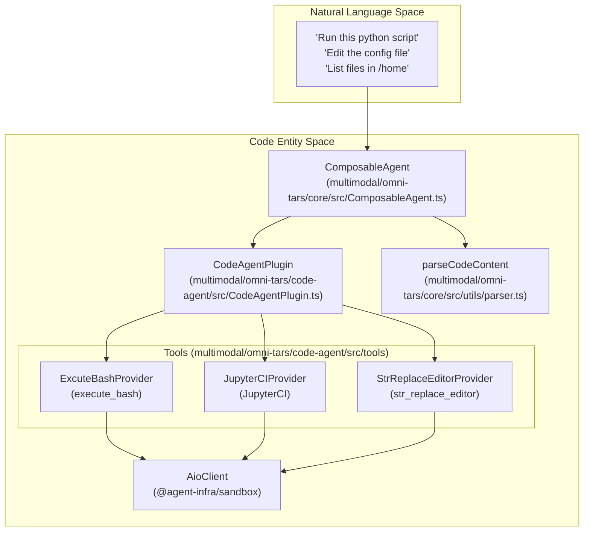

<!-- source: DeepWiki mcp.deepwiki.com · repo bytedance/UI-TARS-desktop · page 3.4 Code Agent and Sandbox Execution · fetched 2026-10-30 -->

# Code Agent and Sandbox Execution

<details>
<summary>Relevant source files</summary>

The following files were used as context for generating this wiki page:

- [multimodal/omni-tars/code-agent/src/CodeAgentPlugin.ts](multimodal/omni-tars/code-agent/src/CodeAgentPlugin.ts)
- [multimodal/omni-tars/code-agent/src/tools/ExcuteBash.ts](multimodal/omni-tars/code-agent/src/tools/ExcuteBash.ts)
- [multimodal/omni-tars/code-agent/src/tools/JupyterCI.ts](multimodal/omni-tars/code-agent/src/tools/JupyterCI.ts)
- [multimodal/omni-tars/code-agent/src/tools/StrReplaceEditor.ts](multimodal/omni-tars/code-agent/src/tools/StrReplaceEditor.ts)
- [multimodal/omni-tars/core/src/AgentComposer.ts](multimodal/omni-tars/core/src/AgentComposer.ts)
- [multimodal/omni-tars/core/src/AgentPlugin.ts](multimodal/omni-tars/core/src/AgentPlugin.ts)
- [multimodal/omni-tars/core/src/ComposableAgent.ts](multimodal/omni-tars/core/src/ComposableAgent.ts)
- [multimodal/omni-tars/core/src/utils/parser.ts](multimodal/omni-tars/core/src/utils/parser.ts)
- [multimodal/omni-tars/mcp-agent/src/McpAgentPlugin.ts](multimodal/omni-tars/mcp-agent/src/McpAgentPlugin.ts)
- [multimodal/omni-tars/mcp-agent/src/tools/mcp.ts](multimodal/omni-tars/mcp-agent/src/tools/mcp.ts)
- [multimodal/tarko/agent-server-next/src/middlewares/access-log.ts](multimodal/tarko/agent-server-next/src/middlewares/access-log.ts)
- [multimodal/tarko/agent-server-next/src/middlewares/session-restore.ts](multimodal/tarko/agent-server-next/src/middlewares/session-restore.ts)

</details>


The Code Agent provides code execution capabilities within the OmniTARS multimodal agent system. It enables agents to execute bash commands, perform file operations, and run code in isolated sandbox environments. This document covers the implementation of the `CodeAgentPlugin`, its integration with remote sandbox services via `AioClient`, and the parsing logic for T5-formatted code instructions.

## Architecture Overview

The Code Agent is implemented as a plugin in the OmniTARS composable agent system [multimodal/omni-tars/code-agent/src/CodeAgentPlugin.ts:18-19](). It operates within the `CODE_ENVIRONMENT` section [multimodal/omni-tars/code-agent/src/CodeAgentPlugin.ts:20]() and provides tools for executing code and manipulating files in remote sandbox environments.

### System Context Diagram
This diagram bridges the Natural Language intent (Code Execution) to the specific Code Entities used in the implementation.


**Sources:** [multimodal/omni-tars/code-agent/src/CodeAgentPlugin.ts:18-39](), [multimodal/omni-tars/core/src/ComposableAgent.ts:24-47](), [multimodal/omni-tars/core/src/utils/parser.ts:80]()

## Plugin Implementation

The `CodeAgentPlugin` class extends the base `AgentPlugin` [multimodal/omni-tars/code-agent/src/CodeAgentPlugin.ts:18](). It initializes a connection to an external sandbox service using `AioClient` [multimodal/omni-tars/code-agent/src/CodeAgentPlugin.ts:28-32]().

### Key Components
- **Environment Section**: Defined by `CODE_ENVIRONMENT` [multimodal/omni-tars/code-agent/src/CodeAgentPlugin.ts:20](), which is injected into the system prompt by the `AgentComposer` [multimodal/omni-tars/core/src/AgentComposer.ts:55-58]().
- **Sandbox Client**: Uses `AioClient` with a `baseUrl` provided via `CodeAgentExtraOption` [multimodal/omni-tars/code-agent/src/CodeAgentPlugin.ts:28-32]().
- **Health Check**: Performs a `client.healthCheck()` during initialization unless `ignoreSandboxCheck` is set [multimodal/omni-tars/code-agent/src/CodeAgentPlugin.ts:44-50]().

### System Prompt Composition
The `AgentComposer` generates a unified system prompt that includes the `CODE_ENVIRONMENT` description and usage instructions [multimodal/omni-tars/core/src/AgentComposer.ts:44-64](). If the code plugin is present, the composer adds `<code_env>` to the available environments list [multimodal/omni-tars/core/src/AgentComposer.ts:172-174]().

**Sources:** [multimodal/omni-tars/code-agent/src/CodeAgentPlugin.ts:18-42](), [multimodal/omni-tars/core/src/AgentComposer.ts:44-64](), [multimodal/omni-tars/core/src/AgentComposer.ts:172-174]()

## Tool Implementations

The Code Agent registers three primary tools for code execution and file manipulation [multimodal/omni-tars/code-agent/src/CodeAgentPlugin.ts:35-39]().

### 1. execute_bash
Enables execution of shell commands. It wraps the `client.shellExec` method with a 120-second timeout [multimodal/omni-tars/code-agent/src/tools/ExcuteBash.ts:24-29]().

| Parameter | Type | Description |
|-----------|------|-------------|
| `command` | string | The bash command to execute in the terminal [multimodal/omni-tars/code-agent/src/tools/ExcuteBash.ts:20](). |

### 2. JupyterCI
A stateful code sandbox tool for running Python code. It uses the `AioClient` to execute code within a persistent environment and maintains a `sessionId` across calls [multimodal/omni-tars/code-agent/src/tools/JupyterCI.ts:8-35](). If a `session_id` is returned that differs from the current one, the provider updates its internal state [multimodal/omni-tars/code-agent/src/tools/JupyterCI.ts:33-35]().

### 3. str_replace_editor
A tool for file system operations including viewing, creating, and editing files. It supports various commands such as `view`, `create`, `str_replace`, and `insert` [multimodal/omni-tars/code-agent/src/tools/StrReplaceEditor.ts:20-45](). It performs a `JSON.parse` on `view_range` if it is passed as a string [multimodal/omni-tars/code-agent/src/tools/StrReplaceEditor.ts:47-53]().

**Sources:** [multimodal/omni-tars/code-agent/src/tools/ExcuteBash.ts:15-33](), [multimodal/omni-tars/code-agent/src/tools/JupyterCI.ts:8-41](), [multimodal/omni-tars/code-agent/src/tools/StrReplaceEditor.ts:15-58]()

## Content Parsing and Tool Extraction

The system uses a specialized parser to extract reasoning, answers, and tool calls from the LLM's XML-like output format.

### parseCodeContent
The `parseCodeContent` function processes strings wrapped in `<code_env>` tags [multimodal/omni-tars/core/src/utils/parser.ts:80-89]().
1. **Reasoning**: Extracts content between `<code_env><function=execute_bash>...
    Agent->>Parser: parseCodeContent(content)
    Parser-->>Agent: { think, tools: [{ name: 'execute_bash', ... }] }
    Agent->>Tool: Invoke function({ command })
    Tool->>Aio: shellExec({ command })
    Aio->>Sandbox: POST /shell/exec
    Sandbox-->>Aio: { data: { stdout, exitCode } }
    Aio-->>Tool: Return data
    Tool-->>Agent: Tool Result
    Agent->>Agent: onAfterToolCall() hooks
    Agent-->>LLM: Next Loop: Tool "execute_bash" result: ...
```
**Sources:** [multimodal/omni-tars/core/src/ComposableAgent.ts:88-95](), [multimodal/omni-tars/core/src/utils/parser.ts:80-124](), [multimodal/omni-tars/code-agent/src/tools/ExcuteBash.ts:22-31]()

## Sandbox Client Integration

The `AioClient` serves as the bridge to the isolated execution environment. It is initialized with a `baseUrl` and optional logging levels [multimodal/omni-tars/code-agent/src/CodeAgentPlugin.ts:28-32]().

| Method | Purpose | Code Reference |
|--------|---------|----------------|
| `shellExec` | Executes arbitrary bash commands | [multimodal/omni-tars/code-agent/src/tools/ExcuteBash.ts:24]() |
| `jupyterExecute` | Runs Python code in a Jupyter kernel | [multimodal/omni-tars/code-agent/src/tools/JupyterCI.ts:25]() |
| `fileEditor` | Performs file system modifications | [multimodal/omni-tars/code-agent/src/tools/StrReplaceEditor.ts:55]() |
| `healthCheck` | Validates sandbox availability | [multimodal/omni-tars/code-agent/src/CodeAgentPlugin.ts:49]() |

**Sources:** [multimodal/omni-tars/code-agent/src/CodeAgentPlugin.ts:28-50](), [multimodal/omni-tars/code-agent/src/tools/ExcuteBash.ts:24-30](), [multimodal/omni-tars/code-agent/src/tools/JupyterCI.ts:25-30](), [multimodal/omni-tars/code-agent/src/tools/StrReplaceEditor.ts:55]()

---

