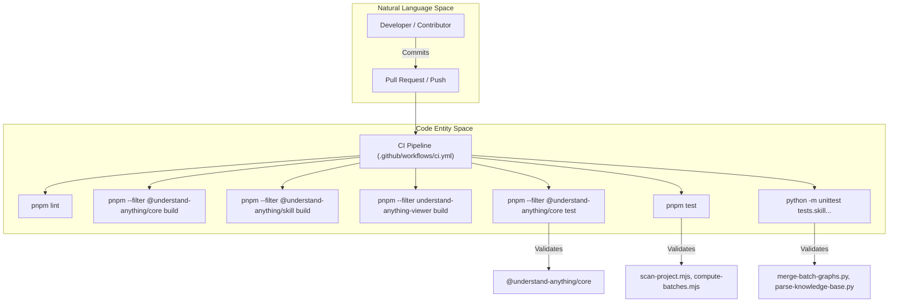
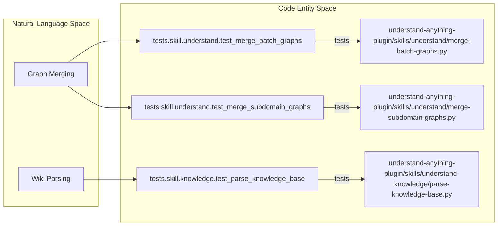

<!-- source: DeepWiki mcp.deepwiki.com · repo Egonex-AI/Understand-Anything · page 7 Testing, Benchmarks & CI · fetched 2026-10-30 -->

# Testing, Benchmarks & CI

Relevant source files

The following files were used as context for generating this wiki page:

- [.github/workflows/ci.yml](.github/workflows/ci.yml)
- [tests/skill/knowledge/test_parse_knowledge_base.py](tests/skill/knowledge/test_parse_knowledge_base.py)
- [tests/skill/understand/test_merge_subdomain_graphs.py](tests/skill/understand/test_merge_subdomain_graphs.py)
- [understand-anything-plugin/packages/dashboard/src/components/KnowledgeGraphView.tsx](understand-anything-plugin/packages/dashboard/src/components/KnowledgeGraphView.tsx)
- [understand-anything-plugin/skills/understand-knowledge/merge-knowledge-graph.py](understand-anything-plugin/skills/understand-knowledge/merge-knowledge-graph.py)
- [understand-anything-plugin/skills/understand-knowledge/parse-knowledge-base.py](understand-anything-plugin/skills/understand-knowledge/parse-knowledge-base.py)
- [understand-anything-plugin/skills/understand/merge-subdomain-graphs.py](understand-anything-plugin/skills/understand/merge-subdomain-graphs.py)
- [vitest.config.ts](vitest.config.ts)

This section provides a high-level overview of the testing, benchmarking, and continuous integration (CI) strategy employed in the Understand Anything codebase. It describes the different test suites used across the project, their purposes, and how they integrate with the GitHub Actions CI pipeline.

---

## Testing Strategy Overview

The Understand Anything project adopts a layered testing strategy to ensure robustness across its multi-language components:

-   **Core Unit Tests**: Implemented in TypeScript with [Vitest](https://vitest.dev), covering the `@understand-anything/core` package. These focus on schema validation, graph building, and language extractors [vitest.config.ts:9-11]().
-   **Skill Integration Tests**: Target the analysis pipeline phases. These include JavaScript-based tests for scripts like `scan-project.mjs` and `compute-batches.mjs`, as well as Python-based tests for graph merging and knowledge parsing [vitest.config.ts:14-18]().
-   **Python Unit Tests**: Dedicated tests for deterministic logic in `merge-batch-graphs.py`, `merge-subdomain-graphs.py`, and `parse-knowledge-base.py` using Python's `unittest` framework [.github/workflows/ci.yml:63-64]().
-   **CI Pipeline**: A GitHub Actions workflow that automates linting, building, and testing on `ubuntu-latest` and `windows-latest` runners [.github/workflows/ci.yml:21-26]().

---

## Core Unit Tests with Vitest

The core package `@understand-anything/core` is the foundation of the system. Its tests are isolated from the rest of the monorepo to avoid double-counting and ensure clean dependency boundaries [vitest.config.ts:9-11]().

Key areas covered by core tests include:
-   **Schema Validation**: Ensuring `KnowledgeGraph` nodes and edges adhere to the Zod-based data contract.
-   **Language Extractors**: Verifying tree-sitter based extraction for TypeScript, Python, Go, Rust, and others.
-   **Figma Subsystem**: Testing `FigmaApiSource` for document fetching and `extractTokens` for design token mapping.
-   **Change Detection**: Validating `FileFingerprint` and the `change-classifier` logic used for incremental updates.

For details on core test suites and specific implementation tests, see [Core Package Tests](#7.1).

---

## Skill Integration Tests

Skill scripts implement the heavy lifting of the analysis pipeline. Integration tests execute these scripts on curated fixture projects to verify output consistency.

-   **Pipeline Validation**: Tests like `test_scan_project.test.mjs` and `test_compute_batches.test.mjs` ensure the file discovery and batching logic works as expected [vitest.config.ts:15]().
-   **Knowledge Base Parsing**: `test_parse_knowledge_base.py` validates the Karpathy-pattern wiki parser, specifically checking for case-insensitive infra file detection (e.g., `Index.md` vs `index.md`) and wikilink resolution [tests/skill/knowledge/test_parse_knowledge_base.py:53-65]().
-   **Graph Merging**: `test_merge_subdomain_graphs.py` verifies the merging of subdomain graphs, including structural edge drop reporting and cross-run recovery [tests/skill/understand/test_merge_subdomain_graphs.py:73-84]().
-   **Viewer Consistency**: `test_viewer.test.mjs` ensures the standalone `understand-anything-viewer` correctly serves graph data and source content while enforcing the `ACCESS_TOKEN` security model.

For detailed coverage of these integration tests and benchmarks, see [Skill & Hook Integration Tests](#7.2).

---

## Continuous Integration (CI) Pipeline

The CI pipeline in `.github/workflows/ci.yml` is triggered on every pull request and push to the `main` branch [.github/workflows/ci.yml:3-10](). It utilizes a matrix strategy to ensure cross-platform compatibility [.github/workflows/ci.yml:22-26]().

### CI Workflow Steps
| Step | Command | Description |
| :--- | :--- | :--- |
| **Lint** | `pnpm lint` | Enforces code quality and formatting [.github/workflows/ci.yml:45-46](). |
| **Build Core** | `pnpm --filter @understand-anything/core build` | Compiles the core library [.github/workflows/ci.yml:48-49](). |
| **Test Core** | `pnpm --filter @understand-anything/core test` | Runs Vitest for core unit tests [.github/workflows/ci.yml:57-58](). |
| **Test Skill** | `pnpm test` | Runs JS/TS integration tests for skill scripts [.github/workflows/ci.yml:60-61](). |
| **Test Python** | `python -m unittest ...` | Validates Python merge and parse helpers [.github/workflows/ci.yml:63-64]().

---

## Testing & CI Architecture

The following diagram illustrates how the CI pipeline bridges the developer's local environment to the validated codebase.

Sources: [.github/workflows/ci.yml:21-64](), [vitest.config.ts:1-25]()

---

## Code Entity Mapping: Python Test Suites

This diagram bridges system names to the specific Python test files that validate the deterministic analysis logic.

Sources: [.github/workflows/ci.yml:63-64](), [tests/skill/knowledge/test_parse_knowledge_base.py:40-41](), [tests/skill/understand/test_merge_subdomain_graphs.py:24-33]()

---

## Summary

-   **Core Package**: Verified with Vitest unit tests for schema, builder, and extractors.
-   **Skill Scripts**: Validated with a mix of Vitest (JS/TS) and Python `unittest` for deterministic graph processing.
-   **CI Pipeline**: Automates the entire suite on GitHub runners for Linux and Windows.
-   **Benchmarks**: Large-repo benchmarks are used to measure performance and scalability.

For deeper technical details, consult the child pages:
-   [Core Package Tests](#7.1)
-   [Skill & Hook Integration Tests](#7.2)
-   [Large-Repo Benchmarks](#7.3)

---

## Sources
-   `.github/workflows/ci.yml` (lines 1-65)
-   `vitest.config.ts` (lines 1-25)
-   `tests/skill/knowledge/test_parse_knowledge_base.py` (lines 1-170)
-   `tests/skill/understand/test_merge_subdomain_graphs.py` (lines 1-148)
-   `understand-anything-plugin/skills/understand-knowledge/parse-knowledge-base.py` (lines 1-188)
-   `understand-anything-plugin/skills/understand/merge-subdomain-graphs.py` (lines 1-168)

---

