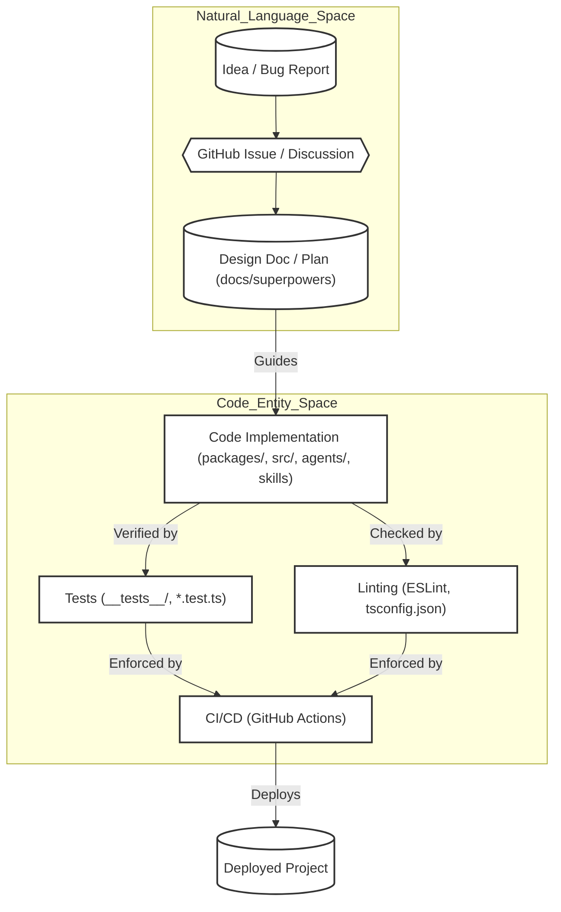
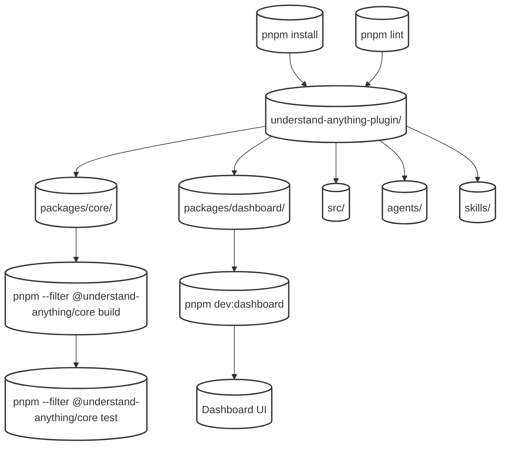

<!-- source: DeepWiki mcp.deepwiki.com · repo Egonex-AI/Understand-Anything · page 9 Contributing, Design Docs & Community · fetched 2026-10-30 -->

# Contributing, Design Docs & Community

Relevant source files

The following files were used as context for generating this wiki page:

- [.github/ISSUE_TEMPLATE/bug_report.yml](.github/ISSUE_TEMPLATE/bug_report.yml)
- [.github/ISSUE_TEMPLATE/config.yml](.github/ISSUE_TEMPLATE/config.yml)
- [.github/ISSUE_TEMPLATE/feature_request.yml](.github/ISSUE_TEMPLATE/feature_request.yml)
- [.github/ISSUE_TEMPLATE/question.yml](.github/ISSUE_TEMPLATE/question.yml)
- [.github/PULL_REQUEST_TEMPLATE.md](.github/PULL_REQUEST_TEMPLATE.md)
- [.github/workflows/deploy-homepage.yml](.github/workflows/deploy-homepage.yml)
- [.gitignore](.gitignore)
- [.npmrc](.npmrc)
- [CODE_OF_CONDUCT.md](CODE_OF_CONDUCT.md)
- [CONTRIBUTING.md](CONTRIBUTING.md)
- [LICENSE](LICENSE)
- [SECURITY.md](SECURITY.md)
- [tsconfig.json](tsconfig.json)

This page provides an overview of the project's governance, contribution guidelines, community standards, and the role of design documentation within the codebase. It serves as a high-level guide, linking to child pages for detailed information on each topic.

---

## Contribution Workflow & Policies

The Understand Anything project welcomes contributions and follows a structured workflow to ensure code quality and maintainability. This section outlines the general process, prerequisites, and policies for contributing.

### Overview of Contribution Process

Contributors are encouraged to engage through bug reports, feature requests, documentation improvements, code contributions, and testing. The process typically involves:
1.  **Setup:** Forking the repository, cloning it, and installing dependencies using `pnpm install` [CONTRIBUTING.md:23-32]().
2.  **Development:** Creating a descriptive branch (e.g., `feat/my-feature`, `fix/bug-description`) [CONTRIBUTING.md:52-59](), making changes, and writing tests.
3.  **Testing & Linting:** Running `pnpm test` for relevant packages (e.g., `pnpm --filter @understand-anything/core test`) [CONTRIBUTING.md:41-42]() and `pnpm lint` to ensure code style compliance [CONTRIBUTING.md:76-76]().
4.  **Pull Request:** Submitting a Pull Request with a clear title, detailed description, and adherence to the project's checklist [CONTRIBUTING.md:105-110]().

### Key Policies and Guidelines

*   **Code of Conduct:** All contributors are expected to adhere to the project's Code of Conduct, which emphasizes respect, constructive feedback, and a welcoming environment [CODE_OF_CONDUCT.md:1-39]().
*   **Security Policy:** The project has a defined security policy for reporting vulnerabilities, emphasizing its local-only nature and specific areas of concern [SECURITY.md:1-51]().
*   **Licensing:** The project is licensed under the MIT License [LICENSE:1-22]().
*   **Issue and PR Templates:** Standardized templates are provided for bug reports [bug_report.yml:1-86](), feature requests [feature_request.yml:1-35](), questions [question.yml:1-24](), and pull requests [PULL_REQUEST_TEMPLATE.md:1-27]() to streamline communication and ensure necessary information is captured.

For detailed instructions on setting up your development environment, coding standards, testing guidelines, and the full pull request checklist, see [Contribution Workflow & Policies](#9.1).

Sources: [CONTRIBUTING.md:1-281](), [CODE_OF_CONDUCT.md:1-39](), [SECURITY.md:1-51](), [LICENSE:1-22](), [bug_report.yml:1-86](), [feature_request.yml:1-35](), [question.yml:1-24](), [PULL_REQUEST_TEMPLATE.md:1-27]()

---

## `docs/superpowers` Plans & Specs

The `docs/superpowers` directory serves as the repository for design documents, implementation plans, and specifications that guide the development of major features and architectural changes. These documents capture the rationale behind decisions and provide a historical record of the project's evolution.

### Purpose and Structure

The `docs/superpowers` corpus is crucial for:
*   **Decision Making:** Documenting the thought process and alternatives considered for significant features.
*   **Knowledge Transfer:** Providing context for new contributors or team members on why certain architectural choices were made.
*   **Alignment:** Ensuring that development efforts align with the overall project vision and technical strategy.

Each design document typically includes a problem statement, proposed solutions, technical specifications, and often a record of discussions and outcomes.

### Index of Major Decisions

The `docs/superpowers` directory contains various plans and specifications covering different aspects of the project. Examples include:
*   **Knowledge Skill:** Design for integrating knowledge bases into the graph.
*   **Figma Foundation:** Specifications for the Figma design graph extraction and integration.
*   **`.understandignore`:** Details on how the `.understandignore` file functions for file filtering.
*   **Language Extractors:** Plans for extending language support beyond TypeScript.
*   **Graph Layout Scaling:** Strategies for optimizing graph visualization performance for large codebases.
*   **Multi-platform Install:** Documentation on supporting various operating systems and environments.

For a comprehensive guide to the `docs/superpowers` corpus, including how design documents are structured and an index of major past decisions, see [docs/superpowers Plans & Specs](#9.2).

Sources: [CONTRIBUTING.md:113-118]()

---

## Community Engagement

The project fosters community engagement through various channels and encourages open discussion and feedback.

### GitHub Discussions and Issues

*   **Discussions:** For open-ended discussions, design proposals, or sharing how users interact with the tool, GitHub Discussions are the primary forum [config.yml:7-8]().
*   **Issues:** For specific bug reports or feature requests, the structured issue templates guide contributors to provide necessary information [config.yml:3-4]().

### Project Governance

The project is maintained by Yuxiang Lin and Infinite Universe, Inc. [LICENSE:3-4](). Contributions are managed through Pull Requests, which are reviewed by maintainers. The `deploy-homepage.yml` GitHub Actions workflow [deploy-homepage.yml:1-69]() demonstrates the automated deployment process for the project's homepage, which includes building core components and the dashboard.

### Project Structure Overview

The project is organized as a `pnpm` monorepo, with key directories including:
*   `packages/core/`: The core analysis engine [CONTRIBUTING.md:191-194]().
*   `packages/dashboard/`: The React-based visualization dashboard [CONTRIBUTING.md:195-199]().
*   `src/`: Plugin skills implementation [CONTRIBUTING.md:200-200]().
*   `agents/`: AI agent prompts [CONTRIBUTING.md:201-201]().
*   `skills/`: Skill definitions [CONTRIBUTING.md:202-202]().

This structure facilitates modular development and clear separation of concerns.

Sources: [config.yml:3-8](), [LICENSE:3-4](), [deploy-homepage.yml:1-69](), [CONTRIBUTING.md:189-203]()

### Natural Language to Code Entity Mapping: Contribution Flow

This diagram illustrates the journey of a contribution from an idea or bug report to integrated code, highlighting the interaction between natural language descriptions and code entities.

Sources: [config.yml:3-8](), [CONTRIBUTING.md:189-203](), [CONTRIBUTING.md:121-123](), [CONTRIBUTING.md:170-171](), [tsconfig.json:1-16](), [deploy-homepage.yml:1-69]()

### Code Entity Space: Core Development Environment

This diagram outlines the core components and tools involved in the development environment, emphasizing the monorepo structure and build process.

Sources: [CONTRIBUTING.md:189-203](), [CONTRIBUTING.md:30-30](), [CONTRIBUTING.md:36-36](), [CONTRIBUTING.md:47-47](), [CONTRIBUTING.md:76-76]()

---

