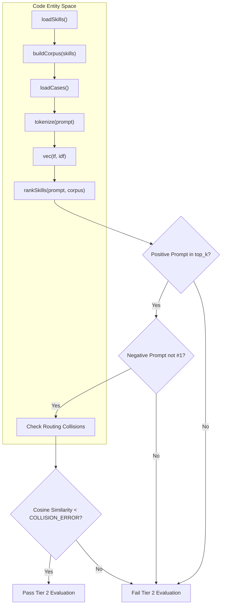
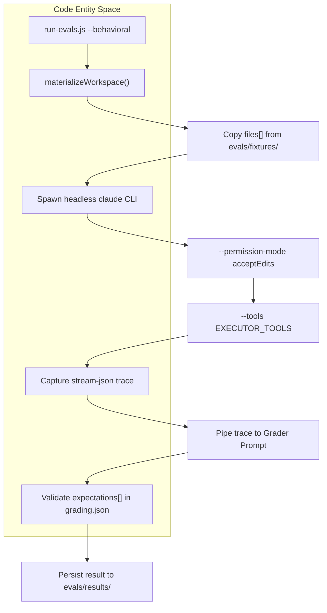

<!-- source: DeepWiki mcp.deepwiki.com · repo addyosmani/agent-skills · page 6.4 Evaluation Harness (evals) · fetched 2026-10-30 -->

# Evaluation Harness (evals)

<details>
<summary>Relevant source files</summary>

The following files were used as context for generating this wiki page:

- [.github/ISSUE_TEMPLATE/skill-gap.yml](.github/ISSUE_TEMPLATE/skill-gap.yml)
- [CONTRIBUTING.md](CONTRIBUTING.md)
- [docs/developer-onboarding.md](docs/developer-onboarding.md)
- [docs/other-hosts.md](docs/other-hosts.md)
- [evals/README.md](evals/README.md)
- [evals/cases/idea-refine.json](evals/cases/idea-refine.json)
- [evals/cases/interview-me.json](evals/cases/interview-me.json)
- [evals/plugin/code-review-fires/graders/off-by-one.md](evals/plugin/code-review-fires/graders/off-by-one.md)
- [evals/plugin/code-review-fires/graders/severity-labels.md](evals/plugin/code-review-fires/graders/severity-labels.md)
- [evals/plugin/code-review-fires/graders/skill-fired.md](evals/plugin/code-review-fires/graders/skill-fired.md)
- [evals/plugin/code-review-fires/prompt.md](evals/plugin/code-review-fires/prompt.md)
- [evals/plugin/code-review-stays-quiet/graders/not-fired.md](evals/plugin/code-review-stays-quiet/graders/not-fired.md)
- [evals/plugin/code-review-stays-quiet/graders/tdd-fired.md](evals/plugin/code-review-stays-quiet/graders/tdd-fired.md)
- [evals/plugin/code-review-stays-quiet/prompt.md](evals/plugin/code-review-stays-quiet/prompt.md)
- [evals/plugin/tdd-fires-on-pasted-bug/graders/failing-test-first.md](evals/plugin/tdd-fires-on-pasted-bug/graders/failing-test-first.md)
- [evals/plugin/tdd-fires-on-pasted-bug/graders/skill-fired.md](evals/plugin/tdd-fires-on-pasted-bug/graders/skill-fired.md)
- [evals/plugin/tdd-fires-on-pasted-bug/prompt.md](evals/plugin/tdd-fires-on-pasted-bug/prompt.md)
- [evals/plugin/tdd-stays-quiet-on-debug/graders/not-fired.md](evals/plugin/tdd-stays-quiet-on-debug/graders/not-fired.md)
- [evals/plugin/tdd-stays-quiet-on-debug/prompt.md](evals/plugin/tdd-stays-quiet-on-debug/prompt.md)
- [evals/skill-impact.md](evals/skill-impact.md)
- [hooks/session-start-test.sh](hooks/session-start-test.sh)
- [scripts/run-evals-test.js](scripts/run-evals-test.js)
- [scripts/run-evals.js](scripts/run-evals.js)

</details>


The `evals/` directory houses the evaluation harness for the `agent-skills` codebase. Its purpose is to ensure that skills function as intended: they trigger appropriately, remain distinct from one another, and effectively guide agent behavior [evals/README.md:1-3](). This system employs a three-tiered approach to evaluation, ranging from structural code checks to lexical routing approximation and fully token-intensive behavioral simulations [evals/README.md:14-21]().

Sources: [evals/README.md:1-21](), [scripts/run-evals.js:1-27]()

---

## The Three Tiers of Evaluation

The evaluation system is organized into three distinct tiers, separating deterministic structural checks from TF-IDF routing scoring and headless behavioral agent runs [evals/README.md:14-21]().

| Tier | What it checks | Runs | Cost |
|---|---|---|---|
| 1. Structural | Frontmatter, naming, required sections, command parity, path validity, manifest versions | CI (`validate-skills.js`, `validate-commands.js`, etc.) | Free |
| 2. Trigger & routing | Positive prompts rank their skill top-k; negative prompts do not rank #1; description cosine collision thresholds | CI (`run-evals.js`, `--min-rank1`) | Free |
| 3. Behavioral | An agent following the skill satisfies its `expectations[]` via workspace tracing and grading | On demand (`run-evals.js --behavioral`) | Tokens |

Sources: [evals/README.md:16-21]()

---

## Tier 1: Structural Evaluation

Tier 1 enforces the structural contract of every skill, command, reference link, artifact path, and version manifest without executing any agent models [evals/README.md:18](). These checks run deterministically on every push and pull request.

*   `scripts/validate-skills.js`: Validates `SKILL.md` frontmatter, schema compliance, and required sections [CONTRIBUTING.md:40-45]().
*   `scripts/validate-commands.js`: Ensures command parity and description synchronization across `.claude/commands/`, `commands/`, and `.gemini/commands/` [docs/developer-onboarding.md:64-65]().
*   `scripts/validate-reference-links.js`: Asserts that internal Markdown links pointing from skills into `references/` resolve correctly, including anchor fragments [docs/developer-onboarding.md:58-59]().
*   `scripts/validate-artifact-paths.js`: Confirms artifact pathways like spec/plan/todo files are consistent across command surfaces and documentation [docs/developer-onboarding.md:67-68]().
*   `scripts/validate-versions.js`: Verifies that marketplace and plugin manifests maintain synchronized versioning [docs/developer-onboarding.md:61-62]().

Sources: [evals/README.md:18](), [docs/developer-onboarding.md:58-68]()

---

## Tier 2: TF-IDF Lexical Routing Evaluation

Tier 2 measures catalog routing accuracy using a lightweight, deterministic TF-IDF implementation combined with light token stemming [scripts/run-evals.js:6-18](). It protects the repository against two primary routing failure modes: false negatives (descriptions omitting the vocabulary users actually speak) and false positives/collisions (over-broad descriptions that outrank more specialized skills) [evals/README.md:22-23]().

### Data Flow & Execution Pipeline


**Diagram: Tier 2 Lexical Routing and Collision Evaluation Data Flow**

Sources: [scripts/run-evals.js:104-150](), [scripts/run-evals.js:153-181]()

### Lexical Pipeline Implementation Details

The text processing pipeline in `scripts/run-evals.js` converts natural language prompts and skill descriptions into weighted vector representations without external library dependencies:
*   **Tokenization & Stopwords**: `tokenize(text)` strips non-alphanumeric characters, filters common stop words from `STOP`, and runs lightweight suffix stripping via `stem(t)` [scripts/run-evals.js:63-97]().
*   **Corpus Weighting**: `buildCorpus(skills)` constructs document frequency tables where skill names receive a 2x weighting relative to description tokens [scripts/run-evals.js:105-120]().
*   **Vector Space & Ranking**: `rankSkills(prompt, corpus)` computes term frequency vectors using `vec(tf, idf)` and sorts candidate skills by cosine similarity via `cosine(a, b)` [scripts/run-evals.js:121-150]().
*   **Collision Thresholds**: Pairwise description similarities trigger warnings at `COLLISION_WARN` (0.5) and hard test failures at `COLLISION_ERROR` (0.75) [scripts/run-evals.js:58-60]().
*   **Rank-1 Ratchet**: The `--min-rank1 <pct>` CLI option asserts that aggregate positive routing accuracy does not drop below the checked-in baseline [scripts/run-evals.js:17-18]().

Sources: [scripts/run-evals.js:58-150]()

---

## Tier 3: Behavioral Evaluation with Fixtures

Tier 3 executes agent runs inside throwaway workspaces using headless `claude` instances to verify that following a skill produces the required behavioral and file artifacts [evals/README.md:31-38]().

### Behavioral Execution Pipeline


**Diagram: Tier 3 Behavioral Execution and Grading Flow**

Sources: [evals/README.md:36-38](), [scripts/run-evals.js:20-25]()

### Execution vs. Dialogue Artifacts

Tier 3 supports two distinct evaluation kinds defined within case schemas:
*   **`execution`**: The default mode. Materializes real project fixtures from `evals/fixtures/` into a temporary git repository, executes the agent with pre-approved tools (`Read,Glob,Grep,Edit,Write,Bash,WebFetch,WebSearch`), and grades the full `--output-format stream-json --verbose` trace [evals/README.md:36-38]().
*   **`dialogue`**: Reserved for conversational skills whose deliverable is dialogic interaction. Requires no disk fixtures; the grader assesses conversational turns directly [evals/README.md:36]().

Sources: [evals/README.md:36-38](), [scripts/run-evals.js:48-50]()

---

## Eval Case Schema & Fixtures

Every skill requires a colocated case definition under `evals/cases/<skill-name>.json` [CONTRIBUTING.md:44](). Each file must supply minimum thresholds: at least 3 positive triggers, 2 negative triggers, and 1 behavioral eval [CONTRIBUTING.md:44]().

```json
{
  "skill_name": "test-driven-development",
  "trigger": {
    "positive": [
      { "prompt": "Write a failing test for this bug before fixing it", "top_k": 3 }
    ],
    "negative": [
      { "prompt": "Update the architecture diagram in the docs", "owner": "documentation-and-adrs" }
    ]
  },
  "evals": [
    {
      "id": 1,
      "kind": "execution",
      "prompt": "Fix the reconciliation bug in BUG.md.",
      "expected_output": "A failing reproduction test followed by the fix.",
      "files": ["test-driven-development"],
      "expectations": [
        "A test reproducing the bug is added and shown failing before implementation is modified"
      ]
    }
  ]
}
```

Sources: [CONTRIBUTING.md:40-45](), [evals/README.md:41-78]()

---

## Skill-Impact Ledger (`evals/skill-impact.md`)

The `evals/skill-impact.md` file serves as an append-only historical ledger tracking rejected skill proposals and description modifications [CONTRIBUTING.md:15](). When a proposed skill or description change fails evaluation or review, contributors document the attempt, before-and-after rank-1 scores, and rejection rationale in this ledger to prevent repeating previously discarded approaches [CONTRIBUTING.md:66-73]().

Sources: [CONTRIBUTING.md:15](), [CONTRIBUTING.md:66-73](), [evals/skill-impact.md:1-6]()

---

