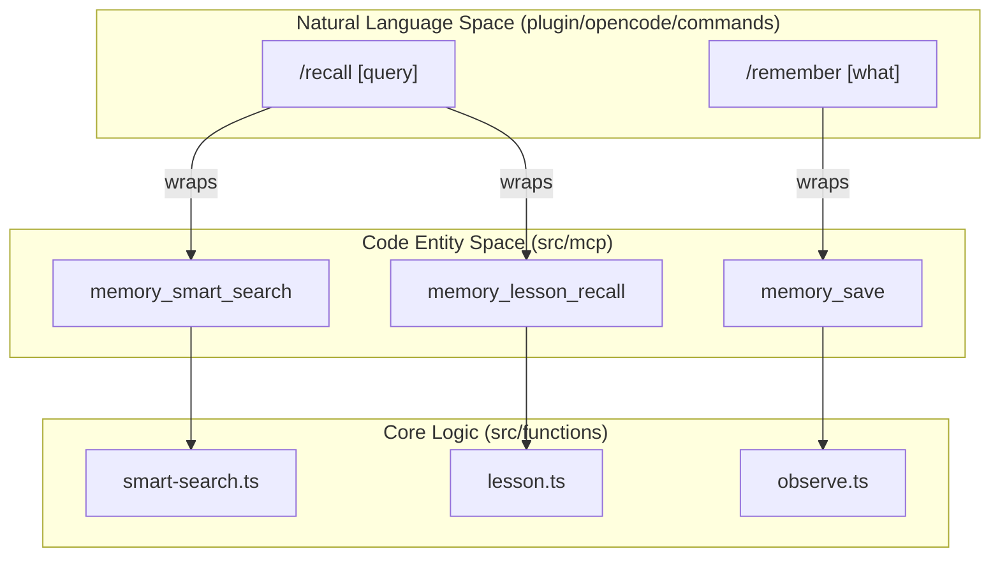

<!-- source: DeepWiki mcp.deepwiki.com · repo rohitg00/agentmemory · page 10.2 Project Governance & Contributing · fetched 2026-10-30 -->

# Project Governance & Contributing

<details>
<summary>Relevant source files</summary>

The following files were used as context for generating this wiki page:

- [CODE_OF_CONDUCT.md](CODE_OF_CONDUCT.md)
- [CONTRIBUTING.md](CONTRIBUTING.md)
- [GOVERNANCE.md](GOVERNANCE.md)
- [MAINTAINERS.md](MAINTAINERS.md)
- [ROADMAP.md](ROADMAP.md)
- [SECURITY.md](SECURITY.md)
- [plugin/opencode/commands/recall.md](plugin/opencode/commands/recall.md)
- [plugin/opencode/commands/remember.md](plugin/opencode/commands/remember.md)

</details>


This page outlines the organizational structure, contribution workflows, and security policies for the `agentmemory` project. It defines how decisions are made, how the community interacts with the codebase, and the commitment to long-term stability and security.

## Governance Model

`agentmemory` follows the **Minimum Viable Governance (MVG)** pattern [GOVERNANCE.md:5-5](). The project is currently in a growth phase, moving from a single-maintainer model toward a diversified maintainership structure [GOVERNANCE.md:5-6]().

### Decision-Making Process

The project operates primarily on **Lazy Consensus** for code changes [GOVERNANCE.md:50-53]().

| Type | Process |
| :--- | :--- |
| **Pull Requests** | Merged when any Maintainer approves and none block. Silence for 72 hours is considered assent [GOVERNANCE.md:52-52](). |
| **Non-PR Decisions** | Charter changes, governance edits, or breaking API changes require a GitHub Issue labeled `governance` [GOVERNANCE.md:55-57](). |
| **Formal Votes** | Maintainers react `+1` / `-1` / `0` to a summary comment. Simple majority (minimum two voters) carries. If only one maintainer exists, a 7-day public comment window is used [GOVERNANCE.md:59-60](). |

### Breaking Changes Policy
A breaking change to the REST or MCP surface requires a tracking issue labeled `breaking` at least one minor release cycle ahead of the change, a deprecation path in the code (warning log, feature flag, or adapter), and a clear entry in the `CHANGELOG` [GOVERNANCE.md:61-68]().

### Maintainer Roles
Maintainers have commit access and are responsible for reviewing PRs and upholding the Code of Conduct [GOVERNANCE.md:26-36]().
*   **Active Maintainers:** Tracked in `MAINTAINERS.md` [MAINTAINERS.md:7-10](). Currently led by Rohit Ghumare [MAINTAINERS.md:9-9]().
*   **Acceptance:** Requires 6 months of sustained, high-signal contributions and a nomination via PR to `MAINTAINERS.md` [GOVERNANCE.md:37-45]().

**Sources:** [GOVERNANCE.md:1-80](), [MAINTAINERS.md:1-21]()

---

## Contributing Guidelines

Contributions are governed by the Apache-2.0 license and require a **Developer Certificate of Origin (DCO)** sign-off on every commit [CONTRIBUTING.md:7-11]().

### Development Workflow
1.  **Issue Creation:** Search existing issues before reporting bugs or proposing features [CONTRIBUTING.md:12-21]().
2.  **Branching:** Use prefixes like `feat/`, `fix/`, or `docs/` [CONTRIBUTING.md:25-28]().
3.  **Local Setup:** Requires Node.js >= 20. Run `npm install` followed by `npm run build` [CONTRIBUTING.md:29-30]().
4.  **Testing:** All tests must pass via `npm test`. Integration tests under `test/integration.test.ts` require a live server on `:3111` [CONTRIBUTING.md:31-31]().

### Implementation Map
When contributing, refer to this directory map to locate specific logic:

| Directory | Responsibility |
| :--- | :--- |
| `src/triggers/api.ts` | Every HTTP endpoint under `/agentmemory/*` [CONTRIBUTING.md:67-67](). |
| `src/mcp/` | Standalone MCP server (`@agentmemory/mcp`), tools registry, and in-memory KV [CONTRIBUTING.md:68-68](). |
| `src/functions/` | Core memory operations: observe, compress, consolidate, retention, etc. [CONTRIBUTING.md:69-69](). |
| `src/hooks/` | The 12 auto-hooks that capture sessions in agents [CONTRIBUTING.md:70-70](). |
| `src/cli/` | The `agentmemory` CLI and connect adapters for 18 agents [CONTRIBUTING.md:71-71](). |
| `src/state/` | KV schema, keyed mutex, and access logs [CONTRIBUTING.md:73-73](). |

### Code Entity Association: Adding a Tool
The following diagram illustrates the flow for implementing a new memory capability across the "Natural Language Space" (Tool definition) and "Code Entity Space" (Implementation).

**New Memory Tool Implementation Flow**
```mermaid
graph TD
    subgraph "Natural Language / Tool Space"
        "Tool Definition" --> "User Intent"
    end

    subgraph "Code Entity Space"
        A["src/functions/<area>.ts"] -- "1. Register core function" --> B["src/triggers/api.ts"]
        B -- "2. Add REST twin (api_path)" --> C["src/mcp/tools-registry.ts"]
        C -- "3. Add tool entry" --> D["src/mcp/standalone.ts"]
        D -- "4. Implement standalone MCP" --> E["test/"]
        E -- "5. Write Vitest case" --> F["Final Feature"]
    end
```
**Sources:** [CONTRIBUTING.md:63-86]()

---

## Security Policy

The project maintains a strict coordinated disclosure process. **Suspected vulnerabilities must not be reported via public issues** [SECURITY.md:5-5]().

### Reporting Process
1.  **Preferred:** GitHub Security Advisories private report at `https://github.com/rohitg00/agentmemory/security/advisories/new` [SECURITY.md:9-9]().
2.  **Fallback:** Encrypted email to `ghumare64@gmail.com` using PGP/SSH keys published at `https://github.com/rohitg00.gpg` [SECURITY.md:10-10]().

### Disclosure Timeline
*   **Acknowledgment:** Within 72 hours (target 24) [SECURITY.md:21-21]().
*   **Fixing:** Performed in private branches [SECURITY.md:23-23]().
*   **Disclosure Window:** Default 30 days, up to 90 days for deep refactors [SECURITY.md:24-24]().

### Supported Versions
Security fixes are prioritized based on version age [SECURITY.md:29-33]():
*   **Latest Minor (currently 0.9.x):** Yes [SECURITY.md:31-31]().
*   **Previous Minor (currently 0.8.x):** Critical/High severity only for 90 days after a new minor release [SECURITY.md:32-32]().

### Supply-Chain Stance
The project ships pre-built artifacts in the npm tarball (`dist/` is bundled at publish time). The runtime dependency tree is kept small (6 production dependencies) [SECURITY.md:53-55](). No lockfile is committed to ensure security patches reach users via SemVer ranges [SECURITY.md:57-61](). CI runs `npm install --package-lock-only` to build against a fully resolved tree for each test job [SECURITY.md:69-69]().

**Sources:** [SECURITY.md:1-85]()

---

## Release Process

Maintainers cut releases by updating version strings in 8 distinct locations in lockstep [CONTRIBUTING.md:95-107]():

1. `package.json`
2. `src/version.ts`
3. `plugin/.claude-plugin/plugin.json`
4. `plugin/plugin.json`
5. `plugin/.codex-plugin/plugin.json`
6. `packages/mcp/package.json`
7. `src/types.ts` (`ExportData.version` union)
8. `src/functions/export-import.ts` (`supportedVersions` Set)

The `Publish to npm` workflow publishes `@agentmemory/agentmemory`, `@agentmemory/mcp`, and `@agentmemory/fs-watcher` with provenance [CONTRIBUTING.md:109-109]().

**Sources:** [CONTRIBUTING.md:94-110]()

---

## Roadmap & Future Direction

The project roadmap covers Q2 2026 through Q1 2027 [ROADMAP.md:1-3]().

### Quarterly Themes
*   **Q2 2026 — Depth:** Multimodal memory (image store), `@agentmemory/fs-watcher` filesystem connector, and governance baselines [ROADMAP.md:18-18, 23-37]().
*   **Q3 2026 — Breadth:** Maintainer onboarding, OpenSSF Scorecard alignment, and a knowledge graph query language [ROADMAP.md:19-19, 44-53]().
*   **Q4 2026 — Trust:** Enterprise features including SSO gateway (OIDC), audit log export (S3/Loki), and RBAC on memory scope [ROADMAP.md:20-20, 57-66]().
*   **Q1 2027 — v1.0:** REST + MCP surface freeze, LTS branch `v1.x` (12-month commitment), and full v1.0 release [ROADMAP.md:21-21, 70-77]().

### OpenCode Integration
The OpenCode hook bus (in `plugin/opencode/`) wires 22 hooks covering session lifecycle, tool capture, and task tracking [ROADMAP.md:40-40](). It includes slash commands like `/recall` and `/remember` [ROADMAP.md:40-40]().

**OpenCode Command to Code Mapping**


**Sources:** [ROADMAP.md:1-92](), [plugin/opencode/commands/remember.md:1-19](), [plugin/opencode/commands/recall.md:1-19]()

---

