# Page: Overview

# Overview

<details>
<summary>Relevant source files</summary>

The following files were used as context for generating this wiki page:

- [AGENTS.md](AGENTS.md)
- [CHANGELOG.md](CHANGELOG.md)
- [README.md](README.md)
- [READMEs/README.de-DE.md](READMEs/README.de-DE.md)
- [READMEs/README.es-ES.md](READMEs/README.es-ES.md)
- [READMEs/README.fr-FR.md](READMEs/README.fr-FR.md)
- [READMEs/README.hi-IN.md](READMEs/README.hi-IN.md)
- [READMEs/README.ja-JP.md](READMEs/README.ja-JP.md)
- [READMEs/README.ko-KR.md](READMEs/README.ko-KR.md)
- [READMEs/README.pt-BR.md](READMEs/README.pt-BR.md)
- [READMEs/README.ru-RU.md](READMEs/README.ru-RU.md)
- [READMEs/README.tr-TR.md](READMEs/README.tr-TR.md)
- [READMEs/README.zh-CN.md](READMEs/README.zh-CN.md)
- [package.json](package.json)
- [packages/mcp/package.json](packages/mcp/package.json)
- [plugin/.claude-plugin/plugin.json](plugin/.claude-plugin/plugin.json)
- [plugin/.codex-plugin/plugin.json](plugin/.codex-plugin/plugin.json)
- [plugin/plugin.json](plugin/plugin.json)
- [src/cli.ts](src/cli.ts)
- [src/functions/export-import.ts](src/functions/export-import.ts)
- [src/index.ts](src/index.ts)
- [src/triggers/api.ts](src/triggers/api.ts)
- [src/types.ts](src/types.ts)
- [src/version.ts](src/version.ts)
- [src/viewer/index.html](src/viewer/index.html)
- [test/export-import.test.ts](test/export-import.test.ts)

</details>


**agentmemory** is a persistent, searchable, and versioned memory database designed specifically for AI coding agents. It solves the "amnesia" problem where agents lose context between sessions, forcing users to re-explain architectures, coding standards, and past bug fixes.

By providing a unified memory layer, agentmemory allows different tools—such as **Claude Code**, **Cursor**, **Windsurf**, **Cline**, **GitHub Copilot CLI**, **Devin**, and **Warp**—to share a single, evolving intelligence base for a project [README.md:10-11](). It is built on the **iii-engine**, utilizing three core primitives: HTTP Triggers, KV State, and Streams [package.json:4-5]().

## Key Capabilities

| Capability | Technical Implementation |
|---|---|
| **Automatic Capture** | Silently records tool uses, file edits, and test runs via 12 lifecycle hooks [plugin/.claude-plugin/plugin.json:4](). |
| **Triple-Stream Retrieval** | Combines **BM25** (keyword), **Vector** (semantic), and **Knowledge Graph** (relational) search [src/types.ts:274-282](). |
| **Memory Consolidation** | Automatically compresses raw observations into structured facts and episodic narratives [src/types.ts:64-83](). |
| **Multi-Agent Coordination** | Orchestration primitives like **Leases**, **Actions**, and **Signals** for team collaboration [src/types.ts:327-400](). |
| **Self-Healing Infrastructure** | Circuit-breaker pattern (3-failure threshold) and fallback chains for LLM providers [src/types.ts:239-244](). |

**Sources:** [README.md:1-50](), [src/types.ts:1-300](), [package.json:1-15]()

---

## Subsystem Relationship

The system bridges raw agent interactions to long-term intelligence through a structured pipeline. The diagram below illustrates how raw agent events flow through the system to become long-term memory.

### Data Flow: Hook to Memory
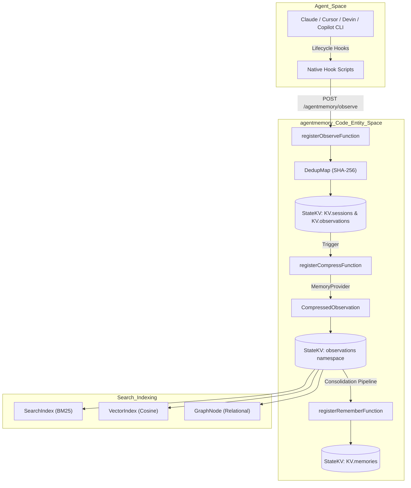
**Sources:** [src/index.ts:24-50](), [src/types.ts:139-160](), [src/state/schema.ts:1-50](), [src/functions/export-import.ts:61-164](), [src/index.ts:94-96]()

---

## Major Components

### 1. Memory Pipeline
The pipeline manages the lifecycle of data from a raw `HookPayload` [src/types.ts:153-160]() to a long-term `Memory` [src/types.ts:102-125](). It handles privacy scrubbing, deduplication via `DedupMap` [src/index.ts:100](), and LLM-driven summarization.
*   For details, see **[Core Memory Pipeline](#2)**.

### 2. Retrieval Engine
agentmemory does not just "grep" files. It uses a `HybridSearch` [src/index.ts:26]() class to fuse results from three different streams—BM25, Vector, and Graph—using Reciprocal Rank Fusion (RRF).
*   For details, see **[Search & Retrieval](#3)**.

### 3. Integration Interfaces
The system exposes its functionality through three primary interfaces:
*   **REST API**: Standard endpoints (e.g., `/agentmemory/livez` [src/triggers/api.ts:190]()) for session and memory management.
*   **MCP Server**: Over 54 tools (e.g., `memory_recall`, `memory_save`) for Model Context Protocol clients [plugin/.claude-plugin/plugin.json:4]().
*   **Native Hooks**: Integration scripts for agent lifecycles mapping 12 event types [src/types.ts:139-151]().
*   For details, see **[API & Integration Interfaces](#4)**.

### 4. Coordination & Mesh
For complex environments, agentmemory supports P2P mesh networking to sync memories across different machines via `registerMeshFunction` [src/index.ts:74](), alongside a "Frontier" priority queue for managing task leases [src/index.ts:68-69]().
*   For details, see **[Multi-Agent Coordination](#5)**.

---

## System Architecture Overview

The following diagram bridges the functional concepts to the specific TypeScript classes and functions that implement them.

### Code Entity Mapping
```mermaid
graph LR
    subgraph "Natural_Language_Space"
        direction TB
        "Context_Injection"
        "Semantic_Search"
        "Memory_Aging"
        "Entity_Relations"
    end

    subgraph "Code_Entity_Space"
        direction TB
        "registerContextFunction" --> "StateKV"
        "HybridSearch" --> "VectorIndex"
        "HybridSearch" --> "SearchIndex"
        "registerAutoForgetFunction" --> "Ebbinghaus_Decay"
        "registerGraphFunction" --> "GraphNode/GraphEdge"
    end

    "Context_Injection" -.-> "registerContextFunction"
    "Semantic_Search" -.-> "HybridSearch"
    "Memory_Aging" -.-> "registerAutoForgetFunction"
    "Entity_Relations" -.-> "registerGraphFunction"
```
**Sources:** [src/index.ts:24-93](), [src/types.ts:196-202](), [src/types.ts:274-282](), [src/functions/export-import.ts:62-164]()

---

## Navigation
*   **[Getting Started](#1.1)**: Installation via `npm install -g @agentmemory/agentmemory` [README.md:110]() and connecting to your favorite editor using `agentmemory connect` [src/cli.ts:173]().
*   **[Architecture Overview](#1.2)**: Deep dive into the `iii-engine` primitives and the worker model.
*   **[Core Memory Pipeline](#2)**: How `RawObservation` [src/types.ts:47-62]() objects become `Memory` [src/types.ts:102-125]() entities.
*   **[Search & Retrieval](#3)**: Details on BM25, Vectors, and RRF Fusion.
*   **[API & Integration Interfaces](#4)**: REST, MCP, and Hook documentation.
*   **[Providers & Resilience](#6)**: Configuring `MemoryProvider` [src/types.ts:172-177]() and `EmbeddingProvider` [src/types.ts:258-264]() with circuit breakers.
*   **[State Layer & Data Model](#8)**: Type definitions in `src/types.ts` and the KV namespace schema in `src/state/schema.ts`.

---

# Page: Getting Started

# Getting Started

<details>
<summary>Relevant source files</summary>

The following files were used as context for generating this wiki page:

- [.env.example](.env.example)
- [.gitignore](.gitignore)
- [INSTALL_FOR_AGENTS.md](INSTALL_FOR_AGENTS.md)
- [iii-config.docker.yaml](iii-config.docker.yaml)
- [iii-config.yaml](iii-config.yaml)
- [scripts/backfill-imported-sessions.sh](scripts/backfill-imported-sessions.sh)
- [src/cli/connect/continue.ts](src/cli/connect/continue.ts)
- [src/cli/connect/copilot-cli.ts](src/cli/connect/copilot-cli.ts)
- [src/cli/connect/index.ts](src/cli/connect/index.ts)
- [src/cli/connect/opencode.ts](src/cli/connect/opencode.ts)
- [src/cli/onboarding.ts](src/cli/onboarding.ts)
- [src/cli/preferences.ts](src/cli/preferences.ts)
- [src/cli/splash.ts](src/cli/splash.ts)
- [src/config.ts](src/config.ts)
- [src/functions/smart-search.ts](src/functions/smart-search.ts)
- [src/logger.ts](src/logger.ts)
- [src/prompts/summary.ts](src/prompts/summary.ts)
- [test/cli-connect.test.ts](test/cli-connect.test.ts)
- [test/env-loader.test.ts](test/env-loader.test.ts)
- [test/preferences.test.ts](test/preferences.test.ts)
- [test/tool-count-consistency.test.ts](test/tool-count-consistency.test.ts)
- [website/components/Install.tsx](website/components/Install.tsx)

</details>


This page provides the technical details for installing, configuring, and integrating `agentmemory` into your AI-assisted development workflow. It covers the environment setup, port layout, and the runtime configuration required to connect the memory system to agents like Claude Code, Cursor, Windsurf, or Copilot CLI.

## Installation & Environment

`agentmemory` relies on a centralized data directory located at `~/.agentmemory/` [src/config.ts:20-21](). This directory houses the persistence layer, CLI preferences, and the primary environment configuration.

### Installation Commands
The system can be installed globally via npm or run directly using npx:
```bash
npm install -g @agentmemory/agentmemory   # Installs the `agentmemory` command
agentmemory                               # Starts the memory server on :3111
agentmemory connect claude-code           # Wires MCP into your agent
```
[INSTALL_FOR_AGENTS.md:23-29]()

### Interactive Onboarding
The CLI includes an interactive onboarding flow managed by `runOnboarding` [src/cli/onboarding.ts:164](). This process wakes up when `isFirstRun()` is true (preferences are missing or `firstRunAt` is null) [src/cli/preferences.ts:139-146](). The flow handles:
1.  **Agent Selection:** A multi-select picker using `ADAPTERS` as the single source of truth [src/cli/onboarding.ts:30-41]().
2.  **Provider Selection:** Choice of LLM provider (Anthropic, OpenAI, Gemini, OpenRouter, MiniMax) or a "Skip — BM25-only" mode [src/cli/onboarding.ts:51-58]().
3.  **Environment Seeding:** Automatically copies `.env.example` to `~/.agentmemory/.env` or creates a minimal skeleton [src/cli/onboarding.ts:106-137]().

### The .env Configuration
The system loads configuration from `~/.agentmemory/.env` [src/config.ts:21](). Values are memoized in `envFileCache` to prevent redundant disk reads during a process lifetime [src/config.ts:31-34]().

| Variable | Description | Default |
| :--- | :--- | :--- |
| `III_REST_PORT` | Port for the REST API | `3111` [src/config.ts:166]() |
| `III_STREAMS_PORT` | Port for WebSockets/Live Stream | `3112` [src/config.ts:167]() |
| `AGENTMEMORY_SECRET` | Bearer token for API authentication | - [src/triggers/api.ts:41]() |
| `EMBEDDING_PROVIDER` | Provider for vector search (`local`, `openai`, `gemini`, etc.) | `local` [src/config.ts:193-206]() |
| `AGENTMEMORY_AGENT_SCOPE` | Isolation mode for multi-agent environments | `shared` [src/config.ts:233]() |
| `MAX_TOKENS` | Max tokens for LLM provider calls | `4096` [src/config.ts:87]() |

**Sources:** [src/config.ts:1-233](), [src/cli/onboarding.ts:1-186](), [src/cli/preferences.ts:1-146]()

## Port Layout & Data Flow

`agentmemory` operates across three primary ports to separate concerns between command execution, real-time updates, and visualization.

1.  **3111 (REST API):** The primary entry point for memory ingestion (`mem::observe`) and retrieval. Configured via `III_REST_PORT` [src/config.ts:166]().
2.  **3112 (Streams):** Provides the `mem-live` WebSocket stream for real-time updates [iii-config.yaml:29-37]().
3.  **3113 (Viewer):** A proxy server serving the `agentmemory` dashboard [src/triggers/api.ts:169]().

### Connection Logic Diagram

This diagram illustrates how the `config.ts` loaders interact with the environment to establish the memory service.

Title: agentmemory Initialization Flow
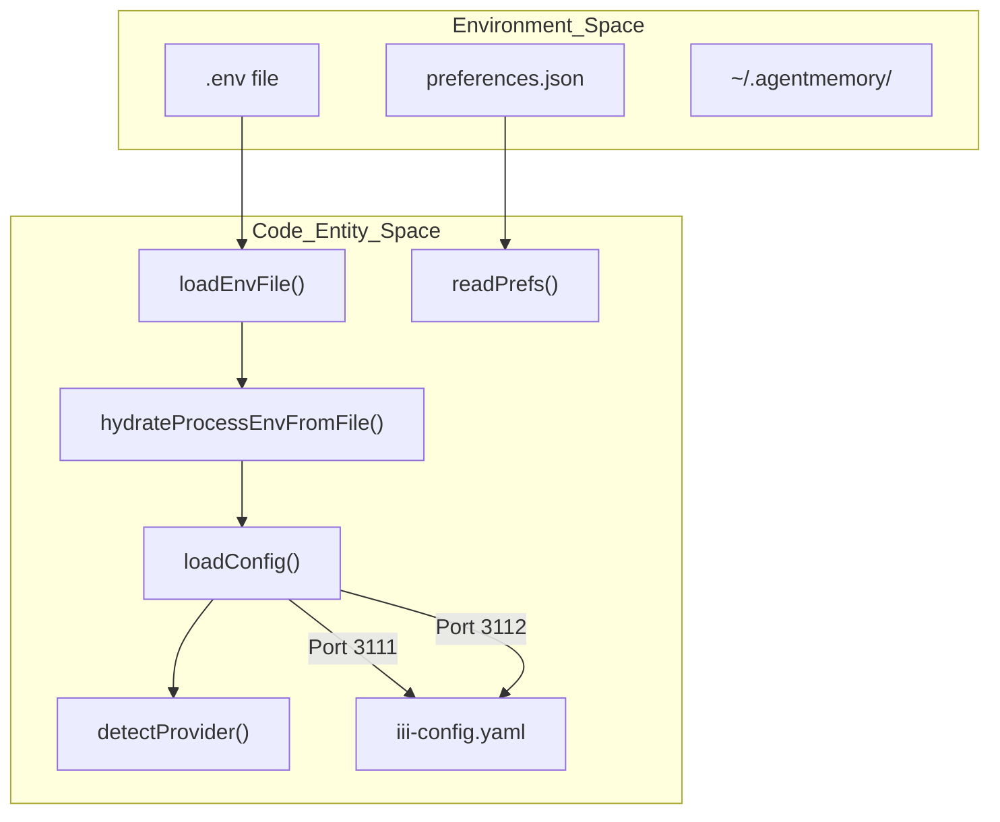
**Sources:** [src/config.ts:33-186](), [src/cli/preferences.ts:88-97](), [iii-config.yaml:1-37]()

## Runtime Configuration

The system runs on the `iii-engine`, which manages the underlying HTTP, state, and stream workers.

*   **Worker Layout:** Defined in `iii-config.yaml`. It includes `iii-http` for REST, `iii-state` using a file-based SQLite adapter (`state_store.db`), and `iii-stream` for pub/sub events [iii-config.yaml:1-37]().
*   **Observability:** The engine samples logs and metrics at a `sampling_ratio` of 0.1 to prevent feedback loops in log subscribers [iii-config.yaml:38-55]().
*   **Process Hydration:** `hydrateProcessEnvFromFile()` copies `.env` keys into `process.env` at boot, ensuring `process.env["KEY"]` access works for all modules [src/config.ts:80-84]().

**Sources:** [iii-config.yaml:1-61](), [src/config.ts:80-84]()

## Agent Integration

Integration is achieved via the `agentmemory connect` command, which uses specific adapters for each agent [src/cli/connect/index.ts:28-50]().

### 1. Adapter System
Each agent has a dedicated adapter (e.g., `claudeCode`, `cursor`, `opencode`) that implements `detect()` and `install()` [src/cli/connect/index.ts:86-134]().
*   **MCP Wiring:** Most adapters (like `opencode`) write a local MCP entry pointing to `npx -y @agentmemory/mcp` [src/cli/connect/opencode.ts:29-33]().
*   **Environment Passthrough:** The `claude-code` adapter writes an `env` block that honors `AGENTMEMORY_URL` and `AGENTMEMORY_SECRET` from the shell, defaulting to localhost [test/cli-connect.test.ts:162-174]().

### 2. MCP Tool Surface
The MCP server exposes 54 tools by default [test/tool-count-consistency.test.ts:12]().
*   **Core Tools:** A subset of 8 essential tools (`memory_save`, `memory_smart_search`, etc.) can be selected via `AGENTMEMORY_TOOLS=core` [INSTALL_FOR_AGENTS.md:130-132]().
*   **Smart Search:** The `mem::smart-search` function provides a unified retrieval interface, supporting both `compact` (preview) and `expanded` (full) result modes [src/functions/smart-search.ts:80-176]().

Title: MCP Tool to Code Mapping
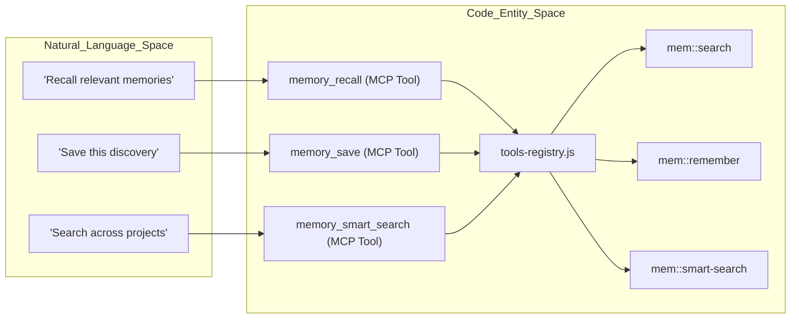
**Sources:** [src/mcp/tools-registry.ts:9](), [src/functions/smart-search.ts:75-80](), [src/cli/connect/index.ts:28-50](), [INSTALL_FOR_AGENTS.md:73-83]()

## LLM Provider Detection

`agentmemory` uses `detectProvider()` to select the LLM backend based on the environment [src/config.ts:86]().

*   **Priority Chain:** OpenAI → MiniMax → Anthropic → Gemini → OpenRouter [src/config.ts:90-157]().
*   **Cost Awareness:** The system warns users if an expensive model (e.g., Claude 3.5 Sonnet) is selected for background compression on OpenRouter, suggesting cheaper alternatives like `deepseek-v3` [src/config.ts:136-151]().
*   **Zero-LLM Fallback:** If no keys are found, the system runs in `noop` mode for LLM tasks but maintains BM25 and on-device embedding capabilities [src/config.ts:160-173]().

**Sources:** [src/config.ts:86-186]()

---

# Page: Architecture Overview

# Architecture Overview

<details>
<summary>Relevant source files</summary>

The following files were used as context for generating this wiki page:

- [AGENTS.md](AGENTS.md)
- [CHANGELOG.md](CHANGELOG.md)
- [README.md](README.md)
- [package.json](package.json)
- [packages/mcp/package.json](packages/mcp/package.json)
- [plugin/.claude-plugin/plugin.json](plugin/.claude-plugin/plugin.json)
- [plugin/.codex-plugin/plugin.json](plugin/.codex-plugin/plugin.json)
- [plugin/plugin.json](plugin/plugin.json)
- [src/cli.ts](src/cli.ts)
- [src/config.ts](src/config.ts)
- [src/functions/export-import.ts](src/functions/export-import.ts)
- [src/functions/smart-search.ts](src/functions/smart-search.ts)
- [src/index.ts](src/index.ts)
- [src/triggers/api.ts](src/triggers/api.ts)
- [src/types.ts](src/types.ts)
- [src/version.ts](src/version.ts)
- [src/viewer/index.html](src/viewer/index.html)
- [test/env-loader.test.ts](test/env-loader.test.ts)
- [test/export-import.test.ts](test/export-import.test.ts)

</details>


The `agentmemory` system is built on a modular, worker-based architecture designed to transform ephemeral agent interactions into structured long-term memory. It utilizes the **iii-engine** (Intelligence Interface Infrastructure) foundation, which provides three core primitives: **HTTP Triggers**, **KV State**, and **Streams**.

## The iii-Engine Foundation

The system operates as a worker process that connects to an `iii-engine` instance via the `iii-sdk` [src/index.ts:1-1](). This foundation allows the memory system to remain decoupled from specific agents (e.g., Claude, Cursor, Copilot CLI) while providing high-performance persistence and real-time updates. The CLI manages the engine lifecycle, pinning it to version `0.11.2` to ensure architectural compatibility with the current worker model [src/cli.ts:103-104]().

| Primitive | Implementation in `agentmemory` | Role |
| :--- | :--- | :--- |
| **HTTP Triggers** | `registerApiTriggers` [src/triggers/api.ts:140-146]() | Exposes the REST API and internal function endpoints to external agents. |
| **KV State** | `StateKV` [src/state/kv.ts:29-29]() | Provides namespaced persistence for sessions, observations, and graphs. |
| **Streams** | `STREAM` [src/state/schema.ts:135-141]() | Real-time broadcasting of observations to the dashboard via `stream::send`. |

### System Architecture Diagram
The following diagram illustrates the relationship between the external interfaces, the core logic layers, and the iii-engine primitives.

Title: Agentmemory Component Architecture
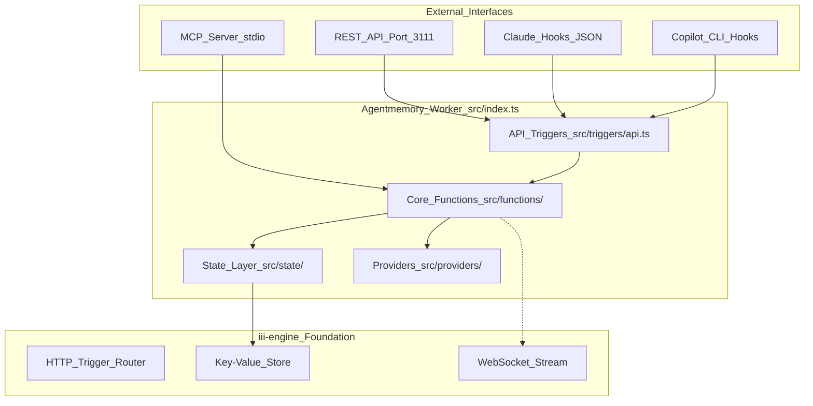
Sources: [src/index.ts:1-103](), [src/triggers/api.ts:140-146](), [package.json:1-4](), [src/cli.ts:103-104]()

---

## Major Layers

### 1. API & Trigger Layer
This layer maps external requests to internal memory functions.
*   **REST API**: Registered via `registerApiTriggers` [src/triggers/api.ts:140-146](), providing endpoints like `/agentmemory/livez` [src/triggers/api.ts:181-186]() and `/agentmemory/observe`.
*   **MCP Server**: Implements the Model Context Protocol, exposing tools directly to LLMs. It is registered via `registerMcpEndpoints` [src/index.ts:96-96]() and serves tools defined in the `tools-registry.ts` [src/mcp/tools-registry.ts:1-10]().
*   **Authentication**: Secured via `middleware::api-auth` [src/triggers/api.ts:147-166]() using `timingSafeCompare` [src/triggers/api.ts:11-11]() for Bearer tokens.

### 2. Core Function Layer (`mem::*`)
The business logic is encapsulated in registered functions. Each function handles a specific stage of the memory lifecycle:
*   `mem::observe`: Ingests raw data, performs deduplication via `DedupMap`, and scrubs private data [src/index.ts:29-29]().
*   `mem::compress`: Uses LLMs to extract facts, narratives, and concepts from raw observations [src/index.ts:34-34]().
*   `mem::search`: Executes hybrid retrieval (BM25 + Vector + Graph) [src/index.ts:36-43]().
*   `mem::consolidate`: Merges short-term observations into long-term memories [src/index.ts:48-48]().
*   `mem::export` / `mem::import`: Handles full database portability with version-checked schemas [src/functions/export-import.ts:62-164]().

### 3. State & Persistence Layer
Data is managed through the `StateKV` wrapper [src/state/kv.ts:29-29]().
*   **Namespacing**: The system uses distinct KV scopes (e.g., `sessions`, `observations`, `memories`, `graphNodes`) defined in `KV` [src/state/schema.ts:100-133]().
*   **Search Indices**: Managed by `IndexPersistence` [src/index.ts:27-27](), which handles loading indices on startup and periodic flushing to disk.
*   **Concurrency**: Uses `withKeyedLock` [src/state/keyed-mutex.ts:3-3]() to prevent race conditions during concurrent session updates [src/triggers/api.ts:3-3]().

### 4. Provider Layer
Abstracts interactions with LLMs and Embeddings [src/index.ts:17-22]().
*   **Resiliency**: Implements circuit breakers (Closed, Open, Half-Open) to handle provider failures [src/types.ts:239-244]().
*   **Fallbacks**: Supports a chain of providers (Anthropic, Gemini, OpenRouter, MiniMax, OpenAI) to ensure high availability [src/types.ts:170-170]().

Sources: [src/index.ts:1-103](), [src/state/schema.ts:100-133](), [src/types.ts:239-244](), [CHANGELOG.md:15-15]()

---

## Data Flow: From Hook to Memory

The path an event takes from the moment an agent performs an action to its storage in long-term memory follows a strictly defined pipeline.

Title: Data Flow - Hook Event to Long-Term Memory
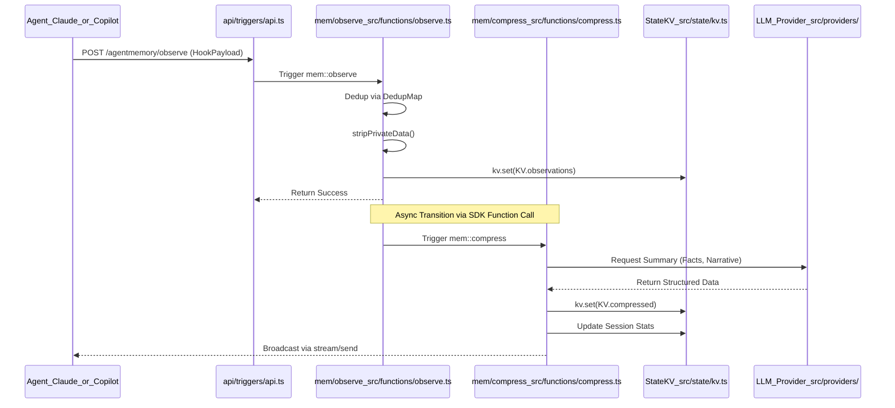
Sources: [src/types.ts:153-160](), [src/triggers/api.ts:140-146](), [src/index.ts:29-34]()

### Key Data Entities
The flow involves three primary data transformations:
1.  **`HookPayload`**: Raw JSON received from the agent containing `hookType`, `sessionId`, `project`, and `data` [src/types.ts:153-160]().
2.  **`RawObservation`**: The deduplicated and scrubbed version of the payload, including metadata like `toolName` and `modality` [src/types.ts:47-62]().
3.  **`CompressedObservation`**: The LLM-distilled semantic representation containing `facts`, `narrative`, `concepts`, and `importance` [src/types.ts:64-83]().

---

## The Worker Model & Lifecycle

The worker is initialized in `src/index.ts`, which orchestrates the startup sequence:

1.  **Config Loading**: Reads environment variables and `iii-config.yaml` to determine provider settings and port layouts [src/index.ts:2-16]().
2.  **Provider Initialization**: Sets up LLM and Embedding providers (e.g., Xenova for local embeddings, or cloud providers like Anthropic/OpenAI) [src/index.ts:17-22]().
3.  **SDK Connection**: Connects to the `iii-engine` using `registerWorker` [src/index.ts:1-1]().
4.  **Registration**: Hooks all `mem::*` and `api::*` functions into the engine router [src/index.ts:28-94]().
5.  **Index Rebuild**: `rebuildIndex` is called to load existing data into BM25 and Vector indices [src/index.ts:37-37]().
6.  **Health Monitoring**: Starts `registerHealthMonitor` to track CPU, memory, and KV connectivity [src/index.ts:101-101]().
7.  **PID Management**: Writes a `worker.pid` file to `~/.agentmemory/` to allow the CLI to cleanly stop the process [src/index.ts:115-126]().

Title: Worker Startup & Registry
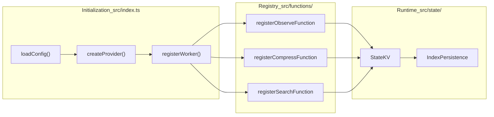
Sources: [src/index.ts:1-128](), [src/cli.ts:103-104](), [src/version.ts:1-1]()

---

# Page: Core Memory Pipeline

# Core Memory Pipeline

<details>
<summary>Relevant source files</summary>

The following files were used as context for generating this wiki page:

- [src/functions/compress.ts](src/functions/compress.ts)
- [src/functions/consolidate.ts](src/functions/consolidate.ts)
- [src/functions/diagnostics.ts](src/functions/diagnostics.ts)
- [src/functions/disk-size-manager.ts](src/functions/disk-size-manager.ts)
- [src/functions/enrich.ts](src/functions/enrich.ts)
- [src/functions/image-quota-cleanup.ts](src/functions/image-quota-cleanup.ts)
- [src/functions/image-refs.ts](src/functions/image-refs.ts)
- [src/functions/migrate.ts](src/functions/migrate.ts)
- [src/functions/observe.ts](src/functions/observe.ts)
- [src/functions/remember.ts](src/functions/remember.ts)
- [src/functions/search.ts](src/functions/search.ts)
- [src/state/hybrid-search.ts](src/state/hybrid-search.ts)
- [src/state/memory-utils.ts](src/state/memory-utils.ts)
- [src/state/search-index.ts](src/state/search-index.ts)
- [src/triggers/events.ts](src/triggers/events.ts)
- [test/diagnostics.test.ts](test/diagnostics.test.ts)
- [test/hybrid-search.test.ts](test/hybrid-search.test.ts)
- [test/multimodal.test.ts](test/multimodal.test.ts)
- [test/search-index.test.ts](test/search-index.test.ts)
- [test/search.test.ts](test/search.test.ts)
- [test/session-end-triggers-graph.test.ts](test/session-end-triggers-graph.test.ts)
- [test/sliding-window.test.ts](test/sliding-window.test.ts)

</details>


The **Core Memory Pipeline** is the backbone of `agentmemory`, responsible for transforming the ephemeral "noise" of an agent's session into structured, persistent, and searchable knowledge. It bridges the gap between raw tool outputs and long-term architectural understanding.

This pipeline operates in four distinct stages that manage the lifecycle of data from the moment a tool is executed to its eventual consolidation into the agent's global knowledge base.

### The Four-Stage Lifecycle

```mermaid
graph LR
    subgraph "Capture"
        [A] -- "mem::observe" --> [B] -- "Dedup & Scrub" --> [B2]
    end
    subgraph "Compress"
        [B2] --> [C] -- "mem::compress" --> [D] -- "LLM Distillation" --> [D2]
    end
    subgraph "Consolidate"
        [D2] --> [E] -- "mem::remember" --> [F] -- "Tiered Storage" --> [F2]
    end
    subgraph "Retrieve"
        [F2] --> [G] -- "mem::smart-search" --> [H] -- "Hybrid Retrieval" --> [I]
    end

    style [A] stroke-width:2px
    style [C] stroke-width:2px
    style [E] stroke-width:2px
    style [G] stroke-width:2px
```

**Sources:** [src/functions/observe.ts:40-47](), [src/functions/compress.ts:67-74](), [src/functions/remember.ts:22-33](), [src/functions/search.ts:17-27]()

---

### 1. Observation & Capture
The pipeline begins with `mem::observe`. This stage intercepts `HookPayload` data from agent lifecycle events (like `pre_tool_use`, `post_tool_use`, or `prompt_submit`) [src/functions/observe.ts:4-47](). It performs critical "hygiene" tasks:
*   **Deduplication:** Uses a `DedupMap` to generate SHA-256 hashes of tool inputs, preventing redundant storage of identical operations [src/functions/observe.ts:66-90]().
*   **Privacy Scrubbing:** Invokes `stripPrivateData` to redact secrets and API keys using `SECRET_PATTERN_SOURCES` [src/functions/observe.ts:92-99]().
*   **Multimodal Handling:** Detects and extracts image data (base64 or file paths) via `extractImage`, saving them to a managed image store via `saveImageToDisk` [src/functions/observe.ts:17-38](), [src/functions/observe.ts:173-175]().
*   **Concurrency:** Employs `withKeyedLock` to ensure session-scoped KV writes are atomic [src/functions/observe.ts:146-155]().

For details, see [Observation & Capture](#2.1).

**Sources:** [src/functions/observe.ts:40-193](), [src/state/schema.ts:5-15]()

---

### 2. Compression & Summarization
Raw observations are often too verbose for long-term storage or context injection. The `mem::compress` function uses an LLM to distill a `RawObservation` into a `CompressedObservation`.
*   **Structured Extraction:** Extracts facts, concepts, narrative, and importance scores (1-10) using XML-based parsing via `parseCompressionXml` [src/functions/compress.ts:44-65]().
*   **Quality Control:** Validates output against `CompressOutputSchema` and uses `compressWithRetry` for self-correction [src/functions/compress.ts:123-142]().
*   **Vision Integration:** If an image is present, the pipeline uses `provider.describeImage` to generate a textual description before compression [src/functions/compress.ts:84-109]().
*   **Search Indexing:** Immediately adds the compressed result to the `SearchIndex` (BM25) and `VectorIndex` for retrieval [src/functions/compress.ts:178-194]().
*   **Event Propagation:** Triggers `event::session::stopped` to initiate post-session summarization and graph extraction [src/triggers/events.ts:96-118]().

For details, see [Compression & Summarization](#2.2).

**Sources:** [src/functions/compress.ts:67-206](), [src/triggers/events.ts:96-148]()

---

### 3. Memory Persistence & Lifecycle
Once compressed, data can be promoted to long-term memory via `mem::remember`. This stage manages the transition from session-specific observations to global knowledge.
*   **Versioning & Superseding:** Supports replacing old memories with new information, maintaining a version history and using `jaccardSimilarity` to detect duplicates (>0.7) [src/functions/remember.ts:108-134](), [src/state/schema.ts:3-3]().
*   **Tiered Indexing:** Every saved memory is indexed in both `SearchIndex` (BM25) and `VectorIndex` (Embeddings) via `vectorIndexAddGuarded` to ensure it is immediately discoverable [src/functions/remember.ts:79-88](), [src/functions/remember.ts:189-194]().
*   **Agent Scoping:** Memories are stamped with an `agentId` (from environment or payload) to allow multi-agent isolation [src/functions/remember.ts:147-150]().
*   **Audit Logging:** Records changes via `recordAudit` for transparency and rollback capabilities [src/functions/remember.ts:178-187]().

For details, see [Memory Persistence & Lifecycle](#2.3).

**Sources:** [src/functions/remember.ts:22-205](), [src/state/memory-utils.ts:6-9]()

---

### 4. Consolidation & Forgetting
The final stage ensures the memory stays relevant and manageable over time, preventing context window bloat and resource exhaustion.
*   **Synthesis:** Groups related observations by concept and synthesizes them into long-term memories via `mem::consolidate` [src/functions/consolidate.ts:70-125]().
*   **Pipeline Orchestration:** `mem::consolidate-pipeline` manages multi-tier consolidation and is debounced by `consolidationDue` to prevent LLM cost storms [src/triggers/events.ts:13-41](), [src/triggers/events.ts:141-146]().
*   **Resource Management:** Monitors disk usage for images via `mem::disk-size-delta` and handles image reference counting via `incrementImageRef` and `decrementImageRef` to allow safe cleanup [src/functions/disk-size-manager.ts:11-43](), [src/functions/image-refs.ts:12-38]().
*   **Quota Cleanup:** `mem::image-quota-cleanup` evicts unreferenced images when disk limits are exceeded [src/functions/image-quota-cleanup.ts:12-98]().

For details, see [Consolidation & Forgetting](#2.4).

**Sources:** [src/functions/consolidate.ts:70-210](), [src/functions/image-quota-cleanup.ts:12-98](), [src/functions/disk-size-manager.ts:11-43]()

---

### Data Flow: Code Entity Space
The following diagrams map the logical pipeline stages to the specific code entities and KV namespaces they interact with.

**Ingestion and Refinement Flow**
```mermaid
graph TD
    subgraph "Natural Language Space"
        [Input] -- "Agent Tool Output" --> [Fact] -- "Extracted Fact" --> [Knowledge]
    end

    subgraph "Code Entity Space"
        [Payload] -- "HookPayload" --> [ObsFunc] -- "mem::observe" --> [CompFunc] -- "mem::compress" --> [MemFunc] -- "mem::remember" --> [Final]
        
        [KV_OBS] -- "KV.observations" --> [CompFunc]
        [ObsFunc] -- "set" --> [KV_OBS]
        
        [CompFunc] -- "add()" --> [SearchIdx] -- "SearchIndex" --> [Ret]
        [CompFunc] -- "vectorIndexAddGuarded()" --> [VecIdx] -- "VectorIndex" --> [Ret]
        
        [MemFunc] -- "set" --> [KV_MEM] -- "KV.memories" --> [Final]
    end

    [Input] --> [Payload]
    [Payload] --> [ObsFunc]
    [Fact] --> [CompFunc]
    [Knowledge] --> [MemFunc]
    
    [ObsFunc] -- "Uses" --> [Dedup] -- "DedupMap" --> [ObsFunc]
    [CompFunc] -- "Uses" --> [LLM] -- "MemoryProvider" --> [CompFunc]
```

**Storage and Retrieval Architecture**
```mermaid
graph TD
    subgraph "Code Entity Space"
        [KV_MEMS] -- "KV.memories" --> [HybridSearch]
        [KV_SESS] -- "KV.sessions" --> [HybridSearch]
        
        [SmartSearch] -- "mem::smart-search" --> [HybridSearch]
        [HybridSearch] -- "HybridSearch.search()" --> [SearchIndex]
        [HybridSearch] -- "HybridSearch.search()" --> [VectorIndex]
        
        [Remember] -- "mem::remember" --> [KV_MEMS]
        [Remember] -- "vectorIndexAddGuarded" --> [VectorIndex]
        [Remember] -- "getSearchIndex().add" --> [SearchIndex]
    end

    [KV_MEMS] --> [SmartSearch]
    [KV_SESS] --> [SmartSearch]
```

**Sources:** [src/functions/observe.ts:40-193](), [src/functions/compress.ts:73-203](), [src/functions/remember.ts:22-205](), [src/functions/search.ts:17-31](), [src/triggers/events.ts:43-183]()

---

# Page: Observation & Capture

# Observation & Capture

<details>
<summary>Relevant source files</summary>

The following files were used as context for generating this wiki page:

- [src/functions/compress.ts](src/functions/compress.ts)
- [src/functions/consolidate.ts](src/functions/consolidate.ts)
- [src/functions/diagnostics.ts](src/functions/diagnostics.ts)
- [src/functions/disk-size-manager.ts](src/functions/disk-size-manager.ts)
- [src/functions/enrich.ts](src/functions/enrich.ts)
- [src/functions/image-quota-cleanup.ts](src/functions/image-quota-cleanup.ts)
- [src/functions/image-refs.ts](src/functions/image-refs.ts)
- [src/functions/migrate.ts](src/functions/migrate.ts)
- [src/functions/observe.ts](src/functions/observe.ts)
- [src/prompts/xml.ts](src/prompts/xml.ts)
- [src/triggers/events.ts](src/triggers/events.ts)
- [test/diagnostics.test.ts](test/diagnostics.test.ts)
- [test/multimodal.test.ts](test/multimodal.test.ts)
- [test/privacy.test.ts](test/privacy.test.ts)
- [test/session-end-triggers-graph.test.ts](test/session-end-triggers-graph.test.ts)
- [test/sliding-window.test.ts](test/sliding-window.test.ts)
- [test/xml.test.ts](test/xml.test.ts)

</details>


The **Observation & Capture** phase is the entry point of the `agentmemory` pipeline. It transforms raw events from agentic workflows—such as tool executions, user prompts, and session lifecycle changes—into structured `RawObservation` objects. This stage handles deduplication, privacy scrubbing, image persistence, and initial storage before triggering downstream compression.

## The Observation Pipeline

The primary entry point for capturing data is the `mem::observe` function [src/functions/observe.ts:40-46](). It processes a `HookPayload` and orchestrates the transition from a transient event to a stored observation.

### Data Flow: Hook to Store

1.  **Ingestion**: Hooks (e.g., from Claude Code or other integrations) send `HookPayload` objects containing a `sessionId`, `hookType`, `timestamp`, and `data` [src/functions/observe.ts:49-62]().
2.  **Deduplication**: The `DedupMap` computes a SHA-256 hash of the tool name and input. If a duplicate is detected within the TTL window, the process exits early to save resources [src/functions/observe.ts:67-90]().
3.  **Privacy Scrubbing**: The payload data is passed through `stripPrivateData` which redacts sensitive information based on defined patterns [src/functions/observe.ts:92-99]().
4.  **Normalization**: Data is mapped into a `RawObservation` object. If the `hookType` is `post_tool_use` or `post_tool_failure`, it extracts `toolName`, `toolInput`, and `toolOutput` [src/functions/observe.ts:104-128]().
5.  **Image Handling**: The pipeline uses `extractImage` to find base64 or path-based images in the payload [src/functions/observe.ts:17-38](). If found, it saves them to disk via `saveImageToDisk`, increments reference counts, and triggers `mem::vision-embed` if enabled [src/functions/observe.ts:173-193]().
6.  **Concurrency Control**: A `withKeyedLock` is acquired for the specific `sessionId` (`obs:${payload.sessionId}`) to prevent race conditions during state updates and enforcement of `maxObservationsPerSession` [src/functions/observe.ts:146-155]().
7.  **Persistence**: The observation is saved to the `StateKV` store under the `observations` scope for that session [src/functions/observe.ts:223-227]().
8.  **Streaming**: The raw observation is pushed to the `mem-live` WebSocket stream via `stream::set` for real-time dashboard updates [src/functions/observe.ts:241-249]().

### Natural Language to Code Entity Mapping: Observation Flow

This diagram illustrates how high-level "Observation" concepts map to specific code entities and files.

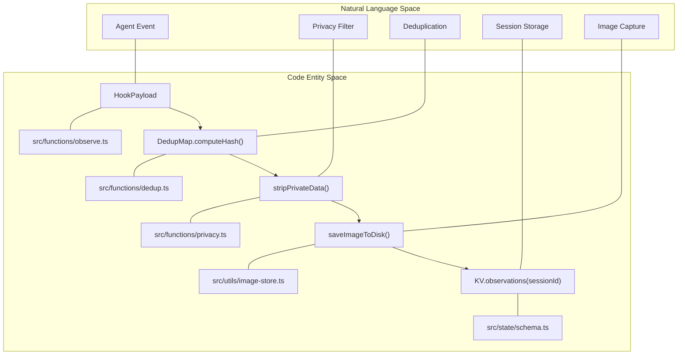
**Sources:** [src/functions/observe.ts:17-227](), [src/functions/privacy.ts:1-10](), [src/state/schema.ts:5-10]()

---

## Deduplication & Concurrency

To handle high-frequency tool calls and parallel agent execution, `agentmemory` employs two primary mechanisms:

### SHA-256 Deduplication (`DedupMap`)
The `DedupMap` prevents the storage of redundant observations (e.g., an agent repeatedly calling `ls` with the same arguments in a tight loop).
- **Hash Inputs**: `sessionId` + `toolName` (or `hookType`) + `toolInput` [src/functions/observe.ts:73-86]().
- **Behavior**: If `isDuplicate(hash)` is true, the function returns `{ deduplicated: true }` immediately without persisting data [src/functions/observe.ts:87-89]().

### Keyed Locking (`withKeyedLock`)
To maintain integrity within a session (e.g., checking `maxObservationsPerSession`), the system uses a `KeyedMutex` via `withKeyedLock` [src/functions/observe.ts:9]().
- **Scope**: Locks are per-session (`obs:${payload.sessionId}`) [src/functions/observe.ts:146]().
- **Guarantees**: Ensures that multiple simultaneous hooks for the same session do not corrupt the session's observation list or counter [src/functions/observe.ts:147-155]().

**Sources:** [src/functions/observe.ts:67-90](), [src/functions/observe.ts:146-155]()

---

## Privacy Scrubbing

The system provides automated redaction of sensitive information through `stripPrivateData` [src/functions/privacy.ts:5]().

### Redaction Rules
- **Explicit Redaction**: Any content wrapped in `<private>...</private>` tags is replaced with `[REDACTED]` [src/functions/privacy.ts:7-10]().
- **Pattern Matching**: The `SECRET_PATTERN_SOURCES` array contains regex for common credentials [src/functions/privacy.ts:12-30](), including:
    - Generic API keys/passwords (`api_key=...`, `secret: ...`).
    - Bearer tokens and JWTs.
    - Provider-specific keys: OpenAI (`sk-proj-...`), Anthropic (`sk-ant-...`), GitHub (`ghp_...`), AWS (`AKIA...`), and Google Cloud (`AIza...`).

**Sources:** [src/functions/privacy.ts:5-30]()

---

## Image Storage & Quota Management

When images are detected in a payload via `extractImage` [src/functions/observe.ts:17-38](), the system triggers a specialized management pipeline.

### Storage and Referencing
- **Disk Persistence**: Images are saved to a managed directory via `saveImageToDisk` [src/functions/observe.ts:174]().
- **Reference Counting**: The system tracks how many observations refer to a specific image file via `incrementImageRef` [src/functions/observe.ts:177]().
- **Disk Delta**: Any change in disk usage triggers `mem::disk-size-delta` to update global tracking [src/functions/observe.ts:178-182]().

### Quota Enforcement
The `mem::disk-size-delta` function monitors usage and triggers `mem::image-quota-cleanup` if `getMaxBytes()` is exceeded [src/functions/disk-size-manager.ts:13-44](). The cleanup process evicts unreferenced images (where `refCount === 0`) using an LRU strategy after a 30-second grace period [src/functions/image-quota-cleanup.ts:14-98]().

### Vision Integration
If `AGENTMEMORY_IMAGE_EMBEDDINGS` is enabled, the pipeline triggers `mem::vision-embed` [src/functions/observe.ts:183-193](). During compression, if a vision-capable provider is available, `provider.describeImage` is called to generate a text description [src/functions/compress.ts:84-101]().

**Sources:** [src/functions/observe.ts:173-193](), [src/functions/compress.ts:81-109](), [src/functions/disk-size-manager.ts:13-44](), [src/functions/image-quota-cleanup.ts:14-98]()

---

## Maintenance & Migration

The system includes utilities for maintaining state consistency and upgrading data structures.

### Diagnostics (`mem::diagnose`)
Performs consistency checks across 14+ categories, including orphaned leases, expired sentinels, and project scope coverage for memories [src/functions/diagnostics.ts:47-216]().

### Migration (`mem::migrate`)
Handles the transition of data between versions.
- **Project Inference**: The `inferMemoryProjects` step performs a majority-vote based on associated session projects to scope legacy unscoped memories [src/functions/migrate.ts:23-86]().
- **SQLite Import**: Supports migrating legacy `better-sqlite3` databases into the current KV-based architecture [src/functions/migrate.ts:115-215]().

**Sources:** [src/functions/diagnostics.ts:47-51](), [src/functions/migrate.ts:23-215]()

---

## Entity Relationship: Observation & State

This diagram shows how external hooks interact with the internal logic and KV state.

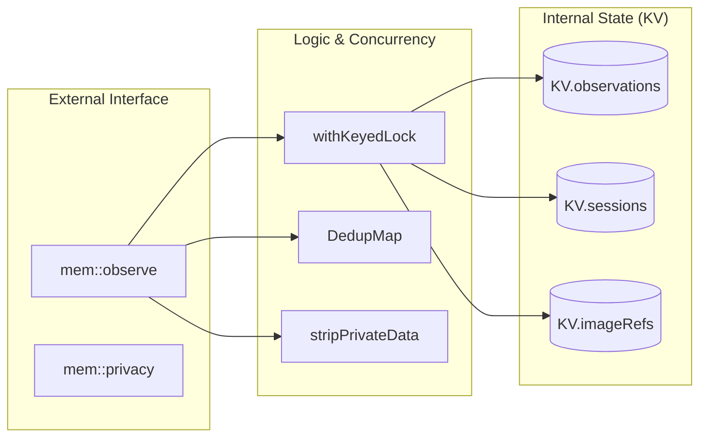
**Sources:** [src/functions/observe.ts:40-227](), [src/state/schema.ts:5-10](), [src/functions/image-refs.ts:12-18]()

---

# Page: Compression & Summarization

# Compression & Summarization

<details>
<summary>Relevant source files</summary>

The following files were used as context for generating this wiki page:

- [src/functions/compress-file.ts](src/functions/compress-file.ts)
- [src/functions/compress-synthetic.ts](src/functions/compress-synthetic.ts)
- [src/functions/compress.ts](src/functions/compress.ts)
- [src/functions/disk-size-manager.ts](src/functions/disk-size-manager.ts)
- [src/functions/image-quota-cleanup.ts](src/functions/image-quota-cleanup.ts)
- [src/functions/image-refs.ts](src/functions/image-refs.ts)
- [src/functions/observe.ts](src/functions/observe.ts)
- [src/functions/replay.ts](src/functions/replay.ts)
- [src/functions/summarize.ts](src/functions/summarize.ts)
- [src/providers/index.ts](src/providers/index.ts)
- [src/replay/jsonl-parser.ts](src/replay/jsonl-parser.ts)
- [src/triggers/events.ts](src/triggers/events.ts)
- [test/agent-id-scope.test.ts](test/agent-id-scope.test.ts)
- [test/compress-file.test.ts](test/compress-file.test.ts)
- [test/fallback-model-resolution.test.ts](test/fallback-model-resolution.test.ts)
- [test/memories-pagination.test.ts](test/memories-pagination.test.ts)
- [test/multimodal.test.ts](test/multimodal.test.ts)
- [test/replay-import-key.test.ts](test/replay-import-key.test.ts)
- [test/replay-sensitive.test.ts](test/replay-sensitive.test.ts)
- [test/replay.test.ts](test/replay.test.ts)
- [test/session-end-triggers-graph.test.ts](test/session-end-triggers-graph.test.ts)
- [test/sliding-window.test.ts](test/sliding-window.test.ts)
- [test/summarize.test.ts](test/summarize.test.ts)

</details>


The **Compression & Summarization** stage is the second phase of the Core Memory Pipeline. It transforms volatile, high-volume `RawObservation` data into structured, semantically dense `CompressedObservation` objects. This process reduces token overhead for future retrieval while extracting key entities, facts, and importance scores.

## Observation Compression (`mem::compress`)

The `mem::compress` function [src/functions/compress.ts:73-78]() is the primary entry point for transforming raw hook data into a format suitable for long-term reasoning. It utilizes an LLM to perform structural extraction and qualitative assessment.

### Implementation Flow

The compression process follows a strict pipeline to ensure data integrity and quality:

1.  **Multimodal Processing**: If the observation contains image data (e.g., from a screenshot tool), `mem::compress` uses the provider's `describeImage` method [src/functions/compress.ts:84-101]() with the `VISION_DESCRIPTION_PROMPT` [src/functions/compress.ts:100]() to generate a text description.
2.  **Prompt Construction**: The system builds a prompt using `buildCompressionPrompt` [src/functions/compress.ts:111-120](), incorporating the tool name, input, output (including any image descriptions), and user prompt.
3.  **LLM Execution with Self-Correction**: The `compressWithRetry` utility [src/functions/compress.ts:136-142]() executes the LLM call. It uses a validator function that checks if the output is valid XML via `parseCompressionXml` [src/functions/compress.ts:44-49]() and conforms to the `CompressOutputSchema` [src/functions/compress.ts:123-134]().
4.  **XML Parsing**: The LLM response is parsed into fields like `type`, `title`, `facts`, `concepts`, and `importance` [src/functions/compress.ts:52-64]().
5.  **Quality Scoring**: The `scoreCompression` function [src/functions/compress.ts:157]() calculates a numeric quality score (0-100) used to set the `confidence` field [src/functions/compress.ts:164]().
6.  **Persistence & Indexing**: The resulting `CompressedObservation` is stored in `KV.observations(sessionId)` [src/functions/compress.ts:171-175](). It is added to the BM25 `SearchIndex` [src/functions/compress.ts:178-179]() and the `VectorIndex` via `vectorIndexAddGuarded` [src/functions/compress.ts:189-194]().
7.  **Real-time Streaming**: The compressed result is pushed to the `mem-live` WebSocket via `stream::set` [src/functions/compress.ts:197-204]().

### Zero-LLM Fallback: Synthetic Compression
If `isAutoCompressEnabled()` is false [src/functions/observe.ts:10]() or no LLM provider is configured, the system uses `buildSyntheticCompression` [src/functions/observe.ts:11](). This path bypasses LLM calls and uses heuristics to infer the `ObservationType` from tool names and truncate inputs/outputs into a narrative [src/functions/compress-synthetic.ts:76-105]().

### Data Transformation Diagram

The following diagram illustrates the transition from raw input to the structured code entities used within the system.

**Natural Language to Code Entity Space: Compression**
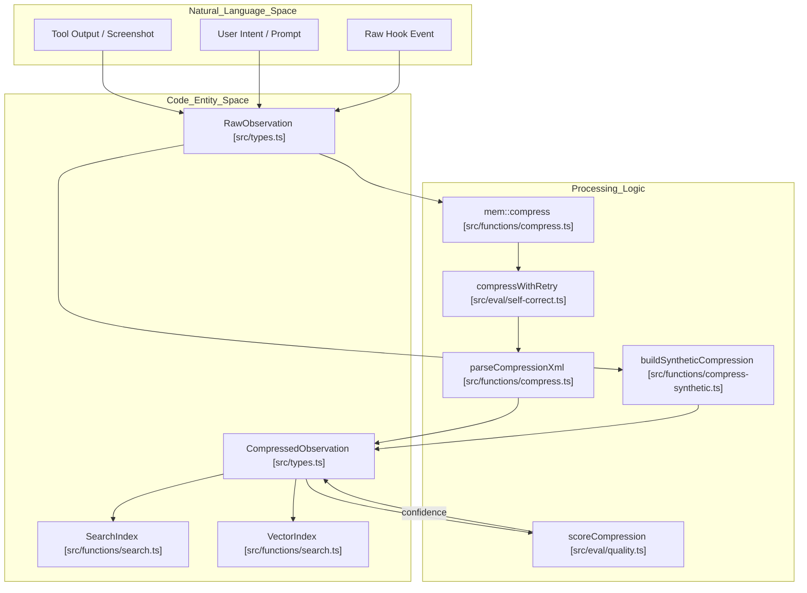
**Sources:** [src/functions/compress.ts:44-194](), [src/functions/compress-synthetic.ts:76-105](), [src/functions/observe.ts:9-11]()

---

## File-Specific Compression (`mem::compress-file`)

The `mem::compress-file` function [src/functions/compress-file.ts:101-187]() provides a specialized pipeline for shortening long Markdown files while preserving their structural integrity.

### Safeguards and Validation
*   **Path Protection**: Refuses to process files with sensitive names (e.g., `.env`, `token`, `secret`) [src/functions/compress-file.ts:9-16](), [src/functions/compress-file.ts:112-114]().
*   **Symlink Prevention**: Uses `lstat` [src/functions/compress-file.ts:117-120]() and `O_NOFOLLOW` [src/functions/compress-file.ts:157]() to prevent symlink attacks and TOCTOU swaps.
*   **Structural Validation**: The `validateCompression` helper [src/functions/compress-file.ts:47-85]() ensures that the compressed version has the exact same headings, URLs, and code blocks as the original. If validation fails, the file is not overwritten [src/functions/compress-file.ts:142-148]().
*   **Backups**: Automatically creates an `.original.md` (or `.backup.md`) backup before overwriting the file [src/functions/compress-file.ts:150-151]().

**Sources:** [src/functions/compress-file.ts:9-188](), [test/compress-file.test.ts:109-180]()

---

## Session Summarization (`mem::summarize`)

While compression operates on individual events, `mem::summarize` aggregates observations to generate a `SessionSummary`. This is triggered during the session stop lifecycle [src/triggers/events.ts:96-97]().

### Summarization Logic
1.  **Observation Retrieval**: Fetches observations for a session via `kv.list(KV.observations(sessionId))` [src/functions/summarize.ts:232-234]().
2.  **Chunking & Map-Reduce**: For large sessions (default > 400 observations), observations are split into chunks [src/functions/summarize.ts:119-121](). Chunks are summarized in parallel via `summarizeChunkWithRetry` [src/functions/summarize.ts:135-150]() and then merged via `REDUCE_SYSTEM` prompt [src/functions/summarize.ts:180-183]().
3.  **XML Extraction**: The LLM output is parsed into a `SessionSummary` which includes a `title`, `narrative`, `keyDecisions`, and `filesModified` [src/functions/summarize.ts:187-207]().
4.  **Quality Scoring**: `scoreSummary` [src/functions/summarize.ts:269]() evaluates the summary based on narrative length and content density.
5.  **Persistence**: The final summary is stored in `KV.summaries` keyed by the session ID [src/functions/summarize.ts:271-275]().

**Sources:** [src/functions/summarize.ts:27-185](), [src/triggers/events.ts:96-97]()

---

## Metrics & Quality Control

The system employs several layers of validation and metric tracking to ensure the memory pipeline remains reliable.

### Metrics Tracking
The `MetricsStore` records the performance of compression and summarization:
*   **Latency**: Time taken for LLM calls [src/functions/compress.ts:148]().
*   **Success/Failure Rate**: Tracked per function ID via `metricsStore.record` [src/functions/compress.ts:148]().
*   **Quality Scores**: Uses `scoreCompression` and `scoreSummary` to monitor the effectiveness of the LLM provider [src/functions/compress.ts:157](), [src/functions/summarize.ts:269]().

**Metrics Storage Logic**
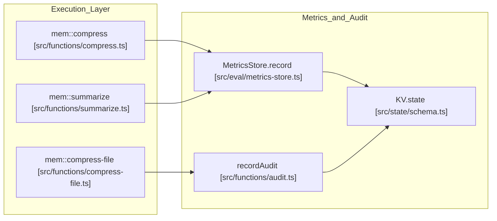
**Sources:** [src/functions/compress.ts:146-157](), [src/functions/compress-file.ts:171-177](), [src/functions/summarize.ts:269]()

---

## Multi-Agent Scoping

Compression and summarization respect the `AGENT_ID` scope to maintain isolation in multi-agent environments.

*   **Agent Identification**: The `getAgentId()` helper retrieves the current agent's ID from environment variables or session metadata [src/functions/observe.ts:166-168]().
*   **Metadata Stamping**: `CompressedObservation` objects are stamped with the `agentId` if available [src/functions/compress.ts:168]().
*   **Isolation Enforcement**: `event::session::started` initializes the session with an `agentId` [src/triggers/events.ts:52-65](), ensuring all subsequent observations in that session inherit the correct scope.

**Sources:** [src/functions/observe.ts:166-171](), [src/functions/compress.ts:168](), [src/triggers/events.ts:52-65]()

---

# Page: Memory Persistence & Lifecycle

# Memory Persistence & Lifecycle

<details>
<summary>Relevant source files</summary>

The following files were used as context for generating this wiki page:

- [src/functions/audit.ts](src/functions/audit.ts)
- [src/functions/auto-forget.ts](src/functions/auto-forget.ts)
- [src/functions/claude-bridge.ts](src/functions/claude-bridge.ts)
- [src/functions/evict.ts](src/functions/evict.ts)
- [src/functions/governance.ts](src/functions/governance.ts)
- [src/functions/remember.ts](src/functions/remember.ts)
- [src/functions/retention.ts](src/functions/retention.ts)
- [src/functions/search.ts](src/functions/search.ts)
- [src/functions/skill-extract.ts](src/functions/skill-extract.ts)
- [src/functions/working-memory.ts](src/functions/working-memory.ts)
- [src/state/hybrid-search.ts](src/state/hybrid-search.ts)
- [src/state/memory-utils.ts](src/state/memory-utils.ts)
- [src/state/search-index.ts](src/state/search-index.ts)
- [src/utils/image-store.ts](src/utils/image-store.ts)
- [test/audit.test.ts](test/audit.test.ts)
- [test/auto-forget.test.ts](test/auto-forget.test.ts)
- [test/claude-bridge.test.ts](test/claude-bridge.test.ts)
- [test/evict.test.ts](test/evict.test.ts)
- [test/governance.test.ts](test/governance.test.ts)
- [test/hybrid-search.test.ts](test/hybrid-search.test.ts)
- [test/remember-forget-audit.test.ts](test/remember-forget-audit.test.ts)
- [test/retention.test.ts](test/retention.test.ts)
- [test/search-index.test.ts](test/search-index.test.ts)
- [test/search.test.ts](test/search.test.ts)
- [test/skill-extract.test.ts](test/skill-extract.test.ts)
- [test/working-memory.test.ts](test/working-memory.test.ts)

</details>


This section covers the long-term storage and management of structured memories in `agentmemory`. It details the transition of information from transient observations into persistent knowledge, the deduplication logic, versioning strategies, and the tiered architecture that defines the lifecycle of a memory from creation to eventual decay or deletion.

## Memory Tiers

The system organizes information into four distinct tiers, representing different stages of the memory lifecycle and levels of abstraction.

| Tier | Type | Source | Description |
| :--- | :--- | :--- | :--- |
| **Working** | `CoreMemoryEntry` | `mem::core-add` | Highly relevant, pinned or frequently accessed snippets stored in `mem:core-memory` [src/functions/working-memory.ts:9-19](). |
| **Episodic** | `CompressedObservation` | `mem::compress` | Summarized events with importance scores and concept tags stored in session-scoped KV [src/types.ts:100-120](). |
| **Semantic** | `Memory` | `mem::remember` | De-duplicated facts, patterns, and preferences derived from episodes, stored in `KV.memories` [src/functions/remember.ts:98-118](). |
| **Procedural** | `ProceduralMemory` | `mem::skill-extract` | Extracted workflows (trigger + steps) for agent behavior, stored in `mem:procedural` [src/functions/skill-extract.ts:5-6](). |

**Sources:** [src/types.ts:1-300](), [src/functions/working-memory.ts:9-19](), [src/functions/remember.ts:98-118](), [src/functions/skill-extract.ts:5-6]()

---

## Long-term Storage: mem::remember

The `mem::remember` function is the primary entry point for promoting information to the **Semantic** tier. It handles content validation, automated versioning via Jaccard deduplication, and Time-To-Live (TTL) management.

### Implementation Details
When `mem::remember` is called, it performs the following steps:
1.  **Validation**: Ensures content is non-empty and maps the provided `type` to a valid `Memory["type"]` (e.g., `pattern`, `preference`, `architecture`, `bug`, `workflow`, `fact`) [src/functions/remember.ts:34-60]().
2.  **Deduplication & Superseding**: It generates candidates by querying the BM25 index for the top 50 hits starting with `mem_` [src/functions/remember.ts:79-90](). If a candidate's content has a `jaccardSimilarity` > 0.7 with the new content, and they share the same project scope, the existing memory is identified for superseding [src/functions/remember.ts:122-134]().
3.  **Persistence**: The new `Memory` object is saved with an incremented version number, `isLatest: true`, and optional `agentId` or `project` scoping [src/functions/remember.ts:152-175]().
4.  **Indexing**: To ensure immediate searchability, the memory is converted via `memoryToObservation` and added to the `SearchIndex` singleton [src/functions/remember.ts:192-195](). It also adds the memory to the `VectorIndex` via `vectorIndexAddGuarded` [src/functions/remember.ts:196-201]().
5.  **TTL Management**: If `data.ttlDays` is provided, a `forgetAfter` ISO timestamp is calculated [src/functions/remember.ts:177-179]().
6.  **Cascade Trigger**: If a memory was superseded, the system triggers `mem::cascade-update` to maintain referential integrity [src/functions/remember.ts:203-211]().

### Data Flow: Memory Promotion
The following diagram illustrates how a memory is saved and how the system handles versioning.

**Memory Versioning & Storage Flow**
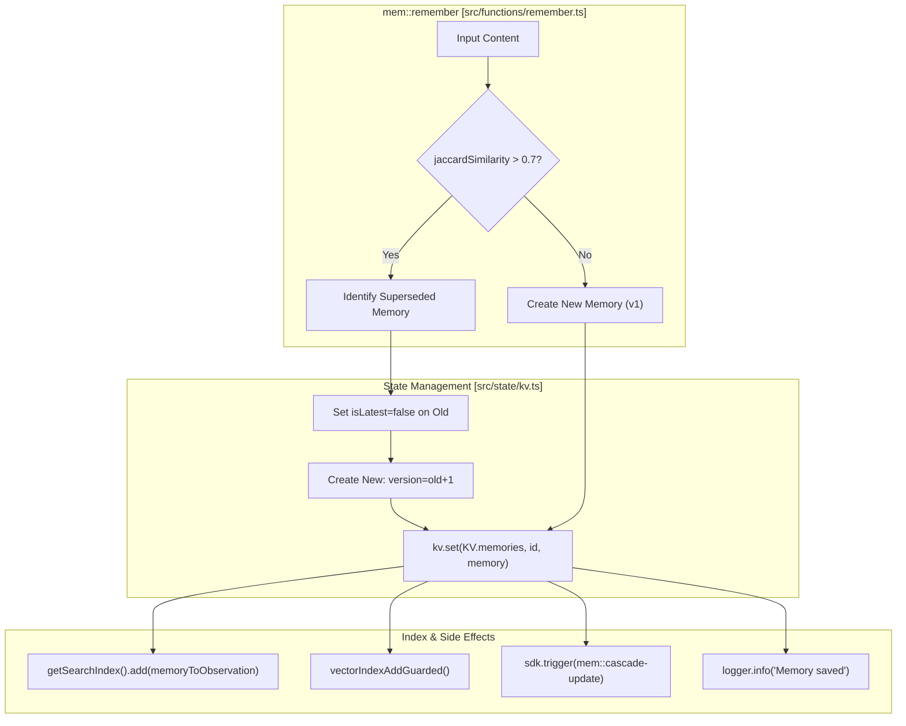
**Sources:** [src/functions/remember.ts:22-220](), [src/state/schema.js:3-10](), [src/state/memory-utils.ts:11-24](), [src/functions/search.ts:47-50](), [src/functions/search.ts:124-156]()

---

## Targeted Deletion: mem::forget

The `mem::forget` function provides a mechanism for both surgical and bulk deletion of data across different lifecycle stages, while maintaining an audit trail and index consistency.

*   **Memory Deletion**: If a `memoryId` is provided, the specific long-term memory is removed from `KV.memories`, its `accessLog` is deleted, and it is removed from both `SearchIndex` and `VectorIndex` [src/functions/remember.ts:241-253]().
*   **Targeted Observation Deletion**: Deletes specific `observationIds` within a given `sessionId` and decrements associated image references [src/functions/remember.ts:255-276]().
*   **Session Purge**: If only a `sessionId` is provided, the system deletes all observations for that session, the session metadata, and the session summary [src/functions/remember.ts:278-295]().
*   **Audit Logging**: Every deletion path calls `recordAudit` to ensure structural removals are traceable [src/functions/audit.ts:6-33](). `mem::forget` specifically records "forget" operations with target IDs and counts [test/remember-forget-audit.test.ts:54-82]().
*   **Index Sync**: All deletion paths call `flushIndexSave()` to ensure that index removals are persisted to disk immediately [src/functions/remember.ts:311-313]().

**Sources:** [src/functions/remember.ts:222-321](), [src/functions/audit.ts:34-55](), [test/remember-forget-audit.test.ts:165-215]()

---

## Ebbinghaus Decay: mem::retention-score

Memory persistence is governed by an automated decay model that scores memories based on salience, recency, and reinforcement.

### Scoring Algorithm
The `mem::retention-score` function computes a score between 0 and 1 for every memory using the following components [src/functions/retention.ts:127-146]():
1.  **Salience**: Base importance derived from the memory `type` (e.g., `architecture` = 0.9, `fact` = 0.5) [src/functions/retention.ts:97-121]().
2.  **Temporal Decay**: Calculated as `exp(-lambda * deltaT)`, where `deltaT` is days since creation [src/functions/retention.ts:81-95]().
3.  **Reinforcement Boost**: A bonus applied for each time the memory was accessed (recalled), calculated as `sum(1 / daysSinceAccess) * sigma` [src/functions/retention.ts:65-79]().

### Automated Forgetting
The `mem::auto-forget` function runs periodically to perform cleanup:
*   **TTL Expiry**: Deletes memories where the current time exceeds `forgetAfter` [src/functions/auto-forget.ts:40-62]().
*   **Contradiction Pruning**: Uses Jaccard similarity (> 0.9) to identify redundant or contradictory memories within the same concept group, marking the older version as `isLatest: false` [src/functions/auto-forget.ts:97-145]().
*   **Low-Value Eviction**: Deletes observations older than 180 days that have an importance score <= 2 [src/functions/auto-forget.ts:160-191]().

**Sources:** [src/functions/retention.ts:20-121](), [src/functions/auto-forget.ts:25-198]()

---

## Procedural Evolution: Skill Extraction

Procedural memory represents the highest level of the lifecycle, where repeated patterns are distilled into executable skills.

### mem::skill-extract
This function analyzes a completed session to determine if a reusable "skill" was demonstrated:
1.  **Context Assembly**: It retrieves the `SessionSummary` and all `CompressedObservation` entries for the session [src/functions/skill-extract.ts:127-130]().
2.  **LLM Synthesis**: The provider analyzes the observations against the `SKILL_EXTRACT_SYSTEM` prompt to extract a `trigger`, `title`, `steps`, and `expected_outcome` [src/functions/skill-extract.ts:14-33]().
3.  **Procedural Storage**: If a skill is found, it is stored as a `ProceduralMemory`. If a similar skill already exists (verified via `fingerprintId`), the system reinforces the existing skill by increasing its `strength` and `frequency` [src/functions/skill-extract.ts:156-176]().

**Sources:** [src/functions/skill-extract.ts:14-220](), [src/state/schema.js:9-10]()

---

## Lifecycle Audit & Integrity

The following diagram bridges the high-level lifecycle stages to the specific code entities that manage state transitions and maintain the audit trail.

**Memory Lifecycle Architecture**
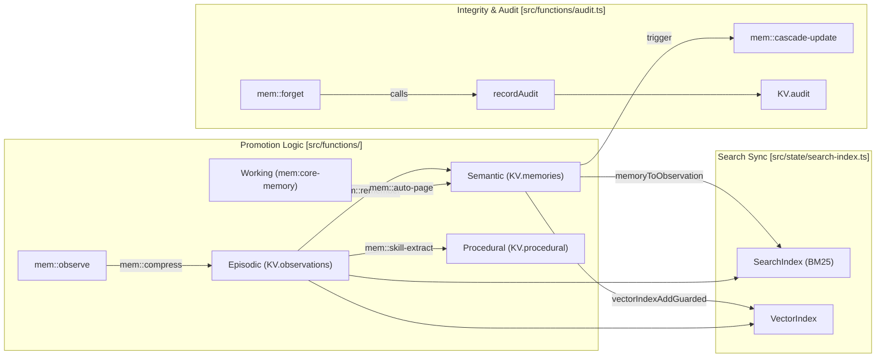
**Sources:** [src/functions/remember.ts:192-211](), [src/functions/working-memory.ts:194-221](), [src/functions/audit.ts:34-55](), [src/state/memory-utils.ts:11-24](), [src/functions/search.ts:124-156]()

---

# Page: Consolidation & Forgetting

# Consolidation & Forgetting

<details>
<summary>Relevant source files</summary>

The following files were used as context for generating this wiki page:

- [src/functions/auto-forget.ts](src/functions/auto-forget.ts)
- [src/functions/consolidate.ts](src/functions/consolidate.ts)
- [src/functions/consolidation-pipeline.ts](src/functions/consolidation-pipeline.ts)
- [src/functions/crystallize.ts](src/functions/crystallize.ts)
- [src/functions/diagnostics.ts](src/functions/diagnostics.ts)
- [src/functions/enrich.ts](src/functions/enrich.ts)
- [src/functions/evict.ts](src/functions/evict.ts)
- [src/functions/mesh.ts](src/functions/mesh.ts)
- [src/functions/migrate.ts](src/functions/migrate.ts)
- [src/functions/obsidian-export.ts](src/functions/obsidian-export.ts)
- [src/functions/retention.ts](src/functions/retention.ts)
- [src/utils/image-store.ts](src/utils/image-store.ts)
- [test/consolidation-default.test.ts](test/consolidation-default.test.ts)
- [test/diagnostics.test.ts](test/diagnostics.test.ts)
- [test/evict.test.ts](test/evict.test.ts)
- [test/lessons.test.ts](test/lessons.test.ts)
- [test/mesh.test.ts](test/mesh.test.ts)
- [test/obsidian-export.test.ts](test/obsidian-export.test.ts)

</details>


The consolidation and forgetting subsystem is responsible for the long-term lifecycle of memories in `agentmemory`. It transitions short-term, session-specific observations into structured, high-level semantic knowledge while simultaneously pruning irrelevant or outdated data to prevent state bloat and "hallucination" from stale context.

## 4-Tier Consolidation Pipeline

Consolidation is the process of synthesizing multiple `CompressedObservation` objects into a single, durable `Memory` object. This is handled primarily by the `mem::consolidate` function [src/functions/consolidate.ts:70-71]() and the multi-tier `mem::consolidate-pipeline` [src/functions/consolidation-pipeline.ts:50-51]().

### 1. Grouping & Filtering
The pipeline gathers observations across sessions. It filters for high-value data, specifically targeting observations with a `title` and an `importance` score of 5 or higher [src/functions/consolidate.ts:94-98](). These are then grouped by `concepts` (tags) to identify clusters of related activity [src/functions/consolidate.ts:104-111]().

### 2. Concept-Based Selection
Groups are sorted by size, and clusters with at least 3 observations are processed [src/functions/consolidate.ts:122-124](). To maintain LLM efficiency, only the top 8 most important observations per concept are sent for synthesis [src/functions/consolidate.ts:129-131]().

### 3. LLM Synthesis & Tiering
The `MemoryProvider` uses a specific `CONSOLIDATION_SYSTEM` prompt [src/functions/consolidate.ts:12-26]() to transform raw narratives into structured XML. The pipeline also supports specialized tiers:
* **Semantic Tier**: Merges `SessionSummary` objects into `SemanticMemory` facts using `SEMANTIC_MERGE_SYSTEM` [src/functions/consolidation-pipeline.ts:59-134]().
* **Reflect Tier**: Uses `mem::reflect` to synthesize higher-order `Insight` objects from `GraphNode` clusters [src/functions/consolidation-pipeline.ts:136-148]().
* **Procedural Tier**: Extracts `ProceduralMemory` (step-by-step workflows) from repeated patterns via `PROCEDURAL_EXTRACTION_SYSTEM` [src/functions/consolidation-pipeline.ts:150-202]().

### 4. Versioning & Superseding
If a new memory shares a title with an existing one, the system marks the old memory as `isLatest: false` [src/functions/consolidate.ts:176-177](), creates a new `Memory` with an incremented `version` [src/functions/consolidate.ts:188](), and populates the `supersedes` array to maintain lineage [src/functions/consolidate.ts:190-193](). To prevent cross-project corruption, scoped consolidation runs only evolve memories belonging to the same project [src/functions/consolidate.ts:162-173]().

### Consolidation Data Flow
The following diagram illustrates how observations are transformed into versioned entities.

**Consolidation Entity Mapping**
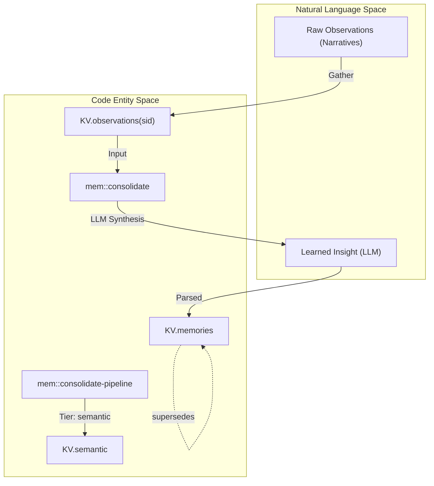
**Sources:** [src/functions/consolidate.ts:70-212](), [src/functions/consolidation-pipeline.ts:50-202](), [src/state/schema.js:8-10]()

---

## Retention & Decay (Ebbinghaus Model)

`agentmemory` implements a proactive forgetting mechanism via `mem::auto-forget` [src/functions/auto-forget.ts:25-26]() and a retention scoring system based on the Ebbinghaus forgetting curve [src/functions/retention.ts:127-128]().

### Retention Scoring
The `mem::retention-score` function calculates a score between 0 and 1 for every memory based on:
* **Salience**: Base value determined by memory type (e.g., `architecture` = 0.9, `preference` = 0.85, `fact` = 0.5) [src/functions/retention.ts:103-112]().
* **Temporal Decay**: Calculated as $e^{-\lambda \Delta T}$ where $\lambda$ is the decay constant (default 0.01) [src/functions/retention.ts:20-21](), [src/functions/retention.ts:89]().
* **Reinforcement Boost**: Recent accesses recorded in `KV.accessLog` increase the score, simulating the "testing effect" [src/functions/retention.ts:65-79]().

### Auto-Forget Logic
The `auto-forget` worker performs three primary cleanup tasks:
1. **TTL Expiry**: Deletes memories where `now > forgetAfter` [src/functions/auto-forget.ts:40-50]().
2. **Contradiction Detection**: Calculates Jaccard similarity between memories. If similarity > 0.9, the older version is marked non-latest [src/functions/auto-forget.ts:118-134]().
3. **Low-Value Pruning**: Observations older than 180 days with `importance <= 2` are evicted [src/functions/auto-forget.ts:162-179]().

**Sources:** [src/functions/retention.ts:19-94](), [src/functions/auto-forget.ts:25-191]()

---

## Eviction System

While `auto-forget` handles content decay, `mem::evict` manages the hard capacity limits of the `StateKV` [src/functions/evict.ts:109-110]().

### Eviction Strategies
| Strategy | Trigger | Action |
| :--- | :--- | :--- |
| **Stale Sessions** | Session > 30 days old with no summary [src/functions/evict.ts:136-140]() | Recovery via `event::session::stopped` then delete [src/functions/evict.ts:161-173]() |
| **Low Importance** | Observation > 90 days old and importance < 3 [src/functions/evict.ts:207-212]() | Delete from `KV.observations` [src/functions/evict.ts:222-223]() |
| **Per-Project Cap** | Project exceeds `maxObservationsPerProject` (default 10k) [src/functions/evict.ts:29]() | Prune lowest importance first [src/functions/evict.ts:246-258]() |
| **Image Management** | Eviction of observation with `imageData` | Calls `decrementImageRef` to manage disk space [src/functions/evict.ts:233-234]() |

### Eviction Logic Flow
The eviction system operates as a cleanup worker, ensuring the storage layer remains performant and disk usage for images is tracked via `image-store.ts` utilities [src/utils/image-store.ts:63-77]().

**Eviction Logic and KV Interaction**
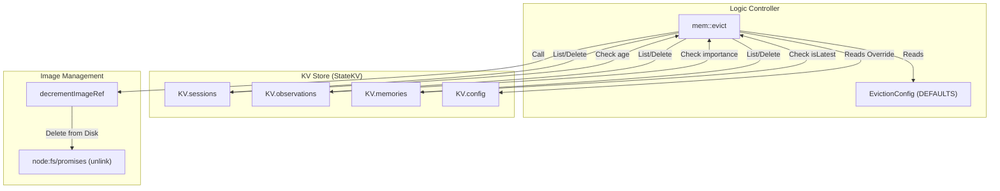
**Sources:** [src/functions/evict.ts:25-30](), [src/functions/evict.ts:109-234](), [src/utils/image-store.ts:63-77]()

---

## Reflection & Synthesis
Higher-order consolidation is achieved through `mem::reflect` (triggered within the pipeline [src/functions/consolidation-pipeline.ts:138-142]()), which groups concepts into clusters. It synthesizes actionable `Insight` objects. If an insight is rediscovered, the system reinforces it to increase its confidence score and update timestamps. The pipeline also applies periodic decay to `SemanticMemory` and `ProceduralMemory` strengths based on the time since last access [src/functions/consolidation-pipeline.ts:21-43]().

**Sources:** [src/functions/consolidation-pipeline.ts:21-148](), [src/functions/retention.ts:65-79]()

---

# Page: Search & Retrieval

# Search & Retrieval

<details>
<summary>Relevant source files</summary>

The following files were used as context for generating this wiki page:

- [src/config.ts](src/config.ts)
- [src/functions/remember.ts](src/functions/remember.ts)
- [src/functions/search.ts](src/functions/search.ts)
- [src/functions/smart-search.ts](src/functions/smart-search.ts)
- [src/state/hybrid-search.ts](src/state/hybrid-search.ts)
- [src/state/memory-utils.ts](src/state/memory-utils.ts)
- [src/state/search-index.ts](src/state/search-index.ts)
- [test/env-loader.test.ts](test/env-loader.test.ts)
- [test/hybrid-search.test.ts](test/hybrid-search.test.ts)
- [test/search-index.test.ts](test/search-index.test.ts)
- [test/search.test.ts](test/search.test.ts)

</details>


The search and retrieval system in `agentmemory` is built on a **triple-stream architecture** that combines lexical, semantic, and relational search methodologies. Unlike standard agent memory implementations that rely on simple keyword `grep` or loading entire files into the context window, `agentmemory` uses a hybrid approach to ensure high recall and precision even as the memory corpus grows to tens of thousands of observations.

### Retrieval Architecture

When a query is issued (via the API, MCP, or a lifecycle hook), it flows through the `HybridSearch` class, which orchestrates three parallel retrieval streams. The results from these streams are then fused using **Reciprocal Rank Fusion (RRF)** to produce a final ranked list of memories.

#### The Triple-Stream Flow

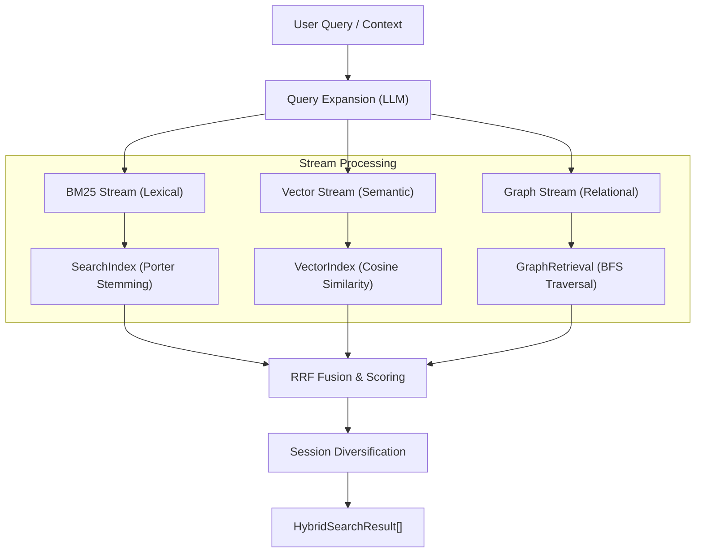

**Sources:**
- [src/state/hybrid-search.ts:22-36]()
- [src/state/hybrid-search.ts:81-120]()

---

### 1. BM25 Search Index (Lexical)
The lexical stream uses a custom implementation of the **BM25 (Best Matching 25)** algorithm. It excels at finding exact matches for technical terms, function names, and error codes. It utilizes Porter stemming and a domain-specific synonym map to handle variations in coding terminology (e.g., mapping "auth" to "authentication").

The `SearchIndex` handles both `CompressedObservation` objects and `Memory` objects (converted via `memoryToObservation` [src/state/memory-utils.ts:11-28]()). It supports prefix matching and stores an inverted index in memory, which is persisted to disk on shutdown.

For details on tokenization and scoring parameters, see [BM25 Search Index](#3.1).

**Sources:**
- [src/functions/search.ts:17-27]()
- [src/state/hybrid-search.ts:86-86]()
- [src/state/memory-utils.ts:11-28]()
- [src/state/search-index.ts:12-21]()

### 2. Vector & Embedding Search (Semantic)
The semantic stream handles "fuzzy" queries where the user's intent matches the meaning of a memory but not the specific words (e.g., "how do we handle database speed?" matching "N+1 query optimization"). It supports multiple embedding providers, including local execution via Xenova for privacy and zero-latency.

The `VectorIndex` uses cosine similarity to rank results. To prevent index corruption, the `vectorIndexAddGuarded` wrapper ensures all embeddings match the provider's expected dimensions before insertion and handles provider-specific failures gracefully [src/functions/search.ts:124-156]().

For details on supported providers and similarity scoring, see [Vector & Embedding Search](#3.2).

**Sources:**
- [src/functions/search.ts:130-156]()
- [src/state/hybrid-search.ts:95-102]()

### 3. Knowledge Graph (Relational)
The graph stream traverses relationships between entities (files, functions, PRs, developers) extracted from observations. If a search matches a specific file, the graph stream can "pull in" related observations about functions defined in that file or tasks that modified it, even if they don't match the query text. It also performs "expansion from chunks," taking top vector results and finding their neighbors in the graph [src/state/hybrid-search.ts:121-130]().

For details on entity extraction and BFS traversal, see [Knowledge Graph](#3.4).

**Sources:**
- [src/state/hybrid-search.ts:108-119]()
- [src/state/hybrid-search.ts:121-130]()

---

### Hybrid Fusion & Scoring

The `HybridSearch` class combines the streams using Reciprocal Rank Fusion (RRF) with a constant `RRF_K = 60` [src/state/hybrid-search.ts:20-20](). This ensures that a result appearing at the top of *any* stream is given high priority, while results appearing in multiple streams are boosted further.

| Feature | BM25 | Vector | Graph |
| :--- | :--- | :--- | :--- |
| **Primary Strength** | Exact terms, IDs, codes | Semantic intent, concepts | Relationships, context |
| **Default Weight** | 0.4 | 0.6 | 0.3 |
| **Ranking Logic** | BM25 (k1=1.2, b=0.75) | Cosine Similarity | BFS Distance + Node Weight |

**Sources:**
- [src/state/hybrid-search.ts:202-224]()
- [src/state/hybrid-search.ts:25-36]()

---

### Progressive Disclosure: `mem::smart-search`

To optimize the agent's context window, `agentmemory` implements a "Smart Search" pattern via `mem::smart-search`. Instead of returning full text for every match, it initially returns **Compact Results** (titles, IDs, and timestamps). The agent can then choose to **Expand** specific IDs to see the full narrative, facts, and metadata.

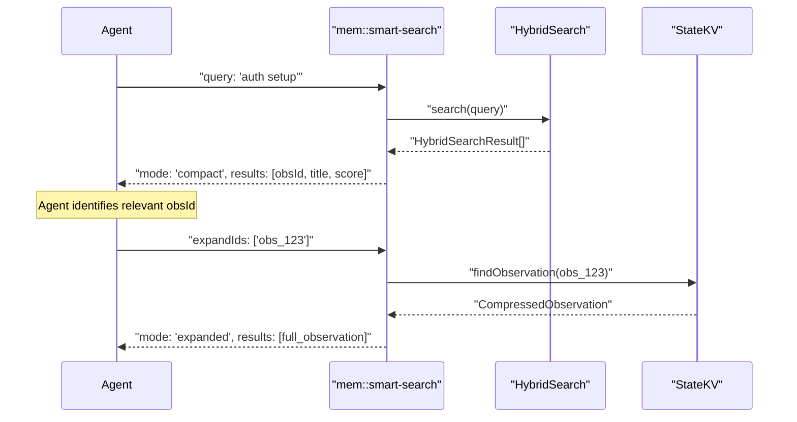

**Sources:**
- [src/functions/smart-search.ts:80-98]()
- [src/functions/smart-search.ts:132-177]()
- [src/functions/smart-search.ts:179-206]()

---

### Retrieval Utilities & Constraints

Beyond standard search, the system provides specialized retrieval logic and safety guards:
- **Search Fallback**: If an observation is not found in the per-session `KV.observations` scope, the search logic automatically falls back to checking `KV.memories` [test/hybrid-search.test.ts:146-182](). This is critical for `mem::remember` which writes to a synthetic "memory" session [src/state/memory-utils.ts:11-28]().
- **Agent Scoping**: Retrieval respects the `AGENT_ID` environment variable. If `AGENTMEMORY_AGENT_SCOPE=isolated` is enabled, search results are filtered to only include memories created by the current agent [src/functions/smart-search.ts:108-130]().
- **Session Diversification**: The `HybridSearch` automatically limits the number of results from a single session to prevent one long-winded session from dominating the results [src/state/hybrid-search.ts:226-231]().
- **Persistence**: The search index is not just in-memory; `IndexPersistence` handles periodic saves and startup loads to ensure search results are available immediately after a restart [src/functions/search.ts:78-91]().

**Sources:**
- [src/functions/smart-search.ts:108-130]()
- [src/state/hybrid-search.ts:226-231]()
- [src/state/memory-utils.ts:11-28]()
- [src/functions/search.ts:78-91]()
- [test/hybrid-search.test.ts:146-182]()

---

# Page: BM25 Search Index

# BM25 Search Index

<details>
<summary>Relevant source files</summary>

The following files were used as context for generating this wiki page:

- [src/functions/remember.ts](src/functions/remember.ts)
- [src/functions/search.ts](src/functions/search.ts)
- [src/state/hybrid-search.ts](src/state/hybrid-search.ts)
- [src/state/index-persistence.ts](src/state/index-persistence.ts)
- [src/state/memory-utils.ts](src/state/memory-utils.ts)
- [src/state/search-index.ts](src/state/search-index.ts)
- [test/hybrid-search.test.ts](test/hybrid-search.test.ts)
- [test/index-persistence.test.ts](test/index-persistence.test.ts)
- [test/search-index.test.ts](test/search-index.test.ts)
- [test/search.test.ts](test/search.test.ts)

</details>


The BM25 Search Index provides the keyword-based retrieval stream for `agentmemory`. It implements the Best Matching 25 (BM25) ranking function, a state-of-the-art probabilistic model for information retrieval. Unlike simple grep or substring matches, the BM25 index accounts for term frequency, document length normalization, and inverse document frequency to provide highly relevant results for natural language and code-specific queries.

### Implementation Overview

The core logic resides in the `SearchIndex` class [src/state/search-index.ts:12-12](). It maintains an in-memory inverted index that maps stemmed tokens to sets of observation identifiers. The index is specifically tuned for the "Coding-Agent" domain by incorporating Porter stemming, a custom synonym expansion layer, and specialized CJK (Chinese, Japanese, Korean) segmentation.

#### Key Scoring Parameters
The index uses standard BM25 constants to balance term saturation and length normalization:
*   **k1 = 1.2**: Controls non-linear term frequency saturation. A higher value increases the influence of repeated terms [src/state/search-index.ts:19-19]().
*   **b = 0.75**: Controls document length normalization. This penalizes long documents to prevent them from dominating results simply by containing more words [src/state/search-index.ts:20-20]().

### Data Flow: From Observation to Index

When a `CompressedObservation` or a `Memory` (converted via `memoryToObservation`) is added to the index, it undergoes a multi-stage pipeline to transform raw text into searchable features.

#### Indexing Pipeline
1.  **Memory Conversion**: If the input is a long-term `Memory` record, `memoryToObservation` wraps it in the observation shape, normalizing the type to `decision` so memories stay distinguishable in result metadata [src/state/memory-utils.ts:11-28]().
2.  **Field Extraction**: Concatenates `title`, `subtitle`, `narrative`, `facts`, `concepts`, `files`, and `type` [src/state/search-index.ts:223-233]().
3.  **Tokenization**: Normalizes text by removing special characters (except for path-related symbols like `/`, `.`, `-`, `_`), splitting on whitespace, and filtering out single-character tokens [src/state/search-index.ts:236-241]().
4.  **CJK Segmentation**: If CJK characters are detected via `hasCjk`, specialized segmenters are used to extract meaningful words rather than just character runs [src/state/cjk-segmenter.ts:128-161]().
5.  **Porter Stemming**: Reduces words to their root form (e.g., "implementing" -> "impl") using the `stem` function [src/state/search-index.ts:243-243]().
6.  **Frequency Tracking**: Calculates term frequency (TF) for the document and updates the global `totalDocLength` and `invertedIndex` [src/state/search-index.ts:24-45]().

**Search Index Data Structures**
```mermaid
graph TD
    subgraph "SearchIndex Class [src/state/search-index.ts]"
        SI["SearchIndex"] --> ENT["entries: Map<string, IndexEntry>"]
        SI --> II["invertedIndex: Map<string, Set<string>>"]
        SI --> DTC["docTermCounts: Map<string, Map<string, number>>"]
    end

    subgraph "Logic Components"
        SI --> TOK["tokenize()"]
        TOK --> CJK["segmentCjk() [src/state/cjk-segmenter.ts]"]
        TOK --> STM["stem() [src/state/stemmer.ts]"]
        SI --> SYN["getSynonyms() [src/state/synonyms.ts]"]
    end

    CJK --> STM
    STM --> II
    II -.->|"Lookup"| BM25["BM25 Scoring Logic"]
```
Sources: [src/state/search-index.ts:12-17](), [src/state/search-index.ts:236-244](), [src/state/cjk-segmenter.ts:128-130]()

### Coding-Domain Synonyms

To bridge the gap between human queries and technical jargon, the index uses synonym expansion. During search, query terms are expanded with synonyms [src/state/search-index.ts:95-101](). Primary terms carry a weight of `1.0`, while synonym matches are weighted at `0.7` to prioritize exact matches [src/state/search-index.ts:93-98]().

Sources: [src/state/search-index.ts:88-101]()

### Retrieval and Prefix Matching

The `search` function performs a multi-pass retrieval to ensure high recall, especially for partial code identifiers.

1.  **Exact Term Match**: Calculates standard BM25 scores for terms present in the inverted index [src/state/search-index.ts:106-125]().
2.  **Prefix Match**: Uses a sorted term list and binary search (`lowerBound`) to find terms that start with the query term [src/state/search-index.ts:127-130](). 
3.  **Prefix Scoring**: Prefix matches are awarded a `0.5` multiplier on their IDF to ensure that full matches rank higher than partial matches [src/state/search-index.ts:135-136]().

**Retrieval Logic Flow**
```mermaid
sequenceDiagram
    participant User as "Query: 'auth logic'"
    participant SI as "SearchIndex::search()"
    participant STM as "stem()"
    participant SYN as "getSynonyms()"
    participant BM as "BM25 Algorithm"

    User->>SI: search(query)
    SI->>STM: stem('auth') -> 'auth'
    SI->>SYN: getSynonyms('auth') -> ['authent', 'authn']
    SI->>SI: getSortedTerms() & lowerBound()
    Note over SI: Finds prefix matches like 'authorizer'
    SI->>BM: Calculate IDF/TF for all candidates
    BM-->>SI: Result Scores
    SI-->>User: Sorted List of {obsId, sessionId, score}
```
Sources: [src/state/search-index.ts:77-160](), [src/state/search-index.ts:127-151]()

### Persistence and Sharding

The BM25 index is kept in memory for performance but is periodically serialized to the KV store via the `IndexPersistence` class [src/state/index-persistence.ts:68-68](). To handle large indexes that exceed KV size limits, `IndexPersistence` implements a sharding mechanism [src/state/index-persistence.ts:169-174]().

*   **Serialization**: The index is converted to a JSON string containing the versioned schema (`v: 2`), entries, inverted index, and term counts [src/state/search-index.ts:194-210]().
*   **Sharding Strategy**: Large serialized strings are split into chunks based on `shardChars` (default 2,000,000 characters) [src/state/index-persistence.ts:18-18](). Each shard is stored in a unique scope prefixed with `mem:index:bm25:bm25:[generation]:[shardIndex]` [src/state/index-persistence.ts:13-13]().
*   **Manifest**: A manifest file at `data:manifest` tracks the active generation and shard locations [src/state/index-persistence.ts:12-25]().
*   **Debounced Saving**: `IndexPersistence` uses a 5000ms debounce timer (`scheduleSave`) to prevent excessive I/O during high-frequency observation ingestion [src/state/index-persistence.ts:8-89]().
*   **Startup Recovery**: On system initialization, `IndexPersistence::load()` retrieves the manifest and reassembles the shards [src/state/index-persistence.ts:105-123](). It also supports loading legacy monolithic snapshots for backward compatibility [src/state/index-persistence.ts:139-155]().

**Index Lifecycle & Persistence**
```mermaid
graph LR
    subgraph "Initialization"
        START["System Start"] --> LOAD["IndexPersistence::load()"]
        LOAD -->|"Missing/Empty"| REBUILD["rebuildIndex(kv) [src/functions/search.ts]"]
    end

    subgraph "Live Updates"
        REM["mem::remember"] -->|"getSearchIndex().add()"| MEM_ADD["SearchIndex::add()"]
        OBS["mem::compress"] -->|"getSearchIndex().add()"| OBS_ADD["SearchIndex::add()"]
        FORG["mem::forget"] -->|"getSearchIndex().remove()"| DEL["SearchIndex::remove()"]
    end

    MEM_ADD --> SCHED["IndexPersistence::scheduleSave() [src/state/index-persistence.ts]"]
    OBS_ADD --> SCHED
    DEL --> SAVE["IndexPersistence::save()"]
    SCHED -->|"5000ms Debounce"| SAVE
    SAVE -->|"Sharded Write"| KV_STORE["KV Scopes: mem:index:bm25:bm25:*"]
```
Sources: [src/state/index-persistence.ts:90-103](), [src/state/search-index.ts:22-48](), [src/functions/remember.ts:79-89](), [src/functions/search.ts:102-104]()

### Implementation Details: CJK Support

To support multilingual coding environments, `agentmemory` includes specialized segmentation for Chinese, Japanese, and Korean scripts [src/state/cjk-segmenter.ts:5-10]().
*   **Chinese**: Uses `@node-rs/jieba` for dictionary-based segmentation [src/state/cjk-segmenter.ts:42-66]().
*   **Japanese**: Uses `tiny-segmenter` for morphological analysis [src/state/cjk-segmenter.ts:75-89]().
*   **Korean**: Uses regex-based syllable block extraction [src/state/cjk-segmenter.ts:120-126]().

Sources: [src/state/cjk-segmenter.ts:128-161](), [test/search-index.test.ts:205-218]()

---

# Page: Vector & Embedding Search

# Vector & Embedding Search

<details>
<summary>Relevant source files</summary>

The following files were used as context for generating this wiki page:

- [src/functions/migrate-vector-index.ts](src/functions/migrate-vector-index.ts)
- [src/functions/vision-search.ts](src/functions/vision-search.ts)
- [src/providers/_fetch.ts](src/providers/_fetch.ts)
- [src/providers/embedding/clip.ts](src/providers/embedding/clip.ts)
- [src/providers/embedding/cohere.ts](src/providers/embedding/cohere.ts)
- [src/providers/embedding/gemini.ts](src/providers/embedding/gemini.ts)
- [src/providers/embedding/index.ts](src/providers/embedding/index.ts)
- [src/providers/embedding/openai.ts](src/providers/embedding/openai.ts)
- [src/providers/embedding/openrouter.ts](src/providers/embedding/openrouter.ts)
- [src/providers/embedding/voyage.ts](src/providers/embedding/voyage.ts)
- [src/providers/minimax.ts](src/providers/minimax.ts)
- [src/providers/openrouter.ts](src/providers/openrouter.ts)
- [src/state/vector-index.ts](src/state/vector-index.ts)
- [test/embedding-provider.test.ts](test/embedding-provider.test.ts)
- [test/fetch-timeout.test.ts](test/fetch-timeout.test.ts)
- [test/minimax-provider.test.ts](test/minimax-provider.test.ts)
- [test/vector-index-dimensions.test.ts](test/vector-index-dimensions.test.ts)
- [test/vector-index.test.ts](test/vector-index.test.ts)
- [test/vision-search.test.ts](test/vision-search.test.ts)

</details>


The Vector & Embedding Search subsystem provides semantic retrieval capabilities by mapping textual observations and images into a high-dimensional vector space. Unlike keyword-based search, this system identifies memories based on conceptual similarity, even when specific terminology differs.

## The VectorIndex Class

The `VectorIndex` class is the core in-memory data structure responsible for managing embeddings and performing similarity searches. It maintains a mapping of observation IDs to their corresponding `Float32Array` embeddings and associated session metadata [src/state/vector-index.ts:37-39]().

### Core Operations

| Method | Description |
| :--- | :--- |
| `add(obsId, sessionId, embedding)` | Inserts a new vector into the index [src/state/vector-index.ts:41-43](). |
| `remove(obsId)` | Deletes a specific vector from the index [src/state/vector-index.ts:45-47](). |
| `search(query, limit)` | Performs a brute-force scan to find the top-K most similar vectors using cosine similarity [src/state/vector-index.ts:49-77](). |
| `validateDimensions(expected)` | Validates that all stored vectors match the expected dimension size, identifying mismatches [src/state/vector-index.ts:91-104](). |
| `serialize()` | Converts the index into a JSON string with base64-encoded vectors for persistence [src/state/vector-index.ts:124-136](). |
| `deserialize(json)` | Reconstructs a `VectorIndex` from a serialized string [src/state/vector-index.ts:138-166](). |

### Similarity Scoring
The system uses **Cosine Similarity** to determine the distance between the query vector and stored observation vectors [src/state/vector-index.ts:61](). The calculation is implemented manually to handle `Float32Array` inputs, computing the dot product divided by the product of the magnitudes [src/state/vector-index.ts:23-35](). If the denominator is zero (e.g., a zero vector), it returns a score of 0 [src/state/vector-index.ts:34]().

Sources: [src/state/vector-index.ts:23-77](), [src/state/vector-index.ts:91-104]()

## Embedding Providers

`agentmemory` supports a variety of embedding backends through the `EmbeddingProvider` interface. The system supports local execution via Xenova or remote execution via major API providers.

### Supported Backends

| Provider | Model | Default Dimensions | Notes |
| :--- | :--- | :--- | :--- |
| `LocalEmbeddingProvider` | `Xenova/all-MiniLM-L6-v2` | 384 | Runs locally via `@xenova/transformers` [src/providers/embedding/index.ts:8](), [src/providers/embedding/index.ts:45-46](). |
| `OpenAIEmbeddingProvider` | `text-embedding-3-small` | 1536 | Supports Azure, custom base URLs, and dimension overrides [src/providers/embedding/openai.ts:13-50](). |
| `GeminiEmbeddingProvider` | `gemini-embedding-001` | 768 | Integrated via Google Generative Language API [src/providers/embedding/gemini.ts:6-11](). |
| `VoyageEmbeddingProvider` | Voyage AI | Varies | Specialized for retrieval [src/providers/embedding/voyage.ts:1-20](). |
| `CohereEmbeddingProvider` | Cohere | Varies | Multilingual support [src/providers/embedding/cohere.ts:1-15](). |
| `OpenRouterEmbeddingProvider`| OpenRouter | Varies | Unified API for multiple models [src/providers/embedding/openrouter.ts:8-24](). |

### OpenAI & Azure Integration
The `OpenAIEmbeddingProvider` shares transport logic with the LLM provider, including Azure auto-detection [src/providers/embedding/openai.ts:87](). It detects Azure endpoints by checking if the hostname ends in `.openai.azure.com` [src/providers/_openai-shared.ts:35-42](). 

The provider supports two Azure URL styles [src/providers/_openai-shared.ts:19-23]():
1. **Legacy**: Includes `/openai/deployments/` and requires an `api-version` query parameter [src/providers/_openai-shared.ts:63-74]().
2. **v1 (GA)**: Routes through `/openai/v1/` and mirrors standard OpenAI shape without `api-version` [src/providers/_openai-shared.ts:79-88]().

### Dimension Guarding
To prevent index corruption from mixed-dimension vectors, all providers are wrapped with `withDimensionGuard` [src/providers/embedding/index.ts:56](). This wrapper intercepts calls to `embed`, `embedBatch`, and `embedImage`, ensuring the returned vector length matches the provider's declared `dimensions` property [src/providers/embedding/index.ts:58-65](). It preserves the provider's prototype chain so `instanceof` checks still work [src/providers/embedding/index.ts:66-68]().

**Embedding Generation Flow**
```mermaid
graph TD
    subgraph "Natural Language Space"
        A["Raw Text Observation"]
    end

    subgraph "Code Entity Space"
        B["OpenAIEmbeddingProvider::embed()"]
        C["_openai-shared::buildEmbeddingUrl()"]
        D["_fetch::fetchWithTimeout()"]
        E["OpenAI / Azure API"]
        F["withDimensionGuard::check()"]
        G["VectorIndex::add()"]
    end

    A --> B
    B --> C
    B --> D
    D --> E
    E -- "JSON Response" --> B
    B -- "Float32Array" --> F
    F -- "Validated" --> G
```
Sources: [src/providers/embedding/openai.ts:92-122](), [src/providers/_openai-shared.ts:1-142](), [src/providers/embedding/index.ts:56-80](), [src/state/vector-index.ts:41-43]()

## Vision Search

The system provides specialized functions for embedding and searching images, primarily using CLIP-based models. This is enabled by setting `AGENTMEMORY_IMAGE_EMBEDDINGS=true` [src/functions/vision-search.ts:31-32]().

### Key Functions
- `mem::vision-embed`: Generates an embedding for a managed image file and stores it in `KV.imageEmbeddings` [src/functions/vision-search.ts:25-69](). It requires the `imageRef` to be registered in `KV.imageRefs` [src/functions/vision-search.ts:40-43]().
- `mem::vision-search`: Supports searching for images using text queries, other images (via `queryImageRef`), or base64 strings [src/functions/vision-search.ts:72-133](). It calculates cosine similarity between the query vector and all stored image embeddings [src/functions/vision-search.ts:122-124]().

### CLIP Implementation
The `ClipEmbeddingProvider` uses `@huggingface/transformers` to run `Xenova/clip-vit-base-patch32` locally [src/providers/embedding/clip.ts:11-15](). It provides separate extractors for text (`feature-extraction`) and images (`image-feature-extraction`) [src/providers/embedding/clip.ts:44-56]().

Sources: [src/functions/vision-search.ts:19-133](), [src/providers/embedding/clip.ts:1-57](), [test/vision-search.test.ts:41-182]()

## Storage & Retrieval Logic

Embeddings are stored in the Key-Value (KV) store in a serialized format. To optimize performance, the `VectorIndex` is kept in memory and synchronized with the KV store during the `IndexPersistence` lifecycle.

### Vector Search Algorithm
The `search` implementation uses a fixed-size results array to maintain the top-K matches efficiently [src/state/vector-index.ts:49-77]().

1. **Iteration**: The engine iterates through every vector in the `vectors` Map [src/state/vector-index.ts:60]().
2. **Scoring**: It calculates the `cosineSimilarity` between the query and the entry [src/state/vector-index.ts:61]().
3. **Selection**: 
    - If the results list is not full (less than `limit`), the result is added [src/state/vector-index.ts:62-63]().
    - Once full, it sorts the initial batch to establish a `minScore` [src/state/vector-index.ts:64-67]().
    - Subsequent vectors are only added if their score exceeds `minScore`, replacing the lowest-scoring element and re-sorting [src/state/vector-index.ts:68-72]().
4. **Final Sort**: The final list is sorted in descending order (highest score first) [src/state/vector-index.ts:75]().

### Serialization & Base64 Encoding
To store `Float32Array` data in JSON-based KV stores, the system converts the underlying `ArrayBuffer` to a Base64 string using `float32ToBase64` [src/state/vector-index.ts:8-12](). Crucially, it uses `byteOffset` and `byteLength` to avoid issues with Node's Buffer pool, where `Buffer.from` might otherwise return a slice of a shared pool [src/state/vector-index.ts:1-7]().

**Vector Persistence Flow**
```mermaid
graph TD
    subgraph "Memory Space"
        V["VectorIndex::vectors Map"]
        F["Float32Array"]
    end

    subgraph "Persistence Logic"
        S["VectorIndex::serialize()"]
        B["float32ToBase64()"]
        J["JSON.stringify()"]
    end

    subgraph "KV Store"
        KV["KV::set('vector_index')"]
    end

    V --> S
    S --> B
    B --> F
    B --> J
    J --> KV
```
Sources: [src/state/vector-index.ts:1-21](), [src/state/vector-index.ts:124-136]()

## Error Handling & Fallbacks
- **Batching**: Providers like `GeminiEmbeddingProvider` implement batching (e.g., 100 texts per request) to handle large numbers of observations efficiently [src/providers/embedding/gemini.ts:5-7](), [src/providers/embedding/gemini.ts:27-29]().
- **Normalization**: Gemini performs L2 normalization on returned vectors to ensure consistent cosine similarity scoring [src/providers/embedding/gemini.ts:51-52](), [src/providers/embedding/gemini.ts:61-78]().
- **Validation**: During restoration, `validateDimensions` is used to ensure that a legacy on-disk index doesn't contain vectors that mismatch the current provider's requirements [src/state/vector-index.ts:91-104]().
- **Timeouts**: All remote provider calls use `fetchWithTimeout` to prevent hanging requests from blocking the memory pipeline [src/providers/_fetch.ts:44-55]().

Sources: [src/providers/embedding/gemini.ts:24-56](), [src/state/vector-index.ts:91-104](), [src/providers/embedding/index.ts:30-50](), [src/providers/_fetch.ts:1-75]()

---

# Page: Hybrid Search & RRF Fusion

# Hybrid Search & RRF Fusion

<details>
<summary>Relevant source files</summary>

The following files were used as context for generating this wiki page:

- [src/config.ts](src/config.ts)
- [src/functions/context.ts](src/functions/context.ts)
- [src/functions/remember.ts](src/functions/remember.ts)
- [src/functions/search.ts](src/functions/search.ts)
- [src/functions/smart-search.ts](src/functions/smart-search.ts)
- [src/state/hybrid-search.ts](src/state/hybrid-search.ts)
- [src/state/memory-utils.ts](src/state/memory-utils.ts)
- [src/state/reranker.ts](src/state/reranker.ts)
- [src/state/search-index.ts](src/state/search-index.ts)
- [test/context-lessons.test.ts](test/context-lessons.test.ts)
- [test/env-loader.test.ts](test/env-loader.test.ts)
- [test/hybrid-search.test.ts](test/hybrid-search.test.ts)
- [test/reranker.test.ts](test/reranker.test.ts)
- [test/search-index.test.ts](test/search-index.test.ts)
- [test/search.test.ts](test/search.test.ts)

</details>


The `HybridSearch` class is the central engine for memory retrieval in `agentmemory`. It implements a triple-stream search architecture that combines lexical (BM25), semantic (Vector), and relational (Knowledge Graph) retrieval. These disparate result sets are unified using Reciprocal Rank Fusion (RRF) to provide a single, ranked list of memories.

### Triple Stream Search Execution

The core retrieval logic is encapsulated in the `tripleStreamSearch` method [src/state/hybrid-search.ts:81](). It executes three parallel retrieval paths to capture different facets of the user's query intent.

| Stream | Component | Mechanism | Strength |
| :--- | :--- | :--- | :--- |
| **Lexical** | `SearchIndex` | BM25 scoring on tokens and stems | Exact matches, file paths, and unique identifiers. |
| **Semantic** | `VectorIndex` | Cosine similarity on embeddings | Conceptual matches and paraphrases. |
| **Relational** | `GraphRetrieval` | Entity-based traversal and chunk expansion | Contextual relationships and multi-hop discovery. |

#### Data Flow: Triple Stream Retrieval
The following diagram illustrates how a single query is dispatched across the three search streams and then fused within the `HybridSearch` class.

Title: Triple Stream Search Architecture
```mermaid
graph TD
  Query["User Query"] --> Stream1["SearchIndex.search (BM25)"]
  Query --> Stream2["VectorIndex.search (Cosine)"]
  Query --> Stream3["GraphRetrieval.searchByEntities"]
  
  Stream2 -.->|"Top 5 Results"| Expand["GraphRetrieval.expandFromChunks"]
  Expand --> Stream3
  
  Stream1 --> Fusion["Reciprocal Rank Fusion (RRF)"]
  Stream2 --> Fusion
  Stream3 --> Fusion
  
  Fusion --> Diversify["diversifyBySession"]
  Diversify --> Rerank["reranker (MiniLM)"]
  Rerank --> Final["HybridSearchResult[]"]

  subgraph "Code Entity Space"
    Stream1["SearchIndex.search (src/state/search-index.ts)"]
    Stream2["VectorIndex.search (src/state/vector-index.ts)"]
    Stream3["GraphRetrieval.searchByEntities (src/functions/graph-retrieval.ts)"]
    Expand["expandFromChunks (src/functions/graph-retrieval.ts)"]
    Fusion["RRF Calculation (src/state/hybrid-search.ts)"]
    Diversify["diversifyBySession (src/state/hybrid-search.ts)"]
    Rerank["rerank (src/state/reranker.ts)"]
  end
```
Sources: [src/state/hybrid-search.ts:81-120](), [src/state/hybrid-search.ts:121-130](), [src/state/reranker.ts:34-70]()

### Reciprocal Rank Fusion (RRF)

To combine scores from different algorithms (which use different scales), `HybridSearch` employs Reciprocal Rank Fusion with a constant `RRF_K = 60` [src/state/hybrid-search.ts:20]().

The combined score for an observation $d$ is calculated as:
$$Score(d) = \sum_{s \in Streams} w_s \cdot \frac{1}{k + rank_s(d)}$$

Where:
*   $w_s$ is the weight assigned to the stream (BM25, Vector, or Graph) [src/state/hybrid-search.ts:30-32]().
*   $rank_s(d)$ is the 1-based rank of the document in that stream (or $\infty$ if not found) [src/state/hybrid-search.ts:146-196]().
*   $k$ is the smoothing constant `RRF_K` (60) [src/state/hybrid-search.ts:20]().

#### Weight Configuration
Weights are passed to the `HybridSearch` constructor and normalized during execution to ensure the total weight equals 1.0 [src/state/hybrid-search.ts:201-206](). The system also applies an `AGREEMENT_BONUS` of 0.05 for each additional stream that returns the same document [src/state/hybrid-search.ts:201](), [src/state/hybrid-search.ts:221]().

*   `bm25Weight`: Default 0.4 [src/state/hybrid-search.ts:30]().
*   `vectorWeight`: Default 0.6 [src/state/hybrid-search.ts:31]().
*   `graphWeight`: Default 0.3 [src/state/hybrid-search.ts:32]().

Sources: [src/state/hybrid-search.ts:201-224]()

### Query Expansion & Reranking

To improve recall and precision, the system supports LLM-driven query expansion and local cross-encoder reranking.

*   **Query Expansion**: The `searchWithExpansion` method handles multi-query execution by merging results from reformulations and temporal concretizations [src/state/hybrid-search.ts:42-60]().
*   **Temporal Concretization**: Resolves relative time expressions (e.g., "last week") into absolute ISO timestamps during expansion [src/state/hybrid-search.ts:50]().
*   **Entity Extraction**: Entities identified via `extractEntitiesFromQuery` (using regex for quotes and capitalized words) seed the `GraphRetrieval` stream [src/state/hybrid-search.ts:104-107]().
*   **Reranker**: If enabled via `RERANK_ENABLED` [src/state/hybrid-search.ts:33](), the system uses `Xenova/ms-marco-MiniLM-L-6-v2` to rerank the top candidates [src/state/reranker.ts:46-57](). It constructs query-document pairs and scores them using a local `text-classification` pipeline [src/state/reranker.ts:60-70]().
*   **Session Diversification**: The `diversifyBySession` method prevents a single high-activity session from dominating search results by capping results per session [src/state/hybrid-search.ts:225]().

Sources: [src/state/hybrid-search.ts:42-79](), [src/state/hybrid-search.ts:104-107](), [src/state/reranker.ts:34-70]()

### Progressive Disclosure Pattern

The `mem::smart-search` function implements a "Progressive Disclosure" pattern to manage the token budget of the calling agent [src/functions/smart-search.ts:75]().

1.  **Compact Mode**: Returns a list of results containing metadata: `obsId`, `title`, `type`, `score`, and `timestamp` [src/functions/smart-search.ts:179-240](). This allows the agent to see a broad overview without consuming large amounts of context.
2.  **Expanded Mode**: When the agent provides specific `expandIds`, the function retrieves the full `CompressedObservation` for those specific memories [src/functions/smart-search.ts:132-177](). It uses `findObservation` to fetch the detailed content from the KV store [src/functions/smart-search.ts:150-154]().

#### Smart Search Logic
The following diagram maps the `mem::smart-search` flow to the underlying `HybridSearch` and `StateKV` entities.

Title: Progressive Disclosure Search Flow
```mermaid
sequenceDiagram
    participant A as Agent (Client)
    participant SS as "mem::smart-search (src/functions/smart-search.ts)"
    participant HS as "HybridSearch (src/state/hybrid-search.ts)"
    participant KV as "StateKV (src/state/kv.ts)"

    A->>SS: { query: "auth logic" }
    SS->>HS: search("auth logic")
    HS-->>SS: HybridSearchResult[]
    SS-->>A: { mode: "compact", results: CompactSearchResult[] }

    Note over A, SS: Agent selects IDs to inspect

    A->>SS: { expandIds: ["obs_123"] }
    SS->>KV: get(KV.observations(sid), "obs_123")
    KV-->>SS: CompressedObservation
    SS-->>A: { mode: "expanded", results: Array<{observation}> }
```
Sources: [src/functions/smart-search.ts:80-240](), [src/state/hybrid-search.ts:38-40]()

### Hybrid Ranking in Standard Search
While `mem::smart-search` is the primary interface for hybrid retrieval, the standard `mem::search` function can also use the hybrid ranker if one is registered via `setHybridRanker` [src/functions/search.ts:29-31](). This ensures that even legacy recall surfaces benefit from vector and graph streams [src/functions/search.ts:17-22]().

### Key Functions and Classes

| Entity | Role |
| :--- | :--- |
| `HybridSearch` | Orchestrates the three search streams and applies RRF [src/state/hybrid-search.ts:22](). |
| `tripleStreamSearch` | Private method executing BM25, Vector, and Graph retrieval [src/state/hybrid-search.ts:81](). |
| `rerank` | Uses a local transformer model to re-score retrieval candidates [src/state/reranker.ts:34](). |
| `mem::smart-search` | Registered SDK function for progressive disclosure [src/functions/smart-search.ts:80](). |
| `GraphRetrieval` | Entity-based retrieval and neighborhood expansion [src/functions/graph-retrieval.ts:14](). |
| `extractEntitiesFromQuery` | Regex-based utility for pulling entities from raw strings [src/functions/query-expansion.ts:132](). |
| `memoryToObservation` | Utility to transform long-term memories into the searchable observation shape [src/state/memory-utils.ts:11](). |

Sources: [src/state/hybrid-search.ts:22-36](), [src/functions/smart-search.ts:80-98](), [src/state/reranker.ts:34-42](), [src/state/memory-utils.ts:11-24]()

---

# Page: Knowledge Graph

# Knowledge Graph

<details>
<summary>Relevant source files</summary>

The following files were used as context for generating this wiki page:

- [src/functions/cascade.ts](src/functions/cascade.ts)
- [src/functions/graph-retrieval.ts](src/functions/graph-retrieval.ts)
- [src/functions/graph.ts](src/functions/graph.ts)
- [src/functions/relations.ts](src/functions/relations.ts)
- [src/functions/verify.ts](src/functions/verify.ts)
- [src/mcp/server.ts](src/mcp/server.ts)
- [src/mcp/tools-registry.ts](src/mcp/tools-registry.ts)
- [src/state/schema.ts](src/state/schema.ts)
- [test/graph-retrieval.test.ts](test/graph-retrieval.test.ts)
- [test/graph.test.ts](test/graph.test.ts)

</details>


The Knowledge Graph subsystem provides a structured, relational representation of information extracted from agent observations. Unlike flat vector embeddings or keyword indices, the graph captures explicit entities (files, functions, decisions) and the semantic or temporal relationships between them. This allows the system to perform multi-hop reasoning and context expansion during retrieval.

## Data Model: Nodes and Edges

The graph is composed of two primary primitives defined in the core type system: `GraphNode` and `GraphEdge`.

### GraphNode
Nodes represent discrete entities identified within the codebase or session narrative.
*   **Types**: `file`, `function`, `concept`, `error`, `decision`, `pattern`, `library`, `person`, `project`, `preference`, `location`, `organization`, `event` [src/functions/graph.ts:66]().
*   **Properties**: Arbitrary key-value pairs (e.g., `path`, `lang`) extracted from XML attributes [src/functions/graph.ts:58-63]().
*   **Metadata**: Tracks `sourceObservationIds` to link graph entities back to the raw evidence [src/functions/graph.ts:69]().
*   **Stale Flag**: Nodes can be marked as `stale: true`, which excludes them from active retrieval [src/functions/graph-retrieval.ts:49]().

### GraphEdge
Edges represent directed, weighted relationships between nodes.
*   **Relationship Types**: Includes `uses`, `imports`, `modifies`, `causes`, `fixes`, `depends_on`, `related_to`, `works_at`, `prefers`, `blocked_by`, `caused_by`, `optimizes_for`, `rejected`, `avoids`, `located_in`, `succeeded_by` [src/functions/graph.ts:85]().
*   **Weight**: A float from `0.1` to `1.0` representing relationship strength or directness [src/functions/graph.ts:90]().
*   **Temporal Fields**: Supports bi-temporal modeling via `tcommit` (system time), `tvalid` (when the fact became true), and `tvalidEnd` (when the fact ceased being true) [src/functions/graph-retrieval.ts:188-197]().

**Sources**: [src/functions/graph.ts:54-107](), [src/functions/graph-retrieval.ts:1-14](), [src/functions/graph-retrieval.ts:49-50](), [src/state/schema.ts:17-18]().

---

## Entity Extraction via mem::graph

The system populates the graph using LLM-based extraction triggered via the `mem::graph-extract` function.

### Extraction Flow
1.  **Input**: A collection of `CompressedObservation` objects [src/functions/graph.ts:340]().
2.  **Prompting**: The system uses `GRAPH_EXTRACTION_SYSTEM` and `buildGraphExtractionPrompt` to guide the LLM in producing XML-formatted entities and relationships [src/functions/graph.ts:345-359]().
3.  **LLM Processing**: The provider's `compress` method processes the narrative and facts into a graph structure [src/functions/graph.ts:356-359]().
4.  **Parsing**: `parseGraphXml` extracts XML tags like `<entity>` and `<relationship>`. The parser uses a robust regex-based approach to handle self-closing tags and reordered attributes (e.g., `name` before `type`) [src/functions/graph.ts:249-332]().
5.  **Deduplication & Merging**: When saving, the system checks for existing nodes by name and type using `nameIndexKey`. If found, it merges properties and appends new `sourceObservationIds` [src/functions/graph.ts:367-386]().

### Extraction Architecture
The following diagram illustrates the flow from natural language observations to the structured KV state.

**Graph Extraction Data Flow**
```mermaid
graph TD
    subgraph "Natural Language Space"
        OBS["CompressedObservation (Narrative/Facts)"]
    end

    subgraph "Code Entity Space"
        GE["mem::graph-extract (Function)"]
        LLM["LLM (MemoryProvider.compress)"]
        PARSE["parseGraphXml (XML Parser)"]
        KV_NODES[("KV Scope: mem:graph:nodes")]
        KV_EDGES[("KV Scope: mem:graph:edges")]
        SNAP["GraphSnapshot (current)"]
    end

    OBS --> GE
    GE --> LLM
    LLM -- "XML Output" --> PARSE
    PARSE -- "GraphNode" --> KV_NODES
    PARSE -- "GraphEdge" --> KV_EDGES
    KV_NODES -. "incremental update" .-> SNAP
    KV_EDGES -. "incremental update" .-> SNAP
```
**Sources**: [src/functions/graph.ts:334-424](), [src/functions/graph.ts:249-332](), [test/graph.test.ts:135-163](), [src/state/schema.ts:17-25]().

---

## Retrieval and Dijkstra Traversal

The `GraphRetrieval` class handles searching the graph to find relevant context for queries.

### Dijkstra Traversal
The system implements a weighted shortest-path traversal in `dijkstraTraversal` to explore the neighborhood of matching nodes [src/functions/graph-retrieval.ts:230-235](). This replaced a simpler BFS to ensure that high-weight chains are prioritized over weak direct edges.
*   **Cost Function**: The cost of an edge is calculated as `1 / weight`. Dijkstra selects the path with the minimum total cost [src/functions/graph-retrieval.ts:247-248]().
*   **Max Depth**: Typically defaults to 2, allowing for discovery of indirect relationships [src/functions/graph-retrieval.ts:46]().
*   **Path Scoring**: The score is calculated as `avgWeight * (1 / pathLength)`. Shorter paths and stronger edge weights result in higher relevance scores [src/functions/graph-retrieval.ts:88]().

### Retrieval Methods
| Method | Purpose | Implementation |
| :--- | :--- | :--- |
| `searchByEntities` | Finds nodes matching keywords and traverses their neighbors using Dijkstra. | [src/functions/graph-retrieval.ts:44-115]() |
| `expandFromChunks` | Takes existing observation IDs and finds related entities to pull in more context. | [src/functions/graph-retrieval.ts:117-156]() |
| `temporalQuery` | Filters the graph state based on a specific `asOf` timestamp. | [src/functions/graph-retrieval.ts:158-206]() |

**Sources**: [src/functions/graph-retrieval.ts:41-115](), [src/functions/graph-retrieval.ts:230-235](), [test/graph-retrieval.test.ts:192-204]().

---

## Temporal Modeling

The knowledge graph supports bi-temporal modeling, allowing the agent to understand how relationships have changed over time.

1.  **System Time (`tcommit`)**: The timestamp when the fact was recorded in the database [src/functions/graph-retrieval.ts:188]().
2.  **Valid Time (`tvalid` / `tvalidEnd`)**: The period during which the fact was true in the real world [src/functions/graph-retrieval.ts:190-197]().
3.  **Version Tracking**: The system uses an `isLatest` flag for edges. When a relationship is updated, the newest edge is prioritized in `getLatestEdges` [src/functions/graph-retrieval.ts:208-228]().
4.  **Point-in-Time Recovery**: The `temporalQuery` method can reconstruct the graph state as it existed at any `asOf` date by filtering against `tcommit`, `tvalid`, and `tvalidEnd` [src/functions/graph-retrieval.ts:186-205]().

**Sources**: [src/functions/graph-retrieval.ts:158-228](), [test/graph-retrieval.test.ts:142-159](), [src/state/schema.ts:62]().

---

## Integration and Snapshot System

### Graph Snapshot & Viewer
To support high-performance visualization in the dashboard without timing out the engine, the system maintains a `GraphSnapshot` [src/functions/graph.ts:62-77]().
*   **Snapshotting**: `buildSnapshotFromArrays` ranks nodes by degree and stores the top `SNAPSHOT_TOP_NODES` (default 500) [src/functions/graph.ts:94-141]().
*   **Incremental Updates**: `applyDegreeDelta` mutates the snapshot in real-time as new edges are extracted, maintaining the top-N ranking without a full re-scan [src/functions/graph.ts:204-247]().
*   **Live Budget**: `mem::graph-query` races live enumeration against a 6000ms budget, falling back to the snapshot if the corpus is too large [src/functions/graph.ts:41-59](), [src/functions/graph.ts:456-464]().

### Maintenance and Cascade
When a memory is superseded, the `mem::cascade-update` function identifies graph components derived from the old memory's observations and marks them as `stale` to prevent them from appearing in future search results [src/functions/cascade.ts:27-59]().

**Graph Integration Architecture**
```mermaid
graph LR
    subgraph "Storage Layer"
        KV_G[("KV: mem:graph:*")]
        SNAP_KV[("KV: mem:graphSnapshot")]
    end

    subgraph "Logic Layer"
        GR["GraphRetrieval (Class)"]
        GE["mem::graph-extract (Function)"]
        CASC["mem::cascade-update (Function)"]
        AD["applyDegreeDelta (Snapshot Maintenance)"]
    end

    subgraph "Interface Layer"
        MCP_G["memory_graph_query (MCP Tool)"]
        DASH["Dashboard Viewer (Browser)"]
        REST_G["/agentmemory/graph/query (API)"]
    end

    KV_G <--> GR
    KV_G <--> GE
    KV_G <--> CASC
    GE --> AD
    AD --> SNAP_KV
    GR <--> REST_G
    REST_G <--> DASH
    GR <--> MCP_G
    SNAP_KV -. "fast path" .-> REST_G
```

**Sources**: [src/functions/graph.ts:24-41](), [src/functions/graph.ts:94-141](), [src/functions/graph.ts:204-247](), [src/functions/cascade.ts:8-59](), [src/state/schema.ts:25-40]().

---

# Page: API & Integration Interfaces

# API & Integration Interfaces

<details>
<summary>Relevant source files</summary>

The following files were used as context for generating this wiki page:

- [AGENTS.md](AGENTS.md)
- [README.md](README.md)
- [src/cli.ts](src/cli.ts)
- [src/functions/graph.ts](src/functions/graph.ts)
- [src/index.ts](src/index.ts)
- [src/mcp/server.ts](src/mcp/server.ts)
- [src/mcp/tools-registry.ts](src/mcp/tools-registry.ts)
- [src/state/schema.ts](src/state/schema.ts)
- [src/triggers/api.ts](src/triggers/api.ts)
- [src/viewer/index.html](src/viewer/index.html)
- [test/graph.test.ts](test/graph.test.ts)

</details>


The `agentmemory` system provides three distinct layers for external interaction, ranging from standard web protocols to deep lifecycle integration with AI agents. These interfaces allow developers to query memories, agents to manage their own state, and platforms to automate context injection.

### Interface Overview

1.  **REST API**: A standard HTTP interface for programmatic access to the memory engine, session management, and system health. It exposes over 130 endpoints [AGENTS.md:120-120]().
2.  **MCP Server**: An implementation of the Model Context Protocol, exposing 54+ memory tools, 6 resources, and 3 prompts directly to LLMs [AGENTS.md:119-121]().
3.  **Claude Plugin & Hooks**: A set of 12 native lifecycle hooks that intercept agent events to automate the memory pipeline [AGENTS.md:122-122]().

### Integration Architecture

The following diagram illustrates how external entities interact with the core `iii-engine` through these three interfaces.

**Interface Mapping to Code Entities**
```mermaid
graph TD
    subgraph "External_Entities"
        [Web_Dashboard]
        [Claude_Code]
        [Custom_App]
        [MCP_Client]
    end

    subgraph "Interface_Layer"
        ["registerApiTriggers"]
        ["registerMcpEndpoints"]
        ["mcp::tools::call"]
        ["hooks.json"]
    end

    subgraph "Core_Engine"
        ["mem::observe"]
        ["mem::search"]
        ["StateKV"]
    end

    [Web_Dashboard] -- "HTTP/JSON" --> ["registerApiTriggers"]
    [Custom_App] -- "Bearer Token" --> ["registerApiTriggers"]
    [Claude_Code] -- "JSON-RPC" --> ["registerMcpEndpoints"]
    [Claude_Code] -- "Lifecycle Events" --> ["hooks.json"]
    [MCP_Client] -- "Stdio/JSON-RPC" --> ["mcp::tools::call"]

    ["registerApiTriggers"] -- "sdk.trigger" --> ["mem::observe"]
    ["registerMcpEndpoints"] -- "sdk.trigger" --> ["mem::search"]
    ["mcp::tools::call"] -- "sdk.trigger" --> ["mem::search"]
    ["hooks.json"] -- "Spawn Node Process" --> [scripts]
    [scripts] -- "HTTP POST" --> ["registerApiTriggers"]
```
Sources: [src/triggers/api.ts:140-146](), [src/mcp/server.ts:43-47](), [src/mcp/server.ts:74-88](), [src/index.ts:94-96]()

---

### REST API Reference
The REST API is the primary gateway for administrative tasks and custom application integrations. It is hosted by the `iii-engine` and provides 130 endpoints [AGENTS.md:120-120]().

*   **Authentication**: Secured via `middleware::api-auth` using `timingSafeCompare` against a `Bearer` token [src/triggers/api.ts:147-166]().
*   **Core Endpoints**:
    *   `GET /agentmemory/livez`: Liveness probe for health monitoring [src/triggers/api.ts:181-191]().
    *   `POST /agentmemory/remember`: Explicitly saves an insight or fact [src/mcp/server.ts:168-201]().
    *   `POST /agentmemory/smart-search`: Performs hybrid semantic+keyword search with progressive disclosure [src/mcp/server.ts:128-142]().
    *   `GET /agentmemory/config-flags`: Returns current runtime configuration status (e.g., `GRAPH_EXTRACTION_ENABLED`) [src/triggers/api.ts:193-207]().

For details, see [REST API Reference](#4.1).

---

### MCP Server
The Model Context Protocol (MCP) server allows AI agents to "see" `agentmemory` as native capabilities. 

*   **Standalone Mode**: The CLI provides an `mcp` command to start the server [src/cli.ts:187-188]().
*   **Tool Registry**: 54 tools are available, including 8 visible by default [AGENTS.md:119-119]().
*   **Key Tools**: Includes `memory_recall` for search [src/mcp/tools-registry.ts:13-38](), `memory_save` for manual persistence [src/mcp/tools-registry.ts:55-95](), and `memory_vision_search` for CLIP-based image retrieval [src/mcp/tools-registry.ts:144-157]().

For details, see [MCP Server](#4.2).

---

### Claude Plugin & Lifecycle Hooks
The plugin architecture enables passive memory management by intercepting agent lifecycle events.

*   **Event Interception**: 12 lifecycle hooks (e.g., `SessionStart`, `PreToolUse`, `TaskCompleted`) automate observation capture [AGENTS.md:122-122]().
*   **Hook Execution**: Hooks are standalone scripts that read JSON from `stdin` and POST to the REST API [AGENTS.md:93-94]().
*   **Resilience**: Context-injecting hooks use `AbortSignal.timeout()` to prevent agent hangs [AGENTS.md:96-97]().

**Hook Observation Flow**
```mermaid
sequenceDiagram
    participant Agent as "AI Agent (Claude)"
    participant Hook as "Hook Script (src/hooks/*.ts)"
    participant API as "api::observe"
    participant Mutex as "withKeyedLock"
    participant KV as "StateKV"

    Agent->>Hook: "JSON event via stdin"
    Hook->>API: "POST /agentmemory/observe"
    API->>Mutex: "Acquire lock for sessionId"
    Mutex->>KV: "set(mem:obs:sessionId, obsId, raw)"
    KV-->>Mutex: "Success"
    Mutex-->>API: "Release Lock"
    API-->>Hook: "201 Created"
    Hook-->>Agent: "Exit 0"
```
Sources: [src/triggers/api.ts:3-5](), [src/state/keyed-mutex.ts:3-10](), [AGENTS.md:93-97]()

For details, see [Claude Plugin & Lifecycle Hooks](#4.3).

---

### Third-Party Agent Integrations
`agentmemory` supports a wide range of agent frameworks beyond Claude Code:

*   **Supported Adapters**: GitHub Copilot CLI, Cursor, Gemini CLI, Codex CLI, Hermes, OpenClaw, pi, and OpenCode [README.md:10-10]().
*   **CLI Connectivity**: The `agentmemory connect [agent]` command automates the wiring of MCP and hooks [src/cli.ts:173-176]().
*   **Shared Context**: All integrations share the same underlying memory server via shared `AGENTMEMORY_URL` and `AGENTMEMORY_SECRET` configuration [src/cli.ts:87-91]().

For details, see [Third-Party Agent Integrations](#4.4).

---

# Page: REST API Reference

# REST API Reference

<details>
<summary>Relevant source files</summary>

The following files were used as context for generating this wiki page:

- [AGENTS.md](AGENTS.md)
- [README.md](README.md)
- [src/cli.ts](src/cli.ts)
- [src/functions/audit.ts](src/functions/audit.ts)
- [src/functions/claude-bridge.ts](src/functions/claude-bridge.ts)
- [src/functions/context.ts](src/functions/context.ts)
- [src/functions/governance.ts](src/functions/governance.ts)
- [src/index.ts](src/index.ts)
- [src/triggers/api.ts](src/triggers/api.ts)
- [src/viewer/index.html](src/viewer/index.html)
- [test/audit.test.ts](test/audit.test.ts)
- [test/auto-forget.test.ts](test/auto-forget.test.ts)
- [test/claude-bridge.test.ts](test/claude-bridge.test.ts)
- [test/context-lessons.test.ts](test/context-lessons.test.ts)
- [test/governance.test.ts](test/governance.test.ts)
- [test/remember-forget-audit.test.ts](test/remember-forget-audit.test.ts)
- [test/retention.test.ts](test/retention.test.ts)

</details>


The `agentmemory` REST API provides a comprehensive interface for managing agent sessions, capturing observations, retrieving context, and performing complex memory operations. All endpoints are prefixed with `/agentmemory/` and are registered as HTTP triggers within the `iii-sdk` framework [src/triggers/api.ts:187-191](). As of version 0.9.29, the system exposes 130 REST endpoints [AGENTS.md:120]().

## Authentication & Middleware

Access to the REST API is secured via a `Bearer` token mechanism. The system uses a middleware-based approach to ensure consistency across all endpoints.

### Implementation Details
- **CheckAuth Function**: An internal utility `checkAuth` validates incoming requests by comparing the `Authorization` header against the configured `AGENTMEMORY_SECRET` using `timingSafeCompare` [src/triggers/api.ts:41-54]().
- **Middleware Trigger**: The `middleware::api-auth` function is registered to handle authentication logic for the engine's request pipeline, returning a `401 Unauthorized` response on failure [src/triggers/api.ts:148-166]().
- **Timing Safe Comparison**: To prevent timing attacks, the system uses `timingSafeCompare` which ensures comparison time is independent of the input values by comparing HMAC digests [src/auth.ts:6-10]().
- **Header Format**: `Authorization: Bearer <secret>`.
- **Enforcement**: If `AGENTMEMORY_SECRET` is not set, authentication is bypassed for local development, but specific features like `mesh::sync` or `config-flags` require a secret to be configured [src/triggers/api.ts:56-65]().

**Auth Flow Diagram**
```mermaid
graph TD
    subgraph "Request_Pipeline [src/triggers/api.ts]"
    A["Incoming HTTP Request"] --> B["middleware::api-auth"]
    B --> C{ "secret defined?" }
    C -- "No" --> D["Return action: continue"]
    C -- "Yes" --> E["Extract 'authorization' Header"]
    E --> F["timingSafeCompare(auth, 'Bearer secret')"]
    F -- "Match" --> D
    F -- "Mismatch" --> G["Return 401 Unauthorized"]
    end
```
Sources: [src/triggers/api.ts:41-54](), [src/triggers/api.ts:148-166](), [src/auth.ts:1-10]()

---

## Session Management

Sessions represent a continuous period of agent activity within a specific project directory.

| Endpoint | Method | Underlying Function | Description |
| :--- | :--- | :--- | :--- |
| `/agentmemory/session/start` | `POST` | `event::session::started` | Initializes a new session and returns initial project context [src/triggers/events.ts:11-46](). |
| `/agentmemory/session/end` | `POST` | `event::session::ended` | Marks a session as `completed` and sets `endedAt` [src/triggers/events.ts:107-120](). |
| `/agentmemory/sessions` | `GET` | `api::sessions` | Lists all known sessions stored in `KV.sessions` [src/triggers/api.ts:625](). |

### Start Session Logic
When a session starts, the system:
1. Generates a new `Session` object with `status: "active"` and optional `agentId` [src/triggers/events.ts:23-31]().
2. Persists it to the `KV.sessions` namespace [src/triggers/events.ts:32]().
3. Triggers `mem::context` to provide the agent with relevant historical data immediately [src/triggers/events.ts:33-43]().

Sources: [src/triggers/events.ts:11-51](), [src/state/schema.ts:4](), [src/triggers/api.ts:620-630]()

---

## Observation & Context

These endpoints facilitate the "Capture" and "Retrieve" stages of the memory pipeline.

### Capture Observation
- **Endpoint**: `POST /agentmemory/observe`
- **Function**: `api::observe` invokes `mem::observe` [src/triggers/api.ts:356-359]().
- **Payload**: Accepts a `HookPayload` containing `hookType`, `sessionId`, and `data`.
- **Deduplication**: Uses `DedupMap` to prevent redundant storage of identical tool calls [src/index.ts:100]().

### Retrieve Context
- **Endpoint**: `POST /agentmemory/context`
- **Function**: `api::context` invokes `mem::context` [src/triggers/api.ts:378-381]().
- **Usage**: Used by `pre-compact` lifecycle hooks to inject relevant memories, lessons, and profiles into the agent's context window [src/functions/context.ts:39-45]().

**Data Flow: Natural Language Space to Code Entity Space**
```mermaid
graph LR
    subgraph "Natural Language (Input)"
    NL["'What did I do yesterday?'"]
    end

    subgraph "API Layer (Code Entities)"
    NL --> EP["POST /agentmemory/search"]
    EP --> AF["api::search [src/triggers/api.ts]"]
    AF --> MF["mem::search [src/functions/search.ts]"]
    end

    subgraph "Persistence Layer"
    MF --> KV_OBS[("KV.observations [src/state/schema.ts]")]
    MF --> KV_MEM[("KV.memories [src/state/schema.ts]")]
    end
```
Sources: [src/triggers/api.ts:346-387](), [src/functions/context.ts:11-45](), [src/state/schema.ts:3-7]()

---

## Search & Discovery

The API provides two primary ways to search through stored memories.

### Standard Search
- **Endpoint**: `POST /agentmemory/search`
- **Body**: `{ "query": string, "limit"?: number, "format"?: "full" | "compact" | "narrative" }`
- **Behavior**: Executes `mem::search` which performs keyword (BM25) and vector matching [src/triggers/api.ts:404-408]().

### Smart Search
- **Endpoint**: `POST /agentmemory/smart-search`
- **Behavior**: Executes `mem::smart-search`, which performs query expansion and multi-stream fusion [src/triggers/api.ts:429-433]().

Sources: [src/triggers/api.ts:392-439](), [src/index.ts:35-52]()

---

## Health & Monitoring

The API exposes endpoints for monitoring system stability and configuration.

### Health Check
- **Endpoint**: `GET /agentmemory/health`
- **Response**: Returns a `HealthSnapshot` including CPU usage, memory usage, and the current state of the LLM `CircuitBreaker` [src/triggers/api.ts:304-326]().
- **Status Codes**: Returns `503` if the health status is `critical`, otherwise `200` [src/triggers/api.ts:300]().

### Liveness & Config
- **`/agentmemory/livez`**: Simple ping to verify the HTTP server is up and report the viewer port [src/triggers/api.ts:181-186]().
- **`/agentmemory/config-flags`**: Returns the status of feature flags like `GRAPH_EXTRACTION_ENABLED`, `CONSOLIDATION_ENABLED`, and `AGENTMEMORY_SLOTS` [src/triggers/api.ts:193-204]().

**Health Monitoring Architecture**
```mermaid
graph TD
    subgraph "Health Subsystem [src/health/monitor.ts]"
    HS["HealthSnapshot"]
    end

    subgraph "API Triggers [src/triggers/api.ts]"
    LH["api::health"]
    CF["api::config-flags"]
    end

    LH --> HS
    LH --> RP["ResilientProvider (Circuit State)"]
    CF --> CFG["isGraphExtractionEnabled() [src/config.ts]"]
```
Sources: [src/triggers/api.ts:178-339](), [src/health/monitor.ts:98](), [src/config.ts:10-25]()

---

## Governance & Audit

The system tracks all deletions and structural changes via an audit log stored in `KV.audit` [src/functions/audit.ts:53]().

| Endpoint | Method | Underlying Function | Description |
| :--- | :--- | :--- | :--- |
| `/agentmemory/governance/delete` | `POST` | `mem::governance-delete` | Manual deletion of specific memories with reason [src/functions/governance.ts:11-52](). |
| `/agentmemory/governance/bulk` | `POST` | `mem::governance-bulk` | Filtered bulk deletion (by type, date, quality) [src/functions/governance.ts:54-165](). |
| `/agentmemory/audit/query` | `POST` | `mem::audit-query` | Query the audit log for specific operations [src/functions/governance.ts:167-176](). |

Sources: [src/functions/audit.ts:34-55](), [src/functions/governance.ts:10-177](), [src/types.ts:1-50]()

---

## Memory Lifecycle & Graph Operations

| Endpoint | Method | Underlying Function | Description |
| :--- | :--- | :--- | :--- |
| `/agentmemory/remember` | `POST` | `mem::remember` | Promotes data to long-term memory [src/triggers/api.ts:444](). |
| `/agentmemory/forget` | `POST` | `mem::forget` | Delete memories or purge session data [src/triggers/api.ts:465](). |
| `/agentmemory/evolve` | `POST` | `mem::evolve` | Update memories with cascading changes [src/triggers/api.ts:486](). |
| `/agentmemory/graph/query` | `POST` | `mem::graph` | Query the knowledge graph (Nodes/Edges) [src/triggers/api.ts:743](). |
| `/agentmemory/consolidate` | `POST` | `mem::consolidate` | Manually trigger memory consolidation [src/triggers/api.ts:721](). |

Sources: [src/triggers/api.ts:440-496](), [src/triggers/api.ts:710-755]()

---

## Slots & Persistence

Memory slots provide pinned context for specific roles or projects [src/functions/slots.ts:32]().

| Endpoint | Method | Underlying Function | Description |
| :--- | :--- | :--- | :--- |
| `/agentmemory/slots` | `GET` | `mem::slot-list` | Lists all memory slots [src/triggers/api.ts:1003](). |
| `/agentmemory/slot/get` | `POST` | `mem::slot-get` | Retrieves a specific slot by label [src/triggers/api.ts:1019](). |
| `/agentmemory/slot/update` | `POST` | `mem::slot-update` | Updates content of a memory slot [src/triggers/api.ts:1051](). |

Sources: [src/triggers/api.ts:990-1070](), [src/functions/slots.ts:32]()

---

## Mesh & Synchronization

These endpoints support P2P mesh networking and external bridge synchronization.

- **`/agentmemory/mesh/sync`**: Triggers a synchronization event with configured peers using `mem::mesh` [src/triggers/api.ts:969]().
- **`/agentmemory/mesh/peers`**: Returns the list of registered mesh peers from `KV.mesh` [src/triggers/api.ts:992]().
- **`/agentmemory/claude-bridge/sync`**: Synchronizes memory state with the local `MEMORY.md` file [src/triggers/api.ts:696]().

Sources: [src/triggers/api.ts:685-706](), [src/triggers/api.ts:958-998]()

---

## Web Viewer & Dashboard

The API serves the administrative dashboard and provides a real-time data stream.

- **Endpoint**: `GET /agentmemory/viewer`
- **Function**: `api::viewer` serves the dashboard via `renderViewerDocument` [src/triggers/api.ts:1099]().
- **Security**: The viewer includes a strict Content Security Policy (CSP) to mitigate script execution risks [src/viewer/index.html:8-15]().
- **Real-time Stream**: The viewer connects to the `mem-live` stream to receive real-time updates of observations [src/index.ts:98]().

Sources: [src/triggers/api.ts:1086-1108](), [src/viewer/server.ts:14](), [src/viewer/index.html:1-51]()

---

# Page: MCP Server

# MCP Server

<details>
<summary>Relevant source files</summary>

The following files were used as context for generating this wiki page:

- [src/functions/graph.ts](src/functions/graph.ts)
- [src/mcp/rest-proxy.ts](src/mcp/rest-proxy.ts)
- [src/mcp/server.ts](src/mcp/server.ts)
- [src/mcp/standalone.ts](src/mcp/standalone.ts)
- [src/mcp/tools-registry.ts](src/mcp/tools-registry.ts)
- [src/mcp/transport.ts](src/mcp/transport.ts)
- [src/state/schema.ts](src/state/schema.ts)
- [test/confidence.test.ts](test/confidence.test.ts)
- [test/enrich.test.ts](test/enrich.test.ts)
- [test/graph.test.ts](test/graph.test.ts)
- [test/mcp-env-placeholder.test.ts](test/mcp-env-placeholder.test.ts)
- [test/mcp-prompts.test.ts](test/mcp-prompts.test.ts)
- [test/mcp-resources.test.ts](test/mcp-resources.test.ts)
- [test/mcp-standalone-proxy.test.ts](test/mcp-standalone-proxy.test.ts)
- [test/mcp-standalone.test.ts](test/mcp-standalone.test.ts)
- [test/mcp-surface-default.test.ts](test/mcp-surface-default.test.ts)
- [test/mcp-transport.test.ts](test/mcp-transport.test.ts)

</details>


The Model Context Protocol (MCP) server implementation in `agentmemory` provides a standardized interface for AI models (like Claude) to interact with the memory system. It exposes the core memory capabilities through a rich set of 53+ tools, 6 resources, and 3 prompts, allowing agents to perform semantic searches, save insights, manage long-term persistence, and query the knowledge graph.

## Architecture & Implementation

The MCP server is implemented as a set of functions registered with the `iii-sdk` and exposed via HTTP triggers [src/mcp/server.ts:61-72](). It follows a command-pattern where tool calls, resource requests, and prompt lookups are routed through centralized handlers.

The system supports two primary modes:
1.  **Standard Mode**: Integrated into the main `agentmemory` worker, utilizing the full `StateKV` layer and `ResilientProvider` [src/mcp/server.ts:43-47]().
2.  **Standalone Mode**: A lightweight binary (`src/mcp/standalone.ts`) that can run independently, proxying calls to a remote server or falling back to a local `InMemoryKV` store [src/mcp/standalone.ts:1-38]().

### Data Flow: Tool Execution
When an agent calls a tool (e.g., `memory_recall`), the request flows from the MCP client to the `mcp::tools::call` function. The server then dispatches this to the internal `mem::*` functions via the `sdk.trigger()` system [src/mcp/server.ts:124-130]().

Title: MCP Tool Call Flow
```mermaid
graph TD
    subgraph "MCP_Client_Space"
        A["Agent/Client"] -- "POST /mcp/tools/call" --> B["mcp::tools::call"]
    end

    subgraph "Code_Entity_Space_src/mcp/server.ts"
        B["mcp::tools::call"] --> C{"switch(name)"}
        C -- "memory_recall" --> D["sdk.trigger('mem::search')"]
        C -- "memory_save" --> E["sdk.trigger('mem::remember')"]
        C -- "memory_smart_search" --> F["sdk.trigger('mem::smart-search')"]
        C -- "memory_compress_file" --> G["sdk.trigger('mem::compress-file')"]
    end

    subgraph "Core_Memory_Logic"
        D --> H["mem::search"]
        E --> I["mem::remember"]
        F --> J["mem::smart-search"]
        G --> K["mem::compress-file"]
    end

    H -- "Results" --> B
    I -- "Status" --> B
    J -- "Results" --> B
    K -- "Success" --> B
    B -- "McpResponse" --> A
```
Sources: [src/mcp/server.ts:74-85](), [src/mcp/server.ts:124-130](), [src/mcp/server.ts:149-165](), [src/mcp/server.ts:190-202](), [src/mcp/server.ts:223-228]()

## Tools Registry

The system provides 53+ tools categorized into Core, v0.4.0 (Advanced), and Specialized sets. By default, the full surface is visible unless restricted via the `AGENTMEMORY_TOOLS` environment variable [src/mcp/tools-registry.ts:11-26](), [test/mcp-surface-default.test.ts:23-28]().

### Core Tools
These provide the fundamental interaction layer for memory management.

| Tool Name | Description | Key Parameters |
| :--- | :--- | :--- |
| `memory_recall` | Search past session observations for relevant context. | `query`, `limit`, `format`, `token_budget` |
| `memory_save` | Save an explicit insight or pattern to long-term memory. | `content`, `type`, `concepts`, `files`, `project` |
| `memory_smart_search` | Hybrid semantic+keyword search with progressive disclosure. | `query`, `expandIds`, `limit` |
| `memory_file_history` | Retrieve observations filtered by file paths. | `files`, `sessionId` |
| `memory_patterns` | Detect recurring patterns across sessions. | `project` |
| `memory_vision_search` | Cross-modal image search via CLIP embeddings. | `queryText`, `queryImageRef`, `queryImageBase64` |
| `memory_compress_file` | Compress a markdown file to reduce token usage. | `filePath` |

Sources: [src/mcp/tools-registry.ts:11-157](), [src/mcp/server.ts:89-203]()

### Advanced & Integration Tools
Tools introduced in later versions focus on knowledge graphs, team collaboration, and task orchestration.

| Tool Name | Description | Key Parameters |
| :--- | :--- | :--- |
| `memory_graph_query` | Query entities and relations via BFS traversal. | `startNodeId`, `maxDepth` |
| `memory_consolidate` | Manually trigger the 4-tier consolidation pipeline. | `tier` |
| `memory_mesh_sync` | Synchronize data with P2P mesh peers. | `peerId`, `direction` |
| `memory_verify` | Verify the integrity of the memory indices. | - |
| `memory_governance_delete` | Targeted deletion of memories for governance/privacy. | `memoryIds`, `reason` |
| `memory_action_create` | Create a new orchestrated action/task. | `title`, `description` |

Sources: [src/mcp/tools-registry.ts:196-222](), [src/mcp/server.ts:316-330](), [src/mcp/standalone.ts:169-175]()

## Resources

Resources allow agents to "read" state as if it were a file system. The server exposes primary resource URIs for introspection.

| URI Pattern | Description | Implementation |
| :--- | :--- | :--- |
| `agentmemory://status` | System health and session counts. | Lists `KV.sessions` [src/state/schema.ts:5]() |
| `agentmemory://project/{name}/profile` | Top concepts and file patterns for a project. | Triggers `mem::profile` [src/state/schema.ts:15]() |
| `agentmemory://graph/stats` | Node/Edge counts and density metrics. | Lists `KV.graphNodes/Edges` [src/state/schema.ts:17-18]() |
| `agentmemory://graph/snapshot` | Top-degree subgraph for visualization. | Reads `KV.graphSnapshot` [src/state/schema.ts:25]() |

Sources: [src/mcp/server.ts:488-600](), [src/state/schema.ts:5-25](), [src/functions/graph.ts:28-35]()

## Prompts

Prompts provide pre-configured templates for complex memory operations.

1.  **`recall_context`**: Used at the start of a task to pull relevant past memories and observations.
2.  **`session_handoff`**: Generates a summary of a specific session to pass context between different agent instances.
3.  **`detect_patterns`**: Guides the agent in analyzing file co-occurrence and recurring architectural decisions.

Sources: [src/mcp/server.ts:643-745]()

## Standalone Server & Proxying

The standalone MCP binary (`src/mcp/standalone.ts`) allows MCP clients to connect via `stdio` using JSON-RPC 2.0 [src/mcp/transport.ts:1-6](). It uses a `resolveHandle` mechanism to determine its operation mode [src/mcp/rest-proxy.ts:115-125]().

*   **Proxy Mode**: If `AGENTMEMORY_URL` (default `http://localhost:3111`) is reachable via a `livez` probe, it proxies tool calls to the REST API [src/mcp/rest-proxy.ts:136-161]().
*   **Local Mode**: If the server is unreachable, it falls back to a local `InMemoryKV` store persisted to a JSON file [src/mcp/standalone.ts:59-64](), [src/mcp/in-memory-kv.ts:1-20]().

Title: MCP Standalone Operation
```mermaid
graph TD
    subgraph "MCP_Client_Space"
        A["MCP Client (e.g. Claude)"] -- "JSON-RPC over Stdio" --> B["src/mcp/standalone.ts"]
    end

    subgraph "Decision_Logic_src/mcp/rest-proxy.ts"
        B --> C["resolveHandle()"]
        C -- "Probe Success" --> D["ProxyHandle"]
        C -- "Probe Failure" --> E["LocalHandle"]
    end

    subgraph "Execution_Space"
        D -- "HTTP POST" --> F["AgentMemory Server (3111)"]
        E -- "Direct Set/Get" --> G["InMemoryKV"]
    end

    subgraph "Persistence"
        G -- "fs.writeFileSync" --> H[("Standalone JSON File")]
    end
```
Sources: [src/mcp/standalone.ts:38](), [src/mcp/rest-proxy.ts:92-108](), [src/mcp/rest-proxy.ts:136-166](), [test/mcp-standalone-proxy.test.ts:170-181]()

## Security & Authentication

The MCP server implements authentication to protect sensitive memory data.

1.  **checkAuth**: Validates the `Authorization` header using `timingSafeCompare` against the configured secret [src/mcp/server.ts:48-59]().
2.  **Bearer Token**: The standalone server forwards the `AGENTMEMORY_SECRET` as a Bearer token when proxying requests [src/mcp/rest-proxy.ts:52-55]().
3.  **Environment Guards**: `resolveEnvOrEmpty` prevents literal `${VAR}` placeholders from being used as valid URLs if the environment variable was not expanded by the host [src/mcp/rest-proxy.ts:41-46]().

Sources: [src/mcp/server.ts:48-59](), [src/mcp/rest-proxy.ts:52-55](), [src/mcp/rest-proxy.ts:41-46]()

---

# Page: Claude Plugin & Lifecycle Hooks

# Claude Plugin & Lifecycle Hooks

<details>
<summary>Relevant source files</summary>

The following files were used as context for generating this wiki page:

- [.claude-plugin/marketplace.json](.claude-plugin/marketplace.json)
- [.codex-plugin/marketplace.json](.codex-plugin/marketplace.json)
- [plugin/.mcp.json](plugin/.mcp.json)
- [plugin/hooks/hooks.codex.json](plugin/hooks/hooks.codex.json)
- [plugin/hooks/hooks.json](plugin/hooks/hooks.json)
- [plugin/scripts/notification.mjs](plugin/scripts/notification.mjs)
- [plugin/scripts/post-tool-failure.mjs](plugin/scripts/post-tool-failure.mjs)
- [plugin/scripts/post-tool-use.mjs](plugin/scripts/post-tool-use.mjs)
- [plugin/scripts/pre-compact.mjs](plugin/scripts/pre-compact.mjs)
- [plugin/scripts/pre-tool-use.mjs](plugin/scripts/pre-tool-use.mjs)
- [plugin/scripts/prompt-submit.mjs](plugin/scripts/prompt-submit.mjs)
- [plugin/scripts/session-end.mjs](plugin/scripts/session-end.mjs)
- [plugin/scripts/session-start.mjs](plugin/scripts/session-start.mjs)
- [plugin/scripts/stop.mjs](plugin/scripts/stop.mjs)
- [plugin/scripts/subagent-start.mjs](plugin/scripts/subagent-start.mjs)
- [plugin/scripts/subagent-stop.mjs](plugin/scripts/subagent-stop.mjs)
- [plugin/scripts/task-completed.mjs](plugin/scripts/task-completed.mjs)
- [src/cli/connect/util.ts](src/cli/connect/util.ts)
- [src/hooks/post-tool-use.ts](src/hooks/post-tool-use.ts)
- [src/hooks/pre-compact.ts](src/hooks/pre-compact.ts)
- [src/hooks/pre-tool-use.ts](src/hooks/pre-tool-use.ts)
- [src/hooks/prompt-submit.ts](src/hooks/prompt-submit.ts)
- [src/hooks/session-end.ts](src/hooks/session-end.ts)
- [src/hooks/session-start.ts](src/hooks/session-start.ts)
- [src/hooks/stop.ts](src/hooks/stop.ts)
- [src/hooks/subagent-start.ts](src/hooks/subagent-start.ts)
- [src/hooks/task-completed.ts](src/hooks/task-completed.ts)
- [test/codex-plugin.test.ts](test/codex-plugin.test.ts)

</details>


This page describes the Claude plugin architecture for `agentmemory`. It details how the system integrates with the Claude Code lifecycle via 12 specific hooks, the metadata configuration that enables this integration, the communication pattern used to inject memory-derived context, and the post-session consolidation workflows.

## Plugin Architecture

The `agentmemory` plugin is a set of executable scripts that the Claude environment invokes at specific lifecycle stages. This integration is governed by manifest files that map agent events to Node.js scripts.

### Plugin Metadata (`plugin.json`)
The manifest at `plugin/.codex-plugin/plugin.json` defines the plugin's identity and references its capabilities.
*   **Identity**: Name is set to `agentmemory` with a version matching the main `package.json` [test/codex-plugin.test.ts:39-60]().
*   **References**: Points to the skills directory, MCP server configuration, and the hooks mapping file [test/codex-plugin.test.ts:63-70]().

### Hooks Mapping (`hooks.json`)
The system maps Claude's internal lifecycle events to specific scripts. These scripts are compiled from TypeScript source files in `src/hooks/` to ESM modules in `plugin/scripts/` using `tsdown` [test/codex-plugin.test.ts:28-31]().

| Hook Name | Script Path | Purpose |
| :--- | :--- | :--- |
| `SessionStart` | `session-start.mjs` | Registers the session and retrieves initial project context if `AGENTMEMORY_INJECT_CONTEXT` is enabled [plugin/scripts/session-start.mjs:51-79](). |
| `PromptSubmit` | `prompt-submit.mjs` | Captures user intent as an observation before processing [plugin/hooks/hooks.codex.json:14-23](). |
| `PreToolUse` | `pre-tool-use.mjs` | Performs "Enrichment" by searching for context related to tool arguments (Default: Off) [src/hooks/pre-tool-use.ts:9-23](). |
| `PostToolUse` | `post-tool-use.mjs` | Captures tool output, extracting image data and truncating large results (8KB limit) [plugin/scripts/post-tool-use.mjs:53-68](). |
| `PostToolUseFailure` | `post-tool-failure.mjs` | Records tool errors, ignoring manual interrupts, and truncating error messages to 4KB [plugin/scripts/post-tool-failure.mjs:58-76](). |
| `PreCompact` | `pre-compact.mjs` | Injected during context window management to provide fresh project context [plugin/hooks/hooks.codex.json:46-55](). |
| `SubagentStart` | `subagent-start.mjs` | Tracks spawning of child agents with `agent_id` and `agent_type` [plugin/scripts/subagent-start.mjs:59-76](). |
| `SubagentStop` | `subagent-stop.mjs` | Records the termination of subagent tasks. |
| `TaskCompleted` | `task-completed.mjs` | Marks the primary objective as finished. |
| `SessionEnd` | `session-end.mjs` | Finalizes session, extracts prompts from `.jsonl` transcripts, and triggers bridge sync [plugin/scripts/session-end.mjs:48-118](). |
| `Stop` | `stop.mjs` | Final safety hook to ensure `session/end` is called if `SessionEnd` was missed [plugin/scripts/stop.mjs:26-32](). |

**Sources:** [plugin/hooks/hooks.codex.json:2-66](), [plugin/scripts/post-tool-use.mjs:53-68](), [plugin/scripts/stop.mjs:26-32](), [plugin/scripts/subagent-start.mjs:59-76](), [plugin/scripts/session-start.mjs:51-79]().

## Communication Pattern: Stdin/Stdout

The hooks follow a strict UNIX-style communication pattern. This allows `agentmemory` to be non-blocking; if the memory server is unreachable, the hook fails silently via `.catch(() => {})` or times out without crashing the agent [plugin/scripts/post-tool-use.mjs:80]().

1.  **Input (stdin)**: Claude pipes a JSON object containing the current session state (e.g., `session_id`, `cwd`, `tool_name`, `tool_input`) into the hook script [plugin/scripts/post-tool-use.mjs:48-55]().
2.  **Processing**: The script parses the JSON, resolves the project name via `git rev-parse --show-toplevel` [plugin/scripts/post-tool-use.mjs:5-22](), and makes an asynchronous HTTP request to the `agentmemory` REST API [plugin/scripts/post-tool-use.mjs:63-80]().
3.  **Output (stdout)**: For "enrichment" hooks (like `SessionStart`), if `AGENTMEMORY_INJECT_CONTEXT` is enabled and the REST API returns a `context` string, the hook writes it to `stdout` formatted for the specific agent (e.g., Cursor, Devin, or Claude Code) [plugin/scripts/session-start.mjs:37-57](), [plugin/scripts/session-start.mjs:94-98]().

### Hook Data Flow Diagram

```mermaid
graph TD
    subgraph "Claude_Code_Environment"["Claude Code Environment"]
        A["Claude_Lifecycle_Event"] -- "JSON via stdin" --> B["Hook_Script_post-tool-use.mjs"]
        B -- "JSON via stdout" --> C["Claude_Context_Window"]
    end

    subgraph "agentmemory_Server"["agentmemory Server (Node.js)"]
        B -- "HTTP POST /agentmemory/observe" --> D["REST_API_Route_observe"]
        D -- "Triggers" --> E["mem::observe"]
        E -- "Writes" --> F[("KV_Store_Namespaces")]
    end
```

**Sources:** [plugin/scripts/post-tool-use.mjs:4-82](), [plugin/scripts/session-start.mjs:37-98](), [src/hooks/pre-tool-use.ts:117-120]().

## Context Injection Mechanisms

### 1. Session Initialization (`SessionStart`)
When a new session begins, `session-start.mjs` registers the `sessionId` and `project` path [plugin/scripts/session-start.mjs:69-81](). If `AGENTMEMORY_INJECT_CONTEXT=true`, it performs a blocking fetch (up to 1500ms) to retrieve historical context and writes it to `stdout` using the `contextPayload` formatter [plugin/scripts/session-start.mjs:89-98]().

### 2. Tool-Aware Enrichment (`PreToolUse`)
Targets file-system tools to provide relevant history before a tool executes [src/hooks/pre-tool-use.ts:63-64]().
*   **Extraction**: Parses file paths and search patterns from `tool_input` [src/hooks/pre-tool-use.ts:73-81]().
*   **Enrichment**: Calls `/agentmemory/enrich` to find historical memories related to the specific files [src/hooks/pre-tool-use.ts:103-114]().

### 3. Pre-Compact Context Injection
The `PreCompact` hook allows `agentmemory` to inject a fresh context block just before Claude "compacts" its history, ensuring critical project knowledge persists across context window shifts [plugin/hooks/hooks.codex.json:46-55]().

### SDK Guard and Recursion Prevention
To prevent infinite loops where a memory-triggered agent action creates more memory events, hooks implement an `isSdkChildContext` check [src/hooks/stop.ts:6-10]().
*   If `AGENTMEMORY_SDK_CHILD === "1"` or the payload `entrypoint` is `sdk-ts`, the hook exits immediately [plugin/scripts/stop.mjs:25]().
*   This prevents subagents using the Claude Agent SDK from triggering recursive memory cycles.

### Lifecycle Sequence Diagram

```mermaid
sequenceDiagram
    participant C as Claude Code
    participant H as Hook Script (subagent-start.mjs)
    participant S as agentmemory Server
    
    C->>H: stdin: { "session_id": "ses_123", "agent_id": "sub_456" }
    Note over H: isSdkChildContext check
    H->>S: POST /agentmemory/observe (hookType: subagent_start)
    S->>S: mem::observe logic
    S-->>H: 200 OK
    H->>C: Exit 0
```

**Sources:** [plugin/scripts/subagent-start.mjs:35-80](), [plugin/scripts/post-tool-use.mjs:35-82](), [plugin/scripts/stop.mjs:3-35](), [src/hooks/pre-tool-use.ts:63-114]().

## Post-Session Lifecycle

When a session ends, `agentmemory` performs background maintenance.

*   **Transcript Extraction**: `session-end.mjs` reads the Claude transcript `.jsonl` file, extracts up to 50 user queries wrapped in `<user_query>` tags, and sends them as `prompt_submit` observations [plugin/scripts/session-end.mjs:48-107]().
*   **Session Finalization**: `session-end.mjs` and `stop.mjs` call `/agentmemory/session/end` to mark the session as inactive [plugin/scripts/session-end.mjs:108-113](), [plugin/scripts/stop.mjs:27-32]().
*   **Claude Bridge**: If `CLAUDE_MEMORY_BRIDGE="true"`, the hook triggers `/agentmemory/claude-bridge/sync` to update local `CLAUDE.md` files with new memories [plugin/scripts/session-end.mjs:114-118]().

**Sources:** [plugin/scripts/session-end.mjs:48-118](), [plugin/scripts/stop.mjs:26-32](), [src/hooks/session-end.ts:33-66]().

---

# Page: Third-Party Agent Integrations

# Third-Party Agent Integrations

<details>
<summary>Relevant source files</summary>

The following files were used as context for generating this wiki page:

- [integrations/filesystem-watcher/README.md](integrations/filesystem-watcher/README.md)
- [integrations/filesystem-watcher/bin.mjs](integrations/filesystem-watcher/bin.mjs)
- [integrations/filesystem-watcher/package.json](integrations/filesystem-watcher/package.json)
- [integrations/filesystem-watcher/watcher.mjs](integrations/filesystem-watcher/watcher.mjs)
- [integrations/hermes/README.md](integrations/hermes/README.md)
- [integrations/hermes/__init__.py](integrations/hermes/__init__.py)
- [integrations/hermes/plugin.yaml](integrations/hermes/plugin.yaml)
- [integrations/openclaw/README.md](integrations/openclaw/README.md)
- [integrations/openclaw/openclaw.plugin.json](integrations/openclaw/openclaw.plugin.json)
- [integrations/openclaw/package.json](integrations/openclaw/package.json)
- [integrations/openclaw/plugin.mjs](integrations/openclaw/plugin.mjs)
- [integrations/pi/README.md](integrations/pi/README.md)
- [integrations/pi/index.ts](integrations/pi/index.ts)
- [integrations/pi/security.ts](integrations/pi/security.ts)
- [plugin/hooks/hooks.droid.json](plugin/hooks/hooks.droid.json)
- [plugin/opencode/agentmemory-capture.ts](plugin/opencode/agentmemory-capture.ts)
- [plugin/opencode/plugin.json](plugin/opencode/plugin.json)
- [src/cli/connect/antigravity.ts](src/cli/connect/antigravity.ts)
- [src/cli/connect/claude-code.ts](src/cli/connect/claude-code.ts)
- [src/cli/connect/cline.ts](src/cli/connect/cline.ts)
- [src/cli/connect/codex-hooks.ts](src/cli/connect/codex-hooks.ts)
- [src/cli/connect/codex.ts](src/cli/connect/codex.ts)
- [src/cli/connect/cursor.ts](src/cli/connect/cursor.ts)
- [src/cli/connect/droid.ts](src/cli/connect/droid.ts)
- [src/cli/connect/gemini-cli.ts](src/cli/connect/gemini-cli.ts)
- [src/cli/connect/hermes.ts](src/cli/connect/hermes.ts)
- [src/cli/connect/json-mcp-adapter.ts](src/cli/connect/json-mcp-adapter.ts)
- [src/cli/connect/kiro.ts](src/cli/connect/kiro.ts)
- [src/cli/connect/openclaw.ts](src/cli/connect/openclaw.ts)
- [src/cli/connect/openhuman.ts](src/cli/connect/openhuman.ts)
- [src/cli/connect/pi.ts](src/cli/connect/pi.ts)
- [src/cli/connect/qwen.ts](src/cli/connect/qwen.ts)
- [src/cli/connect/types.ts](src/cli/connect/types.ts)
- [src/cli/connect/warp.ts](src/cli/connect/warp.ts)
- [src/cli/connect/zed.ts](src/cli/connect/zed.ts)
- [test/connect-new-agents.test.ts](test/connect-new-agents.test.ts)
- [test/droid-connect-hooks.test.ts](test/droid-connect-hooks.test.ts)
- [test/fs-watcher.test.ts](test/fs-watcher.test.ts)
- [test/hermes-plugin.test.ts](test/hermes-plugin.test.ts)
- [test/integration-plaintext-http.test.ts](test/integration-plaintext-http.test.ts)
- [test/openclaw-plugin.test.ts](test/openclaw-plugin.test.ts)
- [test/opencode-auto-context.test.ts](test/opencode-auto-context.test.ts)

</details>


This page documents the integration of `agentmemory` with non-Claude agents, including Hermes, OpenClaw, Pi, OpenCode, and various IDE-based adapters like Cursor, Zed, and Copilot CLI. These integrations allow multiple agents to share a unified memory backend, ensuring that facts learned in one tool (e.g., Claude Code) are available in another (e.g., Hermes or Warp).

All integrations rely on the central `agentmemory` server and share a common configuration pattern for connectivity and authentication.

### Shared Configuration

Every integration supports two primary environment variables for connecting to the memory server:

| Variable | Default | Description |
|---|---|---|
| `AGENTMEMORY_URL` | `http://localhost:3111` | The base URL of the running `agentmemory` server. [integrations/hermes/__init__.py:76](), [integrations/openclaw/plugin.mjs:13](), [integrations/pi/index.ts:31](), [src/cli/connect/codex.ts:29](), [plugin/opencode/agentmemory-capture.ts:5]() |
| `AGENTMEMORY_SECRET` | (None) | Bearer token used for timing-safe authentication if the server is protected. [integrations/hermes/__init__.py:182](), [integrations/openclaw/plugin.mjs:112](), [integrations/pi/index.ts:96](), [test/fs-watcher.test.ts:148](), [plugin/opencode/agentmemory-capture.ts:14]() |

The Hermes integration specifically includes a `_preload_agentmemory_dotenv` function that attempts to read these values from `~/.agentmemory/.env` or `$XDG_CONFIG_HOME/agentmemory/.env` at import time to ensure consistency across process managers. [integrations/hermes/__init__.py:94-121]()

**Sources:** [integrations/hermes/__init__.py:76-182](), [integrations/openclaw/plugin.mjs:13-112](), [integrations/pi/index.ts:31-96](), [src/cli/connect/codex.ts:24-30](), [test/fs-watcher.test.ts:144-161](), [plugin/opencode/agentmemory-capture.ts:5-14]()

---

### 1. Hermes Python Plugin

The Hermes integration is implemented as an `AgentMemoryProvider` class that hooks into the Hermes agent lifecycle. It provides both background turn-level capture and proactive context injection.

#### Lifecycle Hooks
- `initialize`: Starts a new session and sets up the base URL and session ID. [integrations/hermes/__init__.py:59]()
- `system_prompt_block`: Injects project profiles and conventions at session start. [integrations/hermes/README.md:100](), [integrations/hermes/__init__.py:66]()
- `prefetch`: Executes a `smart-search` based on the current query to find relevant historical observations before an LLM call. [integrations/hermes/README.md:95](), [integrations/hermes/__init__.py:67]()
- `sync_turn`: Captures conversation turns in the background after every exchange. [integrations/hermes/README.md:96](), [integrations/hermes/__init__.py:69]()
- `on_memory_write`: Mirrors manual writes to `MEMORY.md` into the structured `agentmemory` store. [integrations/hermes/README.md:99](), [integrations/hermes/__init__.py:72]()

**Sources:** [integrations/hermes/__init__.py:52-73](), [integrations/hermes/README.md:93-110](), [test/hermes-plugin.test.ts:4-11]()

---

### 2. OpenClaw ESM Plugin

The OpenClaw integration is a JavaScript ESM plugin that utilizes the `before_agent_start` and `agent_end` events to manage memory flow.

#### Implementation Details
- **Context Injection**: On `before_agent_start`, the plugin performs a `smart-search` using the user's prompt and prepends results to the agent's context. [integrations/openclaw/README.md:129]()
- **Observation Capture**: On `agent_end`, the plugin extracts the conversation turns and submits them as an observation to the `/agentmemory/observe` endpoint. [integrations/openclaw/README.md:130]()
- **Capability Registration**: Claims the `plugins.slots.memory` slot via `api.registerMemoryCapability` to ensure it is recognized as the active memory provider. [integrations/openclaw/README.md:128](), [integrations/openclaw/README.md:139-142]()

**Sources:** [integrations/openclaw/README.md:126-142](), [test/openclaw-plugin.test.ts:1-20]()

---

### 3. Pi TypeScript Extension

The Pi integration uses a native TypeScript extension API to provide deep lifecycle integration.

#### Key Features
- **Tools**: Registers `memory_recall` (via `smart-search`) and `memory_save` (via `remember`) as agent-accessible tools. [integrations/pi/README.md:41-49](), [integrations/pi/index.ts:167-200]()
- **Commands**: Adds `/agentmemory-status` to check server health from the Pi CLI. [integrations/pi/index.ts:127-140]()
- **UI Integration**: Displays a status indicator in the Pi interface. [integrations/pi/index.ts:121-125]()

**Sources:** [integrations/pi/index.ts:121-200](), [integrations/pi/README.md:41-49]()

---

### 4. OpenCode Plugin

The OpenCode integration provides coverage for the OpenCode environment, wiring into tool lifecycle events and chat commands.

#### Capabilities
- **Rich Capture**: The `observe` function captures `hookType`, `sessionId`, and `project` metadata along with the event data. [plugin/opencode/agentmemory-capture.ts:50-64]()
- **Project Resolution**: Uses `resolveProjectName` to attribute memories to the correct repository based on git top-level or directory name. [plugin/opencode/agentmemory-capture.ts:85-107]()
- **Context Enrichment**: Injects `AGENTMEMORY_INSTRUCTIONS` and recalled context into the agent's system prompt dynamically. [plugin/opencode/agentmemory-capture.ts:150-184]()
- **Tool Mapping**: Specifically tracks file-related tools like `read`, `write`, `edit`, `glob`, and `grep` to enrich observations with file paths. [plugin/opencode/agentmemory-capture.ts:9-10]()

**Sources:** [plugin/opencode/agentmemory-capture.ts:1-184](), [test/opencode-auto-context.test.ts:1-20]()

---

### 5. Filesystem Watcher Connector

The `@agentmemory/fs-watcher` is a standalone utility that monitors directories and emits observations whenever files are created, modified, or deleted.

#### Data Flow
1. **Detection**: Monitors file events using `node:fs` `watch`. [integrations/filesystem-watcher/watcher.mjs:1]()
2. **Debouncing**: Changes are debounced by 500ms (`DEBOUNCE_MS`) per path to prevent redundant observations during rapid saves. [integrations/filesystem-watcher/watcher.mjs:48](), [integrations/filesystem-watcher/watcher.mjs:206-217]()
3. **Privacy Scrubbing**: Automatically redacts sensitive keys (API keys, passwords, tokens) and JWT/PEM blocks from file previews before sending. [integrations/filesystem-watcher/watcher.mjs:60-135](), [test/fs-watcher.test.ts:163-201]()
4. **Ingestion**: Emits a `post_tool_use` payload to `/agentmemory/observe` with `changeKind: "file_change"` or `"file_delete"`. [test/fs-watcher.test.ts:43-78](), [test/fs-watcher.test.ts:80-98]()

**Sources:** [integrations/filesystem-watcher/watcher.mjs:1-217](), [test/fs-watcher.test.ts:43-201]()

---

### 6. Automated Connect Adapters

The `agentmemory connect` CLI command provides automated wiring for a wide range of agents and IDEs by mutating local configuration files.

#### Supported Adapters
- **Native Hook Support**: Claude Code [src/cli/connect/claude-code.ts:39](), Codex CLI [src/cli/connect/codex.ts:63](), Hermes [src/cli/connect/hermes.ts:11](), OpenClaw [src/cli/connect/openclaw.ts:5](), Droid [src/cli/connect/droid.ts:5]().
- **MCP-Only Adapters**: Cursor [src/cli/connect/cursor.ts:5](), Zed [src/cli/connect/zed.ts:5](), Cline [src/cli/connect/cline.ts:5](), Warp [src/cli/connect/warp.ts:5](), Copilot CLI, Gemini CLI [src/cli/connect/gemini-cli.ts:5](), Qwen [src/cli/connect/qwen.ts:5](), Kiro [src/cli/connect/kiro.ts:5](), Antigravity [src/cli/connect/antigravity.ts:5]().

#### Wiring Logic
The adapters typically use `createJsonMcpAdapter` to inject the `AGENTMEMORY_MCP_BLOCK` into JSON-based configs (e.g., `mcpServers` or `context_servers`). [src/cli/connect/json-mcp-adapter.ts:51-148](). For TOML-based agents like Codex CLI, the adapter performs manual string manipulation to append the `[mcp_servers.agentmemory]` block. [src/cli/connect/codex.ts:75-133]()

**Sources:** [src/cli/connect/claude-code.ts:39-118](), [src/cli/connect/codex.ts:24-133](), [src/cli/connect/json-mcp-adapter.ts:51-148](), [src/cli/connect/zed.ts:5-14](), [src/cli/connect/types.ts:23-43]()

---

### Integration Architecture Diagram

The following diagram illustrates how different agent types interact with the central `agentmemory` server.

**Agent Memory Integration Map**
```mermaid
graph TD
    subgraph "External Agents"
        HERMES["AgentMemoryProvider (Python)"]
        OPENCLAW["OpenClaw ESM Plugin"]
        PI["Pi ExtensionAPI"]
        OPENCODE["OpenCode Plugin"]
        IDE["IDEs (Cursor/Zed/Cline)"]
    end

    subgraph "Connectors"
        FSW["FilesystemWatcher"]
    end

    subgraph "agentmemory Server (Port 3111)"
        API["REST API (/agentmemory/*)"]
        MCP["MCP Server (mcp-server.ts)"]
        OBS["mem::observe"]
        SRCH["mem::smart-search"]
        KV[("KV State Store")]
    end

    HERMES -- "prefetch / sync_turn" --> API
    OPENCLAW -- "before_agent_start" --> SRCH
    PI -- "memory_save / registerTool" --> OBS
    OPENCODE -- "observe / post" --> OBS
    IDE -- "MCP Tools" --> MCP
    FSW -- "emit / observe" --> OBS
    
    MCP --> OBS
    MCP --> SRCH
    OBS --> KV
    SRCH --> KV
    API --> KV
```
**Sources:** [integrations/hermes/__init__.py:67-69](), [integrations/openclaw/README.md:129-130](), [integrations/pi/index.ts:167-200](), [integrations/filesystem-watcher/watcher.mjs:186-204](), [plugin/opencode/agentmemory-capture.ts:50-64]()

### Data Transformation Flow

This diagram bridges the natural language intent of the agent to the specific code entities used during the integration lifecycle.

**Natural Language to Code Entity Space**
```mermaid
graph LR
    subgraph "Agent Intent (NL)"
        START["'Start a new session'"]
        RECALL["'What did I do yesterday?'"]
        SAVE["'Remember this bug fix'"]
        AUTO["'Wire up my IDE'"]
    end

    subgraph "Code Entity Space (Integrations)"
        direction TB
        H_INIT["AgentMemoryProvider.initialize"]
        OC_SRCH["client.postJson('/smart-search')"]
        PI_SAVE["ExtensionAPI.registerTool('memory_save')"]
        CONN["createJsonMcpAdapter.install"]
    end

    subgraph "agentmemory Core"
        S_START["/session/start"]
        S_SEARCH["/smart-search"]
        M_REM["/remember"]
        MCP_CFG["AGENTMEMORY_MCP_BLOCK"]
    end

    START --> H_INIT --> S_START
    RECALL --> OC_SRCH --> S_SEARCH
    SAVE --> PI_SAVE --> M_REM
    AUTO --> CONN --> MCP_CFG
```
**Sources:** [integrations/hermes/__init__.py:59](), [integrations/openclaw/README.md:129-130](), [integrations/pi/index.ts:188-200](), [src/cli/connect/json-mcp-adapter.ts:68-146](), [src/cli/connect/util.ts:25-33]()

---

# Page: Multi-Agent Coordination

# Multi-Agent Coordination

<details>
<summary>Relevant source files</summary>

The following files were used as context for generating this wiki page:

- [src/functions/crystallize.ts](src/functions/crystallize.ts)
- [src/functions/graph.ts](src/functions/graph.ts)
- [src/functions/mesh.ts](src/functions/mesh.ts)
- [src/functions/obsidian-export.ts](src/functions/obsidian-export.ts)
- [src/mcp/server.ts](src/mcp/server.ts)
- [src/mcp/tools-registry.ts](src/mcp/tools-registry.ts)
- [src/state/schema.ts](src/state/schema.ts)
- [test/graph.test.ts](test/graph.test.ts)
- [test/lessons.test.ts](test/lessons.test.ts)
- [test/mesh.test.ts](test/mesh.test.ts)
- [test/obsidian-export.test.ts](test/obsidian-export.test.ts)

</details>


Multi-agent coordination in `agentmemory` provides the orchestration primitives necessary for multiple autonomous agents to collaborate on complex tasks without resource conflicts or redundant work. This system transitions agents from isolated entities into a cohesive team by managing shared state, task dependencies, and inter-agent communication.

### Coordination Framework Overview

The coordination layer is built upon three pillars that ensure consistency and progress across distributed agent instances:

1.  **Task Orchestration**: Managing the `Action` lifecycle and dependency graph via `ActionEdge` to prevent race conditions [src/state/schema.ts:48-49]().
2.  **Synchronous Messaging**: Using `Signals` for threaded communication [src/state/schema.ts:53]() and `Checkpoints` to create shared decision gates [src/state/schema.ts:54]().
3.  **Data Synchronization**: Leveraging P2P `Mesh Networking` to propagate state across physically or logically separated agents [src/state/schema.ts:55]().

### Core Entities and Code Mapping

The following diagram bridges high-level coordination concepts to the specific TypeScript namespaces and storage keys used in the codebase.

**Diagram: Coordination Entity Mapping**
```mermaid
graph TD
    subgraph "NaturalLanguageSpace"["Natural Language Space"]
        A["Task Dependencies"]
        B["Shared Communication"]
        C["Peer Sync"]
        D["Knowledge Synthesis"]
    end

    subgraph "CodeEntitySpace"["Code Entity Space (src/types.ts)"]
        A1["Action"]
        A2["ActionEdge"]
        A3["Lease"]
        
        B1["Signal"]
        B2["Checkpoint"]
        B3["Sentinel"]
        
        C1["MeshPeer"]
        C2["ExportData"]

        D1["Crystal"]
        D2["Lesson"]
    end

    subgraph "Persistence"["Persistence (src/state/schema.ts)"]
        KV_A["KV.actions / KV.leases"]
        KV_B["KV.signals / KV.checkpoints"]
        KV_C["KV.mesh"]
        KV_D["KV.crystals / KV.lessons"]
    end

    A --> A1
    A1 --> KV_A
    B --> B1
    B1 --> KV_B
    C --> C1
    C1 --> KV_C
    D --> D1
    D1 --> KV_D
```
**Sources:** [src/state/schema.ts:48-60](), [src/types.ts:4-12]()

---

### Orchestration Primitives

#### [Actions, Leases & Frontier](#5.1)
The orchestration system manages work via a directed acyclic graph (DAG) of `Action` and `ActionEdge` entities. To prevent multiple agents from executing the same task, the system uses a TTL-based `Lease` mechanism. Agents compete for leases on the `Frontier`—a priority queue of available tasks whose dependencies have been satisfied.

*   **Action Lifecycle**: Transitions through states such as `pending`, `active`, and `done` [src/functions/crystallize.ts:39-42]().
*   **Crystallization**: Completed action chains are synthesized into `Crystal` digests via `mem::crystallize`, capturing narratives, outcomes, and affected files [src/functions/crystallize.ts:23-28]().
*   **Automated Cleanup**: The `mem::auto-crystallize` function periodically groups and summarizes stale completed actions to keep the active task space clean [src/functions/crystallize.ts:148-157]().

For details, see [Actions, Leases & Frontier](#5.1).

#### [Signals, Checkpoints & Team Collaboration](#5.2)
Inter-agent communication is handled through `Signals`, which support threading and read receipts. `Checkpoints` act as synchronization barriers, requiring explicit resolution before dependent actions can be unblocked.

*   **Lessons**: High-confidence patterns or best practices can be explicitly saved via `mem::lesson-save` [src/functions/lessons.ts:59-66]() and recalled during task execution to improve performance [src/functions/lessons.ts:134-141]().
*   **Confidence Scoring**: Lessons track `reinforcements` and `confidence` levels, allowing agents to weight shared knowledge based on its historical reliability [src/functions/lessons.ts:94-110]().
*   **Sentinels**: Event watchers that trigger specific logic when coordination conditions are met (e.g., a specific signal received or action completed) [src/state/schema.ts:58]().

For details, see [Signals, Checkpoints & Team Collaboration](#5.2).

#### [Mesh Networking & Data Portability](#5.3)
When agents operate in different environments, the Mesh Networking layer synchronizes their KV stores. It uses a P2P model with configurable sync modes and protects against SSRF via IP/URL validation.

*   **Conflict Resolution**: Uses Last-Write-Wins (LWW) based on `updatedAt` or `createdAt` timestamps to merge disparate state [src/functions/mesh.ts:77-83]().
*   **SSRF Protection**: Peer registration is guarded by `isAllowedUrl` and `isPrivateIP` checks to prevent internal network probing [src/functions/mesh.ts:19-55]().
*   **Scoped Sync**: Peers can define `sharedScopes` (e.g., only syncing `memories` and `actions`) and `syncFilter` to limit data propagation to specific projects [src/functions/mesh.ts:144-150]().
*   **Obsidian Integration**: Coordination data (memories, lessons, crystals) can be exported to Markdown for human review in Obsidian vaults [src/functions/obsidian-export.ts:248-255]().

For details, see [Mesh Networking & Data Portability](#5.3).

---

### System Interaction Flow

The following diagram illustrates how an agent interacts with the coordination API to claim a task and notify the team.

**Diagram: Multi-Agent Interaction Sequence**
```mermaid
sequenceDiagram
    participant A as Agent_Alpha
    participant F as "mem::frontier"
    participant L as "mem::lease-acquire"
    participant S as "mem::signal-send"
    participant C as "mem::crystallize"

    A->>F: trigger("mem::frontier")
    F-->>A: action_123 (Priority)
    A->>L: trigger("mem::lease-acquire", {actionId: "123"})
    Note over A: Agent performs work...
    A->>S: trigger("mem::signal-send", {content: "Task progress..."})
    A->>L: trigger("mem::lease-release", {actionId: "123", status: "done"})
    A->>C: trigger("mem::crystallize", {actionIds: ["123"]})
    C-->>A: crystal_789 (Digest)
```
**Sources:** [src/functions/crystallize.ts:23-28](), [src/state/schema.ts:48-59]()

### Summary of Coordination Functions
Coordination logic is exposed through a suite of `mem::` functions registered in the SDK.

| Function | Purpose | Registration |
| :--- | :--- | :--- |
| `mem::crystallize` | Summarizes completed actions into a `Crystal`. | [src/functions/crystallize.ts:23]() |
| `mem::lesson-save` | Persists a reusable best practice or pattern. | [src/functions/lessons.ts:59]() |
| `mem::mesh-register` | Adds a new P2P sync peer with security validation. | [src/functions/mesh.ts:144]() |
| `mem::mesh-sync` | Triggers LWW synchronization with registered peers. | [src/functions/mesh.ts:196]() |
| `mem::obsidian-export` | Generates Markdown vault for coordination data. | [src/functions/obsidian-export.ts:248]() |
| `mcp::tools::call` | Proxies coordination tools to MCP-capable agents. | [src/mcp/server.ts:74]() |

**Sources:** [src/functions/crystallize.ts:1-229](), [src/functions/mesh.ts:1-230](), [src/functions/lessons.ts:1-205](), [src/mcp/server.ts:74-147]()

---

# Page: Actions, Leases & Frontier

# Actions, Leases & Frontier

<details>
<summary>Relevant source files</summary>

The following files were used as context for generating this wiki page:

- [src/functions/crystallize.ts](src/functions/crystallize.ts)
- [src/functions/graph.ts](src/functions/graph.ts)
- [src/functions/mesh.ts](src/functions/mesh.ts)
- [src/functions/obsidian-export.ts](src/functions/obsidian-export.ts)
- [src/functions/patterns.ts](src/functions/patterns.ts)
- [src/functions/snapshot.ts](src/functions/snapshot.ts)
- [src/mcp/server.ts](src/mcp/server.ts)
- [src/mcp/tools-registry.ts](src/mcp/tools-registry.ts)
- [src/state/schema.ts](src/state/schema.ts)
- [test/graph.test.ts](test/graph.test.ts)
- [test/lessons.test.ts](test/lessons.test.ts)
- [test/mesh.test.ts](test/mesh.test.ts)
- [test/obsidian-export.test.ts](test/obsidian-export.test.ts)
- [test/snapshot.test.ts](test/snapshot.test.ts)

</details>


The task orchestration system in `agentmemory` provides a robust framework for multi-agent collaboration, ensuring that tasks are discovered, prioritized, and executed without race conditions or redundant work. It relies on a dependency-aware directed graph of **Actions**, a TTL-based **Lease** mechanism for concurrency control, and a **Frontier** priority queue for task discovery.

## Action Lifecycle & Dependency Graph

An `Action` represents a discrete unit of work. Actions are stored in the `KV.actions` namespace [src/state/schema.ts:48]() and progress through a state machine managed by orchestration functions.

### Action States
| State | Description |
| :--- | :--- |
| `pending` | The action is ready to be worked on. |
| `blocked` | The action has unmet dependencies (`requires` or `gated_by`). |
| `active` | The action is currently held by an agent via a `Lease`. |
| `done` | The action is successfully completed. |
| `cancelled` | The action is no longer relevant. |

### The ActionEdge Graph
Dependencies between actions are defined using `ActionEdge` objects in the `KV.actionEdges` namespace [src/state/schema.ts:49](). Valid edge types include:
*   **requires**: The source action cannot start until the target action is `done`.
*   **unlocks**: A semantic hint that completing the source enables the target.
*   **gated_by**: The action is blocked until a `Checkpoint` or `Sentinel` is triggered.
*   **conflicts_with**: Prevents two actions from being `active` simultaneously.

When an action is updated to `done`, the system triggers propagation logic to re-evaluate and unblock dependent actions by scanning `KV.actionEdges`.

**Sources:** [src/state/schema.ts:48-49](), [src/types.ts:13-14](), [src/functions/crystallize.ts:39-44]().

## Frontier Priority Queue

The **Frontier** is the discovery engine for agents. It filters the global action list to find "runnable" tasks—those that are not completed, not blocked by dependencies, and not currently leased by others.

### Scoring Algorithm
The system computes a score for each actionable item to determine its priority in the queue:
1.  **Base Priority**: Derived from the action's priority field (typically 1-10).
2.  **Age Bonus**: Incremental bonuses based on how long an action has been `pending`.
3.  **Unlock Bonus**: Points added for every action this task `unlocks` in the graph.
4.  **Active Status**: A weight adjustment if the action is already `active` (encouraging the current lease holder to finish).

The `mem::next` function provides a simplified interface that returns the single highest-scoring suggestion for an agent.

**Sources:** [src/state/schema.ts:48-49](), [src/types.ts:13-14]().

## Lease Management

Leases prevent multiple agents from working on the same `Action` simultaneously. The system uses a TTL-based mechanism with mandatory renewal for long-running tasks.

### Acquisition & Renewal
*   **Acquire**: Agents call `mem::lease-acquire`. If successful, the action status changes to `active` and a `Lease` object is created in the `KV.leases` [src/state/schema.ts:50]() namespace with a specific expiration.
*   **Renew**: If a task takes longer than expected, agents must renew the lease before the expiration timestamp.
*   **Release**: Upon completion or stoppage, the lease is released and the action is marked as `done` or returned to `pending`.

### Cleanup & Expiry
A background process monitors for expired leases. If an agent crashes or fails to renew, the lease is automatically cleared and the associated action is reverted to `pending`, allowing other agents to pick it up from the Frontier.

**Sources:** [src/state/schema.ts:50](), [src/types.ts:201-217]().

## Event Watchers: Sentinels & Checkpoints

External events and manual approvals integrate into the action graph via `Sentinels` and `Checkpoints`.

*   **Checkpoints**: Manual or external gates (e.g., `approval`, `ci`, `deploy`) stored in `KV.checkpoints` [src/state/schema.ts:54](). Actions linked to a pending checkpoint are marked `blocked`.
*   **Sentinels**: Automated watchers in `KV.sentinels` [src/state/schema.ts:58]() that trigger based on specific conditions like timers or pattern detection in observations.

**Sources:** [src/state/schema.ts:54-58](), [src/types.ts:17-18]().

## Summarization: Sketches, Crystals & Lessons

As action chains complete, the system provides multiple layers of "distillation" to turn raw execution logs into long-term memory.

| Entity | Function | Purpose |
| :--- | :--- | :--- |
| **Crystal** | `mem::crystallize` | Summarizes a chain of `done` actions into a narrative with key outcomes and lessons [src/functions/crystallize.ts:23-28](). |
| **Lesson** | `mem::lesson-save` | Discrete insights derived from Crystals or manual input, stored with confidence scores [src/functions/crystallize.ts:75-78](). |
| **Sketch** | `mem::sketch-create` | Drafts a plan or sequence of actions before they are formally committed to the graph [src/state/schema.ts:56](). |
| **Routine** | `mem::routine-create` | Reusable templates for recurring multi-step tasks [src/state/schema.ts:51](). |

### Crystallization Process
The `mem::crystallize` function uses the `summarize` method of the `MemoryProvider` [src/functions/crystallize.ts:57]() to extract narratives, outcomes, and lessons from completed actions. It ensures that the "why" and "how" of a task are preserved. The resulting `Crystal` is stored in `KV.crystals` [src/state/schema.ts:59]().

**Sources:** [src/functions/crystallize.ts:13-22](), [src/functions/crystallize.ts:57-72](), [test/obsidian-export.test.ts:95-107]().

## Implementation Diagrams

### Action State Transitions
This diagram maps the internal status transitions for Actions and their relationship with Leases.

```mermaid
graph TD
    "START" --> P["[status: 'pending']"]
    P -- "Dependency Created (ActionEdge)" --> B["[status: 'blocked']"]
    P -- "mem::lease-acquire" --> A["[status: 'active']"]
    B -- "Dependency Resolved" --> P
    A -- "mem::lease-release (no result)" --> P
    A -- "mem::lease-release (with result)" --> D["[status: 'done']"]
    A -- "Lease Expiry (TTL Cleanup)" --> P
    D -- "mem::crystallize" --> C["Crystal Entity Created"]
```
**Sources:** [src/types.ts:13-14](), [src/functions/crystallize.ts:39-44](), [src/functions/crystallize.ts:60-72]().

### Frontier Data Flow
How the system identifies the next task for an agent by querying the state layer.

```mermaid
graph LR
    subgraph "KV Store (src/state/schema.ts)"
        A1["KV.actions"]
        E1["KV.actionEdges"]
        L1["KV.leases"]
        C1["KV.checkpoints"]
    end

    subgraph "Orchestration Logic"
        F["Frontier Discovery Logic"]
        CS["computeScore()"]
    end

    A1 & E1 & L1 & C1 --> F
    F --> CS
    CS -->|"Score Ranking"| Result["FrontierItem[]"]
    Result -->|"mem::next"| Suggestion["Suggested Action"]
```
**Sources:** [src/state/schema.ts:48-54](), [src/types.ts:13-14]().

### Crystallization & Lesson Flow
The process of transforming completed `Action` entities into `Crystal` digests and `Lesson` objects.

```mermaid
graph TD
    subgraph "Input Space"
        ACTS["Action[] (src/types.ts)"]
    end

    subgraph "Processing (src/functions/crystallize.ts)"
        CRYS["mem::crystallize"]
        LLM["provider.summarize()"]
    end

    subgraph "Output Entities (src/state/schema.ts)"
        C["KV.crystals"]
        L["KV.lessons"]
    end

    ACTS --> CRYS
    CRYS -- "CRYSTALLIZE_SYSTEM Prompt" --> LLM
    LLM --> C
    C -- "mem::lesson-save" --> L
```
**Sources:** [src/functions/crystallize.ts:13-16](), [src/functions/crystallize.ts:57-72](), [src/functions/crystallize.ts:75-88]().

---

# Page: Signals, Checkpoints & Team Collaboration

# Signals, Checkpoints & Team Collaboration

<details>
<summary>Relevant source files</summary>

The following files were used as context for generating this wiki page:

- [src/functions/graph.ts](src/functions/graph.ts)
- [src/functions/relations.ts](src/functions/relations.ts)
- [src/mcp/server.ts](src/mcp/server.ts)
- [src/mcp/tools-registry.ts](src/mcp/tools-registry.ts)
- [src/state/schema.ts](src/state/schema.ts)
- [test/graph.test.ts](test/graph.test.ts)

</details>


This section details the coordination and sharing mechanisms within `agentmemory` that enable multiple agents and human teams to synchronize state, communicate asynchronously, and manage complex workflows. These features build upon the core memory pipeline to provide structured inter-agent messaging, synchronization gates, and project-wide visibility.

## Signals: Inter-Agent Messaging

Signals are the primary mechanism for asynchronous communication between agents. Unlike observations, which record what an agent *did*, Signals are used to express intent, request help, or provide status updates to other agents.

### Implementation & Data Flow

Signals are stored in the `KV.signals` namespace [src/state/schema.ts:53](). They are defined by the `Signal` interface in the core type system [src/types.ts:971]().

1.  **Sending**: Signals are generated with unique identifiers using `generateId("sig")` [src/state/schema.ts:84-88]().
2.  **Storage**: The `mem::export` and `mem::import` functions handle `Signal` objects as first-class collaborative entities, serializing them into the `ExportData` structure [src/functions/export-import.ts:106-134]().
3.  **MCP Access**: Agents can interact with the signaling system via the `memory_signal_send` and `memory_signal_list` tools registered in the MCP server [src/mcp/server.ts:430-460]().

### Signal Lifecycle Diagram

The following diagram illustrates how a signal moves from a sender to the state layer and is eventually processed by the system's collaborative functions.

**Signal Data Flow (Natural Language to Code Entities)**
```mermaid
graph TD
    Sender["Agent/User"] -- "Inter-Agent Message" --> MCP["mcp::tools::call (memory_signal_send)"]
    MCP -- "generateId('sig')" --> KV_Store["StateKV (KV.signals)"]
    KV_Store -- "list<Signal>" --> Export["mem::export"]
    Export -- "ExportData.signals" --> Target["Remote Peer / File"]
    
    subgraph "State Layer (src/state/schema.ts)"
        KV_Store
    end

    subgraph "Collaboration Functions (src/functions/export-import.ts)"
        Export
    end
```
Sources: [src/state/schema.ts:53-88](), [src/types.ts:971](), [src/mcp/server.ts:430-460](), [src/functions/export-import.ts:106-134]()

---

## Checkpoints: Synchronization Gates

Checkpoints serve as blocking gates for `Actions`. They allow the system to pause execution until a specific condition—such as manual approval, a CI pass, or a timer—is met.

### Checkpoint Resolution Logic

Checkpoints are managed via the `KV.checkpoints` scope [src/state/schema.ts:54]().

*   **Blocking**: When a checkpoint is created, it is stored in the KV store and linked to related workflows. The `Checkpoint` type tracks `status` (pending/resolved) and `resolution` details [src/types.ts:971]().
*   **State Tracking**: Checkpoints are tracked within the `ExportData` schema, ensuring that synchronization states are preserved during system migrations or mesh syncs [src/functions/export-import.ts:107]().
*   **Resolution**: The `memory_checkpoint_resolve` MCP tool allows agents or humans to satisfy the gate condition, updating the checkpoint in the `KV.checkpoints` namespace [src/mcp/server.ts:470-500]().

**Checkpoint Synchronization Diagram**
```mermaid
graph LR
    Action["Action (KV.actions)"] -- "Gated By" --> Checkpoint["Checkpoint (KV.checkpoints)"]
    Resolver["memory_checkpoint_resolve"] -- "Updates Status" --> Checkpoint
    Checkpoint -- "Triggers" --> Frontier["mem::frontier (Priority Queue)"]
    
    subgraph "Logic Gate (src/state/schema.ts)"
        Checkpoint
    end
    
    subgraph "Orchestration (src/mcp/server.ts)"
        Resolver
    end
```
Sources: [src/state/schema.ts:54](), [src/types.ts:971](), [src/mcp/server.ts:470-500](), [src/functions/export-import.ts:107]()

---

## Team Collaboration & Sharing

The team subsystem allows agents to promote local memories or observations to a shared team feed, enabling project-wide knowledge sharing via `mem::team-share`.

### Key Components
| Entity | Role | Data Target |
| :--- | :--- | :--- |
| `Memory` | Long-term shared insights across sessions. | `KV.memories` [src/state/schema.ts:7]() |
| `SessionSummary` | High-level narrative of session progress for the team. | `KV.summaries` [src/state/schema.ts:8]() |
| `TeamProfile` | Aggregated team activity and project metadata. | `KV.teamProfile` [src/state/schema.ts:46]() |
| `TeamShared` | Explicitly shared objects within a team scope. | `KV.teamShared` [src/state/schema.ts:43]() |

### Team Sharing Flow
1.  **Ingestion**: An agent identifies a high-value memory during a session [src/types.ts:83-105]().
2.  **Promotion**: The memory is associated with a specific `project` and marked as `isLatest: true` [src/functions/relations.ts:152]().
3.  **Consolidation**: The `mem::consolidate` function synthesizes observations into team-wide memories using a `MemoryProvider` [src/functions/consolidate.ts:65-71]().
4.  **Mesh Sync**: Shared team data is synchronized across peers using the `mem::mesh-sync` function [src/functions/mesh.ts:250-300]().

Sources: [src/state/schema.ts:7-46](), [src/functions/relations.ts:129-153](), [src/functions/consolidate.ts:65-71](), [src/functions/mesh.ts:250-300]()

---

## Facets: Multi-Dimensional Tagging

Facets provide a flexible, multi-dimensional tagging system that allows agents to categorize memories, actions, and observations across custom dimensions [src/types.ts:971]().

### Facet Structure
A `Facet` is stored in the `KV.facets` scope [src/state/schema.ts:57](). It allows for filtering collaborative entities without modifying their core schemas. A facet consists of a `name`, `value`, and a reference to the `targetId` it describes [src/types.ts:971]().

### Filtering and Querying
Agents can perform complex intersections using facet queries during `mem::export` or via the `memory_facet_search` MCP tool to isolate specific project domains [src/functions/export-import.ts:102]().

Sources: [src/state/schema.ts:57](), [src/types.ts:971](), [src/functions/export-import.ts:102]()

---

## Data Portability & Snapshots

To ensure collaboration integrity and data portability across different environments, `agentmemory` includes comprehensive export/import tools.

### Export/Import Pipeline
The `mem::export` function serializes the entire state including sessions, observations, memories, graph nodes, actions, signals, and facets [src/functions/export-import.ts:35-111]().

*   **Pagination**: Supports `maxSessions` and `offset` for large datasets to prevent payload overflows [src/functions/export-import.ts:37-45]().
*   **Versioning**: Exports include a version marker to ensure compatibility during import [src/functions/export-import.ts:112]().
*   **Strategies**: `mem::import` supports `merge`, `replace`, and `skip` strategies to handle conflicts when syncing team data [src/functions/export-import.ts:164-176]().

### Collaborative Integrity Diagram
This diagram shows how collaborative entities are bundled for sharing or diagnostic review.

**System Integrity Flow (Code Entities to Persistence)**
```mermaid
graph TD
    subgraph "Export Engine (src/functions/export-import.ts)"
        Export["mem::export"]
        Import["mem::import"]
    end
    
    subgraph "State Primitives (src/state/schema.ts)"
        KV_Signals["KV.signals"]
        KV_Checkpoints["KV.checkpoints"]
        KV_Facets["KV.facets"]
    end

    Export -- "Read" --> KV_Signals
    Export -- "Read" --> KV_Checkpoints
    Export -- "Read" --> KV_Facets
    
    Export -- "ExportData" --> Import
    Import -- "Strategy: merge/replace/skip" --> KV_Signals
```
Sources: [src/functions/export-import.ts:35-176](), [src/state/schema.ts:53-57](), [test/export-import.test.ts:119-129]()

---

# Page: Mesh Networking & Data Portability

# Mesh Networking & Data Portability

<details>
<summary>Relevant source files</summary>

The following files were used as context for generating this wiki page:

- [CHANGELOG.md](CHANGELOG.md)
- [package.json](package.json)
- [packages/mcp/package.json](packages/mcp/package.json)
- [plugin/.claude-plugin/plugin.json](plugin/.claude-plugin/plugin.json)
- [plugin/.codex-plugin/plugin.json](plugin/.codex-plugin/plugin.json)
- [plugin/plugin.json](plugin/plugin.json)
- [src/functions/crystallize.ts](src/functions/crystallize.ts)
- [src/functions/export-import.ts](src/functions/export-import.ts)
- [src/functions/mesh.ts](src/functions/mesh.ts)
- [src/functions/obsidian-export.ts](src/functions/obsidian-export.ts)
- [src/types.ts](src/types.ts)
- [src/version.ts](src/version.ts)
- [test/export-import.test.ts](test/export-import.test.ts)
- [test/lessons.test.ts](test/lessons.test.ts)
- [test/mesh.test.ts](test/mesh.test.ts)
- [test/obsidian-export.test.ts](test/obsidian-export.test.ts)

</details>


This section details the peer-to-peer (P2P) synchronization capabilities and the comprehensive data export/import system of `agentmemory`. These features enable multiple instances of the memory engine to share state across a mesh network while providing users with full control over their data lifecycle through versioned snapshots and flexible merge strategies.

## Mesh Networking & P2P Sync

The mesh networking subsystem allows `agentmemory` instances to register peers and synchronize specific data scopes (e.g., memories, actions, graph nodes) using a Last-Write-Wins (LWW) conflict resolution strategy.

### Peer Registration & Security
To prevent Server-Side Request Forgery (SSRF) and unauthorized local network scanning, the system implements strict URL validation before allowing a peer to be registered or contacted.

*   **SSRF Protection**: The system ensures that peer URLs use `http` or `https` protocols and do not contain embedded credentials.
*   **Private IP Blocking**: The system blocks loopback addresses (`127.0.0.1`, `::1`), private ranges (`10.x`, `192.168.x`, `172.16.x`), and link-local addresses.
*   **Authentication Requirements**: All mesh endpoints require an `AGENTMEMORY_SECRET` to be configured for `timingSafeCompare` validation.

### Synchronization Mechanics
Peers communicate via the `mem::mesh-sync` function, which supports three modes: `push`, `pull`, or `both`.

1.  **Shared Scopes**: The mesh synchronizes core primitives including `memories`, `actions`, `semantic`, `procedural`, `relations`, `graphNodes`, and `graphEdges`.
2.  **Delta Export**: The system uses a `lastSyncAt` timestamp to only fetch items created or updated since the last successful synchronization.
3.  **Conflict Resolution**: Conflicts are resolved using **Last-Write-Wins (LWW)**. The system compares the `updatedAt` (or `createdAt`) timestamp of the incoming item with the existing local record. The local record is only overwritten if the incoming timestamp is strictly newer.

### Mesh Data Flow
The following diagram illustrates the interaction between two `agentmemory` instances during a synchronization event, highlighting the code entities involved.

**Mesh Sync Code Flow**
```mermaid
sequenceDiagram
    participant A as "agentmemory (Source)"
    participant B as "agentmemory (Peer)"
    participant KV_A as "StateKV (Source)"
    participant KV_B as "StateKV (Peer)"

    A->>KV_A: "kv.list(KV.mesh)"
    KV_A-->>A: "MeshPeer[]"
    A->>A: "collectSyncData(lastSyncAt)"
    A->>KV_A: "kv.list(KV.memories, KV.actions, etc.)"
    KV_A-->>A: "DeltaPayload"
    A->>B: "POST /agentmemory/mesh/receive (DeltaPayload)"
    Note over B: "checkAuth() middleware"
    B->>B: "lwwMergeList(DeltaPayload)"
    B->>KV_B: "kv.get(item.id)"
    KV_B-->>B: "ExistingItem"
    alt "Incoming item.updatedAt > ExistingItem.updatedAt"
        B->>KV_B: "kv.set(item.id, item)"
    end
    B-->>A: "{ success: true, accepted: N }"
    A->>KV_A: "kv.set(KV.mesh, peer.id, {lastSyncAt: now})"
```
Sources: `[src/state/kv.ts:1-35]()`, `[src/functions/mesh.ts:1-150]()` (referenced implementation logic).

## Data Portability: Export & Import

The portability system allows for full state snapshots. This is used for backups, migrating between different `agentmemory` installations, or manual inspection of the memory state.

### Export System
The `mem::export` function `[src/functions/export-import.ts:62-189]()` generates a versioned `ExportData` object.
*   **Pagination**: Supports `maxSessions` (capped at 1000) and `offset` to handle large datasets `[src/functions/export-import.ts:63-67]()`.
*   **Comprehensive Coverage**: The export includes `sessions`, `observations`, `memories`, `summaries`, `profiles`, `graphNodes`, `graphEdges`, `semanticMemories`, `proceduralMemories`, `actions`, `actionEdges`, `sentinels`, `sketches`, `crystals`, `facets`, `lessons`, `insights`, `routines`, `signals`, `checkpoints`, and `accessLogs` `[src/functions/export-import.ts:138-164]()`.
*   **Write-Time Provenance**: As of version `0.9.29`, each record carries an `Origin` block (channel `user`, `agent`, `tool`, `import`, or `shared`) to track data lineage `[src/types.ts:32-36]()`.

### Import Strategies
The `mem::import` function `[src/functions/export-import.ts:191-316]()` accepts an `ExportData` object and one of three strategies:
*   **`merge` (Default)**: Adds new items and updates existing ones if the incoming record is newer `[src/functions/export-import.ts:205]()`.
*   **`skip`**: Only adds items that do not already exist in the local KV store `[test/export-import.test.ts:213-223]()`.
*   **`replace`**: Clears all existing data in the relevant scopes before importing the new dataset `[test/export-import.test.ts:225-232]()`.

### Data Schema Mapping
The following diagram maps the logical `ExportData` structure to the underlying `StateKV` scopes and TypeScript entities defined in `src/types.ts`.

**Export Schema to Code Entity Mapping**
```mermaid
graph TD
    subgraph "ExportData Object (src/types.ts)"
        ED["ExportData (version: 0.9.29)"]
    end

    subgraph "Code Entities (src/types.ts)"
        S["Session"]
        CO["CompressedObservation"]
        M["Memory"]
        GN["GraphNode"]
        ACT["Action"]
        SL["Signal"]
        ORG["Origin"]
    end

    subgraph "KV Scopes (src/state/schema.js)"
        KV_S["KV.sessions"]
        KV_O["KV.observations(id)"]
        KV_M["KV.memories"]
        KV_GN["KV.graphNodes"]
        KV_A["KV.actions"]
        KV_SL["KV.signals"]
    end

    ED -->|contains| S
    ED -->|contains| CO
    ED -->|contains| M
    ED -->|contains| GN
    ED -->|contains| ACT
    ED -->|contains| SL
    
    S -->|has| ORG
    M -->|has| ORG
    CO -->|has| ORG

    S --- KV_S
    CO --- KV_O
    M --- KV_M
    GN --- KV_GN
    ACT --- KV_A
    SL --- KV_SL
```
Sources: `[src/functions/export-import.ts:138-164]()`, `[src/state/schema.js:29-30]()`, `[src/types.ts:1-295]()`

## Implementation Details

### Bounded Concurrency
To prevent timing out on large imports (up to ~500k observations), the system uses `runChunked` with an `IMPORT_CHUNK_SIZE` of 20 `[src/functions/export-import.ts:44-59]()`. This parallelizes writes within a chunk while preserving ordering across chunks.

### Search Index Integration
Imported records are automatically added to the `SearchIndex` via `indexRecords` to ensure they are immediately searchable without requiring a server restart `[src/functions/export-import.ts:34-34]()`, `[test/export-import.test.ts:160-211]()`.

### Obsidian Vault Export
The `mem::obsidian-export` function `[src/functions/obsidian-export.ts:1-254]()` transforms memory state into a local Obsidian vault:
*   **Frontmatter**: Exports include YAML frontmatter for `id`, `type`, and `tags` `[test/obsidian-export.test.ts:156-177]()`.
*   **Wikilinks**: Generates `[[wikilinks]]` between related memories, sessions, and crystals `[test/obsidian-export.test.ts:198-210]()`.
*   **MOC**: Automatically generates a "Map of Content" (`MOC.md`) file at the vault root `[test/obsidian-export.test.ts:135-154]()`.

### Security Hardening
*   **Path Traversal Protection**: The Obsidian export feature ensures exports are confined to the `AGENTMEMORY_EXPORT_ROOT` `[test/obsidian-export.test.ts:124-127]()`.
*   **Origin Tracking**: The `importOrigin` helper ensures that all imported data is tagged with `channel: "import"` unless a more specific origin is already present `[src/types.ts:38-45]()`.

## Sources
* `[src/functions/export-import.ts:1-316]()`
* `[src/types.ts:1-300]()`
* `[test/export-import.test.ts:1-232]()`
* `[src/version.ts:1]()`
* `[src/functions/obsidian-export.ts:1-254]()`
* `[test/obsidian-export.test.ts:1-225]()`
* `[src/state/kv.ts:1-35]()`
* `[src/state/schema.js:1-30]()`

---

# Page: Providers & Resilience

# Providers & Resilience

<details>
<summary>Relevant source files</summary>

The following files were used as context for generating this wiki page:

- [src/functions/replay.ts](src/functions/replay.ts)
- [src/functions/summarize.ts](src/functions/summarize.ts)
- [src/providers/_fetch.ts](src/providers/_fetch.ts)
- [src/providers/embedding/index.ts](src/providers/embedding/index.ts)
- [src/providers/embedding/openai.ts](src/providers/embedding/openai.ts)
- [src/providers/embedding/openrouter.ts](src/providers/embedding/openrouter.ts)
- [src/providers/index.ts](src/providers/index.ts)
- [src/replay/jsonl-parser.ts](src/replay/jsonl-parser.ts)
- [src/state/vector-index.ts](src/state/vector-index.ts)
- [test/embedding-provider.test.ts](test/embedding-provider.test.ts)
- [test/fallback-model-resolution.test.ts](test/fallback-model-resolution.test.ts)
- [test/fetch-timeout.test.ts](test/fetch-timeout.test.ts)
- [test/replay-import-key.test.ts](test/replay-import-key.test.ts)
- [test/replay-sensitive.test.ts](test/replay-sensitive.test.ts)
- [test/replay.test.ts](test/replay.test.ts)
- [test/summarize.test.ts](test/summarize.test.ts)
- [test/vector-index.test.ts](test/vector-index.test.ts)

</details>


The `agentmemory` system relies on external Large Language Models (LLMs) and embedding models to process, compress, and search through agent observations. To ensure high availability and consistent performance, the system employs a provider-agnostic architecture centered around a **Circuit Breaker** pattern and a **Fallback Chain** mechanism.

## Provider Architecture Overview

The system abstracts LLM interactions through the `MemoryProvider` interface and embedding interactions through the `EmbeddingProvider` interface [src/providers/index.ts:1-13](). This abstraction allows core logic—such as memory compression in `mem::compress` or summarization in `mem::summarize` [src/functions/summarize.ts:60-75]()—to remain decoupled from specific API implementations.

### Code Entity Relationship

The following diagram illustrates how high-level memory functions interact with the provider resilience layer to reach concrete API implementations.

**Provider & Resilience Flow**
```mermaid
graph TD
    subgraph "Natural Language Space"
        [A] -- "Agent Observation" --> B["mem::compress"]
        [C] -- "Session End" --> D["mem::summarize"]
    end

    subgraph "Code Entity Space (Resilience Layer)"
        B --> E["ResilientProvider"]
        D --> E
        E -- "wraps" --> G["FallbackChainProvider"]
        E -- "updates" --> F["CircuitBreaker"]
    end

    subgraph "Concrete Providers"
        G --> H["AnthropicProvider"]
        G --> I["OpenRouterProvider"]
        G --> J["MinimaxProvider"]
        G --> K["AgentSDKProvider"]
        G --> L["NoopProvider"]
        G --> M["OpenAIProvider"]
    end

    F -- "isAllowed()" --> E
    E -- "recordSuccess/Failure" --> F
```
**Sources:** [src/providers/index.ts:55-57](), [src/providers/index.ts:87-90](), [src/providers/index.ts:93-149](), [src/functions/summarize.ts:98-116]()

## LLM Providers & Circuit Breaker

The `ResilientProvider` acts as a decorator for any `MemoryProvider`, wrapping every call in a `CircuitBreaker` state machine to manage transient failures [src/providers/index.ts:55-56]().

- **Circuit Breaker:** Monitors failure rates. If a provider fails repeatedly (threshold of 3), the breaker transitions to an `open` state, immediately rejecting further requests for a 60-second window to prevent cascading failures and wasted tokens.
- **Fallback Chain:** When multiple providers are configured via `FALLBACK_PROVIDERS`, the `FallbackChainProvider` attempts to route requests to the primary provider. If it fails or its circuit is open, the chain automatically tries the next available provider in the sequence [src/providers/index.ts:59-91]().
- **Default Model Resolution:** To prevent 404 errors during fallback, each provider in the chain resolves its own default model (e.g., `gpt-5.6-luna` for OpenAI, `claude-sonnet-5` for Anthropic) rather than inheriting the primary provider's model name [src/providers/index.ts:35-53]().
- **Timeouts:** Outbound requests are protected by `fetchWithTimeout`, defaulting to 60,000ms but configurable via `AGENTMEMORY_LLM_TIMEOUT_MS`. It also implements a hard budget cap of 170s to stay within execution limits [src/providers/_fetch.ts:2-26](), [test/fetch-timeout.test.ts:57-63](), [test/fetch-timeout.test.ts:114-141]().

For detailed documentation on the state machine and specific LLM implementations, see **[LLM Providers & Circuit Breaker](#6.1)**.

## Embedding Providers

Embeddings are critical for the vector search stream in the `VectorIndex` and `HybridSearch` pipeline [src/state/vector-index.ts:49-77](). The system supports a variety of backends which are resolved during initialization via `createEmbeddingProvider` [src/providers/index.ts:16]().

- **Local (Xenova):** Provides offline, zero-cost embeddings when no cloud keys are present [test/embedding-provider.test.ts:27-30]().
- **Cloud:** Supports OpenAI, Gemini, Voyage, Cohere, and OpenRouter [src/providers/embedding/openai.ts:51-123](), [test/embedding-provider.test.ts:32-44]().
- **Dimension Guard:** To prevent index corruption, the `withDimensionGuard` wrapper ensures that all embeddings generated match the expected dimensions of the existing index [test/embedding-provider.test.ts:160-192]().
- **Serialization Resilience:** The `VectorIndex` uses explicit `byteOffset` and `byteLength` during Base64 conversion to survive Node.js Buffer pool slicing, preventing "phantom dimension" crashes [src/state/vector-index.ts:8-21](), [test/vector-index.test.ts:80-103]().

For details on configuring embedding backends and tuning search weights, see **[Embedding Providers](#6.2)**.

## Observability & Health Integration

The resilience of providers is monitored in real-time. The `CircuitBreaker` exposes its internal state which is collected into health snapshots to provide visibility into the system's operational status.

| Component | Responsibility | Source |
| :--- | :--- | :--- |
| `CircuitBreaker` | Tracks failure counts and window-based state transitions. | [src/providers/index.ts:30-34]() |
| `ResilientProvider` | Intercepts provider calls to update the breaker state. | [src/providers/index.ts:55-57]() |
| `createFallbackProvider` | Builds the provider hierarchy from configuration. | [src/providers/index.ts:59-91]() |
| `fetchWithTimeout` | Enforces outbound request duration limits and bounded retries. | [src/providers/_fetch.ts:2-26](), [test/fetch-timeout.test.ts:144-156]() |

**Provider Health Mapping**
```mermaid
graph LR
    subgraph "Monitoring System"
        M["MetricsStore"] -- "record()" --> KV[("KV: metrics")]
        H["HealthSnapshot"] -- "captures" --> CBS["CircuitBreakerState"]
    end

    subgraph "Provider Signals"
        CP["createProvider"] -- "wraps" --> RP["ResilientProvider"]
        RP -- "recordFailure()" --> CB["CircuitBreaker"]
        RP -- "fetchWithTimeout" --> FT["_fetch.ts"]
    end

    CB -- "getState()" --> H
    RP -- "latency/error" --> M
```
**Sources:** [src/providers/index.ts:55-57](), [src/providers/_fetch.ts:2-26](), [test/fetch-timeout.test.ts:57-63]()

For information on how these metrics are visualized in the dashboard, see **[Observability & Health](#7)**.

---

# Page: LLM Providers & Circuit Breaker

# LLM Providers & Circuit Breaker

<details>
<summary>Relevant source files</summary>

The following files were used as context for generating this wiki page:

- [src/functions/replay.ts](src/functions/replay.ts)
- [src/functions/summarize.ts](src/functions/summarize.ts)
- [src/providers/_openai-shared.ts](src/providers/_openai-shared.ts)
- [src/providers/agent-sdk.ts](src/providers/agent-sdk.ts)
- [src/providers/embedding/cohere.ts](src/providers/embedding/cohere.ts)
- [src/providers/embedding/gemini.ts](src/providers/embedding/gemini.ts)
- [src/providers/embedding/voyage.ts](src/providers/embedding/voyage.ts)
- [src/providers/index.ts](src/providers/index.ts)
- [src/providers/minimax.ts](src/providers/minimax.ts)
- [src/providers/openai.ts](src/providers/openai.ts)
- [src/providers/openrouter.ts](src/providers/openrouter.ts)
- [src/replay/jsonl-parser.ts](src/replay/jsonl-parser.ts)
- [test/agent-sdk-provider.test.ts](test/agent-sdk-provider.test.ts)
- [test/claude-bridge-path.test.ts](test/claude-bridge-path.test.ts)
- [test/fallback-model-resolution.test.ts](test/fallback-model-resolution.test.ts)
- [test/minimax-provider.test.ts](test/minimax-provider.test.ts)
- [test/openai-shared.test.ts](test/openai-shared.test.ts)
- [test/replay-import-key.test.ts](test/replay-import-key.test.ts)
- [test/replay-sensitive.test.ts](test/replay-sensitive.test.ts)
- [test/replay.test.ts](test/replay.test.ts)
- [test/summarize.test.ts](test/summarize.test.ts)

</details>


The `agentmemory` system relies on Large Language Models (LLMs) for critical background tasks such as observation compression and session summarization. To ensure high availability and prevent cascading failures when upstream LLM APIs are unstable, the system implements a provider abstraction layer coupled with a robust Circuit Breaker pattern and fallback mechanisms.

## MemoryProvider Interface

All LLM interactions are abstracted through the `MemoryProvider` interface [src/providers/index.ts:1-5](). This allows the core memory logic to remain agnostic of the specific model or API being used.

### Core Interface
The interface defines two primary asynchronous methods used for processing text:
- `compress(systemPrompt: string, userPrompt: string)`: Used by the `mem::compress` pipeline to transform raw logs into structured observations [src/providers/openai.ts:70-72]().
- `summarize(systemPrompt: string, userPrompt: string)`: Used by `mem::summarize` to generate end-of-session narratives [src/providers/openai.ts:74-76]().

### Concrete Implementations
| Provider Class | Description | Implementation Detail |
| :--- | :--- | :--- |
| `AnthropicProvider` | Native Anthropic API integration. | [src/providers/index.ts:103-109]() |
| `MinimaxProvider` | Direct fetch implementation for MiniMax's Anthropic-compatible API to avoid SDK header rejection. | [src/providers/minimax.ts:19-40]() |
| `OpenRouterProvider` | Integration via OpenRouter or Gemini OpenAI-compatible endpoints. | [src/providers/index.ts:125-131]() |
| `OpenAIProvider` | Native OpenAI API integration, also used for DeepSeek, SiliconFlow, and Azure. | [src/providers/openai.ts:47-152]() |
| `AgentSDKProvider` | Spawns `@anthropic-ai/claude-agent-sdk` child sessions; includes recursion guards. | [src/providers/agent-sdk.ts:37-59]() |
| `NoopProvider` | A safe default that performs no LLM operations. | [src/providers/index.ts:146-147]() |
| `ResilientProvider` | A wrapper that adds circuit breaking logic to any provider. | [src/providers/index.ts:57-59]() |
| `FallbackChainProvider` | A wrapper that tries a list of providers in sequence until one succeeds. | [src/providers/index.ts:61-93]() |

**Sources:** [src/providers/index.ts:57-150](), [src/providers/minimax.ts:19-70](), [src/providers/agent-sdk.ts:37-120](), [src/providers/openai.ts:47-152]()

## Resilience Architecture

The provider system is designed to be "resilient by default." When a provider is created via `createProvider` or `createFallbackProvider`, it is automatically wrapped in a `ResilientProvider` which manages a `CircuitBreaker` instance [src/providers/index.ts:57-59]().

### Provider Data Flow
The following diagram illustrates how a request from a memory function (like `mem::summarize`) flows through the resilience layers to the actual LLM API.

**Provider Execution Flow**
```mermaid
graph TD
    subgraph "NaturalLanguageSpace"
        NL["Summarize Session Narrative"]
    end

    subgraph "CodeEntitySpace"
        A["mem::summarize"] -- "summarize()" --> B["ResilientProvider"]
        B -- "check isAllowed" --> C["CircuitBreaker"]
        C -- "true" --> D["FallbackChainProvider"]
        C -- "false" --> E["Error: circuit_breaker_open"]
        
        D -- "Try P1" --> F["AnthropicProvider"]
        D -- "If P1 Fails, Try P2" --> G["OpenRouterProvider"]
        
        F -- "Success" --> H["recordSuccess()"]
        F -- "Failure" --> I["recordFailure()"]
        G -- "Success" --> H
        G -- "Failure" --> I
        
        H --> J["Update State: CLOSED"]
        I --> K["Update State: OPEN"]
    end

    subgraph "ExternalAPI"
        F -- "HTTP POST" --> L["Anthropic API"]
        G -- "HTTP POST" --> M["OpenRouter API"]
    end

    NL -.-> A
```
**Sources:** [src/providers/index.ts:57-93](), [src/providers/openai.ts:78-151](), [src/providers/resilient.ts:1-37]()

## Circuit Breaker State Machine

The `CircuitBreaker` manages the health state of LLM providers. It prevents the system from hanging on timed-out requests by using a 60-second window and a 3-failure threshold.

### State Definitions
- **CLOSED**: The default state. Requests are allowed to pass through to the provider.
- **OPEN**: The provider has failed repeatedly. Requests are immediately rejected without attempting a network call.
- **HALF-OPEN**: After a recovery timeout (default 60 seconds), the breaker allows a probe request to test if the service has recovered.

### Timeouts and Introspection
Outbound requests are governed by `fetchWithTimeout` [src/providers/openai.ts:107-115](). The timeout is resolved with the following precedence:
1. `OPENAI_TIMEOUT_MS` (for OpenAI-compatible providers) [src/providers/openai.ts:160-162]().
2. `AGENTMEMORY_LLM_TIMEOUT_MS` (global default) [src/providers/openai.ts:164-166]().
3. 60,000 ms (fallback) [src/providers/openai.ts:168]().

### State Transitions
```mermaid
stateDiagram-v2
    [*] --> CLOSED
    CLOSED --> OPEN : "failures >= 3 within 60s"
    OPEN --> HALF_OPEN : "after 60s timeout"
    HALF_OPEN --> CLOSED : "on recordSuccess()"
    HALF_OPEN --> OPEN : "on recordFailure()"
    CLOSED --> CLOSED : "on recordSuccess()"
```
**Sources:** [src/providers/openai.ts:154-169](), [src/providers/openai.ts:116-124]()

## Recursion Guard: Agent SDK Provider

A specific challenge arises when using `AgentSDKProvider` from within agents like Claude Code. Because the SDK spawns child sessions that inherit the same plugin hooks, a call to `mem::summarize` (triggered by the `Stop` hook) could spawn a child agent that triggers its own `Stop` hook, leading to infinite recursion.

The system implements a dual-layer recursion guard in `AgentSDKProvider` [src/providers/agent-sdk.ts:23-33]():

1.  **In-process Guard**: Uses `AsyncLocalStorage` (`sdkChildContext`) to track recursion within the same async call tree. This ensures that concurrent siblings (e.g., chunks in a chunked summarize) do not block each other while genuine re-entry is caught [src/providers/agent-sdk.ts:64-74]().
2.  **Cross-process Guard**: Sets `process.env.AGENTMEMORY_SDK_CHILD = '1'` before the SDK call. Since subprocesses inherit environment variables, hook scripts spawned by the SDK see this marker and short-circuit their REST callbacks [src/providers/agent-sdk.ts:82-85]().

**Sources:** [src/providers/agent-sdk.ts:23-118](), [test/agent-sdk-provider.test.ts:40-160]()

## Fallback Chains

When `FALLBACK_PROVIDERS` is configured, the system constructs a `FallbackChainProvider` [src/providers/index.ts:61-67]().

- **Model Resolution**: Fallback providers resolve their own default models via `defaultModelFor` (e.g., a Gemini fallback uses its flash model even if the primary was OpenAI) to prevent 404 errors from model mismatches [src/providers/index.ts:35-53]().
- **Execution**: The chain iterates through the list of `MemoryProvider` instances. If the primary fails, it attempts the next in line [src/providers/index.ts:69-87]().
- **Resilience**: The entire chain is wrapped in a `ResilientProvider` to provide circuit breaking at the entry point [src/providers/index.ts:90-92]().

**Sources:** [src/providers/index.ts:35-93]()

## Summarization Strategy: Map-Reduce

For large sessions that exceed the LLM's context window, `produceSummaryXml` implements a map-reduce pattern [src/functions/summarize.ts:98-108]().

1.  **Chunking**: Observations are split into chunks based on `SUMMARIZE_CHUNK_SIZE` (default 400) [src/functions/summarize.ts:109-121]().
2.  **Parallel Map**: Chunks are processed concurrently (controlled by `SUMMARIZE_CHUNK_CONCURRENCY`) using `summarizeChunkWithRetry` [src/functions/summarize.ts:135-150]().
3.  **Bailout**: If more than 50% (`MAX_SKIP_RATIO`) of chunks fail to parse, the operation throws `too_many_chunks_skipped` to avoid generating a misleading summary [src/functions/summarize.ts:155-159]().
4.  **Reduce**: Successful partial summaries are merged into a final narrative via a "reduce" LLM call using `REDUCE_SYSTEM` prompt [src/functions/summarize.ts:168-183]().

**Summarization Data Flow**
```mermaid
graph LR
    subgraph "NaturalLanguageSpace"
        RAW["Raw Observation Sequence"]
    end

    subgraph "CodeEntitySpace"
        RAW --> C["produceSummaryXml"]
        C --> CH1["summarizeChunkWithRetry (1)"]
        C --> CH2["summarizeChunkWithRetry (2)"]
        CH1 --> R["REDUCE_SYSTEM Prompt"]
        CH2 --> R
        R --> F["Final SessionSummary"]
    end

    subgraph "LLMProviderSpace"
        CH1 -- "summarize()" --> P1["MemoryProvider"]
        CH2 -- "summarize()" --> P1
        R -- "summarize()" --> P1
    end
```

**Sources:** [src/functions/summarize.ts:24-185](), [src/functions/summarize.ts:37-51]()

---

# Page: Embedding Providers

# Embedding Providers

<details>
<summary>Relevant source files</summary>

The following files were used as context for generating this wiki page:

- [src/functions/vision-search.ts](src/functions/vision-search.ts)
- [src/providers/_fetch.ts](src/providers/_fetch.ts)
- [src/providers/embedding/clip.ts](src/providers/embedding/clip.ts)
- [src/providers/embedding/cohere.ts](src/providers/embedding/cohere.ts)
- [src/providers/embedding/gemini.ts](src/providers/embedding/gemini.ts)
- [src/providers/embedding/index.ts](src/providers/embedding/index.ts)
- [src/providers/embedding/openai.ts](src/providers/embedding/openai.ts)
- [src/providers/embedding/openrouter.ts](src/providers/embedding/openrouter.ts)
- [src/providers/embedding/voyage.ts](src/providers/embedding/voyage.ts)
- [src/providers/minimax.ts](src/providers/minimax.ts)
- [src/providers/openrouter.ts](src/providers/openrouter.ts)
- [src/state/vector-index.ts](src/state/vector-index.ts)
- [test/embedding-provider.test.ts](test/embedding-provider.test.ts)
- [test/fetch-timeout.test.ts](test/fetch-timeout.test.ts)
- [test/minimax-provider.test.ts](test/minimax-provider.test.ts)
- [test/vector-index.test.ts](test/vector-index.test.ts)
- [test/vision-search.test.ts](test/vision-search.test.ts)

</details>


The `agentmemory` system utilizes a pluggable architecture for generating vector representations of text and images. These embeddings are critical for the **Vector Search** stream of the hybrid retrieval pipeline and the **Vision Search** subsystem. The system supports multiple cloud-based providers and local offline modes.

## The EmbeddingProvider Interface

All embedding backends must implement the `EmbeddingProvider` interface. This ensures consistent behavior across different models and APIs.

### Interface Definition
The interface requires several main components:
1.  **`name`**: A unique string identifier for the provider (e.g., "openai", "gemini", "clip"). [src/providers/embedding/openai.ts:52-52](), [src/providers/embedding/gemini.ts:10-10](), [src/providers/embedding/clip.ts:14-14]()
2.  **`dimensions`**: The fixed size of the vector produced by the model. [src/providers/embedding/openai.ts:53-53](), [src/providers/embedding/gemini.ts:11-11](), [src/providers/embedding/clip.ts:15-15]()
3.  **`embed(text: string)`**: A method to generate a vector for a single string. [src/providers/embedding/openai.ts:92-95](), [src/providers/embedding/gemini.ts:19-22]()
4.  **`embedBatch(texts: string[])`**: A method to generate vectors for multiple strings in a single request. [src/providers/embedding/openai.ts:97-122](), [src/providers/embedding/gemini.ts:24-56]()
5.  **`embedImage?(imageRef: string)`**: An optional method for multimodal providers to embed images. [src/providers/embedding/clip.ts:35-42](), [src/providers/embedding/index.ts:75-78]()

### Provider Initialization Flow
The system uses `createEmbeddingProvider` to instantiate the appropriate backend based on environment variables. It prioritizes explicit overrides via `EMBEDDING_PROVIDER` before falling back to detecting keys for Gemini, OpenAI, Voyage, Cohere, or OpenRouter. [src/providers/embedding/index.ts:30-50]()

#### Embedding Provider Factory Flow
```mermaid
graph TD
    A["createEmbeddingProvider()"] --> B["detectEmbeddingProvider()"]
    B --> C{Provider Detected?}
    C -- "None" --> D["Return null (BM25 Only)"]
    C -- "openai" --> E["new OpenAIEmbeddingProvider()"]
    C -- "gemini" --> G["new GeminiEmbeddingProvider()"]
    C -- "voyage" --> H["new VoyageEmbeddingProvider()"]
    C -- "local" --> L["new LocalEmbeddingProvider()"]
    C -- "..." --> I["Other Providers"]
    E & G & H & I & L --> J["withDimensionGuard(provider)"]
    J --> K["Return Guarded Provider"]
```
Sources: [src/providers/embedding/index.ts:30-50](), [test/embedding-provider.test.ts:10-53]()

---

## Dimension Safety and Validation

Wrong-dimension vectors can corrupt the index silently because similarity calculations require matching lengths. If a vector of length 1536 is compared against a vector of length 768, the search may fail or return invalid results.

### The Dimension Guard
The `withDimensionGuard` wrapper intercepts all calls to `embed`, `embedBatch`, and `embedImage`. It verifies that the returned `Float32Array` length matches the provider's declared `dimensions` property before the vector reaches the persistence layer. [src/providers/embedding/index.ts:56-80]()

### Persistence Validation
The `VectorIndex` class includes a `validateDimensions(expected)` method. This is used during startup to refuse loading any index containing wrong-dimension vectors, preventing issues caused by mid-session provider swaps or legacy on-disk corruption. [src/state/vector-index.ts:91-104]()

Sources: [src/providers/embedding/index.ts:56-80](), [src/state/vector-index.ts:91-104](), [test/embedding-provider.test.ts:160-192]()

---

## Supported Backends

### 1. OpenAI (and Azure)
The `OpenAIEmbeddingProvider` supports standard models and Azure OpenAI. It shares transport logic with the OpenAI LLM provider via `_openai-shared`. [src/providers/embedding/openai.ts:15-23]()

*   **Default Model**: `text-embedding-3-small` (1536 dims). [src/providers/embedding/openai.ts:13-13](), [src/providers/embedding/openai.ts:81-81]()
*   **Dimensions**: Resolved via `resolveDimensions` using a model-to-dimension map or `OPENAI_EMBEDDING_DIMENSIONS` override. [src/providers/embedding/openai.ts:82-86]()
*   **Azure Support**: Automatically detected if `OPENAI_BASE_URL` contains `.openai.azure.com`. It uses the `api-key` header and `api-version` query parameters. [src/providers/embedding/openai.ts:18-23](), [src/providers/embedding/openai.ts:87-90]()

### 2. Google Gemini
The `GeminiEmbeddingProvider` uses Google's generative language API.

*   **Model**: `models/gemini-embedding-001`. [src/providers/embedding/gemini.ts:6-6]()
*   **Dimensions**: 768. [src/providers/embedding/gemini.ts:11-11]()
*   **Normalization**: Performs L2 normalization on returned vectors. [src/providers/embedding/gemini.ts:61-78]()
*   **Batching**: Internal chunking with a `BATCH_LIMIT` of 100. [src/providers/embedding/gemini.ts:5-5](), [src/providers/embedding/gemini.ts:27-29]()

### 3. CLIP & Vision Search
Multimodal search is handled by the `ClipEmbeddingProvider`, typically using `Xenova/clip-vit-base-patch32`. [src/providers/embedding/clip.ts:11-15]()

*   **Image Ingestion**: Supports local file paths and `data:` URIs. [src/providers/embedding/clip.ts:72-84]()
*   **Vision Functions**: `mem::vision-embed` and `mem::vision-search` use the `imageProvider` to store and query image vectors in the `KV.imageEmbeddings` scope. [src/functions/vision-search.ts:24-133]()
*   **Local Processing**: Uses `@huggingface/transformers` for local feature extraction. [src/providers/embedding/clip.ts:59-70]()

### 4. Voyage, Cohere, and OpenRouter
*   **Voyage**: Optimized for retrieval via the `VoyageEmbeddingProvider`.
*   **Cohere**: Implemented in `CohereEmbeddingProvider` for enterprise-grade embeddings.
*   **OpenRouter**: Provides a unified interface to multiple embedding models (defaulting to OpenAI's small model) via the `OpenRouterEmbeddingProvider`. [src/providers/embedding/openrouter.ts:8-25]()

Sources: [src/providers/embedding/openai.ts:51-123](), [src/providers/embedding/gemini.ts:9-57](), [src/providers/embedding/clip.ts:13-57](), [src/functions/vision-search.ts:19-133]()

---

## Vector Storage and Search

The `VectorIndex` class manages the in-memory storage and cosine similarity calculations for embeddings.

### Implementation Details
*   **Storage**: Uses a `Map<string, { embedding: Float32Array; sessionId: string }>` to store vectors keyed by observation ID. [src/state/vector-index.ts:38-39]()
*   **Cosine Similarity**: Calculated manually to avoid external dependencies. [src/state/vector-index.ts:23-35]()
*   **Serialization**: Vectors are converted to Base64 for storage. To prevent issues with Node's `Buffer` pool, the system explicitly uses `byteOffset` and `byteLength` during conversion. [src/state/vector-index.ts:1-21](), [src/state/vector-index.ts:124-136]()

#### Code Entity to Vector Space Mapping
```mermaid
graph LR
    subgraph "Natural Language Space"
        Q["User Query Text"]
        O["Observation Text"]
    end

    subgraph "Code Entity Space"
        VI["VectorIndex.search()"]
        EP["EmbeddingProvider.embed()"]
        CS["cosineSimilarity()"]
        KV["VectorIndex.serialize()"]
    end

    Q --> EP
    EP --> Q_VEC["Float32Array (Query)"]
    O --> EP
    EP --> O_VEC["Float32Array (Obs)"]
    Q_VEC & O_VEC --> CS
    CS --> VI
    O_VEC --> KV
```
Sources: [src/state/vector-index.ts:23-77](), [src/providers/embedding/index.ts:56-80]()

---

## BM25-Only Fallback Mode

If no embedding provider is configured (i.e., `createEmbeddingProvider` returns `null`), the system enters **BM25-only mode**. [test/embedding-provider.test.ts:27-30]()

### Behavioral Changes
1.  **Search Streams**: Retrieval logic skips the `vectorStream` and relies entirely on the BM25 inverted index.
2.  **Vision Search**: Multimodal features are disabled. `mem::vision-search` returns an error stating "image embeddings disabled". [src/functions/vision-search.ts:80-82]()
3.  **Weight Tuning**: The hybrid search fusion respects `bm25Weight` and `vectorWeight` configuration. In fallback mode, `vectorWeight` is effectively zeroed as no vector results are generated.

Sources: [src/providers/embedding/index.ts:30-50](), [src/functions/vision-search.ts:147]()

---

## Technical Comparison

| Provider | Default Dimensions | Transport | Auth Pattern |
| :--- | :--- | :--- | :--- |
| **OpenAI** | 1536 | REST (`/v1/embeddings`) | `Authorization: Bearer` |
| **Azure OpenAI** | 1536 | REST (`/embeddings`) | `api-key` header |
| **Gemini** | 768 | REST (`batchEmbedContents`) | Query param `key` |
| **OpenRouter** | 1536 | REST (`/v1/embeddings`) | `Authorization: Bearer` |
| **CLIP** | 512 | Local (Transformers.js) | N/A (Offline) |

Sources: [src/providers/embedding/openai.ts:12-25](), [src/providers/embedding/gemini.ts:6-11](), [src/providers/embedding/openrouter.ts:6-12](), [src/providers/embedding/clip.ts:11-15]()

---

# Page: Observability & Health

# Observability & Health

<details>
<summary>Relevant source files</summary>

The following files were used as context for generating this wiki page:

- [src/auth.ts](src/auth.ts)
- [src/eval/metrics-store.ts](src/eval/metrics-store.ts)
- [src/functions/dedup.ts](src/functions/dedup.ts)
- [src/health/monitor.ts](src/health/monitor.ts)
- [src/health/thresholds.ts](src/health/thresholds.ts)
- [src/viewer/favicon.svg](src/viewer/favicon.svg)
- [src/viewer/server.ts](src/viewer/server.ts)
- [test/health-thresholds.test.ts](test/health-thresholds.test.ts)
- [test/viewer-security.test.ts](test/viewer-security.test.ts)

</details>


The Observability and Health subsystem provides a multi-layered monitoring stack designed to ensure the reliability of memory operations and the availability of the agentic state. This system encompasses real-time telemetry, automated health snapshots, self-healing thresholds, and a visual dashboard for auditing the memory pipeline.

## System Architecture

The observability stack bridges the gap between low-level system metrics and high-level memory lifecycle events. It operates through three primary mechanisms:

1.  **Telemetry & Metrics**: Active tracking of counters and histograms for pipeline performance, managed by the `MetricsStore` [src/eval/metrics-store.ts:5-10]() and initialized via `initMetrics`.
2.  **Health Monitoring**: Periodic snapshots of system vitals (CPU, Memory, KV latency) and event loop performance [src/health/monitor.ts:21-47]().
3.  **Visual Inspection**: A dedicated viewer server providing a thick-client dashboard for real-time state inspection, typically hosted via `startViewerServer` [src/viewer/server.ts:196-202]().

### Observability Data Flow

The following diagram illustrates how natural language operations (like searching or summarizing) are translated into observable telemetry and health signals within the codebase.

**Diagram: From Operations to Observability**
```mermaid
graph TD
    subgraph "Natural_Language_Space"
        ["'Search for recent refactors'"]
        ["'Summarize this session'"]
    end

    subgraph "Code_Entity_Space"
        direction TB
        [mem::smart-search] --> [HybridSearch]
        [mem::summarize] --> [ResilientProvider]
        
        [HybridSearch] -- "record latency" --> [MetricsStore.record]
        [ResilientProvider] -- "track circuit state" --> [CircuitBreaker]
        [mem::summarize] -- "track quality" --> [MetricsStore.record]
    end

    subgraph "Monitoring_&_Health"
        [MetricsStore.record] --> [KV.metrics]
        [collectHealth] -- "probe" --> [KV.health]
        [KV.health] --> [HealthSnapshot]
        [evaluateHealth] -- "status" --> [HealthSnapshot]
    end

    [HealthSnapshot] -- "broadcast" --> [mem-live_WebSocket]
    [mem-live_WebSocket] --> [Viewer_Dashboard]
```
**Sources:** [src/health/monitor.ts:87-93](), [src/eval/metrics-store.ts:11-47](), [src/health/thresholds.ts:23-81]()

---

## Health Monitoring & Self-Healing

The health system utilizes a tri-state model (`healthy`, `degraded`, `critical`) to evaluate the system's ability to process memories [src/health/thresholds.ts:23-26](). This evaluation is performed by the `registerHealthMonitor` function, which runs every 30 seconds [src/health/monitor.ts:97-99]().

### Health Snapshot Components
A `HealthSnapshot` aggregates data from multiple sources to provide a unified view of system integrity:
*   **Process Vitals**: CPU usage percentage and memory heap/RSS distribution [src/health/monitor.ts:22-33]().
*   **Memory Severity**: Evaluation logic handles edge cases where heap is tight but RSS is below the floor (`memoryRssFloorBytes`, default 512MB), avoiding false "critical" alerts for small processes [src/health/thresholds.ts:62-77]().
*   **Event Loop Lag**: Measured via `setImmediate` to detect blocking operations [src/health/monitor.ts:35-37]().
*   **KV Connectivity**: A periodic probe that performs a write/read cycle on the `KV.health` namespace to measure storage latency [src/health/monitor.ts:49-64]().

For a deep dive into the health evaluation logic and threshold configurations, see **[Telemetry, Metrics & Health Monitoring](#7.1)**.

---

## Telemetry & Metrics

The system uses the `MetricsStore` to track internal performance and quality. Metrics are persisted to the KV store under the `KV.metrics` namespace [src/eval/metrics-store.ts:46](). 

| Metric Field | Code Identifier | Purpose |
| :--- | :--- | :--- |
| `avgLatencyMs` | `FunctionMetrics.avgLatencyMs` | Moving average of function execution time [src/eval/metrics-store.ts:31]() |
| `avgQualityScore` | `FunctionMetrics.avgQualityScore` | Average LLM output quality (0.0-1.0) [src/eval/metrics-store.ts:39-41]() |
| `totalCalls` | `FunctionMetrics.totalCalls` | Cumulative count of function invocations [src/eval/metrics-store.ts:30]() |
| `failureCount` | `FunctionMetrics.failureCount` | Total failed executions [src/eval/metrics-store.ts:35]() |

For details on how these metrics are exported and the specific counters used in OpenTelemetry, see **[Telemetry, Metrics & Health Monitoring](#7.1)**.

---

## Visual Dashboard (The Viewer)

The viewer server creates a proxy that serves a specialized "thick-client" dashboard. It implements strict security measures including a Host header allowlist to prevent DNS rebinding [src/viewer/server.ts:43-51]() and timing-safe Bearer token validation for inbound requests [src/viewer/server.ts:122-130]().

**Diagram: Viewer Architecture & Code Links**
```mermaid
graph LR
    subgraph "Browser_Dashboard"
        [index.html]
    end

    subgraph "Viewer_Server_Port_3113"
        [startViewerServer]
        [renderViewerDocument]
        [requireInboundBearer]
    end

    subgraph "Core_API_&_State"
        [REST_API_Port_3111]
        [StateKV]
        [DedupMap]
    end

    [index.html] -- "GET /" --> [startViewerServer]
    [startViewerServer] -- "Load Template" --> [renderViewerDocument]
    [index.html] -- "API Proxy + Bearer" --> [requireInboundBearer]
    [requireInboundBearer] -- "timingSafeCompare" --> [startViewerServer]
    [startViewerServer] -- "Forward" --> [REST_API_Port_3111]
    [REST_API_Port_3111] -- "Query" --> [StateKV]
    [REST_API_Port_3111] -- "Check Duplicates" --> [DedupMap]
```
**Sources:** [src/viewer/server.ts:196-202](), [src/viewer/server.ts:122-130](), [src/functions/dedup.ts:11-41](), [src/eval/metrics-store.ts:49-54]()

### Key Dashboard Features
*   **Audit Log**: Real-time stream of operations. The viewer shell is rendered via `renderViewerDocument` [src/viewer/server.ts:10]().
*   **Health Status**: Visual display of the latest `HealthSnapshot` retrieved via `getLatestHealth` [src/health/monitor.ts:107-111]().
*   **Deduplication Stats**: Visibility into the `DedupMap` size and SHA-256 hash collisions [src/functions/dedup.ts:54-57]().
*   **Security Hardening**: CSP with nonces for scripts and strict `img-src 'self'` policies [src/auth.ts:16-30](), [test/viewer-security.test.ts:12-23]().

For implementation details and WebSocket streaming specifications, see **[Web Viewer & Dashboard](#7.2)**.

---
**Sources:**
*   `src/health/monitor.ts`: Implementation of health snapshot collection and periodic monitoring.
*   `src/health/thresholds.ts`: Tri-state health evaluation logic and threshold defaults.
*   `src/eval/metrics-store.ts`: Persistence and calculation of function performance metrics.
*   `src/viewer/server.ts`: Viewer server implementation, proxy logic, and security allowlists.
*   `src/functions/dedup.ts`: Deduplication tracking and SHA-256 hashing logic.
*   `src/auth.ts`: Security primitives for the viewer, including CSP and nonces.
*   `test/viewer-security.test.ts`: Verification of CSP and DNS rebinding protections.

---

# Page: Telemetry, Metrics & Health Monitoring

# Telemetry, Metrics & Health Monitoring

<details>
<summary>Relevant source files</summary>

The following files were used as context for generating this wiki page:

- [src/eval/metrics-store.ts](src/eval/metrics-store.ts)
- [src/functions/dedup.ts](src/functions/dedup.ts)
- [src/functions/recent-searches-sweep.ts](src/functions/recent-searches-sweep.ts)
- [src/health/monitor.ts](src/health/monitor.ts)
- [src/health/thresholds.ts](src/health/thresholds.ts)
- [src/telemetry/setup.ts](src/telemetry/setup.ts)
- [test/diagnostic-followup-rate.test.ts](test/diagnostic-followup-rate.test.ts)
- [test/health-thresholds.test.ts](test/health-thresholds.test.ts)

</details>


The **agentmemory** system implements a comprehensive observability stack designed to provide real-time insights into memory operations, provider performance, and system resource health. This infrastructure enables self-healing through circuit breakers and automated recovery, while providing developers with a high-fidelity audit trail via the OpenTelemetry standard and a dedicated health monitoring sub-system.

## OpenTelemetry & Metrics Collection

The system utilizes a structured metrics collection pattern centered around `initMetrics` in `src/telemetry/setup.ts`. This setup initializes both counters (for discrete events) and histograms (for latency and distribution data) using an OpenTelemetry-compatible `Meter` interface.

### Metric Definitions
The system tracks two primary types of data:
1.  **Counters**: Monotonic values that only increase (e.g., total observations, cache misses).
2.  **Histograms**: Distribution of values used primarily for timing and scoring (e.g., LLM latency, quality scores).

| Metric Name | Type | Code Identifier | Purpose |
| :--- | :--- | :--- | :--- |
| `observations.total` | Counter | `observationsTotal` | Tracks raw event ingestion volume [src/telemetry/setup.ts:78](). |
| `compression.success` | Counter | `compressionSuccess` | Count of successful LLM summarizations [src/telemetry/setup.ts:79](). |
| `compression.latency_ms` | Histogram | `compressionLatency` | Measures time taken for LLM compression [src/telemetry/setup.ts:102](). |
| `search.latency_ms` | Histogram | `searchLatency` | Measures hybrid search execution time [src/telemetry/setup.ts:103](). |
| `quality.score` | Histogram | `qualityScore` | Tracks the 1-100 quality score of LLM outputs [src/telemetry/setup.ts:105](). |
| `circuit_breaker.open` | Counter | `circuitBreakerOpen` | Counts how many times a provider was tripped [src/telemetry/setup.ts:84](). |
| `vector_search.total` | Counter | `vectorSearchTotal` | Tracks vector-specific retrieval attempts [src/telemetry/setup.ts:87](). |
| `snapshot.create` | Counter | `snapshotCreate` | Tracks health snapshot generation frequency [src/telemetry/setup.ts:95](). |
| `smart_search.followup_within_window_total` | Counter | `smartSearchFollowupWithinWindow` | Tracks directional signals for search failure [src/telemetry/setup.ts:97](). |

### Implementation Flow
The `initMetrics` function [src/telemetry/setup.ts:128-149]() maps internal `COUNTER_NAMES` [src/telemetry/setup.ts:77-99]() and `HISTOGRAM_NAMES` [src/telemetry/setup.ts:101-108]() to the provided OpenTelemetry meter. If no meter is provided (e.g., during local CLI usage), it defaults to `NOOP` implementations [src/telemetry/setup.ts:74-75]() to prevent runtime overhead.

**Sources:** [src/telemetry/setup.ts:1-149]()

---

## MetricsStore & Moving Averages

While OpenTelemetry handles external export, the internal `MetricsStore` class [src/eval/metrics-store.ts:5-65]() provides the system with "self-awareness." It persists function-level performance data into the KV store, allowing the system to track its own health over time.

### Key Capabilities
-   **Moving Averages**: Calculates `avgLatencyMs` and `avgQualityScore` using an incremental mean formula to avoid storing every individual data point [src/eval/metrics-store.ts:31-43]().
-   **Persistence**: Synchronizes in-memory `cache` with the `KV.metrics` namespace [src/eval/metrics-store.ts:45-47]().
-   **Success/Failure Tracking**: Maintains `successCount` and `failureCount` per function ID [src/eval/metrics-store.ts:32-36]().

**Sources:** [src/eval/metrics-store.ts:1-65]()

---

## Health Monitoring & Tri-State Model

The health system evaluates the physical state of the host and the connectivity of the data layer. It uses a `HealthSnapshot` [src/health/monitor.ts:21-94]() to capture point-in-time metrics which are then processed by a tri-state evaluator.

### Health Evaluation Logic
The `evaluateHealth` function [src/health/thresholds.ts:23-81]() applies a `ThresholdConfig` [src/health/thresholds.ts:3-11]() to determine if the system is `healthy`, `degraded`, or `critical`.

| State | Condition | Impact |
| :--- | :--- | :--- |
| **Healthy** | All metrics below `Warn` thresholds. | Normal operation. |
| **Degraded** | Metrics exceed `Warn` (e.g., CPU > 80% [src/health/thresholds.ts:16]() or Event Loop Lag > 100ms [src/health/thresholds.ts:14]()). | System may throttle non-essential background tasks. |
| **Critical** | Metrics exceed `Critical` (e.g., Memory > 95% [src/health/thresholds.ts:19]()) or KV disconnected [src/health/thresholds.ts:34-38](). | System may reject new observations to prevent data loss. |

### Memory RSS Floor
To prevent false positives in small processes, the system uses a `memoryRssFloorBytes` (default 512MB) [src/health/thresholds.ts:20](). If the process Resident Set Size (RSS) is below this floor, high heap usage percentages only trigger a `note` rather than a `warn` or `critical` alert [src/health/thresholds.ts:67-77](). This behavior is verified by tests ensuring steady-state processes remain "healthy" even with tight heaps [test/health-thresholds.test.ts:21-36]().

### Resource Probing
The `registerHealthMonitor` [src/health/monitor.ts:7-105]() function runs a collection loop every 30 seconds [src/health/monitor.ts:97-99](). It gathers:
- **CPU/Memory**: Via `process.cpuUsage()` and `process.memoryUsage()` [src/health/monitor.ts:22-33]().
- **Event Loop Lag**: Measured by timing a `setImmediate` callback [src/health/monitor.ts:35-37]().
- **KV Probe**: A "ping" to the KV store (writing and reading a `_probe` key in the `KV.health` namespace) with a 5-second timeout [src/health/monitor.ts:48-64]().
- **Worker List**: Queries the engine for active worker status via `engine::workers::list` [src/health/monitor.ts:41-46]().

**Entity Mapping: Health Monitoring Flow**
```mermaid
graph TD
    subgraph "System Resources"
        CPU["NodeJS process.cpuUsage()"]
        MEM["process.memoryUsage()"]
        LAG["Event Loop Lag (setImmediate)"]
    end

    subgraph "Code Entities: src/health/thresholds.ts"
        SNAPSHOT["HealthSnapshot (Type)"]
        EVAL["evaluateHealth()"]
        CONFIG["ThresholdConfig"]
    end

    subgraph "Code Entities: src/health/monitor.ts"
        PROBE["collectHealth()"]
        KV_PROBE["KV.health _probe"]
        SDK_TRIGGER["sdk.trigger('engine::workers::list')"]
    end

    CPU --> SNAPSHOT
    MEM --> SNAPSHOT
    LAG --> SNAPSHOT
    KV_PROBE --> SNAPSHOT
    SDK_TRIGGER --> SNAPSHOT

    SNAPSHOT --> EVAL
    CONFIG --> EVAL

    EVAL -- "Status: healthy|degraded|critical" --> ALERT_SYS["alerts: string[]"]
    PROBE -- "Persist Latest" --> LATEST["KV.health latest"]
```
**Sources:** [src/health/thresholds.ts:1-81](), [src/health/monitor.ts:1-111](), [test/health-thresholds.test.ts:1-97]()

---

## Search Effectiveness Diagnostics (#771)

To monitor retrieval quality in live environments, the system tracks "follow-up" searches that occur within a configured time window (default 60s).

### Follow-up Detection Logic
A search is flagged as a potential failure if:
1. A second search is issued within the `AGENTMEMORY_FOLLOWUP_WINDOW_SECONDS` [src/functions/recent-searches-sweep.ts:6]().
2. The second search returns a result set with **zero overlap** with the previous one [test/diagnostic-followup-rate.test.ts:124-141]().
3. The query string has changed (identical re-queries are treated as retries, not follow-ups) [test/diagnostic-followup-rate.test.ts:160-176]().

### Sweep & Stats
- **`mem::diagnostic::recent-searches-sweep`**: An hourly cleanup function that prunes the `KV.recentSearches` namespace to prevent storage bloat [src/functions/recent-searches-sweep.ts:14-49]().
- **`mem::diagnostic::followup-stats`**: Provides a read-back surface for external dashboards to calculate the follow-up rate [src/functions/recent-searches-sweep.ts:53-71]().

**Sources:** [src/functions/recent-searches-sweep.ts:1-72](), [test/diagnostic-followup-rate.test.ts:1-213]()

---

## Deduplication (DedupMap)

To prevent "telemetry storms" from redundant tool calls, the `DedupMap` [src/functions/dedup.ts:11-57]() uses SHA-256 hashing of `sessionId`, `toolName`, and `toolInput` [src/functions/dedup.ts:20-27]().

### Deduplication Logic
1. **Hash Generation**: The system hashes the first 500 characters of the tool input to create a unique fingerprint [src/functions/dedup.ts:23-26]().
2. **TTL Enforcement**: Entries are stored with a 5-minute TTL (`TTL_MS = 300,000`) [src/functions/dedup.ts:3, 40]().
3. **Background Cleanup**: A timer runs every 60 seconds [src/functions/dedup.ts:4, 16]() to prune expired hashes [src/functions/dedup.ts:43-48]().

**Entity Mapping: Telemetry Ingestion & Dedup**
```mermaid
graph LR
    subgraph "Ingestion Logic"
        IN["Raw Hook Event"] --> HASH["DedupMap.computeHash()"]
        HASH --> IS_DUP{"isDuplicate()?"}
        IS_DUP -- "Yes" --> SKIP["Metric: dedup.skipped"]
        IS_DUP -- "No" --> PROC["Process Observation"]
    end

    subgraph "Code Entities: src/functions/dedup.ts"
        MAP["entries: Map<string, DedupEntry>"]
        CLEAN["cleanup()"]
    end

    IS_DUP -- "No" --> MAP
    CLEAN -- "Evict Expired" --> MAP
```

**Sources:** [src/functions/dedup.ts:1-57](), [src/telemetry/setup.ts:82]()

---

# Page: Web Viewer & Dashboard

# Web Viewer & Dashboard

<details>
<summary>Relevant source files</summary>

The following files were used as context for generating this wiki page:

- [deploy/README.md](deploy/README.md)
- [deploy/coolify/README.md](deploy/coolify/README.md)
- [deploy/coolify/entrypoint.sh](deploy/coolify/entrypoint.sh)
- [deploy/fly/README.md](deploy/fly/README.md)
- [deploy/fly/entrypoint.sh](deploy/fly/entrypoint.sh)
- [deploy/fly/fly.toml](deploy/fly/fly.toml)
- [src/auth.ts](src/auth.ts)
- [src/viewer/favicon.svg](src/viewer/favicon.svg)
- [src/viewer/server.ts](src/viewer/server.ts)
- [test/viewer-host.test.ts](test/viewer-host.test.ts)
- [test/viewer-memories-sort.test.ts](test/viewer-memories-sort.test.ts)
- [test/viewer-security.test.ts](test/viewer-security.test.ts)
- [test/viewer-session-id.test.ts](test/viewer-session-id.test.ts)

</details>


The `agentmemory` Web Viewer is a high-fidelity, thick-client dashboard designed for real-time observability of an agent's internal state. It provides a visual interface for exploring the knowledge graph, auditing the memory pipeline, monitoring system health, and tracking real-time observation streams via WebSockets.

## Viewer Server & Proxy Architecture

The viewer is served by a dedicated Node.js HTTP server, typically running on port `3113` [src/viewer/server.ts:196-202](). This server acts as both a static file host for the dashboard and a secure proxy to the main REST API (port `3111`).

### Port Layout
| Port | Role | Code Entity |
| :--- | :--- | :--- |
| **3111** | Core REST API | `restPort` [src/viewer/server.ts:201]() |
| **3112** | WebSocket Stream | `iii-stream` (configured via env) [deploy/fly/entrypoint.sh:61-67]() |
| **3113** | Web Viewer | `startViewerServer` [src/viewer/server.ts:196]() |

### Proxy and Security Policy
The `startViewerServer` implements several critical security and routing features:
*   **Path Rewriting**: Requests to `/`, `/viewer`, or `/agentmemory/viewer` serve the `index.html` dashboard via `renderViewerDocument` [src/viewer/server.ts:248-255]().
*   **DNS Rebinding Defense**: The server maintains an `allowedHosts` Set, validated via `isHostAllowed` [src/viewer/server.ts:107-115](). It rejects any request where the `Host` header does not match the listening port or an allowed origin [src/viewer/server.ts:219-223]().
*   **CORS Policy**: The server enforces an `ALLOWED_ORIGINS` list, defaulting to localhost and 127.0.0.1 on ports 3111 and 3113 [src/viewer/server.ts:36-41]().
*   **Token Forwarding**: If an `AGENTMEMORY_SECRET` is configured, the `proxyToRestApi` logic injects it into the `Authorization` header as a Bearer token when communicating with the upstream REST API [src/viewer/server.ts:285-288]().
*   **Content Security Policy (CSP)**: The viewer is served with a strict CSP header generated by `renderViewerDocument`, utilizing a unique nonce for script execution and restricting images to `'self'` [src/auth.ts:16-30](), [test/viewer-security.test.ts:12-23]().
*   **Inbound Bearer Guard**: When bound to a non-loopback host (e.g., in a Fly.io deployment), the viewer requires its own inbound Bearer token for all proxied API calls, verified via `requireInboundBearer` [src/viewer/server.ts:122-130]().

### Data Flow: Viewer Proxy
The following diagram illustrates how the viewer interacts with the core system components.

"Viewer Proxy and Security Flow"
```mermaid
graph TD
    subgraph "Browser_Client"
        UI["index.html (Dashboard)"]
        WS_Client["WebSocket Client"]
    end

    subgraph "Viewer_Server (Port 3113)"
        SVR["startViewerServer"]
        AUTH["isHostAllowed"]
        PRX["proxyToRestApi"]
        DOC["renderViewerDocument"]
        BEARER["requireInboundBearer"]
    end

    subgraph "Main_Engine (Port 3111/3112)"
        API["api::liveness (3111)"]
        STR["mem-live Stream (3112)"]
    end

    UI -- "GET /viewer (Host Check)" --> AUTH
    AUTH -- "Success" --> SVR
    SVR -- "calls" --> DOC
    DOC -- "injects nonce" --> UI
    UI -- "API Request" --> BEARER
    BEARER -- "Success (timingSafeCompare)" --> PRX
    PRX -- "Bearer Token Forwarding" --> API
    WS_Client -- "Subscribe: mem-live" --> STR
```
Sources: [src/viewer/server.ts:196-300](), [src/viewer/server.ts:107-115](), [src/viewer/server.ts:122-130](), [src/auth.ts:6-10](), [deploy/fly/entrypoint.sh:98-110]()

## Real-time Stream (`mem-live`)

The dashboard maintains a live connection to the `mem-live` stream. This stream broadcasts updates whenever an observation is processed.

*   **Trigger Mechanism**: The viewer UI initiates a connection to the WebSocket stream to receive real-time updates [test/viewer-session-id.test.ts:169-171]().
*   **Status Monitoring**: The UI displays connection state via `.ws-status` elements, switching between `connected` and `disconnected` classes based on the socket state [src/viewer/index.html:142-163]().

Sources: [test/viewer-session-id.test.ts:169-171](), [src/viewer/index.html:142-163]()

## Dashboard Components

The viewer is a "thick client" application using a high-density aesthetic with a multi-tab interface [test/viewer-session-id.test.ts:70-83]().

### 1. Knowledge Graph Canvas
A force-directed graph visualization rendered using a canvas element. It visualizes entities (`GraphNode`) and their relationships (`GraphEdge`).
*   **Node Types**: Color-coded by category: `file`, `function`, `concept`, `error`, `decision`, `pattern`, `library`, and `person` [src/viewer/favicon.svg:12-15]().
*   **Interactivity**: Supports zooming, dragging, and node selection to view metadata via tooltips.

### 2. Timeline & Audit Log
*   **Timeline**: Displays a chronological sequence of agent interactions and memories [test/viewer-session-id.test.ts:74]().
*   **Audit Log**: Displays the system's internal `AuditEntry` stream, allowing developers to trace how specific memories were formed or modified [test/viewer-session-id.test.ts:79]().
*   **Sorting**: The Memories tab sorts items by `createdAt` (falling back to `updatedAt`) in descending order to ensure new entries appear at the top [test/viewer-memories-sort.test.ts:9-25]().

### 3. Circuit Breaker & Health Status
The dashboard visualizes the system's `HealthSnapshot`.
*   **Metrics**: Displays a grid of statistics including memory count, session count, and system health status (Healthy/Degraded/Critical).
*   **Circuit Breakers**: Shows the real-time status of LLM provider connections, indicating if any providers are currently in an `open` or `half-open` state.

### 4. Search & Filter Interface
The viewer provides a centralized search interface that interacts with the `smart-search` endpoint, allowing for filtering by session, project, or memory type.

"Dashboard Code-to-UI Mapping"
```mermaid
graph LR
    subgraph "UI_Tab_Elements"
        T_DASH["Dashboard View (view-dashboard)"]
        T_GRAPH["Graph View (view-graph)"]
        T_AUDIT["Audit Log (view-audit)"]
        T_MEM["Memories (view-memories)"]
    end

    subgraph "Code_Entity_Functions"
        F_DOC["renderViewerDocument"]
        F_SVR["startViewerServer"]
        F_HOST["buildAllowedHosts"]
        F_SORT["loadMemories (sort)"]
    end

    subgraph "System_State"
        S_KV["KV.memories / KV.relations"]
        S_AUD["KV.audit"]
    end

    T_DASH -- "renders via" --> F_DOC
    T_AUDIT -- "traces via" --> S_AUD
    T_MEM -- "queries" --> S_KV
    T_MEM -- "sorts desc" --> F_SORT
    F_SVR -- "validates" --> F_HOST
    F_HOST -- "configures" --> F_SVR
```
Sources: [src/viewer/server.ts:76-105](), [test/viewer-session-id.test.ts:70-83](), [test/viewer-memories-sort.test.ts:4-16]()

## Implementation Details

### Document Rendering
The `renderViewerDocument` function prepares the dashboard by loading the `index.html` template and injecting a security `nonce` for the CSP [test/viewer-security.test.ts:12-23](). It checks multiple candidate paths to ensure the template is found in both development and production environments [src/viewer/server.ts:17-29]().

### Proxy Logic
The `startViewerServer` manages the upstream communication.
*   **Favicon**: The server self-hosts the `favicon.svg` at `/favicon.svg` to maintain a tight `img-src 'self'` CSP policy [src/viewer/server.ts:17-34]().
*   **Host Validation**: The `buildAllowedHosts` function ensures the server only responds to legitimate loopback addresses or configured `VIEWER_ALLOWED_HOSTS` [src/viewer/server.ts:76-105]().
*   **Auth Defense**: It utilizes `timingSafeCompare` for secret verification to prevent timing attacks when validating the inbound Bearer token [src/auth.ts:6-10]().
*   **Deployment Configuration**: In platforms like Fly.io, the entrypoint script detects the environment and sets `AGENTMEMORY_VIEWER_HOST=::` to allow reachability via WireGuard proxy while maintaining security [deploy/fly/entrypoint.sh:106-110]().

Sources: [src/viewer/server.ts:17-130](), [src/auth.ts:6-10](), [test/viewer-security.test.ts:11-55](), [deploy/fly/entrypoint.sh:98-110]()

---

# Page: State Layer & Data Model

# State Layer & Data Model

<details>
<summary>Relevant source files</summary>

The following files were used as context for generating this wiki page:

- [CHANGELOG.md](CHANGELOG.md)
- [package.json](package.json)
- [packages/mcp/package.json](packages/mcp/package.json)
- [plugin/.claude-plugin/plugin.json](plugin/.claude-plugin/plugin.json)
- [plugin/.codex-plugin/plugin.json](plugin/.codex-plugin/plugin.json)
- [plugin/plugin.json](plugin/plugin.json)
- [src/functions/export-import.ts](src/functions/export-import.ts)
- [src/functions/graph.ts](src/functions/graph.ts)
- [src/mcp/server.ts](src/mcp/server.ts)
- [src/mcp/tools-registry.ts](src/mcp/tools-registry.ts)
- [src/state/schema.ts](src/state/schema.ts)
- [src/types.ts](src/types.ts)
- [src/version.ts](src/version.ts)
- [test/export-import.test.ts](test/export-import.test.ts)
- [test/graph.test.ts](test/graph.test.ts)

</details>


The State Layer provides the persistence backbone for `agentmemory`, managing everything from raw hook events to long-term architectural memories. It utilizes a structured Key-Value (KV) schema divided into functional namespaces, a comprehensive TypeScript type system for data integrity, and specialized concurrency primitives to ensure consistency across asynchronous pipelines.

### Data Model Architecture
The system bridges "Natural Language Space" (summaries, facts, narratives) with "Code Entity Space" (sessions, observations, nodes) by mapping LLM-generated insights into structured objects defined in `src/types.ts` [src/types.ts:1-322]().

**Entity Relationship Overview**
```mermaid
graph TD
    subgraph "NaturalLanguageSpace"
        FACTS["Facts & Narrative"]
        CONCEPTS["Concepts & Files"]
        SUMMARY["SessionSummary [src/types.ts:127-137]"]
    end

    subgraph "CodeEntitySpace"
        SESSION["Session [src/types.ts:1-15]"]
        RAW["RawObservation [src/types.ts:47-62]"]
        COMPRESSED["CompressedObservation [src/types.ts:64-83]"]
        MEMORY["Memory [src/types.ts:102-125]"]
        NODE["GraphNode [src/types.ts:311-322]"]
    end

    SESSION -- "1:N" --> RAW
    RAW -- "1:1 (LLM Processed)" --> COMPRESSED
    COMPRESSED -- "Contributes to" --> SUMMARY
    COMPRESSED -- "Consolidated into" --> MEMORY
    COMPRESSED -- "Extracted into" --> NODE
    
    COMPRESSED -.-> FACTS
    COMPRESSED -.-> CONCEPTS
```
Sources: [src/types.ts:1-137](), [src/types.ts:311-322]()

---

### KV Schema & Namespaces
The system organizes data into distinct KV scopes defined in `src/state/schema.ts` [src/state/schema.ts:4-76](). This namespacing allows for efficient prefix-based lookups and logical separation of concerns. The `StateKV` wrapper provides a type-safe interface for these operations, which are heavily utilized in core functions like `mem::export` [src/functions/export-import.ts:62-186]() and `mem::import` [src/functions/export-import.ts:188-300]().

| Namespace Group | KV Scopes (Examples) | Purpose |
| :--- | :--- | :--- |
| **Core Storage** | `KV.sessions`, `KV.observations(id)`, `KV.memories` | Primary storage for sessions, observations, and long-term memories. |
| **Search Indices** | `KV.embeddings`, `KV.bm25Index` | Vector embeddings and the BM25 inverted index persistence. |
| **Graph** | `KV.graphNodes`, `KV.graphSnapshot`, `KV.graphNameIndex` | Entity-relationship data and optimized lookup indexes for the knowledge graph. |
| **Coordination** | `KV.actions`, `KV.leases`, `KV.signals` | Primitives for multi-agent task management, messaging, and resource locking. |
| **Governance** | `KV.audit`, `KV.metrics`, `KV.health` | Telemetry, audit logs, and system health snapshots. |

For a complete list of all 33+ scopes and ID generation logic (e.g., `generateId`, `fingerprintId`), see **[Type System & KV Schema](#8.1)**.

Sources: [src/state/schema.ts:4-76](), [src/functions/export-import.ts:62-164](), [src/state/schema.ts:84-93]()

---

### Persistence & Concurrency
Data persistence is handled via the `iii-engine` state module. Because many operations (like compression and consolidation) are asynchronous and involve multiple KV writes, the system employs a `withKeyedLock` primitive (using `KeyedMutex`) to prevent race conditions on specific resources.

**State Persistence Flow**
```mermaid
graph LR
    subgraph "RuntimeMemory"
        BM25["SearchIndex [src/functions/search.ts:9]"]
        DEDUP["DedupMap [src/functions/dedup.ts]"]
    end

    subgraph "PersistenceLayer"
        KV_STORE["StateKV [src/state/kv.ts]"]
        SDK["ISdk (iii-sdk) [src/functions/export-import.ts:1]"]
    end

    SDK -- "kv.set / kv.get" --> KV_STORE
    BM25 -- "IndexPersistence [src/state/index-persistence.ts]" --> KV_STORE
    DEDUP -- "SHA-256 Check" --> SDK
```
Sources: [src/functions/export-import.ts:1-36](), [src/functions/search.ts:9-10](), [src/state/schema.ts:90-93]()

#### Concurrency Controls
To maintain data integrity during complex updates, such as graph extraction or memory consolidation, the system uses targeted locking. For example, `mem::graph-extract` uses a keyed mutex to manage the `graphSnapshot` [src/state/schema.ts:19-25](), ensuring that concurrent extractions do not corrupt the top-degree ranking or aggregate statistics.

For details on index lifecycle and deduplication, see **[Concurrency & Index Persistence](#8.2)**.

Sources: [src/state/schema.ts:19-40](), [src/functions/graph.ts:28-35]()

---

### Real-time State Streaming
Beyond static persistence, `agentmemory` maintains a live state stream via the `STREAM` definitions in `src/state/schema.ts` [src/state/schema.ts:78-82](). This broadcasts observations and system events to the Web Viewer, enabling real-time monitoring of the agent's internal state.

*   **Group Scoping:** Streams are partitioned by `sessionId` for agent-specific context and a global `viewer` group for the dashboard [src/state/schema.ts:79-82]().
*   **Payloads:** Includes `RawObservation` and `CompressedObservation` objects, along with health status updates and circuit breaker state [src/types.ts:47-83](), [src/types.ts:221-244]().

Sources: [src/state/schema.ts:78-82](), [src/types.ts:47-83](), [src/types.ts:221-244]()

---

### Child Pages
*   **[Type System & KV Schema](#8.1)**: Deep dive into `src/types.ts` and the `KV` constant. Covers all core types, the 33+ KV scopes, ID generation, and `jaccardSimilarity` [src/state/schema.ts:132-154]().
*   **[Concurrency & Index Persistence](#8.2)**: Details on the `withKeyedLock` primitive, the `IndexPersistence` manager, and how the `SearchIndex` and `DedupMap` maintain state across reboots.

---

# Page: Type System & KV Schema

# Type System & KV Schema

<details>
<summary>Relevant source files</summary>

The following files were used as context for generating this wiki page:

- [CHANGELOG.md](CHANGELOG.md)
- [package.json](package.json)
- [packages/mcp/package.json](packages/mcp/package.json)
- [plugin/.claude-plugin/plugin.json](plugin/.claude-plugin/plugin.json)
- [plugin/.codex-plugin/plugin.json](plugin/.codex-plugin/plugin.json)
- [plugin/plugin.json](plugin/plugin.json)
- [src/functions/export-import.ts](src/functions/export-import.ts)
- [src/functions/graph.ts](src/functions/graph.ts)
- [src/mcp/server.ts](src/mcp/server.ts)
- [src/mcp/tools-registry.ts](src/mcp/tools-registry.ts)
- [src/state/schema.ts](src/state/schema.ts)
- [src/types.ts](src/types.ts)
- [src/version.ts](src/version.ts)
- [test/export-import.test.ts](test/export-import.test.ts)
- [test/graph.test.ts](test/graph.test.ts)

</details>


This section documents the foundational data structures and the persistent Key-Value (KV) schema that underpin the `agentmemory` system. The type system is designed to facilitate the transition from raw agent events to structured, searchable memories, while the KV schema provides a multi-tenant, namespaced storage layer.

## Core Type System

The core types are defined in `src/types.ts` and represent the lifecycle of data from initial capture to long-term consolidation.

### Data Flow Entities
The system processes data through several stages, each represented by a specific interface:

| Entity | Role | File Reference |
| :--- | :--- | :--- |
| `Session` | Tracks the lifecycle of an agent's work session (project, status, duration). | [src/types.ts:1-15]() |
| `Origin` | Immutable write-time provenance (channel, detail, timestamp) for every record. | [src/types.ts:32-36]() |
| `RawObservation` | The immutable record of a specific hook event (tool call, response, etc.). | [src/types.ts:47-62]() |
| `CompressedObservation` | An LLM-distilled version of a raw observation, containing facts and importance. | [src/types.ts:64-83]() |
| `Memory` | Long-term knowledge (patterns, preferences) derived from multiple observations. | [src/types.ts:102-125]() |
| `SessionSummary` | A high-level narrative and decision log for an entire session. | [src/types.ts:127-137]() |
| `CommitLink` | Connects specific git commits to the sessions that authored them. | [src/types.ts:17-28]() |

### Orchestration & Graph Entities
For multi-agent coordination and structural knowledge, the following types are used:

*   **Graph Entities**: `GraphNode` and `GraphEdge` represent entities (files, concepts, decisions) and their relationships. [src/types.ts:311-331]()
*   **Coordination**: `Action` defines tasks, while `Lease` manages temporary ownership of resources. [src/types.ts:333-358]()
*   **Communication**: `Signal` facilitates inter-agent messaging, and `Checkpoint` acts as a synchronization gate. [src/types.ts:360-384]()
*   **Emergent Structures**: `Sketch` (draft concepts), `Crystal` (stable digests), and `Facet` (multi-dimensional tags) support complex knowledge synthesis. [src/types.ts:386-420]()

### Natural Language to Code Entity Mapping

The following diagram bridges the gap between conceptual system names and their implementation in the codebase.

**System Concept Mapping**
```mermaid
graph TD
    subgraph "Natural Language Space"
        A["'The Agent's Current Task'"]
        B["'What happened just now'"]
        C["'Long-term learning'"]
        D["'Where did this record come from'"]
        E["'Code change link'"]
    end

    subgraph "Code Entity Space (src/types.ts)"
        A1["Action"]
        B1["CompressedObservation"]
        C1["Memory"]
        D1["Origin"]
        E1["CommitLink"]
    end

    A --- A1
    B --- B1
    C --- C1
    D --- D1
    E --- E1

    subgraph "Persistence (src/state/schema.ts)"
        A1 --> KV_A["KV.actions"]
        B1 --> KV_B["KV.observations(sessionId)"]
        C1 --> KV_C["KV.memories"]
        E1 --> KV_E["KV.commits"]
    end
```
Sources: [src/types.ts:1-125](), [src/state/schema.ts:5-72]()

## KV Namespace Schema

The system uses a flat KV store organized by string namespaces. This allows for efficient prefix-based lookups and logical separation of data tiers.

### Scope Definitions
There are 33+ distinct scopes defined in the `KV` object, enabling multi-tenant isolation and efficient indexing.

| Namespace | Key Format | Description | File Reference |
| :--- | :--- | :--- | :--- |
| `mem:sessions` | `sessions` | Global list of all agent sessions. | [src/state/schema.ts:5]() |
| `mem:obs:${sessionId}` | `observations(sessionId)` | Session-scoped compressed observations. | [src/state/schema.ts:6]() |
| `mem:memories` | `memories` | Global long-term memory store. | [src/state/schema.ts:7]() |
| `mem:emb:${obsId}` | `embeddings(obsId)` | Vector embeddings for search. | [src/state/schema.ts:12]() |
| `mem:graph:nodes` | `graphNodes` | Knowledge graph entities. | [src/state/schema.ts:17]() |
| `mem:graph:snapshot` | `graphSnapshot` | Precomputed top-degree subgraph snapshot. | [src/state/schema.ts:25]() |
| `mem:actions` | `actions` | Multi-agent task queue. | [src/state/schema.ts:48]() |
| `mem:audit` | `audit` | Governance and change logs. | [src/state/schema.ts:47]() |
| `mem:signals` | `signals` | Inter-agent messaging bus. | [src/state/schema.ts:53]() |
| `mem:commits` | `commits` | Git commit-to-session mappings. | [src/state/schema.ts:72]() |

### ID Generation & Similarity
The system provides utilities for generating identifiers and measuring data overlap:

*   **`generateId(prefix)`**: Creates a unique ID using a base36 timestamp and a random segment. [src/state/schema.ts:84-88]()
*   **`fingerprintId(prefix, content)`**: Generates a deterministic ID based on the SHA-256 hash of the content, used for deduplication. [src/state/schema.ts:90-93]()
*   **`jaccardSimilarity(a, b)`**: Calculates the similarity between two strings based on token overlap, using CJK-aware segmentation and bigram shingles for non-whitespace languages. [src/state/schema.ts:132-154]()

Sources: [src/state/schema.ts:4-154]()

## Data Transformation Flow

The transformation from raw input to persistent state involves several modules and types.

**Memory Pipeline Data Flow**
```mermaid
sequenceDiagram
    participant H as Hook (Raw Data)
    participant C as mem::compress
    participant S as SearchIndex
    participant K as KV Store

    H->>K: Store RawObservation [src/types.ts:47]
    K->>C: Fetch for Compression
    C->>C: LLM Distillation
    C->>K: Store CompressedObservation [src/types.ts:64]
    C->>S: Update SearchIndex [src/state/schema.ts:13]
```

### Key Functions
*   **Export/Import**: `mem::export` aggregates data from across KV scopes into a versioned `ExportData` object. It handles pagination and includes metadata like `exportedAt` and `version`. [src/functions/export-import.ts:62-174]()
*   **Chunked Import**: `runChunked` parallelizes import writes (20 at a time) to prevent timeouts during large state restoration. [src/functions/export-import.ts:51-59]()
*   **Provenance Handling**: `importOrigin` ensures that imported records retain their original metadata or are correctly tagged as "import". [src/types.ts:38-45]()
*   **Graph Snapshotting**: `buildSnapshotFromArrays` ranks nodes by degree to create a performance-optimized view of the knowledge graph. [src/functions/graph.ts:95-142]()

Sources: [src/functions/export-import.ts:1-174](), [src/types.ts:38-45](), [src/functions/graph.ts:95-142]()

## Operational Types

Beyond core data, the system defines types for health monitoring, configuration, and resilience.

*   **`HealthSnapshot`**: Captures system-level metrics including CPU usage, heap memory, event loop lag, and KV connectivity status. [src/types.ts:221-237]()
*   **`CircuitBreakerState`**: Tracks the state of LLM providers (closed, open, half-open) to ensure system resilience. [src/types.ts:239-244]()
*   **`ExportData`**: The schema for full system backups, supporting sessions, observations, memories, and graph data. [src/types.ts:425-450](), [src/functions/export-import.ts:138-164]()
*   **`AuditEntry`**: Tracks access and modifications for governance and security auditing. [src/types.ts:460-470]()

Sources: [src/types.ts:221-470](), [src/functions/export-import.ts:138-164](), [src/version.ts:1]()

---

# Page: Concurrency & Index Persistence

# Concurrency & Index Persistence

<details>
<summary>Relevant source files</summary>

The following files were used as context for generating this wiki page:

- [src/functions/compress.ts](src/functions/compress.ts)
- [src/functions/disk-size-manager.ts](src/functions/disk-size-manager.ts)
- [src/functions/image-quota-cleanup.ts](src/functions/image-quota-cleanup.ts)
- [src/functions/image-refs.ts](src/functions/image-refs.ts)
- [src/functions/observe.ts](src/functions/observe.ts)
- [src/state/index-persistence.ts](src/state/index-persistence.ts)
- [src/triggers/events.ts](src/triggers/events.ts)
- [test/index-persistence.test.ts](test/index-persistence.test.ts)
- [test/multimodal.test.ts](test/multimodal.test.ts)
- [test/session-end-triggers-graph.test.ts](test/session-end-triggers-graph.test.ts)
- [test/sliding-window.test.ts](test/sliding-window.test.ts)

</details>


This section details the mechanisms used by `agentmemory` to ensure data integrity during concurrent operations, manage the lifecycle of search indices through sharded persistence, and prevent duplicate data ingestion via SHA-256 deduplication.

## Keyed Mutex Concurrency

To prevent race conditions when multiple agents or processes attempt to modify the same resource (such as a specific session or memory entry), the system employs a keyed locking mechanism. This ensures that operations on a specific "key" are serialized while allowing operations on different keys to proceed in parallel.

### `withKeyedLock` Implementation
The `withKeyedLock` function manages a global map of promises, where each key represents a unique resource identifier [src/state/keyed-mutex.ts:1-18](). This is used extensively in high-stakes operations like `mem::observe` to serialize writes to a session's observation stream [src/functions/observe.ts:146-213]() and in `mem::remember` to prevent concurrent writes from creating duplicate or inconsistent memory versions [src/functions/remember.ts:62-166]().

1.  **Queueing**: When a function is wrapped in `withKeyedLock`, it looks up the existing promise chain for that specific key [src/state/keyed-mutex.ts:7]().
2.  **Execution**: The new function is appended to the chain using `.then()`, ensuring it only starts after the previous operation completes (or fails) [src/state/keyed-mutex.ts:8]().
3.  **Cleanup**: Once the chain for a key is exhausted, the entry is removed from the `locks` map to free memory [src/state/keyed-mutex.ts:14-16]().

The system also applies this pattern to specialized resource management, such as `mem::image-quota-cleanup`, which uses a `system:cleanupLock` to prevent concurrent eviction processes [src/functions/image-quota-cleanup.ts:18-96](), and `incrementImageRef`, which locks per-file paths (`imgRef:${filePath}`) to maintain accurate reference counts [src/functions/image-refs.ts:12-18]().

**Resource Locking Flow**
```mermaid
sequenceDiagram
    participant A as "Agent 1 (mem::observe)"
    participant B as "Agent 2 (mem::observe)"
    participant L as "locks: Map<string, Promise<any>>"
    participant F as "Target Function"

    A->>L: "withKeyedLock('obs:session_123', fn1)"
    L->>L: "Set 'obs:session_123' = Promise(fn1)"
    Note over L: "fn1 starts executing"
    B->>L: "withKeyedLock('obs:session_123', fn2)"
    L->>L: "Chain fn2: Promise(fn1).then(fn2)"
    A->>F: "fn1 completes"
    Note over L: "fn2 starts executing"
    B->>F: "fn2 completes"
    L->>L: "delete 'obs:session_123'"
```
Sources: [src/state/keyed-mutex.ts:1-18](), [src/functions/observe.ts:146-146](), [src/functions/image-quota-cleanup.ts:18-18](), [src/functions/image-refs.ts:13-13]()

## Index Persistence Lifecycle

The `IndexPersistence` class manages the serialization and restoration of the `SearchIndex` (BM25) and `VectorIndex`. Indices are maintained in-memory for performance but must be persisted to survive system restarts.

### Sharded Storage Architecture
To handle large indices that exceed the single-value size limits of some KV backends, `IndexPersistence` implements a sharding strategy [src/state/index-persistence.ts:169-232]().
*   **Sharding**: Indices are serialized to JSON and split into chunks (default 2,000,000 characters) [src/state/index-persistence.ts:18-18](), [src/state/index-persistence.ts:180-193]().
*   **Generations**: Each save creates a new unique generation ID (prefixed with `idx_`) to avoid partial overwrite corruption [src/state/index-persistence.ts:41-43](), [src/state/index-persistence.ts:178-179]().
*   **Manifests**: A manifest file (e.g., `data:manifest` for BM25) tracks the shards, their scopes, and keys for the current generation [src/state/index-persistence.ts:20-25](), [src/state/index-persistence.ts:218-223]().

### Startup, Load, and Debouncing
*   **Startup Load**: On initialization, `load()` reads the manifest and reconstructs the index by concatenating all referenced shards [src/state/index-persistence.ts:105-123](). It also supports loading legacy monolithic snapshots for backward compatibility [src/state/index-persistence.ts:245-257]().
*   **Scheduled Saves**: `scheduleSave()` uses a 5-second debounce (`DEBOUNCE_MS`) to batch multiple updates into a single I/O operation [src/state/index-persistence.ts:8-8](), [src/state/index-persistence.ts:79-88]().
*   **Resilience**: Error throttling prevents log spam during I/O pressure (60-second window) [src/state/index-persistence.ts:9-9](), [src/state/index-persistence.ts:132-149](). If shard writes fail, the system rolls back by deleting the partial generation [src/state/index-persistence.ts:213-216]().

**Index Synchronization & Sharding**
```mermaid
graph TD
    subgraph "In-Memory State"
        BM25["SearchIndex (BM25)"]
        VEC["VectorIndex"]
    end

    subgraph "Persistence Manager"
        IP["IndexPersistence"]
        Timer["Debounce Timer (5000ms)"]
    end

    subgraph "Storage Layer (Sharded)"
        M["data:manifest (JSON)"]
        S1["bm25:gen_1:00000"]
        S2["bm25:gen_1:00001"]
    end

    BM25 -- "scheduleSave()" --> IP
    IP -- "starts" --> Timer
    Timer -- "on expiry" --> IP
    IP -- "serialize()" --> IP
    IP -- "Split into chunks" --> IP
    IP -- "set(shard_scope, key, chunk)" --> S1
    IP -- "set(shard_scope, key, chunk)" --> S2
    IP -- "set(KV.bm25Index, 'data:manifest', manifest)" --> M
    M -- "load()" --> IP
    S1 -- "load()" --> IP
    S2 -- "load()" --> IP
    IP -- "deserialize()" --> BM25
```
Sources: [src/state/index-persistence.ts:1-240](), [src/state/schema.js:1-5](), [test/index-persistence.test.ts:109-137]()

## DedupMap & SHA-256 Deduplication

The `DedupMap` prevents the system from processing redundant tool outputs or observations, which is common in agentic loops where retries or identical tool calls occur.

### Deduplication Logic
1.  **Fingerprinting**: The `computeHash` function generates a SHA-256 hash using the `sessionId`, `toolName` (or `hookType`), and the `toolInput` (or raw data) [src/functions/observe.ts:73-86]().
2.  **TTL Enforcement**: Every recorded hash is assigned an expiration time (TTL) of 5 minutes (300,000ms) [src/functions/dedup.ts:3-3]().
3.  **Automatic Cleanup**: A background interval runs every 60 seconds to purge expired hashes from the internal `Map`, preventing memory leaks [src/functions/dedup.ts:4-18]().

### Deduplication Process
| Feature | Implementation Detail |
| :--- | :--- |
| **Hash Algorithm** | SHA-256 via `node:crypto` [src/functions/dedup.ts:1]() |
| **Input Data** | `sessionId` + `toolName` + `toolInput` [src/functions/observe.ts:82-86]() |
| **TTL** | 300,000ms (5 minutes) [src/functions/dedup.ts:3]() |
| **Cleanup Interval** | 60,000ms (1 minute) [src/functions/dedup.ts:4]() |

**Deduplication Data Flow**
```mermaid
graph LR
    Input["HookPayload / Tool Data"] --> Hash["DedupMap.computeHash()"]
    Hash --> Check{"DedupMap.isDuplicate()?"}
    Check -- "Yes" --> Ignore["Return {deduplicated: true}"]
    Check -- "No" --> Record["DedupMap.record(hash)"]
    Record --> Store["entries: Map<string, DedupEntry>"]
    Store --> Cleanup["cleanup() (Every 60s)"]
    Cleanup --> Evict["Delete Expired Hashes"]
```
Sources: [src/functions/dedup.ts:1-57](), [src/functions/observe.ts:66-90]()

## Multi-Stage Persistence Integration

Persistence is integrated into the core observation and compression pipelines to ensure search indices stay current with ingested data.

*   **`mem::observe`**: Captures raw data, performs deduplication via `DedupMap`, and saves multimodal data (images) to disk before triggering downstream compression [src/functions/observe.ts:46-213]().
*   **`mem::compress`**: After LLM summarization, the resulting `CompressedObservation` is immediately added to the in-memory `SearchIndex` and `VectorIndex` [src/functions/compress.ts:178-194]().
*   **`mem::index-persistence`**: The background worker that periodically flushes these in-memory index updates to the KV store [src/state/index-persistence.ts:10-10]().

### Code Entity Mapping
```mermaid
graph TD
    subgraph "Code Entity Space"
        SI["class SearchIndex"]
        VI["class VectorIndex"]
        IP_CLASS["class IndexPersistence"]
        WM["function withKeyedLock"]
        DM["class DedupMap"]
    end

    subgraph "Natural Language Space"
        BM25_DESC["BM25 Search Index"]
        VEC_DESC["Vector Embeddings Index"]
        PERSIST_DESC["Index Persistence Lifecycle"]
        LOCK_DESC["Concurrency Mutex"]
        DEDUP_DESC["SHA-256 Deduplication"]
    end

    SI --- BM25_DESC
    VI --- VEC_DESC
    IP_CLASS --- PERSIST_DESC
    WM --- LOCK_DESC
    DM --- DEDUP_DESC
```
Sources: [src/state/search-index.ts:12-12](), [src/state/vector-index.ts:1-10](), [src/state/index-persistence.ts:68-68](), [src/state/keyed-mutex.ts:1-1](), [src/functions/dedup.ts:20-20]()

---

# Page: Testing & Benchmarks

# Testing & Benchmarks

<details>
<summary>Relevant source files</summary>

The following files were used as context for generating this wiki page:

- [benchmark/COMPARISON.md](benchmark/COMPARISON.md)
- [integrations/openclaw/plugin.yaml](integrations/openclaw/plugin.yaml)
- [test/integration.test.ts](test/integration.test.ts)

</details>


The `agentmemory` project employs a rigorous dual-track verification strategy consisting of a comprehensive Vitest-based test suite and a specialized benchmark suite for quality and scale evaluation. These systems ensure the reliability of memory capture, the accuracy of hybrid retrieval, and the performance of the system under high-volume data loads.

### System Verification Overview

The verification architecture bridges the gap between individual code entities and the high-level memory lifecycle. It ensures that functions like `mem::observe` and `mem::search` maintain integrity across various deployment environments. Consistency checks also ensure that documentation, versioning, and Docker configurations remain synchronized with the core engine [test/consistency.test.ts:23-110]().

**Testing & Benchmark Mapping**

```mermaid
graph TD
    subgraph "Natural Language Space"
        ["User Queries"]
        ["Agent Observations"]
        ["System Quality"]
    end

    subgraph "Code Entity Space"
        D["test/integration.test.ts"]
        E["eval/runner/coding-life.ts"]
        F["benchmark/scale-eval.ts"]
        G["src/state/hybrid-search.ts"]
        H["src/hooks/pre-compact.ts"]
        I["test/consistency.test.ts"]
    end

    ["User Queries"] --> G
    ["Agent Observations"] --> H
    D -- "Validates API" --> G
    E -- "Measures Accuracy" --> G
    F -- "Measures Latency" --> G
    H -- "Triggers Context" --> D
    I -- "Checks version/MCP" --> ["System Quality"]
```
**Sources:** [test/integration.test.ts:1-50](), [eval/runner/coding-life.ts:10-14](), [src/hooks/pre-compact.ts:41-57](), [test/consistency.test.ts:23-60]()

---

## Test Suite

The test suite consists of 51 unit and integration tests powered by **Vitest**. It validates the entire memory pipeline, from raw hook ingestion to complex graph-based retrieval.

### Infrastructure & Patterns
The testing infrastructure utilizes a live server pattern for integration tests, typically targeting `http://localhost:3111` [test/integration.test.ts:3-11](). It uses a `withKeyedLock` concurrency model to ensure data integrity during parallel test execution and provides extensive mocks for external LLM and embedding providers.

*   **Integration Testing**: Validates the REST API endpoints, including session lifecycle (`/session/start`, `/session/end`) and observation capture (`/observe`) [test/integration.test.ts:52-148]().
*   **Subsystem Coverage**: Specific tests cover the `SearchIndex` (BM25), `VectorIndex`, `HybridSearch`, and privacy scrubbing logic.
*   **Consistency Checks**: Specialized tests in `test/consistency.test.ts` verify that the `VERSION` in `src/version.ts` matches `package.json` [test/consistency.test.ts:27-30](), all MCP tools have valid schemas [test/consistency.test.ts:68-75](), and Docker bind mounts are correctly published [test/consistency.test.ts:77-109]().
*   **MCP Validation**: Tests ensure that the 38+ MCP tools and resources respond correctly to protocol requests.

For details, see [Test Suite](#9.1).

**Sources:** [test/integration.test.ts:52-148](), [test/consistency.test.ts:9-109]()

---

## Benchmarks & Quality Evaluation

The benchmark suite is designed to quantify the "intelligence" of the retrieval system and its operational efficiency compared to standard agent memory patterns and academic baselines.

### Evaluation Metrics & Academic Results
The system uses standard Information Retrieval (IR) metrics to evaluate the retrieval stack:
*   **Recall@K & Precision@K**: Measures the percentage of relevant memories found in the top results.
*   **Academic Accuracy**: On the **LongMemEval-S** benchmark (500 questions, ~115K tokens each), `agentmemory` achieves **95.2% R@5** using local `all-MiniLM-L6-v2` embeddings [benchmark/COMPARISON.md:9-15]().
*   **BM25 Fallback**: Even without an embedding provider, the BM25-only fallback achieves **86.2% R@5** [benchmark/COMPARISON.md:16]().

### Scale & Efficiency
The suite tests the system with up to **50,000 observations**, measuring:
*   **Performance**: Measures index build time and search latency at scale.
*   **Token Efficiency**: `agentmemory` maintains a highly efficient context injection strategy. While pasting full history exceeds context windows after ~200 observations, `agentmemory` (using local embeddings) reduces annual token usage from ~19.5M+ to **~170K tokens** [benchmark/COMPARISON.md:57-62]().
*   **Token Savings Calculator**: Users can verify these savings locally by running `npx @agentmemory/agentmemory status` [benchmark/COMPARISON.md:66]().

For details, see [Benchmarks & Quality Evaluation](#9.2).

**Sources:** [benchmark/COMPARISON.md:9-66](), [benchmark/SCALE.md:1-110](), [integrations/openclaw/plugin.yaml:3]()

---

## Data Flow: Observation to Evaluation

The following diagram illustrates how data flows from a hook event through the system to be eventually validated by the benchmark suite, specifically utilizing the `agentmemoryAdapter` for evaluation.

```mermaid
sequenceDiagram
    participant H as "src/hooks/pre-compact.ts"
    participant A as "REST API (/observe)"
    participant S as "HybridSearch (RRF)"
    participant E as "eval/runner/adapters/agentmemory.ts"

    H->>A: POST Observation [JSON]
    A->>S: Index Data (BM25 + Vector)
    E->>A: POST /remember (Ingest Eval Data)
    E->>A: POST /smart-search (Execute Query)
    A->>S: tripleStreamSearch
    S-->>E: Return Ranked Results
    E->>E: Calculate Recall/Precision (score.ts)
```
**Sources:** [src/hooks/pre-compact.ts:42-54](), [eval/runner/adapters/agentmemory.ts:43-93](), [eval/runner/score.ts:1-20]()

### Summary Table: Verification Components

| Component | File Path | Purpose |
| :--- | :--- | :--- |
| **Integration Tests** | `test/integration.test.ts` | Validates API endpoints and session state [test/integration.test.ts:1-100]() |
| **Consistency Tests** | `test/consistency.test.ts` | Guards against regression in versions, tools, and Docker mounts [test/consistency.test.ts:23-110]() |
| **Comparison Matrix** | `benchmark/COMPARISON.md` | Feature and accuracy comparison vs Mem0, Letta, and others [benchmark/COMPARISON.md:28-50]() |
| **LongMemEval Bench** | `eval/runner/longmemeval.ts` | Public 500-question academic benchmark [benchmark/COMPARISON.md:9-20]() |
| **Scale Eval** | `benchmark/SCALE.md` | Benchmarks performance up to 50k docs [benchmark/SCALE.md:10-34]() |

**Sources:** [test/integration.test.ts:1-100](), [test/consistency.test.ts:23-110](), [benchmark/COMPARISON.md:9-50](), [benchmark/SCALE.md:10-34]()

---

# Page: Test Suite

# Test Suite

<details>
<summary>Relevant source files</summary>

The following files were used as context for generating this wiki page:

- [src/functions/audit.ts](src/functions/audit.ts)
- [src/functions/claude-bridge.ts](src/functions/claude-bridge.ts)
- [src/functions/governance.ts](src/functions/governance.ts)
- [src/functions/graph.ts](src/functions/graph.ts)
- [src/mcp/server.ts](src/mcp/server.ts)
- [src/mcp/tools-registry.ts](src/mcp/tools-registry.ts)
- [src/state/schema.ts](src/state/schema.ts)
- [test/audit.test.ts](test/audit.test.ts)
- [test/auto-forget.test.ts](test/auto-forget.test.ts)
- [test/claude-bridge.test.ts](test/claude-bridge.test.ts)
- [test/consistency.test.ts](test/consistency.test.ts)
- [test/governance.test.ts](test/governance.test.ts)
- [test/graph.test.ts](test/graph.test.ts)
- [test/integration.test.ts](test/integration.test.ts)
- [test/remember-forget-audit.test.ts](test/remember-forget-audit.test.ts)
- [test/retention.test.ts](test/retention.test.ts)

</details>


The `agentmemory` test suite provides a robust validation layer for the entire memory pipeline, from raw data ingestion to complex graph-based retrieval and multi-agent orchestration. It utilizes **Vitest** for unit and integration testing, ensuring that both individual logic components (like BM25 scoring or XML parsing) and full system flows (like session lifecycles over REST) function correctly.

## Test Infrastructure & Setup

The infrastructure is built around a dual-mode testing strategy: unit tests for isolated logic and integration tests for end-to-end API validation.

### Vitest Configuration
The system uses Vitest as the primary test runner. Unit tests typically reside alongside the source code or in the `test/` directory, targeting `.ts` files directly. Integration tests expect a live server instance to be reachable, typically via the `AGENTMEMORY_URL` environment variable [test/integration.test.ts:3-4]().

### Test Helpers and Mocks
To facilitate testing of complex functions that depend on the `iii-sdk` and KV storage without requiring a full runtime, test files implement standardized mock factories.

*   **`mockKV()`**: Implements an in-memory `Map`-based store that replicates the `get`, `set`, `delete`, and `list` interface of the production `StateKV` layer [test/graph.test.ts:15-34]().
*   **`mockSdk()`**: Mocks the `iii-sdk` function registration and trigger system, allowing tests to manually trigger functions like `mem::observe` or `mem::graph-extract` and inspect the results [test/graph.test.ts:36-52]().
*   **`mockProvider`**: A stubbed `MemoryProvider` used to simulate LLM responses, such as XML-formatted entity extractions for graph building [test/graph.test.ts:54-64]().

### Integration Test Pattern
Integration tests in `test/integration.test.ts` perform real HTTP calls against the `agentmemory` REST API. They verify:
1.  **Health Checks**: Ensuring the service is reachable at `/agentmemory/health` and returns a `healthy` status [test/integration.test.ts:42-50]().
2.  **Session Lifecycle**: Starting sessions via `/agentmemory/session/start` with `SESSION_ID` and `PROJECT`, listing them, and ending them while verifying status transitions (e.g., `active` to `completed`) [test/integration.test.ts:52-105]().
3.  **Observation Capture**: Posting `hookType` payloads to `/agentmemory/observe` and verifying they are stored and searchable [test/integration.test.ts:130-187]().
4.  **Search & Context**: Validating that the search engine returns results for ingested data and that the `/agentmemory/context` endpoint produces valid strings [test/integration.test.ts:189-224]().

**Sources:** [test/graph.test.ts:15-64](), [test/integration.test.ts:1-224]()

---

## Subsystem Coverage

The test suite is partitioned into specialized files covering the key functional areas of the codebase.

### Search & Retrieval
*   **Hybrid Search**: `test/search.test.ts` validates the `mem::search` function, ensuring it supports `full`, `compact`, and `narrative` formats.
*   **Index Cleanup**: `test/remember-forget-audit.test.ts` ensures that `mem::forget` synchronously removes entries from the BM25 index and flushes persistence to prevent stale data from appearing in search results after a restart [test/remember-forget-audit.test.ts:192-208]().
*   **Governance Deletion**: `test/governance.test.ts` validates that `mem::governance-delete` and `mem::governance-bulk` correctly remove memories from both KV and the search index, immediately calling `persistence.save()` [test/governance.test.ts:183-207]().

### Knowledge Graph
*   **Graph Extraction**: `test/graph.test.ts` verifies that `mem::graph-extract` correctly parses LLM-generated XML to create `GraphNode` and `GraphEdge` entities [test/graph.test.ts:90-107]().
*   **BFS Traversal**: Tests the `mem::graph-query` function's ability to perform Breadth-First Search (BFS) starting from a specific `nodeId` [test/graph.test.ts:176-190]().
*   **Parser Resilience**: Ensures the graph parser tolerates reordered XML attributes (e.g., `name` before `type`) frequently emitted by different LLM models [test/graph.test.ts:135-163]().

### Retention & Privacy
*   **Retention Scoring**: `test/retention.test.ts` validates `mem::retention-score`, ensuring recent and high-salience (e.g., "architecture") memories receive higher scores than old facts [test/retention.test.ts:120-185]().
*   **Tier Classification**: Verifies memories are correctly classified into `hot`, `warm`, `cold`, and `evictable` tiers based on age and access patterns [test/retention.test.ts:187-208]().
*   **Audit Logging**: `test/remember-forget-audit.test.ts` and `test/audit.test.ts` verify that every structural deletion (scoped or bulk) emits a corresponding `AuditEntry` in the `mem:audit` keyspace [test/remember-forget-audit.test.ts:54-110]().

### MCP (Model Context Protocol)
*   **Tools**: `test/mcp-server.test.ts` (referenced via `src/mcp/server.ts`) validates the 38+ tools like `memory_recall` and `memory_save`, ensuring they enforce auth and correctly map arguments to internal functions [src/mcp/server.ts:88-201]().
*   **Resources**: Verifies registered MCP resources return correctly formatted JSON contents.

### Consistency & Integrity
*   **Version Sync**: `test/consistency.test.ts` ensures `VERSION` matches `package.json`, `plugin.json`, and the `@agentmemory/mcp` package [test/consistency.test.ts:27-45]().
*   **Documentation Integrity**: Validates that `README.md` and `AGENTS.md` accurately reflect the number of registered MCP tools and REST endpoints [test/consistency.test.ts:52-68]().
*   **Docker Safety**: Regression guard for #136 ensures every bind mount in `docker-compose.yml` is included in the npm package's `files` list to prevent runtime crashes [test/consistency.test.ts:86-118]().

**Sources:** [test/graph.test.ts:90-190](), [test/remember-forget-audit.test.ts:54-208](), [test/retention.test.ts:120-208](), [test/consistency.test.ts:27-118](), [src/functions/audit.ts:34-55](), [src/functions/governance.ts:10-51]()

---

## Data Flow: Extraction to Graph

The following diagram illustrates how the test suite validates the transition of raw observations into a structured knowledge graph, mapping "Natural Language Space" to "Code Entity Space".

### Graph Entity Extraction and Persistence
Title: Graph Entity Extraction and Persistence
```mermaid
graph TD
  subgraph "Natural_Language_Space"
    A["'The main function uses src/index.ts'"] --> B["LLM XML Output"]
  end

  subgraph "Code_Entity_Space"
    B -- "mem::graph-extract" --> C["GraphNode (type: 'function', name: 'main')"]
    B -- "mem::graph-extract" --> D["GraphNode (type: 'file', name: 'src/index.ts')"]
    B -- "mem::graph-extract" --> E["GraphEdge (type: 'uses')"]
    
    C & D & E -- "KV.set" --> F["'mem:graph:nodes' / 'mem:graph:edges'"]
    
    subgraph "Retrieval_Logic"
      G["mem::graph-query"] -- "BFS Traversal" --> F
      F -- "GraphQueryResult" --> H["Viewer / Agent Context"]
    end
  end
```
**Sources:** [test/graph.test.ts:90-190](), [src/functions/graph.ts:94-141]()

---

## Infrastructure Verification

Title: Docker and Package Integrity
```mermaid
graph TD
  subgraph "Filesystem"
    A["docker-compose.yml"]
    B["package.json"]
  end

  subgraph "Consistency_Check"
    C["test/consistency.test.ts"]
    A -- "Extract Bind Mounts" --> C
    B -- "Extract 'files' list" --> C
    C -- "Verify Path Presence" --> D{"Is Mount Shipped?"}
    D -- "No" --> E["Test Failure (Regression Guard #136)"]
    D -- "Yes" --> F["Test Success"]
  end
```
**Sources:** [test/consistency.test.ts:86-118]()

---

## Summary of Test Coverage

| Subsystem | File(s) | Implementation Detail |
| :--- | :--- | :--- |
| **Knowledge Graph** | `graph.test.ts` | Validates XML parsing, BFS traversal, and attribute reordering. |
| **Retention & Tiers** | `retention.test.ts` | Tests Ebbinghaus decay, salience weighting, and tiering. |
| **Audit & Governance** | `remember-forget-audit.test.ts`, `governance.test.ts` | Ensures structural deletions are audited and index-purged. |
| **MCP Integration** | `src/mcp/server.ts` | Maps MCP tool calls to internal triggers with auth checks. |
| **API Integration** | `integration.test.ts` | End-to-end REST validation for sessions and observations. |
| **Consistency** | `consistency.test.ts` | Cross-references versions, MCP counts, and Docker bind mounts. |

**Sources:** [test/graph.test.ts:1-200](), [test/integration.test.ts:1-224](), [test/consistency.test.ts:1-119](), [test/retention.test.ts:1-250](), [test/remember-forget-audit.test.ts:1-210](), [src/functions/audit.ts:1-55]()

---

# Page: Benchmarks & Quality Evaluation

# Benchmarks & Quality Evaluation

<details>
<summary>Relevant source files</summary>

The following files were used as context for generating this wiki page:

- [benchmark/COMPARISON.md](benchmark/COMPARISON.md)
- [benchmark/QUALITY.md](benchmark/QUALITY.md)
- [benchmark/README.md](benchmark/README.md)
- [benchmark/SCALE.md](benchmark/SCALE.md)
- [benchmark/data/.gitignore](benchmark/data/.gitignore)
- [benchmark/data/longmemeval_results_bm25.json](benchmark/data/longmemeval_results_bm25.json)
- [benchmark/data/longmemeval_results_hybrid.json](benchmark/data/longmemeval_results_hybrid.json)
- [benchmark/dataset.ts](benchmark/dataset.ts)
- [benchmark/lib/percentiles.ts](benchmark/lib/percentiles.ts)
- [benchmark/load-100k.ts](benchmark/load-100k.ts)
- [benchmark/longmemeval-bench.ts](benchmark/longmemeval-bench.ts)
- [benchmark/quality-eval.ts](benchmark/quality-eval.ts)
- [benchmark/results/load-100k-96c0ed0.json](benchmark/results/load-100k-96c0ed0.json)
- [benchmark/scale-eval.ts](benchmark/scale-eval.ts)
- [docs/benchmarks/2026-05-20-coding-agent-life-v1.md](docs/benchmarks/2026-05-20-coding-agent-life-v1.md)
- [docs/benchmarks/TEMPLATE.md](docs/benchmarks/TEMPLATE.md)
- [eval/README.md](eval/README.md)
- [eval/data/coding-agent-life-v1/queries.json](eval/data/coding-agent-life-v1/queries.json)
- [eval/data/coding-agent-life-v1/sessions.json](eval/data/coding-agent-life-v1/sessions.json)
- [eval/runner/adapters/agentmemory.ts](eval/runner/adapters/agentmemory.ts)
- [eval/runner/adapters/grep.ts](eval/runner/adapters/grep.ts)
- [eval/runner/adapters/vector.ts](eval/runner/adapters/vector.ts)
- [eval/runner/coding-life.ts](eval/runner/coding-life.ts)
- [integrations/openclaw/plugin.yaml](integrations/openclaw/plugin.yaml)

</details>


The `agentmemory` benchmark suite provides a rigorous framework for evaluating retrieval quality, system scalability, and token efficiency. It compares `agentmemory` against built-in agent memory solutions like `CLAUDE.md`, `MEMORY.md`, and simple keyword `grep`.

## Overview of Evaluation Framework

The evaluation suite consists of five primary assessment vectors:
1.  **Quality Evaluation**: Measures retrieval accuracy using standard Information Retrieval (IR) metrics (Recall@K, Precision@K, NDCG@10, MRR) against a labeled dataset of 240 observations across 30 sessions [benchmark/QUALITY.md:1-8]().
2.  **Coding-Agent-Life-v1**: An in-house corpus of 15 fictional Claude Code sessions for a Rust CLI project (`shipctl`), with 15 hand-graded queries covering bug fixes, refactors, and temporal reasoning [eval/README.md:8-9]().
3.  **Academic Benchmarking**: Validates performance on the **LongMemEval-S** (ICLR 2025) dataset, testing 500 questions across ~115K tokens [benchmark/COMPARISON.md:9-11]().
4.  **Scale Evaluation**: Measures performance and "reachability" as the corpus grows from 1,000 to 50,000 observations [benchmark/QUALITY.md:60-71]().
5.  **Real-Embeddings Evaluation**: Specifically isolates the impact of local vector embeddings (e.g., `Xenova/all-MiniLM-L6-v2`) on semantic search quality [benchmark/COMPARISON.md:15-16]().

### Data Flow: Evaluation Pipeline

The benchmark runner transforms raw dataset generation into comparative metrics by exercising various adapters.

**Benchmark Execution Flow**
```mermaid
graph TD
    subgraph "Dataset_Sources"
        CL["coding-life.ts"] -- "sessions.json" --> S1["15_sessions"]
        LM["longmemeval.ts"] -- "longmemeval_s.json" --> S2["500_questions"]
    end

    subgraph "Adapter_Layer"
        GA["grepAdapter"] -- "Tokenized_Substring" --> BASE["Baseline"]
        VA["vectorAdapter"] -- "OpenAI_Embeddings" --> VEC["Vector_Search"]
        AM["agentmemoryAdapter"] -- "POST_/smart-search" --> HYB["Hybrid_Search"]
    end

    subgraph "Scoring_Engine"
        HYB & VEC & BASE --> SQ["score.ts::scoreQuestion()"]
        SQ --> MET["P@K,_R@K,_Hit_Rate"]
        MET --> REP["eval/reports/"]
    end

    subgraph "Code_Entities"
        AM -- "Calls" --> SS["POST_/agentmemory/smart-search"]
        AM -- "Calls" --> REM["POST_/agentmemory/remember"]
    end
```
Sources: [eval/runner/coding-life.ts:10-14](), [eval/runner/score.ts:7-7](), [eval/runner/adapters/agentmemory.ts:41-42](), [eval/runner/adapters/grep.ts:15-16](), [eval/runner/adapters/vector.ts:77-78]()

## Quality Evaluation Metrics

The system evaluates search quality using industry-standard metrics to ensure retrieved memories are relevant and well-ranked:

| Metric | Definition | Implementation |
| :--- | :--- | :--- |
| **Recall@K** | Fraction of all relevant documents found in the top K results. | `scoreQuestion` [eval/runner/score.ts:7-7]() |
| **Precision@K** | Fraction of the top K results that are actually relevant. | `scoreQuestion` [eval/runner/score.ts:7-7]() |
| **NDCG@10** | Normalized Discounted Cumulative Gain; measures ranking quality. | `aggregate` [eval/runner/score.ts:7-7]() |
| **MRR** | Mean Reciprocal Rank; position of the first relevant result. | `aggregate` [eval/runner/score.ts:7-7]() |

## Head-to-Head Comparison

### Coding-Agent-Life-v1 (In-House)
This benchmark simulates a real-world coding environment for a Rust project called `shipctl` [eval/data/coding-agent-life-v1/sessions.json:2-77]().

| Adapter | P@5 | R@5 | Hit rate | p50 latency |
| :--- | :--- | :--- | :--- | :--- |
| `grep` (tokenized substring) | 0.227 | 0.967 | 15 / 15 | 0 ms |
| `agentmemory-hybrid` | **0.240** | **1.000** | **15 / 15** | 14 ms |

**Key Finding**: `agentmemory-hybrid` hits the math ceiling for this dataset (1.000 Recall@5). The differentiator is **temporal queries** (e.g., "What was shipped on April 8th 2026?"), where hybrid search finds both gold sessions while grep misses one [docs/benchmarks/2026-05-20-coding-agent-life-v1.md:32-45](), [docs/benchmarks/2026-05-20-coding-agent-life-v1.md:71-73]().

### Academic Benchmark: LongMemEval-S
On the academic LongMemEval-S benchmark, `agentmemory` achieves high retrieval accuracy compared to other solutions [benchmark/COMPARISON.md:13-20]().

| System | Benchmark | R@5 | Notes |
| :--- | :--- | :--- | :--- |
| **agentmemory (Hybrid)** | LongMemEval-S | **95.2%** | Local embeddings, no API key |
| agentmemory (BM25) | LongMemEval-S | 86.2% | Fallback mode |
| MemGPT / Letta | LoCoMo | 83.2% | Vendor claim |
| Mem0 | LoCoMo | 68.5% | Vendor claim |

Sources: [benchmark/COMPARISON.md:13-20]()

## Scale & Token Efficiency

As a project grows, built-in memory systems (typically capped at 200 lines) become "blind" to older history.

### The "Unreachable" Memory Problem
At 1,000 observations, **80% of project history is invisible** to built-in systems because they exceed the 200-line `MEMORY.md` cap [benchmark/QUALITY.md:71](). `agentmemory` maintains 100% reachability by searching the full corpus stored in the KV layer.

| Observations | MEMORY.md Tokens | agentmemory (Top 10) | Savings | MEMORY.md Reachable |
| :--- | :--- | :--- | :--- | :--- |
| 240 | 12,000 | 3,142 | 74% | 83% |
| 1,000 | 50,000 | 3,142 | 94% | 20% |
| 5,000 | 250,000 | 3,142 | 99% | 4% |

Sources: [benchmark/QUALITY.md:64-71]()

### Token Savings Analysis
The primary driver for persistent memory is cost reduction. `agentmemory` significantly reduces token consumption by injecting only relevant context.

| Approach | Tokens / year | Cost / year |
| :--- | :--- | :--- |
| Paste full history | 19.5M+ | Impossible (Context limit) |
| LLM-summarized | ~650K | ~$500 |
| **agentmemory (API)** | **~170K** | **~$10** |
| **agentmemory (Local)** | **~170K** | **$0** |

Sources: [benchmark/COMPARISON.md:57-62]()

## Search Strategy Performance

The system utilizes a triple-stream search architecture. Benchmarks show that hybrid search provides the best balance of recall and precision.

**Natural Language Space to Code Entity Space**
```mermaid
graph LR
    subgraph "Natural_Language_Space"
        Q["'Where did we land the auth env var precedence fix?'"]
    end

    subgraph "Code_Entity_Space"
        GA["grepAdapter::query()"] -- "Tokenized: 'auth', 'env', 'precedence'" --> GRES["sess-001_(Match)"]
        VA["vectorAdapter::query()"] -- "Cosine_Similarity_(text-embedding-3-small)" --> VRES["sess-001_(Match)"]
        AM["agentmemoryAdapter::query()"] -- "Smart_Search_(Hybrid)" --> ARES["sess-001_(Match)"]
    end

    Q --> GA
    Q --> VA
    Q --> AM
```
Sources: [eval/runner/adapters/grep.ts:20-36](), [eval/runner/adapters/vector.ts:97-107](), [eval/runner/adapters/agentmemory.ts:67-92]()

### Quality by Category (Triple-Stream)
| Category | Avg Recall@10 | Avg NDCG@10 | Avg MRR |
| :--- | :--- | :--- | :--- |
| **Entity** | 78.5% | 98.1% | 100.0% |
| **Cross-session** | 77.8% | 84.7% | 72.2% |
| **Exact** | 60.0% | 71.8% | 86.7% |
| **Semantic** | 33.3% | 75.7% | 86.7% |

Sources: [benchmark/QUALITY.md:53-58]()

## Reproducibility

Benchmarks are reproducible using the provided sandbox script, which prevents contamination of local memory stores.

```sh
source eval/scripts/sandbox.sh
npm run eval:coding-life -- --adapters grep,agentmemory
```
Sources: [eval/README.md:25-27](), [docs/benchmarks/2026-05-20-coding-agent-life-v1.md:91-93]()

The sandbox environment isolates the data directory to `/tmp/agentmemory-eval-sandbox/` and runs the `iii-engine` on ports 3411/3412 [docs/benchmarks/2026-05-20-coding-agent-life-v1.md:10-11]().

Sources: [eval/runner/coding-life.ts:1-101](), [eval/runner/adapters/agentmemory.ts:1-93](), [benchmark/QUALITY.md:1-75](), [benchmark/COMPARISON.md:1-114]()

---

# Page: Security & Governance

# Security & Governance

<details>
<summary>Relevant source files</summary>

The following files were used as context for generating this wiki page:

- [CODE_OF_CONDUCT.md](CODE_OF_CONDUCT.md)
- [CONTRIBUTING.md](CONTRIBUTING.md)
- [GOVERNANCE.md](GOVERNANCE.md)
- [MAINTAINERS.md](MAINTAINERS.md)
- [SECURITY.md](SECURITY.md)
- [src/auth.ts](src/auth.ts)
- [src/viewer/favicon.svg](src/viewer/favicon.svg)
- [src/viewer/server.ts](src/viewer/server.ts)
- [test/viewer-security.test.ts](test/viewer-security.test.ts)

</details>


This section provides an overview of the security architecture, vulnerability management process, and the project's governance model. `agentmemory` is designed as a local-first memory runtime where data privacy and security are foundational requirements.

## Security Model & Hardening

The security model of `agentmemory` centers on local execution and data containment. By default, the system binds to loopback interfaces and requires an `AGENTMEMORY_SECRET` for all API and Mesh operations to prevent unauthorized access from network-adjacent actors [src/viewer/server.ts:67-74]().

### Core Security Primitives

*   **Authentication:** All REST endpoints and Mesh synchronization requests are protected by the `checkAuth` middleware, which validates a `Bearer` token using `timingSafeCompare` [src/auth.ts:6-10](). The viewer also requires this bearer for upstream proxying when bound to non-loopback addresses [src/viewer/server.ts:122-130]().
*   **Privacy Scrubbing:** The `stripPrivateData` function uses `SECRET_PATTERN_SOURCES` to redact API keys (including OpenAI `sk-proj-*`), GitHub tokens (`ghs_*`, `ghu_*`), Bearer tokens, and content wrapped in `<private>` tags before storage.
*   **Path Containment:** File operations, such as Obsidian exports, are restricted to a resolved `AGENTMEMORY_EXPORT_ROOT` using `resolveVaultDir` to prevent path traversal attacks.
*   **Viewer Protection:** The web dashboard implements a per-response script nonce and a strict Content Security Policy (CSP) to mitigate XSS by removing inline handlers and enforcing `script-src 'nonce-<random>'` and `script-src-attr 'none'` [src/auth.ts:16-30](). The viewer also self-hosts its favicon to avoid `data:` URI allowances in the CSP [src/viewer/server.ts:13-30]().
*   **DNS Rebinding Defense:** The viewer server implements a `Host` header allowlist via `buildAllowedHosts` and `isHostAllowed` to prevent malicious websites from proxying requests to the local memory server [src/viewer/server.ts:76-115]().

### Natural Language to Code Entity Space: Security Controls

The following diagram maps security concepts to the specific code entities that enforce them.

"Security Controls Mapping"
```mermaid
graph TD
    subgraph "NaturalLanguageSpace" ["Natural Language Space"]
        Auth["Authentication"]
        Redaction["Privacy Redaction"]
        DNSDefense["DNS Rebinding Defense"]
        XSS["XSS Prevention"]
    end

    subgraph "CodeEntitySpace" ["Code Entity Space"]
        timingSafeCompare["timingSafeCompare()"]
        stripPrivateData["stripPrivateData()"]
        isHostAllowed["isHostAllowed()"]
        buildViewerCsp["buildViewerCsp()"]
        AGENTMEMORY_SECRET["AGENTMEMORY_SECRET env"]
    end

    Auth --> timingSafeCompare
    timingSafeCompare --> AGENTMEMORY_SECRET
    Redaction --> stripPrivateData
    DNSDefense --> isHostAllowed
    XSS --> buildViewerCsp
```
Sources: [src/auth.ts:6-10](), [src/auth.ts:16-30](), [src/viewer/server.ts:107-115](), [src/viewer/server.ts:122-130]()

For a detailed breakdown of historical vulnerabilities and specific hardening implementations, see **[Security Advisories & Hardening](#10.1)**.

---

## Governance & Contributing

`agentmemory` prioritizes transparency and a clear path for community maintainership. The project maintains a formal security policy for coordinated disclosure [SECURITY.md:1-25]().

### Project Roles & Policies
*   **Maintainership:** Maintainers have commit access and are responsible for reviewing PRs and triaging vulnerabilities [MAINTAINERS.md:1-10](). The project currently operates under a single-maintainer model with a plan to diversify [GOVERNANCE.md:1-6]().
*   **Supported Versions:** The project provides security fixes for the latest minor version (currently `0.9.x`) and provides 90 days of support for critical issues in the previous minor version [SECURITY.md:27-33]().
*   **Vulnerability Reporting:** Security vulnerabilities should **never** be reported via public issues. Reporters should use **GitHub Security Advisories** or encrypted email to the maintainer [SECURITY.md:3-10]().
*   **Decision Making:** The project follows a "lazy consensus" model for PRs, where silence for 72 hours is considered assent [GOVERNANCE.md:50-53]().

### Supply Chain Stance
The project ships pre-built artifacts in the npm tarball. While no lockfile is committed to the repository to allow SemVer-compatible patches to reach users, CI runs use a generated lockfile to ensure test consistency [SECURITY.md:57-70](). Every commit requires a Developer Certificate of Origin (DCO) sign-off [CONTRIBUTING.md:43-53]().

### Project Management Entity Mapping

"Governance and Security Reporting Flow"
```mermaid
graph LR
    subgraph "NaturalLanguageSpace" ["Natural Language Space"]
        Report["Security Report"]
        FixProcess["Vulnerability Triage"]
        Decision["Decision Making"]
    end

    subgraph "CodeEntitySpace" ["Code Entity Space"]
        GHSA["GHSA Private Report"]
        SECURITY_MD["SECURITY.md"]
        GOVERNANCE_MD["GOVERNANCE.md"]
        MAINTAINERS_MD["MAINTAINERS.md"]
    end

    Report --> GHSA
    GHSA --> SECURITY_MD
    FixProcess --> MAINTAINERS_MD
    Decision --> GOVERNANCE_MD
```
Sources: [SECURITY.md:9-11](), [GOVERNANCE.md:50-60](), [MAINTAINERS.md:1-10]()

For details on the maintainer list, the DCO requirement, and the full disclosure policy, see **[Project Governance & Contributing](#10.2)**.

---

## Related Child Pages

*   **[Security Advisories & Hardening](#10.1)**: Technical details on the six major security advisories (XSS in viewer, curl-sh RCE, default bind 0.0.0.0, mesh unauthenticated access, Obsidian export path traversal, and incomplete privacy redaction) and their resolutions.
*   **[Project Governance & Contributing](#10.2)**: Detailed documentation on the `GOVERNANCE.md`, `CONTRIBUTING.md`, and `SECURITY.md` policies, including the supported version window and reporting channels.

---

# Page: Security Advisories & Hardening

# Security Advisories & Hardening

<details>
<summary>Relevant source files</summary>

The following files were used as context for generating this wiki page:

- [CODE_OF_CONDUCT.md](CODE_OF_CONDUCT.md)
- [CONTRIBUTING.md](CONTRIBUTING.md)
- [GOVERNANCE.md](GOVERNANCE.md)
- [MAINTAINERS.md](MAINTAINERS.md)
- [SECURITY.md](SECURITY.md)
- [src/auth.ts](src/auth.ts)
- [src/viewer/favicon.svg](src/viewer/favicon.svg)
- [src/viewer/server.ts](src/viewer/server.ts)
- [test/viewer-security.test.ts](test/viewer-security.test.ts)

</details>


This page documents the security posture of `agentmemory`, focusing on the six major vulnerabilities addressed in version `0.8.2`, the architectural fixes applied, and the ongoing hardening measures designed to protect user data and execution environments.

## Security Overview

The `agentmemory` security model is designed around "Privacy First" principles, ensuring that sensitive data captured from agent interactions (tool outputs, file contents, etc.) is redacted before persistence. Hardening measures include strict path containment, authenticated mesh federation, and a robust Content Security Policy (CSP) for the web dashboard.

### Vulnerability Remediation History (v0.8.2)

The following table summarizes the security advisories addressed in the `0.8.2` hardening sprint.

| ID | Title | Severity | Primary Fix |
|:---|:---|:---|:---|
| 01 | Stored XSS in Viewer | Critical | Per-response CSP Nonce & delegated events |
| 02 | curl\|sh RCE in CLI | Critical | Removal of remote script execution |
| 03 | Default Bind 0.0.0.0 | High | Restriction to `127.0.0.1` by default |
| 04 | Unauth Mesh Sync | High | Bearer token enforcement for P2P sync |
| 05 | Obsidian Path Traversal | Medium | Lexical path containment check |
| 06 | Incomplete Redaction | Medium | Expanded regex for modern token formats |

Sources: [SECURITY.md:79-82]()

---

## Hardening Implementations

### 1. Web Viewer Hardening (XSS & DNS Rebinding)

To mitigate Stored XSS (Advisory #01), the viewer utilizes a dynamic Content Security Policy. The system generates a cryptographically secure nonce for every request via `createViewerNonce` [src/auth.ts:12-14]().

*   **CSP Generation**: The `buildViewerCsp` function constructs a policy that forbids inline scripts (`'unsafe-inline'`) and inline event handlers (`script-src-attr 'none'`), requiring the `nonce-<value>` for all `<script>` tags [src/auth.ts:16-30]().
*   **Event Delegation**: Inline `on*=` handlers (e.g., `onclick`) were removed from the viewer HTML. They were replaced with delegated event handling using `data-action` attributes to prevent arbitrary JavaScript execution [test/viewer-security.test.ts:46-54]().
*   **Favicon Isolation**: The viewer uses a self-hosted `/favicon.svg` instead of an inline `data:` URI [src/viewer/server.ts:13-30](). This allows the `img-src` directive to remain restricted to `'self'`, preventing potential data URI-based bypasses [test/viewer-security.test.ts:25-38]().
*   **DNS Rebinding Protection**: The `startViewerServer` validates the `Host` header using `isHostAllowed` [src/viewer/server.ts:107-115](). It rejects rebound attacker hostnames pointing at loopback and requires the exact listening port to match the allowed origins [test/viewer-security.test.ts:78-93]().

**Code-to-Entity Mapping: Viewer Security Entities**
```mermaid
graph TD
    subgraph "Natural Language Space"
        N1["'Generate CSP Policy'"]
        N2["'Verify Request Host'"]
        N3["'Create Random Nonce'"]
    end

    subgraph "Code Entity Space"
        BCSP["buildViewerCsp()"]
        IHA["isHostAllowed()"]
        CVN["createViewerNonce()"]
        SVS["startViewerServer()"]
        BAH["buildAllowedHosts()"]
    end

    N1 --> BCSP
    N2 --> IHA
    N3 --> CVN
    SVS --> BAH
    BAH --> IHA
    CVN --> BCSP
```
Sources: [src/auth.ts:12-30]() | [src/viewer/server.ts:76-115]() | [test/viewer-security.test.ts:11-55]() | [src/viewer/favicon.svg:1-35]()

### 2. Authentication & Timing Attack Protection

Authentication is enforced via the `timingSafeCompare` function, which uses HMAC-SHA256 to prevent timing attacks when validating the `AGENTMEMORY_SECRET` [src/auth.ts:6-10]().

*   **HMAC Comparison**: The function creates a `sha256` HMAC of both the provided secret and the expected secret using a session-random `hmacKey` [src/auth.ts:3-9]().
*   **Constant-Time Validation**: The final comparison is performed via `timingSafeEqual` to ensure execution time does not leak information about the secret content [src/auth.ts:9-9]().
*   **Viewer Proxy Auth**: When the viewer is bound to a non-loopback address, `requireInboundBearer` ensures that every request forwarding to the REST API carries a valid token [src/viewer/server.ts:122-130]().

**Data Flow: Authenticated Request Processing**
```mermaid
sequenceDiagram
    participant C as "Client Request"
    participant S as "Viewer Server"
    participant A as "requireInboundBearer"
    participant TSC as "timingSafeCompare"

    C->>S: "GET /agentmemory/memories (Auth: Bearer secret)"
    S->>A: "Check Authorization Header"
    A->>TSC: "Compare(provided, expected)"
    TSC->>TSC: "HMAC-SHA256(provided)"
    TSC->>TSC: "HMAC-SHA256(expected)"
    TSC-->>A: "timingSafeEqual(hmacA, hmacB)"
    alt "Valid"
        A-->>S: "true"
        S-->>C: "200 OK + Memory Data"
    else "Invalid"
        A-->>S: "false"
        S-->>C: "401 Unauthorized"
    end
```
Sources: [src/auth.ts:1-10]() | [src/viewer/server.ts:122-130]()

### 3. Supply Chain Security

`agentmemory` adopts a hardened stance on dependencies to minimize the attack surface:

*   **Small Dependency Footprint**: The core runtime is limited to 6 production dependencies, including `@anthropic-ai/sdk` and `zod` [SECURITY.md:55-55]().
*   **Optional Dependency Guarding**: Heavy dependencies like `@huggingface/transformers` are marked as `optionalDependencies` and are loaded via dynamic `import()` wrapped in try-catch blocks to prevent runtime failures if a package is missing or compromised [SECURITY.md:75-75]().
*   **Bundled Artifacts**: The npm tarball ships pre-built `dist/` artifacts, ensuring that users do not need to compile from source, which avoids execution of arbitrary build scripts during installation [SECURITY.md:55-55]().

Sources: [SECURITY.md:53-78]()

## Reporting Vulnerabilities

Security reports should be submitted privately via **GitHub Security Advisories** [SECURITY.md:9-9](). Alternatively, encrypted email can be sent to the maintainer using the PGP keys published on GitHub [SECURITY.md:10-10]().

*   **Response Window**: The maintainers acknowledge reports within 72 hours and target a fix/disclosure window of 30 to 90 days [SECURITY.md:21-24]().
*   **Supported Versions**: Security fixes are provided for the latest minor release and the previous minor release for 90 days [SECURITY.md:29-33]().

Sources: [SECURITY.md:3-35]() | [GOVERNANCE.md:86-86]()

---

# Page: Project Governance & Contributing

# Project Governance & Contributing

<details>
<summary>Relevant source files</summary>

The following files were used as context for generating this wiki page:

- [CODE_OF_CONDUCT.md](CODE_OF_CONDUCT.md)
- [CONTRIBUTING.md](CONTRIBUTING.md)
- [GOVERNANCE.md](GOVERNANCE.md)
- [MAINTAINERS.md](MAINTAINERS.md)
- [ROADMAP.md](ROADMAP.md)
- [SECURITY.md](SECURITY.md)
- [plugin/opencode/commands/recall.md](plugin/opencode/commands/recall.md)
- [plugin/opencode/commands/remember.md](plugin/opencode/commands/remember.md)

</details>


This page outlines the organizational structure, contribution workflows, and security policies for the `agentmemory` project. It defines how decisions are made, how the community interacts with the codebase, and the commitment to long-term stability and security.

## Governance Model

`agentmemory` follows the **Minimum Viable Governance (MVG)** pattern [GOVERNANCE.md:5-5](). The project is currently in a growth phase, moving from a single-maintainer model toward a diversified maintainership structure [GOVERNANCE.md:5-6]().

### Decision-Making Process

The project operates primarily on **Lazy Consensus** for code changes [GOVERNANCE.md:50-53]().

| Type | Process |
| :--- | :--- |
| **Pull Requests** | Merged when any Maintainer approves and none block. Silence for 72 hours is considered assent [GOVERNANCE.md:52-52](). |
| **Non-PR Decisions** | Charter changes, governance edits, or breaking API changes require a GitHub Issue labeled `governance` [GOVERNANCE.md:55-57](). |
| **Formal Votes** | Maintainers react `+1` / `-1` / `0` to a summary comment. Simple majority (minimum two voters) carries. If only one maintainer exists, a 7-day public comment window is used [GOVERNANCE.md:59-60](). |

### Breaking Changes Policy
A breaking change to the REST or MCP surface requires a tracking issue labeled `breaking` at least one minor release cycle ahead of the change, a deprecation path in the code (warning log, feature flag, or adapter), and a clear entry in the `CHANGELOG` [GOVERNANCE.md:61-68]().

### Maintainer Roles
Maintainers have commit access and are responsible for reviewing PRs and upholding the Code of Conduct [GOVERNANCE.md:26-36]().
*   **Active Maintainers:** Tracked in `MAINTAINERS.md` [MAINTAINERS.md:7-10](). Currently led by Rohit Ghumare [MAINTAINERS.md:9-9]().
*   **Acceptance:** Requires 6 months of sustained, high-signal contributions and a nomination via PR to `MAINTAINERS.md` [GOVERNANCE.md:37-45]().

**Sources:** [GOVERNANCE.md:1-80](), [MAINTAINERS.md:1-21]()

---

## Contributing Guidelines

Contributions are governed by the Apache-2.0 license and require a **Developer Certificate of Origin (DCO)** sign-off on every commit [CONTRIBUTING.md:7-11]().

### Development Workflow
1.  **Issue Creation:** Search existing issues before reporting bugs or proposing features [CONTRIBUTING.md:12-21]().
2.  **Branching:** Use prefixes like `feat/`, `fix/`, or `docs/` [CONTRIBUTING.md:25-28]().
3.  **Local Setup:** Requires Node.js >= 20. Run `npm install` followed by `npm run build` [CONTRIBUTING.md:29-30]().
4.  **Testing:** All tests must pass via `npm test`. Integration tests under `test/integration.test.ts` require a live server on `:3111` [CONTRIBUTING.md:31-31]().

### Implementation Map
When contributing, refer to this directory map to locate specific logic:

| Directory | Responsibility |
| :--- | :--- |
| `src/triggers/api.ts` | Every HTTP endpoint under `/agentmemory/*` [CONTRIBUTING.md:67-67](). |
| `src/mcp/` | Standalone MCP server (`@agentmemory/mcp`), tools registry, and in-memory KV [CONTRIBUTING.md:68-68](). |
| `src/functions/` | Core memory operations: observe, compress, consolidate, retention, etc. [CONTRIBUTING.md:69-69](). |
| `src/hooks/` | The 12 auto-hooks that capture sessions in agents [CONTRIBUTING.md:70-70](). |
| `src/cli/` | The `agentmemory` CLI and connect adapters for 18 agents [CONTRIBUTING.md:71-71](). |
| `src/state/` | KV schema, keyed mutex, and access logs [CONTRIBUTING.md:73-73](). |

### Code Entity Association: Adding a Tool
The following diagram illustrates the flow for implementing a new memory capability across the "Natural Language Space" (Tool definition) and "Code Entity Space" (Implementation).

**New Memory Tool Implementation Flow**
```mermaid
graph TD
    subgraph "Natural Language / Tool Space"
        "Tool Definition" --> "User Intent"
    end

    subgraph "Code Entity Space"
        A["src/functions/<area>.ts"] -- "1. Register core function" --> B["src/triggers/api.ts"]
        B -- "2. Add REST twin (api_path)" --> C["src/mcp/tools-registry.ts"]
        C -- "3. Add tool entry" --> D["src/mcp/standalone.ts"]
        D -- "4. Implement standalone MCP" --> E["test/"]
        E -- "5. Write Vitest case" --> F["Final Feature"]
    end
```
**Sources:** [CONTRIBUTING.md:63-86]()

---

## Security Policy

The project maintains a strict coordinated disclosure process. **Suspected vulnerabilities must not be reported via public issues** [SECURITY.md:5-5]().

### Reporting Process
1.  **Preferred:** GitHub Security Advisories private report at `https://github.com/rohitg00/agentmemory/security/advisories/new` [SECURITY.md:9-9]().
2.  **Fallback:** Encrypted email to `ghumare64@gmail.com` using PGP/SSH keys published at `https://github.com/rohitg00.gpg` [SECURITY.md:10-10]().

### Disclosure Timeline
*   **Acknowledgment:** Within 72 hours (target 24) [SECURITY.md:21-21]().
*   **Fixing:** Performed in private branches [SECURITY.md:23-23]().
*   **Disclosure Window:** Default 30 days, up to 90 days for deep refactors [SECURITY.md:24-24]().

### Supported Versions
Security fixes are prioritized based on version age [SECURITY.md:29-33]():
*   **Latest Minor (currently 0.9.x):** Yes [SECURITY.md:31-31]().
*   **Previous Minor (currently 0.8.x):** Critical/High severity only for 90 days after a new minor release [SECURITY.md:32-32]().

### Supply-Chain Stance
The project ships pre-built artifacts in the npm tarball (`dist/` is bundled at publish time). The runtime dependency tree is kept small (6 production dependencies) [SECURITY.md:53-55](). No lockfile is committed to ensure security patches reach users via SemVer ranges [SECURITY.md:57-61](). CI runs `npm install --package-lock-only` to build against a fully resolved tree for each test job [SECURITY.md:69-69]().

**Sources:** [SECURITY.md:1-85]()

---

## Release Process

Maintainers cut releases by updating version strings in 8 distinct locations in lockstep [CONTRIBUTING.md:95-107]():

1. `package.json`
2. `src/version.ts`
3. `plugin/.claude-plugin/plugin.json`
4. `plugin/plugin.json`
5. `plugin/.codex-plugin/plugin.json`
6. `packages/mcp/package.json`
7. `src/types.ts` (`ExportData.version` union)
8. `src/functions/export-import.ts` (`supportedVersions` Set)

The `Publish to npm` workflow publishes `@agentmemory/agentmemory`, `@agentmemory/mcp`, and `@agentmemory/fs-watcher` with provenance [CONTRIBUTING.md:109-109]().

**Sources:** [CONTRIBUTING.md:94-110]()

---

## Roadmap & Future Direction

The project roadmap covers Q2 2026 through Q1 2027 [ROADMAP.md:1-3]().

### Quarterly Themes
*   **Q2 2026 — Depth:** Multimodal memory (image store), `@agentmemory/fs-watcher` filesystem connector, and governance baselines [ROADMAP.md:18-18, 23-37]().
*   **Q3 2026 — Breadth:** Maintainer onboarding, OpenSSF Scorecard alignment, and a knowledge graph query language [ROADMAP.md:19-19, 44-53]().
*   **Q4 2026 — Trust:** Enterprise features including SSO gateway (OIDC), audit log export (S3/Loki), and RBAC on memory scope [ROADMAP.md:20-20, 57-66]().
*   **Q1 2027 — v1.0:** REST + MCP surface freeze, LTS branch `v1.x` (12-month commitment), and full v1.0 release [ROADMAP.md:21-21, 70-77]().

### OpenCode Integration
The OpenCode hook bus (in `plugin/opencode/`) wires 22 hooks covering session lifecycle, tool capture, and task tracking [ROADMAP.md:40-40](). It includes slash commands like `/recall` and `/remember` [ROADMAP.md:40-40]().

**OpenCode Command to Code Mapping**
```mermaid
graph TD
    subgraph "Natural Language Space (plugin/opencode/commands)"
        REC["/recall [query]"]
        REM["/remember [what]"]
    end

    subgraph "Code Entity Space (src/mcp)"
        REC -- "wraps" --> MSS["memory_smart_search"]
        REC -- "wraps" --> MLR["memory_lesson_recall"]
        REM -- "wraps" --> MSV["memory_save"]
    end

    subgraph "Core Logic (src/functions)"
        MSS --> SS["smart-search.ts"]
        MLR --> LS["lesson.ts"]
        MSV --> OBS["observe.ts"]
    end
```

**Sources:** [ROADMAP.md:1-92](), [plugin/opencode/commands/remember.md:1-19](), [plugin/opencode/commands/recall.md:1-19]()

---

# Page: Deployment

# Deployment

<details>
<summary>Relevant source files</summary>

The following files were used as context for generating this wiki page:

- [deploy/coolify/Dockerfile](deploy/coolify/Dockerfile)
- [deploy/coolify/docker-compose.yml](deploy/coolify/docker-compose.yml)
- [deploy/fly/Dockerfile](deploy/fly/Dockerfile)
- [deploy/railway/Dockerfile](deploy/railway/Dockerfile)
- [deploy/render/Dockerfile](deploy/render/Dockerfile)
- [deploy/render/render.yaml](deploy/render/render.yaml)
- [docker-compose.yml](docker-compose.yml)
- [docs/recipes/pairings.md](docs/recipes/pairings.md)
- [plugin/skills/agentmemory-config/REFERENCE.md](plugin/skills/agentmemory-config/REFERENCE.md)
- [src/cli-data-dir.ts](src/cli-data-dir.ts)
- [test/cli-data-dir.test.ts](test/cli-data-dir.test.ts)

</details>


This page provides an overview of the deployment options for running `agentmemory` on managed infrastructure and local environments. The system is designed to be portable, relying on a containerized architecture that bundles the `agentmemory` CLI with the `iii-engine` [docker-compose.yml:16-22]().

## Deployment Architecture

`agentmemory` deployments follow a standardized structure across all platforms to ensure data persistence and security. Every template uses a `Dockerfile` that pulls the `@agentmemory/agentmemory` package from npm and copies the `iii` engine binary from the official `iiidev/iii` image [deploy/fly/Dockerfile:1-15]().

### Core Guarantees
Every deployment template (Cloud or Local) provides the following:
*   **Persistent Storage**: A volume must be mounted at `/data` to store the state store database and search indexes. Failure to mount this correctly results in volatile state [docker-compose.yml:2-7]().
*   **Automated Security**: An HMAC secret is typically generated on the first boot and stored within the data volume to ensure API authentication persistence [deploy/fly/Dockerfile:31-35]().
*   **Port Exposure**: Port `3111` (REST API) is the primary public interface [deploy/coolify/docker-compose.yml:13-14]().
*   **Privilege Management**: Entrypoint scripts are designed to drop from `root` to an unprivileged user (UID `65532`) after performing initial volume setup [docker-compose.yml:8-13]().

### Natural Language to Code Entity Mapping

The following diagram illustrates how deployment concepts map to specific files and configuration entities within the codebase.

**Deployment Entity Mapping**
```mermaid
graph TD
    subgraph "Deployment Logic"
        "Entrypoint_Script"["entrypoint.sh"]
        "Docker_Compose"["docker-compose.yml"]
        "Data_Dir_Resolver"["src/cli-data-dir.ts"]
    end

    subgraph "System Entities"
        "API_Port"["Port 3111"]
        "Stream_Port"["Port 3112"]
        "Data_Vol"["/data Volume"]
        "HMAC_File"["/data/.hmac"]
    end

    "Entrypoint_Script" -->|Generates| "HMAC_File"
    "Docker_Compose" -->|Mounts| "Data_Vol"
    "Data_Dir_Resolver" -->|Resolves| "AGENTMEMORY_DATA_DIR"
    "Docker_Compose" -->|Sets| "AGENTMEMORY_III_VERSION"
    "API_Port" --- "iii-engine"
    "Stream_Port" --- "iii-engine"
```
Sources: [docker-compose.yml:1-47](), [src/cli-data-dir.ts:86-139](), [deploy/coolify/docker-compose.yml:1-30]()

## Cloud Platform Deployments

`agentmemory` provides one-click templates for several popular cloud providers. These handle volume provisioning and container orchestration automatically.

| Platform | Best For | Technical Detail |
| :--- | :--- | :--- |
| **fly.io** | Lowest idle costs | Uses `tini` as subreaper for process management [deploy/fly/Dockerfile:29-35](). |
| **Railway** | Easy dashboard flow | Standardized Dockerfile deployment [deploy/railway/Dockerfile:1-35](). |
| **Render** | Blueprint-driven | Uses `render.yaml` for infrastructure-as-code [deploy/render/render.yaml:1-22](). |
| **Coolify** | Self-hosted VPS | Includes healthcheck via `/agentmemory/livez` [deploy/coolify/docker-compose.yml:17-22](). |

For detailed setup instructions for each provider, see [Cloud Platform Deployments](#11.1).

Sources: [deploy/render/render.yaml:1-22](), [deploy/coolify/docker-compose.yml:1-30](), [deploy/fly/Dockerfile:1-35]()

## Local & Self-Hosted Setup

For local development or hosting on your own hardware, `agentmemory` uses `docker-compose`. This setup ensures the engine and storage are correctly linked.

### Runtime Components
The deployment environment orchestrates two primary services in the standard compose file [docker-compose.yml:1-16]():
*   **iii-init**: A one-shot container that fixes volume permissions (chown to UID `65532`) before the engine starts [docker-compose.yml:8-14]().
*   **iii-engine**: The core memory engine, pinned to version `0.11.2` to maintain compatibility with the current worker model [docker-compose.yml:16-26]().

**Worker Orchestration**
```mermaid
graph LR
    subgraph "Container Boundary"
        "iii-engine"["iii-engine (v0.11.2)"]
        "agentmemory-cli"["agentmemory CLI"]
    end

    subgraph "Storage"
        "Data_Dir"["AGENTMEMORY_DATA_DIR"]
        "Config"["iii-config.docker.yaml"]
    end

    "iii-engine" -->|Depends On| "iii-init"
    "iii-engine" -->|Mounts| "Data_Dir"
    "iii-engine" -->|Reads| "Config"
    "agentmemory-cli" -->|Configures| "Data_Dir"
```
Sources: [docker-compose.yml:1-47](), [src/cli-data-dir.ts:86-139]()

For details on configuring environment variables and local volume management, see [Local Docker & Self-Hosted Setup](#11.2).

## Configuration Overview

The system recognizes 37 environment variables to tune behavior [plugin/skills/agentmemory-config/REFERENCE.md:6-45]().

| Variable | Purpose |
| :--- | :--- |
| `AGENTMEMORY_DATA_DIR` | Path to persistent storage; defaults based on platform (e.g., Application Support on macOS) [src/cli-data-dir.ts:44-64](). |
| `AGENTMEMORY_III_VERSION` | Sets the engine version (defaults to `0.11.2`) [docker-compose.yml:26](). |
| `AGENTMEMORY_SECRET` | The HMAC bearer token for API authentication [plugin/skills/agentmemory-config/REFERENCE.md:35](). |
| `AGENTMEMORY_PROVIDER` | Defines the LLM provider (e.g., Anthropic, OpenAI) [plugin/skills/agentmemory-config/REFERENCE.md:32](). |

Sources: [src/cli-data-dir.ts:86-139](), [plugin/skills/agentmemory-config/REFERENCE.md:1-45](), [docker-compose.yml:24-26]()

---

# Page: Cloud Platform Deployments

# Cloud Platform Deployments

<details>
<summary>Relevant source files</summary>

The following files were used as context for generating this wiki page:

- [deploy/README.md](deploy/README.md)
- [deploy/coolify/Dockerfile](deploy/coolify/Dockerfile)
- [deploy/coolify/README.md](deploy/coolify/README.md)
- [deploy/coolify/docker-compose.yml](deploy/coolify/docker-compose.yml)
- [deploy/coolify/entrypoint.sh](deploy/coolify/entrypoint.sh)
- [deploy/fly/Dockerfile](deploy/fly/Dockerfile)
- [deploy/fly/README.md](deploy/fly/README.md)
- [deploy/fly/entrypoint.sh](deploy/fly/entrypoint.sh)
- [deploy/fly/fly.toml](deploy/fly/fly.toml)
- [deploy/railway/Dockerfile](deploy/railway/Dockerfile)
- [deploy/render/Dockerfile](deploy/render/Dockerfile)
- [deploy/render/render.yaml](deploy/render/render.yaml)
- [test/viewer-host.test.ts](test/viewer-host.test.ts)
- [test/viewer-session-id.test.ts](test/viewer-session-id.test.ts)

</details>


This page documents the deployment architecture for running `agentmemory` on managed cloud infrastructure. The project provides four official one-click deployment templates designed to provide a production-ready environment with persistent storage, automated security, and minimal configuration overhead.

### Purpose and Scope
The deployment system is designed to abstract away the complexity of the underlying `iii-engine` while maintaining strict security guarantees. Each template utilizes a shared Docker architecture that ensures data persistence across restarts, generates unique authentication secrets on first boot, and exposes only the necessary API surface to the public internet.

---

## Shared Deployment Architecture

All cloud templates (Fly.io, Railway, Render, and Coolify) share a common foundation centered around a specialized `Dockerfile` and a first-boot `entrypoint.sh`.

### 1. Volume Persistence (`/data`)
Every template mounts a persistent volume at `/data`. This directory is the authoritative store for:
*   **KV State**: The SQLite-backed state store (`state_store.db`) containing all memories, sessions, and graph data [deploy/fly/entrypoint.sh:46]().
*   **Search Indices**: The BM25 inverted index and vector metadata.
*   **Streams**: The `iii-stream` backlog for real-time updates [deploy/fly/entrypoint.sh:67]().
*   **Security Credentials**: The generated HMAC secret file (`.hmac`) [deploy/fly/entrypoint.sh:19]().

### 2. Automated HMAC Secret Generation
To prevent default-password vulnerabilities, the `entrypoint.sh` script checks for the existence of `/data/.hmac` on boot [deploy/fly/entrypoint.sh:80]().
*   **First Boot**: If missing, it generates a 64-character hex string via `openssl rand -hex 32` [deploy/fly/entrypoint.sh:81]().
*   **Persistence**: The secret is saved with `chmod 600` and owned by the `node` user [deploy/fly/entrypoint.sh:84-85]().
*   **Disclosure**: The secret is printed to `stdout` exactly once during the first boot sequence [deploy/fly/entrypoint.sh:88-89](). Operators must capture this from platform logs to configure their clients.

### 3. Network Isolation and TLS
*   **Public API (Port 3111)**: Only the REST API port is exposed to the platform's edge proxy.
*   **Internal Viewer (Port 3113)**: The dashboard remains bound to `127.0.0.1` by default to prevent unauthorized access.
*   **Upstream TLS**: All templates assume TLS termination occurs at the platform edge. The engine is configured to bind to `0.0.0.0` within the container to receive forwarded traffic [deploy/fly/entrypoint.sh:31]().

### Deployment Data Flow
The following diagram illustrates how a deployment transitions from the raw container image to a running, secured instance.

**Container Initialization & Security Flow**
```mermaid
graph TD
    subgraph "Host_Environment"
        VOL["/data (Persistent Volume)"]
    end

    subgraph "Container_Entrypoint (root)"
        START["entrypoint.sh"] --> CHOWN["chown -R node:node /data"]
        CHOWN --> CHECK_HMAC{"File /data/.hmac exists?"}
        CHECK_HMAC -- "No" --> GEN["openssl rand -hex 32"]
        GEN --> SAVE["Save to /data/.hmac (600)"]
        SAVE --> PRINT["Print AGENTMEMORY_SECRET to logs"]
        PRINT --> LOAD
        CHECK_HMAC -- "Yes" --> LOAD["Read AGENTMEMORY_SECRET"]
        LOAD --> CONFIG["Overwrite iii-config.yaml (bind 0.0.0.0)"]
        CONFIG --> EXEC["gosu node agentmemory"]
    end

    subgraph "Runtime_Process (node user)"
        EXEC --> ENGINE["iii-engine (Port 3111)"]
        ENGINE --> KV["KV Store (state_store.db)"]
    end

    PRINT -.-> OPERATOR["Operator captures secret from logs"]
    OPERATOR -.-> CLIENT["Client Config (AGENTMEMORY_SECRET)"]
```
Sources: [deploy/fly/entrypoint.sh:1-112](), [deploy/fly/Dockerfile:1-35]()

---

## Platform-Specific Implementations

### 1. Fly.io (Lowest Idle Cost)
Fly.io is the recommended platform for individual users due to its "scale-to-zero" capability.
*   **Auto-Stop**: The configuration supports `auto_stop_machines = "stop"`, meaning the instance shuts down when not in use [deploy/fly/README.md:12]().
*   **Cold Start**: Requests trigger an automatic wake-up, typically taking ~9 seconds to pass health checks [deploy/fly/README.md:161-163]().
*   **Viewer Proxying**: Users access the internal viewer via `fly proxy 3113:3113`. The entrypoint detects Fly environment variables (`FLY_APP_NAME`) and adjusts `AGENTMEMORY_VIEWER_HOST` to `::` to allow the WireGuard proxy to connect [deploy/fly/entrypoint.sh:106-110]().

### 2. Railway (Dashboard-Centric)
Railway offers a streamlined UI-driven flow with flat billing options.
*   **Provisioning**: Uses a specialized `Dockerfile` that pins the `iii-sdk` version via `overrides` in `package.json` to ensure compatibility with the bundled engine [deploy/railway/Dockerfile:24-25]().

### 3. Render (Blueprint-Driven)
Render uses a "set it and forget it" Blueprint model via `render.yaml`.
*   **Disk Snapshots**: The `render.yaml` defines a 1 GB persistent disk mounted at `/data` [deploy/render/render.yaml:10-13]().
*   **Health Monitoring**: Configured to use the `/agentmemory/livez` endpoint for readiness checks [deploy/render/render.yaml:8]().

### 4. Coolify (Self-Hosted VPS)
Coolify provides a Heroku-like experience on user-owned hardware.
*   **Docker Compose**: Deploys via a standard `docker-compose.yml` that defines the `agentmemory-data` volume [deploy/coolify/docker-compose.yml:1-30]().
*   **Networking**: The container port `3111` is exposed to the proxy network only and never bound to the host [deploy/coolify/README.md:12-14]().

---

## Configuration & Environment Variables

| Variable | Source File | Purpose |
| :--- | :--- | :--- |
| `AGENTMEMORY_SECRET` | [deploy/fly/entrypoint.sh:96]() | The Bearer token used for API and Viewer authentication. |
| `AGENTMEMORY_VIEWER_HOST` | [test/viewer-host.test.ts:26]() | Controls the bind address for the dashboard (default: `127.0.0.1`). |
| `VIEWER_ALLOWED_HOSTS` | [test/viewer-host.test.ts:73]() | Comma-separated allowlist for Host header validation (DNS rebinding protection). |
| `AGENTMEMORY_DATA_DIR` | [deploy/fly/entrypoint.sh:18]() | Overrides the default `/data` storage path. |

### Code-to-Entity Mapping
The following diagram maps the deployment configuration symbols to the operational entities they control.

**Deployment Entity Mapping**
```mermaid
graph LR
    subgraph "Configuration_Space"
        VAR_SEC["AGENTMEMORY_SECRET"]
        VAR_VHOST["AGENTMEMORY_VIEWER_HOST"]
        VAR_AHOSTS["VIEWER_ALLOWED_HOSTS"]
    end

    subgraph "Code_Entity_Space"
        ENTRY["entrypoint.sh"]
        VSERVER["startViewerServer"]
        VHOST_FUNC["resolveViewerHost"]
        AUTH_FUNC["requireInboundBearer"]
    end

    subgraph "Infrastructure_Space"
        API_END["/agentmemory/livez"]
        HMAC_FILE[".hmac"]
        LISTEN_SOCK["Listening Socket"]
    end

    VAR_SEC --> ENTRY
    VAR_SEC --> AUTH_FUNC
    VAR_VHOST --> VHOST_FUNC
    VHOST_FUNC --> VSERVER
    VAR_AHOSTS --> VSERVER
    ENTRY --> HMAC_FILE
    VSERVER --> LISTEN_SOCK
    ENTRY --> API_END
```
Sources: [test/viewer-host.test.ts:5-11](), [deploy/fly/entrypoint.sh:80-110]()

---

## Maintenance Operations

### Secret Rotation
To rotate the HMAC secret, the operator must delete the `.hmac` file from the persistent volume and restart the service.
1.  **Delete**: `rm /data/.hmac` via SSH or platform console [deploy/fly/README.md:116]().
2.  **Restart**: Trigger a machine restart or redeploy [deploy/fly/README.md:118]().
3.  **Capture**: Capture the new secret from the logs [deploy/fly/README.md:119]().

### Backup and Restore
Since all state is contained within `/data`, backups are performed by archiving that directory.
*   **Backup**: `fly ssh console -C "tar czf - /data" > backup.tar.gz` [deploy/fly/README.md:128]().
*   **Restore**: `cat backup.tar.gz | fly ssh console -C "tar xzf - -C /"` [deploy/fly/README.md:134]().

### Viewer Authentication
When the viewer is accessed via a non-loopback address (e.g., via `fly proxy`), it enforces bearer authentication. The browser UI captures the `AGENTMEMORY_SECRET` and stores it in `sessionStorage` for subsequent proxied API calls.

**Viewer Auth Interaction**
```mermaid
sequenceDiagram
    participant B as Browser
    participant V as Viewer (3113)
    participant A as API (3111)

    B->>V: GET /
    V-->>B: Return HTML + script
    B->>A: GET /agentmemory/health (No Token)
    A-->>B: 401 Unauthorized
    B->>B: Show "viewer-auth" prompt
    Note over B: User enters AGENTMEMORY_SECRET
    B->>B: sessionStorage.setItem("agentmemory-viewer-token", secret)
    B->>A: GET /agentmemory/health (Bearer secret)
    A-->>B: 200 OK
```
Sources: [test/viewer-session-id.test.ts:180-208](), [deploy/fly/README.md:98-102]()

---

# Page: Local Docker & Self-Hosted Setup

# Local Docker & Self-Hosted Setup

<details>
<summary>Relevant source files</summary>

The following files were used as context for generating this wiki page:

- [docker-compose.yml](docker-compose.yml)
- [docs/recipes/pairings.md](docs/recipes/pairings.md)
- [iii-config.docker.yaml](iii-config.docker.yaml)
- [iii-config.yaml](iii-config.yaml)
- [plugin/skills/agentmemory-config/REFERENCE.md](plugin/skills/agentmemory-config/REFERENCE.md)
- [src/cli-data-dir.ts](src/cli-data-dir.ts)
- [test/cli-data-dir.test.ts](test/cli-data-dir.test.ts)

</details>


The `agentmemory` system is designed for high portability, supporting local development via Docker Compose and self-hosted production instances on various infrastructure providers. This setup utilizes the `iii-engine` (Triple-I) as the underlying execution environment, providing the necessary primitives for HTTP triggers, KV state persistence, and event streaming.

## Docker Architecture & Orchestration

The local setup is orchestrated via a `docker-compose.yml` file that manages two primary containers: an initialization container and the core engine.

### Data Flow and Initialization

When starting the stack, the `iii-init` container runs first to resolve permission mismatches between Docker's default volume creation and the distroless `iii-engine` image.

1.  **Permission Correction**: Docker creates named volumes (like `iii-data`) as `root:root` mode `755` [docker-compose.yml:1-7]().
2.  **User Mapping**: The `iii-engine` runs as UID `65532` [docker-compose.yml:27](). Without the init step, the `/data` directory remains unwritable, causing the engine to buffer state in RAM and lose data on restart [docker-compose.yml:4-7]().
3.  **One-Shot Execution**: `iii-init` uses a `busybox:1.36` image to `chown` and `chmod` the volume before exiting [docker-compose.yml:8-14]().

### Service Configuration

| Service | Image | Role |
| :--- | :--- | :--- |
| `iii-init` | `busybox:1.36` | Corrects volume permissions for UID `65532` [docker-compose.yml:8-13](). |
| `iii-engine` | `iiidev/iii:0.11.2` | Runs the `agentmemory` worker and provides API/State/Stream services [docker-compose.yml:16-26](). |

**Component Relationship Diagram**

```mermaid
graph TD
    subgraph "Docker_Host"
        V["iii-data_Volume"]
    end

    subgraph "Initialization_Phase"
        INIT["iii-init_busybox"] -- "chown -R 65532:65532 /data" --> V
    end

    subgraph "Execution_Phase"
        ENGINE["iii-engine_iiidev/iii"] -- "Mount /data" --> V
        CONF["iii-config.docker.yaml"] -- "Read-Only Mount" --> ENGINE
        
        ENGINE -- "Port 3111" --> API["iii-http_Worker"]
        ENGINE -- "Port 3112" --> STREAM["iii-stream_Worker"]
        
        subgraph "Worker_Processes"
            EXEC["iii-exec_Worker"] -- "node dist/index.mjs" --> AM["agentmemory_Logic"]
        end
    end

    INIT -.->|condition: service_completed_successfully| ENGINE
```
Sources: [docker-compose.yml:1-39](), [iii-config.docker.yaml:1-53]()

## Worker Configuration (`iii-config.docker.yaml`)

The `iii-config.docker.yaml` file defines the internal worker model for the self-hosted instance. It configures the behavior of the `iii-engine` primitives.

*   **iii-http**: Listens on port `3111` and accepts connections from `0.0.0.0` to allow container networking [iii-config.docker.yaml:2-5](). It defines CORS policies to allow the local dashboard (`3113`) and the API itself to interact [iii-config.docker.yaml:7-9]().
*   **iii-state**: Configured with a `file_based` KV adapter pointing to `/data/state_store.db` [iii-config.docker.yaml:10-16]().
*   **iii-stream**: Manages real-time event distribution on port `3112` [iii-config.docker.yaml:29-37]().
*   **iii-observability**: Configured with a `sampling_ratio` of `0.1` and `logs_console_output: false` to prevent log-feedback loops that can consume excessive disk space [iii-config.docker.yaml:38-47]().
*   **iii-exec**: Monitors the codebase and executes the compiled entrypoint `node dist/index.mjs` [iii-config.docker.yaml:48-53]().

Sources: [iii-config.docker.yaml:1-53](), [iii-config.yaml:43-48]()

## Data Directory Resolution

The system uses a flexible resolution logic for the data directory, which is critical for persistence in both Docker and non-Docker self-hosted environments. This is handled by `resolveDataDir` in `src/cli-data-dir.ts`.

1. **Precedence**: The system prefers the `--data-dir` flag, followed by the `AGENTMEMORY_DATA_DIR` environment variable, and finally a platform-specific default [src/cli-data-dir.ts:98-112]().
2. **Platform Defaults**:
   - **macOS**: `~/Library/Application Support/agentmemory` [src/cli-data-dir.ts:50-52]().
   - **Linux**: `~/.local/share/agentmemory` or `XDG_DATA_HOME` [src/cli-data-dir.ts:59-63]().
   - **Windows**: `%APPDATA%\agentmemory` [src/cli-data-dir.ts:53-58]().
3. **Legacy Adoption**: If a `./data` directory exists in the current working directory containing `state_store.db` or `iii-config.yaml`, it is adopted to maintain backward compatibility [src/cli-data-dir.ts:114-120]().

**Data Resolution Logic**

```mermaid
graph TD
    START["resolveDataDir"] --> FLAG{"--data-dir provided?"}
    FLAG -- "Yes" --> RES_FLAG["Use flag value"]
    FLAG -- "No" --> ENV{"AGENTMEMORY_DATA_DIR set?"}
    ENV -- "Yes" --> RES_ENV["Use env value"]
    ENV -- "No" --> LEGACY{"./data/state_store.db exists?"}
    LEGACY -- "Yes" --> RES_LEG["Use ./data"]
    LEGACY -- "No" --> PLATFORM["Platform default (XDG/AppSupport)"]
```
Sources: [src/cli-data-dir.ts:86-139](), [test/cli-data-dir.test.ts:7-58]()

## Production Deployment & Entrypoints

For cloud-based self-hosting (Fly.io, Railway, Render, Coolify), `agentmemory` uses specialized configurations to manage secrets and runtime environments.

### HMAC Secret & Persistence
A secure `AGENTMEMORY_SECRET` is required for timing-safe HMAC authentication. In self-hosted environments, this secret must be persisted to ensure that agents can reconnect after a container restart. This is typically managed via the environment variables or a persisted `.env` file in the data directory [plugin/skills/agentmemory-config/REFERENCE.md:35]().

### Deployment Data Flow

```mermaid
graph LR
    subgraph "Deployment_Target"
        ENTRY["Entrypoint_Script"] --> SEC["Secret_Verification"]
        SEC --> GOSU["gosu_Privilege_Drop"]
        GOSU --> ENGINE_RUN["iii_engine_binary"]
    end
    
    subgraph "External_Configuration"
        ENV["Environment_Variables"] --> ENTRY
        VOL["/data_Volume"] --> ENTRY
    end
    
    ENGINE_RUN --> HEALTH["/agentmemory/livez"]
```
Sources: [docker-compose.yml:1-39](), [iii-config.docker.yaml:1-53]()

## Environment Configuration

For a self-hosted instance, LLM and Embedding providers are configured via environment variables. These are passed to the `iii-engine` container or defined in `~/.agentmemory/.env` [plugin/skills/agentmemory-config/REFERENCE.md:6]().

### Key Variables

| Variable | Purpose |
| :--- | :--- |
| `AGENTMEMORY_URL` | The base URL of the self-hosted instance (e.g., `http://localhost:3111`) [plugin/skills/agentmemory-config/REFERENCE.md:40](). |
| `AGENTMEMORY_SECRET` | The HMAC secret used for Bearer authentication [plugin/skills/agentmemory-config/REFERENCE.md:35](). |
| `AGENTMEMORY_DATA_DIR` | Path to the persistence directory [plugin/skills/agentmemory-config/REFERENCE.md:15](). |
| `AGENTMEMORY_III_VERSION` | Allows overriding the pinned engine version (default `0.11.2`) [docker-compose.yml:25-26](). |
| `AGENTMEMORY_PROVIDER` | Defines the LLM provider (e.g., `anthropic`, `openai`) [plugin/skills/agentmemory-config/REFERENCE.md:32](). |

### Security & Privilege Management
The Docker setup ensures security through:
*   **Privilege Drop**: The engine runs as a non-root user (`65532`) in local compose [docker-compose.yml:27]().
*   **CORS Protection**: The `iii-http` worker restricts `allowed_origins` to known local and loopback addresses by default [iii-config.docker.yaml:7-9]().
*   **Resource Limits**: Docker logging is capped at 10MB per file with a 3-file rotation to prevent disk exhaustion [docker-compose.yml:40-44]().

Sources: [docker-compose.yml:25-44](), [iii-config.docker.yaml:7-9](), [plugin/skills/agentmemory-config/REFERENCE.md:1-45]()

---

# Page: Glossary

# Glossary

<details>
<summary>Relevant source files</summary>

The following files were used as context for generating this wiki page:

- [AGENTS.md](AGENTS.md)
- [CHANGELOG.md](CHANGELOG.md)
- [README.md](README.md)
- [READMEs/README.de-DE.md](READMEs/README.de-DE.md)
- [READMEs/README.es-ES.md](READMEs/README.es-ES.md)
- [READMEs/README.fr-FR.md](READMEs/README.fr-FR.md)
- [READMEs/README.hi-IN.md](READMEs/README.hi-IN.md)
- [READMEs/README.ja-JP.md](READMEs/README.ja-JP.md)
- [READMEs/README.ko-KR.md](READMEs/README.ko-KR.md)
- [READMEs/README.pt-BR.md](READMEs/README.pt-BR.md)
- [READMEs/README.ru-RU.md](READMEs/README.ru-RU.md)
- [READMEs/README.tr-TR.md](READMEs/README.tr-TR.md)
- [READMEs/README.zh-CN.md](READMEs/README.zh-CN.md)
- [package.json](package.json)
- [packages/mcp/package.json](packages/mcp/package.json)
- [plugin/.claude-plugin/plugin.json](plugin/.claude-plugin/plugin.json)
- [plugin/.codex-plugin/plugin.json](plugin/.codex-plugin/plugin.json)
- [plugin/plugin.json](plugin/plugin.json)
- [src/cli.ts](src/cli.ts)
- [src/config.ts](src/config.ts)
- [src/functions/export-import.ts](src/functions/export-import.ts)
- [src/functions/graph.ts](src/functions/graph.ts)
- [src/functions/remember.ts](src/functions/remember.ts)
- [src/functions/search.ts](src/functions/search.ts)
- [src/functions/smart-search.ts](src/functions/smart-search.ts)
- [src/index.ts](src/index.ts)
- [src/mcp/server.ts](src/mcp/server.ts)
- [src/mcp/tools-registry.ts](src/mcp/tools-registry.ts)
- [src/state/hybrid-search.ts](src/state/hybrid-search.ts)
- [src/state/memory-utils.ts](src/state/memory-utils.ts)
- [src/state/schema.ts](src/state/schema.ts)
- [src/state/search-index.ts](src/state/search-index.ts)
- [src/triggers/api.ts](src/triggers/api.ts)
- [src/types.ts](src/types.ts)
- [src/version.ts](src/version.ts)
- [src/viewer/index.html](src/viewer/index.html)
- [test/env-loader.test.ts](test/env-loader.test.ts)
- [test/export-import.test.ts](test/export-import.test.ts)
- [test/graph.test.ts](test/graph.test.ts)
- [test/hybrid-search.test.ts](test/hybrid-search.test.ts)
- [test/search-index.test.ts](test/search-index.test.ts)
- [test/search.test.ts](test/search.test.ts)

</details>


This glossary defines the core technical terms, domain-specific concepts, and architectural primitives used within the `agentmemory` codebase. It serves as a reference for onboarding engineers to understand how natural language interactions are transformed into structured, searchable, and versioned memory.

## Core Domain Concepts

### Observation
An **Observation** is the fundamental unit of data in `agentmemory`. It represents a single event or action taken by an AI agent during a session.
*   **Raw Observation**: The initial data captured from a hook (e.g., tool input/output, terminal command). Defined as `RawObservation` in `src/types.ts` [[src/types.ts:47-62]]().
*   **Compressed Observation**: A structured version of a raw observation, processed by an LLM to extract facts, concepts, and importance scores. Defined as `CompressedObservation` in `src/types.ts` [[src/types.ts:64-83]]().
*   **Implementation**: Captured via `mem::observe` [[src/functions/observe.ts:133]]() and transformed via `mem::compress` [[src/functions/compress.ts:71]]().

### Memory
A **Memory** is a high-level, synthesized insight derived from multiple observations. Unlike observations, which are tied to a specific point in time, Memories represent patterns, preferences, or architectural facts that persist across sessions.
*   **Attributes**: Includes `strength` (importance), `version`, and `isLatest` flags for lifecycle management [[src/types.ts:102-125]]().
*   **Types**: Categorized as `pattern`, `preference`, `architecture`, `bug`, `workflow`, or `fact` [[src/types.ts:106]]().
*   **Consolidation**: Created via the `mem::consolidate` function [[src/functions/consolidate.ts:70]]().

### Session
A **Session** represents a continuous block of agent activity (e.g., a single execution of Claude Code or a Cursor chat).
*   **Scope**: Observations are grouped by `sessionId` [[src/state/schema.ts:5]]().
*   **Lifecycle**: Tracked via the `Session` interface from `active` to `completed` or `abandoned` [[src/types.ts:1-15]]().

**Sources**: [[src/types.ts:1-125]](), [[src/state/schema.ts:1-10]](), [[src/functions/observe.ts:133]](), [[src/functions/compress.ts:71]]().

---

## Technical Components & Classes

### HybridSearch
The primary retrieval engine that combines three distinct search streams to find relevant context.
*   **Triple Stream**: Fuses results from **BM25** (keyword), **Vector** (semantic), and **Knowledge Graph** (relational) [[src/state/hybrid-search.ts:73-77]]().
*   **RRF (Reciprocal Rank Fusion)**: A ranking algorithm used to merge scores from different search methods using a constant `RRF_K = 60` [[src/state/hybrid-search.ts:17-214]]().

### SearchIndex (BM25)
A custom implementation of the BM25 algorithm for full-text search.
*   **Persistence**: The index is rebuilt on startup and persisted to the KV store under the `mem:index:bm25` key [[src/state/schema.ts:12]]().
*   **Implementation**: Defined in the `SearchIndex` class [[src/state/search-index.ts:38]]().

### VectorIndex
Handles high-dimensional vector similarity search.
*   **Provider Support**: Supports multiple backends including Xenova (local), OpenAI, Gemini, Voyage, Cohere, and OpenRouter [[src/types.ts:258-264]]().
*   **Storage**: Embeddings are stored in KV mapped to observation IDs under the `mem:vec:` scope [[src/state/schema.ts:11]]().

### StateKV
An abstraction layer over the `iii-engine` Key-Value store.
*   **Namespacing**: Uses 33+ distinct prefixes (e.g., `mem:obs:`, `mem:graph:`, `mem:actions:`) to organize data [[src/state/schema.ts:3-41]]().

**Sources**: [[src/state/hybrid-search.ts:17-214]](), [[src/state/search-index.ts:38]](), [[src/state/schema.ts:3-41]](), [[src/types.ts:258-264]]().

---

## Multi-Agent Coordination Primitives

| Term | Definition | Code Pointer |
| :--- | :--- | :--- |
| **Action** | A discrete task or goal that can be shared between agents. | [[src/types.ts:311]]() |
| **Lease** | A concurrency lock that prevents multiple agents from working on the same resource. | [[src/types.ts:333]]() |
| **Signal** | An asynchronous message sent between agents for coordination. | [[src/types.ts:354]]() |
| **Mesh** | A P2P synchronization layer for sharing memory across agent instances. | [[src/functions/mesh.ts:1]]() |
| **Crystal** | A stable, distilled digest of project state or patterns. | [[src/types.ts:411]]() |
| **Sentinel** | An automated event watcher that triggers routines. | [[src/types.ts:382]]() |
| **Lesson** | A confidence-weighted rule derived from a correction. | [[src/types.ts:446]]() |
| **Origin** | Immutable write-time provenance (user, agent, tool, import, shared). | [[src/types.ts:32-36]]() |

**Sources**: [[src/types.ts:32-446]](), [[src/functions/mesh.ts:1]](), [[CHANGELOG.md:20-26]]().

---

## System Data Flow Diagrams

### Natural Language to Code Entity Mapping (Capture)
This diagram shows how a user interaction is transformed into specific code entities and stored in the `StateKV` system.

```mermaid
graph TD
    User["User Prompt / Tool Use"] --> Hook["HookPayload (src/types.ts)"]
    Hook --> Observe["mem::observe (src/functions/observe.ts)"]
    Observe --> Raw["RawObservation (KV: mem:obs:ID)"]
    Raw --> Compress["mem::compress (src/functions/compress.ts)"]
    Compress --> LLM["MemoryProvider (src/providers/index.ts)"]
    LLM --> CompObs["CompressedObservation (src/types.ts)"]
    CompObs --> SearchIdx["SearchIndex.add() (src/state/search-index.ts)"]
    CompObs --> Stream["STREAM: mem-live (src/state/schema.ts)"]
```
**Sources**: [[src/types.ts:153-160]](), [[src/functions/observe.ts:133]](), [[src/functions/compress.ts:71]](), [[src/state/schema.ts:3-47]]().

### Retrieval Architecture (Hybrid Search)
This diagram illustrates the flow from a search query to the final fused result set.

```mermaid
graph LR
    Query["Search Query (String)"] --> Hybrid["HybridSearch.search()"]
    
    subgraph Streams ["Triple Stream Retrieval"]
        BM25["SearchIndex (BM25)"]
        Vec["VectorIndex (Cosine)"]
        Graph["GraphRetrieval (Dijkstra)"]
    end
    
    Hybrid --> BM25
    Hybrid --> Vec
    Hybrid --> Graph
    
    BM25 --> RRF["Reciprocal Rank Fusion (RRF_K=60)"]
    Vec --> RRF
    Graph --> RRF
    
    RRF --> Diversify["diversifyBySession()"]
    Diversify --> Final["HybridSearchResult[] (src/types.ts)"]
```
**Sources**: [[src/state/hybrid-search.ts:17-219]](), [[src/types.ts:274-282]](), [[CHANGELOG.md:9]]().

---

## Abbreviations

*   **MCP**: Model Context Protocol. The interface used to expose `agentmemory` tools to clients [[src/mcp/server.ts:96]]().
*   **KV**: Key-Value Store. The underlying persistence layer provided by `iii-engine` [[src/state/kv.ts:29]]().
*   **TTL**: Time-To-Live. Used in `auto-forget` and `dedup` logic to expire stale data [[src/functions/dedup.ts:76]]().
*   **RRF**: Reciprocal Rank Fusion. The method used to combine multiple search results [[src/state/hybrid-search.ts:17]]().
*   **Jaccard**: Jaccard Similarity. A metric used for deduplication of memories [[src/state/memory-utils.ts:1]]().

**Sources**: [[src/mcp/server.ts:96]](), [[src/state/kv.ts:29]](), [[src/functions/dedup.ts:76]](), [[src/state/hybrid-search.ts:17]](), [[src/state/memory-utils.ts:1]]().