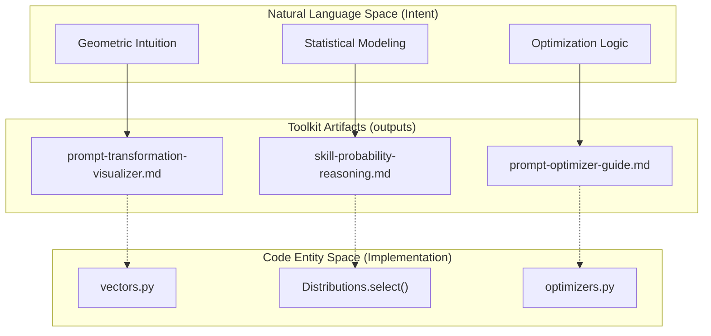
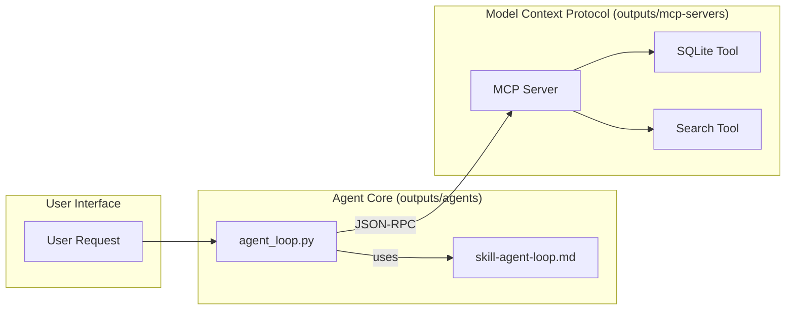

<!-- source: DeepWiki mcp.deepwiki.com · repo rohitg00/ai-engineering-from-scratch · page 8 Toolkit: Prompts, Skills, Agents & MCP Servers · fetched 2026-10-30 -->

# Toolkit: Prompts, Skills, Agents & MCP Servers

<details>
<summary>Relevant source files</summary>

The following files were used as context for generating this wiki page:

- [.gitignore](.gitignore)
- [README.md](README.md)
- [phases/13-tools-and-protocols/01-the-tool-interface/docs/en.md](phases/13-tools-and-protocols/01-the-tool-interface/docs/en.md)
- [phases/13-tools-and-protocols/06-mcp-fundamentals/outputs/skill-mcp-handshake-tracer.md](phases/13-tools-and-protocols/06-mcp-fundamentals/outputs/skill-mcp-handshake-tracer.md)
- [phases/13-tools-and-protocols/09-mcp-transports/assets/transports.svg](phases/13-tools-and-protocols/09-mcp-transports/assets/transports.svg)
- [phases/13-tools-and-protocols/09-mcp-transports/code/main.py](phases/13-tools-and-protocols/09-mcp-transports/code/main.py)
- [phases/13-tools-and-protocols/09-mcp-transports/docs/en.md](phases/13-tools-and-protocols/09-mcp-transports/docs/en.md)
- [phases/13-tools-and-protocols/09-mcp-transports/notebook/.gitkeep](phases/13-tools-and-protocols/09-mcp-transports/notebook/.gitkeep)
- [phases/13-tools-and-protocols/09-mcp-transports/outputs/skill-mcp-transport-migrator.md](phases/13-tools-and-protocols/09-mcp-transports/outputs/skill-mcp-transport-migrator.md)
- [phases/13-tools-and-protocols/10-mcp-resources-and-prompts/assets/primitive-split.svg](phases/13-tools-and-protocols/10-mcp-resources-and-prompts/assets/primitive-split.svg)
- [phases/13-tools-and-protocols/10-mcp-resources-and-prompts/code/main.py](phases/13-tools-and-protocols/10-mcp-resources-and-prompts/code/main.py)
- [phases/13-tools-and-protocols/10-mcp-resources-and-prompts/docs/en.md](phases/13-tools-and-protocols/10-mcp-resources-and-prompts/docs/en.md)
- [phases/13-tools-and-protocols/10-mcp-resources-and-prompts/notebook/.gitkeep](phases/13-tools-and-protocols/10-mcp-resources-and-prompts/notebook/.gitkeep)
- [phases/13-tools-and-protocols/10-mcp-resources-and-prompts/outputs/skill-primitive-splitter.md](phases/13-tools-and-protocols/10-mcp-resources-and-prompts/outputs/skill-primitive-splitter.md)
- [phases/13-tools-and-protocols/17-mcp-gateways-and-registries/docs/en.md](phases/13-tools-and-protocols/17-mcp-gateways-and-registries/docs/en.md)
- [phases/13-tools-and-protocols/19-a2a-protocol/code/main.py](phases/13-tools-and-protocols/19-a2a-protocol/code/main.py)
- [phases/13-tools-and-protocols/20-opentelemetry-genai/code/main.py](phases/13-tools-and-protocols/20-opentelemetry-genai/code/main.py)
- [phases/13-tools-and-protocols/21-llm-routing-layer/code/main.py](phases/13-tools-and-protocols/21-llm-routing-layer/code/main.py)
- [phases/13-tools-and-protocols/22-skills-and-agent-sdks/code/main.py](phases/13-tools-and-protocols/22-skills-and-agent-sdks/code/main.py)
- [phases/13-tools-and-protocols/23-capstone-tool-ecosystem/code/main.py](phases/13-tools-and-protocols/23-capstone-tool-ecosystem/code/main.py)
- [phases/13-tools-and-protocols/23-capstone-tool-ecosystem/docs/en.md](phases/13-tools-and-protocols/23-capstone-tool-ecosystem/docs/en.md)
- [site/app.js](site/app.js)
- [site/build.js](site/build.js)
- [site/catalog.html](site/catalog.html)
- [site/cmdpalette.js](site/cmdpalette.js)
- [site/data.js](site/data.js)
- [site/glossary.html](site/glossary.html)
- [site/header.js](site/header.js)
- [site/index.html](site/index.html)
- [site/lesson.html](site/lesson.html)
- [site/prereqs.html](site/prereqs.html)
- [site/progress.js](site/progress.js)
- [site/robots.txt](site/robots.txt)
- [site/stats.json](site/stats.json)
- [site/style.css](site/style.css)
- [vercel.json](vercel.json)

</details>


The **Toolkit** is the primary artifact-driven output of the "AI Engineering from Scratch" curriculum. Unlike traditional courses where the output is merely "knowledge," every lesson in this repository is designed to produce a reusable, standardized asset—a prompt, a skill, an agent, or a tool—stored in the root `outputs/` directory [README.md:22-26](). This page provides a high-level overview of these artifacts and how they compose into a functional AI engineering stack.

### The Artifact Ecosystem

The repository follows a strict "Ship It" phase in every lesson, where conceptual code is transformed into a portable format [README.md:110](). These artifacts are discovered and indexed by the site's build infrastructure [site/build.js:81-97]() and categorized into four types:

1.  **Prompts**: Structured Markdown files with YAML frontmatter containing system instructions for specific LLM behaviors (e.g., `prompt-attention-explainer.md`).
2.  **Skills**: Encapsulated logic or "mental models" that can be injected into an LLM's context to give it specific domain capabilities (e.g., `skill-probability-reasoning.md`).
3.  **Agents**: Definitions of autonomous loops that combine prompts, memory, and tool-calling capabilities (e.g., `agent_loop.py`).
4.  **MCP Servers**: Implementations of the Model Context Protocol, allowing LLMs to securely interact with local or remote data and tools via JSON-RPC.

### Natural Language Space to Code Entity Space

The following diagram illustrates how high-level mathematical and engineering concepts are bridged into concrete code artifacts within the Toolkit.

**Toolkit Mapping: Concepts to Code**

Sources: [site/data.js:126-127](), [site/cmdpalette.js:81-97]()

---

### Prompts & Skills Catalog

Prompts and Skills represent the "knowledge" layer of the Toolkit. They are stored in lesson-specific `outputs/` folders and aggregated into the global `ARTIFACTS` constant [site/data.js:1-3]().

- **Prompts** (e.g., `prompt-*.md`) focus on persona and output formatting, such as the `prompt-attention-explainer` which guides an LLM through the mechanics of Query, Key, and Value matrices.
- **Skills** (e.g., `skill-*.md`) provide decision frameworks and checklists, such as the `skill-probability-reasoning` which provides a distribution decision tree for ML modeling.

Both formats use a standardized YAML header for discovery by the `discoverArtifacts` logic in the build system [site/cmdpalette.js:81-97]():
```yaml
name: skill-probability-reasoning
description: Choose the right probability distribution for a given ML problem
phase: 1
lesson: 6
tags: [probability, distributions, modeling]
```

For a full directory of available prompts and skills, see [Prompts & Skills Catalog](#8.1).

---

### Agents & MCP Servers

As the curriculum progresses into Phase 13 (Tools & Protocols) and Phase 14 (Agent Engineering), the Toolkit shifts from static prompts to dynamic systems [README.md:72-73]().

- **Agents**: These are located in `outputs/agents/` and define the execution logic for autonomous loops. They utilize the "Agent Loop" pattern (Think → Act → Observe) to solve multi-step problems [site/app.js:56-58]().
- **MCP Servers**: Located in `outputs/mcp-servers/`, these implement the Model Context Protocol. They act as the "hands" of the AI, providing a standardized JSON-RPC interface for tools like database connectors or local file manipulators [site/index.html:58-59]().

The relationship between these components is governed by the `outputs/index.json` manifest, which tracks versions and dependencies across the entire toolkit.

**System Architecture: Agent-MCP Integration**

Sources: [README.md:105-111](), [site/data.js:72-73]()

For implementation details and protocol specifications, see [Agents & MCP Servers](#8.2).

---
**Sources:**
- [README.md:22-26]() (Toolkit purpose and structure)
- [README.md:103-111]() (Ship It phase and lesson beats)
- [site/data.js:1-100]() (Artifact aggregation and phase data)
- [site/cmdpalette.js:81-97]() (Artifact discovery and indexing logic)
- [site/build.js:23-28]() (Path resolution for artifacts)

---

