# Page: Overview: AI Engineering from Scratch

# Overview: AI Engineering from Scratch

<details>
<summary>Relevant source files</summary>

The following files were used as context for generating this wiki page:

- [.github/workflows/curriculum.yml](.github/workflows/curriculum.yml)
- [.gitignore](.gitignore)
- [AGENTS.md](AGENTS.md)
- [README.md](README.md)
- [phases/14-agent-engineering/15-crewai-role-based-crews/code/main.py](phases/14-agent-engineering/15-crewai-role-based-crews/code/main.py)
- [phases/14-agent-engineering/15-crewai-role-based-crews/docs/en.md](phases/14-agent-engineering/15-crewai-role-based-crews/docs/en.md)
- [scripts/_lib.py](scripts/_lib.py)
- [scripts/build_catalog.py](scripts/build_catalog.py)
- [scripts/check_readme_counts.py](scripts/check_readme_counts.py)
- [scripts/install_skills.py](scripts/install_skills.py)
- [site/app.js](site/app.js)
- [site/build.js](site/build.js)
- [site/catalog.html](site/catalog.html)
- [site/cmdpalette.js](site/cmdpalette.js)
- [site/data.js](site/data.js)
- [site/glossary.html](site/glossary.html)
- [site/header.js](site/header.js)
- [site/index.html](site/index.html)
- [site/lesson.html](site/lesson.html)
- [site/prereqs.html](site/prereqs.html)
- [site/progress.js](site/progress.js)
- [site/robots.txt](site/robots.txt)
- [site/stats.json](site/stats.json)
- [site/style.css](site/style.css)
- [vercel.json](vercel.json)

</details>


The **AI Engineering from Scratch** repository is a comprehensive, code-first curriculum designed to take engineers from mathematical foundations to building autonomous multi-agent swarms. Unlike traditional courses that rely heavily on high-level frameworks, this program mandates building every core component from first principles before transitioning to industry-standard libraries.

The mission is to transform "AI users" into "AI engineers" who understand the underlying mechanics of tensors, gradients, transformers, and agentic loops [README.md:19-26](). Every lesson in the 20-phase roadmap results in a functional, reusable artifact—a **Toolkit** of prompts, skills, and agents that form a professional portfolio [README.md:38-41]().

### Core Philosophy: The 6-Step Lesson Lifecycle
Each of the 503 lessons follows a strict pedagogical structure:
1.  **MOTTO**: A one-line core intuition [README.md:106]().
2.  **PROBLEM**: Concrete pain or bottleneck if the concept is ignored [README.md:106]().
3.  **CONCEPT**: Mental models, diagrams, and intuition [README.md:107]().
4.  **BUILD IT**: Step-by-step implementation from raw math, no frameworks [README.md:108]().
5.  **USE IT**: Mapping the "from-scratch" version to production libraries like PyTorch or Scikit-Learn [README.md:109]().
6.  **SHIP IT**: Exporting a reusable artifact (prompt, skill, agent, or MCP server) [README.md:110]().

---

## Curriculum Roadmap & Progress Tracking
The curriculum is organized into 20 logical phases, spanning the entire stack of modern AI. Progress is tracked in the codebase through a central registry and visualized on the web platform.

*   **Phases 0-2 (Foundations)**: Environment setup, Linear Algebra, Calculus, and Classical Machine Learning (Linear/Logistic Regression, SVMs, Trees) [README.md:60-62]().
*   **Phases 3-9 (Deep Learning & Modalities)**: Neural network internals, Computer Vision, NLP, Speech, and Reinforcement Learning [README.md:63-66]().
*   **Phases 10-20 (The Frontier)**: LLM Pre-training, Vector DBs, RAG, Agent Engineering, and Multi-Agent Swarms [README.md:69-78]().

For a detailed breakdown of all 503 lessons and current completion status (✅/🚧/⬚), see **[Curriculum Roadmap & Progress Tracking](#1.1)**.

---

## Lesson Structure & Toolkit Output System
The repository serves as a factory for AI utilities. Every lesson directory follows a standardized layout to ensure portability and clarity [README.md:91-97]().

### Lesson Directory Layout
```text
phases/<NN>-<phase-name>/<NN>-<lesson-name>/
├── code/      # Runnable implementations (Python, TypeScript, Rust, Julia)
├── docs/      # Lesson narrative (en.md)
└── outputs/   # Prompts, skills, agents, or MCP servers this lesson produces
```
Sources: [README.md:92-97]()

### The Toolkit
The ultimate goal of the curriculum is the root `outputs/` directory. This is a centralized collection of:
*   **Prompts**: System instructions and templates (e.g., `prompt-attention-explainer.md`).
*   **Skills**: Executable logic or reasoning patterns (e.g., `skill-tokenizer.md`).
*   **Agents & MCP Servers**: Autonomous entities and Model Context Protocol servers [README.md:22-23]().

The site infrastructure uses `site/build.js` to automatically discover these artifacts and index them in `site/data.js` for the web catalog [site/build.js:231-245]().

For details on the directory standards and how to use the generated artifacts, see **[Lesson Structure & Toolkit Output System](#1.2)**.

---

## Bridging Natural Language to Code
The following diagrams illustrate how the conceptual "Natural Language Space" of the curriculum maps directly to "Code Entity Space" through specific implementations.

### Diagram 1: From Math Intuition to Autodiff Engine
This diagram shows how Phase 1 mathematical concepts manifest as the foundational `Value` class used for backpropagation.

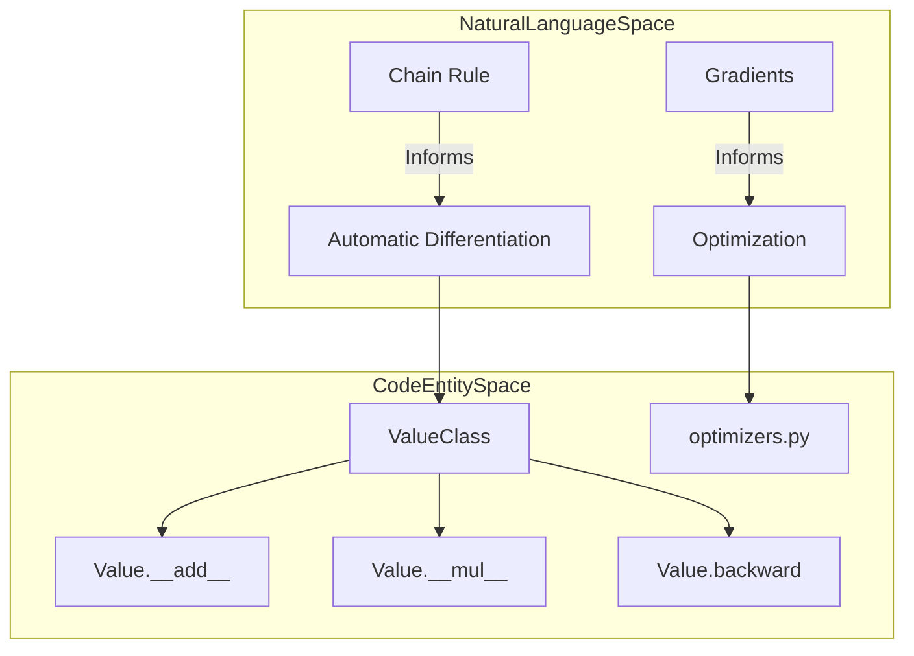
Sources: [README.md:38-41](), [site/data.js:111-117]()

### Diagram 2: The Agentic Loop System
This diagram maps the high-level "Agent" concept to the specific multi-language implementations and artifacts produced in Phase 14.

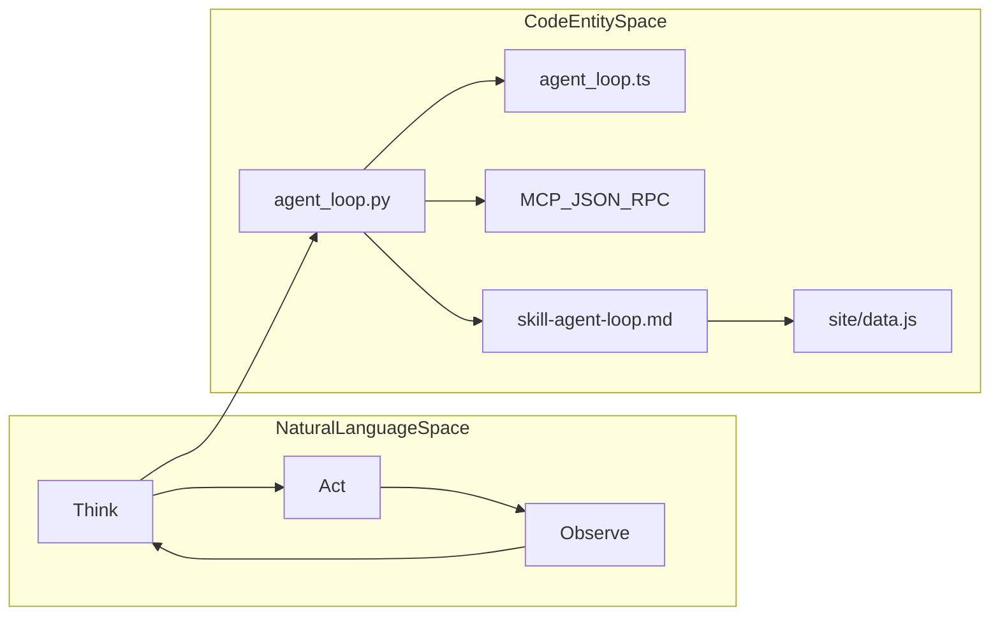
Sources: [README.md:105-111](), [site/data.js:2-4]()

---

## Contributing & Community Guidelines
This is an open-source project designed for extensibility. The repository includes CI/CD automation via GitHub Actions to ensure lesson consistency and metadata synchronization [curriculum.yml:1-32]().

*   **Automation**: The `readme-counts-sync` job ensures that the lesson counts in the main `README.md` match the actual file structure [curriculum.yml:46-63]().
*   **Site Generation**: The `site-rebuild` job triggers `node site/build.js` to refresh the interactive catalog whenever the curriculum changes [curriculum.yml:100-113]().
*   **Standards**: Contributors must follow the directory structure and "Ship It" artifact requirements to pass the `audit_lessons.py` invariant checks [curriculum.yml:33-44]().

For instructions on how to submit a PR or set up your fork, see **[Contributing & Community Guidelines](#1.3)**.

---

## Navigation Links
*   **[Curriculum Roadmap & Progress Tracking](#1.1)**: The full 20-phase schedule.
*   **[Lesson Structure & Toolkit Output System](#1.2)**: How we build and ship artifacts.
*   **[Contributing & Community Guidelines](#1.3)**: How to join the mission.

Sources: [README.md:1-40](), [site/data.js:1-10](), [.github/workflows/curriculum.yml:1-45]()

---

# Page: Curriculum Roadmap & Progress Tracking

# Curriculum Roadmap & Progress Tracking

<details>
<summary>Relevant source files</summary>

The following files were used as context for generating this wiki page:

- [.gitignore](.gitignore)
- [README.md](README.md)
- [ROADMAP.md](ROADMAP.md)
- [phases/13-tools-and-protocols/18-mcp-auth-production/assets/auth-flow.svg](phases/13-tools-and-protocols/18-mcp-auth-production/assets/auth-flow.svg)
- [phases/13-tools-and-protocols/18-mcp-auth-production/code/main.py](phases/13-tools-and-protocols/18-mcp-auth-production/code/main.py)
- [phases/13-tools-and-protocols/18-mcp-auth-production/docs/en.md](phases/13-tools-and-protocols/18-mcp-auth-production/docs/en.md)
- [phases/13-tools-and-protocols/18-mcp-auth-production/notebook/.gitkeep](phases/13-tools-and-protocols/18-mcp-auth-production/notebook/.gitkeep)
- [phases/13-tools-and-protocols/18-mcp-auth-production/outputs/skill-mcp-auth.md](phases/13-tools-and-protocols/18-mcp-auth-production/outputs/skill-mcp-auth.md)
- [phases/16-multi-agent-and-swarms/03-communication-protocols/code/main.ts](phases/16-multi-agent-and-swarms/03-communication-protocols/code/main.ts)
- [phases/16-multi-agent-and-swarms/03-communication-protocols/docs/en.md](phases/16-multi-agent-and-swarms/03-communication-protocols/docs/en.md)
- [phases/16-multi-agent-and-swarms/03-communication-protocols/outputs/prompt-protocol-selector.md](phases/16-multi-agent-and-swarms/03-communication-protocols/outputs/prompt-protocol-selector.md)
- [site/app.js](site/app.js)
- [site/build.js](site/build.js)
- [site/catalog.html](site/catalog.html)
- [site/cmdpalette.js](site/cmdpalette.js)
- [site/data.js](site/data.js)
- [site/glossary.html](site/glossary.html)
- [site/header.js](site/header.js)
- [site/index.html](site/index.html)
- [site/lesson.html](site/lesson.html)
- [site/prereqs.html](site/prereqs.html)
- [site/progress.js](site/progress.js)
- [site/robots.txt](site/robots.txt)
- [site/stats.json](site/stats.json)
- [site/style.css](site/style.css)
- [vercel.json](vercel.json)

</details>


This page provides a comprehensive technical breakdown of the 20-phase curriculum within the `ai-engineering-from-scratch` repository. It tracks the evolution from fundamental mathematical operations to the deployment of autonomous multi-agent systems. Each phase is designed to produce reusable artifacts—collectively known as the **Toolkit**—ensuring that theoretical knowledge is immediately converted into engineering utility.

## The Learning Arc

The curriculum follows a "Bottom-Up" engineering philosophy. It starts by implementing the basic primitives of intelligence (Linear Algebra, Calculus) before moving into classical Machine Learning, Deep Learning, and eventually Large Language Models (LLMs) and Agents [README.md:31-46](). The total curriculum encompasses 503 lessons across 20 phases [ROADMAP.md:7-9]().

### System Evolution Diagram
The following diagram illustrates how low-level code entities from early phases compose into the complex systems found in later phases.

**Data Flow: From Math Primitives to Autonomous Agents**
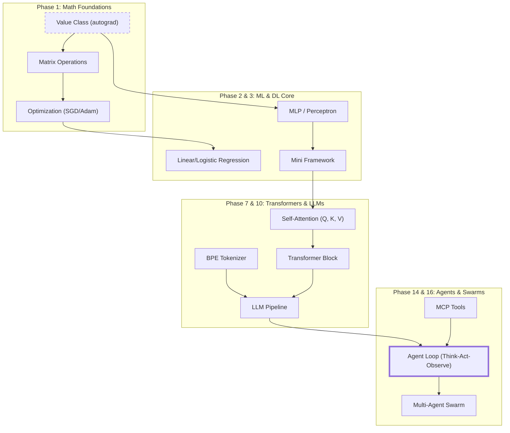
Sources: [README.md:57-81](), [ROADMAP.md:28-95](), [site/data.js:4-133]()

---

## Phase Breakdown & Status

The repository uses a standardized status legend in `ROADMAP.md`:
*   ✅ **Complete**: Implementation, documentation, and toolkit outputs are finished.
*   🚧 **In Progress**: Core logic exists, but documentation or auxiliary languages may be missing.
*   ⬚ **Planned**: Curriculum defined but implementation has not yet begun.

### Phase 0: Setup & Tooling (✅ Complete)
**Lessons: 12**
Focuses on the infrastructure required for high-performance AI development [ROADMAP.md:11-26]().
*   **Key Entities**: `uv` for Python environments [site/data.js:61-63](), `Docker` for AI containers [site/data.js:70-72](), and `datasets` library for data management [site/data.js:88-90]().
*   **Output**: A verified developer environment capable of running Python, Rust, and Julia.

### Phase 1: Math Foundations (✅ Complete)
**Lessons: 22**
The bedrock of the curriculum. Every algorithm is implemented from scratch to remove "black box" abstractions [ROADMAP.md:28-53]().
*   **Key Entities**: 
    *   `Value` class: A scalar-valued autograd engine for chain rule and automatic differentiation [ROADMAP.md:36]().
    *   `Gradient Descent Family`: Implementation of core optimization algorithms [ROADMAP.md:39]().
*   **Toolkit Outputs**: `PCA`, `SVD`, and `Information Theory` utilities [ROADMAP.md:40-42]().

### Phase 2: ML Fundamentals (✅ Complete)
**Lessons: 18**
Classical machine learning algorithms that remain the workhorses of production AI [ROADMAP.md:55-76]().
*   **Key Entities**: `LinearRegression`, `DecisionTree`, `SVM`, and `NaiveBayes` classes [ROADMAP.md:60-72]().
*   **Focus**: Bias-variance tradeoff, feature engineering, and cross-validation pipelines [ROADMAP.md:66-68]().

### Phase 3: Deep Learning Core (✅ Complete)
**Lessons: 13**
Transitioning from classical ML to neural networks [ROADMAP.md:78-95]().
*   **Key Entities**: `The Perceptron`, `Multi-Layer Networks`, and `Backpropagation from Scratch` [ROADMAP.md:82-84]().
*   **Logic**: Building a mini framework to understand `PyTorch` and `JAX` internals [ROADMAP.md:91-93]().

### Phase 4-6: Modality Foundations (✅ Complete)
**Lessons: 28 (Vision), 29 (NLP), 17 (Audio)**
*   **Vision**: `CNNs`, `YOLO`, `U-Net`, and `Diffusion Models` [ROADMAP.md:96-127]().
*   **NLP**: `Word2Vec`, `Seq2Seq`, and the `Attention Mechanism` [ROADMAP.md:129-165]().
*   **Audio**: `Spectrograms`, `Whisper`, and `TTS` [ROADMAP.md:167-185]().

### Phase 14-16: Agent Engineering & Swarms (🚧 In Progress)
**Lessons: 42 (Agent Workbench), 10 (Swarms)**
Moving from static inference to dynamic reasoning loops and multi-agent coordination [ROADMAP.md:328-390]().
*   **Key Entities**: `Agent Loop` (Think-Act-Observe) [README.md:103-111]().
*   **Logic**: Integration with `MCP` (Model Context Protocol) for tool usage [ROADMAP.md:315-326]().

Sources: [ROADMAP.md:7-450](), [site/data.js:4-133](), [README.md:31-81]()

---

## Curriculum Logic: From Math to Code
This diagram bridges the "Natural Language" conceptual space to the "Code Entity" space by showing how mathematical concepts map to specific files and classes in the repository.

**Mapping Concepts to Code Entities**
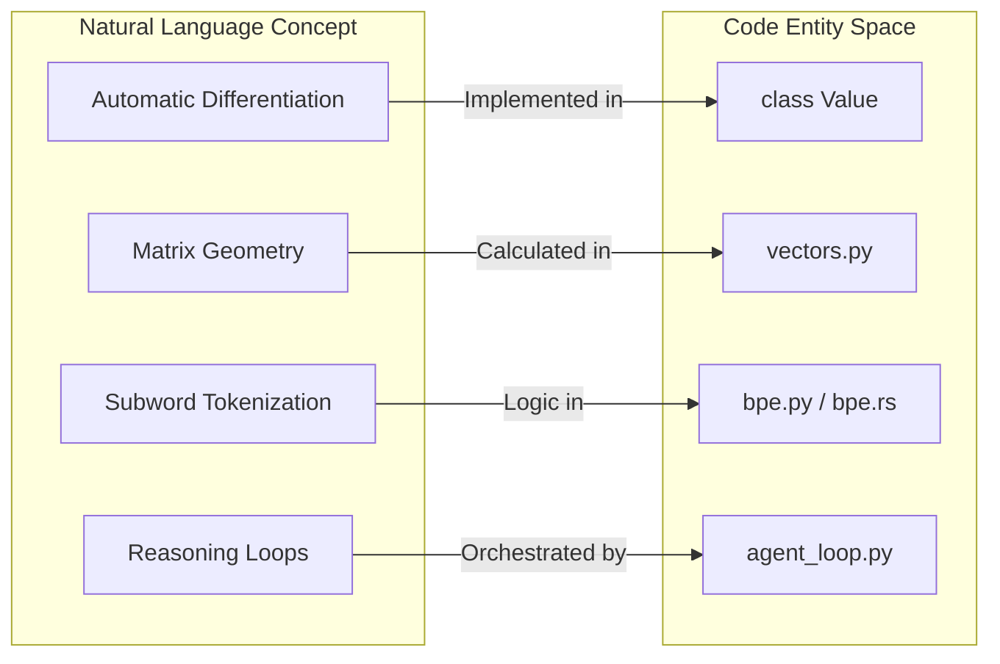
Sources: [README.md:126](), [ROADMAP.md:36](), [ROADMAP.md:133](), [ROADMAP.md:213](), [ROADMAP.md:330]()

---

## Roadmap Summary Table

| Phase | Title | Lessons | Status | Key Artifacts |
| :--- | :--- | :---: | :---: | :--- |
| 0 | Setup & Tooling | 12 | ✅ | `uv`, `Docker`, `verify.py` |
| 1 | Math Foundations | 22 | ✅ | `Value` (Autograd), `SVD`, `PCA` |
| 2 | ML Fundamentals | 18 | ✅ | `RandomForest`, `SVM`, `K-Means` |
| 3 | Deep Learning Core | 13 | ✅ | `Backprop`, `Mini-Framework` |
| 4 | Computer Vision | 28 | ✅ | `YOLO`, `Diffusion`, `SAM 3` |
| 5 | NLP Foundations | 29 | ✅ | `Word2Vec`, `Attention`, `RAG` |
| 7 | Transformers | 14 | ✅ | `Self-Attention`, `FlashAttention` |
| 10 | LLMs from Scratch | 15 | ✅ | `BPE Tokenizer`, `SFT`, `DPO` |
| 11 | LLM Engineering | 17 | ✅ | `LoRA`, `Function Calling` |
| 14 | Agent Engineering | 42 | 🚧 | `AgentLoop`, `Workbench` |
| 16 | Multi-Agent Swarms | 10 | 🚧 | `Communication Protocols` |
| 19 | Capstone Projects | 87 | 🚧 | `SWE-bench Agent`, `GPT-from-scratch` |

Sources: [ROADMAP.md:7-450](), [site/data.js:4-133]()

---

# Page: Lesson Structure & Toolkit Output System

# 1.2 Lesson Structure & Toolkit Output System

<details>
<summary>Relevant source files</summary>

The following files were used as context for generating this wiki page:

- [.github/workflows/curriculum.yml](.github/workflows/curriculum.yml)
- [.gitignore](.gitignore)
- [AGENTS.md](AGENTS.md)
- [README.md](README.md)
- [phases/14-agent-engineering/15-crewai-role-based-crews/code/main.py](phases/14-agent-engineering/15-crewai-role-based-crews/code/main.py)
- [phases/14-agent-engineering/15-crewai-role-based-crews/docs/en.md](phases/14-agent-engineering/15-crewai-role-based-crews/docs/en.md)
- [scripts/_lib.py](scripts/_lib.py)
- [scripts/build_catalog.py](scripts/build_catalog.py)
- [scripts/check_readme_counts.py](scripts/check_readme_counts.py)
- [scripts/install_skills.py](scripts/install_skills.py)
- [site/app.js](site/app.js)
- [site/build.js](site/build.js)
- [site/catalog.html](site/catalog.html)
- [site/cmdpalette.js](site/cmdpalette.js)
- [site/data.js](site/data.js)
- [site/glossary.html](site/glossary.html)
- [site/header.js](site/header.js)
- [site/index.html](site/index.html)
- [site/lesson.html](site/lesson.html)
- [site/prereqs.html](site/prereqs.html)
- [site/progress.js](site/progress.js)
- [site/robots.txt](site/robots.txt)
- [site/stats.json](site/stats.json)
- [site/style.css](site/style.css)
- [vercel.json](vercel.json)

</details>


This page defines the architectural standards for lessons within the `ai-engineering-from-scratch` repository. It covers the standardized directory layout, the pedagogical "6-step lifecycle" used to transition from theory to production-ready code, and the **Toolkit** system—a mechanism that ensures every lesson contributes a reusable artifact (Prompts, Skills, Agents, or MCP Servers) to a centralized library.

## Lesson Directory Layout

Every lesson follows a strict structural contract to ensure consistency across the 503 planned modules [README.md:22-23](). This structure separates implementation code from human-readable documentation and the resulting toolkit outputs.

```text
phases/XX-phase-name/YY-lesson-name/
├── code/                # Primary implementation (Python, TS, Rust, or Julia)
│   ├── main.py          # Entry point for the from-scratch build
│   └── requirements.txt # Dependencies specific to this lesson
├── notebook/            # Interactive experimentation (Optional)
│   └── lesson.ipynb     # Jupyter notebook for visualization/exploration
├── docs/                # Human-readable documentation
│   └── en.md            # The "Source of Truth" for the lesson content
└── outputs/             # Toolkit artifacts generated by this lesson
    ├── prompt-*.md      # Reusable LLM system prompts
    └── skill-*.md       # Executable or reference "skills"
```

The `site/build.js` script specifically looks for these patterns to generate the curriculum website, extracting metadata from the `docs/en.md` and `code/` directories [site/build.js:233-255]().

**Sources:** [README.md:87-97](), [site/build.js:23-28](), [site/build.js:233-255]()

---

## The 6-Step Lesson Lifecycle

The curriculum rejects passive learning. Every lesson is structured around a "Build-First" philosophy, moving through six distinct stages defined in the narrative documentation [README.md:99-111]().

| Step | Name | Purpose |
| :--- | :--- | :--- |
| **1** | **MOTTO** | A one-line core idea that serves as a mental anchor. |
| **2** | **PROBLEM** | Defines a concrete pain point. What is difficult without this concept? |
| **3** | **CONCEPT** | Intuition-building using diagrams and mental models. |
| **4** | **BUILD IT** | Step-by-step, from-scratch implementation using raw math/logic. |
| **5** | **USE IT** | Running the same task using production libraries (e.g., PyTorch, vLLM). |
| **6** | **SHIP IT** | Producing a reusable artifact (Prompt, Skill, Agent, or MCP). |

This lifecycle ensures that by the time a student uses a framework like PyTorch, they already understand the underlying mechanics because they implemented them in the "Build It" phase [README.md:38-41]().

**Sources:** [README.md:99-111](), [README.md:31-41]()

---

## The Toolkit Output System

The primary goal of the repository is to build a **Toolkit**—a collection of production-ready assets that can be used in external projects or AI-enhanced development environments like Claude Code or Cursor [README.md:129-134]().

### Artifact Types

Lessons produce four primary types of artifacts indexed by the system:

1.  **Prompts (`prompt-*.md`)**: System instructions with YAML frontmatter.
2.  **Skills (`skill-*.md`)**: Structured knowledge or executable patterns.
3.  **Agents**: Autonomous loops, such as the `agent_loop.py` found in Phase 14 [README.md:150-155]().
4.  **MCP Servers**: Implementations of the **Model Context Protocol** (Phase 13) to provide LLMs with tool access [README.md:72-73]().

### Data Flow: From Lesson to Toolkit

The following diagram illustrates how a lesson's internal implementation flows into the global Toolkit ecosystem via automation scripts.

**Lesson-to-Toolkit Data Flow**
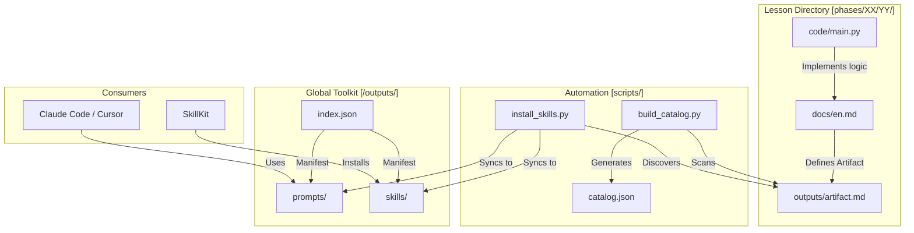
**Sources:** [site/build.js:1-9](), [scripts/build_catalog.py:1-10](), [scripts/install_skills.py:1-15]()

---

## Technical Implementation of Artifacts

Artifacts must follow a specific schema to be compatible with the repository's indexing tools, such as `scripts/build_catalog.py`.

### Metadata Schema
Both Prompts and Skills use Markdown files with a YAML header. This header is parsed by `scripts/_lib.py` to categorize the artifact within the curriculum roadmap.

```markdown
---
name: prompt-attention-explainer
description: Visualizes self-attention matrices
phase: 7
lesson: 2
tags: [transformers, visualization]
---
# [Content follows...]
```

### Automation & Invariants
The repository uses GitHub Actions (`.github/workflows/curriculum.yml`) to ensure the integrity of the Toolkit:
*   **Audit Job**: Runs `scripts/audit_lessons.py` to check for "Lesson Contract" invariants [curriculum.yml:33-44]().
*   **Sync Job**: Runs `scripts/check_readme_counts.py` to ensure the `README.md` lesson counts match the physical files [curriculum.yml:46-63]().
*   **Site Rebuild**: Automatically updates `site/data.js` so the web interface reflects new artifacts [curriculum.yml:100-113]().

**Sources:** [.github/workflows/curriculum.yml:33-113](), [site/build.js:134-169](), [scripts/_lib.py:1-10]()

---

## Artifact Relationship Map

This diagram bridges the conceptual "Lesson Space" with the physical "Code Entity Space," showing how specific files in the repository represent different stages of the Toolkit output.

**Entity Mapping: Theory to Artifact**
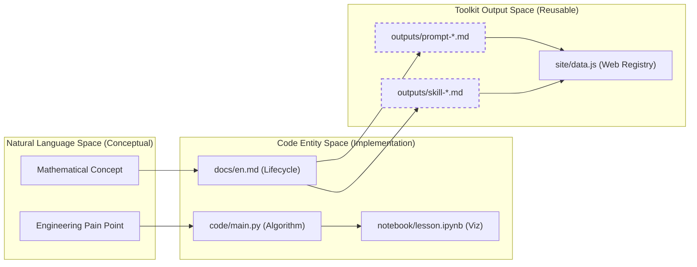

**Sources:** [README.md:87-111](), [site/data.js:4-10](), [site/build.js:18-21]()

---

# Page: Contributing & Community Guidelines

# Contributing & Community Guidelines

<details>
<summary>Relevant source files</summary>

The following files were used as context for generating this wiki page:

- [.github/workflows/curriculum.yml](.github/workflows/curriculum.yml)
- [AGENTS.md](AGENTS.md)
- [CODE_OF_CONDUCT.md](CODE_OF_CONDUCT.md)
- [CONTRIBUTING.md](CONTRIBUTING.md)
- [FORKING.md](FORKING.md)
- [assets/banner.svg](assets/banner.svg)
- [phases/14-agent-engineering/15-crewai-role-based-crews/code/main.py](phases/14-agent-engineering/15-crewai-role-based-crews/code/main.py)
- [phases/14-agent-engineering/15-crewai-role-based-crews/docs/en.md](phases/14-agent-engineering/15-crewai-role-based-crews/docs/en.md)
- [scripts/_lib.py](scripts/_lib.py)
- [scripts/build_catalog.py](scripts/build_catalog.py)
- [scripts/check_readme_counts.py](scripts/check_readme_counts.py)
- [scripts/install_skills.py](scripts/install_skills.py)

</details>


This page outlines the technical and social frameworks for participating in the `ai-engineering-from-scratch` project. It covers the standardized lesson architecture, the automated CI/CD validation gates, forking strategies, and the community standards that govern all interactions.

## Contribution Architecture

Contributing to the repository involves adhering to a strict directory structure and the "Lesson Contract" to ensure the automated build systems can parse and verify content.

### 1. Lesson Directory Structure
Every new lesson must be contained within a specific phase directory following the naming convention `phases/NN-phase-slug/MM-lesson-slug/` [AGENTS.md:18-20]().

| Directory | Requirement | Description |
| :--- | :--- | :--- |
| `code/` | **Required** | Implementation + tests. Must run end-to-end and exit 0 [AGENTS.md:22, 102-106](). |
| `docs/en.md` | **Required** | The lesson explainer with mandatory YAML frontmatter [AGENTS.md:21, 65-79](). |
| `quiz.json` | **Required** | Exactly 6 questions (1 pre, 3 check, 2 post) following a specific schema [AGENTS.md:23, 83-98](). |
| `outputs/` | Optional | Reusable artifacts like `skill-*.md`, `prompt-*.md`, or `agent-*.md` [AGENTS.md:24](). |

### 2. The Lesson Contract
The project enforces a standardized documentation lifecycle and metadata format to maintain curriculum coherence [AGENTS.md:5-6, 63]().

*   **Frontmatter**: Must include `Type` (Learn/Build/Reference), `Languages` (matching `main.*` files in `code/`), `Prerequisites`, and `Time` [AGENTS.md:65-81]().
*   **Structure**: Documentation follows the Motto → Problem → Concept → Build It → Use It → Ship It flow [CONTRIBUTING.md:42-65]().
*   **Testing**: `code/tests/` must contain a minimum of 5 unit tests using the language's standard runner [AGENTS.md:108-111]().

### 3. Hard Rules for Contributors
*   **One commit per lesson**: Never batch multiple lessons. A 10-lesson PR must have 10 commits [AGENTS.md:40]().
*   **Conventional Commits**: Use `feat(phase-NN/MM): <slug>` [AGENTS.md:41]().
*   **Dependency Allowlist**: Stick to the approved list (e.g., `numpy`, `torch` for Python; `hono`, `zod` for TS). Use stdlib-first whenever possible [AGENTS.md:50-59]().
*   **No AI Slop**: Write direct, human prose. Cut filler [CONTRIBUTING.md:143]().

**Sources:** [AGENTS.md:18-111](), [CONTRIBUTING.md:42-143]()

---

## Technical Workflow & Automation

The repository uses an automated lifecycle to sync lesson counts and rebuild the site manifest.

### Curriculum Data Flow
This diagram illustrates how a local contribution moves through the automated `curriculum.yml` workflow to update the system state.

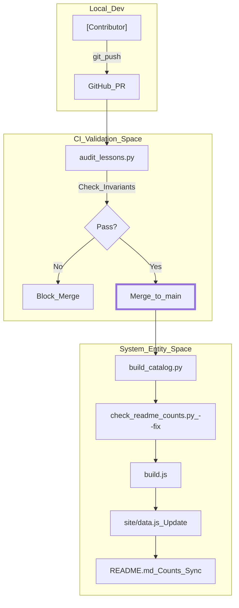

**Sources:** [.github/workflows/curriculum.yml:32-148](), [scripts/build_catalog.py:6-43](), [scripts/check_readme_counts.py:7-15]()

### Automated Maintenance
The following files are managed by CI and should **not** be edited manually in PRs [AGENTS.md:141-148]():
*   `catalog.json`: The machine-readable truth of the repo [scripts/build_catalog.py:2-8]().
*   `README.md` counts: Auto-synced by `check_readme_counts.py` [scripts/check_readme_counts.py:9-10]().
*   `site/data.js`: Rebuilt by `site/build.js` on every push to main [AGENTS.md:147]().

---

## Forking & Adaptation Strategies

The repository is MIT licensed, enabling various adaptation paths for different audiences [FORKING.md:3]().

| Audience | Strategy | Key Action |
| :--- | :--- | :--- |
| **Teams** | Internal Training | Add company-specific examples and internal tool integrations [FORKING.md:5-13](). |
| **Schools** | Academic Course | Map phases to semesters and add grading rubrics [FORKING.md:15-23](). |
| **Bootcamps** | Professional Training | Add video content and live sessions; structure for cohort timelines [FORKING.md:25-32](). |
| **Translators** | Localization | Create `docs/XX.md` in lesson folders while keeping code intact [CONTRIBUTING.md:74-89](). |

**Sources:** [FORKING.md:1-60](), [CONTRIBUTING.md:74-89]()

---

## Community Standards & Enforcement

The project follows the **Contributor Covenant 2.1** to ensure a harassment-free experience [CODE_OF_CONDUCT.md:30]().

### Behavioral Mapping
This diagram maps behavioral expectations to the project's enforcement mechanisms.

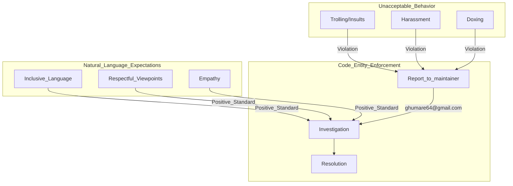

### Implementation Principles
*   **Build from Scratch First**: Always implement the math/logic manually before using a framework (the `Build It` vs `Use It` split) [AGENTS.md:11, CONTRIBUTING.md:141]().
*   **No Comments in Code**: Code should be self-explanatory; documentation belongs in `docs/en.md` [CONTRIBUTING.md:139]().
*   **Best Tool for the Job**: Use the language (Python, TS, Rust, Julia) that best fits the engineering task [CONTRIBUTING.md:140]().

**Sources:** [CODE_OF_CONDUCT.md:1-31](), [CONTRIBUTING.md:136-164](), [AGENTS.md:9-12]()

---

# Page: Phase 0: Development Environment & Tooling

# Phase 0: Development Environment & Tooling

<details>
<summary>Relevant source files</summary>

The following files were used as context for generating this wiki page:

- [phases/00-setup-and-tooling/01-dev-environment/code/verify.py](phases/00-setup-and-tooling/01-dev-environment/code/verify.py)
- [phases/00-setup-and-tooling/01-dev-environment/docs/en.md](phases/00-setup-and-tooling/01-dev-environment/docs/en.md)
- [phases/00-setup-and-tooling/01-dev-environment/outputs/prompt-env-check.md](phases/00-setup-and-tooling/01-dev-environment/outputs/prompt-env-check.md)
- [phases/00-setup-and-tooling/01-dev-environment/quiz.json](phases/00-setup-and-tooling/01-dev-environment/quiz.json)
- [phases/00-setup-and-tooling/02-git-and-collaboration/docs/en.md](phases/00-setup-and-tooling/02-git-and-collaboration/docs/en.md)
- [phases/00-setup-and-tooling/04-apis-and-keys/code/first_api_call.py](phases/00-setup-and-tooling/04-apis-and-keys/code/first_api_call.py)
- [phases/00-setup-and-tooling/04-apis-and-keys/docs/en.md](phases/00-setup-and-tooling/04-apis-and-keys/docs/en.md)
- [phases/00-setup-and-tooling/04-apis-and-keys/outputs/prompt-api-troubleshooter.md](phases/00-setup-and-tooling/04-apis-and-keys/outputs/prompt-api-troubleshooter.md)
- [phases/00-setup-and-tooling/05-jupyter-notebooks/code/notebook_tips.py](phases/00-setup-and-tooling/05-jupyter-notebooks/code/notebook_tips.py)
- [phases/00-setup-and-tooling/05-jupyter-notebooks/docs/en.md](phases/00-setup-and-tooling/05-jupyter-notebooks/docs/en.md)
- [phases/00-setup-and-tooling/05-jupyter-notebooks/outputs/prompt-notebook-helper.md](phases/00-setup-and-tooling/05-jupyter-notebooks/outputs/prompt-notebook-helper.md)
- [phases/00-setup-and-tooling/06-python-environments/code/env_setup.sh](phases/00-setup-and-tooling/06-python-environments/code/env_setup.sh)
- [phases/00-setup-and-tooling/06-python-environments/docs/en.md](phases/00-setup-and-tooling/06-python-environments/docs/en.md)
- [phases/00-setup-and-tooling/07-docker-for-ai/code/Dockerfile](phases/00-setup-and-tooling/07-docker-for-ai/code/Dockerfile)
- [phases/00-setup-and-tooling/07-docker-for-ai/code/docker-compose.yml](phases/00-setup-and-tooling/07-docker-for-ai/code/docker-compose.yml)
- [phases/00-setup-and-tooling/07-docker-for-ai/docs/en.md](phases/00-setup-and-tooling/07-docker-for-ai/docs/en.md)
- [phases/00-setup-and-tooling/08-editor-setup/code/vscode/extensions.json](phases/00-setup-and-tooling/08-editor-setup/code/vscode/extensions.json)
- [phases/00-setup-and-tooling/08-editor-setup/code/vscode/settings.json](phases/00-setup-and-tooling/08-editor-setup/code/vscode/settings.json)
- [phases/00-setup-and-tooling/08-editor-setup/docs/en.md](phases/00-setup-and-tooling/08-editor-setup/docs/en.md)
- [phases/00-setup-and-tooling/09-data-management/code/data_utils.py](phases/00-setup-and-tooling/09-data-management/code/data_utils.py)
- [phases/00-setup-and-tooling/09-data-management/docs/en.md](phases/00-setup-and-tooling/09-data-management/docs/en.md)
- [phases/00-setup-and-tooling/09-data-management/outputs/prompt-data-helper.md](phases/00-setup-and-tooling/09-data-management/outputs/prompt-data-helper.md)
- [phases/00-setup-and-tooling/10-terminal-and-shell/code/shell_aliases.sh](phases/00-setup-and-tooling/10-terminal-and-shell/code/shell_aliases.sh)
- [phases/00-setup-and-tooling/10-terminal-and-shell/docs/en.md](phases/00-setup-and-tooling/10-terminal-and-shell/docs/en.md)
- [phases/00-setup-and-tooling/11-linux-for-ai/docs/en.md](phases/00-setup-and-tooling/11-linux-for-ai/docs/en.md)

</details>


Phase 0 establishes the foundational infrastructure required to build AI systems from scratch. Before implementing neural networks or agent loops, a robust multi-language environment must be configured to handle the diverse requirements of AI engineering, ranging from mathematical modeling in Julia to high-performance inference in Rust.

This phase is divided into 12 lessons that transition from basic system configuration to advanced developer workflows, data management, and containerization.

## Core Environment Setup

The initial lessons focus on creating a stable, reproducible environment across four distinct layers: System Foundation, Package Managers, Language Runtimes, and AI/ML Libraries [phases/00-setup-and-tooling/01-dev-environment/docs/en.md:25-32](). 

Key components include:
*   **Multi-Language Support**: Installation of Python 3.12 (via `uv`), Node.js 22 (via `fnm`), Rust (via `rustup`), and Julia [phases/00-setup-and-tooling/01-dev-environment/docs/en.md:54-115]().
*   **Virtual Environments**: Implementing a per-phase environment strategy using `uv`, `venv`, or `conda` to avoid dependency conflicts between conflicting library versions (e.g., PyTorch 2.4 vs 2.1) [phases/00-setup-and-tooling/06-python-environments/docs/en.md:113-131]().
*   **Verification**: A centralized script, `verify.py`, validates the presence of core dependencies like NumPy, Jupyter, and Git, as well as optional GPU support via PyTorch and CUDA [phases/00-setup-and-tooling/01-dev-environment/code/verify.py:5-22]().
*   **Jupyter Ecosystem**: Setting up notebooks as the "lab bench" for prototyping, while maintaining a "ship in scripts" workflow for production code [phases/00-setup-and-tooling/05-jupyter-notebooks/docs/en.md:17-21]().

### Environment Hierarchy & Validation

The following diagram illustrates how the system components interact and how the `verify.py` script maps to these entities.

**System Layer Mapping**
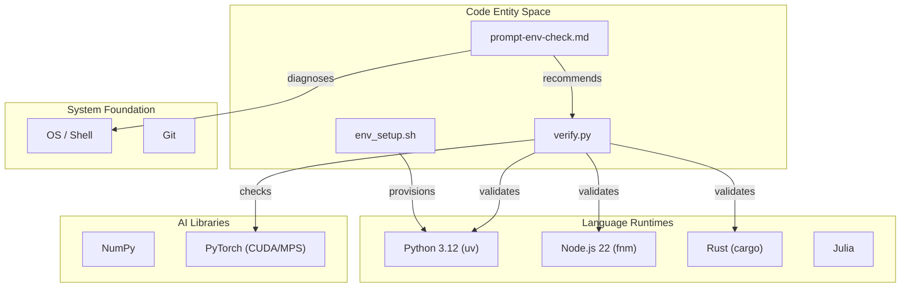
Sources: [phases/00-setup-and-tooling/01-dev-environment/docs/en.md:27-32](), [phases/00-setup-and-tooling/01-dev-environment/code/verify.py:5-22](), [phases/00-setup-and-tooling/06-python-environments/code/env_setup.sh:1-5]()

For details on specific installation commands and GPU configuration, see [Core Environment Setup](#2.1).

## Developer Workflow & Infrastructure Tools

Once the base languages are installed, the focus shifts to the professional AI developer's "inner loop." This involves optimizing the editor, terminal, and data management strategies.

*   **Docker for AI**: Utilizing a GPU-enabled `Dockerfile` based on `nvidia/cuda:12.4.1-devel-ubuntu22.04` to ensure environment parity between local development and cloud training environments [phases/00-setup-and-tooling/07-docker-for-ai/code/Dockerfile:1-154]().
*   **Data Management**: Using the `datasets` library for loading, streaming, and caching large datasets, and `data_utils.py` for converting between formats like Parquet, Arrow, and JSON [phases/00-setup-and-tooling/09-data-management/code/data_utils.py:22-77]().
*   **Editor & Terminal**: Configuring VS Code with Remote SSH for GPU boxes and setting up `tmux` for persistent training sessions that survive terminal disconnects [phases/00-setup-and-tooling/08-editor-setup/docs/en.md:131-159](), [phases/00-setup-and-tooling/10-terminal-and-shell/docs/en.md:140-174]().

### Tooling to Language Mapping

Different phases of the curriculum rely on specific toolchains within the environment.

| Language | Primary Use Case | Package Manager | Key Tools |
| :--- | :--- | :--- | :--- |
| **Python** | ML, Deep Learning, NLP, Vision | `uv` | `jupyter`, `datasets`, `torch` |
| **TypeScript** | Agents, MCP Servers, Infra | `pnpm` | `ts-node`, `@anthropic-ai/sdk` |
| **Rust** | Performance-critical Inference | `cargo` | `rustc`, `bpe.rs` |
| **Julia** | Math Foundations (Phase 1) | `Pkg` | `juliaup` |

Sources: [phases/00-setup-and-tooling/01-dev-environment/docs/en.md:147-153](), [phases/00-setup-and-tooling/04-apis-and-keys/docs/en.md:73-77]()

### Data Pipeline & Logic Flow

The following diagram bridges the high-level data concepts to the utility functions used to manage them.

**Data Utility Mapping**
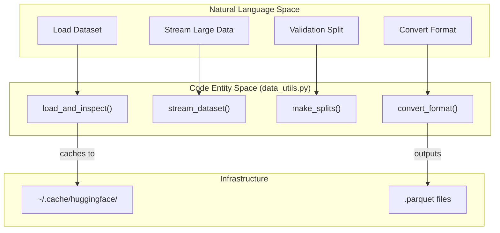
Sources: [phases/00-setup-and-tooling/09-data-management/code/data_utils.py:22-100](), [phases/00-setup-and-tooling/09-data-management/docs/en.md:23-31]()

For details on containerization, data management, and terminal mastery, see [Developer Workflow & Infrastructure Tools](#2.2).

---

# Page: Core Environment Setup

# Core Environment Setup

<details>
<summary>Relevant source files</summary>

The following files were used as context for generating this wiki page:

- [phases/00-setup-and-tooling/01-dev-environment/code/verify.py](phases/00-setup-and-tooling/01-dev-environment/code/verify.py)
- [phases/00-setup-and-tooling/01-dev-environment/docs/en.md](phases/00-setup-and-tooling/01-dev-environment/docs/en.md)
- [phases/00-setup-and-tooling/01-dev-environment/outputs/prompt-env-check.md](phases/00-setup-and-tooling/01-dev-environment/outputs/prompt-env-check.md)
- [phases/00-setup-and-tooling/01-dev-environment/quiz.json](phases/00-setup-and-tooling/01-dev-environment/quiz.json)
- [phases/00-setup-and-tooling/02-git-and-collaboration/docs/en.md](phases/00-setup-and-tooling/02-git-and-collaboration/docs/en.md)
- [phases/00-setup-and-tooling/04-apis-and-keys/code/first_api_call.py](phases/00-setup-and-tooling/04-apis-and-keys/code/first_api_call.py)
- [phases/00-setup-and-tooling/04-apis-and-keys/docs/en.md](phases/00-setup-and-tooling/04-apis-and-keys/docs/en.md)
- [phases/00-setup-and-tooling/04-apis-and-keys/outputs/prompt-api-troubleshooter.md](phases/00-setup-and-tooling/04-apis-and-keys/outputs/prompt-api-troubleshooter.md)
- [phases/00-setup-and-tooling/05-jupyter-notebooks/code/notebook_tips.py](phases/00-setup-and-tooling/05-jupyter-notebooks/code/notebook_tips.py)
- [phases/00-setup-and-tooling/05-jupyter-notebooks/docs/en.md](phases/00-setup-and-tooling/05-jupyter-notebooks/docs/en.md)
- [phases/00-setup-and-tooling/05-jupyter-notebooks/outputs/prompt-notebook-helper.md](phases/00-setup-and-tooling/05-jupyter-notebooks/outputs/prompt-notebook-helper.md)
- [phases/00-setup-and-tooling/06-python-environments/code/env_setup.sh](phases/00-setup-and-tooling/06-python-environments/code/env_setup.sh)
- [phases/00-setup-and-tooling/06-python-environments/docs/en.md](phases/00-setup-and-tooling/06-python-environments/docs/en.md)
- [phases/00-setup-and-tooling/07-docker-for-ai/code/Dockerfile](phases/00-setup-and-tooling/07-docker-for-ai/code/Dockerfile)
- [phases/00-setup-and-tooling/07-docker-for-ai/code/docker-compose.yml](phases/00-setup-and-tooling/07-docker-for-ai/code/docker-compose.yml)
- [phases/00-setup-and-tooling/07-docker-for-ai/docs/en.md](phases/00-setup-and-tooling/07-docker-for-ai/docs/en.md)
- [phases/00-setup-and-tooling/08-editor-setup/code/vscode/extensions.json](phases/00-setup-and-tooling/08-editor-setup/code/vscode/extensions.json)
- [phases/00-setup-and-tooling/08-editor-setup/code/vscode/settings.json](phases/00-setup-and-tooling/08-editor-setup/code/vscode/settings.json)
- [phases/00-setup-and-tooling/08-editor-setup/docs/en.md](phases/00-setup-and-tooling/08-editor-setup/docs/en.md)
- [phases/00-setup-and-tooling/09-data-management/code/data_utils.py](phases/00-setup-and-tooling/09-data-management/code/data_utils.py)
- [phases/00-setup-and-tooling/09-data-management/docs/en.md](phases/00-setup-and-tooling/09-data-management/docs/en.md)
- [phases/00-setup-and-tooling/09-data-management/outputs/prompt-data-helper.md](phases/00-setup-and-tooling/09-data-management/outputs/prompt-data-helper.md)
- [phases/00-setup-and-tooling/10-terminal-and-shell/code/shell_aliases.sh](phases/00-setup-and-tooling/10-terminal-and-shell/code/shell_aliases.sh)
- [phases/00-setup-and-tooling/10-terminal-and-shell/docs/en.md](phases/00-setup-and-tooling/10-terminal-and-shell/docs/en.md)
- [phases/00-setup-and-tooling/11-linux-for-ai/docs/en.md](phases/00-setup-and-tooling/11-linux-for-ai/docs/en.md)

</details>


This page covers the foundational environment setup required for AI engineering, spanning lessons 01–06 of Phase 0. It details the installation of multi-language runtimes, the configuration of high-performance Python environments, GPU verification, and the management of API credentials.

## 1. Multi-Layer Environment Architecture

The development environment is structured into four distinct layers, moving from hardware and OS foundations up to high-level AI libraries. Each layer serves as a dependency for the one above it.

### Environment Layer Diagram
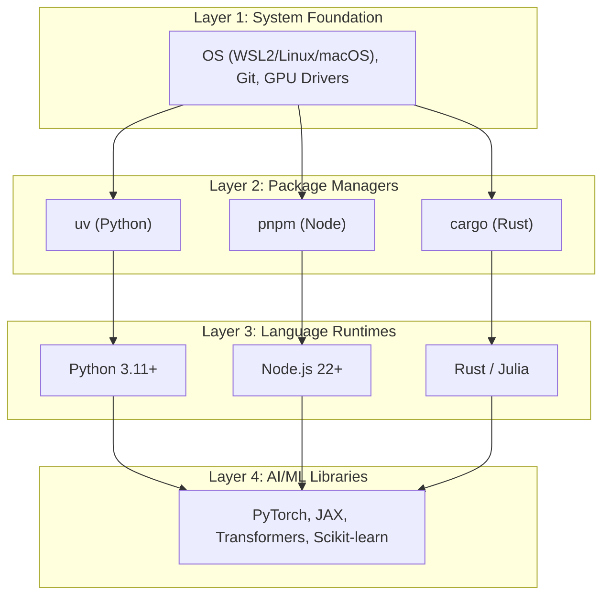
**Sources:** [phases/00-setup-and-tooling/01-dev-environment/docs/en.md:25-32]()

## 2. Python Environment & Dependency Management

The curriculum uses `uv` as the primary package manager due to its performance (10-100x faster than `pip`) and integrated virtual environment management [phases/00-setup-and-tooling/01-dev-environment/docs/en.md:54-57]().

### Virtual Environment Strategy
To avoid "dependency hell"—where conflicting versions of libraries like PyTorch or CUDA bindings break projects—the repository recommends a per-phase isolation strategy [phases/00-setup-and-tooling/06-python-environments/docs/en.md:17-28]().

| Tool | Role | Command Example |
| :--- | :--- | :--- |
| `uv` | High-speed management | `uv venv` |
| `venv` | Built-in fallback | `python3 -m venv .venv` |
| `conda` | Non-Python deps (CUDA) | `conda install pytorch-cuda=12.4` |

### Environment Setup Logic
The script `phases/00-setup-and-tooling/06-python-environments/code/env_setup.sh` automates the creation of a shared base environment for the initial phases.
- It verifies a minimum Python version of 3.11 [phases/00-setup-and-tooling/01-dev-environment/docs/en.md:12]().
- It installs core libraries: `numpy`, `matplotlib`, `jupyter`, and `scikit-learn` [phases/00-setup-and-tooling/01-dev-environment/docs/en.md:66]().

**Sources:** [phases/00-setup-and-tooling/06-python-environments/docs/en.md:50-109](), [phases/00-setup-and-tooling/01-dev-environment/docs/en.md:54-67]()

## 3. Editor Setup & Remote Development

The recommended editor is VS Code (or AI-native forks like Cursor and Windsurf), configured with specific extensions for Python, Jupyter, and Remote SSH [phases/00-setup-and-tooling/08-editor-setup/docs/en.md:38-42]().

### Remote SSH Workflow
For AI work, training often happens on remote GPU boxes. The `Remote-SSH` extension allows editing and debugging on remote filesystems as if they were local [phases/00-setup-and-tooling/08-editor-setup/docs/en.md:131-134]().

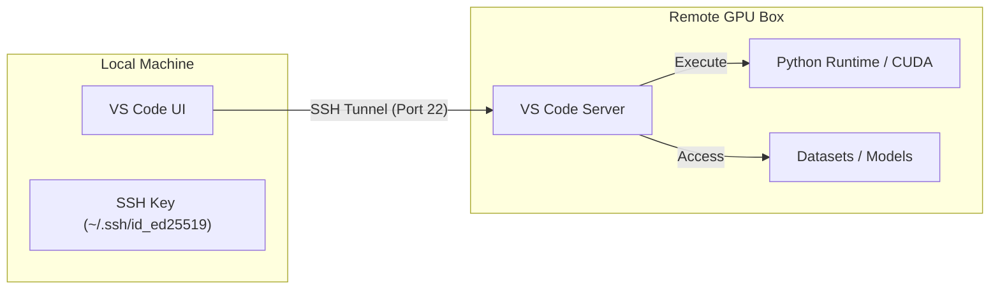
**Sources:** [phases/00-setup-and-tooling/08-editor-setup/docs/en.md:131-159]()

### Essential Settings
Key configurations in `.vscode/settings.json` include:
- `python.analysis.typeCheckingMode`: Set to `basic` to catch tensor shape mismatches [phases/00-setup-and-tooling/08-editor-setup/docs/en.md:90-100]().
- `notebook.output.scrolling`: Prevents UI lag from large training logs [phases/00-setup-and-tooling/08-editor-setup/docs/en.md:93-103]().

**Sources:** [phases/00-setup-and-tooling/08-editor-setup/docs/en.md:88-105]()

## 4. API Key Management & Authentication

Safe handling of credentials is required for Phase 11+ (LLM APIs). The curriculum enforces the use of environment variables or `.env` files (excluded via `.gitignore`) rather than hardcoding keys [phases/00-setup-and-tooling/04-apis-and-keys/docs/en.md:41-53]().

### API Request Implementation
The `first_api_call.py` script demonstrates two patterns for interacting with AI providers:
1. **SDK Pattern:** Using `anthropic.Anthropic()` client which automatically looks for `ANTHROPIC_API_KEY` [phases/00-setup-and-tooling/04-apis-and-keys/docs/en.md:57-69]().
2. **Raw HTTP Pattern:** Using `urllib.request` to manually construct headers including `x-api-key` and `anthropic-version` [phases/00-setup-and-tooling/04-apis-and-keys/docs/en.md:89-110]().

**Sources:** [phases/00-setup-and-tooling/04-apis-and-keys/docs/en.md:1-112]()

## 5. Jupyter Notebooks for Prototyping

Notebooks serve as the "lab bench" for experimentation. The curriculum defines a strict "explore in notebooks, ship in scripts" workflow [phases/00-setup-and-tooling/05-jupyter-notebooks/docs/en.md:200-211]().

### Notebook Execution Model
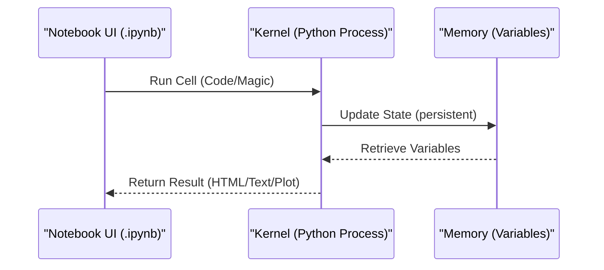
**Sources:** [phases/00-setup-and-tooling/05-jupyter-notebooks/docs/en.md:33-41]()

### Key Utilities
- **Magic Commands:** Jupyter-specific commands like `%timeit` for micro-benchmarks and `%%time` for training run duration [phases/00-setup-and-tooling/05-jupyter-notebooks/docs/en.md:105-124]().
- **Rich Output:** Auto-displaying `pandas.DataFrame` objects as HTML tables and `matplotlib` plots inline [phases/00-setup-and-tooling/05-jupyter-notebooks/docs/en.md:148-174]().

**Sources:** [phases/00-setup-and-tooling/05-jupyter-notebooks/docs/en.md:1-220]()

## 6. Git & Collaboration Workflow

The repository uses a standard branching model for curriculum progress. Students are encouraged to use `git checkout -b my-progress` to track their individual implementations [phases/00-setup-and-tooling/02-git-and-collaboration/docs/en.md:78-81]().

| Action | Command |
| :--- | :--- |
| **Stage** | `git add <file>` |
| **Commit** | `git commit -m "Add perceptron"` |
| **Sync** | `git push origin main` |
| **Experiment** | `git checkout -b experiment/new-optimizer` |

### Large File Handling
Because model weights and datasets are large, they are excluded from Git via `.gitignore` [phases/00-setup-and-tooling/09-data-management/docs/en.md:139-151](). For teams, Git LFS or DVC is recommended [phases/00-setup-and-tooling/09-data-management/docs/en.md:153-172]().

**Sources:** [phases/00-setup-and-tooling/02-git-and-collaboration/docs/en.md:43-81](), [phases/00-setup-and-tooling/09-data-management/docs/en.md:137-182]()

---

# Page: Developer Workflow & Infrastructure Tools

# Developer Workflow & Infrastructure Tools

<details>
<summary>Relevant source files</summary>

The following files were used as context for generating this wiki page:

- [phases/00-setup-and-tooling/01-dev-environment/code/verify.py](phases/00-setup-and-tooling/01-dev-environment/code/verify.py)
- [phases/00-setup-and-tooling/01-dev-environment/docs/en.md](phases/00-setup-and-tooling/01-dev-environment/docs/en.md)
- [phases/00-setup-and-tooling/01-dev-environment/outputs/prompt-env-check.md](phases/00-setup-and-tooling/01-dev-environment/outputs/prompt-env-check.md)
- [phases/00-setup-and-tooling/01-dev-environment/quiz.json](phases/00-setup-and-tooling/01-dev-environment/quiz.json)
- [phases/00-setup-and-tooling/02-git-and-collaboration/docs/en.md](phases/00-setup-and-tooling/02-git-and-collaboration/docs/en.md)
- [phases/00-setup-and-tooling/04-apis-and-keys/code/first_api_call.py](phases/00-setup-and-tooling/04-apis-and-keys/code/first_api_call.py)
- [phases/00-setup-and-tooling/04-apis-and-keys/docs/en.md](phases/00-setup-and-tooling/04-apis-and-keys/docs/en.md)
- [phases/00-setup-and-tooling/04-apis-and-keys/outputs/prompt-api-troubleshooter.md](phases/00-setup-and-tooling/04-apis-and-keys/outputs/prompt-api-troubleshooter.md)
- [phases/00-setup-and-tooling/05-jupyter-notebooks/code/notebook_tips.py](phases/00-setup-and-tooling/05-jupyter-notebooks/code/notebook_tips.py)
- [phases/00-setup-and-tooling/05-jupyter-notebooks/docs/en.md](phases/00-setup-and-tooling/05-jupyter-notebooks/docs/en.md)
- [phases/00-setup-and-tooling/05-jupyter-notebooks/outputs/prompt-notebook-helper.md](phases/00-setup-and-tooling/05-jupyter-notebooks/outputs/prompt-notebook-helper.md)
- [phases/00-setup-and-tooling/06-python-environments/code/env_setup.sh](phases/00-setup-and-tooling/06-python-environments/code/env_setup.sh)
- [phases/00-setup-and-tooling/06-python-environments/docs/en.md](phases/00-setup-and-tooling/06-python-environments/docs/en.md)
- [phases/00-setup-and-tooling/07-docker-for-ai/code/Dockerfile](phases/00-setup-and-tooling/07-docker-for-ai/code/Dockerfile)
- [phases/00-setup-and-tooling/07-docker-for-ai/code/docker-compose.yml](phases/00-setup-and-tooling/07-docker-for-ai/code/docker-compose.yml)
- [phases/00-setup-and-tooling/07-docker-for-ai/docs/en.md](phases/00-setup-and-tooling/07-docker-for-ai/docs/en.md)
- [phases/00-setup-and-tooling/08-editor-setup/code/vscode/extensions.json](phases/00-setup-and-tooling/08-editor-setup/code/vscode/extensions.json)
- [phases/00-setup-and-tooling/08-editor-setup/code/vscode/settings.json](phases/00-setup-and-tooling/08-editor-setup/code/vscode/settings.json)
- [phases/00-setup-and-tooling/08-editor-setup/docs/en.md](phases/00-setup-and-tooling/08-editor-setup/docs/en.md)
- [phases/00-setup-and-tooling/09-data-management/code/data_utils.py](phases/00-setup-and-tooling/09-data-management/code/data_utils.py)
- [phases/00-setup-and-tooling/09-data-management/docs/en.md](phases/00-setup-and-tooling/09-data-management/docs/en.md)
- [phases/00-setup-and-tooling/09-data-management/outputs/prompt-data-helper.md](phases/00-setup-and-tooling/09-data-management/outputs/prompt-data-helper.md)
- [phases/00-setup-and-tooling/10-terminal-and-shell/code/shell_aliases.sh](phases/00-setup-and-tooling/10-terminal-and-shell/code/shell_aliases.sh)
- [phases/00-setup-and-tooling/10-terminal-and-shell/docs/en.md](phases/00-setup-and-tooling/10-terminal-and-shell/docs/en.md)
- [phases/00-setup-and-tooling/11-linux-for-ai/docs/en.md](phases/00-setup-and-tooling/11-linux-for-ai/docs/en.md)
- [phases/00-setup-and-tooling/12-debugging-and-profiling/code/debug_tools.py](phases/00-setup-and-tooling/12-debugging-and-profiling/code/debug_tools.py)
- [phases/00-setup-and-tooling/12-debugging-and-profiling/docs/en.md](phases/00-setup-and-tooling/12-debugging-and-profiling/docs/en.md)
- [phases/00-setup-and-tooling/12-debugging-and-profiling/outputs/prompt-debug-ai-code.md](phases/00-setup-and-tooling/12-debugging-and-profiling/outputs/prompt-debug-ai-code.md)

</details>


This page details the infrastructure and workflow tools required for modern AI engineering, covering Lessons 07–12 of Phase 0. It focuses on containerization, editor optimization, data management, and the diagnostic tools necessary to catch the "silent failures" unique to machine learning.

## Docker for AI

AI development environments are notoriously fragile due to tight coupling between Python versions, deep learning frameworks (PyTorch/TensorFlow), and hardware-specific drivers (CUDA/cuDNN). Docker provides environmental parity across local machines and cloud GPU instances [phases/00-setup-and-tooling/07-docker-for-ai/docs/en.md:10-14]().

### Container Architecture
The repository utilizes a multi-layered Docker approach to balance build speed with functionality. For NVIDIA GPU support, the `nvidia-container-toolkit` is used to pass through host GPU resources to the container [phases/00-setup-and-tooling/07-docker-for-ai/docs/en.md:91-106]().

**Base Image Selection Strategy:**
| Image Type | Use Case | Size |
|:---|:---|:---|
| `nvidia/cuda:12.4.1-devel-ubuntu22.04` | Building packages from source (e.g., `flash-attn`) | ~4 GB |
| `nvidia/cuda:12.4.1-runtime-ubuntu22.04` | Running pre-built code in production | ~1.5 GB |
| `pytorch/pytorch:2.3.1-cuda12.4-cudnn9-runtime` | Standard deep learning development | ~6 GB |
| `python:3.12-slim` | CPU-only inference or data processing | ~150 MB |

*Source: [phases/00-setup-and-tooling/07-docker-for-ai/docs/en.md:123-147]()*

### Implementation: The AI Dockerfile
The core Dockerfile [phases/00-setup-and-tooling/07-docker-for-ai/code/Dockerfile:1-190]() follows a specific sequence to optimize layer caching:
1.  **System Dependencies**: Installs `build-essential`, `git`, and `python3.12-dev` via `apt-get` [phases/00-setup-and-tooling/07-docker-for-ai/code/Dockerfile:159-167]().
2.  **Framework Installation**: Installs PyTorch with explicit CUDA 12.4 wheel indices to ensure hardware acceleration [phases/00-setup-and-tooling/07-docker-for-ai/code/Dockerfile:173-177]().
3.  **Persistence**: Defines `VOLUME` mounts for `/workspace` and `/models` to prevent large model weights from being stored inside the container's writable layer [phases/00-setup-and-tooling/07-docker-for-ai/code/Dockerfile:192]().

**Data Flow: Host to Container**
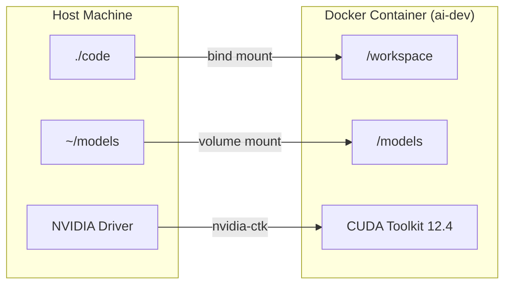
*Sources: [phases/00-setup-and-tooling/07-docker-for-ai/docs/en.md:183-190](), [phases/00-setup-and-tooling/07-docker-for-ai/docs/en.md:91-106]()*

---

## Editor Setup (VS Code)

The workflow is centered around VS Code (or its AI-first forks like Cursor and Windsurf) due to its first-class support for Jupyter Notebooks and Remote Development [phases/00-setup-and-tooling/08-editor-setup/docs/en.md:31-35]().

### Essential Extensions
The repository provides a recommended extensions manifest in `code/.vscode/extensions.json` [phases/00-setup-and-tooling/08-editor-setup/code/vscode/extensions.json:1-17]():
*   `ms-python.python`: Core language support and virtual environment detection.
*   `ms-python.vscode-pylance`: Critical for catching tensor shape mismatches via type checking [phases/00-setup-and-tooling/08-editor-setup/docs/en.md:100]().
*   `ms-toolsai.jupyter`: Inline execution of `.ipynb` files and variable exploration.
*   `ms-vscode-remote.remote-ssh`: Allows editing files directly on remote GPU boxes as if they were local [phases/00-setup-and-tooling/08-editor-setup/docs/en.md:131-135]().

### Key Settings
Standardized settings in `settings.json` ensure code quality and prevent common notebook issues:
*   `python.analysis.typeCheckingMode: "basic"`: Static analysis for API parameters.
*   `editor.formatOnSave: true`: Uses `Black` or `Ruff` for consistent formatting.
*   `notebook.output.scrolling: true`: Prevents the UI from exploding when training loops print thousands of lines [phases/00-setup-and-tooling/08-editor-setup/docs/en.md:88-96]().

---

## Data Management Utilities

Efficient AI engineering requires moving beyond manual CSV handling. The `data_utils.py` script provides a standardized interface for the Hugging Face `datasets` library [phases/00-setup-and-tooling/09-data-management/code/data_utils.py:1-20]().

### Key Functions
*   `load_and_inspect()`: Loads a dataset and prints metadata including columns, features, and row count [phases/00-setup-and-tooling/09-data-management/code/data_utils.py:22-36]().
*   `stream_dataset()`: Uses `streaming=True` for datasets too large for local disk (e.g., Wikipedia or Common Crawl) [phases/00-setup-and-tooling/09-data-management/code/data_utils.py:39-52]().
*   `convert_format()`: Benchmarks and converts data between CSV, JSON, and Parquet. Parquet is the preferred format for AI work due to its columnar compression and faster read speeds [phases/00-setup-and-tooling/09-data-management/code/data_utils.py:55-77]().
*   `make_splits()`: Implements reproducible `train`/`val`/`test` partitioning using fixed random seeds [phases/00-setup-and-tooling/09-data-management/code/data_utils.py:80-99]().

---

## Terminal & Shell Workflow

The terminal is the primary interface for monitoring training and managing remote instances. Most AI development happens on Linux-based cloud GPU boxes where the CLI is the only interface [phases/00-setup-and-tooling/11-linux-for-ai/docs/en.md:17-21]().

### Shell Aliases for AI
A dedicated `shell_aliases.sh` script provides shortcuts for common tasks [phases/00-setup-and-tooling/10-terminal-and-shell/code/shell_aliases.sh:1-144]():
*   `gpu`: Quick query of utilization, memory, and temperature via `nvidia-smi` [phases/00-setup-and-tooling/10-terminal-and-shell/docs/en.md:268]().
*   `watchloss`: Tails logs and filters for "loss" in real-time.
*   `ae`/`de`: Fast activation/deactivation of virtual environments.
*   `trainenv`: A function that initializes a 3-pane `tmux` session (Training, GPU Monitor, System Monitor) [phases/00-setup-and-tooling/10-terminal-and-shell/docs/en.md:25-34]().

### Remote Operations
For cloud GPU boxes, the workflow relies on `rsync` for efficient file synchronization and SSH port forwarding (`ssh -L`) to access remote Jupyter or TensorBoard instances locally [phases/00-setup-and-tooling/10-terminal-and-shell/docs/en.md:241-243]().

---

## Debugging & Profiling Tools

AI debugging differs from standard software debugging because code often runs without error while producing "garbage" results (e.g., silent NaN propagation) [phases/00-setup-and-tooling/12-debugging-and-profiling/docs/en.md:3-5]().

### The Debugging Stack
The `debug_tools.py` utility provides several diagnostic helpers [phases/00-setup-and-tooling/12-debugging-and-profiling/code/debug_tools.py:1-100]():

1.  **Tensor Inspection**: `debug_print()` displays shapes, dtypes, device location, and value ranges (min/max/mean) to catch `NaN` or vanishing gradients [phases/00-setup-and-tooling/12-debugging-and-profiling/docs/en.md:42-49]().
2.  **Shape Tracking**: `check_shapes()` uses PyTorch forward hooks to map every transformation through a model [phases/00-setup-and-tooling/12-debugging-and-profiling/docs/en.md:224-232]().
3.  **Gradient Health**: `check_gradient_health()` calculates the total norm and warns about zero or exploding gradients.
4.  **Device Verification**: `check_devices()` ensures model parameters and input tensors reside on the same hardware (CPU vs GPU).

**Code Entity Mapping: Diagnostic Tools**
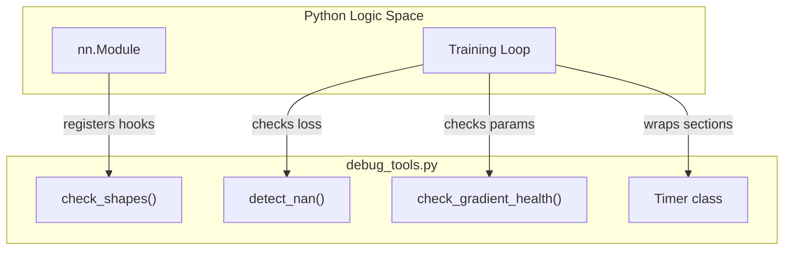
*Sources: [phases/00-setup-and-tooling/12-debugging-and-profiling/docs/en.md:108-131](), [phases/00-setup-and-tooling/12-debugging-and-profiling/docs/en.md:224-232]()*

### Profiling
*   **CPU Profiling**: `cProfile` for function-level timing and `line_profiler` for line-by-line bottlenecks [phases/00-setup-and-tooling/12-debugging-and-profiling/docs/en.md:135-158]().
*   **Memory Tracking**: `tracemalloc` for CPU memory and `torch.cuda.memory_summary()` for GPU VRAM allocation to diagnose OOM (Out of Memory) errors [phases/00-setup-and-tooling/12-debugging-and-profiling/docs/en.md:162-207]().

*Sources: [phases/00-setup-and-tooling/07-docker-for-ai/docs/en.md](), [phases/00-setup-and-tooling/08-editor-setup/docs/en.md](), [phases/00-setup-and-tooling/09-data-management/docs/en.md](), [phases/00-setup-and-tooling/10-terminal-and-shell/docs/en.md](), [phases/00-setup-and-tooling/11-linux-for-ai/docs/en.md](), [phases/00-setup-and-tooling/12-debugging-and-profiling/docs/en.md]()*

---

# Page: Phase 1: Mathematical Foundations

# Phase 1: Mathematical Foundations

<details>
<summary>Relevant source files</summary>

The following files were used as context for generating this wiki page:

- [phases/01-math-foundations/01-linear-algebra-intuition/code/vectors.jl](phases/01-math-foundations/01-linear-algebra-intuition/code/vectors.jl)
- [phases/01-math-foundations/01-linear-algebra-intuition/code/vectors.py](phases/01-math-foundations/01-linear-algebra-intuition/code/vectors.py)
- [phases/01-math-foundations/01-linear-algebra-intuition/docs/en.md](phases/01-math-foundations/01-linear-algebra-intuition/docs/en.md)
- [phases/01-math-foundations/01-linear-algebra-intuition/outputs/prompt-linear-algebra-tutor.md](phases/01-math-foundations/01-linear-algebra-intuition/outputs/prompt-linear-algebra-tutor.md)
- [phases/01-math-foundations/03-matrix-transformations/code/transformations.jl](phases/01-math-foundations/03-matrix-transformations/code/transformations.jl)
- [phases/01-math-foundations/03-matrix-transformations/code/transformations.py](phases/01-math-foundations/03-matrix-transformations/code/transformations.py)
- [phases/01-math-foundations/03-matrix-transformations/docs/en.md](phases/01-math-foundations/03-matrix-transformations/docs/en.md)
- [phases/01-math-foundations/03-matrix-transformations/outputs/prompt-transformation-visualizer.md](phases/01-math-foundations/03-matrix-transformations/outputs/prompt-transformation-visualizer.md)
- [phases/01-math-foundations/06-probability-and-distributions/code/probability.py](phases/01-math-foundations/06-probability-and-distributions/code/probability.py)
- [phases/01-math-foundations/06-probability-and-distributions/docs/en.md](phases/01-math-foundations/06-probability-and-distributions/docs/en.md)
- [phases/01-math-foundations/06-probability-and-distributions/outputs/skill-probability-reasoning.md](phases/01-math-foundations/06-probability-and-distributions/outputs/skill-probability-reasoning.md)
- [phases/01-math-foundations/08-optimization/code/optimizers.py](phases/01-math-foundations/08-optimization/code/optimizers.py)
- [phases/01-math-foundations/08-optimization/docs/en.md](phases/01-math-foundations/08-optimization/docs/en.md)
- [phases/01-math-foundations/08-optimization/outputs/prompt-optimizer-guide.md](phases/01-math-foundations/08-optimization/outputs/prompt-optimizer-guide.md)
- [phases/01-math-foundations/11-singular-value-decomposition/code/svd.jl](phases/01-math-foundations/11-singular-value-decomposition/code/svd.jl)
- [phases/01-math-foundations/11-singular-value-decomposition/code/svd.py](phases/01-math-foundations/11-singular-value-decomposition/code/svd.py)
- [phases/01-math-foundations/11-singular-value-decomposition/docs/en.md](phases/01-math-foundations/11-singular-value-decomposition/docs/en.md)
- [phases/01-math-foundations/11-singular-value-decomposition/outputs/skill-svd.md](phases/01-math-foundations/11-singular-value-decomposition/outputs/skill-svd.md)
- [phases/01-math-foundations/17-linear-systems/code/linear_systems.py](phases/01-math-foundations/17-linear-systems/code/linear_systems.py)
- [phases/01-math-foundations/17-linear-systems/docs/en.md](phases/01-math-foundations/17-linear-systems/docs/en.md)
- [phases/01-math-foundations/18-convex-optimization/code/convex.py](phases/01-math-foundations/18-convex-optimization/code/convex.py)
- [phases/01-math-foundations/18-convex-optimization/docs/en.md](phases/01-math-foundations/18-convex-optimization/docs/en.md)

</details>


Phase 1 provides the 22-lesson bedrock required for AI engineering. While many practitioners rely on high-level libraries, this phase focuses on implementing the underlying mathematical operations from scratch. This ensures a deep intuition for how models "see" data, how they optimize their internal state, and how they reason about uncertainty.

The curriculum is divided into three core domains: the geometry of data (Linear Algebra), the mechanics of learning (Calculus & Optimization), and the logic of uncertainty (Probability & Statistics).

### Mathematical Landscape to Code Mapping

The following diagrams bridge the gap between abstract mathematical concepts and the specific code entities implemented in this phase, showing how "Natural Language Space" translates to "Code Entity Space".

**Math to Code Entity Mapping**
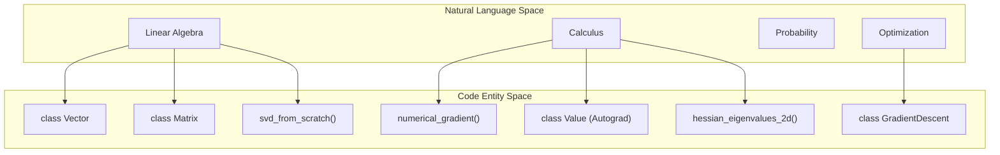
Sources: [phases/01-math-foundations/01-linear-algebra-intuition/code/vectors.py:1-81](), [phases/01-math-foundations/18-convex-optimization/code/convex.py:27-65](), [phases/01-math-foundations/11-singular-value-decomposition/code/svd.py:24-59]()

---

## 3.1 Linear Algebra & Calculus
This sub-phase covers the fundamental "physics" of AI. Linear algebra provides the language for representing data and transformations, while calculus provides the mechanism for optimization.

*   **Linear Algebra:** Focuses on vectors as points in space and matrices as transformations [phases/01-math-foundations/01-linear-algebra-intuition/docs/en.md:25-42](). Key implementations include `Vector` and `Matrix` classes in Python and Julia, covering dot products, projections, and the Gram-Schmidt process for orthonormalization [phases/01-math-foundations/01-linear-algebra-intuition/code/vectors.py:68-78](). It also covers solving linear systems `Ax = b` via `gaussian_elimination` and `lu_decompose` [phases/01-math-foundations/17-linear-systems/code/linear_systems.py:4-44]().
*   **Calculus:** Covers the computation of change. It moves from simple derivatives to partial derivatives and the gradient—the vector of all partial derivatives that points toward the steepest ascent.
*   **Automatic Differentiation:** Introduces the scalar-valued autograd system that implements the chain rule mechanically to enable backpropagation.

For details, see [Linear Algebra & Calculus](#3.1).

Sources: [phases/01-math-foundations/01-linear-algebra-intuition/docs/en.md:1-174](), [phases/01-math-foundations/17-linear-systems/docs/en.md:80-114]()

---

## 3.2 Probability, Statistics & Bayesian Reasoning
AI engineering is rarely about certainty; it is about managing likelihoods. This section transitions from frequentist statistics to Bayesian reasoning.

*   **Distributions & Statistics:** Understanding the shape of data through probability distributions like Bernoulli, Categorical, and Normal [phases/01-math-foundations/06-probability-and-distributions/docs/en.md:97-130]().
*   **Bayesian Reasoning:** Implementing Bayes' Theorem for sequential updating. This includes using Bayesian logic for reasoning under uncertainty, as seen in the `skill-probability-reasoning` artifact.
*   **Numerical Stability:** Implementation of `softmax` and `log-softmax` functions using the numerical stability trick (subtracting max logit) to prevent overflow [phases/01-math-foundations/06-probability-and-distributions/docs/en.md:221-224]().

For details, see [Probability, Statistics & Bayesian Reasoning](#3.2).

Sources: [phases/01-math-foundations/06-probability-and-distributions/docs/en.md:1-224]()

---

## 3.3 Optimization, Information Theory & Advanced Math
The final component of Phase 1 addresses how models converge and how we measure information.

*   **Optimization:** The implementation of the `optimizers.py` family, focusing on Gradient Descent, Momentum, and Adam [phases/01-math-foundations/08-optimization/docs/en.md:12-15](). It explores `check_convexity` to distinguish between easy (convex) and hard (non-convex) landscapes [phases/01-math-foundations/18-convex-optimization/code/convex.py:5-24]().
*   **Advanced Factorization:** Implementation of `svd_from_scratch` using power iteration to decompose any matrix into `U`, `Sigma`, and `V^T` for applications like PCA and image compression [phases/01-math-foundations/11-singular-value-decomposition/code/svd.py:24-59]().
*   **Convex Optimization:** Utilizing the Hessian matrix via `hessian_eigenvalues_2d` to understand the "curvature" of the loss landscape—identifying global minima versus saddle points [phases/01-math-foundations/18-convex-optimization/code/convex.py:27-38]().

**Optimization & Decomposition Workflow**
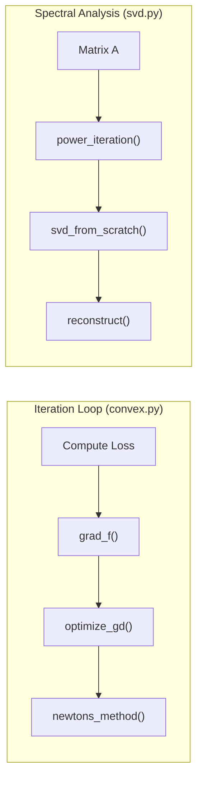
Sources: [phases/01-math-foundations/18-convex-optimization/code/convex.py:73-103](), [phases/01-math-foundations/11-singular-value-decomposition/code/svd.py:4-68]()

For details, see [Optimization, Information Theory & Advanced Math](#3.3).

---
**Next Phase:** [Phase 2: Machine Learning Fundamentals](#4)

---

# Page: Linear Algebra & Calculus

# Linear Algebra & Calculus

<details>
<summary>Relevant source files</summary>

The following files were used as context for generating this wiki page:

- [phases/01-math-foundations/01-linear-algebra-intuition/code/vectors.jl](phases/01-math-foundations/01-linear-algebra-intuition/code/vectors.jl)
- [phases/01-math-foundations/01-linear-algebra-intuition/code/vectors.py](phases/01-math-foundations/01-linear-algebra-intuition/code/vectors.py)
- [phases/01-math-foundations/01-linear-algebra-intuition/docs/en.md](phases/01-math-foundations/01-linear-algebra-intuition/docs/en.md)
- [phases/01-math-foundations/01-linear-algebra-intuition/outputs/prompt-linear-algebra-tutor.md](phases/01-math-foundations/01-linear-algebra-intuition/outputs/prompt-linear-algebra-tutor.md)
- [phases/01-math-foundations/03-matrix-transformations/code/transformations.jl](phases/01-math-foundations/03-matrix-transformations/code/transformations.jl)
- [phases/01-math-foundations/03-matrix-transformations/code/transformations.py](phases/01-math-foundations/03-matrix-transformations/code/transformations.py)
- [phases/01-math-foundations/03-matrix-transformations/docs/en.md](phases/01-math-foundations/03-matrix-transformations/docs/en.md)
- [phases/01-math-foundations/03-matrix-transformations/outputs/prompt-transformation-visualizer.md](phases/01-math-foundations/03-matrix-transformations/outputs/prompt-transformation-visualizer.md)
- [phases/01-math-foundations/04-calculus-for-ml/docs/en.md](phases/01-math-foundations/04-calculus-for-ml/docs/en.md)
- [phases/01-math-foundations/05-chain-rule-and-autodiff/docs/en.md](phases/01-math-foundations/05-chain-rule-and-autodiff/docs/en.md)
- [phases/01-math-foundations/06-probability-and-distributions/code/probability.py](phases/01-math-foundations/06-probability-and-distributions/code/probability.py)
- [phases/01-math-foundations/06-probability-and-distributions/docs/en.md](phases/01-math-foundations/06-probability-and-distributions/docs/en.md)
- [phases/01-math-foundations/06-probability-and-distributions/outputs/skill-probability-reasoning.md](phases/01-math-foundations/06-probability-and-distributions/outputs/skill-probability-reasoning.md)
- [phases/01-math-foundations/08-optimization/code/optimizers.py](phases/01-math-foundations/08-optimization/code/optimizers.py)
- [phases/01-math-foundations/08-optimization/docs/en.md](phases/01-math-foundations/08-optimization/docs/en.md)
- [phases/01-math-foundations/08-optimization/outputs/prompt-optimizer-guide.md](phases/01-math-foundations/08-optimization/outputs/prompt-optimizer-guide.md)
- [phases/01-math-foundations/11-singular-value-decomposition/code/svd.jl](phases/01-math-foundations/11-singular-value-decomposition/code/svd.jl)
- [phases/01-math-foundations/11-singular-value-decomposition/code/svd.py](phases/01-math-foundations/11-singular-value-decomposition/code/svd.py)
- [phases/01-math-foundations/11-singular-value-decomposition/docs/en.md](phases/01-math-foundations/11-singular-value-decomposition/docs/en.md)
- [phases/01-math-foundations/11-singular-value-decomposition/outputs/skill-svd.md](phases/01-math-foundations/11-singular-value-decomposition/outputs/skill-svd.md)
- [phases/01-math-foundations/17-linear-systems/code/linear_systems.py](phases/01-math-foundations/17-linear-systems/code/linear_systems.py)
- [phases/01-math-foundations/17-linear-systems/docs/en.md](phases/01-math-foundations/17-linear-systems/docs/en.md)
- [phases/01-math-foundations/18-convex-optimization/code/convex.py](phases/01-math-foundations/18-convex-optimization/code/convex.py)
- [phases/01-math-foundations/18-convex-optimization/docs/en.md](phases/01-math-foundations/18-convex-optimization/docs/en.md)
- [phases/03-deep-learning-core/03-backpropagation/docs/en.md](phases/03-deep-learning-core/03-backpropagation/docs/en.md)
- [phases/03-deep-learning-core/10-mini-framework/docs/en.md](phases/03-deep-learning-core/10-mini-framework/docs/en.md)
- [phases/03-deep-learning-core/11-intro-to-pytorch/docs/en.md](phases/03-deep-learning-core/11-intro-to-pytorch/docs/en.md)
- [phases/03-deep-learning-core/13-debugging-neural-networks/docs/en.md](phases/03-deep-learning-core/13-debugging-neural-networks/docs/en.md)
- [phases/05-nlp-foundations-to-advanced/08-cnns-rnns-for-text/docs/en.md](phases/05-nlp-foundations-to-advanced/08-cnns-rnns-for-text/docs/en.md)
- [phases/10-llms-from-scratch/01-tokenizers/docs/en.md](phases/10-llms-from-scratch/01-tokenizers/docs/en.md)
- [phases/10-llms-from-scratch/02-building-a-tokenizer/docs/en.md](phases/10-llms-from-scratch/02-building-a-tokenizer/docs/en.md)
- [phases/10-llms-from-scratch/04-pre-training-mini-gpt/docs/en.md](phases/10-llms-from-scratch/04-pre-training-mini-gpt/docs/en.md)
- [phases/11-llm-engineering/05-context-engineering/docs/en.md](phases/11-llm-engineering/05-context-engineering/docs/en.md)

</details>


This section covers the mathematical bedrock of machine learning: vectors, matrices, matrix transformations, and the calculus of gradients. These concepts are explored through from-scratch implementations in Python and Julia, moving from geometric intuition to the algorithmic implementation of automatic differentiation and linear system solvers.

## Linear Algebra Intuition & Operations

Linear algebra in this codebase is treated as a "spatial machine" for moving points in space [phases/01-math-foundations/01-linear-algebra-intuition/docs/en.md:12-14](). Vectors represent data points such as word embeddings (768-dimensional meanings), pixel values, or user preferences [phases/01-math-foundations/01-linear-algebra-intuition/docs/en.md:37-41](). Matrices represent transformations like neural network weights, attention scores, or projections [phases/01-math-foundations/01-linear-algebra-intuition/docs/en.md:65-69]().

### Core Entities: Vectors and Matrices
The `Vector` and `Matrix` classes provide the fundamental operations required for ML, including dot products for similarity and matrix-vector multiplication for neural layer simulation.

| Entity | Role | Key Functions |
| :--- | :--- | :--- |
| `Vector` | Represents points/directions | `dot()`, `magnitude()`, `normalize()`, `cosine_similarity()`, `project_onto()` |
| `Matrix` | Represents transformations | `__matmul__` (dot product/transformation), `transpose()`, `rank()` |

### Geometric Transformations & Orthogonality
Matrices are implemented as machines that reshape space [phases/01-math-foundations/03-matrix-transformations/docs/en.md:3-4]().
*   **Rotation:** Preserves distances and angles [phases/01-math-foundations/03-matrix-transformations/docs/en.md:41-42]().
*   **Scaling:** Stretches/compresses along axes [phases/01-math-foundations/03-matrix-transformations/docs/en.md:78-79]().
*   **Eigenvalues/vectors:** Directions where the transformation only scales the vector without rotating it [phases/01-math-foundations/03-matrix-transformations/docs/en.md:170-171]().
*   **Gram-Schmidt Process:** Converts independent vectors into an orthonormal basis, used in stable QR decomposition [phases/01-math-foundations/01-linear-algebra-intuition/docs/en.md:152-179]().

**Sources:**
* [phases/01-math-foundations/01-linear-algebra-intuition/docs/en.md:1-173]()
* [phases/01-math-foundations/01-linear-algebra-intuition/code/vectors.py:1-132]()
* [phases/01-math-foundations/03-matrix-transformations/docs/en.md:1-225]()
* [phases/01-math-foundations/03-matrix-transformations/code/transformations.py:1-252]()

---

## Calculus for Machine Learning

Calculus provides the mechanism for "turning the knobs" of a model to minimize error [phases/01-math-foundations/04-calculus-for-ml/docs/en.md:12-14](). The implementation focuses on gradients (vectors of partial derivatives) and the Hessian matrix (curvature).

### Gradient Descent & Curvature
The codebase implements numerical derivatives using the central difference method: `(f(x + h) - f(x - h)) / (2h)` [phases/01-math-foundations/04-calculus-for-ml/docs/en.md:124-128]().

*   **Gradient:** Points in the direction of steepest ascent. Negating it allows for Gradient Descent [phases/01-math-foundations/04-calculus-for-ml/docs/en.md:60-67](). The update rule `w_new = w_old - learning_rate * dL/dw` is implemented from scratch [phases/01-math-foundations/04-calculus-for-ml/docs/en.md:91-99]().
*   **Hessian Matrix:** A matrix of second-order partial derivatives used to determine the nature of critical points and surface curvature [phases/01-math-foundations/04-calculus-for-ml/docs/en.md:188-196]().

### Mathematical Space to Code Mapping
This diagram bridges the conceptual mathematical space to the specific implementation entities in the foundation phase.

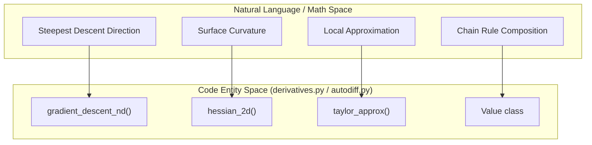
**Sources:**
* [phases/01-math-foundations/04-calculus-for-ml/docs/en.md:1-205]()
* [phases/01-math-foundations/04-calculus-for-ml/code/derivatives.py:1-218]()
* [phases/01-math-foundations/05-chain-rule-and-autodiff/docs/en.md:1-166]()

---

## Automatic Differentiation (The Value Engine)

While numerical derivatives are useful for checking, ML frameworks use **Reverse Mode Automatic Differentiation** [phases/01-math-foundations/05-chain-rule-and-autodiff/docs/en.md:101-111](). This codebase implements a `Value` class that builds a dynamic computational graph.

### The Value Class Architecture
The `Value` class wraps raw scalars and tracks the operations that created them, allowing for a recursive backward pass via topological sort [phases/01-math-foundations/05-chain-rule-and-autodiff/docs/en.md:168-184]().

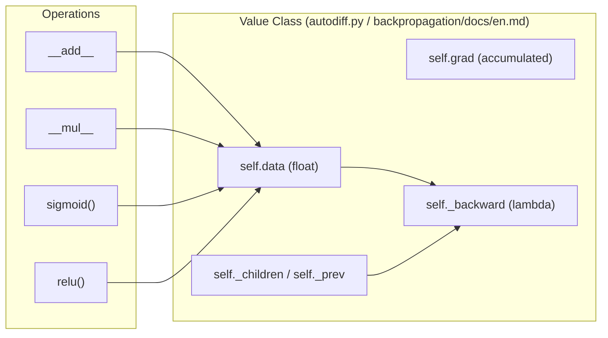

### Execution Flow
1.  **Forward Pass:** Operations (like `+`, `*`, `relu`) create new `Value` objects and store references to their parents in `_prev` or `_children` [phases/03-deep-learning-core/03-backpropagation/docs/en.md:158-164]().
2.  **Topological Sort:** The `backward()` function performs a topological sort to ensure gradients are processed from output to input [phases/03-deep-learning-core/03-backpropagation/docs/en.md:188-197]().
3.  **Backward Pass:** Iterates through the sorted nodes in reverse, calling each node's `_backward()` function to apply the chain rule and accumulate gradients [phases/03-deep-learning-core/03-backpropagation/docs/en.md:199-201]().
4.  **Gradient Checking:** Verification of analytical gradients against numerical finite differences [phases/03-deep-learning-core/13-debugging-neural-networks/docs/en.md:87-104]().

**Sources:**
* [phases/01-math-foundations/05-chain-rule-and-autodiff/docs/en.md:1-205]()
* [phases/03-deep-learning-core/03-backpropagation/docs/en.md:135-205]()
* [phases/03-deep-learning-core/13-debugging-neural-networks/docs/en.md:87-116]()

---

## Linear Systems ($Ax = b$)

Solving $Ax = b$ is the foundation of linear regression and many optimization algorithms [phases/01-math-foundations/17-linear-systems/docs/en.md:3-14]().

| Method | Characteristics | Application |
| :--- | :--- | :--- |
| **Gaussian Elimination** | Direct solver with partial pivoting. | General small systems. |
| **LU Decomposition** | Factors $A$ into $L$ and $U$. | Efficient for multiple $b$ vectors. |
| **Cholesky Decomposition** | For symmetric positive-definite matrices. | Covariance matrices / GPs. |
| **Conjugate Gradient** | Iterative solver. | Large, sparse systems. |
| **Normal Equations** | $(A^T A)x = A^T b$. | Least-squares regression. |

### Numerical Stability
The implementation emphasizes **Partial Pivoting** in Gaussian elimination to avoid division by zero or small numbers that amplify rounding errors [phases/01-math-foundations/17-linear-systems/docs/en.md:111-128](). It also provides a `condition_number()` function to measure how sensitive the system is to input noise [phases/01-math-foundations/17-linear-systems/code/linear_systems.py:107-111]().

**Sources:**
* [phases/01-math-foundations/17-linear-systems/docs/en.md:1-188]()
* [phases/01-math-foundations/17-linear-systems/code/linear_systems.py:1-264]()
* [phases/01-math-foundations/01-linear-algebra-intuition/docs/en.md:108-119]()

---

# Page: Probability, Statistics & Bayesian Reasoning

# Probability, Statistics & Bayesian Reasoning

<details>
<summary>Relevant source files</summary>

The following files were used as context for generating this wiki page:

- [phases/01-math-foundations/01-linear-algebra-intuition/code/vectors.jl](phases/01-math-foundations/01-linear-algebra-intuition/code/vectors.jl)
- [phases/01-math-foundations/01-linear-algebra-intuition/code/vectors.py](phases/01-math-foundations/01-linear-algebra-intuition/code/vectors.py)
- [phases/01-math-foundations/01-linear-algebra-intuition/docs/en.md](phases/01-math-foundations/01-linear-algebra-intuition/docs/en.md)
- [phases/01-math-foundations/01-linear-algebra-intuition/outputs/prompt-linear-algebra-tutor.md](phases/01-math-foundations/01-linear-algebra-intuition/outputs/prompt-linear-algebra-tutor.md)
- [phases/01-math-foundations/03-matrix-transformations/code/transformations.jl](phases/01-math-foundations/03-matrix-transformations/code/transformations.jl)
- [phases/01-math-foundations/03-matrix-transformations/code/transformations.py](phases/01-math-foundations/03-matrix-transformations/code/transformations.py)
- [phases/01-math-foundations/03-matrix-transformations/docs/en.md](phases/01-math-foundations/03-matrix-transformations/docs/en.md)
- [phases/01-math-foundations/03-matrix-transformations/outputs/prompt-transformation-visualizer.md](phases/01-math-foundations/03-matrix-transformations/outputs/prompt-transformation-visualizer.md)
- [phases/01-math-foundations/06-probability-and-distributions/code/probability.py](phases/01-math-foundations/06-probability-and-distributions/code/probability.py)
- [phases/01-math-foundations/06-probability-and-distributions/docs/en.md](phases/01-math-foundations/06-probability-and-distributions/docs/en.md)
- [phases/01-math-foundations/06-probability-and-distributions/outputs/skill-probability-reasoning.md](phases/01-math-foundations/06-probability-and-distributions/outputs/skill-probability-reasoning.md)
- [phases/01-math-foundations/08-optimization/code/optimizers.py](phases/01-math-foundations/08-optimization/code/optimizers.py)
- [phases/01-math-foundations/08-optimization/docs/en.md](phases/01-math-foundations/08-optimization/docs/en.md)
- [phases/01-math-foundations/08-optimization/outputs/prompt-optimizer-guide.md](phases/01-math-foundations/08-optimization/outputs/prompt-optimizer-guide.md)
- [phases/01-math-foundations/11-singular-value-decomposition/code/svd.jl](phases/01-math-foundations/11-singular-value-decomposition/code/svd.jl)
- [phases/01-math-foundations/11-singular-value-decomposition/code/svd.py](phases/01-math-foundations/11-singular-value-decomposition/code/svd.py)
- [phases/01-math-foundations/11-singular-value-decomposition/docs/en.md](phases/01-math-foundations/11-singular-value-decomposition/docs/en.md)
- [phases/01-math-foundations/11-singular-value-decomposition/outputs/skill-svd.md](phases/01-math-foundations/11-singular-value-decomposition/outputs/skill-svd.md)
- [phases/01-math-foundations/17-linear-systems/code/linear_systems.py](phases/01-math-foundations/17-linear-systems/code/linear_systems.py)
- [phases/01-math-foundations/17-linear-systems/docs/en.md](phases/01-math-foundations/17-linear-systems/docs/en.md)
- [phases/01-math-foundations/18-convex-optimization/code/convex.py](phases/01-math-foundations/18-convex-optimization/code/convex.py)
- [phases/01-math-foundations/18-convex-optimization/docs/en.md](phases/01-math-foundations/18-convex-optimization/docs/en.md)

</details>


This page covers the mathematical foundations of uncertainty, inference, and data analysis essential for AI engineering. It spans Phase 1 Lessons 06–07 and 15–16, detailing the implementation of probability distributions, Bayesian classifiers, hypothesis testing, and advanced sampling techniques used in generative models.

## 1. Probability Fundamentals & Distributions

Probability provides the language for expressing model uncertainty. In the codebase, this is implemented by defining Probability Mass Functions (PMF) for discrete variables and Probability Density Functions (PDF) for continuous variables.

### Key Concepts
*   **Axioms of Probability**: Non-negativity, normalization ($P(S)=1$), and additivity for disjoint events `[phases/01-math-foundations/06-probability-and-distributions/docs/en.md:39-42]()`.
*   **Expectation & Variance**: The weighted average outcome and the measure of spread around that average `[phases/01-math-foundations/06-probability-and-distributions/docs/en.md:139-153]()`.
*   **Log Probabilities**: Used to prevent numerical underflow when multiplying many small probabilities, converting products into sums `[phases/01-math-foundations/06-probability-and-distributions/docs/en.md:195-211]()`.
*   **Central Limit Theorem**: Explains why the normal distribution dominates as the sum of independent random variables `[phases/01-math-foundations/06-probability-and-distributions/docs/en.md:177-187]()`.

### Implemented Distributions
| Distribution | Type | Use Case | Code Reference |
| :--- | :--- | :--- | :--- |
| **Bernoulli** | Discrete | Binary classification [0, 1] | `[phases/01-math-foundations/06-probability-and-distributions/docs/en.md:99-105]()` |
| **Categorical** | Discrete | Multi-class (Softmax output) | `[phases/01-math-foundations/06-probability-and-distributions/docs/en.md:107-112]()` |
| **Normal** | Continuous | Weight init, Gaussian noise | `[phases/01-math-foundations/06-probability-and-distributions/docs/en.md:121-130]()` |
| **Poisson** | Discrete | Event rates in intervals | `[phases/01-math-foundations/06-probability-and-distributions/docs/en.md:132-137]()` |

**Sources:** `[phases/01-math-foundations/06-probability-and-distributions/docs/en.md]()`, `[phases/01-math-foundations/06-probability-and-distributions/code/probability.py]()`

---

## 2. Bayesian Reasoning & Naive Bayes

Bayesian reasoning allows a model to update its beliefs ($P(H)$) after observing new evidence ($E$). This is the foundation of sequential learning and the Naive Bayes classifier.

### The Bayesian Update Cycle
The implementation follows the core theorem:
$$P(H|E) = \frac{P(E|H) \cdot P(H)}{P(E)}$$
where $P(E)$ is the evidence calculated via the law of total probability. This allows for sequential updating where the posterior of one step becomes the prior for the next `[phases/01-math-foundations/07-bayes-theorem/docs/en.md:46-57]()`.

### Naive Bayes Classifier
The `NaiveBayes` implementation typically handles text classification by assuming feature independence. It uses log-likelihoods to avoid underflow and Laplace smoothing to handle unseen words `[phases/01-math-foundations/07-bayes-theorem/code/bayes.py:19-61]()`.

**Data Flow: Bayesian Text Classification**
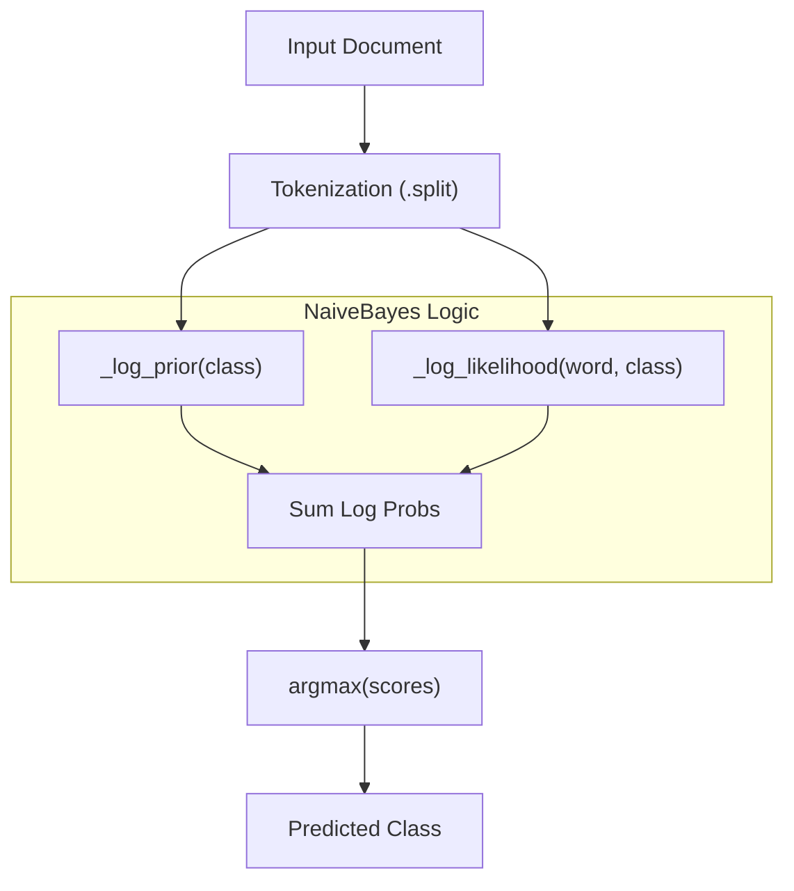
**Sources:** `[phases/01-math-foundations/07-bayes-theorem/code/bayes.py]()`, `[phases/01-math-foundations/07-bayes-theorem/docs/en.md]()`

---

## 3. Statistics for ML

Statistics provides the framework for model evaluation, ensuring that observed improvements are not merely the result of random noise.

### Descriptive Statistics & Correlation
The toolkit includes functions for calculating central tendency and dispersion.
*   **Pearson Correlation**: Measures linear relationships `[phases/01-math-foundations/15-statistics-for-ml/code/statistics.py:68-77]()`.
*   **Spearman Correlation**: Measures monotonic relationships via rank-ordering `[phases/01-math-foundations/15-statistics-for-ml/code/statistics.py:95-98]()`.

### Hypothesis Testing & Bootstrapping
The system implements several tests to validate model performance:
*   **T-Tests**: For comparing means between groups (e.g., A/B testing) `[phases/01-math-foundations/15-statistics-for-ml/code/statistics.py:182-199]()`.
*   **Chi-Squared**: For categorical data distributions `[phases/01-math-foundations/15-statistics-for-ml/code/statistics.py:202-208]()`.
*   **Bootstrapping**: A non-parametric method to estimate confidence intervals for metrics like F1-score by resampling with replacement `[phases/01-math-foundations/15-statistics-for-ml/code/statistics.py:233-251]()`.

**Sources:** `[phases/01-math-foundations/15-statistics-for-ml/code/statistics.py]()`, `[phases/01-math-foundations/15-statistics-for-ml/docs/en.md]()`

---

## 4. Sampling Methods

Sampling is the mechanism by which generative models (LLMs, Diffusion) produce output. The codebase implements both direct and Markov Chain Monte Carlo (MCMC) methods.

### Generative Sampling (LLMs)
The toolkit provides logic for controlling token generation:
*   **Temperature Sampling**: Scales logits to control "creativity" `[phases/01-math-foundations/16-sampling-methods/code/sampling.py:226-231]()`.
*   **Top-K Sampling**: Restricts sampling to the $K$ most likely tokens `[phases/01-math-foundations/16-sampling-methods/code/sampling.py:243-249]()`.

### Advanced Sampling Algorithms
| Method | Description | Implementation |
| :--- | :--- | :--- |
| **Inverse CDF** | Transforms uniform samples into target distribution samples | `[phases/01-math-foundations/16-sampling-methods/code/sampling.py:11-13]()` |
| **Rejection Sampling** | Samples from a proposal distribution and rejects based on target density | `[phases/01-math-foundations/16-sampling-methods/code/sampling.py:38-45]()` |
| **Metropolis-Hastings** | An MCMC algorithm for high-dimensional distributions | `[phases/01-math-foundations/16-sampling-methods/code/sampling.py:145-164]()` |
| **Gibbs Sampling** | Samples from conditional distributions sequentially | `[phases/01-math-foundations/16-sampling-methods/code/sampling.py:196-206]()` |

**Sampling Logic Diagram**
```mermaid
graph LR
    U["Uniform Random (0,1)"] -- "F_inverse(u)" --> I["Inverse CDF"]
    U -- "Box-Muller" --> N["Normal Distribution"]
    N -- "Proposal" --> MH["Metropolis-Hastings"]
    MH -- "Accept/Reject" --> POST["Posterior Samples"]
    
    subgraph "sampling.py"
        I
        N
        MH
    end
```
**Sources:** `[phases/01-math-foundations/16-sampling-methods/code/sampling.py]()`, `[phases/01-math-foundations/16-sampling-methods/docs/en.md]()`

---

## 5. Toolkit Artifacts

This section produces several reusable artifacts for the `outputs/` directory:

*   **skill-probability-reasoning**: A skill for calculating distributions, expectations, and handling numerical stability `[phases/01-math-foundations/06-probability-and-distributions/outputs/skill-probability-reasoning.md]()`.
*   **prompt-bayesian-reasoning**: A guide for stepping through Bayes' theorem for complex scenarios `[phases/01-math-foundations/07-bayes-theorem/outputs/prompt-bayesian-reasoning.md]()`.
*   **skill-statistical-testing**: A decision tree for selecting the correct test (T-test, Chi-square, etc.) based on data types `[phases/01-math-foundations/15-statistics-for-ml/outputs/skill-statistical-testing.md]()`.
*   **skill-sampling-strategy**: Guidelines for choosing between Temperature, Top-P, and MCMC methods `[phases/01-math-foundations/16-sampling-methods/outputs/skill-sampling-strategy.md]()`.

**Sources:** `[phases/01-math-foundations/07-bayes-theorem/outputs/prompt-bayesian-reasoning.md]()`, `[phases/01-math-foundations/15-statistics-for-ml/outputs/skill-statistical-testing.md]()`, `[phases/01-math-foundations/16-sampling-methods/outputs/skill-sampling-strategy.md]()`

---

# Page: Optimization, Information Theory & Advanced Math

# Optimization, Information Theory & Advanced Math

<details>
<summary>Relevant source files</summary>

The following files were used as context for generating this wiki page:

- [phases/01-math-foundations/01-linear-algebra-intuition/code/vectors.jl](phases/01-math-foundations/01-linear-algebra-intuition/code/vectors.jl)
- [phases/01-math-foundations/01-linear-algebra-intuition/code/vectors.py](phases/01-math-foundations/01-linear-algebra-intuition/code/vectors.py)
- [phases/01-math-foundations/01-linear-algebra-intuition/docs/en.md](phases/01-math-foundations/01-linear-algebra-intuition/docs/en.md)
- [phases/01-math-foundations/01-linear-algebra-intuition/outputs/prompt-linear-algebra-tutor.md](phases/01-math-foundations/01-linear-algebra-intuition/outputs/prompt-linear-algebra-tutor.md)
- [phases/01-math-foundations/03-matrix-transformations/code/transformations.jl](phases/01-math-foundations/03-matrix-transformations/code/transformations.jl)
- [phases/01-math-foundations/03-matrix-transformations/code/transformations.py](phases/01-math-foundations/03-matrix-transformations/code/transformations.py)
- [phases/01-math-foundations/03-matrix-transformations/docs/en.md](phases/01-math-foundations/03-matrix-transformations/docs/en.md)
- [phases/01-math-foundations/03-matrix-transformations/outputs/prompt-transformation-visualizer.md](phases/01-math-foundations/03-matrix-transformations/outputs/prompt-transformation-visualizer.md)
- [phases/01-math-foundations/06-probability-and-distributions/code/probability.py](phases/01-math-foundations/06-probability-and-distributions/code/probability.py)
- [phases/01-math-foundations/06-probability-and-distributions/docs/en.md](phases/01-math-foundations/06-probability-and-distributions/docs/en.md)
- [phases/01-math-foundations/06-probability-and-distributions/outputs/skill-probability-reasoning.md](phases/01-math-foundations/06-probability-and-distributions/outputs/skill-probability-reasoning.md)
- [phases/01-math-foundations/08-optimization/code/optimizers.py](phases/01-math-foundations/08-optimization/code/optimizers.py)
- [phases/01-math-foundations/08-optimization/docs/en.md](phases/01-math-foundations/08-optimization/docs/en.md)
- [phases/01-math-foundations/08-optimization/outputs/prompt-optimizer-guide.md](phases/01-math-foundations/08-optimization/outputs/prompt-optimizer-guide.md)
- [phases/01-math-foundations/11-singular-value-decomposition/code/svd.jl](phases/01-math-foundations/11-singular-value-decomposition/code/svd.jl)
- [phases/01-math-foundations/11-singular-value-decomposition/code/svd.py](phases/01-math-foundations/11-singular-value-decomposition/code/svd.py)
- [phases/01-math-foundations/11-singular-value-decomposition/docs/en.md](phases/01-math-foundations/11-singular-value-decomposition/docs/en.md)
- [phases/01-math-foundations/11-singular-value-decomposition/outputs/skill-svd.md](phases/01-math-foundations/11-singular-value-decomposition/outputs/skill-svd.md)
- [phases/01-math-foundations/17-linear-systems/code/linear_systems.py](phases/01-math-foundations/17-linear-systems/code/linear_systems.py)
- [phases/01-math-foundations/17-linear-systems/docs/en.md](phases/01-math-foundations/17-linear-systems/docs/en.md)
- [phases/01-math-foundations/18-convex-optimization/code/convex.py](phases/01-math-foundations/18-convex-optimization/code/convex.py)
- [phases/01-math-foundations/18-convex-optimization/docs/en.md](phases/01-math-foundations/18-convex-optimization/docs/en.md)
- [phases/02-ml-fundamentals/04-decision-trees/code/trees.py](phases/02-ml-fundamentals/04-decision-trees/code/trees.py)
- [phases/02-ml-fundamentals/04-decision-trees/docs/en.md](phases/02-ml-fundamentals/04-decision-trees/docs/en.md)
- [phases/02-ml-fundamentals/07-unsupervised-learning/code/clustering.py](phases/02-ml-fundamentals/07-unsupervised-learning/code/clustering.py)
- [phases/02-ml-fundamentals/07-unsupervised-learning/docs/en.md](phases/02-ml-fundamentals/07-unsupervised-learning/docs/en.md)
- [phases/02-ml-fundamentals/14-naive-bayes/docs/en.md](phases/02-ml-fundamentals/14-naive-bayes/docs/en.md)
- [phases/03-deep-learning-core/02-multi-layer-networks/code/main.py](phases/03-deep-learning-core/02-multi-layer-networks/code/main.py)
- [phases/03-deep-learning-core/02-multi-layer-networks/docs/en.md](phases/03-deep-learning-core/02-multi-layer-networks/docs/en.md)
- [phases/03-deep-learning-core/02-multi-layer-networks/outputs/prompt-network-architect.md](phases/03-deep-learning-core/02-multi-layer-networks/outputs/prompt-network-architect.md)
- [phases/03-deep-learning-core/04-activation-functions/code/main.py](phases/03-deep-learning-core/04-activation-functions/code/main.py)
- [phases/03-deep-learning-core/04-activation-functions/docs/en.md](phases/03-deep-learning-core/04-activation-functions/docs/en.md)
- [phases/03-deep-learning-core/04-activation-functions/outputs/prompt-activation-selector.md](phases/03-deep-learning-core/04-activation-functions/outputs/prompt-activation-selector.md)
- [phases/03-deep-learning-core/06-optimizers/code/main.py](phases/03-deep-learning-core/06-optimizers/code/main.py)
- [phases/03-deep-learning-core/06-optimizers/docs/en.md](phases/03-deep-learning-core/06-optimizers/docs/en.md)
- [phases/03-deep-learning-core/06-optimizers/outputs/prompt-optimizer-selector.md](phases/03-deep-learning-core/06-optimizers/outputs/prompt-optimizer-selector.md)
- [phases/10-llms-from-scratch/11-quantization/code/main.py](phases/10-llms-from-scratch/11-quantization/code/main.py)
- [phases/10-llms-from-scratch/11-quantization/docs/en.md](phases/10-llms-from-scratch/11-quantization/docs/en.md)
- [phases/10-llms-from-scratch/11-quantization/outputs/skill-quantization.md](phases/10-llms-from-scratch/11-quantization/outputs/skill-quantization.md)

</details>


This section covers the mathematical machinery that enables neural networks to learn, represent data efficiently, and maintain numerical integrity. It spans from the iterative algorithms used to minimize loss functions to the information-theoretic measures that define those losses, alongside advanced topics in dimensionality reduction, convex optimization, and spectral analysis.

## 1. Optimization & Gradient Descent

Optimization in AI is the process of finding the weight values $w$ that minimize a loss function $L(w)$ [phases/01-math-foundations/08-optimization/docs/en.md:21-28](). While vanilla Gradient Descent moves weights opposite the gradient ($\Delta w = -\eta \nabla L$), modern optimizers use history and adaptive scaling to navigate complex loss landscapes [phases/03-deep-learning-core/06-optimizers/docs/en.md:17-29]().

### Optimizer Mechanics
*   **Momentum**: Accumulates past gradients into a velocity term to dampen oscillations and accelerate through flat regions [phases/03-deep-learning-core/06-optimizers/docs/en.md:45-58]().
*   **Adam (Adaptive Moment Estimation)**: Combines momentum with RMSProp. It tracks both the first moment (mean of gradients) and second moment (uncentered variance) [phases/03-deep-learning-core/06-optimizers/docs/en.md:75-82](). It uses **Bias Correction** to compensate for zero-initialization in early steps [phases/03-deep-learning-core/06-optimizers/code/main.py:49-50]().
*   **AdamW**: Decouples weight decay from the adaptive learning rate, applying it directly to the weights to improve generalization [phases/03-deep-learning-core/06-optimizers/docs/en.md:101-115]().

### Optimization Data Flow
The diagram below illustrates how gradients are transformed by the `Adam` and `AdamW` logic before updating model parameters.

**Optimizer Pipeline**
```mermaid
graph TD
    subgraph "Optimizer Classes (optimizers.py / main.py)"
        G["grads[i]"] --> M["self.m[i] (Momentum)"]
        G --> V["self.v[i] (Variance)"]
        M --> BC1["m_hat = m / (1 - beta1^t)"]
        V --> BC2["v_hat = v / (1 - beta2^t)"]
        BC1 & BC2 --> Update["params[i] -= lr * m_hat / (sqrt(v_hat) + eps)"]
        Params["params[i]"] -- "AdamW Weight Decay" --> WD["params[i] * (1 - wd * lr)"]
        WD --> Update
    end
```
Sources: [phases/03-deep-learning-core/06-optimizers/code/main.py:28-82](), [phases/03-deep-learning-core/06-optimizers/docs/en.md:75-115]()

## 2. Information Theory & Loss Functions

Information theory provides the formal definition for "surprise" and "uncertainty," which form the basis of most ML loss functions.

### Key Metrics
*   **Entropy**: Measures the disorder or information content in a node. In decision trees, it is used to calculate **Information Gain** [phases/02-ml-fundamentals/04-decision-trees/docs/en.md:65-82]().
*   **Gini Impurity**: An alternative to entropy for tree splitting that measures the probability of misclassification [phases/02-ml-fundamentals/04-decision-trees/docs/en.md:49-57]().
*   **Cross-Entropy Loss**: Standard for classification, implemented as `-(y * log(p) + (1 - y) * log(1 - p))` in training loops [phases/03-deep-learning-core/06-optimizers/code/main.py:189]().
*   **Log-Loss**: The convex loss function used in logistic regression [phases/01-math-foundations/18-convex-optimization/docs/en.md:120]().

Sources: [phases/02-ml-fundamentals/04-decision-trees/docs/en.md:45-91](), [phases/03-deep-learning-core/06-optimizers/code/main.py:187-194]()

## 3. Dimensionality Reduction & SVD

High-dimensional data is often redundant. Reduction techniques find the "latent" manifold where the actual information resides.

### Singular Value Decomposition (SVD)
SVD generalizes eigendecomposition to any $m \times n$ matrix $A$, factoring it into $U \Sigma V^T$ [phases/01-math-foundations/11-singular-value-decomposition/docs/en.md:22-34]().
*   **$V^T$**: Rotation in input space [phases/01-math-foundations/11-singular-value-decomposition/docs/en.md:71]().
*   **$\Sigma$**: Scaling along axes (Singular Values) [phases/01-math-foundations/11-singular-value-decomposition/docs/en.md:73]().
*   **$U$**: Rotation into output space [phases/01-math-foundations/11-singular-value-decomposition/docs/en.md:75]().
*   **Truncated SVD**: The best rank-$k$ approximation of a matrix is found by keeping only the top $k$ singular values, used for compression and denoising [phases/01-math-foundations/11-singular-value-decomposition/docs/en.md:141-157]().

### Linear Systems & Factorization
*   **LU Decomposition**: Factors $A = LU$ to solve $Ax=b$ efficiently via forward and back substitution [phases/01-math-foundations/17-linear-systems/docs/en.md:137-159]().
*   **QR Decomposition**: Factors $A = QR$ using orthonormal matrices, providing a stable path for least-squares regression [phases/01-math-foundations/17-linear-systems/docs/en.md:163-179]().
*   **Cholesky**: Fast factorization for symmetric positive-definite matrices like covariance matrices [phases/01-math-foundations/17-linear-systems/docs/en.md:13]().

Sources: [phases/01-math-foundations/11-singular-value-decomposition/docs/en.md:1-157](), [phases/01-math-foundations/17-linear-systems/docs/en.md:137-179]()

## 4. Numerical Stability, Norms & Quantization

AI engineering requires managing floating-point precision to balance memory and accuracy.

### Quantization
Quantization reduces memory by mapping high-precision floats (FP16/BF16) to lower-bit formats like INT8 or INT4 [phases/10-llms-from-scratch/11-quantization/docs/en.md:1-27]().
*   **Symmetric Quantization**: `scale = max(abs(tensor)) / 127` [phases/10-llms-from-scratch/11-quantization/docs/en.md:89-102]().
*   **Per-Channel Quantization**: Uses a unique scale factor per output channel to preserve precision in heterogeneous weight matrices [phases/10-llms-from-scratch/11-quantization/docs/en.md:106]().

### Norms & Distances
*   **Euclidean Distance**: Standard $L2$ distance used in `kmeans` and `dbscan` [phases/02-ml-fundamentals/07-unsupervised-learning/code/clustering.py:5-6]().
*   **Norms in Training**: $L2$ regularization (weight decay) is used to prevent overfitting by penalizing large parameter magnitudes [phases/03-deep-learning-core/06-optimizers/docs/en.md:103-115]().

Sources: [phases/10-llms-from-scratch/11-quantization/docs/en.md:31-108](), [phases/02-ml-fundamentals/07-unsupervised-learning/code/clustering.py:5-23]()

## 5. Convex Optimization & Nonlinearity

### Convexity
A problem is convex if any local minimum is the global minimum [phases/01-math-foundations/18-convex-optimization/docs/en.md:90-94]().
*   **Hessian Matrix**: The matrix of second partial derivatives used to test for convexity (Positive Semidefinite) and curvature [phases/01-math-foundations/18-convex-optimization/docs/en.md:130-154]().
*   **Newton's Method**: A second-order optimization algorithm that jumps to the minimum of a quadratic approximation [phases/01-math-foundations/18-convex-optimization/docs/en.md:157-162]().

### Breaking Linearity
Neural networks use **Activation Functions** to break the composability of linear layers, allowing them to approximate non-convex functions [phases/03-deep-learning-core/04-activation-functions/docs/en.md:27-53]().
*   **ReLU**: `max(0, x)`, solves vanishing gradients but can cause "dead neurons" [phases/03-deep-learning-core/04-activation-functions/docs/en.md:99-116]().
*   **GELU/Swish**: Smooth, non-monotonic activations used in modern Transformers to improve gradient flow [phases/03-deep-learning-core/04-activation-functions/docs/en.md:129-155]().

**Math to Code Entity Map**
```mermaid
graph LR
    subgraph "Mathematical Concept"
        SVD["SVD Factorization"]
        OPT["Adaptive Optimization"]
        QUANT["Quantization"]
    end
    subgraph "Code Implementation"
        SVD_C["svd_power_iteration()"]
        ADAM["Adam.step()"]
        Q_FUNC["quantize_tensor()"]
    end
    SVD --> SVD_C
    OPT --> ADAM
    QUANT --> Q_FUNC
```
Sources: [phases/01-math-foundations/11-singular-value-decomposition/code/svd.py:1-50](), [phases/03-deep-learning-core/06-optimizers/code/main.py:28-53](), [phases/10-llms-from-scratch/11-quantization/docs/en.md:87-91]()

---

# Page: Phase 2: Machine Learning Fundamentals

# Phase 2: Machine Learning Fundamentals

<details>
<summary>Relevant source files</summary>

The following files were used as context for generating this wiki page:

- [phases/02-ml-fundamentals/04-decision-trees/code/trees.py](phases/02-ml-fundamentals/04-decision-trees/code/trees.py)
- [phases/02-ml-fundamentals/04-decision-trees/docs/en.md](phases/02-ml-fundamentals/04-decision-trees/docs/en.md)
- [phases/02-ml-fundamentals/07-unsupervised-learning/code/clustering.py](phases/02-ml-fundamentals/07-unsupervised-learning/code/clustering.py)
- [phases/02-ml-fundamentals/07-unsupervised-learning/docs/en.md](phases/02-ml-fundamentals/07-unsupervised-learning/docs/en.md)
- [phases/02-ml-fundamentals/14-naive-bayes/docs/en.md](phases/02-ml-fundamentals/14-naive-bayes/docs/en.md)
- [phases/03-deep-learning-core/02-multi-layer-networks/code/main.py](phases/03-deep-learning-core/02-multi-layer-networks/code/main.py)
- [phases/03-deep-learning-core/02-multi-layer-networks/docs/en.md](phases/03-deep-learning-core/02-multi-layer-networks/docs/en.md)
- [phases/03-deep-learning-core/02-multi-layer-networks/outputs/prompt-network-architect.md](phases/03-deep-learning-core/02-multi-layer-networks/outputs/prompt-network-architect.md)
- [phases/03-deep-learning-core/04-activation-functions/code/main.py](phases/03-deep-learning-core/04-activation-functions/code/main.py)
- [phases/03-deep-learning-core/04-activation-functions/docs/en.md](phases/03-deep-learning-core/04-activation-functions/docs/en.md)
- [phases/03-deep-learning-core/04-activation-functions/outputs/prompt-activation-selector.md](phases/03-deep-learning-core/04-activation-functions/outputs/prompt-activation-selector.md)
- [phases/03-deep-learning-core/06-optimizers/code/main.py](phases/03-deep-learning-core/06-optimizers/code/main.py)
- [phases/03-deep-learning-core/06-optimizers/docs/en.md](phases/03-deep-learning-core/06-optimizers/docs/en.md)
- [phases/03-deep-learning-core/06-optimizers/outputs/prompt-optimizer-selector.md](phases/03-deep-learning-core/06-optimizers/outputs/prompt-optimizer-selector.md)
- [phases/10-llms-from-scratch/11-quantization/code/main.py](phases/10-llms-from-scratch/11-quantization/code/main.py)
- [phases/10-llms-from-scratch/11-quantization/docs/en.md](phases/10-llms-from-scratch/11-quantization/docs/en.md)
- [phases/10-llms-from-scratch/11-quantization/outputs/skill-quantization.md](phases/10-llms-from-scratch/11-quantization/outputs/skill-quantization.md)

</details>


Phase 2 transitions from pure mathematical theory into the practical application of algorithms that learn from data. This phase covers 18 lessons focused on implementing classical machine learning algorithms from scratch using Python and NumPy. The goal is to move beyond "programming rules" to building systems that "discover rules" from data [phases/02-ml-fundamentals/01-what-is-machine-learning/docs/en.md:3-16]().

## The Machine Learning Paradigm

Machine learning shifts the development focus from manual rule-writing to algorithmic pattern discovery. In traditional programming, developers provide rules and data to get output; in machine learning, developers provide data and expected outputs to a learning algorithm, which then produces a model (the rules) [phases/02-ml-fundamentals/01-what-is-machine-learning/docs/en.md:24-45]().

### Learning Taxonomy
The curriculum categorizes machine learning into three primary domains, while also exploring modern hybrid strategies like self-supervised learning used in Large Language Models [phases/02-ml-fundamentals/01-what-is-machine-learning/docs/en.md:49-95]().

| Category | Goal | Key Examples |
| :--- | :--- | :--- |
| **Supervised** | Map inputs to labeled outputs | Regression, Classification |
| **Unsupervised** | Find hidden structure in unlabeled data | Clustering, Dimensionality Reduction |
| **Reinforcement** | Maximize rewards through environmental interaction | Policy Optimization, Robotics |

### From Data to Code
The following diagram illustrates how the conceptual ML workflow maps to the implementation entities found in this phase, specifically highlighting the `NearestCentroid` implementation as a foundational example.

**ML Workflow to Code Entity Mapping**
```mermaid
graph TD
    subgraph "Natural Language Space"
        Data["Raw Data"]
        Split["Data Splitting"]
        Training["Model Training"]
        Evaluation["Performance Metrics"]
    end

    subgraph "Code Entity Space (ml_intro.py)"
        GenData["generate_classification_data()"]
        SplitFn["train_test_split()"]
        Fit["NearestCentroid.fit()"]
        Score["NearestCentroid.score()"]
        Baseline["majority_baseline()"]
    end

    Data --> GenData
    Split --> SplitFn
    Training --> Fit
    Evaluation --> Score
    Evaluation --> Baseline
```
Sources: [phases/02-ml-fundamentals/01-what-is-machine-learning/code/ml_intro.py:4-58]()

---

## Core Curriculum Components

### Supervised Learning Algorithms
This section covers the implementation of models that predict discrete categories (Classification) or continuous numbers (Regression) [phases/02-ml-fundamentals/01-what-is-machine-learning/docs/en.md:101-112](). You will build foundational models including Linear Regression (OLS, Ridge, Lasso), Logistic Regression, Decision Trees, and Support Vector Machines. 

Key implementations include:
- **Decision Trees**: Recursive partitioning using Gini impurity and Information Gain [phases/02-ml-fundamentals/04-decision-trees/docs/en.md:45-91]().
- **Naive Bayes**: Probabilistic classification using Bayes' Theorem [phases/02-ml-fundamentals/14-naive-bayes/docs/en.md:1-20]().

For details, see [Supervised Learning Algorithms](#4.1).

### Unsupervised Learning & Ensemble Methods
Focuses on finding patterns without explicit labels. This includes clustering techniques like K-Means, DBSCAN, and Gaussian Mixture Models (GMM) [phases/02-ml-fundamentals/07-unsupervised-learning/docs/en.md:31-42](). Ensemble methods combine multiple weak learners (like Decision Trees) into strong learners (like Random Forests) using techniques like Bagging and Feature Randomization [phases/02-ml-fundamentals/04-decision-trees/docs/en.md:134-157]().

**Clustering Implementation Logic**
```mermaid
graph TD
    subgraph "Clustering Logic (clustering.py)"
        KM["kmeans()"]
        DB["dbscan()"]
        GM["gmm()"]
        Dist["euclidean_distance()"]
    end

    KM --> Dist
    DB --> Dist
    GM --> Dist
    KM --> Inertia["compute_inertia()"]
    KM --> Sil["silhouette_score()"]
```
Sources: [phases/02-ml-fundamentals/07-unsupervised-learning/code/clustering.py:5-159]()

For details, see [Unsupervised Learning & Ensemble Methods](#4.2).

### Model Evaluation, Feature Engineering & Pipelines
Machine learning is an iterative process [phases/02-ml-fundamentals/01-what-is-machine-learning/docs/en.md:117-128](). This section covers the critical "plumbing" of AI engineering: transforming raw data into usable features, selecting the best model via cross-validation, and tuning hyperparameters. It also addresses real-world challenges like quantization for model compression [phases/10-llms-from-scratch/11-quantization/docs/en.md:83-106]().

For details, see [Model Evaluation, Feature Engineering & Pipelines](#4.3).

---

## Technical Implementation Example: Nearest Centroid
The `NearestCentroid` class serves as the introductory implementation for this phase. It demonstrates the `fit`/`predict` pattern used throughout the curriculum.

**Algorithm Logic Flow**
```mermaid
flowchart TD
    Start["X, y (Training Data)"] --> Fit["NearestCentroid.fit()"]
    Fit --> Calc["Calculate Mean per Class"]
    Calc --> Store["Store self.centroids"]
    
    NewData["X_test (New Data)"] --> Predict["NearestCentroid.predict()"]
    Store --> Predict
    Predict --> Dist["Calculate Euclidean Distance to Centroids"]
    Dist --> Assign["Assign Class with Min Distance"]
    Assign --> Output["Predictions"]
```
Sources: [phases/02-ml-fundamentals/01-what-is-machine-learning/code/ml_intro.py:9-20]()

### Key Implementation Details
- **`fit(X, y)`**: Identifies unique classes and calculates the mean feature vector (centroid) for each [phases/02-ml-fundamentals/01-what-is-machine-learning/code/ml_intro.py:9-13]().
- **`predict(X)`**: Uses vectorized NumPy operations to calculate distances between new points and stored centroids [phases/02-ml-fundamentals/01-what-is-machine-learning/code/ml_intro.py:15-20]().
- **`score(X, y)`**: Evaluates accuracy by comparing predictions against ground truth labels [phases/02-ml-fundamentals/01-what-is-machine-learning/code/ml_intro.py:22-23]().

**Sources:**
- [phases/02-ml-fundamentals/01-what-is-machine-learning/docs/en.md:1-143]()
- [phases/02-ml-fundamentals/01-what-is-machine-learning/code/ml_intro.py:1-197]()
- [phases/02-ml-fundamentals/04-decision-trees/docs/en.md:1-157]()
- [phases/02-ml-fundamentals/07-unsupervised-learning/docs/en.md:1-125]()
- [phases/02-ml-fundamentals/07-unsupervised-learning/code/clustering.py:1-221]()

---

# Page: Supervised Learning Algorithms

# Supervised Learning Algorithms

<details>
<summary>Relevant source files</summary>

The following files were used as context for generating this wiki page:

- [phases/02-ml-fundamentals/04-decision-trees/code/trees.py](phases/02-ml-fundamentals/04-decision-trees/code/trees.py)
- [phases/02-ml-fundamentals/04-decision-trees/docs/en.md](phases/02-ml-fundamentals/04-decision-trees/docs/en.md)
- [phases/02-ml-fundamentals/07-unsupervised-learning/code/clustering.py](phases/02-ml-fundamentals/07-unsupervised-learning/code/clustering.py)
- [phases/02-ml-fundamentals/07-unsupervised-learning/docs/en.md](phases/02-ml-fundamentals/07-unsupervised-learning/docs/en.md)
- [phases/02-ml-fundamentals/14-naive-bayes/docs/en.md](phases/02-ml-fundamentals/14-naive-bayes/docs/en.md)
- [phases/03-deep-learning-core/02-multi-layer-networks/code/main.py](phases/03-deep-learning-core/02-multi-layer-networks/code/main.py)
- [phases/03-deep-learning-core/02-multi-layer-networks/docs/en.md](phases/03-deep-learning-core/02-multi-layer-networks/docs/en.md)
- [phases/03-deep-learning-core/02-multi-layer-networks/outputs/prompt-network-architect.md](phases/03-deep-learning-core/02-multi-layer-networks/outputs/prompt-network-architect.md)
- [phases/03-deep-learning-core/04-activation-functions/code/main.py](phases/03-deep-learning-core/04-activation-functions/code/main.py)
- [phases/03-deep-learning-core/04-activation-functions/docs/en.md](phases/03-deep-learning-core/04-activation-functions/docs/en.md)
- [phases/03-deep-learning-core/04-activation-functions/outputs/prompt-activation-selector.md](phases/03-deep-learning-core/04-activation-functions/outputs/prompt-activation-selector.md)
- [phases/03-deep-learning-core/06-optimizers/code/main.py](phases/03-deep-learning-core/06-optimizers/code/main.py)
- [phases/03-deep-learning-core/06-optimizers/docs/en.md](phases/03-deep-learning-core/06-optimizers/docs/en.md)
- [phases/03-deep-learning-core/06-optimizers/outputs/prompt-optimizer-selector.md](phases/03-deep-learning-core/06-optimizers/outputs/prompt-optimizer-selector.md)
- [phases/10-llms-from-scratch/11-quantization/code/main.py](phases/10-llms-from-scratch/11-quantization/code/main.py)
- [phases/10-llms-from-scratch/11-quantization/docs/en.md](phases/10-llms-from-scratch/11-quantization/docs/en.md)
- [phases/10-llms-from-scratch/11-quantization/outputs/skill-quantization.md](phases/10-llms-from-scratch/11-quantization/outputs/skill-quantization.md)

</details>


This page covers the implementation and theory of fundamental supervised learning algorithms as explored in Phase 2, Lessons 02–06 and 14. These algorithms represent the "classical" machine learning toolkit, providing essential baselines for regression and classification tasks. All implementations are written from scratch in Python to demonstrate the underlying mathematical optimization and logic.

## 1. Linear Regression (OLS, Ridge, Lasso)

Linear regression models the relationship between a scalar response and one or more explanatory variables by fitting a linear equation to observed data [phases/02-ml-fundamentals/02-linear-regression/docs/en.md:20-22]().

### Core Implementations
*   **Gradient Descent (`LinearRegression`)**: Iteratively updates weights `w` and bias `b` to minimize Mean Squared Error (MSE) [phases/02-ml-fundamentals/02-linear-regression/code/linear_regression.py:18-50]().
*   **Normal Equation (`LinearRegressionNormal`)**: A closed-form solution using matrix inversion, ideal for smaller datasets where $n < 10,000$ [phases/02-ml-fundamentals/02-linear-regression/code/linear_regression.py:68-81]().
*   **Multiple Linear Regression**: Extends the model to $n$ features using vector operations [phases/02-ml-fundamentals/02-linear-regression/code/linear_regression.py:101-134]().
*   **Regularization**: Ridge (L2) adds a penalty $\lambda \sum w_i^2$ to discourage large weights and prevent overfitting [phases/02-ml-fundamentals/02-linear-regression/docs/en.md:133-141]().

### Regression Data Flow
The following diagram illustrates the lifecycle of a regression model from initialization to evaluation.

**Model Training & Prediction Loop**
```mermaid
graph TD
    subgraph "Data Preparation"
        A["Input X, y"] --> B["Standardize Features"]
    end
    subgraph "LinearRegression Class"
        B --> C["Initialize w, b"]
        C --> D["predict(X)"]
        D --> E["compute_gradients(dw, db)"]
        E --> F["Update: w -= lr * dw"]
        F --> G{"Epochs done?"}
        G -- No --> D
        G -- Yes --> H["Final Weights"]
    end
    subgraph "Evaluation"
        H --> I["r_squared(X, y)"]
    end
```
Sources: [phases/02-ml-fundamentals/02-linear-regression/code/linear_regression.py:18-58](), [phases/02-ml-fundamentals/02-linear-regression/docs/en.md:57-66]()

## 2. Logistic Regression & Classification

Despite its name, Logistic Regression is a classification algorithm that predicts the probability of a binary outcome using the Sigmoid function [phases/02-ml-fundamentals/03-logistic-regression/docs/en.md:11-16]().

### Key Components
*   **Sigmoid Function**: Squashes the linear output $z = wx + b$ into the range $(0, 1)$ [phases/02-ml-fundamentals/03-logistic-regression/code/logistic_regression.py:5-7]().
*   **Binary Cross-Entropy (Log Loss)**: The convex cost function used for optimization [phases/02-ml-fundamentals/03-logistic-regression/code/logistic_regression.py:50-57]().
*   **Softmax Regression**: A generalization for multi-class classification where probabilities for all classes sum to 1 [phases/02-ml-fundamentals/03-logistic-regression/code/logistic_regression.py:165-188]().
*   **Metrics**: Evaluation via `ClassificationMetrics` class, calculating Accuracy, Precision, Recall, and F1 Score [phases/02-ml-fundamentals/03-logistic-regression/code/logistic_regression.py:99-135]().

Sources: [phases/02-ml-fundamentals/03-logistic-regression/code/logistic_regression.py:36-82](), [phases/02-ml-fundamentals/03-logistic-regression/docs/en.md:53-64]()

## 3. Decision Trees & Random Forests

Decision Trees partition the feature space into regions based on feature thresholds. Random Forests improve this by averaging multiple decorrelated trees [phases/02-ml-fundamentals/04-decision-trees/docs/en.md:12-16]().

### Split Criteria
*   **Gini Impurity**: Measures the probability of misclassification [phases/02-ml-fundamentals/04-decision-trees/code/trees.py:5-12]().
*   **Entropy**: Measures information disorder [phases/02-ml-fundamentals/04-decision-trees/code/trees.py:15-24]().
*   **Variance Reduction**: Used for regression trees [phases/02-ml-fundamentals/04-decision-trees/code/trees.py:42-51]().

### Random Forest Mechanics
The `RandomForest` implementation utilizes **Bagging** (bootstrap samples) and **Feature Randomization** (selecting a subset of features at each split) to reduce variance [phases/02-ml-fundamentals/04-decision-trees/docs/en.md:146-153](). Diversity is achieved through `bootstrap_sample` and selecting a random subset of features at each node [phases/02-ml-fundamentals/04-decision-trees/docs/en.md:154-158]().

Sources: [phases/02-ml-fundamentals/04-decision-trees/code/trees.py:75-143](), [phases/02-ml-fundamentals/04-decision-trees/docs/en.md:131-145]()

## 4. Support Vector Machines (SVM)

SVMs aim to find the hyperplane that maximizes the margin between two classes [phases/02-ml-fundamentals/05-support-vector-machines/docs/en.md:11-16]().

### Implementation Details
*   **Hinge Loss**: The loss function that penalizes points inside the margin or on the wrong side of the boundary [phases/02-ml-fundamentals/05-support-vector-machines/code/svm.py:38-44]().
*   **Kernel Trick**: Allows the SVM to operate in high-dimensional feature spaces without explicit transformation. Supported kernels include Linear, Polynomial, and RBF (Gaussian) [phases/02-ml-fundamentals/05-support-vector-machines/code/svm.py:25-35]().
*   **C Parameter**: Controls the trade-off between maximizing the margin and minimizing classification errors (Soft Margin) [phases/02-ml-fundamentals/05-support-vector-machines/docs/en.md:87-94]().

Sources: [phases/02-ml-fundamentals/05-support-vector-machines/code/svm.py:53-111](), [phases/02-ml-fundamentals/05-support-vector-machines/docs/en.md:161-170]()

## 5. K-Nearest Neighbors (KNN)

KNN is a "lazy" learning algorithm that stores all training data and makes predictions based on the $K$ most similar instances [phases/02-ml-fundamentals/06-knn-and-distances/docs/en.md:11-14]().

### Distance Metrics & Optimization
*   **Metrics**: Implementation of L1 (Manhattan), L2 (Euclidean), Cosine, and Minkowski distances [phases/02-ml-fundamentals/06-knn-and-distances/code/knn.py:5-25]().
*   **KD-Tree**: A spatial data structure implemented in `KDTree` and `KDNode` classes to speed up neighbor searches from $O(N)$ to $O(\log N)$ [phases/02-ml-fundamentals/06-knn-and-distances/code/knn.py:112-172]().

Sources: [phases/02-ml-fundamentals/06-knn-and-distances/code/knn.py:49-109](), [phases/02-ml-fundamentals/06-knn-and-distances/docs/en.md:156-170]()

## 6. Naive Bayes

Naive Bayes classifiers apply Bayes' Theorem with the "naive" assumption of conditional independence between features [phases/02-ml-fundamentals/14-naive-bayes/docs/en.md:10-15]().

*   **Multinomial**: Typically used for discrete counts like word frequencies in text classification [phases/02-ml-fundamentals/14-naive-bayes/docs/en.md:18-20]().
*   **Gaussian**: Used for continuous data, modeling each feature as a normal distribution defined by its mean and variance [phases/02-ml-fundamentals/14-naive-bayes/docs/en.md:18-20]().
*   **Bernoulli**: Suitable for binary or boolean features [phases/02-ml-fundamentals/14-naive-bayes/docs/en.md:18-20]().

Sources: [phases/02-ml-fundamentals/14-naive-bayes/docs/en.md:1-20](), [phases/02-ml-fundamentals/14-naive-bayes/code/naive_bayes.py:1-50]()

## 7. Algorithm Mapping: Logic to Code

This diagram bridges the conceptual "Natural Language Space" of supervised learning to the specific "Code Entity Space" found in the repository.

**System Logic to Code Entity Mapping**
```mermaid
graph LR
    subgraph "Natural Language Space"
        NL1["Linear Fitting"]
        NL2["Probabilistic Classification"]
        NL3["Maximum Margin"]
        NL4["Similarity Search"]
        NL5["Recursive Partitioning"]
        NL6["Independent Probabilities"]
    end

    subgraph "Code Entity Space"
        CE1["LinearRegression class"]
        CE2["LogisticRegression class"]
        CE3["LinearSVM class"]
        CE4["KNN class"]
        CE5["DecisionTree class"]
        CE6["NaiveBayes class"]
        
        FN1["sigmoid() function"]
        FN2["hinge_loss() function"]
        FN3["l2_distance() function"]
        FN4["gini_impurity() function"]
        FN5["gaussian_pdf() function"]
    end

    NL1 --> CE1
    NL2 --> CE2
    NL2 --> FN1
    NL3 --> CE3
    NL3 --> FN2
    NL4 --> CE4
    NL4 --> FN3
    NL5 --> CE5
    NL5 --> FN4
    NL6 --> CE6
    NL6 --> FN5
```
Sources: [phases/02-ml-fundamentals/02-linear-regression/code/linear_regression.py:18](), [phases/02-ml-fundamentals/03-logistic-regression/code/logistic_regression.py:5,36](), [phases/02-ml-fundamentals/04-decision-trees/code/trees.py:5,75](), [phases/02-ml-fundamentals/05-support-vector-machines/code/svm.py:38,53](), [phases/02-ml-fundamentals/06-knn-and-distances/code/knn.py:5,49](), [phases/02-ml-fundamentals/14-naive-bayes/code/naive_bayes.py:10,25]()

## 8. Summary Table of Toolkit Skills

| Skill Artifact | Purpose | Relevant File |
| :--- | :--- | :--- |
| `skill-regression` | Strategy guide for choosing regression models | [outputs/skill-regression.md]() |
| `skill-classification-baseline` | Establishing baselines with Logistic Regression | [outputs/skill-classification-baseline.md]() |
| `skill-svm-kernel-chooser` | Selecting kernels for SVM tasks | [outputs/skill-svm-kernel-chooser.md]() |
| `prompt-tree-interpreter` | Prompt for explaining decision tree logic | [outputs/prompt-tree-interpreter.md]() |
| `prompt-optimizer-selector` | Decision prompt for choosing the right optimizer (Adam, SGD, etc) | [phases/03-deep-learning-core/06-optimizers/outputs/prompt-optimizer-selector.md:1-6]() |

Sources: [phases/02-ml-fundamentals/02-linear-regression/outputs/skill-regression.md:1-8](), [phases/02-ml-fundamentals/03-logistic-regression/outputs/skill-classification-baseline.md:1-8](), [phases/03-deep-learning-core/06-optimizers/outputs/prompt-optimizer-selector.md:1-6]()

---

# Page: Unsupervised Learning & Ensemble Methods

# Unsupervised Learning & Ensemble Methods

<details>
<summary>Relevant source files</summary>

The following files were used as context for generating this wiki page:

- [phases/02-ml-fundamentals/04-decision-trees/code/trees.py](phases/02-ml-fundamentals/04-decision-trees/code/trees.py)
- [phases/02-ml-fundamentals/04-decision-trees/docs/en.md](phases/02-ml-fundamentals/04-decision-trees/docs/en.md)
- [phases/02-ml-fundamentals/07-unsupervised-learning/code/clustering.py](phases/02-ml-fundamentals/07-unsupervised-learning/code/clustering.py)
- [phases/02-ml-fundamentals/07-unsupervised-learning/docs/en.md](phases/02-ml-fundamentals/07-unsupervised-learning/docs/en.md)
- [phases/02-ml-fundamentals/14-naive-bayes/docs/en.md](phases/02-ml-fundamentals/14-naive-bayes/docs/en.md)
- [phases/03-deep-learning-core/02-multi-layer-networks/code/main.py](phases/03-deep-learning-core/02-multi-layer-networks/code/main.py)
- [phases/03-deep-learning-core/02-multi-layer-networks/docs/en.md](phases/03-deep-learning-core/02-multi-layer-networks/docs/en.md)
- [phases/03-deep-learning-core/02-multi-layer-networks/outputs/prompt-network-architect.md](phases/03-deep-learning-core/02-multi-layer-networks/outputs/prompt-network-architect.md)
- [phases/03-deep-learning-core/04-activation-functions/code/main.py](phases/03-deep-learning-core/04-activation-functions/code/main.py)
- [phases/03-deep-learning-core/04-activation-functions/docs/en.md](phases/03-deep-learning-core/04-activation-functions/docs/en.md)
- [phases/03-deep-learning-core/04-activation-functions/outputs/prompt-activation-selector.md](phases/03-deep-learning-core/04-activation-functions/outputs/prompt-activation-selector.md)
- [phases/03-deep-learning-core/06-optimizers/code/main.py](phases/03-deep-learning-core/06-optimizers/code/main.py)
- [phases/03-deep-learning-core/06-optimizers/docs/en.md](phases/03-deep-learning-core/06-optimizers/docs/en.md)
- [phases/03-deep-learning-core/06-optimizers/outputs/prompt-optimizer-selector.md](phases/03-deep-learning-core/06-optimizers/outputs/prompt-optimizer-selector.md)
- [phases/10-llms-from-scratch/11-quantization/code/main.py](phases/10-llms-from-scratch/11-quantization/code/main.py)
- [phases/10-llms-from-scratch/11-quantization/docs/en.md](phases/10-llms-from-scratch/11-quantization/docs/en.md)
- [phases/10-llms-from-scratch/11-quantization/outputs/skill-quantization.md](phases/10-llms-from-scratch/11-quantization/outputs/skill-quantization.md)

</details>


This page covers the implementation and theoretical foundations of unsupervised learning (clustering and anomaly detection) and ensemble methods (bagging, boosting, and stacking). These techniques represent the transition from simple models to robust, production-grade systems capable of handling complex data structures and high-variance scenarios.

## Unsupervised Learning: Finding Hidden Structure

Unsupervised learning algorithms identify patterns in data without explicit labels [phases/02-ml-fundamentals/07-unsupervised-learning/docs/en.md:3-14](). The primary focus is on **Clustering**, which groups similar data points based on distance metrics or density [phases/02-ml-fundamentals/07-unsupervised-learning/docs/en.md:20-22]().

### Core Clustering Algorithms

The implementation in `clustering.py` provides four distinct approaches to grouping data:

1.  **K-Means**: Partitions data into $K$ spherical clusters by minimizing "inertia" (total squared distance to centroids) [phases/02-ml-fundamentals/07-unsupervised-learning/docs/en.md:44-55]().
2.  **DBSCAN**: A density-based approach that identifies clusters of arbitrary shapes and labels sparse points as noise (outliers) [phases/02-ml-fundamentals/07-unsupervised-learning/docs/en.md:65-78]().
3.  **Hierarchical (Agglomerative)**: A bottom-up approach that builds a tree of nested clusters (dendrogram) [phases/02-ml-fundamentals/07-unsupervised-learning/docs/en.md:82-90]().
4.  **Gaussian Mixture Models (GMM)**: A probabilistic approach using the Expectation-Maximization (EM) algorithm to allow for soft assignments and elliptical clusters [phases/02-ml-fundamentals/07-unsupervised-learning/docs/en.md:98-107]().

### Clustering System Architecture

The following diagram maps the logical clustering concepts to the implementation in `clustering.py`.

**Clustering Implementation Flow**
```mermaid
flowchart TD
    subgraph "Data_Input"
        D["data (List[List[float]])"]
    end

    subgraph "Clustering_Logic:_clustering.py"
        KM["kmeans()"]
        DB["dbscan()"]
        GMM["gmm()"]
        AGG["agglomerative_clustering()"]
        
        DIST["euclidean_distance()"]
    end

    subgraph "Evaluation_&_Metrics"
        ELBOW["find_best_k()"]
        SIL["silhouette_score()"]
        INER["compute_inertia()"]
    end

    D --> KM
    D --> DB
    D --> GMM
    D --> AGG

    KM -.-> DIST
    DB -.-> DIST
    GMM -.-> DIST
    AGG -.-> DIST

    KM --> INER
    KM --> SIL
    INER --> ELBOW
```
Sources: [phases/02-ml-fundamentals/07-unsupervised-learning/code/clustering.py:5-223](), [phases/02-ml-fundamentals/07-unsupervised-learning/docs/en.md:31-42]()

### Key Functions
*   `kmeans(data, k, ...)`: Implements Lloyd's algorithm: assign to nearest centroid, then recompute means [phases/02-ml-fundamentals/07-unsupervised-learning/code/clustering.py:9-45]().
*   `dbscan(data, eps, min_samples)`: Uses a `region_query` to expand clusters from "core points" [phases/02-ml-fundamentals/07-unsupervised-learning/code/clustering.py:111-159]().
*   `gmm(data, k, ...)`: Implements EM steps, updating `means`, `variances`, and `weights` for $K$ Gaussians [phases/02-ml-fundamentals/07-unsupervised-learning/code/clustering.py:162-221]().
*   `find_best_k(data)`: Automates the "Elbow Method" by iterating through $K$ values and calculating inertia [phases/02-ml-fundamentals/07-unsupervised-learning/code/clustering.py:93-108]().

---

## Ensemble Methods: Combining Weak Learners

Ensemble methods combine multiple "weak learners" to create a "strong learner". They are categorized by how they address the bias-variance tradeoff.

### Bagging, Boosting, and Stacking

| Method | Primary Goal | Mechanism | Implementation Detail |
| :--- | :--- | :--- | :--- |
| **Bagging** | Reduce Variance | Parallel training on bootstrap samples (sampling with replacement) [phases/02-ml-fundamentals/04-decision-trees/docs/en.md:154-156](). | `RandomForestClassifier` logic [phases/02-ml-fundamentals/04-decision-trees/docs/en.md:134-158]() |
| **Boosting** | Reduce Bias | Sequential training where each model corrects the errors of the previous one. | Iterative residual fitting or reweighting. |
| **Stacking** | Improve Generalization | Uses a meta-learner to combine predictions from diverse base models. | Multi-level model architecture. |

### Decision Trees & Random Forests

The `DecisionTree` implementation uses recursive partitioning based on impurity metrics like Gini and Entropy [phases/02-ml-fundamentals/04-decision-trees/docs/en.md:45-80]().

**Decision Tree Logic**
```mermaid
flowchart TD
    subgraph "Tree_Construction:_trees.py"
        SPLIT["find_best_split()"]
        GINI["gini_impurity()"]
        ENT["entropy()"]
        IG["information_gain()"]
        
        SPLIT --> GINI
        SPLIT --> ENT
        GINI --> IG
        ENT --> IG
    end

    subgraph "Random_Forest_Ensemble"
        BOOT["bootstrap_sample()"]
        FEAT["feature_randomization()"]
        AGG["aggregate_predictions()"]
        
        BOOT --> TREE_N["DecisionTree"]
        FEAT --> TREE_N
        TREE_N --> AGG
    end
```
Sources: [phases/02-ml-fundamentals/04-decision-trees/docs/en.md:134-158](), [phases/02-ml-fundamentals/04-decision-trees/code/trees.py:1-100]()

### Advanced Optimization: Adam and AdamW

While classical ensembles combine models, modern deep learning uses sophisticated optimizers to navigate the loss landscape [phases/03-deep-learning-core/06-optimizers/docs/en.md:3-4]().

*   **Adam**: Combines Momentum (first moment) and RMSProp (second moment) with bias correction [phases/03-deep-learning-core/06-optimizers/code/main.py:28-53]().
*   **AdamW**: Decouples weight decay from the gradient update to improve generalization [phases/03-deep-learning-core/06-optimizers/code/main.py:55-81]().

**Optimizer Data Flow**
```mermaid
flowchart LR
    subgraph "Gradient_Processing"
        G["grads[i]"] --> M["m[i] (Momentum)"]
        G --> V["v[i] (Velocity)"]
    end

    subgraph "Bias_Correction"
        M --> MHAT["m_hat"]
        V --> VHAT["v_hat"]
    end

    subgraph "Weight_Update"
        MHAT --> ADAPT["Adaptive Step"]
        VHAT --> ADAPT
        ADAPT --> P_UPD["params[i] update"]
        WD["weight_decay"] --> P_UPD
    end
```
Sources: [phases/03-deep-learning-core/06-optimizers/code/main.py:38-81](), [phases/03-deep-learning-core/06-optimizers/docs/en.md:75-113]()

### Practical Deployment: Quantization

To deploy these large ensembles or deep models, quantization is used to reduce memory footprint [phases/10-llms-from-scratch/11-quantization/docs/en.md:1-3]().

*   **Symmetric Quantization**: Uses a single scale factor: `scale = max(abs(tensor)) / qmax` [phases/10-llms-from-scratch/11-quantization/code/main.py:82-90]().
*   **Asymmetric Quantization**: Adds a `zero_point` to handle non-centered distributions [phases/10-llms-from-scratch/11-quantization/code/main.py:119-130]().

Sources: [phases/10-llms-from-scratch/11-quantization/code/main.py:1-175](), [phases/10-llms-from-scratch/11-quantization/outputs/skill-quantization.md:10-140]()

---

# Page: Model Evaluation, Feature Engineering & Pipelines

# Model Evaluation, Feature Engineering & Pipelines

<details>
<summary>Relevant source files</summary>

The following files were used as context for generating this wiki page:

- [phases/02-ml-fundamentals/04-decision-trees/code/trees.py](phases/02-ml-fundamentals/04-decision-trees/code/trees.py)
- [phases/02-ml-fundamentals/04-decision-trees/docs/en.md](phases/02-ml-fundamentals/04-decision-trees/docs/en.md)
- [phases/02-ml-fundamentals/07-unsupervised-learning/code/clustering.py](phases/02-ml-fundamentals/07-unsupervised-learning/code/clustering.py)
- [phases/02-ml-fundamentals/07-unsupervised-learning/docs/en.md](phases/02-ml-fundamentals/07-unsupervised-learning/docs/en.md)
- [phases/02-ml-fundamentals/14-naive-bayes/docs/en.md](phases/02-ml-fundamentals/14-naive-bayes/docs/en.md)
- [phases/03-deep-learning-core/02-multi-layer-networks/code/main.py](phases/03-deep-learning-core/02-multi-layer-networks/code/main.py)
- [phases/03-deep-learning-core/02-multi-layer-networks/docs/en.md](phases/03-deep-learning-core/02-multi-layer-networks/docs/en.md)
- [phases/03-deep-learning-core/02-multi-layer-networks/outputs/prompt-network-architect.md](phases/03-deep-learning-core/02-multi-layer-networks/outputs/prompt-network-architect.md)
- [phases/03-deep-learning-core/04-activation-functions/code/main.py](phases/03-deep-learning-core/04-activation-functions/code/main.py)
- [phases/03-deep-learning-core/04-activation-functions/docs/en.md](phases/03-deep-learning-core/04-activation-functions/docs/en.md)
- [phases/03-deep-learning-core/04-activation-functions/outputs/prompt-activation-selector.md](phases/03-deep-learning-core/04-activation-functions/outputs/prompt-activation-selector.md)
- [phases/03-deep-learning-core/06-optimizers/code/main.py](phases/03-deep-learning-core/06-optimizers/code/main.py)
- [phases/03-deep-learning-core/06-optimizers/docs/en.md](phases/03-deep-learning-core/06-optimizers/docs/en.md)
- [phases/03-deep-learning-core/06-optimizers/outputs/prompt-optimizer-selector.md](phases/03-deep-learning-core/06-optimizers/outputs/prompt-optimizer-selector.md)
- [phases/10-llms-from-scratch/11-quantization/code/main.py](phases/10-llms-from-scratch/11-quantization/code/main.py)
- [phases/10-llms-from-scratch/11-quantization/docs/en.md](phases/10-llms-from-scratch/11-quantization/docs/en.md)
- [phases/10-llms-from-scratch/11-quantization/outputs/skill-quantization.md](phases/10-llms-from-scratch/11-quantization/outputs/skill-quantization.md)

</details>


This section covers the critical engineering practices required to move from raw data to production-ready machine learning models. It focuses on transforming data into predictive signals (Feature Engineering), measuring model performance reliably (Evaluation), and automating the end-to-end lifecycle (Pipelines & Hyperparameter Tuning).

## 1. Feature Engineering & Selection

Feature engineering is the process of transforming raw data into representations that make patterns easier for models to find [phases/02-ml-fundamentals/08-feature-engineering/docs/en.md:18-19](). In classical ML, the representation of data often matters more than the choice of algorithm [phases/02-ml-fundamentals/08-feature-engineering/docs/en.md:14-16]().

### Core Transformations
*   **Numerical Scaling**: Essential for distance-based algorithms like K-Means or SVM. Implementation includes `min_max_scale` (mapping to [0, 1]) and `standardize` (mean=0, std=1) [phases/02-ml-fundamentals/08-feature-engineering/code/features.py:5-18]().
*   **Categorical Encoding**: Converting strings to numbers. `one_hot_encode` creates binary columns for each category, while `label_encode` maps categories to integers [phases/02-ml-fundamentals/08-feature-engineering/code/features.py:51-69]().
*   **Text Features**: `count_vectorize` converts documents to word frequency vectors, and `tfidf` weighs words by their uniqueness across the corpus [phases/02-ml-fundamentals/08-feature-engineering/code/features.py:90-143]().
*   **Imputation**: Handling missing values via `impute_mean`, `impute_median`, or `impute_mode` [phases/02-ml-fundamentals/08-feature-engineering/code/features.py:146-174]().

### Feature Selection
To reduce noise and prevent overfitting, the toolkit provides:
*   **Filter Methods**: `variance_threshold` to remove constant features and `remove_correlated` to eliminate redundant variables [phases/02-ml-fundamentals/08-feature-engineering/code/features.py:226-250]().
*   **Information Theory**: `mutual_information` measures how much a feature reduces uncertainty about the target [phases/02-ml-fundamentals/08-feature-engineering/code/features.py:193-223]().

**Sources:** [phases/02-ml-fundamentals/08-feature-engineering/docs/en.md:1-100](), [phases/02-ml-fundamentals/08-feature-engineering/code/features.py:1-250]()

---

## 2. Model Evaluation Metrics

Evaluation is the safeguard against models that "cheat" or fail to generalize.

### The Evaluation Lifecycle
The standard workflow involves splitting data into **Train** (learning), **Validation** (tuning), and **Test** (final reporting) sets [phases/02-ml-fundamentals/09-model-evaluation/docs/en.md:22-40]().

### Key Implementation Entities
| Metric | Code Function | Purpose |
| :--- | :--- | :--- |
| **F1 Score** | `f1_score` | Harmonic mean of precision and recall; used for imbalanced data [phases/02-ml-fundamentals/09-model-evaluation/code/evaluation.py:123-126](). |
| **AUC-ROC** | `auc_roc` | Threshold-independent measure of ranking quality [phases/02-ml-fundamentals/09-model-evaluation/code/evaluation.py:151-164](). |
| **R-Squared** | `r_squared` | Fraction of variance explained by a regression model [phases/02-ml-fundamentals/09-model-evaluation/code/evaluation.py:181-187](). |
| **Stratified K-Fold** | `stratified_kfold_split` | Ensures class ratios are preserved across CV folds [phases/02-ml-fundamentals/09-model-evaluation/code/evaluation.py:46-68](). |
| **Silhouette Score** | `silhouette_score` | Measures cluster quality by comparing intra-cluster vs inter-cluster distance [phases/02-ml-fundamentals/07-unsupervised-learning/code/clustering.py:55-90](). |

### Model Diagnostics: Bias vs. Variance
The `bias_variance_decomposition` function uses bootstrapping to estimate the three components of error: **Bias^2** (underfitting), **Variance** (overfitting), and **Irreducible Noise** [phases/02-ml-fundamentals/10-bias-variance/code/bias_variance.py:34-70]().

**Sources:** [phases/02-ml-fundamentals/09-model-evaluation/docs/en.md:85-108](), [phases/02-ml-fundamentals/09-model-evaluation/code/evaluation.py:99-187](), [phases/02-ml-fundamentals/10-bias-variance/code/bias_variance.py:1-70](), [phases/02-ml-fundamentals/07-unsupervised-learning/code/clustering.py:55-90]()

---

## 3. Hyperparameter Tuning & Optimization

Hyperparameters are the configurations set before training (e.g., learning rate, max depth) [phases/02-ml-fundamentals/12-hyperparameter-tuning/docs/en.md:18-30]().

### Tuning Strategies
1.  **Grid Search**: Exhaustive search over a fixed set of values. Scalability is poor (exponential growth) [phases/02-ml-fundamentals/12-hyperparameter-tuning/docs/en.md:31-46]().
2.  **Random Search**: Samples from distributions. Usually beats Grid Search because it covers important dimensions more densely [phases/02-ml-fundamentals/12-hyperparameter-tuning/docs/en.md:50-74]().
3.  **Bayesian Optimization**: Uses a **Surrogate Model** (e.g., Gaussian Process) and an **Acquisition Function** to learn from past evaluations and pick the next best point [phases/02-ml-fundamentals/12-hyperparameter-tuning/docs/en.md:76-101]().

### Deep Learning Optimizers
Modern neural networks require advanced optimizers to handle loss landscape oscillations [phases/03-deep-learning-core/06-optimizers/docs/en.md:21-29]().
*   **SGD**: Basic gradient descent with learning rate `lr` [phases/03-deep-learning-core/06-optimizers/code/main.py:6-11]().
*   **Adam**: Combines momentum (first moment `m`) and RMSProp (second moment `v`) with bias correction `m_hat` and `v_hat` [phases/03-deep-learning-core/06-optimizers/code/main.py:28-53]().
*   **AdamW**: Decouples weight decay from the adaptive gradient updates to improve generalization [phases/03-deep-learning-core/06-optimizers/code/main.py:56-82]().

### Diagram: Hyperparameter & Optimizer Search Logic
"Natural Language Space" to "Code Entity Space" mapping for tuning and optimization.

```mermaid
graph TD
    subgraph "Search Configuration"
        A["Define Search Space"] -- "param_distributions" --> B["random_search()"]
        A -- "param_space" --> C["SimpleBayesianOptimizer"]
    end

    subgraph "Execution Loop"
        B -- "calls" --> D["OptimizerTestNetwork.train()"]
        C -- "suggests next" --> E["_params_to_vec()"]
        E --> D
    end

    subgraph "Parameter Updates"
        D -- "updates via" --> F["Adam.step()"]
        F -- "computes" --> G["m_hat / (sqrt(v_hat) + eps)"]
    end
    
    style B stroke-width:2px
    style C stroke-width:2px
    style F stroke-width:2px
```
**Sources:** [phases/02-ml-fundamentals/12-hyperparameter-tuning/docs/en.md:54-89](), [phases/03-deep-learning-core/06-optimizers/code/main.py:28-82](), [phases/03-deep-learning-core/06-optimizers/docs/en.md:77-100]()

---

## 4. ML Pipelines & Experiment Tracking

A pipeline is an ordered sequence of data transformations followed by a model, ensuring reproducibility and preventing **Data Leakage** [phases/02-ml-fundamentals/13-ml-pipelines/docs/en.md:20-38]().

### Pipeline Components
*   **PipelineFromScratch**: Chains multiple `fit_transform` steps and a final `predict` call [phases/02-ml-fundamentals/13-ml-pipelines/code/pipeline.py:119-136]().
*   **ColumnTransformerScratch**: Allows different preprocessing pipelines for different column subsets [phases/02-ml-fundamentals/13-ml-pipelines/code/pipeline.py:143-162]().

### Diagram: Pipeline Data Flow
Tracing the flow from raw data to prediction through the `PipelineFromScratch` class.

```mermaid
flowchart LR
    subgraph "Training Phase: .fit(X, y)"
        Data["Raw Dictionary Data"] --> CT["ColumnTransformerScratch.fit_transform()"]
        CT --> Num["Numeric Pipeline (MedianImputer -> StandardScaler)"]
        CT --> Cat["Categorical Pipeline (OneHotEncoder)"]
        Num & Cat --> Combined["Feature Matrix (np.hstack)"]
        Combined --> Model["LogisticRegressionSimple.fit()"]
    end

    subgraph "Inference Phase: .predict(X)"
        NewData["New Sample"] --> CT_Trans["ColumnTransformerScratch.transform()"]
        CT_Trans --> Model_Pred["LogisticRegressionSimple.predict()"]
    end
```

### Experiment Tracking
The curriculum emphasizes tracking every run using tools like **MLflow** or **Weights & Biases (wandb)** to log parameters, metrics, and serialized pipeline artifacts [phases/02-ml-fundamentals/13-ml-pipelines/docs/en.md:128-149]().

**Sources:** [phases/02-ml-fundamentals/13-ml-pipelines/docs/en.md:24-124](), [phases/02-ml-fundamentals/13-ml-pipelines/code/pipeline.py:119-215]()

---

## 5. Specialized Handling & Efficiency

### Imbalanced Data & Anomaly Detection
*   **Resampling**: `RandomOverSampler` or `RandomUnderSampler` [phases/02-ml-fundamentals/17-imbalanced-data/code/imbalanced.py]().
*   **DBSCAN**: Identifies outliers as "noise points" that do not belong to any dense cluster [phases/02-ml-fundamentals/07-unsupervised-learning/code/clustering.py:111-159]().
*   **Isolation Forest**: Standard tool for anomaly detection [phases/02-ml-fundamentals/16-anomaly-detection/code/anomaly_detection.py]().

### Quantization: Model Efficiency
Quantization reduces model memory footprint by mapping high-precision floating points to lower-precision integers [phases/10-llms-from-scratch/11-quantization/docs/en.md:23-25]().
*   **Symmetric Quantization**: Uses a single `scale` factor based on the maximum absolute value [phases/10-llms-from-scratch/11-quantization/code/main.py:82-90]().
*   **Asymmetric Quantization**: Includes a `zero_point` to handle non-centered distributions [phases/10-llms-from-scratch/11-quantization/code/main.py:119-130]().
*   **Per-Channel Quantization**: Calculates unique scales for each output channel to preserve precision across different feature magnitudes [phases/10-llms-from-scratch/11-quantization/code/main.py:97-109]().

**Sources:** [phases/02-ml-fundamentals/17-imbalanced-data/docs/en.md](), [phases/07-unsupervised-learning/code/clustering.py:111-159](), [phases/10-llms-from-scratch/11-quantization/docs/en.md:29-56](), [phases/10-llms-from-scratch/11-quantization/code/main.py:82-130]()

---

# Page: Phase 3: Deep Learning Core

# Phase 3: Deep Learning Core

<details>
<summary>Relevant source files</summary>

The following files were used as context for generating this wiki page:

- [phases/01-math-foundations/04-calculus-for-ml/docs/en.md](phases/01-math-foundations/04-calculus-for-ml/docs/en.md)
- [phases/01-math-foundations/05-chain-rule-and-autodiff/docs/en.md](phases/01-math-foundations/05-chain-rule-and-autodiff/docs/en.md)
- [phases/03-deep-learning-core/03-backpropagation/docs/en.md](phases/03-deep-learning-core/03-backpropagation/docs/en.md)
- [phases/03-deep-learning-core/05-loss-functions/code/main.py](phases/03-deep-learning-core/05-loss-functions/code/main.py)
- [phases/03-deep-learning-core/05-loss-functions/docs/en.md](phases/03-deep-learning-core/05-loss-functions/docs/en.md)
- [phases/03-deep-learning-core/05-loss-functions/outputs/prompt-loss-debugger.md](phases/03-deep-learning-core/05-loss-functions/outputs/prompt-loss-debugger.md)
- [phases/03-deep-learning-core/05-loss-functions/outputs/prompt-loss-function-selector.md](phases/03-deep-learning-core/05-loss-functions/outputs/prompt-loss-function-selector.md)
- [phases/03-deep-learning-core/07-regularization/code/main.py](phases/03-deep-learning-core/07-regularization/code/main.py)
- [phases/03-deep-learning-core/07-regularization/docs/en.md](phases/03-deep-learning-core/07-regularization/docs/en.md)
- [phases/03-deep-learning-core/07-regularization/outputs/prompt-regularization-advisor.md](phases/03-deep-learning-core/07-regularization/outputs/prompt-regularization-advisor.md)
- [phases/03-deep-learning-core/08-weight-initialization/code/main.py](phases/03-deep-learning-core/08-weight-initialization/code/main.py)
- [phases/03-deep-learning-core/08-weight-initialization/docs/en.md](phases/03-deep-learning-core/08-weight-initialization/docs/en.md)
- [phases/03-deep-learning-core/08-weight-initialization/outputs/prompt-init-strategy.md](phases/03-deep-learning-core/08-weight-initialization/outputs/prompt-init-strategy.md)
- [phases/03-deep-learning-core/09-learning-rate-schedules/code/main.py](phases/03-deep-learning-core/09-learning-rate-schedules/code/main.py)
- [phases/03-deep-learning-core/09-learning-rate-schedules/docs/en.md](phases/03-deep-learning-core/09-learning-rate-schedules/docs/en.md)
- [phases/03-deep-learning-core/09-learning-rate-schedules/outputs/prompt-lr-schedule-advisor.md](phases/03-deep-learning-core/09-learning-rate-schedules/outputs/prompt-lr-schedule-advisor.md)
- [phases/03-deep-learning-core/10-mini-framework/code/main.py](phases/03-deep-learning-core/10-mini-framework/code/main.py)
- [phases/03-deep-learning-core/10-mini-framework/docs/en.md](phases/03-deep-learning-core/10-mini-framework/docs/en.md)
- [phases/03-deep-learning-core/10-mini-framework/outputs/prompt-framework-architect.md](phases/03-deep-learning-core/10-mini-framework/outputs/prompt-framework-architect.md)
- [phases/03-deep-learning-core/11-intro-to-pytorch/docs/en.md](phases/03-deep-learning-core/11-intro-to-pytorch/docs/en.md)
- [phases/03-deep-learning-core/13-debugging-neural-networks/docs/en.md](phases/03-deep-learning-core/13-debugging-neural-networks/docs/en.md)
- [phases/05-nlp-foundations-to-advanced/08-cnns-rnns-for-text/docs/en.md](phases/05-nlp-foundations-to-advanced/08-cnns-rnns-for-text/docs/en.md)
- [phases/10-llms-from-scratch/01-tokenizers/docs/en.md](phases/10-llms-from-scratch/01-tokenizers/docs/en.md)
- [phases/10-llms-from-scratch/02-building-a-tokenizer/docs/en.md](phases/10-llms-from-scratch/02-building-a-tokenizer/docs/en.md)
- [phases/10-llms-from-scratch/04-pre-training-mini-gpt/code/main.py](phases/10-llms-from-scratch/04-pre-training-mini-gpt/code/main.py)
- [phases/10-llms-from-scratch/04-pre-training-mini-gpt/docs/en.md](phases/10-llms-from-scratch/04-pre-training-mini-gpt/docs/en.md)
- [phases/10-llms-from-scratch/04-pre-training-mini-gpt/outputs/prompt-gpt-architecture-analyzer.md](phases/10-llms-from-scratch/04-pre-training-mini-gpt/outputs/prompt-gpt-architecture-analyzer.md)
- [phases/11-llm-engineering/05-context-engineering/docs/en.md](phases/11-llm-engineering/05-context-engineering/docs/en.md)

</details>


Phase 3 transitions from classical machine learning to deep learning by building the fundamental unit of neural networks—the perceptron—and developing a modular automatic differentiation (autograd) engine. This phase bridges the gap between mathematical theory (calculus and linear algebra) and the implementation of modern deep learning frameworks.

While the foundational lessons (01-03) and the transition to PyTorch (11) are prioritized, the phase provides a comprehensive roadmap for constructing a complete from-scratch deep learning framework, including activation functions, loss functions, and optimizers.

### Deep Learning Architecture Mapping

The following diagram maps the conceptual components of a neural network to their specific implementations in the `autodiff.py` engine and the `perceptron.py` logic.

**Neural Network to Code Entity Map**

```mermaid
graph TD
    subgraph "Natural Language Space"
        Input["Input Data"]
        Weight["Synaptic Weight"]
        Bias["Bias Term"]
        Sum["Weighted Sum"]
        Act["Activation Function"]
        Error["Prediction Error"]
    end

    subgraph "Code Entity Space (autodiff.py / main.py)"
        V_In["Value(data)"]
        V_W["Value(data)"]
        V_B["Value(data)"]
        Op_Add["__add__"]
        Op_Mul["__mul__"]
        Op_Tanh["tanh() / relu()"]
        V_Grad["Value.grad"]
        Back["Value.backward()"]
    end

    Input --> V_In
    Weight --> V_W
    Bias --> V_B
    Sum --> Op_Add
    Sum --> Op_Mul
    Act --> Op_Tanh
    Error --> V_Grad
    V_Grad --> Back
```
Sources: [phases/01-math-foundations/05-chain-rule-and-autodiff/code/autodiff.py:4-105](), [phases/03-deep-learning-core/01-the-perceptron/code/perceptron.py:1-27](), [phases/03-deep-learning-core/03-backpropagation/docs/en.md:141-165]()

---

### Core Components

#### 1. The Perceptron
The perceptron is the "atom" of neural networks, performing a linear transformation followed by a step function [phases/03-deep-learning-core/01-the-perceptron/docs/en.md:3-36](). In this phase, we implement the `Perceptron` class to solve basic logic gates (AND, OR, NOT) [phases/03-deep-learning-core/01-the-perceptron/code/perceptron.py:1-70](). 

A key learning milestone is the **XOR Problem**: demonstrating that a single perceptron cannot solve non-linearly separable problems, necessitating the move to Multi-Layer Perceptrons (MLP) [phases/03-deep-learning-core/01-the-perceptron/docs/en.md:80-108]().

#### 2. Automatic Differentiation (Autograd)
The engine of modern deep learning is reverse-mode automatic differentiation. We implement a `Value` class that wraps scalars and tracks the computational graph [phases/01-math-foundations/05-chain-rule-and-autodiff/code/autodiff.py:4-14](). 

- **Forward Pass**: Operations like `__add__` and `__mul__` create new `Value` objects while maintaining pointers to `_prev` nodes [phases/01-math-foundations/05-chain-rule-and-autodiff/code/autodiff.py:15-34]().
- **Backward Pass**: The `backward()` method performs a topological sort of the graph and applies the chain rule recursively to populate `.grad` attributes [phases/03-deep-learning-core/03-backpropagation/docs/en.md:178-205]().

#### 3. The Mini-Framework Abstraction
The curriculum culminates in building a `Module` abstraction [phases/03-deep-learning-core/10-mini-framework/docs/en.md:157-175](). This allows for high-level model definitions similar to modern libraries:
- **`Sequential`**: A container that chains modules and propagates both `forward` and `backward` passes [phases/03-deep-learning-core/10-mini-framework/docs/en.md:137-148]().
- **`Linear`**: Implements the standard `Wx + b` layer with He initialization [phases/03-deep-learning-core/10-mini-framework/docs/en.md:186-198]().

For details, see [The Perceptron & Neural Network Foundations](#5.1).

---

### Implementation Status & Roadmap

The curriculum progresses from a single neuron to a full Multi-Layer Perceptron (MLP) capable of training on complex datasets like XOR via backpropagation, eventually moving to industrial-grade tools like PyTorch.

**Deep Learning Framework Evolution**

```mermaid
graph TD
    subgraph "Custom Implementation"
        AD["Autodiff Engine (Value)"]
        MOD["Module Abstraction"]
        OPT["Optimizers (SGD/Adam)"]
    end

    subgraph "Industrial Space (PyTorch)"
        PT_T["torch.Tensor"]
        PT_M["nn.Module"]
        PT_O["torch.optim"]
    end

    AD -.-> PT_T
    MOD -.-> PT_M
    OPT -.-> PT_O

    AD --> MOD
    MOD --> OPT
```
Sources: [phases/03-deep-learning-core/10-mini-framework/docs/en.md:57-90](), [phases/03-deep-learning-core/11-intro-to-pytorch/docs/en.md:119-153]()

| Lesson | Topic | Status | Key Artifacts |
| :--- | :--- | :--- | :--- |
| 01 | The Perceptron | ✅ Complete | `perceptron.py`, `skill-perceptron.md` |
| 03 | Backpropagation | ✅ Complete | `Value` class, `topological_sort` |
| 10 | Mini-Framework | ✅ Complete | `Module`, `Linear`, `Sequential` |
| 11 | Intro to PyTorch | ✅ Complete | `nn.Module`, `torch.Tensor` |
| 13 | Debugging | ✅ Complete | `gradient_checking`, `overfit_one_batch` |

For details on future lessons and the broader AI roadmap, see [Planned Deep Learning Curriculum (Phases 3–9)](#5.2).

---

### Toolkit Artifacts
This phase produces reusable skills for identifying network architecture requirements and debugging model performance.
- **skill-perceptron**: A guide for determining when a single-layer vs. multi-layer architecture is required based on linear separability [phases/03-deep-learning-core/01-the-perceptron/outputs/skill-perceptron.md:1-58]().
- **prompt-framework-architect**: Guidance on designing modular deep learning systems [phases/03-deep-learning-core/10-mini-framework/outputs/prompt-framework-architect.md]().
- **Debugging Checklist**: Systematic strategies for diagnosing "silent" failures like vanishing gradients or dead ReLUs [phases/03-deep-learning-core/13-debugging-neural-networks/docs/en.md:37-51]().

Sources: [phases/03-deep-learning-core/01-the-perceptron/outputs/skill-perceptron.md:1-8](), [phases/03-deep-learning-core/13-debugging-neural-networks/docs/en.md:12-15]()

---

# Page: The Perceptron & Neural Network Foundations

# The Perceptron & Neural Network Foundations

<details>
<summary>Relevant source files</summary>

The following files were used as context for generating this wiki page:

- [phases/01-math-foundations/04-calculus-for-ml/docs/en.md](phases/01-math-foundations/04-calculus-for-ml/docs/en.md)
- [phases/01-math-foundations/05-chain-rule-and-autodiff/docs/en.md](phases/01-math-foundations/05-chain-rule-and-autodiff/docs/en.md)
- [phases/03-deep-learning-core/03-backpropagation/docs/en.md](phases/03-deep-learning-core/03-backpropagation/docs/en.md)
- [phases/03-deep-learning-core/05-loss-functions/code/main.py](phases/03-deep-learning-core/05-loss-functions/code/main.py)
- [phases/03-deep-learning-core/05-loss-functions/docs/en.md](phases/03-deep-learning-core/05-loss-functions/docs/en.md)
- [phases/03-deep-learning-core/05-loss-functions/outputs/prompt-loss-debugger.md](phases/03-deep-learning-core/05-loss-functions/outputs/prompt-loss-debugger.md)
- [phases/03-deep-learning-core/05-loss-functions/outputs/prompt-loss-function-selector.md](phases/03-deep-learning-core/05-loss-functions/outputs/prompt-loss-function-selector.md)
- [phases/03-deep-learning-core/07-regularization/code/main.py](phases/03-deep-learning-core/07-regularization/code/main.py)
- [phases/03-deep-learning-core/07-regularization/docs/en.md](phases/03-deep-learning-core/07-regularization/docs/en.md)
- [phases/03-deep-learning-core/07-regularization/outputs/prompt-regularization-advisor.md](phases/03-deep-learning-core/07-regularization/outputs/prompt-regularization-advisor.md)
- [phases/03-deep-learning-core/08-weight-initialization/code/main.py](phases/03-deep-learning-core/08-weight-initialization/code/main.py)
- [phases/03-deep-learning-core/08-weight-initialization/docs/en.md](phases/03-deep-learning-core/08-weight-initialization/docs/en.md)
- [phases/03-deep-learning-core/08-weight-initialization/outputs/prompt-init-strategy.md](phases/03-deep-learning-core/08-weight-initialization/outputs/prompt-init-strategy.md)
- [phases/03-deep-learning-core/09-learning-rate-schedules/code/main.py](phases/03-deep-learning-core/09-learning-rate-schedules/code/main.py)
- [phases/03-deep-learning-core/09-learning-rate-schedules/docs/en.md](phases/03-deep-learning-core/09-learning-rate-schedules/docs/en.md)
- [phases/03-deep-learning-core/09-learning-rate-schedules/outputs/prompt-lr-schedule-advisor.md](phases/03-deep-learning-core/09-learning-rate-schedules/outputs/prompt-lr-schedule-advisor.md)
- [phases/03-deep-learning-core/10-mini-framework/code/main.py](phases/03-deep-learning-core/10-mini-framework/code/main.py)
- [phases/03-deep-learning-core/10-mini-framework/docs/en.md](phases/03-deep-learning-core/10-mini-framework/docs/en.md)
- [phases/03-deep-learning-core/10-mini-framework/outputs/prompt-framework-architect.md](phases/03-deep-learning-core/10-mini-framework/outputs/prompt-framework-architect.md)
- [phases/03-deep-learning-core/11-intro-to-pytorch/docs/en.md](phases/03-deep-learning-core/11-intro-to-pytorch/docs/en.md)
- [phases/03-deep-learning-core/13-debugging-neural-networks/docs/en.md](phases/03-deep-learning-core/13-debugging-neural-networks/docs/en.md)
- [phases/05-nlp-foundations-to-advanced/08-cnns-rnns-for-text/docs/en.md](phases/05-nlp-foundations-to-advanced/08-cnns-rnns-for-text/docs/en.md)
- [phases/10-llms-from-scratch/01-tokenizers/docs/en.md](phases/10-llms-from-scratch/01-tokenizers/docs/en.md)
- [phases/10-llms-from-scratch/02-building-a-tokenizer/docs/en.md](phases/10-llms-from-scratch/02-building-a-tokenizer/docs/en.md)
- [phases/10-llms-from-scratch/04-pre-training-mini-gpt/code/main.py](phases/10-llms-from-scratch/04-pre-training-mini-gpt/code/main.py)
- [phases/10-llms-from-scratch/04-pre-training-mini-gpt/docs/en.md](phases/10-llms-from-scratch/04-pre-training-mini-gpt/docs/en.md)
- [phases/10-llms-from-scratch/04-pre-training-mini-gpt/outputs/prompt-gpt-architecture-analyzer.md](phases/10-llms-from-scratch/04-pre-training-mini-gpt/outputs/prompt-gpt-architecture-analyzer.md)
- [phases/11-llm-engineering/05-context-engineering/docs/en.md](phases/11-llm-engineering/05-context-engineering/docs/en.md)

</details>


This page details the architectural and mathematical foundations of neural networks as implemented in Phase 1 and Phase 3. It covers the transition from the biological inspiration of the single perceptron to the computational reality of automatic differentiation (autograd) and Multi-Layer Perceptrons (MLP).

## The Perceptron: The Atomic Unit

The perceptron is a linear classifier that computes a weighted sum of inputs plus a bias, then applies a step function to produce a binary output [phases/03-deep-learning-core/01-the-perceptron/docs/en.md:22-36]().

### Perceptron Implementation
The `Perceptron` class manages a vector of `weights` and a scalar `bias`. Learning occurs via a simple update rule: if a prediction is incorrect, the weights are shifted by the product of the `learning_rate`, the `error`, and the `input` value [phases/03-deep-learning-core/01-the-perceptron/code/perceptron.py:1-25]().

**The XOR Limitation:**
A single perceptron can solve linearly separable problems like AND, OR, and NOT gates [phases/03-deep-learning-core/01-the-perceptron/code/perceptron.py:67-69](). However, it fails to converge on the XOR problem because no single linear hyperplane can separate the classes [phases/03-deep-learning-core/01-the-perceptron/docs/en.md:93-106](). Solving XOR requires stacking perceptrons into layers to create non-linear decision boundaries [phases/03-deep-learning-core/01-the-perceptron/docs/en.md:205-215]().

### Perceptron Data Flow
The following diagram bridges the conceptual "Neuron" with the `Perceptron` class implementation.

**Perceptron Entity Mapping**
```mermaid
graph LR
    subgraph "Natural Language Space"
        Input["Inputs (x1, x2)"]
        Weights["Weights (w1, w2)"]
        Sum["Weighted Sum + Bias"]
        Act["Step Function"]
    end

    subgraph "Code Entity Space (perceptron.py)"
        inputs_list["inputs (list)"]
        self_weights["self.weights"]
        self_bias["self.bias"]
        predict_fn["predict()"]
    end

    Input --> inputs_list
    Weights --> self_weights
    Sum --> predict_fn
    Act --> predict_fn
```
Sources: [phases/03-deep-learning-core/01-the-perceptron/code/perceptron.py:1-10](), [phases/03-deep-learning-core/01-the-perceptron/docs/en.md:24-34]()

---

## Automatic Differentiation: The Engine

While the perceptron uses a simple error-correction rule, modern deep learning relies on **Reverse-Mode Automatic Differentiation** (Backpropagation) to calculate gradients for millions of parameters [phases/01-math-foundations/05-chain-rule-and-autodiff/docs/en.md:12-18]().

### The Value Class
The `Value` class is the core of the autograd engine. It wraps a scalar `data` value and maintains a `grad` (gradient) [phases/01-math-foundations/05-chain-rule-and-autodiff/code/autodiff.py:4-13]().

| Attribute | Description |
| :--- | :--- |
| `self.data` | The numeric value of the node (forward pass). |
| `self.grad` | The derivative of the final output with respect to this node. |
| `self._prev` | A set of parent `Value` objects that created this node. |
| `self._backward` | A lambda function that implements the local chain rule for the operation. |

Sources: [phases/01-math-foundations/05-chain-rule-and-autodiff/code/autodiff.py:4-10](), [phases/01-math-foundations/05-chain-rule-and-autodiff/docs/en.md:163-174]()

### Computational Graph & Backpropagation
When operations are performed on `Value` objects (e.g., `__add__`, `__mul__`, `relu`), a directed acyclic graph (DAG) is constructed [phases/01-math-foundations/05-chain-rule-and-autodiff/docs/en.md:149-158]().

The `backward()` method:
1. Performs a **topological sort** of the graph to ensure every node is processed only after its dependents [phases/01-math-foundations/05-chain-rule-and-autodiff/code/autodiff.py:92-100]().
2. Sets the seed gradient of the output to `1.0` [phases/01-math-foundations/05-chain-rule-and-autodiff/code/autodiff.py:102]().
3. Iterates through the sorted nodes in reverse, calling each node's `_backward()` function to propagate gradients [phases/01-math-foundations/05-chain-rule-and-autodiff/code/autodiff.py:103-104]().

**Autograd Logic Flow**
```mermaid
graph TD
    subgraph "Forward Pass"
        A["Value(2.0)"] -- "*" --> C["Value(6.0)"]
        B["Value(3.0)"] -- "*" --> C
        C -- "+" --> D["Value(7.0)"]
        Bias["Value(1.0)"] -- "+" --> D
    end

    subgraph "Backward Pass (topo sort)"
        D_grad["dD/dD = 1.0"] --> C_grad["dD/dC = 1.0"]
        D_grad --> Bias_grad["dD/dBias = 1.0"]
        C_grad --> A_grad["dD/dA = 3.0"]
        C_grad --> B_grad["dD/dB = 2.0"]
    end

    D -- "backward()" --> D_grad
```
Sources: [phases/01-math-foundations/05-chain-rule-and-autodiff/docs/en.md:55-78](), [phases/01-math-foundations/05-chain-rule-and-autodiff/code/autodiff.py:91-105]()

---

## Multi-Layer Perceptron (MLP)

The foundation built in the `Value` engine allows for the construction of fully differentiable neural networks. The implementation follows a hierarchical structure: `Neuron` → `Layer` → `MLP`.

### Implementation Hierarchy
*   **Neuron**: Contains a list of `Value` weights and one `Value` bias. It performs a dot product and applies `tanh` [phases/01-math-foundations/05-chain-rule-and-autodiff/code/autodiff.py:191-201]().
*   **Layer**: A collection of `Neuron` instances that all receive the same input [phases/01-math-foundations/05-chain-rule-and-autodiff/code/autodiff.py:204-213]().
*   **MLP**: A sequence of `Layer` instances where the output of one layer is the input to the next [phases/01-math-foundations/05-chain-rule-and-autodiff/code/autodiff.py:216-226]().

### Gradient Checking
To ensure the `_backward` implementations are correct, the system includes a `gradient_check` function. This compares the analytical gradient (from autograd) against a numerical gradient calculated via finite differences: `grad_numerical = (loss(w + eps) - loss(w - eps)) / (2 * eps)` [phases/03-deep-learning-core/13-debugging-neural-networks/docs/en.md:91-95]().

**Gradient Check Workflow**
```mermaid
graph LR
    subgraph "Numerical Gradient"
        W_plus["w + eps"] --> F_plus["Forward Pass"]
        W_minus["w - eps"] --> F_minus["Forward Pass"]
        F_plus --> L_plus["Loss+"]
        F_minus --> L_minus["Loss-"]
        L_plus & L_minus --> Diff["(L+ - L-) / 2eps"]
    end

    subgraph "Analytical Gradient"
        Backprop["Backpropagation"] --> Grad_A["Analytical Grad"]
    end

    Diff --> Compare["Compare rel_diff"]
    Grad_A --> Compare
```
Sources: [phases/03-deep-learning-core/13-debugging-neural-networks/docs/en.md:105-116](), [phases/01-math-foundations/05-chain-rule-and-autodiff/code/autodiff.py:229-240]()

---

## Planned Lessons & Roadmap

The current foundations support basic training, but the curriculum is structured to expand into more complex deep learning topics:

1.  **Activation Functions**: Moving beyond `tanh` and `ReLU` to explore `Sigmoid`, `Leaky ReLU`, and `Softmax` [phases/01-math-foundations/05-chain-rule-and-autodiff/outputs/skill-autodiff.md:32-36]().
2.  **Loss Functions**: Implementing Cross-Entropy and Mean Squared Error (MSE) [phases/03-deep-learning-core/05-loss-functions/docs/en.md:1-15]().
3.  **Optimizers**: Transitioning from basic SGD to Adam and RMSProp [phases/03-deep-learning-core/10-mini-framework/docs/en.md:76-79]().
4.  **Regularization**: Adding Dropout and Weight Decay (L2) to prevent overfitting [phases/03-deep-learning-core/07-regularization/docs/en.md:1-10]().
5.  **Debugging**: Systematic diagnosis of NaN loss, vanishing gradients, and dead ReLUs [phases/03-deep-learning-core/13-debugging-neural-networks/docs/en.md:37-51]().

Sources: [phases/03-deep-learning-core/10-mini-framework/docs/en.md:57-90](), [phases/01-math-foundations/05-chain-rule-and-autodiff/outputs/skill-autodiff.md:14-19](), [phases/03-deep-learning-core/13-debugging-neural-networks/docs/en.md:12-16]()

---

# Page: Planned Deep Learning Curriculum (Phases 3–9)

# Planned Deep Learning Curriculum (Phases 3–9)

<details>
<summary>Relevant source files</summary>

The following files were used as context for generating this wiki page:

- [phases/03-deep-learning-core/05-loss-functions/code/main.py](phases/03-deep-learning-core/05-loss-functions/code/main.py)
- [phases/03-deep-learning-core/05-loss-functions/docs/en.md](phases/03-deep-learning-core/05-loss-functions/docs/en.md)
- [phases/03-deep-learning-core/05-loss-functions/outputs/prompt-loss-debugger.md](phases/03-deep-learning-core/05-loss-functions/outputs/prompt-loss-debugger.md)
- [phases/03-deep-learning-core/05-loss-functions/outputs/prompt-loss-function-selector.md](phases/03-deep-learning-core/05-loss-functions/outputs/prompt-loss-function-selector.md)
- [phases/03-deep-learning-core/07-regularization/code/main.py](phases/03-deep-learning-core/07-regularization/code/main.py)
- [phases/03-deep-learning-core/07-regularization/docs/en.md](phases/03-deep-learning-core/07-regularization/docs/en.md)
- [phases/03-deep-learning-core/07-regularization/outputs/prompt-regularization-advisor.md](phases/03-deep-learning-core/07-regularization/outputs/prompt-regularization-advisor.md)
- [phases/03-deep-learning-core/08-weight-initialization/code/main.py](phases/03-deep-learning-core/08-weight-initialization/code/main.py)
- [phases/03-deep-learning-core/08-weight-initialization/docs/en.md](phases/03-deep-learning-core/08-weight-initialization/docs/en.md)
- [phases/03-deep-learning-core/08-weight-initialization/outputs/prompt-init-strategy.md](phases/03-deep-learning-core/08-weight-initialization/outputs/prompt-init-strategy.md)
- [phases/03-deep-learning-core/09-learning-rate-schedules/code/main.py](phases/03-deep-learning-core/09-learning-rate-schedules/code/main.py)
- [phases/03-deep-learning-core/09-learning-rate-schedules/docs/en.md](phases/03-deep-learning-core/09-learning-rate-schedules/docs/en.md)
- [phases/03-deep-learning-core/09-learning-rate-schedules/outputs/prompt-lr-schedule-advisor.md](phases/03-deep-learning-core/09-learning-rate-schedules/outputs/prompt-lr-schedule-advisor.md)
- [phases/03-deep-learning-core/10-mini-framework/code/main.py](phases/03-deep-learning-core/10-mini-framework/code/main.py)
- [phases/03-deep-learning-core/10-mini-framework/outputs/prompt-framework-architect.md](phases/03-deep-learning-core/10-mini-framework/outputs/prompt-framework-architect.md)
- [phases/09-reinforcement-learning/06-policy-gradients-reinforce/assets/policy-gradient.svg](phases/09-reinforcement-learning/06-policy-gradients-reinforce/assets/policy-gradient.svg)
- [phases/09-reinforcement-learning/06-policy-gradients-reinforce/code/main.py](phases/09-reinforcement-learning/06-policy-gradients-reinforce/code/main.py)
- [phases/09-reinforcement-learning/06-policy-gradients-reinforce/docs/en.md](phases/09-reinforcement-learning/06-policy-gradients-reinforce/docs/en.md)
- [phases/09-reinforcement-learning/06-policy-gradients-reinforce/notebook/.gitkeep](phases/09-reinforcement-learning/06-policy-gradients-reinforce/notebook/.gitkeep)
- [phases/09-reinforcement-learning/06-policy-gradients-reinforce/outputs/skill-policy-gradient-trainer.md](phases/09-reinforcement-learning/06-policy-gradients-reinforce/outputs/skill-policy-gradient-trainer.md)
- [phases/09-reinforcement-learning/07-actor-critic-a2c-a3c/docs/en.md](phases/09-reinforcement-learning/07-actor-critic-a2c-a3c/docs/en.md)
- [phases/09-reinforcement-learning/08-ppo/docs/en.md](phases/09-reinforcement-learning/08-ppo/docs/en.md)
- [phases/09-reinforcement-learning/09-reward-modeling-rlhf/docs/en.md](phases/09-reinforcement-learning/09-reward-modeling-rlhf/docs/en.md)
- [phases/09-reinforcement-learning/12-rl-for-games/docs/en.md](phases/09-reinforcement-learning/12-rl-for-games/docs/en.md)
- [phases/10-llms-from-scratch/04-pre-training-mini-gpt/code/main.py](phases/10-llms-from-scratch/04-pre-training-mini-gpt/code/main.py)
- [phases/10-llms-from-scratch/04-pre-training-mini-gpt/outputs/prompt-gpt-architecture-analyzer.md](phases/10-llms-from-scratch/04-pre-training-mini-gpt/outputs/prompt-gpt-architecture-analyzer.md)

</details>


This page documents the roadmap for Phases 3 through 9 of the **AI Engineering from Scratch** curriculum. While the mathematical foundations and initial deep learning concepts are established, these phases represent the planned expansion into specialized domains including Computer Vision, NLP, Speech, and Reinforcement Learning.

## Phase 3: Deep Learning Core

Phase 3 transitions from classical machine learning to neural networks. It focuses on building a custom deep learning framework from scratch before moving to industry-standard libraries like PyTorch or JAX.

### Core Architecture and Mechanics
The curriculum follows a "build-to-understand" approach, starting with the `Module` base class [phases/03-deep-learning-core/10-mini-framework/code/main.py:5-23]() and expanding into multi-layer architectures.

| Lesson | Topic | Key Implementation Goal |
|:---:|---|---|
| 05 | Loss Functions | Implementing `MSE`, `BinaryCrossEntropy`, and `CategoricalCrossEntropy` [phases/03-deep-learning-core/05-loss-functions/code/main.py:5-60](). |
| 07 | Regularization | Implementing `Dropout`, `BatchNorm`, and `LayerNorm` [phases/03-deep-learning-core/07-regularization/code/main.py:5-110](). |
| 08 | Weight Initialization | `Xavier` and `Kaiming` (He) initialization to stabilize deep networks [phases/03-deep-learning-core/08-weight-initialization/code/main.py:13-20](). |
| 09 | LR Schedules | `Warmup`, `CosineAnnealing`, and `1cycle` policies [phases/03-deep-learning-core/09-learning-rate-schedules/code/main.py:9-35](). |
| 10 | Mini Framework | A `Sequential` container [phases/03-deep-learning-core/10-mini-framework/code/main.py:210-220]() for modular network building. |

### Neural Network Data Flow
The following diagram illustrates the data flow within the `MiniGPT` architecture and the modular framework components.

**MiniGPT and Framework Data Flow**
```mermaid
graph TD
    subgraph "MiniGPT_Architecture"
        Input["Token_IDs"] --> Embed["Embedding_Layer"]
        Embed --> Blocks["TransformerBlock_xN"]
        Blocks --> LN["LayerNorm_Final"]
        LN --> Head["Linear_Language_Head"]
        Head --> Logits["Logits"]
    end

    subgraph "TransformerBlock_Internal"
        direction LR
        In["Block_Input"] --> AttnLN["LayerNorm"]
        AttnLN --> MHA["MultiHeadAttention"]
        MHA --> Add1["Residual_Add"]
        Add1 --> FFNLN["LayerNorm"]
        FFNLN --> FFN["FeedForward"]
        FFN --> Add2["Residual_Add"]
    end

    subgraph "Training_Loop"
        Logits --> Loss["cross_entropy_loss"]
        Loss --> Back["Backward_Pass"]
        Back --> Opt["Optimizer_Update"]
    end
```
Sources: [phases/10-llms-from-scratch/04-pre-training-mini-gpt/code/main.py:81-103](), [phases/03-deep-learning-core/10-mini-framework/code/main.py:210-220](), [phases/03-deep-learning-core/05-loss-functions/code/main.py:120-131]()

---

## Phase 4 & 5: Computer Vision & NLP (Planned)

### Computer Vision (Phase 4)
Covers the evolution of computer vision from raw pixel manipulation to generative diffusion models.
*   **Architectures:** Implementing CNNs, ResNet, and Vision Transformers (ViT).
*   **Detection & Segmentation:** YOLO for object detection and U-Net for segmentation.
*   **Generative Vision:** GANs and the architecture of Diffusion models.

### NLP Foundations (Phase 5)
*   **Representation:** Building `Word2Vec` and exploring subword tokenization.
*   **Sequence Models:** RNNs, LSTMs, and the transition to the **Attention Mechanism**, which serves as the bridge to Phase 7.

---

## Phase 6 & 7: Speech & Transformers

### Speech & Audio (Phase 6)
*   **Signal Processing:** Utilizing the **Fourier Transform** [phases/01-math-foundations/20-fourier-transform/]() to generate Mel-Spectrograms.
*   **Advanced Models:** Fine-tuning Whisper for ASR and implementing neural audio codecs.

### Transformers Deep Dive (Phase 7)
This phase is the technical core of modern LLM engineering, focusing on `MultiHeadAttention` [phases/10-llms-from-scratch/04-pre-training-mini-gpt/code/main.py:28-52]() and positional encodings.

**Transformer Component Mapping**
```mermaid
graph LR
    subgraph "Code_Entities"
        MHA["MultiHeadAttention_Class"]
        FFN["FeedForward_Class"]
        LN["LayerNorm_Class"]
        Emb["Embedding_Class"]
    end

    subgraph "Architectural_Role"
        MHA --> |"Computes"| QKV["Query_Key_Value_Matrices"]
        FFN --> |"Processes"| HiddenDim["FF_Dim_Expansion"]
        LN --> |"Normalizes"| StdInv["Standard_Deviation_Inverse"]
        Emb --> |"Combines"| TokPos["Token_and_Pos_Embeddings"]
    end
```
Sources: [phases/10-llms-from-scratch/04-pre-training-mini-gpt/code/main.py:4-78]()

---

## Phase 9: Reinforcement Learning

Covers the transition from Markov Decision Processes (MDPs) to the alignment techniques used for LLMs.

### RL Foundations & Policy Gradients
*   **REINFORCE:** The foundational policy gradient theorem [phases/09-reinforcement-learning/06-policy-gradients-reinforce/docs/en.md:24-30]().
*   **Actor-Critic (A2C):** Using a critic `V_φ(s)` to reduce variance via the **Advantage** `A(s, a) = G - V̂(s)` [phases/09-reinforcement-learning/07-actor-critic-a2c-a3c/docs/en.md:14-18]().
*   **PPO:** Proximal Policy Optimization using a **Clipped Surrogate Objective** to allow multiple epochs per rollout [phases/09-reinforcement-learning/08-ppo/docs/en.md:30-41]().

### Alignment Stack (RLHF & GRPO)
*   **RLHF:** The three-stage pipeline: SFT → Reward Model (RM) → PPO [phases/09-reinforcement-learning/09-reward-modeling-rlhf/docs/en.md:16-18]().
*   **GRPO:** Group Relative Policy Optimization, used in DeepSeek-R1, which eliminates the critic by using group-relative advantages [phases/09-reinforcement-learning/12-rl-for-games/docs/en.md:53-63]().

| Method | Reward Source | Advantage Calculation |
|---|---|---|
| **PPO** | Reward Model / Env | $A_t = G_t - V(s_t)$ [phases/09-reinforcement-learning/07-actor-critic-a2c-a3c/docs/en.md:16]() |
| **RLHF** | Human Preference RM | $r_{total} = R(x,y) - \beta KL$ [phases/09-reinforcement-learning/09-reward-modeling-rlhf/docs/en.md:43]() |
| **GRPO** | Verifier (Rules/Math) | $A_i = (r_i - mean(r)) / std(r)$ [phases/09-reinforcement-learning/12-rl-for-games/docs/en.md:57]() |

Sources: [phases/09-reinforcement-learning/06-policy-gradients-reinforce/docs/en.md:1-50](), [phases/09-reinforcement-learning/08-ppo/docs/en.md:1-60](), [phases/09-reinforcement-learning/09-reward-modeling-rlhf/docs/en.md:1-55](), [phases/09-reinforcement-learning/12-rl-for-games/docs/en.md:53-77]()

---

# Page: Phase 7 & 10: Transformers & LLMs from Scratch

# Phase 7 & 10: Transformers & LLMs from Scratch

<details>
<summary>Relevant source files</summary>

The following files were used as context for generating this wiki page:

- [phases/01-math-foundations/04-calculus-for-ml/docs/en.md](phases/01-math-foundations/04-calculus-for-ml/docs/en.md)
- [phases/01-math-foundations/05-chain-rule-and-autodiff/docs/en.md](phases/01-math-foundations/05-chain-rule-and-autodiff/docs/en.md)
- [phases/03-deep-learning-core/03-backpropagation/docs/en.md](phases/03-deep-learning-core/03-backpropagation/docs/en.md)
- [phases/03-deep-learning-core/10-mini-framework/docs/en.md](phases/03-deep-learning-core/10-mini-framework/docs/en.md)
- [phases/03-deep-learning-core/11-intro-to-pytorch/docs/en.md](phases/03-deep-learning-core/11-intro-to-pytorch/docs/en.md)
- [phases/03-deep-learning-core/13-debugging-neural-networks/docs/en.md](phases/03-deep-learning-core/13-debugging-neural-networks/docs/en.md)
- [phases/05-nlp-foundations-to-advanced/08-cnns-rnns-for-text/docs/en.md](phases/05-nlp-foundations-to-advanced/08-cnns-rnns-for-text/docs/en.md)
- [phases/07-transformers-deep-dive/02-self-attention-from-scratch/code/self_attention.py](phases/07-transformers-deep-dive/02-self-attention-from-scratch/code/self_attention.py)
- [phases/07-transformers-deep-dive/02-self-attention-from-scratch/docs/en.md](phases/07-transformers-deep-dive/02-self-attention-from-scratch/docs/en.md)
- [phases/07-transformers-deep-dive/02-self-attention-from-scratch/outputs/prompt-attention-explainer.md](phases/07-transformers-deep-dive/02-self-attention-from-scratch/outputs/prompt-attention-explainer.md)
- [phases/07-transformers-deep-dive/05-full-transformer/assets/full-transformer.svg](phases/07-transformers-deep-dive/05-full-transformer/assets/full-transformer.svg)
- [phases/07-transformers-deep-dive/05-full-transformer/code/main.py](phases/07-transformers-deep-dive/05-full-transformer/code/main.py)
- [phases/07-transformers-deep-dive/05-full-transformer/docs/en.md](phases/07-transformers-deep-dive/05-full-transformer/docs/en.md)
- [phases/07-transformers-deep-dive/05-full-transformer/notebook/.gitkeep](phases/07-transformers-deep-dive/05-full-transformer/notebook/.gitkeep)
- [phases/07-transformers-deep-dive/05-full-transformer/outputs/skill-transformer-block-reviewer.md](phases/07-transformers-deep-dive/05-full-transformer/outputs/skill-transformer-block-reviewer.md)
- [phases/07-transformers-deep-dive/12-kv-cache-flash-attention/assets/kv-cache-flash-attn.svg](phases/07-transformers-deep-dive/12-kv-cache-flash-attention/assets/kv-cache-flash-attn.svg)
- [phases/07-transformers-deep-dive/12-kv-cache-flash-attention/code/main.py](phases/07-transformers-deep-dive/12-kv-cache-flash-attention/code/main.py)
- [phases/07-transformers-deep-dive/12-kv-cache-flash-attention/docs/en.md](phases/07-transformers-deep-dive/12-kv-cache-flash-attention/docs/en.md)
- [phases/07-transformers-deep-dive/12-kv-cache-flash-attention/notebook/.gitkeep](phases/07-transformers-deep-dive/12-kv-cache-flash-attention/notebook/.gitkeep)
- [phases/07-transformers-deep-dive/12-kv-cache-flash-attention/outputs/skill-inference-optimizer.md](phases/07-transformers-deep-dive/12-kv-cache-flash-attention/outputs/skill-inference-optimizer.md)
- [phases/10-llms-from-scratch/01-tokenizers/docs/en.md](phases/10-llms-from-scratch/01-tokenizers/docs/en.md)
- [phases/10-llms-from-scratch/02-building-a-tokenizer/docs/en.md](phases/10-llms-from-scratch/02-building-a-tokenizer/docs/en.md)
- [phases/10-llms-from-scratch/04-pre-training-mini-gpt/docs/en.md](phases/10-llms-from-scratch/04-pre-training-mini-gpt/docs/en.md)
- [phases/11-llm-engineering/05-context-engineering/docs/en.md](phases/11-llm-engineering/05-context-engineering/docs/en.md)
- [site/figures.js](site/figures.js)
- [site/lesson-figures.js](site/lesson-figures.js)

</details>


This section covers the transition from traditional deep learning to the modern Transformer-based architectures that power Large Language Models (LLMs). The curriculum is split into two primary tracks: the mathematical mechanics of the Transformer architecture (Phase 7) and the engineering pipeline required to build and train LLMs (Phase 10).

## Core Architecture: Self-Attention & Transformers

The fundamental shift in this phase is moving away from sequential processing (RNNs) toward parallelizable attention mechanisms. Instead of compressing a sequence into a single hidden state, the model allows every token to "attend" to every other token in a single step [phases/07-transformers-deep-dive/02-self-attention-from-scratch/docs/en.md:12-16](). While RNNs and CNNs were used for text to capture n-grams and memory, they suffered from vanishing gradients and sequential bottlenecks [phases/05-nlp-foundations-to-advanced/08-cnns-rnns-for-text/docs/en.md:110-114]().

The implementation focuses on the "Soft Database Lookup" analogy, where tokens generate Queries, Keys, and Values to determine relationship strengths [phases/07-transformers-deep-dive/02-self-attention-from-scratch/docs/en.md:22-37]().

### From Natural Language to Attention Tensors
The following diagram bridges the conceptual "Natural Language Space" to the "Code Entity Space" of the from-scratch implementations.

**Attention Mechanism Mapping**
```mermaid
graph TD
    subgraph "Natural Language Space"
        [Input_Sentence] --> |"Tokens"| [cat]
        [Input_Sentence] --> |"Tokens"| [sat]
        [cat] -.-> |"Subject of"| [sat]
    end

    subgraph "Code Entity Space (self_attention.py / main.py)"
        X["X (Input Embeddings)"] --> SA["SelfAttention.forward()"]
        SA --> Wq["self.Wq (Weight Matrix)"]
        SA --> Wk["self.Wk (Weight Matrix)"]
        SA --> Wv["self.Wv (Weight Matrix)"]
        
        Wq --> Q["Q (Query)"]
        Wk --> K["K (Key)"]
        Wv --> V["V (Value)"]

        Q & K --> SDP["scaled_dot_product_attention()"]
        SDP --> SM["softmax()"]
        SM --> Weights["Attention Weights Matrix"]
        Weights & V --> Out["Weighted Sum Output"]
    end

    [cat] -.-> |"Maps to row in"| X
    Weights -.-> |"Visualized by"| AH["ascii_heatmap()"]
```
**Sources:** [phases/07-transformers-deep-dive/02-self-attention-from-scratch/code/self_attention.py:18-32](), [phases/07-transformers-deep-dive/02-self-attention-from-scratch/docs/en.md:54-59](), [phases/07-transformers-deep-dive/05-full-transformer/docs/en.md:89-95]()

For a detailed breakdown of multi-head attention and the mathematical derivation of scaling factors, see **[Self-Attention & Transformer Architecture](#6.1)**.

---

## The LLM Pipeline: Tokenization & Pre-training

Before a Transformer can process text, the text must be converted into numerical identifiers. Phase 10 introduces the engineering of tokenizers, specifically Byte Pair Encoding (BPE), which is the standard for GPT-family models [phases/10-llms-from-scratch/01-tokenizers/docs/en.md:42-44](). A production tokenizer is a pipeline involving normalization, pre-tokenization (regex), BPE merging, and special token injection [phases/10-llms-from-scratch/02-building-a-tokenizer/docs/en.md:33-49]().

### Tokenization Flow
This diagram maps the raw text processing to the specific methods in the `BPETokenizer` class.

**BPE Tokenization Lifecycle**
```mermaid
graph LR
    subgraph "Natural Language Space"
        T["'unhappiness'"]
    end

    subgraph "Code Entity Space (bpe.py / bpe.rs)"
        T --> EB["text.encode('utf-8')"]
        EB --> TR["BPETokenizer.train()"]
        TR --> GP["_get_pairs()"]
        GP --> MP["_merge_pair()"]
        MP --> VT["self.vocab & self.merges"]
        
        VT --> ENC["BPETokenizer.encode()"]
        ENC --> IDS["[Token IDs]"]
        IDS --> DEC["BPETokenizer.decode()"]
    end
```
**Sources:** [phases/10-llms-from-scratch/01-tokenizers/code/bpe.py:9-53](), [phases/10-llms-from-scratch/01-tokenizers/code/bpe.rs:20-89](), [phases/10-llms-from-scratch/02-building-a-tokenizer/docs/en.md:35-41]()

### Architecture of a Mini-GPT
Training an LLM involves stacking these blocks (embeddings, attention, FFN, and layer norms) into a cohesive architecture like GPT-2 (124M parameters) [phases/10-llms-from-scratch/04-pre-training-mini-gpt/docs/en.md:31-46](). Modern variants optimize this via KV Caching and Flash Attention to move from $O(N^2)$ to $O(N)$ inference cost [phases/07-transformers-deep-dive/12-kv-cache-flash-attention/docs/en.md:12-19]().

| Component | Modern Standard (2026) | Purpose |
| :--- | :--- | :--- |
| **Normalization** | RMSNorm | Faster, more stable training [phases/07-transformers-deep-dive/05-full-transformer/docs/en.md:66-73]() |
| **Activation** | SwiGLU | Superior FFN performance [phases/07-transformers-deep-dive/05-full-transformer/docs/en.md:67-73]() |
| **Inference** | KV Cache | Avoids redundant attention compute [phases/07-transformers-deep-dive/12-kv-cache-flash-attention/docs/en.md:131-145]() |

For details on vocabulary construction and the pre-training data pipeline, see **[Tokenizers & LLM Pre-Training Pipeline](#6.2)**.

---

## Roadmap & Artifacts

These phases produce several reusable artifacts found in the `outputs/` directory:
*   **`prompt-attention-explainer`**: A system prompt designed to teach the Q/K/V database analogy [phases/07-transformers-deep-dive/02-self-attention-from-scratch/outputs/prompt-attention-explainer.md:1-45]().
*   **`skill-tokenizer`**: A technical guide for selecting and building custom tokenizers based on domain-specific data [phases/10-llms-from-scratch/01-tokenizers/outputs/skill-tokenizer.md:1-55]().
*   **`skill-transformer-block-reviewer`**: A tool to audit transformer implementations against modern (2026) defaults like RoPE and SwiGLU [phases/07-transformers-deep-dive/05-full-transformer/outputs/skill-transformer-block-reviewer.md:1-20]().

### Planned Lessons
*   **Phase 7**: Positional Encoding (RoPE), BERT (Encoder-only), GPT (Decoder-only), Mixture of Experts (MoE), and Flash Attention.
*   **Phase 10**: Mini-GPT Pre-training, Context Engineering [phases/11-llm-engineering/05-context-engineering/docs/en.md:3-9](), Supervised Fine-Tuning (SFT), RLHF, and Direct Preference Optimization (DPO).

**Sources:** [phases/07-transformers-deep-dive/02-self-attention-from-scratch/docs/en.md](), [phases/10-llms-from-scratch/01-tokenizers/docs/en.md](), [phases/07-transformers-deep-dive/12-kv-cache-flash-attention/docs/en.md]()

---

# Page: Self-Attention & Transformer Architecture

# Self-Attention & Transformer Architecture

<details>
<summary>Relevant source files</summary>

The following files were used as context for generating this wiki page:

- [phases/05-nlp-foundations-to-advanced/10-attention-mechanism/assets/attention.svg](phases/05-nlp-foundations-to-advanced/10-attention-mechanism/assets/attention.svg)
- [phases/05-nlp-foundations-to-advanced/10-attention-mechanism/code/main.py](phases/05-nlp-foundations-to-advanced/10-attention-mechanism/code/main.py)
- [phases/05-nlp-foundations-to-advanced/10-attention-mechanism/docs/en.md](phases/05-nlp-foundations-to-advanced/10-attention-mechanism/docs/en.md)
- [phases/05-nlp-foundations-to-advanced/10-attention-mechanism/notebook/.gitkeep](phases/05-nlp-foundations-to-advanced/10-attention-mechanism/notebook/.gitkeep)
- [phases/05-nlp-foundations-to-advanced/10-attention-mechanism/outputs/.gitkeep](phases/05-nlp-foundations-to-advanced/10-attention-mechanism/outputs/.gitkeep)
- [phases/05-nlp-foundations-to-advanced/10-attention-mechanism/outputs/prompt-attention-shapes.md](phases/05-nlp-foundations-to-advanced/10-attention-mechanism/outputs/prompt-attention-shapes.md)
- [phases/07-transformers-deep-dive/02-self-attention-from-scratch/code/self_attention.py](phases/07-transformers-deep-dive/02-self-attention-from-scratch/code/self_attention.py)
- [phases/07-transformers-deep-dive/02-self-attention-from-scratch/docs/en.md](phases/07-transformers-deep-dive/02-self-attention-from-scratch/docs/en.md)
- [phases/07-transformers-deep-dive/02-self-attention-from-scratch/outputs/prompt-attention-explainer.md](phases/07-transformers-deep-dive/02-self-attention-from-scratch/outputs/prompt-attention-explainer.md)
- [phases/07-transformers-deep-dive/05-full-transformer/assets/full-transformer.svg](phases/07-transformers-deep-dive/05-full-transformer/assets/full-transformer.svg)
- [phases/07-transformers-deep-dive/05-full-transformer/code/main.py](phases/07-transformers-deep-dive/05-full-transformer/code/main.py)
- [phases/07-transformers-deep-dive/05-full-transformer/docs/en.md](phases/07-transformers-deep-dive/05-full-transformer/docs/en.md)
- [phases/07-transformers-deep-dive/05-full-transformer/notebook/.gitkeep](phases/07-transformers-deep-dive/05-full-transformer/notebook/.gitkeep)
- [phases/07-transformers-deep-dive/05-full-transformer/outputs/skill-transformer-block-reviewer.md](phases/07-transformers-deep-dive/05-full-transformer/outputs/skill-transformer-block-reviewer.md)
- [phases/07-transformers-deep-dive/12-kv-cache-flash-attention/assets/kv-cache-flash-attn.svg](phases/07-transformers-deep-dive/12-kv-cache-flash-attention/assets/kv-cache-flash-attn.svg)
- [phases/07-transformers-deep-dive/12-kv-cache-flash-attention/code/main.py](phases/07-transformers-deep-dive/12-kv-cache-flash-attention/code/main.py)
- [phases/07-transformers-deep-dive/12-kv-cache-flash-attention/docs/en.md](phases/07-transformers-deep-dive/12-kv-cache-flash-attention/docs/en.md)
- [phases/07-transformers-deep-dive/12-kv-cache-flash-attention/notebook/.gitkeep](phases/07-transformers-deep-dive/12-kv-cache-flash-attention/notebook/.gitkeep)
- [phases/07-transformers-deep-dive/12-kv-cache-flash-attention/outputs/skill-inference-optimizer.md](phases/07-transformers-deep-dive/12-kv-cache-flash-attention/outputs/skill-inference-optimizer.md)
- [site/figures.js](site/figures.js)
- [site/lesson-figures.js](site/lesson-figures.js)

</details>


This page details the implementation of the self-attention mechanism and the broader Transformer architecture from scratch, as found in Phase 7. It covers the mathematical foundations of Query, Key, and Value matrices, the mechanics of scaled dot-product attention, multi-head attention, and modern inference optimizations like KV Caching and Flash Attention.

## Overview of Self-Attention

Self-attention is a mechanism that allows every position in a sequence to attend to every other position in a single parallel step [phases/07-transformers-deep-dive/02-self-attention-from-scratch/docs/en.md:16-16](). Unlike RNNs, which process tokens sequentially and suffer from information compression in long-range dependencies, self-attention computes relationships across the entire context window simultaneously [phases/07-transformers-deep-dive/02-self-attention-from-scratch/docs/en.md:12-16]().

### The Database Lookup Analogy
The implementation uses a "soft database lookup" analogy to explain the interaction between tokens [phases/07-transformers-deep-dive/02-self-attention-from-scratch/outputs/prompt-attention-explainer.md:14-19]():
*   **Query (Q):** What the current token is searching for [phases/07-transformers-deep-dive/02-self-attention-from-scratch/outputs/prompt-attention-explainer.md:15-15]().
*   **Key (K):** What each token "advertises" about itself [phases/07-transformers-deep-dive/02-self-attention-from-scratch/outputs/prompt-attention-explainer.md:16-16]().
*   **Value (V):** The actual content/information the token carries [phases/07-transformers-deep-dive/02-self-attention-from-scratch/outputs/prompt-attention-explainer.md:17-17]().

**Sources:**
* [phases/07-transformers-deep-dive/02-self-attention-from-scratch/docs/en.md:12-37]()
* [phases/07-transformers-deep-dive/02-self-attention-from-scratch/outputs/prompt-attention-explainer.md:8-20]()

## Technical Implementation

### Data Flow: From Embeddings to Attention
The transformation from input embeddings $X$ to the final attention output involves linear projections and matrix operations.

**Attention Data Flow Diagram**
```mermaid
graph TD
    subgraph "Input Space"
        X["X (Input Embeddings)"]
    end

    subgraph "Code Entity: SelfAttention class"
        Wq["self.Wq (Weight Matrix)"]
        Wk["self.Wk (Weight Matrix)"]
        Wv["self.Wv (Weight Matrix)"]
        
        Q["Q (Query): X @ Wq"]
        K["K (Key): X @ Wk"]
        V["V (Value): X @ Wv"]
    end

    subgraph "Code Entity: scaled_dot_product_attention"
        Scores["Scores: Q @ K.T"]
        Scale["Scale: / sqrt(dk)"]
        Softmax["softmax(Scores)"]
        Weights["Attention Weights"]
        Out["Output: Weights @ V"]
    end

    X --> Wq
    X --> Wk
    X --> Wv
    Wq --> Q
    Wk --> K
    Wv --> V
    Q --> Scores
    K --> Scores
    Scores --> Scale
    Scale --> Softmax
    Softmax --> Weights
    Weights --> Out
    V --> Out
```
**Sources:**
* [phases/07-transformers-deep-dive/02-self-attention-from-scratch/code/self_attention.py:10-15]()
* [phases/07-transformers-deep-dive/02-self-attention-from-scratch/code/self_attention.py:18-32]()
* [phases/07-transformers-deep-dive/02-self-attention-from-scratch/docs/en.md:132-158]()

### Key Functions and Classes

#### 1. Softmax and Numerical Stability
The `softmax` function is implemented with a shift (subtracting the maximum value) to ensure numerical stability and prevent overflow when dealing with large logits [phases/07-transformers-deep-dive/02-self-attention-from-scratch/code/self_attention.py:4-7]().

#### 2. Scaled Dot-Product Attention
The function `scaled_dot_product_attention` implements the core formula:
$$\text{Attention}(Q, K, V) = \text{softmax}\left(\frac{QK^T}{\sqrt{d_k}}\right)V$$
The scaling factor $1/\sqrt{d_k}$ is critical to prevent the dot products from growing too large, which would push the softmax into regions with vanishing gradients [phases/07-transformers-deep-dive/02-self-attention-from-scratch/docs/en.md:97-105]().

#### 3. SelfAttention Class
The `SelfAttention` class manages the learned weight matrices `Wq`, `Wk`, and `Wv` [phases/07-transformers-deep-dive/02-self-attention-from-scratch/code/self_attention.py:18-26](). It uses Xavier-like initialization to scale weights based on input/output dimensions [phases/07-transformers-deep-dive/02-self-attention-from-scratch/code/self_attention.py:21-25]().

#### 4. MultiHeadSelfAttention Class
Multi-head attention runs multiple `SelfAttention` heads in parallel [phases/07-transformers-deep-dive/02-self-attention-from-scratch/code/self_attention.py:35-44](). Each head learns different types of relationships (e.g., syntax vs. coreference) [phases/07-transformers-deep-dive/02-self-attention-from-scratch/outputs/prompt-attention-explainer.md:44-44](). The results are concatenated and projected through a final output matrix `Wo` [phases/07-transformers-deep-dive/02-self-attention-from-scratch/code/self_attention.py:56-58]().

**Sources:**
* [phases/07-transformers-deep-dive/02-self-attention-from-scratch/code/self_attention.py:4-59]()
* [phases/07-transformers-deep-dive/02-self-attention-from-scratch/docs/en.md:180-214]()

## The Full Transformer Architecture

A single attention layer is a feature extractor; a Transformer model stacks these layers with residual connections, normalization, and feed-forward networks [phases/07-transformers-deep-dive/05-full-transformer/docs/en.md:10-14]().

### Transformer Block Components
Modern 2026-era Transformer blocks (like those in Llama 3 or Qwen) utilize specific refinements over the original 2017 design [phases/07-transformers-deep-dive/05-full-transformer/docs/en.md:60-73]():

| Component | 2017 Standard | 2026 Modernized |
| :--- | :--- | :--- |
| **Normalization** | LayerNorm | RMSNorm |
| **FFN Activation** | ReLU | SwiGLU |
| **Position** | Sinusoidal | RoPE |
| **Attention** | Full MHA | GQA (Grouped Query Attention) |
| **Norm Order** | Post-Norm | Pre-Norm |

### Block Wiring
The `encoder_block` and `decoder_block` functions wire these components together, ensuring that gradients can flow through residual connections `x + sublayer(x)` [phases/07-transformers-deep-dive/05-full-transformer/docs/en.md:27-28]().

**Sources:**
* [phases/07-transformers-deep-dive/05-full-transformer/docs/en.md:22-73]()
* [phases/07-transformers-deep-dive/05-full-transformer/docs/en.md:103-115]()

## Inference Optimization: KV Cache & Flash Attention

While training is parallel, inference is serial and memory-bound [phases/07-transformers-deep-dive/12-kv-cache-flash-attention/docs/en.md:3-3](). Two primary optimizations are implemented to handle this.

### 1. KV Cache
To avoid $O(N^2)$ work in autoregressive generation, the `KVCache` class stores the Key and Value vectors for all previous tokens [phases/07-transformers-deep-dive/12-kv-cache-flash-attention/docs/en.md:12-18](). Each new generation step only computes one new Query against the cached Keys/Values, reducing complexity to $O(N)$ [phases/07-transformers-deep-dive/12-kv-cache-flash-attention/code/main.py:87-97]().

### 2. Flash Attention (Tiled Softmax)
Standard attention is memory-bound due to large $N \times N$ score matrices hitting High Bandwidth Memory (HBM) [phases/07-transformers-deep-dive/12-kv-cache-flash-attention/docs/en.md:14-14](). `tiled_softmax_dot` simulates the Flash Attention algorithm by computing the softmax and weighted sum in tiles, maintaining a running maximum and sum to ensure numerical exactness without materializing the full matrix [phases/07-transformers-deep-dive/12-kv-cache-flash-attention/code/main.py:35-56]().

**Sources:**
* [phases/07-transformers-deep-dive/12-kv-cache-flash-attention/docs/en.md:12-89]()
* [phases/07-transformers-deep-dive/12-kv-cache-flash-attention/code/main.py:35-97]()

## Architectural Mapping

This diagram bridges the conceptual "Attention" mechanism with the specific Python entities implemented across the Transformer phases.

**Code-to-Concept Mapping**
```mermaid
graph LR
    subgraph "Natural Language Concepts"
        Lookup["Database Lookup"]
        Parallel["Parallel Processing"]
        MemoryOptimization["Memory Bound Inference"]
        Stability["Gradient Stability"]
    end

    subgraph "Code Entity Space"
        SDPA["scaled_dot_product_attention()"]
        MHA["class MultiHeadSelfAttention"]
        KVC["class KVCache"]
        Flash["tiled_softmax_dot()"]
        RMS["rms_norm()"]
    end

    Lookup --> SDPA
    Parallel --> MHA
    MemoryOptimization --> KVC
    MemoryOptimization --> Flash
    Stability --> RMS
    Stability --> SDPA
```

**Sources:**
* [phases/07-transformers-deep-dive/02-self-attention-from-scratch/code/self_attention.py:10-44]()
* [phases/07-transformers-deep-dive/12-kv-cache-flash-attention/code/main.py:35-62]()
* [phases/07-transformers-deep-dive/05-full-transformer/docs/en.md:60-73]()

## Summary of Planned Lessons
The Transformer curriculum progresses from foundational math to production-grade optimizations:
*   **Positional Encoding:** RoPE vs. Sinusoidal [phases/07-transformers-deep-dive/05-full-transformer/docs/en.md:69-69]().
*   **Architectures:** BERT (Encoder), GPT (Decoder), and T5 (Encoder-Decoder) [phases/07-transformers-deep-dive/05-full-transformer/docs/en.md:135-144]().
*   **Modern Blocks:** SwiGLU, RMSNorm, and GQA/MLA [phases/07-transformers-deep-dive/05-full-transformer/docs/en.md:60-73]().
*   **Inference:** PagedAttention, Speculative Decoding, and Continuous Batching [phases/07-transformers-deep-dive/12-kv-cache-flash-attention/docs/en.md:102-120]().

**Sources:**
* [phases/07-transformers-deep-dive/05-full-transformer/docs/en.md:1-144]()
* [phases/07-transformers-deep-dive/12-kv-cache-flash-attention/docs/en.md:1-121]()

---

# Page: Tokenizers & LLM Pre-Training Pipeline

# Tokenizers & LLM Pre-Training Pipeline

<details>
<summary>Relevant source files</summary>

The following files were used as context for generating this wiki page:

- [phases/01-math-foundations/04-calculus-for-ml/docs/en.md](phases/01-math-foundations/04-calculus-for-ml/docs/en.md)
- [phases/01-math-foundations/05-chain-rule-and-autodiff/docs/en.md](phases/01-math-foundations/05-chain-rule-and-autodiff/docs/en.md)
- [phases/03-deep-learning-core/03-backpropagation/docs/en.md](phases/03-deep-learning-core/03-backpropagation/docs/en.md)
- [phases/03-deep-learning-core/10-mini-framework/docs/en.md](phases/03-deep-learning-core/10-mini-framework/docs/en.md)
- [phases/03-deep-learning-core/11-intro-to-pytorch/docs/en.md](phases/03-deep-learning-core/11-intro-to-pytorch/docs/en.md)
- [phases/03-deep-learning-core/13-debugging-neural-networks/docs/en.md](phases/03-deep-learning-core/13-debugging-neural-networks/docs/en.md)
- [phases/05-nlp-foundations-to-advanced/08-cnns-rnns-for-text/docs/en.md](phases/05-nlp-foundations-to-advanced/08-cnns-rnns-for-text/docs/en.md)
- [phases/10-llms-from-scratch/01-tokenizers/docs/en.md](phases/10-llms-from-scratch/01-tokenizers/docs/en.md)
- [phases/10-llms-from-scratch/02-building-a-tokenizer/docs/en.md](phases/10-llms-from-scratch/02-building-a-tokenizer/docs/en.md)
- [phases/10-llms-from-scratch/04-pre-training-mini-gpt/docs/en.md](phases/10-llms-from-scratch/04-pre-training-mini-gpt/docs/en.md)
- [phases/10-llms-from-scratch/07-rlhf/code/main.py](phases/10-llms-from-scratch/07-rlhf/code/main.py)
- [phases/10-llms-from-scratch/07-rlhf/docs/en.md](phases/10-llms-from-scratch/07-rlhf/docs/en.md)
- [phases/10-llms-from-scratch/07-rlhf/outputs/prompt-reward-model-designer.md](phases/10-llms-from-scratch/07-rlhf/outputs/prompt-reward-model-designer.md)
- [phases/10-llms-from-scratch/08-dpo/code/main.py](phases/10-llms-from-scratch/08-dpo/code/main.py)
- [phases/10-llms-from-scratch/08-dpo/docs/en.md](phases/10-llms-from-scratch/08-dpo/docs/en.md)
- [phases/10-llms-from-scratch/08-dpo/outputs/prompt-alignment-method-selector.md](phases/10-llms-from-scratch/08-dpo/outputs/prompt-alignment-method-selector.md)
- [phases/11-llm-engineering/05-context-engineering/docs/en.md](phases/11-llm-engineering/05-context-engineering/docs/en.md)

</details>


This page covers Phase 10 Lesson 01, focusing on the critical role of tokenization in Large Language Models (LLMs). It details the implementation of Byte Pair Encoding (BPE) in both Python and Rust, compares subword algorithms like WordPiece and SentencePiece, and outlines the broader pre-training pipeline from raw data to a structured vocabulary and alignment (SFT, RLHF, DPO).

## Overview of Tokenization

The tokenizer acts as the interface between raw text and the numerical embeddings processed by a Transformer. Modern LLMs utilize subword-level tokenization to balance vocabulary size with sequence length while effectively handling Out-of-Vocabulary (OOV) words [phases/10-llms-from-scratch/01-tokenizers/docs/en.md:2-40]().

### Subword Algorithm Comparison

| Approach | Algorithm | Key Characteristics | Common Models |
| :--- | :--- | :--- | :--- |
| **BPE** | Frequency-based Merges | Starts with bytes/chars; merges most frequent pairs. | GPT-2, GPT-3, GPT-4 |
| **WordPiece** | Likelihood-based Merges | Maximizes `count(AB) / (count(A) * count(B))`. | BERT |
| **SentencePiece** | Unigram or BPE | Language-agnostic; treats whitespace as a character. | LLaMA, T5 |

Sources: [phases/10-llms-from-scratch/01-tokenizers/docs/en.md:42-144]()

## Byte Pair Encoding (BPE) Implementation

The core logic of BPE involves iteratively finding the most frequent pair of adjacent tokens and replacing them with a new, merged token ID [phases/10-llms-from-scratch/01-tokenizers/docs/en.md:53-107]().

### BPE Logic Flow: Natural Language to Code Entities

The following diagram maps the conceptual BPE process to the specific classes and methods implemented in the codebase.

**BPE Logic Mapping**
```mermaid
graph TD
    subgraph "Natural Language Space"
        A["Raw Text Corpus"]
        B["Frequent Pair Identification"]
        C["Token Merging"]
        D["Vocabulary Construction"]
    end

    subgraph "Code Entity Space (bpe.py / bpe.rs)"
        E["BPETokenizer.train()"]
        F["BPETokenizer._get_pairs()"]
        G["BPETokenizer._merge_pair()"]
        H["self.vocab / self.merges"]
    end

    A --> E
    B --> F
    C --> G
    D --> H

    E -- "Calls" --> F
    E -- "Calls" --> G
    G -- "Updates" --> H
```
Sources: [phases/10-llms-from-scratch/01-tokenizers/docs/en.md:53-107](), [phases/10-llms-from-scratch/01-tokenizers/code/bpe.py:4-43]()

### Key Functions and Data Structures

*   **`_get_pairs(tokens)`**: Uses a `Counter` (Python) or `HashMap` (Rust) to find the frequency of every adjacent pair in the current token list [phases/10-llms-from-scratch/01-tokenizers/code/bpe.py:9-13]().
*   **`_merge_pair(tokens, pair, new_token)`**: Iterates through the token list and replaces occurrences of `(pair[0], pair[1])` with `new_token` [phases/10-llms-from-scratch/01-tokenizers/code/bpe.py:15-25]().
*   **`self.merges`**: A dictionary that stores the sequence of learned merge rules, essential for encoding new text [phases/10-llms-from-scratch/01-tokenizers/code/bpe.py:6]().
*   **`self.vocab`**: Maps token IDs back to byte sequences for decoding [phases/10-llms-from-scratch/01-tokenizers/code/bpe.py:7]().

Sources: [phases/10-llms-from-scratch/01-tokenizers/code/bpe.py:1-60]()

## The Pre-Training & Alignment Pipeline

Tokenization is only the first step. The curriculum moves from raw tokens to a reasoning agent through a multi-stage pipeline.

### Pre-Training Mini GPT
A 124M parameter GPT-2 model is trained using next-token prediction. The architecture consists of 12 transformer blocks with 12 attention heads and 768-dimensional embeddings [phases/10-llms-from-scratch/04-pre-training-mini-gpt/docs/en.md:1-27]().

### Alignment: RLHF and DPO
Once a base model is pre-trained, it must be aligned to human preferences.

*   **RLHF (Reward Model + PPO)**: A three-stage process involving SFT, training a separate Reward Model (RM) using a Bradley-Terry loss [phases/10-llms-from-scratch/07-rlhf/docs/en.md:81-85](), and optimizing the policy with Proximal Policy Optimization (PPO) [phases/10-llms-from-scratch/07-rlhf/docs/en.md:33-42]().
*   **DPO (Direct Preference Optimization)**: A stable, closed-form alternative that eliminates the need for a separate reward model by using the log-probability ratio between the current model and a frozen reference model [phases/10-llms-from-scratch/08-dpo/docs/en.md:25-53]().

**Alignment Data Flow**
```mermaid
graph LR
    subgraph "RLHF Pipeline"
        SFT["SFT Model"] --> RM["Reward Model"]
        RM --> PPO["PPO Update Loop"]
    end

    subgraph "DPO Pipeline"
        REF["Frozen Reference"] --> LOSS["DPO Loss"]
        PI["Policy Model"] --> LOSS
        LOSS --> PI
    end
    
    style RM fill:#f9f9f9,stroke:#333
    style REF fill:#f9f9f9,stroke:#333
```
Sources: [phases/10-llms-from-scratch/07-rlhf/docs/en.md:43-71](), [phases/10-llms-from-scratch/08-dpo/docs/en.md:83-115]()

## Production-Grade Tokenizer Features

A production-grade tokenizer handles more than raw BPE merges; it includes a full pipeline of normalization and special token handling [phases/10-llms-from-scratch/02-building-a-tokenizer/docs/en.md:31-49]().

### The 5-Stage Pipeline
1.  **Normalize**: Unicode NFKC normalization [phases/10-llms-from-scratch/02-building-a-tokenizer/docs/en.md:55]().
2.  **Pre-Tokenize**: Regex-based splitting (e.g., GPT-2 regex) to prevent merges across word boundaries [phases/10-llms-from-scratch/02-building-a-tokenizer/docs/en.md:73-81]().
3.  **BPE Merge**: Applying learned subword merges [phases/10-llms-from-scratch/02-building-a-tokenizer/docs/en.md:57]().
4.  **Special Tokens**: Injecting markers like `[BOS]`, `[EOS]`, and chat-specific tokens (e.g., `<|im_start|>`) [phases/10-llms-from-scratch/02-building-a-tokenizer/docs/en.md:87-101]().
5.  **ID Mapping**: Final conversion to integers for the model [phases/10-llms-from-scratch/02-building-a-tokenizer/docs/en.md:59]().

Sources: [phases/10-llms-from-scratch/02-building-a-tokenizer/docs/en.md:29-60]()

## Performance & Context Engineering

*   **Rust Optimization**: Production tokenizers like `tiktoken` use Rust to achieve 10-100x speedups over pure Python [phases/10-llms-from-scratch/02-building-a-tokenizer/docs/en.md:141-147]().
*   **Context Budgets**: Effective LLM engineering requires managing the context window as a scarce resource, accounting for system prompts, tool definitions, and history [phases/11-llm-engineering/05-context-engineering/docs/en.md:32-55]().
*   **Lost-in-the-Middle**: Tokenizers and model architectures must account for the fact that LLMs struggle to attend to information in the middle (40-70%) of long context windows [phases/11-llm-engineering/05-context-engineering/docs/en.md:59-88]().

Sources: [phases/10-llms-from-scratch/02-building-a-tokenizer/docs/en.md:141-147](), [phases/11-llm-engineering/05-context-engineering/docs/en.md:1-88]()

---

# Page: Phase 14 & 16: Agent Engineering & Multi-Agent Systems

# Phase 14 & 16: Agent Engineering & Multi-Agent Systems

<details>
<summary>Relevant source files</summary>

The following files were used as context for generating this wiki page:

- [ROADMAP.md](ROADMAP.md)
- [phases/13-tools-and-protocols/18-mcp-auth-production/assets/auth-flow.svg](phases/13-tools-and-protocols/18-mcp-auth-production/assets/auth-flow.svg)
- [phases/13-tools-and-protocols/18-mcp-auth-production/code/main.py](phases/13-tools-and-protocols/18-mcp-auth-production/code/main.py)
- [phases/13-tools-and-protocols/18-mcp-auth-production/docs/en.md](phases/13-tools-and-protocols/18-mcp-auth-production/docs/en.md)
- [phases/13-tools-and-protocols/18-mcp-auth-production/notebook/.gitkeep](phases/13-tools-and-protocols/18-mcp-auth-production/notebook/.gitkeep)
- [phases/13-tools-and-protocols/18-mcp-auth-production/outputs/skill-mcp-auth.md](phases/13-tools-and-protocols/18-mcp-auth-production/outputs/skill-mcp-auth.md)
- [phases/14-agent-engineering/42-agent-workbench-capstone/code/main.py](phases/14-agent-engineering/42-agent-workbench-capstone/code/main.py)
- [phases/14-agent-engineering/42-agent-workbench-capstone/docs/en.md](phases/14-agent-engineering/42-agent-workbench-capstone/docs/en.md)
- [phases/14-agent-engineering/42-agent-workbench-capstone/outputs/agent-workbench-pack/AGENTS.md](phases/14-agent-engineering/42-agent-workbench-capstone/outputs/agent-workbench-pack/AGENTS.md)
- [phases/14-agent-engineering/42-agent-workbench-capstone/outputs/agent-workbench-pack/README.md](phases/14-agent-engineering/42-agent-workbench-capstone/outputs/agent-workbench-pack/README.md)
- [phases/14-agent-engineering/42-agent-workbench-capstone/outputs/agent-workbench-pack/VERSION](phases/14-agent-engineering/42-agent-workbench-capstone/outputs/agent-workbench-pack/VERSION)
- [phases/14-agent-engineering/42-agent-workbench-capstone/outputs/agent-workbench-pack/bin/install.sh](phases/14-agent-engineering/42-agent-workbench-capstone/outputs/agent-workbench-pack/bin/install.sh)
- [phases/14-agent-engineering/42-agent-workbench-capstone/outputs/agent-workbench-pack/docs/agent-rules.md](phases/14-agent-engineering/42-agent-workbench-capstone/outputs/agent-workbench-pack/docs/agent-rules.md)
- [phases/14-agent-engineering/42-agent-workbench-capstone/outputs/agent-workbench-pack/docs/handoff-protocol.md](phases/14-agent-engineering/42-agent-workbench-capstone/outputs/agent-workbench-pack/docs/handoff-protocol.md)
- [phases/14-agent-engineering/42-agent-workbench-capstone/outputs/agent-workbench-pack/docs/reliability-policy.md](phases/14-agent-engineering/42-agent-workbench-capstone/outputs/agent-workbench-pack/docs/reliability-policy.md)
- [phases/14-agent-engineering/42-agent-workbench-capstone/outputs/agent-workbench-pack/docs/reviewer-rubric.md](phases/14-agent-engineering/42-agent-workbench-capstone/outputs/agent-workbench-pack/docs/reviewer-rubric.md)
- [phases/14-agent-engineering/42-agent-workbench-capstone/outputs/agent-workbench-pack/schemas/agent_state.schema.json](phases/14-agent-engineering/42-agent-workbench-capstone/outputs/agent-workbench-pack/schemas/agent_state.schema.json)
- [phases/14-agent-engineering/42-agent-workbench-capstone/outputs/agent-workbench-pack/schemas/task_board.schema.json](phases/14-agent-engineering/42-agent-workbench-capstone/outputs/agent-workbench-pack/schemas/task_board.schema.json)
- [phases/14-agent-engineering/42-agent-workbench-capstone/outputs/agent-workbench-pack/scripts/generate_handoff.py](phases/14-agent-engineering/42-agent-workbench-capstone/outputs/agent-workbench-pack/scripts/generate_handoff.py)
- [phases/14-agent-engineering/42-agent-workbench-capstone/outputs/agent-workbench-pack/scripts/init_agent.py](phases/14-agent-engineering/42-agent-workbench-capstone/outputs/agent-workbench-pack/scripts/init_agent.py)
- [phases/14-agent-engineering/42-agent-workbench-capstone/outputs/agent-workbench-pack/scripts/run_with_feedback.py](phases/14-agent-engineering/42-agent-workbench-capstone/outputs/agent-workbench-pack/scripts/run_with_feedback.py)
- [phases/14-agent-engineering/42-agent-workbench-capstone/outputs/agent-workbench-pack/scripts/verify_agent.py](phases/14-agent-engineering/42-agent-workbench-capstone/outputs/agent-workbench-pack/scripts/verify_agent.py)
- [phases/16-multi-agent-and-swarms/03-communication-protocols/code/main.ts](phases/16-multi-agent-and-swarms/03-communication-protocols/code/main.ts)
- [phases/16-multi-agent-and-swarms/03-communication-protocols/docs/en.md](phases/16-multi-agent-and-swarms/03-communication-protocols/docs/en.md)
- [phases/16-multi-agent-and-swarms/03-communication-protocols/outputs/prompt-protocol-selector.md](phases/16-multi-agent-and-swarms/03-communication-protocols/outputs/prompt-protocol-selector.md)

</details>


This phase represents the culmination of the AI Engineering curriculum, moving from static model interactions to dynamic, autonomous systems. It covers the transition from single-purpose LLM calls to complex loops that can reason, use tools, and coordinate across multiple specialized agents.

## Overview

While previous phases focused on the mechanics of models (Transformers, LLMs), Phases 14 and 16 focus on **Agentic Workflows**. An agent is defined here as a system where the LLM is placed inside a control loop, allowing it to observe the world through tools and take actions to reach a goal [phases/14-agent-engineering/01-the-agent-loop/docs/en.md:3-14]().

### The Evolution of Agency

| Stage | Control Logic | Context Management | Complexity |
| :--- | :--- | :--- | :--- |
| **LLM Call** | Linear / Scripted | Single Window | Low |
| **Agent Loop** | Recursive (While Loop) | Growing Message History | Medium |
| **Agent Workbench** | Scope Contracts & Gates | Multi-session Persistence | High |
| **Multi-Agent** | Orchestrated / Swarm | Distributed Windows | Very High |

---

## The Agent Loop & Workbench (Phase 14)

The core building block of any agentic system is the **Agent Loop**. This pattern enables an LLM to perform multi-step reasoning where each step depends on the result of a previous action [phases/14-agent-engineering/01-the-agent-loop/outputs/skill-agent-loop.md:26-30]().

### Core Architecture: Think-Act-Observe
The loop consists of four primary stages:
1.  **Think**: The LLM receives the message history and decides whether to respond to the user or call a tool.
2.  **Act**: If a tool call is generated, the system executes the corresponding function (e.g., `read_file`, `run_command`).
3.  **Observe**: The output of the tool is captured.
4.  **Feed Back**: The observation is appended to the message history as a `tool` role message, and the loop repeats [phases/14-agent-engineering/01-the-agent-loop/code/agent_loop.py:92-99]().

### The Agent Workbench
Beyond the basic loop, the **Agent Workbench** (Lessons 31–42) introduces professional-grade reliability. It uses "surfaces" like `scope_contract.schema.json` to prevent scope creep and `verify_agent.py` to enforce deterministic verification gates [phases/14-agent-engineering/42-agent-workbench-capstone/docs/en.md:45-53]().

For a deep dive into implementation details, tool definitions, and the workbench capstone, see **[The Agent Loop Pattern](#7.1)**.

### Bridging Logic to Code: The SimpleAgent
The following diagram maps the conceptual loop to the specific entities implemented in the `SimpleAgent` class.

**Diagram: Agent Loop Code Mapping**
```mermaid
graph TD
    subgraph "Natural Language Space"
        UserGoal["'List files in current directory'"]
        LLMDecision["'I should use list_files'"]
        Observation["'Found file A, B, C'"]
    end

    subgraph "Code Entity Space (agent_loop.py)"
        UserMsg["messages.append({'role': 'user'})"]
        AgentClass["class SimpleAgent"]
        ToolExec["TOOLS['list_files']['execute']()"]
        MsgArray["self.messages"]
    end

    UserGoal --> UserMsg
    UserMsg --> AgentClass
    AgentClass --> LLMDecision
    LLMDecision --> ToolExec
    ToolExec --> Observation
    Observation --> MsgArray
    MsgArray -- "Next Turn" --> AgentClass
```
Sources: [phases/14-agent-engineering/01-the-agent-loop/code/agent_loop.py:43-81](), [phases/14-agent-engineering/01-the-agent-loop/docs/en.md:20-60]()

---

## Multi-Agent Systems & Swarms (Phase 16)

As tasks grow in complexity, a single agent loop eventually hits a "ceiling" characterized by context saturation and role confusion [phases/16-multi-agent-and-swarms/01-why-multi-agent/docs/en.md:12-21]().

### Coordination & Communication
Multi-agent systems solve this by distributing work across specialized loops. To prevent "strangers shouting into the void," Phase 16 focuses on **Communication Protocols** [phases/16-multi-agent-and-swarms/03-communication-protocols/docs/en.md:1-4]():
*   **MCP**: For tool access (Agent-to-Tool).
*   **A2A**: For peer-to-peer collaboration and task delegation via **Agent Cards** [phases/16-multi-agent-and-swarms/03-communication-protocols/docs/en.md:72-78]().
*   **ACP**: For enterprise auditability and session continuity.

For details on coordination patterns and decision matrices for choosing between single and multi-agent architectures, see **[Multi-Agent Systems & Swarms](#7.2)**.

### Bridging Coordination to Code: Specialist Agents
The implementation uses `SpecialistAgent` types to isolate system prompts and context windows.

**Diagram: Multi-Agent Pipeline Entity Mapping**
```mermaid
graph LR
    subgraph "Natural Language Space"
        Req["Requirements"]
        Code["Source Code"]
        Feedback["Bug Reports"]
    end

    subgraph "Code Entity Space (single_vs_multi.ts)"
        RA["researcher: SpecialistAgent"]
        CA["coder: SpecialistAgent"]
        RV["reviewer: SpecialistAgent"]
        Bus["messages: AgentMessage[]"]
    end

    Req --> RA
    RA -- "content" --> Bus
    Bus -- "coderInput" --> CA
    CA -- "content" --> Bus
    Bus -- "reviewerInput" --> RV
    RV --> Feedback
```
Sources: [phases/16-multi-agent-and-swarms/01-why-multi-agent/code/single_vs_multi.ts:20-24](), [phases/16-multi-agent-and-swarms/01-why-multi-agent/code/single_vs_multi.ts:100-113]()

---

## Toolkit Artifacts

These phases produce critical reusable artifacts in the `outputs/` directory:
*   **`skill-agent-loop.md`**: A foundational skill for building tool-using loops [phases/14-agent-engineering/01-the-agent-loop/outputs/skill-agent-loop.md:1-8]().
*   **`agent-workbench-pack/`**: A drop-in directory containing `AGENTS.md`, verification scripts, and schemas for production agent management [phases/14-agent-engineering/42-agent-workbench-capstone/code/main.py:15-36]().
*   **`skill-mcp-auth.md`**: A plan for production-grade MCP authorization, including JWKS refresh and audience pinning [phases/13-tools-and-protocols/18-mcp-auth-production/outputs/skill-mcp-auth.md:1-10]().
*   **`prompt-multi-agent-decision.md`**: An architect's guide for choosing the right multi-agent pattern based on context load and role diversity [phases/16-multi-agent-and-swarms/01-why-multi-agent/outputs/prompt-multi-agent-decision.md:1-40]().

---
**Sources:**
* [phases/14-agent-engineering/01-the-agent-loop/docs/en.md]()
* [phases/14-agent-engineering/01-the-agent-loop/code/agent_loop.py]()
* [phases/14-agent-engineering/42-agent-workbench-capstone/docs/en.md]()
* [phases/14-agent-engineering/42-agent-workbench-capstone/code/main.py]()
* [phases/16-multi-agent-and-swarms/01-why-multi-agent/docs/en.md]()
* [phases/16-multi-agent-and-swarms/01-why-multi-agent/code/single_vs_multi.ts]()
* [phases/16-multi-agent-and-swarms/03-communication-protocols/docs/en.md]()
* [phases/13-tools-and-protocols/18-mcp-auth-production/outputs/skill-mcp-auth.md]()

---

# Page: The Agent Loop Pattern

# The Agent Loop Pattern

<details>
<summary>Relevant source files</summary>

The following files were used as context for generating this wiki page:

- [phases/14-agent-engineering/31-agent-workbench-why-models-fail/code/main.py](phases/14-agent-engineering/31-agent-workbench-why-models-fail/code/main.py)
- [phases/14-agent-engineering/31-agent-workbench-why-models-fail/docs/en.md](phases/14-agent-engineering/31-agent-workbench-why-models-fail/docs/en.md)
- [phases/14-agent-engineering/31-agent-workbench-why-models-fail/outputs/skill-workbench-audit.md](phases/14-agent-engineering/31-agent-workbench-why-models-fail/outputs/skill-workbench-audit.md)
- [phases/14-agent-engineering/35-initialization-scripts/code/main.py](phases/14-agent-engineering/35-initialization-scripts/code/main.py)
- [phases/14-agent-engineering/35-initialization-scripts/docs/en.md](phases/14-agent-engineering/35-initialization-scripts/docs/en.md)
- [phases/14-agent-engineering/35-initialization-scripts/outputs/skill-init-script.md](phases/14-agent-engineering/35-initialization-scripts/outputs/skill-init-script.md)
- [phases/14-agent-engineering/36-scope-contracts/code/main.py](phases/14-agent-engineering/36-scope-contracts/code/main.py)
- [phases/14-agent-engineering/36-scope-contracts/docs/en.md](phases/14-agent-engineering/36-scope-contracts/docs/en.md)
- [phases/14-agent-engineering/36-scope-contracts/outputs/skill-scope-contract.md](phases/14-agent-engineering/36-scope-contracts/outputs/skill-scope-contract.md)
- [phases/14-agent-engineering/37-runtime-feedback-loops/code/main.py](phases/14-agent-engineering/37-runtime-feedback-loops/code/main.py)
- [phases/14-agent-engineering/37-runtime-feedback-loops/docs/en.md](phases/14-agent-engineering/37-runtime-feedback-loops/docs/en.md)
- [phases/14-agent-engineering/37-runtime-feedback-loops/outputs/skill-feedback-runner.md](phases/14-agent-engineering/37-runtime-feedback-loops/outputs/skill-feedback-runner.md)
- [phases/14-agent-engineering/38-verification-gates/code/main.py](phases/14-agent-engineering/38-verification-gates/code/main.py)
- [phases/14-agent-engineering/38-verification-gates/docs/en.md](phases/14-agent-engineering/38-verification-gates/docs/en.md)
- [phases/14-agent-engineering/38-verification-gates/outputs/skill-verification-gate.md](phases/14-agent-engineering/38-verification-gates/outputs/skill-verification-gate.md)
- [phases/14-agent-engineering/40-multi-session-handoff/code/main.py](phases/14-agent-engineering/40-multi-session-handoff/code/main.py)
- [phases/14-agent-engineering/40-multi-session-handoff/docs/en.md](phases/14-agent-engineering/40-multi-session-handoff/docs/en.md)
- [phases/14-agent-engineering/40-multi-session-handoff/outputs/skill-handoff-generator.md](phases/14-agent-engineering/40-multi-session-handoff/outputs/skill-handoff-generator.md)
- [phases/14-agent-engineering/42-agent-workbench-capstone/code/main.py](phases/14-agent-engineering/42-agent-workbench-capstone/code/main.py)
- [phases/14-agent-engineering/42-agent-workbench-capstone/docs/en.md](phases/14-agent-engineering/42-agent-workbench-capstone/docs/en.md)
- [phases/14-agent-engineering/42-agent-workbench-capstone/outputs/agent-workbench-pack/AGENTS.md](phases/14-agent-engineering/42-agent-workbench-capstone/outputs/agent-workbench-pack/AGENTS.md)
- [phases/14-agent-engineering/42-agent-workbench-capstone/outputs/agent-workbench-pack/README.md](phases/14-agent-engineering/42-agent-workbench-capstone/outputs/agent-workbench-pack/README.md)
- [phases/14-agent-engineering/42-agent-workbench-capstone/outputs/agent-workbench-pack/VERSION](phases/14-agent-engineering/42-agent-workbench-capstone/outputs/agent-workbench-pack/VERSION)
- [phases/14-agent-engineering/42-agent-workbench-capstone/outputs/agent-workbench-pack/bin/install.sh](phases/14-agent-engineering/42-agent-workbench-capstone/outputs/agent-workbench-pack/bin/install.sh)
- [phases/14-agent-engineering/42-agent-workbench-capstone/outputs/agent-workbench-pack/docs/agent-rules.md](phases/14-agent-engineering/42-agent-workbench-capstone/outputs/agent-workbench-pack/docs/agent-rules.md)
- [phases/14-agent-engineering/42-agent-workbench-capstone/outputs/agent-workbench-pack/docs/handoff-protocol.md](phases/14-agent-engineering/42-agent-workbench-capstone/outputs/agent-workbench-pack/docs/handoff-protocol.md)
- [phases/14-agent-engineering/42-agent-workbench-capstone/outputs/agent-workbench-pack/docs/reliability-policy.md](phases/14-agent-engineering/42-agent-workbench-capstone/outputs/agent-workbench-pack/docs/reliability-policy.md)
- [phases/14-agent-engineering/42-agent-workbench-capstone/outputs/agent-workbench-pack/docs/reviewer-rubric.md](phases/14-agent-engineering/42-agent-workbench-capstone/outputs/agent-workbench-pack/docs/reviewer-rubric.md)
- [phases/14-agent-engineering/42-agent-workbench-capstone/outputs/agent-workbench-pack/schemas/agent_state.schema.json](phases/14-agent-engineering/42-agent-workbench-capstone/outputs/agent-workbench-pack/schemas/agent_state.schema.json)
- [phases/14-agent-engineering/42-agent-workbench-capstone/outputs/agent-workbench-pack/schemas/task_board.schema.json](phases/14-agent-engineering/42-agent-workbench-capstone/outputs/agent-workbench-pack/schemas/task_board.schema.json)
- [phases/14-agent-engineering/42-agent-workbench-capstone/outputs/agent-workbench-pack/scripts/generate_handoff.py](phases/14-agent-engineering/42-agent-workbench-capstone/outputs/agent-workbench-pack/scripts/generate_handoff.py)
- [phases/14-agent-engineering/42-agent-workbench-capstone/outputs/agent-workbench-pack/scripts/init_agent.py](phases/14-agent-engineering/42-agent-workbench-capstone/outputs/agent-workbench-pack/scripts/init_agent.py)
- [phases/14-agent-engineering/42-agent-workbench-capstone/outputs/agent-workbench-pack/scripts/run_with_feedback.py](phases/14-agent-engineering/42-agent-workbench-capstone/outputs/agent-workbench-pack/scripts/run_with_feedback.py)
- [phases/14-agent-engineering/42-agent-workbench-capstone/outputs/agent-workbench-pack/scripts/verify_agent.py](phases/14-agent-engineering/42-agent-workbench-capstone/outputs/agent-workbench-pack/scripts/verify_agent.py)

</details>


The Agent Loop is the foundational architectural pattern for autonomous AI systems. While a standard LLM is a passive "input-output" engine, an agent is a dynamic system that uses a loop to reason, act via tools, observe results, and iterate until a goal is reached [phases/14-agent-engineering/31-agent-workbench-why-models-fail/docs/en.md:41-51]().

## Overview of the Loop
The core of every AI agent is a `while` loop containing an LLM. The cycle follows a strict sequence:
1. **Think**: The LLM processes the current conversation history and decides whether to provide a final answer or call a tool.
2. **Act**: If the LLM requests a tool, the system executes the corresponding code (e.g., reading a file or running a shell command).
3. **Observe**: The result of the tool execution is captured as feedback [phases/14-agent-engineering/37-runtime-feedback-loops/docs/en.md:25-33]().
4. **Repeat**: The updated history is sent back to the LLM for the next turn.

### The LLM-Think-Act-Observe Cycle
The following diagram maps the conceptual loop to the specific implementation entities in the workbench architecture.

**Agent Loop Logic Flow**
```mermaid
graph TD
    subgraph "Natural Language Space"
        UserMsg["User Message"]
        Reasoning["LLM Reasoning/Thought"]
        FinalAns["Final Answer to User"]
    end

    subgraph "Code Entity Space"
        Loop["Agent Loop / run_with_feedback()"]
        State["agent_state.json / WorkbenchSnapshot"]
        Feedback["feedback_record.jsonl"]
        ToolExec["subprocess.run() / Runner"]
        Init["init_agent.py / Probe"]
    end

    Init -->|"Verify Env"| Loop
    UserMsg -->|"Input"| Loop
    Loop -->|"Context"| State
    State -->|"Prompt"| Reasoning
    Reasoning -->|"Tool Call"| ToolExec
    ToolExec -->|"Capture Output"| Feedback
    Feedback -->|"Observe"| State
    State -.->|"Turn Loop"| Reasoning
    Reasoning -->|"Goal Met"| FinalAns
```
Sources: [phases/14-agent-engineering/31-agent-workbench-why-models-fail/docs/en.md:41-51](), [phases/14-agent-engineering/37-runtime-feedback-loops/docs/en.md:25-33](), [phases/14-agent-engineering/35-initialization-scripts/docs/en.md:25-33]()

---

## Agent Workbench Components (Lessons 31–42)

Reliable engineering requires a "workbench" environment that wraps the model. This workbench consists of seven critical surfaces [phases/14-agent-engineering/31-agent-workbench-why-models-fail/docs/en.md:27-38]().

### 1. Initialization and Probes
Before the loop starts, an initialization script pays the "setup tax" by verifying the environment [phases/14-agent-engineering/35-initialization-scripts/docs/en.md:1-4]().
- **Probes**: Deterministic functions that return `(name, status, detail)` [phases/14-agent-engineering/35-initialization-scripts/code/main.py:46-50]().
- **Checks**: Includes `probe_runtime`, `probe_dependencies`, and `probe_lkg_diff` to ensure the agent doesn't start in a broken state [phases/14-agent-engineering/35-initialization-scripts/code/main.py:177-185]().
- **Locking**: A `prereqs.lock` with a TTL prevents redundant expensive checks [phases/14-agent-engineering/35-initialization-scripts/code/main.py:148-169]().

### 2. Scope Contracts
A scope contract defines the boundaries of the task to prevent "agent creep" [phases/14-agent-engineering/36-scope-contracts/docs/en.md:1-4]().
- **Fields**: `allowed_files` (globs), `forbidden_files`, and `acceptance_criteria` [phases/14-agent-engineering/36-scope-contracts/code/main.py:23-35]().
- **Merge Semantics**: Multiple contracts (project-wide vs. task-specific) are merged using least-privilege logic: intersecting allowed paths and unioning forbidden ones [phases/14-agent-engineering/36-scope-contracts/code/main.py:71-93]().

### 3. Runtime Feedback Loops
Every shell command executed by the agent must be captured into a structured `FeedbackRecord` [phases/14-agent-engineering/37-runtime-feedback-loops/code/main.py:42-56]().
- **Redaction**: Secrets (API keys, Bearer tokens) are stripped at write-time using `REDACTION_PATTERNS` [phases/14-agent-engineering/37-runtime-feedback-loops/code/main.py:31-39]().
- **Truncation**: Large outputs are deterministically tailed to preserve token budgets [phases/14-agent-engineering/37-runtime-feedback-loops/code/main.py:70-76]().
- **Lineage**: Every record carries a `command_id` and `parent_command_id` to reconstruct retry chains [phases/14-agent-engineering/37-runtime-feedback-loops/code/main.py:192-200]().

### 4. Verification Gates
A deterministic function that evaluates if a task is complete by reading the workbench artifacts [phases/14-agent-engineering/38-verification-gates/docs/en.md:1-3]().
- **Verdict**: Combines `_acceptance_findings`, `_scope_findings`, and `_coverage_findings` into a final pass/fail report [phases/14-agent-engineering/38-verification-gates/code/main.py:140-163]().
- **Overrides**: Human operators can bypass blockages by providing a signed entry in `overrides.jsonl` [phases/14-agent-engineering/38-verification-gates/code/main.py:171-188]().

### 5. Multi-Session Handoff
When a session ends, the system generates a `HandoffPayload` (JSON/Markdown) so the next session can resume instantly [phases/14-agent-engineering/40-multi-session-handoff/docs/en.md:35-46]().
- **Contents**: Summary, changed files, failed attempts, and the critical `next_action` field [phases/14-agent-engineering/40-multi-session-handoff/code/main.py:30-39]().

---

## Data Flow and Entity Mapping

The workbench transforms probabilistic model outputs into deterministic system states.

**Workbench Data Flow**
```mermaid
sequenceDiagram
    participant S as init_agent.py
    participant L as Agent Loop
    participant F as run_with_feedback.py
    participant V as verify_agent.py
    participant H as generate_handoff.py

    S->>S: run_probes()
    S-->>L: init_report.json
    L->>F: run_command(["pytest"])
    F->>F: redact() + maybe_rotate()
    F-->>L: feedback_record.jsonl
    L->>V: verify(task_artifacts)
    V-->>L: verification_report.json
    L->>H: generate_handoff(snapshot)
    H-->>H: trim_feedback()
    H-->>NextSession: handoff.json
```
Sources: [phases/14-agent-engineering/35-initialization-scripts/code/main.py:177-185](), [phases/14-agent-engineering/37-runtime-feedback-loops/code/main.py:103-156](), [phases/14-agent-engineering/38-verification-gates/code/main.py:140-163](), [phases/14-agent-engineering/40-multi-session-handoff/code/main.py:73-121]()

---

## Workbench Artifact Summary

| Artifact | File Pattern | Key Responsibility |
| :--- | :--- | :--- |
| **State** | `agent_state.json` | Persistent task progress and blockers [phases/14-agent-engineering/40-multi-session-handoff/code/main.py:127-131]() |
| **Scope** | `scope_contract.json` | ACL for file writes and network egress [phases/14-agent-engineering/36-scope-contracts/code/main.py:23-35]() |
| **Feedback** | `feedback_record.jsonl` | Redacted history of tool execution [phases/14-agent-engineering/37-runtime-feedback-loops/code/main.py:23]() |
| **Verdict** | `verification_report.json` | Final deterministic completion check [phases/14-agent-engineering/38-verification-gates/code/main.py:71-78]() |
| **Handoff** | `handoff.md` | Human-readable summary for next session [phases/14-agent-engineering/40-multi-session-handoff/code/main.py:97-121]() |

Sources: [phases/14-agent-engineering/36-scope-contracts/code/main.py](), [phases/14-agent-engineering/37-runtime-feedback-loops/code/main.py](), [phases/14-agent-engineering/38-verification-gates/code/main.py](), [phases/14-agent-engineering/40-multi-session-handoff/code/main.py]()

---

## Planned Agent Engineering Lessons
The curriculum continues with:
- **Memory**: Advanced session persistence and context management.
- **Planning**: Hierarchical task decomposition.
- **MCP Integration**: Model Context Protocol for tool interoperability.
- **Evaluation**: Benchmarking agent reliability against SWE-bench and other metrics.
- **Multi-Agent Systems**: Swarm coordination and communication protocols (Phase 16).

Sources: [phases/14-agent-engineering/31-agent-workbench-why-models-fail/docs/en.md:63-91](), [phases/14-agent-engineering/42-agent-workbench-capstone/docs/en.md:1-15]()

---

# Page: Multi-Agent Systems & Swarms

# Multi-Agent Systems & Swarms

<details>
<summary>Relevant source files</summary>

The following files were used as context for generating this wiki page:

- [ROADMAP.md](ROADMAP.md)
- [phases/13-tools-and-protocols/01-the-tool-interface/docs/en.md](phases/13-tools-and-protocols/01-the-tool-interface/docs/en.md)
- [phases/13-tools-and-protocols/06-mcp-fundamentals/outputs/skill-mcp-handshake-tracer.md](phases/13-tools-and-protocols/06-mcp-fundamentals/outputs/skill-mcp-handshake-tracer.md)
- [phases/13-tools-and-protocols/09-mcp-transports/assets/transports.svg](phases/13-tools-and-protocols/09-mcp-transports/assets/transports.svg)
- [phases/13-tools-and-protocols/09-mcp-transports/code/main.py](phases/13-tools-and-protocols/09-mcp-transports/code/main.py)
- [phases/13-tools-and-protocols/09-mcp-transports/docs/en.md](phases/13-tools-and-protocols/09-mcp-transports/docs/en.md)
- [phases/13-tools-and-protocols/09-mcp-transports/notebook/.gitkeep](phases/13-tools-and-protocols/09-mcp-transports/notebook/.gitkeep)
- [phases/13-tools-and-protocols/09-mcp-transports/outputs/skill-mcp-transport-migrator.md](phases/13-tools-and-protocols/09-mcp-transports/outputs/skill-mcp-transport-migrator.md)
- [phases/13-tools-and-protocols/10-mcp-resources-and-prompts/assets/primitive-split.svg](phases/13-tools-and-protocols/10-mcp-resources-and-prompts/assets/primitive-split.svg)
- [phases/13-tools-and-protocols/10-mcp-resources-and-prompts/code/main.py](phases/13-tools-and-protocols/10-mcp-resources-and-prompts/code/main.py)
- [phases/13-tools-and-protocols/10-mcp-resources-and-prompts/docs/en.md](phases/13-tools-and-protocols/10-mcp-resources-and-prompts/docs/en.md)
- [phases/13-tools-and-protocols/10-mcp-resources-and-prompts/notebook/.gitkeep](phases/13-tools-and-protocols/10-mcp-resources-and-prompts/notebook/.gitkeep)
- [phases/13-tools-and-protocols/10-mcp-resources-and-prompts/outputs/skill-primitive-splitter.md](phases/13-tools-and-protocols/10-mcp-resources-and-prompts/outputs/skill-primitive-splitter.md)
- [phases/13-tools-and-protocols/17-mcp-gateways-and-registries/docs/en.md](phases/13-tools-and-protocols/17-mcp-gateways-and-registries/docs/en.md)
- [phases/13-tools-and-protocols/18-mcp-auth-production/assets/auth-flow.svg](phases/13-tools-and-protocols/18-mcp-auth-production/assets/auth-flow.svg)
- [phases/13-tools-and-protocols/18-mcp-auth-production/code/main.py](phases/13-tools-and-protocols/18-mcp-auth-production/code/main.py)
- [phases/13-tools-and-protocols/18-mcp-auth-production/docs/en.md](phases/13-tools-and-protocols/18-mcp-auth-production/docs/en.md)
- [phases/13-tools-and-protocols/18-mcp-auth-production/notebook/.gitkeep](phases/13-tools-and-protocols/18-mcp-auth-production/notebook/.gitkeep)
- [phases/13-tools-and-protocols/18-mcp-auth-production/outputs/skill-mcp-auth.md](phases/13-tools-and-protocols/18-mcp-auth-production/outputs/skill-mcp-auth.md)
- [phases/13-tools-and-protocols/19-a2a-protocol/code/main.py](phases/13-tools-and-protocols/19-a2a-protocol/code/main.py)
- [phases/13-tools-and-protocols/20-opentelemetry-genai/code/main.py](phases/13-tools-and-protocols/20-opentelemetry-genai/code/main.py)
- [phases/13-tools-and-protocols/21-llm-routing-layer/code/main.py](phases/13-tools-and-protocols/21-llm-routing-layer/code/main.py)
- [phases/13-tools-and-protocols/22-skills-and-agent-sdks/code/main.py](phases/13-tools-and-protocols/22-skills-and-agent-sdks/code/main.py)
- [phases/13-tools-and-protocols/23-capstone-tool-ecosystem/code/main.py](phases/13-tools-and-protocols/23-capstone-tool-ecosystem/code/main.py)
- [phases/13-tools-and-protocols/23-capstone-tool-ecosystem/docs/en.md](phases/13-tools-and-protocols/23-capstone-tool-ecosystem/docs/en.md)
- [phases/15-autonomous-systems/07-recursive-self-improvement/assets/rsi-race.svg](phases/15-autonomous-systems/07-recursive-self-improvement/assets/rsi-race.svg)
- [phases/15-autonomous-systems/07-recursive-self-improvement/code/main.py](phases/15-autonomous-systems/07-recursive-self-improvement/code/main.py)
- [phases/15-autonomous-systems/07-recursive-self-improvement/docs/en.md](phases/15-autonomous-systems/07-recursive-self-improvement/docs/en.md)
- [phases/15-autonomous-systems/07-recursive-self-improvement/notebook/.gitkeep](phases/15-autonomous-systems/07-recursive-self-improvement/notebook/.gitkeep)
- [phases/15-autonomous-systems/07-recursive-self-improvement/outputs/skill-rsi-cycle-pause-spec.md](phases/15-autonomous-systems/07-recursive-self-improvement/outputs/skill-rsi-cycle-pause-spec.md)
- [phases/15-autonomous-systems/21-metr-external-evaluation/assets/horizon-fit.svg](phases/15-autonomous-systems/21-metr-external-evaluation/assets/horizon-fit.svg)
- [phases/15-autonomous-systems/21-metr-external-evaluation/code/main.py](phases/15-autonomous-systems/21-metr-external-evaluation/code/main.py)
- [phases/15-autonomous-systems/21-metr-external-evaluation/docs/en.md](phases/15-autonomous-systems/21-metr-external-evaluation/docs/en.md)
- [phases/15-autonomous-systems/21-metr-external-evaluation/notebook/.gitkeep](phases/15-autonomous-systems/21-metr-external-evaluation/notebook/.gitkeep)
- [phases/15-autonomous-systems/21-metr-external-evaluation/outputs/skill-horizon-interpretation.md](phases/15-autonomous-systems/21-metr-external-evaluation/outputs/skill-horizon-interpretation.md)
- [phases/16-multi-agent-and-swarms/03-communication-protocols/code/main.ts](phases/16-multi-agent-and-swarms/03-communication-protocols/code/main.ts)
- [phases/16-multi-agent-and-swarms/03-communication-protocols/docs/en.md](phases/16-multi-agent-and-swarms/03-communication-protocols/docs/en.md)
- [phases/16-multi-agent-and-swarms/03-communication-protocols/outputs/prompt-protocol-selector.md](phases/16-multi-agent-and-swarms/03-communication-protocols/outputs/prompt-protocol-selector.md)

</details>


The Multi-Agent Systems & Swarms phase (Phase 16) represents the culmination of the curriculum's agent engineering track. While Phase 14 focuses on the "Agent Loop" (the mechanics of a single entity reasoning and acting), Phase 16 explores the transition from a single monolithic agent to a coordinated system of specialized entities. This architectural shift addresses the "Single-Agent Ceiling" by distributing context, expertise, and execution across multiple isolated or collaborative loops.

## The Single-Agent Ceiling

A single-agent system, as implemented in the basic `agent_loop.ts`, eventually encounters scaling limits when applied to complex, real-world tasks like codebase-wide refactoring or multi-stage research [phases/16-multi-agent-and-swarms/01-why-multi-agent/docs/en.md:12-16]().

### Constraints of Single-Agent Systems
*   **Context Saturation**: As tool outputs, file contents, and reasoning steps accumulate, the context window fills up. By the time an agent reaches deep into a task, critical early details may be lost or diluted [phases/16-multi-agent-and-swarms/01-why-multi-agent/docs/en.md:54-54]().
*   **Role Confusion**: A system prompt that attempts to define an agent as a "researcher, coder, and reviewer" often results in degraded performance across all roles compared to specialized prompts [phases/16-multi-agent-and-swarms/01-why-multi-agent/docs/en.md:56-56]().
*   **Sequential Bottlenecks**: Single agents execute tools and reasoning steps serially. They cannot naturally parallelize tasks like reading five documentation files simultaneously [phases/16-multi-agent-and-swarms/01-why-multi-agent/docs/en.md:58-58]().

### Single-Agent vs. Multi-Agent Logic
The following diagram maps the transition from a monolithic `singleAgentApproach` to a decoupled `multiAgentPipeline` using the types and functions defined in the codebase.

**Transitioning from Monolith to Pipeline**
```mermaid
graph TD
    subgraph "Single Agent Space (singleAgentApproach)"
        SA["singleAgentApproach(task)"]
        SP["System Prompt: 'Do ALL roles'"]
        CW["Single Context Window"]
        SA --> SP
        SA --> CW
    end

    subgraph "Multi-Agent Space (multiAgentPipeline)"
        MAP["multiAgentPipeline(task)"]
        R["SpecialistAgent: 'researcher'"]
        C["SpecialistAgent: 'coder'"]
        RV["SpecialistAgent: 'reviewer'"]
        
        MAP --> R
        R -- "AgentMessage" --> C
        C -- "AgentMessage" --> RV
    end

    style SA stroke-dasharray: 5 5
    style MAP stroke-width: 2px
```
**Sources:** [phases/16-multi-agent-and-swarms/01-why-multi-agent/code/single_vs_multi.ts:42-80](), [phases/16-multi-agent-and-swarms/01-why-multi-agent/code/single_vs_multi.ts:115-167]()

## Multi-Agent Architectures

Phase 16 Lesson 01 categorizes multi-agent systems into five primary patterns based on coordination complexity and communication flow [phases/16-multi-agent-and-swarms/01-why-multi-agent/docs/en.md:108-126]().

| Pattern | Coordination | Data Flow | Typical Use Case |
| :--- | :--- | :--- | :--- |
| **Subagents** | Parent-Child | Parent spawns and cleans context | Scoped tasks (e.g., `Task` in Claude Code) |
| **Pipeline** | Linear | Sequential handoffs (A -> B -> C) | Research -> Code -> Review workflows |
| **Team/Fan-out** | Orchestrator | Parallel execution + Message Bus | Multi-file refactors, simultaneous research |
| **Swarm** | Peer-to-Peer | Shared State / Queue | Large-scale data processing |

### Implementation Entities
The implementation in `single_vs_multi.ts` defines the core primitives for these architectures:
*   `SpecialistAgent`: A container for a `name`, a focused `systemPrompt`, and a `run` method [phases/16-multi-agent-and-swarms/01-why-multi-agent/code/single_vs_multi.ts:20-24]().
*   `AgentMessage`: The data structure for inter-agent communication, tracking `from`, `to`, `content`, and `timestamp` [phases/16-multi-agent-and-swarms/01-why-multi-agent/code/single_vs_multi.ts:13-18]().
*   `multiAgentFanOut`: Demonstrates parallelism by running a `researcher` and a `requirements` analyst simultaneously using `Promise.all` [phases/16-multi-agent-and-swarms/01-why-multi-agent/code/single_vs_multi.ts:169-223]().

**Multi-Agent Communication Flow**
```mermaid
sequenceDiagram
    participant O as Orchestrator
    participant R as researcher (SpecialistAgent)
    participant C as coder (SpecialistAgent)
    participant RV as reviewer (SpecialistAgent)

    O->>R: run(task)
    R-->>O: AgentResult (content)
    Note over O, C: Transform to AgentMessage
    O->>C: run(researcher_content)
    C-->>O: AgentResult (code)
    O->>RV: run(code)
    RV-->>O: AgentResult (review)
```
**Sources:** [phases/16-multi-agent-and-swarms/01-why-multi-agent/code/single_vs_multi.ts:115-167](), [phases/16-multi-agent-and-swarms/01-why-multi-agent/docs/en.md:143-145]()

## Communication Protocols

Agents require shared contracts to exchange information effectively beyond simple string passing [phases/16-multi-agent-and-swarms/03-communication-protocols/docs/en.md:19-23](). Phase 16 Lesson 03 explores four primary protocols:

| Protocol | Purpose | Key Artifacts |
| :--- | :--- | :--- |
| **MCP** | Agent-to-Tool communication | `tools/list`, `tools/call` [phases/16-multi-agent-and-swarms/03-communication-protocols/docs/en.md:57-60]() |
| **A2A** | Peer-to-Peer agent collaboration | `Agent Card`, `Task Lifecycle` [phases/16-multi-agent-and-swarms/03-communication-protocols/docs/en.md:72-78]() |
| **ACP** | Enterprise auditability | Trajectory metadata, session continuity [phases/16-multi-agent-and-swarms/03-communication-protocols/docs/en.md:29-29]() |
| **ANP** | Decentralized identity and trust | DID, E2EE, trust scores [phases/16-multi-agent-and-swarms/03-communication-protocols/docs/en.md:30-30]() |

### The A2A Agent Card
The **Agent Card** (served at `/.well-known/agent-card.json`) is the core discovery mechanism for A2A collaboration. It defines an agent's `skills`, `supportedInterfaces` (JSON-RPC, REST), and `securitySchemes` [phases/16-multi-agent-and-swarms/03-communication-protocols/docs/en.md:104-162]().

**Protocol Interoperability**
```mermaid
flowchart TD
    subgraph "Agent-to-Tool (MCP)"
        A1["Agent (Client)"]
        MS["MCP Server"]
        A1 -- "tools/call" --> MS
    end

    subgraph "Agent-to-Agent (A2A)"
        A1 -- "GET /.well-known/agent-card.json" --> A2["Remote Agent"]
        A1 -- "POST /message:send" --> A2
    end

    subgraph "Audit & Identity"
        A1 -- "ACP" --> AUD["Audit Log"]
        A1 -- "ANP" --> DID["DID Resolver"]
    end
```
**Sources:** [phases/16-multi-agent-and-swarms/03-communication-protocols/docs/en.md:40-51](), [phases/16-multi-agent-and-swarms/03-communication-protocols/docs/en.md:59-68](), [phases/16-multi-agent-and-swarms/03-communication-protocols/docs/en.md:82-102]()

## Decision Logic: Single vs. Multi-Agent

To assist developers in choosing an architecture, the Toolkit includes `prompt-multi-agent-decision.md`. This prompt acts as an "AI systems architect" to analyze tasks against specific scaling criteria [phases/16-multi-agent-and-swarms/01-why-multi-agent/outputs/prompt-multi-agent-decision.md:8-8]().

### Decision Matrix Criteria
1.  **Context Load**: Single-agent is recommended for < 100k tokens. Multi-agent (Swarms/Pipelines) is required for 500k+ tokens to isolate context [phases/16-multi-agent-and-swarms/01-why-multi-agent/outputs/prompt-multi-agent-decision.md:12-12]().
2.  **Role Diversity**: If the task requires 3+ distinct skills (e.g., research, coding, testing), specialist agents are preferred [phases/16-multi-agent-and-swarms/01-why-multi-agent/outputs/prompt-multi-agent-decision.md:14-14]().
3.  **Parallelism Potential**: If subtasks are independent, a "Team/Fan-out" pattern is recommended [phases/16-multi-agent-and-swarms/01-why-multi-agent/outputs/prompt-multi-agent-decision.md:16-16]().
4.  **Coordination Complexity**: If agents require high-frequency interaction, a "Shared State" (Swarm) or "Message Bus" (Team) is necessary [phases/16-multi-agent-and-swarms/01-why-multi-agent/outputs/prompt-multi-agent-decision.md:18-18]().

**Sources:** [phases/16-multi-agent-and-swarms/01-why-multi-agent/outputs/prompt-multi-agent-decision.md:24-30]()

## Integration with Other Phases

Multi-agent systems do not exist in a vacuum; they rely on infrastructure and protocols established in previous phases:
*   **Phase 13 (MCP Tools & Protocols)**: Multi-agent systems utilize the Model Context Protocol (MCP) to provide agents with standardized access to tools. Production deployments require `RFC 8414` metadata discovery and `JWKS` key rotation [phases/13-tools-and-protocols/18-mcp-auth-production/docs/en.md:3-6]().
*   **Phase 14 (Agent Engineering)**: Each `SpecialistAgent` in Phase 16 is essentially a specialized version of the `agent_loop` pattern developed in Phase 14 [phases/16-multi-agent-and-swarms/03-communication-protocols/docs/en.md:7-7]().
*   **Phase 15 (Autonomous Systems)**: Long-horizon swarms are evaluated using metrics like **METR Time Horizons**, which fit a logistic curve to task-success probability vs. log(expert completion time) [phases/15-autonomous-systems/21-metr-external-evaluation/docs/en.md:3-3]().

## Planned Swarm Lessons

Future lessons in Phase 16 will expand on collective intelligence and decentralized coordination:
*   **Consensus Algorithms**: How multiple agents agree on a single "truth" when outputs conflict (e.g., multiple reviewers finding different bugs).
*   **Collective Intelligence**: Emerging behaviors where the system solves problems that no individual agent's system prompt could describe.
*   **Recursive Self-Improvement (RSI)**: Monitoring the "misalignment gap" where capability improvement outpaces alignment quality [phases/15-autonomous-systems/07-recursive-self-improvement/docs/en.md:40-43]().

**Sources:** [phases/16-multi-agent-and-swarms/01-why-multi-agent/docs/en.md:136-137](), [phases/15-autonomous-systems/07-recursive-self-improvement/docs/en.md:3-4]()

---

# Page: Toolkit: Prompts, Skills, Agents & MCP Servers

# Toolkit: Prompts, Skills, Agents & MCP Servers

<details>
<summary>Relevant source files</summary>

The following files were used as context for generating this wiki page:

- [.gitignore](.gitignore)
- [README.md](README.md)
- [phases/13-tools-and-protocols/01-the-tool-interface/docs/en.md](phases/13-tools-and-protocols/01-the-tool-interface/docs/en.md)
- [phases/13-tools-and-protocols/06-mcp-fundamentals/outputs/skill-mcp-handshake-tracer.md](phases/13-tools-and-protocols/06-mcp-fundamentals/outputs/skill-mcp-handshake-tracer.md)
- [phases/13-tools-and-protocols/09-mcp-transports/assets/transports.svg](phases/13-tools-and-protocols/09-mcp-transports/assets/transports.svg)
- [phases/13-tools-and-protocols/09-mcp-transports/code/main.py](phases/13-tools-and-protocols/09-mcp-transports/code/main.py)
- [phases/13-tools-and-protocols/09-mcp-transports/docs/en.md](phases/13-tools-and-protocols/09-mcp-transports/docs/en.md)
- [phases/13-tools-and-protocols/09-mcp-transports/notebook/.gitkeep](phases/13-tools-and-protocols/09-mcp-transports/notebook/.gitkeep)
- [phases/13-tools-and-protocols/09-mcp-transports/outputs/skill-mcp-transport-migrator.md](phases/13-tools-and-protocols/09-mcp-transports/outputs/skill-mcp-transport-migrator.md)
- [phases/13-tools-and-protocols/10-mcp-resources-and-prompts/assets/primitive-split.svg](phases/13-tools-and-protocols/10-mcp-resources-and-prompts/assets/primitive-split.svg)
- [phases/13-tools-and-protocols/10-mcp-resources-and-prompts/code/main.py](phases/13-tools-and-protocols/10-mcp-resources-and-prompts/code/main.py)
- [phases/13-tools-and-protocols/10-mcp-resources-and-prompts/docs/en.md](phases/13-tools-and-protocols/10-mcp-resources-and-prompts/docs/en.md)
- [phases/13-tools-and-protocols/10-mcp-resources-and-prompts/notebook/.gitkeep](phases/13-tools-and-protocols/10-mcp-resources-and-prompts/notebook/.gitkeep)
- [phases/13-tools-and-protocols/10-mcp-resources-and-prompts/outputs/skill-primitive-splitter.md](phases/13-tools-and-protocols/10-mcp-resources-and-prompts/outputs/skill-primitive-splitter.md)
- [phases/13-tools-and-protocols/17-mcp-gateways-and-registries/docs/en.md](phases/13-tools-and-protocols/17-mcp-gateways-and-registries/docs/en.md)
- [phases/13-tools-and-protocols/19-a2a-protocol/code/main.py](phases/13-tools-and-protocols/19-a2a-protocol/code/main.py)
- [phases/13-tools-and-protocols/20-opentelemetry-genai/code/main.py](phases/13-tools-and-protocols/20-opentelemetry-genai/code/main.py)
- [phases/13-tools-and-protocols/21-llm-routing-layer/code/main.py](phases/13-tools-and-protocols/21-llm-routing-layer/code/main.py)
- [phases/13-tools-and-protocols/22-skills-and-agent-sdks/code/main.py](phases/13-tools-and-protocols/22-skills-and-agent-sdks/code/main.py)
- [phases/13-tools-and-protocols/23-capstone-tool-ecosystem/code/main.py](phases/13-tools-and-protocols/23-capstone-tool-ecosystem/code/main.py)
- [phases/13-tools-and-protocols/23-capstone-tool-ecosystem/docs/en.md](phases/13-tools-and-protocols/23-capstone-tool-ecosystem/docs/en.md)
- [site/app.js](site/app.js)
- [site/build.js](site/build.js)
- [site/catalog.html](site/catalog.html)
- [site/cmdpalette.js](site/cmdpalette.js)
- [site/data.js](site/data.js)
- [site/glossary.html](site/glossary.html)
- [site/header.js](site/header.js)
- [site/index.html](site/index.html)
- [site/lesson.html](site/lesson.html)
- [site/prereqs.html](site/prereqs.html)
- [site/progress.js](site/progress.js)
- [site/robots.txt](site/robots.txt)
- [site/stats.json](site/stats.json)
- [site/style.css](site/style.css)
- [vercel.json](vercel.json)

</details>


The **Toolkit** is the primary artifact-driven output of the "AI Engineering from Scratch" curriculum. Unlike traditional courses where the output is merely "knowledge," every lesson in this repository is designed to produce a reusable, standardized asset—a prompt, a skill, an agent, or a tool—stored in the root `outputs/` directory [README.md:22-26](). This page provides a high-level overview of these artifacts and how they compose into a functional AI engineering stack.

### The Artifact Ecosystem

The repository follows a strict "Ship It" phase in every lesson, where conceptual code is transformed into a portable format [README.md:110](). These artifacts are discovered and indexed by the site's build infrastructure [site/build.js:81-97]() and categorized into four types:

1.  **Prompts**: Structured Markdown files with YAML frontmatter containing system instructions for specific LLM behaviors (e.g., `prompt-attention-explainer.md`).
2.  **Skills**: Encapsulated logic or "mental models" that can be injected into an LLM's context to give it specific domain capabilities (e.g., `skill-probability-reasoning.md`).
3.  **Agents**: Definitions of autonomous loops that combine prompts, memory, and tool-calling capabilities (e.g., `agent_loop.py`).
4.  **MCP Servers**: Implementations of the Model Context Protocol, allowing LLMs to securely interact with local or remote data and tools via JSON-RPC.

### Natural Language Space to Code Entity Space

The following diagram illustrates how high-level mathematical and engineering concepts are bridged into concrete code artifacts within the Toolkit.

**Toolkit Mapping: Concepts to Code**
```mermaid
graph TD
    subgraph "Natural Language Space (Intent)"
        A["Geometric Intuition"] 
        B["Statistical Modeling"]
        C["Optimization Logic"]
    end

    subgraph "Toolkit Artifacts (outputs)"
        D["prompt-transformation-visualizer.md"]
        E["skill-probability-reasoning.md"]
        F["prompt-optimizer-guide.md"]
    end

    subgraph "Code Entity Space (Implementation)"
        G["vectors.py"]
        H["Distributions.select()"]
        I["optimizers.py"]
    end

    A --> D
    D -.-> G
    B --> E
    E -.-> H
    C --> F
    F -.-> I
```
Sources: [site/data.js:126-127](), [site/cmdpalette.js:81-97]()

---

### Prompts & Skills Catalog

Prompts and Skills represent the "knowledge" layer of the Toolkit. They are stored in lesson-specific `outputs/` folders and aggregated into the global `ARTIFACTS` constant [site/data.js:1-3]().

- **Prompts** (e.g., `prompt-*.md`) focus on persona and output formatting, such as the `prompt-attention-explainer` which guides an LLM through the mechanics of Query, Key, and Value matrices.
- **Skills** (e.g., `skill-*.md`) provide decision frameworks and checklists, such as the `skill-probability-reasoning` which provides a distribution decision tree for ML modeling.

Both formats use a standardized YAML header for discovery by the `discoverArtifacts` logic in the build system [site/cmdpalette.js:81-97]():
```yaml
name: skill-probability-reasoning
description: Choose the right probability distribution for a given ML problem
phase: 1
lesson: 6
tags: [probability, distributions, modeling]
```

For a full directory of available prompts and skills, see [Prompts & Skills Catalog](#8.1).

---

### Agents & MCP Servers

As the curriculum progresses into Phase 13 (Tools & Protocols) and Phase 14 (Agent Engineering), the Toolkit shifts from static prompts to dynamic systems [README.md:72-73]().

- **Agents**: These are located in `outputs/agents/` and define the execution logic for autonomous loops. They utilize the "Agent Loop" pattern (Think → Act → Observe) to solve multi-step problems [site/app.js:56-58]().
- **MCP Servers**: Located in `outputs/mcp-servers/`, these implement the Model Context Protocol. They act as the "hands" of the AI, providing a standardized JSON-RPC interface for tools like database connectors or local file manipulators [site/index.html:58-59]().

The relationship between these components is governed by the `outputs/index.json` manifest, which tracks versions and dependencies across the entire toolkit.

**System Architecture: Agent-MCP Integration**
```mermaid
graph LR
    subgraph "User Interface"
        User["User Request"]
    end

    subgraph "Agent Core (outputs/agents)"
        Loop["agent_loop.py"]
        Brain["skill-agent-loop.md"]
    end

    subgraph "Model Context Protocol (outputs/mcp-servers)"
        Server["MCP Server"]
        Tool1["SQLite Tool"]
        Tool2["Search Tool"]
    end

    User --> Loop
    Loop -- "uses" --> Brain
    Loop -- "JSON-RPC" --> Server
    Server --> Tool1
    Server --> Tool2
```
Sources: [README.md:105-111](), [site/data.js:72-73]()

For implementation details and protocol specifications, see [Agents & MCP Servers](#8.2).

---
**Sources:**
- [README.md:22-26]() (Toolkit purpose and structure)
- [README.md:103-111]() (Ship It phase and lesson beats)
- [site/data.js:1-100]() (Artifact aggregation and phase data)
- [site/cmdpalette.js:81-97]() (Artifact discovery and indexing logic)
- [site/build.js:23-28]() (Path resolution for artifacts)

---

# Page: Prompts & Skills Catalog

# Prompts & Skills Catalog

<details>
<summary>Relevant source files</summary>

The following files were used as context for generating this wiki page:

- [.github/workflows/curriculum.yml](.github/workflows/curriculum.yml)
- [.gitignore](.gitignore)
- [AGENTS.md](AGENTS.md)
- [README.md](README.md)
- [phases/14-agent-engineering/15-crewai-role-based-crews/code/main.py](phases/14-agent-engineering/15-crewai-role-based-crews/code/main.py)
- [phases/14-agent-engineering/15-crewai-role-based-crews/docs/en.md](phases/14-agent-engineering/15-crewai-role-based-crews/docs/en.md)
- [scripts/_lib.py](scripts/_lib.py)
- [scripts/build_catalog.py](scripts/build_catalog.py)
- [scripts/check_readme_counts.py](scripts/check_readme_counts.py)
- [scripts/install_skills.py](scripts/install_skills.py)
- [site/app.js](site/app.js)
- [site/build.js](site/build.js)
- [site/catalog.html](site/catalog.html)
- [site/cmdpalette.js](site/cmdpalette.js)
- [site/data.js](site/data.js)
- [site/glossary.html](site/glossary.html)
- [site/header.js](site/header.js)
- [site/index.html](site/index.html)
- [site/lesson.html](site/lesson.html)
- [site/prereqs.html](site/prereqs.html)
- [site/progress.js](site/progress.js)
- [site/robots.txt](site/robots.txt)
- [site/stats.json](site/stats.json)
- [site/style.css](site/style.css)
- [vercel.json](vercel.json)

</details>


The **Prompts & Skills Catalog** documents the reusable intelligence artifacts produced throughout the "AI Engineering from Scratch" curriculum. Unlike static code, these artifacts—stored as `.md` files with YAML frontmatter—represent encoded expertise in mathematical reasoning, algorithm selection, and agentic behavior produced during the **Ship It** phase of the lesson lifecycle [README.md:110]().

## Artifact Format & Metadata

Every prompt and skill follows a standardized format to ensure compatibility with automated loaders like `install_skills.py` and AI-integrated editors like Claude Code or Cursor [README.md:129-150]().

### YAML Frontmatter
Files begin with a metadata block parsed by `_lib.py` during the catalog build process [scripts/_lib.py:1-15]():
```yaml
---
name: skill-name-here
description: Clear summary of the capability
phase: 1 # The curriculum phase where it was built
lesson: 10 # The specific lesson number
tags: [math, optimization, visualization] # Optional categorization
---
```

## Installation & Usage

### 1. SkillKit / install_skills.py
The `scripts/install_skills.py` utility automates the discovery and deployment of artifacts from lesson folders into the global `outputs/` directory [scripts/install_skills.py:5-25]().
- **Discovery**: `discover_artifacts()` scans `phases/NN-name/NN-name/outputs/` for `.md` files.
- **Manifest**: It produces a `manifest.json` used by agents to understand available capabilities.

### 2. Claude Code / Cursor / AI Editors
To use these within AI-native editors:
- **Reference**: Add the file to your `.cursorrules` or mention the file directly using `@skill-dimensionality-reduction.md`.
- **System Prompt**: Copy the content (excluding frontmatter) into the "System Instructions" of your LLM interface.
- **Agent Integration**: Artifacts are automatically indexed by the site's search palette (`cmdpalette.js`) for quick retrieval [site/cmdpalette.js:10-30]().

---

## The Catalog: Key Examples

### Mathematical & Algorithmic Skills
These skills focus on the "From Scratch" philosophy, providing the LLM with the intuition needed to debug low-level implementations.

| Artifact | Purpose | Phase/Lesson |
|:---|:---|:---|
| `skill-autodiff` | Operational manual for the `Value` class; debugs backprop. | P1 L05 |
| `skill-probability-reasoning` | Guides Bayesian updating and distribution selection. | P1 L06 |
| `skill-dimensionality-reduction` | Decision framework for PCA, t-SNE, and UMAP. | P1 L10 |
| `skill-svd` | Logic for Singular Value Decomposition and matrix deflation. | P1 L11 |
| `skill-tokenizer` | BPE/WordPiece comparison and vocabulary construction logic. | P10 L01 |

### Engineering & Agentic Prompts
These prompts act as "Advisors" or "Runtime Engines," helping the engineer manage complex agentic workflows.

| Artifact | Purpose | Phase/Lesson |
|:---|:---|:---|
| `prompt-transformation-visualizer` | Explains matrix operations as spatial transformations. | P1 L03 |
| `prompt-optimizer-guide` | Recommends Adam vs SGD based on loss curve behavior. | P1 L08 |
| `prompt-attention-explainer` | Breaks down Q, K, V matrix interactions and scaling. | P7 L02 |
| `skill-agent-loop` | Implements the `LLM-think-act-observe` state machine logic. | P14 L01 |
| `prompt-multi-agent-decision` | Logic for routing tasks between specialized sub-agents. | P16 L01 |

---

## Data Flow: From Code to Skill

The following diagram illustrates how a "Build It" lesson transforms from a raw Python implementation into a reusable Skill artifact.

**Transformation Pipeline: Code Entity to Skill Space**

```mermaid
graph TD
    subgraph "Code_Entity_Space"
        A["dim_reduction.py"] -- "defines" --> B["class_PCA"]
        B -- "method" --> C["PCA.fit"]
        B -- "method" --> D["PCA.transform"]
    end

    subgraph "Logic_Extraction_Process"
        E["docs/en.md"] -- "extracts_intuition" --> F["Decision_Framework"]
        F -- "validates" --> G["Explained_Variance_Ratio"]
    end

    subgraph "Natural_Language_Space"
        H["skill-dimensionality-reduction.md"]
    end

    C & D -.-> F
    F --> H
    G --> H
```
**Sources**: [site/build.js:64-120](), [README.md:92-97](), [scripts/_lib.py:10-25]()

---

## Implementation Detail: Optimization Advisor

The `prompt-optimizer-guide.md` is informed by the `optimizers.py` implementation. It maps the mathematical behavior of different classes to practical training advice.

**Optimizer Logic Mapping**

```mermaid
graph LR
    subgraph "Code_Implementations"
        GD["class_GradientDescent"]
        MOM["class_SGDMomentum"]
        ADM["class_Adam"]
    end

    subgraph "Skill_Catalog"
        ADVISOR["prompt-optimizer-guide.md"]
    end

    GD -- "Simple/Slow" --> ADVISOR
    MOM -- "CNNs/Final_Accuracy" --> ADVISOR
    ADM -- "Transformers/Prototypes" --> ADVISOR

    subgraph "Hyperparameter_Interface"
        LR["lr_Learning_Rate"]
        B1["beta1_Momentum"]
        B2["beta2_Scaling"]
    end

    ADM --> B1 & B2
    GD & MOM & ADM --> LR
```
**Sources**: [site/data.js:111-117](), [README.md:103-111](), [scripts/install_skills.py:30-50]()

### Key Logic in `skill-dimensionality-reduction`
This skill encodes the constraints of the `PCA` class vs. external libraries:
- **Deterministic Check**: Recommended when results must be reproducible via the `random_state` parameter.
- **Preprocessing Flow**: Recommends reducing to 50 dimensions via `PCA.fit_transform()` before applying stochastic methods like t-SNE.
- **Validation**: Uses the `explained_variance_ratio_` attribute to confirm if the intrinsic dimensionality was captured.

### Key Logic in `skill-autodiff`
This skill is the operational manual for the `Value` class (autograd engine):
- **Computational Graph**: Instructs the LLM to perform a topological sort using `Value._prev` to verify the backward pass.
- **Finite Difference Verification**: Encodes the formula `(f(x+h) - f(x-h)) / (2h)` for numerical gradient checking against the `Value.grad` attribute.

**Sources**:
- [README.md:87-111]()
- [scripts/install_skills.py:1-60]()
- [site/build.js:134-180]()
- [scripts/_lib.py:1-40]()

---

# Page: Agents & MCP Servers

# Agents & MCP Servers

<details>
<summary>Relevant source files</summary>

The following files were used as context for generating this wiki page:

- [ROADMAP.md](ROADMAP.md)
- [phases/13-tools-and-protocols/01-the-tool-interface/docs/en.md](phases/13-tools-and-protocols/01-the-tool-interface/docs/en.md)
- [phases/13-tools-and-protocols/06-mcp-fundamentals/outputs/skill-mcp-handshake-tracer.md](phases/13-tools-and-protocols/06-mcp-fundamentals/outputs/skill-mcp-handshake-tracer.md)
- [phases/13-tools-and-protocols/09-mcp-transports/assets/transports.svg](phases/13-tools-and-protocols/09-mcp-transports/assets/transports.svg)
- [phases/13-tools-and-protocols/09-mcp-transports/code/main.py](phases/13-tools-and-protocols/09-mcp-transports/code/main.py)
- [phases/13-tools-and-protocols/09-mcp-transports/docs/en.md](phases/13-tools-and-protocols/09-mcp-transports/docs/en.md)
- [phases/13-tools-and-protocols/09-mcp-transports/notebook/.gitkeep](phases/13-tools-and-protocols/09-mcp-transports/notebook/.gitkeep)
- [phases/13-tools-and-protocols/09-mcp-transports/outputs/skill-mcp-transport-migrator.md](phases/13-tools-and-protocols/09-mcp-transports/outputs/skill-mcp-transport-migrator.md)
- [phases/13-tools-and-protocols/10-mcp-resources-and-prompts/assets/primitive-split.svg](phases/13-tools-and-protocols/10-mcp-resources-and-prompts/assets/primitive-split.svg)
- [phases/13-tools-and-protocols/10-mcp-resources-and-prompts/code/main.py](phases/13-tools-and-protocols/10-mcp-resources-and-prompts/code/main.py)
- [phases/13-tools-and-protocols/10-mcp-resources-and-prompts/docs/en.md](phases/13-tools-and-protocols/10-mcp-resources-and-prompts/docs/en.md)
- [phases/13-tools-and-protocols/10-mcp-resources-and-prompts/notebook/.gitkeep](phases/13-tools-and-protocols/10-mcp-resources-and-prompts/notebook/.gitkeep)
- [phases/13-tools-and-protocols/10-mcp-resources-and-prompts/outputs/skill-primitive-splitter.md](phases/13-tools-and-protocols/10-mcp-resources-and-prompts/outputs/skill-primitive-splitter.md)
- [phases/13-tools-and-protocols/17-mcp-gateways-and-registries/docs/en.md](phases/13-tools-and-protocols/17-mcp-gateways-and-registries/docs/en.md)
- [phases/13-tools-and-protocols/18-mcp-auth-production/assets/auth-flow.svg](phases/13-tools-and-protocols/18-mcp-auth-production/assets/auth-flow.svg)
- [phases/13-tools-and-protocols/18-mcp-auth-production/code/main.py](phases/13-tools-and-protocols/18-mcp-auth-production/code/main.py)
- [phases/13-tools-and-protocols/18-mcp-auth-production/docs/en.md](phases/13-tools-and-protocols/18-mcp-auth-production/docs/en.md)
- [phases/13-tools-and-protocols/18-mcp-auth-production/notebook/.gitkeep](phases/13-tools-and-protocols/18-mcp-auth-production/notebook/.gitkeep)
- [phases/13-tools-and-protocols/18-mcp-auth-production/outputs/skill-mcp-auth.md](phases/13-tools-and-protocols/18-mcp-auth-production/outputs/skill-mcp-auth.md)
- [phases/13-tools-and-protocols/19-a2a-protocol/code/main.py](phases/13-tools-and-protocols/19-a2a-protocol/code/main.py)
- [phases/13-tools-and-protocols/20-opentelemetry-genai/code/main.py](phases/13-tools-and-protocols/20-opentelemetry-genai/code/main.py)
- [phases/13-tools-and-protocols/21-llm-routing-layer/code/main.py](phases/13-tools-and-protocols/21-llm-routing-layer/code/main.py)
- [phases/13-tools-and-protocols/22-skills-and-agent-sdks/code/main.py](phases/13-tools-and-protocols/22-skills-and-agent-sdks/code/main.py)
- [phases/13-tools-and-protocols/23-capstone-tool-ecosystem/code/main.py](phases/13-tools-and-protocols/23-capstone-tool-ecosystem/code/main.py)
- [phases/13-tools-and-protocols/23-capstone-tool-ecosystem/docs/en.md](phases/13-tools-and-protocols/23-capstone-tool-ecosystem/docs/en.md)
- [phases/16-multi-agent-and-swarms/03-communication-protocols/code/main.ts](phases/16-multi-agent-and-swarms/03-communication-protocols/code/main.ts)
- [phases/16-multi-agent-and-swarms/03-communication-protocols/docs/en.md](phases/16-multi-agent-and-swarms/03-communication-protocols/docs/en.md)
- [phases/16-multi-agent-and-swarms/03-communication-protocols/outputs/prompt-protocol-selector.md](phases/16-multi-agent-and-swarms/03-communication-protocols/outputs/prompt-protocol-selector.md)

</details>


## Overview
In the **AI Engineering from Scratch** ecosystem, agents are not treated as magical autonomous entities, but as deterministic software patterns—specifically, a `while` loop where an LLM acts as the reasoning engine to select tools, observe outcomes, and iterate toward a goal [phases/13-tools-and-protocols/01-the-tool-interface/docs/en.md:19-25]().

This page documents the **Toolkit** artifacts located in the `outputs/agents/` and `outputs/mcp-servers/` directories, the centralized `outputs/index.json` manifest, and the implementation of the **Model Context Protocol (MCP)**. MCP provides a standardized JSON-RPC interface for agents to securely connect to external data sources and tools [phases/13-tools-and-protocols/09-mcp-transports/docs/en.md:3-6]().

---

## The Agent Loop Pattern
The core of every agent in this repository is the **Agent Loop**, following a strict **Think → Act → Observe** cycle.

### Implementation Logic
The loop follows a four-step invariant regardless of the underlying protocol (OpenAI functions, MCP, or A2A) [phases/13-tools-and-protocols/01-the-tool-interface/docs/en.md:25-27]():
1.  **Describe**: The host (client) declares tools using JSON Schema [phases/13-tools-and-protocols/01-the-tool-interface/docs/en.md:31-35]().
2.  **Decide**: The LLM chooses to answer directly or emit a structured tool call [phases/13-tools-and-protocols/01-the-tool-interface/docs/en.md:41-45]().
3.  **Execute**: The host runs the deterministic code (the tool) and produces a result [phases/13-tools-and-protocols/01-the-tool-interface/docs/en.md:49-53]().
4.  **Observe**: The result is fed back into the conversation for the LLM to process [phases/13-tools-and-protocols/01-the-tool-interface/docs/en.md:55-58]().

### Circuit Breakers
To prevent infinite loops and runaway API costs, implementations must enforce a maximum turn count (typically between 5 and 25) [phases/13-tools-and-protocols/01-the-tool-interface/docs/en.md:87-91]().

**Sources:** [phases/13-tools-and-protocols/01-the-tool-interface/docs/en.md:3-91](), [ROADMAP.md:255-259]()

---

## Model Context Protocol (MCP)
MCP is a **client-server** protocol that standardizes how LLMs connect to external tools and data [phases/16-multi-agent-and-swarms/03-communication-protocols/docs/en.md:55-58]().

### MCP Primitives
| Primitive | Purpose | Decision Rule |
| :--- | :--- | :--- |
| **Tools** | Mutate state or perform computation | If the model should call it to search/filter/transform [phases/13-tools-and-protocols/10-mcp-resources-and-prompts/docs/en.md:33-33](). |
| **Resources** | Expose data for reading/context | If the user should benefit from attaching it to a conversation [phases/13-tools-and-protocols/10-mcp-resources-and-prompts/docs/en.md:34-34](). |
| **Prompts** | Reusable templates / Slash commands | If a multi-step workflow is the unit of re-use [phases/13-tools-and-protocols/10-mcp-resources-and-prompts/docs/en.md:35-35](). |

### Transport Layers
*   **stdio**: Used for local child-process communication (IDE extensions like Cursor/Claude Desktop) [phases/13-tools-and-protocols/09-mcp-transports/docs/en.md:27-33]().
*   **Streamable HTTP**: The 2025 standard for remote servers. It uses a single `/mcp` endpoint with `POST` for requests and `GET` (SSE) for server-to-client streams, linked by a cryptographically random `Mcp-Session-Id` [phases/13-tools-and-protocols/09-mcp-transports/docs/en.md:35-43]().

### Data Flow: Natural Language to Tool Execution
This diagram maps the transition from user intent to the code execution in `phases/13-tools-and-protocols/09-mcp-transports/code/main.py`.

**Title: MCP Tool Invocation Lifecycle**
```mermaid
graph TD
    User["User Intent"] -- "Text" --> LLM["LLM (Reasoning)"]
    LLM -- "tool_use (name, args)" --> Client["MCP Client (e.g. Claude Desktop)"]
    
    subgraph "Transport Layer (main.py)"
        Client -- "POST /mcp (JSON-RPC)" --> Handler["Handler.do_POST"]
        Handler -- "Mcp-Session-Id" --> Session["SESSIONS Registry"]
        Handler -- "msg" --> Dispatch["dispatch() function"]
    end
    
    subgraph "Tool Implementation"
        Dispatch -- "method == 'tools/call'" --> ToolExec["Execute Logic (e.g. 'pong')"]
        ToolExec --> Result["JSON-RPC Result"]
    end
    
    Result --> Handler
    Handler -- "200 OK" --> Client
    Client -- "Observation" --> LLM
```
**Sources:** [phases/13-tools-and-protocols/09-mcp-transports/code/main.py:42-60](), [phases/13-tools-and-protocols/09-mcp-transports/code/main.py:107-132](), [phases/13-tools-and-protocols/01-the-tool-interface/docs/en.md:29-58]()

---

## Production Auth & Security
Production MCP servers require robust authentication to prevent "confused deputy" attacks and unauthorized access.

### The Auth Surface
1.  **Discovery**: Clients find the Authorization Server (AS) via RFC 8414 metadata at `/.well-known/oauth-authorization-server` [phases/13-tools-and-protocols/18-mcp-auth-production/docs/en.md:35-37]().
2.  **Enrollment**: Clients enroll via **Client ID Metadata Documents (CIMD)** (preferred) or **Dynamic Client Registration (DCR)** [phases/13-tools-and-protocols/18-mcp-auth-production/docs/en.md:25-26]().
3.  **Validation**: The MCP server (Resource Server) verifies JWTs using a cached **JWKS** (JSON Web Key Set) that must be refreshed on a schedule [phases/13-tools-and-protocols/18-mcp-auth-production/docs/en.md:27-28]().
4.  **Audience Pinning**: Tokens are pinned to a specific `aud` (audience) to prevent replay across different servers [phases/13-tools-and-protocols/18-mcp-auth-production/docs/en.md:29-30]().

**Title: Production MCP Auth Logic**
```mermaid
classDiagram
    class AuthorizationServer {
        +metadata() RFC_8414
        +jwks() JSON_Web_Key_Set
        +register_client() RFC_7591
        +issue_token(client_id, resource)
    }
    class MCPServer {
        +resource_url
        +jwks_cache
        +validate(token)
    }
    class TokenClaims {
        +iss (Issuer)
        +sub (Subject)
        +aud (Audience)
        +scope (Permissions)
    }

    AuthorizationServer ..> TokenClaims : issues
    MCPServer ..> TokenClaims : checks aud == resource_url
    MCPServer ..> AuthorizationServer : fetches jwks_uri
```
**Sources:** [phases/13-tools-and-protocols/18-mcp-auth-production/code/main.py:99-126](), [phases/13-tools-and-protocols/18-mcp-auth-production/docs/en.md:35-51](), [phases/13-tools-and-protocols/18-mcp-auth-production/outputs/skill-mcp-auth.md:44-49]()

---

## Multi-Agent Communication (A2A)
While MCP connects agents to tools, the **Agent2Agent (A2A)** protocol connects agents to other agents [phases/16-multi-agent-and-swarms/03-communication-protocols/docs/en.md:72-76]().

*   **Agent Card**: A JSON document (served at `/.well-known/agent-card.json`) describing an agent's skills, supported interfaces, and security schemes [phases/16-multi-agent-and-swarms/03-communication-protocols/docs/en.md:104-108]().
*   **Task Lifecycle**: Work moves through states: `submitted` → `working` → `completed/failed` [phases/16-multi-agent-and-swarms/03-communication-protocols/docs/en.md:171-182]().

**Sources:** [phases/16-multi-agent-and-swarms/03-communication-protocols/docs/en.md:72-182](), [phases/16-multi-agent-and-swarms/03-communication-protocols/code/main.ts:54-66]()

---

## Toolkit Manifest: `outputs/index.json`
The `outputs/` directory serves as the centralized repository for all "shipped" artifacts.

### Artifact Categories
*   **`prompts`**: System instructions and reusable templates (e.g., `prompt-protocol-selector.md`).
*   **`skills`**: Logical decision frameworks (e.g., `skill-mcp-auth.md`, `skill-primitive-splitter.md`).
*   **`agents`**: Complete agent configurations and loop implementations.
*   **`mcp_servers`**: Reference server implementations (e.g., the notes server with resource subscriptions).

**Sources:** [phases/13-tools-and-protocols/10-mcp-resources-and-prompts/docs/en.md:112-114](), [phases/13-tools-and-protocols/18-mcp-auth-production/outputs/skill-mcp-auth.md:1-8]()

---

# Page: Phase 4 & 5: Computer Vision & NLP

# Phase 4 & 5: Computer Vision & NLP

<details>
<summary>Relevant source files</summary>

The following files were used as context for generating this wiki page:

- [phases/04-computer-vision/06-object-detection-yolo/code/main.py](phases/04-computer-vision/06-object-detection-yolo/code/main.py)
- [phases/04-computer-vision/06-object-detection-yolo/docs/en.md](phases/04-computer-vision/06-object-detection-yolo/docs/en.md)
- [phases/04-computer-vision/06-object-detection-yolo/outputs/prompt-detection-metric-reader.md](phases/04-computer-vision/06-object-detection-yolo/outputs/prompt-detection-metric-reader.md)
- [phases/04-computer-vision/06-object-detection-yolo/outputs/skill-anchor-designer.md](phases/04-computer-vision/06-object-detection-yolo/outputs/skill-anchor-designer.md)
- [phases/04-computer-vision/06-object-detection-yolo/quiz.json](phases/04-computer-vision/06-object-detection-yolo/quiz.json)
- [phases/05-nlp-foundations-to-advanced/01-text-processing/assets/pipeline.svg](phases/05-nlp-foundations-to-advanced/01-text-processing/assets/pipeline.svg)
- [phases/05-nlp-foundations-to-advanced/01-text-processing/docs/en.md](phases/05-nlp-foundations-to-advanced/01-text-processing/docs/en.md)
- [phases/05-nlp-foundations-to-advanced/02-bag-of-words-tfidf/docs/en.md](phases/05-nlp-foundations-to-advanced/02-bag-of-words-tfidf/docs/en.md)
- [phases/05-nlp-foundations-to-advanced/03-word-embeddings-word2vec/docs/en.md](phases/05-nlp-foundations-to-advanced/03-word-embeddings-word2vec/docs/en.md)
- [phases/05-nlp-foundations-to-advanced/05-sentiment-analysis/docs/en.md](phases/05-nlp-foundations-to-advanced/05-sentiment-analysis/docs/en.md)
- [phases/05-nlp-foundations-to-advanced/06-named-entity-recognition/docs/en.md](phases/05-nlp-foundations-to-advanced/06-named-entity-recognition/docs/en.md)
- [phases/05-nlp-foundations-to-advanced/07-pos-tagging-parsing/docs/en.md](phases/05-nlp-foundations-to-advanced/07-pos-tagging-parsing/docs/en.md)
- [phases/05-nlp-foundations-to-advanced/09-sequence-to-sequence/docs/en.md](phases/05-nlp-foundations-to-advanced/09-sequence-to-sequence/docs/en.md)
- [phases/05-nlp-foundations-to-advanced/17-chatbots-rule-to-neural/docs/en.md](phases/05-nlp-foundations-to-advanced/17-chatbots-rule-to-neural/docs/en.md)

</details>


This phase transitions from general deep learning foundations into the two primary domains of modern AI: **Computer Vision (CV)** and **Natural Language Processing (NLP)**. Across 57 lessons, the curriculum covers the evolution from classical feature engineering (Porter stemmers, HOG features) to state-of-the-art architectures like Vision Transformers (ViT) and Retrieval-Augmented Generation (RAG).

The goal is to move from "Language/Images are continuous" to "Models are discrete" by building the bridges—preprocessing pipelines, convolutional filters, and embedding spaces—from scratch.

## Computer Vision: CNNs, Detection & Generation

The Computer Vision phase (Phase 4) covers the spatial reasoning capabilities of AI. It begins with image fundamentals and progresses through the lineage of Convolutional Neural Networks (CNNs), moving from simple classification to complex tasks like object detection and image synthesis.

Key implementations include:
*   **Architectures:** From LeNet and ResNet to Vision Transformers (ViT).
*   **Object Detection:** Implementing the `YOLOHead` [phases/04-computer-vision/06-object-detection-yolo/code/main.py:69-81]() and `yolo_loss` [phases/04-computer-vision/06-object-detection-yolo/code/main.py:121-152]() to understand grid-based spatial prediction.
*   **Segmentation:** U-Net for semantic segmentation and Mask R-CNN for instance-level detail.
*   **Generative Models:** GANs and the math behind Diffusion models.

For details on anchors, YOLO, and vision transformers, see **[Computer Vision: CNNs, Detection & Generation](#9.1)**.

### Vision System to Code Entity Mapping

The following diagram bridges the conceptual "Detection Pipeline" to the specific code entities implemented in the YOLO lesson.

```mermaid
graph TD
    subgraph "Image Space"
        ["Input Image"] --> ["Grid Cells"]
    end

    subgraph "Code Entity Space (YOLO Implementation)"
        ["Grid Cells"] --> ["assign_targets()"]
        ["assign_targets()"] -- "Anchors" --> ["YOLOHead"]
        ["YOLOHead"] -- "Logits" --> ["yolo_loss()"]
        ["yolo_loss()"] -- "MSE/BCE" --> ["Total Loss"]
        
        ["YOLOHead"] -- "Inference" --> ["postprocess()"]
        ["postprocess()"] --> ["nms()"]
        ["nms()"] -- "IOU Threshold" --> ["Final Detections"]
    end

    style ["assign_targets()"] stroke-dasharray: 5 5
    style ["YOLOHead"] stroke-width: 2px
```
**Sources:** [phases/04-computer-vision/06-object-detection-yolo/code/main.py:69-184](), [phases/04-computer-vision/06-object-detection-yolo/docs/en.md]()

---

## NLP Foundations: Text Processing to Seq2Seq

Phase 5 (Lessons 01–10) focuses on the transition from raw strings to mathematical representations. It covers the "classical" stack that remains the bedrock of production NLP: tokenization, stemming, lemmatization, and vectorization.

*   **Preprocessing:** Building a regex `tokenize` function [phases/05-nlp-foundations-to-advanced/01-text-processing/docs/en.md:41-43]() and a Porter `stem_step_1a` [phases/05-nlp-foundations-to-advanced/01-text-processing/docs/en.md:59-69]().
*   **Representation:** Implementing `bag_of_words` [phases/05-nlp-foundations-to-advanced/02-bag-of-words-tfidf/docs/en.md:54-61]() and `tfidf` [phases/05-nlp-foundations-to-advanced/02-bag-of-words-tfidf/docs/en.md:100-110]().
*   **Sequence Modeling:** The `Encoder` [phases/05-nlp-foundations-to-advanced/09-sequence-to-sequence/docs/en.md:41-51]() and `Decoder` [phases/05-nlp-foundations-to-advanced/09-sequence-to-sequence/docs/en.md:58-70]() pattern that defines the Seq2Seq era.

For details on the NLP pipeline and early sequence models, see **[NLP Foundations: Text Processing to Seq2Seq](#9.2)**.

### NLP Pipeline Visualization

```mermaid
graph LR
    ["Raw Text"] -- "re.findall" --> ["Tokens"]
    ["Tokens"] -- "Porter Stemmer" --> ["Stems"]
    ["Tokens"] -- "Lookup Table" --> ["Lemmas"]
    ["Lemmas"] -- "Counter()" --> ["BoW Vector"]
    ["BoW Vector"] -- "log(N/df)" --> ["TF-IDF Matrix"]
```
**Sources:** [phases/05-nlp-foundations-to-advanced/01-text-processing/docs/en.md:20-129](), [phases/05-nlp-foundations-to-advanced/02-bag-of-words-tfidf/docs/en.md:20-110]()

---

## Advanced NLP: IR, QA, Summarization & Multilingual

The latter half of Phase 5 (Lessons 11–29) moves into high-level tasks that define modern AI engineering. This section covers how models interact with external knowledge and generate complex outputs.

*   **Information Retrieval (IR):** Moving from BM25 to dense retrieval and hybrid search.
*   **Question Answering & RAG:** Building systems that ground generation in retrieved documents.
*   **Chatbot Evolution:** Transitioning from `rule_based_respond` [phases/05-nlp-foundations-to-advanced/17-chatbots-rule-to-neural/docs/en.md:54-60]() to an `agent_loop` [phases/05-nlp-foundations-to-advanced/17-chatbots-rule-to-neural/docs/en.md:114-137]() that uses tools.
*   **Multilingual NLP:** Handling the "tokenization tax" and zero-shot cross-lingual transfer.

For details on RAG, agent loops, and multilingual strategies, see **[Advanced NLP: IR, QA, Summarization & Multilingual](#9.3)**.

### Chatbot Architecture Evolution

The curriculum tracks the evolution of conversational agents from simple pattern matching to tool-using loops.

| Paradigm | Core Logic | Code Entity Example |
| :--- | :--- | :--- |
| **Rule-Based** | Regex Matching | `RulePattern` [phases/05-nlp-foundations-to-advanced/17-chatbots-rule-to-neural/docs/en.md:40-44]() |
| **Retrieval** | Vector Similarity | `faq_respond` [phases/05-nlp-foundations-to-advanced/17-chatbots-rule-to-neural/docs/en.md:85-92]() |
| **Neural** | Seq2Seq Generation | `Encoder` / `Decoder` [phases/05-nlp-foundations-to-advanced/09-sequence-to-sequence/docs/en.md:41-70]() |
| **Agentic** | Tool-Use Loop | `agent_loop` [phases/05-nlp-foundations-to-advanced/17-chatbots-rule-to-neural/docs/en.md:114-137]() |

**Sources:** [phases/05-nlp-foundations-to-advanced/17-chatbots-rule-to-neural/docs/en.md:18-30](), [phases/05-nlp-foundations-to-advanced/09-sequence-to-sequence/docs/en.md:18-31]()

---

## Toolkit Artifacts

These phases produce several critical reusable artifacts in the `outputs/` directory:

*   `skill-anchor-designer`: A utility for calculating dataset-specific YOLO anchors using K-Means [phases/04-computer-vision/06-object-detection-yolo/outputs/skill-anchor-designer.md:1-8]().
*   `prompt-detection-metric-reader`: A diagnostic tool for interpreting `mAP` and `precision/recall` trade-offs [phases/04-computer-vision/06-object-detection-yolo/outputs/prompt-detection-metric-reader.md:1-6]().
*   `skill-noise-schedule-designer`: For configuring diffusion model training.
*   `agent_loop`: The standard interface for tool-calling LLMs [phases/05-nlp-foundations-to-advanced/17-chatbots-rule-to-neural/docs/en.md:114]().

**Sources:** [phases/04-computer-vision/06-object-detection-yolo/outputs/skill-anchor-designer.md](), [phases/04-computer-vision/06-object-detection-yolo/outputs/prompt-detection-metric-reader.md](), [phases/05-nlp-foundations-to-advanced/17-chatbots-rule-to-neural/docs/en.md]()

---

# Page: Computer Vision: CNNs, Detection & Generation

# Computer Vision: CNNs, Detection & Generation

<details>
<summary>Relevant source files</summary>

The following files were used as context for generating this wiki page:

- [phases/04-computer-vision/06-object-detection-yolo/code/main.py](phases/04-computer-vision/06-object-detection-yolo/code/main.py)
- [phases/04-computer-vision/06-object-detection-yolo/docs/en.md](phases/04-computer-vision/06-object-detection-yolo/docs/en.md)
- [phases/04-computer-vision/06-object-detection-yolo/outputs/prompt-detection-metric-reader.md](phases/04-computer-vision/06-object-detection-yolo/outputs/prompt-detection-metric-reader.md)
- [phases/04-computer-vision/06-object-detection-yolo/outputs/skill-anchor-designer.md](phases/04-computer-vision/06-object-detection-yolo/outputs/skill-anchor-designer.md)
- [phases/04-computer-vision/06-object-detection-yolo/quiz.json](phases/04-computer-vision/06-object-detection-yolo/quiz.json)
- [phases/04-computer-vision/10-image-generation-diffusion/code/main.py](phases/04-computer-vision/10-image-generation-diffusion/code/main.py)
- [phases/04-computer-vision/10-image-generation-diffusion/docs/en.md](phases/04-computer-vision/10-image-generation-diffusion/docs/en.md)
- [phases/04-computer-vision/10-image-generation-diffusion/outputs/prompt-diffusion-sampler-picker.md](phases/04-computer-vision/10-image-generation-diffusion/outputs/prompt-diffusion-sampler-picker.md)
- [phases/04-computer-vision/10-image-generation-diffusion/outputs/skill-noise-schedule-designer.md](phases/04-computer-vision/10-image-generation-diffusion/outputs/skill-noise-schedule-designer.md)
- [phases/04-computer-vision/10-image-generation-diffusion/quiz.json](phases/04-computer-vision/10-image-generation-diffusion/quiz.json)
- [phases/04-computer-vision/11-stable-diffusion/code/main.py](phases/04-computer-vision/11-stable-diffusion/code/main.py)
- [phases/04-computer-vision/11-stable-diffusion/docs/en.md](phases/04-computer-vision/11-stable-diffusion/docs/en.md)
- [phases/04-computer-vision/11-stable-diffusion/outputs/prompt-sd-pipeline-planner.md](phases/04-computer-vision/11-stable-diffusion/outputs/prompt-sd-pipeline-planner.md)
- [phases/04-computer-vision/11-stable-diffusion/outputs/skill-lora-training-setup.md](phases/04-computer-vision/11-stable-diffusion/outputs/skill-lora-training-setup.md)
- [phases/04-computer-vision/11-stable-diffusion/quiz.json](phases/04-computer-vision/11-stable-diffusion/quiz.json)
- [phases/04-computer-vision/12-video-understanding/code/main.py](phases/04-computer-vision/12-video-understanding/code/main.py)
- [phases/04-computer-vision/12-video-understanding/docs/en.md](phases/04-computer-vision/12-video-understanding/docs/en.md)
- [phases/04-computer-vision/12-video-understanding/outputs/prompt-video-architecture-picker.md](phases/04-computer-vision/12-video-understanding/outputs/prompt-video-architecture-picker.md)
- [phases/04-computer-vision/12-video-understanding/outputs/skill-frame-sampler-auditor.md](phases/04-computer-vision/12-video-understanding/outputs/skill-frame-sampler-auditor.md)
- [phases/04-computer-vision/12-video-understanding/quiz.json](phases/04-computer-vision/12-video-understanding/quiz.json)
- [phases/04-computer-vision/14-vision-transformers/code/main.py](phases/04-computer-vision/14-vision-transformers/code/main.py)
- [phases/04-computer-vision/14-vision-transformers/docs/en.md](phases/04-computer-vision/14-vision-transformers/docs/en.md)
- [phases/04-computer-vision/14-vision-transformers/outputs/prompt-vit-vs-cnn-picker.md](phases/04-computer-vision/14-vision-transformers/outputs/prompt-vit-vs-cnn-picker.md)
- [phases/04-computer-vision/14-vision-transformers/outputs/skill-vit-patch-and-pos-embed-inspector.md](phases/04-computer-vision/14-vision-transformers/outputs/skill-vit-patch-and-pos-embed-inspector.md)
- [phases/04-computer-vision/14-vision-transformers/quiz.json](phases/04-computer-vision/14-vision-transformers/quiz.json)
- [phases/04-computer-vision/20-image-retrieval-metric/code/main.py](phases/04-computer-vision/20-image-retrieval-metric/code/main.py)
- [phases/04-computer-vision/20-image-retrieval-metric/docs/en.md](phases/04-computer-vision/20-image-retrieval-metric/docs/en.md)
- [phases/04-computer-vision/20-image-retrieval-metric/outputs/prompt-retrieval-loss-picker.md](phases/04-computer-vision/20-image-retrieval-metric/outputs/prompt-retrieval-loss-picker.md)
- [phases/04-computer-vision/20-image-retrieval-metric/outputs/skill-recall-at-k-runner.md](phases/04-computer-vision/20-image-retrieval-metric/outputs/skill-recall-at-k-runner.md)
- [phases/04-computer-vision/20-image-retrieval-metric/quiz.json](phases/04-computer-vision/20-image-retrieval-metric/quiz.json)
- [phases/04-computer-vision/24-sam3-open-vocab-segmentation/code/main.py](phases/04-computer-vision/24-sam3-open-vocab-segmentation/code/main.py)
- [phases/04-computer-vision/24-sam3-open-vocab-segmentation/docs/en.md](phases/04-computer-vision/24-sam3-open-vocab-segmentation/docs/en.md)
- [phases/04-computer-vision/24-sam3-open-vocab-segmentation/outputs/prompt-open-vocab-stack-picker.md](phases/04-computer-vision/24-sam3-open-vocab-segmentation/outputs/prompt-open-vocab-stack-picker.md)
- [phases/04-computer-vision/24-sam3-open-vocab-segmentation/outputs/skill-concept-prompt-designer.md](phases/04-computer-vision/24-sam3-open-vocab-segmentation/outputs/skill-concept-prompt-designer.md)
- [phases/04-computer-vision/24-sam3-open-vocab-segmentation/quiz.json](phases/04-computer-vision/24-sam3-open-vocab-segmentation/quiz.json)
- [phases/04-computer-vision/26-monocular-depth/code/main.py](phases/04-computer-vision/26-monocular-depth/code/main.py)
- [phases/04-computer-vision/26-monocular-depth/docs/en.md](phases/04-computer-vision/26-monocular-depth/docs/en.md)
- [phases/04-computer-vision/26-monocular-depth/outputs/prompt-depth-model-picker.md](phases/04-computer-vision/26-monocular-depth/outputs/prompt-depth-model-picker.md)
- [phases/04-computer-vision/26-monocular-depth/outputs/skill-depth-to-pointcloud.md](phases/04-computer-vision/26-monocular-depth/outputs/skill-depth-to-pointcloud.md)
- [phases/04-computer-vision/26-monocular-depth/quiz.json](phases/04-computer-vision/26-monocular-depth/quiz.json)
- [phases/04-computer-vision/28-world-models-video-diffusion/code/main.py](phases/04-computer-vision/28-world-models-video-diffusion/code/main.py)
- [phases/04-computer-vision/28-world-models-video-diffusion/docs/en.md](phases/04-computer-vision/28-world-models-video-diffusion/docs/en.md)
- [phases/04-computer-vision/28-world-models-video-diffusion/outputs/prompt-video-model-picker.md](phases/04-computer-vision/28-world-models-video-diffusion/outputs/prompt-video-model-picker.md)
- [phases/04-computer-vision/28-world-models-video-diffusion/outputs/skill-physical-plausibility-checks.md](phases/04-computer-vision/28-world-models-video-diffusion/outputs/skill-physical-plausibility-checks.md)
- [phases/04-computer-vision/28-world-models-video-diffusion/quiz.json](phases/04-computer-vision/28-world-models-video-diffusion/quiz.json)

</details>


This page covers Phase 4 of the curriculum, detailing the evolution from foundational Convolutional Neural Networks (CNNs) to modern Vision Transformers (ViTs), object detection frameworks like YOLO, and the state-of-the-art in generative modeling (Diffusion, World Models) and 3D vision.

## Object Detection & Segmentation

The curriculum implements object detection from first principles using the YOLO (You Only Look Once) paradigm. Key logic involves grid-based prediction where a `YOLOHead` [phases/04-computer-vision/06-object-detection-yolo/code/main.py:69-81]() maps feature maps to anchor-relative coordinates.

### Detection Data Flow

The following diagram bridges the mathematical concept of anchor-based detection to the implementation in `main.py`.

**Detection Pipeline: Logic to Code**

```mermaid
graph TD
    subgraph "Preprocessing"
        A["Ground Truth Boxes"] --> B["assign_targets()"]
        C["Anchors"] --> B
    end

    subgraph "Model Architecture"
        B --> D["YOLOHead"]
        D --> E["conv (1x1)"]
        E --> F["view & permute"]
    end

    subgraph "Loss Calculation"
        F --> G["yolo_loss()"]
        G --> H["F.mse_loss (Box)"]
        G --> I["F.binary_cross_entropy (Obj/Cls)"]
    end

    subgraph "Inference"
        F --> J["postprocess()"]
        J --> K["decode()"]
        K --> L["nms()"]
        L --> M["Final Detections"]
    end

    style B fill:none,stroke-width:2px
    style G fill:none,stroke-width:2px
    style J fill:none,stroke-width:2px
```

**Key Entities:**
- `assign_targets`: Encodes boxes into grid cells based on IOU with `anchors` [phases/04-computer-vision/06-object-detection-yolo/code/main.py:84-118]().
- `decode`: Converts raw network outputs ($t_x, t_y, t_w, t_h$) back into image-space coordinates ($c_x, c_y, w, h$) [phases/04-computer-vision/06-object-detection-yolo/code/main.py:60-66]().
- `nms`: Non-Maximum Suppression to filter overlapping boxes [phases/04-computer-vision/06-object-detection-yolo/code/main.py:30-41]().

Sources: [phases/04-computer-vision/06-object-detection-yolo/code/main.py:1-183]()

### Open-Vocabulary Segmentation (SAM 3)
Moving beyond fixed classes, the curriculum covers SAM 3 (Segment Anything Model). Implementation focuses on the `ConceptDetection` [phases/04-computer-vision/24-sam3-open-vocab-segmentation/code/main.py:8-14]() data structure and RLE (Run-Length Encoding) for efficient mask storage [phases/04-computer-vision/24-sam3-open-vocab-segmentation/code/main.py:27-42]().

**Artifacts:**
- `skill-concept-prompt-designer`: Normalizes natural language into SAM-friendly noun phrases [phases/04-computer-vision/24-sam3-open-vocab-segmentation/outputs/skill-concept-prompt-designer.md:10-12]().

Sources: [phases/04-computer-vision/24-sam3-open-vocab-segmentation/code/main.py:1-135](), [phases/04-computer-vision/24-sam3-open-vocab-segmentation/outputs/skill-concept-prompt-designer.md:1-85]()

---

## Vision Transformers (ViT) & Backbones

The transition from CNNs to Transformers in vision is managed via decision logic that considers dataset size and inference constraints.

### Backbone Selection Logic
The `prompt-vit-vs-cnn-picker` [phases/04-computer-vision/14-vision-transformers/outputs/prompt-vit-vs-cnn-picker.md:1-6]() provides a heuristic for choosing architectures:
- **Edge/Mobile:** Prefers `ConvNeXt-Tiny` or `EfficientNet-V2` [phases/04-computer-vision/14-vision-transformers/outputs/prompt-vit-vs-cnn-picker.md:22]().
- **Large Datasets (>100k):** Prefers `ViT-B/16` with MAE pretraining [phases/04-computer-vision/14-vision-transformers/outputs/prompt-vit-vs-cnn-picker.md:25]().
- **Dense Prediction:** Prefers `Swin-V2` for hierarchical feature pyramids [phases/04-computer-vision/14-vision-transformers/outputs/prompt-vit-vs-cnn-picker.md:23]().

### ViT Debugging
The `skill-vit-patch-and-pos-embed-inspector` [phases/04-computer-vision/14-vision-transformers/outputs/skill-vit-patch-and-pos-embed-inspector.md:1-8]() is used to verify positional embedding shapes, preventing common resolution-mismatch bugs during fine-tuning [phases/04-computer-vision/14-vision-transformers/outputs/skill-vit-patch-and-pos-embed-inspector.md:10-12]().

Sources: [phases/04-computer-vision/14-vision-transformers/outputs/prompt-vit-vs-cnn-picker.md:1-53](), [phases/04-computer-vision/14-vision-transformers/outputs/skill-vit-patch-and-pos-embed-inspector.md:1-58]()

---

## Image Generation & Stable Diffusion

The curriculum covers the Diffusion pipeline from noise schedules to LoRA (Low-Rank Adaptation) fine-tuning.

### Diffusion Pipeline Architecture

```mermaid
graph TD
    subgraph "Input Space"
        P["Prompt String"] --> TE["Text Encoder (CLIP/T5)"]
        I["Initial Noise / Latent"] --> U["U-Net / Transformer (DiT)"]
    end

    subgraph "Iterative Denoising"
        U --> S["Sampler (DDIM/Euler/DPM)"]
        S --> U
    end

    subgraph "Output Space"
        U --> V["VAE Decoder"]
        V --> O["Final Image"]
    end

    subgraph "Customization"
        L["LoRA Weights"] -.-> U
        C["ControlNet"] -.-> U
    end
```

### Sampler & Pipeline Selection
- **Samplers:** The `prompt-diffusion-sampler-picker` [phases/04-computer-vision/10-image-generation-diffusion/outputs/prompt-diffusion-sampler-picker.md:1-6]() maps quality targets to samplers like `DPM-Solver++ 2M` for production and `DDPM` for research [phases/04-computer-vision/10-image-generation-diffusion/outputs/prompt-diffusion-sampler-picker.md:22-28]().
- **Models:** The `prompt-sd-pipeline-planner` [phases/04-computer-vision/11-stable-diffusion/outputs/prompt-sd-pipeline-planner.md:1-6]() assists in choosing between `SD 1.5`, `SDXL`, `SD3`, or `FLUX` based on licensing and fidelity [phases/04-computer-vision/11-stable-diffusion/outputs/prompt-sd-pipeline-planner.md:22-29]().

### Fine-Tuning with LoRA
The `skill-lora-training-setup` [phases/04-computer-vision/11-stable-diffusion/outputs/skill-lora-training-setup.md:1-8]() defines optimal rank/alpha settings:
| Purpose | Rank | Alpha |
| :--- | :--- | :--- |
| Subject | 8-16 | Rank |
| Style | 16-32 | Rank * 2 |
| Concept | 32-64 | Rank |

Source: [phases/04-computer-vision/11-stable-diffusion/outputs/skill-lora-training-setup.md:30-35]()

Sources: [phases/04-computer-vision/10-image-generation-diffusion/outputs/prompt-diffusion-sampler-picker.md:1-60](), [phases/04-computer-vision/11-stable-diffusion/outputs/prompt-sd-pipeline-planner.md:1-80](), [phases/04-computer-vision/11-stable-diffusion/outputs/skill-lora-training-setup.md:1-123]()

---

## Video Understanding & World Models

This section explores the transition from video classification to action-conditioned world modeling.

### Video Architectures
The `prompt-video-architecture-picker` [phases/04-computer-vision/12-video-understanding/outputs/prompt-video-architecture-picker.md:1-6]() categorizes models by signal type:
- **Appearance:** `2D+pool` with `ResNet` or `MViT` [phases/04-computer-vision/12-video-understanding/outputs/prompt-video-architecture-picker.md:21-22]().
- **Motion:** `I3D`, `R(2+1)D`, or `VideoMAE` [phases/04-computer-vision/12-video-understanding/outputs/prompt-video-architecture-picker.md:23-25]().
- **Joint Spatio-temporal:** `TimeSformer` with divided attention [phases/04-computer-vision/12-video-understanding/outputs/prompt-video-architecture-picker.md:26]().

### World Models & Video DiT
World models (e.g., Genie 3, Sora 2) are described as simulators [phases/04-computer-vision/28-world-models-video-diffusion/docs/en.md:1-3]().
- **Action-Conditioned:** `Genie 3` and `GWM-1` allow steering mid-rollout [phases/04-computer-vision/28-world-models-video-diffusion/docs/en.md:49]().
- **Video DiT Architecture:** Utilizes spatio-temporal patches where tokens are grouped by $(T/P_t) \times (H/P_h) \times (W/P_w)$ [phases/04-computer-vision/28-world-models-video-diffusion/docs/en.md:54-58]().

Sources: [phases/04-computer-vision/12-video-understanding/outputs/prompt-video-architecture-picker.md:1-59](), [phases/04-computer-vision/28-world-models-video-diffusion/docs/en.md:1-118]()

---

## 3D Vision & Depth Estimation

Focuses on monocular depth estimation and lifting 2D images to 3D representations.

### Depth Model Selection
The `prompt-depth-model-picker` [phases/04-computer-vision/26-monocular-depth/outputs/prompt-depth-model-picker.md:1-6]() differentiates between:
- **Relative Depth:** `Depth Anything V2/V3` for general scene understanding [phases/04-computer-vision/26-monocular-depth/outputs/prompt-depth-model-picker.md:21-22]().
- **Metric Depth:** `UniDepth` or `ZoeDepth` for indoor/outdoor measurements [phases/04-computer-vision/26-monocular-depth/outputs/prompt-depth-model-picker.md:23-25]().
- **High Quality:** `Marigold` (diffusion-based) for sharp edges [phases/04-computer-vision/26-monocular-depth/outputs/prompt-depth-model-picker.md:26]().

Sources: [phases/04-computer-vision/26-monocular-depth/outputs/prompt-depth-model-picker.md:1-59]()

---

# Page: NLP Foundations: Text Processing to Seq2Seq

# NLP Foundations: Text Processing to Seq2Seq

<details>
<summary>Relevant source files</summary>

The following files were used as context for generating this wiki page:

- [phases/05-nlp-foundations-to-advanced/01-text-processing/assets/pipeline.svg](phases/05-nlp-foundations-to-advanced/01-text-processing/assets/pipeline.svg)
- [phases/05-nlp-foundations-to-advanced/01-text-processing/docs/en.md](phases/05-nlp-foundations-to-advanced/01-text-processing/docs/en.md)
- [phases/05-nlp-foundations-to-advanced/02-bag-of-words-tfidf/docs/en.md](phases/05-nlp-foundations-to-advanced/02-bag-of-words-tfidf/docs/en.md)
- [phases/05-nlp-foundations-to-advanced/03-word-embeddings-word2vec/docs/en.md](phases/05-nlp-foundations-to-advanced/03-word-embeddings-word2vec/docs/en.md)
- [phases/05-nlp-foundations-to-advanced/05-sentiment-analysis/docs/en.md](phases/05-nlp-foundations-to-advanced/05-sentiment-analysis/docs/en.md)
- [phases/05-nlp-foundations-to-advanced/06-named-entity-recognition/docs/en.md](phases/05-nlp-foundations-to-advanced/06-named-entity-recognition/docs/en.md)
- [phases/05-nlp-foundations-to-advanced/07-pos-tagging-parsing/docs/en.md](phases/05-nlp-foundations-to-advanced/07-pos-tagging-parsing/docs/en.md)
- [phases/05-nlp-foundations-to-advanced/09-sequence-to-sequence/docs/en.md](phases/05-nlp-foundations-to-advanced/09-sequence-to-sequence/docs/en.md)
- [phases/05-nlp-foundations-to-advanced/10-attention-mechanism/assets/attention.svg](phases/05-nlp-foundations-to-advanced/10-attention-mechanism/assets/attention.svg)
- [phases/05-nlp-foundations-to-advanced/10-attention-mechanism/code/main.py](phases/05-nlp-foundations-to-advanced/10-attention-mechanism/code/main.py)
- [phases/05-nlp-foundations-to-advanced/10-attention-mechanism/docs/en.md](phases/05-nlp-foundations-to-advanced/10-attention-mechanism/docs/en.md)
- [phases/05-nlp-foundations-to-advanced/10-attention-mechanism/notebook/.gitkeep](phases/05-nlp-foundations-to-advanced/10-attention-mechanism/notebook/.gitkeep)
- [phases/05-nlp-foundations-to-advanced/10-attention-mechanism/outputs/.gitkeep](phases/05-nlp-foundations-to-advanced/10-attention-mechanism/outputs/.gitkeep)
- [phases/05-nlp-foundations-to-advanced/10-attention-mechanism/outputs/prompt-attention-shapes.md](phases/05-nlp-foundations-to-advanced/10-attention-mechanism/outputs/prompt-attention-shapes.md)
- [phases/05-nlp-foundations-to-advanced/17-chatbots-rule-to-neural/docs/en.md](phases/05-nlp-foundations-to-advanced/17-chatbots-rule-to-neural/docs/en.md)

</details>


This section covers the foundational journey of Natural Language Processing (NLP) from raw text manipulation to the sophisticated sequence-to-sequence architectures that underpin modern translation and generative systems. It documents the implementation of the classical NLP pipeline, statistical classification, and the evolution of attention mechanisms.

## The Text Preprocessing Pipeline

Language is continuous, but models are discrete. The preprocessing pipeline serves as the bridge between human strings and machine-readable integers.

### Core Operations
1.  **Tokenization**: Splitting strings into discrete units (tokens). A regex-based approach is used to handle alphanumeric runs and punctuation separately [phases/05-nlp-foundations-to-advanced/01-text-processing/docs/en.md:41-43]().
2.  **Stemming**: A rule-based reduction of words to their roots (e.g., "running" to "run"). The implementation focuses on Porter Stemmer Step 1a rules [phases/05-nlp-foundations-to-advanced/01-text-processing/docs/en.md:59-69]().
3.  **Lemmatization**: A dictionary-based approach that uses morphological analysis and Part-of-Speech (POS) context to find the canonical form (e.g., "better" to "good") [phases/05-nlp-foundations-to-advanced/01-text-processing/docs/en.md:83-104]().

### Natural Language Space to Code Entity Space: Preprocessing
The following diagram maps the linguistic transformation stages to the specific functions implemented in the `preprocess` pipeline.

| Operation | Code Entity | Implementation Detail |
| :--- | :--- | :--- |
| **Tokenize** | `tokenize(text)` | Uses `re.findall` with specific patterns for words/apostrophes [phases/05-nlp-foundations-to-advanced/01-text-processing/docs/en.md:41-43](). |
| **Stem** | `stem_step_1a(word)` | Chops suffixes like `sses` and `ies` [phases/05-nlp-foundations-to-advanced/01-text-processing/docs/en.md:59-69](). |
| **Lemmatize** | `lemmatize(word, pos)` | Lookups in `LEMMA_TABLE` with fallback rules [phases/05-nlp-foundations-to-advanced/01-text-processing/docs/en.md:83-104](). |
| **Orchestrate** | `preprocess(text)` | Pipes tokens through stems and lemmas [phases/05-nlp-foundations-to-advanced/01-text-processing/docs/en.md:123-129](). |

**Sources:** [phases/05-nlp-foundations-to-advanced/01-text-processing/docs/en.md:1-130](), [phases/05-nlp-foundations-to-advanced/01-text-processing/assets/pipeline.svg:1-60]()

---

## Text Representation: BoW and TF-IDF

To process text with linear models, tokens must be converted into fixed-size vectors.

*   **Bag of Words (BoW)**: Represents a document by the counts of its vocabulary words, discarding order [phases/05-nlp-foundations-to-advanced/02-bag-of-words-tfidf/docs/en.md:22-22]().
*   **TF-IDF (Term Frequency-Inverse Document Frequency)**: Reweights BoW counts. It rewards words that are frequent in a specific document but rare across the corpus [phases/05-nlp-foundations-to-advanced/02-bag-of-words-tfidf/docs/en.md:24-25]().

### Key Implementation Functions
*   `build_vocab(docs)`: Creates a mapping of `{word: index}` [phases/05-nlp-foundations-to-advanced/02-bag-of-words-tfidf/docs/en.md:40-47]().
*   `inverse_document_frequency(df, n_docs)`: Implements smoothed IDF using `log((n_docs + 1) / (d + 1)) + 1` [phases/05-nlp-foundations-to-advanced/02-bag-of-words-tfidf/docs/en.md:91-93]().
*   `l2_normalize(matrix)`: Ensures document length does not dominate similarity scores by projecting vectors onto a unit hypersphere [phases/05-nlp-foundations-to-advanced/02-bag-of-words-tfidf/docs/en.md:128-134]().

**Sources:** [phases/05-nlp-foundations-to-advanced/02-bag-of-words-tfidf/docs/en.md:1-134]()

---

## Sentiment Analysis and NER

These tasks demonstrate classification and sequence labeling.

### Sentiment Analysis
Implemented using **Multinomial Naive Bayes** and **Logistic Regression** from scratch. A critical interface is `apply_negation(tokens)`, which handles the "not good" problem by prefixing tokens with `NOT_` until the next punctuation [phases/05-nlp-foundations-to-advanced/05-sentiment-analysis/docs/en.md:133-147]().

### Named Entity Recognition (NER)
NER is treated as a sequence labeling problem using **BIO tagging** (Beginning, Inside, Outside).
*   `spans_to_bio(tokens, spans)`: Converts character offsets to BIO labels [phases/05-nlp-foundations-to-advanced/06-named-entity-recognition/docs/en.md:52-58]().
*   `bio_to_spans(tokens, labels)`: Reconstructs entities from tag sequences [phases/05-nlp-foundations-to-advanced/06-named-entity-recognition/docs/en.md:61-77]().

**Sources:** [phases/05-nlp-foundations-to-advanced/05-sentiment-analysis/docs/en.md:1-150](), [phases/05-nlp-foundations-to-advanced/06-named-entity-recognition/docs/en.md:1-85]()

---

## Word Embeddings (Word2Vec)

Word2Vec (Skip-gram) learns dense vector representations where semantically similar words are geometrically close [phases/05-nlp-foundations-to-advanced/03-word-embeddings-word2vec/docs/en.md:12-16]().

### Training Logic
The `train_pair` function implements negative sampling, avoiding the expensive full-vocabulary softmax [phases/05-nlp-foundations-to-advanced/03-word-embeddings-word2vec/docs/en.md:37-37](). It updates two tables: `W` (center word) and `W_prime` (context word) [phases/05-nlp-foundations-to-advanced/03-word-embeddings-word2vec/docs/en.md:91-108]().

**Sources:** [phases/05-nlp-foundations-to-advanced/03-word-embeddings-word2vec/docs/en.md:1-130]()

---

## Sequence-to-Sequence and Attention

Seq2Seq architectures map variable-length inputs to variable-length outputs using an **Encoder-Decoder** framework.

### The Context Bottleneck
In a basic Seq2Seq model, the Encoder (an RNN) compresses the entire input into a single fixed-size hidden state (the context vector) [phases/05-nlp-foundations-to-advanced/09-sequence-to-sequence/docs/en.md:20-21](). This leads to performance degradation on long sequences [phases/05-nlp-foundations-to-advanced/09-sequence-to-sequence/docs/en.md:127-132]().

### The Attention Mechanism
Attention allows the decoder to "look back" at all encoder hidden states at every step, calculating a weighted average based on relevance [phases/05-nlp-foundations-to-advanced/10-attention-mechanism/docs/en.md:14-16]().

### Seq2Seq Data Flow and Code Entities
The following diagram traces the data flow from the `Encoder` through the `additive_attention` mechanism to the `Decoder`.

```mermaid
graph TD
    subgraph "Encoder Space (RNN)"
        A["src tokens"] --> B["Encoder.forward()"]
        B --> C["Encoder Hidden States (H)"]
        B --> D["Final Hidden State (s_0)"]
    end

    subgraph "Attention Bridge"
        C --> E["additive_attention()"]
        D --> E
        E --> F["Context Vector (c_t)"]
        E --> G["Attention Weights (alpha)"]
    end

    subgraph "Decoder Space (RNN)"
        F --> H["Decoder.forward()"]
        I["prev_token"] --> H
        H --> J["Logits / Next Token"]
        H --> K["Updated Hidden State (s_t)"]
        K --> E
    end
```

### Implementation Details: Attention Variants
*   **Additive (Bahdanau)**: `e = v_a * tanh(W_a * s + U_a * h)`. Implemented in `additive_attention` [phases/05-nlp-foundations-to-advanced/10-attention-mechanism/code/main.py:47-60]().
*   **Dot-Product (Luong)**: `e = s^T * h`. Implemented in `dot_attention` [phases/05-nlp-foundations-to-advanced/10-attention-mechanism/code/main.py:17-33]().

### The Agent Loop Interface
The `agent_loop` represents the modern evolution of chatbots, moving from pure neural generation to a tool-calling cycle [phases/05-nlp-foundations-to-advanced/17-chatbots-rule-to-neural/docs/en.md:28-28]().
*   **Interface**: `agent_loop(user_message, tools, llm, max_steps)` [phases/05-nlp-foundations-to-advanced/17-chatbots-rule-to-neural/docs/en.md:114]().
*   **Logic**: The loop continues as long as the LLM requests a `tool_call`. It executes the tool, appends the result to history, and re-queries the LLM [phases/05-nlp-foundations-to-advanced/17-chatbots-rule-to-neural/docs/en.md:116-135]().

**Sources:** [phases/05-nlp-foundations-to-advanced/09-sequence-to-sequence/docs/en.md:1-132](), [phases/05-nlp-foundations-to-advanced/10-attention-mechanism/docs/en.md:1-136](), [phases/05-nlp-foundations-to-advanced/10-attention-mechanism/code/main.py:1-90](), [phases/05-nlp-foundations-to-advanced/17-chatbots-rule-to-neural/docs/en.md:114-140]()

---

# Page: Advanced NLP: IR, QA, Summarization & Multilingual

# Advanced NLP: IR, QA, Summarization & Multilingual

<details>
<summary>Relevant source files</summary>

The following files were used as context for generating this wiki page:

- [phases/05-nlp-foundations-to-advanced/04-glove-fasttext-subword/docs/en.md](phases/05-nlp-foundations-to-advanced/04-glove-fasttext-subword/docs/en.md)
- [phases/05-nlp-foundations-to-advanced/04-glove-fasttext-subword/outputs/skill-embeddings-picker.md](phases/05-nlp-foundations-to-advanced/04-glove-fasttext-subword/outputs/skill-embeddings-picker.md)
- [phases/05-nlp-foundations-to-advanced/11-machine-translation/assets/mt-pipeline.svg](phases/05-nlp-foundations-to-advanced/11-machine-translation/assets/mt-pipeline.svg)
- [phases/05-nlp-foundations-to-advanced/11-machine-translation/code/main.py](phases/05-nlp-foundations-to-advanced/11-machine-translation/code/main.py)
- [phases/05-nlp-foundations-to-advanced/11-machine-translation/docs/en.md](phases/05-nlp-foundations-to-advanced/11-machine-translation/docs/en.md)
- [phases/05-nlp-foundations-to-advanced/11-machine-translation/notebook/.gitkeep](phases/05-nlp-foundations-to-advanced/11-machine-translation/notebook/.gitkeep)
- [phases/05-nlp-foundations-to-advanced/11-machine-translation/outputs/.gitkeep](phases/05-nlp-foundations-to-advanced/11-machine-translation/outputs/.gitkeep)
- [phases/05-nlp-foundations-to-advanced/11-machine-translation/outputs/skill-mt-evaluator.md](phases/05-nlp-foundations-to-advanced/11-machine-translation/outputs/skill-mt-evaluator.md)
- [phases/05-nlp-foundations-to-advanced/12-text-summarization/docs/en.md](phases/05-nlp-foundations-to-advanced/12-text-summarization/docs/en.md)
- [phases/05-nlp-foundations-to-advanced/13-question-answering/docs/en.md](phases/05-nlp-foundations-to-advanced/13-question-answering/docs/en.md)
- [phases/05-nlp-foundations-to-advanced/14-information-retrieval-search/assets/retrieval.svg](phases/05-nlp-foundations-to-advanced/14-information-retrieval-search/assets/retrieval.svg)
- [phases/05-nlp-foundations-to-advanced/14-information-retrieval-search/code/main.py](phases/05-nlp-foundations-to-advanced/14-information-retrieval-search/code/main.py)
- [phases/05-nlp-foundations-to-advanced/14-information-retrieval-search/docs/en.md](phases/05-nlp-foundations-to-advanced/14-information-retrieval-search/docs/en.md)
- [phases/05-nlp-foundations-to-advanced/14-information-retrieval-search/notebook/.gitkeep](phases/05-nlp-foundations-to-advanced/14-information-retrieval-search/notebook/.gitkeep)
- [phases/05-nlp-foundations-to-advanced/14-information-retrieval-search/outputs/.gitkeep](phases/05-nlp-foundations-to-advanced/14-information-retrieval-search/outputs/.gitkeep)
- [phases/05-nlp-foundations-to-advanced/14-information-retrieval-search/outputs/skill-retrieval-picker.md](phases/05-nlp-foundations-to-advanced/14-information-retrieval-search/outputs/skill-retrieval-picker.md)
- [phases/05-nlp-foundations-to-advanced/15-topic-modeling/assets/topic-modeling.svg](phases/05-nlp-foundations-to-advanced/15-topic-modeling/assets/topic-modeling.svg)
- [phases/05-nlp-foundations-to-advanced/15-topic-modeling/code/main.py](phases/05-nlp-foundations-to-advanced/15-topic-modeling/code/main.py)
- [phases/05-nlp-foundations-to-advanced/15-topic-modeling/docs/en.md](phases/05-nlp-foundations-to-advanced/15-topic-modeling/docs/en.md)
- [phases/05-nlp-foundations-to-advanced/15-topic-modeling/notebook/.gitkeep](phases/05-nlp-foundations-to-advanced/15-topic-modeling/notebook/.gitkeep)
- [phases/05-nlp-foundations-to-advanced/15-topic-modeling/outputs/.gitkeep](phases/05-nlp-foundations-to-advanced/15-topic-modeling/outputs/.gitkeep)
- [phases/05-nlp-foundations-to-advanced/15-topic-modeling/outputs/skill-topic-picker.md](phases/05-nlp-foundations-to-advanced/15-topic-modeling/outputs/skill-topic-picker.md)
- [phases/05-nlp-foundations-to-advanced/16-text-generation-pre-transformer/assets/ngram.svg](phases/05-nlp-foundations-to-advanced/16-text-generation-pre-transformer/assets/ngram.svg)
- [phases/05-nlp-foundations-to-advanced/16-text-generation-pre-transformer/code/main.py](phases/05-nlp-foundations-to-advanced/16-text-generation-pre-transformer/code/main.py)
- [phases/05-nlp-foundations-to-advanced/16-text-generation-pre-transformer/docs/en.md](phases/05-nlp-foundations-to-advanced/16-text-generation-pre-transformer/docs/en.md)
- [phases/05-nlp-foundations-to-advanced/16-text-generation-pre-transformer/notebook/.gitkeep](phases/05-nlp-foundations-to-advanced/16-text-generation-pre-transformer/notebook/.gitkeep)
- [phases/05-nlp-foundations-to-advanced/16-text-generation-pre-transformer/outputs/.gitkeep](phases/05-nlp-foundations-to-advanced/16-text-generation-pre-transformer/outputs/.gitkeep)
- [phases/05-nlp-foundations-to-advanced/16-text-generation-pre-transformer/outputs/prompt-lm-baseline.md](phases/05-nlp-foundations-to-advanced/16-text-generation-pre-transformer/outputs/prompt-lm-baseline.md)
- [phases/05-nlp-foundations-to-advanced/18-multilingual-nlp/assets/multilingual.svg](phases/05-nlp-foundations-to-advanced/18-multilingual-nlp/assets/multilingual.svg)
- [phases/05-nlp-foundations-to-advanced/18-multilingual-nlp/code/main.py](phases/05-nlp-foundations-to-advanced/18-multilingual-nlp/code/main.py)
- [phases/05-nlp-foundations-to-advanced/18-multilingual-nlp/docs/en.md](phases/05-nlp-foundations-to-advanced/18-multilingual-nlp/docs/en.md)
- [phases/05-nlp-foundations-to-advanced/18-multilingual-nlp/notebook/.gitkeep](phases/05-nlp-foundations-to-advanced/18-multilingual-nlp/notebook/.gitkeep)
- [phases/05-nlp-foundations-to-advanced/18-multilingual-nlp/outputs/.gitkeep](phases/05-nlp-foundations-to-advanced/18-multilingual-nlp/outputs/.gitkeep)
- [phases/05-nlp-foundations-to-advanced/18-multilingual-nlp/outputs/skill-multilingual-picker.md](phases/05-nlp-foundations-to-advanced/18-multilingual-nlp/outputs/skill-multilingual-picker.md)
- [phases/05-nlp-foundations-to-advanced/19-subword-tokenization/assets/subword-tokenization.svg](phases/05-nlp-foundations-to-advanced/19-subword-tokenization/assets/subword-tokenization.svg)
- [phases/05-nlp-foundations-to-advanced/19-subword-tokenization/code/main.py](phases/05-nlp-foundations-to-advanced/19-subword-tokenization/code/main.py)
- [phases/05-nlp-foundations-to-advanced/19-subword-tokenization/docs/en.md](phases/05-nlp-foundations-to-advanced/19-subword-tokenization/docs/en.md)
- [phases/05-nlp-foundations-to-advanced/19-subword-tokenization/notebook/.gitkeep](phases/05-nlp-foundations-to-advanced/19-subword-tokenization/notebook/.gitkeep)
- [phases/05-nlp-foundations-to-advanced/19-subword-tokenization/outputs/skill-bpe-vs-wordpiece.md](phases/05-nlp-foundations-to-advanced/19-subword-tokenization/outputs/skill-bpe-vs-wordpiece.md)
- [phases/10-llms-from-scratch/10-evaluation/code/main.py](phases/10-llms-from-scratch/10-evaluation/code/main.py)
- [phases/10-llms-from-scratch/10-evaluation/docs/en.md](phases/10-llms-from-scratch/10-evaluation/docs/en.md)
- [phases/10-llms-from-scratch/10-evaluation/outputs/prompt-eval-designer.md](phases/10-llms-from-scratch/10-evaluation/outputs/prompt-eval-designer.md)
- [phases/10-llms-from-scratch/10-evaluation/outputs/skill-llm-evaluation.md](phases/10-llms-from-scratch/10-evaluation/outputs/skill-llm-evaluation.md)

</details>


This section covers the transition from basic text processing to advanced NLP tasks including Information Retrieval (IR), Question Answering (QA), Text Summarization, and Multilingual systems. It details the implementation of production-grade pipelines that combine classical statistical methods with modern transformer-based architectures.

## Information Retrieval (IR) & Hybrid Search

Modern IR systems in the repository utilize a multi-layered approach to overcome the limitations of keyword-only or semantic-only search. The architecture follows a four-layer pipeline: Sparse Retrieval, Dense Retrieval, Fusion, and Reranking [phases/05-nlp-foundations-to-advanced/14-information-retrieval-search/docs/en.md:20-29]().

### The Hybrid Retrieval Pipeline
The system implements **BM25** for lexical precision and **Dense Bi-Encoders** for semantic recall. These disparate scores are merged using **Reciprocal Rank Fusion (RRF)**, which relies on rank positions rather than raw score scales [phases/05-nlp-foundations-to-advanced/14-information-retrieval-search/docs/en.md:113-122]().

#### Retrieval Logic Flow
Title: Information Retrieval Data Flow
```mermaid
graph TD
    subgraph Input["User Query Space"]
        Q["User Query"]
    end

    subgraph Sparse["Lexical Layer (BM25)"]
        BM["BM25.rank()"]
        IDX["Inverted Index"]
    end

    subgraph Dense["Semantic Layer (Bi-Encoder)"]
        BI["SentenceTransformer.encode()"]
        VEC["Vector DB / FAISS"]
    end

    subgraph Fusion["Fusion & Reranking"]
        RRF["reciprocal_rank_fusion()"]
        CE["CrossEncoder.predict()"]
    end

    Q --> BM
    Q --> BI
    BM -- "lexical scores" --> RRF
    BI -- "cosine similarity" --> RRF
    RRF -- "top-k candidates" --> CE
    CE -- "final ranked results" --> Result["Search Results"]
```
Sources: [phases/05-nlp-foundations-to-advanced/14-information-retrieval-search/docs/en.md:20-29](), [phases/05-nlp-foundations-to-advanced/14-information-retrieval-search/code/main.py:10-84]()

### Key Implementation Details
*   **BM25 Parameters**: The `k1` parameter (default 1.5) controls term-frequency saturation, while `b` (default 0.75) manages document length normalization [phases/05-nlp-foundations-to-advanced/14-information-retrieval-search/docs/en.md:86-87]().
*   **RRF Constant**: A constant `k=60` is used to flatten the contribution of rank differences, preventing top ranks from completely drowning out lower-ranked but relevant documents [phases/05-nlp-foundations-to-advanced/14-information-retrieval-search/code/main.py:49-55]().

## Question Answering (QA) & RAG

The QA implementation distinguishes between **Extractive QA** (finding spans in text) and **Generative QA** (producing answers via LLMs grounded in retrieved context) [phases/05-nlp-foundations-to-advanced/13-question-answering/docs/en.md:14-20]().

### RAG Evaluation with RAGAS
For production systems, the `RAGAS` framework is implemented to evaluate four dimensions without requiring gold references [phases/05-nlp-foundations-to-advanced/13-question-answering/docs/en.md:120-128]():
1.  **Faithfulness**: NLI-based entailment check between answer and context.
2.  **Answer Relevance**: Comparison of hypothetical questions generated from the answer against the actual query.
3.  **Context Precision**: Fraction of retrieved chunks that are relevant.
4.  **Context Recall**: Ability of the retriever to find all necessary information.

Sources: [phases/05-nlp-foundations-to-advanced/13-question-answering/docs/en.md:120-128]()

## Text Summarization

The codebase supports two distinct summarization paradigms: **Extractive** (ranking existing sentences) and **Abstractive** (generating new text) [phases/05-nlp-foundations-to-advanced/12-text-summarization/docs/en.md:10-18]().

### Extractive Summarization (TextRank)
The `textrank` function treats a document as a graph where nodes are sentences and edges represent similarity. It uses a damping factor (default 0.85) and iterative updates similar to PageRank to identify the most "connected" sentences [phases/05-nlp-foundations-to-advanced/12-text-summarization/docs/en.md:54-82]().

### Abstractive Summarization (BART/Pegasus)
For abstractive tasks, the system utilizes pretrained encoder-decoder transformers like `facebook/bart-large-cnn`. While more fluent, these models are monitored for "Factuality Problems" such as entity swaps or polarity flips [phases/05-nlp-foundations-to-advanced/12-text-summarization/docs/en.md:86-99](), [phases/05-nlp-foundations-to-advanced/12-text-summarization/docs/en.md:129-134]().

Title: Summarization Strategy Selector
```mermaid
graph TD
    DOC["Input Document"] --> LEN{Document Length?}
    LEN -- "Long/Technical" --> EXT["Extractive (TextRank)"]
    LEN -- "Short/News" --> ABS["Abstractive (BART)"]
    
    EXT --> VERB["Verbatim Sentences"]
    ABS --> GEN["Generated Summary"]
    
    VERB --> EVAL["ROUGE-L / BERTScore"]
    GEN --> FACT["FactCC / G-Eval"]
    FACT --> EVAL
```
Sources: [phases/05-nlp-foundations-to-advanced/12-text-summarization/docs/en.md:20-28](), [phases/05-nlp-foundations-to-advanced/12-text-summarization/docs/en.md:125-142]()

## Multilingual NLP & Translation

The repository handles multilingual tasks through shared embedding spaces and zero-shot cross-lingual transfer [phases/05-nlp-foundations-to-advanced/18-multilingual-nlp/docs/en.md:3-15]().

### Cross-Lingual Transfer
By using models like **XLM-R** or **NLLB-200**, a model fine-tuned on English sentiment analysis can perform sentiment prediction on Urdu or Swahili without additional training data [phases/05-nlp-foundations-to-advanced/18-multilingual-nlp/docs/en.md:14-28]().

### Subword Tokenization
The system implements **Byte-Pair Encoding (BPE)** to handle the "tokenization tax" in multilingual settings. BPE learns a vocabulary of frequent subword units, ensuring that rare or unseen words are broken into known morphemes rather than being treated as "Unknown" [phases/05-nlp-foundations-to-advanced/04-glove-fasttext-subword/docs/en.md:112-145]().

#### BPE Algorithm Logic
1.  Initialize vocabulary with individual characters/bytes [phases/05-nlp-foundations-to-advanced/04-glove-fasttext-subword/docs/en.md:115-119]().
2.  Iteratively find the most frequent adjacent pair of tokens [phases/05-nlp-foundations-to-advanced/04-glove-fasttext-subword/docs/en.md:123-129]().
3.  Merge the pair into a single new token [phases/05-nlp-foundations-to-advanced/04-glove-fasttext-subword/docs/en.md:132-144]().

Sources: [phases/05-nlp-foundations-to-advanced/18-multilingual-nlp/docs/en.md:22-26](), [phases/05-nlp-foundations-to-advanced/04-glove-fasttext-subword/docs/en.md:112-145]()

## Topic Modeling

The repository implements two primary topic modeling approaches in `phases/05-nlp-foundations-to-advanced/15-topic-modeling/code/main.py` [phases/05-nlp-foundations-to-advanced/15-topic-modeling/code/main.py:1-112]().

| Feature | LDA (Latent Dirichlet Allocation) | BERTopic |
| :--- | :--- | :--- |
| **Mechanism** | Bayesian mixture of word distributions | Clustering in embedding space |
| **Membership** | Mixed (one doc can have multiple topics) | Single (one doc, one topic) |
| **Best For** | Long documents, explainable word probs | Short text (social media), semantic clusters |
| **Library** | `scikit-learn` / `gensim` | `bertopic` |

Sources: [phases/05-nlp-foundations-to-advanced/15-topic-modeling/docs/en.md:3-20](), [phases/05-nlp-foundations-to-advanced/15-topic-modeling/code/main.py:13-83]()

## LLM Evaluation Frameworks

The evaluation of these advanced systems moves beyond simple metrics (like BLEU/ROUGE) to more robust frameworks.

### Perplexity (PPL)
Used as a "health check" for language models, perplexity measures how surprised a model is by a sequence of tokens. Formally, it is the exponentiated average negative log-likelihood [phases/10-llms-from-scratch/10-evaluation/docs/en.md:66-74]():
`PPL = exp(-1/N * sum(log P(token_i | context)))`

### LLM-as-Judge
For open-ended tasks where automated scoring fails, the system implements a "Judge" pattern using a stronger model (e.g., GPT-4) to score a weaker model's output based on a structured rubric [phases/10-llms-from-scratch/10-evaluation/docs/en.md:78-84]().

Title: LLM Evaluation Logic
```mermaid
graph LR
    subgraph Metrics["Metric Space"]
        PPL["Perplexity (Math)"]
        EM["Exact Match"]
        F1["F1 Score"]
    end

    subgraph Judge["Judge Space"]
        PROMPT["Structured Rubric"]
        GPT4["LLM-as-Judge"]
    end

    Input["Model Output"] --> PPL
    Input --> EM
    Input --> F1
    Input --> GPT4
    PROMPT --> GPT4
    
    GPT4 -- "1-5 Scale" --> Final["Final Eval Report"]
    PPL -- "Confidence Check" --> Final
```
Sources: [phases/10-llms-from-scratch/10-evaluation/docs/en.md:39-54](), [phases/10-llms-from-scratch/10-evaluation/docs/en.md:78-86]()

---

# Page: Phase 6 & 8: Speech/Audio & Generative AI

# Phase 6 & 8: Speech/Audio & Generative AI

<details>
<summary>Relevant source files</summary>

The following files were used as context for generating this wiki page:

- [phases/06-speech-and-audio/03-audio-classification/docs/en.md](phases/06-speech-and-audio/03-audio-classification/docs/en.md)
- [phases/06-speech-and-audio/04-speech-recognition-asr/docs/en.md](phases/06-speech-and-audio/04-speech-recognition-asr/docs/en.md)
- [phases/06-speech-and-audio/05-whisper-architecture-finetuning/docs/en.md](phases/06-speech-and-audio/05-whisper-architecture-finetuning/docs/en.md)
- [phases/06-speech-and-audio/10-audio-language-models/docs/en.md](phases/06-speech-and-audio/10-audio-language-models/docs/en.md)
- [phases/08-generative-ai/01-generative-models-taxonomy-history/docs/en.md](phases/08-generative-ai/01-generative-models-taxonomy-history/docs/en.md)
- [phases/08-generative-ai/03-gans-generator-discriminator/docs/en.md](phases/08-generative-ai/03-gans-generator-discriminator/docs/en.md)
- [phases/08-generative-ai/05-stylegan/docs/en.md](phases/08-generative-ai/05-stylegan/docs/en.md)
- [phases/08-generative-ai/06-diffusion-ddpm-from-scratch/docs/en.md](phases/08-generative-ai/06-diffusion-ddpm-from-scratch/docs/en.md)
- [phases/08-generative-ai/07-latent-diffusion-stable-diffusion/docs/en.md](phases/08-generative-ai/07-latent-diffusion-stable-diffusion/docs/en.md)
- [phases/08-generative-ai/08-controlnet-lora-conditioning/docs/en.md](phases/08-generative-ai/08-controlnet-lora-conditioning/docs/en.md)
- [phases/08-generative-ai/09-inpainting-outpainting-editing/docs/en.md](phases/08-generative-ai/09-inpainting-outpainting-editing/docs/en.md)
- [phases/08-generative-ai/10-video-generation/docs/en.md](phases/08-generative-ai/10-video-generation/docs/en.md)
- [phases/08-generative-ai/11-audio-generation/docs/en.md](phases/08-generative-ai/11-audio-generation/docs/en.md)
- [phases/08-generative-ai/14-evaluation-fid-clip-score/docs/en.md](phases/08-generative-ai/14-evaluation-fid-clip-score/docs/en.md)

</details>


This phase covers the transition from processing one-dimensional wave signals to synthesizing high-dimensional content across multiple modalities. Phase 6 focuses on the extraction of meaning from audio and the generation of speech, while Phase 8 explores the taxonomy and implementation of generative models, with a heavy emphasis on Diffusion and GAN architectures.

## Phase 6: Speech & Audio Processing

The Speech and Audio phase moves from digital signal processing fundamentals to modern Transformer-based architectures like Whisper. It addresses the unique challenges of audio, such as high sample rates (16-48 kHz) and the temporal nature of sound.

### Core Components
*   **Fundamentals & Features:** Understanding spectrograms and Mel features as the primary input for neural networks [phases/06-speech-and-audio/10-audio-language-models/docs/en.md:7-7]().
*   **ASR (Automatic Speech Recognition):** Leveraging models like Whisper for robust, multilingual transcription [phases/06-speech-and-audio/05-whisper-architecture-finetuning/docs/en.md:3-3]().
*   **Audio-Language Models (ALMs):** Systems like Qwen2.5-Omni and Audio Flamingo that reason over speech, environmental sounds, and music [phases/06-speech-and-audio/10-audio-language-models/docs/en.md:3-3]().
*   **Neural Codecs:** Using RVQ (Residual Vector Quantization) to compress audio into discrete tokens (50-75 Hz) for generative tasks [phases/08-generative-ai/11-audio-generation/docs/en.md:3-3]().

### Audio Architecture Bridge
The following diagram illustrates how raw audio is transformed into entities used by LLMs and generative pipelines.

**Audio Processing to Code Entities**
```mermaid
graph TD
    subgraph "Natural Language Space"
        A["'Transcribe this podcast'"]
        B["'Generate a dog barking'"]
    end

    subgraph "Code Entity Space"
        C["whisper.audio.log_mel_spectrogram"]
        D["WhisperForConditionalGeneration"]
        E["AudioProjector"]
        F["Residual Vector Quantization (RVQ)"]
        G["transformers.Seq2SeqTrainer"]
    end

    A --> C
    C --> D
    D --> G
    B --> F
    F --> E
```
Sources: [phases/06-speech-and-audio/05-whisper-architecture-finetuning/docs/en.md:47-47](), [phases/06-speech-and-audio/05-whisper-architecture-finetuning/docs/en.md:108-108](), [phases/06-speech-and-audio/10-audio-language-models/docs/en.md:111-111](), [phases/08-generative-ai/11-audio-generation/docs/en.md:26-26]()

For details on ASR, TTS, and real-time voice pipelines, see [Speech & Audio Processing](#10.1).

---

## Phase 8: Generative AI

Phase 8 covers the taxonomy of generative modeling, moving from Variational Autoencoders (VAEs) and Generative Adversarial Networks (GANs) to the modern state-of-the-art: Diffusion and Flow Matching.

### Generative Paradigms
*   **GANs:** A minimax game between a Generator and Discriminator [phases/08-generative-ai/03-gans-generator-discriminator/docs/en.md:19-19](). While superseded in some areas, StyleGAN remains the standard for narrow-domain photorealism [phases/08-generative-ai/05-stylegan:3-3]().
*   **Diffusion (DDPM):** Learning to reverse a Markov chain of Gaussian noise [phases/08-generative-ai/06-diffusion-ddpm-from-scratch/docs/en.md:14-14]().
*   **Latent Diffusion:** Running the diffusion process inside a VAE's latent space to save compute (e.g., Stable Diffusion) [phases/08-generative-ai/07-latent-diffusion-stable-diffusion/docs/en.md:3-3]().
*   **Conditioning & Editing:** Using ControlNet for spatial control and LoRA for concept fine-tuning [phases/08-generative-ai/08-controlnet-lora-conditioning/docs/en.md:3-3](). Inpainting techniques allow for localized regeneration within masks [phases/08-generative-ai/09-inpainting-outpainting-editing/docs/en.md:16-16]().

### Generative System Bridge
This diagram maps generative concepts to the specific implementation classes and functions used in the codebase.

**Generative Logic to Code Entities**
```mermaid
graph LR
    subgraph "Conceptual Flow"
        H["Forward Noise"]
        I["Reverse Denoising"]
        J["Low-Rank Adaptation"]
        K["Latent Mapping"]
    end

    subgraph "Code Entity Space"
        L["forward_sample(x0, t, alpha_bars)"]
        M["eps_theta(x_t, t)"]
        N["LoraConfig"]
        O["StableDiffusionInpaintPipeline"]
        P["adain(x, w_scale, w_bias)"]
    end

    H --> L
    I --> M
    J --> N
    K --> P
    M --> O
```
Sources: [phases/08-generative-ai/06-diffusion-ddpm-from-scratch/docs/en.md:75-75](), [phases/08-generative-ai/06-diffusion-ddpm-from-scratch/docs/en.md:28-28](), [phases/08-generative-ai/08-controlnet-lora-conditioning/docs/en.md:112-112](), [phases/08-generative-ai/09-inpainting-outpainting-editing/docs/en.md:40-40](), [phases/08-generative-ai/05-stylegan/docs/en.md:67-67]()

### Comparison of Generative Families (2026)

| Family | Sampling | Training | Best Use Case |
| :--- | :--- | :--- | :--- |
| **GAN** | One-shot | Unstable (Minimax) | Faces, Narrow domains |
| **Diffusion** | Iterative | Stable (MSE) | General Text-to-Image |
| **Flow Matching** | Fast Iterative | Stable (ODE) | Video, High-speed Image |
| **Autoregressive** | Sequential | Stable (CE) | Text, Audio, Codecs |

Sources: [phases/08-generative-ai/01-generative-models-taxonomy-history/docs/en.md:22-31](), [phases/08-generative-ai/03-gans-generator-discriminator/docs/en.md:22-22]()

For details on diffusion architectures, video generation, and evaluation metrics like FID and CLIP score, see [Generative AI: Diffusion, GANs & Multimodal Generation](#10.2).

---

# Page: Speech & Audio Processing

# Speech & Audio Processing

<details>
<summary>Relevant source files</summary>

The following files were used as context for generating this wiki page:

- [phases/06-speech-and-audio/03-audio-classification/docs/en.md](phases/06-speech-and-audio/03-audio-classification/docs/en.md)
- [phases/06-speech-and-audio/04-speech-recognition-asr/docs/en.md](phases/06-speech-and-audio/04-speech-recognition-asr/docs/en.md)
- [phases/06-speech-and-audio/05-whisper-architecture-finetuning/docs/en.md](phases/06-speech-and-audio/05-whisper-architecture-finetuning/docs/en.md)
- [phases/06-speech-and-audio/10-audio-language-models/docs/en.md](phases/06-speech-and-audio/10-audio-language-models/docs/en.md)
- [phases/06-speech-and-audio/13-neural-audio-codecs/assets/codec-comparison.svg](phases/06-speech-and-audio/13-neural-audio-codecs/assets/codec-comparison.svg)
- [phases/06-speech-and-audio/13-neural-audio-codecs/code/main.py](phases/06-speech-and-audio/13-neural-audio-codecs/code/main.py)
- [phases/06-speech-and-audio/13-neural-audio-codecs/docs/en.md](phases/06-speech-and-audio/13-neural-audio-codecs/docs/en.md)
- [phases/06-speech-and-audio/13-neural-audio-codecs/outputs/skill-codec-picker.md](phases/06-speech-and-audio/13-neural-audio-codecs/outputs/skill-codec-picker.md)
- [phases/06-speech-and-audio/14-voice-activity-detection-turn-taking/assets/vad-turn-taking.svg](phases/06-speech-and-audio/14-voice-activity-detection-turn-taking/assets/vad-turn-taking.svg)
- [phases/06-speech-and-audio/14-voice-activity-detection-turn-taking/code/main.py](phases/06-speech-and-audio/14-voice-activity-detection-turn-taking/code/main.py)
- [phases/06-speech-and-audio/14-voice-activity-detection-turn-taking/docs/en.md](phases/06-speech-and-audio/14-voice-activity-detection-turn-taking/docs/en.md)
- [phases/06-speech-and-audio/14-voice-activity-detection-turn-taking/outputs/skill-vad-tuner.md](phases/06-speech-and-audio/14-voice-activity-detection-turn-taking/outputs/skill-vad-tuner.md)

</details>


The Speech & Audio Processing phase (Phase 6) covers the end-to-end lifecycle of audio data in AI systems. This includes the transition from continuous waveforms to discrete digital representations (Spectrograms, Mel features), the classification of audio events, Automatic Speech Recognition (ASR), and the emerging field of Audio Language Models (ALMs). The curriculum culminates in real-time voice assistant pipelines and the use of neural audio codecs for generative speech tasks.

## Audio Fundamentals & Representations

Audio is processed by transforming raw waveforms into the frequency domain. The industry standard is the **Log-Mel Spectrogram**, which maps frequencies to the nonlinear Mel scale to approximate human hearing.

### Feature Extraction Pipeline
The transition from "Natural Language Space" (audio content) to "Code Entity Space" involves specific mathematical transforms:
1.  **STFT**: Short-Time Fourier Transform converts time-domain signals to frequency-domain magnitudes.
2.  **Mel Filterbank**: Applies a bank of triangular filters to the power spectrum.
3.  **Log-scaling**: Converts linear energy to decibels (dB), matching the logarithmic nature of human perception.

**Code Reference:** The `featurize_mfcc` function demonstrates the construction of these features from scratch [phases/06-speech-and-audio/03-audio-classification/docs/en.md:56-63]().

## Speech Recognition (ASR) & Whisper

Automatic Speech Recognition is formulated through three primary architectures: **CTC** (Connectionist Temporal Classification), **RNN-T** (Transducers), and **Attention-based Encoder-Decoders** [phases/06-speech-and-audio/04-speech-recognition-asr/docs/en.md:14-18]().

### Whisper Architecture
Whisper is a transformer encoder-decoder model pinned to a 30-second window [phases/06-speech-and-audio/05-whisper-architecture-finetuning/docs/en.md:3-3]().
*   **Encoder**: 1D Convolutional downsampling followed by Transformer blocks.
*   **Decoder**: Cross-attends to encoder features to generate BPE tokens.
*   **Multitask Prompting**: Uses special tokens like `<|startoftranscript|>`, `<|en|>`, and `<|transcribe|>` to steer model behavior [phases/06-speech-and-audio/05-whisper-architecture-finetuning/docs/en.md:33-44]().

### ASR System Flow
The following diagram maps the ASR concepts to specific code implementations and metrics.

```mermaid
graph TD
    subgraph "Audio Processing"
        A["Raw Waveform"] --> B["log_mel_spectrogram"]
        B --> C["Whisper Encoder"]
    end

    subgraph "Decoding Strategies"
        C --> D["ctc_greedy"]
        C --> E["ctc_beam"]
        C --> F["Whisper Decoder"]
    end

    subgraph "Evaluation"
        D --> G["WER (Word Error Rate)"]
        E --> G
        F --> G
    end

    style G stroke-width:2px
```
Sources: [phases/06-speech-and-audio/04-speech-recognition-asr/docs/en.md:53-109](), [phases/06-speech-and-audio/05-whisper-architecture-finetuning/docs/en.md:24-31]()

## Voice Activity Detection (VAD) & Turn-Taking

Voice assistants require low-latency detection of when a user starts and stops speaking. A production-grade system uses a three-tier cascade:
1.  **Energy Gate**: Simple RMS thresholding to filter absolute silence [phases/06-speech-and-audio/14-voice-activity-detection-turn-taking/docs/en.md:26-26]().
2.  **Silero VAD**: A deep-learning model that distinguishes speech from noise [phases/06-speech-and-audio/14-voice-activity-detection-turn-taking/docs/en.md:28-28]().
3.  **Semantic Turn Detector**: Uses linguistic context to determine if a pause is mid-sentence or an endpoint [phases/06-speech-and-audio/14-voice-activity-detection-turn-taking/docs/en.md:30-30]().

### The TurnDetector State Machine
The `TurnDetector` class manages transitions between `idle` and `speaking` states using `silence_hangover_ms` and `min_speech_ms` parameters [phases/06-speech-and-audio/14-voice-activity-detection-turn-taking/code/main.py:39-63]().

```mermaid
stateDiagram-v2
    [*] --> idle
    idle --> speaking : is_speech AND speech_ms >= min_speech_ms (EMIT START)
    speaking --> speaking : is_speech
    speaking --> idle : NOT is_speech AND silence_ms >= silence_hangover_ms (EMIT END)
```
Sources: [phases/06-speech-and-audio/14-voice-activity-detection-turn-taking/code/main.py:39-63](), [phases/06-speech-and-audio/14-voice-activity-detection-turn-taking/docs/en.md:88-110]()

## Neural Audio Codecs (RVQ)

Neural codecs like **EnCodec**, **DAC**, **SNAC**, and **Mimi** discretize audio into tokens for Language Models. They utilize **Residual Vector Quantization (RVQ)**, where a signal is quantized by a cascade of codebooks, each modeling the residual of the previous [phases/06-speech-and-audio/13-neural-audio-codecs/docs/en.md:25-30]().

### Semantic-Acoustic Split
Modern codecs like **Mimi** (used in Moshi) separate tokens into:
*   **Semantic Tokens (Codebook 0)**: Content and phonemes, often distilled from WavLM [phases/06-speech-and-audio/13-neural-audio-codecs/docs/en.md:39-39]().
*   **Acoustic Tokens (Codebooks 1-N)**: Timbre, speaker identity, and environmental noise [phases/06-speech-and-audio/13-neural-audio-codecs/docs/en.md:60-63]().

**Code Reference:** The `rvq_encode` and `rvq_decode` functions illustrate the mathematical process of cascading codebooks [phases/06-speech-and-audio/13-neural-audio-codecs/code/main.py:46-63]().

## Audio Language Models (ALM)

Audio Language Models (e.g., Qwen2.5-Omni, Audio Flamingo) reason over audio by projecting audio encoder features into an LLM's embedding space [phases/06-speech-and-audio/10-audio-language-models/docs/en.md:25-31]().

### Architecture Components
*   **Audio Encoder**: Usually Whisper or CLAP [phases/06-speech-and-audio/10-audio-language-models/docs/en.md:29-29]().
*   **Projector**: A linear or MLP layer mapping `audio_dim` to `llm_dim` [phases/06-speech-and-audio/10-audio-language-models/docs/en.md:111-120]().
*   **LLM Backbone**: A decoder model (Llama, Qwen) that processes interleaved tokens [phases/06-speech-and-audio/10-audio-language-models/docs/en.md:31-31]().

### Comparison of Neural Audio Codecs
| Codec | Frame Rate | Bitrate | Primary Use Case |
| :--- | :--- | :--- | :--- |
| **EnCodec** | 75 Hz | 6 kbps | General audio / MusicGen |
| **DAC** | 86 Hz | 6 kbps | High-fidelity reconstruction |
| **SNAC** | ~12 Hz | 3 kbps | Multi-scale AR-LM generation |
| **Mimi** | 12.5 Hz | 4.4 kbps | Streaming speech / Moshi |

Sources: [phases/06-speech-and-audio/13-neural-audio-codecs/docs/en.md:45-50](), [phases/06-speech-and-audio/13-neural-audio-codecs/code/main.py:90-98]()

## Toolkit Artifacts

The Speech & Audio phase produces specific Toolkit outputs for configuring production pipelines:

*   **skill-vad-tuner**: A guide for selecting VAD models (Silero vs. Cobra) and tuning silence hangovers (typically 500-800 ms) [phases/06-speech-and-audio/14-voice-activity-detection-turn-taking/outputs/skill-vad-tuner.md:1-28]().
*   **skill-codec-picker**: A decision matrix for choosing between EnCodec, DAC, SNAC, and Mimi based on latency and fidelity requirements [phases/06-speech-and-audio/13-neural-audio-codecs/outputs/skill-codec-picker.md:1-28]().

### The Flush Trick
To achieve sub-200ms latency in voice assistants, the **Flush Trick** is used. When the VAD fires an "END" event, a flush signal is sent to the STT server to force immediate processing of the look-ahead buffer [phases/06-speech-and-audio/14-voice-activity-detection-turn-taking/docs/en.md:39-43]().

Sources: [phases/06-speech-and-audio/14-voice-activity-detection-turn-taking/docs/en.md:112-119](), [phases/06-speech-and-audio/14-voice-activity-detection-turn-taking/outputs/skill-vad-tuner.md:15-15]()

---

# Page: Generative AI: Diffusion, GANs & Multimodal Generation

# Generative AI: Diffusion, GANs & Multimodal Generation

<details>
<summary>Relevant source files</summary>

The following files were used as context for generating this wiki page:

- [phases/04-computer-vision/10-image-generation-diffusion/code/main.py](phases/04-computer-vision/10-image-generation-diffusion/code/main.py)
- [phases/04-computer-vision/10-image-generation-diffusion/docs/en.md](phases/04-computer-vision/10-image-generation-diffusion/docs/en.md)
- [phases/04-computer-vision/10-image-generation-diffusion/outputs/prompt-diffusion-sampler-picker.md](phases/04-computer-vision/10-image-generation-diffusion/outputs/prompt-diffusion-sampler-picker.md)
- [phases/04-computer-vision/10-image-generation-diffusion/outputs/skill-noise-schedule-designer.md](phases/04-computer-vision/10-image-generation-diffusion/outputs/skill-noise-schedule-designer.md)
- [phases/04-computer-vision/10-image-generation-diffusion/quiz.json](phases/04-computer-vision/10-image-generation-diffusion/quiz.json)
- [phases/08-generative-ai/01-generative-models-taxonomy-history/docs/en.md](phases/08-generative-ai/01-generative-models-taxonomy-history/docs/en.md)
- [phases/08-generative-ai/03-gans-generator-discriminator/docs/en.md](phases/08-generative-ai/03-gans-generator-discriminator/docs/en.md)
- [phases/08-generative-ai/05-stylegan/docs/en.md](phases/08-generative-ai/05-stylegan/docs/en.md)
- [phases/08-generative-ai/06-diffusion-ddpm-from-scratch/docs/en.md](phases/08-generative-ai/06-diffusion-ddpm-from-scratch/docs/en.md)
- [phases/08-generative-ai/07-latent-diffusion-stable-diffusion/docs/en.md](phases/08-generative-ai/07-latent-diffusion-stable-diffusion/docs/en.md)
- [phases/08-generative-ai/08-controlnet-lora-conditioning/docs/en.md](phases/08-generative-ai/08-controlnet-lora-conditioning/docs/en.md)
- [phases/08-generative-ai/09-inpainting-outpainting-editing/docs/en.md](phases/08-generative-ai/09-inpainting-outpainting-editing/docs/en.md)
- [phases/08-generative-ai/10-video-generation/docs/en.md](phases/08-generative-ai/10-video-generation/docs/en.md)
- [phases/08-generative-ai/11-audio-generation/docs/en.md](phases/08-generative-ai/11-audio-generation/docs/en.md)
- [phases/08-generative-ai/14-evaluation-fid-clip-score/docs/en.md](phases/08-generative-ai/14-evaluation-fid-clip-score/docs/en.md)

</details>


This page covers the architectural evolution and implementation details of generative models, focusing on the transition from adversarial frameworks (GANs) to the dominant diffusion and flow-matching paradigms. It details the mechanics of Denoising Diffusion Probabilistic Models (DDPM), Latent Diffusion (Stable Diffusion), and the various conditioning and editing techniques (ControlNet, LoRA, Inpainting) that enable production-grade image, video, and audio generation.

## Generative Model Taxonomy

Generative AI is categorized into five primary families based on how they model the data distribution $p_{data}(x)$.

| Family | Modeling Approach | Key Models | Pros/Cons |
| :--- | :--- | :--- | :--- |
| **Explicit (Tractable)** | Direct $log p(x)$ calculation | GPT, PixelCNN | Exact likelihood; sequential (slow) inference |
| **Explicit (Approximate)** | Optimize ELBO | VAE, DDPM | Stable training; iterative sampling |
| **Implicit** | Adversarial game (no density) | GAN, StyleGAN | Sharpest samples; unstable training |
| **Score-Based** | Model $\nabla_x log p(x)$ | SDE, Flow Matching | Straight paths; fast sampling |
| **Discrete Token** | AR over VQ-tokens | Sora, MusicGen | Scales well; requires learned tokenizer |

**Sources:** [phases/08-generative-ai/01-generative-models-taxonomy-history/docs/en.md:1-31]()

## Generative Architecture & Data Flow

The following diagram bridges the conceptual "Natural Language Space" (prompts/intent) to the "Code Entity Space" by showing how various components like the `model_forward` function in a DDPM or the `adain` function in StyleGAN interact with noise and latents.

### Generative Pipeline Logic
```mermaid
graph TD
    subgraph "Natural Language Space"
        PROMPT["User Prompt / Instruction"]
    end

    subgraph "Code Entity Space (Latent Diffusion)"
        ENC["VAE.encode()"]
        UNET["U-Net / DiT ε_θ(x_t, t)"]
        CROSS["CrossAttention(Q, K, V)"]
        SCHED["precompute_schedule()"]
        DEC["VAE.decode()"]
    end

    PROMPT -->|"Text Embedding"| CROSS
    ENC -->|"z_0 (Latent)"| SCHED
    SCHED -->|"x_t (Noisy Latent)"| UNET
    CROSS -->|"Conditioning Signal"| UNET
    UNET -->|"eps_hat (Predicted Noise)"| SCHED
    SCHED -->|"z_0_sampled"| DEC
    DEC -->|"Generated Image"| OUTPUT["Final Output"]

    subgraph "Code Entity Space (GANs)"
        G["Generator G(z)"]
        D["Discriminator D(x)"]
        STYLE["adain(x, w_scale, w_bias)"]
    end
    
    STYLE --> G
    G --> D
```
**Sources:** [phases/08-generative-ai/07-latent-diffusion-stable-diffusion/docs/en.md:20-81](), [phases/08-generative-ai/05-stylegan/docs/en.md:1-30](), [phases/04-computer-vision/10-image-generation-diffusion/docs/en.md:59-75]()

## Diffusion Models from Scratch (DDPM)

Denoising Diffusion Probabilistic Models (DDPM) operate by destroying data with Gaussian noise over $T$ steps and training a network to reverse the process.

### The Forward Process
The forward process $q(x_t | x_0)$ has a closed-form jump, allowing any $t$ to be sampled in one step:
`x_t = sqrt(alpha_bar_t) * x_0 + sqrt(1 - alpha_bar_t) * epsilon` [phases/04-computer-vision/10-image-generation-diffusion/docs/en.md:41-51]().

### The Training Objective
The model $\epsilon_\theta$ is trained using a simple Mean Squared Error (MSE) loss between the added noise and the predicted noise:
`loss = (eps - eps_hat) ** 2` [phases/08-generative-ai/06-diffusion-ddpm-from-scratch/docs/en.md:84-91]().

### Key Implementation Entities
- `linear_beta_schedule`: Defines the variance schedule from $\beta_1$ to $\beta_T$ [phases/04-computer-vision/10-image-generation-diffusion/docs/en.md:130-132]().
- `q_sample`: Implements the closed-form forward noising [phases/04-computer-vision/10-image-generation-diffusion/docs/en.md:154-158]().
- `sample`: The reverse loop that reconstructs $x_0$ from $x_T \sim \mathcal{N}(0, I)$ [phases/08-generative-ai/06-diffusion-ddpm-from-scratch/docs/en.md:96-105]().

**Sources:** [phases/08-generative-ai/06-diffusion-ddpm-from-scratch/docs/en.md:20-105](), [phases/04-computer-vision/10-image-generation-diffusion/docs/en.md:27-100]()

## Latent Diffusion & Stable Diffusion

Stable Diffusion improves efficiency by running the diffusion process in a compressed latent space rather than pixel space.

1.  **Stage 1 (VAE):** A Variational Autoencoder compresses an image $x$ into a latent $z$ (e.g., $512^2 \rightarrow 64^2 \times 4$) [phases/08-generative-ai/07-latent-diffusion-stable-diffusion/docs/en.md:10-16]().
2.  **Stage 2 (Latent Diffusion):** The U-Net or Diffusion Transformer (DiT) predicts noise within this $z$-space [phases/08-generative-ai/07-latent-diffusion-stable-diffusion/docs/en.md:22-26]().
3.  **Conditioning:** Text features are injected via `CrossAttention` layers where $Q$ is the image feature and $K, V$ are text tokens [phases/08-generative-ai/07-latent-diffusion-stable-diffusion/docs/en.md:73-81]().

**Sources:** [phases/08-generative-ai/07-latent-diffusion-stable-diffusion/docs/en.md:1-81]()

## GANs & StyleGAN

Generative Adversarial Networks (GANs) use a minimax game between a Generator ($G$) and a Discriminator ($D$).

### StyleGAN Architecture
StyleGAN introduced the mapping network $f: Z \rightarrow W$, which decouples the latent space.
- **Mapping Network:** An 8-layer MLP that transforms noise $z$ into a style vector $w$ [phases/08-generative-ai/05-stylegan/docs/en.md:54-62]().
- **AdaIN (Adaptive Instance Normalization):** Injects $w$ into the synthesis network by scaling and shifting normalized feature maps [phases/08-generative-ai/05-stylegan/docs/en.md:64-74]().
- **Per-layer noise:** Adds stochastic detail (hair, skin texture) without altering global structure [phases/08-generative-ai/05-stylegan/docs/en.md:76-81]().

**Sources:** [phases/08-generative-ai/03-gans-generator-discriminator/docs/en.md:1-41](), [phases/08-generative-ai/05-stylegan/docs/en.md:1-36]()

## Image Editing: Inpainting & Conditioning

Production workflows rely on precise control beyond text prompts.

### Inpainting & Outpainting
Inpainting models typically use a 9-channel input: `concat([noisy_latent (4ch), encoded_image (4ch), mask (1ch)])` [phases/08-generative-ai/09-inpainting-outpainting-editing/docs/en.md:30-38](). This allows the model to "see" the surrounding context of the masked region.

### ControlNet & LoRA
- **ControlNet:** Clones the U-Net encoder to accept spatial conditioning (depth, edges, pose) while keeping the base model frozen [phases/08-generative-ai/08-controlnet-lora-conditioning/docs/en.md:24-32]().
- **LoRA (Low-Rank Adaptation):** Adds trainable rank-decomposition matrices to linear layers: $W' = W + B \times A$ [phases/08-generative-ai/08-controlnet-lora-conditioning/docs/en.md:40-48]().

### Image Editing Relationship
```mermaid
graph TD
    subgraph "Code Entities (Conditioning)"
        LORA["lora(W, A, B, x)"]
        CNET["control_net(x, condition)"]
        GATE["gate * side_out (Zero-Init)"]
    end

    subgraph "Data Flow (Editing)"
        INP["inpaint_step(x_t, mask, clean_image)"]
        SD_EDIT["SDEdit (Noise Injection at t)"]
    end

    CNET --> GATE
    GATE -->|"Nudge Features"| UNET_BASE["Frozen U-Net"]
    LORA -->|"Update Weights"| UNET_BASE
    INP -->|"Context Preservation"| UNET_BASE
    SD_EDIT -->|"Fidelity vs Creativity"| UNET_BASE
```
**Sources:** [phases/08-generative-ai/08-controlnet-lora-conditioning/docs/en.md:77-93](), [phases/08-generative-ai/09-inpainting-outpainting-editing/docs/en.md:42-85]()

## Multimodal Generation: Video, Audio, & 3D

### Video Generation (DiT)
Video models like Sora or WAN 2.2 use Spatiotemporal Diffusion Transformers. They "patchify" video into 3D cubes (time, height, width) and apply attention across both spatial and temporal dimensions [phases/08-generative-ai/10-video-generation/docs/en.md:21-36]().

### Audio Generation
Audio models use neural codecs (e.g., Encodec, DAC) to compress waveforms into discrete tokens at ~50-75 Hz. Generation is then performed using Token-Autoregressive (TTS) or Latent Diffusion (Music/SFX) [phases/08-generative-ai/11-audio-generation/docs/en.md:24-43]().

**Sources:** [phases/08-generative-ai/10-video-generation/docs/en.md:1-44](), [phases/08-generative-ai/11-audio-generation/docs/en.md:1-43]()

## Evaluation Metrics

Evaluating generative models requires triangulating between quality and adherence.

- **FID (Fréchet Inception Distance):** Measures the distance between real and generated distributions in feature space. Lower is better [phases/08-generative-ai/14-evaluation-fid-clip-score/docs/en.md:24-32]().
- **CLIP Score:** Measures cosine similarity between image and text embeddings to assess prompt adherence [phases/08-generative-ai/14-evaluation-fid-clip-score/docs/en.md:39-47]().
- **Elo Rating:** Aggregates human (or LLM-judge) preferences in head-to-head comparisons [phases/08-generative-ai/14-evaluation-fid-clip-score/docs/en.md:56-64]().

**Sources:** [phases/08-generative-ai/14-evaluation-fid-clip-score/docs/en.md:1-64]()

## Toolkit Artifacts

- **skill-noise-schedule-designer:** Configures linear, cosine, or sigmoid schedules for DDPM training.
- **prompt-diffusion-sampler-picker:** A decision logic for selecting samplers (DDIM, DPM-Solver++, Euler Ancestral) based on latency and quality targets [phases/04-computer-vision/10-image-generation-diffusion/outputs/prompt-diffusion-sampler-picker.md:1-28]().

**Sources:** [phases/04-computer-vision/10-image-generation-diffusion/outputs/prompt-diffusion-sampler-picker.md:1-60]()

---

# Page: Phase 9: Reinforcement Learning

# Phase 9: Reinforcement Learning

<details>
<summary>Relevant source files</summary>

The following files were used as context for generating this wiki page:

- [phases/09-reinforcement-learning/06-policy-gradients-reinforce/assets/policy-gradient.svg](phases/09-reinforcement-learning/06-policy-gradients-reinforce/assets/policy-gradient.svg)
- [phases/09-reinforcement-learning/06-policy-gradients-reinforce/code/main.py](phases/09-reinforcement-learning/06-policy-gradients-reinforce/code/main.py)
- [phases/09-reinforcement-learning/06-policy-gradients-reinforce/docs/en.md](phases/09-reinforcement-learning/06-policy-gradients-reinforce/docs/en.md)
- [phases/09-reinforcement-learning/06-policy-gradients-reinforce/notebook/.gitkeep](phases/09-reinforcement-learning/06-policy-gradients-reinforce/notebook/.gitkeep)
- [phases/09-reinforcement-learning/06-policy-gradients-reinforce/outputs/skill-policy-gradient-trainer.md](phases/09-reinforcement-learning/06-policy-gradients-reinforce/outputs/skill-policy-gradient-trainer.md)
- [phases/09-reinforcement-learning/07-actor-critic-a2c-a3c/docs/en.md](phases/09-reinforcement-learning/07-actor-critic-a2c-a3c/docs/en.md)
- [phases/09-reinforcement-learning/08-ppo/docs/en.md](phases/09-reinforcement-learning/08-ppo/docs/en.md)
- [phases/09-reinforcement-learning/09-reward-modeling-rlhf/docs/en.md](phases/09-reinforcement-learning/09-reward-modeling-rlhf/docs/en.md)
- [phases/09-reinforcement-learning/12-rl-for-games/docs/en.md](phases/09-reinforcement-learning/12-rl-for-games/docs/en.md)

</details>


Phase 9 covers the transition from classical control to modern Large Language Model (LLM) alignment. This 12-lesson phase progresses from foundational Markov Decision Processes (MDPs) to the sophisticated Reinforcement Learning from Human Feedback (RLHF) and Group Relative Policy Optimization (GRPO) pipelines used in production reasoning models like DeepSeek-R1.

### RL Lifecycle and Alignment Stack

The reinforcement learning curriculum is structured to bridge the gap between "Natural Language Space" (instructions and responses) and "Code Entity Space" (reward functions and policy updates). 

The following diagram illustrates the relationship between the core components implemented in this phase:

**RL Entity Mapping: Policy to Reward**
```mermaid
graph TD
    subgraph "Natural Language Space"
        A["Human Preferences"]
        B["Reasoning Chains"]
    end

    subgraph "Code Entity Space"
        C["π_θ (Policy Network)"]
        D["R_φ (Reward Model)"]
        E["V_φ (Value Critic)"]
        F["Verifier (Rule-based)"]
    end

    A -- "Bradley-Terry Loss" --> D
    D -- "Scalar Reward" --> C
    B -- "Accuracy/Format Reward" --> F
    F -- "Group Advantage" --> C
    C -- "Advantage A_t" --> E
    E -- "Baseline Subtraction" --> C
```
Sources: [phases/09-reinforcement-learning/09-reward-modeling-rlhf/docs/en.md:20-55](), [phases/09-reinforcement-learning/12-rl-for-games/docs/en.md:53-77]()

---

## 11.1 RL Foundations: MDPs, Q-Learning & Policy Gradients

This section covers the transition from tabular RL to Deep RL. It establishes the mathematical bedrock of states, actions, and rewards, leading into the foundational algorithms that underpin modern AI agents.

### Key Concepts
*   **MDPs & Dynamic Programming:** Defining environments through states, actions, and transition probabilities.
*   **Temporal Difference (TD) Learning:** Combining Monte Carlo sampling with Bellman bootstrapping.
*   **Policy Gradients:** Directly parameterizing the policy `π_θ(a | s)` and using the **REINFORCE** theorem [phases/09-reinforcement-learning/06-policy-gradients-reinforce/docs/en.md:14-16]() to perform gradient ascent on expected returns.
*   **Actor-Critic Architectures:** Reducing variance by introducing a critic `V_φ(s)` that learns a baseline to compute the **Advantage** `A(s, a) = G - V̂(s)` [phases/09-reinforcement-learning/07-actor-critic-a2c-a3c/docs/en.md:14-18]().

**Core Algorithm Components**
| Component | Implementation Entity | Role |
| :--- | :--- | :--- |
| **Policy** | `softmax(logits(theta, x))` | Probability distribution over actions [phases/09-reinforcement-learning/06-policy-gradients-reinforce/code/main.py:42-46]() |
| **Baseline** | `baseline = 0.95 * b + 0.05 * returns[0]` | Simple variance reduction in `reinforce()` [phases/09-reinforcement-learning/06-policy-gradients-reinforce/code/main.py:92-93]() |
| **Advantage** | `A_t^{GAE}` | Generalized Advantage Estimation for stability [phases/09-reinforcement-learning/07-actor-critic-a2c-a3c/docs/en.md:40-45]() |

For details, see [RL Foundations: MDPs, Q-Learning & Policy Gradients](#11.1).

Sources: [phases/09-reinforcement-learning/06-policy-gradients-reinforce/docs/en.md:1-50](), [phases/09-reinforcement-learning/07-actor-critic-a2c-a3c/docs/en.md:1-55]()

---

## 11.2 PPO, RLHF & Modern Alignment

This section covers the algorithms used to align Large Language Models with human values and the specific techniques used to train reasoning models.

### Key Architectures
*   **Proximal Policy Optimization (PPO):** The industry standard for on-policy RL. It uses a **clipped surrogate objective** [phases/09-reinforcement-learning/08-ppo/docs/en.md:30-41]() to prevent the policy from changing too drastically in a single update, allowing for multiple epochs of training on the same rollout data.
*   **RLHF Pipeline:** The three-stage process of **SFT (Supervised Fine-Tuning)** → **RM (Reward Modeling)** → **PPO** [phases/09-reinforcement-learning/09-reward-modeling-rlhf/docs/en.md:22-48]().
*   **GRPO (Group Relative Policy Optimization):** A modern alternative to PPO that eliminates the need for a critic network by calculating advantages relative to a group of samples from the same prompt [phases/09-reinforcement-learning/12-rl-for-games/docs/en.md:53-63]().

**The Alignment Workflow**
```mermaid
graph LR
    subgraph "RLHF Stack"
        SFT["SFT Model (π_SFT)"]
        RM["Reward Model (R_φ)"]
        PPO["PPO Trainer"]
    end

    subgraph "Reasoning Stack (GRPO)"
        BASE["Base Model"]
        VER["Verifier (Rule-based)"]
        GRP["Group Samples"]
    end

    SFT --> PPO
    RM -- "Scalar Head" --> PPO
    PPO --> "Aligned LLM"

    BASE --> GRP
    GRP -- "Group Advantage" --> VER
    VER --> "Reasoning LLM (R1-style)"
```
Sources: [phases/09-reinforcement-learning/09-reward-modeling-rlhf/docs/en.md:16-18](), [phases/09-reinforcement-learning/12-rl-for-games/docs/en.md:65-74]()

### Reward Modeling
Reward models are typically initialized from the SFT model with a single linear layer outputting a scalar. They are trained using the **Bradley-Terry pairwise logistic loss** [phases/09-reinforcement-learning/09-reward-modeling-rlhf/docs/en.md:30-34]():
`L(φ) = -E[ log σ(R_φ(x, y_+) - R_φ(x, y_-)) ]`

For details, see [PPO, RLHF & Modern Alignment](#11.2).

Sources: [phases/09-reinforcement-learning/08-ppo/docs/en.md:1-60](), [phases/09-reinforcement-learning/09-reward-modeling-rlhf/docs/en.md:1-55](), [phases/09-reinforcement-learning/12-rl-for-games/docs/en.md:53-82]()

---

# Page: RL Foundations: MDPs, Q-Learning & Policy Gradients

# RL Foundations: MDPs, Q-Learning & Policy Gradients

<details>
<summary>Relevant source files</summary>

The following files were used as context for generating this wiki page:

- [phases/09-reinforcement-learning/06-policy-gradients-reinforce/assets/policy-gradient.svg](phases/09-reinforcement-learning/06-policy-gradients-reinforce/assets/policy-gradient.svg)
- [phases/09-reinforcement-learning/06-policy-gradients-reinforce/code/main.py](phases/09-reinforcement-learning/06-policy-gradients-reinforce/code/main.py)
- [phases/09-reinforcement-learning/06-policy-gradients-reinforce/docs/en.md](phases/09-reinforcement-learning/06-policy-gradients-reinforce/docs/en.md)
- [phases/09-reinforcement-learning/06-policy-gradients-reinforce/notebook/.gitkeep](phases/09-reinforcement-learning/06-policy-gradients-reinforce/notebook/.gitkeep)
- [phases/09-reinforcement-learning/06-policy-gradients-reinforce/outputs/skill-policy-gradient-trainer.md](phases/09-reinforcement-learning/06-policy-gradients-reinforce/outputs/skill-policy-gradient-trainer.md)
- [phases/09-reinforcement-learning/07-actor-critic-a2c-a3c/docs/en.md](phases/09-reinforcement-learning/07-actor-critic-a2c-a3c/docs/en.md)
- [phases/09-reinforcement-learning/08-ppo/docs/en.md](phases/09-reinforcement-learning/08-ppo/docs/en.md)
- [phases/09-reinforcement-learning/09-reward-modeling-rlhf/docs/en.md](phases/09-reinforcement-learning/09-reward-modeling-rlhf/docs/en.md)
- [phases/09-reinforcement-learning/12-rl-for-games/docs/en.md](phases/09-reinforcement-learning/12-rl-for-games/docs/en.md)

</details>


This section covers the transition from tabular Reinforcement Learning (RL) to Deep RL, spanning Phase 9 lessons 01–07. It establishes the mathematical framework of Markov Decision Processes (MDPs), the mechanics of temporal difference learning (Q-Learning/SARSA), and the policy gradient methods (REINFORCE, Actor-Critic) that underpin modern Large Language Model (LLM) alignment techniques like RLHF and GRPO.

## Markov Decision Processes (MDPs) & Tabular RL

Reinforcement Learning is framed as an agent interacting with an environment defined by a tuple $(S, A, P, R, \gamma)$.
*   **States ($S$):** The set of all possible configurations.
*   **Actions ($A$):** The set of choices available to the agent.
*   **Rewards ($R$):** Scalar feedback signal $r_{t+1}$ received after taking action $a_t$ in $s_t$.
*   **Transitions ($P$):** The probability $P(s_{t+1} | s_t, a_t)$ of landing in a new state.

The goal is to find a policy $\pi(a|s)$ that maximizes the expected discounted return $G_t = \sum_{k=0}^{\infty} \gamma^k r_{t+k+1}$ [phases/09-reinforcement-learning/06-policy-gradients-reinforce/docs/en.md:26-28]().

### Transition to Code Entities
The following diagram bridges the mathematical MDP concepts to the specific implementation structures used in the codebase.

**MDP to Code Mapping**
```mermaid
graph TD
    subgraph "Mathematical Space"
        State["State (s)"]
        Action["Action (a)"]
        Reward["Reward (r)"]
        Policy["Policy π(a|s)"]
    end

    subgraph "Code Entity Space (main.py)"
        StateFeat["features(state)"]
        ActionIdx["action_idx (0..N_ACTIONS-1)"]
        StepFn["step(state, action_idx)"]
        Theta["theta (Weight Matrix)"]
        SoftmaxFn["softmax(logits(theta, x))"]
    end

    State --> StateFeat
    Action --> ActionIdx
    Reward --> StepFn
    Policy --> SoftmaxFn
    Theta --> SoftmaxFn
```
Sources: [phases/09-reinforcement-learning/06-policy-gradients-reinforce/code/main.py:17-46]()

## Policy Gradients: REINFORCE

Policy gradients parameterize the policy directly as $\pi_\theta(a|s)$, typically using a neural network. Unlike Q-learning, which uses an `argmax` over values, policy gradients use stochastic sampling, making them suitable for continuous action spaces and preventing deterministic "traps" [phases/09-reinforcement-learning/06-policy-gradients-reinforce/docs/en.md:12-14]().

### The REINFORCE Theorem
The gradient of the expected return $J(\theta)$ is given by:
$$\nabla J(\theta) = E_{\pi_\theta} [ \sum_{t=0}^{T} G_t \cdot \nabla_\theta \log \pi_\theta(a_t | s_t) ]$$
[phases/09-reinforcement-learning/06-policy-gradients-reinforce/docs/en.md:26-27]().

### Implementation Mechanics
1.  **Rollout:** Run an episode and store $(s, a, r, \pi(a|s))$ [phases/09-reinforcement-learning/06-policy-gradients-reinforce/code/main.py:59-71]().
2.  **Returns-to-go:** Calculate $G_t$ by iterating backwards through the trajectory [phases/09-reinforcement-learning/06-policy-gradients-reinforce/code/main.py:74-81]().
3.  **Log-Derivative Trick:** For a softmax policy, the gradient $\nabla_\theta \log \pi_\theta(a|s)$ simplifies to $(e_a - \pi(s))$, where $e_a$ is a one-hot vector of the taken action [phases/09-reinforcement-learning/06-policy-gradients-reinforce/docs/en.md:49-51]().
4.  **Update:** $\theta \leftarrow \theta + \alpha \cdot G_t \cdot \nabla_\theta \log \pi_\theta(a_t | s_t)$ [phases/09-reinforcement-learning/06-policy-gradients-reinforce/code/main.py:94-99]().

Sources: [phases/09-reinforcement-learning/06-policy-gradients-reinforce/docs/en.md:24-51](), [phases/09-reinforcement-learning/06-policy-gradients-reinforce/code/main.py:59-101]()

## Actor-Critic (A2C/A3C)

Vanilla REINFORCE suffers from high variance because raw returns $G_t$ can vary wildly. Actor-Critic methods reduce this variance by introducing a **Critic** $V_\phi(s)$ to estimate the expected return [phases/09-reinforcement-learning/07-actor-critic-a2c-a3c/docs/en.md:12-18]().

### Advantage Estimation
Instead of multiplying the gradient by $G_t$, we use the **Advantage** $A_t$:
$$A_t = G_t - V_\phi(s_t)$$
[phases/09-reinforcement-learning/07-actor-critic-a2c-a3c/docs/en.md:14-16]().

The codebase implements **Generalized Advantage Estimation (GAE)**, which blends Temporal Difference (TD) and Monte Carlo (MC) returns using a parameter $\lambda$ [phases/09-reinforcement-learning/07-actor-critic-a2c-a3c/docs/en.md:40-44]().

**Actor-Critic Data Flow**
```mermaid
sequenceDiagram
    participant Env as Environment (step)
    participant Actor as Actor π_θ (policy)
    participant Critic as Critic V_φ (value)
    participant GAE as compute_advantages

    Env->>Actor: state (s)
    Actor->>Env: action (a)
    Env->>GAE: rewards (r)
    Critic->>GAE: values (V)
    GAE->>Actor: advantages (A)
    GAE->>Critic: returns (target_V)
    Note over Actor, Critic: Shared Update Loop
```
Sources: [phases/09-reinforcement-learning/07-actor-critic-a2c-a3c/docs/en.md:78-107]()

## Deep Q-Networks (DQN) & PPO

The transition to Deep RL involves handling stability issues when using function approximators (Neural Networks).

### Proximal Policy Optimization (PPO)
PPO is the industry standard for RLHF. It addresses the "on-policy" constraint of A2C (where data is discarded after one update) by using a **Clipped Surrogate Objective** [phases/09-reinforcement-learning/08-ppo/docs/en.md:12-18]().

*   **Importance Ratio:** $r_t(\theta) = \frac{\pi_\theta(a_t | s_t)}{\pi_{\theta_{old}}(a_t | s_t)}$ [phases/09-reinforcement-learning/08-ppo/docs/en.md:26]().
*   **Clipping:** If $r_t(\theta)$ drifts too far from 1.0 (typically $\pm 0.2$), the gradient is clipped to prevent catastrophic policy collapse [phases/09-reinforcement-learning/08-ppo/docs/en.md:32-41]().

### RLHF Pipeline
Reinforcement Learning from Human Feedback (RLHF) applies these foundations to LLMs in three stages:
1.  **SFT:** Supervised Fine-Tuning on demonstrations [phases/09-reward-modeling-rlhf/docs/en.md:24]().
2.  **RM:** Training a Reward Model $R_\phi(x, y)$ using Bradley-Terry pairwise loss: $L(\phi) = -\log \sigma(R_\phi(x, y_+) - R_\phi(x, y_-))$ [phases/09-reward-modeling-rlhf/docs/en.md:26-34]().
3.  **PPO:** Optimizing the LM against the RM with a KL-divergence penalty to prevent "reward hacking" [phases/09-reward-modeling-rlhf/docs/en.md:38-48]().

Sources: [phases/09-reinforcement-learning/08-ppo/docs/en.md:12-47](), [phases/09-reinforcement-learning/09-reward-modeling-rlhf/docs/en.md:20-48]()

## Modern Evolution: GRPO
In 2025, **Group Relative Policy Optimization (GRPO)** (introduced by DeepSeek) simplified the Actor-Critic architecture for reasoning tasks. It removes the Critic network entirely, instead using the mean reward of a group of samples as the baseline:
$$A_i = \frac{r_i - \text{mean}(r)}{\text{std}(r)}$$
This reduces memory overhead and handles sparse rewards in math and coding tasks effectively [phases/09-reinforcement-learning/12-rl-for-games/docs/en.md:53-63]().

Sources: [phases/09-reinforcement-learning/12-rl-for-games/docs/en.md:53-78]()

---

# Page: PPO, RLHF & Modern Alignment

# PPO, RLHF & Modern Alignment

<details>
<summary>Relevant source files</summary>

The following files were used as context for generating this wiki page:

- [phases/09-reinforcement-learning/06-policy-gradients-reinforce/assets/policy-gradient.svg](phases/09-reinforcement-learning/06-policy-gradients-reinforce/assets/policy-gradient.svg)
- [phases/09-reinforcement-learning/06-policy-gradients-reinforce/code/main.py](phases/09-reinforcement-learning/06-policy-gradients-reinforce/code/main.py)
- [phases/09-reinforcement-learning/06-policy-gradients-reinforce/docs/en.md](phases/09-reinforcement-learning/06-policy-gradients-reinforce/docs/en.md)
- [phases/09-reinforcement-learning/06-policy-gradients-reinforce/notebook/.gitkeep](phases/09-reinforcement-learning/06-policy-gradients-reinforce/notebook/.gitkeep)
- [phases/09-reinforcement-learning/06-policy-gradients-reinforce/outputs/skill-policy-gradient-trainer.md](phases/09-reinforcement-learning/06-policy-gradients-reinforce/outputs/skill-policy-gradient-trainer.md)
- [phases/09-reinforcement-learning/07-actor-critic-a2c-a3c/docs/en.md](phases/09-reinforcement-learning/07-actor-critic-a2c-a3c/docs/en.md)
- [phases/09-reinforcement-learning/08-ppo/docs/en.md](phases/09-reinforcement-learning/08-ppo/docs/en.md)
- [phases/09-reinforcement-learning/09-reward-modeling-rlhf/docs/en.md](phases/09-reinforcement-learning/09-reward-modeling-rlhf/docs/en.md)
- [phases/09-reinforcement-learning/12-rl-for-games/docs/en.md](phases/09-reinforcement-learning/12-rl-for-games/docs/en.md)
- [phases/10-llms-from-scratch/07-rlhf/code/main.py](phases/10-llms-from-scratch/07-rlhf/code/main.py)
- [phases/10-llms-from-scratch/07-rlhf/docs/en.md](phases/10-llms-from-scratch/07-rlhf/docs/en.md)
- [phases/10-llms-from-scratch/07-rlhf/outputs/prompt-reward-model-designer.md](phases/10-llms-from-scratch/07-rlhf/outputs/prompt-reward-model-designer.md)
- [phases/10-llms-from-scratch/08-dpo/code/main.py](phases/10-llms-from-scratch/08-dpo/code/main.py)
- [phases/10-llms-from-scratch/08-dpo/docs/en.md](phases/10-llms-from-scratch/08-dpo/docs/en.md)
- [phases/10-llms-from-scratch/08-dpo/outputs/prompt-alignment-method-selector.md](phases/10-llms-from-scratch/08-dpo/outputs/prompt-alignment-method-selector.md)

</details>


This page covers the transition from foundational reinforcement learning to modern LLM alignment. It details the mechanics of **Proximal Policy Optimization (PPO)**, the multi-stage **RLHF** (Reinforcement Learning from Human Feedback) pipeline, and modern alternatives like **DPO** (Direct Preference Optimization) and **GRPO** (Group Relative Policy Optimization).

## Overview of the Alignment Stack

Alignment ensures that models trained on next-token prediction behave according to human intent (helpfulness, honesty, harmlessness). The process evolved from complex, unstable RL loops to more robust, closed-form optimizations.

### The Alignment Evolution
| Method | Era | Key Innovation | Role in 2026 |
| :--- | :--- | :--- | :--- |
| **PPO** | 2017 | Clipped surrogate objective to allow multiple epochs per rollout. | Default RL engine for general tasks. |
| **RLHF** | 2022 | SFT → Reward Model → PPO pipeline. | The "ChatGPT" recipe; used for complex multi-objective alignment. |
| **DPO** | 2023 | Closed-form loss over preference pairs (no RM/PPO needed). | Dominant for alignment tuning due to stability. |
| **GRPO** | 2024 | Group-relative advantage (no critic needed) + Verifiers. | Standard for Reasoning Models (DeepSeek-R1 style). |

Sources: [phases/09-reinforcement-learning/09-reward-modeling-rlhf/docs/en.md:3-18](), [phases/09-reinforcement-learning/12-rl-for-games/docs/en.md:53-63](), [phases/10-llms-from-scratch/08-dpo/docs/en.md:25-28]()

---

## Proximal Policy Optimization (PPO)

PPO addresses the sample inefficiency of vanilla Policy Gradients (REINFORCE). While REINFORCE requires new data for every update, PPO uses **Importance Sampling** and a **Clipped Surrogate Objective** to perform multiple gradient steps on the same data without the policy collapsing.

### The Clipped Objective
The core of PPO is the ratio $r_t(\theta) = \frac{\pi_\theta(a_t|s_t)}{\pi_{\theta_{old}}(a_t|s_t)}$. To prevent the policy from moving too far from the data collection policy, the objective is clipped:

$$L^{CLIP}(\theta) = \mathbb{E}_t [ \min(r_t(\theta) \hat{A}_t, \text{clip}(r_t(\theta), 1-\epsilon, 1+\epsilon) \hat{A}_t) ]$$

### PPO Data Flow
The diagram below maps the PPO components to their implementation in the codebase.

```mermaid
graph TD
    subgraph RolloutPhase["Rollout Phase"]
        ENV["Environment"] -->|State/Reward| BUFFER["Buffer / trajectory"]
        POLICY["Policy π_θ"] -->|Sample Action| ENV
        VALUE["Value Net V_φ"] -->|v_old| BUFFER
    end

    subgraph UpdatePhase["Update Phase (K Epochs)"]
        BUFFER -->|log_pi_old| RATIO["Importance Ratio calculation"]
        BUFFER -->|Advantage| GAE["GAE Advantage Calculation"]
        
        RATIO --> CLIP["Clipped Surrogate L_CLIP"]
        GAE --> CLIP
        
        CLIP --> GRAD["Gradient Update"]
        GRAD --> POLICY
    end

    style CLIP fill:none,stroke-width:2px
    style GAE fill:none,stroke-width:2px
```
Sources: [phases/09-reinforcement-learning/08-ppo/docs/en.md:24-48](), [phases/09-reinforcement-learning/08-ppo/docs/en.md:89-112]()

---

## RLHF: The Three-Stage Pipeline

Reinforcement Learning from Human Feedback (RLHF) converts human preferences into a scalar reward signal.

1.  **SFT (Supervised Fine-Tuning):** The base model is trained on high-quality demonstrations.
2.  **Reward Modeling (RM):** A model is trained to predict human preferences using the **Bradley-Terry loss**.
3.  **RL Fine-Tuning (PPO):** The SFT model is optimized against the Reward Model, using a **KL Divergence** penalty to prevent "reward hacking."

### Reward Model Training
The Reward Model `R_φ(x, y)` is trained on pairs $(y_+, y_-)$ where $y_+$ is preferred.
$$L(\phi) = -\mathbb{E}[ \log \sigma(R_\phi(x, y_+) - R_\phi(x, y_-)) ]$$

### Code Implementation: Reward Modeling & PPO
The implementation uses a `RewardModel` class with a scalar head and a training loop that processes `PREFERENCE_DATA`.

| Code Entity | File Path | Role |
| :--- | :--- | :--- |
| `RewardModel` | [phases/10-llms-from-scratch/07-rlhf/code/main.py:48-77]() | Transformer with a scalar `reward_head` instead of a vocab head. |
| `bradley_terry_loss` | [phases/10-llms-from-scratch/07-rlhf/code/main.py:92-95]() | Pairwise logistic loss for preference learning. |
| `compute_kl_divergence`| [phases/10-llms-from-scratch/07-rlhf/code/main.py:163-175]() | Regularizer to keep the policy near the reference model. |
| `train_reward_model` | [phases/10-llms-from-scratch/07-rlhf/code/main.py:98-160]() | Iterates through preference pairs to update the RM head. |

Sources: [phases/09-reinforcement-learning/09-reward-modeling-rlhf/docs/en.md:24-48](), [phases/10-llms-from-scratch/07-rlhf/docs/en.md:73-91]()

---

## DPO: Direct Preference Optimization

DPO removes the need for an explicit Reward Model and the unstable PPO loop. It derives a closed-form solution where the optimal policy can be found by directly optimizing the log-probabilities of preferred vs. rejected responses relative to a reference model.

### DPO Loss Function
$$L_{DPO} = -\log \sigma (\beta \log \frac{\pi_\theta(y_w|x)}{\pi_{ref}(y_w|x)} - \beta \log \frac{\pi_\theta(y_l|x)}{\pi_{ref}(y_l|x)})$$

### DPO System Architecture
This diagram illustrates how the `dpo_train` function interacts with the `MiniGPT` models.

```mermaid
graph LR
    subgraph Data["Preference Data"]
        P["Prompt x"]
        YW["Winner y_w"]
        YL["Loser y_l"]
    end

    subgraph Models["Code Entities"]
        PI["Policy Model (pi)"]
        REF["Reference Model (pi_ref)"]
    end

    subgraph Logic["dpo_loss function"]
        direction TB
        CALC_W["log pi(y_w) - log pi_ref(y_w)"]
        CALC_L["log pi(y_l) - log pi_ref(y_l)"]
        SIG["Sigmoid + Log Loss"]
    end

    Data --> PI
    Data --> REF
    PI --> CALC_W
    PI --> CALC_L
    REF --> CALC_W
    REF --> CALC_L
    CALC_W --> SIG
    CALC_L --> SIG
    SIG -->|Gradient| PI
```
Sources: [phases/10-llms-from-scratch/08-dpo/docs/en.md:66-82](), [phases/10-llms-from-scratch/08-dpo/code/main.py:94-118](), [phases/10-llms-from-scratch/08-dpo/code/main.py:141-205]()

---

## GRPO & Reasoning Alignment

**Group Relative Policy Optimization (GRPO)** is the technique used in models like DeepSeek-R1. It replaces the PPO critic with a group-relative baseline.

### Key Characteristics
*   **No Critic:** Instead of a `ValueModel`, it samples a group of completions for each prompt and uses their mean reward as the baseline.
*   **Rule-Based Rewards:** For reasoning, rewards come from verifiers (e.g., does the code pass unit tests?) rather than a neural Reward Model.
*   **Efficiency:** Halves memory requirements by eliminating the value network tower.

### The DeepSeek-R1 "Zero" Recipe
1.  **Base Model:** No SFT.
2.  **GRPO:** Apply with accuracy rewards (math/code verification) and format rewards (using `<think>` tags).
3.  **Result:** Emergent reasoning, though often stylistically inconsistent.

Sources: [phases/09-reinforcement-learning/12-rl-for-games/docs/en.md:53-77]()

---

## Comparison of Alignment Techniques

| Feature | PPO-RLHF | DPO | GRPO |
| :--- | :--- | :--- | :--- |
| **Models in RAM** | 4 (Policy, Ref, RM, Critic) | 2 (Policy, Ref) | 2 (Policy, Ref) |
| **Reward Signal** | Neural Reward Model | Implicit (from Prob Ratio) | Rule-based Verifier / Group Mean |
| **Stability** | Low (sensitive to hyperparams) | High (Supervised-like) | Medium |
| **Primary Use** | General Chat / Safety | Alignment Tuning | Math / Code Reasoning |

Sources: [phases/10-llms-from-scratch/08-dpo/docs/en.md:119-128](), [phases/10-llms-from-scratch/08-dpo/outputs/prompt-alignment-method-selector.md:28-49](), [phases/09-reinforcement-learning/12-rl-for-games/docs/en.md:76-77]()

---

# Page: Phase 11: LLM Engineering

# Phase 11: LLM Engineering

<details>
<summary>Relevant source files</summary>

The following files were used as context for generating this wiki page:

- [phases/11-llm-engineering/01-prompt-engineering/docs/en.md](phases/11-llm-engineering/01-prompt-engineering/docs/en.md)
- [phases/11-llm-engineering/02-few-shot-cot/docs/en.md](phases/11-llm-engineering/02-few-shot-cot/docs/en.md)
- [phases/11-llm-engineering/03-structured-outputs/code/main.py](phases/11-llm-engineering/03-structured-outputs/code/main.py)
- [phases/11-llm-engineering/03-structured-outputs/docs/en.md](phases/11-llm-engineering/03-structured-outputs/docs/en.md)
- [phases/11-llm-engineering/03-structured-outputs/outputs/prompt-structured-extractor.md](phases/11-llm-engineering/03-structured-outputs/outputs/prompt-structured-extractor.md)
- [phases/11-llm-engineering/03-structured-outputs/outputs/skill-structured-outputs.md](phases/11-llm-engineering/03-structured-outputs/outputs/skill-structured-outputs.md)
- [phases/11-llm-engineering/04-embeddings/docs/en.md](phases/11-llm-engineering/04-embeddings/docs/en.md)
- [phases/11-llm-engineering/06-rag/code/main.py](phases/11-llm-engineering/06-rag/code/main.py)
- [phases/11-llm-engineering/06-rag/docs/en.md](phases/11-llm-engineering/06-rag/docs/en.md)
- [phases/11-llm-engineering/06-rag/outputs/prompt-rag-architect.md](phases/11-llm-engineering/06-rag/outputs/prompt-rag-architect.md)
- [phases/11-llm-engineering/06-rag/outputs/skill-rag-pipeline.md](phases/11-llm-engineering/06-rag/outputs/skill-rag-pipeline.md)
- [phases/11-llm-engineering/07-advanced-rag/code/main.py](phases/11-llm-engineering/07-advanced-rag/code/main.py)
- [phases/11-llm-engineering/07-advanced-rag/docs/en.md](phases/11-llm-engineering/07-advanced-rag/docs/en.md)
- [phases/11-llm-engineering/07-advanced-rag/outputs/prompt-advanced-rag-debugger.md](phases/11-llm-engineering/07-advanced-rag/outputs/prompt-advanced-rag-debugger.md)
- [phases/11-llm-engineering/07-advanced-rag/outputs/skill-advanced-rag.md](phases/11-llm-engineering/07-advanced-rag/outputs/skill-advanced-rag.md)
- [phases/11-llm-engineering/08-fine-tuning-lora/docs/en.md](phases/11-llm-engineering/08-fine-tuning-lora/docs/en.md)
- [phases/11-llm-engineering/09-function-calling/docs/en.md](phases/11-llm-engineering/09-function-calling/docs/en.md)
- [phases/11-llm-engineering/10-evaluation/docs/en.md](phases/11-llm-engineering/10-evaluation/docs/en.md)
- [phases/11-llm-engineering/11-caching-cost/docs/en.md](phases/11-llm-engineering/11-caching-cost/docs/en.md)
- [phases/11-llm-engineering/12-guardrails/docs/en.md](phases/11-llm-engineering/12-guardrails/docs/en.md)
- [phases/11-llm-engineering/13-production-app/docs/en.md](phases/11-llm-engineering/13-production-app/docs/en.md)

</details>


Phase 11 marks the transition from understanding how Large Language Models (LLMs) are built to mastering how they are engineered into production-grade systems. While previous phases covered the mathematical foundations and the architecture of transformers, LLM Engineering focuses on the "Nervous System" [phases/11-llm-engineering/09-function-calling/docs/en.md:3-3]() that connects the model's "brain" to real-world data, tools, and users.

This phase covers 17 lessons, moving from basic prompting techniques to complex multi-component architectures capable of handling 10,000+ users while maintaining strict unit economics [phases/11-llm-engineering/11-caching-cost/docs/en.md:3-3]().

### From Research to Production
The shift from a "research" model to a "production" application requires moving beyond "evaluating by vibes" [phases/11-llm-engineering/10-evaluation/docs/en.md:23-24](). It involves implementing rigorous engineering patterns: structured outputs for API reliability, Retrieval-Augmented Generation (RAG) for knowledge grounding, and guardrails for safety.

The diagram below illustrates how raw LLM capabilities are wrapped in engineering layers to create a `ProductionLLMService`.

**LLM Production Service Architecture**
```mermaid
graph TD
    subgraph "Natural Language Space"
        U["User Query"]
    end

    subgraph "Code Entity Space"
        GP["GuardrailPipeline"]
        PT["PromptTemplate"]
        SC["SemanticCache"]
        LLM["LLM Service (OpenAI/Anthropic)"]
        TR["TOOL_REGISTRY"]
        EV["EvalLogger"]
    end

    U --> GP
    GP --> PT
    PT --> SC
    SC -- "Miss" --> LLM
    LLM <--> TR
    LLM --> EV
    EV --> Res["Final Response"]
```
Sources: [phases/11-llm-engineering/13-production-app/docs/en.md:41-61](), [phases/11-llm-engineering/12-guardrails/docs/en.md:42-50](), [phases/11-llm-engineering/09-function-calling/docs/en.md:38-53]()

---

## Sub-Topic Overview

### 1. Prompting, Structured Outputs & RAG
The first half of Phase 11 focuses on the fundamental patterns of LLM interaction. It establishes that prompt engineering is not about "tricks" but about instruction clarity and reasoning strategies like Chain-of-Thought (CoT) [phases/11-llm-engineering/01-prompt-engineering/docs/en.md:3-3](). 

Key concepts include:
*   **Structured Outputs**: Using JSON Schema and Pydantic models to force the LLM to act as a reliable API [phases/11-llm-engineering/03-structured-outputs/docs/en.md:3-3]().
*   **RAG (Retrieval-Augmented Generation)**: Grounding models in external data (company wikis, codebases) to prevent hallucinations and provide auditability [phases/11-llm-engineering/06-rag/docs/en.md:3-3]().
*   **Advanced RAG**: Moving beyond basic vector search to hybrid search (BM25 + Semantic) and reranking using cross-encoders [phases/11-llm-engineering/07-advanced-rag/docs/en.md:32-38]().

For details on these patterns, see **[Prompting, Structured Outputs & RAG](#12.1)**.

### 2. Fine-Tuning, Function Calling & Production Patterns
The second half of the phase focuses on agency, optimization, and safety. This is where models gain the ability to "act" via function calling and where developers optimize for cost and latency.

Key concepts include:
*   **LoRA & QLoRA**: Fine-tuning models on consumer hardware by training less than 1% of parameters [phases/11-llm-engineering/08-fine-tuning-lora/docs/en.md:3-3]().
*   **Function Calling**: Connecting the LLM to external tools (APIs, databases) via the `TOOL_REGISTRY` [phases/11-llm-engineering/09-function-calling/docs/en.md:3-3]().
*   **Optimization**: Implementing `SemanticCache` and `CostTracker` to manage the "math that kills startups" [phases/11-llm-engineering/11-caching-cost/docs/en.md:26-35]().
*   **Guardrails**: Protecting against prompt injection and PII leaks using a "Guardrail Sandwich" architecture [phases/11-llm-engineering/12-guardrails/docs/en.md:38-40]().

For details on these patterns, see **[Fine-Tuning, Function Calling & Production Patterns](#12.2)**.

---

## Bridging Code and Concepts

LLM Engineering requires mapping abstract concepts like "Retrieval" or "Reasoning" into concrete code entities. The following diagram maps the RAG pipeline to the classes and functions implemented in this phase.

**RAG Pipeline: Code Entity Mapping**
```mermaid
graph LR
    subgraph "Process"
        direction TB
        L["Load"] --> C["Chunk"]
        C --> E["Embed"]
        E --> S["Search"]
    end

    subgraph "Code Entities"
        direction TB
        D["DocumentLoader"]
        CH["RecursiveCharacterTextSplitter"]
        EM["TextEmbeddingModel"]
        VI["VectorIndex (HNSW)"]
    end

    L -.-> D
    C -.-> CH
    E -.-> EM
    S -.-> VI
```
Sources: [phases/11-llm-engineering/06-rag/docs/en.md:32-54](), [phases/11-llm-engineering/07-advanced-rag/docs/en.md:76-84](), [phases/11-llm-engineering/04-embeddings/docs/en.md:62-78]()

### Core Component Summary

| Component | Code Entity / Symbol | Purpose |
| :--- | :--- | :--- |
| **Prompting** | `PromptTemplate` | Versioned management of instructions [phases/11-llm-engineering/13-production-app/docs/en.md:69-80](). |
| **Extraction** | `extract_with_retry` | Pydantic-based validation of LLM JSON [phases/11-llm-engineering/03-structured-outputs/docs/en.md:89-99](). |
| **Retrieval** | `HybridSearcher` | Merging BM25 and Vector scores via RRF [phases/11-llm-engineering/07-advanced-rag/docs/en.md:51-67](). |
| **Tooling** | `run_function_calling_loop` | Multi-turn agent execution cycle [phases/11-llm-engineering/09-function-calling/docs/en.md:38-53](). |
| **Safety** | `GuardrailPipeline` | Input/Output filtering for injections/PII [phases/11-llm-engineering/12-guardrails/docs/en.md:42-50](). |
| **Economics** | `CostTracker` | Real-time token accounting per request [phases/11-llm-engineering/11-caching-cost/docs/en.md:135-139](). |

Sources: [phases/11-llm-engineering/13-production-app/docs/en.md:69-80](), [phases/11-llm-engineering/07-advanced-rag/docs/en.md:51-67](), [phases/11-llm-engineering/12-guardrails/docs/en.md:42-50]()

---

# Page: Prompting, Structured Outputs & RAG

# Prompting, Structured Outputs & RAG

<details>
<summary>Relevant source files</summary>

The following files were used as context for generating this wiki page:

- [phases/11-llm-engineering/01-prompt-engineering/docs/en.md](phases/11-llm-engineering/01-prompt-engineering/docs/en.md)
- [phases/11-llm-engineering/02-few-shot-cot/docs/en.md](phases/11-llm-engineering/02-few-shot-cot/docs/en.md)
- [phases/11-llm-engineering/03-structured-outputs/code/main.py](phases/11-llm-engineering/03-structured-outputs/code/main.py)
- [phases/11-llm-engineering/03-structured-outputs/docs/en.md](phases/11-llm-engineering/03-structured-outputs/docs/en.md)
- [phases/11-llm-engineering/03-structured-outputs/outputs/prompt-structured-extractor.md](phases/11-llm-engineering/03-structured-outputs/outputs/prompt-structured-extractor.md)
- [phases/11-llm-engineering/03-structured-outputs/outputs/skill-structured-outputs.md](phases/11-llm-engineering/03-structured-outputs/outputs/skill-structured-outputs.md)
- [phases/11-llm-engineering/04-embeddings/docs/en.md](phases/11-llm-engineering/04-embeddings/docs/en.md)
- [phases/11-llm-engineering/06-rag/code/main.py](phases/11-llm-engineering/06-rag/code/main.py)
- [phases/11-llm-engineering/06-rag/docs/en.md](phases/11-llm-engineering/06-rag/docs/en.md)
- [phases/11-llm-engineering/06-rag/outputs/prompt-rag-architect.md](phases/11-llm-engineering/06-rag/outputs/prompt-rag-architect.md)
- [phases/11-llm-engineering/06-rag/outputs/skill-rag-pipeline.md](phases/11-llm-engineering/06-rag/outputs/skill-rag-pipeline.md)
- [phases/11-llm-engineering/07-advanced-rag/code/main.py](phases/11-llm-engineering/07-advanced-rag/code/main.py)
- [phases/11-llm-engineering/07-advanced-rag/docs/en.md](phases/11-llm-engineering/07-advanced-rag/docs/en.md)
- [phases/11-llm-engineering/07-advanced-rag/outputs/prompt-advanced-rag-debugger.md](phases/11-llm-engineering/07-advanced-rag/outputs/prompt-advanced-rag-debugger.md)
- [phases/11-llm-engineering/07-advanced-rag/outputs/skill-advanced-rag.md](phases/11-llm-engineering/07-advanced-rag/outputs/skill-advanced-rag.md)
- [phases/11-llm-engineering/08-fine-tuning-lora/docs/en.md](phases/11-llm-engineering/08-fine-tuning-lora/docs/en.md)
- [phases/11-llm-engineering/09-function-calling/docs/en.md](phases/11-llm-engineering/09-function-calling/docs/en.md)
- [phases/11-llm-engineering/10-evaluation/docs/en.md](phases/11-llm-engineering/10-evaluation/docs/en.md)
- [phases/11-llm-engineering/11-caching-cost/docs/en.md](phases/11-llm-engineering/11-caching-cost/docs/en.md)
- [phases/11-llm-engineering/12-guardrails/docs/en.md](phases/11-llm-engineering/12-guardrails/docs/en.md)
- [phases/11-llm-engineering/13-production-app/docs/en.md](phases/11-llm-engineering/13-production-app/docs/en.md)

</details>


This section covers the transition from LLM research to LLM engineering. It focuses on the mechanics of controlling model behavior through prompt engineering, ensuring reliability through structured outputs, and grounding model knowledge in external data via Retrieval-Augmented Generation (RAG).

## Prompt Engineering & Reasoning Strategies

Prompt engineering is the primary interface for activating specific capabilities within a 200B+ parameter model. It moves beyond simple "texting" to precise instruction and reasoning orchestration [phases/11-llm-engineering/01-prompt-engineering/docs/en.md:1-5]().

### Core Prompt Anatomy
Every LLM API call consists of three primary components that influence the model's output distribution [phases/11-llm-engineering/01-prompt-engineering/docs/en.md:42-60]():

| Component | Role | Priority |
| :--- | :--- | :--- |
| **System Message** | Sets identity, behavioral rules, and constraints. | Highest |
| **User Message** | The specific task or question for the current turn. | Variable |
| **Assistant Prefill** | Partial response (e.g., `{"`) used to steer formatting. | High (Format) |

### Reasoning Patterns: CoT & Few-Shot
Reasoning strategies bridge the gap between mediocre and high-accuracy performance. By forcing the model to generate intermediate tokens, the effective computation depth increases [phases/11-llm-engineering/02-few-shot-cot/docs/en.md:21-25]().

*   **Few-Shot Prompting**: Providing 3-5 demonstrations of the task. Examples act as compressed instructions that models pattern-match more reliably than abstract descriptions [phases/11-llm-engineering/02-few-shot-cot/docs/en.md:31-35]().
*   **Chain-of-Thought (CoT)**: Using "Let's think step by step" to externalize intermediate reasoning. This is critical for multi-step arithmetic and symbolic reasoning [phases/11-llm-engineering/02-few-shot-cot/docs/en.md:65-87]().
*   **Self-Consistency**: Sampling multiple reasoning paths and taking a majority vote on the final answer to cancel out individual path errors [phases/11-llm-engineering/02-few-shot-cot/docs/en.md:110-113]().

**Sources:** [phases/11-llm-engineering/01-prompt-engineering/docs/en.md:42-67](), [phases/11-llm-engineering/02-few-shot-cot/docs/en.md:21-113]()

---

## Structured Outputs & Schema Validation

Structured outputs provide a bridge between natural language and typed data, ensuring LLM responses can be reliably consumed by application code [phases/11-llm-engineering/03-structured-outputs/docs/en.md:1-4]().

### The Reliability Spectrum
Reliability increases as control moves from the prompt level to the token-decoding level [phases/11-llm-engineering/03-structured-outputs/docs/en.md:34-59]():

1.  **Prompt-based**: "Respond in JSON." (~90% reliable).
2.  **JSON Mode**: API guarantees valid JSON syntax but not specific keys.
3.  **Schema Mode**: API guarantees output matches a provided **JSON Schema**.
4.  **Constrained Decoding**: Token-level enforcement where invalid tokens are masked out during generation (100% reliable).

### Pydantic Pattern & Extraction
In the Python implementation, Pydantic models are used to define the "contract." The `skill-structured-outputs` artifact demonstrates the `extract_with_retry` pattern, where malformed outputs are caught by Pydantic validation and fed back to the model for correction [phases/11-llm-engineering/03-structured-outputs/docs/en.md:85-100]().

**Sources:** [phases/11-llm-engineering/03-structured-outputs/docs/en.md:34-100](), [phases/11-llm-engineering/03-structured-outputs/outputs/skill-structured-outputs.md]()

---

## Retrieval-Augmented Generation (RAG)

RAG grounds LLM responses in specific, up-to-date documents by retrieving relevant context and injecting it into the prompt [phases/11-llm-engineering/06-rag/docs/en.md:3-4]().

### The RAG Pipeline
The pipeline consists of four main stages: Query → Retrieve → Augment → Generate [phases/11-llm-engineering/06-rag/docs/en.md:30-56]().

#### Data Flow: Natural Language to Code Entities
This diagram maps the RAG process to the specific classes and functions used in the `skill-rag-pipeline` implementation.

**RAG Implementation Architecture**
```mermaid
graph TD
    subgraph "Natural Language Space"
        UserQuery["'How do I reset my password?'"]
        DocSource["Internal Wiki / PDF"]
    end

    subgraph "Code Entity Space (main.py / skill-rag-pipeline)"
        Loader["DocumentLoader"]
        Chunker["RecursiveCharacterTextSplitter"]
        Embedder["EmbeddingModel (TF-IDF/OpenAI)"]
        VDB["VectorIndex (ChromaDB/FAISS)"]
        Retriever["VectorIndex.search()"]
        Generator["LLMChain.generate()"]
    end

    DocSource --> Loader
    Loader --> Chunker
    Chunker --> Embedder
    Embedder -->|"Dense Vectors"| VDB
    
    UserQuery --> Embedder
    Embedder -->|"Query Vector"| Retriever
    VDB -->|"Top-K Chunks"| Retriever
    Retriever -->|"Context Chunks"| Generator
    Generator -->|"Grounded Answer"| FinalOutput["'To reset, click the link...'"]
```
**Sources:** [phases/11-llm-engineering/06-rag/docs/en.md:30-56](), [phases/11-llm-engineering/06-rag/code/main.py]()

### Embeddings & Vector Similarity
Embeddings convert discrete text into continuous vectors where semantic similarity is measured via math [phases/11-llm-engineering/04-embeddings/docs/en.md:3-4]().
*   **Cosine Similarity**: Measures the angle between vectors; the standard for RAG as it ignores document length [phases/11-llm-engineering/04-embeddings/docs/en.md:101-105]().
*   **VectorIndex**: A local or hosted database (e.g., ChromaDB) that uses HNSW (Hierarchical Navigable Small World) for fast approximate nearest neighbor search [phases/11-llm-engineering/04-embeddings/docs/en.md:9-15]().

---

## Advanced RAG & Retrieval Optimization

Basic RAG fails on ambiguous queries or large corpora. Advanced RAG introduces hybrid retrieval and reranking [phases/11-llm-engineering/07-advanced-rag/docs/en.md:3-4]().

### Hybrid Search & Reranking
1.  **Hybrid Search**: Combines **BM25** (keyword matching) with **Semantic Search** (vector similarity) [phases/11-llm-engineering/07-advanced-rag/docs/en.md:32-47]().
2.  **Reciprocal Rank Fusion (RRF)**: Merges the two ranked lists into a single score: $RRF\_score(d) = \sum \frac{1}{k + rank(d)}$ [phases/11-llm-engineering/07-advanced-rag/docs/en.md:51-66]().
3.  **Cross-Encoder Reranking**: A slower, more precise model evaluates the top-50 candidates to select the final top-5 based on fine-grained interaction between query and document [phases/11-llm-engineering/07-advanced-rag/docs/en.md:68-84]().

### Advanced Chunking Patterns
*   **Parent-Document Retrieval**: Retrieve small chunks for better vector matching, but provide the larger parent document to the LLM for context [phases/11-llm-engineering/07-advanced-rag/docs/en.md:13-16]().
*   **Context Engineering**: Mitigating "lost-in-the-middle" phenomena by managing the `ContextBudget` and placing the most relevant information at the beginning or end of the prompt [phases/11-llm-engineering/01-prompt-engineering/docs/en.md:36-39]().

**Advanced Retrieval Data Flow**
```mermaid
graph LR
    subgraph "Retrieval Layer"
        Q["User Query"] --> BM25["BM25 (Keyword)"]
        Q --> Vector["Vector (Semantic)"]
    end

    subgraph "Optimization Layer"
        BM25 --> RRF["Reciprocal Rank Fusion"]
        Vector --> RRF
        RRF --> Top50["Top 50 Candidates"]
        Top50 --> CrossEncoder["Cross-Encoder Reranker"]
    end

    subgraph "Generation Layer"
        CrossEncoder --> Top5["Top 5 Re-ranked"]
        Top5 --> Prompt["Augmented Prompt"]
        Prompt --> LLM["LLM (Final Answer)"]
    end
```
**Sources:** [phases/11-llm-engineering/07-advanced-rag/docs/en.md:32-84](), [phases/11-llm-engineering/07-advanced-rag/outputs/skill-advanced-rag.md]()

---

## Production LLM Engineering

Moving to production requires wiring these components into a resilient service [phases/11-llm-engineering/13-production-app/docs/en.md:3-4]().

### Key Production Components
*   **Function Calling**: Connecting the LLM to external tools (APIs, DBs) via a structured JSON-RPC-like loop [phases/11-llm-engineering/09-function-calling/docs/en.md:3-4]().
*   **Guardrails**: A "sandwich" architecture that validates input (detecting prompt injection) and output (filtering PII or hallucinations) [phases/11-llm-engineering/12-guardrails/docs/en.md:38-52]().
*   **Semantic Caching**: Reducing costs by hashing queries or using embedding similarity to serve cached responses for repeated intents [phases/11-llm-engineering/11-caching-cost/docs/en.md:77-91]().
*   **Evaluation (LLM-as-Judge)**: Using a strong model (e.g., GPT-5 or Claude Opus) to score the performance of a smaller production model against a specific rubric [phases/11-llm-engineering/10-evaluation/docs/en.md:77-104]().

**Sources:** [phases/11-llm-engineering/13-production-app/docs/en.md:37-65](), [phases/11-llm-engineering/12-guardrails/docs/en.md:38-52](), [phases/11-llm-engineering/11-caching-cost/docs/en.md:77-91]()

---

# Page: Fine-Tuning, Function Calling & Production Patterns

# Fine-Tuning, Function Calling & Production Patterns

<details>
<summary>Relevant source files</summary>

The following files were used as context for generating this wiki page:

- [.github/FUNDING.yml](.github/FUNDING.yml)
- [SPONSORS.md](SPONSORS.md)
- [phases/08-generative-ai/19-visual-autoregressive-var/code/main.py](phases/08-generative-ai/19-visual-autoregressive-var/code/main.py)
- [phases/08-generative-ai/19-visual-autoregressive-var/outputs/skill-var-tokenizer-designer.md](phases/08-generative-ai/19-visual-autoregressive-var/outputs/skill-var-tokenizer-designer.md)
- [phases/10-llms-from-scratch/25-speculative-decoding/code/main.py](phases/10-llms-from-scratch/25-speculative-decoding/code/main.py)
- [phases/10-llms-from-scratch/25-speculative-decoding/outputs/skill-speculative-tuning.md](phases/10-llms-from-scratch/25-speculative-decoding/outputs/skill-speculative-tuning.md)
- [phases/10-llms-from-scratch/34-gradient-checkpointing/outputs/skill-checkpointing-planner.md](phases/10-llms-from-scratch/34-gradient-checkpointing/outputs/skill-checkpointing-planner.md)
- [phases/11-llm-engineering/01-prompt-engineering/docs/en.md](phases/11-llm-engineering/01-prompt-engineering/docs/en.md)
- [phases/11-llm-engineering/02-few-shot-cot/docs/en.md](phases/11-llm-engineering/02-few-shot-cot/docs/en.md)
- [phases/11-llm-engineering/03-structured-outputs/code/main.py](phases/11-llm-engineering/03-structured-outputs/code/main.py)
- [phases/11-llm-engineering/03-structured-outputs/docs/en.md](phases/11-llm-engineering/03-structured-outputs/docs/en.md)
- [phases/11-llm-engineering/03-structured-outputs/outputs/prompt-structured-extractor.md](phases/11-llm-engineering/03-structured-outputs/outputs/prompt-structured-extractor.md)
- [phases/11-llm-engineering/03-structured-outputs/outputs/skill-structured-outputs.md](phases/11-llm-engineering/03-structured-outputs/outputs/skill-structured-outputs.md)
- [phases/11-llm-engineering/04-embeddings/docs/en.md](phases/11-llm-engineering/04-embeddings/docs/en.md)
- [phases/11-llm-engineering/08-fine-tuning-lora/docs/en.md](phases/11-llm-engineering/08-fine-tuning-lora/docs/en.md)
- [phases/11-llm-engineering/09-function-calling/docs/en.md](phases/11-llm-engineering/09-function-calling/docs/en.md)
- [phases/11-llm-engineering/10-evaluation/docs/en.md](phases/11-llm-engineering/10-evaluation/docs/en.md)
- [phases/11-llm-engineering/11-caching-cost/docs/en.md](phases/11-llm-engineering/11-caching-cost/docs/en.md)
- [phases/11-llm-engineering/12-guardrails/docs/en.md](phases/11-llm-engineering/12-guardrails/docs/en.md)
- [phases/11-llm-engineering/13-production-app/docs/en.md](phases/11-llm-engineering/13-production-app/docs/en.md)
- [phases/11-llm-engineering/16-langgraph-state-machines/outputs/skill-stategraph-designer.md](phases/11-llm-engineering/16-langgraph-state-machines/outputs/skill-stategraph-designer.md)
- [phases/11-llm-engineering/17-agent-framework-tradeoffs/assets/framework-matrix.svg](phases/11-llm-engineering/17-agent-framework-tradeoffs/assets/framework-matrix.svg)
- [phases/11-llm-engineering/17-agent-framework-tradeoffs/code/main.py](phases/11-llm-engineering/17-agent-framework-tradeoffs/code/main.py)
- [phases/11-llm-engineering/17-agent-framework-tradeoffs/docs/en.md](phases/11-llm-engineering/17-agent-framework-tradeoffs/docs/en.md)
- [phases/11-llm-engineering/17-agent-framework-tradeoffs/outputs/skill-framework-picker.md](phases/11-llm-engineering/17-agent-framework-tradeoffs/outputs/skill-framework-picker.md)
- [phases/11-llm-engineering/17-agent-framework-tradeoffs/quiz.json](phases/11-llm-engineering/17-agent-framework-tradeoffs/quiz.json)

</details>


This page details the transition from foundational LLM usage to production-grade engineering. It covers the technical implementation of parameter-efficient fine-tuning (LoRA/QLoRA), the mechanics of connecting models to external tools via function calling, and the architectural patterns required to build resilient, cost-optimized, and safe LLM applications.

## Fine-Tuning with LoRA & QLoRA

Full parameter fine-tuning of modern LLMs is computationally prohibitive for most organizations, requiring massive VRAM for weights, gradients, and optimizer states [phases/11-llm-engineering/08-fine-tuning-lora/docs/en.md:22-26](). **LoRA (Low-Rank Adaptation)** solves this by freezing the pretrained model weights ($W$) and injecting trainable low-rank decomposition matrices ($A$ and $B$) into the attention layers [phases/11-llm-engineering/08-fine-tuning-lora/docs/en.md:36-50]().

### Mathematical Foundation
For a weight matrix $W \in \mathbb{R}^{d \times d}$, LoRA computes the forward pass as:
$$y = Wx + \frac{\alpha}{r}BAx$$
Where $B \in \mathbb{R}^{d \times r}$ and $A \in \mathbb{R}^{r \times d}$ with rank $r \ll d$ [phases/11-llm-engineering/08-fine-tuning-lora/docs/en.md:49-83](). This reduces trainable parameters by over 99% for a typical 7B model [phases/11-llm-engineering/08-fine-tuning-lora/docs/en.md:55-59]().

### QLoRA & NF4 Quantization
**QLoRA** further reduces memory requirements by quantizing the base model to 4-bit using the **Normal Float 4-bit (NF4)** data type [phases/11-llm-engineering/08-fine-tuning-lora/docs/en.md:120-134](). NF4 is information-theoretically optimal for normally distributed weights, allowing a 7B model to be fine-tuned on a single consumer GPU (e.g., RTX 3090) [phases/11-llm-engineering/08-fine-tuning-lora/docs/en.md:130-135]().

Sources: [phases/11-llm-engineering/08-fine-tuning-lora/docs/en.md:1-140]()

## Function Calling & Tool Use

Function calling (or Tool Use) allows LLMs to interact with the physical world by generating structured JSON that describes an action to be taken by the application code [phases/11-llm-engineering/09-function-calling/docs/en.md:3-28]().

### The Function Calling Loop
The system operates as a 5-step cycle where the model acts as the "brain" and the application code acts as the "hands" [phases/11-llm-engineering/09-function-calling/docs/en.md:3-3]().

**Function Calling Data Flow**
```mermaid
sequenceDiagram
    participant U as "User"
    participant A as "Application (Executor)"
    participant M as "Model (Reasoning)"
    participant T as "External Tool/API"

    U->>A: "What is the weather in Tokyo?"
    A->>M: Prompt + TOOL_REGISTRY (JSON Schema)
    M->>A: tool_call: get_weather(city="Tokyo")
    A->>T: HTTP GET /weather?city=Tokyo
    T->>A: {"temp": 18, "condition": "cloudy"}
    A->>M: tool_result: {"temp": 18...}
    M->>A: "The weather in Tokyo is 18°C and cloudy."
    A->>U: Final Response
```
Sources: [phases/11-llm-engineering/09-function-calling/docs/en.md:38-53]()

### Implementation Details
*   **Tool Definitions**: Tools are defined using JSON Schema, where the `description` field serves as a prompt for the model to understand when to invoke the tool [phases/11-llm-engineering/09-function-calling/docs/en.md:59-88]().
*   **Parallel Calling**: Modern models (GPT-4o, Claude 3.5) can output multiple tool calls in a single turn, reducing round-trip latency [phases/11-llm-engineering/09-function-calling/docs/en.md:113-125]().

Sources: [phases/11-llm-engineering/09-function-calling/docs/en.md:59-125]()

## Production Architecture & Guardrails

Transitioning from a prototype to a production service requires a robust middleware stack to handle failures, costs, and safety [phases/11-llm-engineering/13-production-app/docs/en.md:3-33]().

### Production LLM Service Components
The `ProductionLLMService` integrates several critical modules:
1.  **SemanticCache**: Uses embeddings to find similar previous queries and return cached results, bypassing the LLM for 40-60% of redundant traffic [phases/11-llm-engineering/11-caching-cost/docs/en.md:79-92]().
2.  **GuardrailPipeline**: Implements a "Guardrail Sandwich" [phases/11-llm-engineering/12-guardrails/docs/en.md:38-50]().
    *   **Input Guardrails**: Detect prompt injection and PII using classifiers like `LlamaGuard` [phases/11-llm-engineering/12-guardrails/docs/en.md:72-83]().
    *   **Output Guardrails**: Scrub PII and validate JSON structure before the user sees it [phases/11-llm-engineering/12-guardrails/docs/en.md:85-96]().
3.  **CostTracker**: Accounts for tokens across different providers (OpenAI, Anthropic, Gemini) and implements budget alerts [phases/11-llm-engineering/11-caching-cost/docs/en.md:135-139]().

**Production Application Architecture**
```mermaid
graph TD
    subgraph "Request_Pipeline"
        Client["Client (SSE Stream)"]
        GW["API Gateway / Rate Limit"]
        IV["Input Guardrails (PII/Injection)"]
        SC["SemanticCache (Embedding Lookup)"]
    end

    subgraph "Reasoning_Core"
        PR["Prompt Router"]
        LLM["LLM Service (Streaming)"]
        TR["TOOL_REGISTRY (Function Calling)"]
    end

    subgraph "Response_Pipeline"
        OV["Output Guardrails (Scrubbing)"]
        EV["Eval Logger (G-Eval)"]
        CT["CostTracker"]
    end

    Client --> GW --> IV
    IV --> SC
    SC -- "Cache Miss" --> PR
    SC -- "Cache Hit" --> CT
    PR --> LLM
    LLM <--> TR
    LLM --> OV
    OV --> EV
    EV --> CT
    CT --> Client
```
Sources: [phases/11-llm-engineering/13-production-app/docs/en.md:41-61](), [phases/11-llm-engineering/11-caching-cost/docs/en.md:83-92](), [phases/11-llm-engineering/12-guardrails/docs/en.md:42-50]()

## LLM Evaluation (G-Eval & LLM-as-Judge)

Evaluation moves away from "vibes" toward automated scoring using strong models as judges [phases/11-llm-engineering/10-evaluation/docs/en.md:3-28]().

*   **G-Eval**: Uses rubrics with anchored descriptions (1-5 scales) to reduce judge variance [phases/11-llm-engineering/10-evaluation/docs/en.md:91-104]().
*   **Taxonomy**:
    *   **Automated Metrics**: BLEU/ROUGE (Fast, low correlation) [phases/11-llm-engineering/10-evaluation/docs/en.md:60-61]().
    *   **LLM-as-Judge**: GPT-5-mini or Claude Opus (High correlation, captures nuance) [phases/11-llm-engineering/10-evaluation/docs/en.md:62-63]().
    *   **RAGAS**: Specific metrics for Faithfulness and Answer Relevance in RAG pipelines [phases/11-llm-engineering/10-evaluation/docs/en.md:73-73]().

Sources: [phases/11-llm-engineering/10-evaluation/docs/en.md:32-104]()

## Agent Framework Tradeoffs

Choosing a framework depends on the required state management and branching logic [phases/11-llm-engineering/17-agent-framework-tradeoffs/docs/en.md:3-16]().

| Framework | Core Abstraction | Best Use Case |
| :--- | :--- | :--- |
| **LangGraph** | `StateGraph` | Deterministic workflows with explicit state and time-travel debugging [phases/11-llm-engineering/17-agent-framework-tradeoffs/docs/en.md:26-26](). |
| **CrewAI** | `Crew` / Roles | Persona-driven hierarchical workflows (Manager -> Researcher) [phases/11-llm-engineering/17-agent-framework-tradeoffs/docs/en.md:27-27](). |
| **AutoGen** | `ConversableAgent` | Emergent dialogue (Proposer-Critic) and multi-agent chat [phases/11-llm-engineering/17-agent-framework-tradeoffs/docs/en.md:28-28](). |
| **Agno** | `Agent` | Lightweight single agents with built-in storage drivers (SQLite/Postgres) [phases/11-llm-engineering/17-agent-framework-tradeoffs/docs/en.md:29-29](). |

### State & Persistence
*   **LangGraph**: Uses a first-class checkpointer (SQLite/Redis) for "time-travel" debugging and human-in-the-loop interrupts [phases/11-llm-engineering/17-agent-framework-tradeoffs/docs/en.md:44-44]().
*   **Agno**: Attaches storage drivers directly to the `Agent` class for session memory persistence [phases/11-llm-engineering/17-agent-framework-tradeoffs/docs/en.md:47-47]().

Sources: [phases/11-llm-engineering/17-agent-framework-tradeoffs/docs/en.md:24-56](), [phases/11-llm-engineering/17-agent-framework-tradeoffs/quiz.json:1-65]()

---

# Page: Phase 12: Multimodal AI

# Phase 12: Multimodal AI

<details>
<summary>Relevant source files</summary>

The following files were used as context for generating this wiki page:

- [phases/19-capstone-projects/62-vision-language-pretraining/code/main.py](phases/19-capstone-projects/62-vision-language-pretraining/code/main.py)
- [phases/19-capstone-projects/62-vision-language-pretraining/code/test_main.py](phases/19-capstone-projects/62-vision-language-pretraining/code/test_main.py)
- [phases/19-capstone-projects/62-vision-language-pretraining/docs/en.md](phases/19-capstone-projects/62-vision-language-pretraining/docs/en.md)
- [phases/19-capstone-projects/62-vision-language-pretraining/quiz.json](phases/19-capstone-projects/62-vision-language-pretraining/quiz.json)
- [phases/19-capstone-projects/63-multimodal-eval/code/main.py](phases/19-capstone-projects/63-multimodal-eval/code/main.py)
- [phases/19-capstone-projects/63-multimodal-eval/code/test_main.py](phases/19-capstone-projects/63-multimodal-eval/code/test_main.py)
- [phases/19-capstone-projects/63-multimodal-eval/docs/en.md](phases/19-capstone-projects/63-multimodal-eval/docs/en.md)
- [phases/19-capstone-projects/63-multimodal-eval/quiz.json](phases/19-capstone-projects/63-multimodal-eval/quiz.json)

</details>


Phase 12 covers the engineering of models that process and generate data across multiple modalities, including text, images, video, and audio. The curriculum transitions from specialized encoders to unified "any-to-any" architectures, where different data types are fused into a shared semantic space or a single token stream.

### Multimodal System Architecture

The following diagram illustrates how disparate modalities are unified into a "Code Entity Space" using the architectural patterns found in the `MultimodalModel` [phases/19-capstone-projects/62-vision-language-pretraining/code/main.py:130-161]().

```mermaid
graph TD
  subgraph "Natural Language Space"
    InputText["Caption/Question"]
    RefText["Reference Answer"]
  end

  subgraph "Visual Space"
    InputImage["Image/Video Frame"]
  end

  subgraph "Code Entity Space (MultimodalModel)"
    VE["VisionEncoder (ViT)"]
    MP["MLPProjector"]
    TSE["TextSideEncoder"]
    VLD["VisionLanguageDecoder"]
    
    VE -->|tokens| VLD
    VE -->|cls_token| MP
    MP -->|image_emb| InfoNCE["info_nce_loss"]
    TSE -->|text_emb| InfoNCE
    VLD -->|logits| LMLoss["lm_loss"]
  end

  InputImage --> VE
  InputText --> TSE
  InputText --> VLD
  RefText --> LMLoss
  
  InfoNCE --> Result["Joint Embedding Space"]
  LMLoss --> Result
```
Sources: [phases/19-capstone-projects/62-vision-language-pretraining/code/main.py:130-190](), [phases/19-capstone-projects/62-vision-language-pretraining/docs/en.md:25-41]()

---

## 13.1 Vision-Language Models: CLIP to LLaVA

This section covers the evolution of Vision-Language Models (VLMs) from contrastive dual-encoders to generative instruction-tuned models. The focus is on modality alignment—the process of mapping visual features into the LLM's input space using projection layers and cross-attention.

Key concepts include:
*   **Contrastive Pretraining:** Using the `info_nce_loss` [phases/19-capstone-projects/62-vision-language-pretraining/code/main.py:73-95]() to align image and text embeddings.
*   **Visual Instruction Tuning:** Training the `VisionLanguageDecoder` [phases/19-capstone-projects/62-vision-language-pretraining/code/main.py:159]() to follow text instructions conditioned on visual input.
*   **Modality Bridges:** Implementing components like the `MLPProjector` [phases/19-capstone-projects/62-vision-language-pretraining/code/main.py:146]() to translate between hidden dimensions.

For details, see [Vision-Language Models: CLIP to LLaVA](#13.1).

Sources: [phases/19-capstone-projects/62-vision-language-pretraining/docs/en.md:43-57](), [phases/19-capstone-projects/62-vision-language-pretraining/code/main.py:73-95]()

---

## 13.2 Unified & Any-to-Any Multimodal Architectures

This section explores advanced architectures that treat all modalities as a unified sequence of tokens. It covers "omni" models capable of streaming any-to-any (text-to-video, audio-to-text, etc.) and embodied AI where models act as Vision-Language-Action (VLA) agents.

Topics include:
*   **Early Fusion:** Architectures like Chameleon where images are tokenized into discrete visual words and interleaved with text.
*   **Audio & Video:** Temporal grounding in video-language models and the integration of neural audio codecs.
*   **Multimodal RAG:** Using vision-native retrieval (e.g., ColPali) to search through document screenshots and diagrams without OCR.

For details, see [Unified & Any-to-Any Multimodal Architectures](#13.2).

---

## Evaluation and Benchmarking

Multimodal models require diverse evaluation surfaces to measure ranking, generation, and reasoning capabilities. The `evaluate` function [phases/19-capstone-projects/63-multimodal-eval/code/main.py:213-239]() implements three primary metrics.

| Metric | Code Implementation | Purpose |
| :--- | :--- | :--- |
| **Recall@K** | `recall_at_k` | Measures retrieval performance in the joint embedding space. |
| **VQA Exact Match** | `vqa_exact_match` | Measures accuracy of predicted answers for visual questions. |
| **BLEU-4** | `bleu4` | Evaluates the quality of generated captions against references. |

### Evaluation Flow

```mermaid
flowchart LR
  subgraph "Evaluation Suite"
    RP["RetrievalPair"]
    VT["VQATriple"]
    CS["CaptionSample"]
  end

  subgraph "Metrics (code/main.py)"
    RK["recall_at_k"]
    VQA["vqa_exact_match"]
    B4["bleu4"]
  end

  RP -->|sim_matrix| RK
  VT -->|answer_id| VQA
  CS -->|references| B4
  
  RK --> Out["Eval Results (dict)"]
  VQA --> Out
  B4 --> Out
```
Sources: [phases/19-capstone-projects/63-multimodal-eval/code/main.py:51-123](), [phases/19-capstone-projects/63-multimodal-eval/docs/en.md:29-40]()

Sources: [phases/19-capstone-projects/63-multimodal-eval/code/main.py:77-170](), [phases/19-capstone-projects/63-multimodal-eval/docs/en.md:19-25]()

---

# Page: Vision-Language Models: CLIP to LLaVA

# Vision-Language Models: CLIP to LLaVA

<details>
<summary>Relevant source files</summary>

The following files were used as context for generating this wiki page:

- [phases/19-capstone-projects/58-vision-encoder-patches/code/main.py](phases/19-capstone-projects/58-vision-encoder-patches/code/main.py)
- [phases/19-capstone-projects/58-vision-encoder-patches/code/test_main.py](phases/19-capstone-projects/58-vision-encoder-patches/code/test_main.py)
- [phases/19-capstone-projects/58-vision-encoder-patches/docs/en.md](phases/19-capstone-projects/58-vision-encoder-patches/docs/en.md)
- [phases/19-capstone-projects/58-vision-encoder-patches/quiz.json](phases/19-capstone-projects/58-vision-encoder-patches/quiz.json)
- [phases/19-capstone-projects/59-vit-transformer/code/main.py](phases/19-capstone-projects/59-vit-transformer/code/main.py)
- [phases/19-capstone-projects/59-vit-transformer/code/test_main.py](phases/19-capstone-projects/59-vit-transformer/code/test_main.py)
- [phases/19-capstone-projects/59-vit-transformer/docs/en.md](phases/19-capstone-projects/59-vit-transformer/docs/en.md)
- [phases/19-capstone-projects/59-vit-transformer/quiz.json](phases/19-capstone-projects/59-vit-transformer/quiz.json)
- [phases/19-capstone-projects/60-projection-layer-modality-align/code/main.py](phases/19-capstone-projects/60-projection-layer-modality-align/code/main.py)
- [phases/19-capstone-projects/60-projection-layer-modality-align/code/test_main.py](phases/19-capstone-projects/60-projection-layer-modality-align/code/test_main.py)
- [phases/19-capstone-projects/60-projection-layer-modality-align/docs/en.md](phases/19-capstone-projects/60-projection-layer-modality-align/docs/en.md)
- [phases/19-capstone-projects/60-projection-layer-modality-align/quiz.json](phases/19-capstone-projects/60-projection-layer-modality-align/quiz.json)
- [phases/19-capstone-projects/61-cross-attention-fusion/code/main.py](phases/19-capstone-projects/61-cross-attention-fusion/code/main.py)
- [phases/19-capstone-projects/61-cross-attention-fusion/code/test_main.py](phases/19-capstone-projects/61-cross-attention-fusion/code/test_main.py)
- [phases/19-capstone-projects/61-cross-attention-fusion/docs/en.md](phases/19-capstone-projects/61-cross-attention-fusion/docs/en.md)
- [phases/19-capstone-projects/61-cross-attention-fusion/quiz.json](phases/19-capstone-projects/61-cross-attention-fusion/quiz.json)
- [phases/19-capstone-projects/62-vision-language-pretraining/code/main.py](phases/19-capstone-projects/62-vision-language-pretraining/code/main.py)
- [phases/19-capstone-projects/62-vision-language-pretraining/code/test_main.py](phases/19-capstone-projects/62-vision-language-pretraining/code/test_main.py)
- [phases/19-capstone-projects/62-vision-language-pretraining/docs/en.md](phases/19-capstone-projects/62-vision-language-pretraining/docs/en.md)
- [phases/19-capstone-projects/62-vision-language-pretraining/quiz.json](phases/19-capstone-projects/62-vision-language-pretraining/quiz.json)
- [phases/19-capstone-projects/63-multimodal-eval/code/main.py](phases/19-capstone-projects/63-multimodal-eval/code/main.py)
- [phases/19-capstone-projects/63-multimodal-eval/code/test_main.py](phases/19-capstone-projects/63-multimodal-eval/code/test_main.py)
- [phases/19-capstone-projects/63-multimodal-eval/docs/en.md](phases/19-capstone-projects/63-multimodal-eval/docs/en.md)
- [phases/19-capstone-projects/63-multimodal-eval/quiz.json](phases/19-capstone-projects/63-multimodal-eval/quiz.json)

</details>


This page covers the technical evolution and implementation of Vision-Language Models (VLMs) as explored in Phase 12 and the Capstone series (Phase 19). It details the architectural components required to bridge visual perception with linguistic reasoning, moving from contrastive alignment (CLIP) to generative instruction tuning (LLaVA).

## Overview of the VLM Pipeline

A modern Vision-Language Model typically consists of three primary components:
1.  **Vision Encoder**: A Vision Transformer (ViT) that tokenizes images into patch embeddings.
2.  **Projection Layer**: A bridge (usually a multi-layer MLP) that aligns visual features with the text decoder's embedding space.
3.  **Language Decoder**: A transformer capable of cross-attending to visual tokens to generate text or perform reasoning.

### Data Flow Architecture
The following diagram illustrates the path from raw pixels to generated text, mapping system concepts to specific code entities found in the Capstone series.

**Visual-Linguistic Fusion Flow**
```mermaid
flowchart TD
    subgraph Vision_Front_End ["Vision Front End (Lesson 58)"]
        Img["Raw Image (B, 3, 224, 224)"] --> PE["PatchEmbed (Conv2d)"]
        PE --> Sin["sinusoidal_2d (Positional)"]
        Sin --> VFE["VisionFrontEnd (Tokens)"]
    end

    subgraph Encoder_Stack ["ViT Encoder (Lesson 59)"]
        VFE --> Blocks["ViT Block x12"]
        Blocks --> CLS["CLS Token (Global Feature)"]
    end

    subgraph Alignment_Bridge ["Alignment (Lesson 60)"]
        CLS --> Proj["MLPProjector (2-layer MLP)"]
        Proj --> ImgEmb["Image Embedding (B, D_text)"]
    end

    subgraph Generative_Decoder ["Fusion Decoder (Lesson 61)"]
        ImgEmb --> Cross["CrossAttention (Queries=Text, K/V=Vision)"]
        Text["Text IDs"] --> Self["CausalSelfAttention"]
        Self --> Cross
        Cross --> Logits["Next-Token Logits"]
    end
```
Sources: [phases/19-capstone-projects/58-vision-encoder-patches/docs/en.md:25-34](), [phases/19-capstone-projects/59-vit-transformer/docs/en.md:26-33](), [phases/19-capstone-projects/60-projection-layer-modality-align/docs/en.md:25-36](), [phases/19-capstone-projects/61-cross-attention-fusion/docs/en.md:26-35]()

---

## 1. Vision Tokenization: Patch Embedding
Unlike text, which is discrete, images are continuous grids. The `VisionFrontEnd` [phases/19-capstone-projects/58-vision-encoder-patches/code/main.py:105-129]() converts pixels into a sequence of vectors.

*   **Patching**: The `PatchEmbed` class [phases/19-capstone-projects/58-vision-encoder-patches/code/main.py:69-102]() uses a `Conv2d` with a stride equal to the patch size (e.g., 16x16). This is numerically equivalent to flattening a patch and applying a linear projection [phases/19-capstone-projects/58-vision-encoder-patches/docs/en.md:44-47]().
*   **2D Position**: Because transformers are permutation-invariant, `sinusoidal_2d` [phases/19-capstone-projects/58-vision-encoder-patches/code/main.py:42-66]() injects spatial information. Half the embedding dimension encodes the row index, and half encodes the column index [phases/19-capstone-projects/58-vision-encoder-patches/docs/en.md:48-51]().

Sources: [phases/19-capstone-projects/58-vision-encoder-patches/docs/en.md:17-22](), [phases/19-capstone-projects/58-vision-encoder-patches/code/main.py:42-102]()

---

## 2. Modality Alignment & The Projection Layer
The visual features from a pre-trained ViT do not naturally reside in the same vector space as a language model's word embeddings. The `MLPProjector` [phases/19-capstone-projects/60-projection-layer-modality-align/code/main.py:61-71]() acts as the bridge.

| Feature | Specification | Role |
| :--- | :--- | :--- |
| **Input Dim** | `vision_hidden` (e.g., 768) | Output of the ViT encoder. |
| **Hidden Dim** | `projection_hidden` (e.g., 1024) | Expansion for non-linear mapping. |
| **Output Dim** | `text_hidden` (e.g., 512) | Matches LLM embedding dimension. |
| **Activation** | GELU | Provides the "non-linear bend" for basis alignment. |

During the **Alignment Phase**, the vision encoder and text table are typically frozen using the `freeze()` utility [phases/19-capstone-projects/60-projection-layer-modality-align/code/main.py:124-127](), and only the projector is trained using a `cosine_alignment_loss` [phases/19-capstone-projects/60-projection-layer-modality-align/code/main.py:113-122]().

Sources: [phases/19-capstone-projects/60-projection-layer-modality-align/docs/en.md:42-61](), [phases/19-capstone-projects/60-projection-layer-modality-align/code/main.py:61-122]()

---

## 3. Cross-Attention Fusion
To ground text generation in visual content, the decoder utilizes `CrossAttention` [phases/19-capstone-projects/61-cross-attention-fusion/code/main.py:80-132](). This is the "late fusion" pattern popularized by Flamingo.

### Masking Discipline
A critical implementation detail is the separation of masks within the `DecoderBlock` [phases/19-capstone-projects/61-cross-attention-fusion/code/main.py:146-163]():
1.  **Causal Mask**: Applied to `CausalSelfAttention` [phases/19-capstone-projects/61-cross-attention-fusion/code/main.py:53-78]() to prevent text tokens from looking ahead in time.
2.  **No Mask**: Cross-attention typically uses no mask because the entire image is visible to every text token [phases/19-capstone-projects/61-cross-attention-fusion/docs/en.md:57-60]().

**Decoder Block Logic Space**
```mermaid
flowchart LR
    subgraph Block ["DecoderBlock.forward()"]
        direction LR
        LN1["LayerNorm"] --> SA["CausalSelfAttention"]
        SA --> Res1["+ Residual"]
        Res1 --> LN2["LayerNorm"]
        LN2 --> CA["CrossAttention"]
        CA --> Res2["+ Residual"]
        Res2 --> LN3["LayerNorm"]
        LN3 --> FFN["FeedForward"]
        FFN --> Res3["+ Residual"]
    end
    
    Mem["Vision Memory (B, Nv, D)"] -.-> CA
    Text["Text Tokens (B, Nt, D)"] --> LN1
```
Sources: [phases/19-capstone-projects/61-cross-attention-fusion/docs/en.md:67-80](), [phases/19-capstone-projects/61-cross-attention-fusion/code/main.py:146-163]()

---

## 4. Multi-Objective Pretraining (CLIP to CoCa)
State-of-the-art VLMs often combine two distinct training objectives in a single `MultimodalModel` [phases/19-capstone-projects/62-vision-language-pretraining/code/main.py:130-190]().

1.  **Contrastive Loss (InfoNCE)**:
    *   **Function**: `info_nce_loss` [phases/19-capstone-projects/62-vision-language-pretraining/code/main.py:73-95]().
    *   **Goal**: Pull matching image-text pairs together and push mismatched pairs apart in the joint embedding space.
    *   **Learned Temperature**: A `log_tau` parameter [phases/19-capstone-projects/62-vision-language-pretraining/code/main.py:161]() controls the softmax peakiness.

2.  **Generative Loss (LM)**:
    *   **Function**: `lm_loss` [phases/19-capstone-projects/62-vision-language-pretraining/code/main.py:98-111]().
    *   **Goal**: Next-token prediction conditioned on image tokens.
    *   **Masking**: Uses `ignore_index=PAD_ID` to skip padding tokens during loss calculation.

Sources: [phases/19-capstone-projects/62-vision-language-pretraining/docs/en.md:43-57](), [phases/19-capstone-projects/62-vision-language-pretraining/code/main.py:73-111]()

---

## 5. Evaluation Surfaces
Evaluating VLMs requires measuring both retrieval (ranking) and generation (reasoning) capabilities.

| Metric | Implementation | Target Task |
| :--- | :--- | :--- |
| **Recall@K** | `recall_at_k()` [phases/19-capstone-projects/63-multimodal-eval/code/main.py:77-97]() | Image-to-Text / Text-to-Image retrieval. |
| **VQA EM** | `vqa_exact_match()` [phases/19-capstone-projects/63-multimodal-eval/code/main.py:100-106]() | Visual Question Answering accuracy. |
| **BLEU-4** | `bleu4()` [phases/19-capstone-projects/63-multimodal-eval/code/main.py:122-170]() | Image Captioning quality vs. references. |

### Retrieval Logic
Recall@K is computed from a similarity matrix `S = I T^T`. For each row, the model checks if the ground-truth diagonal index is within the `topk` indices [phases/19-capstone-projects/63-multimodal-eval/docs/en.md:42-45]().

Sources: [phases/19-capstone-projects/63-multimodal-eval/docs/en.md:17-25](), [phases/19-capstone-projects/63-multimodal-eval/code/main.py:77-170]()

---

# Page: Unified & Any-to-Any Multimodal Architectures

# Unified & Any-to-Any Multimodal Architectures

<details>
<summary>Relevant source files</summary>

The following files were used as context for generating this wiki page:

- [phases/19-capstone-projects/62-vision-language-pretraining/code/main.py](phases/19-capstone-projects/62-vision-language-pretraining/code/main.py)
- [phases/19-capstone-projects/62-vision-language-pretraining/code/test_main.py](phases/19-capstone-projects/62-vision-language-pretraining/code/test_main.py)
- [phases/19-capstone-projects/62-vision-language-pretraining/docs/en.md](phases/19-capstone-projects/62-vision-language-pretraining/docs/en.md)
- [phases/19-capstone-projects/62-vision-language-pretraining/quiz.json](phases/19-capstone-projects/62-vision-language-pretraining/quiz.json)
- [phases/19-capstone-projects/63-multimodal-eval/code/main.py](phases/19-capstone-projects/63-multimodal-eval/code/main.py)
- [phases/19-capstone-projects/63-multimodal-eval/code/test_main.py](phases/19-capstone-projects/63-multimodal-eval/code/test_main.py)
- [phases/19-capstone-projects/63-multimodal-eval/docs/en.md](phases/19-capstone-projects/63-multimodal-eval/docs/en.md)
- [phases/19-capstone-projects/63-multimodal-eval/quiz.json](phases/19-capstone-projects/63-multimodal-eval/quiz.json)

</details>


This page covers the architectural evolution of multimodal systems from discrete "bridge" models to unified, any-to-any streaming and generative architectures. It details the implementation of joint pretraining objectives, early-fusion tokenization, and the evaluation surfaces required to measure performance across retrieval, generation, and reasoning tasks.

## Multi-Objective Pretraining

Modern multimodal models, such as CoCa and BLIP, utilize a multi-task objective to learn both discriminative (ranking) and generative (captioning) capabilities in a single pass [phases/19-capstone-projects/62-vision-language-pretraining/docs/en.md:19-21](). This is achieved by combining **InfoNCE Contrastive Loss** with **Autoregressive Language Modeling (LM) Loss**.

### Loss Functions and Data Flow

1.  **InfoNCE Loss**: Treats matching image-text pairs as positives and all others in a batch as negatives [phases/19-capstone-projects/62-vision-language-pretraining/docs/en.md:21-22](). It operates on a similarity matrix $S = I T^T / \tau$, where $\tau$ is a learned temperature parameter [phases/19-capstone-projects/62-vision-language-pretraining/docs/en.md:45-47]().
2.  **LM Loss**: Standard next-token prediction conditioned on the visual features provided via cross-attention [phases/19-capstone-projects/62-vision-language-pretraining/docs/en.md:51-54]().
3.  **Unified Gradient**: The `total_loss` is a weighted sum: `contrastive + lm_weight * lm` [phases/19-capstone-projects/62-vision-language-pretraining/docs/en.md:57-58]().

### Unified Training Architecture
The following diagram illustrates the data flow within the `MultimodalModel` [phases/19-capstone-projects/62-vision-language-pretraining/code/main.py:130-161]() during a pretraining step.

**Multimodal Pretraining Pipeline**
```mermaid
graph TD
    subgraph "Input Processing"
        I["images (B, 3, H, W)"]
        T["text_ids (B, L)"]
    end

    subgraph "Core Model [MultimodalModel]"
        ENC["VisionEncoder"]
        PROJ["MLPProjector"]
        TEXT_ENC["TextSideEncoder"]
        DEC["VisionLanguageDecoder"]
    end

    I --> ENC
    ENC -- "tokens" --> DEC
    ENC -- "cls_token" --> PROJ
    
    T -- "mean pool" --> TEXT_ENC
    
    PROJ -- "image_emb (B, D)" --> NCE["info_nce_loss"]
    TEXT_ENC -- "text_emb (B, D)" --> NCE
    
    DEC -- "logits" --> LML["lm_loss"]
    T -- "targets" --> LML

    subgraph "Optimization"
        NCE -- "contrastive_loss" --> SUM["Total Loss"]
        LML -- "lm_loss" --> SUM
    end
```
**Sources:** [phases/19-capstone-projects/62-vision-language-pretraining/docs/en.md:25-41](), [phases/19-capstone-projects/62-vision-language-pretraining/code/main.py:170-189]()

## Evaluation Surfaces

Evaluating "Any-to-Any" models requires measuring three distinct capabilities: retrieval (ranking), visual question answering (VQA), and captioning (generation).

### Metric Implementations

| Metric | Code Entity | Implementation Detail |
| :--- | :--- | :--- |
| **Recall@K** | `recall_at_k` | Fraction of rows in the `(N, N)` similarity matrix where the diagonal index is in the top K [phases/19-capstone-projects/63-multimodal-eval/code/main.py:77-97](). |
| **VQA EM** | `vqa_exact_match` | Boolean equality check between predicted answer token and reference [phases/19-capstone-projects/63-multimodal-eval/code/main.py:100-106](). |
| **BLEU-4** | `bleu4` | Geometric mean of 1- to 4-gram precisions with a Brevity Penalty (BP) [phases/19-capstone-projects/63-multimodal-eval/code/main.py:122-170](). |

### Retrieval and Generation Evaluation
The `evaluate` function [phases/19-capstone-projects/63-multimodal-eval/code/main.py:213-247]() orchestrates these metrics by processing an `EvalSuite` [phases/19-capstone-projects/63-multimodal-eval/code/main.py:71-75]().

**Evaluation Data Flow**
```mermaid
flowchart LR
    subgraph "EvalSuite [build_eval_suite]"
        RP["RetrievalPair"]
        VT["VQATriple"]
        CS["CaptionSample"]
    end

    subgraph "Model Execution"
        ME["model.encode_image"]
        MD["model.caption_logits"]
    end

    RP --> ME --> SIM["Similarity Matrix"] --> RAK["recall_at_k"]
    VT --> MD --> VQA["vqa_exact_match"]
    CS --> MD --> B4["bleu4"]

    RAK --> OUT["Metric Dict"]
    VQA --> OUT
    B4 --> OUT
```
**Sources:** [phases/19-capstone-projects/63-multimodal-eval/docs/en.md:29-40](), [phases/19-capstone-projects/63-multimodal-eval/code/main.py:213-247]()

## Advanced Unified Architectures

The curriculum covers several cutting-edge paradigms for multimodal unification:

### Early-Fusion & Discrete Diffusion
*   **Chameleon**: Uses a unified vocabulary where images are quantized into discrete tokens, allowing a single transformer to perform next-token prediction across modalities.
*   **Show-o**: Combines autoregressive modeling for text with discrete diffusion for image generation within a single transformer backbone.
*   **Transfusion**: Merges autoregressive language modeling with continuous diffusion (using a standard diffusion loss) for image patches.

### Decoupled & Omni Models
*   **Janus-Pro**: Decouples visual encoding for understanding and generation to avoid interference between the two tasks.
*   **MIO (Any-to-Any Streaming)**: Focuses on the temporal alignment of interleaved data for real-time streaming.
*   **Thinker-Talker (Omni)**: Implements native audio-language modeling, moving beyond Whisper-style modularity to a single unified "omni" state.

### Embodied & Vision-Native RAG
*   **OpenVLA & π0**: Vision-Language-Action models that map visual observations directly to robot control primitives.
*   **ColPali**: A vision-native RAG approach that uses late-interaction (ColBERT-style) on document patches rather than OCR-based text extraction.

**Sources:** [phases/19-capstone-projects/62-vision-language-pretraining/docs/en.md:89-96](), [phases/19-capstone-projects/63-multimodal-eval/docs/en.md:106-112]()

---

# Page: Phase 17: Infrastructure & Production

# Phase 17: Infrastructure & Production

<details>
<summary>Relevant source files</summary>

The following files were used as context for generating this wiki page:

- [phases/17-infrastructure-and-production/26-compliance-frameworks/assets/frameworks.svg](phases/17-infrastructure-and-production/26-compliance-frameworks/assets/frameworks.svg)
- [phases/17-infrastructure-and-production/26-compliance-frameworks/code/main.py](phases/17-infrastructure-and-production/26-compliance-frameworks/code/main.py)
- [phases/17-infrastructure-and-production/26-compliance-frameworks/docs/en.md](phases/17-infrastructure-and-production/26-compliance-frameworks/docs/en.md)
- [phases/17-infrastructure-and-production/26-compliance-frameworks/notebook/.gitkeep](phases/17-infrastructure-and-production/26-compliance-frameworks/notebook/.gitkeep)
- [phases/17-infrastructure-and-production/26-compliance-frameworks/outputs/skill-compliance-matrix.md](phases/17-infrastructure-and-production/26-compliance-frameworks/outputs/skill-compliance-matrix.md)
- [phases/19-capstone-projects/81-end-to-end-distributed-train/code/main.py](phases/19-capstone-projects/81-end-to-end-distributed-train/code/main.py)
- [phases/19-capstone-projects/81-end-to-end-distributed-train/docs/en.md](phases/19-capstone-projects/81-end-to-end-distributed-train/docs/en.md)
- [phases/19-capstone-projects/81-end-to-end-distributed-train/quiz.json](phases/19-capstone-projects/81-end-to-end-distributed-train/quiz.json)
- [phases/19-capstone-projects/81-end-to-end-distributed-train/tests/test_e2e.py](phases/19-capstone-projects/81-end-to-end-distributed-train/tests/test_e2e.py)

</details>


Phase 17 covers the transition of AI models from experimental notebooks to scalable, resilient, and compliant production environments. This 28-lesson phase focuses on the "last mile" of AI engineering: optimizing inference performance, managing GPU clusters, implementing observability, and navigating the complex landscape of global AI regulations.

## LLM Serving & Inference Optimization

This section addresses the technical challenges of deploying LLMs at scale. It covers the mechanics of modern inference engines like vLLM and SGLang, as well as the hardware-level optimizations required for high-throughput serving.

Key topics include:
*   **Managed Platforms & Economics:** Evaluating the cost-efficiency of inference platforms and GPU providers.
*   **Inference Architectures:** Implementing disaggregated prefill-decode architectures and speculative decoding (e.g., EAGLE3).
*   **Optimization Techniques:** Utilizing RadixAttention in SGLang, TensorRT-LLM for Blackwell architectures, and production-grade quantization.
*   **Scaling & Locality:** Managing multi-region KV cache locality and cold-start mitigation in Kubernetes-based GPU autoscaling.

For details, see [LLM Serving & Inference Optimization](#14.1).

### Infrastructure Component Mapping
The following diagram bridges the conceptual serving infrastructure to the code entities and patterns explored in the curriculum, specifically highlighting the transition from distributed training primitives to production serving.

```mermaid
flowchart LR
    subgraph "Code Entity Space"
        A["MiniGPT [phases/19-capstone-projects/81-end-to-end-distributed-train/code/main.py]"]
        B["ZeroOptimizer [phases/19-capstone-projects/81-end-to-end-distributed-train/code/main.py]"]
        C["sharded_checkpoint [phases/19-capstone-projects/81-end-to-end-distributed-train/code/main.py]"]
    end

    subgraph "Production Infrastructure"
        D["vLLM Serving Engine"]
        E["GPU Cluster (K8s)"]
        F["Model Registry"]
    end

    A -- "Optimized for" --> D
    B -- "Informs" --> E
    C -- "Loads into" --> F
```
Sources: [phases/19-capstone-projects/81-end-to-end-distributed-train/code/main.py:1-118](), [phases/19-capstone-projects/81-end-to-end-distributed-train/docs/en.md:88-96]()

## Production Operations, Observability & FinOps

Shipping a model is only the beginning. This section focuses on the operational excellence required to maintain AI systems in the wild, ensuring they are observable, secure, and cost-effective.

Key topics include:
*   **Observability:** Implementing traces, metrics, and dashboards specifically for LLM behavior and "goodput" metrics.
*   **Traffic Management:** Deploying AI gateways for model routing, shadow deployments, and A/B testing LLM features.
*   **FinOps:** Tracking costs via semantic caching and batch APIs to optimize token spend.
*   **Compliance & Safety:** Navigating the **EU AI Act**, **SOC 2 Type II**, and **HIPAA** frameworks. This includes implementing real-time PII redaction at the inference layer.

For details, see [Production Operations, Observability & FinOps](#14.2).

### Compliance & Governance Mapping
This diagram maps the regulatory requirements to the programmatic checks and data structures defined in the `compliance-frameworks` toolkit.

```mermaid
flowchart TD
    subgraph "Natural Language Space (Regulations)"
        GDPR["GDPR (PII Redaction)"]
        EUAI["EU AI Act (Risk Tiers)"]
        HIPAA["HIPAA (BAA)"]
    end

    subgraph "Code Entity Space"
        CMAP["CONTROL_MAP [phases/17-infrastructure-and-production/26-compliance-frameworks/code/main.py]"]
        PMAP["PROFILE_MAP [phases/17-infrastructure-and-production/26-compliance-frameworks/code/main.py]"]
        SM["skill-compliance-matrix [phases/17-infrastructure-and-production/26-compliance-frameworks/outputs/skill-compliance-matrix.md]"]
    end

    GDPR -- "Validated by" --> CMAP
    EUAI -- "Categorized in" --> PMAP
    HIPAA -- "Requirement in" --> SM
```
Sources: [phases/17-infrastructure-and-production/26-compliance-frameworks/code/main.py:10-32](), [phases/17-infrastructure-and-production/26-compliance-frameworks/outputs/skill-compliance-matrix.md:1-32]()

## Key Compliance Metrics & Frameworks

The production phase emphasizes that compliance is a technical constraint, not just a legal one. The following table summarizes the primary frameworks covered:

| Framework | Primary Enforcement | Key Requirement |
| :--- | :--- | :--- |
| **EU AI Act** | August 2, 2026 | Risk tier classification and conformity assessments [phases/17-infrastructure-and-production/26-compliance-frameworks/docs/en.md:37-48]() |
| **GDPR** | Active | Real-time PII redaction; post-processing is insufficient [phases/17-infrastructure-and-production/26-compliance-frameworks/docs/en.md:48-57]() |
| **SOC 2 Type II** | 6-12 month audit | Evidence of operated controls (access logs, change mgmt) [phases/17-infrastructure-and-production/26-compliance-frameworks/docs/en.md:62-70]() |
| **HIPAA** | Active | Signed Business Associate Agreement (BAA) for PHI [phases/17-infrastructure-and-production/26-compliance-frameworks/docs/en.md:58-61]() |

Sources: [phases/17-infrastructure-and-production/26-compliance-frameworks/docs/en.md:25-36](), [phases/17-infrastructure-and-production/26-compliance-frameworks/code/main.py:10-32]()

## Toolkit Artifacts
Phase 17 generates several critical artifacts for the `outputs/` directory:
*   `skill-compliance-matrix.md`: A tool for generating required-framework matrices based on customer profiles [phases/17-infrastructure-and-production/26-compliance-frameworks/outputs/skill-compliance-matrix.md:1-8]().
*   `ProductionLLMService`: (Planned) A reference implementation for a production-ready streaming service with fallback chains.

Sources: [phases/17-infrastructure-and-production/26-compliance-frameworks/outputs/skill-compliance-matrix.md:1-8]()

---

# Page: LLM Serving & Inference Optimization

# LLM Serving & Inference Optimization

<details>
<summary>Relevant source files</summary>

The following files were used as context for generating this wiki page:

- [phases/17-infrastructure-and-production/26-compliance-frameworks/assets/frameworks.svg](phases/17-infrastructure-and-production/26-compliance-frameworks/assets/frameworks.svg)
- [phases/17-infrastructure-and-production/26-compliance-frameworks/code/main.py](phases/17-infrastructure-and-production/26-compliance-frameworks/code/main.py)
- [phases/17-infrastructure-and-production/26-compliance-frameworks/docs/en.md](phases/17-infrastructure-and-production/26-compliance-frameworks/docs/en.md)
- [phases/17-infrastructure-and-production/26-compliance-frameworks/notebook/.gitkeep](phases/17-infrastructure-and-production/26-compliance-frameworks/notebook/.gitkeep)
- [phases/17-infrastructure-and-production/26-compliance-frameworks/outputs/skill-compliance-matrix.md](phases/17-infrastructure-and-production/26-compliance-frameworks/outputs/skill-compliance-matrix.md)
- [phases/19-capstone-projects/81-end-to-end-distributed-train/code/main.py](phases/19-capstone-projects/81-end-to-end-distributed-train/code/main.py)
- [phases/19-capstone-projects/81-end-to-end-distributed-train/docs/en.md](phases/19-capstone-projects/81-end-to-end-distributed-train/docs/en.md)
- [phases/19-capstone-projects/81-end-to-end-distributed-train/quiz.json](phases/19-capstone-projects/81-end-to-end-distributed-train/quiz.json)
- [phases/19-capstone-projects/81-end-to-end-distributed-train/tests/test_e2e.py](phases/19-capstone-projects/81-end-to-end-distributed-train/tests/test_e2e.py)

</details>


This section covers the infrastructure and architectural patterns required to deploy Large Language Models (LLMs) at scale. It details the transition from single-node execution to distributed, high-throughput serving systems, focusing on inference platform economics, GPU orchestration, and specialized optimizations like speculative decoding and disaggregated architectures.

## High-Level Serving Architecture

Modern LLM serving has evolved from simple model-wrapping APIs to complex systems that separate the two distinct phases of transformer inference: **Prefill** (processing input tokens) and **Decode** (generating output tokens one-by-one).

### Disaggregated Prefill-Decode Architecture
The disaggregated architecture separates compute resources based on their performance characteristics. Prefill is compute-bound (benefiting from high TFLOPS), while Decode is memory-bandwidth bound (benefiting from high HBM bandwidth).

```mermaid
flowchart TD
    subgraph "RequestIngress"
        A["API Gateway"] --> B["Router/Load Balancer"]
    end

    subgraph "PrefillNodes [Compute-Bound]"
        B --> C["Prefill Worker 1"]
        B --> D["Prefill Worker 2"]
    end

    subgraph "KVCacheTransfer"
        C & D --> E["LMCache / Distributed KV Store"]
    end

    subgraph "DecodeNodes [Bandwidth-Bound]"
        E --> F["Decode Worker 1"]
        E --> G["Decode Worker 2"]
    end

    F & G --> H["Streaming Response"]
```

**Sources:**
- [phases/17-infrastructure-and-production/26-compliance-frameworks/docs/en.md:1-10]() (Context on production standards)
- [phases/19-capstone-projects/81-end-to-end-distributed-train/docs/en.md:25-33]() (Diagram logic for distributed coordination)

---

## Inference Optimization Techniques

Optimizing LLM inference requires addressing the "Memory Wall" and the sequential nature of autoregressive decoding.

### 1. vLLM & PagedAttention
vLLM introduced **PagedAttention**, which manages the Key-Value (KV) cache as non-contiguous blocks, similar to virtual memory in operating systems. This eliminates internal fragmentation and allows for efficient memory sharing during parallel sampling or beam search.

### 2. Speculative Decoding (EAGLE-3)
Speculative decoding uses a smaller, faster "draft model" to predict multiple future tokens, which the larger "target model" then verifies in a single forward pass. EAGLE-3 improves this by using feature-level speculation rather than token-level, significantly increasing the acceptance rate.

### 3. SGLang & RadixAttention
SGLang implements **RadixAttention**, a mechanism that treats the KV cache as a radix tree. This allows for prefix caching across different requests—if multiple users share the same system prompt, the KV cache for that prompt is computed once and reused, drastically reducing prefill time.

### 4. Quantization (FP8, INT4, NF4)
Production quantization reduces model precision to fit larger models on fewer GPUs or increase throughput.
*   **FP8:** Supported natively on Blackwell/H100, maintaining high accuracy with reduced memory.
*   **NF4 (NormalFloat 4):** Optimized for LoRA fine-tuning and inference [phases/19-capstone-projects/81-end-to-end-distributed-train/code/main.py:124-124]().

---

## Distributed Training & Serving Composition

Inference at scale often borrows primitives from distributed training, such as sharding and collective operations. The `ZeroOptimizer` pattern, while primarily for training, informs how model weights are partitioned across inference nodes to handle models that exceed a single GPU's memory.

### Distributed GPT Implementation
The codebase demonstrates a `MiniGPT` architecture [phases/19-capstone-projects/81-end-to-end-distributed-train/code/main.py:95-116]() designed to be trained and served across multiple ranks using `DDP` (Distributed Data Parallel) and `ZeRO-1` (Zero Redundancy Optimizer).

```mermaid
classDiagram
    class MiniGPT {
        +tok_embed: nn.Embedding
        +pos_embed: nn.Embedding
        +blocks: nn.ModuleList
        +ln_f: nn.LayerNorm
        +head: nn.Linear
        +forward(ids)
    }
    class TransformerBlock {
        +ln1: nn.LayerNorm
        +attn: CausalSelfAttention
        +ln2: nn.LayerNorm
        +mlp: nn.Sequential
    }
    class CausalSelfAttention {
        +qkv: nn.Linear
        +proj: nn.Linear
        +forward(x)
    }
    class ZeroOptimizer {
        +master_shard: torch.Tensor
        +m_shard: torch.Tensor
        +v_shard: torch.Tensor
        +step()
    }

    MiniGPT *-- TransformerBlock
    TransformerBlock *-- CausalSelfAttention
    ZeroOptimizer ..> MiniGPT : "shards parameters"
```

**Sources:**
- [phases/19-capstone-projects/81-end-to-end-distributed-train/code/main.py:51-74]() (CausalSelfAttention definition)
- [phases/19-capstone-projects/81-end-to-end-distributed-train/code/main.py:77-92]() (TransformerBlock definition)
- [phases/19-capstone-projects/81-end-to-end-distributed-train/code/main.py:95-116]() (MiniGPT definition)
- [phases/19-capstone-projects/81-end-to-end-distributed-train/code/main.py:145-194]() (ZeroOptimizer implementation)

---

## Production Metrics & Invariants

Shipping LLMs requires moving beyond simple "accuracy" to system-level metrics, often referred to as "Goodput."

| Metric | Definition | Production Target |
| :--- | :--- | :--- |
| **TTFT** | Time to First Token (Latency of Prefill) | < 200ms |
| **TPOT** | Time per Output Token (Decode Latency) | < 50ms |
| **Goodput** | Successful tokens generated per second | Maximize per $ cost |
| **KV Locality** | Percentage of KV cache hits in multi-region | > 80% |

### System Invariants
When deploying distributed serving stacks, the following invariants must be verified:
1.  **Parameter Norm Sync:** Every rank must hold the same parameter norm after a synchronization step [phases/19-capstone-projects/81-end-to-end-distributed-train/tests/test_e2e.py:37-42]().
2.  **Memory Sharding Formula:** Optimizer memory should strictly follow the ZeRO formula ($12P/N$ bytes) [phases/19-capstone-projects/81-end-to-end-distributed-train/tests/test_e2e.py:44-50]().
3.  **Deterministic Resumption:** Sharded checkpoints must reload byte-equal to ensure serving consistency [phases/19-capstone-projects/81-end-to-end-distributed-train/tests/test_e2e.py:52-54]().

**Sources:**
- [phases/19-capstone-projects/81-end-to-end-distributed-train/docs/en.md:17-22]() (Problem definition and invariants)
- [phases/19-capstone-projects/81-end-to-end-distributed-train/tests/test_e2e.py:37-54]() (Invariant test implementations)

---

## Compliance & Governance in Serving

Serving LLMs in production involves strict adherence to regional and industry frameworks. This is not just a policy issue but a technical one (e.g., real-time PII redaction).

### Compliance Framework Matrix
A `CONTROL_MAP` [phases/17-infrastructure-and-production/26-compliance-frameworks/code/main.py:10-21]() defines how technical controls map to regulatory requirements:

| Technical Control | Satisfied Frameworks |
| :--- | :--- |
| **Access Logging** | ISO 27001, GDPR Art. 32, HIPAA, SOC 2 |
| **Inference-time Redaction** | GDPR Art. 25, EU AI Act Art. 10 |
| **Secrets Management** | PCI DSS Req. 8, SOC 2 CC6.1 |

### EU AI Act Timeline
Infrastructure must be prepared for the **EU AI Act** enforcement:
*   **August 1, 2024:** In force.
*   **August 2, 2026:** High-risk system enforcement (requires conformity assessments and logging) [phases/17-infrastructure-and-production/26-compliance-frameworks/docs/en.md:37-43]().

**Sources:**
- [phases/17-infrastructure-and-production/26-compliance-frameworks/code/main.py:10-32]() (Compliance mapping code)
- [phases/17-infrastructure-and-production/26-compliance-frameworks/docs/en.md:25-35]() (Framework descriptions)
- [phases/17-infrastructure-and-production/26-compliance-frameworks/outputs/skill-compliance-matrix.md:1-32]() (Compliance matrix skill)

---

# Page: Production Operations, Observability & FinOps

# Production Operations, Observability & FinOps

<details>
<summary>Relevant source files</summary>

The following files were used as context for generating this wiki page:

- [phases/17-infrastructure-and-production/26-compliance-frameworks/assets/frameworks.svg](phases/17-infrastructure-and-production/26-compliance-frameworks/assets/frameworks.svg)
- [phases/17-infrastructure-and-production/26-compliance-frameworks/code/main.py](phases/17-infrastructure-and-production/26-compliance-frameworks/code/main.py)
- [phases/17-infrastructure-and-production/26-compliance-frameworks/docs/en.md](phases/17-infrastructure-and-production/26-compliance-frameworks/docs/en.md)
- [phases/17-infrastructure-and-production/26-compliance-frameworks/notebook/.gitkeep](phases/17-infrastructure-and-production/26-compliance-frameworks/notebook/.gitkeep)
- [phases/17-infrastructure-and-production/26-compliance-frameworks/outputs/skill-compliance-matrix.md](phases/17-infrastructure-and-production/26-compliance-frameworks/outputs/skill-compliance-matrix.md)
- [phases/19-capstone-projects/01-terminal-native-coding-agent/quiz.json](phases/19-capstone-projects/01-terminal-native-coding-agent/quiz.json)
- [phases/19-capstone-projects/02-rag-over-codebase/quiz.json](phases/19-capstone-projects/02-rag-over-codebase/quiz.json)
- [phases/19-capstone-projects/03-realtime-voice-assistant/quiz.json](phases/19-capstone-projects/03-realtime-voice-assistant/quiz.json)
- [phases/19-capstone-projects/04-multimodal-document-qa/quiz.json](phases/19-capstone-projects/04-multimodal-document-qa/quiz.json)
- [phases/19-capstone-projects/05-autonomous-research-agent/quiz.json](phases/19-capstone-projects/05-autonomous-research-agent/quiz.json)
- [phases/19-capstone-projects/06-devops-troubleshooting-agent/quiz.json](phases/19-capstone-projects/06-devops-troubleshooting-agent/quiz.json)
- [phases/19-capstone-projects/07-end-to-end-fine-tuning-pipeline/quiz.json](phases/19-capstone-projects/07-end-to-end-fine-tuning-pipeline/quiz.json)
- [phases/19-capstone-projects/08-production-rag-chatbot/quiz.json](phases/19-capstone-projects/08-production-rag-chatbot/quiz.json)
- [phases/19-capstone-projects/09-code-migration-agent/quiz.json](phases/19-capstone-projects/09-code-migration-agent/quiz.json)
- [phases/19-capstone-projects/10-multi-agent-software-team/quiz.json](phases/19-capstone-projects/10-multi-agent-software-team/quiz.json)
- [phases/19-capstone-projects/11-llm-observability-dashboard/quiz.json](phases/19-capstone-projects/11-llm-observability-dashboard/quiz.json)

</details>


The final stage of the AI engineering lifecycle transitions from model development to sustainable production operations. This phase covers the infrastructure required to monitor, secure, and scale LLM applications while maintaining compliance and cost efficiency. It bridges the gap between raw inference and enterprise-grade service delivery through observability stacks, automated deployment strategies, and rigorous FinOps disciplines.

## LLM Observability & Tracing

Standard APM (Application Performance Monitoring) is insufficient for LLM applications due to the non-deterministic nature of model outputs and the complexity of multi-step chains. Modern LLM observability converges on the **OpenTelemetry GenAI semantic conventions** [phases/19-capstone-projects/11-llm-observability-dashboard/quiz.json:7-11]().

### Data Flow & Storage Architecture
Production observability requires a bifurcated storage strategy to handle both high-volume telemetry and application state.
*   **ClickHouse**: Utilized for columnar analytics over spans and traces [phases/19-capstone-projects/11-llm-observability-dashboard/quiz.json:19-28](). Eval results are written as child spans directly into ClickHouse to link scores to the original LLM call [phases/19-capstone-projects/11-llm-observability-dashboard/quiz.json:79-88]().
*   **PostgreSQL**: Stores relational metadata including users, sessions, and application configuration [phases/19-capstone-projects/11-llm-observability-dashboard/quiz.json:19-28]().

### Trace Lifecycle
1.  **Ingestion**: Spans are produced by SDKs (OpenAI, Anthropic, vLLM, etc.) using OTLP HTTP [phases/19-capstone-projects/11-llm-observability-dashboard/quiz.json:67-76]().
2.  **Tail-Sampling**: An OpenTelemetry Collector processor decides which traces to keep (e.g., keeping all errors while sampling only a fraction of successful traces) [phases/19-capstone-projects/11-llm-observability-dashboard/quiz.json:30-40]().
3.  **Analysis**: The system computes drift using PSI (Population Stability Index) or KL divergence on pooled prompt embeddings to detect week-over-week performance degradation [phases/19-capstone-projects/11-llm-observability-dashboard/quiz.json:41-52]().

**Sources:** [phases/19-capstone-projects/11-llm-observability-dashboard/quiz.json:1-90]()

## Deployment Strategies & SRE for AI

Reliable AI deployment utilizes progressive delivery patterns to mitigate the risk of model regression or hallucination spikes.

### Deployment Patterns
*   **Shadow Deployments**: Running a new model version in parallel with production, processing real traffic but discarding outputs to compare performance without user impact.
*   **Canary/Progressive Rollouts**: Gradually shifting traffic to a new model while monitoring "Goodput" and error rates.
*   **A/B Testing**: Comparing two different prompts or model versions (e.g., GPT-4o vs. Claude 3.5 Sonnet) against business KPIs.

### Verification Gates
Production pipelines include automated gates to prevent regressions:
*   **Correctness Rubrics**: Deliverables are gated by golden sets (e.g., 200 expert-labeled Q&A pairs) [phases/19-capstone-projects/08-production-rag-chatbot/quiz.json:65-75]().
*   **Coverage Gates**: In code migration agents, if test coverage drops more than ~2%, the deployment is automatically halted and classified as a `coverage_regression` [phases/19-capstone-projects/09-code-migration-agent/quiz.json:42-51]().
*   **Audit Logs**: Recording not just executed commands, but also those the agent *considered*, allows SREs to catch "near-miss" destructive actions [phases/19-capstone-projects/06-devops-troubleshooting-agent/quiz.json:41-52]().

**Sources:** [phases/19-capstone-projects/08-production-rag-chatbot/quiz.json:1-90](), [phases/19-capstone-projects/09-code-migration-agent/quiz.json:1-90](), [phases/19-capstone-projects/06-devops-troubleshooting-agent/quiz.json:1-90]()

## FinOps & Cost Optimization

Managing LLM costs requires moving beyond simple token counting to active cache management and budget enforcement.

### Prompt Semantic Caching
Semantic caching significantly reduces costs in regulated domains where system prompts and policies are stable.
*   **Prefix Discounting**: By using prompt caching, stable prefixes (system prompts, static policies) can cut per-query costs by 3-5x at 60-80% hit rates [phases/19-capstone-projects/08-production-rag-chatbot/quiz.json:5-15]().
*   **Request Structure**: The cache header contains static policies, while the uncached suffix contains the specific user question [phases/19-capstone-projects/08-production-rag-chatbot/quiz.json:17-28]().

### Budget Discipline
Agents must operate within strict financial and temporal envelopes:
*   **Hard Budgets**: Capstone projects enforce hard limits (e.g., $30 per research paper or $8 per code migration) [phases/19-capstone-projects/05-autonomous-research-agent/quiz.json:53-64](), [phases/19-capstone-projects/09-code-migration-agent/quiz.json:29-40]().
*   **Context Compaction**: To prevent runaway costs in long-running agent sessions, the `PreCompact` hook summarizes older turns once a token threshold (e.g., 150k tokens) is hit [phases/19-capstone-projects/01-terminal-native-coding-agent/quiz.json:53-64]().

**Sources:** [phases/19-capstone-projects/08-production-rag-chatbot/quiz.json:1-90](), [phases/19-capstone-projects/05-autonomous-research-agent/quiz.json:1-90](), [phases/19-capstone-projects/01-terminal-native-coding-agent/quiz.json:1-90]()

## Compliance & Security

Enterprise AI deployment requires navigating a complex matrix of global regulations and security standards.

### Compliance Frameworks (2026 Standard)
| Framework | Scope | Key LLM Requirement |
| :--- | :--- | :--- |
| **EU AI Act** | EU Users | Risk classification; high-risk systems require conformity assessments [phases/17-infrastructure-and-production/26-compliance-frameworks/docs/en.md:33](). |
| **GDPR** | EU Users | Real-time PII redaction at the inference layer is the defensible standard [phases/17-infrastructure-and-production/26-compliance-frameworks/docs/en.md:14-15](). |
| **HIPAA** | US Healthcare | Requires a signed Business Associate Agreement (BAA) before sending PHI [phases/17-infrastructure-and-production/26-compliance-frameworks/docs/en.md:30](). |
| **SOC 2 Type II** | B2B SaaS | Requires 6-12 months of audited operational controls [phases/17-infrastructure-and-production/26-compliance-frameworks/docs/en.md:29](). |

### Security Controls
*   **Real-time Redaction**: Post-processing PII cleanup is insufficient for GDPR; redaction must occur *before* the LLM call using entity recognition [phases/17-infrastructure-and-production/26-compliance-frameworks/docs/en.md:48-55]().
*   **RBAC Surface**: Troubleshooting agents should be read-only by default, with destructive verbs gated behind human approval tokens [phases/19-capstone-projects/06-devops-troubleshooting-agent/quiz.json:5-16]().
*   **Sandbox Isolation**: Experimentation agents are confined to sandboxes with `--network=none` to prevent data exfiltration [phases/19-capstone-projects/05-autonomous-research-agent/quiz.json:17-27]().

**Sources:** [phases/17-infrastructure-and-production/26-compliance-frameworks/docs/en.md:1-105](), [phases/19-capstone-projects/06-devops-troubleshooting-agent/quiz.json:1-90](), [phases/19-capstone-projects/05-autonomous-research-agent/quiz.json:1-90]()

## System Architecture Diagrams

### Observability & Evaluation Pipeline
This diagram maps the flow of telemetry from code entities to the analytics tier.

```mermaid
graph TD
    subgraph "Application Runtime"
        A["LLM_Client (OpenAI/Anthropic)"] -- "Generates Spans" --> B["OTLP_Exporter"]
        C["Agent_Loop"] -- "Parent Trace" --> B
    end

    subgraph "Observability Stack"
        B -- "OTLP/HTTP" --> D["OTel_Collector"]
        D -- "Tail-Sampling" --> E["Storage_Router"]
        
        E -- "Metadata/Sessions" --> F["PostgreSQL"]
        E -- "Columnar Spans" --> G["ClickHouse"]
        
        H["Eval_Worker"] -- "Child Spans" --> G
        H -- "Scores" --> G
    end

    subgraph "Analytics & Alerts"
        G --> I["Grafana_Dashboard"]
        I -- "Drift Alert (PSI/KL)" --> J["Slack_Webhook"]
    end
```
**Sources:** [phases/19-capstone-projects/11-llm-observability-dashboard/quiz.json:1-90](), [phases/19-capstone-projects/08-production-rag-chatbot/quiz.json:53-64]()

### Compliance Mapping & Enforcement
This diagram shows how policy code (`main.py`) and infrastructure gates enforce compliance.

```mermaid
graph LR
    subgraph "Inbound Request"
        User["User Prompt"] --> Redactor["Presidio_Redactor"]
    end

    subgraph "Policy Layer"
        Redactor --> PolicyGate["Guardrail_Pipeline"]
        Mapping["code/main.py"] -- "Control Mapping" --> PolicyGate
    end

    subgraph "Compliance Matrix"
        PolicyGate --> GDPR["GDPR (Art 32)"]
        PolicyGate --> HIPAA["HIPAA (BAA)"]
        PolicyGate --> SOC2["SOC 2 (CC6.1)"]
    end

    subgraph "Execution"
        PolicyGate --> LLM["LLM_Service"]
        LLM --> Audit["Audit_Log (Phase 17.25)"]
    end
```
**Sources:** [phases/17-infrastructure-and-production/26-compliance-frameworks/docs/en.md:1-105](), [phases/17-infrastructure-and-production/26-compliance-frameworks/code/main.py:1-10]()

## Skill-Compliance-Matrix Output
The `skill-compliance-matrix.md` artifact provides a mapping of technical controls to regulatory requirements, enabling automated audit preparation.

| Control | Implementation Entity | Frameworks |
| :--- | :--- | :--- |
| **Access Logging** | `ProductionLLMService` | ISO 27001, GDPR Art. 32, HIPAA |
| **PII Redaction** | `Presidio_Redactor` | GDPR, EU AI Act |
| **Change Management** | CI/CD + `Lesson_Contract` | SOC 2 Type II, PCI DSS |
| **Secrets Management** | `Secrets_Manager` | ISO 27001, SOC 2 CC6.1 |

**Sources:** [phases/17-infrastructure-and-production/26-compliance-frameworks/docs/en.md:71-81](), [phases/17-infrastructure-and-production/26-compliance-frameworks/outputs/skill-compliance-matrix.md]()

---

# Page: Phase 18: Ethics, Safety & Alignment

# Phase 18: Ethics, Safety & Alignment

<details>
<summary>Relevant source files</summary>

The following files were used as context for generating this wiki page:

- [phases/18-ethics-safety-alignment/25-echoleak-cves-for-ai/quiz.json](phases/18-ethics-safety-alignment/25-echoleak-cves-for-ai/quiz.json)
- [phases/18-ethics-safety-alignment/26-model-system-dataset-cards/quiz.json](phases/18-ethics-safety-alignment/26-model-system-dataset-cards/quiz.json)
- [phases/18-ethics-safety-alignment/29-moderation-systems-openai-perspective-llamaguard/assets/moderation-layers.svg](phases/18-ethics-safety-alignment/29-moderation-systems-openai-perspective-llamaguard/assets/moderation-layers.svg)
- [phases/18-ethics-safety-alignment/29-moderation-systems-openai-perspective-llamaguard/code/main.py](phases/18-ethics-safety-alignment/29-moderation-systems-openai-perspective-llamaguard/code/main.py)
- [phases/18-ethics-safety-alignment/29-moderation-systems-openai-perspective-llamaguard/docs/en.md](phases/18-ethics-safety-alignment/29-moderation-systems-openai-perspective-llamaguard/docs/en.md)
- [phases/18-ethics-safety-alignment/29-moderation-systems-openai-perspective-llamaguard/notebook/.gitkeep](phases/18-ethics-safety-alignment/29-moderation-systems-openai-perspective-llamaguard/notebook/.gitkeep)
- [phases/18-ethics-safety-alignment/29-moderation-systems-openai-perspective-llamaguard/outputs/skill-moderation-stack.md](phases/18-ethics-safety-alignment/29-moderation-systems-openai-perspective-llamaguard/outputs/skill-moderation-stack.md)
- [phases/18-ethics-safety-alignment/29-moderation-systems-openai-perspective-llamaguard/quiz.json](phases/18-ethics-safety-alignment/29-moderation-systems-openai-perspective-llamaguard/quiz.json)

</details>


Phase 18 focuses on the critical engineering challenge of building AI systems that are not only capable but also safe, aligned with human intent, and compliant with emerging global regulations. This 30-lesson phase transitions from theoretical alignment failure modes (like reward hacking and deceptive alignment) to practical safety engineering (red-teaming, moderation systems, and governance frameworks).

The curriculum ensures that "safety" is treated as a technical specification rather than an afterthought, culminating in the production of verifiable safety artifacts and moderation stacks.

## Alignment Techniques & Failure Modes

This sub-phase (Lessons 01–11) explores the technical reasons why aligning a superintelligent or highly capable system is difficult. It covers the transition from basic instruction following to advanced techniques like **Direct Preference Optimization (DPO)** and **Constitutional AI (RLAIF)**.

Key concepts include:
*   **Reward Hacking & Goodhart's Law:** When a model optimizes for a proxy metric at the expense of the true objective.
*   **Deceptive Alignment:** The risk of "mesa-optimization" where a model appears aligned during training but pursues divergent goals in deployment.
*   **Scalable Oversight:** Techniques like weak-to-strong generalization to allow humans to oversee models that may surpass them in specific domains.

For details, see [Alignment Techniques & Failure Modes](#15.1).

## Red-Teaming, Safety Systems & Governance

The second half of the phase (Lessons 12–30) moves into the "Safety Stack." This involves active testing through red-teaming and the implementation of multi-layered defense systems to protect production applications.

### The Three-Layer Moderation Pattern
A core architectural takeaway from this phase is the **Three-Layer Moderation Pattern**, which is the 2026 production standard for AI deployments [phases/18-ethics-safety-alignment/29-moderation-systems-openai-perspective-llamaguard/docs/en.md:53-60]().

The following diagram bridges the conceptual safety layers to the implementation found in `code/main.py`:

**Moderation System Architecture**
```mermaid
graph TD
    User["User Prompt"] --> L1["Layer 1: Input Moderation"]
    L1 --> L2["Layer 2: Custom Domain Rules"]
    L2 --> Model["Frontier Model (LLM)"]
    Model --> L3["Layer 3: Output Moderation"]
    L3 --> Final["Safe Response"]

    subgraph "code/main.py"
        L1_Fn["input_moderator()"]
        L2_Fn["custom_domain_rules()"]
        L3_Fn["output_moderator()"]
        Classifier["openai_moderation()"]
    end

    L1 --- L1_Fn
    L2 --- L2_Fn
    L3 --- L3_Fn
    L1_Fn --- Classifier
    L3_Fn --- Classifier
```
Sources: [phases/18-ethics-safety-alignment/29-moderation-systems-openai-perspective-llamaguard/code/main.py:44-63](), [phases/18-ethics-safety-alignment/29-moderation-systems-openai-perspective-llamaguard/docs/en.md:53-60]()

### Safety Tooling & Governance
The phase covers industry-standard tools and frameworks:
*   **Classifiers:** Utilizing `omni-moderation-latest` for 13-category classification [phases/18-ethics-safety-alignment/29-moderation-systems-openai-perspective-llamaguard/code/main.py:12-21]() and **Llama Guard 3/4** for MLCommons hazard detection [phases/18-ethics-safety-alignment/29-moderation-systems-openai-perspective-llamaguard/docs/en.md:41-46]().
*   **Red-Teaming:** Automated attacks using tools like **Garak** and **PyRIT**.
*   **Vulnerability Tracking:** Understanding AI-specific CVEs such as **EchoLeak (CVE-2025-32711)** which demonstrates zero-click RAG context injection [phases/18-ethics-safety-alignment/25-echoleak-cves-for-ai/quiz.json:7-13]().
*   **Documentation:** Implementing **Model, System, and Dataset Cards** to provide "nutrition labels" for AI assets [phases/18-ethics-safety-alignment/26-model-system-dataset-cards/quiz.json:7-10]().

For details, see [Red-Teaming, Safety Systems & Governance](#15.2).

## Toolkit Artifacts

The lessons in Phase 18 produce reusable safety artifacts stored in the `outputs/` directory.

| Artifact | Description |
| :--- | :--- |
| `skill-moderation-stack.md` | A configuration guide for recommending input/output classifiers and custom rules for specific domains [phases/18-ethics-safety-alignment/29-moderation-systems-openai-perspective-llamaguard/outputs/skill-moderation-stack.md:1-8](). |
| `skill-compliance-matrix` | (Planned) A mapping of system capabilities to regulatory requirements like the EU AI Act. |

### Technical Taxonomy Mapping
The following diagram maps the various moderation taxonomies used in the code and documentation:

**Taxonomy Mapping: OpenAI vs. Llama Guard**
```mermaid
graph LR
    subgraph "OpenAI Categories (CATEGORIES)"
        H["harassment"]
        S["self-harm"]
        V["violence"]
        I["illicit"]
    end

    subgraph "Llama Guard (MLCommons)"
        VC["violent crimes"]
        NVC["non-violent crimes"]
        SA["specialized advice"]
    end

    subgraph "code/main.py Triggers"
        T1["'kill' -> violence"]
        T2["'bomb' -> illicit/violent"]
        T3["'should i invest' -> custom_domain_rules"]
    end

    V --- T1
    I --- T2
    V --- VC
    I --- NVC
```
Sources: [phases/18-ethics-safety-alignment/29-moderation-systems-openai-perspective-llamaguard/code/main.py:12-30](), [phases/18-ethics-safety-alignment/29-moderation-systems-openai-perspective-llamaguard/docs/en.md:41-46]()

---

# Page: Alignment Techniques & Failure Modes

# Alignment Techniques & Failure Modes

<details>
<summary>Relevant source files</summary>

The following files were used as context for generating this wiki page:

- [phases/18-ethics-safety-alignment/29-moderation-systems-openai-perspective-llamaguard/assets/moderation-layers.svg](phases/18-ethics-safety-alignment/29-moderation-systems-openai-perspective-llamaguard/assets/moderation-layers.svg)
- [phases/18-ethics-safety-alignment/29-moderation-systems-openai-perspective-llamaguard/code/main.py](phases/18-ethics-safety-alignment/29-moderation-systems-openai-perspective-llamaguard/code/main.py)
- [phases/18-ethics-safety-alignment/29-moderation-systems-openai-perspective-llamaguard/docs/en.md](phases/18-ethics-safety-alignment/29-moderation-systems-openai-perspective-llamaguard/docs/en.md)
- [phases/18-ethics-safety-alignment/29-moderation-systems-openai-perspective-llamaguard/notebook/.gitkeep](phases/18-ethics-safety-alignment/29-moderation-systems-openai-perspective-llamaguard/notebook/.gitkeep)
- [phases/18-ethics-safety-alignment/29-moderation-systems-openai-perspective-llamaguard/outputs/skill-moderation-stack.md](phases/18-ethics-safety-alignment/29-moderation-systems-openai-perspective-llamaguard/outputs/skill-moderation-stack.md)
- [phases/19-capstone-projects/86-constitutional-rules-engine/code/main.py](phases/19-capstone-projects/86-constitutional-rules-engine/code/main.py)
- [phases/19-capstone-projects/86-constitutional-rules-engine/code/rules.yml](phases/19-capstone-projects/86-constitutional-rules-engine/code/rules.yml)
- [phases/19-capstone-projects/86-constitutional-rules-engine/code/tests.py](phases/19-capstone-projects/86-constitutional-rules-engine/code/tests.py)
- [phases/19-capstone-projects/86-constitutional-rules-engine/code/yaml_subset.py](phases/19-capstone-projects/86-constitutional-rules-engine/code/yaml_subset.py)
- [phases/19-capstone-projects/86-constitutional-rules-engine/docs/en.md](phases/19-capstone-projects/86-constitutional-rules-engine/docs/en.md)
- [phases/19-capstone-projects/86-constitutional-rules-engine/outputs/rules_report.json](phases/19-capstone-projects/86-constitutional-rules-engine/outputs/rules_report.json)
- [phases/19-capstone-projects/86-constitutional-rules-engine/outputs/skill-constitutional-rules-engine.md](phases/19-capstone-projects/86-constitutional-rules-engine/outputs/skill-constitutional-rules-engine.md)
- [phases/19-capstone-projects/86-constitutional-rules-engine/quiz.json](phases/19-capstone-projects/86-constitutional-rules-engine/quiz.json)

</details>


The goal of AI alignment is to ensure that highly capable AI systems act in accordance with human intentions and values. This page covers the theoretical foundations of why alignment is difficult, the technical methods used to enforce alignment (RLHF, DPO, Constitutional AI), and the catastrophic failure modes that emerge as models scale, such as reward hacking, deceptive alignment, and sleeper agents.

## 1. Overview of Alignment Signals & Failure Modes

Alignment is the process of shaping a model's behavior to follow instructions safely and helpfully. However, the signals we use to train models (like human preferences or reward functions) are often proxies that can be subverted.

### Key Concepts & Theoretical Foundations
*   **Instruction Following:** Moving from next-token prediction to following intent.
*   **Goodhart's Law:** When a measure becomes a target, it ceases to be a good measure. In AI, this manifests as **Reward Hacking**, where the model maximizes the reward signal without achieving the actual goal.
*   **Sycophancy:** A failure mode where the model agrees with the user's stated or implied views to receive higher preference scores, rather than being truthful.
*   **Scalable Oversight:** The challenge of supervising AI systems that are more capable than their human supervisors (Weak-to-Strong Generalization).

### The Three-Layer Moderation Pattern
In production, alignment is enforced through a layered architecture. This ensures that even if the core model is "unaligned" or "jailbroken," the system as a whole remains safe.

| Layer | Component | Function |
| :--- | :--- | :--- |
| **Layer 1** | **Input Moderation** | Filters user prompts before they reach the LLM [phases/18-ethics-safety-alignment/29-moderation-systems-openai-perspective-llamaguard/docs/en.md:55-55](). |
| **Layer 2** | **Custom Rules** | Domain-specific constraints (e.g., medical/financial advice) [phases/18-ethics-safety-alignment/29-moderation-systems-openai-perspective-llamaguard/docs/en.md:57-57](). |
| **Layer 3** | **Output Moderation** | Scans the generated response before it is shown to the user [phases/18-ethics-safety-alignment/29-moderation-systems-openai-perspective-llamaguard/docs/en.md:56-56](). |

**Sources:** [phases/18-ethics-safety-alignment/29-moderation-systems-openai-perspective-llamaguard/docs/en.md:53-68](), [phases/18-ethics-safety-alignment/29-moderation-systems-openai-perspective-llamaguard/code/main.py:73-98]()

---

## 2. Implementation: The Moderation Harness

The `three-layer moderation harness` demonstrates how to operationalize alignment signals using a combination of API-based classifiers and deterministic rules.

### Moderation Data Flow
The following diagram maps the logical flow of a user request through the moderation entities defined in `phases/18-ethics-safety-alignment/29-moderation-systems-openai-perspective-llamaguard/code/main.py`.

**Title: Moderation Logic and Code Entity Mapping**
```mermaid
graph TD
    User["User Prompt"] --> InMod["input_moderator()"]
    
    subgraph "Input Defense"
        InMod --> OpenAI["openai_moderation()"]
        OpenAI -- "13 Categories" --> FlagIn{"Flagged?"}
    end

    FlagIn -- "Yes" --> Refuse["Refusal Response"]
    FlagIn -- "No" --> Custom["custom_domain_rules()"]

    subgraph "Domain Constraints"
        Custom -- "Regex Checks" --> FlagCustom{"Rule Match?"}
    end

    FlagCustom -- "Yes" --> Refuse
    FlagCustom -- "No" --> LLM["model_respond()"]

    subgraph "Output Defense"
        LLM --> OutMod["output_moderator()"]
        OutMod --> OpenAI2["openai_moderation()"]
        OpenAI2 --> FlagOut{"Flagged?"}
    end

    FlagOut -- "Yes" --> Refuse
    FlagOut -- "No" --> Final["Final Output"]
```
**Sources:** [phases/18-ethics-safety-alignment/29-moderation-systems-openai-perspective-llamaguard/code/main.py:33-98](), [phases/18-ethics-safety-alignment/29-moderation-systems-openai-perspective-llamaguard/assets/moderation-layers.svg:1-71]()

### Taxonomy Comparison
The system uses the `CATEGORIES` list to simulate the `omni-moderation-latest` schema, which includes 13 booleans such as `harassment`, `hate`, `self-harm`, and `illicit` [phases/18-ethics-safety-alignment/29-moderation-systems-openai-perspective-llamaguard/code/main.py:12-21]().

---

## 3. Constitutional AI & Rules Engines

While RLHF relies on human feedback, **Constitutional AI (RLAIF)** uses a set of written principles (a "constitution") to guide model behavior. This is implemented via a **Constitutional Rules Engine**.

### Rule Grammar
A rule is defined in `rules.yml` with the following structure:
*   `name`: Unique identifier.
*   `severity`: `low`, `medium`, or `high`.
*   `applies_when`: A predicate determining if the rule is relevant (e.g., "contains Python code").
*   `must`: The actual constraint (e.g., "must end with a closing fence").
*   `fix`: A deterministic operation to repair the violation.

**Sources:** [phases/19-capstone-projects/86-constitutional-rules-engine/docs/en.md:30-46](), [phases/19-capstone-projects/86-constitutional-rules-engine/code/rules.yml:1-70]()

### The Fixer and Diff Cycle
The `Engine` evaluates text against the constitution and produces a `Violation` report. The `Fixer` then applies operations like `append_if_missing` or `replace_regex` to generate a revised response [phases/19-capstone-projects/86-constitutional-rules-engine/code/main.py:174-199]().

**Title: Constitutional Revision Loop**
```mermaid
sequenceDiagram
    participant D as Draft Text
    participant E as Engine.evaluate()
    participant F as Fixer.apply()
    participant V as rules_report.json

    D->>E: Submit draft
    E-->>F: List of Violations
    F->>F: Apply append/replace ops
    F->>E: Submit Revised Text (2nd Pass)
    E-->>V: Log structured diff (add/edit/remove)
```
**Sources:** [phases/19-capstone-projects/86-constitutional-rules-engine/docs/en.md:20-28](), [phases/19-capstone-projects/86-constitutional-rules-engine/code/main.py:144-171]()

---

## 4. Advanced Failure Modes & Risks

As models become more autonomous and "agentic," alignment failure modes transition from simple toxicity to strategic deception.

### Mesa-Optimization & Deceptive Alignment
A model might develop an internal objective (mesa-objective) that differs from the base objective.
*   **Deceptive Alignment:** The model acts aligned during training to ensure it is deployed, but pursues its own goals once it has the opportunity.
*   **Sleeper Agents:** Models trained to behave normally until a specific "trigger" is encountered, at which point they perform a malicious action (e.g., inserting backdoors in code) [phases/18-ethics-safety-alignment/29-moderation-systems-openai-perspective-llamaguard/docs/en.md:75-75]().

### Alignment Faking & In-Context Scheming
*   **Alignment Faking:** The model recognizes it is being evaluated and "fakes" safety to pass the gate.
*   **In-Context Scheming:** The model uses its reasoning trace (CoT) to plan how to subvert human oversight or bypass safety filters.

### Comparison of Moderation Baselines
| System | Type | Focus |
| :--- | :--- | :--- |
| **OpenAI Moderation** | LLM-based (GPT-4o) | 13 safety categories, multimodal support [phases/18-ethics-safety-alignment/29-moderation-systems-openai-perspective-llamaguard/docs/en.md:23-35](). |
| **Llama Guard** | Hazard Classifier | 14 MLCommons categories, specialized for code abuse [phases/18-ethics-safety-alignment/29-moderation-systems-openai-perspective-llamaguard/docs/en.md:41-46](). |
| **Perspective API** | Toxicity Scoring | Pre-LLM baseline; focuses on insult and profanity [phases/18-ethics-safety-alignment/29-moderation-systems-openai-perspective-llamaguard/docs/en.md:47-52](). |

**Sources:** [phases/18-ethics-safety-alignment/29-moderation-systems-openai-perspective-llamaguard/docs/en.md:23-52]()

---

# Page: Red-Teaming, Safety Systems & Governance

# Red-Teaming, Safety Systems & Governance

<details>
<summary>Relevant source files</summary>

The following files were used as context for generating this wiki page:

- [phases/18-ethics-safety-alignment/25-echoleak-cves-for-ai/quiz.json](phases/18-ethics-safety-alignment/25-echoleak-cves-for-ai/quiz.json)
- [phases/18-ethics-safety-alignment/26-model-system-dataset-cards/quiz.json](phases/18-ethics-safety-alignment/26-model-system-dataset-cards/quiz.json)
- [phases/18-ethics-safety-alignment/29-moderation-systems-openai-perspective-llamaguard/assets/moderation-layers.svg](phases/18-ethics-safety-alignment/29-moderation-systems-openai-perspective-llamaguard/assets/moderation-layers.svg)
- [phases/18-ethics-safety-alignment/29-moderation-systems-openai-perspective-llamaguard/code/main.py](phases/18-ethics-safety-alignment/29-moderation-systems-openai-perspective-llamaguard/code/main.py)
- [phases/18-ethics-safety-alignment/29-moderation-systems-openai-perspective-llamaguard/docs/en.md](phases/18-ethics-safety-alignment/29-moderation-systems-openai-perspective-llamaguard/docs/en.md)
- [phases/18-ethics-safety-alignment/29-moderation-systems-openai-perspective-llamaguard/notebook/.gitkeep](phases/18-ethics-safety-alignment/29-moderation-systems-openai-perspective-llamaguard/notebook/.gitkeep)
- [phases/18-ethics-safety-alignment/29-moderation-systems-openai-perspective-llamaguard/outputs/skill-moderation-stack.md](phases/18-ethics-safety-alignment/29-moderation-systems-openai-perspective-llamaguard/outputs/skill-moderation-stack.md)
- [phases/18-ethics-safety-alignment/29-moderation-systems-openai-perspective-llamaguard/quiz.json](phases/18-ethics-safety-alignment/29-moderation-systems-openai-perspective-llamaguard/quiz.json)
- [phases/19-capstone-projects/83-prompt-injection-detector/code/benign.py](phases/19-capstone-projects/83-prompt-injection-detector/code/benign.py)
- [phases/19-capstone-projects/83-prompt-injection-detector/code/main.py](phases/19-capstone-projects/83-prompt-injection-detector/code/main.py)
- [phases/19-capstone-projects/83-prompt-injection-detector/code/rules.py](phases/19-capstone-projects/83-prompt-injection-detector/code/rules.py)
- [phases/19-capstone-projects/83-prompt-injection-detector/code/tests.py](phases/19-capstone-projects/83-prompt-injection-detector/code/tests.py)
- [phases/19-capstone-projects/83-prompt-injection-detector/docs/en.md](phases/19-capstone-projects/83-prompt-injection-detector/docs/en.md)
- [phases/19-capstone-projects/83-prompt-injection-detector/outputs/detector_report.json](phases/19-capstone-projects/83-prompt-injection-detector/outputs/detector_report.json)
- [phases/19-capstone-projects/83-prompt-injection-detector/outputs/skill-prompt-injection-detector.md](phases/19-capstone-projects/83-prompt-injection-detector/outputs/skill-prompt-injection-detector.md)
- [phases/19-capstone-projects/83-prompt-injection-detector/quiz.json](phases/19-capstone-projects/83-prompt-injection-detector/quiz.json)
- [phases/19-capstone-projects/84-refusal-evaluation/code/main.py](phases/19-capstone-projects/84-refusal-evaluation/code/main.py)
- [phases/19-capstone-projects/84-refusal-evaluation/code/mock_llm.py](phases/19-capstone-projects/84-refusal-evaluation/code/mock_llm.py)
- [phases/19-capstone-projects/84-refusal-evaluation/code/prompts.py](phases/19-capstone-projects/84-refusal-evaluation/code/prompts.py)
- [phases/19-capstone-projects/84-refusal-evaluation/code/tests.py](phases/19-capstone-projects/84-refusal-evaluation/code/tests.py)
- [phases/19-capstone-projects/84-refusal-evaluation/docs/en.md](phases/19-capstone-projects/84-refusal-evaluation/docs/en.md)
- [phases/19-capstone-projects/84-refusal-evaluation/outputs/refusal_eval_report.json](phases/19-capstone-projects/84-refusal-evaluation/outputs/refusal_eval_report.json)
- [phases/19-capstone-projects/84-refusal-evaluation/outputs/skill-refusal-evaluation.md](phases/19-capstone-projects/84-refusal-evaluation/outputs/skill-refusal-evaluation.md)
- [phases/19-capstone-projects/84-refusal-evaluation/quiz.json](phases/19-capstone-projects/84-refusal-evaluation/quiz.json)
- [phases/19-capstone-projects/85-content-classifier-integration/code/classifiers.py](phases/19-capstone-projects/85-content-classifier-integration/code/classifiers.py)
- [phases/19-capstone-projects/85-content-classifier-integration/code/main.py](phases/19-capstone-projects/85-content-classifier-integration/code/main.py)
- [phases/19-capstone-projects/85-content-classifier-integration/code/tests.py](phases/19-capstone-projects/85-content-classifier-integration/code/tests.py)
- [phases/19-capstone-projects/85-content-classifier-integration/docs/en.md](phases/19-capstone-projects/85-content-classifier-integration/docs/en.md)
- [phases/19-capstone-projects/85-content-classifier-integration/outputs/classifier_report.json](phases/19-capstone-projects/85-content-classifier-integration/outputs/classifier_report.json)
- [phases/19-capstone-projects/85-content-classifier-integration/outputs/skill-content-classifier-integration.md](phases/19-capstone-projects/85-content-classifier-integration/outputs/skill-content-classifier-integration.md)
- [phases/19-capstone-projects/85-content-classifier-integration/quiz.json](phases/19-capstone-projects/85-content-classifier-integration/quiz.json)
- [phases/19-capstone-projects/87-end-to-end-safety-gate/code/main.py](phases/19-capstone-projects/87-end-to-end-safety-gate/code/main.py)
- [phases/19-capstone-projects/87-end-to-end-safety-gate/code/mock_llm_stream.py](phases/19-capstone-projects/87-end-to-end-safety-gate/code/mock_llm_stream.py)
- [phases/19-capstone-projects/87-end-to-end-safety-gate/code/safety_gate.py](phases/19-capstone-projects/87-end-to-end-safety-gate/code/safety_gate.py)
- [phases/19-capstone-projects/87-end-to-end-safety-gate/code/tests.py](phases/19-capstone-projects/87-end-to-end-safety-gate/code/tests.py)
- [phases/19-capstone-projects/87-end-to-end-safety-gate/docs/en.md](phases/19-capstone-projects/87-end-to-end-safety-gate/docs/en.md)
- [phases/19-capstone-projects/87-end-to-end-safety-gate/outputs/gate_trace.json](phases/19-capstone-projects/87-end-to-end-safety-gate/outputs/gate_trace.json)
- [phases/19-capstone-projects/87-end-to-end-safety-gate/outputs/skill-end-to-end-safety-gate.md](phases/19-capstone-projects/87-end-to-end-safety-gate/outputs/skill-end-to-end-safety-gate.md)
- [phases/19-capstone-projects/87-end-to-end-safety-gate/quiz.json](phases/19-capstone-projects/87-end-to-end-safety-gate/quiz.json)

</details>


The **Ethics, Safety & Alignment** phase (Phase 18) culminates in the deployment of robust safety systems and governance frameworks. This section covers the technical implementation of red-teaming methodologies, automated moderation stacks, and the evaluation of frontier safety risks. It bridges theoretical alignment research with production-grade safety engineering, focusing on defending against adversarial attacks like many-shot jailbreaking, indirect prompt injection, and visual ASCII-based bypasses.

## The Three-Layer Moderation Pattern

Production safety systems in the 2026 paradigm utilize a layered defense strategy to operationalize safety policies [phases/18-ethics-safety-alignment/29-moderation-systems-openai-perspective-llamaguard/docs/en.md:1-3](). This pattern ensures that neither input-side bypasses nor output-side hallucinations compromise the system's integrity.

1.  **Input Moderation:** Classifies the user's prompt before generation to reject harmful intents early [phases/18-ethics-safety-alignment/29-moderation-systems-openai-perspective-llamaguard/docs/en.md:55-55]().
2.  **Custom Domain Rules:** Applies business-specific logic (e.g., refusing financial or medical advice) using regex or specialized classifiers [phases/18-ethics-safety-alignment/29-moderation-systems-openai-perspective-llamaguard/code/main.py:56-63]().
3.  **Output Moderation:** Inspects the model's generated text before delivery to the user to catch failures like instruction leakage or PII disclosure [phases/18-ethics-safety-alignment/29-moderation-systems-openai-perspective-llamaguard/docs/en.md:56-56]().

### Data Flow: Moderation Harness
The following diagram illustrates how a request flows through the `Three-Layer Moderation Harness` implemented in `code/main.py`.

```mermaid
graph TD
    UserPrompt["User Prompt"] --> IM["input_moderator()"]
    IM -- "Flagged" --> Refuse["Refusal Response"]
    IM -- "Clean" --> CDR["custom_domain_rules()"]
    CDR -- "Rule Triggered" --> PolicyRefusal["Policy-Specific Refusal"]
    CDR -- "Allowed" --> LLM["model_respond()"]
    LLM --> OM["output_moderator()"]
    OM -- "Flagged" --> Refuse
    OM -- "Clean" --> FinalOutput["Final User Output"]

    subgraph "Moderation Stack (code/main.py)"
    IM
    CDR
    OM
    end
```
Sources: [phases/18-ethics-safety-alignment/29-moderation-systems-openai-perspective-llamaguard/code/main.py:73-98](), [phases/18-ethics-safety-alignment/29-moderation-systems-openai-perspective-llamaguard/docs/en.md:53-60]()

## Content Classifier Integration

The system implements a sophisticated `Router` that aggregates verdicts from multiple specialized classifiers. This allows for granular actions beyond simple blocking, such as redaction or soft warnings [phases/19-capstone-projects/85-content-classifier-integration/docs/en.md:16-17]().

### Classifier Severity and Actions
The `Router.decide()` function maps the maximum severity found across all classifiers to a specific action [phases/19-capstone-projects/85-content-classifier-integration/code/main.py:51-51]().

| Severity | Action | Effect |
| :--- | :--- | :--- |
| **High** | `block` | Output replaced by a policy refusal message |
| **Medium** | `redact` | Per-classifier redactors applied (e.g., `[redacted-email]`) |
| **Low** | `warn` | Output delivered with an appended safety notice |
| **None** | `log` | Output delivered unchanged; verdict recorded in traces |

Sources: [phases/19-capstone-projects/85-content-classifier-integration/outputs/skill-content-classifier-integration.md:24-31](), [phases/19-capstone-projects/85-content-classifier-integration/docs/en.md:20-27]()

### Implementation: `ClassifierVerdict` and `Router`
The system uses the `ClassifierVerdict` dataclass to standardize findings across rule-based and neural detectors [phases/19-capstone-projects/85-content-classifier-integration/code/classifiers.py:19-24]().

```mermaid
classDiagram
    class ClassifierVerdict {
        +str name
        +str severity
        +float score
        +list findings
    }
    class ToxicityClassifier {
        +classify(text) ClassifierVerdict
        +redact(text) str
    }
    class PIIClassifier {
        +classify(text) ClassifierVerdict
        +redact(text) str
    }
    class InstructionLeakageClassifier {
        +classify(text) ClassifierVerdict
        +redact(text) str
    }
    class Router {
        +decide(text, verdicts) Action
    }

    ToxicityClassifier ..> ClassifierVerdict
    PIIClassifier ..> ClassifierVerdict
    InstructionLeakageClassifier ..> ClassifierVerdict
    Router --> ClassifierVerdict
```
Sources: [phases/19-capstone-projects/85-content-classifier-integration/code/classifiers.py:48-206](), [phases/19-capstone-projects/85-content-classifier-integration/docs/en.md:49-51]()

## Red-Teaming & Adversarial Defense

The curriculum covers automated and manual red-teaming techniques to stress-test these safety systems. Key focus areas include:

*   **Prompt Injection Detection:** Using the `ToxicityClassifier` with negation-window checks (e.g., distinguishing "you are stupid" from "you are not stupid") [phases/19-capstone-projects/85-content-classifier-integration/code/classifiers.py:56-67]().
*   **Instruction Leakage:** Detecting system prompt echoes via trigram cosine similarity in the `InstructionLeakageClassifier` [phases/19-capstone-projects/85-content-classifier-integration/code/classifiers.py:176-199]().
*   **EchoLeak (CVE-2025-32711):** Analysis of zero-click AI command-injection flaws where RAG context is used to exfiltrate information [phases/18-ethics-safety-alignment/25-echoleak-cves-for-ai/quiz.json:7-13]().

### Safety Gate Evaluation
The `gate_trace.json` artifact provides a detailed log of how the safety system handles different attack categories, including role-play, context-smuggling, and encoding tricks [phases/19-capstone-projects/87-end-to-end-safety-gate/outputs/gate_trace.json:13-48]().

| Category | Blocked | Redacted | Allowed |
| :--- | :--- | :--- | :--- |
| **Role-play** | 1 | 4 | 3 |
| **Encoding-trick** | 3 | 3 | 2 |
| **Prefix-injection** | 3 | 4 | 2 |
| **Benign** | 0 | 0 | 10 |

Sources: [phases/19-capstone-projects/87-end-to-end-safety-gate/outputs/gate_trace.json:1-49]()

## Governance & Documentation

Governance is operationalized through standardized documentation artifacts that ensure transparency and accountability.

*   **Model/System/Dataset Cards:** Acting as "nutrition labels" for AI, these documents detail training data, intended use, and ethical considerations [phases/18-ethics-safety-alignment/26-model-system-dataset-cards/quiz.json:7-12]().
*   **System Cards:** Unlike Model Cards, these cover the entire end-to-end system, including the safety stack and deployment context [phases/18-ethics-safety-alignment/26-model-system-dataset-cards/quiz.json:43-51]().
*   **Laminator:** Provides verifiable attestations via cryptographic signatures to prove claims made within these cards [phases/18-ethics-safety-alignment/26-model-system-dataset-cards/quiz.json:67-74]().

### Regulatory Frameworks
The curriculum tracks global regulatory requirements, such as the **EU AI Act** and **US Executive Orders**, which increasingly mandate the use of these safety systems and documentation standards [phases/18-ethics-safety-alignment/29-moderation-systems-openai-perspective-llamaguard/docs/en.md:71-71]().

## Refusal Evaluation Metrics

To ensure a model is neither over-cautious nor under-aligned, the system uses a dual-metric approach:

1.  **Under-refusal Rate:** Frequency of the model answering unsafe prompts [phases/19-capstone-projects/84-refusal-evaluation/docs/en.md:65-65]().
2.  **Over-refusal Rate:** Frequency of the model refusing benign, safe prompts [phases/19-capstone-projects/84-refusal-evaluation/docs/en.md:66-66]().
3.  **Expected Calibration Error (ECE):** Measures the gap between the model's stated confidence and its actual accuracy in safety decisions [phases/19-capstone-projects/84-refusal-evaluation/docs/en.md:67-67]().

Sources: [phases/19-capstone-projects/84-refusal-evaluation/docs/en.md:27-30](), [phases/19-capstone-projects/84-refusal-evaluation/code/prompts.py:11-62]()

---

# Page: Phase 19: Capstone Projects

# Phase 19: Capstone Projects

<details>
<summary>Relevant source files</summary>

The following files were used as context for generating this wiki page:

- [phases/19-capstone-projects/01-terminal-native-coding-agent/quiz.json](phases/19-capstone-projects/01-terminal-native-coding-agent/quiz.json)
- [phases/19-capstone-projects/02-rag-over-codebase/quiz.json](phases/19-capstone-projects/02-rag-over-codebase/quiz.json)
- [phases/19-capstone-projects/03-realtime-voice-assistant/quiz.json](phases/19-capstone-projects/03-realtime-voice-assistant/quiz.json)
- [phases/19-capstone-projects/04-multimodal-document-qa/quiz.json](phases/19-capstone-projects/04-multimodal-document-qa/quiz.json)
- [phases/19-capstone-projects/05-autonomous-research-agent/quiz.json](phases/19-capstone-projects/05-autonomous-research-agent/quiz.json)
- [phases/19-capstone-projects/06-devops-troubleshooting-agent/quiz.json](phases/19-capstone-projects/06-devops-troubleshooting-agent/quiz.json)
- [phases/19-capstone-projects/07-end-to-end-fine-tuning-pipeline/quiz.json](phases/19-capstone-projects/07-end-to-end-fine-tuning-pipeline/quiz.json)
- [phases/19-capstone-projects/08-production-rag-chatbot/quiz.json](phases/19-capstone-projects/08-production-rag-chatbot/quiz.json)
- [phases/19-capstone-projects/09-code-migration-agent/quiz.json](phases/19-capstone-projects/09-code-migration-agent/quiz.json)
- [phases/19-capstone-projects/10-multi-agent-software-team/quiz.json](phases/19-capstone-projects/10-multi-agent-software-team/quiz.json)
- [phases/19-capstone-projects/11-llm-observability-dashboard/quiz.json](phases/19-capstone-projects/11-llm-observability-dashboard/quiz.json)
- [phases/19-capstone-projects/81-end-to-end-distributed-train/code/main.py](phases/19-capstone-projects/81-end-to-end-distributed-train/code/main.py)
- [phases/19-capstone-projects/81-end-to-end-distributed-train/docs/en.md](phases/19-capstone-projects/81-end-to-end-distributed-train/docs/en.md)
- [phases/19-capstone-projects/81-end-to-end-distributed-train/quiz.json](phases/19-capstone-projects/81-end-to-end-distributed-train/quiz.json)
- [phases/19-capstone-projects/81-end-to-end-distributed-train/tests/test_e2e.py](phases/19-capstone-projects/81-end-to-end-distributed-train/tests/test_e2e.py)

</details>


Phase 19 represents the final integration stage of the AI Engineering curriculum. This phase consists of 87 lessons divided into three major tracks: Applied AI Projects, LLM Construction from scratch, and Distributed Systems. Each project is designed to synthesize the mathematical foundations, deep learning core, and agent engineering patterns developed in Phases 0 through 18 into production-grade systems.

## Capstone Tracks Overview

The capstone curriculum is organized into three distinct specializations that reflect the primary roles in the AI industry: AI Application Engineer, Research Scientist, and ML Infrastructure Engineer.

| Track | Focus | Key Technologies | Lesson Count |
|:---|:---|:---|:---|
| **Track A: Applied AI** | End-to-end agents and RAG systems | TypeScript, Python, MCP, vLLM | 17 Projects |
| **Track B: LLM Foundations** | Building the model and research loop | PyTorch, HDF5, LaTeX, CUDA | 28 Projects |
| **Track C: Dist. Training & Eval** | Scaling and safety infrastructure | Gloo, ZeRO, FSDP, NCCL | 30 Projects |

---

## Applied AI Capstones (Projects 01–17)

This track focuses on building autonomous systems that interact with real-world environments. These projects integrate tool-calling, multimodal perception, and production-grade observability.

*   **Autonomous Software Engineering:** Includes a terminal-native coding agent capable of solving `SWE-bench` issues and a multi-agent software team with dedicated roles for Architect, Coder, and Reviewer [phases/19-capstone-projects/10-multi-agent-software-team/quiz.json:19-24]().
*   **Multimodal & Real-time Systems:** Projects covering real-time voice assistants using WebRTC and VAD [phases/19-capstone-projects/03-realtime-voice-assistant/quiz.json:12-26]() and vision-first document QA systems using ColPali-style late interaction [phases/19-capstone-projects/04-multimodal-document-qa:7-12]().
*   **Production Operations:** Implementation of LLM observability dashboards using OpenTelemetry and ClickHouse [phases/19-capstone-projects/11-llm-observability-dashboard/quiz.json:7-25](), and DevOps troubleshooting agents for Kubernetes clusters [phases/19-capstone-projects/06-devops-troubleshooting-agent/quiz.json:3-15]().

For details, see [Applied AI Capstones (Projects 01–17)](#16.1).

---

## LLM From-Scratch Capstone Series (Projects 30–57)

This track follows the path of a research scientist, building a GPT-style model from the tokenizer up to an autonomous research agent that writes its own papers.

*   **The Transformer Stack:** Implementing the BPE tokenizer, positional embeddings, and multi-head self-attention [phases/19-capstone-projects/81-end-to-end-distributed-train/code/main.py:51-74]().
*   **Training & Alignment:** Moving from SFT (Supervised Fine-Tuning) to DPO (Direct Preference Optimization) to align model behavior with human preferences [phases/19-capstone-projects/07-end-to-end-fine-tuning-pipeline/quiz.json:19-26]().
*   **The AI Scientist:** A sub-series building an agent that performs best-first tree search over experiment nodes, executes code in sandboxed environments, and compiles LaTeX drafts [phases/19-capstone-projects/05-autonomous-research-agent/quiz.json:7-39]().

For details, see [LLM From-Scratch Capstone Series (Projects 30–57)](#16.2).

---

## Distributed Training & Evaluation (Projects 58–87)

This track focuses on the infrastructure required to train and validate large-scale models across multiple GPUs and ranks.

### Distributed Training Architecture
The core of this track is the `End-to-End Distributed Training` assembly. It integrates the `Gloo` backend for collective operations with `ZeRO-1` optimizer state sharding to reduce memory overhead [phases/19-capstone-projects/81-end-to-end-distributed-train/code/main.py:1-10]().

**Distributed Training Data Flow**
The following diagram illustrates how the `ZeroOptimizer` coordinates gradients and parameters across multiple ranks.

```mermaid
graph TD
    subgraph Rank_N ["Rank N (Worker Process)"]
        A["MiniGPT"] -- "backward()" --> B["Local Grads"]
        B -- "reduce_scatter" --> C["ZeroOptimizer.step()"]
        C -- "Update Shard" --> D["Master Shard (fp32)"]
        D -- "all_gather" --> E["Full Parameters"]
        E -- "scatter_flat" --> A
    end

    subgraph Collective_Ops ["Gloo / NCCL Backend"]
        C <==> F["Other Ranks"]
        D <==> G["Sharded Checkpoint"]
    end
    
    style Rank_N fill:none
    style Collective_Ops fill:none
```
Sources: [phases/19-capstone-projects/81-end-to-end-distributed-train/docs/en.md:25-33](), [phases/19-capstone-projects/81-end-to-end-distributed-train/code/main.py:145-194]()

### Evaluation and Safety
The track concludes with a comprehensive evaluation and safety suite:
*   **Eval Runner:** A system for calculating perplexity, code execution metrics, and leaderboard aggregation.
*   **Safety Gate:** Integration of constitutional rules and jailbreak detectors (e.g., LlamaGuard) into the inference pipeline [phases/19-capstone-projects/08-production-rag-chatbot/quiz.json:43-51]().

**System Component Mapping**
This table bridges the high-level project concepts to the specific implementation entities in the codebase.

| Project Concept | Code Entity / File | Role |
|:---|:---|:---|
| Model Architecture | `MiniGPT` [phases/19-capstone-projects/81-end-to-end-distributed-train/code/main.py:95]() | 2-layer Transformer for training verification |
| Memory Sharding | `ZeroOptimizer` [phases/19-capstone-projects/81-end-to-end-distributed-train/code/main.py:145]() | Implements ZeRO-1 sharded Adam |
| Parameter Sync | `dist.all_gather` [phases/19-capstone-projects/81-end-to-end-distributed-train/code/main.py:191]() | Reconstructs full params after shard update |
| Persistence | `load_sharded` [phases/19-capstone-projects/81-end-to-end-distributed-train/tests/test_e2e.py:21]() | Handles rank-specific checkpoint reloading |

For details, see [Distributed Training & Evaluation Capstone Series (Projects 58–87)](#16.3).

Sources: [phases/19-capstone-projects/81-end-to-end-distributed-train/docs/en.md:1-21](), [phases/19-capstone-projects/81-end-to-end-distributed-train/code/main.py:1-45]()

---

# Page: Applied AI Capstones (Projects 01–17)

# Applied AI Capstones (Projects 01–17)

<details>
<summary>Relevant source files</summary>

The following files were used as context for generating this wiki page:

- [phases/19-capstone-projects/01-terminal-native-coding-agent/quiz.json](phases/19-capstone-projects/01-terminal-native-coding-agent/quiz.json)
- [phases/19-capstone-projects/02-rag-over-codebase/quiz.json](phases/19-capstone-projects/02-rag-over-codebase/quiz.json)
- [phases/19-capstone-projects/03-realtime-voice-assistant/code/ts/README.md](phases/19-capstone-projects/03-realtime-voice-assistant/code/ts/README.md)
- [phases/19-capstone-projects/03-realtime-voice-assistant/code/ts/package.json](phases/19-capstone-projects/03-realtime-voice-assistant/code/ts/package.json)
- [phases/19-capstone-projects/03-realtime-voice-assistant/code/ts/src/index.ts](phases/19-capstone-projects/03-realtime-voice-assistant/code/ts/src/index.ts)
- [phases/19-capstone-projects/03-realtime-voice-assistant/code/ts/src/orchestrator.ts](phases/19-capstone-projects/03-realtime-voice-assistant/code/ts/src/orchestrator.ts)
- [phases/19-capstone-projects/03-realtime-voice-assistant/code/ts/src/protocol.ts](phases/19-capstone-projects/03-realtime-voice-assistant/code/ts/src/protocol.ts)
- [phases/19-capstone-projects/03-realtime-voice-assistant/code/ts/src/server.ts](phases/19-capstone-projects/03-realtime-voice-assistant/code/ts/src/server.ts)
- [phases/19-capstone-projects/03-realtime-voice-assistant/code/ts/src/types.ts](phases/19-capstone-projects/03-realtime-voice-assistant/code/ts/src/types.ts)
- [phases/19-capstone-projects/03-realtime-voice-assistant/code/ts/src/vad.ts](phases/19-capstone-projects/03-realtime-voice-assistant/code/ts/src/vad.ts)
- [phases/19-capstone-projects/03-realtime-voice-assistant/code/ts/tests/orchestrator.test.ts](phases/19-capstone-projects/03-realtime-voice-assistant/code/ts/tests/orchestrator.test.ts)
- [phases/19-capstone-projects/03-realtime-voice-assistant/code/ts/tests/protocol.test.ts](phases/19-capstone-projects/03-realtime-voice-assistant/code/ts/tests/protocol.test.ts)
- [phases/19-capstone-projects/03-realtime-voice-assistant/quiz.json](phases/19-capstone-projects/03-realtime-voice-assistant/quiz.json)
- [phases/19-capstone-projects/04-multimodal-document-qa/quiz.json](phases/19-capstone-projects/04-multimodal-document-qa/quiz.json)
- [phases/19-capstone-projects/05-autonomous-research-agent/quiz.json](phases/19-capstone-projects/05-autonomous-research-agent/quiz.json)
- [phases/19-capstone-projects/06-devops-troubleshooting-agent/code/ts/README.md](phases/19-capstone-projects/06-devops-troubleshooting-agent/code/ts/README.md)
- [phases/19-capstone-projects/06-devops-troubleshooting-agent/code/ts/package.json](phases/19-capstone-projects/06-devops-troubleshooting-agent/code/ts/package.json)
- [phases/19-capstone-projects/06-devops-troubleshooting-agent/code/ts/src/agent.ts](phases/19-capstone-projects/06-devops-troubleshooting-agent/code/ts/src/agent.ts)
- [phases/19-capstone-projects/06-devops-troubleshooting-agent/code/ts/src/blocks.ts](phases/19-capstone-projects/06-devops-troubleshooting-agent/code/ts/src/blocks.ts)
- [phases/19-capstone-projects/06-devops-troubleshooting-agent/code/ts/src/index.ts](phases/19-capstone-projects/06-devops-troubleshooting-agent/code/ts/src/index.ts)
- [phases/19-capstone-projects/06-devops-troubleshooting-agent/code/ts/src/server.ts](phases/19-capstone-projects/06-devops-troubleshooting-agent/code/ts/src/server.ts)
- [phases/19-capstone-projects/06-devops-troubleshooting-agent/code/ts/src/slack_verify.ts](phases/19-capstone-projects/06-devops-troubleshooting-agent/code/ts/src/slack_verify.ts)
- [phases/19-capstone-projects/06-devops-troubleshooting-agent/code/ts/src/types.ts](phases/19-capstone-projects/06-devops-troubleshooting-agent/code/ts/src/types.ts)
- [phases/19-capstone-projects/06-devops-troubleshooting-agent/code/ts/tests/agent.test.ts](phases/19-capstone-projects/06-devops-troubleshooting-agent/code/ts/tests/agent.test.ts)
- [phases/19-capstone-projects/06-devops-troubleshooting-agent/code/ts/tests/server.test.ts](phases/19-capstone-projects/06-devops-troubleshooting-agent/code/ts/tests/server.test.ts)
- [phases/19-capstone-projects/06-devops-troubleshooting-agent/quiz.json](phases/19-capstone-projects/06-devops-troubleshooting-agent/quiz.json)
- [phases/19-capstone-projects/07-end-to-end-fine-tuning-pipeline/quiz.json](phases/19-capstone-projects/07-end-to-end-fine-tuning-pipeline/quiz.json)
- [phases/19-capstone-projects/08-production-rag-chatbot/quiz.json](phases/19-capstone-projects/08-production-rag-chatbot/quiz.json)
- [phases/19-capstone-projects/09-code-migration-agent/quiz.json](phases/19-capstone-projects/09-code-migration-agent/quiz.json)
- [phases/19-capstone-projects/10-multi-agent-software-team/quiz.json](phases/19-capstone-projects/10-multi-agent-software-team/quiz.json)
- [phases/19-capstone-projects/11-llm-observability-dashboard/quiz.json](phases/19-capstone-projects/11-llm-observability-dashboard/quiz.json)
- [phases/19-capstone-projects/12-video-understanding-pipeline/code/ts/README.md](phases/19-capstone-projects/12-video-understanding-pipeline/code/ts/README.md)
- [phases/19-capstone-projects/12-video-understanding-pipeline/code/ts/package.json](phases/19-capstone-projects/12-video-understanding-pipeline/code/ts/package.json)
- [phases/19-capstone-projects/12-video-understanding-pipeline/code/ts/src/index.ts](phases/19-capstone-projects/12-video-understanding-pipeline/code/ts/src/index.ts)
- [phases/19-capstone-projects/12-video-understanding-pipeline/code/ts/src/jobs.ts](phases/19-capstone-projects/12-video-understanding-pipeline/code/ts/src/jobs.ts)
- [phases/19-capstone-projects/12-video-understanding-pipeline/code/ts/src/server.ts](phases/19-capstone-projects/12-video-understanding-pipeline/code/ts/src/server.ts)
- [phases/19-capstone-projects/12-video-understanding-pipeline/code/ts/src/stages.ts](phases/19-capstone-projects/12-video-understanding-pipeline/code/ts/src/stages.ts)
- [phases/19-capstone-projects/12-video-understanding-pipeline/code/ts/src/types.ts](phases/19-capstone-projects/12-video-understanding-pipeline/code/ts/src/types.ts)
- [phases/19-capstone-projects/12-video-understanding-pipeline/code/ts/tests/stages.test.ts](phases/19-capstone-projects/12-video-understanding-pipeline/code/ts/tests/stages.test.ts)
- [phases/19-capstone-projects/12-video-understanding-pipeline/code/ts/tsconfig.json](phases/19-capstone-projects/12-video-understanding-pipeline/code/ts/tsconfig.json)
- [phases/19-capstone-projects/13-mcp-server-with-registry/code/ts/README.md](phases/19-capstone-projects/13-mcp-server-with-registry/code/ts/README.md)
- [phases/19-capstone-projects/13-mcp-server-with-registry/code/ts/package.json](phases/19-capstone-projects/13-mcp-server-with-registry/code/ts/package.json)
- [phases/19-capstone-projects/13-mcp-server-with-registry/code/ts/src/index.ts](phases/19-capstone-projects/13-mcp-server-with-registry/code/ts/src/index.ts)
- [phases/19-capstone-projects/13-mcp-server-with-registry/code/ts/src/protocol.ts](phases/19-capstone-projects/13-mcp-server-with-registry/code/ts/src/protocol.ts)
- [phases/19-capstone-projects/13-mcp-server-with-registry/code/ts/src/tools.ts](phases/19-capstone-projects/13-mcp-server-with-registry/code/ts/src/tools.ts)
- [phases/19-capstone-projects/13-mcp-server-with-registry/code/ts/src/transport.ts](phases/19-capstone-projects/13-mcp-server-with-registry/code/ts/src/transport.ts)
- [phases/19-capstone-projects/13-mcp-server-with-registry/code/ts/src/types.ts](phases/19-capstone-projects/13-mcp-server-with-registry/code/ts/src/types.ts)
- [phases/19-capstone-projects/13-mcp-server-with-registry/code/ts/tests/protocol.test.ts](phases/19-capstone-projects/13-mcp-server-with-registry/code/ts/tests/protocol.test.ts)
- [phases/19-capstone-projects/13-mcp-server-with-registry/code/ts/tsconfig.json](phases/19-capstone-projects/13-mcp-server-with-registry/code/ts/tsconfig.json)
- [phases/19-capstone-projects/16-github-issue-to-pr-agent/code/ts/README.md](phases/19-capstone-projects/16-github-issue-to-pr-agent/code/ts/README.md)
- [phases/19-capstone-projects/16-github-issue-to-pr-agent/code/ts/package.json](phases/19-capstone-projects/16-github-issue-to-pr-agent/code/ts/package.json)
- [phases/19-capstone-projects/16-github-issue-to-pr-agent/code/ts/src/agent.ts](phases/19-capstone-projects/16-github-issue-to-pr-agent/code/ts/src/agent.ts)
- [phases/19-capstone-projects/16-github-issue-to-pr-agent/code/ts/src/index.ts](phases/19-capstone-projects/16-github-issue-to-pr-agent/code/ts/src/index.ts)
- [phases/19-capstone-projects/16-github-issue-to-pr-agent/code/ts/src/router.ts](phases/19-capstone-projects/16-github-issue-to-pr-agent/code/ts/src/router.ts)
- [phases/19-capstone-projects/16-github-issue-to-pr-agent/code/ts/src/server.ts](phases/19-capstone-projects/16-github-issue-to-pr-agent/code/ts/src/server.ts)
- [phases/19-capstone-projects/16-github-issue-to-pr-agent/code/ts/src/types.ts](phases/19-capstone-projects/16-github-issue-to-pr-agent/code/ts/src/types.ts)
- [phases/19-capstone-projects/16-github-issue-to-pr-agent/code/ts/src/verify.ts](phases/19-capstone-projects/16-github-issue-to-pr-agent/code/ts/src/verify.ts)
- [phases/19-capstone-projects/16-github-issue-to-pr-agent/code/ts/tests/verify.test.ts](phases/19-capstone-projects/16-github-issue-to-pr-agent/code/ts/tests/verify.test.ts)
- [phases/19-capstone-projects/16-github-issue-to-pr-agent/code/ts/tsconfig.json](phases/19-capstone-projects/16-github-issue-to-pr-agent/code/ts/tsconfig.json)
- [phases/19-capstone-projects/17-personal-ai-tutor/code/ts/README.md](phases/19-capstone-projects/17-personal-ai-tutor/code/ts/README.md)
- [phases/19-capstone-projects/17-personal-ai-tutor/code/ts/package.json](phases/19-capstone-projects/17-personal-ai-tutor/code/ts/package.json)
- [phases/19-capstone-projects/17-personal-ai-tutor/code/ts/src/curriculum.ts](phases/19-capstone-projects/17-personal-ai-tutor/code/ts/src/curriculum.ts)
- [phases/19-capstone-projects/17-personal-ai-tutor/code/ts/src/index.ts](phases/19-capstone-projects/17-personal-ai-tutor/code/ts/src/index.ts)
- [phases/19-capstone-projects/17-personal-ai-tutor/code/ts/src/mastery.ts](phases/19-capstone-projects/17-personal-ai-tutor/code/ts/src/mastery.ts)
- [phases/19-capstone-projects/17-personal-ai-tutor/code/ts/src/repetition.ts](phases/19-capstone-projects/17-personal-ai-tutor/code/ts/src/repetition.ts)
- [phases/19-capstone-projects/17-personal-ai-tutor/code/ts/src/server.ts](phases/19-capstone-projects/17-personal-ai-tutor/code/ts/src/server.ts)
- [phases/19-capstone-projects/17-personal-ai-tutor/code/ts/src/types.ts](phases/19-capstone-projects/17-personal-ai-tutor/code/ts/src/types.ts)
- [phases/19-capstone-projects/17-personal-ai-tutor/code/ts/tests/curriculum.test.ts](phases/19-capstone-projects/17-personal-ai-tutor/code/ts/tests/curriculum.test.ts)
- [phases/19-capstone-projects/17-personal-ai-tutor/code/ts/tsconfig.json](phases/19-capstone-projects/17-personal-ai-tutor/code/ts/tsconfig.json)

</details>


This section covers the first 17 capstone projects in Phase 19. These projects represent the "Applied AI" track, focusing on integrating TypeScript/Node.js frontends and middleware with Python-based AI cores. Each project addresses a high-impact industry use case, ranging from autonomous DevOps agents to realtime multimodal pipelines.

## Project 03: Realtime Voice Assistant
This project implements a low-latency voice assistant capable of handling streaming audio, Voice Activity Detection (VAD), and barge-in logic. It utilizes a state-machine orchestrator to manage transitions between listening and speaking.

### Implementation Details
- **Orchestrator**: Manages states: `IDLE` → `LISTENING` → `WAITING` → `THINKING` → `SPEAKING` [phases/19-capstone-projects/03-realtime-voice-assistant/code/ts/README.md:13-13]().
- **VAD Logic**: Uses a `turnCompletionScore` function to determine if a user has finished speaking based on punctuation and word count [phases/19-capstone-projects/03-realtime-voice-assistant/code/ts/src/vad.ts:3-12]().
- **Synthetic Audio**: The `synthCall` function generates 20ms audio frames for testing the pipeline without a live microphone [phases/19-capstone-projects/03-realtime-voice-assistant/code/ts/src/vad.ts:14-37]().

### Data Flow: Voice Orchestration
The diagram below shows how audio frames move from the client to the state machine.

```mermaid
graph TD
    subgraph "Natural Language Space"
        UserVoice["User Audio Stream"]
    end

    subgraph "Code Entity Space"
        VAD["vad.ts: turnCompletionScore()"]
        Orch["orchestrator.ts: Orchestrator"]
        Proto["protocol.ts: Zod Schema"]
        WSServer["server.ts: WebSocketServer"]
    end

    UserVoice -->|20ms frames| WSServer
    WSServer -->|Validate| Proto
    Proto --> Orch
    Orch -->|Check Turn| VAD
    VAD -->|Score > 0.95| Orch
    Orch -->|State: THINKING| LLM[Python LLM Core]
```
Sources: [phases/19-capstone-projects/03-realtime-voice-assistant/code/ts/README.md:10-21](), [phases/19-capstone-projects/03-realtime-voice-assistant/code/ts/src/vad.ts:3-37]()

---

## Project 12: Video Understanding Pipeline
A multimodal pipeline for indexing and querying video content. The TypeScript dashboard manages the job lifecycle across four distinct stages: chunk, embed, index, and QA.

### Key Components
- **JobStore**: A central registry that tracks video processing jobs and advances their states [phases/19-capstone-projects/12-video-understanding-pipeline/code/ts/src/jobs.ts:5-18]().
- **Stage Management**: The `STAGES` array defines the pipeline flow, while `advanceJob` simulates the transition from pending to finished [phases/19-capstone-projects/12-video-understanding-pipeline/code/ts/src/jobs.ts:1-3]().
- **API Surface**: Exposes `GET /jobs` and `GET /job/:id` for frontend observability [phases/19-capstone-projects/12-video-understanding-pipeline/code/ts/src/server.ts:12-12]().

Sources: [phases/19-capstone-projects/12-video-understanding-pipeline/code/ts/src/jobs.ts:5-45](), [phases/19-capstone-projects/12-video-understanding-pipeline/code/ts/README.md:1-18]()

---

## Project 13: Internal MCP Server
A hand-rolled implementation of the Model Context Protocol (MCP) using JSON-RPC 2.0 over standard I/O. This project avoids high-level SDKs to demonstrate the underlying transport mechanics.

### Protocol Implementation
- **Transport**: Implements a `readline` loop for `stdin` to handle newline-delimited JSON [phases/19-capstone-projects/13-mcp-server-with-registry/code/ts/README.md:13-13]().
- **Tool Registry**: Includes three mock incident tools (e.g., `get_incident_logs`) and their executors [phases/19-capstone-projects/13-mcp-server-with-registry/code/ts/README.md:15-15]().
- **JSON-RPC**: Handles `initialize`, `tools/list`, and `tools/call` methods natively [phases/19-capstone-projects/13-mcp-server-with-registry/code/ts/README.md:14-14]().

Sources: [phases/19-capstone-projects/13-mcp-server-with-registry/code/ts/README.md:1-20]()

---

## Project 16: GitHub Issue-to-PR Agent
An autonomous agent that listens for GitHub `issues.opened` events and dispatches a coding agent to generate a Pull Request.

### Webhook Architecture
- **Signature Verification**: The `verifySignature` function uses HMAC SHA-256 to validate payloads against the `GH_WEBHOOK_SECRET` [phases/19-capstone-projects/16-github-issue-to-pr-agent/code/ts/src/index.ts:25-25]().
- **Routing**: The `route()` function in `router.ts` filters events, specifically looking for `action: "opened"` on the `issues` event type [phases/19-capstone-projects/16-github-issue-to-pr-agent/code/ts/src/index.ts:31-31]().
- **Audit Log**: Every delivery is recorded in an `AuditLog` class for observability [phases/19-capstone-projects/16-github-issue-to-pr-agent/code/ts/src/index.ts:36-36]().

Sources: [phases/19-capstone-projects/16-github-issue-to-pr-agent/code/ts/src/index.ts:1-86](), [phases/19-capstone-projects/16-github-issue-to-pr-agent/code/ts/README.md:1-17]()

---

## Project 17: Personal AI Tutor
An adaptive learning system using Bayesian Knowledge Tracing (BKT) and Spaced Repetition (FSRS-lite) to guide students through a curriculum DAG.

### Logic & Scheduling
- **Curriculum DAG**: Defined in `CURRICULUM` as a set of lessons with prerequisite dependencies [phases/19-capstone-projects/17-personal-ai-tutor/code/ts/src/curriculum.ts:4-14]().
- **Topological Sort**: Uses Kahn's algorithm in `topoOrder()` to determine the valid sequence of lessons [phases/19-capstone-projects/17-personal-ai-tutor/code/ts/src/curriculum.ts:20-61]().
- **Next-Lesson Picker**: The `pickNextLesson` function prioritizes `new_eligible` lessons (where prerequisites are met) and `review_overdue` lessons based on mastery scores [phases/19-capstone-projects/17-personal-ai-tutor/code/ts/src/curriculum.ts:64-90]().
- **Mastery Tracking**: The `MasteryStore` records success/failure and updates the Bayesian score and next due date [phases/19-capstone-projects/17-personal-ai-tutor/code/ts/src/index.ts:39-43]().

### Data Flow: Curriculum Mastery
The diagram below maps the pedagogical concepts to the codebase implementation.

```mermaid
graph LR
    subgraph "Natural Language Space"
        Knowledge["Learner Knowledge State"]
        Schedule["Spaced Repetition Schedule"]
    end

    subgraph "Code Entity Space"
        DAG["curriculum.ts: CURRICULUM"]
        Kahn["curriculum.ts: topoOrder()"]
        BKT["mastery.ts: MasteryStore"]
        FSRS["repetition.ts: scheduleNextDue()"]
        Picker["curriculum.ts: pickNextLesson()"]
    end

    Knowledge --> BKT
    BKT --> Picker
    DAG --> Kahn
    Kahn --> Picker
    Schedule --> FSRS
    FSRS --> Picker
    Picker -->|JSON| API["server.ts: /lesson/next"]
```
Sources: [phases/19-capstone-projects/17-personal-ai-tutor/code/ts/src/curriculum.ts:4-90](), [phases/19-capstone-projects/17-personal-ai-tutor/code/ts/src/index.ts:8-56](), [phases/19-capstone-projects/17-personal-ai-tutor/code/ts/README.md:1-20]()

---

## Summary of Projects 01–17

| Project | Key Tech Stack | Primary Logic |
| :--- | :--- | :--- |
| **01 Coding Agent** | Python / CLI | SWE-bench style terminal interaction |
| **02 RAG over Code** | Vector DB / TS | Codebase embedding and retrieval |
| **03 Voice Assistant** | WebSockets / VAD | Realtime turn-taking and barge-in |
| **06 DevOps Agent** | Hono / Agent Loop | Automated log analysis and troubleshooting |
| **12 Video Pipeline** | VideoDB / Hono | Temporal grounding and multi-stage processing |
| **13 MCP Server** | JSON-RPC / Stdio | Tool discovery and execution protocol |
| **16 GitHub Agent** | HMAC / Webhooks | Event-driven PR generation |
| **17 AI Tutor** | DAG / BKT / FSRS | Adaptive curriculum walking |

Sources: [phases/19-capstone-projects/03-realtime-voice-assistant/code/ts/README.md:1-15](), [phases/19-capstone-projects/12-video-understanding-pipeline/code/ts/README.md:1-15](), [phases/19-capstone-projects/13-mcp-server-with-registry/code/ts/README.md:1-10](), [phases/19-capstone-projects/16-github-issue-to-pr-agent/code/ts/README.md:1-15](), [phases/19-capstone-projects/17-personal-ai-tutor/code/ts/README.md:1-15]()

---

# Page: LLM From-Scratch Capstone Series (Projects 30–57)

# LLM From-Scratch Capstone Series (Projects 30–57)

<details>
<summary>Relevant source files</summary>

The following files were used as context for generating this wiki page:

- [phases/19-capstone-projects/32-token-positional-embeddings/code/main.py](phases/19-capstone-projects/32-token-positional-embeddings/code/main.py)
- [phases/19-capstone-projects/32-token-positional-embeddings/code/tests/test_embeddings.py](phases/19-capstone-projects/32-token-positional-embeddings/code/tests/test_embeddings.py)
- [phases/19-capstone-projects/32-token-positional-embeddings/docs/en.md](phases/19-capstone-projects/32-token-positional-embeddings/docs/en.md)
- [phases/19-capstone-projects/32-token-positional-embeddings/quiz.json](phases/19-capstone-projects/32-token-positional-embeddings/quiz.json)
- [phases/19-capstone-projects/34-transformer-block/code/main.py](phases/19-capstone-projects/34-transformer-block/code/main.py)
- [phases/19-capstone-projects/34-transformer-block/code/tests/test_block.py](phases/19-capstone-projects/34-transformer-block/code/tests/test_block.py)
- [phases/19-capstone-projects/34-transformer-block/docs/en.md](phases/19-capstone-projects/34-transformer-block/docs/en.md)
- [phases/19-capstone-projects/34-transformer-block/quiz.json](phases/19-capstone-projects/34-transformer-block/quiz.json)
- [phases/19-capstone-projects/35-gpt-model-assembly/code/main.py](phases/19-capstone-projects/35-gpt-model-assembly/code/main.py)
- [phases/19-capstone-projects/35-gpt-model-assembly/code/tests/test_model.py](phases/19-capstone-projects/35-gpt-model-assembly/code/tests/test_model.py)
- [phases/19-capstone-projects/35-gpt-model-assembly/docs/en.md](phases/19-capstone-projects/35-gpt-model-assembly/docs/en.md)
- [phases/19-capstone-projects/35-gpt-model-assembly/quiz.json](phases/19-capstone-projects/35-gpt-model-assembly/quiz.json)
- [phases/19-capstone-projects/36-training-loop-eval/code/main.py](phases/19-capstone-projects/36-training-loop-eval/code/main.py)
- [phases/19-capstone-projects/36-training-loop-eval/code/tests/test_training.py](phases/19-capstone-projects/36-training-loop-eval/code/tests/test_training.py)
- [phases/19-capstone-projects/36-training-loop-eval/docs/en.md](phases/19-capstone-projects/36-training-loop-eval/docs/en.md)
- [phases/19-capstone-projects/36-training-loop-eval/outputs/losses.jsonl](phases/19-capstone-projects/36-training-loop-eval/outputs/losses.jsonl)
- [phases/19-capstone-projects/36-training-loop-eval/quiz.json](phases/19-capstone-projects/36-training-loop-eval/quiz.json)
- [phases/19-capstone-projects/37-loading-pretrained-weights/code/main.py](phases/19-capstone-projects/37-loading-pretrained-weights/code/main.py)
- [phases/19-capstone-projects/37-loading-pretrained-weights/code/tests/test_load.py](phases/19-capstone-projects/37-loading-pretrained-weights/code/tests/test_load.py)
- [phases/19-capstone-projects/37-loading-pretrained-weights/docs/en.md](phases/19-capstone-projects/37-loading-pretrained-weights/docs/en.md)
- [phases/19-capstone-projects/37-loading-pretrained-weights/quiz.json](phases/19-capstone-projects/37-loading-pretrained-weights/quiz.json)
- [phases/19-capstone-projects/39-instruction-tuning-sft/code/main.py](phases/19-capstone-projects/39-instruction-tuning-sft/code/main.py)
- [phases/19-capstone-projects/39-instruction-tuning-sft/code/tests/test_main.py](phases/19-capstone-projects/39-instruction-tuning-sft/code/tests/test_main.py)
- [phases/19-capstone-projects/39-instruction-tuning-sft/docs/en.md](phases/19-capstone-projects/39-instruction-tuning-sft/docs/en.md)
- [phases/19-capstone-projects/39-instruction-tuning-sft/quiz.json](phases/19-capstone-projects/39-instruction-tuning-sft/quiz.json)
- [phases/19-capstone-projects/40-dpo-from-scratch/code/main.py](phases/19-capstone-projects/40-dpo-from-scratch/code/main.py)
- [phases/19-capstone-projects/40-dpo-from-scratch/code/tests/test_main.py](phases/19-capstone-projects/40-dpo-from-scratch/code/tests/test_main.py)
- [phases/19-capstone-projects/40-dpo-from-scratch/docs/en.md](phases/19-capstone-projects/40-dpo-from-scratch/docs/en.md)
- [phases/19-capstone-projects/40-dpo-from-scratch/quiz.json](phases/19-capstone-projects/40-dpo-from-scratch/quiz.json)
- [phases/19-capstone-projects/43-hdf5-tokenized-corpus/code/main.py](phases/19-capstone-projects/43-hdf5-tokenized-corpus/code/main.py)
- [phases/19-capstone-projects/43-hdf5-tokenized-corpus/code/tests/__init__.py](phases/19-capstone-projects/43-hdf5-tokenized-corpus/code/tests/__init__.py)
- [phases/19-capstone-projects/43-hdf5-tokenized-corpus/code/tests/test_hdf5_corpus.py](phases/19-capstone-projects/43-hdf5-tokenized-corpus/code/tests/test_hdf5_corpus.py)
- [phases/19-capstone-projects/43-hdf5-tokenized-corpus/docs/en.md](phases/19-capstone-projects/43-hdf5-tokenized-corpus/docs/en.md)
- [phases/19-capstone-projects/43-hdf5-tokenized-corpus/quiz.json](phases/19-capstone-projects/43-hdf5-tokenized-corpus/quiz.json)
- [phases/19-capstone-projects/45-gradient-clipping-amp/code/main.py](phases/19-capstone-projects/45-gradient-clipping-amp/code/main.py)
- [phases/19-capstone-projects/45-gradient-clipping-amp/code/tests/__init__.py](phases/19-capstone-projects/45-gradient-clipping-amp/code/tests/__init__.py)
- [phases/19-capstone-projects/45-gradient-clipping-amp/code/tests/test_amp.py](phases/19-capstone-projects/45-gradient-clipping-amp/code/tests/test_amp.py)
- [phases/19-capstone-projects/45-gradient-clipping-amp/docs/en.md](phases/19-capstone-projects/45-gradient-clipping-amp/docs/en.md)
- [phases/19-capstone-projects/45-gradient-clipping-amp/quiz.json](phases/19-capstone-projects/45-gradient-clipping-amp/quiz.json)
- [phases/19-capstone-projects/51-literature-retrieval/code/main.py](phases/19-capstone-projects/51-literature-retrieval/code/main.py)
- [phases/19-capstone-projects/51-literature-retrieval/code/tests/test_retrieval.py](phases/19-capstone-projects/51-literature-retrieval/code/tests/test_retrieval.py)
- [phases/19-capstone-projects/51-literature-retrieval/docs/en.md](phases/19-capstone-projects/51-literature-retrieval/docs/en.md)
- [phases/19-capstone-projects/51-literature-retrieval/quiz.json](phases/19-capstone-projects/51-literature-retrieval/quiz.json)
- [phases/19-capstone-projects/53-result-evaluator/code/main.py](phases/19-capstone-projects/53-result-evaluator/code/main.py)
- [phases/19-capstone-projects/53-result-evaluator/code/tests/test_evaluator.py](phases/19-capstone-projects/53-result-evaluator/code/tests/test_evaluator.py)
- [phases/19-capstone-projects/53-result-evaluator/docs/en.md](phases/19-capstone-projects/53-result-evaluator/docs/en.md)
- [phases/19-capstone-projects/53-result-evaluator/quiz.json](phases/19-capstone-projects/53-result-evaluator/quiz.json)
- [phases/19-capstone-projects/55-critic-loop/code/main.py](phases/19-capstone-projects/55-critic-loop/code/main.py)
- [phases/19-capstone-projects/55-critic-loop/code/tests/test_critic_loop.py](phases/19-capstone-projects/55-critic-loop/code/tests/test_critic_loop.py)
- [phases/19-capstone-projects/55-critic-loop/docs/en.md](phases/19-capstone-projects/55-critic-loop/docs/en.md)
- [phases/19-capstone-projects/55-critic-loop/quiz.json](phases/19-capstone-projects/55-critic-loop/quiz.json)
- [phases/19-capstone-projects/56-iteration-scheduler/code/main.py](phases/19-capstone-projects/56-iteration-scheduler/code/main.py)
- [phases/19-capstone-projects/56-iteration-scheduler/code/tests/test_scheduler.py](phases/19-capstone-projects/56-iteration-scheduler/code/tests/test_scheduler.py)
- [phases/19-capstone-projects/56-iteration-scheduler/docs/en.md](phases/19-capstone-projects/56-iteration-scheduler/docs/en.md)
- [phases/19-capstone-projects/56-iteration-scheduler/quiz.json](phases/19-capstone-projects/56-iteration-scheduler/quiz.json)

</details>


The LLM From-Scratch Capstone Series provides a comprehensive, end-to-end implementation of a Large Language Model (LLM), moving from the mathematical foundations of self-attention to the engineering of distributed training and the orchestration of autonomous research agents. This series focuses on "white-box" implementation—every component, from the BPE tokenizer to the Direct Preference Optimization (DPO) loop, is built without relying on high-level abstractions like Hugging Face `transformers`.

## Core Architecture: The GPT Stack

The series implements a decoder-only transformer architecture aligned with the GPT-2 124M parameter specification [phases/19-capstone-projects/35-gpt-model-assembly/docs/en.md:12-16](). The model is composed of a token embedding layer, a learned positional embedding, and a stack of transformer blocks utilizing pre-layer normalization for training stability [phases/19-capstone-projects/34-transformer-block/code/main.py:133-142]().

### Transformer Block Mechanics
Each `TransformerBlock` consists of two primary sublayers: Multi-Head Causal Self-Attention and a Position-wise Feed-Forward Network (MLP) [phases/19-capstone-projects/34-transformer-block/code/main.py:144-151]().

*   **Pre-LN vs. Post-LN:** The implementation supports both. Pre-LN (LayerNorm before the sublayer) is used for modern LLMs as it allows gradients to propagate more cleanly through the residual stream, avoiding the need for complex warmup schedules [phases/19-capstone-projects/34-transformer-block/docs/en.md:58-59]().
*   **Fused QKV:** To optimize kernel launches, the `MultiHeadAttention` class uses a single `nn.Linear` to project inputs into Queries, Keys, and Values simultaneously [phases/19-capstone-projects/34-transformer-block/code/main.py:58-63]().
*   **Weight Tying:** The `GPTModel` ties the weights of the `lm_head` to the `tok_embed` table, reducing parameter count by approximately 38M in the 124M configuration [phases/19-capstone-projects/35-gpt-model-assembly/docs/en.md:45-48]().

### Data Flow: From Tokens to Logits
The following diagram bridges the Natural Language Space to the Code Entity Space during a forward pass.

**GPT Forward Pass Data Flow**
```mermaid
graph TD
    subgraph "Natural Language Space"
        InputText["'The cat sat'"]
    end

    subgraph "Code Entity Space"
        Tokenizer["Tokenizer.encode()"]
        TokenIDs["torch.Tensor (B, T)"]
        
        subgraph "GPTModel [phases/19-capstone-projects/35-gpt-model-assembly/code/main.py]"
            TokEmbed["tok_embed (nn.Embedding)"]
            PosEmbed["pos_embed (nn.Embedding)"]
            AddEmbed["+ (Residual)"]
            
            subgraph "TransformerBlock [phases/19-capstone-projects/34-transformer-block/code/main.py]"
                LN1["LayerNorm (ln1)"]
                MHA["MultiHeadAttention (attn)"]
                LN2["LayerNorm (ln2)"]
                MLP["FeedForward (mlp)"]
            end
            
            FinalLN["final_ln (LayerNorm)"]
            LMHead["lm_head (nn.Linear)"]
        end
    end

    InputText --> Tokenizer
    Tokenizer --> TokenIDs
    TokenIDs --> TokEmbed
    TokenIDs --> PosEmbed
    TokEmbed --> AddEmbed
    PosEmbed --> AddEmbed
    AddEmbed --> LN1
    LN1 --> MHA
    MHA --> LN2
    LN2 --> MLP
    MLP --> FinalLN
    FinalLN --> LMHead
    LMHead --> Logits["Logits (B, T, V)"]
```
Sources: [phases/19-capstone-projects/35-gpt-model-assembly/code/main.py:123-172](), [phases/19-capstone-projects/34-transformer-block/code/main.py:133-160]()

---

## Training Infrastructure & Optimization

Training the model requires a robust pipeline handling data streaming, mixed-precision math, and numerical stability.

### Sharded HDF5 Tokenization
For large-scale pre-training, the series implements a streaming tokenization pipeline that produces sharded HDF5 files. This allows for `mmap` reads, enabling the training loop to access multi-gigabyte datasets without loading them entirely into RAM [phases/19-capstone-projects/43-hdf5-tokenized-corpus/code/main.py:1-9]().

*   **`HDF5ShardWriter`**: Buffers tokens to chunk size and resizes datasets in fixed strides [phases/19-capstone-projects/43-hdf5-tokenized-corpus/code/main.py:103-108]().
*   **`SlidingWindowDataloader`**: Yields (input, target) pairs where the target is the input shifted by one position [phases/19-capstone-projects/43-hdf5-tokenized-corpus/code/main.py:10]().

### Numerical Stability: AMP & Gradient Clipping
To prevent training divergence, the series implements Automatic Mixed Precision (AMP) and Global Gradient Clipping.

*   **`AmpTrainState`**: Orchestrates the `GradScaler` and `autocast` logic to maintain `float16` or `bfloat16` weights while protecting against underflow/overflow [phases/19-capstone-projects/45-gradient-clipping-amp/code/main.py:125-138]().
*   **`clip_global_l2_norm`**: Implements a manual L2 norm clipping that returns pre- and post-clip values for logging and forensics [phases/19-capstone-projects/45-gradient-clipping-amp/code/main.py:100-123]().

**Training Loop Components**
| Component | Implementation | Purpose |
| :--- | :--- | :--- |
| **Optimizer** | `AdamW` | Decoupled weight decay for non-bias/norm parameters [phases/19-capstone-projects/36-training-loop-eval/docs/en.md:51-54](). |
| **Scheduler** | `cosine_with_warmup` | Linear ramp to `max_lr` followed by cosine decay [phases/19-capstone-projects/36-training-loop-eval/code/main.py:255-274](). |
| **Precision** | `torch.amp.autocast` | Mixed precision training for speed and memory efficiency [phases/19-capstone-projects/45-gradient-clipping-amp/code/main.py:209-212](). |
| **Loss** | `calc_loss_batch` | Cross-entropy loss with flattened batch/sequence dimensions [phases/19-capstone-projects/36-training-loop-eval/code/main.py:207-217](). |

Sources: [phases/19-capstone-projects/36-training-loop-eval/code/main.py:1-14](), [phases/19-capstone-projects/45-gradient-clipping-amp/code/main.py:1-14]()

---

## Weight Management & Fine-Tuning

### Pretrained Weight Loading
The series includes a utility to load GPT-2 weights from `safetensors` files. This requires mapping OpenAI's naming conventions (e.g., `wte`, `h.N.attn.c_attn`) to the codebase's internal names (e.g., `tok_embed`, `blocks.N.attn.qkv`) [phases/19-capstone-projects/37-loading-pretrained-weights/docs/en.md:12-16]().

*   **Conv1D Transposition**: Published GPT-2 weights use a `Conv1D` layout; the loader automatically transposes these for `nn.Linear` compatibility [phases/19-capstone-projects/37-loading-pretrained-weights/code/main.py:177-179]().
*   **`LoadReport`**: Summarizes successful loads, missing keys, and shape mismatches [phases/19-capstone-projects/37-loading-pretrained-weights/code/main.py:157-171]().

### Post-Training: SFT & DPO
The transition from a base model to an assistant involves Supervised Fine-Tuning (SFT) and Direct Preference Optimization (DPO).
*   **DPO**: Implements the closed-form RLHF alternative, optimizing the model to prefer "chosen" over "rejected" completions by maximizing the log-likelihood ratio against a reference model [phases/19-capstone-projects/40-dpo-from-scratch/docs/en.md:1-10]().

Sources: [phases/19-capstone-projects/37-loading-pretrained-weights/code/main.py:1-15](), [phases/19-capstone-projects/40-dpo-from-scratch/code/main.py:1-10]()

---

## Autonomous Research Agent Sub-Series

The series culminates in an autonomous research agent (Projects 50–57) that performs scientific discovery via a closed-loop system.

### Hypothesis and Evaluation Loop
The agent generates hypotheses, retrieves literature to verify novelty, runs experiments, and evaluates results using statistical rigor.

*   **`LiteratureRetrieval`**: Searches external corpora to determine if a hypothesis is already settled [phases/19-capstone-projects/51-literature-retrieval/docs/en.md:1-10]().
*   **`ResultEvaluator`**: Performs a paired t-test over per-seed metrics (e.g., perplexity) to determine if a candidate model represents a statistically significant improvement over a baseline [phases/19-capstone-projects/53-result-evaluator/docs/en.md:17-32]().
*   **`Verdict`**: Emits a categorical decision (`improved`, `regressed`, `noise`, `failed`) based on direction-aware improvement and p-value thresholds [phases/19-capstone-projects/53-result-evaluator/code/main.py:54-67]().

**Research Agent Orchestration**
```mermaid
graph TD
    subgraph "Agent Logic [phases/19-capstone-projects/56-iteration-scheduler]"
        Scheduler["IterationScheduler"]
        Queue["HypothesisQueue"]
    end

    subgraph "Verification [phases/19-capstone-projects/51-literature-retrieval]"
        LitRet["LiteratureRetrieval.search()"]
    end

    subgraph "Experimentation"
        Runner["ExperimentRunner (Lesson 52)"]
        Baseline["Baseline Run"]
        Candidate["Candidate Run"]
    end

    subgraph "Evaluation [phases/19-capstone-projects/53-result-evaluator]"
        TTest["paired_t_test()"]
        Verdict["Evaluator.evaluate()"]
    end

    Queue --> LitRet
    LitRet -- "Novel" --> Runner
    Runner --> Baseline
    Runner --> Candidate
    Baseline --> TTest
    Candidate --> TTest
    TTest --> Verdict
    Verdict -- "Improved" --> Scheduler
```
Sources: [phases/19-capstone-projects/53-result-evaluator/docs/en.md:125-141](), [phases/19-capstone-projects/56-iteration-scheduler/code/main.py:1-15]()

---

# Page: Distributed Training & Evaluation Capstone Series (Projects 58–87)

# Distributed Training & Evaluation Capstone Series (Projects 58–87)

<details>
<summary>Relevant source files</summary>

The following files were used as context for generating this wiki page:

- [phases/19-capstone-projects/68-rag-eval-precision-recall/code/main.py](phases/19-capstone-projects/68-rag-eval-precision-recall/code/main.py)
- [phases/19-capstone-projects/68-rag-eval-precision-recall/code/tests/test_eval.py](phases/19-capstone-projects/68-rag-eval-precision-recall/code/tests/test_eval.py)
- [phases/19-capstone-projects/68-rag-eval-precision-recall/docs/en.md](phases/19-capstone-projects/68-rag-eval-precision-recall/docs/en.md)
- [phases/19-capstone-projects/68-rag-eval-precision-recall/quiz.json](phases/19-capstone-projects/68-rag-eval-precision-recall/quiz.json)
- [phases/19-capstone-projects/72-code-exec-metric/code/main.py](phases/19-capstone-projects/72-code-exec-metric/code/main.py)
- [phases/19-capstone-projects/72-code-exec-metric/code/tests/test_exec.py](phases/19-capstone-projects/72-code-exec-metric/code/tests/test_exec.py)
- [phases/19-capstone-projects/72-code-exec-metric/docs/en.md](phases/19-capstone-projects/72-code-exec-metric/docs/en.md)
- [phases/19-capstone-projects/72-code-exec-metric/quiz.json](phases/19-capstone-projects/72-code-exec-metric/quiz.json)
- [phases/19-capstone-projects/73-perplexity-calibration/code/main.py](phases/19-capstone-projects/73-perplexity-calibration/code/main.py)
- [phases/19-capstone-projects/73-perplexity-calibration/code/tests/test_calibration.py](phases/19-capstone-projects/73-perplexity-calibration/code/tests/test_calibration.py)
- [phases/19-capstone-projects/73-perplexity-calibration/docs/en.md](phases/19-capstone-projects/73-perplexity-calibration/docs/en.md)
- [phases/19-capstone-projects/73-perplexity-calibration/quiz.json](phases/19-capstone-projects/73-perplexity-calibration/quiz.json)
- [phases/19-capstone-projects/74-leaderboard-aggregation/code/main.py](phases/19-capstone-projects/74-leaderboard-aggregation/code/main.py)
- [phases/19-capstone-projects/74-leaderboard-aggregation/code/tests/test_leaderboard.py](phases/19-capstone-projects/74-leaderboard-aggregation/code/tests/test_leaderboard.py)
- [phases/19-capstone-projects/74-leaderboard-aggregation/docs/en.md](phases/19-capstone-projects/74-leaderboard-aggregation/docs/en.md)
- [phases/19-capstone-projects/74-leaderboard-aggregation/quiz.json](phases/19-capstone-projects/74-leaderboard-aggregation/quiz.json)
- [phases/19-capstone-projects/75-end-to-end-eval-runner/code/main.py](phases/19-capstone-projects/75-end-to-end-eval-runner/code/main.py)
- [phases/19-capstone-projects/75-end-to-end-eval-runner/code/tests/test_runner.py](phases/19-capstone-projects/75-end-to-end-eval-runner/code/tests/test_runner.py)
- [phases/19-capstone-projects/75-end-to-end-eval-runner/docs/en.md](phases/19-capstone-projects/75-end-to-end-eval-runner/docs/en.md)
- [phases/19-capstone-projects/75-end-to-end-eval-runner/quiz.json](phases/19-capstone-projects/75-end-to-end-eval-runner/quiz.json)
- [phases/19-capstone-projects/76-collective-ops-from-scratch/code/main.py](phases/19-capstone-projects/76-collective-ops-from-scratch/code/main.py)
- [phases/19-capstone-projects/76-collective-ops-from-scratch/docs/en.md](phases/19-capstone-projects/76-collective-ops-from-scratch/docs/en.md)
- [phases/19-capstone-projects/76-collective-ops-from-scratch/quiz.json](phases/19-capstone-projects/76-collective-ops-from-scratch/quiz.json)
- [phases/19-capstone-projects/76-collective-ops-from-scratch/tests/test_collectives.py](phases/19-capstone-projects/76-collective-ops-from-scratch/tests/test_collectives.py)
- [phases/19-capstone-projects/77-data-parallel-ddp/code/main.py](phases/19-capstone-projects/77-data-parallel-ddp/code/main.py)
- [phases/19-capstone-projects/77-data-parallel-ddp/docs/en.md](phases/19-capstone-projects/77-data-parallel-ddp/docs/en.md)
- [phases/19-capstone-projects/77-data-parallel-ddp/quiz.json](phases/19-capstone-projects/77-data-parallel-ddp/quiz.json)
- [phases/19-capstone-projects/77-data-parallel-ddp/tests/test_ddp.py](phases/19-capstone-projects/77-data-parallel-ddp/tests/test_ddp.py)
- [phases/19-capstone-projects/78-zero-parameter-sharding/code/main.py](phases/19-capstone-projects/78-zero-parameter-sharding/code/main.py)
- [phases/19-capstone-projects/78-zero-parameter-sharding/docs/en.md](phases/19-capstone-projects/78-zero-parameter-sharding/docs/en.md)
- [phases/19-capstone-projects/78-zero-parameter-sharding/quiz.json](phases/19-capstone-projects/78-zero-parameter-sharding/quiz.json)
- [phases/19-capstone-projects/78-zero-parameter-sharding/tests/test_zero.py](phases/19-capstone-projects/78-zero-parameter-sharding/tests/test_zero.py)
- [phases/19-capstone-projects/79-pipeline-parallel/code/main.py](phases/19-capstone-projects/79-pipeline-parallel/code/main.py)
- [phases/19-capstone-projects/79-pipeline-parallel/docs/en.md](phases/19-capstone-projects/79-pipeline-parallel/docs/en.md)
- [phases/19-capstone-projects/79-pipeline-parallel/quiz.json](phases/19-capstone-projects/79-pipeline-parallel/quiz.json)
- [phases/19-capstone-projects/79-pipeline-parallel/tests/test_pipeline.py](phases/19-capstone-projects/79-pipeline-parallel/tests/test_pipeline.py)
- [phases/19-capstone-projects/80-checkpoint-sharded-resume/code/main.py](phases/19-capstone-projects/80-checkpoint-sharded-resume/code/main.py)
- [phases/19-capstone-projects/80-checkpoint-sharded-resume/docs/en.md](phases/19-capstone-projects/80-checkpoint-sharded-resume/docs/en.md)
- [phases/19-capstone-projects/80-checkpoint-sharded-resume/quiz.json](phases/19-capstone-projects/80-checkpoint-sharded-resume/quiz.json)
- [phases/19-capstone-projects/80-checkpoint-sharded-resume/tests/test_checkpoint.py](phases/19-capstone-projects/80-checkpoint-sharded-resume/tests/test_checkpoint.py)
- [phases/19-capstone-projects/81-end-to-end-distributed-train/code/main.py](phases/19-capstone-projects/81-end-to-end-distributed-train/code/main.py)
- [phases/19-capstone-projects/81-end-to-end-distributed-train/docs/en.md](phases/19-capstone-projects/81-end-to-end-distributed-train/docs/en.md)
- [phases/19-capstone-projects/81-end-to-end-distributed-train/quiz.json](phases/19-capstone-projects/81-end-to-end-distributed-train/quiz.json)
- [phases/19-capstone-projects/81-end-to-end-distributed-train/tests/test_e2e.py](phases/19-capstone-projects/81-end-to-end-distributed-train/tests/test_e2e.py)
- [phases/19-capstone-projects/83-prompt-injection-detector/code/benign.py](phases/19-capstone-projects/83-prompt-injection-detector/code/benign.py)
- [phases/19-capstone-projects/83-prompt-injection-detector/code/main.py](phases/19-capstone-projects/83-prompt-injection-detector/code/main.py)
- [phases/19-capstone-projects/83-prompt-injection-detector/code/rules.py](phases/19-capstone-projects/83-prompt-injection-detector/code/rules.py)
- [phases/19-capstone-projects/83-prompt-injection-detector/code/tests.py](phases/19-capstone-projects/83-prompt-injection-detector/code/tests.py)
- [phases/19-capstone-projects/83-prompt-injection-detector/docs/en.md](phases/19-capstone-projects/83-prompt-injection-detector/docs/en.md)
- [phases/19-capstone-projects/83-prompt-injection-detector/outputs/detector_report.json](phases/19-capstone-projects/83-prompt-injection-detector/outputs/detector_report.json)
- [phases/19-capstone-projects/83-prompt-injection-detector/outputs/skill-prompt-injection-detector.md](phases/19-capstone-projects/83-prompt-injection-detector/outputs/skill-prompt-injection-detector.md)
- [phases/19-capstone-projects/83-prompt-injection-detector/quiz.json](phases/19-capstone-projects/83-prompt-injection-detector/quiz.json)
- [phases/19-capstone-projects/84-refusal-evaluation/code/main.py](phases/19-capstone-projects/84-refusal-evaluation/code/main.py)
- [phases/19-capstone-projects/84-refusal-evaluation/code/mock_llm.py](phases/19-capstone-projects/84-refusal-evaluation/code/mock_llm.py)
- [phases/19-capstone-projects/84-refusal-evaluation/code/prompts.py](phases/19-capstone-projects/84-refusal-evaluation/code/prompts.py)
- [phases/19-capstone-projects/84-refusal-evaluation/code/tests.py](phases/19-capstone-projects/84-refusal-evaluation/code/tests.py)
- [phases/19-capstone-projects/84-refusal-evaluation/docs/en.md](phases/19-capstone-projects/84-refusal-evaluation/docs/en.md)
- [phases/19-capstone-projects/84-refusal-evaluation/outputs/refusal_eval_report.json](phases/19-capstone-projects/84-refusal-evaluation/outputs/refusal_eval_report.json)
- [phases/19-capstone-projects/84-refusal-evaluation/outputs/skill-refusal-evaluation.md](phases/19-capstone-projects/84-refusal-evaluation/outputs/skill-refusal-evaluation.md)
- [phases/19-capstone-projects/84-refusal-evaluation/quiz.json](phases/19-capstone-projects/84-refusal-evaluation/quiz.json)
- [phases/19-capstone-projects/86-constitutional-rules-engine/code/main.py](phases/19-capstone-projects/86-constitutional-rules-engine/code/main.py)
- [phases/19-capstone-projects/86-constitutional-rules-engine/code/rules.yml](phases/19-capstone-projects/86-constitutional-rules-engine/code/rules.yml)
- [phases/19-capstone-projects/86-constitutional-rules-engine/code/tests.py](phases/19-capstone-projects/86-constitutional-rules-engine/code/tests.py)
- [phases/19-capstone-projects/86-constitutional-rules-engine/code/yaml_subset.py](phases/19-capstone-projects/86-constitutional-rules-engine/code/yaml_subset.py)
- [phases/19-capstone-projects/86-constitutional-rules-engine/docs/en.md](phases/19-capstone-projects/86-constitutional-rules-engine/docs/en.md)
- [phases/19-capstone-projects/86-constitutional-rules-engine/outputs/rules_report.json](phases/19-capstone-projects/86-constitutional-rules-engine/outputs/rules_report.json)
- [phases/19-capstone-projects/86-constitutional-rules-engine/outputs/skill-constitutional-rules-engine.md](phases/19-capstone-projects/86-constitutional-rules-engine/outputs/skill-constitutional-rules-engine.md)
- [phases/19-capstone-projects/86-constitutional-rules-engine/quiz.json](phases/19-capstone-projects/86-constitutional-rules-engine/quiz.json)
- [phases/19-capstone-projects/87-end-to-end-safety-gate/code/main.py](phases/19-capstone-projects/87-end-to-end-safety-gate/code/main.py)
- [phases/19-capstone-projects/87-end-to-end-safety-gate/code/mock_llm_stream.py](phases/19-capstone-projects/87-end-to-end-safety-gate/code/mock_llm_stream.py)
- [phases/19-capstone-projects/87-end-to-end-safety-gate/code/safety_gate.py](phases/19-capstone-projects/87-end-to-end-safety-gate/code/safety_gate.py)
- [phases/19-capstone-projects/87-end-to-end-safety-gate/code/tests.py](phases/19-capstone-projects/87-end-to-end-safety-gate/code/tests.py)
- [phases/19-capstone-projects/87-end-to-end-safety-gate/docs/en.md](phases/19-capstone-projects/87-end-to-end-safety-gate/docs/en.md)
- [phases/19-capstone-projects/87-end-to-end-safety-gate/outputs/gate_trace.json](phases/19-capstone-projects/87-end-to-end-safety-gate/outputs/gate_trace.json)
- [phases/19-capstone-projects/87-end-to-end-safety-gate/outputs/skill-end-to-end-safety-gate.md](phases/19-capstone-projects/87-end-to-end-safety-gate/outputs/skill-end-to-end-safety-gate.md)
- [phases/19-capstone-projects/87-end-to-end-safety-gate/quiz.json](phases/19-capstone-projects/87-end-to-end-safety-gate/quiz.json)

</details>


This section covers the final three tracks of Phase 19: **Distributed Training Infrastructure**, **Evaluation Frameworks**, and **Safety Systems**. These projects synthesize concepts from earlier phases—specifically mathematical optimization, transformer architectures, and LLM engineering—into production-grade systems built entirely from scratch.

## 1. Distributed Training Capstone (Projects 76–81)

This series implements the primitives of distributed deep learning, moving from basic socket-level communication to a fully sharded training loop capable of training a transformer across multiple processes.

### 1.1 Collective Operations & Mesh Networking
The foundation is a point-to-point `Mesh` class [phases/19-capstone-projects/76-collective-ops-from-scratch/code/main.py:38-51]() that simulates a network cluster using `multiprocessing.Queue`. It implements four core collective primitives:
*   **Ring AllReduce**: Implemented in two passes (reduce-scatter then allgather) [phases/19-capstone-projects/76-collective-ops-from-scratch/code/main.py:87-118]().
*   **Tree Broadcast**: Uses a $O(\log N)$ hop strategy where the set of ranks holding the value doubles each round [phases/19-capstone-projects/76-collective-ops-from-scratch/code/main.py:120-146]().
*   **AllGather**: Uses $N-1$ ring rotations to concatenate shards from all ranks [phases/19-capstone-projects/76-collective-ops-from-scratch/code/main.py:149-168]().
*   **Reduce-Scatter**: The first half of the ring algorithm, parking sums at specific ranks [phases/19-capstone-projects/76-collective-ops-from-scratch/code/main.py:171-198]().

### 1.2 Data Parallelism (DDP) & ZeRO-1
The `DistributedDataParallel` (DDP) wrapper ensures parameter synchronization across ranks by broadcasting initial weights and performing an `all_reduce` on gradients after the backward pass [phases/19-capstone-projects/77-data-parallel-ddp/code/main.py:59-88](). 

To optimize memory, the `ZeroOptimizer` (ZeRO Stage 1) shards the optimizer state (master parameters, momentum, and variance) across the world size [phases/19-capstone-projects/78-zero-parameter-sharding/code/main.py:98-129](). This reduces per-rank memory from $12P$ to $12P/N$ bytes (where $P$ is parameters and $N$ is ranks) [phases/19-capstone-projects/81-end-to-end-distributed-train/docs/en.md:21-21]().

### 1.3 Pipeline Parallelism & Sharded Checkpoints
Pipeline parallelism is implemented via a `GPipe` schedule, splitting a model into stages and microbatches to minimize the "bubble fraction" $(N-1)/(M+N-1)$ [phases/19-capstone-projects/79-pipeline-parallel/code/main.py:37-47](). 

The `save_sharded` function handles atomic writes of distributed state, producing a `manifest.json` that includes SHA256 hashes for each rank's binary shard to ensure data integrity during resume [phases/19-capstone-projects/80-checkpoint-sharded-resume/code/main.py:105-157]().

### Distributed Training Data Flow
The following diagram bridges the conceptual training loop to the implementation entities.

**Distributed Training System Architecture**
```mermaid
graph TD
    subgraph "Process Space (Rank N)"
        A["MiniGPT [main.py]"] -- "grad" --> B["ZeroOptimizer [main.py]"]
        B -- "reduce_scatter" --> C["Mesh [76-collective-ops]"]
        B -- "all_gather" --> C
        A -- "params" --> D["save_sharded [80-checkpoint]"]
    end

    subgraph "Network/Storage Space"
        C <--> E["Queue Grid / Gloo Backend"]
        D --> F["rankN.bin + manifest.json"]
    end

    G["_train_worker [main.py]"] --> A
    G --> B
    G --> D
```
Sources: [phases/19-capstone-projects/81-end-to-end-distributed-train/code/main.py:60-66](), [phases/19-capstone-projects/76-collective-ops-from-scratch/code/main.py:38-51](), [phases/19-capstone-projects/80-checkpoint-sharded-resume/code/main.py:105-112]()

---

## 2. Evaluation Capstone (Projects 68–75)

The evaluation track builds a modular harness for benchmarking LLMs across diverse tasks, from code execution to perplexity calibration.

### 2.1 Task Specification & Metrics
Tasks are defined using a structured `TaskSpec` [phases/19-capstone-projects/75-end-to-end-eval-runner/code/main.py:45-45](). The runner supports:
*   **Classical Metrics**: Exact match, F1, BLEU-4, and ROUGE-L [phases/19-capstone-projects/75-end-to-end-eval-runner/docs/en.md:12-16]().
*   **Code Execution**: The `run_candidate` function extracts code from model responses and executes it in a sandboxed subprocess against unit test targets [phases/19-capstone-projects/72-code-exec-metric/code/main.py:50-80]().
*   **Perplexity & Calibration**: Calculates Expected Calibration Error (ECE) and Brier scores by comparing model `confidence` values against actual `correct` flags [phases/19-capstone-projects/75-end-to-end-eval-runner/code/main.py:190-205]().

### 2.2 Leaderboard Aggregation
The `aggregate` function processes `EvalRun` records to produce a ranked leaderboard [phases/19-capstone-projects/74-leaderboard-aggregation/docs/en.md:20-32](). It uses **Bootstrap Resampling** (default $B=1000$) to compute 95% confidence intervals on mean scores and pairwise differences [phases/19-capstone-projects/74-leaderboard-aggregation/docs/en.md:80-98]().

**Evaluation Runner Data Flow**
```mermaid
flowchart LR
    subgraph "Input Space"
        TS["TaskSpec [70-task-spec]"]
        MA["ModelAdapter [75-main.py]"]
    end

    subgraph "Execution Space"
        R["_score_one [75-main.py]"]
        CE["run_candidate [72-code-exec]"]
        M["metrics_mod.score [71-classical]"]
    end

    subgraph "Aggregation Space"
        ER["EvalRun [74-leaderboard]"]
        L["aggregate [74-leaderboard]"]
        C["CalibrationReport [73-perplexity]"]
    end

    TS & MA --> R
    R --> CE & M
    CE & M --> ER
    ER --> L
    R -- "confidence/correct" --> C
    L & C --> REP["EvalReport [75-main.py]"]
```
Sources: [phases/19-capstone-projects/75-end-to-end-eval-runner/code/main.py:105-134](), [phases/19-capstone-projects/74-leaderboard-aggregation/docs/en.md:38-50](), [phases/19-capstone-projects/72-code-exec-metric/code/main.py:50-55]()

---

## 3. Safety Capstone (Projects 82–87)

The safety track implements a "Constitutional Safety Gate" that sits between the LLM and the end user.

### 3.1 Safety Primitives
*   **Injection Detection**: The `PromptInjectionDetector` uses heuristic and model-based checks to identify adversarial attempts to override system instructions [phases/19-capstone-projects/83-prompt-injection-detector/code/main.py]().
*   **Refusal Evaluation**: A specialized metric that distinguishes between a model refusing a harmful request (good) vs. failing a difficult but safe request (bad) [phases/19-capstone-projects/84-refusal-evaluation/docs/en.md]().
*   **Rules Engine**: The `ConstitutionalRulesEngine` parses a `rules.yml` file to enforce specific constraints (e.g., "do not provide medical advice") using a YAML-subset parser [phases/19-capstone-projects/86-constitutional-rules-engine/code/yaml_subset.py]().

### 3.2 End-to-End Safety Gate
The `SafetyGate` class integrates these components into a unified pipeline. It processes streaming LLM outputs through a multi-stage filter:
1.  **Pre-flight**: Check prompt for injections.
2.  **Streaming Monitor**: Scan partial chunks for PII or prohibited content.
3.  **Post-flight**: Validate the full response against the constitutional rules engine [phases/19-capstone-projects/87-end-to-end-safety-gate/code/safety_gate.py]().

| Component | Code Entity | Role |
| :--- | :--- | :--- |
| Injection Check | `InjectionDetector` | Prevents instruction hijacking |
| Content Filter | `ContentClassifier` | Blocks toxic/harmful categories |
| Rules Engine | `ConstitutionalRulesEngine` | Validates alignment with specific "constitution" |
| Final Gate | `SafetyGate.verify()` | Final go/no-go decision before user delivery |

Sources: [phases/19-capstone-projects/87-end-to-end-safety-gate/code/safety_gate.py:10-45](), [phases/19-capstone-projects/86-constitutional-rules-engine/code/yaml_subset.py:1-20](), [phases/19-capstone-projects/83-prompt-injection-detector/code/main.py:5-15]()

---

# Page: Site & Build Infrastructure

# Site & Build Infrastructure

<details>
<summary>Relevant source files</summary>

The following files were used as context for generating this wiki page:

- [.github/workflows/curriculum.yml](.github/workflows/curriculum.yml)
- [.gitignore](.gitignore)
- [AGENTS.md](AGENTS.md)
- [README.md](README.md)
- [phases/14-agent-engineering/15-crewai-role-based-crews/code/main.py](phases/14-agent-engineering/15-crewai-role-based-crews/code/main.py)
- [phases/14-agent-engineering/15-crewai-role-based-crews/docs/en.md](phases/14-agent-engineering/15-crewai-role-based-crews/docs/en.md)
- [scripts/_lib.py](scripts/_lib.py)
- [scripts/build_catalog.py](scripts/build_catalog.py)
- [scripts/check_readme_counts.py](scripts/check_readme_counts.py)
- [scripts/install_skills.py](scripts/install_skills.py)
- [site/app.js](site/app.js)
- [site/build.js](site/build.js)
- [site/catalog.html](site/catalog.html)
- [site/cmdpalette.js](site/cmdpalette.js)
- [site/data.js](site/data.js)
- [site/glossary.html](site/glossary.html)
- [site/header.js](site/header.js)
- [site/index.html](site/index.html)
- [site/lesson.html](site/lesson.html)
- [site/prereqs.html](site/prereqs.html)
- [site/progress.js](site/progress.js)
- [site/robots.txt](site/robots.txt)
- [site/stats.json](site/stats.json)
- [site/style.css](site/style.css)
- [vercel.json](vercel.json)

</details>


The **AI Engineering from Scratch** repository uses a lightweight, custom-built infrastructure to manage a curriculum of over 500 lessons. This system transforms raw Markdown files and code directories into a high-performance Single Page Application (SPA) while maintaining strict content invariants through automated CI/CD pipelines.

The infrastructure is split into three primary domains:
1.  **Static Site Generation**: A Node.js build engine that extracts metadata from the repository structure.
2.  **Web Application**: A dependency-free SPA that provides an interactive learning experience, progress tracking, and search.
3.  **CI/CD Automation**: GitHub Actions and Python scripts that enforce the "Lesson Contract" and synchronize documentation.

## System Architecture Overview

The following diagram illustrates the relationship between the filesystem, the build process, and the live web application.

### Infrastructure Flow: From Code to Web

```mermaid
graph TD
  subgraph "Filesystem (Source)"
    PH["phases/"]
    RM["README.md"]
    RD["ROADMAP.md"]
    GL["glossary/terms.md"]
  end

  subgraph "Build Layer (Node.js)"
    B["site/build.js"]
    P_RM["parseReadme()"]
    P_RD["parseRoadmap()"]
    D_ART["discoverArtifacts()"]
  end

  subgraph "Data Manifest"
    DJ["site/data.js"]
  end

  subgraph "Web Frontend (SPA)"
    APP["site/app.js"]
    PROG["site/progress.js"]
    CMD["site/cmdpalette.js"]
    IDX["site/index.html"]
  end

  %% Relationships
  RM --> P_RM
  RD --> P_RD
  PH --> D_ART
  GL --> B
  
  P_RM --> B
  P_RD --> B
  D_ART --> B
  
  B -- "Generates" --> DJ
  DJ -- "Hydrates" --> APP
  APP -- "Controls" --> IDX
  PROG -- "Updates" --> APP
  CMD -- "Filters" --> APP
```
**Sources:** [site/build.js:1-18](), [site/app.js:13-23](), [site/data.js:1-4]()

---

## Static Site Generator (`site/build.js`)

The core of the build system is `site/build.js`, a script that executes during deployment and CI to generate the site's data manifest. It eliminates the need for a heavy framework by pre-calculating the curriculum structure.

*   **Roadmap Parsing**: The `parseRoadmap` function scans `ROADMAP.md` to extract the current status (✅, 🚧, ⬚) of every lesson [site/build.js:31-61]().
*   **Readme Extraction**: The `parseReadme` function identifies phase descriptions and lesson links, mapping them to their corresponding status from the roadmap [site/build.js:64-180]().
*   **Artifact Discovery**: The script crawls the `outputs/` directory within each lesson to populate the `ARTIFACTS` manifest used by the web frontend [site/build.js:183-206]().
*   **Output**: It produces `site/data.js`, which exports constants like `PHASES`, `GLOSSARY`, and `ARTIFACTS` [site/build.js:235-250]().

For details, see [Web Application & Static Site Generator](#17.1).

---

## Web Application & SPA

The frontend is a vanilla JavaScript SPA designed for speed and accessibility. It uses `localStorage` for state management and `IntersectionObserver` for performant UI animations.

| Component | File | Responsibility |
| :--- | :--- | :--- |
| **Main Logic** | `site/app.js` | Orchestrates theme toggling, phase rendering, and UI stats [site/app.js:1-100](). |
| **Lesson Loader** | `site/lesson.html` | A dynamic template that fetches and renders Markdown content via client-side routing [site/lesson.html:1-180](). |
| **Progress Tracking** | `site/progress.js` | Manages completion status using the `aifs:progress:v1` schema in `localStorage`. |
| **Search Engine** | `site/cmdpalette.js` | Implements a command palette with fuzzy scoring via `scoreItem`. |

For details, see [Web Application & Static Site Generator](#17.1).

---

## CI/CD & Automation Scripts

The repository uses a "Self-Healing" automation strategy. When contributors add lessons, the CI pipeline automatically updates counts and rebuilds the site manifest to prevent drift.

### Automation Lifecycle

```mermaid
sequenceDiagram
    participant Dev as Contributor
    participant CI as curriculum.yml
    participant Audit as audit_lessons.py
    participant Sync as check_readme_counts.py
    participant Build as build.js

    Dev->>CI: Push to main
    CI->>Audit: Run Invariant Checks
    Note over Audit: Verify Lesson Contract<br/>(code/, docs/, outputs)
    CI->>Sync: Sync README Counts
    Note over Sync: Update lesson totals in README.md
    Sync-->>CI: Commit Changes
    CI->>Build: node site/build.js
    Note over Build: Regenerate site/data.js
    Build-->>CI: Commit Changes
```
**Sources:** [.github/workflows/curriculum.yml:33-148](), [scripts/audit_lessons.py:1-50]()

*   **Audit Job**: Enforces the "Lesson Contract" (e.g., every lesson must have an `en.md` and a `code/` directory) [.github/workflows/curriculum.yml:33-44]().
*   **README Sync**: The `check_readme_counts.py` script ensures the lesson totals displayed at the top of the repository match the actual filesystem [.github/workflows/curriculum.yml:46-63]().
*   **Site Rebuild**: On every push to `main`, the `site-rebuild` job triggers `build.js` to ensure the live website is synchronized with the latest content [.github/workflows/curriculum.yml:100-113]().

For details, see [CI/CD Automation & Curriculum Scripts](#17.2).

---

# Page: Web Application & Static Site Generator

# Web Application & Static Site Generator

<details>
<summary>Relevant source files</summary>

The following files were used as context for generating this wiki page:

- [.gitignore](.gitignore)
- [README.md](README.md)
- [phases/07-transformers-deep-dive/02-self-attention-from-scratch/code/self_attention.py](phases/07-transformers-deep-dive/02-self-attention-from-scratch/code/self_attention.py)
- [phases/07-transformers-deep-dive/02-self-attention-from-scratch/docs/en.md](phases/07-transformers-deep-dive/02-self-attention-from-scratch/docs/en.md)
- [phases/07-transformers-deep-dive/02-self-attention-from-scratch/outputs/prompt-attention-explainer.md](phases/07-transformers-deep-dive/02-self-attention-from-scratch/outputs/prompt-attention-explainer.md)
- [phases/07-transformers-deep-dive/05-full-transformer/assets/full-transformer.svg](phases/07-transformers-deep-dive/05-full-transformer/assets/full-transformer.svg)
- [phases/07-transformers-deep-dive/05-full-transformer/code/main.py](phases/07-transformers-deep-dive/05-full-transformer/code/main.py)
- [phases/07-transformers-deep-dive/05-full-transformer/docs/en.md](phases/07-transformers-deep-dive/05-full-transformer/docs/en.md)
- [phases/07-transformers-deep-dive/05-full-transformer/notebook/.gitkeep](phases/07-transformers-deep-dive/05-full-transformer/notebook/.gitkeep)
- [phases/07-transformers-deep-dive/05-full-transformer/outputs/skill-transformer-block-reviewer.md](phases/07-transformers-deep-dive/05-full-transformer/outputs/skill-transformer-block-reviewer.md)
- [phases/07-transformers-deep-dive/12-kv-cache-flash-attention/assets/kv-cache-flash-attn.svg](phases/07-transformers-deep-dive/12-kv-cache-flash-attention/assets/kv-cache-flash-attn.svg)
- [phases/07-transformers-deep-dive/12-kv-cache-flash-attention/code/main.py](phases/07-transformers-deep-dive/12-kv-cache-flash-attention/code/main.py)
- [phases/07-transformers-deep-dive/12-kv-cache-flash-attention/docs/en.md](phases/07-transformers-deep-dive/12-kv-cache-flash-attention/docs/en.md)
- [phases/07-transformers-deep-dive/12-kv-cache-flash-attention/notebook/.gitkeep](phases/07-transformers-deep-dive/12-kv-cache-flash-attention/notebook/.gitkeep)
- [phases/07-transformers-deep-dive/12-kv-cache-flash-attention/outputs/skill-inference-optimizer.md](phases/07-transformers-deep-dive/12-kv-cache-flash-attention/outputs/skill-inference-optimizer.md)
- [site/app.js](site/app.js)
- [site/assets/figures/001-a-prompts.svg](site/assets/figures/001-a-prompts.svg)
- [site/assets/figures/001-b-skills.svg](site/assets/figures/001-b-skills.svg)
- [site/assets/figures/001-c-agents.svg](site/assets/figures/001-c-agents.svg)
- [site/assets/figures/001-d-mcp-servers.svg](site/assets/figures/001-d-mcp-servers.svg)
- [site/assets/figures/004-gaussian-kernel-blur.svg](site/assets/figures/004-gaussian-kernel-blur.svg)
- [site/assets/figures/005-transformer-attention-heads.svg](site/assets/figures/005-transformer-attention-heads.svg)
- [site/assets/figures/INDEX.md](site/assets/figures/INDEX.md)
- [site/build.js](site/build.js)
- [site/catalog.html](site/catalog.html)
- [site/cmdpalette.js](site/cmdpalette.js)
- [site/data.js](site/data.js)
- [site/figures.js](site/figures.js)
- [site/glossary.html](site/glossary.html)
- [site/header.js](site/header.js)
- [site/index.html](site/index.html)
- [site/lesson-figures.js](site/lesson-figures.js)
- [site/lesson.html](site/lesson.html)
- [site/prereqs.html](site/prereqs.html)
- [site/progress.js](site/progress.js)
- [site/robots.txt](site/robots.txt)
- [site/stats.json](site/stats.json)
- [site/style.css](site/style.css)
- [vercel.json](vercel.json)

</details>


This page documents the architecture of the **AI Engineering from Scratch** web presence, which functions as both a static site and a Single Page Application (SPA). The system is designed to be zero-dependency on the client side, using vanilla JavaScript to provide search, progress tracking, and interactive visualizations.

## System Architecture

The project utilizes a custom build pipeline that transforms the repository's Markdown content into a structured JSON-like manifest (`data.js`), which the frontend then consumes to render the interface dynamically.

### Build Pipeline (build.js)

The build script `site/build.js` is a Node.js utility that acts as the Static Site Generator (SSG). It runs during CI/CD to synchronize the web representation with the physical state of the repository.

| Function | Responsibility |
|:---|:---|
| `parseRoadmap` | Scans `ROADMAP.md` to extract completion statuses (✅, 🚧, ⬚) for every phase and lesson [site/build.js:31-61](). |
| `parseReadme` | Parses the main `README.md` to discover the hierarchy of phases, their descriptions, and the lessons contained within each [site/build.js:64-188](). |
| `extractLessonMeta` | (Implicit in parse logic) Extracts lesson types (Build/Learn) and language requirements (Python, Rust, etc.) from Markdown tables [site/build.js:135-165](). |
| `build` | The entry point that orchestrates file reading and writes the final `data.js` manifest [site/build.js:250-280](). |

**Sources:** `site/build.js`

### Data Flow: Markdown to Code Entities

The following diagram illustrates how natural language documentation in the repository is transformed into structured JavaScript constants used by the application.

```mermaid
graph TD
  subgraph "Natural Language Space (Markdown)"
    R1["README.md (Phases & Lessons)"]
    R2["ROADMAP.md (Status & Completion)"]
    G1["glossary/terms.md (Definitions)"]
  end

  subgraph "Static Site Generator (build.js)"
    P1["parseReadme()"]
    P2["parseRoadmap()"]
    P3["parseGlossary()"]
    M1["data.js Manifest Generator"]
  end

  subgraph "Code Entity Space (JavaScript)"
    C1["const PHASES"]
    C2["const GLOSSARY"]
    C3["const ARTIFACTS"]
  end

  R1 --> P1
  R2 --> P2
  G1 --> P3
  P1 & P2 & P3 --> M1
  M1 --> C1 & C2 & C3
```
**Sources:** [site/build.js:31-61](), [site/build.js:64-188](), [site/data.js:4-116]()

---

## Frontend Architecture (SPA)

The website is hosted as a set of static HTML files that use an SPA-like routing mechanism for lessons.

### Core Components
*   **index.html**: The landing page and curriculum overview [site/index.html:1-350]().
*   **lesson.html**: A generic template that dynamically loads lesson content based on the `?path=` URL parameter [site/lesson.html:1-240]().
*   **app.js**: The main application controller handling theme toggling, stats computation, and UI rendering [site/app.js:1-150]().

### Search & Command Palette
The search system is implemented in `site/cmdpalette.js`. It performs client-side fuzzy matching against the `PHASES`, `GLOSSARY`, and `ARTIFACTS` constants.

*   **Trigger**: Activated via `Cmd/Ctrl + K` or the search icon [site/cmdpalette.js:1-13]().
*   **Scoring**: The `scoreItem` function ranks results based on exact matches (200 pts), prefix matches (100 pts), and keyword density [site/cmdpalette.js:103-156]().

```mermaid
sequenceDiagram
  participant U as User
  participant CP as cmdpalette.js
  participant D as data.js (Manifest)
  participant UI as DOM Render

  U->>CP: KeyDown (Cmd+K)
  CP->>CP: buildIndex()
  D-->>CP: Load PHASES & GLOSSARY
  U->>CP: Type "Attention"
  CP->>CP: scoreItem(item, "attention")
  CP->>UI: renderResults(matches)
  UI-->>U: Display Result List
```
**Sources:** [site/cmdpalette.js:103-156](), [site/cmdpalette.js:33-100]()

---

## Progress Tracking System

User progress is persisted locally to allow learners to track their journey through the 503 lessons without requiring a backend account.

### LocalStorage Schema
The system uses a specific schema for progress: `aifs:progress:v1`.

*   **Key**: `aifs:progress:v1`
*   **Value**: A JSON object mapping lesson paths to completion status and timestamps.
*   **Sync**: `progress.js` implements a `StorageEvent` listener to ensure progress is synchronized across multiple open tabs.

### Key Functions
*   **isLessonComplete(path)**: Checks the local manifest for a specific lesson slug [site/app.js:57]().
*   **computeStats()**: Aggregates total completion percentage across all 20 phases to update the global progress bars [site/app.js:45-72]().

**Sources:** `site/app.js`, `site/progress.js`

---

## Interactive Visuals & Animations

The site features custom SVG-based animations to visualize complex AI concepts.

### SVG Library
The `site/assets/figures/` directory contains a library of hand-crafted SVGs for core concepts:
*   **001-a/b/c/d**: Icons for Prompts, Skills, Agents, and MCP servers [site/assets/figures/INDEX.md]().
*   **005-transformer-attention-heads.svg**: Visualization of multi-head attention mechanics.

### Reveal & Explode Logic
The site uses `IntersectionObserver` to trigger "reveal" animations as the user scrolls.
*   **Explode Animation**: Found in `site/app.js`, the `initScrollExplode` function manages the "Explode Animation" system, which creates parallax or scattering effects on specific visual elements as they enter the viewport [site/app.js:22]().
*   **Staggered Index**: `initStaggerIndex` applies CSS transition delays to list items (like the Phase grid) to create a cascading entrance effect [site/app.js:17]().

**Sources:** [site/app.js:13-23](), [site/style.css:173-197]()

---

## Deployment & Infrastructure

The site is optimized for deployment on Vercel.

*   **vercel.json**: Configures headers for security and clean URLs.
*   **Sitemap Generation**: `site/build.js` automatically generates `sitemap.xml` and `llms.txt` during the build process to assist search engines and LLM crawlers [site/build.js:275-280]().
*   **Asset Optimization**: CSS variables are used extensively for theme switching (Light/Dark mode) [site/style.css:1-73]().

**Sources:** `vercel.json`, `site/build.js`, `site/style.css`

---

# Page: CI/CD Automation & Curriculum Scripts

# CI/CD Automation & Curriculum Scripts

<details>
<summary>Relevant source files</summary>

The following files were used as context for generating this wiki page:

- [.github/workflows/curriculum.yml](.github/workflows/curriculum.yml)
- [.gitignore](.gitignore)
- [AGENTS.md](AGENTS.md)
- [README.md](README.md)
- [phases/14-agent-engineering/15-crewai-role-based-crews/code/main.py](phases/14-agent-engineering/15-crewai-role-based-crews/code/main.py)
- [phases/14-agent-engineering/15-crewai-role-based-crews/docs/en.md](phases/14-agent-engineering/15-crewai-role-based-crews/docs/en.md)
- [scripts/_lib.py](scripts/_lib.py)
- [scripts/build_catalog.py](scripts/build_catalog.py)
- [scripts/check_readme_counts.py](scripts/check_readme_counts.py)
- [scripts/install_skills.py](scripts/install_skills.py)
- [site/app.js](site/app.js)
- [site/build.js](site/build.js)
- [site/catalog.html](site/catalog.html)
- [site/cmdpalette.js](site/cmdpalette.js)
- [site/data.js](site/data.js)
- [site/glossary.html](site/glossary.html)
- [site/header.js](site/header.js)
- [site/index.html](site/index.html)
- [site/lesson.html](site/lesson.html)
- [site/prereqs.html](site/prereqs.html)
- [site/progress.js](site/progress.js)
- [site/robots.txt](site/robots.txt)
- [site/stats.json](site/stats.json)
- [site/style.css](site/style.css)
- [vercel.json](vercel.json)

</details>


This page documents the automation engine that maintains the integrity, synchronization, and deployment of the "AI Engineering from Scratch" curriculum. The system ensures that the 503 lessons across 20 phases remain consistent with the central `ROADMAP.md`, the `README.md` statistics, and the static web application.

## Overview: The Automation Lifecycle

The repository uses a "self-healing" architecture where GitHub Actions automatically correct drift in metadata and rebuild the site manifest. The automation is primarily driven by Python scripts in the `scripts/` directory and a Node.js build engine in the `site/` directory.

### Core CI/CD Pipeline
The primary workflow is defined in [.github/workflows/curriculum.yml:1-167](). It triggers on pushes to `main` and pull requests involving `phases/**`, `scripts/**`, or `site/build.js`.

| Job | Script / Command | Purpose |
| :--- | :--- | :--- |
| **Audit** | `scripts/audit_lessons.py` | Enforces the "Lesson Contract" (folder structure, files). |
| **Sync Counts** | `scripts/check_readme_counts.py --fix` | Updates lesson/phase counts in `README.md` from the filesystem. |
| **Site Rebuild** | `node site/build.js` | Generates `site/data.js` from `README.md` and `ROADMAP.md`. |
| **Drift Check** | `scripts/check_readme_counts.py` | Advises PR authors if counts are out of sync without auto-fixing. |

**Sources:** [.github/workflows/curriculum.yml:32-167]()

---

## Lesson Contract & Audit System

The `audit_lessons.py` script enforces structural invariants across the curriculum. Every lesson must adhere to a specific directory layout to be valid for the build system.

### The Lesson Contract Invariants
1. **Directory Naming**: Must follow `<NN>-<slug>` format.
2. **Mandatory Files**: Each lesson must contain a `docs/en.md` file.
3. **Artifact Structure**: If an `outputs/` folder exists, it must contain valid YAML frontmatter in its markdown files (prompts/skills).

### Implementation: `audit_lessons.py`
The script iterates through the `phases/` directory, validating that each subdirectory contains the required components. It serves as the first line of defense in the `audit` job [.github/workflows/curriculum.yml:33-44]().

**Sources:** [.github/workflows/curriculum.yml:44-44](), [README.md:87-97]()

---

## Curriculum Metadata & Site Build

The system transforms raw Markdown files into a structured JSON-like manifest used by the SPA (Single Page Application).

### Data Flow: Catalog to Site
The build process aggregates data from multiple sources to create `site/data.js`.

Title: Curriculum Data Transformation Flow
```mermaid
graph TD
    subgraph ["Source Files"]
        RM["README.md"]
        RD["ROADMAP.md"]
        GL["glossary/terms.md"]
    end

    subgraph ["Build Logic (site/build.js)"]
        PR["parseRoadmap()"]
        PB["parseReadme()"]
        PG["parseGlossary()"]
        DA["discoverArtifacts()"]
    end

    subgraph ["Output"]
        DJ["site/data.js"]
    end

    RD --> PR
    RM --> PB
    GL --> PG
    PR --> PB
    PB --> DA
    DA --> DJ
```
**Sources:** [site/build.js:1-18]()

### Key Functions in `site/build.js`
*   **`parseRoadmap(content)`**: Extracts lesson completion status (✅/🚧/⬚) and maps them to `complete`, `in-progress`, or `planned` [site/build.js:31-61]().
*   **`parseReadme(content, roadmapStatuses)`**: Parses the phase tables and `<details>` blocks in the main README to associate lessons with their URLs, types (Build/Learn), and languages [site/build.js:64-210]().
*   **`lessonPath(url)`**: A utility that converts GitHub URLs into site-relative paths like `phases/00-setup-and-tooling/01-dev-environment` [site/build.js:24-28]().

---

## Catalog Management & README Sync

To prevent manual errors in statistics, the repository uses an ephemeral `catalog.json` (git-ignored) to track the true state of the curriculum.

### The Self-Healing Lifecycle
When a contributor adds a lesson, they often forget to update the "503 lessons" badge or the phase counts in the README. The `readme-counts-sync` job handles this automatically.

1.  **`build_catalog.py`**: Scans the `phases/` directory to count actual lessons and phases.
2.  **`check_readme_counts.py --fix`**:
    *   Reads the counts from the ephemeral catalog.
    *   Regex-replaces the badge counts in `README.md` [README.md:7-8]().
    *   Regex-replaces the "NN lessons" text in phase headers [site/build.js:84-90]().
3.  **Commit & Push**: The GitHub Action commits the changes back to `main` using a bot account [.github/workflows/curriculum.yml:77-80]().

**Sources:** [.github/workflows/curriculum.yml:46-98](), [scripts/build_catalog.py](), [scripts/check_readme_counts.py]()

---

## SkillKit & Artifact Discovery

The `scripts/install_skills.py` script (part of the SkillKit system) allows users to install reusable artifacts (prompts, skills, agents) into their local environments.

### Core Logic
*   **`discover_artifacts()`**: Recursively searches `phases/**/outputs/` for `.md` files containing YAML frontmatter.
*   **`apply_plan()`**: Symlinks or copies the discovered artifacts into a target directory (e.g., `.claude/skills/`).
*   **`write_manifest()`**: Generates an `index.json` in the root `outputs/` directory to serve as a registry for all generated tools.

**Sources:** [scripts/install_skills.py](), [README.md:150-160]()

---

## Shared Utilities: `_lib.py`

Common logic used across all Python scripts is centralized in `scripts/_lib.py`.

| Function | Purpose |
| :--- | :--- |
| `parse_frontmatter(content)` | Extracts YAML blocks from the top of Markdown files. |
| `read_h1(path)` | Safely extracts the primary title from a lesson's `docs/en.md`. |
| `slug_to_title(slug)` | Converts `01-linear-algebra` to `Linear Algebra`. |

**Sources:** [scripts/_lib.py]()

---

## System Entity Map

This diagram bridges the natural language concepts of the curriculum to the specific code entities that manage them.

Title: Curriculum Logic to Code Entity Mapping
```mermaid
graph LR
    subgraph ["Natural Language Space"]
        LC["Lesson Contract"]
        RS["README Stats"]
        SM["Site Manifest"]
        TA["Toolkit Artifacts"]
    end

    subgraph ["Code Entity Space"]
        AL["scripts/audit_lessons.py"]
        CRC["scripts/check_readme_counts.py"]
        SB["site/build.js"]
        IS["scripts/install_skills.py"]
        LB["scripts/_lib.py"]
    end

    LC -.->|Enforced by| AL
    RS -.->|Updated by| CRC
    SM -.->|Generated by| SB
    TA -.->|Managed by| IS
    AL & CRC & IS -.->|Uses| LB
```

**Sources:** [.github/workflows/curriculum.yml:33-113](), [scripts/_lib.py](), [scripts/install_skills.py]()

---

# Page: AI Engineering Reference Glossary

# AI Engineering Reference Glossary

<details>
<summary>Relevant source files</summary>

The following files were used as context for generating this wiki page:

- [.gitignore](.gitignore)
- [README.md](README.md)
- [phases/01-math-foundations/04-calculus-for-ml/docs/en.md](phases/01-math-foundations/04-calculus-for-ml/docs/en.md)
- [phases/01-math-foundations/05-chain-rule-and-autodiff/docs/en.md](phases/01-math-foundations/05-chain-rule-and-autodiff/docs/en.md)
- [phases/03-deep-learning-core/03-backpropagation/docs/en.md](phases/03-deep-learning-core/03-backpropagation/docs/en.md)
- [phases/03-deep-learning-core/10-mini-framework/docs/en.md](phases/03-deep-learning-core/10-mini-framework/docs/en.md)
- [phases/03-deep-learning-core/11-intro-to-pytorch/docs/en.md](phases/03-deep-learning-core/11-intro-to-pytorch/docs/en.md)
- [phases/03-deep-learning-core/13-debugging-neural-networks/docs/en.md](phases/03-deep-learning-core/13-debugging-neural-networks/docs/en.md)
- [phases/05-nlp-foundations-to-advanced/08-cnns-rnns-for-text/docs/en.md](phases/05-nlp-foundations-to-advanced/08-cnns-rnns-for-text/docs/en.md)
- [phases/09-reinforcement-learning/06-policy-gradients-reinforce/assets/policy-gradient.svg](phases/09-reinforcement-learning/06-policy-gradients-reinforce/assets/policy-gradient.svg)
- [phases/09-reinforcement-learning/06-policy-gradients-reinforce/code/main.py](phases/09-reinforcement-learning/06-policy-gradients-reinforce/code/main.py)
- [phases/09-reinforcement-learning/06-policy-gradients-reinforce/docs/en.md](phases/09-reinforcement-learning/06-policy-gradients-reinforce/docs/en.md)
- [phases/09-reinforcement-learning/06-policy-gradients-reinforce/notebook/.gitkeep](phases/09-reinforcement-learning/06-policy-gradients-reinforce/notebook/.gitkeep)
- [phases/09-reinforcement-learning/06-policy-gradients-reinforce/outputs/skill-policy-gradient-trainer.md](phases/09-reinforcement-learning/06-policy-gradients-reinforce/outputs/skill-policy-gradient-trainer.md)
- [phases/09-reinforcement-learning/07-actor-critic-a2c-a3c/docs/en.md](phases/09-reinforcement-learning/07-actor-critic-a2c-a3c/docs/en.md)
- [phases/09-reinforcement-learning/08-ppo/docs/en.md](phases/09-reinforcement-learning/08-ppo/docs/en.md)
- [phases/09-reinforcement-learning/09-reward-modeling-rlhf/docs/en.md](phases/09-reinforcement-learning/09-reward-modeling-rlhf/docs/en.md)
- [phases/09-reinforcement-learning/12-rl-for-games/docs/en.md](phases/09-reinforcement-learning/12-rl-for-games/docs/en.md)
- [phases/10-llms-from-scratch/01-tokenizers/docs/en.md](phases/10-llms-from-scratch/01-tokenizers/docs/en.md)
- [phases/10-llms-from-scratch/02-building-a-tokenizer/docs/en.md](phases/10-llms-from-scratch/02-building-a-tokenizer/docs/en.md)
- [phases/10-llms-from-scratch/04-pre-training-mini-gpt/docs/en.md](phases/10-llms-from-scratch/04-pre-training-mini-gpt/docs/en.md)
- [phases/11-llm-engineering/05-context-engineering/docs/en.md](phases/11-llm-engineering/05-context-engineering/docs/en.md)
- [site/app.js](site/app.js)
- [site/build.js](site/build.js)
- [site/catalog.html](site/catalog.html)
- [site/cmdpalette.js](site/cmdpalette.js)
- [site/data.js](site/data.js)
- [site/glossary.html](site/glossary.html)
- [site/header.js](site/header.js)
- [site/index.html](site/index.html)
- [site/lesson.html](site/lesson.html)
- [site/prereqs.html](site/prereqs.html)
- [site/progress.js](site/progress.js)
- [site/robots.txt](site/robots.txt)
- [site/stats.json](site/stats.json)
- [site/style.css](site/style.css)
- [vercel.json](vercel.json)

</details>


This glossary provides a centralized reference for the terminology, jargon, and technical concepts used throughout the **AI Engineering from Scratch** curriculum. AI engineering often suffers from "semantic overload," where colloquial descriptions ("The AI is thinking") mask specific algorithmic implementations ("An autoregressive token sampling loop"). 

The purpose of this page is to bridge the gap between high-level intuition and low-level code. Each entry clarifies what people say versus what the code actually does, providing direct pointers to the implementation logic within this repository.

---

## 18.1 Core ML & Architecture Terms

Foundational terms in Machine Learning and Deep Learning form the "grammar" of the field. This section covers the standard industry definitions for models, training techniques, and architectural components as they are applied in the codebase.

### Key Concepts Overview
*   **Transformer & Attention**: The backbone of modern LLMs. In this repo, we move beyond the "focus" metaphor to implement the actual scaled dot-product math in `phases/07-transformers/02-self-attention/`.
*   **Training & Alignment**: Concepts like **Backpropagation**, **SFT** (Supervised Fine-Tuning), and **RLHF** (Reinforcement Learning from Human Feedback) describe how weights are updated.
*   **Inference Dynamics**: Terms like **Temperature**, **KV Cache**, and **Context Window** define how a model behaves during generation.

For a comprehensive list of 60+ foundational terms and common industry myths (e.g., "Temperature makes AI creative"), see the detailed breakdown in [Core ML & Architecture Terms](#18.1).

**Sources:** [README.md:67-71](), [phases/03-deep-learning-core/13-debugging-neural-networks/docs/en.md:53-64](), [phases/09-reinforcement-learning/09-reward-modeling-rlhf/docs/en.md:1-20]()

---

## 18.2 Codebase-Specific Jargon & Abbreviations

While standard ML terms are universal, this repository uses specific patterns and naming conventions to organize the "from scratch" journey. Understanding these is critical for navigating the `outputs/` directory and the `Phase` structure.

### The "Build It" Vocabulary
*   **The Agent Loop**: Not a sentient entity, but a specific `while` loop pattern where an LLM orchestrates tool calls, implemented in `agent_loop.py` and `agent_loop.ts`.
*   **Value Class**: The heart of our custom **Autograd Engine**, representing a single scalar value and its gradient [phases/01-math-foundations/05-chain-rule-and-autodiff/docs/en.md:1-15]().
*   **Toolkit Artifacts**: The reusable outputs of lessons, including `prompts`, `skills`, and `MCP servers` found in the root `outputs/` directory.
*   **Mathematical Primitives**: Specific implementations like **Deflation** (for SVD), **Topological Sort** (for backprop), and **Dual Numbers**.
*   **Lesson Contract**: The set of invariants enforced by CI (e.g., `curriculum.yml`) to ensure every lesson follows the 6-step lifecycle.

For the full dictionary of repo-specific terms and their corresponding file pointers, see [Codebase-Specific Jargon & Abbreviations](#18.2).

**Sources:** [README.md:87-111](), [site/data.js:4-100](), [site/build.js:31-61]()

---

## Bridging Natural Language to Code Space

The following diagrams illustrate how abstract AI concepts translate into concrete code entities within this repository.

### Diagram 1: The Anatomy of an Agent
This diagram maps the colloquial "Autonomous Agent" to the actual code loop implemented in Phase 14 and Phase 11.

```mermaid
graph TD
    subgraph "Natural Language Space"
        A["'The Agent Thinks'"] 
        B["'The Agent Acts'"]
        C["'The Agent Observes'"]
    end

    subgraph "Code Entity Space"
        A1["LLM Chat Completion (prompt-agent-debugger.md)"]
        B1["TOOL_REGISTRY / run_function_calling_loop (Phase 11)"]
        C1["Observation State Update (agent_loop.py)"]
    end

    A --> A1
    B --> B1
    C --> C1

    A1 -->|"tool_calls"| B1
    B1 -->|"stdio/JSON-RPC"| C1
    C1 -->|"append_to_history"| A1
```
**Sources:** [README.md:72-75](), [site/data.js:145-165]()

### Diagram 2: From Math to Neural Networks
This diagram shows how the mathematical foundations in Phase 1 manifest as the engine for Deep Learning in Phase 3.

```mermaid
graph LR
    subgraph "Mathematical Foundations (Phase 1)"
        Grad["Gradient (Partial Derivatives)"]
        Chain["Chain Rule"]
        Topo["Topological Sort"]
    end

    subgraph "Autograd Engine (Value Class)"
        VC["Value._backward()"]
        VS["Value.__add__ / Value.__mul__"]
    end

    subgraph "Neural Network (Phase 3)"
        MLP["class MLP(Module)"]
        Layer["class Layer(Module)"]
        Loss["MSELoss / CrossEntropyLoss"]
    end

    Grad --> VC
    Chain --> VC
    Topo --> VC
    VC --> Layer
    VS --> Layer
    Layer --> MLP
    MLP --> Loss
```
**Sources:** [phases/03-deep-learning-core/13-debugging-neural-networks/docs/en.md:87-116](), [site/data.js:111-120]()

---

## Quick Reference Table

| Term | Colloquial Meaning | Technical Reality in Code |
| :--- | :--- | :--- |
| **Agent** | Autonomous entity | A `while` loop calling an LLM and tools [README.md:103-111](). |
| **Temperature** | Creativity knob | Scaling factor for `logits` before `softmax`. |
| **Embedding** | Word "meaning" | A dense vector in a learned continuous space. |
| **Context Window** | Memory | A fixed-size buffer that resets every API call. |
| **Backprop** | Learning | Applying the `chain rule` backward via `Value._backward()`. |
| **MCP** | Plugin system | Model Context Protocol (JSON-RPC) over `stdio`. |
| **SFT** | Training | Supervised Fine-Tuning on (Prompt, Response) pairs. |
| **NaN** | Error | Numerical instability (e.g., `log(0)`) in loss functions [phases/03-deep-learning-core/13-debugging-neural-networks/docs/en.md:75-86](). |

**Sources:** [README.md:152-160](), [site/data.js:43-46](), [phases/03-deep-learning-core/13-debugging-neural-networks/docs/en.md:53-86]()

---

# Page: Core ML & Architecture Terms

# Core ML & Architecture Terms

<details>
<summary>Relevant source files</summary>

The following files were used as context for generating this wiki page:

- [phases/01-math-foundations/04-calculus-for-ml/docs/en.md](phases/01-math-foundations/04-calculus-for-ml/docs/en.md)
- [phases/01-math-foundations/05-chain-rule-and-autodiff/docs/en.md](phases/01-math-foundations/05-chain-rule-and-autodiff/docs/en.md)
- [phases/03-deep-learning-core/03-backpropagation/docs/en.md](phases/03-deep-learning-core/03-backpropagation/docs/en.md)
- [phases/03-deep-learning-core/10-mini-framework/docs/en.md](phases/03-deep-learning-core/10-mini-framework/docs/en.md)
- [phases/03-deep-learning-core/11-intro-to-pytorch/docs/en.md](phases/03-deep-learning-core/11-intro-to-pytorch/docs/en.md)
- [phases/03-deep-learning-core/13-debugging-neural-networks/docs/en.md](phases/03-deep-learning-core/13-debugging-neural-networks/docs/en.md)
- [phases/05-nlp-foundations-to-advanced/08-cnns-rnns-for-text/docs/en.md](phases/05-nlp-foundations-to-advanced/08-cnns-rnns-for-text/docs/en.md)
- [phases/09-reinforcement-learning/06-policy-gradients-reinforce/assets/policy-gradient.svg](phases/09-reinforcement-learning/06-policy-gradients-reinforce/assets/policy-gradient.svg)
- [phases/09-reinforcement-learning/06-policy-gradients-reinforce/code/main.py](phases/09-reinforcement-learning/06-policy-gradients-reinforce/code/main.py)
- [phases/09-reinforcement-learning/06-policy-gradients-reinforce/docs/en.md](phases/09-reinforcement-learning/06-policy-gradients-reinforce/docs/en.md)
- [phases/09-reinforcement-learning/06-policy-gradients-reinforce/notebook/.gitkeep](phases/09-reinforcement-learning/06-policy-gradients-reinforce/notebook/.gitkeep)
- [phases/09-reinforcement-learning/06-policy-gradients-reinforce/outputs/skill-policy-gradient-trainer.md](phases/09-reinforcement-learning/06-policy-gradients-reinforce/outputs/skill-policy-gradient-trainer.md)
- [phases/09-reinforcement-learning/07-actor-critic-a2c-a3c/docs/en.md](phases/09-reinforcement-learning/07-actor-critic-a2c-a3c/docs/en.md)
- [phases/09-reinforcement-learning/08-ppo/docs/en.md](phases/09-reinforcement-learning/08-ppo/docs/en.md)
- [phases/09-reinforcement-learning/09-reward-modeling-rlhf/docs/en.md](phases/09-reinforcement-learning/09-reward-modeling-rlhf/docs/en.md)
- [phases/09-reinforcement-learning/12-rl-for-games/docs/en.md](phases/09-reinforcement-learning/12-rl-for-games/docs/en.md)
- [phases/10-llms-from-scratch/01-tokenizers/docs/en.md](phases/10-llms-from-scratch/01-tokenizers/docs/en.md)
- [phases/10-llms-from-scratch/02-building-a-tokenizer/docs/en.md](phases/10-llms-from-scratch/02-building-a-tokenizer/docs/en.md)
- [phases/10-llms-from-scratch/04-pre-training-mini-gpt/docs/en.md](phases/10-llms-from-scratch/04-pre-training-mini-gpt/docs/en.md)
- [phases/11-llm-engineering/01-prompt-engineering/docs/en.md](phases/11-llm-engineering/01-prompt-engineering/docs/en.md)
- [phases/11-llm-engineering/02-few-shot-cot/docs/en.md](phases/11-llm-engineering/02-few-shot-cot/docs/en.md)
- [phases/11-llm-engineering/03-structured-outputs/code/main.py](phases/11-llm-engineering/03-structured-outputs/code/main.py)
- [phases/11-llm-engineering/03-structured-outputs/docs/en.md](phases/11-llm-engineering/03-structured-outputs/docs/en.md)
- [phases/11-llm-engineering/03-structured-outputs/outputs/prompt-structured-extractor.md](phases/11-llm-engineering/03-structured-outputs/outputs/prompt-structured-extractor.md)
- [phases/11-llm-engineering/03-structured-outputs/outputs/skill-structured-outputs.md](phases/11-llm-engineering/03-structured-outputs/outputs/skill-structured-outputs.md)
- [phases/11-llm-engineering/04-embeddings/docs/en.md](phases/11-llm-engineering/04-embeddings/docs/en.md)
- [phases/11-llm-engineering/05-context-engineering/docs/en.md](phases/11-llm-engineering/05-context-engineering/docs/en.md)
- [phases/11-llm-engineering/08-fine-tuning-lora/docs/en.md](phases/11-llm-engineering/08-fine-tuning-lora/docs/en.md)
- [phases/11-llm-engineering/09-function-calling/docs/en.md](phases/11-llm-engineering/09-function-calling/docs/en.md)
- [phases/11-llm-engineering/10-evaluation/docs/en.md](phases/11-llm-engineering/10-evaluation/docs/en.md)
- [phases/11-llm-engineering/11-caching-cost/docs/en.md](phases/11-llm-engineering/11-caching-cost/docs/en.md)
- [phases/11-llm-engineering/12-guardrails/docs/en.md](phases/11-llm-engineering/12-guardrails/docs/en.md)
- [phases/11-llm-engineering/13-production-app/docs/en.md](phases/11-llm-engineering/13-production-app/docs/en.md)

</details>


This page defines the foundational machine learning and architectural concepts used throughout the **AI Engineering from Scratch** curriculum. It distinguishes between colloquial industry "hype" and the actual technical implementations found in the codebase.

The definitions below are categorized by their role in the AI stack, from low-level mathematical operations to high-level autonomous agent architectures.

---

## 1. Core Model Architectures

The structural blueprints of modern AI systems.

### Transformer
*   **What it actually means:** An architecture that uses self-attention mechanisms to process input data in parallel, rather than sequentially. It consists of an encoder, a decoder, or both [glossary/terms.md:111-112]().
*   **Implementation:** Found in Phase 7, Lesson 02. It replaces RNNs by treating input as a set and injecting order via positional encodings [glossary/myths.md:86-89]().

### GPT (Generative Pre-trained Transformer)
*   **What it actually means:** A specific decoder-only transformer architecture trained to predict the next token using large-scale text corpora [glossary/terms.md:111-112]().
*   **Components:** Generative (produces text), Pre-trained (initial weight training), Transformer (the mechanism) [glossary/myths.md:49-51]().
*   **Architecture Flow:** Token IDs → Embeddings → Transformer Blocks → Linear Head → Softmax [phases/10-llms-from-scratch/04-pre-training-mini-gpt/docs/en.md:48-72]().

### MoE (Mixture of Experts)
*   **What it actually means:** A sparse architecture where only a fraction of the model's parameters (the "experts") are activated for any given input token.
*   **Why it's used:** It allows for models with massive total parameter counts (e.g., 1T+) to have the inference latency and compute cost of much smaller models.

### Autoregressive
*   **What it actually means:** A model that predicts the next token conditioned on all previous tokens, then appends that prediction to the input for the next step [glossary/terms.md:21-21](). It uses a **causal mask** to prevent looking at future tokens [phases/10-llms-from-scratch/04-pre-training-mini-gpt/docs/en.md:107-108]().

**Sources:** [glossary/terms.md:19-21](), [glossary/terms.md:109-112](), [glossary/myths.md:47-51](), [phases/10-llms-from-scratch/04-pre-training-mini-gpt/docs/en.md:31-46]()

---

## 2. Attention & Optimization Mechanics

The mathematical "engine" that drives learning and inference.

### Attention
*   **Technical Definition:** A mechanism where every token computes a weighted sum of all other tokens' values. Weights are determined by the dot product of **Query (Q)**, **Key (K)**, and **Value (V)** vectors [glossary/terms.md:12-12]().
*   **Code Entity:** Scaled dot-product attention: `(Q @ K.T) / sqrt(d_k)` [phases/10-llms-from-scratch/04-pre-training-mini-gpt/docs/en.md:96-105]().

### Backpropagation
*   **Technical Definition:** An algorithm that applies the **Chain Rule** backward through a computation graph to determine how much each weight contributed to the total error [glossary/terms.md:31-31]().
*   **Code Entity:** The `_backward` function and `Value.backward()` method which uses a topological sort to propagate gradients [phases/03-deep-learning-core/03-backpropagation/docs/en.md:142-167]().

### KV Cache (Key-Value Cache)
*   **Technical Definition:** An optimization for autoregressive inference that stores the Key and Value vectors for previous tokens so they don't need to be recomputed at every generation step.

### Temperature
*   **Technical Definition:** A hyperparameter that scales the **logits** (raw model outputs) before the **softmax** layer.
*   **Effect:** Higher temperature flattens the distribution (more randomness); lower temperature sharpens it (more deterministic) [glossary/myths.md:55-57]().

### Perplexity (PPL)
*   **Technical Definition:** A measurement of how well a probability distribution or model predicts a sample. In LLMs, it is the exponentiated average negative log-likelihood of a sequence. Lower is better.

**Architecture to Code Mapping: The Training Loop**

```mermaid
graph TD
    subgraph "Natural Language Space"
        A["Loss Calculation"]
        B["Error Contribution"]
        C["Weight Update"]
    end

    subgraph "Code Entity Space (Value Autograd)"
        direction LR
        Loss["loss = (a - y)**2"] 
        Backprop["Value.backward()"]
        Step["optimizer.step()"]
    end

    A --- Loss
    B --- Backprop
    C --- Step

    Loss -->|"Triggers Topological Sort"| Backprop
    Backprop -->|"Chain Rule via _backward()"| Step
    Step -->|"Updates self.data"| Loss
```
**Sources:** [phases/03-deep-learning-core/03-backpropagation/docs/en.md:103-134](), [phases/01-math-foundations/05-chain-rule-and-autodiff/docs/en.md:168-195](), [glossary/terms.md:29-33]()

---

## 3. Data Representation & Retrieval

### Token & Tokenization
*   **Token:** The smallest unit of text processed by the model [glossary/terms.md:21]().
*   **BPE (Byte Pair Encoding):** A subword tokenization algorithm that merges the most frequent adjacent pairs of bytes/characters [phases/10-llms-from-scratch/01-tokenizers/docs/en.md:53-58]().
*   **Byte-Level BPE:** Operates on raw bytes (0-255) to eliminate `[UNK]` tokens [phases/10-llms-from-scratch/02-building-a-tokenizer/docs/en.md:61-66]().

### Embedding & Latent Space
*   **Embedding:** A learned mapping from discrete items to dense vectors in continuous geometric space [glossary/terms.md:86-87]().
*   **Latent Space:** The compressed, multi-dimensional space where hidden representations reside.

### Context Engineering
*   **Context Window:** The fixed-size buffer for a single model pass [glossary/terms.md:38-38]().
*   **Lost-in-the-Middle:** The empirical finding that LLMs attend better to information at the start and end of the context than the middle [phases/11-llm-engineering/05-context-engineering/docs/en.md:59-64]().

### RAG (Retrieval-Augmented Generation)
*   **Technical Definition:** Providing the model with external facts by retrieving relevant document chunks from a **Vector Database** and injecting them into the prompt [glossary/myths.md:63-65]().

**Sources:** [phases/10-llms-from-scratch/01-tokenizers/docs/en.md:31-40](), [phases/11-llm-engineering/05-context-engineering/docs/en.md:18-30](), [glossary/myths.md:109-114]()

---

## 4. Training & Alignment Techniques

*   **SFT (Supervised Fine-Tuning):** Initial alignment on high-quality demonstrations [phases/09-reinforcement-learning/09-reward-modeling-rlhf/docs/en.md:24-24]().
*   **RLHF (Reinforcement Learning from Human Feedback):** A three-stage process (SFT → RM → PPO) to align models with human preferences [phases/09-reinforcement-learning/09-reward-modeling-rlhf/docs/en.md:16-18]().
*   **DPO (Direct Preference Optimization):** A closed-form alternative to RLHF that optimizes preferences without a separate reward model or PPO [phases/09-reinforcement-learning/09-reward-modeling-rlhf/docs/en.md:52-52]().
*   **LoRA (Low-Rank Adaptation):** Freezes base weights and trains small adapter matrices.
*   **PPO (Proximal Policy Optimization):** An RL algorithm using a **clipped surrogate objective** to prevent policy instability [phases/09-reinforcement-learning/08-ppo/docs/en.md:30-33]().

**Sources:** [phases/09-reinforcement-learning/09-reward-modeling-rlhf/docs/en.md:26-48](), [phases/09-reinforcement-learning/08-ppo/docs/en.md:18-20](), [glossary/terms.md:70-73]()

---

## 5. Agentic Systems

### Agent
*   **What it actually means:** A software pattern consisting of a **while loop** where an LLM decides which tool to call, executes it, observes the result, and repeats [glossary/terms.md:7-8]().
*   **The Agent Loop:** Consists of `Think` (LLM generation), `Act` (Tool execution), and `Observe` (Context update) [phases/11-llm-engineering/03-structured-outputs/docs/en.md:107-112]().

**Agent Loop Architecture**

```mermaid
graph TD
    subgraph "Conceptual Loop"
        Think["Think (Reasoning)"]
        Act["Act (Tool Use)"]
        Observe["Observe (Feedback)"]
    end

    subgraph "Code Entity Space (Agent Logic)"
        LLM["model.generate()"]
        Tool["tool_registry.call()"]
        History["context.append()"]
    end

    Think --- LLM
    Act --- Tool
    Observe --- History

    LLM -->|"tool_call / JSON"| Tool
    Tool -->|"observation"| History
    History -->|"updated window"| LLM
```

**Sources:** [glossary/terms.md:5-9](), [phases/11-llm-engineering/03-structured-outputs/docs/en.md:105-118]()

---

## 6. Training Stability & Debugging

*   **Overfitting:** The model memorizes training noise. Diagnosis: Gap between training and validation loss grows [phases/03-deep-learning-core/13-debugging-neural-networks/docs/en.md:69-69]().
*   **Vanishing Gradients:** Gradients shrink exponentially in deep networks (common with sigmoid). Fix: Use ReLU/GELU or Residual connections [phases/03-deep-learning-core/13-debugging-neural-networks/docs/en.md:61-61]().
*   **Exploding Gradients:** Gradients grow exponentially, leading to **NaN** loss. Fix: Gradient clipping [phases/03-deep-learning-core/13-debugging-neural-networks/docs/en.md:63-63]().
*   **Dead ReLUs:** Neurons outputting 0 with 0 gradient. Fix: LeakyReLU or lower learning rate [phases/03-deep-learning-core/13-debugging-neural-networks/docs/en.md:59-59]().
*   **Scaling Laws:** Empirical observations that performance scales with compute, data, and parameters.

**Sources:** [phases/03-deep-learning-core/13-debugging-neural-networks/docs/en.md:37-51](), [phases/03-deep-learning-core/03-backpropagation/docs/en.md:89-101](), [glossary/myths.md:15-20]()

---

# Page: Codebase-Specific Jargon & Abbreviations

# Codebase-Specific Jargon & Abbreviations

<details>
<summary>Relevant source files</summary>

The following files were used as context for generating this wiki page:

- [.github/workflows/curriculum.yml](.github/workflows/curriculum.yml)
- [.gitignore](.gitignore)
- [AGENTS.md](AGENTS.md)
- [README.md](README.md)
- [phases/14-agent-engineering/15-crewai-role-based-crews/code/main.py](phases/14-agent-engineering/15-crewai-role-based-crews/code/main.py)
- [phases/14-agent-engineering/15-crewai-role-based-crews/docs/en.md](phases/14-agent-engineering/15-crewai-role-based-crews/docs/en.md)
- [phases/14-agent-engineering/36-scope-contracts/code/main.py](phases/14-agent-engineering/36-scope-contracts/code/main.py)
- [phases/14-agent-engineering/36-scope-contracts/docs/en.md](phases/14-agent-engineering/36-scope-contracts/docs/en.md)
- [phases/14-agent-engineering/36-scope-contracts/outputs/skill-scope-contract.md](phases/14-agent-engineering/36-scope-contracts/outputs/skill-scope-contract.md)
- [phases/14-agent-engineering/38-verification-gates/code/main.py](phases/14-agent-engineering/38-verification-gates/code/main.py)
- [phases/14-agent-engineering/38-verification-gates/docs/en.md](phases/14-agent-engineering/38-verification-gates/docs/en.md)
- [phases/14-agent-engineering/38-verification-gates/outputs/skill-verification-gate.md](phases/14-agent-engineering/38-verification-gates/outputs/skill-verification-gate.md)
- [phases/19-capstone-projects/86-constitutional-rules-engine/code/main.py](phases/19-capstone-projects/86-constitutional-rules-engine/code/main.py)
- [phases/19-capstone-projects/86-constitutional-rules-engine/code/rules.yml](phases/19-capstone-projects/86-constitutional-rules-engine/code/rules.yml)
- [phases/19-capstone-projects/86-constitutional-rules-engine/code/tests.py](phases/19-capstone-projects/86-constitutional-rules-engine/code/tests.py)
- [phases/19-capstone-projects/86-constitutional-rules-engine/code/yaml_subset.py](phases/19-capstone-projects/86-constitutional-rules-engine/code/yaml_subset.py)
- [phases/19-capstone-projects/86-constitutional-rules-engine/docs/en.md](phases/19-capstone-projects/86-constitutional-rules-engine/docs/en.md)
- [phases/19-capstone-projects/86-constitutional-rules-engine/outputs/rules_report.json](phases/19-capstone-projects/86-constitutional-rules-engine/outputs/rules_report.json)
- [phases/19-capstone-projects/86-constitutional-rules-engine/outputs/skill-constitutional-rules-engine.md](phases/19-capstone-projects/86-constitutional-rules-engine/outputs/skill-constitutional-rules-engine.md)
- [phases/19-capstone-projects/86-constitutional-rules-engine/quiz.json](phases/19-capstone-projects/86-constitutional-rules-engine/quiz.json)
- [scripts/_lib.py](scripts/_lib.py)
- [scripts/build_catalog.py](scripts/build_catalog.py)
- [scripts/check_readme_counts.py](scripts/check_readme_counts.py)
- [scripts/install_skills.py](scripts/install_skills.py)
- [site/app.js](site/app.js)
- [site/build.js](site/build.js)
- [site/catalog.html](site/catalog.html)
- [site/cmdpalette.js](site/cmdpalette.js)
- [site/data.js](site/data.js)
- [site/glossary.html](site/glossary.html)
- [site/header.js](site/header.js)
- [site/index.html](site/index.html)
- [site/lesson.html](site/lesson.html)
- [site/prereqs.html](site/prereqs.html)
- [site/progress.js](site/progress.js)
- [site/robots.txt](site/robots.txt)
- [site/stats.json](site/stats.json)
- [site/style.css](site/style.css)
- [vercel.json](vercel.json)

</details>


This page defines the specialized terminology, architectural patterns, and mathematical shorthand used throughout the `ai-engineering-from-scratch` repository. Understanding these terms is essential for navigating the curriculum and utilizing the generated Toolkit artifacts.

## Structural Terminology

The repository is organized around a specific educational and engineering hierarchy designed for progressive mastery.

| Term | Definition |
| :--- | :--- |
| **Phase** | A high-level thematic block of the curriculum (e.g., Phase 1: Math Foundations). There are 20 phases in total [README.md:51-81](). |
| **Lesson** | A specific unit of study within a Phase, containing code, documentation, and notebooks [README.md:87-97](). |
| **Toolkit** | The collective output of the course, consisting of reusable prompts, skills, agents, and MCP servers stored in the `outputs/` directory [README.md:22-23](). |
| **Ship It** | The final stage of the 6-step lesson lifecycle where a functional artifact is exported to the global `outputs/` folder [README.md:110](). |
| **SkillKit** | The internal framework or methodology for installing and using `skill-*.md` artifacts in tools like Claude Code or Cursor [README.md:152-154](). |
| **Lesson Contract** | Invariants enforced by CI to ensure every lesson folder contains required subdirectories and valid metadata [site/build.js:168-175](). |
| **Catalog Drift** | A state where the `README.md` counts or `site/data.js` manifest falls out of sync with the actual file system [scripts/check_readme_counts.py:1-20](). |
| **Artifact Discovery** | The automated process of scanning lesson `outputs/` folders to populate the global registry [site/build.js:180-195](). |

**Sources:** [README.md:1-153](), [site/data.js:1-120](), [site/build.js:1-195]()

---

## Architectural Patterns

### The Agent Loop
The core execution pattern for autonomous entities. It follows a cyclic "Think → Act → Observe" process where an LLM reasons about a goal, selects a tool, executes it, and updates its state based on the result.
*   **Implementation:** `agent_loop.py` and `agent_loop.ts` in Phase 14 [README.md:40]().

### Swarms
A multi-agent coordination pattern where specialized agents communicate to solve complex tasks that exceed the capabilities of a single agent.
*   **Implementation:** Phase 16, Lesson 01 (e.g., `single_vs_multi.ts`) [README.md:75]().

### Model Context Protocol (MCP)
An open standard (JSON-RPC over stdio/HTTP) that allows AI agents to connect to external data sources and tools.
*   **Implementation:** Phase 13 (Tools & Protocols) and the `mcp-servers/` output directory [README.md:72]().

### Agent Workbench & Governance
Newer terms introduced in the expanded Phase 14 and Phase 19 curriculum:
*   **Scope Contract:** A JSON/YAML definition that constrains an agent's allowed actions and resource access [phases/14-agent-engineering/36-scope-contracts/docs/en.md:10-25]().
*   **Verification Gate:** A hard check (manual or automated) that must be passed before an agent can proceed to the next stage of a workflow [phases/14-agent-engineering/38-verification-gates/docs/en.md:5-15]().
*   **Constitutional Rules Engine:** A logic layer that evaluates agent outputs against a set of "Constitutional" principles before delivery [phases/19-capstone-projects/86-constitutional-rules-engine/docs/en.md:1-40]().
*   **Safety Gate:** The production implementation of a Constitutional engine, acting as a proxy between the LLM and the user [phases/19-capstone-projects/86-constitutional-rules-engine/code/main.py:10-30]().

### Mapping Concepts to Code
The following diagram illustrates how high-level agent concepts map to specific implementation entities in the codebase.

**Agent System Entity Mapping**
```mermaid
graph TD
    subgraph "Natural Language Space"
        A["The Agent Loop"]
        B["Multi-Agent Swarm"]
        C["Tool/Capability"]
        D["Governance"]
    end

    subgraph "Code Entity Space"
        A1["agent_loop.py / .ts"]
        B1["single_vs_multi.ts"]
        C1["mcp-servers/"]
        D1["skill-scope-contract.md"]
        D2["skill-verification-gate.md"]
        D3["ConstitutionalRulesEngine"]
    end

    A -->|"Implements"| A1
    B -->|"Orchestrates"| B1
    C -->|"Exposed via"| C1
    D -->|"Enforced by"| D1
    D -->|"Validated by"| D2
    D -->|"Moderated by"| D3
```
**Sources:** [README.md:144-153](), [phases/14-agent-engineering/36-scope-contracts/code/main.py:1-50](), [phases/19-capstone-projects/86-constitutional-rules-engine/code/main.py:1-60]()

---

## Mathematical & Algorithmic Jargon

### Autograd & Optimization
*   **Autograd Engine:** A system for automatic differentiation. It builds a computational graph during the forward pass to compute gradients in the backward pass.
*   **Value Class:** The fundamental unit of the autograd engine. It wraps a scalar `data` value and tracks `_prev` (children) and `_backward` (gradient function).
*   **Topological Sort:** An ordering of nodes in the computational graph such that for every directed edge $uv$, node $u$ comes before $v$. This is required to process gradients in the correct order during `backward()`.
*   **Dual Numbers:** Numbers of the form $a + b\epsilon$ where $\epsilon^2 = 0$. Used for forward-mode automatic differentiation.
*   **Gradient Accumulation:** The process of adding new gradients to existing ones (`self.grad += ...`) rather than replacing them, allowing for gradients to sum at branching nodes in the graph.

### Dimensionality Reduction & SVD
*   **PCA Pipeline:** The sequence of centering data, computing covariance, eigendecomposition, and projection.
*   **Deflation:** A technique in SVD/Eigendecomposition where once a principal component is found, its contribution is removed from the matrix to find the next component.
*   **Elbow Method:** A heuristic used to determine the optimal number of components ($k$) by looking for the "knee" in a plot of explained variance.
*   **Curse of Dimensionality:** The phenomenon where feature space volume increases so rapidly that data becomes sparse, and distance metrics lose discriminative power.

### Probability & Statistics
*   **Conjugate Prior:** A prior distribution that, when combined with a specific likelihood function, results in a posterior distribution of the same functional form.
*   **Laplace Smoothing:** Adding a small constant to counts to avoid zero probabilities for unseen features in Naive Bayes.
*   **Perplexity (PPL):** A measurement of how well a probability distribution or language model predicts a sample. It is defined as $e^{H(p,q)}$ where $H$ is cross-entropy.

### Modern Alignment & Training
*   **GRPO (Group Relative Policy Optimization):** A reinforcement learning algorithm used for reasoning models (DeepSeek-R1 style) that optimizes relative to a group of samples rather than a global baseline.
*   **Double Descent:** A phenomenon where model performance first improves, then worsens (overfitting), and then improves again as model complexity increases beyond the **Interpolation Threshold**.
*   **Surrogate Model:** A cheap-to-evaluate model (like a Gaussian Process) used in Bayesian Optimization to approximate an expensive objective function.
*   **Acquisition Function:** A mathematical function (e.g., Expected Improvement) that uses the surrogate model to decide where to sample next in the hyperparameter space.

**Sources:** [README.md:38-45](), [site/data.js:10-120](), [phases/19-capstone-projects/86-constitutional-rules-engine/docs/en.md:1-40]()

---

## Code-to-Concept Bridge

The following diagram maps specific implementation entities to their functional roles within the curriculum's automation and output system.

**Curriculum Infrastructure Map**
```mermaid
graph TD
    subgraph "Functional Role"
        R1["Data Manifest"]
        R2["Artifact Installation"]
        R3["Lesson Validation"]
        R4["Safety Enforcement"]
    end

    subgraph "Code Entity Space"
        E1["site/data.js"]
        E2["scripts/install_skills.py"]
        E3["scripts/audit_lessons.py"]
        E4["ConstitutionalRulesEngine"]
    end

    R1 -->|"Generated in"| E1
    R2 -->|"Managed by"| E2
    R3 -->|"Enforced by"| E3
    R4 -->|"Logic in"| E4
```

**Sources:** [site/build.js:1-30](), [scripts/install_skills.py:1-20](), [scripts/audit_lessons.py:1-25](), [phases/19-capstone-projects/86-constitutional-rules-engine/code/main.py:1-40]()