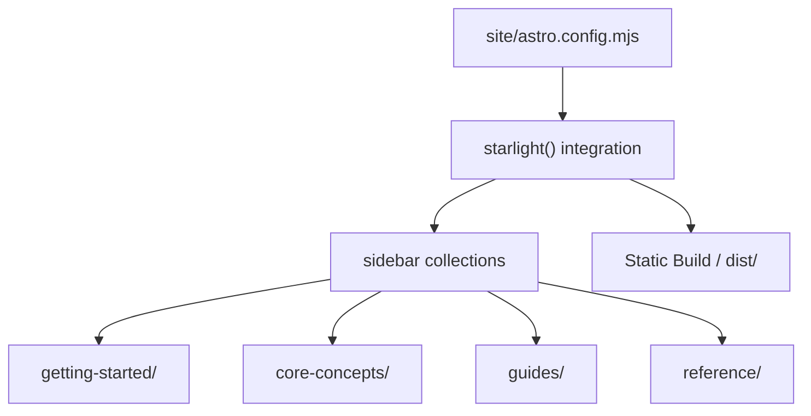
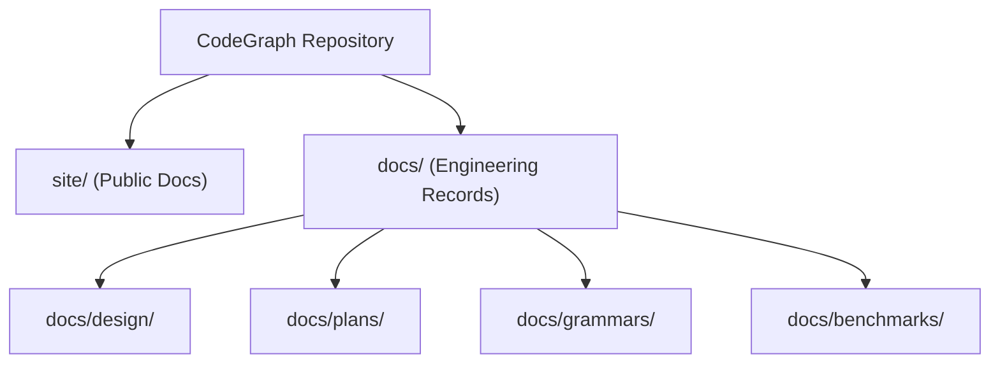

<!-- source: DeepWiki mcp.deepwiki.com · repo colbymchenry/codegraph · page 10 Documentation Site · fetched 2026-10-30 -->

# Documentation Site

Relevant source files

The following files were used as context for generating this wiki page:

- [site/src/content/docs/core-concepts/how-it-works.md](site/src/content/docs/core-concepts/how-it-works.md)
- [site/src/content/docs/core-concepts/resolution.md](site/src/content/docs/core-concepts/resolution.md)
- [site/src/content/docs/getting-started/installation.md](site/src/content/docs/getting-started/installation.md)
- [site/src/content/docs/getting-started/introduction.md](site/src/content/docs/getting-started/introduction.md)
- [site/src/content/docs/getting-started/quickstart.md](site/src/content/docs/getting-started/quickstart.md)
- [site/src/content/docs/getting-started/your-first-graph.md](site/src/content/docs/getting-started/your-first-graph.md)
- [site/src/content/docs/guides/framework-routes.md](site/src/content/docs/guides/framework-routes.md)
- [site/src/content/docs/guides/indexing.md](site/src/content/docs/guides/indexing.md)
- [site/src/content/docs/reference/api.md](site/src/content/docs/reference/api.md)
- [site/src/content/docs/reference/integrations.md](site/src/content/docs/reference/integrations.md)
- [site/src/content/docs/reference/mcp-server.md](site/src/content/docs/reference/mcp-server.md)

The documentation site for CodeGraph is built using [Astro](https://astro.build) and the [Starlight](https://starlight.astro.build) documentation framework, located entirely within the `site/` directory [site/astro.config.mjs:1-96](). It compiles structured Markdown and MDX files into a static, high-performance documentation portal deployed to GitHub Pages. This page provides a high-level overview of the documentation portal, its content organization, and its relationship to the in-repo design notes.

---

## 10.1 Site Content and Structure

The user-facing documentation is organized into logical content collections under `site/src/content/docs/`, driving the navigation sidebar defined in `site/astro.config.mjs:53-93` [site/astro.config.mjs:53-93](). These collections span foundational getting-started guides, core concepts, operational guides, and comprehensive API/CLI references.

For full details on the content collections, Starlight sidebar configurations, custom theme components, and static build/deployment pipelines, see [Site Content and Structure](#10.1).

*Diagram 1: High-level mapping of Astro configuration and documentation content collections.*

Sources: `site/astro.config.mjs:1-96` [site/astro.config.mjs:1-96]()

---

## 10.2 In-Repo Design Notes and Plans

CodeGraph maintains a clear division between user-facing documentation in `site/` and internal engineering records stored directly in the repository under `docs/`. These in-repo artifacts include architectural design notes, implementation plans, Tree-sitter grammar patches (`docs/grammars`), and rigorous benchmark evaluation reports (`docs/benchmarks`).

For details on how port checklists, coverage playbooks, and benchmark reports guide development and track technical debt, see [In-Repo Design Notes and Plans](#10.2).

*Diagram 2: Architectural separation between public documentation site and in-repo engineering artifacts.*

Sources: `site/astro.config.mjs:1-96` [site/astro.config.mjs:1-96](), `site/src/content/docs/getting-started/introduction.md:1-35` [site/src/content/docs/getting-started/introduction.md:1-34]()

---

