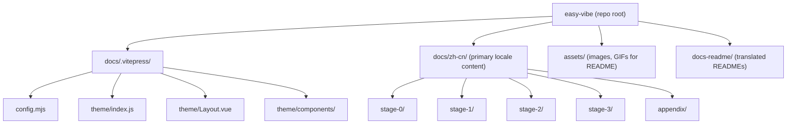
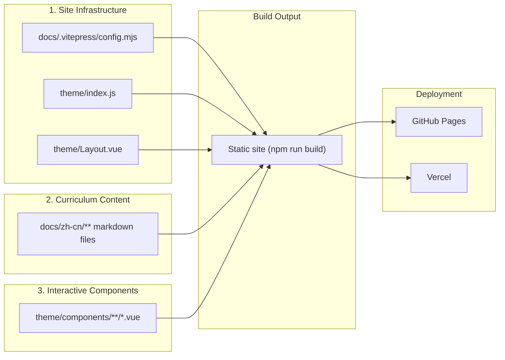
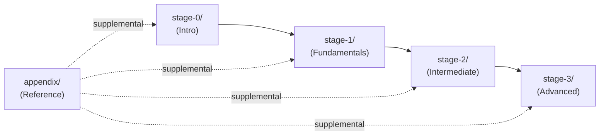

<!-- source: DeepWiki mcp.deepwiki.com · repo datawhalechina/easy-vibe · page 1 Overview · fetched 2026-10-30 -->

# Overview

Relevant source files

The following files were used as context for generating this wiki page:

- [README.md](README.md)
- [assets/readme-image1.png](assets/readme-image1.png)
- [docs-readme/ar-SA/README.md](docs-readme/ar-SA/README.md)
- [docs-readme/de-DE/README.md](docs-readme/de-DE/README.md)
- [docs-readme/en-US/README.md](docs-readme/en-US/README.md)
- [docs-readme/es-ES/README.md](docs-readme/es-ES/README.md)
- [docs-readme/fr-FR/README.md](docs-readme/fr-FR/README.md)
- [docs-readme/ja-JP/README.md](docs-readme/ja-JP/README.md)
- [docs-readme/ko-KR/README.md](docs-readme/ko-KR/README.md)
- [docs-readme/vi-VN/README.md](docs-readme/vi-VN/README.md)
- [docs-readme/zh-CN/README.md](docs-readme/zh-CN/README.md)
- [docs-readme/zh-TW/README.md](docs-readme/zh-TW/README.md)
- [docs/.vitepress/config.mjs](docs/.vitepress/config.mjs)
- [docs/.vitepress/theme/Layout.vue](docs/.vitepress/theme/Layout.vue)
- [docs/.vitepress/theme/components/ChapterIntroduction.vue](docs/.vitepress/theme/components/ChapterIntroduction.vue)
- [docs/.vitepress/theme/components/GitHubStars.vue](docs/.vitepress/theme/components/GitHubStars.vue)
- [docs/.vitepress/theme/components/HomeFeatures.vue](docs/.vitepress/theme/components/HomeFeatures.vue)
- [docs/.vitepress/theme/index.js](docs/.vitepress/theme/index.js)
- [docs/.vitepress/theme/style.css](docs/.vitepress/theme/style.css)
- [docs/public/robots.txt](docs/public/robots.txt)
- [docs/zh-cn/stage-0/0.1-learning-map/index.md](docs/zh-cn/stage-0/0.1-learning-map/index.md)

This page describes the purpose, audience, and high-level structure of the Easy-Vibe repository. It covers how the three main subsystems — the VitePress documentation site, the staged curriculum content, and the interactive Vue demo components — fit together. For site build and deployment specifics, see [Site Architecture](#2). For curriculum content details, see [Learning Curriculum](#3). For the embedded interactive components, see [Interactive Vue Demo Components](#5).

---

## Purpose

Easy-Vibe is a Chinese-language AI programming education platform produced by Datawhale. As stated in [README.md:101-103](), its goal is to guide learners with zero technical background through producing a deployed, functional web product using AI-assisted development workflows. The repository hosts both the course content and the documentation site that delivers it.

---

## Vibe Coding Methodology

The platform centers on **Vibe Coding**, defined in [docs/zh-cn/stage-0/0.1-learning-map/index.md:16-17]() as:

> 用说话来编程 — "programming by speaking"; you rely on conversing with an AI rather than writing code directly.

The underlying premise is that large language models have shifted the hardest part of software development from "how to write code" to "what to build." Vibe Coding teaches learners to work at that higher level of abstraction, using tools such as Cursor, Trae, and Claude Code as the actual code authors.

---

## Target Audience

The curriculum explicitly targets four groups, surfaced in [README.md:105-106]() and expanded in [docs/zh-cn/stage-0/0.1-learning-map/index.md:28-36]():

| Group | Primary Goal |
|---|---|
| Complete beginners / non-technical | Build and demo their first interactive prototype |
| Product managers / designers | Turn mockups and ideas into runnable apps without an engineer |
| Junior / mid-level developers | Progress through structured full-stack and AI integration skills |
| Senior developers / architects | Advanced multi-platform delivery and complex AI system construction |

---

## Repository Layout

The repository has three top-level concerns that map directly to code directories:

**High-Level Repository Structure**

Sources: [README.md:1-10](), [docs/.vitepress/config.mjs:1-15](), [docs/.vitepress/theme/index.js:1-20]()

---

## Three-Tier Architecture

The repository is organized around three distinct concerns:

**Subsystem Relationships**

Sources: [docs/.vitepress/config.mjs:282-310](), [docs/.vitepress/theme/index.js:1-35](), [docs/.vitepress/theme/Layout.vue:293-430]()

### 1. Site Infrastructure

- `docs/.vitepress/config.mjs` — VitePress configuration: base path detection (GitHub Pages vs. Vercel), 10-locale routing, per-locale sidebar definitions, SEO `<head>` tags, sitemap generation.
- `docs/.vitepress/theme/index.js` — Registers 100+ custom Vue components globally so they can be used inline in any markdown page.
- `docs/.vitepress/theme/Layout.vue` — Wraps `DefaultTheme.Layout` to add a reading-progress bar (`ReadingProgress`), a typing-animation tagline (`TextType`), a GitHub star counter (`GitHubStars`), and font-size/line-height controls persisted in `localStorage`.
- `docs/.vitepress/theme/style.css` — CSS custom properties and overrides applied to the VitePress default theme.

### 2. Curriculum Content

All course material lives as Markdown files under `docs/zh-cn/`. Each locale (e.g. `docs/en-us/`, `docs/ja-jp/`) mirrors the same structure. The primary locale is `zh-cn`, as declared in [docs/.vitepress/config.mjs:313-320]().

### 3. Interactive Vue Components

Over a hundred Vue single-file components are embedded directly in Markdown pages using their globally registered tag names. They cover topics from CPU architecture simulations to diffusion model animations. Component source lives under `docs/.vitepress/theme/components/`, organized by appendix topic. See [Interactive Vue Demo Components](#5) for a full breakdown.

---

## Curriculum Summary

The curriculum is divided into four stages plus an appendix. Stage numbers correspond to the directory names under `docs/zh-cn/`.

| Directory | Stage Label | Target User | Core Skills | Primary Output |
|---|---|---|---|---|
| `stage-0/` | Stage 0 — Introduction | All beginners | Learning map orientation; AI capabilities via browser-based game building | Interactive mini-game |
| `stage-1/` | Stage 1 — Fundamentals | PM / beginners | Product idea generation; AI IDE (Trae, Cursor); single and multi-page prototypes; AI API integration (DeepSeek, Qwen3 VL); LocalStorage polish | High-fidelity Web prototype |
| `stage-2/` | Stage 2 — Intermediate | Junior/mid dev | Frontend design tools (Figma, Lovart); backend/full-stack (Supabase, Zeabur); Git workflow; Stripe payment; Dify AI | Deployed full-stack AI app |
| `stage-3/` | Stage 3 — Advanced | Senior dev | Cross-platform (WeChat Mini Programs, Android, iOS); RAG systems; LangGraph; personal website | Production-grade multi-platform app |
| `appendix/` | Appendix | All levels | 9 knowledge domains; 80+ interactive topics | Reference knowledge base |

Sources: [README.md:112-117](), [docs/.vitepress/config.mjs:206-500]()

**Curriculum Progression**

Sources: [docs/zh-cn/stage-0/0.1-learning-map/index.md:42-90](), [README.md:234-316]()

---

## Appendix Knowledge Base

The appendix at `docs/zh-cn/appendix/` contains nine numbered categories, each with its own interactive Vue components:

| Directory | Category |
|---|---|
| `appendix/1-computer-fundamentals/` | Computer fundamentals (transistor to CPU, OS, networking, data structures, algorithms) |
| `appendix/2-development-tools/` | Development tools (Git, CLI, package managers, debugging, regex) |
| `appendix/3-browser-and-frontend/` | Browser and frontend (JavaScript deep-dive, frameworks, rendering, performance) |
| `appendix/4-server-and-backend/` | Server and backend (HTTP, API design, auth, concurrency, message queues) |
| `appendix/5-data/` | Data (SQL, database fundamentals, A/B testing, data analysis, visualization) |
| `appendix/6-architecture-and-system-design/` | Architecture and system design (monolith to microservices, distributed systems, HA) |
| `appendix/7-infrastructure-and-operations/` | Infrastructure and operations (Docker, Kubernetes, CI/CD, DNS/HTTPS, monitoring) |
| `appendix/8-artificial-intelligence/` | Artificial intelligence (LLM principles, Transformer, RAG, agents, prompt engineering) |
| `appendix/9-engineering-excellence/` | Engineering excellence (code quality, design patterns, testing, security, technical writing) |

Sources: [README.md:146-232](), [docs/.vitepress/config.mjs:571-950]()

---

## License and Attribution

The course content is published under the [CC BY-NC-SA 4.0](http://creativecommons.org/licenses/by-nc-sa/4.0) license, as declared in [README.md:394-409](). The project is maintained by Datawhale and led by contributor 散步 (sanbuphy), with additional contributors from Tsinghua University.

The site is available in ten languages: Simplified Chinese (`zh-cn`, primary), Traditional Chinese, English, Japanese, Korean, Spanish, French, German, Arabic, and Vietnamese. Language support is configured in `docs/.vitepress/config.mjs` via the `locales` object at [docs/.vitepress/config.mjs:16-77]().

---

