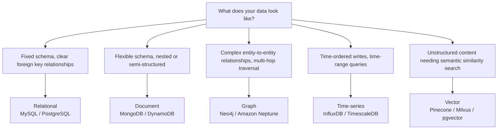
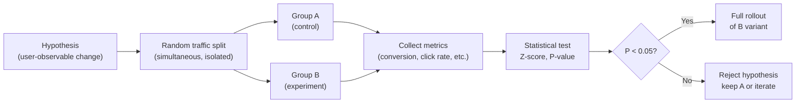
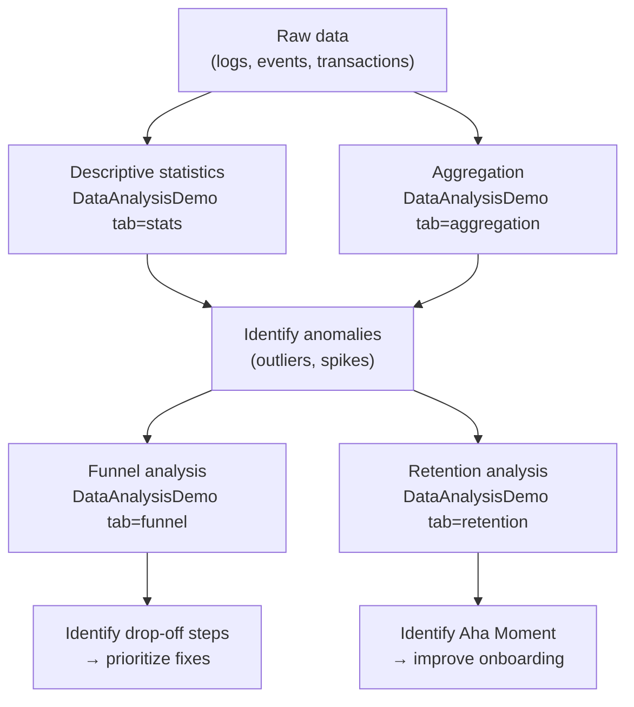
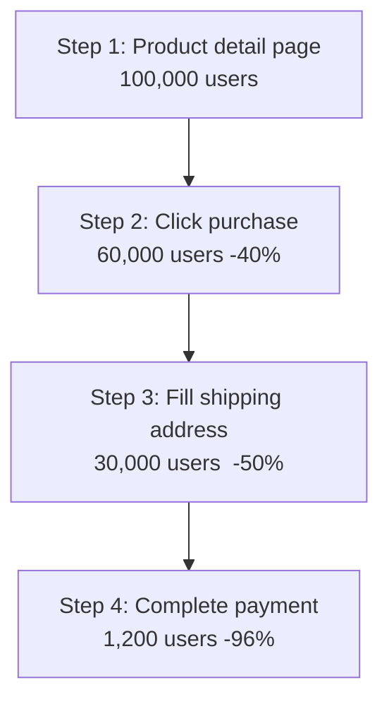
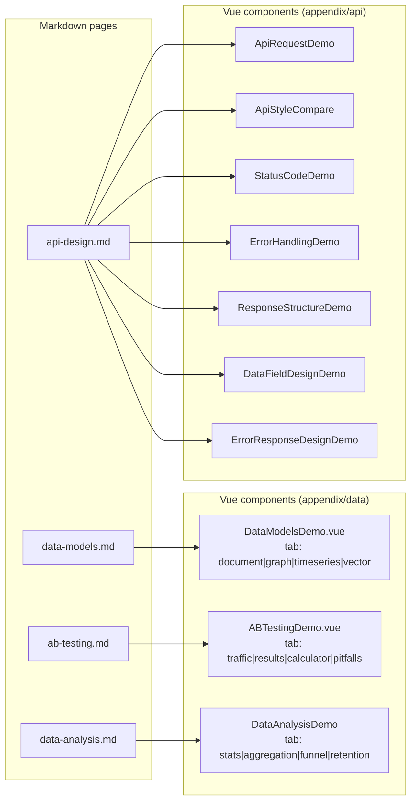

<!-- source: DeepWiki mcp.deepwiki.com · repo datawhalechina/easy-vibe · page 4.3 Backend, APIs, and Data Appendix · fetched 2026-10-30 -->

# Backend, APIs, and Data Appendix

<details>
<summary>Relevant source files</summary>

The following files were used as context for generating this wiki page:

- [docs/.vitepress/theme/components/appendix/ai-history/FoundationDemo.vue](docs/.vitepress/theme/components/appendix/ai-history/FoundationDemo.vue)
- [docs/.vitepress/theme/components/appendix/data/ABTestingDemo.vue](docs/.vitepress/theme/components/appendix/data/ABTestingDemo.vue)
- [docs/.vitepress/theme/components/appendix/data/DataAnalysisDemo.vue](docs/.vitepress/theme/components/appendix/data/DataAnalysisDemo.vue)
- [docs/.vitepress/theme/components/appendix/data/DataModelsDemo.vue](docs/.vitepress/theme/components/appendix/data/DataModelsDemo.vue)
- [docs/.vitepress/theme/components/appendix/web-basics/BrowserRenderingDemo.vue](docs/.vitepress/theme/components/appendix/web-basics/BrowserRenderingDemo.vue)
- [docs/.vitepress/theme/components/appendix/web-basics/DnsLookupDemo.vue](docs/.vitepress/theme/components/appendix/web-basics/DnsLookupDemo.vue)
- [docs/.vitepress/theme/components/appendix/web-basics/HttpExchangeDemo.vue](docs/.vitepress/theme/components/appendix/web-basics/HttpExchangeDemo.vue)
- [docs/.vitepress/theme/components/appendix/web-basics/TcpHandshakeDemo.vue](docs/.vitepress/theme/components/appendix/web-basics/TcpHandshakeDemo.vue)
- [docs/.vitepress/theme/components/appendix/web-basics/UrlParserDemo.vue](docs/.vitepress/theme/components/appendix/web-basics/UrlParserDemo.vue)
- [docs/zh-cn/appendix/4-server-and-backend/api-design.md](docs/zh-cn/appendix/4-server-and-backend/api-design.md)
- [docs/zh-cn/appendix/5-data/ab-testing.md](docs/zh-cn/appendix/5-data/ab-testing.md)
- [docs/zh-cn/appendix/5-data/data-analysis.md](docs/zh-cn/appendix/5-data/data-analysis.md)
- [docs/zh-cn/appendix/5-data/data-models.md](docs/zh-cn/appendix/5-data/data-models.md)
- [docs/zh-cn/appendix/8-artificial-intelligence/ai-history.md](docs/zh-cn/appendix/8-artificial-intelligence/ai-history.md)

</details>


This page documents the backend and data reference material in the Easy-Vibe appendix. It covers four interconnected topics: RESTful API design principles, specialized data models beyond relational databases, A/B testing methodology, and data analysis techniques including funnel and retention models.

This content lives in two appendix subdirectories: `docs/zh-cn/appendix/4-server-and-backend/` (API design) and `docs/zh-cn/appendix/5-data/` (data models, A/B testing, data analysis). The interactive Vue components that accompany this content are documented separately in page [5.4](#5.4). For the web and frontend appendix (which covers related topics like HTTP, networks, and the DOM), see page [4.2](#4.2). For the engineering excellence appendix (code quality, design patterns), see page [4.5](#4.5).

---

## Content Organization

**Appendix structure diagram: files and their topics**

```mermaid
graph TD
  A["appendix/4-server-and-backend/"] --> B["api-design.md"]
  C["appendix/5-data/"] --> D["data-models.md"]
  C --> E["ab-testing.md"]
  C --> F["data-analysis.md"]

  B --> B1["RESTful URL design"]
  B --> B2["HTTP methods and idempotency"]
  B --> B3["Status codes"]
  B --> B4["API versioning"]
  B --> B5["Response structure standards"]
  B --> B6["AI-assisted API design prompts"]

  D --> D1["Document model - MongoDB/DynamoDB"]
  D --> D2["Graph model - Neo4j/Neptune"]
  D --> D3["Time-series model - InfluxDB/TimescaleDB"]
  D --> D4["Vector model - Pinecone/Milvus/pgvector"]

  E --> E1["Traffic allocation"]
  E --> E2["Sample size calculation"]
  E --> E3["Statistical significance"]
  E --> E4["Common pitfalls"]

  F --> F1["Descriptive statistics"]
  F --> F2["Data aggregation"]
  F --> F3["Funnel analysis"]
  F --> F4["Retention analysis"]
```



Sources: [docs/zh-cn/appendix/4-server-and-backend/api-design.md:1-10](), [docs/zh-cn/appendix/5-data/data-models.md:1-10](), [docs/zh-cn/appendix/5-data/ab-testing.md:1-10](), [docs/zh-cn/appendix/5-data/data-analysis.md:1-10]()

---

## API Design

The API design page ([docs/zh-cn/appendix/4-server-and-backend/api-design.md]()) teaches RESTful API design through a restaurant analogy: the menu is the API docs, the waiter is HTTP, the kitchen is the server, and delivery is the response.

### Design Philosophies

The page contrasts four API styles before focusing on REST:

| Style | Characteristic | Typical Use |
|---|---|---|
| RPC | Call remote functions directly | Internal microservices |
| REST | Resources identified by URL, operated via HTTP verbs | Public web APIs |
| GraphQL | Client specifies exact data shape | Frontend-heavy apps |
| gRPC | Binary protocol, strongly typed | High-performance backend comms |

REST is the primary focus because of its low learning curve, mature tooling, and CDN-friendliness of `GET` requests.

Sources: [docs/zh-cn/appendix/4-server-and-backend/api-design.md:82-116]()

### RESTful URL Design Rules

The core principle: **URLs are nouns, HTTP methods are verbs**.

| Rule | Wrong | Correct |
|---|---|---|
| Use nouns, not verbs | `/getUsers` | `/users` |
| Use plural forms | `/user` | `/users` |
| Lowercase + hyphens | `/UserProfiles` | `/user-profiles` |
| Avoid deep nesting | `/a/b/c/d/e` | `/a/b/c` (max 3 levels) |
| Filters in query params | `/products/phone/5000` | `/products?cat=phone` |

Sources: [docs/zh-cn/appendix/4-server-and-backend/api-design.md:140-146]()

### HTTP Methods and Idempotency

| Method | Purpose | Idempotent | Safe |
|---|---|---|---|
| `GET` | Retrieve resource | Yes | Yes |
| `POST` | Create resource | No | No |
| `PUT` | Full replacement | Yes | No |
| `PATCH` | Partial update | No | No |
| `DELETE` | Remove resource | Yes | No |

**Idempotent** means executing the same operation multiple times produces the same result. `POST` is not idempotent — submitting the same order form 10 times may create 10 orders. The recommended mitigation is a unique idempotency key passed in the request.

Sources: [docs/zh-cn/appendix/4-server-and-backend/api-design.md:153-168]()

### HTTP Status Code Categories

| Range | Category | Key Codes |
|---|---|---|
| 2xx | Success | `200 OK`, `201 Created`, `204 No Content` |
| 3xx | Redirect | `301 Permanent`, `304 Not Modified` |
| 4xx | Client error | `400 Bad Request`, `401 Unauthorized`, `404 Not Found` |
| 5xx | Server error | `500 Internal Error`, `503 Unavailable` |

**Common pitfall:** returning `200 OK` for errors (e.g., `{ "error": "something went wrong" }`) causes caches to store error responses and makes monitoring systems blind to failures.

Sources: [docs/zh-cn/appendix/4-server-and-backend/api-design.md:174-228]()

### API Versioning Strategies

Versioning allows new and old API contracts to coexist. The page presents three approaches:

| Strategy | Example | Trade-off |
|---|---|---|
| URL path (preferred) | `/v1/users` | Visible, cache-friendly, longer URL |
| Request header | `Accept: vnd.api.v2+json` | Clean URL, harder to debug |
| Query parameter | `/users?version=2` | Simple, non-standard |

The recommendation is URL path versioning (`/v1/`, `/v2/`). Old versions should remain live for at least 6–12 months with a documented deprecation timeline.

Sources: [docs/zh-cn/appendix/4-server-and-backend/api-design.md:238-274]()

### Response Structure Standards

The page references major industry response conventions from Google, Microsoft, Alibaba, Stripe, JSON:API, GitHub, and Twitter/X. Five principles are distilled:

1. **Consistency** — all endpoints share the same envelope shape
2. **Machine-readable errors** — `code` + `reason` for automated handling
3. **Human-friendly messages** — `message` contains actionable text
4. **Traceability** — `request_id` links logs across the full call chain
5. **i18n support** — `details` array allows localized messages

Example of the recommended response envelope (from the Alibaba pattern):

```
{
  code,
  message,
  data,
  request_id
}
```

Error code range conventions (Alibaba model):

| Range | Type |
|---|---|
| `0` | Success |
| `1xxxx` | Parameter errors |
| `2xxxx` | Business logic errors |
| `3xxxx` | Authentication errors |
| `5xxxx` | System errors |

Sources: [docs/zh-cn/appendix/4-server-and-backend/api-design.md:279-501]()

### AI-Assisted API Design

The page includes a structured prompt template for generating RESTful APIs with an AI assistant. The template sections are: business background, feature requirements, design constraints (RESTful, plural nouns, uniform response format, `/v1/` versioning), and output format (table of method + URL + description, plus request/response examples).

Follow-up prompts are recommended for: error response examples, pagination/sorting/filtering params, permission controls, and RESTful compliance review.

Sources: [docs/zh-cn/appendix/4-server-and-backend/api-design.md:527-618]()

---

## Data Models Beyond Relational

**When relational databases are insufficient — model selection map**



Sources: [docs/zh-cn/appendix/5-data/data-models.md:183-201]()

### Document Model

**Representative products:** MongoDB, DynamoDB

Data is stored as JSON/BSON documents. Each document is self-contained and can have a different field set.

Key properties:
- **Schema-free**: no `ALTER TABLE` required for new fields
- **Embedded structure**: nested arrays and objects stored together, retrieved in a single read — no `JOIN`
- **Horizontal scaling**: native sharding support

**Strengths vs. weaknesses vs. relational:**

| Dimension | MySQL (Relational) | MongoDB (Document) |
|---|---|---|
| Schema | Fixed, must `ALTER TABLE` | Flexible, add fields any time |
| Nested data | Requires multi-table `JOIN` | Embedded directly in document |
| Cross-record joins | Strong `JOIN` support | Weak — design to avoid |
| Best for | Stable business data | Variable-shape content data |

**Common misuse:** treating document model as entirely schema-free leads to deeply nested documents that become hard to update. Frequently-updated sub-documents should be split into their own collection.

**Typical use cases:** CMS content, user profiles with variable attributes, product catalogs (phones have `screen_size`, food has `expiry_date`), config stores.

Sources: [docs/zh-cn/appendix/5-data/data-models.md:26-68](), [docs/.vitepress/theme/components/appendix/data/DataModelsDemo.vue:24-59]()

### Graph Model

**Representative products:** Neo4j, Amazon Neptune

Data is modeled as **nodes** (entities) and **edges** (relationships), where both nodes and edges can carry properties. Queries traverse the graph via pointers rather than computing joins.

**Killer capability — multi-hop queries:**

SQL (3-hop `JOIN`, performance degrades exponentially):
```sql
SELECT DISTINCT f3.name
FROM friends f1
JOIN friends f2 ON f1.friend_id = f2.user_id
JOIN friends f3 ON f2.friend_id = f3.user_id
WHERE f1.user_id = 1001;
```

Cypher (graph query language, performance stays flat):
```cypher
MATCH (me)-[:FOLLOWS*1..3]->(target)
WHERE me.name = '张三'
RETURN DISTINCT target.name
```

**Typical use cases:** social networks, knowledge graphs, fraud detection (finding transaction loops and associated account networks), recommendation engines.

Sources: [docs/zh-cn/appendix/5-data/data-models.md:72-113](), [docs/.vitepress/theme/components/appendix/data/DataModelsDemo.vue:61-95]()

### Time-Series Model

**Representative products:** InfluxDB, TimescaleDB

Optimized for the pattern: **write in time order, query by time range**. The timestamp is the primary axis.

| Problem | MySQL | InfluxDB |
|---|---|---|
| Write throughput | ~10k rows/sec | ~1M points/sec |
| Historical data management | Manual cleanup; table grows unbounded | Automatic TTL expiration policies |
| Aggregation queries | Slow `GROUP BY` | Built-in downsampling (e.g., 5s → 1min average) |
| Storage efficiency | General-purpose; wasteful | Columnar compression; ~90% space savings |

**Typical use cases:** server monitoring (CPU, memory, disk per second), IoT sensors (temperature, GPS tracks), financial tick data, log aggregation.

Sources: [docs/zh-cn/appendix/5-data/data-models.md:115-143](), [docs/.vitepress/theme/components/appendix/data/DataModelsDemo.vue:97-131]()

### Vector Model

**Representative products:** Pinecone, Milvus, Weaviate, pgvector (PostgreSQL extension), FAISS (in-memory)

Unstructured data (text, images, audio) is converted to high-dimensional numeric vectors via an **embedding model**. Similarity search operates on vector distance (cosine similarity, dot product, Euclidean distance) rather than string matching.

**Semantic search vs. keyword search:**

| Dimension | Keyword (`LIKE` / full-text index) | Vector search |
|---|---|---|
| Match mechanism | Exact string match | Semantic similarity |
| Query "好吃的日料" | Only matches text containing "日料" | Also returns "寿司", "刺身", "居酒屋" |
| Multi-language | Must handle each language separately | Cross-language semantic understanding |
| Multi-modal | Text only | Text, image, audio unified retrieval |

**Deployment options:**

| Option | Products | Best for |
|---|---|---|
| Standalone vector DB | Pinecone, Milvus, Weaviate | Maximum retrieval performance |
| Extension on existing DB | pgvector, Atlas Vector Search | Reduced architectural complexity |
| In-memory library | FAISS, Annoy | Small-scale, ultra-low latency |

**Typical use cases:** RAG (Retrieval-Augmented Generation) for LLMs, semantic search, image-to-image search, content-based recommendations.

Sources: [docs/zh-cn/appendix/5-data/data-models.md:146-201](), [docs/.vitepress/theme/components/appendix/data/DataModelsDemo.vue:133-201]()

---

## A/B Testing

**A/B testing concept and process flow**



Sources: [docs/zh-cn/appendix/5-data/ab-testing.md:1-45]()

### Traffic Allocation

The first rule of A/B testing: **simultaneous, random, isolated** assignment.

- Users must be split at the same time to eliminate seasonal/temporal confounds.
- Each user is assigned deterministically based on a hash (or probabilistically on first visit) so they consistently see the same variant.
- 50/50 splits detect differences fastest given equal sample sizes.

The `ABTestingDemo` component ([docs/.vitepress/theme/components/appendix/data/ABTestingDemo.vue:323-357]()) implements this visualization with reactive refs `groupAUsers` and `groupBUsers`, computing `trafficSplit` as a percentage of `totalUsers`.

Sources: [docs/zh-cn/appendix/5-data/ab-testing.md:30-47](), [docs/.vitepress/theme/components/appendix/data/ABTestingDemo.vue:330-357]()

### Statistical Significance

Two gatekeeping concepts:

| Concept | Threshold | Role |
|---|---|---|
| **Statistical power** (1-β) | ≥ 80% recommended | Probability of detecting a real effect (guards against false negatives) |
| **Significance level** (P-value) | < 0.05 recommended | Probability that observed difference is due to chance (guards against false positives) |

**Z-score computation** (from `ABTestingDemo.vue`):

The pooled proportion `pooledP` is computed from conversion counts of both groups. Standard error `se` is derived from the pooled proportion and sample sizes. The Z-score is `(p2 - p1) / se`. P-value uses a numeric approximation of the normal CDF.

The 95% confidence interval for the true difference is: `diff ± 1.96 * se * 100`.

Sources: [docs/zh-cn/appendix/5-data/ab-testing.md:50-66](), [docs/.vitepress/theme/components/appendix/data/ABTestingDemo.vue:376-441]()

### Sample Size Calculator

The `calculateSampleSize` function in `ABTestingDemo.vue` implements the standard formula:

```
n = (Zα * sd1 + Zβ * sd2)² / (p2 - p1)²
```

Where:
- `Zα = 1.96` (for α = 0.05)
- `Zβ = 0.84` (for power = 0.8)
- `sd1 = sqrt(2 * pBar * (1 - pBar))` (pooled SD under null)
- `sd2 = sqrt(p1*(1-p1) + p2*(1-p2))` (combined SD under alternative)

Inputs: baseline conversion rate, minimum detectable relative lift (%), significance level (α), statistical power (1-β). Output: required sample per group, total sample, estimated days (assuming 5,000 daily visitors).

Sources: [docs/.vitepress/theme/components/appendix/data/ABTestingDemo.vue:444-481]()

### Common Pitfalls

The `pitfalls` array in `ABTestingDemo.vue` ([docs/.vitepress/theme/components/appendix/data/ABTestingDemo.vue:484-534]()) defines six documented failure modes:

| Pitfall | Description | Fix |
|---|---|---|
| `early-stop` | Stopping when result looks significant, before reaching target sample | Pre-calculate required sample; run full duration |
| `peeking` | Checking P-value daily and stopping on first significance — inflates false positive rate from 5% to 30%+ | Use sequential testing or a single pre-committed checkpoint |
| `simpson` | Aggregated result reverses group-level trends due to uneven traffic distribution | Segment analysis by device, source, and user cohort |
| `p-hacking` | Testing many metrics/subgroups until one is significant | Pre-register hypothesis and primary metric before launch |
| `novelty` | Short-term click lift from user curiosity, not real value | Run for at least 2–4 weeks until novelty fades |
| `underpowered` | Sample too small to detect real differences | Always run power analysis before starting |

Sources: [docs/zh-cn/appendix/5-data/ab-testing.md:77-100](), [docs/.vitepress/theme/components/appendix/data/ABTestingDemo.vue:484-534]()

---

## Data Analysis

**Analysis techniques and their roles**



Sources: [docs/zh-cn/appendix/5-data/data-analysis.md:1-30]()

### Descriptive Statistics

| Metric | What it measures | Limitation |
|---|---|---|
| **Mean** | Average value | Distorted by outliers (e.g., billionaire at same table) |
| **Median** | Middle value when sorted | Robust to outliers |
| **Mode** | Most frequent value | Best for categorical popularity |
| **Standard deviation** | Spread of values around the mean | Two classes with same mean but different SDs look identical on mean alone |

Sources: [docs/zh-cn/appendix/5-data/data-analysis.md:25-48]()

### Data Aggregation

Aggregation compresses millions of raw rows into summary statistics. The content uses SQL conventions as its vocabulary:

- `COUNT()` — how many records match
- `SUM()` — total numeric value
- `GROUP BY` — segment by attribute (city, user tier, device type) for comparative analysis

The key insight: grouping enables "god-view" pattern recognition that is invisible at the individual-record level.

Sources: [docs/zh-cn/appendix/5-data/data-analysis.md:51-66]()

### Funnel Analysis

A funnel tracks how many users survive each sequential step of a user journey. Each step's drop-off rate isolates where users abandon.

**Example e-commerce funnel:**



The step with the steepest drop (here, step 3→4) is the highest-leverage optimization target — not button color or headline copy.

Sources: [docs/zh-cn/appendix/5-data/data-analysis.md:71-88]()

### Retention Analysis

Retention measures the percentage of a cohort that returns after a defined interval.

| Metric | What it reveals |
|---|---|
| **Day-1 retention** | Whether the core value proposition is immediately clear |
| **Day-7 retention** | Whether users are forming a habit |
| **Day-30 retention** | Whether a loyal user base is forming |

DAU (daily active users) is characterized as a "vanity metric" — a product can grow DAU while retaining almost no one. Retention rate below ~15% signals that acquisition spending cannot overcome churn.

The **Aha Moment** concept: identifying which early user action (e.g., connecting to 3+ friends, creating first project) correlates with high long-term retention, then optimizing onboarding to lead users to that action faster.

Sources: [docs/zh-cn/appendix/5-data/data-analysis.md:92-104]()

---

## Interactive Demo Components

**Mapping of markdown pages to Vue demo components**



Sources: [docs/zh-cn/appendix/4-server-and-backend/api-design.md:75-77](), [docs/zh-cn/appendix/4-server-and-backend/api-design.md:283-283](), [docs/zh-cn/appendix/5-data/data-models.md:203-203](), [docs/zh-cn/appendix/5-data/ab-testing.md:40-40](), [docs/zh-cn/appendix/5-data/data-analysis.md:32-32]()

### `DataModelsDemo.vue`

File: [docs/.vitepress/theme/components/appendix/data/DataModelsDemo.vue]()

- Accepts a `tab` prop (`String`, default `''`); falls back to `'document'` if empty.
- Four tabs, each rendering a dedicated panel: `document`, `graph`, `timeseries`, `vector`.
- The `timeseries` tab renders `tsData` — a static array of 5 rows with `ts`, `device`, `cpu`, `mem` fields ([docs/.vitepress/theme/components/appendix/data/DataModelsDemo.vue:188-194]()).
- The `vector` tab renders `vecResults` — a static array with `text` and `score` (0–1) fields; `score` controls rendered opacity ([docs/.vitepress/theme/components/appendix/data/DataModelsDemo.vue:196-201]()).
- Each panel shows: a description, a visual representation (code block / edge list / table / similarity results), trait pills (good/bad), and use-case tags.

### `ABTestingDemo.vue`

File: [docs/.vitepress/theme/components/appendix/data/ABTestingDemo.vue]()

- Accepts a `tab` prop (`String`, default `null`). When provided, the tab switcher UI is hidden.
- Four tabs: `traffic`, `results`, `calculator`, `pitfalls`.
- **`traffic`**: `groupAUsers` and `groupBUsers` refs; `trafficSplit` computed from ratio.
- **`results`**: `conversionA`, `conversionB`, `sampleSize` as inputs; `zScore`, `pValue`, `isSignificant`, `ciLower`, `ciUpper` as computed outputs. Uses a polynomial approximation of the normal CDF in `normalCDF(x)`.
- **`calculator`**: `baselineRate`, `minimumDetectable`, `alpha`, `power` as inputs; `calculateSampleSize()` writes to `calculatedSampleSize` ref on button click.
- **`pitfalls`**: static `pitfalls` array of 6 objects, each with `id`, `title`, `description`, `example`, `solution`.

---

