# Page: Overview

# Overview

<details>
<summary>Relevant source files</summary>

The following files were used as context for generating this wiki page:

- [README.md](README.md)
- [assets/readme-image1.png](assets/readme-image1.png)
- [docs-readme/ar-SA/README.md](docs-readme/ar-SA/README.md)
- [docs-readme/de-DE/README.md](docs-readme/de-DE/README.md)
- [docs-readme/en-US/README.md](docs-readme/en-US/README.md)
- [docs-readme/es-ES/README.md](docs-readme/es-ES/README.md)
- [docs-readme/fr-FR/README.md](docs-readme/fr-FR/README.md)
- [docs-readme/ja-JP/README.md](docs-readme/ja-JP/README.md)
- [docs-readme/ko-KR/README.md](docs-readme/ko-KR/README.md)
- [docs-readme/vi-VN/README.md](docs-readme/vi-VN/README.md)
- [docs-readme/zh-CN/README.md](docs-readme/zh-CN/README.md)
- [docs-readme/zh-TW/README.md](docs-readme/zh-TW/README.md)
- [docs/.vitepress/config.mjs](docs/.vitepress/config.mjs)
- [docs/.vitepress/theme/Layout.vue](docs/.vitepress/theme/Layout.vue)
- [docs/.vitepress/theme/components/ChapterIntroduction.vue](docs/.vitepress/theme/components/ChapterIntroduction.vue)
- [docs/.vitepress/theme/components/GitHubStars.vue](docs/.vitepress/theme/components/GitHubStars.vue)
- [docs/.vitepress/theme/components/HomeFeatures.vue](docs/.vitepress/theme/components/HomeFeatures.vue)
- [docs/.vitepress/theme/index.js](docs/.vitepress/theme/index.js)
- [docs/.vitepress/theme/style.css](docs/.vitepress/theme/style.css)
- [docs/public/robots.txt](docs/public/robots.txt)
- [docs/zh-cn/stage-0/0.1-learning-map/index.md](docs/zh-cn/stage-0/0.1-learning-map/index.md)

</details>


This page describes the purpose, audience, and high-level structure of the Easy-Vibe repository. It covers how the three main subsystems — the VitePress documentation site, the staged curriculum content, and the interactive Vue demo components — fit together. For site build and deployment specifics, see [Site Architecture](#2). For curriculum content details, see [Learning Curriculum](#3). For the embedded interactive components, see [Interactive Vue Demo Components](#5).

---

## Purpose

Easy-Vibe is a Chinese-language AI programming education platform produced by Datawhale. As stated in [README.md:101-103](), its goal is to guide learners with zero technical background through producing a deployed, functional web product using AI-assisted development workflows. The repository hosts both the course content and the documentation site that delivers it.

---

## Vibe Coding Methodology

The platform centers on **Vibe Coding**, defined in [docs/zh-cn/stage-0/0.1-learning-map/index.md:16-17]() as:

> 用说话来编程 — "programming by speaking"; you rely on conversing with an AI rather than writing code directly.

The underlying premise is that large language models have shifted the hardest part of software development from "how to write code" to "what to build." Vibe Coding teaches learners to work at that higher level of abstraction, using tools such as Cursor, Trae, and Claude Code as the actual code authors.

---

## Target Audience

The curriculum explicitly targets four groups, surfaced in [README.md:105-106]() and expanded in [docs/zh-cn/stage-0/0.1-learning-map/index.md:28-36]():

| Group | Primary Goal |
|---|---|
| Complete beginners / non-technical | Build and demo their first interactive prototype |
| Product managers / designers | Turn mockups and ideas into runnable apps without an engineer |
| Junior / mid-level developers | Progress through structured full-stack and AI integration skills |
| Senior developers / architects | Advanced multi-platform delivery and complex AI system construction |

---

## Repository Layout

The repository has three top-level concerns that map directly to code directories:

**High-Level Repository Structure**

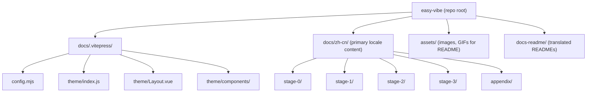

Sources: [README.md:1-10](), [docs/.vitepress/config.mjs:1-15](), [docs/.vitepress/theme/index.js:1-20]()

---

## Three-Tier Architecture

The repository is organized around three distinct concerns:

**Subsystem Relationships**

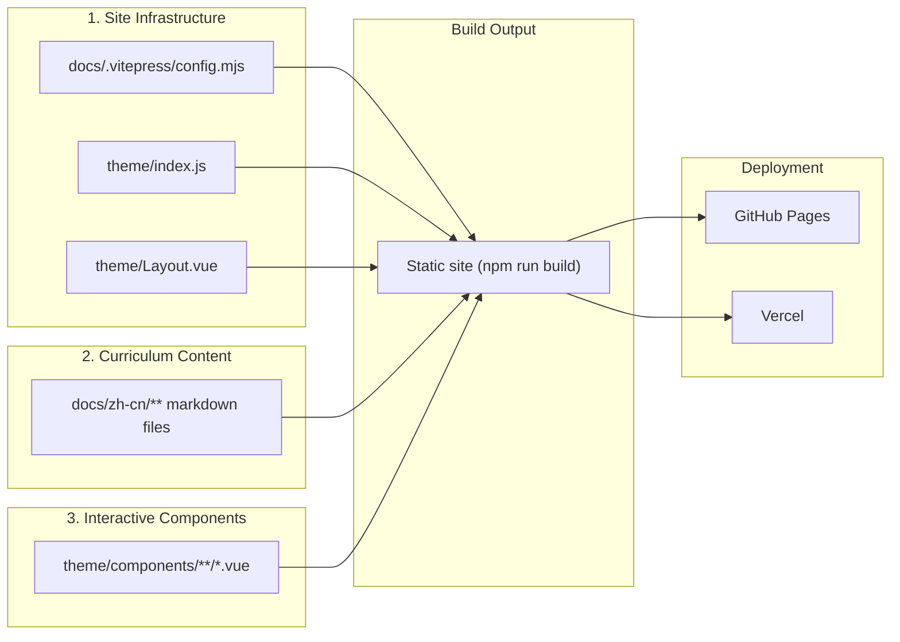

Sources: [docs/.vitepress/config.mjs:282-310](), [docs/.vitepress/theme/index.js:1-35](), [docs/.vitepress/theme/Layout.vue:293-430]()

### 1. Site Infrastructure

- `docs/.vitepress/config.mjs` — VitePress configuration: base path detection (GitHub Pages vs. Vercel), 10-locale routing, per-locale sidebar definitions, SEO `<head>` tags, sitemap generation.
- `docs/.vitepress/theme/index.js` — Registers 100+ custom Vue components globally so they can be used inline in any markdown page.
- `docs/.vitepress/theme/Layout.vue` — Wraps `DefaultTheme.Layout` to add a reading-progress bar (`ReadingProgress`), a typing-animation tagline (`TextType`), a GitHub star counter (`GitHubStars`), and font-size/line-height controls persisted in `localStorage`.
- `docs/.vitepress/theme/style.css` — CSS custom properties and overrides applied to the VitePress default theme.

### 2. Curriculum Content

All course material lives as Markdown files under `docs/zh-cn/`. Each locale (e.g. `docs/en-us/`, `docs/ja-jp/`) mirrors the same structure. The primary locale is `zh-cn`, as declared in [docs/.vitepress/config.mjs:313-320]().

### 3. Interactive Vue Components

Over a hundred Vue single-file components are embedded directly in Markdown pages using their globally registered tag names. They cover topics from CPU architecture simulations to diffusion model animations. Component source lives under `docs/.vitepress/theme/components/`, organized by appendix topic. See [Interactive Vue Demo Components](#5) for a full breakdown.

---

## Curriculum Summary

The curriculum is divided into four stages plus an appendix. Stage numbers correspond to the directory names under `docs/zh-cn/`.

| Directory | Stage Label | Target User | Core Skills | Primary Output |
|---|---|---|---|---|
| `stage-0/` | Stage 0 — Introduction | All beginners | Learning map orientation; AI capabilities via browser-based game building | Interactive mini-game |
| `stage-1/` | Stage 1 — Fundamentals | PM / beginners | Product idea generation; AI IDE (Trae, Cursor); single and multi-page prototypes; AI API integration (DeepSeek, Qwen3 VL); LocalStorage polish | High-fidelity Web prototype |
| `stage-2/` | Stage 2 — Intermediate | Junior/mid dev | Frontend design tools (Figma, Lovart); backend/full-stack (Supabase, Zeabur); Git workflow; Stripe payment; Dify AI | Deployed full-stack AI app |
| `stage-3/` | Stage 3 — Advanced | Senior dev | Cross-platform (WeChat Mini Programs, Android, iOS); RAG systems; LangGraph; personal website | Production-grade multi-platform app |
| `appendix/` | Appendix | All levels | 9 knowledge domains; 80+ interactive topics | Reference knowledge base |

Sources: [README.md:112-117](), [docs/.vitepress/config.mjs:206-500]()

**Curriculum Progression**

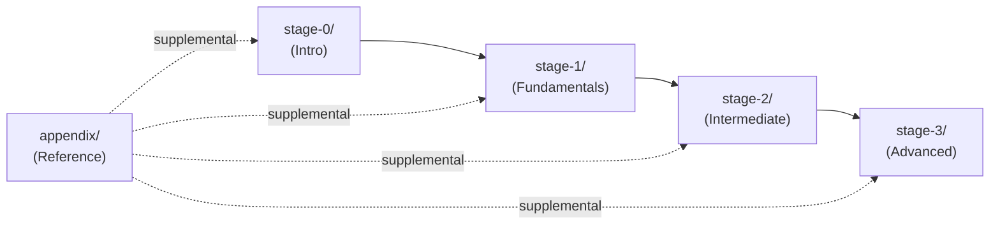

Sources: [docs/zh-cn/stage-0/0.1-learning-map/index.md:42-90](), [README.md:234-316]()

---

## Appendix Knowledge Base

The appendix at `docs/zh-cn/appendix/` contains nine numbered categories, each with its own interactive Vue components:

| Directory | Category |
|---|---|
| `appendix/1-computer-fundamentals/` | Computer fundamentals (transistor to CPU, OS, networking, data structures, algorithms) |
| `appendix/2-development-tools/` | Development tools (Git, CLI, package managers, debugging, regex) |
| `appendix/3-browser-and-frontend/` | Browser and frontend (JavaScript deep-dive, frameworks, rendering, performance) |
| `appendix/4-server-and-backend/` | Server and backend (HTTP, API design, auth, concurrency, message queues) |
| `appendix/5-data/` | Data (SQL, database fundamentals, A/B testing, data analysis, visualization) |
| `appendix/6-architecture-and-system-design/` | Architecture and system design (monolith to microservices, distributed systems, HA) |
| `appendix/7-infrastructure-and-operations/` | Infrastructure and operations (Docker, Kubernetes, CI/CD, DNS/HTTPS, monitoring) |
| `appendix/8-artificial-intelligence/` | Artificial intelligence (LLM principles, Transformer, RAG, agents, prompt engineering) |
| `appendix/9-engineering-excellence/` | Engineering excellence (code quality, design patterns, testing, security, technical writing) |

Sources: [README.md:146-232](), [docs/.vitepress/config.mjs:571-950]()

---

## License and Attribution

The course content is published under the [CC BY-NC-SA 4.0](http://creativecommons.org/licenses/by-nc-sa/4.0) license, as declared in [README.md:394-409](). The project is maintained by Datawhale and led by contributor 散步 (sanbuphy), with additional contributors from Tsinghua University.

The site is available in ten languages: Simplified Chinese (`zh-cn`, primary), Traditional Chinese, English, Japanese, Korean, Spanish, French, German, Arabic, and Vietnamese. Language support is configured in `docs/.vitepress/config.mjs` via the `locales` object at [docs/.vitepress/config.mjs:16-77]().

---

# Page: Site Architecture

# Site Architecture

<details>
<summary>Relevant source files</summary>

The following files were used as context for generating this wiki page:

- [.husky/pre-commit](.husky/pre-commit)
- [README.md](README.md)
- [assets/readme-image1.png](assets/readme-image1.png)
- [docs/.vitepress/config.mjs](docs/.vitepress/config.mjs)
- [docs/.vitepress/theme/Layout.vue](docs/.vitepress/theme/Layout.vue)
- [docs/.vitepress/theme/components/ChapterIntroduction.vue](docs/.vitepress/theme/components/ChapterIntroduction.vue)
- [docs/.vitepress/theme/components/GitHubStars.vue](docs/.vitepress/theme/components/GitHubStars.vue)
- [docs/.vitepress/theme/components/HomeFeatures.vue](docs/.vitepress/theme/components/HomeFeatures.vue)
- [docs/.vitepress/theme/components/appendix/cloud-topology/VpcArchitectureDemo.vue](docs/.vitepress/theme/components/appendix/cloud-topology/VpcArchitectureDemo.vue)
- [docs/.vitepress/theme/index.js](docs/.vitepress/theme/index.js)
- [docs/.vitepress/theme/style.css](docs/.vitepress/theme/style.css)
- [docs/public/robots.txt](docs/public/robots.txt)
- [docs/zh-cn/stage-0/0.1-learning-map/index.md](docs/zh-cn/stage-0/0.1-learning-map/index.md)
- [package-lock.json](package-lock.json)
- [package.json](package.json)
- [vercel.json](vercel.json)

</details>


This page covers how the Easy-Vibe documentation site is structured as a codebase: the static site generator, its configuration, the custom theme layer, and the files that control how the site is built and deployed. For details about what curriculum content is inside the site, see [Learning Curriculum](#3). For the Vue components that power interactive demos embedded in pages, see [Interactive Vue Demo Components](#5).

---

## Repository Layout

The repository has a flat root with all documentation source under `docs/`. The VitePress build system is configured entirely inside `docs/.vitepress/`.

```
easy-vibe/
├── docs/
│   ├── .vitepress/
│   │   ├── config.mjs          # VitePress defineConfig()
│   │   ├── theme/
│   │   │   ├── index.js        # Theme entry: component registration
│   │   │   ├── Layout.vue      # Custom layout wrapper
│   │   │   ├── style.css       # Global CSS overrides
│   │   │   └── components/     # All Vue components
│   ├── zh-cn/                  # Primary locale content
│   ├── en-us/
│   ├── ja-jp/
│   ├── zh-tw/
│   ├── ko-kr/
│   ├── es-es/
│   ├── fr-fr/
│   ├── de-de/
│   ├── ar-sa/
│   ├── vi-vn/
│   └── public/                 # Static assets (robots.txt, logo.png, etc.)
├── package.json
├── vercel.json
└── .husky/
    └── pre-commit
```

Sources: [package.json:1-44](), [vercel.json:1-6](), [docs/.vitepress/config.mjs:1-14]()

---

## VitePress Configuration

The entire site configuration lives in `docs/.vitepress/config.mjs`, exported via `defineConfig()`.

### Base Path

The `base` variable is computed at build time from environment variables to support multiple deployment targets:

[docs/.vitepress/config.mjs:5-13]()

| Condition | `base` value |
|---|---|
| `process.env.BASE` is set | Value of `BASE` |
| `VERCEL=1` or `VERCEL_URL` is present | `/` |
| `EDGEONE=1` is present | `/` |
| None of the above (GitHub Pages) | `/easy-vibe/` |

All asset references in generated HTML — favicon, stylesheet, logo — have this base prepended. The path deduplication `replace('//', '/')` handles the root-base edge case.

### Markdown Extensions

The config registers `markdown-it-katex` to render LaTeX math expressions inside markdown pages:

[docs/.vitepress/config.mjs:282-287]()

```js
markdown: {
  config: (md) => {
    md.use(markdownItKatex)
  }
}
```

The `ignoreDeadLinks: true` flag suppresses broken-link errors during build, which is necessary because many locale pages link to content that is only complete in `zh-cn`.

### Sitemap

A sitemap is generated by VitePress and filtered via `transformItems` to exclude legacy content paths (`/extra/`, `/examples/`, `/project/`):

[docs/.vitepress/config.mjs:291-310]()

### SEO Head Generation

The `getSeoHead(locale, title, description, path)` function is called once per locale inside the `locales` configuration object. It returns an array of `<head>` tag descriptors covering:

- Favicon and stylesheet links
- Open Graph tags (`og:title`, `og:description`, `og:image`, `og:locale`)
- Twitter Card tags
- `<link rel="alternate" hreflang="...">` for all 10 locales plus `x-default`
- A `<script type="application/ld+json">` block with `WebSite` schema

[docs/.vitepress/config.mjs:80-180]()

The `localeMap` constant maps locale keys (e.g., `'zh-cn'`) to their `ogLocale`, `lang`, and `hreflang` values:

[docs/.vitepress/config.mjs:16-77]()

### Locale Configuration

The `locales` key of `defineConfig()` defines 10 locales. Each locale entry follows the same structure:

```js
'zh-cn': {
  label: '简体中文',
  lang: 'zh-CN',
  link: '/zh-cn/',
  title: 'Easy-Vibe 教程',
  description: '...',
  head: getSeoHead(...),
  themeConfig: {
    ...commonThemeConfig,
    nav: [...],
    sidebar: { ... }
  }
}
```

The `commonThemeConfig` object ([docs/.vitepress/config.mjs:187-204]()) is spread into each locale's `themeConfig` to share logo path, local search, outline depth (`level: [1, 6]`), and footer text (ICP beian links and CC BY-NC-SA 4.0 notice).

### Sidebar Configuration

Each locale defines a `sidebar` object keyed by URL prefix. In `zh-cn`, distinct sidebar trees are defined for:

| URL Prefix | Sidebar |
|---|---|
| `/zh-cn/stage-0/` | `productManagerSidebar` |
| `/zh-cn/stage-1/` | `productManagerSidebar` |
| `/zh-cn/stage-2/` | Inline frontend/backend/assignments/AI sections |
| `/zh-cn/stage-3/` | Inline core-skills/cross-platform/personal-brand/AI sections |
| `/zh-cn/appendix/` | 9-category appendix tree |

`productManagerSidebar` is a shared constant defined at [docs/.vitepress/config.mjs:206-280]().

Sources: [docs/.vitepress/config.mjs:282-1400]()

---

## Custom Theme

**VitePress Theme Architecture**

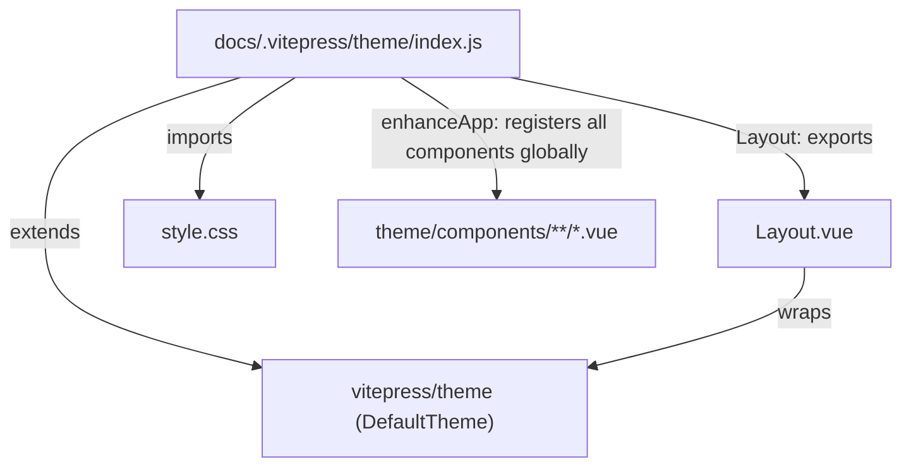

Sources: [docs/.vitepress/theme/index.js:1-10](), [docs/.vitepress/theme/Layout.vue:293-454]()

### Theme Entry Point (`index.js`)

[docs/.vitepress/theme/index.js]() registers every Vue component globally via `app.component(name, component)`. The components fall into these groups:

| Group | Example components |
|---|---|
| Core UI | `Layout`, `HomeFeatures`, `NavGrid`, `NavCard`, `ChapterIntroduction`, `StepBar`, `SummaryCard`, `ReadingProgress`, `GitHubStars` |
| Terminal demos | `WebTerminal`, `ArchitectureDemo`, `EscapeParserDemo`, `TerminalOSDemo`, `CookedRawDemo`, `BufferSwitchDemo` |
| API demos | `ApiConceptDemo`, `ApiPlayground`, `RequestResponseFlow`, `RealWorldApiDemo` |
| Computer fundamentals | `TransistorDemo`, `LogicGateDemo`, `CpuArchitectureDemo`, `ProcessDemo`, `MemoryDemo`, `FilesystemDemo` |
| AI demos | `AiEvolutionDemo`, `NeuralNetworkVisualizationDemo`, `AttentionMechanismDemo`, `GPTEvolutionDemo` |
| Web basics | `WebTechTriad`, `CssBoxModel`, `CssFlexbox`, `DomManipulator`, `NetworkLayers` |
| Engineering demos | `DesignPatternCatalogDemo`, `TDDCycleDemo`, `SecurityChecklistDemo` |

Also registered: `ElementPlus` (UI library), `Viewer` (image zoom via `viewerjs`), and `TypeIt` (typing animations).

[docs/.vitepress/theme/index.js:1-500]()

### Layout.vue

`Layout.vue` wraps `DefaultTheme.Layout` and injects several custom behaviors via named slots:

**Layout slot usage:**

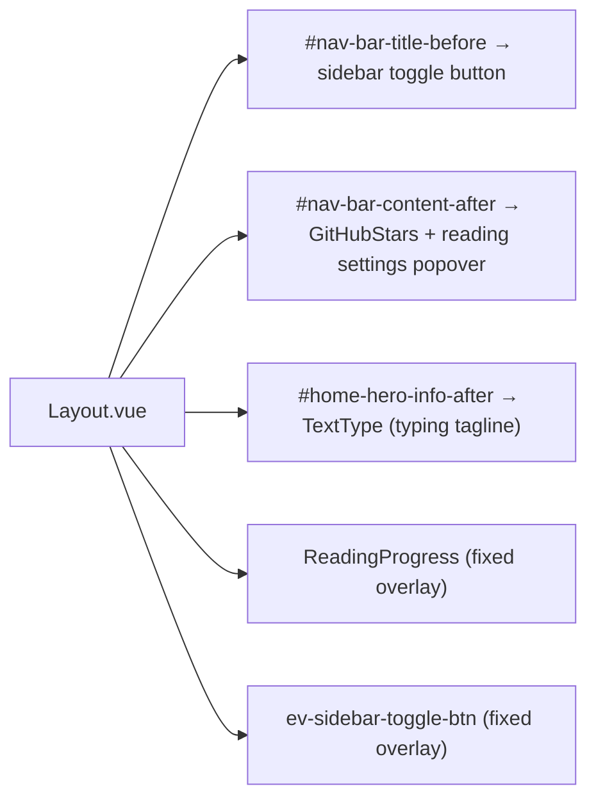

Key reactive state in `Layout.vue`:

| Ref | localStorage key | Default |
|---|---|---|
| `fontSize` | `ev-doc-font-size` | `14` px |
| `lineHeight` | `ev-doc-line-height` | `1.65` |
| `sidebarCollapsed` | `ev-sidebar-collapsed` | `false` |

Font size and line height are applied by setting CSS custom properties `--ev-doc-font-size` and `--ev-doc-line-height` on `document.documentElement`.

Sidebar collapse is toggled by adding the class `ev-sidebar-collapsed` to `document.body`, which triggers CSS rules that hide `.VPSidebar` and expand `.VPContent.has-sidebar`.

`initOutlineAutoScroll()` uses `MutationObserver` to watch for `.active` class changes on outline links and `.is-active` on sidebar items, then smoothly scrolls those containers to keep the active item in view.

[docs/.vitepress/theme/Layout.vue:1-720]()

### style.css

[docs/.vitepress/theme/style.css]() provides global CSS overrides on top of VitePress defaults. Notable rules:

- `.vp-doc` font size and line height driven by `--ev-doc-font-size` and `--ev-doc-line-height` CSS variables, which `Layout.vue` modifies at runtime.
- Sidebar item spacing is tightened significantly (padding-top/bottom reduced to 3px for level-1 through level-4 items).
- `.VPDocAsideOutline` is made independently scrollable with a thin scrollbar.
- `.VPHomeHero` is set to `min-height: 100vh` and centered.
- Hero `.name` gets a green-to-purple gradient text effect.
- Images are centered by default (`margin: auto`); tall images get constrained max-heights via `.img-tall`, `.img-very-tall`, `.img-ultra-tall`, `.img-ultra-tall` classes.

Sources: [docs/.vitepress/theme/style.css:1-420]()

---

## Deployment

The site has two deployment targets.

**Deployment Pipeline Overview**

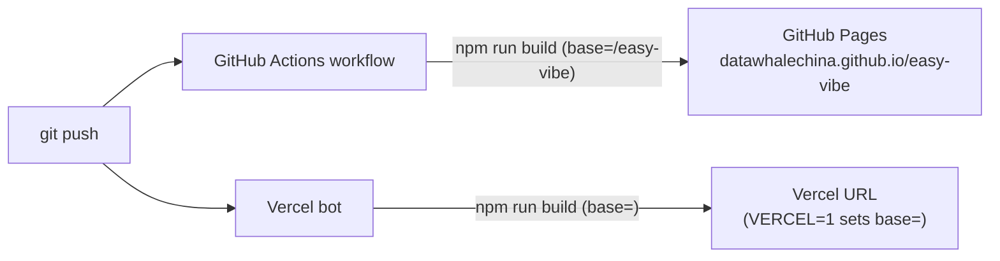

### GitHub Pages

The GitHub Actions workflow (not shown in the provided files but referenced in `README.md`) deploys to `datawhalechina.github.io/easy-vibe`. When `VERCEL` and `EDGEONE` are not set, `base` resolves to `/easy-vibe/`, which is required for all asset paths to be correct on GitHub Pages.

The `README.md` has a comment `<!-- trigger vercel build -->` at line 1, indicating that pushes to the file intentionally trigger Vercel rebuilds.

### Vercel

[vercel.json:1-6]()

```json
{
  "buildCommand": "npm run build",
  "installCommand": "npm install",
  "framework": "vitepress",
  "outputDirectory": "docs/.vitepress/dist"
}
```

Vercel injects `VERCEL=1` automatically, so `base` resolves to `/` without any manual configuration.

Sources: [vercel.json:1-6](), [docs/.vitepress/config.mjs:5-13](), [README.md:1]()

---

## Development Workflow

### npm Scripts

[package.json:6-15]()

| Script | Command |
|---|---|
| `dev` | `vitepress dev docs` |
| `build` | `npm run lint && vitepress build docs --force` |
| `preview` | `vitepress preview docs` |
| `lint` | `eslint docs/.vitepress/theme` |
| `lint:fix` | `eslint docs/.vitepress/theme --fix` |
| `format` | `prettier --write .` |
| `prepare` | `husky` (installs git hooks) |

The `build` script runs ESLint before the VitePress build. The `--force` flag bypasses the VitePress cache, ensuring a clean output.

Node.js >= 18.0.0 is required ([package.json:28-30]()).

### Pre-commit Hook

[.husky/pre-commit:1-37]()

The Husky pre-commit hook runs two sequential checks on every `git commit`:

1. **ESLint** — runs `npm run lint` (which targets `docs/.vitepress/theme`) and blocks the commit if any `error`-level violations are found. Warnings are allowed.
2. **Build** — runs `npm run build` silently and blocks the commit if it fails.

Commits can bypass both checks with `git commit --no-verify`.

### Code Quality Tools

| Tool | Config file | Scope |
|---|---|---|
| ESLint | `eslint.config.js` (not shown) | `docs/.vitepress/theme/**` |
| Prettier | `.prettierrc` (not shown) | All files |
| Husky | `.husky/pre-commit` | Git pre-commit |

Sources: [package.json:6-15](), [.husky/pre-commit:1-37]()

---

# Page: VitePress Configuration and Theme

# VitePress Configuration and Theme

<details>
<summary>Relevant source files</summary>

The following files were used as context for generating this wiki page:

- [.husky/pre-commit](.husky/pre-commit)
- [README.md](README.md)
- [assets/readme-image1.png](assets/readme-image1.png)
- [docs/.vitepress/config.mjs](docs/.vitepress/config.mjs)
- [docs/.vitepress/theme/Layout.vue](docs/.vitepress/theme/Layout.vue)
- [docs/.vitepress/theme/components/ChapterIntroduction.vue](docs/.vitepress/theme/components/ChapterIntroduction.vue)
- [docs/.vitepress/theme/components/GitHubStars.vue](docs/.vitepress/theme/components/GitHubStars.vue)
- [docs/.vitepress/theme/components/HomeFeatures.vue](docs/.vitepress/theme/components/HomeFeatures.vue)
- [docs/.vitepress/theme/components/appendix/cloud-topology/VpcArchitectureDemo.vue](docs/.vitepress/theme/components/appendix/cloud-topology/VpcArchitectureDemo.vue)
- [docs/.vitepress/theme/index.js](docs/.vitepress/theme/index.js)
- [docs/.vitepress/theme/style.css](docs/.vitepress/theme/style.css)
- [docs/public/robots.txt](docs/public/robots.txt)
- [docs/zh-cn/stage-0/0.1-learning-map/index.md](docs/zh-cn/stage-0/0.1-learning-map/index.md)
- [package-lock.json](package-lock.json)
- [package.json](package.json)
- [vercel.json](vercel.json)

</details>


This page covers the VitePress static site generator setup for the Easy-Vibe documentation site: how the build target is determined, how locales and SEO metadata are configured, and how the custom theme layer (components, layout, and CSS) is structured.

For multi-language content organization and the locale routing mechanism, see [Multi-language Support](#2.2). For the CI/CD pipeline that invokes the build, see [Deployment and CI/CD](#2.3). For the individual custom Vue components registered in the theme (e.g. `ChapterIntroduction`, `NavCard`), see [Theme and Navigation Components](#5.1).

---

## Configuration Entry Point

The entire VitePress configuration is defined in a single file: [docs/.vitepress/config.mjs]().

It calls `defineConfig` from VitePress and exports a configuration object with five main concerns:

| Concern | Key Config Property |
|---|---|
| Build base path | `base` |
| Markdown extensions | `markdown.config` |
| Multi-locale routing | `locales` |
| Sitemap generation | `sitemap` |
| Dead link handling | `ignoreDeadLinks: true` |

---

## Base Path Resolution

The `base` property controls the path prefix injected into all asset URLs and internal links. The project supports three deployment targets with different URL structures:

**Base path determination diagram**

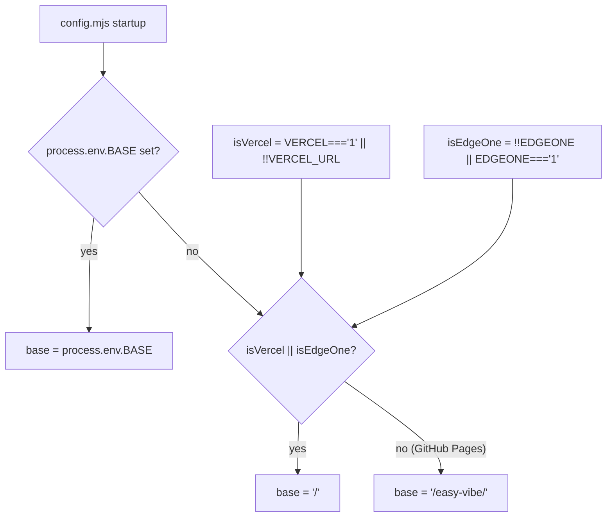

Sources: [docs/.vitepress/config.mjs:4-13]()

The `commonHead` array references `base` directly when constructing icon and stylesheet `<link>` tags, using `.replace('//', '/')` to avoid double-slash paths when `base` is `'/'`.

---

## Markdown Extensions

KaTeX math rendering is added via the `markdown-it-katex` plugin:

```
markdown: {
  config: (md) => {
    md.use(markdownItKatex)
  }
}
```

This allows `$…$` and `$$…$$` math expressions in any markdown file. No additional per-page configuration is needed.

Sources: [docs/.vitepress/config.mjs:282-287](), [package.json:27]()

---

## Locale Configuration and SEO

### `localeMap` — The 10 Supported Languages

Each locale key maps to metadata used for SEO head tags:

| Locale key | `lang` | `ogLocale` | `hreflang` |
|---|---|---|---|
| `zh-cn` | `zh-CN` | `zh_CN` | `zh-CN` |
| `en-us` | `en-US` | `en_US` | `en` |
| `ja-jp` | `ja-JP` | `ja_JP` | `ja` |
| `zh-tw` | `zh-TW` | `zh_TW` | `zh-TW` |
| `ko-kr` | `ko-KR` | `ko_KR` | `ko` |
| `es-es` | `es-ES` | `es_ES` | `es` |
| `fr-fr` | `fr-FR` | `fr_FR` | `fr` |
| `de-de` | `de-DE` | `de_DE` | `de` |
| `ar-sa` | `ar-SA` | `ar_SA` | `ar` |
| `vi-vn` | `vi-VN` | `vi_VN` | `vi` |

Sources: [docs/.vitepress/config.mjs:16-77]()

### `getSeoHead()` — SEO Head Tag Generator

`getSeoHead(locale, title, description, path?)` returns a `head` array for VitePress containing:

- Favicon `<link>` pointing to `${base}logo.png`
- Stylesheet `<link>` pointing to `${base}style.css`
- Viewport, theme-color, format-detection `<meta>` tags
- Canonical URL `<link>`
- Open Graph tags: `og:type`, `og:locale`, `og:site_name`, `og:title`, `og:description`, `og:image`
- Twitter Card tags: `twitter:card`, `twitter:site`, `twitter:title`, `twitter:description`, `twitter:image`
- SEO keywords `<meta>` covering tools like Claude Code, Cursor, Trae, Supabase, React, etc.
- `robots`, `googlebot`, `baiduspider` directives (all `index,follow`)
- One `<link rel="alternate">` per locale for hreflang
- A `<link rel="alternate" hreflang="x-default">` pointing to `/zh-cn/` (the primary locale)
- A `<script type="application/ld+json">` block with schema.org `WebSite` structured data including `SearchAction` and publisher info

**SEO head generation flow**

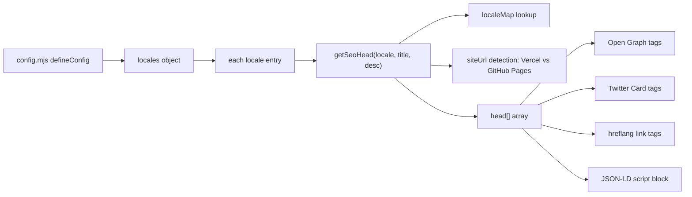

Sources: [docs/.vitepress/config.mjs:80-180]()

---

## `commonThemeConfig` — Shared Theme Settings

A `commonThemeConfig` object is spread into each locale's `themeConfig`:

| Property | Value |
|---|---|
| `logo` | `${base}logo.png` |
| `search.provider` | `'local'` |
| `outline.level` | `[1, 6]` (all heading depths) |
| `footer.message` | ICP registration and public security badge links |
| `footer.copyright` | CC BY-NC-SA 4.0 license text |

The `zh-cn` locale overrides `outline` to add `label: '页面导航'`. The sidebar configuration is locale-specific and defines separate trees for `/zh-cn/stage-0/`, `/zh-cn/stage-1/`, `/zh-cn/stage-2/`, `/zh-cn/stage-3/`, `/zh-cn/appendix/`, and a handful of legacy redirect paths.

Sources: [docs/.vitepress/config.mjs:187-204]()

---

## Sitemap

The `sitemap` block is configured with:
- `hostname: 'https://datawhalechina.github.io/easy-vibe'`
- A `transformItems` filter that excludes URLs containing `/extra/`, `/examples/`, or `/project/` (legacy content directories that have been migrated)

Sources: [docs/.vitepress/config.mjs:291-310]()

---

## Theme Entry Point

[docs/.vitepress/theme/index.js]() is the theme entry. It:

1. Imports `DefaultTheme` from `vitepress/theme` and extends it
2. Registers Element Plus globally (with its CSS)
3. Registers `Viewer` (viewerjs) for image lightboxing
4. Registers `TypeIt` for typing animations
5. Imports and globally registers every custom component

**Theme registration diagram**

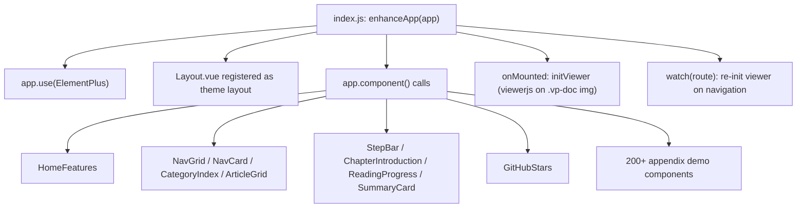

Sources: [docs/.vitepress/theme/index.js:1-35]()

The viewer (viewerjs) is initialized inside `onMounted` and re-initialized on route change via `watch(route, ...)`. Images inside `.vp-doc` gain click-to-zoom behaviour automatically with no per-page configuration.

---

## Custom Layout — `Layout.vue`

`Layout.vue` wraps `DefaultTheme.Layout` and adds four independent features:

### 1. Reading Settings Panel

Font size and line height are controlled via a popover in the nav bar (`#nav-bar-content-after` slot). Values are clamped and persisted to `localStorage`:

| Setting | Storage key | Default | Range |
|---|---|---|---|
| Font size | `ev-doc-font-size` | `14` px | 12–18 px |
| Line height | `ev-doc-line-height` | `1.65` | 1.25–1.80 |

The values are applied as CSS custom properties `--ev-doc-font-size` and `--ev-doc-line-height` on `document.documentElement`.

### 2. Sidebar Collapse

A toggle button in `#nav-bar-title-before` (desktop ≥960 px) and a hover-area button on the left edge both trigger `toggleSidebar()`. State persists under `ev-sidebar-collapsed` in `localStorage`. When collapsed, the class `ev-sidebar-collapsed` is added to `document.body`, which CSS rules use to hide `.VPSidebar` and reclaim padding.

### 3. Outline Auto-Scroll

`initOutlineAutoScroll()` creates two `MutationObserver` instances on `.VPDocAsideOutline` and `.VPSidebar` respectively, watching for `class` attribute changes on their children. When an `<a class="active">` appears in the outline, `scrollOutlineToActiveItem()` scrolls the outline container to center it. History API patching ensures the observers restart on client-side navigation.

### 4. Typing Animation Tagline

The home hero's default `.tagline` is hidden via CSS. A `TextType` component is injected via the `#home-hero-info-after` slot and reads `frontmatter.hero.typingTagline` (falling back to `frontmatter.hero.tagline`) for its content.

**Layout.vue template slot usage**

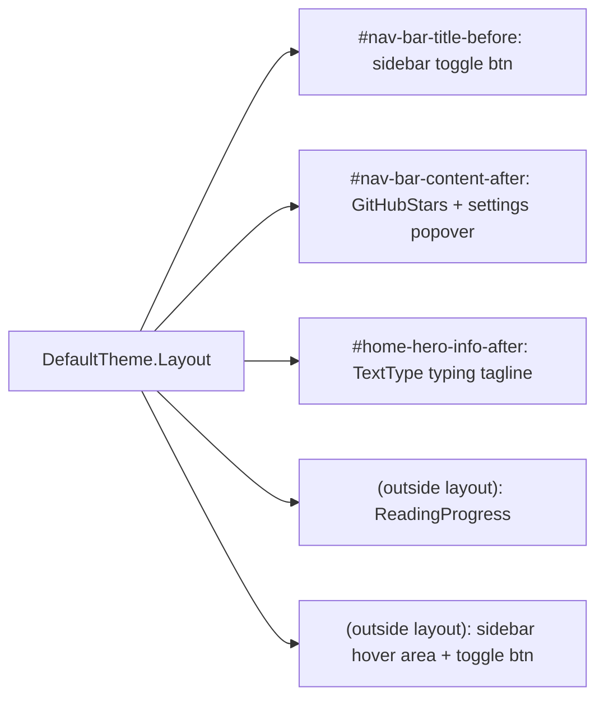

Sources: [docs/.vitepress/theme/Layout.vue:293-454]()

---

## Theme CSS — `style.css`

[docs/.vitepress/theme/style.css]() applies site-wide style overrides. Key areas:

### CSS Custom Properties

```css
:root {
  --ev-doc-font-size: 14px;
  --ev-doc-line-height: 1.65;
}
```

The `.vp-doc` selector consumes these variables and also propagates them into Element Plus size tokens (`--el-font-size-base`, `--el-font-line-height-primary`, etc.).

### Sidebar Compaction

Multiple `.VPSidebarItem` selectors reduce the default padding/margin on sidebar items at every nesting level:
- Level-0 groups: `padding-bottom: 8px`
- Level 1–4 items: `padding-top/bottom: 3px`, `min-height: 26px`
- Link elements: `padding-top/bottom: 2px`

These rules must use `:where(html)` and data-attribute selectors to win specificity against VitePress's scoped component styles.

### Image Utilities

Utility classes control image height for tall-aspect images:

| Class | `max-height` |
|---|---|
| `img-tall` | 380 px |
| `img-very-tall` | 280 px |
| `img-ultra-tall` | 200 px |
| `img-limit-height` | 450 px |
| `img-limit-width` | 320 px (combined with `max-width: 100%`) |

All `.vp-doc img` are centered with `margin: auto` by default.

### Hero Section

`.VPHomeHero` is styled to occupy the full viewport (`min-height: 100dvh`, `display: flex`, `align-items: center`) with a gradient text effect on `.VPHomeHero .name` and pill-shaped action buttons with hover scale transforms.

### Outline Scrollability

`.VPDocAsideOutline` is given `max-height: calc(100vh - nav-height - 32px)` and `overflow-y: auto` with a thin custom scrollbar, enabling it to scroll independently when pages have many headings.

Sources: [docs/.vitepress/theme/style.css:1-420]()

---

## Selected Theme Components

The following are the core UI-layer components (for full detail on all components, see [Theme and Navigation Components](#5.1)):

### `GitHubStars`

[docs/.vitepress/theme/components/GitHubStars.vue]() fetches star count from the GitHub API on mount, caches the result in `localStorage` for 5 minutes (`github-stars-cache`), and displays it as a formatted number (e.g. `2.3k`) next to a GitHub icon link in the nav bar.

### `HomeFeatures`

[docs/.vitepress/theme/components/HomeFeatures.vue]() implements the full single-page marketing layout served on each locale's home page. It contains embedded `i18n` data for `zh-cn` and `en-us` locales as a plain JS object, selected via `useData().lang`. It renders four sections (Stage 1, Stage 2, Stage 3, Appendix) with card grids and an auto-scrolling appendix carousel.

### `ChapterIntroduction`

[docs/.vitepress/theme/components/ChapterIntroduction.vue]() accepts props `duration`, `expectedOutput`, `coreOutput`, `assignment`, and `tags`. It renders a learning-objectives box with optional metric cards (time estimate, expected output, post-chapter assignment). Used at the top of nearly every curriculum chapter.

---

## Dependency Summary

| Package | Role |
|---|---|
| `vitepress@2.0.0-alpha.15` | Static site generator framework |
| `vue@^3.5.0` | Component runtime |
| `element-plus@^2.13.1` | UI component library |
| `@element-plus/icons-vue@^2.3.2` | Icon set (e.g. `Setting` icon in Layout) |
| `markdown-it-katex@^2.0.3` | Math rendering in markdown |
| `typeit@^8.8.7` | Typing animation (consumed by `TextType`) |
| `viewerjs@^1.11.7` | Image lightbox |

Sources: [package.json:1-44]()

---

# Page: Multi-language Support

# Multi-language Support

<details>
<summary>Relevant source files</summary>

The following files were used as context for generating this wiki page:

- [README.md](README.md)
- [assets/readme-image1.png](assets/readme-image1.png)
- [docs-readme/ar-SA/README.md](docs-readme/ar-SA/README.md)
- [docs-readme/de-DE/README.md](docs-readme/de-DE/README.md)
- [docs-readme/en-US/README.md](docs-readme/en-US/README.md)
- [docs-readme/es-ES/README.md](docs-readme/es-ES/README.md)
- [docs-readme/fr-FR/README.md](docs-readme/fr-FR/README.md)
- [docs-readme/ja-JP/README.md](docs-readme/ja-JP/README.md)
- [docs-readme/ko-KR/README.md](docs-readme/ko-KR/README.md)
- [docs-readme/vi-VN/README.md](docs-readme/vi-VN/README.md)
- [docs-readme/zh-CN/README.md](docs-readme/zh-CN/README.md)
- [docs-readme/zh-TW/README.md](docs-readme/zh-TW/README.md)
- [docs/.vitepress/config.mjs](docs/.vitepress/config.mjs)
- [docs/.vitepress/theme/Layout.vue](docs/.vitepress/theme/Layout.vue)
- [docs/.vitepress/theme/components/ChapterIntroduction.vue](docs/.vitepress/theme/components/ChapterIntroduction.vue)
- [docs/.vitepress/theme/components/GitHubStars.vue](docs/.vitepress/theme/components/GitHubStars.vue)
- [docs/.vitepress/theme/components/HomeFeatures.vue](docs/.vitepress/theme/components/HomeFeatures.vue)
- [docs/.vitepress/theme/index.js](docs/.vitepress/theme/index.js)
- [docs/.vitepress/theme/style.css](docs/.vitepress/theme/style.css)
- [docs/ar-sa/index.md](docs/ar-sa/index.md)
- [docs/de-de/index.md](docs/de-de/index.md)
- [docs/en-us/index.md](docs/en-us/index.md)
- [docs/es-es/index.md](docs/es-es/index.md)
- [docs/fr-fr/index.md](docs/fr-fr/index.md)
- [docs/ja-jp/index.md](docs/ja-jp/index.md)
- [docs/ko-kr/index.md](docs/ko-kr/index.md)
- [docs/public/robots.txt](docs/public/robots.txt)
- [docs/vi-vn/index.md](docs/vi-vn/index.md)
- [docs/zh-cn/index.md](docs/zh-cn/index.md)
- [docs/zh-cn/stage-0/0.1-learning-map/index.md](docs/zh-cn/stage-0/0.1-learning-map/index.md)
- [docs/zh-tw/index.md](docs/zh-tw/index.md)

</details>


This page documents how the Easy-Vibe documentation site supports ten languages: the locale configuration in VitePress, the directory layout for each locale, the shared homepage frontmatter schema, and the inline component-level translations. For how the VitePress config is structured more broadly — including nav, sidebar, and theme settings — see [2.1](#2.1).

---

## Overview

The site supports ten locales. `zh-cn` (Simplified Chinese) is the primary locale: it holds the full curriculum content and is the `x-default` hreflang target. The nine translated locales each have a homepage (`index.md`) and a shallow directory stub, but may not replicate the full content tree of `zh-cn`.

| Locale code | Language | Directory |
|---|---|---|
| `zh-cn` | 简体中文 (Simplified Chinese) | `docs/zh-cn/` |
| `en-us` | English | `docs/en-us/` |
| `ja-jp` | 日本語 | `docs/ja-jp/` |
| `zh-tw` | 繁體中文 | `docs/zh-tw/` |
| `ko-kr` | 한국어 | `docs/ko-kr/` |
| `es-es` | Español | `docs/es-es/` |
| `fr-fr` | Français | `docs/fr-fr/` |
| `de-de` | Deutsch | `docs/de-de/` |
| `ar-sa` | العربية | `docs/ar-sa/` |
| `vi-vn` | Tiếng Việt | `docs/vi-vn/` |

Sources: [docs/.vitepress/config.mjs:16-77](), [docs/.vitepress/config.mjs:313-330]()

---

## Directory and URL Structure

Each locale occupies a subdirectory under `docs/` that matches its locale code. VitePress maps these directly to URL prefixes (e.g., `docs/zh-cn/index.md` → `/zh-cn/`).

**Locale directory to URL mapping:**

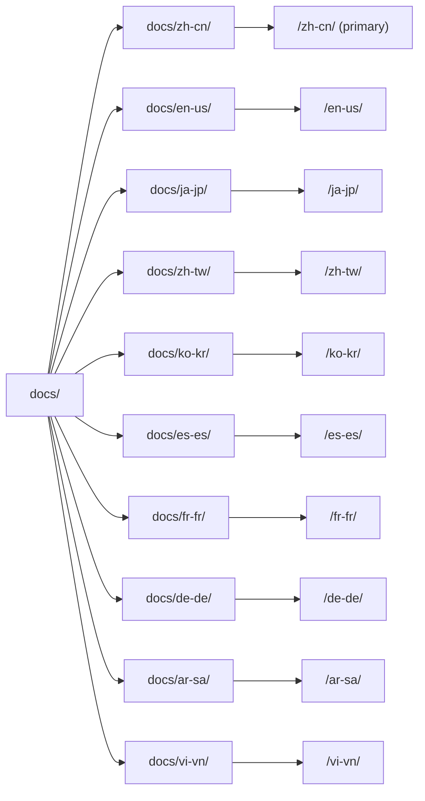

Sources: [docs/zh-cn/index.md](), [docs/en-us/index.md](), [docs/ja-jp/index.md](), [docs/vi-vn/index.md](), [docs/ko-kr/index.md](), [docs/zh-tw/index.md](), [docs/es-es/index.md]()

---

## VitePress Locale Configuration

All ten locales are declared in the `locales` object inside `defineConfig()` in [docs/.vitepress/config.mjs:313-330](). Each locale entry follows this shape:

```
'zh-cn': {
  label: '简体中文',
  lang: 'zh-CN',
  link: '/zh-cn/',
  title: 'Easy-Vibe 教程',
  description: '...',
  head: getSeoHead(...),
  themeConfig: { ...commonThemeConfig, nav: [...], sidebar: {...} }
}
```

The `zh-cn` locale is the most complete: it has a fully populated `sidebar` with routes for `stage-0`, `stage-1`, `stage-2`, `stage-3`, `appendix`, and several legacy redirect paths. The translated locales typically have minimal `themeConfig` (no sidebar definitions beyond the homepage).

**Locale configuration flow:**

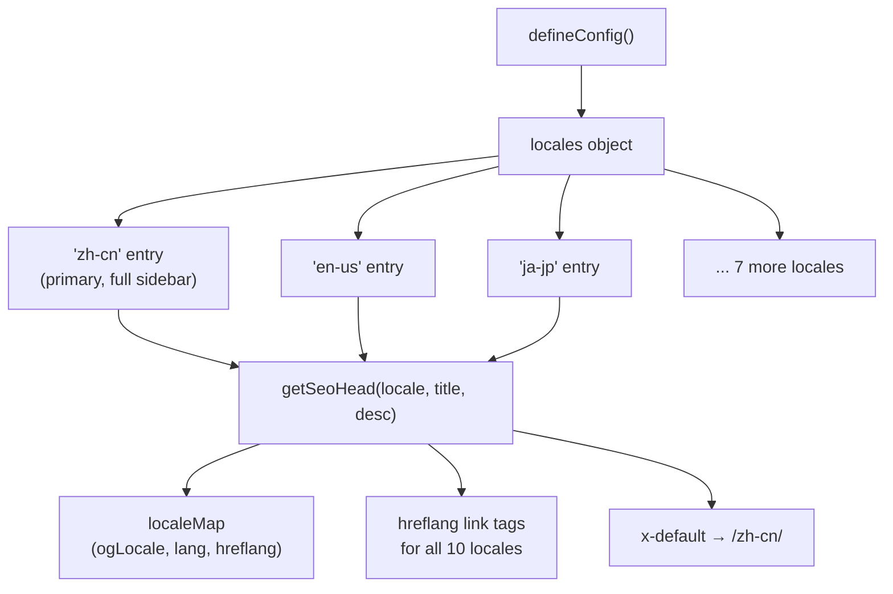

Sources: [docs/.vitepress/config.mjs:282-330](), [docs/.vitepress/config.mjs:80-180]()

---

## SEO and Hreflang via `localeMap` and `getSeoHead`

The constant `localeMap` at [docs/.vitepress/config.mjs:16-77]() maps each locale code to its SEO metadata:

| Key | `ogLocale` | `lang` | `hreflang` |
|---|---|---|---|
| `zh-cn` | `zh_CN` | `zh-CN` | `zh-CN` |
| `en-us` | `en_US` | `en-US` | `en` |
| `ja-jp` | `ja_JP` | `ja-JP` | `ja` |
| `zh-tw` | `zh_TW` | `zh-TW` | `zh-TW` |
| `ko-kr` | `ko_KR` | `ko-KR` | `ko` |
| `es-es` | `es_ES` | `es-ES` | `es` |
| `fr-fr` | `fr_FR` | `fr-FR` | `fr` |
| `de-de` | `de_DE` | `de-DE` | `de` |
| `ar-sa` | `ar_SA` | `ar-SA` | `ar` |
| `vi-vn` | `vi_VN` | `vi-VN` | `vi` |

The function `getSeoHead(locale, title, description, path)` at [docs/.vitepress/config.mjs:80-180]() runs at build time for each locale. It:

1. Looks up the locale in `localeMap`.
2. Constructs Open Graph, Twitter Card, and canonical `<link>` tags.
3. Iterates over all keys in `localeMap` to emit `<link rel="alternate" hreflang="...">` tags pointing to each locale root URL.
4. Appends an `x-default` hreflang tag pointing to `/zh-cn/`, establishing it as the fallback locale.
5. Injects a JSON-LD `WebSite` structured data block.

Sources: [docs/.vitepress/config.mjs:16-77](), [docs/.vitepress/config.mjs:80-180]()

---

## Locale Homepage Frontmatter Schema

Each locale has a homepage at `docs/<locale>/index.md`. All homepages share the same frontmatter schema.

**Shared frontmatter fields across all locale `index.md` files:**

| Field | Type | Description |
|---|---|---|
| `layout` | `"home"` | Activates VitePress's home layout |
| `navbar` | `false` | Hides the default navbar on the homepage |
| `hero.name` | string | Always `'Easy-Vibe'` |
| `hero.text` | string | Locale-specific subtitle |
| `hero.tagline` | string | Locale-specific one-liner |
| `hero.typingTagline` | string[] | List of strings for the `TextType` typing animation |
| `hero.actions` | array | CTA buttons (`theme`, `text`, `link`) |

The `typingTagline` field is a custom extension — it is not a standard VitePress frontmatter key. It is consumed by `Layout.vue` via [docs/.vitepress/theme/Layout.vue:413-428](), which passes it to the `TextType` component and renders it as an animated typing effect in place of the static tagline.

**Example: zh-cn vs en-us frontmatter comparison:**

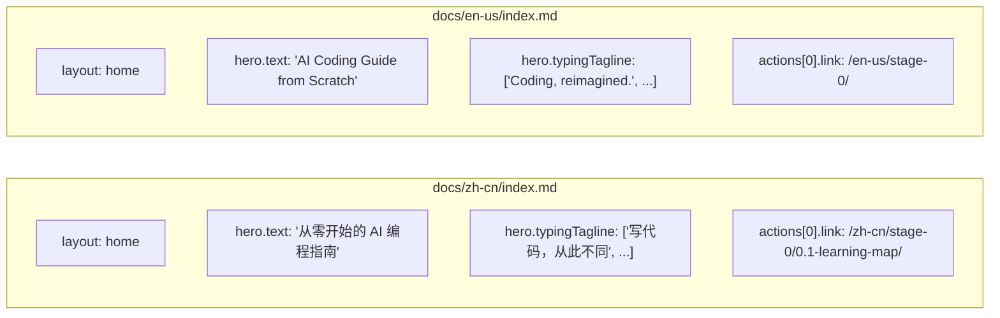

> Note: The `zh-cn` action link points to a specific deep path (`/zh-cn/stage-0/0.1-learning-map/`) because that locale has full content. The translated locales' action links point only to their locale root or a shallow stage index.

Sources: [docs/zh-cn/index.md](), [docs/en-us/index.md](), [docs/ja-jp/index.md](), [docs/vi-vn/index.md](), [docs/ko-kr/index.md](), [docs/zh-tw/index.md](), [docs/es-es/index.md]()

---

## Two-Tier Redirect Mechanism

The site has two tiers of locale-based routing:

1. **Site root (`/`)**: VitePress resolves the root via its `locales` config. The `x-default` hreflang in `getSeoHead` points to `/zh-cn/`, declaring it the canonical fallback. The VitePress locale switcher in the navbar also lists all locales via the `label` field of each locale entry.

2. **Locale root (`/zh-cn/`, `/en-us/`, …)**: Each locale root maps to its `docs/<locale>/index.md`, which renders the `HomeFeatures` component. The `HomeFeatures.vue` component reads the current locale using VitePress's `useData()` composable and selects the corresponding entry from its inline `i18n` object.

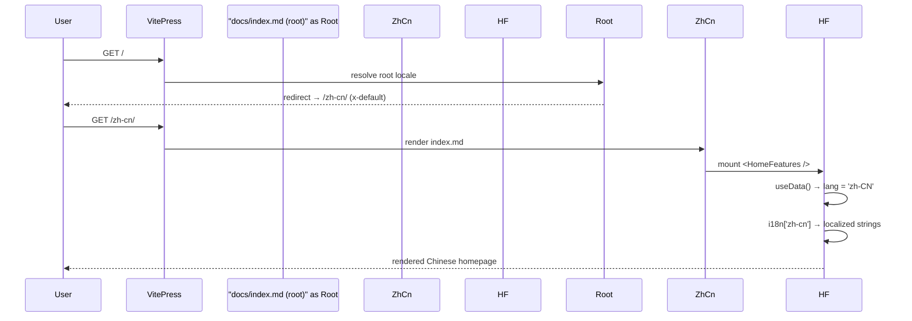

Sources: [docs/.vitepress/config.mjs:139-152](), [docs/.vitepress/theme/components/HomeFeatures.vue:7-8]()

---

## Component-Level Translations: `HomeFeatures.vue` `i18n` Object

The `HomeFeatures.vue` component at [docs/.vitepress/theme/components/HomeFeatures.vue:61]() contains a hardcoded `i18n` object keyed by locale code. This object holds all visible text for the home page sections: stage descriptions, card titles, nav labels, and footer copy.

The component reads the current locale using:

```js
const { site, page, lang } = useData()
```

It then selects the matching locale entry from `i18n`. Locale codes present in the `i18n` object include `zh-cn`, `en-us`, and `ja-jp` with full content; other locales fall back to whichever key is present or gracefully degrade.

**HomeFeatures locale resolution:**

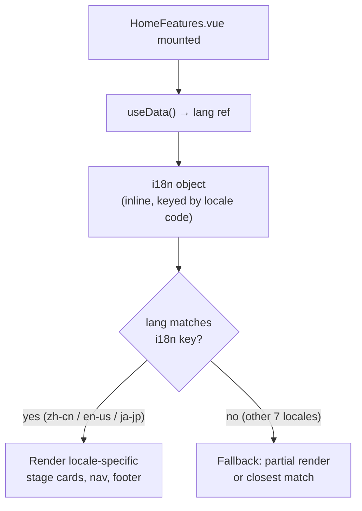

Sources: [docs/.vitepress/theme/components/HomeFeatures.vue:7-8](), [docs/.vitepress/theme/components/HomeFeatures.vue:61-385]()

---

## Content Coverage by Locale

| Locale | Homepage | Stage content | Appendix | Sidebar config |
|---|---|---|---|---|
| `zh-cn` | ✅ Full | ✅ Full | ✅ Full | ✅ Detailed |
| `en-us` | ✅ | Stub (`/en-us/stage-0/`) | — | — |
| `ja-jp` | ✅ | Stub (`/ja-jp/stage-0/`) | — | — |
| `zh-tw` | ✅ | — | — | — |
| `ko-kr` | ✅ | — | — | — |
| `es-es` | ✅ | — | — | — |
| `fr-fr` | ✅ | — | — | — |
| `de-de` | ✅ | — | — | — |
| `ar-sa` | ✅ | — | — | — |
| `vi-vn` | ✅ | — | — | — |

The full curriculum (stages 0–3, appendix, sidebar navigation) lives exclusively under `docs/zh-cn/`. Translated locales provide localised entry points that link into the shared curriculum or to stage stubs.

Sources: [docs/.vitepress/config.mjs:313-1400](), [README.md:34-44]()

---

# Page: Deployment and CI/CD

# Deployment and CI/CD

<details>
<summary>Relevant source files</summary>

The following files were used as context for generating this wiki page:

- [.github/workflows/deploy.yml](.github/workflows/deploy.yml)
- [.husky/pre-commit](.husky/pre-commit)
- [docs/.vitepress/theme/components/StepBar.vue](docs/.vitepress/theme/components/StepBar.vue)
- [docs/.vitepress/theme/components/TextType.vue](docs/.vitepress/theme/components/TextType.vue)
- [docs/.vitepress/theme/components/appendix/cloud-topology/VpcArchitectureDemo.vue](docs/.vitepress/theme/components/appendix/cloud-topology/VpcArchitectureDemo.vue)
- [docs/index.md](docs/index.md)
- [package-lock.json](package-lock.json)
- [package.json](package.json)
- [vercel.json](vercel.json)

</details>


This page covers how the Easy-Vibe site is built and deployed automatically. There are two deployment targets: **GitHub Pages** (via GitHub Actions) and **Vercel** (via `vercel.json`). Both targets use the same build command and output directory.

For information about the local development loop, npm scripts, and the Husky pre-commit hook, see [Development Workflow](#2.4). For the VitePress configuration that determines the `base` path used during builds, see [VitePress Configuration and Theme](#2.1).

---

## Build Pipeline Overview

The following diagram shows how a push to `main` flows through the CI/CD pipeline to production.

**Diagram: End-to-end deployment flow**

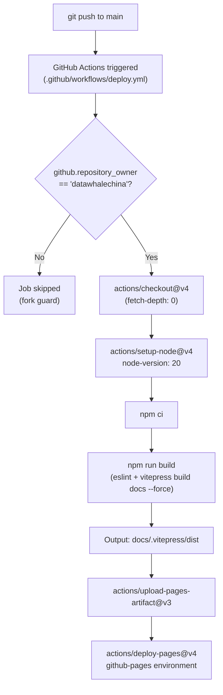

Sources: [.github/workflows/deploy.yml:1-64]()

---

## GitHub Pages Deployment

The workflow file is at [.github/workflows/deploy.yml:1-64]().

### Trigger Conditions

| Trigger | Details |
|---|---|
| `push` to `main` | Automatic on every merge to `main` |
| `workflow_dispatch` | Manual trigger from the GitHub Actions UI |

### Repository Owner Guard

The `build` job includes an `if` condition on [line 28](.github/workflows/deploy.yml:28-28):

```
if: github.repository_owner == 'datawhalechina'
```

This prevents the deployment job from running when the workflow executes on a fork. Only the canonical repository under the `datawhalechina` GitHub organization will deploy to GitHub Pages.

### Concurrency Settings

Defined at [.github/workflows/deploy.yml:21-23]():

```yaml
concurrency:
  group: pages
  cancel-in-progress: false
```

- All deployments share the concurrency group `pages`.
- `cancel-in-progress: false` means a queued run will **not** cancel an already-running deployment. In-progress production deployments are always allowed to finish.

### Required Permissions

The `GITHUB_TOKEN` is granted these permissions [.github/workflows/deploy.yml:14-17]():

| Permission | Value | Purpose |
|---|---|---|
| `contents` | `read` | Checkout the repository |
| `pages` | `write` | Upload to GitHub Pages |
| `id-token` | `write` | OIDC authentication for Pages deployment |

### Jobs

The workflow has two sequential jobs:

**`build` job** [.github/workflows/deploy.yml:26-50]()

| Step | Action | Notes |
|---|---|---|
| Checkout | `actions/checkout@v4` | `fetch-depth: 0` retrieves full history |
| Setup Node | `actions/setup-node@v4` | `node-version: 20`, npm cache enabled |
| Setup Pages | `actions/configure-pages@v4` | Configures Pages environment |
| Install | `npm ci` | Clean install from lockfile |
| Build | `npm run build` | Runs ESLint then `vitepress build docs --force` |
| Upload artifact | `actions/upload-pages-artifact@v3` | Uploads `docs/.vitepress/dist` |

**`deploy` job** [.github/workflows/deploy.yml:52-64]()

- `needs: build` — only runs after the build job succeeds.
- Targets the `github-pages` environment.
- Uses `actions/deploy-pages@v4` to publish the uploaded artifact.

Sources: [.github/workflows/deploy.yml:1-64]()

---

## Vercel Deployment

The Vercel configuration is at [vercel.json:1-6]():

```json
{
  "buildCommand": "npm run build",
  "installCommand": "npm install",
  "framework": "vitepress",
  "outputDirectory": "docs/.vitepress/dist"
}
```

| Field | Value |
|---|---|
| `buildCommand` | `npm run build` (identical to CI) |
| `installCommand` | `npm install` |
| `framework` | `vitepress` |
| `outputDirectory` | `docs/.vitepress/dist` |

Vercel detects the `vitepress` framework and knows how to serve the static output. The `outputDirectory` must match what VitePress writes to, which is configured in the VitePress config (see [VitePress Configuration and Theme](#2.1)).

Sources: [vercel.json:1-6]()

---

## Build Command Details

The `build` script is defined in [package.json:8]():

```
"build": "npm run lint && vitepress build docs --force"
```

This means every deployment (both GitHub Actions and Vercel) runs:

1. `npm run lint` — ESLint check scoped to `docs/.vitepress/theme` ([package.json:12]())
2. `vitepress build docs --force` — Compiles all markdown and Vue components into static HTML/JS/CSS under `docs/.vitepress/dist`

If ESLint reports errors, the build command fails and the deployment is aborted.

### Node.js Version Requirement

Specified in [package.json:22-24]():

```json
"engines": {
  "node": ">=18.0.0"
}
```

The GitHub Actions workflow pins Node 20 [.github/workflows/deploy.yml:38](), which satisfies this requirement.

Sources: [package.json:1-44](), [.github/workflows/deploy.yml:35-39]()

---

## Deployment Targets Comparison

**Diagram: Two deployment targets sharing the same build artifacts**

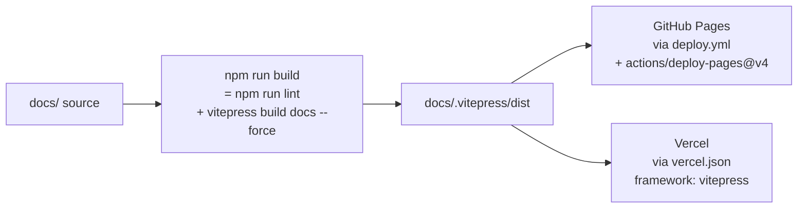

| Property | GitHub Pages | Vercel |
|---|---|---|
| Config file | `.github/workflows/deploy.yml` | `vercel.json` |
| Trigger | Push to `main` / manual | Git push / Vercel webhook |
| Install command | `npm ci` | `npm install` |
| Build command | `npm run build` | `npm run build` |
| Output directory | `docs/.vitepress/dist` | `docs/.vitepress/dist` |
| Fork guard | Yes (`repository_owner` check) | Not applicable |
| Node version | 20 (pinned in workflow) | Vercel default (≥18 required) |

Sources: [.github/workflows/deploy.yml:1-64](), [vercel.json:1-6](), [package.json:1-44]()

---

## Deployment Sequence (GitHub Actions)

**Diagram: Job dependency and step sequence**

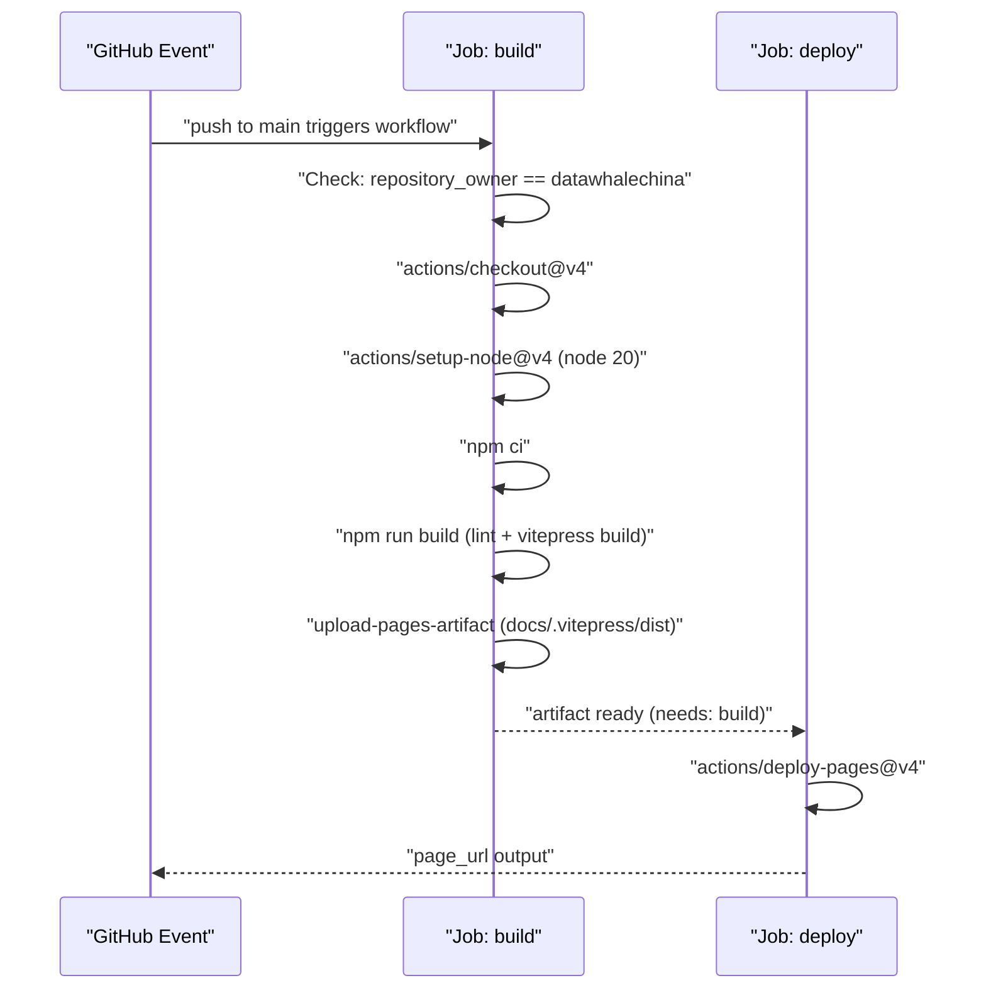

Sources: [.github/workflows/deploy.yml:1-64]()

---

# Page: Development Workflow

# Development Workflow

<details>
<summary>Relevant source files</summary>

The following files were used as context for generating this wiki page:

- [.gitignore](.gitignore)
- [.husky/pre-commit](.husky/pre-commit)
- [.vscode/settings.json](.vscode/settings.json)
- [assets/wechat.png](assets/wechat.png)
- [docs/.vitepress/theme/components/appendix/cloud-topology/VpcArchitectureDemo.vue](docs/.vitepress/theme/components/appendix/cloud-topology/VpcArchitectureDemo.vue)
- [docs/.vitepress/theme/components/appendix/engineering-excellence/CodeSmellDemo.vue](docs/.vitepress/theme/components/appendix/engineering-excellence/CodeSmellDemo.vue)
- [docs/.vitepress/theme/components/appendix/engineering-excellence/DecisionMatrixDemo.vue](docs/.vitepress/theme/components/appendix/engineering-excellence/DecisionMatrixDemo.vue)
- [docs/.vitepress/theme/components/appendix/engineering-excellence/DesignPatternCatalogDemo.vue](docs/.vitepress/theme/components/appendix/engineering-excellence/DesignPatternCatalogDemo.vue)
- [docs/.vitepress/theme/components/appendix/engineering-excellence/DocStructureDemo.vue](docs/.vitepress/theme/components/appendix/engineering-excellence/DocStructureDemo.vue)
- [docs/.vitepress/theme/components/appendix/engineering-excellence/LicenseComparisonDemo.vue](docs/.vitepress/theme/components/appendix/engineering-excellence/LicenseComparisonDemo.vue)
- [docs/.vitepress/theme/components/appendix/engineering-excellence/OpenSourceWorkflowDemo.vue](docs/.vitepress/theme/components/appendix/engineering-excellence/OpenSourceWorkflowDemo.vue)
- [docs/.vitepress/theme/components/appendix/engineering-excellence/PatternPlaygroundDemo.vue](docs/.vitepress/theme/components/appendix/engineering-excellence/PatternPlaygroundDemo.vue)
- [docs/.vitepress/theme/components/appendix/engineering-excellence/RefactoringDemo.vue](docs/.vitepress/theme/components/appendix/engineering-excellence/RefactoringDemo.vue)
- [docs/.vitepress/theme/components/appendix/engineering-excellence/SecurityChecklistDemo.vue](docs/.vitepress/theme/components/appendix/engineering-excellence/SecurityChecklistDemo.vue)
- [docs/.vitepress/theme/components/appendix/engineering-excellence/TDDCycleDemo.vue](docs/.vitepress/theme/components/appendix/engineering-excellence/TDDCycleDemo.vue)
- [package-lock.json](package-lock.json)
- [package.json](package.json)
- [vercel.json](vercel.json)

</details>


This page covers the local development setup for the easy-vibe repository: required tooling, available npm scripts, the Husky pre-commit gate, Prettier formatting, `.gitignore` exclusions, and VS Code editor settings. For how the built output is deployed to GitHub Pages and Vercel, see [Deployment and CI/CD](#2.3).

---

## Prerequisites

The repository enforces a minimum Node.js version.

| Requirement | Value |
|---|---|
| Node.js | `>=18.0.0` |
| Package manager | npm (lockfile at `package-lock.json`) |

[package.json:29-31]()

---

## Getting Started

Clone the repository and install dependencies:

```bash
git clone https://github.com/datawhalechina/easy-vibe
cd easy-vibe
npm install          # also runs `husky` via the "prepare" lifecycle script
```

The `prepare` script (`"prepare": "husky"`) installs Husky's Git hooks automatically on `npm install`.

[package.json:14]()

---

## npm Scripts

**Script reference table:**

| Script | Command | Purpose |
|---|---|---|
| `dev` | `vitepress dev docs` | Start local dev server with hot-reload |
| `build` | `npm run lint && vitepress build docs --force` | Lint then produce static output |
| `preview` | `vitepress preview docs` | Serve the built output locally |
| `format` | `prettier --write .` | Auto-format all files with Prettier |
| `lint` | `eslint docs/.vitepress/theme` | Check theme components for ESLint errors |
| `lint:fix` | `eslint docs/.vitepress/theme --fix` | Auto-fix ESLint issues in theme components |
| `verify` | `bash scripts/verify.sh` | Run the external verification script |

[package.json:6-15]()

**Key observations:**

- `npm run build` calls `npm run lint` first. If ESLint reports errors, the VitePress build does not run.
- ESLint scope is scoped to `docs/.vitepress/theme` only — the curriculum markdown content is not linted.
- `scripts/verify.sh` is listed in `.gitignore` and is a local-only helper not tracked in the repository.

---

## Build Pipeline (Local)

**Diagram: Local build flow**

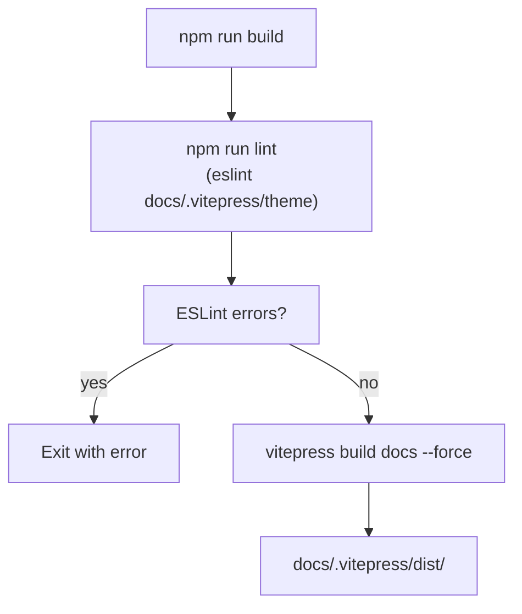

Sources: [package.json:8]()

---

## Pre-commit Hook

Husky installs a `pre-commit` hook at [.husky/pre-commit]() that runs two sequential checks before any commit is allowed to proceed.

**Diagram: pre-commit gate**

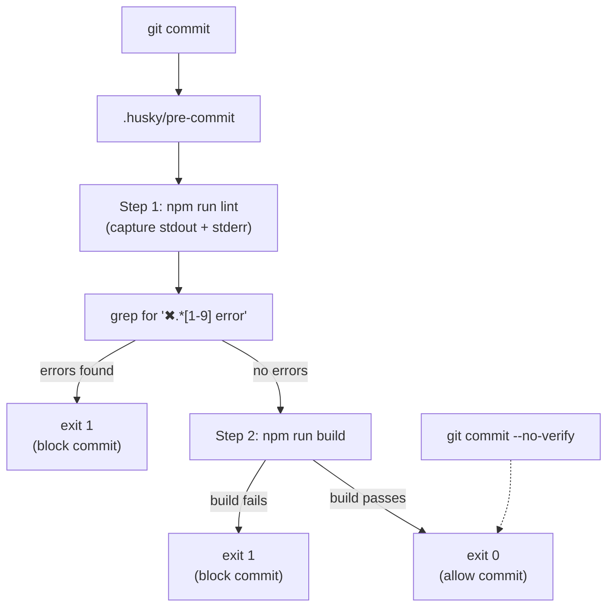

Sources: [.husky/pre-commit:1-38]()

### Hook Logic Details

The hook uses a grep pattern rather than the raw exit code to distinguish errors from warnings:

```
if echo "$LINT_OUTPUT" | grep -q "✖.*[1-9] error"; then
```

This means ESLint warnings alone do **not** block a commit — only actual errors do.

[.husky/pre-commit:13-19]()

The build step suppresses all output (`> /dev/null 2>&1`). If the build fails, the hook prints a hint:

```
💡 Run 'npm run build' to see detailed errors
💡 To skip pre-commit checks: git commit --no-verify
```

[.husky/pre-commit:25-31]()

---

## Linting and Formatting

**Diagram: tooling scope**

```mermaid
flowchart LR
    subgraph "eslint scope"
        TH["docs/.vitepress/theme/**"]
    end
    subgraph "prettier scope"
        ALL[".(all files)"]
    end
    subgraph "devDependencies"
        ESL["eslint ^9.0.0"]
        ESLJSS["@eslint/js ^9.0.0"]
        ESLVUE["eslint-plugin-vue ^9.30.0"]
        VUEPARSER["vue-eslint-parser ^9.4.3"]
        PRETTIER["prettier ^3.7.4"]
    end

    ESL --> TH
    ESLJSS --> TH
    ESLVUE --> TH
    VUEPARSER --> TH
    PRETTIER --> ALL
```

Sources: [package.json:21-33]()

| Tool | Version | Config scope |
|---|---|---|
| `eslint` | `^9.0.0` | `docs/.vitepress/theme` |
| `@eslint/js` | `^9.0.0` | base JS rules |
| `eslint-plugin-vue` | `^9.30.0` | Vue SFC linting |
| `vue-eslint-parser` | `^9.4.3` | parses `.vue` files |
| `prettier` | `^3.7.4` | all files via `prettier --write .` |
| `husky` | `^9.1.7` | git hook management |

---

## .gitignore Exclusions

The following categories of paths are excluded from version control:

| Category | Paths |
|---|---|
| Build output | `docs/.vitepress/dist`, `docs/.vitepress/cache`, `docs/.vitepress/.temp/*` |
| Temporary files | `temp/*`, `.temp/*` |
| Dependencies | `node_modules` |
| OS artifacts | `.DS_Store` |
| Tooling directories | `tools/*`, `.trae` |
| Local scripts | `scripts/verify.sh`, `scripts/collapse_code_blocks.py` |
| Planning/AI docs | `CLAUDE.md`, `MULTI_LANGUAGE_PLAN.md`, `REFACTORING_PLAN.md`, `REFACTORING_REPORT.md` |
| Backup content | `docs/zh-cn/appendix-old-backup*/`, `docs/zh-cn/appendix-dirs-backup*/` |
| The `.gitignore` itself | `.gitignore` (appears multiple times, deduplicated by Git) |

[.gitignore:1-20]()

Note that `CLAUDE.md` being ignored means AI assistant context files are kept only locally.

---

## VS Code Editor Settings

The workspace settings at [.vscode/settings.json]() configure markdown image pasting behavior. This is relevant for contributors adding images to curriculum pages.

| Setting | Value | Effect |
|---|---|---|
| `pasteImage.path` | `${currentFileDir}/images` | Images pasted via extension go into a sibling `images/` folder |
| `pasteImage.defaultName` | `${currentFileNameWithoutExt}-YYYY-MM-DD-HH-mm-ss` | Timestamped filenames prevent collisions |
| `pasteImage.prefix` | `images/` | Relative path prefix in inserted Markdown |
| `pasteImage.insertPattern` | `` | Plain `` syntax, no alt text |
| `pasteImage.basePath` | `${currentFileDir}/images` | Base for relative resolution |
| `markdown.copyFiles.destination` | `"*.md": "images/${fileName}"` | VS Code built-in copy-on-paste also targets `images/` |
| `markdown.editor.drop.enabled` | `false` | Disables drag-drop file insertion |
| `markdown.editor.pasteUrlAsFormattedLink.enabled` | `false` | Prevents URLs from becoming formatted links |

[.vscode/settings.json:1-13]()

The combined effect is that any image pasted or copied into a `.md` file lands in `<same-directory>/images/` with a timestamped name, and is referenced with a simple `` tag.

---

## Developer Workflow Summary

**Diagram: full contributor loop**

```mermaid
sequenceDiagram
    participant DEV as "Developer"
    participant NPM as "npm scripts"
    participant HUSKY as ".husky/pre-commit"
    participant GIT as "Git"

    DEV->>NPM: npm run dev
    Note over NPM: vitepress dev docs (hot-reload)
    DEV->>NPM: npm run format
    Note over NPM: prettier --write .
    DEV->>NPM: npm run lint:fix
    Note over NPM: eslint docs/.vitepress/theme --fix
    DEV->>GIT: git commit
    GIT->>HUSKY: trigger pre-commit
    HUSKY->>NPM: npm run lint
    NPM-->>HUSKY: pass / fail
    HUSKY->>NPM: npm run build
    NPM-->>HUSKY: pass / fail
    HUSKY-->>GIT: exit 0 (allow) or exit 1 (block)
    GIT-->>DEV: commit recorded or rejected
    DEV->>GIT: git push
```

Sources: [package.json:6-14](), [.husky/pre-commit:1-38]()

---

# Page: Learning Curriculum

# Learning Curriculum

<details>
<summary>Relevant source files</summary>

The following files were used as context for generating this wiki page:

- [README.md](README.md)
- [assets/readme-image1.png](assets/readme-image1.png)
- [docs-readme/ar-SA/README.md](docs-readme/ar-SA/README.md)
- [docs-readme/de-DE/README.md](docs-readme/de-DE/README.md)
- [docs-readme/en-US/README.md](docs-readme/en-US/README.md)
- [docs-readme/es-ES/README.md](docs-readme/es-ES/README.md)
- [docs-readme/fr-FR/README.md](docs-readme/fr-FR/README.md)
- [docs-readme/ja-JP/README.md](docs-readme/ja-JP/README.md)
- [docs-readme/ko-KR/README.md](docs-readme/ko-KR/README.md)
- [docs-readme/vi-VN/README.md](docs-readme/vi-VN/README.md)
- [docs-readme/zh-CN/README.md](docs-readme/zh-CN/README.md)
- [docs-readme/zh-TW/README.md](docs-readme/zh-TW/README.md)
- [docs/.vitepress/config.mjs](docs/.vitepress/config.mjs)
- [docs/.vitepress/theme/Layout.vue](docs/.vitepress/theme/Layout.vue)
- [docs/.vitepress/theme/components/ChapterIntroduction.vue](docs/.vitepress/theme/components/ChapterIntroduction.vue)
- [docs/.vitepress/theme/components/GitHubStars.vue](docs/.vitepress/theme/components/GitHubStars.vue)
- [docs/.vitepress/theme/components/HomeFeatures.vue](docs/.vitepress/theme/components/HomeFeatures.vue)
- [docs/.vitepress/theme/components/appendix/computer-fundamentals/BootProcessDemo.vue](docs/.vitepress/theme/components/appendix/computer-fundamentals/BootProcessDemo.vue)
- [docs/.vitepress/theme/index.js](docs/.vitepress/theme/index.js)
- [docs/.vitepress/theme/style.css](docs/.vitepress/theme/style.css)
- [docs/public/robots.txt](docs/public/robots.txt)
- [docs/zh-cn/appendix/1-computer-fundamentals/algorithm-thinking.md](docs/zh-cn/appendix/1-computer-fundamentals/algorithm-thinking.md)
- [docs/zh-cn/appendix/1-computer-fundamentals/data-encoding-storage.md](docs/zh-cn/appendix/1-computer-fundamentals/data-encoding-storage.md)
- [docs/zh-cn/appendix/1-computer-fundamentals/data-structures.md](docs/zh-cn/appendix/1-computer-fundamentals/data-structures.md)
- [docs/zh-cn/appendix/1-computer-fundamentals/power-on-to-web.md](docs/zh-cn/appendix/1-computer-fundamentals/power-on-to-web.md)
- [docs/zh-cn/appendix/1-computer-fundamentals/programming-languages.md](docs/zh-cn/appendix/1-computer-fundamentals/programming-languages.md)
- [docs/zh-cn/appendix/index.md](docs/zh-cn/appendix/index.md)
- [docs/zh-cn/stage-0/0.1-learning-map/index.md](docs/zh-cn/stage-0/0.1-learning-map/index.md)
- [docs/zh-cn/stage-0/index.md](docs/zh-cn/stage-0/index.md)
- [docs/zh-cn/stage-2/index.md](docs/zh-cn/stage-2/index.md)
- [docs/zh-cn/stage-3/index.md](docs/zh-cn/stage-3/index.md)

</details>


This page describes the overall Easy-Vibe curriculum — its educational philosophy, how content is divided into stages, the directory layout for each stage, and which modules are currently complete. It covers the progression model from zero-prerequisites through advanced development. For details on how individual stage pages are navigated via components, see [Curriculum Structure and Learning Map](#3.1). For the nine-category technical appendix, see [Appendix Reference Material](#4).

---

## Philosophy

Easy-Vibe teaches **Vibe Coding**: driving software development through natural-language conversations with an AI IDE rather than writing code by hand. The curriculum assumes no prior programming background. Learning is project-based — each stage ends with a deliverable that functions as a real, demonstrable product rather than a textbook exercise.

The guiding premise from [docs/zh-cn/stage-0/0.1-learning-map/index.md]() is:

> 编程语言正在变成自然语言 — "Programming languages are becoming natural language."

The hardest question is no longer *how to write code* but *what to build*.

Sources: [docs/zh-cn/stage-0/0.1-learning-map/index.md](), [README.md:101-117]()

---

## Three-Stage Progression Model

The curriculum is divided into a zero-prerequisites intro (Stage 0), followed by three capability stages, plus a standalone technical appendix.

**Curriculum Progression Diagram**

```mermaid
flowchart TD
  S0["Stage 0 · 新手入门\n(Newcomer Intro)"]
  S1["Stage 1 · 产品原型实战\n(Product Prototype)"]
  S2["Stage 2 · 初中级开发\n(Junior-Mid Dev)"]
  S3["Stage 3 · 高级开发\n(Advanced Dev)"]
  AP["附录 · Appendix\n(9 Knowledge Domains)"]

  S0 --> S1 --> S2 --> S3
  AP -.->|"reference anytime"| S0
  AP -.-> S1
  AP -.-> S2
  AP -.-> S3
```

| Stage | Chinese Label | Target Audience | Deliverable |
|---|---|---|---|
| **Stage 0** | 新手入门 | Everyone; no prerequisites | First AI-generated game |
| **Stage 1** | 产品原型实战 | PMs, non-technical builders | High-fidelity interactive web prototype |
| **Stage 2** | 初中级开发 | Junior/mid developers | Full-stack web application, deployed |
| **Stage 3** | 高级开发 | Senior developers | Cross-platform or AI-native production app |
| **Appendix** | 附录知识库 | Any learner needing background | 9 domains, 80+ interactive topics |

Sources: [README.md:112-117](), [docs/zh-cn/stage-0/0.1-learning-map/index.md:56-90]()

---

## Directory and Sidebar Structure

Each stage maps directly to a directory under `docs/zh-cn/` and a sidebar configuration in `docs/.vitepress/config.mjs`.

**Stage Directory to Config Mapping**

```mermaid
flowchart LR
  subgraph "docs/zh-cn/"
    D0["stage-0/"]
    D1["stage-1/"]
    D2["stage-2/"]
    D3["stage-3/"]
    DA["appendix/"]
  end

  subgraph "config.mjs sidebar keys"
    K0["'/zh-cn/stage-0/'"]
    K1["'/zh-cn/stage-1/'"]
    K2["'/zh-cn/stage-2/'"]
    K3["'/zh-cn/stage-3/'"]
    KA["'/zh-cn/appendix/'"]
  end

  subgraph "sidebar variables"
    PM["productManagerSidebar"]
    S2S["stage-2 inline array"]
    S3S["stage-3 inline array"]
    APS["appendix inline array"]
  end

  D0 --> K0 --> PM
  D1 --> K1 --> PM
  D2 --> K2 --> S2S
  D3 --> K3 --> S3S
  DA --> KA --> APS
```

`productManagerSidebar` is a reusable variable defined at [docs/.vitepress/config.mjs:206-280]() and applied to both `/zh-cn/stage-0/` and `/zh-cn/stage-1/` sidebar keys [docs/.vitepress/config.mjs:350-351](). Stages 2 and 3 each have their own inline sidebar arrays.

**Index Page Component Pattern**

Every stage's `index.md` uses the `NavGrid` + `NavCard` Vue components (registered in [docs/.vitepress/theme/index.js:13-14]()) to render navigable cards:

```
<NavGrid>
  <NavCard href="/zh-cn/stage-N/..." title="..." description="..." />
  ...
</NavGrid>
```

Sources: [docs/.vitepress/config.mjs:206-280](), [docs/.vitepress/config.mjs:349-503](), [docs/zh-cn/stage-0/index.md](), [docs/zh-cn/stage-2/index.md](), [docs/zh-cn/stage-3/index.md](), [docs/.vitepress/theme/index.js:13-14]()

---

## Stage 0: Introduction to AI Programming

**Directory:** `docs/zh-cn/stage-0/`

Stage 0 serves as the on-ramp for complete beginners. Its two modules are covered in the shared `productManagerSidebar` under the section label "新手入门".

| Module | Path | Key Content | Status |
|---|---|---|---|
| 0.1 学习地图 | `stage-0/0.1-learning-map/` | Full curriculum roadmap; explains Vibe Coding | ✅ |
| 0.2 AI 时代，会说话就会编程 | `stage-0/0.2-ai-capabilities-through-games/` | Build snake games on web-based platforms; intro to AI IDEs | ✅ |

The learning map at [docs/zh-cn/stage-0/0.1-learning-map/index.md]() renders stage cards using inline CSS and `div` elements rather than `NavCard`, since it is a standalone orientation page. It includes a persona-to-outcome table mapping roles (students, PMs, doctors, etc.) to what the curriculum delivers.

Sources: [docs/.vitepress/config.mjs:210-216](), [docs/zh-cn/stage-0/0.1-learning-map/index.md](), [docs/zh-cn/stage-0/index.md]()

---

## Stage 1: AI-Assisted Development Fundamentals

**Directory:** `docs/zh-cn/stage-1/`

Stage 1 teaches the core Vibe Coding workflow using local AI IDEs (Trae, Cursor). The sidebar groups content into the main sequence plus business-thinking appendices and technical appendices.

### Main Sequence

| Module | Path | Key Content | Status |
|---|---|---|---|
| 1.0 寻找好想法 | `stage-1/1.0-finding-great-idea/` | Product idea generation and validation | ✅ |
| 1.1 认识 AI IDE 工具 | `stage-1/1.1-introduction-to-ai-ide/` | Trae, Cursor — local game-building | ✅ |
| 1.2 动手做出原型 | `stage-1/1.2-building-prototype/` | Single-page → multi-page prototypes | ✅ |
| 1.3 给原型加上 AI 能力 | `stage-1/1.3-integrating-ai-capabilities/` | DeepSeek, Qwen3 VL API integration | ✅ |
| 1.4 完整项目实战 | `stage-1/1.4-complete-project-practice/` | LocalStorage polish; user feedback iteration | ✅ |

### Appendices (Business Thinking)

| Appendix | Path | Key Content | Status |
|---|---|---|---|
| A 产品思维与方案设计 | `stage-1/appendix-a-product-thinking/` | Product PM frameworks | ✅ |
| B AI 行业应用 (B端) | `stage-1/appendix-industry-scenarios/` | B-side enterprise AI scenarios | ✅ |
| C AI 消费场景 (C端) | `stage-1/appendix-c-consumer-scenarios/` | C-side consumer scenarios | ✅ |

### Appendices (Technical)

| Appendix | Path | Key Content | Status |
|---|---|---|---|
| D 写代码时遇到错误怎么办 | `stage-1/appendix-b-common-errors/` | Common Vibe Coding errors and debugging | ✅ |
| E 七款 AI 编程工具对比 | `stage-1/appendix-articles/example0-1/` | Comparison of 7 AI coding platforms | ✅ |
| F 用设计和编程 Agent 设计网站 | `stage-1/appendix-articles/example0-2/` | Design + coding agent collaboration | ✅ |

Sources: [README.md:236-260](), [docs/.vitepress/config.mjs:206-280](), [docs/zh-cn/stage-0/index.md:26-110]()

---

## Stage 2: Full-Stack Development

**Directory:** `docs/zh-cn/stage-2/`

Stage 2 is organized into four sub-tracks inside the sidebar: frontend, backend/fullstack, AI capabilities, and assignments.

**Stage 2 Module Graph**

```mermaid
flowchart TD
  subgraph "Frontend (stage-2/frontend)"
    F0["2.0-lovart-assets/"]
    F1["2.1-figma-mastergo/"]
    F2["2.2-ui-design/"]
    F3["2.3-multi-product-ui/"]
    F4["2.4-hogwarts-portraits/"]
  end

  subgraph "Backend (stage-2/backend)"
    B1["2.1-what-is-api/"]
    B2["2.2-database-supabase/"]
    B3["2.3-ai-interface-code/"]
    B4["2.4-git-workflow/"]
    B5["2.5-zeabur-deployment/"]
    B6["2.6-modern-cli/"]
    B7["2.7-stripe-payment/"]
  end

  subgraph "AI Capabilities (stage-2/ai-capabilities)"
    AI1["2.1-dify-knowledge-base/"]
    AI2["2.2-multimodal-api/"]
  end

  subgraph "Assignments (stage-2/assignments)"
    A1["2.1-fullstack-app/"]
    A2["2.2-modern-frontend-trae/"]
  end

  F4 --> A1
  B2 --> A1
  B5 --> A1
  AI1 --> A2
  B4 --> A2
```

### Frontend Modules

| Module | Path | Key Content | Status |
|---|---|---|---|
| 前端零 | `frontend/2.0-lovart-assets/` | Lovart AI visual assets | 🚧 |
| 前端一 | `frontend/2.1-figma-mastergo/` | Figma / MasterGo design tools | 🚧 |
| 前端二 | `frontend/2.2-ui-design/` | Component UI from design files | 🚧 |
| 前端三 | `frontend/2.3-multi-product-ui/` | Multi-product design system | 🚧 |
| 前端四 | `frontend/2.4-hogwarts-portraits/` | Hogwarts portrait AI app (full project) | ✅ |

### Backend & Full-Stack Modules

| Module | Path | Key Content | Status |
|---|---|---|---|
| 后端一 | `backend/2.1-what-is-api/extra2/` | HTTP / request-response model | ✅ |
| 后端二 | `backend/2.2-database-supabase/chapter5/` | Supabase DB + API | ✅ |
| 后端三 | `backend/2.3-ai-interface-code/` | LLM-assisted interface docs/code | 🚧 |
| 后端四 | `backend/2.4-git-workflow/extra1/` | Git workflow | ✅ |
| 后端五 | `backend/2.5-zeabur-deployment/extra6/` | Zeabur deployment | ✅ |
| 后端六 | `backend/2.6-modern-cli/extra7/` | CLI AI tools + TDD | ✅ |
| 后端七 | `backend/2.7-stripe-payment/` | Stripe payment integration | 🚧 |

### AI Capability Modules

| Module | Path | Key Content | Status |
|---|---|---|---|
| AI 一 | `ai-capabilities/2.1-dify-knowledge-base/chapter3/` | Dify Workflow + basic RAG | ✅ |
| AI 二 | `ai-capabilities/2.2-multimodal-api/extra3/` | AI capability dictionary + multimodal APIs | 🚧 |

### Assignments

| Assignment | Path | Key Content | Status |
|---|---|---|---|
| 大作业 1 | `assignments/2.1-fullstack-app/` | Complete full-stack web app | 🚧 |
| 大作业 2 | `assignments/2.2-modern-frontend-trae/` | Frontend component library + Trae | 🚧 |

Sources: [README.md:262-296](), [docs/.vitepress/config.mjs:352-441](), [docs/zh-cn/stage-2/index.md]()

---

## Stage 3: Advanced Development

**Directory:** `docs/zh-cn/stage-3/`

Stage 3 covers cross-platform development (WeChat, Android, iOS), advanced AI patterns (RAG, LangGraph), and MCP/Claude Code capabilities.

### Core Skills

| Module | Path | Key Content | Status |
|---|---|---|---|
| 高级一 | `core-skills/3.1-mcp-claude-code-skills/` | MCP protocol; Claude Code Skills | 🚧 |
| 高级二 | `core-skills/3.2-long-running-tasks/` | Long-running task design | 🚧 |

### Cross-Platform

| Module | Path | Key Content | Status |
|---|---|---|---|
| 高级三 | `cross-platform/3.3-wechat-miniprogram/` | WeChat miniprogram frontend | ✅ |
| 高级四 | `cross-platform/3.4-wechat-miniprogram-backend/` | WeChat miniprogram + backend | 🚧 |
| 高级五 | `cross-platform/3.5-android-app/` | Android (Expo) | ✅ |
| 高级六 | `cross-platform/3.6-ios-app/` | iOS SwiftUI | ✅ |

### Personal Brand

| Module | Path | Key Content | Status |
|---|---|---|---|
| 高级七 | `personal-brand/3.7-personal-website-blog/` | Personal site + academic blog | 🚧 |

### AI Advanced Appendices

| Module | Path | Key Content | Status |
|---|---|---|---|
| 高级 AI 一 | `ai-advanced/3.a1-rag-introduction/` | RAG: Naive → Advanced → Modular | ✅ |
| 高级 AI 二 | `ai-advanced/3.a2-langgraph-advanced-rag/` | LangGraph multi-step workflows | 🚧 |

Sources: [README.md:299-317](), [docs/.vitepress/config.mjs:442-503](), [docs/zh-cn/stage-3/index.md]()

---

## Appendix Knowledge Base

**Directory:** `docs/zh-cn/appendix/`

The appendix is a standalone reference library organized into nine numbered domain categories. It is independent of the stage progression and can be consulted at any point. The appendix index page at [docs/zh-cn/appendix/index.md]() renders all topics using the same `NavGrid` / `NavCard` pattern as the stage index pages.

```mermaid
flowchart LR
  subgraph "appendix/"
    C1["1-computer-fundamentals/"]
    C2["2-development-tools/"]
    C3["3-browser-and-frontend/"]
    C4["4-server-and-backend/"]
    C5["5-data/"]
    C6["6-architecture-and-system-design/"]
    C7["7-infrastructure-and-operations/"]
    C8["8-artificial-intelligence/"]
    C9["9-engineering-excellence/"]
  end

  C1 --- D1["transistor-to-cpu, operating-systems,\ndata-encoding-storage, computer-networks,\ndata-structures, algorithm-thinking, ..."]
  C8 --- D8["ai-history, neural-networks, transformer-attention,\nllm-principles, prompt-engineering, rag, ai-agents, ..."]
  C9 --- D9["code-quality-refactoring, testing-strategies,\ndesign-patterns, security-thinking, ..."]
```

| # | Domain | Notable Topics |
|---|---|---|
| 1 | 计算机是怎么回事 | `transistor-to-cpu`, `operating-systems`, `computer-networks`, `data-structures`, `algorithm-thinking` |
| 2 | 开发环境与工具 | `git-version-control`, `command-line-shell`, `debugging-art`, `package-managers` |
| 3 | 浏览器与前端 | `javascript-deep-dive`, `browser-as-os-rendering`, `frontend-frameworks`, `html-css-layout` |
| 4 | 服务器与后端 | `http-protocol`, `api-design`, `auth-authorization`, `backend-layered-architecture` |
| 5 | 数据 | `sql`, `database-fundamentals`, `data-analysis`, `ab-testing` |
| 6 | 架构与系统设计 | `monolith-to-microservices`, `distributed-systems`, `high-availability` |
| 7 | 基础设施与运维 | `docker-containers`, `kubernetes`, `ci-cd`, `monitoring-logging` |
| 8 | 人工智能 | `ai-history`, `transformer-attention`, `llm-principles`, `rag`, `ai-agents`, `prompt-engineering` |
| 9 | 工程素养 | `code-quality-refactoring`, `testing-strategies`, `design-patterns`, `security-thinking` |

The sidebar for `/zh-cn/appendix/` is defined as a long inline array in [docs/.vitepress/config.mjs:571-1067]() with one top-level group per domain.

Sources: [docs/zh-cn/appendix/index.md](), [docs/.vitepress/config.mjs:571-1067](), [README.md:140-232]()

---

## Completion Status Summary

```mermaid
pie title "Module Completion Status"
  "Complete (✅)" : 20
  "In Progress (🚧)" : 13
```

| Stage | Complete | In Progress |
|---|---|---|
| Stage 0 | 2 | 0 |
| Stage 1 (main + appendices) | 8 | 0 |
| Stage 2 | 8 | 7 |
| Stage 3 | 5 | 6 |

Sources: [README.md:236-317]()

---

## Related Pages

- For the `NavGrid`, `NavCard`, `ChapterIntroduction`, and `StepBar` components used on index pages, see [Curriculum Structure and Learning Map](#3.1).
- For Stage 0 and Stage 1 details, see [Stage 0: Introduction to AI Programming](#3.2) and [Stage 1: AI-Assisted Development Fundamentals](#3.3).
- For Stage 2 and Stage 3 details, see [Stage 2 and Stage 3: Intermediate and Advanced Development](#3.4).
- For the full appendix breakdown with interactive Vue demos, see [Appendix Reference Material](#4) and its subsections.
- For how the VitePress sidebar config and nav bar are set up, see [VitePress Configuration and Theme](#2.1).

---

# Page: Curriculum Structure and Learning Map

# Curriculum Structure and Learning Map

<details>
<summary>Relevant source files</summary>

The following files were used as context for generating this wiki page:

- [README.md](README.md)
- [assets/readme-image1.png](assets/readme-image1.png)
- [docs-readme/ar-SA/README.md](docs-readme/ar-SA/README.md)
- [docs-readme/de-DE/README.md](docs-readme/de-DE/README.md)
- [docs-readme/en-US/README.md](docs-readme/en-US/README.md)
- [docs-readme/es-ES/README.md](docs-readme/es-ES/README.md)
- [docs-readme/fr-FR/README.md](docs-readme/fr-FR/README.md)
- [docs-readme/ja-JP/README.md](docs-readme/ja-JP/README.md)
- [docs-readme/ko-KR/README.md](docs-readme/ko-KR/README.md)
- [docs-readme/vi-VN/README.md](docs-readme/vi-VN/README.md)
- [docs-readme/zh-CN/README.md](docs-readme/zh-CN/README.md)
- [docs-readme/zh-TW/README.md](docs-readme/zh-TW/README.md)
- [docs/.vitepress/config.mjs](docs/.vitepress/config.mjs)
- [docs/.vitepress/theme/Layout.vue](docs/.vitepress/theme/Layout.vue)
- [docs/.vitepress/theme/components/ChapterIntroduction.vue](docs/.vitepress/theme/components/ChapterIntroduction.vue)
- [docs/.vitepress/theme/components/GitHubStars.vue](docs/.vitepress/theme/components/GitHubStars.vue)
- [docs/.vitepress/theme/components/HomeFeatures.vue](docs/.vitepress/theme/components/HomeFeatures.vue)
- [docs/.vitepress/theme/components/appendix/computer-fundamentals/BootProcessDemo.vue](docs/.vitepress/theme/components/appendix/computer-fundamentals/BootProcessDemo.vue)
- [docs/.vitepress/theme/index.js](docs/.vitepress/theme/index.js)
- [docs/.vitepress/theme/style.css](docs/.vitepress/theme/style.css)
- [docs/public/robots.txt](docs/public/robots.txt)
- [docs/zh-cn/appendix/1-computer-fundamentals/algorithm-thinking.md](docs/zh-cn/appendix/1-computer-fundamentals/algorithm-thinking.md)
- [docs/zh-cn/appendix/1-computer-fundamentals/data-encoding-storage.md](docs/zh-cn/appendix/1-computer-fundamentals/data-encoding-storage.md)
- [docs/zh-cn/appendix/1-computer-fundamentals/data-structures.md](docs/zh-cn/appendix/1-computer-fundamentals/data-structures.md)
- [docs/zh-cn/appendix/1-computer-fundamentals/power-on-to-web.md](docs/zh-cn/appendix/1-computer-fundamentals/power-on-to-web.md)
- [docs/zh-cn/appendix/1-computer-fundamentals/programming-languages.md](docs/zh-cn/appendix/1-computer-fundamentals/programming-languages.md)
- [docs/zh-cn/appendix/index.md](docs/zh-cn/appendix/index.md)
- [docs/zh-cn/stage-0/0.1-learning-map/index.md](docs/zh-cn/stage-0/0.1-learning-map/index.md)
- [docs/zh-cn/stage-0/index.md](docs/zh-cn/stage-0/index.md)
- [docs/zh-cn/stage-2/index.md](docs/zh-cn/stage-2/index.md)
- [docs/zh-cn/stage-3/index.md](docs/zh-cn/stage-3/index.md)

</details>


## Purpose and Scope

This page documents the overall Easy-Vibe learning curriculum: how it is structured into stages, how the learning map orients new learners, how stage-level index pages are built using `NavGrid` and `NavCard` navigation components, and how the `ChapterIntroduction` component is used inside individual chapter pages.

For details on the custom Vue components mentioned here (their props, reactive state, and full implementation), see [Theme and Navigation Components](#5.1). For details on specific stage content, see [Stage 0](#3.2), [Stage 1](#3.3), and [Stage 2 / Stage 3](#3.4).

---

## Curriculum Overview

The curriculum is divided into three numbered stages and an appendix. In the repository's directory layout, **Stage 0** and **Stage 1** together form what the README calls "第一阶段" (First Stage), sharing the same sidebar configuration in VitePress.

### Stage-to-directory mapping

| Curriculum Stage | Directory | Audience | Core Output |
|---|---|---|---|
| Stage 0 (Intro) | `docs/zh-cn/stage-0/` | Zero-background | Learning map, first game via AI |
| Stage 1 (Prototyping) | `docs/zh-cn/stage-1/` | PMs, beginners | Interactive web prototypes |
| Stage 2 (Full-stack) | `docs/zh-cn/stage-2/` | Junior/mid devs | Deployed full-stack apps |
| Stage 3 (Advanced) | `docs/zh-cn/stage-3/` | Senior devs | Cross-platform, RAG, agents |
| Appendix | `docs/zh-cn/appendix/` | All levels | 9 knowledge domains, 80+ topics |

Sources: [README.md:112-117](), [docs/.vitepress/config.mjs:206-280]()

---

## Curriculum Progression

The following diagram maps curriculum stages to their VitePress sidebar definitions and primary file paths.

**Curriculum Stage to Code Entity Map**

```mermaid
graph TD
    A["productManagerSidebar (config.mjs:206)"] --> B["stage-0/0.1-learning-map/index.md"]
    A --> C["stage-0/0.2-ai-capabilities-through-games/index.md"]
    A --> D["stage-1/1.0-finding-great-idea/index.md"]
    A --> E["stage-1/1.1-introduction-to-ai-ide/index.md"]
    A --> F["stage-1/1.2-building-prototype/index.md"]
    A --> G["stage-1/1.3-integrating-ai-capabilities/index.md"]
    A --> H["stage-1/1.4-complete-project-practice/index.md"]

    I["stage-2 sidebar (config.mjs:352)"] --> J["stage-2/frontend/*"]
    I --> K["stage-2/backend/*"]
    I --> L["stage-2/ai-capabilities/*"]
    I --> M["stage-2/assignments/*"]

    N["stage-3 sidebar (config.mjs:442)"] --> O["stage-3/core-skills/*"]
    N --> P["stage-3/cross-platform/*"]
    N --> Q["stage-3/ai-advanced/*"]
    N --> R["stage-3/personal-brand/*"]

    S["appendix sidebar (config.mjs:571)"] --> T["appendix/1-computer-fundamentals/*"]
    S --> U["appendix/2-development-tools/*"]
    S --> V["appendix/3-browser-and-frontend/*"]
    S --> W["appendix/4-9-*"]
```

Sources: [docs/.vitepress/config.mjs:206-503](), [docs/.vitepress/config.mjs:571-1000]()

---

## The Learning Map

The learning map is the entry point for new learners. It lives at `docs/zh-cn/stage-0/0.1-learning-map/index.md` and is linked from the sidebar as "学习地图".

### What it contains

- **A Vibe Coding definition**: explains the methodology ("coding by talking to AI").
- **Audience table**: maps reader backgrounds (student, PM, doctor, etc.) to course outcomes.
- **Growth path cards** (`stage-intro` / `stage-grid` HTML blocks): inline CSS-styled `div.stage-card` blocks describing each stage visually. These are **not** using the `NavCard` Vue component — they use raw HTML with embedded `<style>` for the card layout.
- **Stage skill summaries**: prose sections for each stage describing what learners will be able to do after completion.
- **Prompting guidance**: techniques for effective AI-assisted development.

The learning map page does **not** use `NavGrid`/`NavCard`. Instead it uses inline HTML `div` elements with custom CSS classes:

```html
<div class="stage-grid">
  <div class="stage-card">
    <div class="stage-icon">🛠️</div>
    <h3>第一阶段</h3>
    ...
  </div>
</div>
```

Sources: [docs/zh-cn/stage-0/0.1-learning-map/index.md:42-166]()

---

## Stage Index Pages

Each stage has an `index.md` at the stage root that serves as a **stage landing page**. These pages use the `NavGrid` and `NavCard` components registered in the VitePress theme to present navigable cards for each chapter.

### Index page locations

| File | Role |
|---|---|
| `docs/zh-cn/stage-0/index.md` | Stage 0 landing page |
| `docs/zh-cn/stage-2/index.md` | Stage 2 landing page |
| `docs/zh-cn/stage-3/index.md` | Stage 3 landing page |
| `docs/zh-cn/appendix/index.md` | Appendix landing page |

### Index page pattern

Every stage index page follows this consistent structure:

1. A heading naming the stage.
2. A brief "You will learn" paragraph.
3. One or more `<NavGrid>` blocks, each containing multiple `<NavCard>` elements.
4. Contextual advice on when to consult appendix sections.

**Stage index page anatomy (Stage 0 example)**

```mermaid
graph TD
    I["docs/zh-cn/stage-0/index.md"] --> G1["NavGrid (新手入门)"]
    I --> G2["NavGrid (产品原型实战)"]
    I --> G3["NavGrid (附录: 业务思维)"]
    I --> G4["NavGrid (附录: 技术方案)"]

    G1 --> C1["NavCard: 学习地图\nhref=/zh-cn/stage-0/0.1-learning-map/"]
    G1 --> C2["NavCard: AI时代会说话就会编程\nhref=/zh-cn/stage-0/0.2-ai-capabilities-through-games/"]

    G2 --> C3["NavCard: 学会AI编程工具"]
    G2 --> C4["NavCard: 找到好点子"]
    G2 --> C5["NavCard: 搭建产品原型"]
    G2 --> C6["NavCard: 接入AI能力"]
    G2 --> C7["NavCard: 完整项目实战"]
```

Sources: [docs/zh-cn/stage-0/index.md:1-130](), [docs/zh-cn/stage-2/index.md:1-100](), [docs/zh-cn/stage-3/index.md:1-70]()

---

## NavGrid and NavCard Components

`NavGrid` and `NavCard` are custom Vue components registered globally in the VitePress theme and available in all markdown pages without any import statement.

### Component registration

Both components are registered in `docs/.vitepress/theme/index.js`:

| Symbol | Source file | Registration line |
|---|---|---|
| `NavGrid` | `docs/.vitepress/theme/components/NavGrid.vue` | [docs/.vitepress/theme/index.js:12]() |
| `NavCard` | `docs/.vitepress/theme/components/NavCard.vue` | [docs/.vitepress/theme/index.js:13]() |

### Usage pattern

`NavCard` is always used as a direct child of `NavGrid`. The `NavGrid` component wraps cards in a responsive grid layout. `NavCard` accepts at minimum an `href`, `title`, and `description` prop:

```markdown
<NavGrid>
  <NavCard
    href="/zh-cn/stage-0/0.1-learning-map/"
    title="1. 学习地图"
    description="了解整个学习路径，明确每个阶段的目标和收获。"
  />
</NavGrid>
```

The `href` values are relative to the VitePress base path (`/easy-vibe/` on GitHub Pages, `/` on Vercel). See [VitePress Configuration and Theme](#2.1) for base path details.

### NavGrid and NavCard in the appendix

The appendix index (`docs/zh-cn/appendix/index.md`) is the most extensive use of these components in the codebase. It organizes 80+ topics across 9 domain sections, each wrapped in a `<NavGrid>` block with multiple `<NavCard>` entries.

**Appendix NavGrid structure**

```mermaid
graph LR
    A["docs/zh-cn/appendix/index.md"] --> B["NavGrid: 一、计算机是怎么回事\n(10 NavCards)"]
    A --> C["NavGrid: 二、开发环境与工具\n(9 NavCards)"]
    A --> D["NavGrid: 三、浏览器与前端\n(15 NavCards)"]
    A --> E["NavGrid: 四、服务器与后端\n(19 NavCards)"]
    A --> F["NavGrid: 五、数据\n(8 NavCards)"]
    A --> G["NavGrid: 六、架构与系统设计\n(4 NavCards)"]
    A --> H["NavGrid: 七、基础设施与运维\n(13 NavCards)"]
    A --> I["NavGrid: 八、人工智能\n(16 NavCards)"]
    A --> J["NavGrid: 九、工程素养\n(6+ NavCards)"]
```

Sources: [docs/zh-cn/appendix/index.md:1-580]()

---

## ChapterIntroduction Component

`ChapterIntroduction` is a Vue component registered globally at [docs/.vitepress/theme/index.js:17](). It appears at the top of individual chapter pages to provide structured intro metadata (learning goals, prerequisites, or summary text) before the chapter body.

The component follows this usage pattern across chapter files:

```markdown
<ChapterIntroduction ... />

# Chapter Title
...
```

For full documentation of `ChapterIntroduction` props and behavior, see [Theme and Navigation Components](#5.1).

Sources: [docs/.vitepress/theme/index.js:17]()

---

## Sidebar Configuration vs. Content Directory

The VitePress sidebar configuration in `config.mjs` mirrors the directory structure but makes editorial choices about which pages to surface and how to group them.

**Sidebar config to file path binding**

```mermaid
graph TD
    CFG["config.mjs sidebar definitions"] --> PM["productManagerSidebar\n(lines 206-280)"]
    CFG --> S2["stage-2 sidebar\n(lines 352-441)"]
    CFG --> S3["stage-3 sidebar\n(lines 442-502)"]
    CFG --> AP["appendix sidebar\n(lines 571+)"]

    PM --> PM1["route: /zh-cn/stage-0/\n→ productManagerSidebar"]
    PM --> PM2["route: /zh-cn/stage-1/\n→ productManagerSidebar"]

    S2 --> S2A["groups: 前端开发, 后端与全栈,\n大作业, AI能力附录"]
    S3 --> S3A["groups: 核心技能, 多平台开发,\n个人品牌, AI能力附录"]
    AP --> APA["9 top-level sections\n(collapsed: false)"]
```

Note that Stage 0 and Stage 1 **share** the same `productManagerSidebar` object — both paths resolve to the same sidebar. This is defined at [docs/.vitepress/config.mjs:349-351]():

```js
sidebar: {
  '/zh-cn/stage-0/': productManagerSidebar,
  '/zh-cn/stage-1/': productManagerSidebar,
  ...
}
```

Sources: [docs/.vitepress/config.mjs:282-310](), [docs/.vitepress/config.mjs:349-503]()

---

## Summary of Key Relationships

| Concept | Implementation | File(s) |
|---|---|---|
| Learning map orientation | Inline HTML stage cards in `index.md` | `docs/zh-cn/stage-0/0.1-learning-map/index.md` |
| Stage landing pages | `index.md` files using `NavGrid` / `NavCard` | `docs/zh-cn/stage-{0,2,3}/index.md`, `docs/zh-cn/appendix/index.md` |
| Navigation card grid | `NavGrid.vue` + `NavCard.vue` globally registered | `docs/.vitepress/theme/index.js:12-13` |
| Chapter intro pattern | `ChapterIntroduction.vue` globally registered | `docs/.vitepress/theme/index.js:17` |
| Sidebar grouping | `productManagerSidebar`, per-stage sidebar arrays | `docs/.vitepress/config.mjs:206-503` |
| Appendix organization | 9 `NavGrid` sections in `appendix/index.md` | `docs/zh-cn/appendix/index.md` |

---

# Page: Stage 0: Introduction to AI Programming

# Stage 0: Introduction to AI Programming

<details>
<summary>Relevant source files</summary>

The following files were used as context for generating this wiki page:

- [.github/workflows/deploy.yml](.github/workflows/deploy.yml)
- [docs/.vitepress/theme/components/StepBar.vue](docs/.vitepress/theme/components/StepBar.vue)
- [docs/.vitepress/theme/components/TextType.vue](docs/.vitepress/theme/components/TextType.vue)
- [docs/index.md](docs/index.md)
- [docs/zh-cn/stage-0/0.2-ai-capabilities-through-games/index.md](docs/zh-cn/stage-0/0.2-ai-capabilities-through-games/index.md)
- [docs/zh-cn/stage-1/1.1-introduction-to-ai-ide/index.md](docs/zh-cn/stage-1/1.1-introduction-to-ai-ide/index.md)
- [docs/zh-cn/stage-1/1.2-building-prototype/index.md](docs/zh-cn/stage-1/1.2-building-prototype/index.md)
- [docs/zh-cn/stage-1/1.3-integrating-ai-capabilities/index.md](docs/zh-cn/stage-1/1.3-integrating-ai-capabilities/index.md)
- [docs/zh-cn/stage-1/1.4-complete-project-practice/index.md](docs/zh-cn/stage-1/1.4-complete-project-practice/index.md)

</details>


This page documents **Stage 0** of the Easy-Vibe curriculum: the entry point for learners with no prior programming background. Stage 0 teaches AI programming through game building on the web-based z.ai platform, introduces the Vibe Coding methodology, and bridges to local AI IDE usage. For Stage 1 content (local IDEs, prototypes, API integration), see [Stage 1: AI-Assisted Development Fundamentals](#3.3). For curriculum navigation components and the learning map, see [Curriculum Structure and Learning Map](#3.1).

---

## Stage 0 Overview

Stage 0 consists of two parts:

- **Chapter 0.1** — Learning map orientation. Helps learners understand where they are in the curriculum, what stages exist, and what skills they will acquire.
- **Chapter 0.2** — Hands-on AI capability introduction via game building on z.ai. This is the substantive technical content of Stage 0.

The primary source file for chapter 0.2 is [docs/zh-cn/stage-0/0.2-ai-capabilities-through-games/index.md:1-727]().

| Property | Value |
|---|---|
| **Estimated duration** | ~4 hours (can be split across sessions) |
| **Core output** | One runnable AI-native Snake game |
| **Optional output** | One self-created AI-native game or demo |
| **Tags** | 对话式 AI 编程, AI 原生小游戏, 贪吃蛇实战 |
| **Next chapter** | Stage 1, Chapter 1.1 — AI IDE (Trae/Cursor) |

Sources: [docs/zh-cn/stage-0/0.2-ai-capabilities-through-games/index.md:12-26]()

---

## Chapter 0.2: Content Structure

The chapter is divided into four major sections, each corresponding to one step in the `StepBar` component. The `StepBar` `:active` prop is incremented at each transition to show progress.

**Chapter 0.2 structure mapped to components and file sections**

```mermaid
flowchart TD
  file["docs/zh-cn/stage-0/0.2-ai-capabilities-through-games/index.md"]
  ci["ChapterIntroduction\n:duration='4 hrs'\n:tags=['对话式AI编程','AI原生小游戏','贪吃蛇实战']\ncoreOutput='AI原生贪吃蛇+自创小游戏'\nexpectedOutput='1个可运行的AI原生贪吃蛇+(可选)1个自创游戏'"]
  sb0["StepBar :active=0\n困境与机会 / 能力初探 / 原生实战 / 拓展创造"]
  s1["Section 1\n普通人的困境与机会\n(framing, statistics)"]
  sb1["StepBar :active=1"]
  s2["Section 2\nAI能帮你做到什么程度\n(z.ai demo, scope of AI)"]
  sb2["StepBar :active=2"]
  s3["Section 3\n动手: 你的第一个AI原生应用\n(AI-native Snake game)"]
  sb3["StepBar :active=3"]
  s4["Section 3.3\n尝试制作其他小游戏\n(extend to other games)"]
  assign["Assignment card"]
  appnav["appendix-nav card"]
  a1["Appendix 1: 前端知识"]
  a2["Appendix 2: Vibe Coding"]
  a3["Appendix 3: 模型上下文"]
  a4["Appendix 4: 指令遵循能力"]

  file --> ci --> sb0 --> s1 --> sb1 --> s2 --> sb2 --> s3 --> sb3 --> s4 --> assign --> appnav
  appnav --> a1
  appnav --> a2
  appnav --> a3
  appnav --> a4
```

Sources: [docs/zh-cn/stage-0/0.2-ai-capabilities-through-games/index.md:1-50](), [docs/zh-cn/stage-0/0.2-ai-capabilities-through-games/index.md:473-503]()

---

## Section 1: Challenges and Opportunities

This section frames the motivation for non-programmer learners. It cites GitHub Copilot usage data to establish that AI-assisted programming is mainstream and that natural language is a viable entry point for building software.

Key statistics presented in the `el-card` component:

| Metric | Value |
|---|---|
| Speed increase | 55% |
| Task time reduction | 9.6 days → 2.4 days |
| Install-on-day-one rate | 81% |
| Suggestion acceptance rate | 96% |

The section ends with the framing premise: if professional programmers rely heavily on AI for code generation, non-programmers should be able to interact with AI directly to build applications.

Sources: [docs/zh-cn/stage-0/0.2-ai-capabilities-through-games/index.md:39-98]()

---

## Section 2: What AI Can Do — The z.ai Platform

This section sets scope expectations and introduces the z.ai web platform as the development environment for Stage 0.

### AI Capability Scope

| Scenario | AI Reliability |
|---|---|
| Small, well-scoped tools (games, dashboards, internal tools) | High — ~90% success on first iteration |
| Large systems with auth, backend, DB | Requires human to structure and integrate |
| Safety-critical / compliance systems (payments, medical) | Must not deploy without rigorous review |

### z.ai Interface

z.ai is a browser-based full-stack development platform by Zhipu AI, requiring no local installation. Its development mode exposes a chat input panel on the left and a live preview pane on the right.

**z.ai interface components and toolbar actions**

```mermaid
flowchart LR
  zai["z.ai\nchat.z.ai\nFull-Stack Dev Mode"]
  chat["Chat input panel\n(natural language prompt entry)"]
  preview["Live preview pane\n(right side, scrollable / fullscreen)"]
  toolbar["Top toolbar"]
  b1["arrow button\nexpand side history panel"]
  b2["pencil button\nnew conversation"]
  b3["refresh button\nreload preview page"]
  b4["compass button\nswitch to fullscreen"]
  b5["Download button\ndownload project .zip"]
  b6["code button (<>)\nswitch to code view"]
  b7["Publish button\npublish project publicly"]

  zai --> chat
  zai --> preview
  zai --> toolbar
  toolbar --> b1
  toolbar --> b2
  toolbar --> b3
  toolbar --> b4
  toolbar --> b5
  toolbar --> b6
  toolbar --> b7
```

Sources: [docs/zh-cn/stage-0/0.2-ai-capabilities-through-games/index.md:130-152]()

The chapter also lists alternative Vibe Coding platforms for learners who want to compare tools:

| Platform | Key Characteristic |
|---|---|
| Google AI Studio | Gemini-based, rapid prototyping |
| Figma Make | Design tool integration |
| Coze | ByteDance bot/workflow focus |
| v0.dev | React component generation (Vercel) |
| Bolt.new | StackBlitz full-stack |
| Lovable | React + GitHub integration |
| Replit Agent | Online IDE with live collaboration |

Sources: [docs/zh-cn/stage-0/0.2-ai-capabilities-through-games/index.md:153-168]()

---

## Section 3: Building the AI-Native Snake Game

This is the hands-on core of Stage 0. The target is not a standard Snake game, but an "AI-native" version that integrates an LLM and an image generation model as first-class features.

### Baseline Snake Prompt

The chapter starts with a five-requirement prompt submitted to z.ai's full-stack development mode:

```
帮我做一个贪吃蛇游戏：
1. 用方向键控制蛇的移动
2. 吃到食物后蛇会变长，分数增加
3. 撞到墙壁或自己的身体就游戏结束
4. 要有开始和重新开始按钮
5. 界面要简洁好看
```

### Iterative Prompt Development — AI-Native Features

The chapter teaches prompt refinement through three progressive iterations, each adding an AI-integrated feature:

**AI-native Snake: prompt iteration sequence**

```mermaid
flowchart TD
  p1["Prompt v1\n'帮我做一个贪吃蛇游戏'\n→ basic snake game"]
  p2["Prompt v2\n+ 吃不同的单词，收集到盒子里\n→ snake eats word tokens, stored in a panel"]
  p3["Prompt v3\n+ 吃8个单词后LLM生成一首诗\n+ 诗完成后图像模型生成一幅画\n→ LLM poem + image generation"]
  fix["Iterative fixes\n'点击按钮没有任何反应'\n'使用功能时报错'\n→ describe symptom + copy error → reprompt"]
  p1 --> p2 --> p3 --> fix
```

Sources: [docs/zh-cn/stage-0/0.2-ai-capabilities-through-games/index.md:226-260]()

### AI Systems Integrated in the Final Game

| Feature | AI System | Trigger Condition |
|---|---|---|
| Word token collection | None (game mechanic) | Snake eats a word on the grid |
| Poem generation | LLM (via z.ai backend) | 8 words have been collected |
| Image generation | Image model (via z.ai backend) | Poem generation completes |

### Using AI to Generate Prompts

The chapter demonstrates a meta-technique: feeding a natural language game idea to z.ai's regular chat mode to produce a more structured full-stack development prompt.

Example meta-prompt:
```
我想让 AI 生成一个网页贪吃蛇游戏，需要一个更完整的提示词，
让生成结果更令人印象深刻和有趣。请生成相应的提示词。
当前目标是：生成一个贪吃蛇游戏，需要实现吃不同单词生成诗歌的功能，
并且应该包含图像生成模块。
```

Sources: [docs/zh-cn/stage-0/0.2-ai-capabilities-through-games/index.md:297-316]()

### Fixing Errors on z.ai

When problems arise, the chapter prescribes a simple feedback loop: describe the symptom or copy the error message, then paste it into the z.ai chat to request a fix. The platform supports image input for screenshots of broken UI states.

---

## Section 4: Extending to Other Games

After completing the Snake game, learners are encouraged to apply the same Vibe Coding loop to their own ideas. The chapter provides two reference lists:

- **10 web application ideas** — AI art gallery, sustainable living tracker, virtual kitchen assistant, knowledge graph builder, retro game archive, etc.
- **10 game ideas** — 3D open-world RPG, FPS arena, chess AI, mahjong multiplayer, card battle game, rhythm game, etc.

These are not prescriptive — their purpose is to prompt learners to pick any goal and exercise the "describe → generate → iterate → fix" loop without guidance.

Sources: [docs/zh-cn/stage-0/0.2-ai-capabilities-through-games/index.md:328-438]()

---

## Chapter Assignment

Defined in an `el-card` block at the end of chapter 0.2:

1. **Required** — Reproduce the AI-native Snake game with: snake movement, eating mechanic (length + score change), and death detection (wall collision or self-collision). Practice the error submission pattern: symptoms + full code + error text in one prompt, using "小白模式" framing.

2. **Optional** — Create one original AI-native game or demo using a different concept. The expected reflection: identify specifically what the AI handled vs. what would have been difficult or tedious to do manually.

Sources: [docs/zh-cn/stage-0/0.2-ai-capabilities-through-games/index.md:440-471]()

---

## In-Chapter Appendices

The chapter includes four inline appendices linked from an `appendix-nav` card. They use named anchor IDs and are intended as reference material, not required reading.

| Anchor ID | Title | Key Content |
|---|---|---|
| `#appendix-1` | 我们需要前端开发知识吗？ | HTML/CSS/JS triad; React/Vue overview; browser rendering pipeline; how to describe layout to AI |
| `#appendix-2` | 到底什么是 Vibe Coding | Andrej Karpathy's original definition (Feb 2025); characteristic prompt patterns ("代码里有个bug，请修复") |
| `#appendix-3` | 模型上下文 | Context window (context window) concept; what happens when it fills up; balancing context length vs. cost |
| `#appendix-4` | 指令遵循能力 | Why models drift from instructions across turns; how training data style affects output style |

Sources: [docs/zh-cn/stage-0/0.2-ai-capabilities-through-games/index.md:473-727]()

---

## Transition to Stage 1

Stage 0 operates entirely within z.ai's browser environment. Chapter 1.1 of Stage 1 explicitly bridges from z.ai to a local AI IDE, explaining the limitations of the web platform:

> "前面我们在 z.ai 上体验了 AI 编程，但网页版有很多限制——**不能随时保存**、**不好管理文件**、也**没法做复杂项目**。"

The transition workflow taught in Chapter 1.1 is:

**Stage 0 → Stage 1 platform transition**

```mermaid
flowchart LR
  zai["z.ai\nbrowser-based platform"]
  dl["Download button\n→ download .zip"]
  local["local project folder\n(e.g. snake-game-react)"]
  ide["Trae or Cursor\n(local AI IDE, VS Code-based)"]
  chat["IDE sidebar chat\nBuilder / Agent mode"]
  iter["Continue iterating\n@file references\nMCP tools\nversion revert"]

  zai --> dl --> local --> ide --> chat --> iter
```

Sources: [docs/zh-cn/stage-1/1.1-introduction-to-ai-ide/index.md:221-228]()

After this transition, Stage 1 introduces local development workflows: AI IDEs (Trae, Cursor), multi-file project management, and real API integration. For full Stage 1 coverage, see [Stage 1: AI-Assisted Development Fundamentals](#3.3).

---

## Key Vue Components Used in Stage 0

### `ChapterIntroduction`

Used at the top of [docs/zh-cn/stage-0/0.2-ai-capabilities-through-games/index.md:18-26]() with props:

| Prop | Stage 0 Value |
|---|---|
| `:duration` | `'约 <strong>4 小时</strong>，可分多次完成'` |
| `:tags` | `['对话式 AI 编程', 'AI 原生小游戏', '贪吃蛇实战']` |
| `coreOutput` | `"AI 原生贪吃蛇 + 自创小游戏"` |
| `expectedOutput` | `"1 个可运行的 AI 原生贪吃蛇 + （可选）1 个你自创的 AI 原生小游戏或 Demo"` |

For component implementation details, see [Interactive Vue Demo Components](#5) and [Theme and Navigation Components](#5.1).

### `StepBar`

Rendered four times in chapter 0.2 with `:active` values 0–3. The default `items` array in [docs/.vitepress/theme/components/StepBar.vue:22-30]() was authored specifically for this chapter:

| `:active` Value | Step Title | Step Description |
|---|---|---|
| 0 | 困境与机会 | 普通人的编程新可能 |
| 1 | 能力初探 | 60秒极速开发体验 |
| 2 | 原生实战 | 打造AI原生贪吃蛇 |
| 3 | 拓展创造 | 举一反三做游戏 |

Sources: [docs/.vitepress/theme/components/StepBar.vue:1-31](), [docs/zh-cn/stage-0/0.2-ai-capabilities-through-games/index.md:28-37](), [docs/zh-cn/stage-0/0.2-ai-capabilities-through-games/index.md:89-98](), [docs/zh-cn/stage-0/0.2-ai-capabilities-through-games/index.md:215-224](), [docs/zh-cn/stage-0/0.2-ai-capabilities-through-games/index.md:317-326]()

---

# Page: Stage 1: AI-Assisted Development Fundamentals

# Stage 1: AI-Assisted Development Fundamentals

<details>
<summary>Relevant source files</summary>

The following files were used as context for generating this wiki page:

- [docs/.vitepress/theme/components/SummaryCard.vue](docs/.vitepress/theme/components/SummaryCard.vue)
- [docs/.vitepress/theme/components/appendix/frontend-engineering/AssetFingerprintDemo.vue](docs/.vitepress/theme/components/appendix/frontend-engineering/AssetFingerprintDemo.vue)
- [docs/.vitepress/theme/components/appendix/frontend-engineering/BuildPipelineDemo.vue](docs/.vitepress/theme/components/appendix/frontend-engineering/BuildPipelineDemo.vue)
- [docs/.vitepress/theme/components/appendix/frontend-engineering/DependencyGraphDemo.vue](docs/.vitepress/theme/components/appendix/frontend-engineering/DependencyGraphDemo.vue)
- [docs/zh-cn/stage-0/0.2-ai-capabilities-through-games/index.md](docs/zh-cn/stage-0/0.2-ai-capabilities-through-games/index.md)
- [docs/zh-cn/stage-1/1.0-finding-great-idea/index.md](docs/zh-cn/stage-1/1.0-finding-great-idea/index.md)
- [docs/zh-cn/stage-1/1.1-introduction-to-ai-ide/index.md](docs/zh-cn/stage-1/1.1-introduction-to-ai-ide/index.md)
- [docs/zh-cn/stage-1/1.2-building-prototype/index.md](docs/zh-cn/stage-1/1.2-building-prototype/index.md)
- [docs/zh-cn/stage-1/1.3-integrating-ai-capabilities/index.md](docs/zh-cn/stage-1/1.3-integrating-ai-capabilities/index.md)
- [docs/zh-cn/stage-1/1.4-complete-project-practice/index.md](docs/zh-cn/stage-1/1.4-complete-project-practice/index.md)
- [docs/zh-cn/stage-1/appendix-a-product-thinking/index.md](docs/zh-cn/stage-1/appendix-a-product-thinking/index.md)
- [docs/zh-cn/stage-1/appendix-articles/example0-1/vibe-coding-tools-snake-game-tutorial.md](docs/zh-cn/stage-1/appendix-articles/example0-1/vibe-coding-tools-snake-game-tutorial.md)
- [docs/zh-cn/stage-1/appendix-b-common-errors/index.md](docs/zh-cn/stage-1/appendix-b-common-errors/index.md)
- [docs/zh-cn/stage-1/appendix-c-consumer-scenarios/index.md](docs/zh-cn/stage-1/appendix-c-consumer-scenarios/index.md)
- [docs/zh-cn/stage-1/appendix-industry-scenarios/index.md](docs/zh-cn/stage-1/appendix-industry-scenarios/index.md)

</details>


Stage 1 is the first development-facing stage of the Easy-Vibe curriculum. It transitions learners from web-based AI programming (Stage 0) into local AI IDE development, product ideation, third-party API integration, and delivering a polished, interactive prototype. This page documents the content structure, technical concepts, and key patterns across Stage 1's five main chapters and four appendices.

For Stage 0's introduction to AI programming via web-based platforms, see [3.2](#3.2). For Stage 2 and Stage 3 (fullstack, backend, cross-platform), see [3.4](#3.4). For the curriculum's navigation components (`ChapterIntroduction`, `StepBar`, `NavCard`), see [5.1](#5.1).

---

## Stage 1 Overview

Stage 1 is numbered as chapters `1.0` through `1.4` plus four appendices. Each chapter is a standalone `index.md` under `docs/zh-cn/stage-1/`. All chapters use the `ChapterIntroduction` component with consistent props and a `StepBar` component indicating progress within the chapter.

**Stage 1 Chapter Map**

```mermaid
flowchart TD
    S0["Stage 0\nz.ai web-based AI programming"] --> S1_0

    subgraph "Stage 1 Chapters"
        S1_0["1.0 Finding a Great Idea\n(~3 hours)"]
        S1_1["1.1 AI IDE Introduction\n(~1 day)"]
        S1_2["1.2 Building a Prototype\n(~8 hours)"]
        S1_3["1.3 Integrating AI APIs\n(~1 day)"]
        S1_4["1.4 Complete Project Practice\n(~3 days)"]

        S1_0 --> S1_1
        S1_1 --> S1_2
        S1_2 --> S1_3
        S1_3 --> S1_4
    end

    subgraph "Stage 1 Appendices"
        AP_A["appendix-a-product-thinking"]
        AP_B["appendix-industry-scenarios (B-side)"]
        AP_C["appendix-c-consumer-scenarios (C-side)"]
        AP_D["appendix-articles/example0-1 (tool comparison)"]
    end

    S1_4 --> S2["Stage 2: Frontend, Backend, Fullstack"]
```

Sources: [docs/zh-cn/stage-1/1.0-finding-great-idea/index.md:1-30](), [docs/zh-cn/stage-1/1.1-introduction-to-ai-ide/index.md:1-30](), [docs/zh-cn/stage-1/1.2-building-prototype/index.md:1-30](), [docs/zh-cn/stage-1/1.3-integrating-ai-capabilities/index.md:1-30](), [docs/zh-cn/stage-1/1.4-complete-project-practice/index.md:1-30]()

---

## Chapter Metadata Summary

Each chapter uses the `ChapterIntroduction` component. The following table captures the key metadata declared in each chapter's `<script setup>` and `ChapterIntroduction` props.

| Chapter | File | Duration | `coreOutput` | `tags` |
|---|---|---|---|---|
| 1.0 Finding a Great Idea | `1.0-finding-great-idea/index.md` | ~3 hours | 3 validated product concepts | 需求挖掘, 产品思维, 用户分析, 商业模式 |
| 1.1 AI IDE Introduction | `1.1-introduction-to-ai-ide/index.md` | ~1 day | 1 custom game | 本地开发环境搭建, IDE 与 AI IDE, 高效开发技巧 |
| 1.2 Building a Prototype | `1.2-building-prototype/index.md` | ~8 hours | E-commerce material workbench prototype | 业务分析, 原型设计, AI 辅助编程, 多页面应用 |
| 1.3 Integrating AI APIs | `1.3-integrating-ai-capabilities/index.md` | ~1 day | Prototype with 1 text model + 1 image model | API, 文本模型, 文生图, 原型集成 |
| 1.4 Complete Project Practice | `1.4-complete-project-practice/index.md` | ~3 days | 1 complete AI product prototype | 产品思维, 模拟数据, 交互完善, LocalStorage |

Sources: [docs/zh-cn/stage-1/1.0-finding-great-idea/index.md:6-14](), [docs/zh-cn/stage-1/1.1-introduction-to-ai-ide/index.md:6-11](), [docs/zh-cn/stage-1/1.2-building-prototype/index.md:6-14](), [docs/zh-cn/stage-1/1.3-integrating-ai-capabilities/index.md:6-14](), [docs/zh-cn/stage-1/1.4-complete-project-practice/index.md:6-14]()

---

## Chapter 1.0 — Finding a Great Idea

**File:** `docs/zh-cn/stage-1/1.0-finding-great-idea/index.md`

This chapter covers product ideation methodology before any code is written. It frames the risk of building without validating user need and teaches a six-step framework using the `StepBar` component.

**Step progression** (declared in `StepBar :items`):

| Step | Title | Description |
|---|---|---|
| 1 | 建立判断标准 | Establish evaluation criteria |
| 2 | 挖掘日常痛点 | Extract daily pain points |
| 3 | 横向切分人群 | Segment user groups |
| 4 | 纵向深挖场景 | Drill into specific scenarios |
| 5 | 验证需求真伪 | Validate whether the need is real |
| 6 | 打磨产品概念 | Refine the product concept |

The chapter uses a narrative device ("小明's failed fitness app") to illustrate why building without identifying genuine need leads to failure. It categorizes user needs into three types: **痛点** (pain point — fear-driven), **爽点** (delight point — instant satisfaction), and **痒点** (itch point — aspiration-driven).

Sources: [docs/zh-cn/stage-1/1.0-finding-great-idea/index.md:26-116]()

---

## Chapter 1.1 — AI IDE Introduction

**File:** `docs/zh-cn/stage-1/1.1-introduction-to-ai-ide/index.md`

This chapter moves development from the browser-based `z.ai` platform onto the learner's local machine. It introduces the distinction between a conventional IDE and an AI IDE, surveys available tools, and walks through building a snake game using **Trae** as the reference IDE.

### IDE Landscape Covered

**AI IDE Ecosystem (file path → tool name → provider)**

```mermaid
flowchart LR
    subgraph "Referenced in 1.1-introduction-to-ai-ide"
        T["Trae\ntrae.ai / trae.cn\n(ByteDance)"]
        C["Cursor\ncursor.com\n(Anysphere)"]
        Q["Qoder\nqoder.com\n(Alibaba)"]
        CB["CodeBuddy\ncodebuddy.com\n(Tencent Cloud)"]
        AG["Antigravity\nantigravity.google\n(Google)"]
        KI["Kiro\nkiro.dev\n(AWS)"]
        CL["VS Code + Cline\ncline.bot plugin"]
    end

    VSC["VS Code\n(Microsoft, open source)\nBase for most AI IDEs"] --> T
    VSC --> C
    VSC --> Q
    VSC --> CB
    VSC --> CL
```

Sources: [docs/zh-cn/stage-1/1.1-introduction-to-ai-ide/index.md:141-205]()

### Trae Interface Components

The chapter maps Trae's UI to VS Code's layout, which learners already understand from Stage 0. It explicitly labels each panel.

| UI Area | Description |
|---|---|
| Title Bar | File name + window controls |
| Activity Bar | Switch between file explorer, search, etc. |
| Side Bar (Right) | AI Agent / Copilot chat panel (`Builder` mode) |
| Editor Groups | Primary code editing area |
| Breadcrumbs | File path navigation |
| Minimap | Code scroll overview |
| Panel (bottom) | Terminal, Problems, Output, Debug Console |
| Status Bar | Current language, git branch, error count |

Sources: [docs/zh-cn/stage-1/1.1-introduction-to-ai-ide/index.md:489-506]()

### Trae Modes

Inside Trae's right sidebar, two modes exist:

- **Chat mode**: Conversation scoped to the current open folder; files are created/modified inside that directory only.
- **Builder with MCP mode**: Agent can call external tools (e.g., weather APIs, other software) via the Model Context Protocol in addition to editing files.

Sources: [docs/zh-cn/stage-1/1.1-introduction-to-ai-ide/index.md:279-292]()

### Practical Exercise: Snake Game in React

The chapter's main exercise creates a snake game using Trae's Builder agent. The workflow:

1. Create an empty local folder (e.g., `snake-game-react`)
2. Open the folder in Trae
3. Post a natural-language prompt to the right-side Builder panel
4. Agent scaffolds files, installs dependencies, launches the dev server (`npm run dev`)
5. Access the game at `http://localhost:PORT`
6. Iteratively refine UI and behavior through follow-up prompts

The chapter also documents the agent interaction patterns: confirming commands with `y` or `Run`, pressing `Skip` when a local server is started and the agent blocks, and using the `Revert` button to roll back unsatisfactory agent changes.

Sources: [docs/zh-cn/stage-1/1.1-introduction-to-ai-ide/index.md:363-405]()

### Prompt Technique Guide

Section 6 of chapter 1.1 codifies effective prompt patterns. Key rules:

1. **Be specific**: Replace vague requests ("make it look nice") with enumerated concrete requirements
2. **Incremental steps**: Get a minimal working version before requesting additional features
3. **Use screenshots**: For layout problems, paste a screenshot alongside the current code
4. **Error reporting**: Copy the full error text and ask for a "novice-mode" explanation plus fix

Sources: [docs/zh-cn/stage-1/1.1-introduction-to-ai-ide/index.md:519-694]()

### Custom Model Setup

Trae supports adding third-party model API keys. The chapter recommends:

- **OpenRouter** as a provider with `stepfun/step-3.5-flash:free` (free tier, as of the doc timestamp)
- **DeepSeek** with a charged API key (`platform.deepseek.com`)
- Cloud-provider "Coding Plans" (智谱AI `bigmodel.cn/glm-coding`, Volcengine `volcengine.com/activity/codingplan`)

Custom models are configured via `Add Model → Custom Model` in Trae, entering the model ID and API key from the provider.

Sources: [docs/zh-cn/stage-1/1.1-introduction-to-ai-ide/index.md:301-361]()

---

## Chapter 1.2 — Building a Prototype

**File:** `docs/zh-cn/stage-1/1.2-building-prototype/index.md`

This chapter teaches the difference between "toy projects" and real product development. The running example is an **e-commerce content workbench** for a retail operations team.

### Requirements Discovery Flow

```mermaid
flowchart TD
    BM["Vague boss requirement:\n'Use AI to improve product listing efficiency'"]
    INT["Interview business users\n(operations staff)"]
    PAIN["Identify core pain points:\n1. Batch image/copy generation is tedious\n2. Reusable templates are not saved"]
    SCOPE["Scope to 2 features:\n- Batch generate product images + captions\n- Save good outputs as reusable templates"]
    PROTO["Build single-page prototype\nwith AI IDE"]
    MULTI["Expand to multi-page application"]
    POLISH["Polish: full user flow walkthrough"]

    BM --> INT
    INT --> PAIN
    PAIN --> SCOPE
    SCOPE --> PROTO
    PROTO --> MULTI
    MULTI --> POLISH
```

Sources: [docs/zh-cn/stage-1/1.2-building-prototype/index.md:46-241]()

### Prompt Workflow for Code Generation

The chapter presents three approaches to producing the initial AI IDE prompt:

| Approach | Description |
|---|---|
| Oral description first | Describe in plain language, then ask AI to formalize it into a structured prompt |
| Direct business doc paste | Paste an already-structured requirements doc with `帮我参考业务逻辑实现一个单页面应用` |
| Meta-prompt generation | Ask a chat AI to write a coding-agent prompt from your requirements, specifying stack (React + Tailwind) |

The initial single-page prototype is generated by pasting the structured prompt into the AI IDE builder sidebar and confirming terminal prompts (e.g., pressing `y` for `npm create vite@latest`, pressing Enter for template selection, clicking `Skip` when the dev server starts).

Sources: [docs/zh-cn/stage-1/1.2-building-prototype/index.md:261-395]()

### Multi-Page Expansion

After the single-page prototype runs, the chapter instructs learners to prompt the agent to implement remaining pages and interactive flows. The process is:

1. Identify non-functional buttons/nav items
2. Ask the agent to implement them based on the original requirements doc
3. Manually click through each interactive path to verify
4. Fix broken interactions via follow-up prompts

Sources: [docs/zh-cn/stage-1/1.2-building-prototype/index.md:437-460]()

---

## Chapter 1.3 — Integrating AI APIs

**File:** `docs/zh-cn/stage-1/1.3-integrating-ai-capabilities/index.md`

This chapter converts a static prototype into one that calls real AI services. It covers API fundamentals and two concrete integrations.

### API Core Concepts

| Concept | Description |
|---|---|
| API Key | Auth token and billing identity; never commit to public repos |
| Endpoint | Full URL = base URL + path (e.g., `https://api.deepseek.com` + `/v1/chat/completions`) |
| Request | Structured payload sent to the endpoint (model, messages, parameters) |
| Response | Returned data: generated text, image URL, or structured JSON |
| Error handling | HTTP status codes; 200 = success, 401 = bad key, 429 = rate limit, 500 = server error |

Sources: [docs/zh-cn/stage-1/1.3-integrating-ai-capabilities/index.md:37-69]()

### API Integration Architecture

```mermaid
flowchart LR
    subgraph "Browser / Frontend (React)"
        BTN["User clicks 'Generate' button"]
        REQ["Frontend assembles request\n(product info + prompt)"]
        UI["Renders response text\nor image in UI"]
    end

    subgraph "DeepSeek Text API"
        DS_EP["POST /v1/chat/completions\nhttps://api.deepseek.com"]
        DS_M["Model: deepseek-chat"]
    end

    subgraph "SiliconFlow Image API"
        SF_EP["POST /v1/images/generations\nhttps://api.siliconflow.cn"]
        SF_M["Model: Qwen3-VL or image gen model"]
    end

    BTN --> REQ
    REQ -->|"Authorization: Bearer sk-..."| DS_EP
    DS_EP --> DS_M
    DS_M -->|"choices[0].message.content"| UI

    REQ -->|"Authorization: Bearer..."| SF_EP
    SF_EP --> SF_M
    SF_M -->|"data[0].url"| UI
```

Sources: [docs/zh-cn/stage-1/1.3-integrating-ai-capabilities/index.md:82-215]()

### DeepSeek Text Integration

Integration steps:

1. Register at `platform.deepseek.com`, create an API key
2. Copy the `curl` example from the DeepSeek API docs (`api-docs.deepseek.com`)
3. Paste the curl example + API key into the AI IDE builder prompt:

```
参考这个调用方法，帮我支持文案生成功能
api key：sk-...
api 请求参考：
curl -H "Content-Type: application/json" \
  -H "Authorization: Bearer ${DEEPSEEK_API_KEY}" \
  -d '{"model": "deepseek-chat", "messages": [...], "stream": false}'
```

4. Agent integrates the API call into the frontend, wiring it to the relevant button

Sources: [docs/zh-cn/stage-1/1.3-integrating-ai-capabilities/index.md:106-162]()

### Qwen3 VL Image-to-Text Integration

When the prototype involves uploading product images, a Vision-Language Model (VLM) is needed to extract image content before generating text copy. The chapter uses **Qwen3 VL** served via **SiliconFlow** (`cloud.siliconflow.cn`).

Qwen3 VL capabilities relevant to the e-commerce use case:

- Image description and feature extraction
- OCR (text from image)
- Visual question answering
- Multi-image comparison

The integration pattern is identical to the text API: obtain an API key from SiliconFlow, copy their API example, paste into the AI IDE prompt requesting that the image upload flow call the VLM endpoint before generating copy.

Sources: [docs/zh-cn/stage-1/1.3-integrating-ai-capabilities/index.md:164-215]()

### API Security Note

The chapter explicitly notes that hardcoding API keys directly in frontend code is acceptable only for learning exercises. In production, keys must be placed in environment variables (e.g., `.env`) that are excluded from source control. The recommended pattern is to let the AI IDE generate a config file and reference the key from there.

Sources: [docs/zh-cn/stage-1/1.3-integrating-ai-capabilities/index.md:59-69]()

---

## Chapter 1.4 — Complete Project Practice

**File:** `docs/zh-cn/stage-1/1.4-complete-project-practice/index.md`

This is the final chapter of Stage 1. It transforms the functional but rough prototype from chapters 1.2–1.3 into a product-grade deliverable.

### Polish Patterns

| Gap | Technique | Example Prompt Skeleton |
|---|---|---|
| No loading feedback | Add loading state to button and display spinner | `"When button is clicked, show 'Generating...' and a loading animation until API responds"` |
| Silent failures | Add error toast notifications | `"If API request fails, show a red toast at the top: 'Generation failed, please retry'"` |
| Data lost on refresh | Use `localStorage` for persistence | `"Save conversation history to localStorage; restore on page load"` |
| Fake placeholder data | Generate realistic mock data via AI | `"Generate 20 realistic e-commerce product records as JSON mock data"` |

Sources: [docs/zh-cn/stage-1/1.4-complete-project-practice/index.md:36-80]()

### Storage Strategy Comparison

The chapter compares three lightweight storage options (no database required):

| Approach | Use Case | Characteristics |
|---|---|---|
| `localStorage` | Pure frontend, browser-stored | Simple, survives refresh, device-local only |
| JSON file | Local prototype, file-based storage | Human-readable, manually editable |
| TXT file | Minimal text logging | Fastest to implement |

`localStorage` is the default recommendation for Stage 1 prototypes.

Sources: [docs/zh-cn/stage-1/1.4-complete-project-practice/index.md:56-66]()

### Final Project Assignment

The chapter culminates in a graduation project that requires the learner to complete:

1. A full user flow (new user → input → AI generation → view result → save)
2. Realistic mock data replacing all placeholder text
3. Loading and error states across all async operations
4. `localStorage` data persistence surviving page refresh

Sources: [docs/zh-cn/stage-1/1.4-complete-project-practice/index.md:80-120]()

---

## Stage 1 Appendices

Stage 1 has four supplementary appendices that do not follow the main chapter sequence but are linked from the chapter indices.

### Appendix A: Product Thinking

**File:** `docs/zh-cn/stage-1/appendix-a-product-thinking/index.md`

Covers the transition from "building AI tools" to "thinking about AI applications as products." Topics include:
- User journey mapping
- Feature prioritization frameworks
- Product-market fit indicators
- How to iterate based on user feedback

### Appendix B: B-Side Industry Scenarios

**File:** `docs/zh-cn/stage-1/appendix-industry-scenarios/index.md`

A reference catalog of LLM application directions for enterprise (B-side) clients, organized by industry vertical.

**Industry verticals covered:**

| Vertical | Example Scenario |
|---|---|
| Manufacturing (`manufacturing`) | AI-assisted drawing review, equipment fault diagnosis Q&A |
| Customer Service (`customer-service`) | Multi-channel intelligent auto-reply, potential client mining |
| Education (`education`) | Personalized learning path planning, auto homework grading |
| Coding (`coding`) | AI code review, automated test generation |
| Healthcare (`healthcare`) | Medical record structuring, clinical decision support |
| Cybersecurity (`security`) | Threat intelligence summarization, log anomaly detection |
| Finance (`finance`) | Investment research report generation, risk monitoring |
| Enterprise Services (`enterprise`) | Contract review, internal knowledge base Q&A |

The appendix also contains an interactive topic generator component (Vue reactive `ref`s `interestPoint` and `purpose`) that dynamically suggests project directions based on learner input.

Sources: [docs/zh-cn/stage-1/appendix-industry-scenarios/index.md:1-50]()

### Appendix C: C-Side Consumer Scenarios

**File:** `docs/zh-cn/stage-1/appendix-c-consumer-scenarios/index.md`

A reference catalog of LLM application directions targeting individual consumers (C-side). Covers lifestyle, entertainment, productivity, and creative applications.

### Appendix D: Vibe Coding Tools Comparison

**File:** `docs/zh-cn/stage-1/appendix-articles/example0-1/vibe-coding-tools-snake-game-tutorial.md`

A lateral comparison of seven web-based Vibe Coding platforms evaluated against a uniform task (snake game + AI poetry generation). Dimensions evaluated:

- Beginner friendliness
- Code visibility and control
- Deployment convenience
- Integration with UI/UX tools (Figma, Mastergo)

Platforms compared include Lovable, Replit, z.ai, v0.dev, Bolt.new, Google AI Studio, and Coze.

Sources: [docs/zh-cn/stage-1/appendix-articles/example0-1/vibe-coding-tools-snake-game-tutorial.md:1-25]()

---

## Stage 1 File and Component Map

**Mapping chapter content to file paths and key framework components**

```mermaid
flowchart TD
    subgraph "docs/zh-cn/stage-1/"
        F10["1.0-finding-great-idea/index.md\nChapterIntroduction + StepBar (6 steps)"]
        F11["1.1-introduction-to-ai-ide/index.md\nChapterIntroduction + StepBar (4 steps)"]
        F12["1.2-building-prototype/index.md\nChapterIntroduction + StepBar (4 steps)"]
        F13["1.3-integrating-ai-capabilities/index.md\nChapterIntroduction + StepBar (3 steps)"]
        F14["1.4-complete-project-practice/index.md\nChapterIntroduction + StepBar (4 steps)"]

        APA["appendix-a-product-thinking/index.md"]
        APB["appendix-industry-scenarios/index.md\nVue ref: interestPoint, purpose, topicPool"]
        APC["appendix-c-consumer-scenarios/index.md"]
        APD["appendix-articles/example0-1/\nvibe-coding-tools-snake-game-tutorial.md"]
    end

    subgraph "Theme Components (docs/.vitepress/theme)"
        CI["ChapterIntroduction.vue\nProps: duration, tags, coreOutput, expectedOutput"]
        SB["StepBar.vue\nProps: active (index), items (title+description)"]
    end

    F10 --> CI
    F10 --> SB
    F11 --> CI
    F11 --> SB
    F12 --> CI
    F12 --> SB
    F13 --> CI
    F13 --> SB
    F14 --> CI
    F14 --> SB
```

Sources: [docs/zh-cn/stage-1/1.1-introduction-to-ai-ide/index.md:6-33](), [docs/zh-cn/stage-1/1.2-building-prototype/index.md:6-44](), [docs/zh-cn/stage-1/1.3-integrating-ai-capabilities/index.md:26-34](), [docs/zh-cn/stage-1/1.4-complete-project-practice/index.md:24-33]()

---

## Learning Progression Summary

The five chapters form a sequential skill stack:

```mermaid
flowchart LR
    A["Product Thinking\n1.0: Find real user needs\nbefore writing any code"]
    B["Local AI IDE\n1.1: Trae / Cursor\nnative development environment"]
    C["Prototype Construction\n1.2: Requirements interview\nsingle-page to multi-page"]
    D["AI API Integration\n1.3: deepseek-chat endpoint\nQwen3-VL via SiliconFlow"]
    E["Product Polish\n1.4: localStorage persistence\nerror states, mock data"]

    A --> B --> C --> D --> E
```

Sources: [docs/zh-cn/stage-1/1.0-finding-great-idea/index.md:102-115](), [docs/zh-cn/stage-1/1.1-introduction-to-ai-ide/index.md:696-702](), [docs/zh-cn/stage-1/1.2-building-prototype/index.md:220-241](), [docs/zh-cn/stage-1/1.3-integrating-ai-capabilities/index.md:82-92](), [docs/zh-cn/stage-1/1.4-complete-project-practice/index.md:14-22]()

---

# Page: Stage 2 and Stage 3: Intermediate and Advanced Development

# Stage 2 and Stage 3: Intermediate and Advanced Development

<details>
<summary>Relevant source files</summary>

The following files were used as context for generating this wiki page:

- [docs/.vitepress/theme/components/appendix/computer-fundamentals/BootProcessDemo.vue](docs/.vitepress/theme/components/appendix/computer-fundamentals/BootProcessDemo.vue)
- [docs/zh-cn/appendix/1-computer-fundamentals/algorithm-thinking.md](docs/zh-cn/appendix/1-computer-fundamentals/algorithm-thinking.md)
- [docs/zh-cn/appendix/1-computer-fundamentals/data-encoding-storage.md](docs/zh-cn/appendix/1-computer-fundamentals/data-encoding-storage.md)
- [docs/zh-cn/appendix/1-computer-fundamentals/data-structures.md](docs/zh-cn/appendix/1-computer-fundamentals/data-structures.md)
- [docs/zh-cn/appendix/1-computer-fundamentals/power-on-to-web.md](docs/zh-cn/appendix/1-computer-fundamentals/power-on-to-web.md)
- [docs/zh-cn/appendix/1-computer-fundamentals/programming-languages.md](docs/zh-cn/appendix/1-computer-fundamentals/programming-languages.md)
- [docs/zh-cn/appendix/index.md](docs/zh-cn/appendix/index.md)
- [docs/zh-cn/stage-0/index.md](docs/zh-cn/stage-0/index.md)
- [docs/zh-cn/stage-1/appendix-articles/example0-2/vibe-coding-tools-build-website-with-ai-coding-and-design-agents.md](docs/zh-cn/stage-1/appendix-articles/example0-2/vibe-coding-tools-build-website-with-ai-coding-and-design-agents.md)
- [docs/zh-cn/stage-2/ai-capabilities/2.1-dify-knowledge-base/chapter3/index.md](docs/zh-cn/stage-2/ai-capabilities/2.1-dify-knowledge-base/chapter3/index.md)
- [docs/zh-cn/stage-2/backend/2.2-database-supabase/chapter5/index.md](docs/zh-cn/stage-2/backend/2.2-database-supabase/chapter5/index.md)
- [docs/zh-cn/stage-2/backend/2.4-git-workflow/extra1/index.md](docs/zh-cn/stage-2/backend/2.4-git-workflow/extra1/index.md)
- [docs/zh-cn/stage-2/backend/2.6-modern-cli/extra7/index.md](docs/zh-cn/stage-2/backend/2.6-modern-cli/extra7/index.md)
- [docs/zh-cn/stage-2/frontend/2.4-hogwarts-portraits/index.md](docs/zh-cn/stage-2/frontend/2.4-hogwarts-portraits/index.md)
- [docs/zh-cn/stage-2/index.md](docs/zh-cn/stage-2/index.md)
- [docs/zh-cn/stage-3/ai-advanced/3.a1-rag-introduction/index.md](docs/zh-cn/stage-3/ai-advanced/3.a1-rag-introduction/index.md)
- [docs/zh-cn/stage-3/cross-platform/3.5-android-app/index.md](docs/zh-cn/stage-3/cross-platform/3.5-android-app/index.md)
- [docs/zh-cn/stage-3/cross-platform/3.6-ios-app/index.md](docs/zh-cn/stage-3/cross-platform/3.6-ios-app/index.md)
- [docs/zh-cn/stage-3/index.md](docs/zh-cn/stage-3/index.md)
- [docs/zh-cn/stage-3/personal-brand/3.7-personal-website-blog/index.md](docs/zh-cn/stage-3/personal-brand/3.7-personal-website-blog/index.md)

</details>


## Purpose and Scope

This page documents the curriculum modules of **Stage 2 (Intermediate Development)** and **Stage 3 (Advanced Development)** in the Easy-Vibe learning path. Stage 2 covers full-stack development: frontend design tools, backend APIs, Supabase database integration, Zeabur deployment, Git workflow, Stripe payment, and Dify AI capabilities. Stage 3 covers cross-platform mobile development (WeChat Mini Programs, Android, iOS), advanced AI techniques (RAG, LangGraph), and personal website creation.

For the overall three-stage curriculum model and navigation components, see [3.1](). For Stage 0 and Stage 1 content, see [3.2]() and [3.3](). For the technical appendices referenced throughout these stages, see [4]().

---

## Stage 2: Intermediate Development

The index page at `docs/zh-cn/stage-2/index.md` defines Stage 2 through four sub-tracks and two assignments, all exposed via `NavGrid`/`NavCard` components.

**Module overview diagram:**

```mermaid
graph TD
    S2["docs/zh-cn/stage-2/index.md"]

    subgraph "Frontend Track"
        F0["2.0-lovart-assets"]
        F1["2.1-figma-mastergo"]
        F2["2.2-ui-design"]
        F3["2.3-multi-product-ui"]
        F4["2.4-hogwarts-portraits"]
    end

    subgraph "Backend Track"
        B1["2.1-what-is-api"]
        B2["2.2-database-supabase"]
        B3["2.3-ai-interface-code"]
        B4["2.4-git-workflow"]
        B5["2.5-zeabur-deployment"]
        B6["2.6-modern-cli"]
        B7["2.7-stripe-payment"]
    end

    subgraph "AI Capabilities Track"
        A1["2.1-dify-knowledge-base"]
        A2["2.2-multimodal-api"]
    end

    subgraph "Assignments"
        HW1["2.1-fullstack-app"]
        HW2["2.2-modern-frontend-trae"]
    end

    S2 --> F0 & F1 & F2 & F3 & F4
    S2 --> B1 & B2 & B3 & B4 & B5 & B6 & B7
    S2 --> A1 & A2
    S2 --> HW1 & HW2
```

Sources: [docs/zh-cn/stage-2/index.md:1-127]()

---

### Frontend Track

The five frontend modules progress from AI asset generation to production-grade UI systems.

| Module | Directory | Description |
|--------|-----------|-------------|
| Frontend 0 | `stage-2/frontend/2.0-lovart-assets/` | Generating game assets and UI resources with Lovart |
| Frontend 1 | `stage-2/frontend/2.1-figma-mastergo/` | Figma and MasterGo basics; design-to-code handoff |
| Frontend 2 | `stage-2/frontend/2.2-ui-design/` | Building a modern web app UI from scratch |
| Frontend 3 | `stage-2/frontend/2.3-multi-product-ui/` | Design systems and multi-product UI consistency |
| Frontend 4 | `stage-2/frontend/2.4-hogwarts-portraits/` | Hands-on project combining AI-generated images with interactive UI |

Sources: [docs/zh-cn/stage-2/index.md:7-37]()

---

### Backend & Fullstack Track

Seven sequential backend modules build from API concepts to production deployment.

| Module | Directory | Key Skill |
|--------|-----------|-----------|
| Backend 1 | `2.1-what-is-api/extra2/` | API as the bridge between frontend and backend |
| Backend 2 | `2.2-database-supabase/chapter5/` | Relational DB design; Supabase BaaS integration |
| Backend 3 | `2.3-ai-interface-code/` | LLM-assisted generation of interface code and API docs |
| Backend 4 | `2.4-git-workflow/extra1/` | Git branching, merging, team collaboration |
| Backend 5 | `2.5-zeabur-deployment/extra6/` | Full-stack cloud deployment via Zeabur |
| Backend 6 | `2.6-modern-cli/extra7/` | CLI-based AI coding agents |
| Backend 7 | `2.7-stripe-payment/` | Stripe payment integration and monetization |

#### Supabase Integration (`2.2-database-supabase/chapter5/`)

The Supabase module at `docs/zh-cn/stage-2/backend/2.2-database-supabase/chapter5/index.md` covers relational database fundamentals and Supabase as a Backend-as-a-Service platform. Topics include schema design, SQL queries, and use of Supabase client libraries to replace a hand-rolled backend.

#### Modern CLI AI Tools (`2.6-modern-cli/extra7/`)

Content at `docs/zh-cn/stage-2/backend/2.6-modern-cli/extra7/index.md` introduces CLI-based AI coding agents as an alternative to IDE-embedded agents (Trae, Cursor). Differences are:

| Dimension | IDE Agent (Trae, Cursor) | CLI Agent |
|-----------|--------------------------|-----------|
| Interface | GUI editor | Terminal |
| Context window | Smaller | Typically larger |
| Tool invocation | IDE-mediated | Direct |
| Model compatibility | Platform-specific | Broader |

The recommendation in the content is to prefer CLI AI tools for production-grade Vibe Coding workflows.

Sources: [docs/zh-cn/stage-2/backend/2.6-modern-cli/extra7/index.md:1-10](), [docs/zh-cn/stage-2/index.md:39-79]()

---

### AI Capabilities Track

| Module | Directory | Description |
|--------|-----------|-------------|
| AI 1 | `2.1-dify-knowledge-base/chapter3/` | Building AI applications in Dify with private knowledge base integration |
| AI 2 | `2.2-multimodal-api/extra3/` | AI capability taxonomy lookup; vision and speech multimodal API integration |

Sources: [docs/zh-cn/stage-2/index.md:98-111]()

---

### Assignments

| Assignment | Directory | Scope |
|-----------|-----------|-------|
| Assignment 1 | `2.1-fullstack-app/` | End-to-end fullstack application combining all backend track skills |
| Assignment 2 | `2.2-modern-frontend-trae/` | Complex frontend using a modern component library with Trae |

---

## Stage 3: Advanced Development

The index page at `docs/zh-cn/stage-3/index.md` defines four sub-tracks.

**Module overview diagram:**

```mermaid
graph TD
    S3["docs/zh-cn/stage-3/index.md"]

    subgraph "Core Skills"
        CS1["3.1-mcp-claude-code-skills"]
        CS2["3.2-long-running-tasks"]
    end

    subgraph "Cross-platform"
        CP1["3.3-wechat-miniprogram"]
        CP2["3.4-wechat-miniprogram-backend"]
        CP3["3.5-android-app"]
        CP4["3.6-ios-app"]
    end

    subgraph "Personal Brand"
        PB["3.7-personal-website-blog"]
    end

    subgraph "AI Advanced"
        AI1["3.a1-rag-introduction"]
        AI2["3.a2-langgraph-advanced-rag"]
    end

    S3 --> CS1 & CS2
    S3 --> CP1 & CP2 & CP3 & CP4
    S3 --> PB
    S3 --> AI1 & AI2
```

Sources: [docs/zh-cn/stage-3/index.md:1-93]()

---

### Core Skills

**MCP and Claude Code (`3.1-mcp-claude-code-skills/`)** — Model Context Protocol (MCP) configuration and advanced prompting patterns to extend AI coding tool capabilities beyond their defaults.

**Long-running Tasks (`3.2-long-running-tasks/`)** — Strategies for keeping AI coding sessions productive on complex, multi-hour tasks without context loss.

---

### Cross-platform Development

#### WeChat Mini Programs

Two modules cover WeChat Mini Program development at increasing complexity:

- **`3.3-wechat-miniprogram/`** — Frontend-only Mini Program: the core WXML/WXSS/JS development cycle using the WeChat DevTools.
- **`3.4-wechat-miniprogram-backend/`** — Full Mini Program with backend: integrates a server-side API (or cloud functions) with the Mini Program frontend.

#### Android App Development (`3.5-android-app/`)

Content at `docs/zh-cn/stage-3/cross-platform/3.5-android-app/index.md` builds an "Electronic Wooden Fish" (电子木鱼) app using native Kotlin + Jetpack Compose, with Trae as the AI coding assistant.

**Toolchain roles:**

| Tool | Role in Workflow |
|------|-----------------|
| Trae | Primary AI coding environment; generates and modifies Kotlin/Compose code via natural language |
| Android Studio | SDK management, Gradle builds, emulator, device deployment |
| Physical Android device | Real-device testing for haptic feedback and hardware integration (optional) |

**Development flow:**

```mermaid
flowchart LR
    Trae["Trae\nAI coding assistant"]
    AS["Android Studio\nbuild factory"]
    GradleProps["gradle-wrapper.properties\ndistributionUrl = tencent mirror"]
    SettingsKts["settings.gradle.kts\nrepositories block"]
    KotlinSrc["Kotlin + Jetpack Compose source"]
    APK["APK / real device install"]

    Trae -->|"generates"| KotlinSrc
    AS -->|"reads"| GradleProps
    AS -->|"reads"| SettingsKts
    AS -->|"compiles"| KotlinSrc
    KotlinSrc -->|"packaged into"| APK
```

**Configuration for domestic network access:**
- `gradle/wrapper/gradle-wrapper.properties`: `distributionUrl` is replaced with `https://mirrors.cloud.tencent.com/gradle/gradle-8.7-bin.zip` ([docs/zh-cn/stage-3/cross-platform/3.5-android-app/index.md:130-136]())
- `settings.gradle.kts`: `repositories` block is replaced with Alibaba Cloud mirrors (`maven.aliyun.com`) for `public`, `google`, `jcenter`, and `gradle-plugin` repositories ([docs/zh-cn/stage-3/cross-platform/3.5-android-app/index.md:142-154]())

**Project template settings:**

| Field | Value |
|-------|-------|
| Template | Empty Activity (Jetpack Compose) |
| Language | Kotlin |
| Minimum SDK | API 30 |
| Build system | Gradle (Kotlin DSL) |

Sources: [docs/zh-cn/stage-3/cross-platform/3.5-android-app/index.md:1-55](), [docs/zh-cn/stage-3/cross-platform/3.5-android-app/index.md:57-154]()

---

#### iOS App Development (`3.6-ios-app/`)

Content at `docs/zh-cn/stage-3/cross-platform/3.6-ios-app/index.md` builds "FridgeChef" (冰箱大厨), an AI recipe-generation app, using SwiftUI + Xcode with Trae as the AI coding assistant.

**Prerequisites:** macOS, Xcode, iPhone (developer mode enabled), Trae, personal Apple ID.

**Toolchain:**

| Tool | Role |
|------|------|
| Xcode | Project creation, Swift compilation, simulator, device signing via Apple ID |
| Trae | AI coding assistant — generates and modifies SwiftUI code via conversation |
| SiliconFlow API | OpenAI-compatible LLM inference (`https://api.siliconflow.cn/v1`) |
| Lovart | AI image generation for app icon creation |

**Seven development phases:**

| Phase | Key Activity | Primary Output |
|-------|-------------|----------------|
| 1. Requirements | AI generates requirements doc | `REQUIREMENTS.md` |
| 2. Visual Prototype | AI generates HTML+Tailwind prototype | `index.html` (browser-viewable) |
| 3. Native Replication | AI converts HTML prototype to SwiftUI | `HomeView.swift`, `InputView.swift`, `NeoPopStyle` modifier |
| 4. AI API Integration | AI generates API service layer | `APIService.swift` with `generateRecipe(ingredients:)` |
| 5. Core Data | Manual Entity config + AI business logic | `RecipeEntity` with `id`, `name`, `difficulty`, `timestamp`, `colorIndex`, `cookTime`, `desc` |
| 6. App Icon | Lovart-generated 1024×1024 PNG | `Assets.xcassets/AppIcon` |
| 7. UX Polish | Revised HTML design → new SwiftUI port | `design_v2.html`, `neoPopBlue()` modifier in `NeoPopStyle.swift` |

**FridgeChef code architecture:**

```mermaid
graph TD
    subgraph "Xcode: FridgeChef project"
        AppEntry["FridgeChefApp.swift\napp entry point"]
        HomeV["HomeView.swift\nFetchRequest for history"]
        InputV["InputView.swift\ningredient input"]
        APIService["APIService.swift\ngenerateRecipe(ingredients:)"]
        RecipeModel["RecipeModel\nCodable struct\ndishName, ingredients, steps"]
        DataModel["FridgeChef.xcdatamodeld\nEntity: RecipeEntity"]
        StyleMod["NeoPopStyle.swift\nneoPopBlue() modifier"]
    end

    SiliconFlow["SiliconFlow API\nQwen/Qwen2.5-7B-Instruct"]
    Icons["Assets.xcassets/AppIcon"]

    AppEntry --> HomeV
    HomeV --> InputV
    InputV --> APIService
    APIService -->|"HTTPS POST"| SiliconFlow
    SiliconFlow -->|"JSON response"| RecipeModel
    HomeV -->|"reads"| DataModel
    InputV -->|"saves result to"| DataModel
    StyleMod -.->|"applied to"| HomeV
    StyleMod -.->|"applied to"| InputV
    Icons -.->|"icon for"| AppEntry
```

**SiliconFlow API configuration (in `APIService.swift`):**
- `base_url`: `https://api.siliconflow.cn/v1`
- `model`: `Qwen/Qwen2.5-7B-Instruct`
- System prompt forces the model to return pure JSON with fields `dishName`, `ingredients`, `steps`

**Real-device deployment path:**

1. Enable Developer Mode on iPhone: Settings → Privacy & Security → Developer Mode
2. Connect via USB; trust the Mac when prompted
3. In Xcode project settings, assign a unique `Bundle Identifier` (e.g., `com.yourname.FridgeChef`)
4. Select the iPhone as the run target; Xcode registers the device automatically
5. After installation, trust the developer certificate: Settings → General → VPN & Device Management → trust Apple ID

**App Store publishing** requires Apple Developer Program ($99/year), App Store Connect entry, and passing Apple review (covers functionality, privacy compliance, metadata accuracy, and IP).

Sources: [docs/zh-cn/stage-3/cross-platform/3.6-ios-app/index.md:1-726]()

---

### Personal Brand

**Personal Website and Blog (`3.7-personal-website-blog/`)** — Building a personal portfolio site and technical blog using a modern, high-performance tech stack.

---

### AI Advanced Modules

#### RAG Introduction (`3.a1-rag-introduction/`)

Content at `docs/zh-cn/stage-3/ai-advanced/3.a1-rag-introduction/index.md` covers Retrieval-Augmented Generation from first principles through enterprise system design.

**Why RAG is needed — three failure modes of pure LLM reliance:**

| Problem | Root Cause | Impact |
|---------|-----------|--------|
| Cost & efficiency | Inference cost scales (near-)linearly with context token count | Long-context calls are orders of magnitude more expensive |
| Attention degradation | Models lose focus on early-context tokens; irrelevant content drowns key evidence | Accuracy degrades even if answer is present in context |
| Knowledge staleness | Retraining required for updates; no citation trail | Poor auditability; high maintenance cost |

**Core RAG pipeline:**

```mermaid
flowchart TD
    subgraph "Indexing Phase (offline)"
        Docs["Source Documents"]
        Chunks["Text Chunks\nsemantic splits"]
        Embed["Embedding Model\ne.g. text-embedding-ada-002, BGE"]
        VectorDB["Vector Database\ne.g. FAISS, Pinecone, Weaviate"]
    end

    subgraph "Query Phase (online)"
        UserQ["User Query"]
        QVec["Query Vector"]
        TopK["Top-K Retrieval\ncosine similarity threshold"]
        RetrievedDocs["Retrieved Chunks"]
        CombinedPrompt["Combined Prompt\nSystem + Retrieved + Query"]
        LLM["LLM"]
        FinalAnswer["Answer with Citations"]
    end

    Docs -->|"split"| Chunks
    Chunks -->|"encode"| Embed
    Embed -->|"index"| VectorDB
    UserQ -->|"encode"| QVec
    QVec -->|"ANN search"| VectorDB
    VectorDB -->|"return ranked"| TopK
    TopK --> RetrievedDocs
    UserQ --> CombinedPrompt
    RetrievedDocs --> CombinedPrompt
    CombinedPrompt --> LLM
    LLM --> FinalAnswer
```

**Three generations of RAG:**

| Generation | Name | Distinguishing Characteristics |
|-----------|------|-------------------------------|
| 1st | Naive RAG | Fixed-length chunking; single-signal vector retrieval; raw concatenation into prompt |
| 2nd | Advanced RAG | Semantic chunking; metadata-enriched index; query rewrite/expansion; Rerank model; deduplication and compression |
| 3rd | Modular RAG | Pluggable pipeline; query routing; multi-source retrieval fusion; session memory; task-specific output governance |

**Advanced RAG — pre-retrieval query transformation techniques:**

| Technique | Mechanism |
|-----------|-----------|
| Query Rewrite | Standardize vague or colloquial input into retrieval-friendly form |
| Multi-Query | Generate multiple queries covering different semantic angles |
| Sub-Query | Decompose composite questions into independent atomic queries |
| Step-back Prompting | First generate a broader abstract question, then derive specific retrieval targets |

**Modular RAG — four core module types:**

| Module | Responsibility |
|--------|---------------|
| Query Understanding & Routing | Intent detection, query rewrite, sub-task decomposition, path selection (internal KB vs. web vs. structured DB) |
| Multi-source Retrieval & Fusion | Connects vector DB + full-text search + relational DB + knowledge graph; unified result merging and ranking |
| Memory & Personalization | Persistent user profiles, short-term session context, domain-knowledge caching |
| Task Adaptation & Governance | Format/style constraints per task type; fact verification; risk filtering; mandatory citation alignment |

Sources: [docs/zh-cn/stage-3/ai-advanced/3.a1-rag-introduction/index.md:1-400]()

#### LangGraph Advanced RAG (`3.a2-langgraph-advanced-rag/`)

Covers AI workflow orchestration using LangGraph, including stateful agent graphs, conditional branching (e.g., iterative retrieval loops that re-query when evidence is insufficient), and multi-step reasoning pipelines built on top of Advanced and Modular RAG patterns.

---

## Stage Prerequisites and Progression

```mermaid
flowchart LR
    S0["Stage 0\ndocs/zh-cn/stage-0/"]
    S1["Stage 1\ndocs/zh-cn/stage-1/"]
    S2["Stage 2\ndocs/zh-cn/stage-2/"]
    S3["Stage 3\ndocs/zh-cn/stage-3/"]

    S0 --> S1 --> S2 --> S3

    R2["HTML/CSS/JS basics\nAI IDE familiarity"]
    R3["Full-stack experience\nReact or Vue knowledge\nBasic AI/API usage"]

    R2 -.->|"required for"| S2
    R3 -.->|"required for"| S3
```

| Stage | Target Learner |
|-------|---------------|
| Stage 2 | Has Stage 1 background or equivalent; knows basic HTML/CSS/JS; has used an AI IDE |
| Stage 3 | Has Stage 2 background or equivalent full-stack experience; familiar with a frontend framework and backend development |

Sources: [docs/zh-cn/stage-2/index.md:113-127](), [docs/zh-cn/stage-3/index.md:81-93]()

---

# Page: Appendix Reference Material

# Appendix Reference Material

<details>
<summary>Relevant source files</summary>

The following files were used as context for generating this wiki page:

- [README.md](README.md)
- [assets/readme-image1.png](assets/readme-image1.png)
- [docs/.vitepress/config.mjs](docs/.vitepress/config.mjs)
- [docs/.vitepress/theme/Layout.vue](docs/.vitepress/theme/Layout.vue)
- [docs/.vitepress/theme/components/ChapterIntroduction.vue](docs/.vitepress/theme/components/ChapterIntroduction.vue)
- [docs/.vitepress/theme/components/GitHubStars.vue](docs/.vitepress/theme/components/GitHubStars.vue)
- [docs/.vitepress/theme/components/HomeFeatures.vue](docs/.vitepress/theme/components/HomeFeatures.vue)
- [docs/.vitepress/theme/components/appendix/computer-fundamentals/BootProcessDemo.vue](docs/.vitepress/theme/components/appendix/computer-fundamentals/BootProcessDemo.vue)
- [docs/.vitepress/theme/index.js](docs/.vitepress/theme/index.js)
- [docs/.vitepress/theme/style.css](docs/.vitepress/theme/style.css)
- [docs/public/robots.txt](docs/public/robots.txt)
- [docs/zh-cn/appendix/1-computer-fundamentals/algorithm-thinking.md](docs/zh-cn/appendix/1-computer-fundamentals/algorithm-thinking.md)
- [docs/zh-cn/appendix/1-computer-fundamentals/data-encoding-storage.md](docs/zh-cn/appendix/1-computer-fundamentals/data-encoding-storage.md)
- [docs/zh-cn/appendix/1-computer-fundamentals/data-structures.md](docs/zh-cn/appendix/1-computer-fundamentals/data-structures.md)
- [docs/zh-cn/appendix/1-computer-fundamentals/power-on-to-web.md](docs/zh-cn/appendix/1-computer-fundamentals/power-on-to-web.md)
- [docs/zh-cn/appendix/1-computer-fundamentals/programming-languages.md](docs/zh-cn/appendix/1-computer-fundamentals/programming-languages.md)
- [docs/zh-cn/appendix/index.md](docs/zh-cn/appendix/index.md)
- [docs/zh-cn/stage-0/0.1-learning-map/index.md](docs/zh-cn/stage-0/0.1-learning-map/index.md)
- [docs/zh-cn/stage-0/index.md](docs/zh-cn/stage-0/index.md)
- [docs/zh-cn/stage-2/index.md](docs/zh-cn/stage-2/index.md)
- [docs/zh-cn/stage-3/index.md](docs/zh-cn/stage-3/index.md)

</details>


The **Appendix** is a standalone knowledge base embedded within the Easy-Vibe site that provides deep-dive reference material on topics that supplement — but are independent of — the stage-based curriculum (Stages 0–3). It covers 9 knowledge domains with 80+ interactive topics, each combining explanatory prose with embedded Vue demo components.

This page describes the appendix as a system: its file layout, navigation model, category structure, and how it integrates with the VitePress site. For the interactive Vue components that power its demos, see [Interactive Vue Demo Components](#5). For the stage-based curriculum the appendix supplements, see [Learning Curriculum](#3).

---

## Role in the Curriculum

The appendix is described in [`README.md:117`]() as:

> 帮你理解计算机、人工智能基础概念 — 9 大知识领域、80+ 交互式专题

Unlike stage chapters, appendix content has no prerequisites and no fixed order. Readers are expected to dip in when they encounter unfamiliar concepts during stage work or when they want to deepen understanding of a topic already introduced.

The `zh-cn` top navigation bar in [`docs/.vitepress/config.mjs:347`]() includes a direct **附录** link pointing to `/zh-cn/appendix/index`, making it accessible from every page in the documentation.

---

## File Layout

All appendix markdown content lives under `docs/zh-cn/appendix/`, divided into nine numbered subdirectories.

```
docs/zh-cn/appendix/
├── index.md                              ← Category hub page
├── 1-computer-fundamentals/
│   ├── transistor-to-cpu.md
│   ├── operating-systems.md
│   ├── data-encoding-storage.md
│   ├── computer-networks.md
│   ├── data-structures.md
│   ├── algorithm-thinking.md
│   ├── programming-languages.md
│   ├── compilers.md
│   ├── type-systems.md
│   ├── vibe-coding-fullstack.md
│   ├── power-on-to-web.md
│   └── computer-organization.md
├── 2-development-tools/
├── 3-browser-and-frontend/
├── 4-server-and-backend/
├── 5-data/
├── 6-architecture-and-system-design/
├── 7-infrastructure-and-operations/
├── 8-artificial-intelligence/
└── 9-engineering-excellence/
```

Sources: [`docs/zh-cn/appendix/index.md`](), [`docs/.vitepress/config.mjs:571-1000`]()

---

## Navigation Model

The appendix uses a two-level navigation model:

1. **Left sidebar** — defined in the `'/zh-cn/appendix/'` key of the VitePress `sidebar` config, enumerating all nine categories as collapsed groups, each listing individual topic links.
2. **Hub page** (`index.md`) — renders a visual card grid for each category using `NavGrid` + `NavCard` components.

**Appendix Navigation Architecture**

```mermaid
graph TD
    A["VitePress sidebar\n(config.mjs:571-1000)"]
    B["appendix/index.md\nhub page"]
    C["NavGrid component"]
    D["NavCard component"]
    E["Topic markdown file\n(e.g. transistor-to-cpu.md)"]
    F["Embedded Vue demo\n(e.g. TransistorDemo.vue)"]

    A -->|"renders left nav"| E
    B -->|"uses"| C
    C -->|"wraps"| D
    D -->|"href links to"| E
    E -->|"embeds"| F
```

Sources: [`docs/zh-cn/appendix/index.md:10-61`](), [`docs/.vitepress/config.mjs:571-980`](), [`docs/.vitepress/theme/index.js:12-14`]()

Each `NavCard` receives three props:

| Prop | Type | Example |
|---|---|---|
| `href` | String | `/zh-cn/appendix/1-computer-fundamentals/transistor-to-cpu` |
| `title` | String | `从晶体管到 CPU` |
| `description` | String | Brief one-line summary |

---

## The Nine Categories

The sidebar config in [`docs/.vitepress/config.mjs:571-980`]() defines the complete topic list. The table below maps each category directory to its domain and selected topic pages.

| # | Directory | Domain | Selected Topics |
|---|---|---|---|
| 1 | `1-computer-fundamentals/` | Computer Fundamentals | transistor-to-cpu, operating-systems, data-structures, algorithm-thinking, programming-languages, compilers, type-systems |
| 2 | `2-development-tools/` | Dev Tools | git-version-control, command-line-shell, debugging-art, package-managers, ssh-authentication, regex |
| 3 | `3-browser-and-frontend/` | Browser & Frontend | javascript-deep-dive, frontend-frameworks, browser-as-os-rendering, html-css-layout, state-management, web-performance |
| 4 | `4-server-and-backend/` | Server & Backend | http-protocol, api-design, auth-authorization, concurrency-async, message-queues, backend-layered-architecture |
| 5 | `5-data/` | Data | database-fundamentals, data-models, ab-testing, data-analysis, data-tracking, data-visualization |
| 6 | `6-architecture-and-system-design/` | Architecture | monolith-to-microservices, distributed-systems, high-availability, system-design-methodology |
| 7 | `7-infrastructure-and-operations/` | Infra & Ops | docker-containers, kubernetes, ci-cd, dns-https, monitoring-logging, infrastructure-as-code |
| 8 | `8-artificial-intelligence/` | AI | ai-history, llm-principles, transformer-attention, rag, ai-agents, prompt-engineering, image-generation |
| 9 | `9-engineering-excellence/` | Engineering Excellence | code-quality-refactoring, testing-strategies, design-patterns, security-thinking, technical-writing, open-source-collaboration |

Sources: [`docs/.vitepress/config.mjs:571-980`](), [`docs/zh-cn/appendix/index.md`](), [`README.md:146-232`]()

---

## Interactive Component Integration

Each topic page embeds one or more Vue demo components directly in the markdown. These components are globally registered in [`docs/.vitepress/theme/index.js`]() and require no import statement in the markdown itself.

**Component Registration to Appendix Page Mapping**

```mermaid
graph LR
    subgraph "theme/index.js (global registration)"
        T1["TransistorDemo"]
        T2["LogicGateDemo"]
        T3["ProcessDemo"]
        T4["EncodingDemo"]
        T5["NetworkLayers"]
        T6["DataStructureDemo"]
        T7["AlgorithmDemo"]
        T8["AiEvolutionDemo"]
        T9["BackpropagationDemo"]
        T10["AttentionMechanismDemo"]
        T11["DataModelsDemo"]
        T12["ABTestingDemo"]
        T13["DesignPatternCatalogDemo"]
        T14["TDDCycleDemo"]
    end

    subgraph "appendix/1-computer-fundamentals/"
        P1["transistor-to-cpu.md"]
        P2["operating-systems.md"]
        P3["data-encoding-storage.md"]
        P4["computer-networks.md"]
        P5["data-structures.md"]
        P6["algorithm-thinking.md"]
    end

    subgraph "appendix/8-artificial-intelligence/"
        P7["ai-history.md"]
        P8["transformer-attention.md"]
    end

    subgraph "appendix/5-data/"
        P9["data-models.md"]
        P10["ab-testing.md"]
    end

    subgraph "appendix/9-engineering-excellence/"
        P11["design-patterns.md"]
        P12["testing-strategies.md"]
    end

    T1 --> P1
    T2 --> P1
    T3 --> P2
    T4 --> P3
    T5 --> P4
    T6 --> P5
    T7 --> P6
    T8 --> P7
    T9 --> P7
    T10 --> P8
    T11 --> P9
    T12 --> P10
    T13 --> P11
    T14 --> P12
```

Sources: [`docs/.vitepress/theme/index.js:112-700`]()

The components are concentrated under several subdirectories within `docs/.vitepress/theme/components/appendix/`:

| Subdirectory | Component Group | Count (approx.) |
|---|---|---|
| `computer-fundamentals/` | CPU, OS, networks, encoding, algorithms | 60+ |
| `ai-history/` | AI evolution, neural nets, attention | 10 |
| `transformer-attention/` | Self-attention, QKV, multi-head | 8 |
| `llm-intro/` | Tokenization, next-token prediction, MoE | 10 |
| `image-gen-intro/` | Diffusion, latent space, flow matching | 6 |
| `terminal-intro/` | Shell, escape sequences, buffer switching | 12 |
| `api-intro/` | REST concepts, request/response flow | 10 |
| `web-basics/` | CSS box model, Flexbox, DOM, DNS | 20+ |
| `engineering-excellence/` (implied) | Design patterns, TDD, refactoring | 10 |

---

## Relationship to the Stage Curriculum

The appendix is cross-linked from stage content. For example:
- Stage 2 backend sections point to `api-intro` and `auth-authorization` for foundational context.
- Stage 3 AI sections point to `rag` and `transformer-attention`.
- The README [`README.md:140-144`]() links directly to the appendix hub and the AI capability dictionary.

**Appendix Position in Curriculum Flow**

```mermaid
graph LR
    S0["Stage 0\nstage-0/"] -->|"concept gaps"| APP
    S1["Stage 1\nstage-1/"] -->|"concept gaps"| APP
    S2["Stage 2\nstage-2/"] -->|"concept gaps"| APP
    S3["Stage 3\nstage-3/"] -->|"concept gaps"| APP

    APP["Appendix\nappendix/index.md"]

    APP --> C1["1-computer-fundamentals/"]
    APP --> C2["2-development-tools/"]
    APP --> C3["3-browser-and-frontend/"]
    APP --> C4["4-server-and-backend/"]
    APP --> C5["5-data/"]
    APP --> C6["6-architecture-and-system-design/"]
    APP --> C7["7-infrastructure-and-operations/"]
    APP --> C8["8-artificial-intelligence/"]
    APP --> C9["9-engineering-excellence/"]
```

Sources: [`README.md:110-117`](), [`docs/.vitepress/config.mjs:334-347`]()

---

## Hub Page Structure (`index.md`)

The file [`docs/zh-cn/appendix/index.md`]() is a single long markdown file that acts as the visual index for all nine categories. Its structure follows this pattern for each category:

```markdown
### 一、<Category Title>

<brief description>
<NavGrid>
  <NavCard href="..." title="..." description="..." />
  <NavCard href="..." title="..." description="..." />
  ...
</NavGrid>
```

The `NavGrid` component arranges `NavCard` elements in a responsive CSS grid. Both are globally registered via [`docs/.vitepress/theme/index.js:12-14`]().

The full hub page is referenced from:
- The top nav bar item `{ text: '附录', link: '/zh-cn/appendix/index' }` — [`docs/.vitepress/config.mjs:347`]()
- The `HomeFeatures.vue` appendix section — [`docs/.vitepress/theme/components/HomeFeatures.vue:150-215`]()

---

## Sub-pages Within Each Category

Individual topic pages follow a consistent structure:

1. **`::: tip` frontmatter block** — motivation and "what you'll learn" summary.
2. **Prose sections** with conceptual explanations.
3. **Inline Vue demo components** — invoked as XML-style tags (e.g., `<TransistorDemo />`).
4. **Code snippets** — illustrating key concepts.
5. **Summary tables** — comparing options or listing properties.

For example, [`docs/zh-cn/appendix/1-computer-fundamentals/data-structures.md:1-15`]() opens with a `::: tip` block describing the motivation, then proceeds through sections, each ending with an interactive `DataStructureDemo` component call.

Similarly, [`docs/zh-cn/appendix/1-computer-fundamentals/power-on-to-web.md`]() embeds six separate demo components (`PowerOnDemo`, `BiosUefiInteractiveDemo`, `OSBootInteractiveDemo`, `BrowserArchitectureDemo`, `URLRequestDemo`, `RenderingDemo`) to animate each stage of the boot-to-browser journey.

---

## Child Pages

Detailed documentation for each category's content and components is covered in the following sub-pages:

- [Computer Fundamentals Appendix](#4.1)
- [Web Development and Frontend Appendix](#4.2)
- [Backend, APIs, and Data Appendix](#4.3)
- [Artificial Intelligence Appendix](#4.4)
- [Engineering Excellence Appendix](#4.5)

The corresponding Vue demo components for these appendix pages are documented in [Interactive Vue Demo Components](#5), specifically:
- [Computer Science Demo Components](#5.2)
- [Web, Terminal, and API Demo Components](#5.3)
- [AI, Data, and JavaScript Demo Components](#5.4)
- [Engineering Excellence Demo Components](#5.5)

---

# Page: Computer Fundamentals Appendix

# Computer Fundamentals Appendix

<details>
<summary>Relevant source files</summary>

The following files were used as context for generating this wiki page:

- [docs/.vitepress/theme/components/appendix/api-design/DataFieldDesignDemo.vue](docs/.vitepress/theme/components/appendix/api-design/DataFieldDesignDemo.vue)
- [docs/.vitepress/theme/components/appendix/api-design/ErrorResponseDesignDemo.vue](docs/.vitepress/theme/components/appendix/api-design/ErrorResponseDesignDemo.vue)
- [docs/.vitepress/theme/components/appendix/api-design/ResponseStructureDemo.vue](docs/.vitepress/theme/components/appendix/api-design/ResponseStructureDemo.vue)
- [docs/.vitepress/theme/components/appendix/api-design/RestfulApiFlow.vue](docs/.vitepress/theme/components/appendix/api-design/RestfulApiFlow.vue)
- [docs/.vitepress/theme/components/appendix/computer-fundamentals/AdderDemo.vue](docs/.vitepress/theme/components/appendix/computer-fundamentals/AdderDemo.vue)
- [docs/.vitepress/theme/components/appendix/computer-fundamentals/BootProcessDemo.vue](docs/.vitepress/theme/components/appendix/computer-fundamentals/BootProcessDemo.vue)
- [docs/.vitepress/theme/components/appendix/computer-fundamentals/CpuArchitectureDemo.vue](docs/.vitepress/theme/components/appendix/computer-fundamentals/CpuArchitectureDemo.vue)
- [docs/.vitepress/theme/components/appendix/computer-fundamentals/FunctionalUnitDemo.vue](docs/.vitepress/theme/components/appendix/computer-fundamentals/FunctionalUnitDemo.vue)
- [docs/.vitepress/theme/components/appendix/computer-fundamentals/LogicGateDemo.vue](docs/.vitepress/theme/components/appendix/computer-fundamentals/LogicGateDemo.vue)
- [docs/.vitepress/theme/components/appendix/computer-fundamentals/RegisterDemo.vue](docs/.vitepress/theme/components/appendix/computer-fundamentals/RegisterDemo.vue)
- [docs/.vitepress/theme/components/appendix/computer-fundamentals/TransistorDemo.vue](docs/.vitepress/theme/components/appendix/computer-fundamentals/TransistorDemo.vue)
- [docs/zh-cn/appendix/1-computer-fundamentals/algorithm-thinking.md](docs/zh-cn/appendix/1-computer-fundamentals/algorithm-thinking.md)
- [docs/zh-cn/appendix/1-computer-fundamentals/data-encoding-storage.md](docs/zh-cn/appendix/1-computer-fundamentals/data-encoding-storage.md)
- [docs/zh-cn/appendix/1-computer-fundamentals/data-structures.md](docs/zh-cn/appendix/1-computer-fundamentals/data-structures.md)
- [docs/zh-cn/appendix/1-computer-fundamentals/operating-systems.md](docs/zh-cn/appendix/1-computer-fundamentals/operating-systems.md)
- [docs/zh-cn/appendix/1-computer-fundamentals/power-on-to-web.md](docs/zh-cn/appendix/1-computer-fundamentals/power-on-to-web.md)
- [docs/zh-cn/appendix/1-computer-fundamentals/programming-languages.md](docs/zh-cn/appendix/1-computer-fundamentals/programming-languages.md)
- [docs/zh-cn/appendix/1-computer-fundamentals/transistor-to-cpu.md](docs/zh-cn/appendix/1-computer-fundamentals/transistor-to-cpu.md)
- [docs/zh-cn/appendix/index.md](docs/zh-cn/appendix/index.md)
- [docs/zh-cn/stage-0/index.md](docs/zh-cn/stage-0/index.md)
- [docs/zh-cn/stage-2/index.md](docs/zh-cn/stage-2/index.md)
- [docs/zh-cn/stage-3/index.md](docs/zh-cn/stage-3/index.md)

</details>


This page documents the **Computer Fundamentals** subsection of the Easy-Vibe technical appendix — specifically, the ten articles under Category 1 ("一、计算机是怎么回事") that cover how computers work from the hardware level up through networks, data, and algorithms. Each article is a standalone reference document embedded with interactive Vue demos. For the interactive Vue components that power those demos, see [5.2](#5.2). For the broader nine-category appendix index and its navigation structure, see [4](#4).

---

## Content Structure

The computer fundamentals category is defined in [docs/zh-cn/appendix/index.md:7-61]() via `NavGrid`/`NavCard` components. It contains ten articles organized under the path `docs/zh-cn/appendix/1-computer-fundamentals/`.

**Ten articles and their scope:**

| Article file | Title | Primary Topics |
|---|---|---|
| `vibe-coding-fullstack.md` | Vibe Coding 时代下的全栈开发 | Frontend/backend roles, AI-era career paths |
| `transistor-to-cpu.md` | 从晶体管到 CPU | Transistors, logic gates, adders, registers, CPU pipeline |
| `operating-systems.md` | 操作系统 | Process scheduling, virtual memory, file systems |
| `data-encoding-storage.md` | 数据的编码、存储与传输 | Binary, character encoding, compression, transmission |
| `computer-networks.md` | 网络：两台电脑如何对话 | Network layers, TCP/UDP, routing, protocols |
| `data-structures.md` | 数据结构 | Arrays, linked lists, hash tables, trees, graphs |
| `algorithm-thinking.md` | 算法思维入门 | Binary search, sorting, Big-O complexity |
| `programming-languages.md` | 编程语言图谱 | Language evolution, paradigms, type systems |
| `compilers.md` | 编译原理入门 | Lexing, parsing, AST |
| `type-systems.md` | 类型系统入门 | Static vs dynamic, type inference |

There is also a companion article `power-on-to-web.md` which stitches hardware startup, OS boot, browser launch, and the full HTTP request cycle into a single end-to-end walkthrough — bridging several of the above topics.

**Article-to-file mapping diagram:**

```mermaid
graph LR
  subgraph "docs/zh-cn/appendix/1-computer-fundamentals/"
    A["transistor-to-cpu.md"]
    B["operating-systems.md"]
    C["computer-networks.md"]
    D["data-structures.md"]
    E["algorithm-thinking.md"]
    F["programming-languages.md"]
    G["data-encoding-storage.md"]
    H["power-on-to-web.md"]
    I["compilers.md"]
    J["type-systems.md"]
    K["vibe-coding-fullstack.md"]
  end
  subgraph "appendix/index.md"
    IDX["NavGrid Category 1"]
  end
  IDX --> A & B & C & D & E & F & G & I & J & K
```

Sources: [docs/zh-cn/appendix/index.md:7-61]()

---

## Transistor-to-CPU: Layered Abstraction Model

`transistor-to-cpu.md` is the most technically detailed article. It presents a four-layer abstraction model that builds from physical switches up to a full CPU instruction cycle.

**Abstraction layers:**

```mermaid
graph TB
  L1["Layer 1: Transistors\n(billions of MOSFET switches)"]
  L2["Layer 2: Logic Gates\n(AND, OR, NOT, XOR)"]
  L3["Layer 3: Functional Units\n(Adder, MUX, Decoder, Flip-Flop, Register)"]
  L4["Layer 4: CPU Core\n(CU, ALU, Register File, Buses)"]
  L5["Software\n(Instructions, Programs)"]
  L1 --> L2 --> L3 --> L4 --> L5
```

Sources: [docs/zh-cn/appendix/1-computer-fundamentals/transistor-to-cpu.md:35-47]()

### Layer 1 — Transistors

The article describes MOSFET transistors as voltage-controlled switches. Gate voltage high → source-drain channel conducts (logic `1`); gate voltage low → channel off (logic `0`). This is the physical implementation of the digital abstraction.

Moore's Law timeline from the article:

| Year | Processor | Transistors | Process Node |
|---|---|---|---|
| 1971 | Intel 4004 | 2,300 | 10 µm |
| 1993 | Intel Pentium | 3.1 million | 800 nm |
| 2006 | Intel Core 2 Duo | 291 million | 65 nm |
| 2020 | Apple M1 | 16 billion | 5 nm |
| 2023 | Apple M3 Max | 92 billion | 3 nm |

Sources: [docs/zh-cn/appendix/1-computer-fundamentals/transistor-to-cpu.md:84-94]()

### Layer 2 — Logic Gates

Four fundamental gates are introduced with truth tables:

| Gate | Symbol | Rule |
|---|---|---|
| AND | `A ∧ B` | Output `1` only when both inputs are `1` |
| OR | `A ∨ B` | Output `1` when at least one input is `1` |
| NOT | `¬A` | Inverts the input |
| XOR | `A ⊕ B` | Output `1` when inputs differ |

From AND+XOR combinations, the article builds adder circuits: a **Half Adder** (two inputs, no carry-in) and a **Full Adder** (three inputs including carry-in). Multiple Full Adders chained together form a **Ripple Carry Adder** for multi-bit arithmetic.

Sources: [docs/zh-cn/appendix/1-computer-fundamentals/transistor-to-cpu.md:97-163]()

### Layer 3 — Functional Units

| Unit | Purpose | Analogy |
|---|---|---|
| Adder | Arithmetic operations | Abacus |
| MUX (Multiplexer) | Routes data between units | Railway switch |
| Decoder | Translates binary opcodes to control signals | Telegram translator |
| Flip-Flop | Stores a single bit of state (bistable loop) | A latch |
| Register | 32 or 64 flip-flops clocked together; CPU's fast scratchpad | Working notepad |

The `RegisterDemo.vue` component ([docs/.vitepress/theme/components/appendix/computer-fundamentals/RegisterDemo.vue:1-133]()) renders an interactive CPU register bank showing special registers (`PC`, `IR`, `MAR`, `MDR`, `ACC`), general-purpose registers (`RAX`–`RSP`), and status flags (`CF`, `ZF`, `SF`, `OF`, etc.) with a register-vs-RAM comparison table.

Sources: [docs/zh-cn/appendix/1-computer-fundamentals/transistor-to-cpu.md:166-203](), [docs/.vitepress/theme/components/appendix/computer-fundamentals/RegisterDemo.vue:101-127]()

### Layer 4 — CPU Core: Fetch-Decode-Execute-Writeback

The CPU instruction cycle is the top-level abstraction:

```mermaid
sequenceDiagram
  participant "PC" as "PC Register"
  participant "CU" as "Control Unit"
  participant "MEM" as "Main Memory"
  participant "IR" as "IR Register"
  participant "ALU" as "ALU"
  participant "RF" as "Register File"

  "PC"->>+"CU": "Address of next instruction"
  "CU"->>+"MEM": "MAR ← PC; READ"
  "MEM"-->-"CU": "MDR ← MEM[MAR]"
  "CU"->>+"IR": "IR ← MDR; PC++"
  Note over "IR": "Fetch complete"
  "IR"->>+"CU": "Decode opcode & operands"
  "CU"->>+"ALU": "Execute: e.g. ADD R0, R1"
  "ALU"-->-"CU": "Result → ACC"
  "CU"->>+"RF": "Write-back: R0 ← ACC"
```

Sources: [docs/zh-cn/appendix/1-computer-fundamentals/transistor-to-cpu.md:209-239](), [docs/.vitepress/theme/components/appendix/computer-fundamentals/CpuArchitectureDemo.vue:196-382]()

The `CpuArchitectureDemo.vue` component simulates a four-instruction program (`LOAD`, `LOADI`, `ADD`, `STORE`) with per-clock-step visualization of which registers, buses, and units are active. It models three bus types — address bus, data bus, control bus — and tracks `PC`, `IR`, `MAR`, `MDR`, `ACC`, and general registers `R0`–`R3`.

---

## Operating Systems

`operating-systems.md` covers three core OS responsibilities via the "factory manager" metaphor.

**Three-module architecture:**

```mermaid
graph TD
  OS["Operating System"]
  PM["Process Management\n- Time-slice scheduling\n- Context switching\n- ProcessDemo.vue"]
  MM["Memory Management\n- Virtual address spaces\n- Page table mapping\n- MemoryDemo.vue"]
  FS["File System\n- Block allocation\n- Directory trees\n- FilesystemDemo.vue"]
  OS --> PM & MM & FS

  HW["Hardware\n(CPU, RAM, Disk)"]
  OS --> HW
  APP["User Applications"]
  APP --> OS
```

Sources: [docs/zh-cn/appendix/1-computer-fundamentals/operating-systems.md:28-97]()

### Process Management

- Each running program is a **process** with its own code and memory region.
- The OS divides CPU time into slices (~10 ms) and rotates them among processes — giving the appearance of parallelism on a single core.
- Interactive component: `ProcessDemo` (referenced in [docs/zh-cn/appendix/1-computer-fundamentals/operating-systems.md:48]()).

### Memory Management

- The OS presents each process a **contiguous virtual address space** ("you have all the memory") while secretly scattering data across physical RAM via a **page table**.
- Benefits: isolation (no cross-process memory corruption) and fragmentation tolerance.
- Interactive component: `MemoryDemo` (referenced in [docs/zh-cn/appendix/1-computer-fundamentals/operating-systems.md:62]()).

### File System

- Raw disk hardware is block-addressed. The file system:
  1. Divides disk into fixed-size blocks (typically 4 KB).
  2. Maintains an allocation ledger (which blocks are used/free).
  3. Translates human-readable paths (`/photos/cat.jpg`) to block addresses.
- Rename is instant (only the ledger entry changes); copy is slow (actual block I/O).
- Interactive component: `FilesystemDemo` (referenced in [docs/zh-cn/appendix/1-computer-fundamentals/operating-systems.md:80]()).

---

## Computer Networks: URL to Rendered Page

`power-on-to-web.md` covers the complete chain from pressing the power button to a web page rendering in the browser — a five-stage relay:

```mermaid
graph LR
  S1["Stage 1\nHardware Power-on\nPowerOnDemo"]
  S2["Stage 2\nBIOS/UEFI POST\nBiosUefiInteractiveDemo"]
  S3["Stage 3\nOS Boot\nOSBootInteractiveDemo"]
  S4["Stage 4\nBrowser Launch\nBrowserArchitectureDemo"]
  S5["Stage 5\nURL to Page\nURLRequestDemo → RenderingDemo"]
  S1 --> S2 --> S3 --> S4 --> S5
```

Sources: [docs/zh-cn/appendix/1-computer-fundamentals/power-on-to-web.md:1-23]()

### Stage 5 Detail — HTTP Request Lifecycle

The URL access flow covers:

| Step | What Happens |
|---|---|
| URL Parsing | Protocol, domain, path extraction |
| DNS Resolution | Browser cache → OS cache → DNS server → IP address |
| TCP Handshake | 3-way SYN / SYN-ACK / ACK |
| TLS Handshake | Encryption channel negotiation (HTTPS) |
| HTTP Request | `GET /index.html HTTP/1.1` with headers |
| Server Processing | Web server → backend → database → response assembly |
| HTTP Response | Status code + headers + body |
| Browser Rendering | HTML → DOM tree; CSS → CSSOM; DOM+CSS → Render tree → layout → paint |

Common HTTP methods referenced:

| Method | Semantics |
|---|---|
| `GET` | Retrieve a resource |
| `POST` | Submit data |
| `PUT` | Upload/replace a resource |
| `DELETE` | Remove a resource |

Common status codes:

| Code | Meaning |
|---|---|
| `200` | OK |
| `301`/`302` | Redirect |
| `404` | Not Found |
| `500` | Server Error |

Sources: [docs/zh-cn/appendix/1-computer-fundamentals/power-on-to-web.md:124-295]()

---

## Data Structures

`data-structures.md` organizes all data structures into four categories with a consistent pattern: concept introduction → complexity table → interactive demo.

**Four categories:**

| Category | Data Relationship | Examples |
|---|---|---|
| Linear | One-to-one sequence | Array, Linked List, Stack, Queue |
| Hash | Key→value mapping | Hash Table, Dictionary, Set |
| Tree | One-to-many hierarchy | Binary Tree, B-Tree, Heap |
| Graph | Many-to-many network | Directed Graph, Undirected Graph |

**Array vs Linked List comparison** (from [docs/zh-cn/appendix/1-computer-fundamentals/data-structures.md:67-73]()):

| Dimension | Array | Linked List |
|---|---|---|
| Memory | Contiguous block | Scattered, pointer-linked |
| Random access (index) | O(1) | O(n) |
| Middle insert/delete | O(n) — must shift elements | O(1) — change two pointers |
| Size | Fixed at creation | Dynamic |

**Stack vs Queue:**

| Structure | Rule | Use Cases |
|---|---|---|
| Stack | LIFO — `push`/`pop` | Call stack, browser back button, undo |
| Queue | FIFO — `enqueue`/`dequeue` | Task scheduling, message queues, print queue |

**Hash Table complexity:**

| Operation | Average | Worst (all collisions) |
|---|---|---|
| Lookup | O(1) | O(n) |
| Insert | O(1) | O(n) |
| Delete | O(1) | O(n) |

Sources: [docs/zh-cn/appendix/1-computer-fundamentals/data-structures.md:1-141]()

---

## Algorithm Thinking

`algorithm-thinking.md` focuses on three core algorithm patterns, all framed through Big-O complexity analysis.

**Binary search efficiency (from article):**

| Data Size | Linear Search | Binary Search |
|---|---|---|
| 100 | 100 steps | 7 steps |
| 1,000 | 1,000 steps | 10 steps |
| 1,000,000 | 1,000,000 steps | 20 steps |
| 1,000,000,000 | 1,000,000,000 steps | 30 steps |

**Prerequisite**: data must be sorted. Algorithm: compare target to midpoint → recurse on left or right half.

The article defines the three core algorithm metrics:

| Metric | Description |
|---|---|
| Time Complexity | How runtime grows with input size (Big-O notation) |
| Space Complexity | How memory usage grows with input size |
| Correctness | Must produce correct output for all valid inputs, including edge cases |

Key complexity classes referenced: O(1), O(log n), O(n), O(n log n), O(n²).

Sources: [docs/zh-cn/appendix/1-computer-fundamentals/algorithm-thinking.md:1-49]()

---

## Additional Topics

The category also includes three supplementary articles that extend the core hardware/software stack into language-level concepts:

| Article | Key Topics |
|---|---|
| `programming-languages.md` | Language evolution (machine code → assembly → high-level); paradigms (imperative, OOP, functional, declarative); static vs dynamic typing; compiled vs interpreted vs JIT; language selection by use case |
| `compilers.md` | Lexical analysis, syntax parsing, AST construction — how source code is understood |
| `type-systems.md` | Static/dynamic type checking, type inference, type safety trade-offs |

`programming-languages.md` uses an interactive `LanguageMapDemo` component (referenced in [docs/zh-cn/appendix/1-computer-fundamentals/programming-languages.md:40]()) to visualize language evolution from the 1940s to today.

Sources: [docs/zh-cn/appendix/1-computer-fundamentals/programming-languages.md:1-154](), [docs/zh-cn/appendix/index.md:44-60]()

---

## Interactive Vue Components

Each article embeds one or more Vue demo components. These are registered globally in the VitePress theme and referenced directly in markdown by tag name. For full component documentation, see [5.2](#5.2).

**Component-to-article mapping:**

```mermaid
graph LR
  subgraph "transistor-to-cpu.md"
    TD["TransistorDemo.vue"]
    LGD["LogicGateDemo.vue"]
    AD["AdderDemo.vue\n(HalfAdder, FullAdder, AdderChain)"]
    FUD["FunctionalUnitDemo.vue"]
    RD["RegisterDemo.vue"]
    FFD["FlipFlopDemo.vue"]
    CAD["CpuArchitectureDemo.vue"]
  end
  subgraph "operating-systems.md"
    OSAD["OSArchitectureDemo"]
    PD["ProcessDemo"]
    MD["MemoryDemo"]
    FSD["FilesystemDemo"]
    PLD["ProgramLaunchDemo"]
  end
  subgraph "power-on-to-web.md"
    POD["PowerOnDemo"]
    BUD["BiosUefiInteractiveDemo"]
    OBD["OSBootInteractiveDemo"]
    BAD["BrowserArchitectureDemo"]
    URD["URLRequestDemo"]
    RNG["RenderingDemo"]
    FPD["FullProcessDemo"]
  end
  subgraph "data-structures.md"
    DSO["DataStructureOverviewDemo"]
    LSD["LinearStructuresDemo"]
    HTD["HashTableDemo"]
  end
  subgraph "algorithm-thinking.md"
    AGD["AlgorithmDemo"]
    SAD["SearchAlgorithmDemo"]
  end
  subgraph "programming-languages.md"
    LMD["LanguageMapDemo"]
  end
```

Sources: [docs/.vitepress/theme/components/appendix/computer-fundamentals/TransistorDemo.vue:1-5](), [docs/.vitepress/theme/components/appendix/computer-fundamentals/LogicGateDemo.vue:1-8](), [docs/.vitepress/theme/components/appendix/computer-fundamentals/AdderDemo.vue:1-8](), [docs/.vitepress/theme/components/appendix/computer-fundamentals/RegisterDemo.vue:1-10](), [docs/.vitepress/theme/components/appendix/computer-fundamentals/CpuArchitectureDemo.vue:1-10](), [docs/.vitepress/theme/components/appendix/computer-fundamentals/FunctionalUnitDemo.vue:1-8](), [docs/.vitepress/theme/components/appendix/computer-fundamentals/BootProcessDemo.vue:1-10]()

**Key component behaviors:**

| Component File | Key Reactive State | What It Demonstrates |
|---|---|---|
| `TransistorDemo.vue` | `gateOn` (boolean) | Gate voltage → channel conduction |
| `LogicGateDemo.vue` | Static truth table render | AND/OR/NOT/XOR outputs for all input combinations |
| `AdderDemo.vue` | `inputA`, `inputB`, `stages` (computed) | Per-bit half/full adder with carry propagation |
| `RegisterDemo.vue` | `activeReg`, `selectedReg` | Special vs general-purpose registers; register-vs-RAM table |
| `CpuArchitectureDemo.vue` | `stepIndex`, `regs`, `busActive`, `currentPhase` | Clock-step-by-step fetch/decode/execute/writeback |
| `FunctionalUnitDemo.vue` | `currentTab` | MUX select logic; decoder truth table |
| `BootProcessDemo.vue` | `stage` (0–4) | Animated boot sequence from power-off to desktop |

Sources: [docs/.vitepress/theme/components/appendix/computer-fundamentals/TransistorDemo.vue:4-6](), [docs/.vitepress/theme/components/appendix/computer-fundamentals/AdderDemo.vue:112-178](), [docs/.vitepress/theme/components/appendix/computer-fundamentals/CpuArchitectureDemo.vue:386-401](), [docs/.vitepress/theme/components/appendix/computer-fundamentals/BootProcessDemo.vue:133-170]()

---

# Page: Web Development and Frontend Appendix

# Web Development and Frontend Appendix

<details>
<summary>Relevant source files</summary>

The following files were used as context for generating this wiki page:

- [docs/.vitepress/theme/components/appendix/javascript-intro/AsyncDemo.vue](docs/.vitepress/theme/components/appendix/javascript-intro/AsyncDemo.vue)
- [docs/.vitepress/theme/components/appendix/javascript-intro/ClosureDemo.vue](docs/.vitepress/theme/components/appendix/javascript-intro/ClosureDemo.vue)
- [docs/.vitepress/theme/components/appendix/javascript-intro/DataTypeDemo.vue](docs/.vitepress/theme/components/appendix/javascript-intro/DataTypeDemo.vue)
- [docs/.vitepress/theme/components/appendix/javascript-intro/PrototypeDemo.vue](docs/.vitepress/theme/components/appendix/javascript-intro/PrototypeDemo.vue)
- [docs/.vitepress/theme/components/appendix/javascript-intro/ThisContextDemo.vue](docs/.vitepress/theme/components/appendix/javascript-intro/ThisContextDemo.vue)
- [docs/.vitepress/theme/components/appendix/javascript-intro/VariableScopeDemo.vue](docs/.vitepress/theme/components/appendix/javascript-intro/VariableScopeDemo.vue)
- [docs/.vitepress/theme/components/appendix/web-basics/CssBoxModel.vue](docs/.vitepress/theme/components/appendix/web-basics/CssBoxModel.vue)
- [docs/.vitepress/theme/components/appendix/web-basics/CssFlexbox.vue](docs/.vitepress/theme/components/appendix/web-basics/CssFlexbox.vue)
- [docs/.vitepress/theme/components/appendix/web-basics/DomManipulator.vue](docs/.vitepress/theme/components/appendix/web-basics/DomManipulator.vue)
- [docs/.vitepress/theme/components/appendix/web-basics/WebTechTriad.vue](docs/.vitepress/theme/components/appendix/web-basics/WebTechTriad.vue)
- [docs/zh-cn/appendix/1-computer-fundamentals/computer-networks.md](docs/zh-cn/appendix/1-computer-fundamentals/computer-networks.md)
- [docs/zh-cn/appendix/3-browser-and-frontend/javascript-deep-dive.md](docs/zh-cn/appendix/3-browser-and-frontend/javascript-deep-dive.md)
- [docs/zh-cn/appendix/9-engineering-excellence/code-quality-refactoring.md](docs/zh-cn/appendix/9-engineering-excellence/code-quality-refactoring.md)
- [docs/zh-cn/appendix/9-engineering-excellence/design-patterns.md](docs/zh-cn/appendix/9-engineering-excellence/design-patterns.md)
- [docs/zh-cn/appendix/9-engineering-excellence/open-source-collaboration.md](docs/zh-cn/appendix/9-engineering-excellence/open-source-collaboration.md)
- [docs/zh-cn/appendix/9-engineering-excellence/security-thinking.md](docs/zh-cn/appendix/9-engineering-excellence/security-thinking.md)
- [docs/zh-cn/appendix/9-engineering-excellence/technical-writing.md](docs/zh-cn/appendix/9-engineering-excellence/technical-writing.md)
- [docs/zh-cn/appendix/9-engineering-excellence/technology-selection.md](docs/zh-cn/appendix/9-engineering-excellence/technology-selection.md)
- [docs/zh-cn/appendix/9-engineering-excellence/testing-strategies.md](docs/zh-cn/appendix/9-engineering-excellence/testing-strategies.md)

</details>


## Purpose and Scope

This page documents the content, structure, and embedded components of the **Web Development and Frontend** appendix section. It covers three knowledge areas: a browser-and-networking walkthrough (how a URL becomes a rendered page), a web fundamentals section (the HTML/CSS/JS triad, box model, Flexbox, and DOM), and a JavaScript deep-dive guide (variables, scope, closures, async/await, the event loop, and prototype chains).

For the computer fundamentals material that logically precedes this section (transistors, OS, data encoding, data structures), see [Computer Fundamentals Appendix](#4.1). For backend, API design, and database topics, see [Backend, APIs, and Data Appendix](#4.3). For documentation of the interactive Vue demo components embedded in these pages, see [Web, Terminal, and API Demo Components](#5.3) and [AI, Data, and JavaScript Demo Components](#5.4).

---

## Content Organization

The appendix spans two source directories:

| Directory | Content |
|-----------|---------|
| `docs/zh-cn/appendix/1-computer-fundamentals/` | Browser and networking walkthrough (`computer-networks.md`) |
| `docs/zh-cn/appendix/3-browser-and-frontend/` | Web fundamentals page and `javascript-deep-dive.md` |

**Appendix 4.2 — File and Section Structure**

```mermaid
graph TD
    ROOT["Appendix 4.2: Web and Frontend"]

    ROOT --> CN["computer-networks.md\n(appendix/1-computer-fundamentals)"]
    ROOT --> WB["Web Fundamentals Page\n(appendix/3-browser-and-frontend)"]
    ROOT --> JS["javascript-deep-dive.md\n(appendix/3-browser-and-frontend)"]

    CN --> CN1["Ch 1: URL Parsing"]
    CN --> CN2["Ch 2: DNS Lookup"]
    CN --> CN3["Ch 3: TCP Handshake"]
    CN --> CN4["Ch 4: HTTP Exchange"]
    CN --> CN5["Ch 5: Browser Rendering"]
    CN --> CN6["Ch 5.5: Static vs Dynamic"]

    WB --> WB1["HTML / CSS / JS Triad"]
    WB --> WB2["CSS Box Model"]
    WB --> WB3["Flexbox Layout"]
    WB --> WB4["DOM Manipulation"]

    JS --> JS1["Ch 2: Variables and Data Types"]
    JS --> JS2["Ch 3: Functions and Logic"]
    JS --> JS3["Ch 4: DOM, Events, and Async"]
    JS --> JS4["Ch 5: Reading Code and Errors"]
```

Sources: [docs/zh-cn/appendix/1-computer-fundamentals/computer-networks.md:1-30](), [docs/zh-cn/appendix/3-browser-and-frontend/javascript-deep-dive.md:15-25]()

---

## Browser and Networking Walkthrough

**Source file:** `docs/zh-cn/appendix/1-computer-fundamentals/computer-networks.md`

The page is titled **"浏览器是一个操作系统"** (Browser is an Operating System). It frames the browser as an OS-level environment that manages networking, rendering, and execution — and uses a **shopping analogy** (buyer → warehouse → delivery → unboxing) to map the five technical stages of a browser request onto a familiar process.

### Chapter Overview

| Chapter | Topic | Core Concepts |
|---------|-------|---------------|
| 0 | Introduction | Shopping metaphor; five-stage model |
| 1 | URL Parsing | Protocol, domain, port, path, query params, anchor |
| 2 | DNS Lookup | Recursive vs iterative queries, caching, root/TLD/authoritative servers |
| 3 | TCP Handshake | SYN, SYN-ACK, ACK; reliability guarantees; HTTPS TLS extension |
| 4 | HTTP Exchange | Request methods, status codes, headers, Cookie, Content-Type |
| 5 | Browser Rendering | DOM, CSSOM, render tree, layout/reflow, paint, GPU composite |
| 5.5 | Static vs Dynamic | Pre-built HTML vs server-generated HTML; serverless and hybrid approaches |
| 6 | Summary | Full stage-to-technique reference table |
| 7 | Glossary | URL, DNS, IP, TCP, HTTP, HTTPS, HTML, CSS, DOM, CSSOM, RTT |

Sources: [docs/zh-cn/appendix/1-computer-fundamentals/computer-networks.md:20-30]()

### Full Request Lifecycle

**URL to Rendered Page — Sequence of Technical Events**

```mermaid
sequenceDiagram
    participant Browser as "Browser"
    participant LocalDNS as "Local DNS Server"
    participant AuthDNS as "Authoritative DNS"
    participant Server as "Web Server"

    Browser->>LocalDNS: "Resolve: example.com"
    LocalDNS->>AuthDNS: "Iterative query chain"
    AuthDNS-->>LocalDNS: "IP: 93.184.216.34"
    LocalDNS-->>Browser: "IP resolved (cached)"
    Browser->>Server: "TCP SYN"
    Server-->>Browser: "TCP SYN-ACK"
    Browser->>Server: "TCP ACK"
    Browser->>Server: "HTTP GET /index.html"
    Server-->>Browser: "HTTP 200 OK + HTML body"
    Browser->>Browser: "Parse HTML → DOM tree"
    Browser->>Browser: "Parse CSS → CSSOM tree"
    Browser->>Browser: "DOM + CSSOM → Render Tree"
    Browser->>Browser: "Layout (Reflow)"
    Browser->>Browser: "Paint"
    Browser->>Browser: "Composite (GPU)"
```

Sources: [docs/zh-cn/appendix/1-computer-fundamentals/computer-networks.md:130-390]()

### Browser Rendering Pipeline Steps

The rendering section describes a six-step pipeline [docs/zh-cn/appendix/1-computer-fundamentals/computer-networks.md:322-390]():

1. **Parse HTML → DOM tree** — byte stream parsed into a node hierarchy; `display: none` elements are included.
2. **Parse CSS → CSSOM tree** — inline, external, and inherited styles merged into a parallel tree.
3. **Build Render Tree** — DOM ∩ CSSOM; nodes with `display: none` are excluded from the render tree.
4. **Layout (Reflow)** — exact pixel coordinates and dimensions computed for every visible node.
5. **Paint** — pixels filled: background, text color, borders, shadows.
6. **Composite** — GPU merges independent layers (e.g., `transform` elements, fixed-position overlays) into the final frame.

### HTTP Status Codes Reference

| Code | Category | Plain Meaning |
|------|----------|---------------|
| 200 | Success | Request completed |
| 301 / 302 | Redirect | Resource moved permanently / temporarily |
| 304 | Not Modified | Cached response still valid |
| 400 | Client Error | Malformed request |
| 401 | Unauthorized | Authentication required |
| 403 | Forbidden | Authenticated but no permission |
| 404 | Not Found | Resource does not exist |
| 500 | Server Error | Unhandled internal failure |
| 502 | Bad Gateway | Upstream service unreachable |
| 503 | Service Unavailable | Overloaded or under maintenance |

Sources: [docs/zh-cn/appendix/1-computer-fundamentals/computer-networks.md:294-307]()

### Embedded Interactive Components

| Component Tag | Demonstrated Concept |
|--------------|----------------------|
| `<UrlToBrowserQuickStart />` | Five-stage request overview animation |
| `<UrlParserDemo />` | Live URL decomposition into protocol/domain/port/path/params/anchor |
| `<DnsLookupDemo />` | Animated DNS resolution chain |
| `<TcpHandshakeDemo />` | SYN → SYN-ACK → ACK three-step animation |
| `<HttpExchangeDemo />` | Interactive HTTP request/response pair inspection |
| `<BrowserRenderingDemo />` | Step-through rendering pipeline animation |

Sources: [docs/zh-cn/appendix/1-computer-fundamentals/computer-networks.md:82-390]()

---

## Web Fundamentals

The web fundamentals section covers the cooperative structure of HTML, CSS, and JavaScript, the CSS layout model, and programmatic DOM operations. Its interactive components are implemented in `docs/.vitepress/theme/components/appendix/web-basics/`.

### HTML / CSS / JavaScript Triad (`WebTechTriad.vue`)

`WebTechTriad.vue` renders a three-button mode selector (`html`, `css`, `js`) and a live preview panel. Selecting a mode highlights corresponding code lines and shows execution steps for that layer.

| Technology | Role | Component Analogy in Code |
|-----------|------|--------------------------|
| HTML | Structure / content | `current = 'html'` mode |
| CSS | Appearance / style | `current = 'css'` mode |
| JavaScript | Behavior / interactivity | `current = 'js'` mode; `clicks` counter increments |

The `codeLines` computed property at [docs/.vitepress/theme/components/appendix/web-basics/WebTechTriad.vue:107-131]() returns different code line arrays depending on `current.value`.

Sources: [docs/.vitepress/theme/components/appendix/web-basics/WebTechTriad.vue:88-159]()

### CSS Box Model (`CssBoxModel.vue`)

`CssBoxModel.vue` provides range sliders for `width`, `padding`, `border`, and `margin`, driving a nested layer visualization (`margin > border > padding > content`). A `box-sizing` toggle switches between `content-box` and `border-box` modes.

The `total` computed property implements both formulas [docs/.vitepress/theme/components/appendix/web-basics/CssBoxModel.vue:185-190]():

| `box-sizing` | Total Width Formula |
|-------------|---------------------|
| `content-box` (default) | `width + padding×2 + border×2 + margin×2` |
| `border-box` | `width + margin×2` (padding and border absorbed into width) |

A conditional warning triggers when `total × 3 > 900`, illustrating why a three-card layout at `width: 200px` with padding and border overflows a 900px container.

Sources: [docs/.vitepress/theme/components/appendix/web-basics/CssBoxModel.vue:1-192]()

### CSS Flexbox (`CssFlexbox.vue`)

`CssFlexbox.vue` exposes chip-button groups for four Flexbox properties. A canvas of six numbered `<div>` items reflects all changes live.

| Property | Available Options |
|----------|-----------------|
| `flex-direction` | `row`, `column` |
| `justify-content` | `flex-start`, `center`, `flex-end`, `space-between`, `space-around` |
| `align-items` | `stretch`, `flex-start`, `center`, `flex-end` |
| `flex-wrap` | `nowrap`, `wrap` |

The `boxStyle` computed property at [docs/.vitepress/theme/components/appendix/web-basics/CssFlexbox.vue:156-164]() applies all four properties as inline styles. The `cssCode` computed property at [docs/.vitepress/theme/components/appendix/web-basics/CssFlexbox.vue:166-173]() generates a minimal CSS declaration omitting default values.

Sources: [docs/.vitepress/theme/components/appendix/web-basics/CssFlexbox.vue:1-174]()

### DOM Manipulation (`DomManipulator.vue`)

`DomManipulator.vue` lets users perform four DOM operations against a live card, displaying the corresponding JavaScript code on the right panel. State variable `lastOp` controls which code block is displayed.

| Operation | `lastOp` Value | JavaScript Shown |
|-----------|---------------|-----------------|
| Update title | `'title'` | `el.textContent = '...'` |
| Switch CSS class | `'style'` | `card.className = 'preview-card ...'` |
| Add list item | `'add'` | `list.appendChild(li)` |
| Remove last item | `'remove'` | `last.remove()` |

Sources: [docs/.vitepress/theme/components/appendix/web-basics/DomManipulator.vue:94-157]()

---

## JavaScript Deep Dive

**Source file:** `docs/zh-cn/appendix/3-browser-and-frontend/javascript-deep-dive.md`

The guide explicitly targets Vibe Coding practitioners: the goal is **reading and understanding AI-generated code**, not writing from scratch. Each chapter begins with recognition patterns (what to look for in code) and ends with how to describe problems precisely to an AI.

### Chapter Structure and Embedded Components

| Chapter | Topic | Embedded Components |
|---------|-------|---------------------|
| 1 | What is JavaScript; HTML/CSS/JS roles | — |
| 2 | Variables, data types, objects, arrays, destructuring | `<VariableBoxDemo />`, `<ReferenceDemo />` |
| 3 | Functions, conditions, array methods, scope, closures, `this` | `<FunctionMachineDemo />`, `<ScopeDemo />`, `<ClosureDemo />` |
| 4 | DOM tree, element queries, events, async/await, event loop, modules | `<DOMTreeDemo />`, `<AsyncRestaurantDemo />`, `<JSEventLoopDemo />` |
| 5 | Reading AI code (four-step method), error reference, precise problem descriptions | — |

Sources: [docs/zh-cn/appendix/3-browser-and-frontend/javascript-deep-dive.md:16-24]()

### JavaScript Concept Coverage Map

**`javascript-deep-dive.md` — Concepts to Chapter Mapping**

```mermaid
graph LR
    JS["javascript-deep-dive.md"]

    JS --> Ch2["Chapter 2\nData Layer"]
    JS --> Ch3["Chapter 3\nLogic Layer"]
    JS --> Ch4["Chapter 4\nInteraction Layer"]

    Ch2 --> constlet["const / let"]
    Ch2 --> primitives["string / number / boolean / null / undefined"]
    Ch2 --> objarray["Object and Array literals"]
    Ch2 --> valref["Value vs Reference semantics"]
    Ch2 --> destruct["Destructuring and Spread operator"]

    Ch3 --> arrowfn["Arrow Functions"]
    Ch3 --> ternary["if / else / ternary / && short-circuit"]
    Ch3 --> arrmethods["map / filter / find"]
    Ch3 --> scope["Scope (block vs function)"]
    Ch3 --> closure["Closures"]
    Ch3 --> thisctx["this Context"]

    Ch4 --> domq["document.querySelector"]
    Ch4 --> events["addEventListener"]
    Ch4 --> asyncawait["async / await / try-catch"]
    Ch4 --> eventloop["Event Loop (task queue model)"]
    Ch4 --> modules["import / export"]
```

Sources: [docs/zh-cn/appendix/3-browser-and-frontend/javascript-deep-dive.md:127-753]()

### Variables and Data

The guide opens Chapter 2 with `const`/`let` as the primary mental model:

| Keyword | Reassignable | Canonical Use |
|---------|-------------|---------------|
| `const` | No | Color lists, config values, API URLs |
| `let` | Yes | Counters, current index, user input state |

**Value vs. Reference** is flagged as the most common trap for beginners. Primitive types are copied by value; objects and arrays are copied by reference. The spread operator creates shallow copies:

```js
const arr2 = [...arr1]    // new array, not a shared reference
const obj2 = { ...obj1 }  // new object
```

Sources: [docs/zh-cn/appendix/3-browser-and-frontend/javascript-deep-dive.md:129-283]()

### Scope and Closures

**Scope** uses a room analogy: inner-scope variables are invisible from the outside; inner scope can read outer-scope variables. The `<ScopeDemo />` component provides a step-through visualization.

**Closure** is framed as a function "remembering" its surrounding variables at creation time, even after the enclosing function has returned. The canonical counter example [docs/zh-cn/appendix/3-browser-and-frontend/javascript-deep-dive.md:486-504]() shows two returned methods (`add`, `getCount`) both closing over the same `count` variable.

Sources: [docs/zh-cn/appendix/3-browser-and-frontend/javascript-deep-dive.md:458-505]()

### `this` Context

Two primary scenarios are covered without introducing full binding-rule theory:

1. **Object method** — `this` points to the object that owns the method.
2. **Event listener** — `function` keyword binds `this` to the triggering element; arrow functions do not rebind `this` and inherit it from the enclosing scope.

The `ThisContextDemo.vue` component provides separate scenario tabs for method calls, standalone function calls, arrow functions, and explicit binding. Its `activeScenario` ref controls which panel is visible [docs/.vitepress/theme/components/appendix/javascript-intro/ThisContextDemo.vue:15-25]().

Sources: [docs/zh-cn/appendix/3-browser-and-frontend/javascript-deep-dive.md:507-538](), [docs/.vitepress/theme/components/appendix/javascript-intro/ThisContextDemo.vue:1-110]()

### Async/Await and the Event Loop

**Event loop model:** JavaScript is a single-threaded worker with a task queue. When a waiting operation (network request, timer) is encountered, the continuation callback is deferred to the queue; synchronous code continues uninterrupted.

```js
console.log("1")
setTimeout(() => console.log("2"), 0)  // deferred even at 0 ms
console.log("3")
// Output: 1, 3, 2
```

**Recommended async/await pattern** for network requests:

```js
async function loadData() {
  try {
    const response = await fetch('/api/data')
    const data = await response.json()
    console.log(data)
  } catch (error) {
    console.error('Error:', error)
  }
}
```

The `AsyncDemo.vue` component covers three async patterns in tabs: callbacks (and the callback-hell problem), Promises (`.then`/`.catch`), and async/await [docs/.vitepress/theme/components/appendix/javascript-intro/AsyncDemo.vue:1-130]().

Sources: [docs/zh-cn/appendix/3-browser-and-frontend/javascript-deep-dive.md:637-705]()

### Prototype-Based Inheritance

`PrototypeDemo.vue` provides a clickable prototype-chain visualization with three levels: the object instance, `Constructor.prototype`, and `Object.prototype`. Clicking a node shows which properties are resolved at that level.

The chain search order is: **own properties → `Constructor.prototype` → `Object.prototype` → `null`**.

Sources: [docs/.vitepress/theme/components/appendix/javascript-intro/PrototypeDemo.vue:69-115]()

---

## Interactive Component Inventory

**Component Files — Location and Hosting Page**

```mermaid
graph LR
    subgraph webbasicsdir["docs/.vitepress/theme/components/appendix/web-basics/"]
        WTV["WebTechTriad.vue"]
        CBV["CssBoxModel.vue"]
        CFV["CssFlexbox.vue"]
        DMV["DomManipulator.vue"]
    end

    subgraph jsintrodir["docs/.vitepress/theme/components/appendix/javascript-intro/"]
        DTD["DataTypeDemo.vue"]
        VSD["VariableScopeDemo.vue"]
        ASD["AsyncDemo.vue"]
        PTD["PrototypeDemo.vue"]
        TCD["ThisContextDemo.vue"]
    end

    subgraph cnpage["computer-networks.md"]
        UBQ["UrlToBrowserQuickStart"]
        UPD["UrlParserDemo"]
        DLD["DnsLookupDemo"]
        THD["TcpHandshakeDemo"]
        HXD["HttpExchangeDemo"]
        BRD["BrowserRenderingDemo"]
    end

    subgraph jsdpage["javascript-deep-dive.md"]
        VBD["VariableBoxDemo"]
        RFD["ReferenceDemo"]
        FMD["FunctionMachineDemo"]
        SCD["ScopeDemo"]
        CLD["ClosureDemo"]
        DMD["DOMTreeDemo"]
        ARD["AsyncRestaurantDemo"]
        ELD["JSEventLoopDemo"]
    end
```

The `web-basics/` and `javascript-intro/` component files are registered globally through the VitePress theme (see [Theme and Navigation Components](#5.1)) and are used inline in their respective appendix markdown pages. The components in `javascript-intro/` also appear as standalone demos in their own appendix pages (covered in [AI, Data, and JavaScript Demo Components](#5.4)).

Sources: [docs/.vitepress/theme/components/appendix/web-basics/WebTechTriad.vue:1-5](), [docs/.vitepress/theme/components/appendix/web-basics/CssBoxModel.vue:1-5](), [docs/.vitepress/theme/components/appendix/web-basics/CssFlexbox.vue:1-5](), [docs/.vitepress/theme/components/appendix/web-basics/DomManipulator.vue:1-5](), [docs/.vitepress/theme/components/appendix/javascript-intro/DataTypeDemo.vue:1-5](), [docs/.vitepress/theme/components/appendix/javascript-intro/VariableScopeDemo.vue:1-5](), [docs/.vitepress/theme/components/appendix/javascript-intro/AsyncDemo.vue:1-5](), [docs/.vitepress/theme/components/appendix/javascript-intro/PrototypeDemo.vue:1-5](), [docs/.vitepress/theme/components/appendix/javascript-intro/ThisContextDemo.vue:1-5]()

---

## Error Recognition Quick Reference

Chapter 5 of `javascript-deep-dive.md` provides a table for quickly categorizing browser console errors:

| Error | Root Cause | Precise Description to Give AI |
|-------|-----------|-------------------------------|
| `TypeError: Cannot read properties of undefined` | Property access on `undefined` | "Line X: variable is `undefined`, check its assignment or async timing" |
| `ReferenceError: xxx is not defined` | Variable used before declaration or misspelled | "Variable `xxx` not defined — check spelling or missing `import`" |
| `TypeError: xxx is not a function` | Non-function value called as a function | "Check type and source of `xxx`" |
| `SyntaxError: Unexpected token` | Missing bracket, comma, or semicolon | "Syntax error at line X, check brackets and punctuation" |
| CORS error | Browser blocked cross-origin request | "Need to configure CORS on the server or use a proxy" |
| `404 Not Found` | Requested API URL does not exist | "Verify the endpoint path is correct" |

Sources: [docs/zh-cn/appendix/3-browser-and-frontend/javascript-deep-dive.md:792-801]()

---

# Page: Backend, APIs, and Data Appendix

# Backend, APIs, and Data Appendix

<details>
<summary>Relevant source files</summary>

The following files were used as context for generating this wiki page:

- [docs/.vitepress/theme/components/appendix/ai-history/FoundationDemo.vue](docs/.vitepress/theme/components/appendix/ai-history/FoundationDemo.vue)
- [docs/.vitepress/theme/components/appendix/data/ABTestingDemo.vue](docs/.vitepress/theme/components/appendix/data/ABTestingDemo.vue)
- [docs/.vitepress/theme/components/appendix/data/DataAnalysisDemo.vue](docs/.vitepress/theme/components/appendix/data/DataAnalysisDemo.vue)
- [docs/.vitepress/theme/components/appendix/data/DataModelsDemo.vue](docs/.vitepress/theme/components/appendix/data/DataModelsDemo.vue)
- [docs/.vitepress/theme/components/appendix/web-basics/BrowserRenderingDemo.vue](docs/.vitepress/theme/components/appendix/web-basics/BrowserRenderingDemo.vue)
- [docs/.vitepress/theme/components/appendix/web-basics/DnsLookupDemo.vue](docs/.vitepress/theme/components/appendix/web-basics/DnsLookupDemo.vue)
- [docs/.vitepress/theme/components/appendix/web-basics/HttpExchangeDemo.vue](docs/.vitepress/theme/components/appendix/web-basics/HttpExchangeDemo.vue)
- [docs/.vitepress/theme/components/appendix/web-basics/TcpHandshakeDemo.vue](docs/.vitepress/theme/components/appendix/web-basics/TcpHandshakeDemo.vue)
- [docs/.vitepress/theme/components/appendix/web-basics/UrlParserDemo.vue](docs/.vitepress/theme/components/appendix/web-basics/UrlParserDemo.vue)
- [docs/zh-cn/appendix/4-server-and-backend/api-design.md](docs/zh-cn/appendix/4-server-and-backend/api-design.md)
- [docs/zh-cn/appendix/5-data/ab-testing.md](docs/zh-cn/appendix/5-data/ab-testing.md)
- [docs/zh-cn/appendix/5-data/data-analysis.md](docs/zh-cn/appendix/5-data/data-analysis.md)
- [docs/zh-cn/appendix/5-data/data-models.md](docs/zh-cn/appendix/5-data/data-models.md)
- [docs/zh-cn/appendix/8-artificial-intelligence/ai-history.md](docs/zh-cn/appendix/8-artificial-intelligence/ai-history.md)

</details>


This page documents the backend and data reference material in the Easy-Vibe appendix. It covers four interconnected topics: RESTful API design principles, specialized data models beyond relational databases, A/B testing methodology, and data analysis techniques including funnel and retention models.

This content lives in two appendix subdirectories: `docs/zh-cn/appendix/4-server-and-backend/` (API design) and `docs/zh-cn/appendix/5-data/` (data models, A/B testing, data analysis). The interactive Vue components that accompany this content are documented separately in page [5.4](#5.4). For the web and frontend appendix (which covers related topics like HTTP, networks, and the DOM), see page [4.2](#4.2). For the engineering excellence appendix (code quality, design patterns), see page [4.5](#4.5).

---

## Content Organization

**Appendix structure diagram: files and their topics**

```mermaid
graph TD
  A["appendix/4-server-and-backend/"] --> B["api-design.md"]
  C["appendix/5-data/"] --> D["data-models.md"]
  C --> E["ab-testing.md"]
  C --> F["data-analysis.md"]

  B --> B1["RESTful URL design"]
  B --> B2["HTTP methods and idempotency"]
  B --> B3["Status codes"]
  B --> B4["API versioning"]
  B --> B5["Response structure standards"]
  B --> B6["AI-assisted API design prompts"]

  D --> D1["Document model - MongoDB/DynamoDB"]
  D --> D2["Graph model - Neo4j/Neptune"]
  D --> D3["Time-series model - InfluxDB/TimescaleDB"]
  D --> D4["Vector model - Pinecone/Milvus/pgvector"]

  E --> E1["Traffic allocation"]
  E --> E2["Sample size calculation"]
  E --> E3["Statistical significance"]
  E --> E4["Common pitfalls"]

  F --> F1["Descriptive statistics"]
  F --> F2["Data aggregation"]
  F --> F3["Funnel analysis"]
  F --> F4["Retention analysis"]
```

Sources: [docs/zh-cn/appendix/4-server-and-backend/api-design.md:1-10](), [docs/zh-cn/appendix/5-data/data-models.md:1-10](), [docs/zh-cn/appendix/5-data/ab-testing.md:1-10](), [docs/zh-cn/appendix/5-data/data-analysis.md:1-10]()

---

## API Design

The API design page ([docs/zh-cn/appendix/4-server-and-backend/api-design.md]()) teaches RESTful API design through a restaurant analogy: the menu is the API docs, the waiter is HTTP, the kitchen is the server, and delivery is the response.

### Design Philosophies

The page contrasts four API styles before focusing on REST:

| Style | Characteristic | Typical Use |
|---|---|---|
| RPC | Call remote functions directly | Internal microservices |
| REST | Resources identified by URL, operated via HTTP verbs | Public web APIs |
| GraphQL | Client specifies exact data shape | Frontend-heavy apps |
| gRPC | Binary protocol, strongly typed | High-performance backend comms |

REST is the primary focus because of its low learning curve, mature tooling, and CDN-friendliness of `GET` requests.

Sources: [docs/zh-cn/appendix/4-server-and-backend/api-design.md:82-116]()

### RESTful URL Design Rules

The core principle: **URLs are nouns, HTTP methods are verbs**.

| Rule | Wrong | Correct |
|---|---|---|
| Use nouns, not verbs | `/getUsers` | `/users` |
| Use plural forms | `/user` | `/users` |
| Lowercase + hyphens | `/UserProfiles` | `/user-profiles` |
| Avoid deep nesting | `/a/b/c/d/e` | `/a/b/c` (max 3 levels) |
| Filters in query params | `/products/phone/5000` | `/products?cat=phone` |

Sources: [docs/zh-cn/appendix/4-server-and-backend/api-design.md:140-146]()

### HTTP Methods and Idempotency

| Method | Purpose | Idempotent | Safe |
|---|---|---|---|
| `GET` | Retrieve resource | Yes | Yes |
| `POST` | Create resource | No | No |
| `PUT` | Full replacement | Yes | No |
| `PATCH` | Partial update | No | No |
| `DELETE` | Remove resource | Yes | No |

**Idempotent** means executing the same operation multiple times produces the same result. `POST` is not idempotent — submitting the same order form 10 times may create 10 orders. The recommended mitigation is a unique idempotency key passed in the request.

Sources: [docs/zh-cn/appendix/4-server-and-backend/api-design.md:153-168]()

### HTTP Status Code Categories

| Range | Category | Key Codes |
|---|---|---|
| 2xx | Success | `200 OK`, `201 Created`, `204 No Content` |
| 3xx | Redirect | `301 Permanent`, `304 Not Modified` |
| 4xx | Client error | `400 Bad Request`, `401 Unauthorized`, `404 Not Found` |
| 5xx | Server error | `500 Internal Error`, `503 Unavailable` |

**Common pitfall:** returning `200 OK` for errors (e.g., `{ "error": "something went wrong" }`) causes caches to store error responses and makes monitoring systems blind to failures.

Sources: [docs/zh-cn/appendix/4-server-and-backend/api-design.md:174-228]()

### API Versioning Strategies

Versioning allows new and old API contracts to coexist. The page presents three approaches:

| Strategy | Example | Trade-off |
|---|---|---|
| URL path (preferred) | `/v1/users` | Visible, cache-friendly, longer URL |
| Request header | `Accept: vnd.api.v2+json` | Clean URL, harder to debug |
| Query parameter | `/users?version=2` | Simple, non-standard |

The recommendation is URL path versioning (`/v1/`, `/v2/`). Old versions should remain live for at least 6–12 months with a documented deprecation timeline.

Sources: [docs/zh-cn/appendix/4-server-and-backend/api-design.md:238-274]()

### Response Structure Standards

The page references major industry response conventions from Google, Microsoft, Alibaba, Stripe, JSON:API, GitHub, and Twitter/X. Five principles are distilled:

1. **Consistency** — all endpoints share the same envelope shape
2. **Machine-readable errors** — `code` + `reason` for automated handling
3. **Human-friendly messages** — `message` contains actionable text
4. **Traceability** — `request_id` links logs across the full call chain
5. **i18n support** — `details` array allows localized messages

Example of the recommended response envelope (from the Alibaba pattern):

```
{
  code,
  message,
  data,
  request_id
}
```

Error code range conventions (Alibaba model):

| Range | Type |
|---|---|
| `0` | Success |
| `1xxxx` | Parameter errors |
| `2xxxx` | Business logic errors |
| `3xxxx` | Authentication errors |
| `5xxxx` | System errors |

Sources: [docs/zh-cn/appendix/4-server-and-backend/api-design.md:279-501]()

### AI-Assisted API Design

The page includes a structured prompt template for generating RESTful APIs with an AI assistant. The template sections are: business background, feature requirements, design constraints (RESTful, plural nouns, uniform response format, `/v1/` versioning), and output format (table of method + URL + description, plus request/response examples).

Follow-up prompts are recommended for: error response examples, pagination/sorting/filtering params, permission controls, and RESTful compliance review.

Sources: [docs/zh-cn/appendix/4-server-and-backend/api-design.md:527-618]()

---

## Data Models Beyond Relational

**When relational databases are insufficient — model selection map**

```mermaid
flowchart TD
  Q["What does your data look like?"]
  Q --> A["Fixed schema, clear foreign key relationships"]
  Q --> B["Flexible schema, nested or semi-structured"]
  Q --> C["Complex entity-to-entity relationships, multi-hop traversal"]
  Q --> D["Time-ordered writes, time-range queries"]
  Q --> E["Unstructured content needing semantic similarity search"]

  A --> A1["Relational\nMySQL / PostgreSQL"]
  B --> B1["Document\nMongoDB / DynamoDB"]
  C --> C1["Graph\nNeo4j / Amazon Neptune"]
  D --> D1["Time-series\nInfluxDB / TimescaleDB"]
  E --> E1["Vector\nPinecone / Milvus / pgvector"]
```

Sources: [docs/zh-cn/appendix/5-data/data-models.md:183-201]()

### Document Model

**Representative products:** MongoDB, DynamoDB

Data is stored as JSON/BSON documents. Each document is self-contained and can have a different field set.

Key properties:
- **Schema-free**: no `ALTER TABLE` required for new fields
- **Embedded structure**: nested arrays and objects stored together, retrieved in a single read — no `JOIN`
- **Horizontal scaling**: native sharding support

**Strengths vs. weaknesses vs. relational:**

| Dimension | MySQL (Relational) | MongoDB (Document) |
|---|---|---|
| Schema | Fixed, must `ALTER TABLE` | Flexible, add fields any time |
| Nested data | Requires multi-table `JOIN` | Embedded directly in document |
| Cross-record joins | Strong `JOIN` support | Weak — design to avoid |
| Best for | Stable business data | Variable-shape content data |

**Common misuse:** treating document model as entirely schema-free leads to deeply nested documents that become hard to update. Frequently-updated sub-documents should be split into their own collection.

**Typical use cases:** CMS content, user profiles with variable attributes, product catalogs (phones have `screen_size`, food has `expiry_date`), config stores.

Sources: [docs/zh-cn/appendix/5-data/data-models.md:26-68](), [docs/.vitepress/theme/components/appendix/data/DataModelsDemo.vue:24-59]()

### Graph Model

**Representative products:** Neo4j, Amazon Neptune

Data is modeled as **nodes** (entities) and **edges** (relationships), where both nodes and edges can carry properties. Queries traverse the graph via pointers rather than computing joins.

**Killer capability — multi-hop queries:**

SQL (3-hop `JOIN`, performance degrades exponentially):
```sql
SELECT DISTINCT f3.name
FROM friends f1
JOIN friends f2 ON f1.friend_id = f2.user_id
JOIN friends f3 ON f2.friend_id = f3.user_id
WHERE f1.user_id = 1001;
```

Cypher (graph query language, performance stays flat):
```cypher
MATCH (me)-[:FOLLOWS*1..3]->(target)
WHERE me.name = '张三'
RETURN DISTINCT target.name
```

**Typical use cases:** social networks, knowledge graphs, fraud detection (finding transaction loops and associated account networks), recommendation engines.

Sources: [docs/zh-cn/appendix/5-data/data-models.md:72-113](), [docs/.vitepress/theme/components/appendix/data/DataModelsDemo.vue:61-95]()

### Time-Series Model

**Representative products:** InfluxDB, TimescaleDB

Optimized for the pattern: **write in time order, query by time range**. The timestamp is the primary axis.

| Problem | MySQL | InfluxDB |
|---|---|---|
| Write throughput | ~10k rows/sec | ~1M points/sec |
| Historical data management | Manual cleanup; table grows unbounded | Automatic TTL expiration policies |
| Aggregation queries | Slow `GROUP BY` | Built-in downsampling (e.g., 5s → 1min average) |
| Storage efficiency | General-purpose; wasteful | Columnar compression; ~90% space savings |

**Typical use cases:** server monitoring (CPU, memory, disk per second), IoT sensors (temperature, GPS tracks), financial tick data, log aggregation.

Sources: [docs/zh-cn/appendix/5-data/data-models.md:115-143](), [docs/.vitepress/theme/components/appendix/data/DataModelsDemo.vue:97-131]()

### Vector Model

**Representative products:** Pinecone, Milvus, Weaviate, pgvector (PostgreSQL extension), FAISS (in-memory)

Unstructured data (text, images, audio) is converted to high-dimensional numeric vectors via an **embedding model**. Similarity search operates on vector distance (cosine similarity, dot product, Euclidean distance) rather than string matching.

**Semantic search vs. keyword search:**

| Dimension | Keyword (`LIKE` / full-text index) | Vector search |
|---|---|---|
| Match mechanism | Exact string match | Semantic similarity |
| Query "好吃的日料" | Only matches text containing "日料" | Also returns "寿司", "刺身", "居酒屋" |
| Multi-language | Must handle each language separately | Cross-language semantic understanding |
| Multi-modal | Text only | Text, image, audio unified retrieval |

**Deployment options:**

| Option | Products | Best for |
|---|---|---|
| Standalone vector DB | Pinecone, Milvus, Weaviate | Maximum retrieval performance |
| Extension on existing DB | pgvector, Atlas Vector Search | Reduced architectural complexity |
| In-memory library | FAISS, Annoy | Small-scale, ultra-low latency |

**Typical use cases:** RAG (Retrieval-Augmented Generation) for LLMs, semantic search, image-to-image search, content-based recommendations.

Sources: [docs/zh-cn/appendix/5-data/data-models.md:146-201](), [docs/.vitepress/theme/components/appendix/data/DataModelsDemo.vue:133-201]()

---

## A/B Testing

**A/B testing concept and process flow**

```mermaid
flowchart LR
  H["Hypothesis\n(user-observable change)"] --> S["Random traffic split\n(simultaneous, isolated)"]
  S --> GA["Group A\n(control)"]
  S --> GB["Group B\n(experiment)"]
  GA --> M["Collect metrics\n(conversion, click rate, etc.)"]
  GB --> M
  M --> STAT["Statistical test\nZ-score, P-value"]
  STAT --> SIG{"P < 0.05?"}
  SIG -- "Yes" --> LAUNCH["Full rollout\nof B variant"]
  SIG -- "No" --> REJECT["Reject hypothesis\nkeep A or iterate"]
```

Sources: [docs/zh-cn/appendix/5-data/ab-testing.md:1-45]()

### Traffic Allocation

The first rule of A/B testing: **simultaneous, random, isolated** assignment.

- Users must be split at the same time to eliminate seasonal/temporal confounds.
- Each user is assigned deterministically based on a hash (or probabilistically on first visit) so they consistently see the same variant.
- 50/50 splits detect differences fastest given equal sample sizes.

The `ABTestingDemo` component ([docs/.vitepress/theme/components/appendix/data/ABTestingDemo.vue:323-357]()) implements this visualization with reactive refs `groupAUsers` and `groupBUsers`, computing `trafficSplit` as a percentage of `totalUsers`.

Sources: [docs/zh-cn/appendix/5-data/ab-testing.md:30-47](), [docs/.vitepress/theme/components/appendix/data/ABTestingDemo.vue:330-357]()

### Statistical Significance

Two gatekeeping concepts:

| Concept | Threshold | Role |
|---|---|---|
| **Statistical power** (1-β) | ≥ 80% recommended | Probability of detecting a real effect (guards against false negatives) |
| **Significance level** (P-value) | < 0.05 recommended | Probability that observed difference is due to chance (guards against false positives) |

**Z-score computation** (from `ABTestingDemo.vue`):

The pooled proportion `pooledP` is computed from conversion counts of both groups. Standard error `se` is derived from the pooled proportion and sample sizes. The Z-score is `(p2 - p1) / se`. P-value uses a numeric approximation of the normal CDF.

The 95% confidence interval for the true difference is: `diff ± 1.96 * se * 100`.

Sources: [docs/zh-cn/appendix/5-data/ab-testing.md:50-66](), [docs/.vitepress/theme/components/appendix/data/ABTestingDemo.vue:376-441]()

### Sample Size Calculator

The `calculateSampleSize` function in `ABTestingDemo.vue` implements the standard formula:

```
n = (Zα * sd1 + Zβ * sd2)² / (p2 - p1)²
```

Where:
- `Zα = 1.96` (for α = 0.05)
- `Zβ = 0.84` (for power = 0.8)
- `sd1 = sqrt(2 * pBar * (1 - pBar))` (pooled SD under null)
- `sd2 = sqrt(p1*(1-p1) + p2*(1-p2))` (combined SD under alternative)

Inputs: baseline conversion rate, minimum detectable relative lift (%), significance level (α), statistical power (1-β). Output: required sample per group, total sample, estimated days (assuming 5,000 daily visitors).

Sources: [docs/.vitepress/theme/components/appendix/data/ABTestingDemo.vue:444-481]()

### Common Pitfalls

The `pitfalls` array in `ABTestingDemo.vue` ([docs/.vitepress/theme/components/appendix/data/ABTestingDemo.vue:484-534]()) defines six documented failure modes:

| Pitfall | Description | Fix |
|---|---|---|
| `early-stop` | Stopping when result looks significant, before reaching target sample | Pre-calculate required sample; run full duration |
| `peeking` | Checking P-value daily and stopping on first significance — inflates false positive rate from 5% to 30%+ | Use sequential testing or a single pre-committed checkpoint |
| `simpson` | Aggregated result reverses group-level trends due to uneven traffic distribution | Segment analysis by device, source, and user cohort |
| `p-hacking` | Testing many metrics/subgroups until one is significant | Pre-register hypothesis and primary metric before launch |
| `novelty` | Short-term click lift from user curiosity, not real value | Run for at least 2–4 weeks until novelty fades |
| `underpowered` | Sample too small to detect real differences | Always run power analysis before starting |

Sources: [docs/zh-cn/appendix/5-data/ab-testing.md:77-100](), [docs/.vitepress/theme/components/appendix/data/ABTestingDemo.vue:484-534]()

---

## Data Analysis

**Analysis techniques and their roles**

```mermaid
flowchart TD
  RAW["Raw data\n(logs, events, transactions)"] --> DESC["Descriptive statistics\nDataAnalysisDemo tab=stats"]
  RAW --> AGG["Aggregation\nDataAnalysisDemo tab=aggregation"]
  DESC --> DIAG["Identify anomalies\n(outliers, spikes)"]
  AGG --> DIAG
  DIAG --> FUNNEL["Funnel analysis\nDataAnalysisDemo tab=funnel"]
  DIAG --> RETAIN["Retention analysis\nDataAnalysisDemo tab=retention"]
  FUNNEL --> ACT["Identify drop-off steps\n→ prioritize fixes"]
  RETAIN --> ACT2["Identify Aha Moment\n→ improve onboarding"]
```

Sources: [docs/zh-cn/appendix/5-data/data-analysis.md:1-30]()

### Descriptive Statistics

| Metric | What it measures | Limitation |
|---|---|---|
| **Mean** | Average value | Distorted by outliers (e.g., billionaire at same table) |
| **Median** | Middle value when sorted | Robust to outliers |
| **Mode** | Most frequent value | Best for categorical popularity |
| **Standard deviation** | Spread of values around the mean | Two classes with same mean but different SDs look identical on mean alone |

Sources: [docs/zh-cn/appendix/5-data/data-analysis.md:25-48]()

### Data Aggregation

Aggregation compresses millions of raw rows into summary statistics. The content uses SQL conventions as its vocabulary:

- `COUNT()` — how many records match
- `SUM()` — total numeric value
- `GROUP BY` — segment by attribute (city, user tier, device type) for comparative analysis

The key insight: grouping enables "god-view" pattern recognition that is invisible at the individual-record level.

Sources: [docs/zh-cn/appendix/5-data/data-analysis.md:51-66]()

### Funnel Analysis

A funnel tracks how many users survive each sequential step of a user journey. Each step's drop-off rate isolates where users abandon.

**Example e-commerce funnel:**

```mermaid
graph TD
  S1["Step 1: Product detail page\n100,000 users"] --> S2["Step 2: Click purchase\n60,000 users  -40%"]
  S2 --> S3["Step 3: Fill shipping address\n30,000 users  -50%"]
  S3 --> S4["Step 4: Complete payment\n1,200 users  -96%"]
```

The step with the steepest drop (here, step 3→4) is the highest-leverage optimization target — not button color or headline copy.

Sources: [docs/zh-cn/appendix/5-data/data-analysis.md:71-88]()

### Retention Analysis

Retention measures the percentage of a cohort that returns after a defined interval.

| Metric | What it reveals |
|---|---|
| **Day-1 retention** | Whether the core value proposition is immediately clear |
| **Day-7 retention** | Whether users are forming a habit |
| **Day-30 retention** | Whether a loyal user base is forming |

DAU (daily active users) is characterized as a "vanity metric" — a product can grow DAU while retaining almost no one. Retention rate below ~15% signals that acquisition spending cannot overcome churn.

The **Aha Moment** concept: identifying which early user action (e.g., connecting to 3+ friends, creating first project) correlates with high long-term retention, then optimizing onboarding to lead users to that action faster.

Sources: [docs/zh-cn/appendix/5-data/data-analysis.md:92-104]()

---

## Interactive Demo Components

**Mapping of markdown pages to Vue demo components**

```mermaid
graph LR
  subgraph "Markdown pages"
    md1["api-design.md"]
    md2["data-models.md"]
    md3["ab-testing.md"]
    md4["data-analysis.md"]
  end

  subgraph "Vue components (appendix/data)"
    c1["DataModelsDemo.vue\ntab: document|graph|timeseries|vector"]
    c2["ABTestingDemo.vue\ntab: traffic|results|calculator|pitfalls"]
    c3["DataAnalysisDemo\ntab: stats|aggregation|funnel|retention"]
  end

  subgraph "Vue components (appendix/api)"
    c4["ApiRequestDemo"]
    c5["ApiStyleCompare"]
    c6["StatusCodeDemo"]
    c7["ErrorHandlingDemo"]
    c8["ResponseStructureDemo"]
    c9["DataFieldDesignDemo"]
    c10["ErrorResponseDesignDemo"]
  end

  md2 --> c1
  md3 --> c2
  md4 --> c3
  md1 --> c4
  md1 --> c5
  md1 --> c6
  md1 --> c7
  md1 --> c8
  md1 --> c9
  md1 --> c10
```

Sources: [docs/zh-cn/appendix/4-server-and-backend/api-design.md:75-77](), [docs/zh-cn/appendix/4-server-and-backend/api-design.md:283-283](), [docs/zh-cn/appendix/5-data/data-models.md:203-203](), [docs/zh-cn/appendix/5-data/ab-testing.md:40-40](), [docs/zh-cn/appendix/5-data/data-analysis.md:32-32]()

### `DataModelsDemo.vue`

File: [docs/.vitepress/theme/components/appendix/data/DataModelsDemo.vue]()

- Accepts a `tab` prop (`String`, default `''`); falls back to `'document'` if empty.
- Four tabs, each rendering a dedicated panel: `document`, `graph`, `timeseries`, `vector`.
- The `timeseries` tab renders `tsData` — a static array of 5 rows with `ts`, `device`, `cpu`, `mem` fields ([docs/.vitepress/theme/components/appendix/data/DataModelsDemo.vue:188-194]()).
- The `vector` tab renders `vecResults` — a static array with `text` and `score` (0–1) fields; `score` controls rendered opacity ([docs/.vitepress/theme/components/appendix/data/DataModelsDemo.vue:196-201]()).
- Each panel shows: a description, a visual representation (code block / edge list / table / similarity results), trait pills (good/bad), and use-case tags.

### `ABTestingDemo.vue`

File: [docs/.vitepress/theme/components/appendix/data/ABTestingDemo.vue]()

- Accepts a `tab` prop (`String`, default `null`). When provided, the tab switcher UI is hidden.
- Four tabs: `traffic`, `results`, `calculator`, `pitfalls`.
- **`traffic`**: `groupAUsers` and `groupBUsers` refs; `trafficSplit` computed from ratio.
- **`results`**: `conversionA`, `conversionB`, `sampleSize` as inputs; `zScore`, `pValue`, `isSignificant`, `ciLower`, `ciUpper` as computed outputs. Uses a polynomial approximation of the normal CDF in `normalCDF(x)`.
- **`calculator`**: `baselineRate`, `minimumDetectable`, `alpha`, `power` as inputs; `calculateSampleSize()` writes to `calculatedSampleSize` ref on button click.
- **`pitfalls`**: static `pitfalls` array of 6 objects, each with `id`, `title`, `description`, `example`, `solution`.

---

# Page: Artificial Intelligence Appendix

# Artificial Intelligence Appendix

<details>
<summary>Relevant source files</summary>

The following files were used as context for generating this wiki page:

- [docs/.vitepress/theme/components/appendix/ai-history/AiEvolutionDemo.vue](docs/.vitepress/theme/components/appendix/ai-history/AiEvolutionDemo.vue)
- [docs/.vitepress/theme/components/appendix/ai-history/AttentionMechanismDemo.vue](docs/.vitepress/theme/components/appendix/ai-history/AttentionMechanismDemo.vue)
- [docs/.vitepress/theme/components/appendix/ai-history/BackpropagationDemo.vue](docs/.vitepress/theme/components/appendix/ai-history/BackpropagationDemo.vue)
- [docs/.vitepress/theme/components/appendix/ai-history/DiscriminativeVsGenerativeDemo.vue](docs/.vitepress/theme/components/appendix/ai-history/DiscriminativeVsGenerativeDemo.vue)
- [docs/.vitepress/theme/components/appendix/ai-history/FoundationDemo.vue](docs/.vitepress/theme/components/appendix/ai-history/FoundationDemo.vue)
- [docs/.vitepress/theme/components/appendix/ai-history/GPTEvolutionDemo.vue](docs/.vitepress/theme/components/appendix/ai-history/GPTEvolutionDemo.vue)
- [docs/.vitepress/theme/components/appendix/ai-history/NeuralNetworkVisualizationDemo.vue](docs/.vitepress/theme/components/appendix/ai-history/NeuralNetworkVisualizationDemo.vue)
- [docs/.vitepress/theme/components/appendix/ai-history/PerceptronDemo.vue](docs/.vitepress/theme/components/appendix/ai-history/PerceptronDemo.vue)
- [docs/.vitepress/theme/components/appendix/ai-history/RuleBasedVsLearningDemo.vue](docs/.vitepress/theme/components/appendix/ai-history/RuleBasedVsLearningDemo.vue)
- [docs/zh-cn/appendix/4-server-and-backend/api-design.md](docs/zh-cn/appendix/4-server-and-backend/api-design.md)
- [docs/zh-cn/appendix/8-artificial-intelligence/ai-history.md](docs/zh-cn/appendix/8-artificial-intelligence/ai-history.md)
- [docs/zh-cn/stage-1/appendix-articles/example0-2/vibe-coding-tools-build-website-with-ai-coding-and-design-agents.md](docs/zh-cn/stage-1/appendix-articles/example0-2/vibe-coding-tools-build-website-with-ai-coding-and-design-agents.md)
- [docs/zh-cn/stage-2/ai-capabilities/2.1-dify-knowledge-base/chapter3/index.md](docs/zh-cn/stage-2/ai-capabilities/2.1-dify-knowledge-base/chapter3/index.md)
- [docs/zh-cn/stage-2/backend/2.2-database-supabase/chapter5/index.md](docs/zh-cn/stage-2/backend/2.2-database-supabase/chapter5/index.md)
- [docs/zh-cn/stage-2/backend/2.4-git-workflow/extra1/index.md](docs/zh-cn/stage-2/backend/2.4-git-workflow/extra1/index.md)
- [docs/zh-cn/stage-2/backend/2.6-modern-cli/extra7/index.md](docs/zh-cn/stage-2/backend/2.6-modern-cli/extra7/index.md)
- [docs/zh-cn/stage-2/frontend/2.4-hogwarts-portraits/index.md](docs/zh-cn/stage-2/frontend/2.4-hogwarts-portraits/index.md)
- [docs/zh-cn/stage-3/ai-advanced/3.a1-rag-introduction/index.md](docs/zh-cn/stage-3/ai-advanced/3.a1-rag-introduction/index.md)
- [docs/zh-cn/stage-3/cross-platform/3.5-android-app/index.md](docs/zh-cn/stage-3/cross-platform/3.5-android-app/index.md)
- [docs/zh-cn/stage-3/cross-platform/3.6-ios-app/index.md](docs/zh-cn/stage-3/cross-platform/3.6-ios-app/index.md)
- [docs/zh-cn/stage-3/personal-brand/3.7-personal-website-blog/index.md](docs/zh-cn/stage-3/personal-brand/3.7-personal-website-blog/index.md)

</details>


## Purpose and Scope

This page documents the artificial intelligence educational content in Easy-Vibe. It covers two distinct bodies of content:

1. **AI History article** at `docs/zh-cn/appendix/8-artificial-intelligence/ai-history.md` — a seven-era chronological narrative paired with interactive Vue demo components.
2. **RAG Introduction** at `docs/zh-cn/stage-3/ai-advanced/3.a1-rag-introduction/index.md` — a technical walkthrough of Retrieval-Augmented Generation covering motivation, mechanics, and architectural evolution.

Note: the RAG introduction lives under Stage 3 curriculum content (`stage-3/ai-advanced/`), not under the `/appendix/` directory, though it is treated as appendix-level reference material in the curriculum design.

For full documentation of the Vue demo components embedded in these articles (props, reactive state, behavior), see [section 5.4](#5.4). For the Backend, APIs, and Data appendix, see [section 4.3](#4.3).

---

## Content Overview

| Document | File Path | Primary Topics |
| --- | --- | --- |
| AI History | `docs/zh-cn/appendix/8-artificial-intelligence/ai-history.md` | Symbolism, Connectionism, Expert Systems, ML, Deep Learning, Transformer, GPT |
| RAG Introduction | `docs/zh-cn/stage-3/ai-advanced/3.a1-rag-introduction/index.md` | Why RAG, RAG pipeline, Naive/Advanced/Modular RAG, enterprise construction, model selection |

---

## AI History Article

The article at [docs/zh-cn/appendix/8-artificial-intelligence/ai-history.md]() is structured as a seven-era chronological narrative. Each era is paired with one or more interactive Vue components rendered inline via custom tags such as `<AiEvolutionDemo />`.

### Seven-Era Structure

| # | Section Header | Time Period | Key Events |
| --- | --- | --- | --- |
| I | Theoretical Foundations and Symbolism | 1940s–1950s | MP Neuron model (1943), Turing Test (1950), Dartmouth Conference (1956) |
| II | Symbolism Golden Age — First AI Wave | 1960s–1970s | Expert systems: Dendral (1965), MYCIN (1977), XCON (1980); First AI Winter (1974–80) |
| III | Expert Systems — Second AI Wave | 1980s | Commercial expert system boom; Perceptron re-examined; Second AI Winter (1987–93) |
| IV | Machine Learning Rise and Connectionism Revival | 1990s–2000s | SVM, Decision Trees, Random Forests; Backpropagation validated; Deep Blue (1997) |
| V | Deep Learning Revolution | 2010s | AlexNet (2012), GAN (2014), ResNet (2015), AlphaGo (2016) |
| V.2 | Transformer Architecture | 2017 | "Attention Is All You Need"; Self-Attention mechanism |
| VI | Large Model Era | 2018–present | GPT-1 through GPT-4, BERT, RLHF, ChatGPT (2022), multimodal expansion |
| VII | Three Schools Fusion and Future Outlook | Present | AGI directions: multimodal, embodied AI, agentic AI |

Sources: [docs/zh-cn/appendix/8-artificial-intelligence/ai-history.md:15-190]()

### Three AI Schools of Thought

The article frames AI history around three philosophical lineages that converge in modern LLMs:

| School | Chinese Term | Core Belief | Representative Technique |
| --- | --- | --- | --- |
| Symbolism | 符号主义 | Intelligence = symbol manipulation via rules | Expert systems, IF-THEN logic |
| Connectionism | 连接主义 | Intelligence = learned weights in a neural network | Deep learning, Transformer |
| Behaviorism | 行为主义 | Intelligence = agent-environment interaction and reward | Reinforcement learning, AlphaGo |

Sources: [docs/zh-cn/appendix/8-artificial-intelligence/ai-history.md:27-30](), [docs/zh-cn/appendix/8-artificial-intelligence/ai-history.md:132-134]()

---

### Article-to-Component Mapping

Each section of `ai-history.md` embeds one or more Vue components. All components reside in `docs/.vitepress/theme/components/appendix/ai-history/`.

**AI History Article Sections to Vue Component Files**

```mermaid
graph LR
    subgraph "ai-history.md"
        s0["Article Header"]
        s1["Section I: 1940s-1950s"]
        s3["Section III: 1980s"]
        s4["Section IV: 1990s-2000s"]
        s5["Section V: 2010s"]
        s52["Section V.2: Transformer 2017"]
        s6["Section VI: 2018 to present"]
        s7["Section VII: Future Outlook"]
    end

    subgraph "docs/.vitepress/theme/components/appendix/ai-history/"
        AED["AiEvolutionDemo.vue"]
        DVD["DiscriminativeVsGenerativeDemo.vue"]
        FD["FoundationDemo.vue"]
        PD["PerceptronDemo.vue"]
        BD["BackpropagationDemo.vue"]
        NND["NeuralNetworkVisualizationDemo.vue"]
        AMD["AttentionMechanismDemo.vue"]
        GED["GPTEvolutionDemo.vue"]
        AECD["AIErasComparisonDemo.vue"]
    end

    s0 --> AED
    s0 --> DVD
    s1 --> FD
    s3 --> PD
    s4 --> BD
    s5 --> NND
    s52 --> AMD
    s6 --> GED
    s7 --> AECD
```

Sources: [docs/zh-cn/appendix/8-artificial-intelligence/ai-history.md:10-192]()

---

### Component Roles

| Component File | What It Renders |
| --- | --- |
| `AiEvolutionDemo.vue` | Horizontal flex-bar timeline spanning eight eras; each era is a colored segment with label and year range |
| `DiscriminativeVsGenerativeDemo.vue` | Card grid comparing the three AI schools (symbolism, connectionism, behaviorism) |
| `FoundationDemo.vue` | Styled code block showing an IF-THEN expert system rule (MYCIN-style, 450+ rule note) |
| `PerceptronDemo.vue` | Static diagram: three input nodes with values and weights → summation → threshold → output |
| `BackpropagationDemo.vue` | Four step-cards (forward pass → loss → backprop → weight update) + SVG loss-vs-epoch curve |
| `NeuralNetworkVisualizationDemo.vue` | SVG of a three-layer fully-connected network (3 inputs, 4 hidden, 2 outputs) with connection lines |
| `AttentionMechanismDemo.vue` | Token-row visualization with per-token attention weight bars for a sample sentence |
| `GPTEvolutionDemo.vue` | Grid of model cards: GPT-1 through GPT-4 with year, parameter count, and key capability note |
| `AIErasComparisonDemo.vue` | Side-by-side comparison table of AI eras (source not provided; referenced at line 192) |
| `RuleBasedVsLearningDemo.vue` | Vertical flow of five AI development phases with color-coded cards and descriptions |

Sources: [docs/.vitepress/theme/components/appendix/ai-history/AiEvolutionDemo.vue:1-41](), [docs/.vitepress/theme/components/appendix/ai-history/FoundationDemo.vue:1-55](), [docs/.vitepress/theme/components/appendix/ai-history/NeuralNetworkVisualizationDemo.vue:1-55](), [docs/.vitepress/theme/components/appendix/ai-history/BackpropagationDemo.vue:1-100](), [docs/.vitepress/theme/components/appendix/ai-history/PerceptronDemo.vue:1-70](), [docs/.vitepress/theme/components/appendix/ai-history/GPTEvolutionDemo.vue:1-50](), [docs/.vitepress/theme/components/appendix/ai-history/AttentionMechanismDemo.vue:1-50](), [docs/.vitepress/theme/components/appendix/ai-history/DiscriminativeVsGenerativeDemo.vue:1-50](), [docs/.vitepress/theme/components/appendix/ai-history/RuleBasedVsLearningDemo.vue:1-55]()

---

### Key Technical Concepts Covered

**Symbolism / Expert Systems**  
`FoundationDemo.vue` renders a MYCIN-style rule block showing the IF-THEN structure: body temperature threshold AND white blood cell count → diagnosis → treatment plan. A comment notes that the real MYCIN system contained 450+ such rules.

Sources: [docs/.vitepress/theme/components/appendix/ai-history/FoundationDemo.vue:5-12]()

**Perceptron**  
The article introduces the perceptron as proposed by Frank Rosenblatt (1958). `PerceptronDemo.vue` shows three hardcoded inputs (values 1, 0, 1) with weights (0.8, –0.5, 0.6) flowing into a summation node and a threshold activation.

Sources: [docs/zh-cn/appendix/8-artificial-intelligence/ai-history.md:80-82](), [docs/.vitepress/theme/components/appendix/ai-history/PerceptronDemo.vue:1-70]()

**Backpropagation**  
Covered in Section IV. `BackpropagationDemo.vue` renders a four-step horizontal card flow and an SVG curve demonstrating loss decreasing over training epochs. The article credits Geoffrey Hinton for formalizing backprop's role in multi-layer networks.

Sources: [docs/zh-cn/appendix/8-artificial-intelligence/ai-history.md:100-108](), [docs/.vitepress/theme/components/appendix/ai-history/BackpropagationDemo.vue:11-40]()

**Self-Attention / Transformer**  
Section V.2 describes the 2017 paper "Attention Is All You Need." `AttentionMechanismDemo.vue` shows per-token attention weights for a sample sentence, illustrating how the model attends to all tokens simultaneously rather than sequentially.

Sources: [docs/zh-cn/appendix/8-artificial-intelligence/ai-history.md:136-144](), [docs/.vitepress/theme/components/appendix/ai-history/AttentionMechanismDemo.vue:1-50]()

**GPT Evolution**  
Section VI covers the "pre-training + fine-tuning" paradigm shift starting with GPT-1 (2018) and BERT. `GPTEvolutionDemo.vue` displays a card grid tracking GPT-1 through GPT-4, with parameter counts and emergent capabilities noted for GPT-3 (175B parameters).

Sources: [docs/zh-cn/appendix/8-artificial-intelligence/ai-history.md:148-162](), [docs/.vitepress/theme/components/appendix/ai-history/GPTEvolutionDemo.vue:1-50]()

---

## RAG Introduction

### Why RAG Exists

The document opens by identifying three failure modes that motivate RAG over pure long-context LLM approaches:

| Problem Category | Root Cause | Consequence |
| --- | --- | --- |
| Cost and efficiency | Inference cost scales strongly with context length | Filling context with all documents is cost-prohibitive at scale |
| Attention drift | Models exhibit attention degradation on middle-context tokens | Irrelevant context noise degrades answer accuracy even with long context |
| Knowledge currency and auditability | Retraining/fine-tuning to update knowledge is slow and expensive | No citation trail; cannot audit which source drove a specific answer |

Sources: [docs/zh-cn/stage-3/ai-advanced/3.a1-rag-introduction/index.md:34-69]()

---

### RAG Pipeline

A RAG system operates in two phases: **Indexing** (offline document preparation) and **Retrieval + Generation** (online query handling).

**RAG Pipeline: From Raw Documents to Cited Answer**

```mermaid
flowchart LR
    subgraph "Indexing Phase (Offline)"
        DOCS["Raw Documents"] --> CHUNKS["Text Chunks (Chunking)"]
        CHUNKS --> EMB["Embeddings (Embedding Model)"]
        EMB --> VDB["Vector Index (FAISS / Milvus / Pinecone)"]
    end

    subgraph "Retrieval Phase (Online)"
        QUERY["User Query"] --> QEMB["Query Embedding"]
        QEMB --> TOPK["Top-K Similarity Search"]
        VDB --> TOPK
        TOPK --> RERANK["Rerank Model (optional)"]
        RERANK --> CTX["Ranked Context Chunks"]
    end

    subgraph "Generation Phase (Online)"
        SYSPROMPT["System Prompt"] --> PROMPT["Assembled Prompt"]
        QUERY --> PROMPT
        CTX --> PROMPT
        PROMPT --> LLM["LLM"]
        LLM --> ANSWER["Answer with Citations"]
    end
```

Sources: [docs/zh-cn/stage-3/ai-advanced/3.a1-rag-introduction/index.md:74-149]()

The document walks through a concrete worked example using a three-document "apple" knowledge base. Each chunk is assigned a vector (768+ dimensions), and three test queries demonstrate different retrieval outcomes:

| Query | Top Retrieved Chunk | Similarity Score | LLM Behavior |
| --- | --- | --- | --- |
| "苹果公司是什么时候创立的？" | Apple Inc. founding date chunk | 0.97 | Answers with citation |
| "吃苹果有什么好处？" | Fruit nutrition chunk | 0.95 | Answers with citation |
| "今天天气怎么样" | Best match: fruit chunk | 0.18 (below threshold) | Declines to answer |

Sources: [docs/zh-cn/stage-3/ai-advanced/3.a1-rag-introduction/index.md:153-285]()

---

### RAG Architecture Evolution

The document defines three generations of RAG, each addressing limitations of the previous.

**RAG Architectural Generations**

```mermaid
flowchart TD
    subgraph "Naive RAG (Section 4.1)"
        N["Naive RAG"]
        N1["Fixed-length chunking"]
        N2["Single vector Top-K retrieval"]
        N3["Direct context concatenation"]
    end

    subgraph "Advanced RAG (Section 4.2)"
        A["Advanced RAG"]
        A1["Pre-retrieval: Query Rewrite / Multi-Query / Sub-Query / Step-back Prompting"]
        A2["Post-retrieval: Rerank / Dedup / Compress"]
        A3["Semantic chunking with metadata"]
    end

    subgraph "Modular RAG (Section 4.3)"
        M["Modular RAG"]
        M1["Query Understanding and Routing Module"]
        M2["Multi-source Retrieval and Fusion Module"]
        M3["Memory and Personalization Module"]
        M4["Task Adaptation and Governance Module"]
    end

    N --> A
    A --> M
```

| Generation | Core Characteristic | Primary Limitation Addressed |
| --- | --- | --- |
| Naive RAG | Fixed-size chunks, single-pass cosine similarity search, direct prompt concat | Proof-of-concept; no quality control on chunks or retrieved context |
| Advanced RAG | Pre/post-retrieval optimization; semantic chunking; reranking pipeline | Chunk boundary quality; single-signal retrieval noise; irrelevant context injection |
| Modular RAG | Pluggable, composable modules; multi-source fusion; iterative retrieve-generate loops | Complex multi-domain enterprise requirements; single knowledge source limits |

Sources: [docs/zh-cn/stage-3/ai-advanced/3.a1-rag-introduction/index.md:287-385]()

#### Advanced RAG: Pre-Retrieval Query Enhancement Techniques

| Technique | What It Does |
| --- | --- |
| Query Rewrite | Normalizes informal/ambiguous queries into structured retrieval-ready form |
| Multi-Query | Generates multiple semantic variations of the original query to broaden recall coverage |
| Sub-Query Decomposition | Splits composite questions into independent sub-queries for separate retrieval passes |
| Step-back Prompting | Generates an abstract parent question first, then derives specific retrieval queries from it |

Sources: [docs/zh-cn/stage-3/ai-advanced/3.a1-rag-introduction/index.md:315-346]()

---

### Enterprise RAG Construction

The document describes a three-module production architecture:

1. **Layout Analysis and Knowledge Ingestion** — Parses PDFs, HTML, Word, images (OCR), audio (ASR) into clean text with metadata (source filename, chapter, page number, timestamp).
2. **Knowledge Base Construction** — Applies semantic chunking → runs the **Embedding Model** to produce vectors → indexes into a vector store (FAISS, Milvus, or a managed service).
3. **Knowledge Q&A Service** — Online path: embed query → Top-N coarse retrieval from vector index → **Rerank Model** re-scores to Top-K → assemble prompt (system prompt + retrieved chunks + user query) → **LLM** generates answer with citations.

Sources: [docs/zh-cn/stage-3/ai-advanced/3.a1-rag-introduction/index.md:387-410]()

---

### Model Selection

Three model classes are required and evaluated independently.

#### Embedding Models

Evaluated via the **MTEB** (Massive Text Embedding Benchmark) leaderboard at `huggingface.co/spaces/mteb/leaderboard`. Two critical parameters guide selection:

- **Dimension**: Higher dimension = finer semantic discrimination, higher storage and compute cost.
- **Context Length** (tokens): Determines whether long documents are truncated before embedding. Insufficient context length causes information loss and degrades retrieval accuracy.

| Model | Dimension / Context | Key Strength | Typical Use Case |
| --- | --- | --- | --- |
| `OpenAI text-embedding-3-large` | Closed API | Strong MTEB performance; stable | High-budget cloud API; latency-insensitive |
| `Qwen/Qwen2-Embedding-8B` | Up to 4096-dim; 4096 ctx | Top multilingual MTEB; strong Chinese + code | High-accuracy Chinese RAG, long-document analysis |
| `Qwen/Qwen2-Embedding-0.6B` | Small | Edge deployment | Resource-constrained; speed-priority |
| `BAAI/bge-m3` | Hybrid (dense + sparse + multi-vector) | MIRACL multilingual leader | Complex multilingual retrieval |
| `BAAI/bge-large-zh-v1.5` | Large | Stable Chinese baseline; community-validated | Pure Chinese, short documents |

Sources: [docs/zh-cn/stage-3/ai-advanced/3.a1-rag-introduction/index.md:415-445]()

#### Rerank Models

Evaluated via the **Agentset Reranker Leaderboard**. The benchmark tests each model by reranking the top-50 FAISS candidates for each query. Key metrics:

- **ELO**: Pairwise win rate using GPT-5 as arbiter; measures overall ranking quality.
- **nDCG@10**: Ranking precision for the top 10 results.
- **Latency (ms)**: End-to-end response time.

| Model | ELO | nDCG@10 | Latency | License |
| --- | --- | --- | --- | --- |
| `Cohere Rerank 4 Pro` | 1627 | 0.219 | 614 ms | Proprietary |
| `Zerank 2` | 1644 | 0.195 | 265 ms | cc-by-nc-4.0 |
| `Voyage AI Rerank 2.5` | 1547 | 0.235 | 613 ms | Proprietary |
| `Voyage AI Rerank 2.5 Lite` | 1528 | 0.226 | 616 ms | Proprietary |
| `Zerank 1 Small` | 1541 | 0.202 | 248 ms | Apache 2.0 |
| `BAAI/BGE Reranker v2 M3` | 1314 | 0.201 | 2383 ms | Apache 2.0 |

The document recommends using vendor-recommended rerank APIs (e.g., Qwen's rerank model) over leaderboard-only selection, since benchmark scores do not always correlate with real-world production utility.

Sources: [docs/zh-cn/stage-3/ai-advanced/3.a1-rag-introduction/index.md:447-478]()

#### LLM for Generation

Two deployment strategies are described:

| Strategy | When to Use | Example Models |
| --- | --- | --- |
| Private deployment | Data privacy, cost control, deep customization | Qwen2.5-7B/14B, Llama series, GLM series |
| Cloud API | Fast iteration, elastic scaling, no infra management | GPT-4, Claude (Anthropic), Gemini (Google), Qwen API, DeepSeek |

For benchmarking LLM quality in conversational and QA tasks, the document references **LMSYS Chatbot Arena (LMArena)**, which uses a blind pairwise comparison mechanism to produce ELO-style rankings. The document includes a sample leaderboard snapshot showing models from Google, xAI, and Anthropic at the top positions.

The document recommends a "small/large model pairing" cost strategy: route simple queries to cheaper small models and complex queries to powerful large models.

Sources: [docs/zh-cn/stage-3/ai-advanced/3.a1-rag-introduction/index.md:480-490]()

---

## Interactive Component Reference Summary

All AI demo components reside under `docs/.vitepress/theme/components/appendix/ai-history/`. The table below cross-references each component to its embedding location and visual content.

| Component File | Embedded In | Visual Content |
| --- | --- | --- |
| `AiEvolutionDemo.vue` | `ai-history.md` header | 8-segment horizontal timeline; era labels with year ranges |
| `DiscriminativeVsGenerativeDemo.vue` | `ai-history.md` header | Card comparison of three AI schools |
| `FoundationDemo.vue` | Section I | IF-THEN expert system rule code block |
| `PerceptronDemo.vue` | Section III | Perceptron input-weight-sum-threshold-output diagram |
| `BackpropagationDemo.vue` | Section IV | 4-step flow + SVG loss curve |
| `NeuralNetworkVisualizationDemo.vue` | Section V | SVG 3-layer fully-connected network |
| `AttentionMechanismDemo.vue` | Section V.2 | Per-token attention weight visualization |
| `GPTEvolutionDemo.vue` | Section VI | GPT-1 through GPT-4 model card grid |
| `AIErasComparisonDemo.vue` | Section VII | Era comparison (source file not in repository snapshot) |
| `RuleBasedVsLearningDemo.vue` | Not embedded (standalone) | Vertical 5-phase AI development path summary |

For full props, reactive state, and component behavior documentation, see [section 5.4](#5.4).

---

# Page: Engineering Excellence Appendix

# Engineering Excellence Appendix

<details>
<summary>Relevant source files</summary>

The following files were used as context for generating this wiki page:

- [.gitignore](.gitignore)
- [docs/.vitepress/theme/components/appendix/engineering-excellence/CodeSmellDemo.vue](docs/.vitepress/theme/components/appendix/engineering-excellence/CodeSmellDemo.vue)
- [docs/.vitepress/theme/components/appendix/engineering-excellence/DecisionMatrixDemo.vue](docs/.vitepress/theme/components/appendix/engineering-excellence/DecisionMatrixDemo.vue)
- [docs/.vitepress/theme/components/appendix/engineering-excellence/DesignPatternCatalogDemo.vue](docs/.vitepress/theme/components/appendix/engineering-excellence/DesignPatternCatalogDemo.vue)
- [docs/.vitepress/theme/components/appendix/engineering-excellence/DocStructureDemo.vue](docs/.vitepress/theme/components/appendix/engineering-excellence/DocStructureDemo.vue)
- [docs/.vitepress/theme/components/appendix/engineering-excellence/LicenseComparisonDemo.vue](docs/.vitepress/theme/components/appendix/engineering-excellence/LicenseComparisonDemo.vue)
- [docs/.vitepress/theme/components/appendix/engineering-excellence/OpenSourceWorkflowDemo.vue](docs/.vitepress/theme/components/appendix/engineering-excellence/OpenSourceWorkflowDemo.vue)
- [docs/.vitepress/theme/components/appendix/engineering-excellence/PatternPlaygroundDemo.vue](docs/.vitepress/theme/components/appendix/engineering-excellence/PatternPlaygroundDemo.vue)
- [docs/.vitepress/theme/components/appendix/engineering-excellence/RefactoringDemo.vue](docs/.vitepress/theme/components/appendix/engineering-excellence/RefactoringDemo.vue)
- [docs/.vitepress/theme/components/appendix/engineering-excellence/SecurityChecklistDemo.vue](docs/.vitepress/theme/components/appendix/engineering-excellence/SecurityChecklistDemo.vue)
- [docs/.vitepress/theme/components/appendix/engineering-excellence/TDDCycleDemo.vue](docs/.vitepress/theme/components/appendix/engineering-excellence/TDDCycleDemo.vue)
- [docs/zh-cn/appendix/1-computer-fundamentals/computer-networks.md](docs/zh-cn/appendix/1-computer-fundamentals/computer-networks.md)
- [docs/zh-cn/appendix/9-engineering-excellence/code-quality-refactoring.md](docs/zh-cn/appendix/9-engineering-excellence/code-quality-refactoring.md)
- [docs/zh-cn/appendix/9-engineering-excellence/design-patterns.md](docs/zh-cn/appendix/9-engineering-excellence/design-patterns.md)
- [docs/zh-cn/appendix/9-engineering-excellence/open-source-collaboration.md](docs/zh-cn/appendix/9-engineering-excellence/open-source-collaboration.md)
- [docs/zh-cn/appendix/9-engineering-excellence/security-thinking.md](docs/zh-cn/appendix/9-engineering-excellence/security-thinking.md)
- [docs/zh-cn/appendix/9-engineering-excellence/technical-writing.md](docs/zh-cn/appendix/9-engineering-excellence/technical-writing.md)
- [docs/zh-cn/appendix/9-engineering-excellence/technology-selection.md](docs/zh-cn/appendix/9-engineering-excellence/technology-selection.md)
- [docs/zh-cn/appendix/9-engineering-excellence/testing-strategies.md](docs/zh-cn/appendix/9-engineering-excellence/testing-strategies.md)

</details>


This page documents the Engineering Excellence appendix of the Easy-Vibe curriculum, located at `docs/zh-cn/appendix/9-engineering-excellence/`. This appendix is reference material for software engineering practices — code quality, design patterns, testing, security, technology selection, open-source workflow, and technical writing — supplementing the stage-based curriculum. It is not a tutorial track; learners are expected to consult it on demand.

For documentation of the interactive Vue components embedded in these pages, see [5.5](#5.5). For the other eight appendix categories (computer fundamentals, web dev, AI, etc.), see [4.1](#4.1) through [4.4](#4.4).

---

## Appendix Structure Overview

The appendix consists of seven standalone markdown documents, each containing prose explanations, code examples, reference tables, AI prompt templates, and embedded Vue demo components.

**Appendix files and their embedded components:**

| File | Topic | Embedded Vue Components |
|---|---|---|
| `code-quality-refactoring.md` | Code smells, refactoring, code review, metrics | `CodeSmellDemo`, `RefactoringDemo` |
| `design-patterns.md` | Creational, structural, behavioral patterns | `DesignPatternCatalogDemo`, `PatternPlaygroundDemo` |
| `testing-strategies.md` | Test pyramid, unit tests, TDD | `TDDCycleDemo` |
| `security-thinking.md` | XSS, SQL injection, CSRF, security headers | `SecurityChecklistDemo` |
| `technology-selection.md` | Decision matrix, tech radar, selection traps | `DecisionMatrixDemo` |
| `open-source-collaboration.md` | Fork→PR workflow, licenses | `OpenSourceWorkflowDemo`, `LicenseComparisonDemo` |
| `technical-writing.md` | README, API docs, architecture docs | `DocStructureDemo` |

Sources: `docs/zh-cn/appendix/9-engineering-excellence/code-quality-refactoring.md`, `docs/zh-cn/appendix/9-engineering-excellence/design-patterns.md`, `docs/zh-cn/appendix/9-engineering-excellence/testing-strategies.md`, `docs/zh-cn/appendix/9-engineering-excellence/security-thinking.md`, `docs/zh-cn/appendix/9-engineering-excellence/technology-selection.md`, `docs/zh-cn/appendix/9-engineering-excellence/open-source-collaboration.md`, `docs/zh-cn/appendix/9-engineering-excellence/technical-writing.md`

---

## Content Map: Files and Components

The diagram below maps each markdown page to its embedded Vue components and the underlying component file paths.

**Appendix page-to-component mapping:**

```mermaid
graph LR
  subgraph "Markdown Pages (docs/zh-cn/appendix/9-engineering-excellence)"
    CQ["code-quality-refactoring.md"]
    DP["design-patterns.md"]
    TS["testing-strategies.md"]
    ST["security-thinking.md"]
    TX["technology-selection.md"]
    OS["open-source-collaboration.md"]
    TW["technical-writing.md"]
  end

  subgraph "Vue Components (docs/.vitepress/theme/components/appendix/engineering-excellence)"
    CSD["CodeSmellDemo.vue"]
    RD["RefactoringDemo.vue"]
    DPC["DesignPatternCatalogDemo.vue"]
    PPD["PatternPlaygroundDemo.vue"]
    TDD["TDDCycleDemo.vue"]
    SCD["SecurityChecklistDemo.vue"]
    DMD["DecisionMatrixDemo.vue"]
    OWD["OpenSourceWorkflowDemo.vue"]
    LCD["LicenseComparisonDemo.vue"]
    DSD["DocStructureDemo.vue"]
  end

  CQ --> CSD
  CQ --> RD
  DP --> DPC
  DP --> PPD
  TS --> TDD
  ST --> SCD
  TX --> DMD
  OS --> OWD
  OS --> LCD
  TW --> DSD
```

Sources: `docs/zh-cn/appendix/9-engineering-excellence/code-quality-refactoring.md:46-48`, `docs/zh-cn/appendix/9-engineering-excellence/design-patterns.md:33-34`, `docs/zh-cn/appendix/9-engineering-excellence/testing-strategies.md:40-41`, `docs/zh-cn/appendix/9-engineering-excellence/security-thinking.md:38-39`, `docs/zh-cn/appendix/9-engineering-excellence/technology-selection.md:34-35`, `docs/zh-cn/appendix/9-engineering-excellence/open-source-collaboration.md:38-39`, `docs/zh-cn/appendix/9-engineering-excellence/technical-writing.md:38-39`

---

## Code Quality and Refactoring

**File:** `docs/zh-cn/appendix/9-engineering-excellence/code-quality-refactoring.md`

This page covers the identification of problematic code patterns ("code smells") and systematic techniques to improve them safely.

### Code Smells

The page catalogues six primary code smells with symptoms and impacts:

| Smell | Symptom | Danger |
|---|---|---|
| Long Function | Function exceeds ~50 lines | Hard to read, test, or reuse |
| Magic Numbers | Literal `86400000` in code | Meaning opaque, easy to miss in updates |
| Duplicate Code | Same logic in multiple locations | Changes must be synchronized everywhere |
| Deep Nesting | More than 3 levels of `if`/`for` | Logic flow is maze-like |
| Long Parameter List | Function takes more than 4 arguments | Easy to pass arguments in wrong order |
| God Class | One class/module does everything | Unclear responsibility, high coupling |

The `CodeSmellDemo` component [docs/.vitepress/theme/components/appendix/engineering-excellence/CodeSmellDemo.vue:38-96]() provides tab-based examples of four smells: long function, magic numbers, duplicate code, and deep nesting. Each tab shows a bad code sample alongside a color-coded info panel with a fix suggestion.

### Refactoring Techniques

The `RefactoringDemo` component [docs/.vitepress/theme/components/appendix/engineering-excellence/RefactoringDemo.vue:65-132]() demonstrates four techniques with before/after diff-style code panels:

| Technique | Mechanism |
|---|---|
| Extract Function | Pull a named block out of a large function |
| Rename Variable | Replace opaque names (`d`, `arr`) with intent-revealing ones (`elapsedMs`, `activeUsers`) |
| Remove Duplication | Extract shared logic into a reusable function (DRY principle) |
| Simplify Conditional | Replace nested `if`/`else` with guard clauses (`if (!x) return`) |

### Code Review and Quality Metrics

The page establishes that code review should assess five dimensions: **correctness**, **readability**, **security**, **performance**, and **test coverage**. It also defines two quantitative metrics:

- **Cyclomatic complexity**: counts decision paths (`if`, `for`, `&&`, etc.). Values above 20 require refactoring.
- **Code coverage**: line coverage and branch coverage. The page warns that high coverage does not imply meaningful tests.

**Toolchain for code quality:**

| Tool | Role |
|---|---|
| `ESLint` | Static analysis for JS/TS |
| `Prettier` | Auto-formatting, style normalization |
| `SonarQube` | Comprehensive quality platform |
| `Husky` | Git hooks to gate commits (also used in the repo's own dev workflow — see [2.4](#2.4)) |

Sources: `docs/zh-cn/appendix/9-engineering-excellence/code-quality-refactoring.md`

---

## Design Patterns

**File:** `docs/zh-cn/appendix/9-engineering-excellence/design-patterns.md`

This page groups the Gang of Four patterns into three categories and demonstrates the most practically useful ones in JavaScript.

### Pattern Categories and the `DesignPatternCatalogDemo`

The `DesignPatternCatalogDemo` component [docs/.vitepress/theme/components/appendix/engineering-excellence/DesignPatternCatalogDemo.vue:52-151]() organizes patterns into three clickable category cards. Clicking a card expands a list; clicking a pattern expands a detail panel with "when to use" guidance and a code snippet.

```mermaid
graph TD
  subgraph "DesignPatternCatalogDemo.vue"
    CAT["categories[]"]
    subgraph "Creational (cls: create)"
      SNG["Singleton"]
      FAC["Factory"]
    end
    subgraph "Structural (cls: structure)"
      DEC["Decorator"]
      ADP["Adapter"]
    end
    subgraph "Behavioral (cls: behavior)"
      OBS["Observer"]
      STR["Strategy"]
    end
  end

  CAT --> SNG
  CAT --> FAC
  CAT --> DEC
  CAT --> ADP
  CAT --> OBS
  CAT --> STR
```

### Pattern Usage Guide

| Problem | Recommended Pattern | Core Idea |
|---|---|---|
| Only one global instance needed | Singleton | Control instance count via `static getInstance()` |
| Create different objects by condition | Factory | Encapsulate creation logic with `switch/case` |
| Incompatible interfaces | Adapter | Wrap old API, expose new interface |
| Add functionality without modifying original | Decorator | Layer wrapper functions |
| State change must notify multiple parties | Observer | `EventEmitter` with `on()`/`emit()` |
| Multiple interchangeable algorithms | Strategy | Dictionary of functions keyed by strategy name |

### `PatternPlaygroundDemo` Interaction Model

The `PatternPlaygroundDemo` component [docs/.vitepress/theme/components/appendix/engineering-excellence/PatternPlaygroundDemo.vue:113-242]() provides two live runtime modes:

- **Observer mode**: Users add named subscribers (`subNames[]`), type a message, and click "publish". Each subscriber card animates with the `.notified` CSS class as notifications propagate with staggered `setTimeout` delays (150ms per subscriber).
- **Strategy mode**: Three sort algorithms (bubble, selection, insertion) are selectable. Clicking "execute" runs the chosen algorithm on `strategyData` and animates bar heights with 200ms per step via `async/await`.

Sources: `docs/zh-cn/appendix/9-engineering-excellence/design-patterns.md`, `docs/.vitepress/theme/components/appendix/engineering-excellence/DesignPatternCatalogDemo.vue`, `docs/.vitepress/theme/components/appendix/engineering-excellence/PatternPlaygroundDemo.vue`

---

## Testing Strategies

**File:** `docs/zh-cn/appendix/9-engineering-excellence/testing-strategies.md`

### Test Pyramid

The page uses Mike Cohn's test pyramid model with the following distribution guidance:

```mermaid
graph BT
  E2E["E2E Tests\n(Playwright / Cypress)\nSlowest, most realistic"]
  INT["Integration Tests\n(Vitest / Jest)\nMedium speed"]
  UNIT["Unit Tests\n(Vitest / Jest)\nFastest, most numerous"]

  UNIT --> INT --> E2E
```

The anti-pattern — an "ice cream cone" shape with too many E2E tests and too few unit tests — is explicitly called out, as it leads to slow and fragile test suites.

### Unit Test Structure: AAA Pattern

Every unit test should follow Arrange–Act–Assert:

```
Arrange  → set up test data
Act      → call the function under test
Assert   → verify the result with expect()
```

**FIRST principles for unit tests:**

| Letter | Principle | Meaning |
|---|---|---|
| F | Fast | Runs in milliseconds |
| I | Independent | Tests do not depend on each other |
| R | Repeatable | Same result in any environment |
| S | Self-validating | Pass/fail is unambiguous |
| T | Timely | Written at the same time as (or before) the code |

### TDD Cycle and `TDDCycleDemo`

The `TDDCycleDemo` component [docs/.vitepress/theme/components/appendix/engineering-excellence/TDDCycleDemo.vue:55-102]() walks through a five-step interactive sequence:

**TDD Red → Green → Refactor cycle:**

```mermaid
stateDiagram-v2
  [*] --> Red: "Write a failing test"
  Red --> Green: "Write minimal implementation"
  Green --> Refactor: "Improve code structure"
  Refactor --> Red: "Add next failing test"
```

The component uses a `steps[]` array where each step has a `cls` property (`red`, `green`, or `blue`), and a `computed` property `current` that maps `cls` → index in `phases[]` to drive the highlighted phase node.

### Tool Selection by Project Type

| Project Type | Testing Priority | Ratio |
|---|---|---|
| Library / SDK | Unit tests dominate | 90% unit + 10% integration |
| API service | Integration tests dominate | 30% unit + 60% integration + 10% E2E |
| Web application | Balanced | 50% unit + 30% integration + 20% E2E |
| MVP / Prototype | Critical path only | Minimal |

Sources: `docs/zh-cn/appendix/9-engineering-excellence/testing-strategies.md`, `docs/.vitepress/theme/components/appendix/engineering-excellence/TDDCycleDemo.vue`

---

## Security Thinking

**File:** `docs/zh-cn/appendix/9-engineering-excellence/security-thinking.md`

### Core Security Principles

The page establishes four foundational principles:

1. **Least privilege** — grant only required permissions
2. **Defense in depth** — multiple independent layers, not a single perimeter
3. **Never trust input** — all external data is potentially malicious
4. **Secure by default** — default configuration must be the safe configuration

### Common Web Attack Patterns

| Attack | Mechanism | Primary Defense |
|---|---|---|
| XSS (Cross-Site Scripting) | Malicious script injected into page HTML | `element.textContent` instead of `innerHTML`; framework auto-escaping (`{{ }}` in Vue); `Content-Security-Policy` header |
| SQL Injection | User input breaks SQL query logic | Parameterized queries; ORM (Prisma, Sequelize); minimal DB account permissions |
| CSRF (Cross-Site Request Forgery) | Attacker exploits user's browser session state | CSRF Token; check `Origin`/`Referer`; `SameSite` cookie attribute |

### HTTP Security Headers

The page specifies four headers for deployment:

```
Content-Security-Policy: default-src 'self'
X-Content-Type-Options: nosniff
X-Frame-Options: DENY
Strict-Transport-Security: max-age=31536000
```

### `SecurityChecklistDemo`

The `SecurityChecklistDemo` component [docs/.vitepress/theme/components/appendix/engineering-excellence/SecurityChecklistDemo.vue:66-108]() provides a reactive checklist across four categories: input validation, authentication/authorization, data protection, and communication security. Each category is collapsible. Checking items updates a computed `score` (0–100) that drives a progress bar with color transitions (`#e74c3c` → `#f39c12` → `#27ae60`).

**Sensitive data protection guidance:**

| Data Type | Protection Measure |
|---|---|
| Passwords | `bcrypt`/`argon2` hash — never plaintext |
| API keys | Environment variables, never committed to repo |
| User data | HTTPS in transit, encrypted at rest |
| Session tokens | `HttpOnly` + `Secure` + `SameSite` cookies |

Sources: `docs/zh-cn/appendix/9-engineering-excellence/security-thinking.md`, `docs/.vitepress/theme/components/appendix/engineering-excellence/SecurityChecklistDemo.vue`

---

## Technology Selection

**File:** `docs/zh-cn/appendix/9-engineering-excellence/technology-selection.md`

### Selection Dimensions

The page defines six evaluation axes, weighted by typical importance:

| Dimension | Priority | Key Questions |
|---|---|---|
| Team capability | High | Familiarity? Learning cost? |
| Community ecosystem | High | Documentation quality? Library coverage? Stack Overflow answers? |
| Performance requirements | Medium–High | Does it meet the performance target? |
| Maintenance status | Medium | Active releases? Last release date? |
| License compatibility | Medium | Compatible with the project's commercial model? |
| Hiring market | Medium | Can you recruit people who know this? |

### Decision Matrix: `DecisionMatrixDemo`

The `DecisionMatrixDemo` component [docs/.vitepress/theme/components/appendix/engineering-excellence/DecisionMatrixDemo.vue:126-211]() implements a fully interactive weighted scoring tool:

- `options` (reactive array): the competing technologies (default: React, Vue, Svelte)
- `weights` (reactive object): 1–5 slider per dimension (`learning`, `ecosystem`, `performance`, `community`, `hiring`)
- `scores` (reactive object): nested by `option → dimension → score (1–5)`
- `ranked` (computed): sorts options by `Σ(score[dim] × weight[dim])`, rendered as an animated bar chart

The matrix formula used:

```
weighted_score(option) = Σ over dimensions: score[option][dim] × weight[dim]
```

**Example decision matrix output (React vs Vue vs Svelte, default scores):**

| Dimension | Weight | React | Vue | Svelte |
|---|---|---|---|---|
| Team capability | 3 | 3 | 5 | 1 |
| Ecosystem | 4 | 5 | 4 | 2 |
| Performance | 3 | 4 | 4 | 5 |
| Community | 3 | 5 | 4 | 3 |
| Hiring | 2 | 4 | 3 | 1 |
| **Weighted total** | | **75** | **87** | **49** |

### Common Selection Traps

| Trap | Description |
|---|---|
| Résumé-driven development | Choosing a technology to add it to a CV, not to solve the problem |
| Blindly following trends | "Newest = best" or "Big tech uses it = we should too" — ignoring different context |
| Ignoring migration cost | Evaluate vendor lock-in and exit path, not only onboarding ease |

Sources: `docs/zh-cn/appendix/9-engineering-excellence/technology-selection.md`, `docs/.vitepress/theme/components/appendix/engineering-excellence/DecisionMatrixDemo.vue`

---

## Open-Source Collaboration

**File:** `docs/zh-cn/appendix/9-engineering-excellence/open-source-collaboration.md`

### Contribution Workflow

The `OpenSourceWorkflowDemo` component [docs/.vitepress/theme/components/appendix/engineering-excellence/OpenSourceWorkflowDemo.vue:38-48]() models the contribution lifecycle as an 8-step sequence with corresponding git commands.

**Fork-to-merge workflow:**

```mermaid
sequenceDiagram
  participant DEV as "Contributor"
  participant FORK as "Fork (GitHub)"
  participant LOCAL as "Local Clone"
  participant UPSTREAM as "Upstream Repo"

  DEV->>FORK: "Fork on GitHub UI"
  DEV->>LOCAL: "git clone"
  DEV->>LOCAL: "git checkout -b fix/branch-name"
  DEV->>LOCAL: "git commit -m 'fix: description'"
  DEV->>FORK: "git push origin fix/branch-name"
  DEV->>UPSTREAM: "Open Pull Request"
  UPSTREAM->>DEV: "Code review feedback"
  DEV->>LOCAL: "git commit (address review)"
  DEV->>FORK: "git push"
  UPSTREAM->>UPSTREAM: "Merge PR"
```

### License Comparison: `LicenseComparisonDemo`

The `LicenseComparisonDemo` component [docs/.vitepress/theme/components/appendix/engineering-excellence/LicenseComparisonDemo.vue:63-99]() provides a filterable comparison table. Each license has a `tags[]` array; selecting need-based filters highlights the best-scoring license.

| License | Commercial | Patent Grant | Copyleft Required | Typical Projects |
|---|---|---|---|---|
| MIT | ✓ | ✗ | ✗ | React, Vue, jQuery |
| Apache 2.0 | ✓ | ✓ | ✗ | Android, Kubernetes |
| GPL 3.0 | ✓ | ✓ | ✓ | Linux, WordPress |
| BSD 2-Clause | ✓ | ✗ | ✗ | Flask, FreeBSD |
| MPL 2.0 | ✓ | ✓ | Conditional (file-level) | Firefox |

### Contribution Entry Points for Beginners

| Contribution Type | Difficulty | Notes |
|---|---|---|
| Fix documentation errors | Low | Typos, stale links, unclear phrasing |
| Translation | Low | Requires language skill, not deep code knowledge |
| Add missing tests | Medium | Requires understanding existing code |
| `good first issue` bug fixes | Medium | Maintainer-labeled, well-scoped |
| New features | High | Discuss in Issue first before coding |

Sources: `docs/zh-cn/appendix/9-engineering-excellence/open-source-collaboration.md`, `docs/.vitepress/theme/components/appendix/engineering-excellence/OpenSourceWorkflowDemo.vue`, `docs/.vitepress/theme/components/appendix/engineering-excellence/LicenseComparisonDemo.vue`

---

## Technical Writing

**File:** `docs/zh-cn/appendix/9-engineering-excellence/technical-writing.md`

### Document Types

The `DocStructureDemo` component [docs/.vitepress/theme/components/appendix/engineering-excellence/DocStructureDemo.vue:47-79]() provides a tabbed interface for three document type templates: README, API documentation, and architecture documentation.

| Document Type | Target Audience | Core Sections |
|---|---|---|
| README | Everyone | One-sentence description, quick start, features, install, examples, contributing, license |
| API Documentation | Integration engineers | Base URL + auth, request parameters table, response format examples, error code table |
| Architecture Documentation | Development team | System overview, architecture diagram, technology selection rationale, deployment architecture |

### Writing Principles

**Clarity over verbosity:**

```
Bad:  "This function handles data."
Good: "Converts raw order data to invoice format, including tax calculation and currency conversion."
```

**Comment philosophy:** Comments should explain *why*, not *what*:

```
Bad:  // iterate array
Good: // Reverse iteration: forward iteration skips the next element when deleting
```

**Commit message conventions (Conventional Commits):**

```
fix: description of what was fixed
feat: description of new capability
docs: documentation update
```

### Documentation Maintenance Practices

| Problem | Solution |
|---|---|
| Docs become outdated | Require doc changes in the same PR as code changes |
| No ownership | Assign a doc owner per module |
| Content duplication | Single source of truth; other locations link to it |

The page advocates treating documentation as code: same repository, same review workflow, same CI validation.

Sources: `docs/zh-cn/appendix/9-engineering-excellence/technical-writing.md`, `docs/.vitepress/theme/components/appendix/engineering-excellence/DocStructureDemo.vue`

---

## AI Prompt Templates

Each of the seven pages includes a dedicated section with ready-to-use AI prompt templates for the topic it covers. These are structured as verbatim prompt templates with placeholder slots.

**Coverage by page:**

| Page | Prompt Use Cases |
|---|---|
| `code-quality-refactoring.md` | Identify code smells, auto-refactor, simulate code review |
| `design-patterns.md` | Identify applicable patterns, learn via scenario, check for over-engineering |
| `testing-strategies.md` | Generate unit tests (Vitest), find boundary conditions, TDD from requirements |
| `security-thinking.md` | Security audit, generate security config, explain vulnerability |
| `technology-selection.md` | Compare tech options, generate ADR (Architecture Decision Record), research new tech |
| `open-source-collaboration.md` | Understand unfamiliar codebase, write PR description, translate documentation |
| `technical-writing.md` | Generate API docs from route code, improve technical writing, generate README |

Sources: `docs/zh-cn/appendix/9-engineering-excellence/code-quality-refactoring.md:219-261`, `docs/zh-cn/appendix/9-engineering-excellence/design-patterns.md:213-254`, `docs/zh-cn/appendix/9-engineering-excellence/testing-strategies.md:153-194`, `docs/zh-cn/appendix/9-engineering-excellence/security-thinking.md:151-192`, `docs/zh-cn/appendix/9-engineering-excellence/technology-selection.md:126-166`, `docs/zh-cn/appendix/9-engineering-excellence/open-source-collaboration.md:148-185`, `docs/zh-cn/appendix/9-engineering-excellence/technical-writing.md:154-197`

---

# Page: Interactive Vue Demo Components

# Interactive Vue Demo Components

<details>
<summary>Relevant source files</summary>

The following files were used as context for generating this wiki page:

- [README.md](README.md)
- [assets/readme-image1.png](assets/readme-image1.png)
- [docs/.vitepress/config.mjs](docs/.vitepress/config.mjs)
- [docs/.vitepress/theme/Layout.vue](docs/.vitepress/theme/Layout.vue)
- [docs/.vitepress/theme/components/ChapterIntroduction.vue](docs/.vitepress/theme/components/ChapterIntroduction.vue)
- [docs/.vitepress/theme/components/GitHubStars.vue](docs/.vitepress/theme/components/GitHubStars.vue)
- [docs/.vitepress/theme/components/HomeFeatures.vue](docs/.vitepress/theme/components/HomeFeatures.vue)
- [docs/.vitepress/theme/components/ReadingProgress.vue](docs/.vitepress/theme/components/ReadingProgress.vue)
- [docs/.vitepress/theme/components/appendix/computer-fundamentals/NetworkLayersSimple.vue](docs/.vitepress/theme/components/appendix/computer-fundamentals/NetworkLayersSimple.vue)
- [docs/.vitepress/theme/components/appendix/computer-fundamentals/TcpUdpSimple.vue](docs/.vitepress/theme/components/appendix/computer-fundamentals/TcpUdpSimple.vue)
- [docs/.vitepress/theme/components/appendix/terminal-intro/TerminalHandsOn.vue](docs/.vitepress/theme/components/appendix/terminal-intro/TerminalHandsOn.vue)
- [docs/.vitepress/theme/index.js](docs/.vitepress/theme/index.js)
- [docs/.vitepress/theme/style.css](docs/.vitepress/theme/style.css)
- [docs/public/robots.txt](docs/public/robots.txt)
- [docs/zh-cn/stage-0/0.1-learning-map/index.md](docs/zh-cn/stage-0/0.1-learning-map/index.md)

</details>


This page documents the system of custom Vue components embedded throughout the Easy-Vibe documentation site. It covers the registration mechanism, directory organization, structural conventions shared by all components, and how they are embedded in VitePress markdown pages.

For details on specific component groups, see the sub-pages:
- Theme and navigation UI: see [Theme and Navigation Components](#5.1)
- Computer science demos: see [Computer Science Demo Components](#5.2)
- Web, terminal, and API demos: see [Web, Terminal, and API Demo Components](#5.3)
- AI, data, and JavaScript demos: see [AI, Data, and JavaScript Demo Components](#5.4)
- Engineering excellence demos: see [Engineering Excellence Demo Components](#5.5)

For how the VitePress site is structured and built, see [Site Architecture](#2).

---

## Role and Purpose

The Easy-Vibe documentation uses over 200 custom Vue components to render interactive, animated, and stateful demos directly inside markdown pages. These components replace static diagrams and code listings with live simulations: terminal emulators, CPU step-throughs, neural network visualizers, API playgrounds, and more.

All components are registered globally in the VitePress theme entry point, which makes them available as HTML tags in any `.md` file across all locales without any per-page import.

---

## Registration Architecture

All component wiring happens in a single file: `docs/.vitepress/theme/index.js`.

The file:
1. Imports `DefaultTheme` from VitePress, which this theme extends.
2. Imports `ElementPlus` (used for UI widgets like sliders and popovers) and registers it via `app.use()`.
3. Imports every component file and registers each one globally via `app.component()`.
4. Exports the `Layout` component from `./Layout.vue` as the custom page layout.

Third-party libraries loaded alongside the component system:

| Library | Import | Purpose |
|---|---|---|
| `element-plus` | `ElementPlus` | Sliders, popovers, icons in `Layout.vue` and demos |
| `viewerjs` | `Viewer` | Image zoom/viewer overlay |
| `typeit` | `TypeIt` | Typewriter animation used by `TextType.vue` |

Sources: [docs/.vitepress/theme/index.js:1-10]()

---

**Diagram: Component Registration Flow**

```mermaid
flowchart LR
  vuefiles["".vue files\n(appendix/* and components)""]
  indexjs["docs/.vitepress/theme/index.js\nimport statements + app.component()"]
  vitepress["VitePress global component registry"]
  markdown["Markdown .md files\n<ComponentName /> usage"]

  vuefiles --> indexjs
  indexjs --> vitepress
  vitepress --> markdown
```

Sources: [docs/.vitepress/theme/index.js:1-35]()

---

**Diagram: Key Entities in the Registration Module**

```mermaid
graph TD
  indexjs["index.js"]
  DefaultTheme["DefaultTheme (vitepress/theme)"]
  ElementPlus["ElementPlus (element-plus)"]
  Layout["Layout.vue"]

  indexjs --> DefaultTheme
  indexjs --> ElementPlus
  indexjs --> Layout

  indexjs --> theme_group["Theme Components\nHomeFeatures, NavGrid, NavCard,\nStepBar, ChapterIntroduction,\nReadingProgress, SummaryCard,\nGitHubStars, TextType"]

  indexjs --> terminal_group["terminal-intro/\nWebTerminal, TerminalOSDemo,\nTerminalHandsOn, EscapeParserDemo,\nBufferSwitchDemo, CookedRawDemo, ..."]

  indexjs --> api_group["api-intro/\nApiConceptDemo, ApiPlayground,\nRequestResponseFlow, ApiMethodDemo,\nRealWorldApiDemo, FunctionApiDemo, ..."]

  indexjs --> cf_group["computer-fundamentals/\nTransistorDemo, LogicGateDemo,\nCpuArchitectureDemo, ProcessDemo,\nMemoryDemo, FilesystemDemo, ...(80+)"]

  indexjs --> ai_group["ai-history/\nAiEvolutionDemo, PerceptronDemo,\nNeuralNetworkVisualizationDemo,\nBackpropagationDemo, GPTEvolutionDemo,\nAttentionMechanismDemo"]

  indexjs --> web_group["web-basics/\nWebTechTriad, CssBoxModel,\nCssFlexbox, DomManipulator,\nNetworkLayers, TcpUdpComparison, ..."]
```

Sources: [docs/.vitepress/theme/index.js:11-330]()

---

## Directory Structure

All components live under `docs/.vitepress/theme/`. Theme-level components are directly inside `components/`. Demo components are organized by topic under `components/appendix/`.

```
docs/.vitepress/theme/
├── index.js                        ← global registration entry point
├── Layout.vue                      ← custom page layout (extends DefaultTheme.Layout)
├── style.css                       ← global CSS overrides and custom properties
└── components/
    ├── HomeFeatures.vue
    ├── NavGrid.vue
    ├── NavCard.vue
    ├── ChapterIntroduction.vue
    ├── ReadingProgress.vue
    ├── StepBar.vue
    ├── SummaryCard.vue
    ├── GitHubStars.vue
    ├── TextType.vue
    └── appendix/
        ├── terminal-intro/         ← TerminalHandsOn, EscapeParserDemo, ...
        ├── api-intro/              ← ApiConceptDemo, ApiPlayground, ...
        ├── llm-intro/              ← TokenizationDemo, EmbeddingDemo, ...
        ├── vlm-intro/              ← PatchifyDemo, VLMInferenceDemo, ...
        ├── image-gen-intro/        ← DiffusionProcessDemo, LatentSpaceViz, ...
        ├── audio-intro/            ← AudioWaveformDemo, TTSPipelineDemo, ...
        ├── web-basics/             ← CssBoxModel, DomManipulator, SubnetCalculator, ...
        ├── git-intro/              ← GitCommitFlow, GitBranchVisual, ...
        ├── computer-fundamentals/  ← TransistorDemo, CpuArchitectureDemo, ... (80+ files)
        ├── data-encoding/          ← GarbledTextDemo, CharacterEncodingExplorer, ...
        ├── deployment/             ← DeploymentOverviewDemo, DeploymentCicdDemo, ...
        ├── ai-history/             ← AiEvolutionDemo, PerceptronDemo, ...
        ├── transformer-attention/  ← SelfAttentionDemo, QKVMechanismDemo, ...
        ├── ai-protocols/           ← McpVisualDemo, A2AVisualDemo, ...
        ├── frontend-evolution/     ← FrontendEvolutionTimelineDemo, ...
        ├── framework-nature/       ← VirtualDomDiffDemo, ReactivityMechanismDemo, ...
        └── backend-evolution/      ← BackendEvolutionDemo, MicroservicesDemo, ...
```

Sources: [docs/.vitepress/theme/index.js:11-330]()

---

## Component Categories

The following table maps each category to its subdirectory, approximate component count, and the wiki sub-page that covers it in detail.

| Category | Subdirectory | Approx. Count | Wiki Page |
|---|---|---|---|
| Theme / Navigation UI | `components/` (root) | ~10 | [5.1](#5.1) |
| Terminal concepts | `appendix/terminal-intro/` | ~15 | [5.3](#5.3) |
| API introduction | `appendix/api-intro/` | ~13 | [5.3](#5.3) |
| Web basics (HTML/CSS/DOM) | `appendix/web-basics/` | ~25 | [5.3](#5.3) |
| Computer fundamentals | `appendix/computer-fundamentals/` | 80+ | [5.2](#5.2) |
| Data encoding | `appendix/data-encoding/` | ~7 | [5.2](#5.2) |
| AI history | `appendix/ai-history/` | ~13 | [5.4](#5.4) |
| Transformer & attention | `appendix/transformer-attention/` | ~8 | [5.4](#5.4) |
| LLM internals | `appendix/llm-intro/` | ~10 | [5.4](#5.4) |
| VLM internals | `appendix/vlm-intro/` | ~11 | [5.4](#5.4) |
| Image generation | `appendix/image-gen-intro/` | ~6 | [5.4](#5.4) |
| Audio models | `appendix/audio-intro/` | ~10 | [5.4](#5.4) |
| AI protocols (MCP/A2A) | `appendix/ai-protocols/` | ~6 | [5.4](#5.4) |
| JavaScript deep-dive | `appendix/` (inline per topic) | ~6 | [5.4](#5.4) |
| Engineering excellence | `appendix/` (inline per topic) | ~10 | [5.5](#5.5) |
| Frontend evolution | `appendix/frontend-evolution/` | ~10 | [5.3](#5.3) |
| Framework internals | `appendix/framework-nature/` | ~11 | [5.3](#5.3) |
| Backend evolution | `appendix/backend-evolution/` | ~8 | [5.3](#5.3) |
| Deployment | `appendix/deployment/` | ~7 | [5.3](#5.3) |
| Git internals | `appendix/git-intro/` | ~4 | [5.3](#5.3) |

Sources: [docs/.vitepress/theme/index.js:11-330]()

---

## Shared Structural Patterns

Despite the large number of components, all demo components follow the same conventions.

### Vue 3 Composition API

Every component uses `<script setup>` with Vue 3 Composition API primitives. A typical small demo component has this shape:

- `ref()` for mutable local state (selected tab, input values, simulation step)
- `computed()` for derived display values
- `onMounted()` / `onUnmounted()` for side effects such as scroll listeners or timers

For example, `ReadingProgress.vue` tracks scroll position with `const progress = ref(0)` and attaches a passive scroll listener in `onMounted`, removing it in `onUnmounted`. See [docs/.vitepress/theme/components/ReadingProgress.vue:38-182]().

For example, `TerminalHandsOn.vue` maintains `const history = ref([])`, `const inputCmd = ref('')`, and `const currentOS = ref('win-cmd')` as the core simulation state. See [docs/.vitepress/theme/components/appendix/terminal-intro/TerminalHandsOn.vue:171-188]().

### Self-Contained Data

Demo components store all their data inline (arrays of task objects, layer definitions, comparison data). They do not fetch external data at runtime. The one exception is `GitHubStars.vue`, which fetches the GitHub API and caches the result in `localStorage`. See [docs/.vitepress/theme/components/GitHubStars.vue:14-48]().

### VitePress CSS Custom Properties

All components use the VitePress CSS token system for colors and spacing, ensuring automatic light/dark mode support. Common tokens used:

| Token | Meaning |
|---|---|
| `--vp-c-bg` | Page background |
| `--vp-c-bg-soft` | Soft surface background |
| `--vp-c-divider` | Border / divider color |
| `--vp-c-text-1` | Primary text |
| `--vp-c-text-2` | Secondary / muted text |
| `--vp-c-brand-1` | Brand accent color |
| `--ev-doc-font-size` | Custom font size (set by `Layout.vue`) |
| `--ev-doc-line-height` | Custom line height (set by `Layout.vue`) |

The `--ev-doc-font-size` and `--ev-doc-line-height` variables are defined and controlled by the reading settings panel in `Layout.vue` and applied globally via `document.documentElement.style.setProperty()`. See [docs/.vitepress/theme/Layout.vue:50-60]() and [docs/.vitepress/theme/style.css:1-19]().

### Scoped Styles

All components use `<style scoped>` so their CSS does not leak into the global VitePress stylesheet or other components.

### `ClientOnly` Wrapper

Components that interact with browser APIs (`window`, `document`, `localStorage`) must be wrapped in `<ClientOnly>` when embedded in markdown, because VitePress performs server-side rendering during the build. `ReadingProgress` and the reading-settings popover in `Layout.vue` demonstrate this pattern. See [docs/.vitepress/theme/Layout.vue:431-453]().

---

## Using Components in Markdown

Because all components are globally registered in `enhanceApp`, any markdown file can use them as HTML tags without any import:

```markdown
<ChapterIntroduction
  duration="30 分钟"
  coreOutput="可运行的原型"
  :tags="['概念理解', '动手实践']"
>
  本章讲解 ...
</ChapterIntroduction>

<TransistorDemo />
```

Props are passed as HTML attributes; Vue's `:prop` binding syntax for JavaScript expressions also works inside VitePress markdown.

The `ChapterIntroduction` component accepts structured props (`duration`, `expectedOutput`, `coreOutput`, `assignment`, `tags`) and a default slot for free-form description text. See [docs/.vitepress/theme/components/ChapterIntroduction.vue:1-35]().

Most demo components take no props at all. They are fully self-contained simulations embedded by dropping `<ComponentName />` into the markdown body.

---

## Layout Integration

`Layout.vue` is the custom VitePress layout that wraps every page. It extends `DefaultTheme.Layout` using Vue's named slot system and adds:

- A sidebar collapse button (`ev-sidebar-nav-btn`) injected into `#nav-bar-title-before`
- The `GitHubStars` component and reading-settings popover injected into `#nav-bar-content-after`
- A `TextType` typewriter animation injected into `#home-hero-info-after` (visible only on home pages)
- A `ReadingProgress` ring indicator rendered outside the layout as a fixed overlay
- A hover area and toggle button for collapsing the sidebar, with state persisted in `localStorage`

See [docs/.vitepress/theme/Layout.vue:293-454]().

Sources: [docs/.vitepress/theme/Layout.vue:1-100](), [docs/.vitepress/theme/index.js:1-20]()

---

# Page: Theme and Navigation Components

# Theme and Navigation Components

<details>
<summary>Relevant source files</summary>

The following files were used as context for generating this wiki page:

- [.github/workflows/deploy.yml](.github/workflows/deploy.yml)
- [README.md](README.md)
- [assets/readme-image1.png](assets/readme-image1.png)
- [docs/.vitepress/config.mjs](docs/.vitepress/config.mjs)
- [docs/.vitepress/theme/Layout.vue](docs/.vitepress/theme/Layout.vue)
- [docs/.vitepress/theme/components/ChapterIntroduction.vue](docs/.vitepress/theme/components/ChapterIntroduction.vue)
- [docs/.vitepress/theme/components/GitHubStars.vue](docs/.vitepress/theme/components/GitHubStars.vue)
- [docs/.vitepress/theme/components/HomeFeatures.vue](docs/.vitepress/theme/components/HomeFeatures.vue)
- [docs/.vitepress/theme/components/ReadingProgress.vue](docs/.vitepress/theme/components/ReadingProgress.vue)
- [docs/.vitepress/theme/components/StepBar.vue](docs/.vitepress/theme/components/StepBar.vue)
- [docs/.vitepress/theme/components/SummaryCard.vue](docs/.vitepress/theme/components/SummaryCard.vue)
- [docs/.vitepress/theme/components/TextType.vue](docs/.vitepress/theme/components/TextType.vue)
- [docs/.vitepress/theme/components/appendix/computer-fundamentals/NetworkLayersSimple.vue](docs/.vitepress/theme/components/appendix/computer-fundamentals/NetworkLayersSimple.vue)
- [docs/.vitepress/theme/components/appendix/computer-fundamentals/TcpUdpSimple.vue](docs/.vitepress/theme/components/appendix/computer-fundamentals/TcpUdpSimple.vue)
- [docs/.vitepress/theme/components/appendix/frontend-engineering/AssetFingerprintDemo.vue](docs/.vitepress/theme/components/appendix/frontend-engineering/AssetFingerprintDemo.vue)
- [docs/.vitepress/theme/components/appendix/frontend-engineering/BuildPipelineDemo.vue](docs/.vitepress/theme/components/appendix/frontend-engineering/BuildPipelineDemo.vue)
- [docs/.vitepress/theme/components/appendix/frontend-engineering/DependencyGraphDemo.vue](docs/.vitepress/theme/components/appendix/frontend-engineering/DependencyGraphDemo.vue)
- [docs/.vitepress/theme/components/appendix/terminal-intro/TerminalHandsOn.vue](docs/.vitepress/theme/components/appendix/terminal-intro/TerminalHandsOn.vue)
- [docs/.vitepress/theme/index.js](docs/.vitepress/theme/index.js)
- [docs/.vitepress/theme/style.css](docs/.vitepress/theme/style.css)
- [docs/index.md](docs/index.md)
- [docs/public/robots.txt](docs/public/robots.txt)
- [docs/zh-cn/stage-0/0.1-learning-map/index.md](docs/zh-cn/stage-0/0.1-learning-map/index.md)
- [docs/zh-cn/stage-1/1.0-finding-great-idea/index.md](docs/zh-cn/stage-1/1.0-finding-great-idea/index.md)

</details>


This page documents the custom VitePress theme UI components used across the Easy-Vibe documentation site. These components live under `docs/.vitepress/theme/` and handle the site's visual identity, layout chrome, reading experience utilities, and structural navigation patterns embedded within Markdown pages.

For the interactive demo components embedded in curriculum content (transistors, AI history, JavaScript concepts, etc.), see pages [5.2](), [5.3](), [5.4](), and [5.5](). For VitePress configuration details (base paths, locales, sidebar config), see [2.1]().

---

## Component Registration

All theme components are registered globally in `docs/.vitepress/theme/index.js`. This means any `.md` page in the site can use them as custom HTML elements without any per-page import.

**Theme entry point → global component registration**

```mermaid
graph TD
    A["docs/.vitepress/theme/index.js"] -->|"enhanceApp(app)"| B["app.component()"]
    B --> C["Layout"]
    B --> D["HomeFeatures"]
    B --> E["NavGrid"]
    B --> F["NavCard"]
    B --> G["ChapterIntroduction"]
    B --> H["ReadingProgress"]
    B --> I["StepBar"]
    B --> J["SummaryCard"]
    B --> K["CategoryIndex"]
    B --> L["ArticleGrid"]
    B --> M["...300+ appendix demo components"]
```

Sources: [docs/.vitepress/theme/index.js:1-22]()

The theme also imports `DefaultTheme` from `vitepress/theme`, `ElementPlus` (for UI widgets like `el-steps`, `el-popover`, `el-slider`), `viewerjs` (for image zoom), and a global `style.css`.

---

## Component Hierarchy at Runtime

**Runtime component tree for a documentation page**

```mermaid
graph TD
    A["Layout.vue\n(wraps DefaultTheme.Layout)"] --> B["#nav-bar-title-before\nev-sidebar-nav-btn"]
    A --> C["#nav-bar-content-after\nGitHubStars + el-popover (settings)"]
    A --> D["#home-hero-info-after\nTextType (tagline animation)"]
    A --> E["ReadingProgress\n(fixed bottom-right)"]
    A --> F["ev-sidebar-hover-area\n(sidebar toggle button)"]
    G["HomeFeatures\n(home page only)"] -->|"used inside home .md"| H["GitHubStars"]
    I["ChapterIntroduction\n(chapter index pages)"] -->|"slot content"| J["default slot body"]
    K["StepBar\n(chapter index pages)"] -->|"wraps"| L["el-steps / el-step"]
```

Sources: [docs/.vitepress/theme/Layout.vue:293-454](), [docs/.vitepress/theme/index.js:1-22]()

---

## `Layout.vue`

**File:** `docs/.vitepress/theme/Layout.vue`

`Layout.vue` is the root layout wrapper that replaces VitePress's default `Layout`. It is set as the `layout` export in `index.js`.

### Slots Used

| VitePress Slot | Content Injected |
|---|---|
| `#nav-bar-title-before` | Hamburger button (`ev-sidebar-nav-btn`) to collapse/expand sidebar (desktop only) |
| `#nav-bar-content-after` | `GitHubStars` widget + reading settings popover (`el-popover`) |
| `#home-hero-info-after` | `TextType` typing animation (only when `frontmatter.layout === 'home'`) |

### Reading Settings Panel

Triggered by an `el-popover` button in the nav bar. Controls two CSS custom properties on `document.documentElement`:

| Setting | CSS Variable | Default | Range | Storage Key |
|---|---|---|---|---|
| Font size | `--ev-doc-font-size` | `14px` | 12–18px | `ev-doc-font-size` |
| Line height | `--ev-doc-line-height` | `1.65` | 1.25–1.80 | `ev-doc-line-height` |

Both values are persisted to `localStorage` via watchers on `fontSize` and `lineHeight` refs. The `clampFontSize` and `clampLineHeight` helpers [docs/.vitepress/theme/Layout.vue:33-47]() sanitize values on load (guarding against `NaN` or out-of-range values from corrupted storage).

### Sidebar Collapse

The `sidebarCollapsed` ref is toggled by `toggleSidebar()`. When true, the class `ev-sidebar-collapsed` is added to `document.body`, which hides `.VPSidebar` via CSS (desktop only, ≥ 960px). State is stored under `ev-sidebar-collapsed` in `localStorage`.

**Sidebar collapse state machine**

```mermaid
stateDiagram-v2
    [*] --> "Expanded"
    "Expanded" --> "Collapsed": "toggleSidebar()"
    "Collapsed" --> "Expanded": "toggleSidebar()"
    "Expanded" --> "Expanded": "page navigation"
    "Collapsed" --> "Collapsed": "page navigation"
    note right of "Collapsed"
        body.classList has ev-sidebar-collapsed
        localStorage: ev-sidebar-collapsed = true
    end note
```

Sources: [docs/.vitepress/theme/Layout.vue:80-110](), [docs/.vitepress/theme/Layout.vue:286-290](), [docs/.vitepress/theme/Layout.vue:582-720]()

### Outline Auto-Scroll

`initOutlineAutoScroll()` sets up a `MutationObserver` on `.VPDocAsideOutline` and `.VPSidebar`. When an item gains the `active` (outline) or `is-active` (sidebar) class, `scrollOutlineToActiveItem()` or `scrollSidebarToActiveItem()` smoothly scrolls the respective panel so the active item stays centered in its container.

Sources: [docs/.vitepress/theme/Layout.vue:115-270]()

---

## `HomeFeatures.vue`

**File:** `docs/.vitepress/theme/components/HomeFeatures.vue`

`HomeFeatures.vue` is the large, self-contained home page body component embedded in each locale's `index.md`. It is not injected by `Layout.vue` — it is placed directly in the Markdown.

### Key Reactive State

| Ref | Type | Purpose |
|---|---|---|
| `activeTab` | `String` | Which section tab is active (`'home'` default) |
| `showLangMenu` | `Boolean` | Language picker dropdown visibility |
| `appendixWrapper` | `Ref<HTMLElement>` | DOM reference for the scrollable appendix card strip |
| `totalPages` | `Number` | Appendix carousel page count |
| `currentPage` | `Number` | Current appendix carousel page |

### Appendix Carousel

The appendix section renders a horizontally scrollable strip of topic cards. Three functions manage it:

- `updatePagination()` — reads `scrollLeft`, `clientWidth`, `scrollWidth` to compute `totalPages` and `currentPage`
- `scrollToPage(pageIndex)` — smooth-scrolls to a target page
- `autoScroll()` — advances one page; wraps to 0 when at the end

Sources: [docs/.vitepress/theme/components/HomeFeatures.vue:16-59]()

### i18n

The `i18n` object contains inline translations for all 10 supported locales (`zh-cn`, `en-us`, `ja-jp`, `zh-tw`, `ko-kr`, `es-es`, `fr-fr`, `de-de`, `ar-sa`, `vi-vn`). The active locale is detected via `lang` from `useData()`. This avoids any runtime locale file loading.

Sources: [docs/.vitepress/theme/components/HomeFeatures.vue:61-330+]()

---

## `ChapterIntroduction.vue`

**File:** `docs/.vitepress/theme/components/ChapterIntroduction.vue`

Renders a styled info box at the top of each chapter `index.md`. Provides a consistent chapter preamble with metadata badges and an overview slot.

### Props

| Prop | Type | Default | Purpose |
|---|---|---|---|
| `duration` | `String` | `''` | Reading/exercise time estimate (may include HTML) |
| `coreOutput` | `String` | `''` | Primary deliverable of the chapter |
| `expectedOutput` | `String` | `''` | Secondary outcome description |
| `assignment` | — | — | (additional prop, visible in prop list) |
| `tags` | `Array` | — | Skill/topic tags rendered as badges |

The component accepts a default slot for the descriptive body text.

### Usage Pattern

```html
<ChapterIntroduction
  :duration="duration"
  :tags="['需求挖掘', '产品思维']"
  coreOutput="3 个经过验证的产品概念"
  expectedOutput="可落地的创业/产品方向"
>
  Chapter description text here...
</ChapterIntroduction>
```

Sources: [docs/.vitepress/theme/components/ChapterIntroduction.vue:1-50+](), [docs/zh-cn/stage-1/1.0-finding-great-idea/index.md:14-26]()

---

## `GitHubStars.vue`

**File:** `docs/.vitepress/theme/components/GitHubStars.vue`

A small widget that fetches and displays the GitHub star count for `datawhalechina/easy-vibe`. It is rendered inside the nav bar (via `Layout.vue`'s `#nav-bar-content-after` slot) and also embedded directly within `HomeFeatures.vue`.

Fetches from the GitHub API on `onMounted`. The star count is displayed as a formatted number badge.

Sources: [docs/.vitepress/theme/components/GitHubStars.vue:1-50+](), [docs/.vitepress/theme/Layout.vue:310]()

---

## `ReadingProgress.vue`

**File:** `docs/.vitepress/theme/components/ReadingProgress.vue`

A fixed circular SVG progress indicator positioned at `bottom: 32px; right: 32px`. Rendered by `Layout.vue` (wrapped in `<ClientOnly>`) on all non-home pages.

### Visual Structure

The SVG is a 56×56 circle ring with:
- `progress-ring-bg`: static background circle (stroke: `--vp-c-divider`)
- `progress-ring-circle`: animated arc (stroke: `--vp-c-brand-1`), driven by `strokeDashoffset`
- `circumference = 2 * Math.PI * 24 ≈ 150.796`

**Behavior state machine**

```mermaid
stateDiagram-v2
    [*] --> "Hidden": "scrollY == 0"
    "Hidden" --> "Visible_Percent": "scroll starts"
    "Visible_Percent" --> "Visible_Arrow": "no scroll for 1500ms"
    "Visible_Arrow" --> "Visible_Percent": "scroll resumes"
    "Visible_Percent" --> "Dragging": "mousedown / touchstart"
    "Visible_Arrow" --> "Dragging": "mousedown / touchstart"
    "Dragging" --> "Visible_Arrow": "mouseup / touchend"
    "Visible_Arrow" --> "Hidden": "click (scrollTo top)"
```

### Drag-to-Scroll

`startDrag` captures the initial `clientY` and `progress.value`. While dragging (`onDrag`), a delta of 3 px maps to 1% of scroll progress. `requestAnimationFrame` throttles DOM writes. On `endDrag`, scroll events are unregistered and `showArrow` is restored.

Sources: [docs/.vitepress/theme/components/ReadingProgress.vue:1-182]()

---

## `StepBar.vue`

**File:** `docs/.vitepress/theme/components/StepBar.vue`

A thin wrapper around Element Plus `el-steps` / `el-step`. Renders a horizontal step progress indicator used in chapter index pages to visualise the learning flow.

### Props

| Prop | Type | Purpose |
|---|---|---|
| `active` | `Number` | Index of the currently active step (0-based) |
| `items` | `Array<{title, description}>` | Step definitions |

### Usage Pattern

```html
<StepBar :active="0" :items="[
  { title: 'Step 1', description: '建立判断标准' },
  { title: 'Step 2', description: '挖掘日常痛点' }
]" />
```

Sources: [docs/.vitepress/theme/components/StepBar.vue:1-20+](), [docs/zh-cn/stage-1/1.0-finding-great-idea/index.md:31-40]()

---

## `TextType.vue`

**File:** `docs/.vitepress/theme/components/TextType.vue`

Implements a typewriter animation loop. Used exclusively by `Layout.vue` in the `#home-hero-info-after` slot to animate the home page tagline. The original VitePress `.tagline` element is hidden via CSS (`display: none !important`), replaced by this component's output inside `.vp-typed-tagline`.

### Props (as configured in `Layout.vue`)

| Prop | Value in Layout | Description |
|---|---|---|
| `text` | `frontmatter.hero.typingTagline \|\| frontmatter.hero.tagline` | Text to animate |
| `typingSpeed` | `45` | ms per character typed |
| `initialDelay` | `0` | ms before first character |
| `pauseDuration` | `2500` | ms pause at end of typed string |
| `postDeletingDelay` | `500` | ms pause after full deletion |
| `deletingSpeed` | `18` | ms per character deleted |
| `loop` | `true` | Loop indefinitely |

The frontmatter key `hero.typingTagline` enables per-page typing text distinct from the SEO-visible `hero.tagline`.

Sources: [docs/.vitepress/theme/components/TextType.vue:1-50+](), [docs/.vitepress/theme/Layout.vue:12-18](), [docs/.vitepress/theme/Layout.vue:413-429](), [docs/.vitepress/theme/Layout.vue:456-476]()

---

## `SummaryCard.vue`

**File:** `docs/.vitepress/theme/components/SummaryCard.vue`

Renders a structured summary panel (📚 icon header) used at the end of curriculum sections to recap key takeaways.

### Props

| Prop | Type | Default | Description |
|---|---|---|---|
| `title` | `String` | `'本幕小结'` | Card heading text |
| `sections` | `Array` | `[]` | Array of `{ number, title, items[] }` objects |
| `outputs` | `Array` | `[]` | Array of output/deliverable strings |

Sources: [docs/.vitepress/theme/components/SummaryCard.vue:1-16]()

---

## `NavGrid` and `NavCard`

**Files:** `docs/.vitepress/theme/components/NavGrid.vue`, `docs/.vitepress/theme/components/NavCard.vue`

These two components are registered globally and used in curriculum stage index pages (see [3.1]()) to render a grid of navigation cards linking to sub-sections. `NavGrid` provides the grid container; `NavCard` is the individual card item, typically accepting a title, description, icon, and link.

Sources: [docs/.vitepress/theme/index.js:13-14]()

---

## Global Styles (`style.css`)

**File:** `docs/.vitepress/theme/style.css`

Defines CSS custom properties and overrides applied across the entire site.

### CSS Custom Properties (`:root`)

| Variable | Default | Set by |
|---|---|---|
| `--ev-doc-font-size` | `14px` | `Layout.vue` via `applyFontSize()` |
| `--ev-doc-line-height` | `1.65` | `Layout.vue` via `applyLineHeight()` |
| `--vp-sidebar-nav-section-gap` | `8px` | Static (compact sidebar) |

The `.vp-doc` class applies these variables to `font-size` and `line-height`, cascading to Element Plus variables (`--el-font-size-base`, etc.).

### Image Sizing Utilities

CSS classes for constraining tall images:

| Class | Max Height | Use Case |
|---|---|---|
| `img-tall` | 380px | Moderately tall images |
| `img-very-tall` | 280px | Very tall images |
| `img-ultra-tall` | 200px | Extremely tall images |
| `img-limit-width` | 320px | Wide images needing height cap |
| `img-limit-height` | 450px | General height limit |

All images default to `display: block; margin: auto` (horizontally centered).

### Sidebar Compaction

Multiple overrides target VitePress's scoped sidebar classes (e.g. `.VPSidebarItem.level-0[data-v-d81de50c]`) with `!important` to enforce compact padding. This is necessary because scoped styles have higher specificity than unscoped class selectors.

### Hero Styles

- `.VPHomeHero` is set to `min-height: 100vh` with flex centering
- `.VPHomeHero .name` uses a gradient fill (`#42d392` → `#647eff`) with `drop-shadow`
- `.VPHomeHero .action .VPButton.brand` uses `border-radius: 20px` and a gradient background

Sources: [docs/.vitepress/theme/style.css:1-420]()

---

## Component–to–File Reference

```mermaid
graph LR
    A["Layout.vue"] --- A1["docs/.vitepress/theme/Layout.vue"]
    B["HomeFeatures"] --- B1["docs/.vitepress/theme/components/HomeFeatures.vue"]
    C["ChapterIntroduction"] --- C1["docs/.vitepress/theme/components/ChapterIntroduction.vue"]
    D["GitHubStars"] --- D1["docs/.vitepress/theme/components/GitHubStars.vue"]
    E["ReadingProgress"] --- E1["docs/.vitepress/theme/components/ReadingProgress.vue"]
    F["StepBar"] --- F1["docs/.vitepress/theme/components/StepBar.vue"]
    G["TextType"] --- G1["docs/.vitepress/theme/components/TextType.vue"]
    H["SummaryCard"] --- H1["docs/.vitepress/theme/components/SummaryCard.vue"]
    I["NavGrid"] --- I1["docs/.vitepress/theme/components/NavGrid.vue"]
    J["NavCard"] --- J1["docs/.vitepress/theme/components/NavCard.vue"]
    K["index.js\n(registrar)"] --> A
    K --> B
    K --> C
    K --> D
    K --> E
    K --> F
    K --> G
    K --> H
    K --> I
    K --> J
```

Sources: [docs/.vitepress/theme/index.js:1-22]()

---

# Page: Computer Science Demo Components

# Computer Science Demo Components

<details>
<summary>Relevant source files</summary>

The following files were used as context for generating this wiki page:

- [docs/.vitepress/theme/components/appendix/api-design/DataFieldDesignDemo.vue](docs/.vitepress/theme/components/appendix/api-design/DataFieldDesignDemo.vue)
- [docs/.vitepress/theme/components/appendix/api-design/ErrorResponseDesignDemo.vue](docs/.vitepress/theme/components/appendix/api-design/ErrorResponseDesignDemo.vue)
- [docs/.vitepress/theme/components/appendix/api-design/ResponseStructureDemo.vue](docs/.vitepress/theme/components/appendix/api-design/ResponseStructureDemo.vue)
- [docs/.vitepress/theme/components/appendix/api-design/RestfulApiFlow.vue](docs/.vitepress/theme/components/appendix/api-design/RestfulApiFlow.vue)
- [docs/.vitepress/theme/components/appendix/computer-fundamentals/AIvsTraditionalDemo.vue](docs/.vitepress/theme/components/appendix/computer-fundamentals/AIvsTraditionalDemo.vue)
- [docs/.vitepress/theme/components/appendix/computer-fundamentals/AdderDemo.vue](docs/.vitepress/theme/components/appendix/computer-fundamentals/AdderDemo.vue)
- [docs/.vitepress/theme/components/appendix/computer-fundamentals/AlgorithmDemo.vue](docs/.vitepress/theme/components/appendix/computer-fundamentals/AlgorithmDemo.vue)
- [docs/.vitepress/theme/components/appendix/computer-fundamentals/BrowserArchitectureDemo.vue](docs/.vitepress/theme/components/appendix/computer-fundamentals/BrowserArchitectureDemo.vue)
- [docs/.vitepress/theme/components/appendix/computer-fundamentals/CareerPathDemo.vue](docs/.vitepress/theme/components/appendix/computer-fundamentals/CareerPathDemo.vue)
- [docs/.vitepress/theme/components/appendix/computer-fundamentals/ComputerFieldMapDemo.vue](docs/.vitepress/theme/components/appendix/computer-fundamentals/ComputerFieldMapDemo.vue)
- [docs/.vitepress/theme/components/appendix/computer-fundamentals/CpuArchitectureDemo.vue](docs/.vitepress/theme/components/appendix/computer-fundamentals/CpuArchitectureDemo.vue)
- [docs/.vitepress/theme/components/appendix/computer-fundamentals/DataLifecycleDemo.vue](docs/.vitepress/theme/components/appendix/computer-fundamentals/DataLifecycleDemo.vue)
- [docs/.vitepress/theme/components/appendix/computer-fundamentals/DataLinkLayerDemo.vue](docs/.vitepress/theme/components/appendix/computer-fundamentals/DataLinkLayerDemo.vue)
- [docs/.vitepress/theme/components/appendix/computer-fundamentals/DataStructureDemo.vue](docs/.vitepress/theme/components/appendix/computer-fundamentals/DataStructureDemo.vue)
- [docs/.vitepress/theme/components/appendix/computer-fundamentals/DataStructureSelectorDemo.vue](docs/.vitepress/theme/components/appendix/computer-fundamentals/DataStructureSelectorDemo.vue)
- [docs/.vitepress/theme/components/appendix/computer-fundamentals/DesktopDemo.vue](docs/.vitepress/theme/components/appendix/computer-fundamentals/DesktopDemo.vue)
- [docs/.vitepress/theme/components/appendix/computer-fundamentals/EncodingDemo.vue](docs/.vitepress/theme/components/appendix/computer-fundamentals/EncodingDemo.vue)
- [docs/.vitepress/theme/components/appendix/computer-fundamentals/EncodingStorageTransmissionDemo.vue](docs/.vitepress/theme/components/appendix/computer-fundamentals/EncodingStorageTransmissionDemo.vue)
- [docs/.vitepress/theme/components/appendix/computer-fundamentals/FilesystemDemo.vue](docs/.vitepress/theme/components/appendix/computer-fundamentals/FilesystemDemo.vue)
- [docs/.vitepress/theme/components/appendix/computer-fundamentals/FrontendFrameworkDemo.vue](docs/.vitepress/theme/components/appendix/computer-fundamentals/FrontendFrameworkDemo.vue)
- [docs/.vitepress/theme/components/appendix/computer-fundamentals/FrontendTriadDemo.vue](docs/.vitepress/theme/components/appendix/computer-fundamentals/FrontendTriadDemo.vue)
- [docs/.vitepress/theme/components/appendix/computer-fundamentals/FullProcessDemo.vue](docs/.vitepress/theme/components/appendix/computer-fundamentals/FullProcessDemo.vue)
- [docs/.vitepress/theme/components/appendix/computer-fundamentals/FunctionalUnitDemo.vue](docs/.vitepress/theme/components/appendix/computer-fundamentals/FunctionalUnitDemo.vue)
- [docs/.vitepress/theme/components/appendix/computer-fundamentals/GreedyThinkingDemo.vue](docs/.vitepress/theme/components/appendix/computer-fundamentals/GreedyThinkingDemo.vue)
- [docs/.vitepress/theme/components/appendix/computer-fundamentals/HashTableDemo.vue](docs/.vitepress/theme/components/appendix/computer-fundamentals/HashTableDemo.vue)
- [docs/.vitepress/theme/components/appendix/computer-fundamentals/LogicGateDemo.vue](docs/.vitepress/theme/components/appendix/computer-fundamentals/LogicGateDemo.vue)
- [docs/.vitepress/theme/components/appendix/computer-fundamentals/MemoryDemo.vue](docs/.vitepress/theme/components/appendix/computer-fundamentals/MemoryDemo.vue)
- [docs/.vitepress/theme/components/appendix/computer-fundamentals/NetworkLayers.vue](docs/.vitepress/theme/components/appendix/computer-fundamentals/NetworkLayers.vue)
- [docs/.vitepress/theme/components/appendix/computer-fundamentals/PowerOnDemo.vue](docs/.vitepress/theme/components/appendix/computer-fundamentals/PowerOnDemo.vue)
- [docs/.vitepress/theme/components/appendix/computer-fundamentals/ProcessDemo.vue](docs/.vitepress/theme/components/appendix/computer-fundamentals/ProcessDemo.vue)
- [docs/.vitepress/theme/components/appendix/computer-fundamentals/RecursiveThinkingDemo.vue](docs/.vitepress/theme/components/appendix/computer-fundamentals/RecursiveThinkingDemo.vue)
- [docs/.vitepress/theme/components/appendix/computer-fundamentals/RegisterDemo.vue](docs/.vitepress/theme/components/appendix/computer-fundamentals/RegisterDemo.vue)
- [docs/.vitepress/theme/components/appendix/computer-fundamentals/SearchAlgorithmDemo.vue](docs/.vitepress/theme/components/appendix/computer-fundamentals/SearchAlgorithmDemo.vue)
- [docs/.vitepress/theme/components/appendix/computer-fundamentals/SortingAlgorithmDemo.vue](docs/.vitepress/theme/components/appendix/computer-fundamentals/SortingAlgorithmDemo.vue)
- [docs/.vitepress/theme/components/appendix/computer-fundamentals/StorageDemo.vue](docs/.vitepress/theme/components/appendix/computer-fundamentals/StorageDemo.vue)
- [docs/.vitepress/theme/components/appendix/computer-fundamentals/SubnetCalculator.vue](docs/.vitepress/theme/components/appendix/computer-fundamentals/SubnetCalculator.vue)
- [docs/.vitepress/theme/components/appendix/computer-fundamentals/TcpUdpComparison.vue](docs/.vitepress/theme/components/appendix/computer-fundamentals/TcpUdpComparison.vue)
- [docs/.vitepress/theme/components/appendix/computer-fundamentals/TransistorDemo.vue](docs/.vitepress/theme/components/appendix/computer-fundamentals/TransistorDemo.vue)
- [docs/zh-cn/appendix/1-computer-fundamentals/operating-systems.md](docs/zh-cn/appendix/1-computer-fundamentals/operating-systems.md)
- [docs/zh-cn/appendix/1-computer-fundamentals/transistor-to-cpu.md](docs/zh-cn/appendix/1-computer-fundamentals/transistor-to-cpu.md)

</details>


This page documents the interactive Vue components embedded throughout the computer fundamentals appendix (`docs/zh-cn/appendix/1-computer-fundamentals/`). These components make abstract hardware and OS concepts tangible through animation and user interaction. For the theme-level navigation components, see [Theme and Navigation Components](#5.1). For web, terminal, and API demo components, see [Web, Terminal, and API Demo Components](#5.3).

All components described here live under `docs/.vitepress/theme/components/appendix/computer-fundamentals/`. They are registered globally in the VitePress custom theme and used as bare tags inside markdown files.

---

## Component Inventory

The following table lists every component in scope, the markdown file that embeds it, and the concept it demonstrates.

| Component File | Tag Used in Markdown | Topic |
|---|---|---|
| `TransistorDemo.vue` | `<TransistorDemo />` | MOSFET transistor switch |
| `LogicGateDemo.vue` | `<LogicGateDemo />` | AND / OR / NOT / XOR gates |
| `AdderDemo.vue` | `<AdderChainDemo />` (mapped) | 4-bit ripple-carry adder |
| `RegisterDemo.vue` | `<RegisterDemo />` | CPU register file |
| `CpuArchitectureDemo.vue` | `<CpuArchitectureDemo />` | Instruction fetch-decode-execute-writeback |
| `ProcessDemo.vue` | `<ProcessDemo />` | CPU time-slice round-robin |
| `MemoryDemo.vue` | `<MemoryDemo />` | Virtual memory page mapping |
| `FilesystemDemo.vue` | `<FilesystemDemo />` | Filesystem block layout |
| `BrowserArchitectureDemo.vue` | `<BrowserArchitectureDemo />` | Browser subsystem modules |
| `DesktopDemo.vue` | *(standalone)* | Boot sequence phases |
| `EncodingStorageTransmissionDemo.vue` | *(standalone)* | Data encoding and transmission |
| `DataLinkLayerDemo.vue` | *(standalone)* | MAC-layer frame delivery |
| `DataStructureSelectorDemo.vue` | *(standalone)* | Data structure selection guide |
| `SortingAlgorithmDemo.vue` | *(standalone)* | Sorting algorithm visualization |
| `SearchAlgorithmDemo.vue` | *(standalone)* | Linear vs. binary search |
| `RecursiveThinkingDemo.vue` | *(standalone)* | Recursive decomposition |
| `GreedyThinkingDemo.vue` | *(standalone)* | Greedy algorithm pattern |
| `ComputerFieldMapDemo.vue` | *(standalone)* | CS career field overview |
| `CareerPathDemo.vue` | *(standalone)* | Engineer growth stages |
| `AIvsTraditionalDemo.vue` | *(standalone)* | AI vs. traditional developer workflow |
| `FrontendTriadDemo.vue` | *(standalone)* | HTML / CSS / JS roles |
| `FrontendFrameworkDemo.vue` | *(standalone)* | Frontend framework evolution timeline |
| `FullProcessDemo.vue` | *(standalone)* | End-to-end power-on to webpage chain |
| `PowerOnDemo.vue` | *(standalone)* | Hardware startup chain |
| `DataLifecycleDemo.vue` | *(standalone)* | Data lifecycle stages |

Sources: [docs/zh-cn/appendix/1-computer-fundamentals/transistor-to-cpu.md:55-233](), [docs/zh-cn/appendix/1-computer-fundamentals/operating-systems.md:36-96]()

---

## Component Placement Map

The following diagram maps markdown source files to the component tags they embed.

**Diagram: Markdown Pages and Their Embedded Components**

```mermaid
graph LR
  subgraph "transistor-to-cpu.md"
    T["<TransistorDemo />"]
    LG["<LogicGateDemo />"]
    HA["<HalfAdderDemo />"]
    FA["<FullAdderDemo />"]
    AC["<AdderChainDemo />"]
    CA["<CompleteAdderDemo />"]
    FU["<FunctionalUnitDemo />"]
    RD["<RegisterDemo />"]
    FF["<FlipFlopDemo />"]
    MC["<MinCpuDemo />"]
    CPU["<CpuArchitectureDemo />"]
  end

  subgraph "operating-systems.md"
    OS["<OSArchitectureDemo />"]
    PD["<ProcessDemo />"]
    MD["<MemoryDemo />"]
    FSD["<FilesystemDemo />"]
    PL["<ProgramLaunchDemo />"]
  end

  subgraph "component files"
    TF["TransistorDemo.vue"]
    LGF["LogicGateDemo.vue"]
    ADF["AdderDemo.vue"]
    RDF["RegisterDemo.vue"]
    CPUF["CpuArchitectureDemo.vue"]
    PDF["ProcessDemo.vue"]
    MDF["MemoryDemo.vue"]
    FSDF["FilesystemDemo.vue"]
  end

  T --> TF
  LG --> LGF
  AC --> ADF
  RD --> RDF
  CPU --> CPUF
  PD --> PDF
  MD --> MDF
  FSD --> FSDF
```

Sources: [docs/zh-cn/appendix/1-computer-fundamentals/transistor-to-cpu.md:55-233](), [docs/zh-cn/appendix/1-computer-fundamentals/operating-systems.md:36-96]()

---

## Transistor and Logic Gate Components

### `TransistorDemo.vue`

**Purpose:** Teaches the MOSFET switch abstraction — high gate voltage = conducting, low = blocked.

**Behavior:** The entire `.schematic` div is a click target that toggles the single reactive ref `gateOn`. When `true`, animated `.electron` spans (`.e1`, `.e2`, `.e3`) flow left-to-right through the channel via a CSS `@keyframes flow` animation with staggered `animation-delay`. When `false`, a block mark (`✕`) is shown and the channel bar has a neutral background.

| Reactive State | Type | Initial |
|---|---|---|
| `gateOn` | `ref<boolean>` | `false` |

Sources: [docs/.vitepress/theme/components/appendix/computer-fundamentals/TransistorDemo.vue:1-45]()

---

### `LogicGateDemo.vue`

**Purpose:** Presents the four fundamental logic gates — AND, OR, NOT, XOR — each with its Boolean formula, a plain-language rule, an intuitive analogy, and a complete truth table.

**Behavior:** Fully static — no reactive state. A `gates` constant array drives a `v-for` over `.gate-card` elements in a 4-column grid. Truth table cells where the output equals `1` receive the `.one` CSS class, rendered in the brand accent color.

**Data shape for each gate entry:**

```
{ name, nameCn, formula, rule, intuition, rows: number[][] }
```

The NOT gate is detected via `gate.name !== 'NOT'` to conditionally render the second column header in the truth table.

Sources: [docs/.vitepress/theme/components/appendix/computer-fundamentals/LogicGateDemo.vue:55-108]()

---

### `AdderDemo.vue`

**Purpose:** Shows a 4-bit ripple-carry adder, illustrating the difference between a half adder (first bit position) and a full adder (positions 1–3).

**Behavior:**

- `inputA` and `inputB` are user-editable number inputs, clamped to `[0, 15]` by the `clamp()` function.
- The `stages` computed property runs a loop from bit 0 to bit 3. Bit 0 uses half-adder logic (`sum = a ^ b`, `carryOut = a & b`); subsequent bits use full-adder logic that incorporates `carryIn`.
- Hovering over a stage card sets `activeBit`, which highlights the corresponding column in the binary display rows above.
- Overflow is detected when `clampedA + clampedB > 15` and appended as `（溢出）` to the result.

| Reactive State | Type | Role |
|---|---|---|
| `inputA` | `ref<number>` | First operand (0–15) |
| `inputB` | `ref<number>` | Second operand (0–15) |
| `activeBit` | `ref<number\|null>` | Currently hovered bit position |

**Stage object shape:**

```
{ bitPos, a, b, carryIn: number|null, sum, carryOut }
```

`carryIn === null` signals a half adder; otherwise it is a full adder.

Sources: [docs/.vitepress/theme/components/appendix/computer-fundamentals/AdderDemo.vue:112-178]()

---

## CPU Register and Architecture Components

### `RegisterDemo.vue`

**Purpose:** Displays the CPU register file divided into special-purpose registers, general-purpose registers, and the status flags word (PSW/FLAGS).

**Behavior:**

- Clicking any `.reg-card` calls `selectReg(reg)`, setting `selectedReg` and `activeReg`. A detail panel with a left blue border renders below the register groups.
- Status flags (CF, PF, AF, ZF, SF, OF) are displayed as non-interactive `.flag-bit` cells; the `.set` class applies when `flag.value === 1`.
- A comparison table at the bottom statically compares registers versus RAM on access speed, location, capacity, and purpose.

| Reactive State | Type | Role |
|---|---|---|
| `activeReg` | `ref<string>` | Name of highlighted register |
| `selectedReg` | `ref<object\|null>` | Full register object shown in detail panel |

**Special registers defined:** `PC`, `IR`, `MAR`, `MDR`, `ACC`

**General registers defined:** `RAX`, `RBX`, `RCX`, `RDX`, `RSI`, `RDI`, `RBP`, `RSP`

Sources: [docs/.vitepress/theme/components/appendix/computer-fundamentals/RegisterDemo.vue:95-133]()

---

### `CpuArchitectureDemo.vue`

**Purpose:** Animates a simplified CPU executing a 4-instruction program one micro-step at a time, showing data movement across registers, buses, and memory.

This is the most complex component in this section. Its behavior is described below.

**Program:** Four instructions starting at `BASE_ADDR = 0x100`:

| Address | Instruction | Operation |
|---|---|---|
| `0x100` | `LOAD R0, [0x200]` | Read memory into R0 |
| `0x101` | `LOAD R1, #7` | Load immediate into R1 |
| `0x102` | `ADD R0, R1` | ALU addition |
| `0x103` | `STORE [0x201], R0` | Write R0 back to memory |

**Step generation:** `buildSteps()` [docs/.vitepress/theme/components/appendix/computer-fundamentals/CpuArchitectureDemo.vue:197-382]() produces an array of micro-step objects. Each step specifies:

```
{ phase, highlights, bus, ctrlSignal, aluOp, regUpdates, msg, signal, fetchedAddr? }
```

Each instruction generates 3 (Fetch) + 2 (Decode) + 1–2 (Execute) + 1–2 (Write Back) steps.

**Special sentinel values in `regUpdates`:**

| Sentinel | Meaning |
|---|---|
| `'__ADD_RESULT__'` | Compute `R0 + R1` at step application time |
| `'__ACC__'` | Copy `ACC` into target register |
| `'__FROM_R0__'` | Copy `R0` into `MDR` |
| `'__MEM__'` | Write `MDR` to the memory address given as value |

**Controls:**

- **Clock pulse button**: calls `advance()`, applies the next step, increments `stepIndex`.
- **Auto run button**: starts a `setInterval` at 900 ms calling `advance()` repeatedly.
- **Reset button**: calls `reset()`, which also calls `stopAuto()` and zeroes all state.

**Key reactive state:**

| State | Type | Role |
|---|---|---|
| `regs` | `ref<object>` | All CPU registers (PC, IR, MAR, MDR, ACC, R0–R3) |
| `busActive` | `ref<string\|null>` | `'addr'`, `'data'`, or `'ctrl'` |
| `currentPhase` | `ref<number>` | 0=Fetch, 1=Decode, 2=Execute, 3=Write Back |
| `activeHighlights` | `ref<string[]>` | Register names to highlight in yellow |
| `dataMemory` | `ref<object>` | Simulated data memory, initially `{0x200: 42, 0x201: 0}` |
| `stepIndex` | `ref<number>` | Current position in `allSteps` |
| `done` | `ref<boolean>` | True after last step |

Sources: [docs/.vitepress/theme/components/appendix/computer-fundamentals/CpuArchitectureDemo.vue:172-479]()

**Diagram: CpuArchitectureDemo Internal Data Flow**

```mermaid
flowchart TD
  subgraph "buildSteps()"
    BS["buildSteps() → allSteps[]"]
    FETCH["Fetch sub-steps x3"]
    DECODE["Decode sub-steps x2"]
    EXEC["Execute sub-steps x1-2"]
    WB["Write-Back sub-steps x1-2"]
    BS --> FETCH
    BS --> DECODE
    BS --> EXEC
    BS --> WB
  end

  subgraph "advance()"
    ADV["advance()"]
    APPLY["applyStep(step)"]
    ADV --> APPLY
  end

  subgraph "applyStep(step)"
    AP["applyStep"]
    UPH["activeHighlights ← step.highlights"]
    UPB["busActive ← step.bus"]
    UPR["regs ← step.regUpdates"]
    UPC["currentPhase ← step.phase"]
    AP --> UPH
    AP --> UPB
    AP --> UPR
    AP --> UPC
  end

  APPLY --> AP
  BS --> ADV

  subgraph "Template"
    CUB["CPU Box (CU + ALU + Registers)"]
    BUSCOL["Bus Column (addr/data/ctrl)"]
    MEMBOX["Memory Box (program + data)"]
    PIPELINE["Pipeline Bar (4 phases)"]
    STEPDETAIL["Step Detail Panel"]
  end

  UPH --> CUB
  UPB --> BUSCOL
  UPR --> MEMBOX
  UPC --> PIPELINE
  ADV --> STEPDETAIL
```

Sources: [docs/.vitepress/theme/components/appendix/computer-fundamentals/CpuArchitectureDemo.vue:197-446]()

---

## Operating System Components

### `ProcessDemo.vue`

**Purpose:** Visualizes CPU time-slice round-robin scheduling among three processes (微信, 音乐, 浏览器).

**Behavior:** Uses `setInterval(tick, 10)` mounted at component creation. Every 10 ms:
1. The currently active process's `progress` increments by 5 (capped at 100).
2. `timeLeft` decrements by 10.
3. When `timeLeft ≤ 0`, `switchTask()` sets `isSwitching = true` for 200 ms (CSS transition), then advances `currentIdx` round-robin.
4. When all processes reach 100%, the demo resets after a 2-second pause.

| Reactive State | Type | Role |
|---|---|---|
| `processes` | `ref<array>` | Array of `{id, name, icon, progress}` |
| `currentIdx` | `ref<number>` | Index of running process |
| `timeLeft` | `ref<number>` | ms remaining in current time slice |
| `isSwitching` | `ref<boolean>` | Triggers `.switching` CSS class on CPU display |

`sliceTime = 100` (ms, constant).

Sources: [docs/.vitepress/theme/components/appendix/computer-fundamentals/ProcessDemo.vue:43-107]()

---

### `MemoryDemo.vue`

**Purpose:** Illustrates virtual-to-physical memory mapping, showing that each process sees a contiguous virtual address space while physical memory is scattered.

**Behavior:** Auto-animated at `setInterval(runDemo, 2000)`. The `phase` local variable cycles through four states:

| Phase | Action |
|---|---|
| 0 | WeChat allocates virtual blocks 1–2; physical blocks 2, 3 marked as `wechat`; mapping lines `visibleMappings` shows 2 entries |
| 1 | Game allocates virtual blocks 1–2; physical blocks 5, 6 marked as `game`; mapping lines shows 4 entries |
| 2 | All `active` highlights cleared |
| 3 | Full reset to empty state |

`physicalBlocks` has 8 entries, 3 pre-marked as `os` (blocks 1, 4, 8). The `visibleMappings` computed property slices `mappings` up to `currentMapping`.

Sources: [docs/.vitepress/theme/components/appendix/computer-fundamentals/MemoryDemo.vue:76-150]()

---

### `FilesystemDemo.vue`

**Purpose:** Shows the contrast between a user-facing file tree and the scattered disk blocks that actually hold the data.

**Behavior:** Auto-animated at `setInterval(runDemo, 800)`. A local `phase` counter drives 6 states:

| Phase | Description |
|---|---|
| 0 | Select `pet` file, set `currentBlocks = [3, 7, 11]`, start reading |
| 1 | Increment `readProgress` until all pet blocks are read |
| 2 | `isReading = false` |
| 3 | Select `trip` file, `currentBlocks = [5, 6]` |
| 4 | Increment `readProgress` for trip blocks |
| 5 | Full reset |

The 12-block disk grid assigns class `pet` to blocks 3, 7, 11 and `trip` to blocks 5, 6 via `getBlockType(n)`. The `.reading` class on the currently active block triggers a CSS `glow` keyframe animation.

`fileLocations` and `blockContents` are plain object constants, not reactive.

Sources: [docs/.vitepress/theme/components/appendix/computer-fundamentals/FilesystemDemo.vue:81-169]()

---

## Network and Browser Components

### `BrowserArchitectureDemo.vue`

**Purpose:** Explains the six subsystems inside a browser by letting the user click a card to expand its description and associated technology tags.

**Behavior:** Single reactive ref `active` (string). Clicking a `.mod-card` sets `active` to that module's name, or clears it if already active (toggle). The expanded detail uses a `<transition name="expand">` with CSS `max-height` transition.

**Modules defined (static array):**

| Name | Icon | Tags |
|---|---|---|
| 用户界面 | 🎨 | 地址栏, 标签页, 书签栏 |
| 浏览器引擎 | 🔗 | Blink, Gecko, WebKit |
| 渲染引擎 | 📄 | HTML 解析, CSS 计算, 布局绘制 |
| JavaScript 引擎 | ⚡ | V8, SpiderMonkey, JavaScriptCore |
| 网络模块 | 🌐 | HTTP/2, HTTP/3, WebSocket |
| 数据存储 | 💾 | Cookie, LocalStorage, Cache |

Rendered in a 2-column CSS grid.

Sources: [docs/.vitepress/theme/components/appendix/computer-fundamentals/BrowserArchitectureDemo.vue:1-90]()

---

### `DesktopDemo.vue`

**Purpose:** Animates the four boot phases from power-on to desktop, helping readers understand the OS startup sequence.

**Behavior:** `runSequence()` advances `phase` (ref) through values 0–3 using chained `setTimeout` calls with delays `[1500, 1500, 1800]` ms.

| Phase Value | Visual Shown |
|---|---|
| 0 | Blinking green `POST 自检中...` text on black screen |
| 1 | Spinner + `正在加载内核...` |
| 2 | Animated progress bar + `启动系统服务...` |
| 3 | Simulated desktop with icons and taskbar |

Phase labels at the bottom are highlighted with `.active` class once `phase >= i`.

Sources: [docs/.vitepress/theme/components/appendix/computer-fundamentals/DesktopDemo.vue:43-83]()

---

## Algorithm and Data Structure Components

### `DataStructureSelectorDemo.vue`

**Purpose:** A decision-guide that recommends a data structure based on the user's stated scenario (access pattern, order requirement, uniqueness, etc.).

**Behavior:** User selects scenario criteria via buttons; the component computes and displays the recommended structure. Fully interactive with no auto-animation.

Sources: [docs/.vitepress/theme/components/appendix/computer-fundamentals/DataStructureSelectorDemo.vue:1-30]()

---

### `SortingAlgorithmDemo.vue`

**Purpose:** Visualizes sorting steps with animated bar/element comparisons. Supports multiple algorithm selections.

Sources: [docs/.vitepress/theme/components/appendix/computer-fundamentals/SortingAlgorithmDemo.vue:1-30]()

---

### `SearchAlgorithmDemo.vue`

**Purpose:** Compares linear search and binary search step counts on the same array, showing why binary search is faster.

**Behavior:** User selects between `'linear'` and `'binary'` via tab buttons (`activeAlgo` ref). Each mode renders its own step-by-step visualization.

Sources: [docs/.vitepress/theme/components/appendix/computer-fundamentals/SearchAlgorithmDemo.vue:1-30]()

---

### `RecursiveThinkingDemo.vue`

**Purpose:** Demonstrates recursive problem decomposition using selectable examples (e.g., factorial, Fibonacci, directory traversal).

**Behavior:** `activeExample` ref tracks the selected example. A `examples` array provides call-tree data rendered as a tree diagram.

Sources: [docs/.vitepress/theme/components/appendix/computer-fundamentals/RecursiveThinkingDemo.vue:1-30]()

---

### `GreedyThinkingDemo.vue`

**Purpose:** Illustrates the greedy algorithm pattern (local optimum at each step) with interactive examples.

Sources: [docs/.vitepress/theme/components/appendix/computer-fundamentals/GreedyThinkingDemo.vue:1-30]()

---

## Encoding and Networking Components

### `EncodingStorageTransmissionDemo.vue`

**Purpose:** Covers how data is encoded (binary/hex/ASCII), stored, and transmitted across a network.

Sources: [docs/.vitepress/theme/components/appendix/computer-fundamentals/EncodingStorageTransmissionDemo.vue:1-30]()

---

### `DataLinkLayerDemo.vue`

**Purpose:** Demonstrates how MAC addresses identify devices on a LAN and how a frame is constructed and delivered.

**Behavior:** Devices are shown in a LAN scene. Clicking a device sets `activeDevice`. Frame transmission is animated step by step.

Sources: [docs/.vitepress/theme/components/appendix/computer-fundamentals/DataLinkLayerDemo.vue:1-30]()

---

## Miscellaneous Overview Components

These are purely presentational (no user-driven simulation) and serve as visual reference cards.

| Component | Description | Interactivity |
|---|---|---|
| `ComputerFieldMapDemo.vue` | 6-cell grid of CS career directions (Frontend, Backend, Mobile, AI, DevOps, Data) with tech stacks | None |
| `CareerPathDemo.vue` | 5-stage engineer growth timeline (入门 → 专家) with skill tags and typical outputs | None |
| `AIvsTraditionalDemo.vue` | Side-by-side comparison of AI-assisted vs. traditional developer workflow and time allocation | None |
| `FrontendTriadDemo.vue` | 3-card grid: HTML (structure), CSS (presentation), JS (behavior) with analogies | None |
| `FrontendFrameworkDemo.vue` | Vertical timeline from native JS → jQuery → MVVM → React/Vue → Svelte | None |
| `FullProcessDemo.vue` | 5-phase horizontal chain: hardware boot → firmware → OS → browser → HTTP render | None |
| `PowerOnDemo.vue` | 4-step hardware startup: PSU → motherboard chipset → CPU reset → BIOS | None |
| `DataLifecycleDemo.vue` | Data lifecycle from collection to archival | None |

Sources: [docs/.vitepress/theme/components/appendix/computer-fundamentals/ComputerFieldMapDemo.vue:1-60](), [docs/.vitepress/theme/components/appendix/computer-fundamentals/CareerPathDemo.vue:44-86](), [docs/.vitepress/theme/components/appendix/computer-fundamentals/FrontendTriadDemo.vue:29-50](), [docs/.vitepress/theme/components/appendix/computer-fundamentals/FullProcessDemo.vue:25-32](), [docs/.vitepress/theme/components/appendix/computer-fundamentals/PowerOnDemo.vue:21-27]()

---

## Shared Structural Patterns

All components in this directory follow common conventions.

**Diagram: Common Component Structure Pattern**

```mermaid
graph TD
  subgraph "Every Component"
    ROOT[".demo or named root div"]
    TITLE[".demo-title or .title span"]
    BODY["Visualization area (grid/flex)"]
    EXPLAIN[".explain or .info-box"]
  end

  ROOT --> TITLE
  ROOT --> BODY
  ROOT --> EXPLAIN

  subgraph "Auto-animated Components"
    OM["onMounted() → setInterval(fn, ms)"]
    OUM["onUnmounted() → clearInterval()"]
  end

  subgraph "User-interactive Components"
    REF["ref() reactive state"]
    CLICK["@click or @mouseenter handlers"]
    COMPUTED["computed() derived values"]
  end

  BODY --> OM
  BODY --> REF
```

| Pattern | Components |
|---|---|
| `setInterval` auto-animation | `ProcessDemo`, `MemoryDemo`, `FilesystemDemo`, `DesktopDemo` |
| User click / hover events | `TransistorDemo`, `LogicGateDemo`, `AdderDemo`, `RegisterDemo`, `BrowserArchitectureDemo` |
| Stepped playback with controls | `CpuArchitectureDemo` |
| Purely static render | `ComputerFieldMapDemo`, `FrontendTriadDemo`, `CareerPathDemo`, `FullProcessDemo`, `PowerOnDemo` |

All auto-animated components pair `onMounted` with `onUnmounted` to clear timers and prevent memory leaks.

Sources: [docs/.vitepress/theme/components/appendix/computer-fundamentals/ProcessDemo.vue:96-104](), [docs/.vitepress/theme/components/appendix/computer-fundamentals/MemoryDemo.vue:143-149](), [docs/.vitepress/theme/components/appendix/computer-fundamentals/FilesystemDemo.vue:163-169](), [docs/.vitepress/theme/components/appendix/computer-fundamentals/CpuArchitectureDemo.vue:466-479]()

---

## Styling Conventions

All components use scoped CSS and reference VitePress CSS custom properties exclusively (no hardcoded palette), ensuring correct light/dark mode behavior:

| CSS Variable | Typical Role in These Components |
|---|---|
| `--vp-c-divider` | Card and table borders |
| `--vp-c-bg-soft` | Component root background |
| `--vp-c-bg` | Inner card backgrounds |
| `--vp-c-bg-alt` | Alternate section backgrounds (e.g., memory view) |
| `--vp-c-brand-1` | Active state color, highlighted values, bits equal to 1 |
| `--vp-c-brand-soft` | Light tinted backgrounds for active cards |
| `--vp-c-text-1` / `--vp-c-text-2` / `--vp-c-text-3` | Text hierarchy |

`CpuArchitectureDemo` is the only component with explicit dark-mode overrides using `.dark` class selectors for bus highlight colors.

Sources: [docs/.vitepress/theme/components/appendix/computer-fundamentals/CpuArchitectureDemo.vue:636-639](), [docs/.vitepress/theme/components/appendix/computer-fundamentals/AdderDemo.vue:181-418]()

---

# Page: Web, Terminal, and API Demo Components

# Web, Terminal, and API Demo Components

<details>
<summary>Relevant source files</summary>

The following files were used as context for generating this wiki page:

- [docs/.vitepress/theme/components/appendix/api-intro/ApiConceptDemo.vue](docs/.vitepress/theme/components/appendix/api-intro/ApiConceptDemo.vue)
- [docs/.vitepress/theme/components/appendix/api-intro/ApiDocumentDemo.vue](docs/.vitepress/theme/components/appendix/api-intro/ApiDocumentDemo.vue)
- [docs/.vitepress/theme/components/appendix/api-intro/ApiMethodDemo.vue](docs/.vitepress/theme/components/appendix/api-intro/ApiMethodDemo.vue)
- [docs/.vitepress/theme/components/appendix/api-intro/ApiPlayground.vue](docs/.vitepress/theme/components/appendix/api-intro/ApiPlayground.vue)
- [docs/.vitepress/theme/components/appendix/api-intro/ApiQuickStartDemo.vue](docs/.vitepress/theme/components/appendix/api-intro/ApiQuickStartDemo.vue)
- [docs/.vitepress/theme/components/appendix/api-intro/FunctionApiDemo.vue](docs/.vitepress/theme/components/appendix/api-intro/FunctionApiDemo.vue)
- [docs/.vitepress/theme/components/appendix/api-intro/RealWorldApiDemo.vue](docs/.vitepress/theme/components/appendix/api-intro/RealWorldApiDemo.vue)
- [docs/.vitepress/theme/components/appendix/api-intro/RequestResponseFlow.vue](docs/.vitepress/theme/components/appendix/api-intro/RequestResponseFlow.vue)
- [docs/.vitepress/theme/components/appendix/data/ABTestingDemo.vue](docs/.vitepress/theme/components/appendix/data/ABTestingDemo.vue)
- [docs/.vitepress/theme/components/appendix/data/DataAnalysisDemo.vue](docs/.vitepress/theme/components/appendix/data/DataAnalysisDemo.vue)
- [docs/.vitepress/theme/components/appendix/data/DataModelsDemo.vue](docs/.vitepress/theme/components/appendix/data/DataModelsDemo.vue)
- [docs/.vitepress/theme/components/appendix/terminal-intro/ArchitectureDemo.vue](docs/.vitepress/theme/components/appendix/terminal-intro/ArchitectureDemo.vue)
- [docs/.vitepress/theme/components/appendix/terminal-intro/BufferSwitchDemo.vue](docs/.vitepress/theme/components/appendix/terminal-intro/BufferSwitchDemo.vue)
- [docs/.vitepress/theme/components/appendix/terminal-intro/CookedRawDemo.vue](docs/.vitepress/theme/components/appendix/terminal-intro/CookedRawDemo.vue)
- [docs/.vitepress/theme/components/appendix/terminal-intro/EscapeParserDemo.vue](docs/.vitepress/theme/components/appendix/terminal-intro/EscapeParserDemo.vue)
- [docs/.vitepress/theme/components/appendix/terminal-intro/TerminalDefinition.vue](docs/.vitepress/theme/components/appendix/terminal-intro/TerminalDefinition.vue)
- [docs/.vitepress/theme/components/appendix/terminal-intro/TerminalOSDemo.vue](docs/.vitepress/theme/components/appendix/terminal-intro/TerminalOSDemo.vue)
- [docs/.vitepress/theme/components/appendix/web-basics/BrowserRenderingDemo.vue](docs/.vitepress/theme/components/appendix/web-basics/BrowserRenderingDemo.vue)
- [docs/.vitepress/theme/components/appendix/web-basics/CssBoxModel.vue](docs/.vitepress/theme/components/appendix/web-basics/CssBoxModel.vue)
- [docs/.vitepress/theme/components/appendix/web-basics/CssFlexbox.vue](docs/.vitepress/theme/components/appendix/web-basics/CssFlexbox.vue)
- [docs/.vitepress/theme/components/appendix/web-basics/DnsLookupDemo.vue](docs/.vitepress/theme/components/appendix/web-basics/DnsLookupDemo.vue)
- [docs/.vitepress/theme/components/appendix/web-basics/DomManipulator.vue](docs/.vitepress/theme/components/appendix/web-basics/DomManipulator.vue)
- [docs/.vitepress/theme/components/appendix/web-basics/HttpExchangeDemo.vue](docs/.vitepress/theme/components/appendix/web-basics/HttpExchangeDemo.vue)
- [docs/.vitepress/theme/components/appendix/web-basics/TcpHandshakeDemo.vue](docs/.vitepress/theme/components/appendix/web-basics/TcpHandshakeDemo.vue)
- [docs/.vitepress/theme/components/appendix/web-basics/UrlParserDemo.vue](docs/.vitepress/theme/components/appendix/web-basics/UrlParserDemo.vue)
- [docs/.vitepress/theme/components/appendix/web-basics/WebTechTriad.vue](docs/.vitepress/theme/components/appendix/web-basics/WebTechTriad.vue)
- [docs/zh-cn/appendix/5-data/ab-testing.md](docs/zh-cn/appendix/5-data/ab-testing.md)
- [docs/zh-cn/appendix/5-data/data-analysis.md](docs/zh-cn/appendix/5-data/data-analysis.md)
- [docs/zh-cn/appendix/5-data/data-models.md](docs/zh-cn/appendix/5-data/data-models.md)

</details>


This page documents the interactive Vue components embedded in the web/frontend basics, terminal introduction, and API introduction sections of the Easy-Vibe appendix. All components reside under `docs/.vitepress/theme/components/appendix/` and are embedded directly into markdown pages via custom element tags.

- **Web basics components** support the HTML/CSS/JS and DOM content in appendix section 4.2.
- **Terminal components** support the terminal introduction content also in appendix section 4.2.
- **API intro components** support the backend and API appendix content in section 4.3.

For components covering computer science fundamentals (network layers, TCP simulation, CPU, memory), see [Computer Science Demo Components](#5.2). For AI history, data analysis, and JavaScript concept demos, see [AI, Data, and JavaScript Demo Components](#5.4).

---

## Component Inventory

The following diagram maps component names to their source files. All paths are relative to `docs/.vitepress/theme/components/appendix/`.

**Component-to-File Map**

```mermaid
flowchart TD
    subgraph WB["web-basics/"]
        WT["WebTechTriad.vue"]
        CM["CssBoxModel.vue"]
        CF["CssFlexbox.vue"]
        DM["DomManipulator.vue"]
        URL["UrlParserDemo.vue"]
        DNS["DnsLookupDemo.vue"]
        TCP["TcpHandshakeDemo.vue"]
        HTTP["HttpExchangeDemo.vue"]
        BR["BrowserRenderingDemo.vue"]
    end
    subgraph TI["terminal-intro/"]
        AD["ArchitectureDemo.vue"]
        EP["EscapeParserDemo.vue"]
        TO["TerminalOSDemo.vue"]
        TD["TerminalDefinition.vue"]
    end
    subgraph AI["api-intro/"]
        AC["ApiConceptDemo.vue"]
        AP["ApiPlayground.vue"]
        AM["ApiMethodDemo.vue"]
        RF["RequestResponseFlow.vue"]
        RW["RealWorldApiDemo.vue"]
        FA["FunctionApiDemo.vue"]
        AD2["ApiDocumentDemo.vue"]
        AQ["ApiQuickStartDemo.vue"]
    end
```

Sources: [docs/.vitepress/theme/components/appendix/web-basics/WebTechTriad.vue:1-1](), [docs/.vitepress/theme/components/appendix/terminal-intro/ArchitectureDemo.vue:1-14](), [docs/.vitepress/theme/components/appendix/api-intro/ApiConceptDemo.vue:1-5]()

---

## Shared Structural Patterns

All components in this group follow common conventions:

| Pattern | Description |
|---|---|
| CSS variables | All styling uses `--vp-c-brand`, `--vp-c-divider`, `--vp-c-bg-soft`, etc. for theme compatibility |
| `tab` prop | Several components accept a `tab: String` prop to lock the display to a specific sub-section (e.g., `<ABTestingDemo tab="traffic" />`) |
| Simulated responses | API demos use `setTimeout` to simulate network latency rather than making real HTTP calls |
| Responsive layout | All use `@media (max-width: 640px)` breakpoints to stack panels vertically on mobile |
| Info box footer | Most components end with an `.info-box` or `.tips` section summarizing the key takeaway |

---

## Web Basics Components

These four components are embedded in the web/frontend appendix (section 4.2) to make the HTML/CSS/JS triad tangible.

### `WebTechTriad`

**File:** `docs/.vitepress/theme/components/appendix/web-basics/WebTechTriad.vue`

Demonstrates how HTML, CSS, and JavaScript each contribute to a single rendered page element. The user switches between three modes and clicks individual elements in the preview to see the corresponding code highlighted.

**Key reactive state:**

| Ref | Type | Purpose |
|---|---|---|
| `current` | `String` | Active mode: `'html'`, `'css'`, or `'js'` |
| `selectedPart` | `String` | Which preview element is selected: `'h1'`, `'p'`, `'btn'` |
| `clicks` | `Number` | Click counter shown on the interactive button |

The `modes` array defines the three tabs, and the computed `codeLines` array returns the appropriate annotated code lines for the current mode. The `handleBtnClick` function increments `clicks` only when `current === 'js'`, making the button non-interactive in HTML/CSS mode to reinforce what each layer controls.

[docs/.vitepress/theme/components/appendix/web-basics/WebTechTriad.vue:1-80]()

---

### `CssBoxModel`

**File:** `docs/.vitepress/theme/components/appendix/web-basics/CssBoxModel.vue`

Shows how `content`, `padding`, `border`, and `margin` layers accumulate into total element width. The opening scenario describes why three cards with `width: 200px` in a 900px container overflow — because padding and border are additive in `content-box` sizing.

**Key reactive state:**

| Ref | Default | Range |
|---|---|---|
| `contentW` | — | 60–150 px |
| `padding` | — | 0–30 px |
| `border` | — | 0–10 px |

The component computes and displays the total width as `contentW + 2 * padding + 2 * border`.

[docs/.vitepress/theme/components/appendix/web-basics/CssBoxModel.vue:1-50]()

---

### `CssFlexbox`

**File:** `docs/.vitepress/theme/components/appendix/web-basics/CssFlexbox.vue`

Visualizes the Flexbox layout model with a main axis / cross axis concept diagram followed by an interactive property sandbox. Users adjust `flex-direction`, `justify-content`, `align-items`, and other properties and observe live changes in a flex container.

[docs/.vitepress/theme/components/appendix/web-basics/CssFlexbox.vue:1-30]()

---

### `DomManipulator`

**File:** `docs/.vitepress/theme/components/appendix/web-basics/DomManipulator.vue`

Demonstrates JavaScript DOM manipulation through three operation categories: **content modification** (via `titleText` ref), **style changes**, and **structural operations** (adding/removing nodes). A live preview panel reflects all changes immediately, showing that JavaScript modifies the in-memory DOM tree rather than the source HTML.

[docs/.vitepress/theme/components/appendix/web-basics/DomManipulator.vue:1-30]()

---

### Additional Web/Network Components

The `web-basics/` folder also contains components that visualize the end-to-end journey from URL to rendered page:

| Component | Purpose |
|---|---|
| `UrlParserDemo.vue` | Hover-to-highlight decomposition of a URL into protocol, host, and path |
| `DnsLookupDemo.vue` | Animated DNS resolution: browser → DNS resolver → IP address returned |
| `TcpHandshakeDemo.vue` | Three-step TCP handshake sequence diagram (SYN / SYN-ACK / ACK) |
| `HttpExchangeDemo.vue` | Request/response pair — shows HTTP request headers on the left, response headers and HTML body on the right |
| `BrowserRenderingDemo.vue` | Five-step rendering pipeline: source code → DOM parsing → CSS merge → Layout → Paint |

Sources: [docs/.vitepress/theme/components/appendix/web-basics/UrlParserDemo.vue:1-68](), [docs/.vitepress/theme/components/appendix/web-basics/DnsLookupDemo.vue:1-74](), [docs/.vitepress/theme/components/appendix/web-basics/TcpHandshakeDemo.vue:1-106](), [docs/.vitepress/theme/components/appendix/web-basics/HttpExchangeDemo.vue:1-77](), [docs/.vitepress/theme/components/appendix/web-basics/BrowserRenderingDemo.vue:1-101]()

---

## Terminal Concepts Components

These components are embedded in the terminal introduction content and illustrate the layered architecture of a terminal, how escape sequences work, and how terminals differ across operating systems.

### `ArchitectureDemo`

**File:** `docs/.vitepress/theme/components/appendix/terminal-intro/ArchitectureDemo.vue`

Visualizes the three-layer terminal stack: **Terminal Emulator → Shell → Kernel**. It simulates executing an `ls` command step by step, showing data packets flowing downward from terminal to shell to kernel and results flowing back up.

The component supports step-by-step advancement and displays bilingual (Chinese/English) explanations at each stage. The state of each component (idle / busy) is reflected in real time.

[docs/.vitepress/theme/components/appendix/terminal-intro/ArchitectureDemo.vue:1-14]()

**Terminal Architecture Data Flow**

```mermaid
sequenceDiagram
    participant T as "Terminal Emulator"
    participant S as "Shell (bash/zsh)"
    participant K as "Kernel (OS)"
    T->>S: "User types: ls"
    S->>K: "syscall: getdents()"
    K-->>S: "directory entries"
    S-->>T: "formatted output string"
    T->>T: "render: parse escape codes → display"
```

Sources: [docs/.vitepress/theme/components/appendix/terminal-intro/ArchitectureDemo.vue:1-14]()

---

### `EscapeParserDemo`

**File:** `docs/.vitepress/theme/components/appendix/terminal-intro/EscapeParserDemo.vue`

Animates the ANSI escape sequence parsing state machine. It streams the byte sequence for `Hi \x1B[31mVibe\x1B[0m!` character by character across a "conveyor belt" visualization, while the parser transitions between `NORMAL` and `ESCAPE` states.

**Key reactive state:**

| Ref | Type | Values |
|---|---|---|
| `parserState` | `String` | `'NORMAL'` or `'ESCAPE'` |
| `currentIndex` | `Number` | Position in `charStream` |
| `outputBuffer` | `Array` | Characters rendered to the screen with their current style |
| `lastAction` | `String` | Most recent parser action description |
| `isPlaying` / `isFinished` | `Boolean` | Animation control flags |

The `RAW_DATA` constant defines the input: characters are annotated with `isSpecial` (ESC, `[`, `m`) and `isArg` (numeric parameters) flags to color-code them on the conveyor belt.

The `play()` async function advances `currentIndex` one step at a time with a 600 ms delay between characters. When a `m` terminator is encountered in `ESCAPE` state, it inspects the preceding argument byte (`31` → red, `0` → reset) and updates `currentStyle`.

[docs/.vitepress/theme/components/appendix/terminal-intro/EscapeParserDemo.vue:128-241]()

**EscapeParserDemo State Machine**

```mermaid
stateDiagram-v2
    [*] --> NORMAL
    NORMAL --> NORMAL : "printable char → outputBuffer.push()"
    NORMAL --> ESCAPE : "char === ESC (0x1B)"
    ESCAPE --> ESCAPE : "buffering args (digits, [)"
    ESCAPE --> NORMAL : "char === 'm' → apply style, reset buffer"
```

Sources: [docs/.vitepress/theme/components/appendix/terminal-intro/EscapeParserDemo.vue:128-241]()

---

### `TerminalOSDemo`

**File:** `docs/.vitepress/theme/components/appendix/terminal-intro/TerminalOSDemo.vue`

Provides a side-by-side click-to-advance terminal simulation for four operating systems. Each OS has its own visual styling and command set.

**OS configurations** (`configs` object):

| Key | OS | Example Commands |
|---|---|---|
| `win-cmd` | Windows Command Prompt | `dir` |
| `win-ps` | Windows PowerShell | `Get-Date`, `echo "Hello World"` |
| `mac` | macOS Terminal (zsh) | `ls -G`, `sw_vers` |
| `linux` | Linux Terminal | `ls -la`, `whoami` |

Each configuration has a `demo` array of steps typed as `'explanation'`, `'command'`, or `'output'`. The `nextStep()` function processes consecutive `'output'` steps automatically but pauses at each `'command'` step so the user triggers the typing animation by clicking. The typing effect uses a random delay of `30–70 ms` per character.

[docs/.vitepress/theme/components/appendix/terminal-intro/TerminalOSDemo.vue:122-350]()

---

### `TerminalDefinition`

**File:** `docs/.vitepress/theme/components/appendix/terminal-intro/TerminalDefinition.vue`

A CLI vs. GUI comparison component with a two-button mode switch. Displays either a simulated command-line interface or a graphical file manager interface to illustrate the distinction.

---

### `TerminalHandsOn`, `CookedRawDemo`, `BufferSwitchDemo`

These three components are referenced in the appendix content but were not part of the analyzed source set. Based on their names:

- **`TerminalHandsOn`** — likely a hands-on practice component for common terminal commands.
- **`CookedRawDemo`** — likely demonstrates cooked vs. raw terminal input modes (line buffering vs. character-at-a-time).
- **`BufferSwitchDemo`** — likely demonstrates the alternate screen buffer used by programs like `vim` and `less`.

---

## API Introduction Components

These components are embedded in the API introduction section of the appendix (section 4.3). They form a progression from basic API concept → HTTP methods → interactive testing → real-world usage patterns.

**API Component Progression**

```mermaid
flowchart LR
    FA["FunctionApiDemo\n(function = simplest API)"]
    AC["ApiConceptDemo\n(endpoint + params)"]
    AM["ApiMethodDemo\n(GET/POST/PUT/PATCH/DELETE)"]
    RF["RequestResponseFlow\n(client→server animation)"]
    AP["ApiPlayground\n(interactive tester)"]
    RW["RealWorldApiDemo\n(HTTP vs SDK)"]
    AQ["ApiQuickStartDemo\n(time API walkthrough)"]
    AD["ApiDocumentDemo\n(reading API docs)"]
    FA --> AC --> AM --> RF --> AP --> RW
    AC --> AQ
    RW --> AD
```

Sources: [docs/.vitepress/theme/components/appendix/api-intro/ApiConceptDemo.vue:1-10](), [docs/.vitepress/theme/components/appendix/api-intro/ApiPlayground.vue:1-10](), [docs/.vitepress/theme/components/appendix/api-intro/ApiMethodDemo.vue:1-10]()

---

### `FunctionApiDemo`

**File:** `docs/.vitepress/theme/components/appendix/api-intro/FunctionApiDemo.vue`

A static code display showing a Python `greet(name, greeting)` function. The purpose is to establish the idea that a function is the most primitive form of API: it takes inputs, hides implementation, and returns an output. No interactive state; the component renders annotated code with a concept explanation panel.

[docs/.vitepress/theme/components/appendix/api-intro/FunctionApiDemo.vue:1-40]()

---

### `ApiConceptDemo`

**File:** `docs/.vitepress/theme/components/appendix/api-intro/ApiConceptDemo.vue`

Demonstrates the minimal structure of an API call: **endpoint + parameters = response**. Users can type an endpoint path and adjust pagination parameters, then click "Send Request" to see a simulated JSON response.

**Key reactive state:**

| Ref | Default | Purpose |
|---|---|---|
| `endpoint` | `'/users'` | Path appended to the base URL |
| `page` | `1` | Pagination page number |
| `limit` | `5` | Items per page |
| `loading` | `false` | Disables button during simulated delay |
| `response` | `null` | Holds `{ status, statusText, data }` |

`sendRequest()` uses a 300 ms `setTimeout` to simulate latency. If `endpoint` equals `'/users'`, it returns `200 OK` with a user list. Any other path returns `404 Not Found`. The response panel shows the status badge in green or red accordingly.

[docs/.vitepress/theme/components/appendix/api-intro/ApiConceptDemo.vue:89-127]()

---

### `ApiMethodDemo`

**File:** `docs/.vitepress/theme/components/appendix/api-intro/ApiMethodDemo.vue`

Displays five HTTP methods as clickable cards with an idempotency comparison panel on the right.

**`methods` array entries:**

| Name | Color | Description | Example |
|---|---|---|---|
| `GET` | green | 获取数据 | `GET /users` |
| `POST` | blue | 创建数据 | `POST /users` |
| `PUT` | orange | 替换数据 | `PUT /users/1` |
| `PATCH` | yellow | 部分修改 | `PATCH /users/1` |
| `DELETE` | red | 删除数据 | `DELETE /users/1` |

The right panel shows the idempotency contrast: `GET` and `DELETE` are idempotent (calling 10 times equals calling once), while `POST` is not (10 POST calls create 10 orders).

[docs/.vitepress/theme/components/appendix/api-intro/ApiMethodDemo.vue:58-75]()

---

### `RequestResponseFlow`

**File:** `docs/.vitepress/theme/components/appendix/api-intro/RequestResponseFlow.vue`

A simple animated diagram showing a single API call lifecycle. Clicking "Send Request" triggers a 1500 ms `setTimeout` that transitions `serverMessage` from `"等待请求..."` to `"处理完成！"` and sets `result` to a success object.

The layout is a three-column flex row: **你这边 (You)** → animated arrow → **对方服务器 (Server)**. On mobile, the layout stacks vertically.

[docs/.vitepress/theme/components/appendix/api-intro/RequestResponseFlow.vue:47-68]()

---

### `ApiPlayground`

**File:** `docs/.vitepress/theme/components/appendix/api-intro/ApiPlayground.vue`

A more complete interactive tester with method selection, endpoint input, API key field, and quick-action shortcut buttons. The component simulates several error scenarios:

| Scenario | Trigger | Response |
|---|---|---|
| Success | `endpoint === '/users'` with non-empty `apiKey` | `200 OK` with user list |
| Unauthorized | Empty `apiKey` | `401 Unauthorized` |
| Not Found | Any other endpoint | `404 Not Found` |
| Rate Limited | `tryError429()` quick action | `429 Too Many Requests` |

The `methods` array is `['GET', 'POST', 'PUT', 'DELETE']` and drives the method selector button group. Each response object includes an `explanation` string that renders as a yellow tip box.

[docs/.vitepress/theme/components/appendix/api-intro/ApiPlayground.vue:78-160]()

---

### `RealWorldApiDemo`

**File:** `docs/.vitepress/theme/components/appendix/api-intro/RealWorldApiDemo.vue`

A two-tab (`mode: 'http' | 'sdk'`) code comparison showing how to call the same API endpoint using raw HTTP versus a vendor SDK. The `httpCode` and `sdkCode` string constants contain the complete code snippets for each approach. A right-side comparison panel shows qualitative differences (code volume, error handling, maintainability).

[docs/.vitepress/theme/components/appendix/api-intro/RealWorldApiDemo.vue:1-55]()

---

### `ApiDocumentDemo`

**File:** `docs/.vitepress/theme/components/appendix/api-intro/ApiDocumentDemo.vue`

A static side-by-side layout. The left panel renders a mock API reference document (Base URL, endpoint, headers, body parameters with required/optional badges). The right panel shows the same information translated into a Python code snippet using the `openai` SDK pointed at `api.deepseek.com`. The takeaway is identifying the three essentials in any API doc: **address, authentication, parameters**.

[docs/.vitepress/theme/components/appendix/api-intro/ApiDocumentDemo.vue:1-77]()

---

### `ApiQuickStartDemo`

**File:** `docs/.vitepress/theme/components/appendix/api-intro/ApiQuickStartDemo.vue`

Combines a terminal-style display on the left with a four-stage flow diagram on the right (Client → Request → Server → Response). Clicking "发起请求" triggers a staged animation: `stage` transitions through `'client'`, `'request'`, `'server'`, `'response'` at 150 ms intervals, highlighting the corresponding box at each step. The final stage displays the current local time retrieved via `new Date()`.

[docs/.vitepress/theme/components/appendix/api-intro/ApiQuickStartDemo.vue:98-131]()

---

## Usage Pattern in Markdown

Components are registered globally through the VitePress theme (see [Theme and Navigation Components](#5.1)) and used as bare custom elements in markdown:

```md
<!-- Lock component to a specific tab -->
<ApiConceptDemo />
<ApiPlayground />
<RealWorldApiDemo />
```

Some components accept a `tab` prop that renders only one sub-panel, used when the page prose already covers other tabs:

```md
<!-- From docs/zh-cn/appendix/5-data/ab-testing.md -->
<ABTestingDemo tab="traffic" />
<ABTestingDemo tab="calculator" />
<ABTestingDemo tab="results" />
```

This pattern allows the same component to appear multiple times in a single document, each anchored to a relevant section of prose.

Sources: [docs/zh-cn/appendix/5-data/ab-testing.md:40-71]()

---

# Page: AI, Data, and JavaScript Demo Components

# AI, Data, and JavaScript Demo Components

<details>
<summary>Relevant source files</summary>

The following files were used as context for generating this wiki page:

- [docs/.vitepress/theme/components/appendix/ai-history/AiEvolutionDemo.vue](docs/.vitepress/theme/components/appendix/ai-history/AiEvolutionDemo.vue)
- [docs/.vitepress/theme/components/appendix/ai-history/AttentionMechanismDemo.vue](docs/.vitepress/theme/components/appendix/ai-history/AttentionMechanismDemo.vue)
- [docs/.vitepress/theme/components/appendix/ai-history/BackpropagationDemo.vue](docs/.vitepress/theme/components/appendix/ai-history/BackpropagationDemo.vue)
- [docs/.vitepress/theme/components/appendix/ai-history/DiscriminativeVsGenerativeDemo.vue](docs/.vitepress/theme/components/appendix/ai-history/DiscriminativeVsGenerativeDemo.vue)
- [docs/.vitepress/theme/components/appendix/ai-history/GPTEvolutionDemo.vue](docs/.vitepress/theme/components/appendix/ai-history/GPTEvolutionDemo.vue)
- [docs/.vitepress/theme/components/appendix/ai-history/NeuralNetworkVisualizationDemo.vue](docs/.vitepress/theme/components/appendix/ai-history/NeuralNetworkVisualizationDemo.vue)
- [docs/.vitepress/theme/components/appendix/ai-history/PerceptronDemo.vue](docs/.vitepress/theme/components/appendix/ai-history/PerceptronDemo.vue)
- [docs/.vitepress/theme/components/appendix/ai-history/RuleBasedVsLearningDemo.vue](docs/.vitepress/theme/components/appendix/ai-history/RuleBasedVsLearningDemo.vue)
- [docs/.vitepress/theme/components/appendix/data/ABTestingDemo.vue](docs/.vitepress/theme/components/appendix/data/ABTestingDemo.vue)
- [docs/.vitepress/theme/components/appendix/data/DataAnalysisDemo.vue](docs/.vitepress/theme/components/appendix/data/DataAnalysisDemo.vue)
- [docs/.vitepress/theme/components/appendix/data/DataModelsDemo.vue](docs/.vitepress/theme/components/appendix/data/DataModelsDemo.vue)
- [docs/.vitepress/theme/components/appendix/javascript-intro/AsyncDemo.vue](docs/.vitepress/theme/components/appendix/javascript-intro/AsyncDemo.vue)
- [docs/.vitepress/theme/components/appendix/javascript-intro/ClosureDemo.vue](docs/.vitepress/theme/components/appendix/javascript-intro/ClosureDemo.vue)
- [docs/.vitepress/theme/components/appendix/javascript-intro/DataTypeDemo.vue](docs/.vitepress/theme/components/appendix/javascript-intro/DataTypeDemo.vue)
- [docs/.vitepress/theme/components/appendix/javascript-intro/PrototypeDemo.vue](docs/.vitepress/theme/components/appendix/javascript-intro/PrototypeDemo.vue)
- [docs/.vitepress/theme/components/appendix/javascript-intro/ThisContextDemo.vue](docs/.vitepress/theme/components/appendix/javascript-intro/ThisContextDemo.vue)
- [docs/.vitepress/theme/components/appendix/javascript-intro/VariableScopeDemo.vue](docs/.vitepress/theme/components/appendix/javascript-intro/VariableScopeDemo.vue)
- [docs/.vitepress/theme/components/appendix/web-basics/BrowserRenderingDemo.vue](docs/.vitepress/theme/components/appendix/web-basics/BrowserRenderingDemo.vue)
- [docs/.vitepress/theme/components/appendix/web-basics/DnsLookupDemo.vue](docs/.vitepress/theme/components/appendix/web-basics/DnsLookupDemo.vue)
- [docs/.vitepress/theme/components/appendix/web-basics/HttpExchangeDemo.vue](docs/.vitepress/theme/components/appendix/web-basics/HttpExchangeDemo.vue)
- [docs/.vitepress/theme/components/appendix/web-basics/TcpHandshakeDemo.vue](docs/.vitepress/theme/components/appendix/web-basics/TcpHandshakeDemo.vue)
- [docs/.vitepress/theme/components/appendix/web-basics/UrlParserDemo.vue](docs/.vitepress/theme/components/appendix/web-basics/UrlParserDemo.vue)
- [docs/zh-cn/appendix/3-browser-and-frontend/javascript-deep-dive.md](docs/zh-cn/appendix/3-browser-and-frontend/javascript-deep-dive.md)
- [docs/zh-cn/appendix/5-data/ab-testing.md](docs/zh-cn/appendix/5-data/ab-testing.md)
- [docs/zh-cn/appendix/5-data/data-analysis.md](docs/zh-cn/appendix/5-data/data-analysis.md)
- [docs/zh-cn/appendix/5-data/data-models.md](docs/zh-cn/appendix/5-data/data-models.md)

</details>


This page documents the interactive Vue components embedded in three appendix topic areas: the AI history appendix ([4.4](#4.4)), the data appendix ([4.3](#4.3)), and the JavaScript deep-dive section of the web and frontend appendix ([4.2](#4.2)). Each component is globally registered in the VitePress theme and invoked as a custom HTML tag inside markdown pages. For engineering excellence demo components, see [5.5](#5.5). For computer science demos, see [5.2](#5.2). For web, terminal, and API demos, see [5.3](#5.3).

---

## Component Overview

All components in this section reside under three subdirectories of the global component tree:

| Subdirectory | Components | Appendix Section |
|---|---|---|
| `docs/.vitepress/theme/components/appendix/ai-history/` | `AiEvolutionDemo`, `RuleBasedVsLearningDemo`, `DiscriminativeVsGenerativeDemo`, `NeuralNetworkVisualizationDemo`, `BackpropagationDemo`, `PerceptronDemo`, `GPTEvolutionDemo`, `AttentionMechanismDemo` | 4.4 AI History |
| `docs/.vitepress/theme/components/appendix/data/` | `DataModelsDemo`, `ABTestingDemo`, `DataAnalysisDemo` | 4.3 Backend/Data |
| `docs/.vitepress/theme/components/appendix/javascript-intro/` | `DataTypeDemo`, `VariableScopeDemo`, `ClosureDemo`, `AsyncDemo`, `PrototypeDemo`, `ThisContextDemo` (and others) | 4.2 Web/Frontend |

**Diagram: Component files mapped to their consuming markdown pages**

```mermaid
graph LR
    AIMD["AI history appendix 4.4"] --> AED["AiEvolutionDemo"]
    AIMD --> RBLD["RuleBasedVsLearningDemo"]
    AIMD --> DVGD["DiscriminativeVsGenerativeDemo"]
    AIMD --> NNVD["NeuralNetworkVisualizationDemo"]
    AIMD --> BPD["BackpropagationDemo"]
    AIMD --> PD["PerceptronDemo"]
    AIMD --> GPTED["GPTEvolutionDemo"]
    AIMD --> AMD["AttentionMechanismDemo"]

    DMMD["data-models.md"] --> DMD["DataModelsDemo"]
    ABMD["ab-testing.md"] --> ABTD["ABTestingDemo"]
    DAMD["data-analysis.md"] --> DAD["DataAnalysisDemo"]

    JSMD["javascript-deep-dive.md"] --> DTD["DataTypeDemo"]
    JSMD --> VSD["VariableScopeDemo"]
    JSMD --> CD["ClosureDemo"]
    JSMD --> ASYNCD["AsyncDemo"]
    JSMD --> PROTOD["PrototypeDemo"]
    JSMD --> THISD["ThisContextDemo"]
    JSMD --> VBD["VariableBoxDemo"]
    JSMD --> REFD["ReferenceDemo"]
    JSMD --> FMD["FunctionMachineDemo"]
    JSMD --> SD["ScopeDemo"]
```

Sources: [docs/zh-cn/appendix/5-data/data-models.md:203](), [docs/zh-cn/appendix/5-data/ab-testing.md:40-81](), [docs/zh-cn/appendix/5-data/data-analysis.md:32-98](), [docs/zh-cn/appendix/3-browser-and-frontend/javascript-deep-dive.md:168-505]()

---

## Shared Pattern: The `tab` Prop

Three components — `DataModelsDemo`, `ABTestingDemo`, and `DataAnalysisDemo` — accept an optional `tab` prop. When provided, only the specified panel renders and the tab navigation bar is suppressed. This lets a single document embed multiple panels of the same component at different scroll positions, each showing a different section:

```markdown
<ABTestingDemo tab="traffic" />
...prose...
<ABTestingDemo tab="calculator" />
...prose...
<ABTestingDemo tab="results" />
```

**Diagram: `tab` prop routing behavior**

```mermaid
flowchart TD
    A["Component mounted"] --> B{"props.tab truthy?"}
    B -- "No" --> C["activeTab = default ID, tab nav shown via v-if not props.tab"]
    B -- "Yes e.g. traffic" --> D["activeTab = props.tab, tab nav hidden, single panel rendered"]
    C --> E["User can switch panels interactively"]
    D --> F["Panel embedded at fixed scroll position in page"]
```

The guard in each component's template is `v-if="!props.tab"` on the tab navigation container, and `activeTab` is initialized to `props.tab || 'defaultId'`.

Sources: [docs/.vitepress/theme/components/appendix/data/ABTestingDemo.vue:314-321](), [docs/.vitepress/theme/components/appendix/data/DataModelsDemo.vue:176-179](), [docs/.vitepress/theme/components/appendix/data/DataAnalysisDemo.vue:7-16]()

---

## AI History Components

All eight AI history components are entirely static — no user interaction beyond display. Data lives in plain JavaScript arrays defined in `<script setup>`. `computed()` properties appear only where a value is mathematically derived from static inputs.

### AiEvolutionDemo

**File:** `docs/.vitepress/theme/components/appendix/ai-history/AiEvolutionDemo.vue`

Renders a proportional horizontal timeline bar. The `eras` array defines eight segments, each with `label`, `years`, `flex` (CSS flex value), and `bg` (gradient string). The bar uses `display: flex` on a container; each era div has `style="flex: era.flex"`. A legend below maps segment color to era category.

| Era Label | Years | `flex` |
|---|---|---|
| 理论奠基 | 1940s–50s | 1.5 |
| 第一次浪潮 | 1960s–70s | 1.5 |
| ❄️ 寒冬 I | 1974–80 | 0.7 |
| 第二次浪潮 | 1980s | 1.0 |
| ❄️ 寒冬 II | 1987–93 | 0.7 |
| ML 崛起 | 1990s–2000s | 1.5 |
| 深度学习 | 2010s | 1.2 |
| 大模型时代 | 2018+ | 1.2 |

No props. No reactive state.

Sources: [docs/.vitepress/theme/components/appendix/ai-history/AiEvolutionDemo.vue:1-41]()

---

### RuleBasedVsLearningDemo

**File:** `docs/.vitepress/theme/components/appendix/ai-history/RuleBasedVsLearningDemo.vue`

Renders a vertical flow of five numbered step cards connected by inline SVG downward arrows. The static `path` array provides `name`, `years`, `desc`, and `color` per step. Each card uses a colored left border and a circular numbered badge.

| Step | Name | Years |
|---|---|---|
| 1 | 理论奠基 | 1940s–1950s |
| 2 | 符号主义主导 | 1960s–1980s |
| 3 | 机器学习转型 | 1990s–2000s |
| 4 | 深度学习革命 | 2010s |
| 5 | 大模型时代 | 2018 至今 |

No props. No reactive state.

Sources: [docs/.vitepress/theme/components/appendix/ai-history/RuleBasedVsLearningDemo.vue:1-49]()

---

### DiscriminativeVsGenerativeDemo

**File:** `docs/.vitepress/theme/components/appendix/ai-history/DiscriminativeVsGenerativeDemo.vue`

Renders a three-column grid of cards, one per AI paradigm: 符号主义 (Symbolism), 连接主义 (Connectionism), 行为主义 (Behaviorism). Each card shows the paradigm's core idea, representative systems, and current relationship to the large-model era. Entirely static.

Sources: [docs/.vitepress/theme/components/appendix/ai-history/DiscriminativeVsGenerativeDemo.vue:1-36]()

---

### NeuralNetworkVisualizationDemo

**File:** `docs/.vitepress/theme/components/appendix/ai-history/NeuralNetworkVisualizationDemo.vue`

Renders a two-column layout: an SVG neural network on the left and a layer legend on the right.

**SVG construction (runs once at setup, not reactive):**
- `layerDef` array specifies three layers: input (3 nodes, `xFrac=0.13`), hidden (4 nodes, `xFrac=0.5`), output (2 nodes, `xFrac=0.87`). The SVG viewport is 380×185.
- Node x-coordinates: `x = xFrac * W`. Node y-coordinates are distributed vertically with gap capped at 46 px.
- The `connections` array is populated by double-nested iteration over adjacent layers, producing `{id, x1, y1, x2, y2}` for each edge. All edges render as `<line>` at 35% opacity.
- Nodes render as `<circle>` elements with fill and stroke colors per layer.
- Layer name labels render as `<text>` below the SVG at `y=194`.

No props. No reactive state.

Sources: [docs/.vitepress/theme/components/appendix/ai-history/NeuralNetworkVisualizationDemo.vue:1-58]()

---

### BackpropagationDemo

**File:** `docs/.vitepress/theme/components/appendix/ai-history/BackpropagationDemo.vue`

Renders two sections:

1. **Four-card grid** — one card per backpropagation step: 前向传播 → 计算误差 → 反向传播 → 更新权重. Each card has a step number badge, icon, name, and description.

2. **SVG loss curve** — a 320×130 viewport with labeled axes (Loss vs. Epochs). The polyline points are computed once at module load using `y = 105 - 85 * e^(-i * 0.12) + noise` for `i` in 0–50. This produces a descending exponential curve with minor random jitter, anchored at `y=20` for epoch 0.

No props. No reactive state.

Sources: [docs/.vitepress/theme/components/appendix/ai-history/BackpropagationDemo.vue:1-78]()

---

### PerceptronDemo

**File:** `docs/.vitepress/theme/components/appendix/ai-history/PerceptronDemo.vue`

Renders a five-column perceptron pipeline: inputs → weighted arrows → summing neuron → threshold check → output node.

The `inputs` array is a plain (non-reactive) JavaScript array with two entries (`x₁=1, w=0.6` and `x₂=0, w=0.4`). `bias=-0.3`. Because `inputs` is not a `ref` or `reactive`, the two `computed()` properties evaluate once and never update:

- `sum` = `Σ(val * weight) + bias` = `(1×0.6 + 0×0.4) + (−0.3)` = `0.30`
- `output` = `sum > 0 ? 1 : 0` = `1`

The output node toggles CSS class `.on` when `output === 1`. No props.

Sources: [docs/.vitepress/theme/components/appendix/ai-history/PerceptronDemo.vue:1-71]()

---

### GPTEvolutionDemo

**File:** `docs/.vitepress/theme/components/appendix/ai-history/GPTEvolutionDemo.vue`

Renders a four-column grid of cards, one per GPT version. The static `models` array drives each card's name, year, parameter count, a `barWidth` percentage for a progress bar, and a short key-capability label.

| Model | Year | Params | `barWidth` |
|---|---|---|---|
| GPT-1 | 2018 | 1.17 亿 | 2% |
| GPT-2 | 2019 | 15 亿 | 6% |
| GPT-3 | 2020 | 1750 亿 | 45% |
| GPT-4 | 2023 | ~1.8 万亿 | 100% |

The `barWidth` value is applied directly as an inline `width` style on a `param-bar` div inside a `param-bar-bg` container. No props, no reactive state.

Sources: [docs/.vitepress/theme/components/appendix/ai-history/GPTEvolutionDemo.vue:1-40]()

---

### AttentionMechanismDemo

**File:** `docs/.vitepress/theme/components/appendix/ai-history/AttentionMechanismDemo.vue`

Visualizes pre-computed attention weights for the token 「他」 (index 4) in the sentence 「小明把苹果给了他的母亲」.

- `sentence` array: 7 tokens.
- `focusIdx = 4` marks the current token.
- `attn` array: `[0.65, 0.05, 0.10, 0.10, 0.05, 0.03, 0.02]` — manually crafted to show that 65% of attention flows to 「小明」.
- `weights` is derived by zipping `sentence` with `attn`.
- `barColor(v)` maps weight magnitude to a CSS color string: `>0.5` → red, `>0.15` → orange, `>0.06` → green, else → divider color.

Renders as a two-column grid: sentence tokens (focus token highlighted via `.focus` class) on the left; horizontal percentage bars on the right.

No props. No reactive state.

Sources: [docs/.vitepress/theme/components/appendix/ai-history/AttentionMechanismDemo.vue:1-50]()

---

## Data Topic Components

### DataModelsDemo

**File:** `docs/.vitepress/theme/components/appendix/data/DataModelsDemo.vue`
**Used in:** `docs/zh-cn/appendix/5-data/data-models.md`

A tabbed component showing four non-relational data model types. The `active` ref (default `'document'`) controls which panel is displayed.

**Props:** `tab` (String, default `''`) — see [Shared Pattern](#shared-pattern-the-tab-prop).

**Tabs:**

| `active` value | Panel | Key Visual Element |
|---|---|---|
| `document` | 文档模型 | JSON code block, trait list (`.trait.good` / `.trait.bad`), use-case tags |
| `graph` | 图模型 | CSS grid node layout with `grid-template-areas`, edge relation list with `.edge-label` spans |
| `timeseries` | 时序模型 | Static `tsData` table (5 rows), `val-high` / `val-normal` CSS classes for CPU% thresholds |
| `vector` | 向量模型 | Query → embedding arrow → `vecResults` list; `score` value drives CSS opacity |

**Static data:**
- `tsData` — 5 rows of `{ts, device, cpu, mem}`.
- `vecResults` — 4 items of `{text, score}`, e.g. `{text: '银座寿司之神', score: 0.96}`.

Sources: [docs/.vitepress/theme/components/appendix/data/DataModelsDemo.vue:1-202](), [docs/zh-cn/appendix/5-data/data-models.md:203]()

---

### ABTestingDemo

**File:** `docs/.vitepress/theme/components/appendix/data/ABTestingDemo.vue`
**Used in:** `docs/zh-cn/appendix/5-data/ab-testing.md`

The most stateful component in the data group, with four tabs and live statistical computation.

**Props:** `tab` (String, default `null`) — see [Shared Pattern](#shared-pattern-the-tab-prop).

**Tab summary:**

| `activeTab` value | Content |
|---|---|
| `traffic` | Proportional split bar driven by `groupAUsers` / `groupBUsers` refs; stat summary |
| `results` | Two A/B result cards; statistical summary panel showing relative lift, Z-score, p-value, significance; 95% CI display |
| `calculator` | Form inputs for baseline rate, MDE, significance level, power; triggers `calculateSampleSize()` on button click |
| `pitfalls` | 6 static anti-pattern cards (early stop, peeking, Simpson's paradox, p-hacking, novelty effect, underpowered) |

**`traffic` tab state:**
- `groupAUsers` (ref, 500) and `groupBUsers` (ref, 500).
- `totalUsers` and `trafficSplit` are computed from these.
- `allocateUser()` increments one group randomly; `allocateBatch()` calls it 100 times; `resetTraffic()` resets to 500/500.

**`results` tab — statistical computation chain:**

All values in the summary panel flow from three input refs through a chain of computed properties:

**Diagram: `ABTestingDemo` results tab computed property chain**

```mermaid
flowchart LR
    cA["conversionA ref"] --> convA["conversionsA computed"]
    cB["conversionB ref"] --> convB["conversionsB computed"]
    ss["sampleSize ref"] --> convA
    ss --> convB
    convA --> RL["relativeLift computed"]
    cA --> RL
    cB --> RL
    convA --> ZS["zScore computed pooled Z-test"]
    convB --> ZS
    ss --> ZS
    ZS --> PV["pValue computed via normalCDF"]
    PV --> IS["isSignificant pValue lt 0.05"]
    cA --> CI["ciLower and ciUpper computed unpooled SE z=1.96"]
    cB --> CI
    ss --> CI
```

`normalCDF(x)` is implemented using a Horner polynomial approximation with constants `p=0.3275911, a1–a5`. `pValue` is `2 * (1 - normalCDF(|z|))` for a two-tailed test. `isSignificant` is `pValue < 0.05`.

**`calculator` tab:**
- Input refs: `baselineRate`, `minimumDetectable`, `alpha`, `power`.
- `targetRate` computed: `baselineRate * (1 + minimumDetectable/100)`.
- `calculateSampleSize()` applies the two-proportion Z-test power formula using fixed Z-values (`Zα=1.96`, `Zβ=0.84`) and writes to `calculatedSampleSize` ref.
- `estimatedDays` assumes 5000 daily visitors: `ceil((calculatedSampleSize * 2) / 5000)`.

Sources: [docs/.vitepress/theme/components/appendix/data/ABTestingDemo.vue:311-481](), [docs/zh-cn/appendix/5-data/ab-testing.md:40-81]()

---

### DataAnalysisDemo

**File:** `docs/.vitepress/theme/components/appendix/data/DataAnalysisDemo.vue`
**Used in:** `docs/zh-cn/appendix/5-data/data-analysis.md`

A four-tab component illustrating data analysis techniques. The `activeTab` ref (default `'stats'`) controls the active panel.

**Props:** `tab` (String, default `null`) — see [Shared Pattern](#shared-pattern-the-tab-prop).

| `activeTab` value | Content | Key Interactivity |
|---|---|---|
| `stats` | Descriptive statistics (mean, median, mode, std dev); bar chart with mean-line overlay | Text input for comma-separated numbers; `calculateStats()` on input; `generateRandomData()` button |
| `aggregation` | Static raw order table + three selectable aggregation operations with SQL snippet | `activeAggOp` ref switches between GROUP BY user, SUM amount, COUNT orders views |
| `funnel` | Step-by-step funnel bars, per-step and cumulative conversion rates, worst-step insight | Static `funnelSteps` data; `getFunnelWidth`, `getConversionRate`, `worstStep` computed |
| `retention` | Retention cohort data table/chart | (Source truncated in available files) |

**`stats` tab key logic:**
- `dataInput` ref drives `calculateStats()` on each keystroke.
- `sortedData` computed ref drives bar rendering.
- `getBarHeight(val)` scales a bar relative to the max value.
- `meanLinePosition` places the vertical mean indicator as a CSS `left` percentage within the chart container.

**`funnel` tab key logic:**
- `getFunnelWidth(count, i)` computes `(count / funnelSteps[0].count) * 100 + '%'` to produce proportional bar widths.
- `worstStep` finds the step with the lowest step-over-step conversion rate.
- `overallConversion` is `lastStep.count / firstStep.count`.

Sources: [docs/.vitepress/theme/components/appendix/data/DataAnalysisDemo.vue:1-213](), [docs/zh-cn/appendix/5-data/data-analysis.md:32-98]()

---

## JavaScript Concept Components

These components appear in `docs/zh-cn/appendix/3-browser-and-frontend/javascript-deep-dive.md`. Additional components referenced in that file — `VariableBoxDemo`, `ReferenceDemo`, `FunctionMachineDemo`, `ScopeDemo` — exist in the `javascript-intro/` directory but were not included in the available source files.

**Diagram: JavaScript components mapped to language concepts and code symbols**

```mermaid
graph LR
    DTD["DataTypeDemo"] --> TC["primitive vs reference types, type coercion, typeof"]
    VSD["VariableScopeDemo"] --> SC["var let const, block scope, hoisting"]
    CD["ClosureDemo"] --> CL["closure captured environment, persistent state"]
    ASYNCD["AsyncDemo"] --> AS["callback, Promise, async await, event loop"]
    PROTOD["PrototypeDemo"] --> PR["__proto__, prototype chain, class syntax"]
    THISD["ThisContextDemo"] --> TH["this binding, call apply bind, arrow functions"]
```

Sources: [docs/zh-cn/appendix/3-browser-and-frontend/javascript-deep-dive.md:168-505]()

---

### DataTypeDemo

**File:** `docs/.vitepress/theme/components/appendix/javascript-intro/DataTypeDemo.vue`

A three-tab component covering JavaScript's type system.

| `activeTab` value | Content |
|---|---|
| `primitive` | Clickable grid of type cards (string, number, boolean, null, undefined, symbol); clicking sets `selectedType` ref, revealing a detail panel |
| `reference` | Two-column comparison layout: primitive copy semantics (separate `a` and `b` boxes) vs. reference semantics (two variable boxes pointing to a shared `memory-box`); list of reference types (Object, Array, Function) |
| (conversion tab) | Type coercion rules and examples |

**Key state:**
- `activeTab` ref controls panel.
- `selectedType` ref holds the currently selected primitive type card (shown in the `primitive` tab detail panel).
- `primitiveTypes` and `referenceTypes` are static arrays.

Sources: [docs/.vitepress/theme/components/appendix/javascript-intro/DataTypeDemo.vue:1-172]()

---

### VariableScopeDemo

**File:** `docs/.vitepress/theme/components/appendix/javascript-intro/VariableScopeDemo.vue`

Animates a step-by-step walkthrough of variable scope. A `codeLines` array holds source code strings; `currentLine` ref highlights the executing line. A nested `scope-area` layout (`.global-scope` containing `.block-scope`) reveals variable declarations progressively as `step` increases. CSS classes `.let` and `.const` distinguish declaration keyword types; `.error` marks lines where scope violations occur.

**Key state:**
- `step` ref — advanced by a button, controls `v-if="step >= N"` visibility on each scope-area element.
- `currentLine` ref — tracks the active line number.
- `highlightCode(line)` — applies keyword coloring via string replacement.

Sources: [docs/.vitepress/theme/components/appendix/javascript-intro/VariableScopeDemo.vue:1-73]()

---

### ClosureDemo

**File:** `docs/.vitepress/theme/components/appendix/javascript-intro/ClosureDemo.vue`

Referenced at [docs/zh-cn/appendix/3-browser-and-frontend/javascript-deep-dive.md:505]() as `<ClosureDemo />`. Source file not included in the available files. Based on context, it visualizes a closure's captured environment — typically a counter that persists state across function calls — illustrating that the inner function retains access to `count` even after the outer function has returned.

---

### AsyncDemo

**File:** `docs/.vitepress/theme/components/appendix/javascript-intro/AsyncDemo.vue`

A multi-tab component covering JavaScript async patterns. The `activeTab` ref controls the active panel.

| `activeTab` value | Content |
|---|---|
| `callback` | Concept card + div-based code block showing callback function pattern |
| (promise) | Promise chaining code example |
| (async/await) | `async`/`await` syntax example |
| (eventloop) | Event loop visualization |

Each tab uses a `concept-card` (icon, title, description) plus a `code-block` of div-based lines with inline CSS class-based syntax highlighting (`.comment`, `.indent`, etc.). The callback tab content is fully visible in the provided source; subsequent tabs follow the same structure.

Sources: [docs/.vitepress/theme/components/appendix/javascript-intro/AsyncDemo.vue:1-76]()

---

### PrototypeDemo

**File:** `docs/.vitepress/theme/components/appendix/javascript-intro/PrototypeDemo.vue`

A multi-tab component on JavaScript's prototype-based inheritance.

| `activeTab` value | Content |
|---|---|
| `basic` | Code panel showing object literal vs. constructor function; visual prototype chain diagram |
| (prototype) | Prototype chain traversal visualization (step-through or always-on) |
| (class) | ES6 `class` syntax vs. equivalent constructor function comparison |

The `basic` tab includes a code panel and a visual panel side-by-side. Key code examples include `p.__proto__ === Person.prototype` and `obj1.__proto__ === Object.prototype`.

Sources: [docs/.vitepress/theme/components/appendix/javascript-intro/PrototypeDemo.vue:1-65]()

---

### ThisContextDemo

**File:** `docs/.vitepress/theme/components/appendix/javascript-intro/ThisContextDemo.vue`

Shows `this` binding across four scenarios. The `activeScenario` ref (controlled by a `scenario-selector` button group) switches between panels.

| `activeScenario` value | Description |
|---|---|
| `method` | Object method call: `this` → the object. Clicking the method in the visual triggers `simulateMethodCall()`, which sets a result state showing `this.name = "张三"`. |
| (arrow) | Arrow function: `this` inherited from lexical scope, not bound to caller. |
| (event) | DOM event listener: `this` → the element that fired the event; contrast with arrow function behavior in same context. |
| (explicit) | `call`, `apply`, `bind`: `this` explicitly overridden. |

`simulateMethodCall()` is the only function that modifies reactive state (to animate the `this` resolution result) in the visible source.

Sources: [docs/.vitepress/theme/components/appendix/javascript-intro/ThisContextDemo.vue:1-76]()

---

## Summary Table

| Component | Subdirectory | `tab` Prop | Key Tabs or Scenarios | Significant Reactive State |
|---|---|---|---|---|
| `AiEvolutionDemo` | `ai-history/` | — | — | none |
| `RuleBasedVsLearningDemo` | `ai-history/` | — | — | none |
| `DiscriminativeVsGenerativeDemo` | `ai-history/` | — | — | none |
| `NeuralNetworkVisualizationDemo` | `ai-history/` | — | — | none (graph computed at setup) |
| `BackpropagationDemo` | `ai-history/` | — | — | none (curve computed at setup) |
| `PerceptronDemo` | `ai-history/` | — | — | `sum`, `output` (computed from static inputs) |
| `GPTEvolutionDemo` | `ai-history/` | — | — | none |
| `AttentionMechanismDemo` | `ai-history/` | — | — | none |
| `DataModelsDemo` | `data/` | ✓ String | `document`, `graph`, `timeseries`, `vector` | `active` ref |
| `ABTestingDemo` | `data/` | ✓ String | `traffic`, `results`, `calculator`, `pitfalls` | Many refs + computed chain; `normalCDF()` |
| `DataAnalysisDemo` | `data/` | ✓ String | `stats`, `aggregation`, `funnel`, `retention` | `dataInput`, `activeTab`, `activeAggOp` |
| `DataTypeDemo` | `javascript-intro/` | — | `primitive`, `reference`, conversion | `activeTab`, `selectedType` |
| `VariableScopeDemo` | `javascript-intro/` | — | step-through | `step`, `currentLine` |
| `ClosureDemo` | `javascript-intro/` | — | — | (source not available) |
| `AsyncDemo` | `javascript-intro/` | — | `callback`, promise, async/await, event loop | `activeTab` |
| `PrototypeDemo` | `javascript-intro/` | — | `basic`, prototype chain, class | `activeTab` |
| `ThisContextDemo` | `javascript-intro/` | — | `method`, arrow, event, explicit | `activeScenario` |

---

# Page: Engineering Excellence Demo Components

# Engineering Excellence Demo Components

<details>
<summary>Relevant source files</summary>

The following files were used as context for generating this wiki page:

- [.gitignore](.gitignore)
- [docs/.vitepress/theme/components/appendix/engineering-excellence/CodeSmellDemo.vue](docs/.vitepress/theme/components/appendix/engineering-excellence/CodeSmellDemo.vue)
- [docs/.vitepress/theme/components/appendix/engineering-excellence/DecisionMatrixDemo.vue](docs/.vitepress/theme/components/appendix/engineering-excellence/DecisionMatrixDemo.vue)
- [docs/.vitepress/theme/components/appendix/engineering-excellence/DesignPatternCatalogDemo.vue](docs/.vitepress/theme/components/appendix/engineering-excellence/DesignPatternCatalogDemo.vue)
- [docs/.vitepress/theme/components/appendix/engineering-excellence/DocStructureDemo.vue](docs/.vitepress/theme/components/appendix/engineering-excellence/DocStructureDemo.vue)
- [docs/.vitepress/theme/components/appendix/engineering-excellence/LicenseComparisonDemo.vue](docs/.vitepress/theme/components/appendix/engineering-excellence/LicenseComparisonDemo.vue)
- [docs/.vitepress/theme/components/appendix/engineering-excellence/OpenSourceWorkflowDemo.vue](docs/.vitepress/theme/components/appendix/engineering-excellence/OpenSourceWorkflowDemo.vue)
- [docs/.vitepress/theme/components/appendix/engineering-excellence/PatternPlaygroundDemo.vue](docs/.vitepress/theme/components/appendix/engineering-excellence/PatternPlaygroundDemo.vue)
- [docs/.vitepress/theme/components/appendix/engineering-excellence/RefactoringDemo.vue](docs/.vitepress/theme/components/appendix/engineering-excellence/RefactoringDemo.vue)
- [docs/.vitepress/theme/components/appendix/engineering-excellence/SecurityChecklistDemo.vue](docs/.vitepress/theme/components/appendix/engineering-excellence/SecurityChecklistDemo.vue)
- [docs/.vitepress/theme/components/appendix/engineering-excellence/TDDCycleDemo.vue](docs/.vitepress/theme/components/appendix/engineering-excellence/TDDCycleDemo.vue)
- [docs/zh-cn/appendix/1-computer-fundamentals/computer-networks.md](docs/zh-cn/appendix/1-computer-fundamentals/computer-networks.md)
- [docs/zh-cn/appendix/9-engineering-excellence/code-quality-refactoring.md](docs/zh-cn/appendix/9-engineering-excellence/code-quality-refactoring.md)
- [docs/zh-cn/appendix/9-engineering-excellence/design-patterns.md](docs/zh-cn/appendix/9-engineering-excellence/design-patterns.md)
- [docs/zh-cn/appendix/9-engineering-excellence/open-source-collaboration.md](docs/zh-cn/appendix/9-engineering-excellence/open-source-collaboration.md)
- [docs/zh-cn/appendix/9-engineering-excellence/security-thinking.md](docs/zh-cn/appendix/9-engineering-excellence/security-thinking.md)
- [docs/zh-cn/appendix/9-engineering-excellence/technical-writing.md](docs/zh-cn/appendix/9-engineering-excellence/technical-writing.md)
- [docs/zh-cn/appendix/9-engineering-excellence/technology-selection.md](docs/zh-cn/appendix/9-engineering-excellence/technology-selection.md)
- [docs/zh-cn/appendix/9-engineering-excellence/testing-strategies.md](docs/zh-cn/appendix/9-engineering-excellence/testing-strategies.md)

</details>


This page documents the ten interactive Vue components embedded in the Engineering Excellence appendix (`docs/zh-cn/appendix/9-engineering-excellence/`). Each component provides an interactive demonstration of a software engineering concept covered by the surrounding markdown text. For documentation of the appendix content itself, see [Engineering Excellence Appendix](#4.5). For the theme and navigation components that frame the site, see [Theme and Navigation Components](#5.1).

---

## Component-to-Page Mapping

All ten components live under `docs/.vitepress/theme/components/appendix/engineering-excellence/`. Each is registered globally through VitePress's custom theme and embedded directly as a custom element tag in a markdown file.

**Component-to-markdown mapping:**

| Component File | Tag in Markdown | Host Markdown File |
|---|---|---|
| `DesignPatternCatalogDemo.vue` | `<DesignPatternCatalogDemo />` | `design-patterns.md` |
| `PatternPlaygroundDemo.vue` | `<PatternPlaygroundDemo />` | `design-patterns.md` |
| `TDDCycleDemo.vue` | `<TDDCycleDemo />` | `testing-strategies.md` |
| `CodeSmellDemo.vue` | `<CodeSmellDemo />` | `code-quality-refactoring.md` |
| `RefactoringDemo.vue` | `<RefactoringDemo />` | `code-quality-refactoring.md` |
| `DecisionMatrixDemo.vue` | `<DecisionMatrixDemo />` | `technology-selection.md` |
| `OpenSourceWorkflowDemo.vue` | `<OpenSourceWorkflowDemo />` | `open-source-collaboration.md` |
| `LicenseComparisonDemo.vue` | `<LicenseComparisonDemo />` | `open-source-collaboration.md` |
| `DocStructureDemo.vue` | `<DocStructureDemo />` | `technical-writing.md` |
| `SecurityChecklistDemo.vue` | `<SecurityChecklistDemo />` | `security-thinking.md` |

Sources: [docs/zh-cn/appendix/9-engineering-excellence/design-patterns.md:34](), [docs/zh-cn/appendix/9-engineering-excellence/design-patterns.md:189](), [docs/zh-cn/appendix/9-engineering-excellence/testing-strategies.md:111](), [docs/zh-cn/appendix/9-engineering-excellence/code-quality-refactoring.md:48](), [docs/zh-cn/appendix/9-engineering-excellence/code-quality-refactoring.md:77](), [docs/zh-cn/appendix/9-engineering-excellence/technology-selection.md:74](), [docs/zh-cn/appendix/9-engineering-excellence/open-source-collaboration.md:39](), [docs/zh-cn/appendix/9-engineering-excellence/open-source-collaboration.md:70](), [docs/zh-cn/appendix/9-engineering-excellence/technical-writing.md:39](), [docs/zh-cn/appendix/9-engineering-excellence/security-thinking.md:131]()

---

## Architecture Overview

The diagram below maps the natural-language concept topics to their Vue component files and the markdown pages that host them.

**Engineering Excellence Component Topology**

```mermaid
graph LR
  subgraph "design-patterns.md"
    DPC["DesignPatternCatalogDemo.vue"]
    PPD["PatternPlaygroundDemo.vue"]
  end
  subgraph "code-quality-refactoring.md"
    CSD["CodeSmellDemo.vue"]
    RD["RefactoringDemo.vue"]
  end
  subgraph "testing-strategies.md"
    TDD["TDDCycleDemo.vue"]
  end
  subgraph "technology-selection.md"
    DMD["DecisionMatrixDemo.vue"]
  end
  subgraph "open-source-collaboration.md"
    OSW["OpenSourceWorkflowDemo.vue"]
    LCD["LicenseComparisonDemo.vue"]
  end
  subgraph "technical-writing.md"
    DSDemo["DocStructureDemo.vue"]
  end
  subgraph "security-thinking.md"
    SCD["SecurityChecklistDemo.vue"]
  end
```

Sources: `docs/.vitepress/theme/components/appendix/engineering-excellence/`

---

## Component Interaction Patterns

All ten components follow the same structural conventions. The diagram below shows the reactive state patterns they share.

**Shared Reactive State Patterns**

```mermaid
graph TD
  subgraph "Tab/Selection Pattern"
    A["ref(currentIndex)"] --> B["v-for tabs"]
    B --> C["conditional display via v-if/v-show"]
  end
  subgraph "Stepper Pattern"
    D["ref(step)"] --> E["steps array"]
    E --> F["prev/next buttons"]
    F --> D
  end
  subgraph "Scoring Pattern"
    G["reactive(categories)"] --> H["computed(score)"]
    H --> I["computed(scoreColor/scoreLevel)"]
  end
  subgraph "Async Animation Pattern"
    J["ref(sorting/animating)"] --> K["async function with setTimeout"]
    K --> J
  end
  DPC["DesignPatternCatalogDemo"] --- A
  CSD["CodeSmellDemo"] --- A
  RD["RefactoringDemo"] --- A
  OSW["OpenSourceWorkflowDemo"] --- D
  TDD["TDDCycleDemo"] --- D
  SCD["SecurityChecklistDemo"] --- G
  PPD["PatternPlaygroundDemo"] --- J
```

Sources: [docs/.vitepress/theme/components/appendix/engineering-excellence/DesignPatternCatalogDemo.vue:46-50](), [docs/.vitepress/theme/components/appendix/engineering-excellence/TDDCycleDemo.vue:43-47](), [docs/.vitepress/theme/components/appendix/engineering-excellence/SecurityChecklistDemo.vue:63-138](), [docs/.vitepress/theme/components/appendix/engineering-excellence/PatternPlaygroundDemo.vue:110-242]()

---

## DesignPatternCatalogDemo

**File:** `docs/.vitepress/theme/components/appendix/engineering-excellence/DesignPatternCatalogDemo.vue`

**Purpose:** Displays a categorized catalog of GoF design patterns. The user selects a category (Creational, Structural, Behavioral) and then expands individual patterns to see their intent, use cases, and a short code example.

**Key reactive state:**

| Variable | Type | Role |
|---|---|---|
| `selected` | `ref(-1)` | Index of the currently active category card; `-1` means none |
| `expanded` | `ref('')` | Name of the currently expanded pattern item |

**Data structure:** The `categories` array [DesignPatternCatalogDemo.vue:52-150]() holds three objects with fields `name`, `icon`, `cls` (CSS class), and `patterns`. Each pattern object has `name`, `intent`, `when`, and `code` fields.

**Interaction flow:**
1. Click a category card → sets `selected` to that index, reveals a `patterns-list` via `<Transition name="fade">`.
2. Click a pattern header → toggles `expanded` to that pattern's name, revealing `pattern-detail` with the code block.

**CSS classes for category color theming:** `create` (blue), `structure` (green), `behavior` (yellow), with dark mode overrides.

Sources: [docs/.vitepress/theme/components/appendix/engineering-excellence/DesignPatternCatalogDemo.vue:1-233]()

---

## PatternPlaygroundDemo

**File:** `docs/.vitepress/theme/components/appendix/engineering-excellence/PatternPlaygroundDemo.vue`

**Purpose:** An interactive playground for two behavioral patterns. The user switches between an Observer mode and a Strategy mode to see live execution.

**Mode switching:** `activeMode` ref switches between `'observer'` and `'strategy'`. Switching calls `resetState()` [PatternPlaygroundDemo.vue:232-242]() to clear all accumulated state.

### Observer mode

Users add and remove named subscriber objects from the `subscribers` ref array. Publishing an event via `publishEvent()` [PatternPlaygroundDemo.vue:143-154]() iterates over subscribers with staggered `setTimeout` calls (150 ms per subscriber), briefly setting `sub.notified = true` on each, causing a CSS highlight effect. Actions are logged to `observerLog` (shown newest-first).

| State | Type | Description |
|---|---|---|
| `subscribers` | `ref([])` | Array of `{id, name, lastMsg, notified}` objects |
| `eventMessage` | `ref('')` | Controlled input for the event payload |
| `observerLog` | `ref([])` | Chronological log of publish/subscribe actions |

### Strategy mode

Displays a bar chart of `strategyData` (10 numbers). The user selects a sort strategy (`bubble`, `selection`, `insertion`) and clicks "execute". The `executeSort()` async function [PatternPlaygroundDemo.vue:184-231]() pre-computes all swap steps, then replays them with 200 ms delays, animating the bars. `highlightIdx` tracks which bar is being processed.

| State | Type | Description |
|---|---|---|
| `strategyData` | `ref([...])` | Current array being visualized |
| `activeStrategy` | `ref('bubble')` | Key of the selected sort algorithm |
| `sorting` | `ref(false)` | Disables the execute button while animating |
| `sortSteps` | `ref([])` | Precomputed array of `{arr, idx}` snapshots |

Sources: [docs/.vitepress/theme/components/appendix/engineering-excellence/PatternPlaygroundDemo.vue:1-476]()

---

## TDDCycleDemo

**File:** `docs/.vitepress/theme/components/appendix/engineering-excellence/TDDCycleDemo.vue`

**Purpose:** A linear step-by-step walkthrough of the TDD Red → Green → Refactor cycle. Five predefined steps take the learner from a failing test through implementation and refactoring.

**Key reactive state:**

| Variable | Type | Role |
|---|---|---|
| `step` | `ref(0)` | Index into the `steps` array |
| `current` | `computed` | Derives the active phase (0=Red, 1=Green, 2=Blue) from `steps[step].cls` |

**Steps array** [TDDCycleDemo.vue:55-102](): Each step object has `phase`, `cls` (`'red'`/`'green'`/`'blue'`), `desc`, `fileLabel`, `code`, and `result`. The UI applies the step's `cls` to the `.step-card` element for color coding.

**Phase indicator:** The `phases` array drives three circular nodes at the top. The `active` CSS class enlarges the current phase node (via `transform: scale(1.15)`).

**Navigation:** Prev/Next/Reset buttons control `step`. The Reset button sets `step = 0`.

Sources: [docs/.vitepress/theme/components/appendix/engineering-excellence/TDDCycleDemo.vue:1-221]()

---

## CodeSmellDemo

**File:** `docs/.vitepress/theme/components/appendix/engineering-excellence/CodeSmellDemo.vue`

**Purpose:** Tabbed display of four common code smell examples. Each tab shows a problematic code snippet on the left and a description plus improvement suggestion on the right.

**Smells covered** [CodeSmellDemo.vue:38-96]():

| Key | Name | CSS class |
|---|---|---|
| 0 | 过长函数 (Long Method) | `red` |
| 1 | 魔法数字 (Magic Numbers) | `orange` |
| 2 | 重复代码 (Duplicate Code) | `yellow` |
| 3 | 过深嵌套 (Deep Nesting) | `purple` |

**State:** A single `current` ref (integer index) drives tab selection and the right-side info panel color via `:class="smells[current].cls"`.

**Layout:** Two-column CSS grid (`.content`) collapses to single column below 640 px via `@media`.

Sources: [docs/.vitepress/theme/components/appendix/engineering-excellence/CodeSmellDemo.vue:1-205]()

---

## RefactoringDemo

**File:** `docs/.vitepress/theme/components/appendix/engineering-excellence/RefactoringDemo.vue`

**Purpose:** Side-by-side before/after code comparison for four refactoring techniques.

**Techniques covered** [RefactoringDemo.vue:65-131]():

| Index | Name |
|---|---|
| 0 | Extract Function (提炼函数) |
| 1 | Rename Variable (重命名变量) |
| 2 | Remove Duplication (消除重复) |
| 3 | Simplify Conditional (简化条件) |

**Highlight animation:** `showHighlight` ref is set to `false` immediately on tab change, then back to `true` after 300 ms [RefactoringDemo.vue:56-60](). This re-triggers a CSS `transition: background 0.6s ease` on the `.highlight` spans, creating a flash effect on the changed code segments.

**Code segments:** Each `before`/`after` array contains objects with `text` and an optional `changed: true` flag. Segments with `changed: true` receive the `.highlight` class when `showHighlight` is true.

**Layout:** `.compare-area` uses flexbox with an arrow column in the middle. Below 640 px, it switches to column layout and rotates the arrow 90°.

Sources: [docs/.vitepress/theme/components/appendix/engineering-excellence/RefactoringDemo.vue:1-267]()

---

## DecisionMatrixDemo

**File:** `docs/.vitepress/theme/components/appendix/engineering-excellence/DecisionMatrixDemo.vue`

**Purpose:** A fully interactive decision matrix for technology selection. Users add/remove candidate technologies, adjust dimension weights, score each technology per dimension, and see a ranked bar chart.

**Key state:**

| Variable | Type | Description |
|---|---|---|
| `options` | `ref(['React','Vue','Svelte'])` | List of technology names being compared |
| `weights` | `reactive({...})` | Weight (1–5) per dimension key |
| `scores` | `reactive({...})` | Nested: `scores[optName][dimKey]` = score (1–5) |

**Dimensions** [DecisionMatrixDemo.vue:130-136](): `learning`, `ecosystem`, `performance`, `community`, `hiring`.

**Computed outputs:**

- `hasAllScores` — `true` when every option has a score for every dimension. Controls visibility of the results section.
- `ranked` — maps options to weighted sum scores and sorts descending.
- `maxScore` — used to normalize bar widths in the chart.

**Adding/removing options:** `addOption()` [DecisionMatrixDemo.vue:154-161]() pushes to `options` and creates an empty `scores[name]` entry. `removeOption()` [DecisionMatrixDemo.vue:163-167]() refuses to drop below 2 options, then removes both the option and its score entry.

**Preset/Reset:** `loadPreset()` and `resetAll()` both restore the three default options with fixed seed scores, useful for demos.

Sources: [docs/.vitepress/theme/components/appendix/engineering-excellence/DecisionMatrixDemo.vue:1-480]()

---

## OpenSourceWorkflowDemo

**File:** `docs/.vitepress/theme/components/appendix/engineering-excellence/OpenSourceWorkflowDemo.vue`

**Purpose:** A linear eight-step walkthrough of the open source contribution workflow: Fork → Clone → Branch → Commit → Push → PR → Review → Merge.

**State:** A single `current` ref (integer) drives which step is displayed. Steps before `current` show a ✓ checkmark in their dot indicator (class `done`), and the current step gets the `active` class.

**Steps array** [OpenSourceWorkflowDemo.vue:38-47](): Each step has `name`, `icon`, `desc`, and `cmd` (the shell commands or UI action for that step). The `cmd` field is displayed in a styled code block below the description.

**Navigation:** Previous/Next buttons update `current`. Clicking any step dot in the steps bar also jumps directly to it.

Sources: [docs/.vitepress/theme/components/appendix/engineering-excellence/OpenSourceWorkflowDemo.vue:1-82]()

---

## LicenseComparisonDemo

**File:** `docs/.vitepress/theme/components/appendix/engineering-excellence/LicenseComparisonDemo.vue`

**Purpose:** An interactive comparison table for five common open source licenses, with a filter system that recommends the best match for the user's stated requirements.

**Licenses covered** [LicenseComparisonDemo.vue:73-99](): MIT, Apache 2.0, GPL 3.0, BSD 2-Clause, MPL 2.0.

**Permission columns** [LicenseComparisonDemo.vue:63-71](): `commercial`, `modify`, `distribute`, `patent`, `private`, `copyleft`, `liability`.

**Filter/recommendation logic:**

- `activeFilters` ref holds an array of selected filter IDs (e.g., `'commercial'`, `'patent'`).
- The `recommended` computed [LicenseComparisonDemo.vue:117-126]() scores each license by how many of the user's selected filters appear in the license's `tags` array, then returns the highest scorer.
- The recommended row gets the `lc-row--hl` CSS class for visual emphasis.

**Cell values:** Each license's `perms[id]` can be `true`, `false`, or a string like `'cond'` (conditional). The template uses three `v-if`/`v-else-if`/`v-else` branches to render ✓, ✗, or ⚠ accordingly.

Sources: [docs/.vitepress/theme/components/appendix/engineering-excellence/LicenseComparisonDemo.vue:1-234]()

---

## DocStructureDemo

**File:** `docs/.vitepress/theme/components/appendix/engineering-excellence/DocStructureDemo.vue`

**Purpose:** Tabbed display of three documentation type templates (README, API docs, Architecture docs), each showing its standard sections in an expandable accordion.

**State:**

| Variable | Type | Description |
|---|---|---|
| `current` | `ref(0)` | Index of the active doc type tab |
| `selectedSec` | `ref(-1)` | Index of the expanded section; resets to -1 on tab change |

A `watch` on `current` [DocStructureDemo.vue:45]() resets `selectedSec` to `-1` whenever the user switches doc types.

**Doc types** [DocStructureDemo.vue:47-79]():

| Index | Name | Icon |
|---|---|---|
| 0 | README | 📖 |
| 1 | API 文档 | 🔌 |
| 2 | 架构文档 | 🏛️ |

Each section object has `name`, `desc`, and an optional `example` (raw text rendered in a `<pre>` block). If `example` is `null`, no code block is shown.

**Expansion:** Clicking a `.sec-header` toggles `selectedSec` between the section's index and `-1`. The detail content appears inside a `<Transition name="fade">`.

Sources: [docs/.vitepress/theme/components/appendix/engineering-excellence/DocStructureDemo.vue:1-109]()

---

## SecurityChecklistDemo

**File:** `docs/.vitepress/theme/components/appendix/engineering-excellence/SecurityChecklistDemo.vue`

**Purpose:** An interactive security self-assessment checklist organized into four collapsible categories. Checking items updates a live security score (0–100) with a color-coded rating.

**State:** All state lives in a single `reactive(categories)` array [SecurityChecklistDemo.vue:66-108](). Each category has `icon`, `name`, `open` (controls accordion), and an `items` array. Each item has `label`, `checked`, `showDetail`, and `detail` (best practice text).

**Categories and item counts:**

| Icon | Category | Items |
|---|---|---|
| 🔍 | 输入验证 | 3 |
| 🔐 | 认证授权 | 4 |
| 🛡️ | 数据保护 | 3 |
| 🌐 | 通信安全 | 3 |

**Computed scoring:**

| Computed | Formula | Output |
|---|---|---|
| `totalItems` | Sum of all items across categories | Integer |
| `totalChecked` | Sum of checked items | Integer |
| `score` | `round(totalChecked / totalItems * 100)` | 0–100 |
| `scoreColor` | `≥80` → green, `≥50` → amber, else red | CSS color string |
| `scoreLevel` | `≥80` → "优秀", `≥50` → "及格", else "危险" | String |

The score bar's `.score-fill` div uses `transition: width 0.4s, background 0.4s` for animated updates.

**Best practice toggle:** Each item has a "查看最佳实践" button that toggles `item.showDetail`, revealing the `detail` text in a `.item-detail` div.

Sources: [docs/.vitepress/theme/components/appendix/engineering-excellence/SecurityChecklistDemo.vue:1-295]()

---

## Data Flow Summary

The diagram below shows how user interaction flows through the component layer to produce rendered output, using the actual Vue composition API primitives involved.

**Component Data Flow (Composition API Primitives)**

```mermaid
flowchart LR
  subgraph "User Input"
    UI1["button click"]
    UI2["checkbox click"]
    UI3["input keyup.enter"]
    UI4["range slider"]
  end

  subgraph "Reactive State"
    R1["ref(selected/current/step/activeMode)"]
    R2["reactive(categories/scores/weights)"]
    R3["ref(sorting/showHighlight)"]
  end

  subgraph "Derived State"
    C1["computed(ranked/score/scoreColor)"]
    C2["computed(hasAllScores/current-phase)"]
  end

  subgraph "Template Output"
    T1["v-for + :class binding"]
    T2["Transition name=fade"]
    T3["bar fill width style"]
    T4["score-fill width style"]
  end

  UI1 --> R1
  UI2 --> R2
  UI3 --> R2
  UI4 --> R2
  R1 --> C2
  R2 --> C1
  R1 --> T1
  R1 --> T2
  C1 --> T3
  C1 --> T4
  R3 --> T1
```

Sources: [docs/.vitepress/theme/components/appendix/engineering-excellence/DecisionMatrixDemo.vue:174-193](), [docs/.vitepress/theme/components/appendix/engineering-excellence/SecurityChecklistDemo.vue:110-135](), [docs/.vitepress/theme/components/appendix/engineering-excellence/RefactoringDemo.vue:51-63](), [docs/.vitepress/theme/components/appendix/engineering-excellence/PatternPlaygroundDemo.vue:184-231]()