# Page: Overview

# Overview

<details>
<summary>Relevant source files</summary>

The following files were used as context for generating this wiki page:

- [.env.example](.env.example)
- [AGENTS.md](AGENTS.md)
- [CONTRIBUTING.es.md](CONTRIBUTING.es.md)
- [CONTRIBUTING.md](CONTRIBUTING.md)
- [README.md](README.md)
- [activate](activate)
- [activate.fish](activate.fish)
- [activate.ps1](activate.ps1)
- [agent/auxiliary_client.py](agent/auxiliary_client.py)
- [cli-config.yaml.example](cli-config.yaml.example)
- [cli.py](cli.py)
- [gateway/run.py](gateway/run.py)
- [gateway/session.py](gateway/session.py)
- [gateway/slash_commands.py](gateway/slash_commands.py)
- [hermes](hermes)
- [hermes_cli/cli_commands_mixin.py](hermes_cli/cli_commands_mixin.py)
- [hermes_cli/commands.py](hermes_cli/commands.py)
- [hermes_cli/config.py](hermes_cli/config.py)
- [hermes_cli/config_defaults.py](hermes_cli/config_defaults.py)
- [hermes_cli/main.py](hermes_cli/main.py)
- [hermes_cli/setup.py](hermes_cli/setup.py)
- [hermes_cli/subcommands/memory.py](hermes_cli/subcommands/memory.py)
- [hermes_state.py](hermes_state.py)
- [run_agent.py](run_agent.py)
- [scripts/_activation.sh](scripts/_activation.sh)
- [scripts/install.ps1](scripts/install.ps1)
- [scripts/install.sh](scripts/install.sh)
- [setup-hermes.sh](setup-hermes.sh)
- [tests/acp_adapter/test_edit_approval.py](tests/acp_adapter/test_edit_approval.py)
- [tests/agent/test_auxiliary_client.py](tests/agent/test_auxiliary_client.py)
- [tests/gateway/test_session.py](tests/gateway/test_session.py)
- [tests/hermes_cli/test_commands.py](tests/hermes_cli/test_commands.py)
- [tests/hermes_cli/test_launcher.py](tests/hermes_cli/test_launcher.py)
- [tests/hermes_cli/test_setup_pin_values.py](tests/hermes_cli/test_setup_pin_values.py)
- [tests/install/e2e-assets/source-build-env.ps1](tests/install/e2e-assets/source-build-env.ps1)
- [tests/pm/activation_support.py](tests/pm/activation_support.py)
- [tests/pm/test_activate_fish.py](tests/pm/test_activate_fish.py)
- [tests/pm/test_activate_scripts.py](tests/pm/test_activate_scripts.py)
- [tests/pm/test_activation_runtime.py](tests/pm/test_activation_runtime.py)
- [tests/pm/test_environment_script.py](tests/pm/test_environment_script.py)
- [tests/pm/test_setup_lock_format.py](tests/pm/test_setup_lock_format.py)
- [tests/scripts/install/test_install_sh_repository_stage.py](tests/scripts/install/test_install_sh_repository_stage.py)
- [tests/scripts/test_install_ps1_desktop_stage.py](tests/scripts/test_install_ps1_desktop_stage.py)
- [tests/scripts/test_install_sh_launch_handoff.py](tests/scripts/test_install_sh_launch_handoff.py)
- [tests/scripts/test_install_stage_frames.py](tests/scripts/test_install_stage_frames.py)
- [tests/scripts/test_mint_launchers.py](tests/scripts/test_mint_launchers.py)
- [ui-tui/src/__tests__/details.test.ts](ui-tui/src/__tests__/details.test.ts)
- [ui-tui/src/domain/details.ts](ui-tui/src/domain/details.ts)
- [website/docs/developer-guide/contributing.md](website/docs/developer-guide/contributing.md)
- [website/docs/getting-started/installation.md](website/docs/getting-started/installation.md)
- [website/docs/getting-started/quickstart.md](website/docs/getting-started/quickstart.md)
- [website/docs/getting-started/updating.md](website/docs/getting-started/updating.md)
- [website/docs/integrations/providers.md](website/docs/integrations/providers.md)
- [website/docs/reference/cli-commands.md](website/docs/reference/cli-commands.md)
- [website/docs/reference/environment-variables.md](website/docs/reference/environment-variables.md)
- [website/docs/reference/slash-commands.md](website/docs/reference/slash-commands.md)
- [website/docs/user-guide/cli.md](website/docs/user-guide/cli.md)
- [website/docs/user-guide/configuration.md](website/docs/user-guide/configuration.md)
- [website/docs/user-guide/features/fallback-providers.md](website/docs/user-guide/features/fallback-providers.md)
- [website/docs/user-guide/messaging/index.md](website/docs/user-guide/messaging/index.md)
- [website/docs/user-guide/tui.md](website/docs/user-guide/tui.md)
- [website/i18n/zh-Hans/docusaurus-plugin-content-docs/current/developer-guide/contributing.md](website/i18n/zh-Hans/docusaurus-plugin-content-docs/current/developer-guide/contributing.md)
- [website/i18n/zh-Hans/docusaurus-plugin-content-docs/current/getting-started/quickstart.md](website/i18n/zh-Hans/docusaurus-plugin-content-docs/current/getting-started/quickstart.md)
- [website/i18n/zh-Hans/docusaurus-plugin-content-docs/current/reference/environment-variables.md](website/i18n/zh-Hans/docusaurus-plugin-content-docs/current/reference/environment-variables.md)
- [website/i18n/zh-Hans/docusaurus-plugin-content-docs/current/user-guide/configuration.md](website/i18n/zh-Hans/docusaurus-plugin-content-docs/current/user-guide/configuration.md)
- [website/i18n/zh-Hans/docusaurus-plugin-content-docs/current/user-guide/features/fallback-providers.md](website/i18n/zh-Hans/docusaurus-plugin-content-docs/current/user-guide/features/fallback-providers.md)

</details>


## Purpose and scope

Hermes Agent is an AI agent framework from Nous Research. Its core runtime is the `AIAgent` in `run_agent.py`, which is described as a tool-calling agent runner with conversation-loop and session-lifecycle responsibilities. The framework also provides a CLI, a messaging gateway, configuration and provider support, persistent session state, and a home for agent-created skills. [run_agent.py:1-7]()

This parent page introduces the system and its major runtime surfaces. For implementation details, see [Architecture Overview](#1.1). For the repository layout, dependency management, and installation ecosystem, see [Project Structure and Dependencies](#1.2).

Sources: [run_agent.py:1-7](), [cli.py:1-2](), [gateway/run.py:1-4](), [website/docs/user-guide/configuration.md:19-32]()

## System Architecture

Hermes Agent can be understood as three connected areas: user-facing entry points, the core agent runtime, and the tools and services the runtime uses. The CLI and gateway are distinct ways to reach the agent; the runtime brings together conversation handling, tool access, configuration, and session state. [cli.py:1-2](), [gateway/run.py:1-4](), [run_agent.py:1-7](), [hermes_state.py:1-6]()

This is a high-level map rather than a complete dependency graph. The [Architecture Overview](#1.1) child page covers the tiers and subsystem interactions in more detail.

Sources: [cli.py:1-2](), [gateway/run.py:1-4](), [run_agent.py:1-7](), [hermes_state.py:1-6]()

### Three-Tier Architecture

- **Tier 1: User interfaces and entry points.** `hermes_cli/main.py` is the main CLI entry point, while `cli.py` provides the interactive terminal interface. `gateway/run.py` is the entry point for messaging-platform integrations. [hermes_cli/main.py:1-9](), [cli.py:1-2](), [gateway/run.py:1-4]()
- **Tier 2: Core agent runtime.** `AIAgent` in `run_agent.py` is the tool-calling agent runner, responsible for conversation-loop and session-lifecycle concerns. [run_agent.py:1-7]()
- **Tier 3: Tools, providers, configuration, and state.** The runtime imports tool and environment lifecycle components, while configuration is managed through `hermes_cli/config.py` and session metadata and history are stored by the SQLite-backed state store in `hermes_state.py`. [run_agent.py:103-107](), [hermes_cli/config.py:1-2](), [hermes_state.py:1-6]()

Sources: [hermes_cli/main.py:1-9](), [cli.py:1-2](), [gateway/run.py:1-4](), [run_agent.py:1-7](), [run_agent.py:103-107](), [hermes_cli/config.py:1-2](), [hermes_state.py:1-6]()

### Diagram: Hermes Agent High-Level Architecture

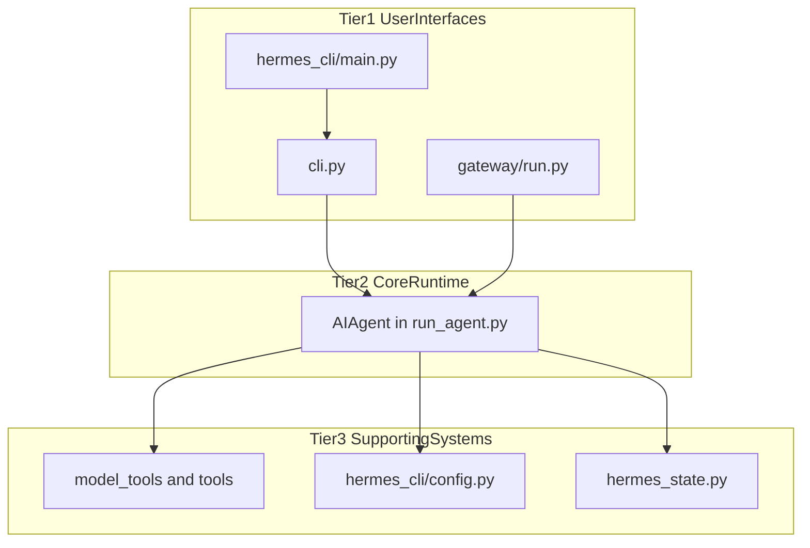

Sources: [hermes_cli/main.py:1-9](), [cli.py:1-2](), [gateway/run.py:1-4](), [run_agent.py:1-7](), [run_agent.py:103-107](), [hermes_cli/config.py:1-2](), [hermes_state.py:1-6]()

### Diagram: Natural Language Requests to Code Entities

This diagram connects user-facing request paths to the named code entities that represent the agent runtime, supporting systems, and persistent session state. It is a conceptual overview, not a complete call graph. [cli.py:1-2](), [gateway/run.py:1-4](), [run_agent.py:1-7](), [hermes_state.py:1-6]()

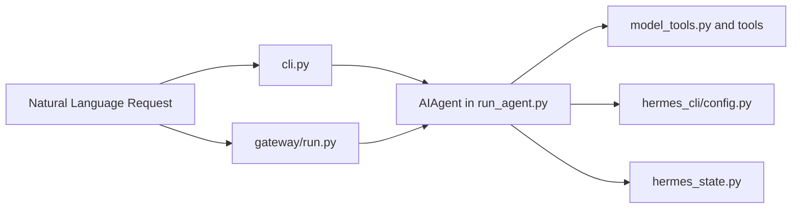

Sources: [cli.py:1-2](), [gateway/run.py:1-4](), [run_agent.py:1-7](), [run_agent.py:103-107](), [hermes_cli/config.py:1-2](), [hermes_state.py:1-6]()

### Diagram: Natural Language and Persistent Session State

Hermes state storage is a distinct part of the system: `hermes_state.py` describes a SQLite state store for session metadata, message history, model configuration, and search. [hermes_state.py:1-6]()


Sources: [cli.py:1-2](), [gateway/run.py:1-4](), [run_agent.py:1-7](), [hermes_state.py:1-6]()

## Runtime Modes

Hermes Agent exposes multiple ways to interact with or operate the system. The CLI supports interactive terminal use; the gateway starts configured messaging adapters; and the main CLI entry point documents subcommands including `chat`, `gateway`, and `setup`. [cli.py:1-2](), [gateway/run.py:1-4](), [hermes_cli/main.py:1-9]()

| Runtime mode | Code entry point | High-level role |
|---|---|---|
| CLI | `cli.py` | Interactive terminal interface. [cli.py:1-2]() |
| Gateway | `gateway/run.py` | Starts configured messaging-platform adapters. [gateway/run.py:1-4]() |
| CLI commands | `hermes_cli/main.py` | Dispatches the Hermes command-line interface and its subcommands. [hermes_cli/main.py:1-9]() |

Sources: [cli.py:1-2](), [gateway/run.py:1-4](), [hermes_cli/main.py:1-9]()

## Core Components and Self-Improvement

- **Agent runtime.** `AIAgent` is the central tool-calling runtime described in `run_agent.py`; that module imports toolset access and terminal, browser, and connection lifecycle components. [run_agent.py:1-7](), [run_agent.py:103-107]()
- **Skills and extensibility.** The documented Hermes home directory includes a `skills/` directory for agent-created skills, alongside configuration, memory, and session-related directories. This provides an extensibility surface for adding capabilities. [website/docs/user-guide/configuration.md:19-32]()
- **Configuration.** The documented precedence is CLI arguments, `config.yaml`, `.env`, then built-in defaults. The configuration module describes loading, saving, validation, and migration; the setup wizard provides an interactive setup path. [website/docs/user-guide/configuration.md:57-68](), [hermes_cli/config.py:1-2](), [hermes_cli/setup.py:1-6]()
- **Persistent state.** `hermes_state.py` describes SQLite-backed session metadata, message history, model configuration, and full-text search. [hermes_state.py:1-6]()

Sources: [run_agent.py:1-7](), [run_agent.py:103-107](), [website/docs/user-guide/configuration.md:19-32](), [website/docs/user-guide/configuration.md:57-68](), [hermes_cli/config.py:1-2](), [hermes_cli/setup.py:1-6](), [hermes_state.py:1-6]()

## Child Pages

- **[Architecture Overview](#1.1)** — Explains the three-tier architecture, major subsystems, and how they interact.
- **[Project Structure and Dependencies](#1.2)** — Documents the directory structure, dependency management with `uv` and the `pm/` package manager, lazy dependency installation, and the installation ecosystem, including Nix flake support.

Sources: [run_agent.py:1-7](), [hermes_cli/main.py:1-9]()

---

# Page: Architecture Overview

# Architecture Overview

<details>
<summary>Relevant source files</summary>

The following files were used as context for generating this wiki page:

- [agent/auxiliary_client.py](agent/auxiliary_client.py)
- [agent/tool_dispatch_helpers.py](agent/tool_dispatch_helpers.py)
- [agent/tool_executor.py](agent/tool_executor.py)
- [cli-config.yaml.example](cli-config.yaml.example)
- [cli.py](cli.py)
- [evals/desktop_bug_campaign/leases_live.py](evals/desktop_bug_campaign/leases_live.py)
- [gateway/run.py](gateway/run.py)
- [gateway/session.py](gateway/session.py)
- [gateway/session_images.py](gateway/session_images.py)
- [gateway/slash_commands.py](gateway/slash_commands.py)
- [hermes_cli/cli_commands_mixin.py](hermes_cli/cli_commands_mixin.py)
- [hermes_cli/commands.py](hermes_cli/commands.py)
- [hermes_cli/config.py](hermes_cli/config.py)
- [hermes_cli/config_defaults.py](hermes_cli/config_defaults.py)
- [hermes_cli/main.py](hermes_cli/main.py)
- [hermes_cli/setup.py](hermes_cli/setup.py)
- [hermes_state.py](hermes_state.py)
- [model_tools.py](model_tools.py)
- [run_agent.py](run_agent.py)
- [scripts/iso-certify.py](scripts/iso-certify.py)
- [tests/agent/test_auxiliary_client.py](tests/agent/test_auxiliary_client.py)
- [tests/agent/test_memory_user_id.py](tests/agent/test_memory_user_id.py)
- [tests/agent/test_tool_dispatch_helpers.py](tests/agent/test_tool_dispatch_helpers.py)
- [tests/gateway/test_hosted_room_replicas.py](tests/gateway/test_hosted_room_replicas.py)
- [tests/gateway/test_session.py](tests/gateway/test_session.py)
- [tests/gateway/test_session_images.py](tests/gateway/test_session_images.py)
- [tests/gateway/test_session_images_profile.py](tests/gateway/test_session_images_profile.py)
- [tests/hermes_cli/test_commands.py](tests/hermes_cli/test_commands.py)
- [tests/hermes_cli/test_custom_provider_identity.py](tests/hermes_cli/test_custom_provider_identity.py)
- [tests/hermes_cli/test_web_multi_profile_scope.py](tests/hermes_cli/test_web_multi_profile_scope.py)
- [tests/tools/test_async_delegation_failed_surface.py](tests/tools/test_async_delegation_failed_surface.py)
- [tests/tools/test_completed_process_results.py](tests/tools/test_completed_process_results.py)
- [tests/tools/test_process_wait_auto_notify.py](tests/tools/test_process_wait_auto_notify.py)
- [tests/tui_gateway/test_compute_host.py](tests/tui_gateway/test_compute_host.py)
- [tests/tui_gateway/test_compute_host_pending_model_switch.py](tests/tui_gateway/test_compute_host_pending_model_switch.py)
- [tests/tui_gateway/test_compute_host_phase1.py](tests/tui_gateway/test_compute_host_phase1.py)
- [tests/tui_gateway/test_file_attachment_allocation.py](tests/tui_gateway/test_file_attachment_allocation.py)
- [tests/tui_gateway/test_groups_replication_methods.py](tests/tui_gateway/test_groups_replication_methods.py)
- [tests/tui_gateway/test_iso_certify_seam.py](tests/tui_gateway/test_iso_certify_seam.py)
- [tests/tui_gateway/test_isolated_orphan_activity.py](tests/tui_gateway/test_isolated_orphan_activity.py)
- [tests/tui_gateway/test_multi_profile_hosting_fail_closed.py](tests/tui_gateway/test_multi_profile_hosting_fail_closed.py)
- [tests/tui_gateway/test_out_of_band_history_adoption.py](tests/tui_gateway/test_out_of_band_history_adoption.py)
- [tests/tui_gateway/test_profile_terminal_scope_entrypoints.py](tests/tui_gateway/test_profile_terminal_scope_entrypoints.py)
- [tests/tui_gateway/test_protocol.py](tests/tui_gateway/test_protocol.py)
- [tests/tui_gateway/test_remote_backend_launch_cwd.py](tests/tui_gateway/test_remote_backend_launch_cwd.py)
- [tests/tui_gateway/test_serve_exit_flush.py](tests/tui_gateway/test_serve_exit_flush.py)
- [tests/tui_gateway/test_subagent_snapshot.py](tests/tui_gateway/test_subagent_snapshot.py)
- [tests/tui_gateway/test_submit_time_user_row.py](tests/tui_gateway/test_submit_time_user_row.py)
- [tests/tui_gateway/test_tui_gateway_server.py](tests/tui_gateway/test_tui_gateway_server.py)
- [tests/tui_gateway/test_ws_orphan_races.py](tests/tui_gateway/test_ws_orphan_races.py)
- [tools/__init__.py](tools/__init__.py)
- [tools/process_registry_results.py](tools/process_registry_results.py)
- [tools/process_registry_wait_policy.py](tools/process_registry_wait_policy.py)
- [toolsets.py](toolsets.py)
- [tui_gateway/AGENTS.md](tui_gateway/AGENTS.md)
- [tui_gateway/compute_host.py](tui_gateway/compute_host.py)
- [tui_gateway/compute_host_bridge.py](tui_gateway/compute_host_bridge.py)
- [tui_gateway/host_supervisor.py](tui_gateway/host_supervisor.py)
- [tui_gateway/methods_complete.py](tui_gateway/methods_complete.py)
- [tui_gateway/methods_complete_helpers.py](tui_gateway/methods_complete_helpers.py)
- [tui_gateway/methods_groups.py](tui_gateway/methods_groups.py)
- [tui_gateway/methods_prompt.py](tui_gateway/methods_prompt.py)
- [tui_gateway/methods_session.py](tui_gateway/methods_session.py)
- [tui_gateway/methods_slash.py](tui_gateway/methods_slash.py)
- [tui_gateway/methods_subagents.py](tui_gateway/methods_subagents.py)
- [tui_gateway/methods_tools.py](tui_gateway/methods_tools.py)
- [tui_gateway/prompt_attachments.py](tui_gateway/prompt_attachments.py)
- [tui_gateway/prompt_turn.py](tui_gateway/prompt_turn.py)
- [tui_gateway/server.py](tui_gateway/server.py)
- [tui_gateway/session_lifecycle.py](tui_gateway/session_lifecycle.py)
- [tui_gateway/session_reaper.py](tui_gateway/session_reaper.py)
- [tui_gateway/session_workdir.py](tui_gateway/session_workdir.py)
- [ui-tui/src/__tests__/details.test.ts](ui-tui/src/__tests__/details.test.ts)
- [ui-tui/src/domain/details.ts](ui-tui/src/domain/details.ts)
- [website/docs/developer-guide/adding-tools.md](website/docs/developer-guide/adding-tools.md)
- [website/docs/developer-guide/tools-runtime.md](website/docs/developer-guide/tools-runtime.md)
- [website/docs/getting-started/quickstart.md](website/docs/getting-started/quickstart.md)
- [website/docs/integrations/index.md](website/docs/integrations/index.md)
- [website/docs/integrations/providers.md](website/docs/integrations/providers.md)
- [website/docs/reference/cli-commands.md](website/docs/reference/cli-commands.md)
- [website/docs/reference/environment-variables.md](website/docs/reference/environment-variables.md)
- [website/docs/reference/slash-commands.md](website/docs/reference/slash-commands.md)
- [website/docs/reference/tools-reference.md](website/docs/reference/tools-reference.md)
- [website/docs/reference/toolsets-reference.md](website/docs/reference/toolsets-reference.md)
- [website/docs/user-guide/cli.md](website/docs/user-guide/cli.md)
- [website/docs/user-guide/configuration.md](website/docs/user-guide/configuration.md)
- [website/docs/user-guide/features/fallback-providers.md](website/docs/user-guide/features/fallback-providers.md)
- [website/docs/user-guide/features/overview.md](website/docs/user-guide/features/overview.md)
- [website/docs/user-guide/features/tools.md](website/docs/user-guide/features/tools.md)
- [website/docs/user-guide/messaging/index.md](website/docs/user-guide/messaging/index.md)
- [website/docs/user-guide/tui.md](website/docs/user-guide/tui.md)
- [website/i18n/zh-Hans/docusaurus-plugin-content-docs/current/developer-guide/tools-runtime.md](website/i18n/zh-Hans/docusaurus-plugin-content-docs/current/developer-guide/tools-runtime.md)
- [website/i18n/zh-Hans/docusaurus-plugin-content-docs/current/getting-started/quickstart.md](website/i18n/zh-Hans/docusaurus-plugin-content-docs/current/getting-started/quickstart.md)
- [website/i18n/zh-Hans/docusaurus-plugin-content-docs/current/reference/environment-variables.md](website/i18n/zh-Hans/docusaurus-plugin-content-docs/current/reference/environment-variables.md)
- [website/i18n/zh-Hans/docusaurus-plugin-content-docs/current/reference/tools-reference.md](website/i18n/zh-Hans/docusaurus-plugin-content-docs/current/reference/tools-reference.md)
- [website/i18n/zh-Hans/docusaurus-plugin-content-docs/current/reference/toolsets-reference.md](website/i18n/zh-Hans/docusaurus-plugin-content-docs/current/reference/toolsets-reference.md)
- [website/i18n/zh-Hans/docusaurus-plugin-content-docs/current/user-guide/configuration.md](website/i18n/zh-Hans/docusaurus-plugin-content-docs/current/user-guide/configuration.md)
- [website/i18n/zh-Hans/docusaurus-plugin-content-docs/current/user-guide/features/browser.md](website/i18n/zh-Hans/docusaurus-plugin-content-docs/current/user-guide/features/browser.md)
- [website/i18n/zh-Hans/docusaurus-plugin-content-docs/current/user-guide/features/fallback-providers.md](website/i18n/zh-Hans/docusaurus-plugin-content-docs/current/user-guide/features/fallback-providers.md)
- [website/i18n/zh-Hans/docusaurus-plugin-content-docs/current/user-guide/features/tools.md](website/i18n/zh-Hans/docusaurus-plugin-content-docs/current/user-guide/features/tools.md)

</details>


## Purpose and Scope

This document presents a detailed technical overview of Hermes Agent’s architecture. Hermes Agent is a sophisticated AI agent framework featuring autonomous reasoning, tool usage, conversational memory, and self-improvement capabilities. The system is architected as a three-tier platform, integrating interactive user interfaces, a core agent orchestration layer, and a diverse tool and execution backend. This page explains these tiers, the major subsystems comprising them, and the technical flow of data and control between components.

The architecture supports multiple frontend interfaces — including CLI REPL (`[cli.py:1-3]()`), the Messaging Gateway (`[gateway/run.py:1-4]()`), web dashboard, and the terminal TUI (`[tui_gateway/server.py:1-4]`) — all converging on the central core agent. The core agent manages conversational loops, memory persistence, tool orchestration, and auxiliary LLM clients. The tool layer abstracts a wide range of capabilities: terminal commands, browser automation, vision tools, and more, executed within various isolated runtime environments.

Sources: [run_agent.py:1-7](), [cli.py:1-3](), [gateway/run.py:1-4]()

---

## Core Architecture Components

### System Architecture Overview

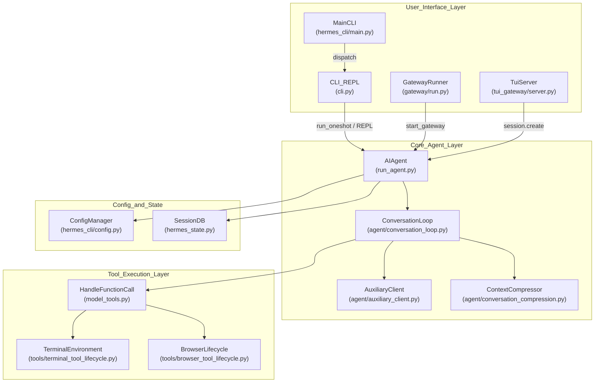

This diagram illustrates the layered organization:

- **User Interface Layer**: Connects users to Hermes via CLI (`[cli.py:1-3]()`), Gateway (`[gateway/run.py:1-4]()`), TUI gateway (`[tui_gateway/server.py:1-4]()`), and main entry points (`[hermes_cli/main.py:1-9]()`).
- **Core Agent Layer**: Centers on the `AIAgent` class (`[run_agent.py:2-7]()`) managing conversation state, memory, context compression (`[agent/conversation_compression.py]()`), and auxiliary LLM client support (`[agent/auxiliary_client.py:1-9]()`).
- **Tool & Execution Layer**: Manages tool definitions, discovery, and execution within isolated environments such as terminal shells (`[tools/terminal_tool_lifecycle.py]()`) and browsers (`[tools/browser_tool_lifecycle.py]()`).
- **Config & State**: Components handle persistent user configuration (`[hermes_cli/config.py:1-3]()`), environment loading (`[hermes_cli/env_loader.py]()`), and session message storage in SQLite (`[hermes_state.py:1-6]()`).

Sources: [run_agent.py:2-7](), [cli.py:1-3](), [gateway/run.py:1-4](), [tui_gateway/server.py:1-4](), [hermes_cli/main.py:1-9](), [hermes_cli/config.py:1-3](), [hermes_state.py:1-6]()

---

## AIAgent: The Central Orchestrator

The core of Hermes Agent is the `AIAgent` class defined in `run_agent.py`. This class encapsulates the primary conversation orchestration, including iterative reasoning, tool dispatch, session management, and integration with memory and compression subsystems.

### Conversation Orchestration

- Conversations are managed as iterative loops implemented across the agent packages (`[run_agent.py:2-7]()`).
- The conversation runner drives:
  - Building system prompts, injecting personality and behavioral cues.
  - Calling the configured LLM provider, supporting streaming and non-streaming modes.
  - Parsing model outputs for function calls representing tool invocations.
  - Dispatched via helper functions in `[model_tools.py]()`.
  - Handling retries, fallbacks, and error conditions with detailed error classification (`[agent/auxiliary_client.py:29-35]()`).
  - Managing iteration budgets (`[run_agent.py:91-91]()`) to prevent runaway loops.
- Conversation turns involve sanitizing messages and tool call IDs to ensure consistency (`[run_agent.py:127-131]()`).
- Interrupts and cancellations are cleanly handled within the loop (`[run_agent.py:105-105]()`).

Sources: [run_agent.py:2-131](), [agent/auxiliary_client.py:29-35]()

### Memory, Sessions, and Persistence

- Persistent session data and message history are stored in the SQLite-backed session database (`[hermes_state.py:2-6]()`).
- The state store supports WAL mode for concurrent readers and single-writer safety (`[hermes_state.py:74-76]()`).
- Multiple session mixins enable features such as full-text search (FTS5), compression indexing, Telegram topic bindings, and tool retry tracking (`[hermes_state.py:53-84]()`).
- The context compression subsystem (`[agent/conversation_compression.py]()`) summarizes message history with auxiliary LLM calls to keep context within model token budgets.
- Sessions include origin metadata (e.g., gateway routing data) and integration with auxiliary LLM clients for side tasks (`[run_agent.py:57-89]()`).
- The `AuxiliaryClient` in `[agent/auxiliary_client.py:1-9]()` acts as a shared router for side tasks like compression, search, and vision.

Sources: [hermes_state.py:2-84](), [run_agent.py:57-89](), [agent/auxiliary_client.py:1-9]()

---

## Tool System and Execution Flow

Hermes Agent implements a modular, extensible tool system that turns LLM-instructed tool calls into real command invocations executed in controlled environments.

### Tool Execution Flow from Natural Language to Code Entities

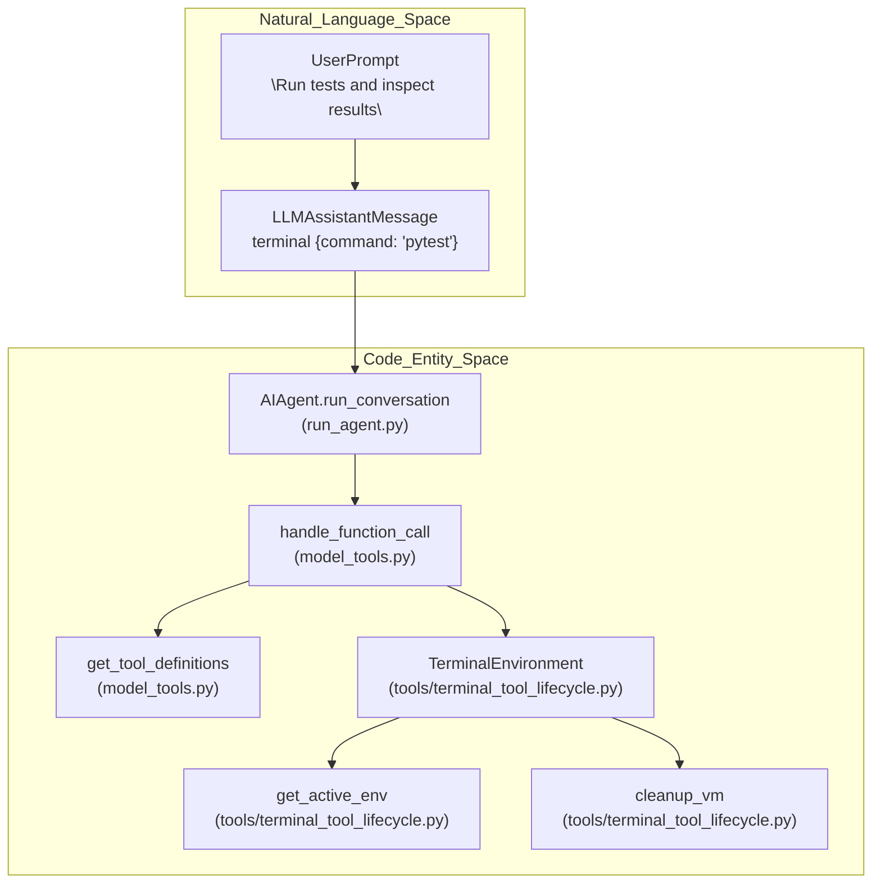

- Tools are registered and discovered through modules like `[model_tools.py:103-103]()`, which exposes functions for tool definitions.
- The conversation execution detects function calls embedded in LLM responses and routes them to handler functions (`[model_tools.py]()`).
- Terminal tools execute commands inside managed environments (`[tools/terminal_tool_lifecycle.py:104-104]()`), including environment acquisition (`get_active_env()`), command execution, and cleanup routines (`cleanup_vm()`).
- Beyond terminal tools, other tool categories include browser automation (`[tools/browser_session_lifecycle.py:106-106]()`) and various toolsets managed via the tool registry.
- The tool execution layer abstracts runtime isolation and lifecycle, allowing safe, reproducible tool runs within ephemeral or persistent sandboxes.

Sources: [run_agent.py:102-106](), [tools/terminal_tool_lifecycle.py:104-104](), [model_tools.py:103-103]()

---

## Configuration and Authentication Hierarchy

Hermes Agent’s configuration is centralized in `[hermes_cli/config.py:1-3]()` and layered across several sources for flexibility and security.

| Configuration Level         | Description                                                      | Example Files / Components                |
|----------------------------|------------------------------------------------------------------|-------------------------------------------|
| 1. CLI Arguments           | Per-invocation overrides with highest precedence                 | CLI flags parsed in `[cli.py:1-3]()`      |
| 2. `config.yaml`           | Main config for non-secret settings, including model/toolsets    | `~/.hermes/config.yaml`                   |
| 3. `.env` file             | Secrets storage for API keys, tokens, and passwords             | `~/.hermes/.env`                          |
| 4. Built-in Defaults       | Fallback hardcoded safe defaults                                 | `[hermes_cli/config_defaults.py:1-5]()`   |

- CLI arguments have the highest priority, allowing dynamic overrides for each run.
- `config.yaml` contains structured settings such as model selection, toolsets enabled, compression parameters, and runtime limits (`[cli-config.yaml.example:1-44]()`).
- `.env` stores sensitive credentials securely (e.g., OpenRouter API key, OAuth tokens) and is loaded at startup by environment loaders (`[run_agent.py:92-96]()`).
- Configuration validation and schema migrations ensure compatibility (`[hermes_cli/config.py:1-3]()`).
- Authentication supports OAuth, API keys, and provider credential pools.
- Runtime provider resolution chains are implemented in auxiliary client modules and related components to select appropriate LLM backends (`[agent/auxiliary_client.py:1-9]()`).

Sources: [hermes_cli/config.py:1-3](), [cli-config.yaml.example:1-44](), [run_agent.py:92-96](), [agent/auxiliary_client.py:1-9]()

---

## Summary

Hermes Agent is structured as a robust, modular three-tier system:

- **User Interface Layer**: Multiple interactive frontends including CLI REPL (`[cli.py:1-3]()`), terminal TUI (`[tui_gateway/server.py:1-4]()`), a messaging Gateway (`[gateway/run.py:1-4]()`), and web dashboard enable versatile user interaction.
- **Core Agent Layer**: The `AIAgent` class (`[run_agent.py:2-7]()`) orchestrates autonomous reasoning, conversation looping, session management, context compression, and auxiliary LLM client delegation.
- **Tool & Execution Layer**: A dynamic, extensible tool registry supports execution of terminal commands (`[tools/terminal_tool_lifecycle.py:104-104]()`), browser automation, and multi-agent delegation within isolated runtime environments.
- **Configuration and State**: Centralized configuration management (`[hermes_cli/config.py:1-3]()`) with layered precedence and secure secret handling, alongside a robust SQLite-based session database (`[hermes_state.py:2-6]()`) providing persistent state, indexing, and concurrency support.

This architecture facilitates complex AI-driven reasoning workflows, dynamic tool interactions, conversational state management, and multi-platform user interfacing, enabling Hermes Agent to operate as a versatile and extensible AI assistant framework.

Sources: [run_agent.py:2-7](), [cli.py:1-3](), [gateway/run.py:1-4](), [tui_gateway/server.py:1-4](), [tools/terminal_tool_lifecycle.py:104-104](), [hermes_cli/config.py:1-3](), [hermes_state.py:2-6]()

---

# Page: Project Structure and Dependencies

# Project Structure and Dependencies

<details>
<summary>Relevant source files</summary>

The following files were used as context for generating this wiki page:

- [.github/workflows/bootstrap-installer.yml](.github/workflows/bootstrap-installer.yml)
- [.npmrc](.npmrc)
- [apps/bootstrap-installer/index.html](apps/bootstrap-installer/index.html)
- [apps/bootstrap-installer/package.json](apps/bootstrap-installer/package.json)
- [apps/bootstrap-installer/src-tauri/Cargo.toml](apps/bootstrap-installer/src-tauri/Cargo.toml)
- [apps/bootstrap-installer/src-tauri/Info.plist](apps/bootstrap-installer/src-tauri/Info.plist)
- [apps/bootstrap-installer/src-tauri/entitlements.plist](apps/bootstrap-installer/src-tauri/entitlements.plist)
- [apps/bootstrap-installer/src-tauri/src/bootstrap.rs](apps/bootstrap-installer/src-tauri/src/bootstrap.rs)
- [apps/bootstrap-installer/src-tauri/src/events.rs](apps/bootstrap-installer/src-tauri/src/events.rs)
- [apps/bootstrap-installer/src-tauri/src/install_script.rs](apps/bootstrap-installer/src-tauri/src/install_script.rs)
- [apps/bootstrap-installer/src-tauri/src/lib.rs](apps/bootstrap-installer/src-tauri/src/lib.rs)
- [apps/bootstrap-installer/src-tauri/src/marker.rs](apps/bootstrap-installer/src-tauri/src/marker.rs)
- [apps/bootstrap-installer/src-tauri/src/marker_tests.rs](apps/bootstrap-installer/src-tauri/src/marker_tests.rs)
- [apps/bootstrap-installer/src-tauri/src/paths.rs](apps/bootstrap-installer/src-tauri/src/paths.rs)
- [apps/bootstrap-installer/src-tauri/src/powershell.rs](apps/bootstrap-installer/src-tauri/src/powershell.rs)
- [apps/bootstrap-installer/src-tauri/src/update.rs](apps/bootstrap-installer/src-tauri/src/update.rs)
- [apps/bootstrap-installer/src-tauri/tauri.conf.json](apps/bootstrap-installer/src-tauri/tauri.conf.json)
- [apps/desktop/electron/dock-launch-order.test.ts](apps/desktop/electron/dock-launch-order.test.ts)
- [apps/desktop/electron/dock-launch-order.ts](apps/desktop/electron/dock-launch-order.ts)
- [apps/desktop/electron/feature-flags.test.ts](apps/desktop/electron/feature-flags.test.ts)
- [apps/desktop/electron/feature-flags.ts](apps/desktop/electron/feature-flags.ts)
- [apps/desktop/package.json](apps/desktop/package.json)
- [apps/desktop/src/store/local-models-flag.ts](apps/desktop/src/store/local-models-flag.ts)
- [apps/desktop/update-feed.d.cts](apps/desktop/update-feed.d.cts)
- [apps/shared/package.json](apps/shared/package.json)
- [apps/shared/src/index.ts](apps/shared/src/index.ts)
- [apps/shared/src/skill-scaffold.test.ts](apps/shared/src/skill-scaffold.test.ts)
- [apps/shared/src/skill-scaffold.ts](apps/shared/src/skill-scaffold.ts)
- [contributors/README.md](contributors/README.md)
- [hermes_bootstrap.py](hermes_bootstrap.py)
- [hermes_cli/__init__.py](hermes_cli/__init__.py)
- [hermes_cli/data_cleanup.py](hermes_cli/data_cleanup.py)
- [hermes_cli/update_lock.py](hermes_cli/update_lock.py)
- [hermes_constants.py](hermes_constants.py)
- [hermes_constants_scratch.py](hermes_constants_scratch.py)
- [hermes_constants_scratch_stuck.py](hermes_constants_scratch_stuck.py)
- [package-lock.json](package-lock.json)
- [package.json](package.json)
- [pm/cli.py](pm/cli.py)
- [pm/defaults.py](pm/defaults.py)
- [pm/filesystem.py](pm/filesystem.py)
- [pm/install.py](pm/install.py)
- [pm/lock.json](pm/lock.json)
- [pm/lock.py](pm/lock.py)
- [pm/package.py](pm/package.py)
- [pm/packages.py](pm/packages.py)
- [pm/security_packages.py](pm/security_packages.py)
- [pm/store.py](pm/store.py)
- [pm/update.py](pm/update.py)
- [pyproject.toml](pyproject.toml)
- [scripts/add_contributor.py](scripts/add_contributor.py)
- [scripts/audit_pr_attribution.py](scripts/audit_pr_attribution.py)
- [scripts/contributor_audit.py](scripts/contributor_audit.py)
- [scripts/releases/authors.py](scripts/releases/authors.py)
- [scripts/releases/authors_legacy.py](scripts/releases/authors_legacy.py)
- [scripts/releases/distance.py](scripts/releases/distance.py)
- [scripts/releases/stamping.py](scripts/releases/stamping.py)
- [scripts/termux/build_builder_image.sh](scripts/termux/build_builder_image.sh)
- [scripts/termux/build_deb.sh](scripts/termux/build_deb.sh)
- [scripts/termux/stage_runtime_libs.py](scripts/termux/stage_runtime_libs.py)
- [scripts/verify-bootstrap-version-stamp.py](scripts/verify-bootstrap-version-stamp.py)
- [scripts/write_install_stamp.py](scripts/write_install_stamp.py)
- [tests-js/desktop-mac-entitlements.test.ts](tests-js/desktop-mac-entitlements.test.ts)
- [tests-js/package.json](tests-js/package.json)
- [tests/agent/test_relay_compaction_atof.py](tests/agent/test_relay_compaction_atof.py)
- [tests/cron/test_jobs_file_ownership.py](tests/cron/test_jobs_file_ownership.py)
- [tests/cron/test_jobs_shrink_merge.py](tests/cron/test_jobs_shrink_merge.py)
- [tests/gateway/test_media_cache_cleanup_signature.py](tests/gateway/test_media_cache_cleanup_signature.py)
- [tests/hermes_cli/test_atomic_json_write.py](tests/hermes_cli/test_atomic_json_write.py)
- [tests/hermes_cli/test_data_uninstall.py](tests/hermes_cli/test_data_uninstall.py)
- [tests/hermes_cli/test_doctor_cache_hogs.py](tests/hermes_cli/test_doctor_cache_hogs.py)
- [tests/hermes_cli/test_ensure_hermes_home_uid.py](tests/hermes_cli/test_ensure_hermes_home_uid.py)
- [tests/hermes_cli/test_local_legacy_engine.py](tests/hermes_cli/test_local_legacy_engine.py)
- [tests/hermes_cli/test_local_runtime_pm.py](tests/hermes_cli/test_local_runtime_pm.py)
- [tests/hermes_cli/test_update_lock.py](tests/hermes_cli/test_update_lock.py)
- [tests/hermes_cli/test_update_lock_fd_provenance.py](tests/hermes_cli/test_update_lock_fd_provenance.py)
- [tests/hermes_cli/test_update_lock_protocol.py](tests/hermes_cli/test_update_lock_protocol.py)
- [tests/pm/test_archive_safety.py](tests/pm/test_archive_safety.py)
- [tests/pm/test_deb_safety.py](tests/pm/test_deb_safety.py)
- [tests/pm/test_ffmpeg_resolution.py](tests/pm/test_ffmpeg_resolution.py)
- [tests/pm/test_filesystem_is_junction.py](tests/pm/test_filesystem_is_junction.py)
- [tests/pm/test_install_default_closure.py](tests/pm/test_install_default_closure.py)
- [tests/pm/test_installed_package.py](tests/pm/test_installed_package.py)
- [tests/pm/test_llamacpp_pins.py](tests/pm/test_llamacpp_pins.py)
- [tests/pm/test_lockfile_publication.py](tests/pm/test_lockfile_publication.py)
- [tests/pm/test_long_path_exits.py](tests/pm/test_long_path_exits.py)
- [tests/pm/test_npm_dist_tags.py](tests/pm/test_npm_dist_tags.py)
- [tests/pm/test_pm_core.py](tests/pm/test_pm_core.py)
- [tests/pm/test_python_release_identity.py](tests/pm/test_python_release_identity.py)
- [tests/pm/test_retired_agent_browser.py](tests/pm/test_retired_agent_browser.py)
- [tests/pm/test_store_extract.py](tests/pm/test_store_extract.py)
- [tests/pm/test_tree_digest_links.py](tests/pm/test_tree_digest_links.py)
- [tests/pm/test_update.py](tests/pm/test_update.py)
- [tests/pm/test_update_bootstrap_pins.py](tests/pm/test_update_bootstrap_pins.py)
- [tests/pm/test_update_request_reuse.py](tests/pm/test_update_request_reuse.py)
- [tests/scripts/install/test_install_ps1_managed_python_provenance.py](tests/scripts/install/test_install_ps1_managed_python_provenance.py)
- [tests/scripts/install/test_install_ps1_pinned_git_extract.py](tests/scripts/install/test_install_ps1_pinned_git_extract.py)
- [tests/scripts/install/test_install_sh_reuse_supported_python.py](tests/scripts/install/test_install_sh_reuse_supported_python.py)
- [tests/scripts/test_contributor_map.py](tests/scripts/test_contributor_map.py)
- [tests/scripts/test_install_stamp_distance.py](tests/scripts/test_install_stamp_distance.py)
- [tests/scripts/test_release_revision_anchor.py](tests/scripts/test_release_revision_anchor.py)
- [tests/scripts/test_termux_build_driver.py](tests/scripts/test_termux_build_driver.py)
- [tests/scripts/test_verify_bootstrap_version_stamp.py](tests/scripts/test_verify_bootstrap_version_stamp.py)
- [tests/scripts/test_version_stamping.py](tests/scripts/test_version_stamping.py)
- [tests/scripts/test_write_install_stamp.py](tests/scripts/test_write_install_stamp.py)
- [tests/test_atomic_json_writers_unified.py](tests/test_atomic_json_writers_unified.py)
- [tests/test_atomic_replace_symlinks.py](tests/test_atomic_replace_symlinks.py)
- [tests/test_hermes_bootstrap.py](tests/test_hermes_bootstrap.py)
- [tests/test_hermes_constants.py](tests/test_hermes_constants.py)
- [tests/test_packaging_metadata.py](tests/test_packaging_metadata.py)
- [tests/test_project_metadata.py](tests/test_project_metadata.py)
- [tests/test_scratch_dir.py](tests/test_scratch_dir.py)
- [tests/test_scratch_prune_undeletable.py](tests/test_scratch_prune_undeletable.py)
- [tests/test_scratch_scan_failures.py](tests/test_scratch_scan_failures.py)
- [tests/test_utils_atomic_roundtrip_yaml_save.py](tests/test_utils_atomic_roundtrip_yaml_save.py)
- [tests/tools/test_local_temp_dir.py](tests/tools/test_local_temp_dir.py)
- [tools/lazy_deps.py](tools/lazy_deps.py)
- [ui-tui/package.json](ui-tui/package.json)
- [ui-tui/packages/hermes-ink/ambient.d.ts](ui-tui/packages/hermes-ink/ambient.d.ts)
- [ui-tui/packages/hermes-ink/index.js](ui-tui/packages/hermes-ink/index.js)
- [ui-tui/packages/hermes-ink/package.json](ui-tui/packages/hermes-ink/package.json)
- [utils.py](utils.py)
- [uv.lock](uv.lock)
- [web/package.json](web/package.json)
- [website/.npmrc](website/.npmrc)
- [website/docs/reference/package-management.md](website/docs/reference/package-management.md)
- [website/docs/user-guide/local-models.md](website/docs/user-guide/local-models.md)
- [website/docusaurus.config.ts](website/docusaurus.config.ts)
- [website/package-lock.json](website/package-lock.json)
- [website/package.json](website/package.json)

</details>


## Purpose and scope

This page describes the repository areas and package-management files evidenced by the supplied code excerpts. It focuses on Python dependency declarations and locking, the `pm/` package manager, the current lazy-dependency shim, JavaScript workspaces, shared home-path resolution, and the available evidence about Nix support. [pyproject.toml:5-39](), [pm/cli.py:1-21](), [tools/lazy_deps.py:1-26](), [package.json:1-12](), [hermes_constants.py:1-18]()

Sources: [pyproject.toml:5-39](), [pm/cli.py:1-21](), [tools/lazy_deps.py:1-26](), [package.json:1-12](), [hermes_constants.py:1-18]()

---

## Repository Layout and Code Entities

The repository includes Python application and package-management areas, plus JavaScript workspaces for the desktop application, TUI, web frontend, and JavaScript tests. The supplied excerpts do not enumerate every root directory, so the table below is limited to paths directly evidenced by the files provided. [package.json:1-12](), [package-lock.json:6-18](), [apps/desktop/package.json:1-16](), [pm/packages.py:1-26](), [hermes_cli/__init__.py:1-21]()

### Top-Level Directory Structure and System Components

| Area | Code entities and role |
|---|---|
| `hermes_cli/` | Unified CLI package; `__init__.py` exposes lazy version compatibility and repairs standard output/error encoding. [hermes_cli/__init__.py:1-21](), [hermes_cli/__init__.py:42-76]() |
| `agent/` | Referenced by dependency comments as the location of `ssl_verify.py` and `chat_completion_helpers.py`; the supplied excerpts do not provide a complete agent directory map. [pyproject.toml:42-48](), [pyproject.toml:71-75]() |
| `tools/` | Contains `lazy_deps.py`; its current functions are compatibility shims for retired runtime installation behavior. [tools/lazy_deps.py:1-26]() |
| `pm/` | Hermes package-management implementation: package definitions, CLI operations, and related modules imported by `pm/cli.py`. [pm/packages.py:1-38](), [pm/cli.py:1-21]() |
| `apps/desktop/` | Desktop application workspace; its manifest defines Electron/React dependencies and development, build, and test scripts. [apps/desktop/package.json:1-16](), [apps/desktop/package.json:17-78]() |
| `ui-tui/`, `ui-tui/packages/*`, `web/`, `tests-js/` | Root npm workspaces. Their individual manifests are not included in the provided excerpts. [package.json:6-12](), [package-lock.json:12-18]() |
| `pyproject.toml`, `uv.lock` | Python project metadata and resolved dependency lockfile. [pyproject.toml:5-24](), [uv.lock:1-14]() |
| `package.json`, `package-lock.json` | Root npm workspace metadata and lockfile. [package.json:1-12](), [package-lock.json:1-18]() |

### Natural-language subsystems mapped to code entities

This diagram connects the package-management and application areas discussed here with their concrete files and symbols. The arrows indicate repository association, not runtime call order. [hermes_cli/__init__.py:1-21](), [tools/lazy_deps.py:1-26](), [pm/cli.py:1-21](), [pm/packages.py:1-26](), [apps/desktop/package.json:1-16](), [package.json:6-12]()

**Diagram: Repository areas and concrete entry points**

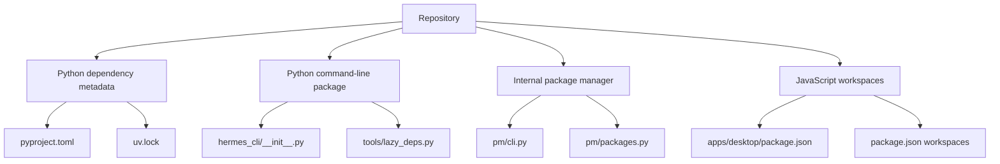

Sources: [hermes_cli/__init__.py:1-21](), [tools/lazy_deps.py:1-26](), [pm/cli.py:1-21](), [pm/packages.py:1-26](), [apps/desktop/package.json:1-16](), [package.json:6-12]()

---

## Versioning and Shared Runtime Constants

`hermes_cli.__init__` declares `__release_date__` and resolves `__version__` lazily through `__getattr__`. The lazy path reads the install stamp using `hermes_cli.steward.read_install_stamp` and attempts to locate the repository through `pm.paths.repo_root`; if `pm` is not importable, it falls back to `install-stamp.json` beside the package and then to `"0.0.0"`. [hermes_cli/__init__.py:5-39]()

The same module calls `_ensure_utf8()` at import time. That function attempts to configure stdout and stderr for UTF-8, replacing unsupported characters when necessary; this is process-local stream setup, not a change to `os.environ`. [hermes_cli/__init__.py:42-76]()

`hermes_constants.py` describes itself as import-safe and standard-library-only. Its context-local Hermes-home override is stored in a `ContextVar`, with `set_hermes_home_override`, `reset_hermes_home_override`, and `get_hermes_home_override` managing that state. [hermes_constants.py:1-4](), [hermes_constants.py:16-43]()

Home resolution uses platform-specific defaults: Windows uses `LOCALAPPDATA` when present, while other platforms use the account’s home directory and a `.hermes` directory. `hermes_root_for_environment` computes a root from another process’s environment and returns `None` when resolution depends on information not present there. [hermes_constants.py:46-63](), [hermes_constants.py:107-135]()

Sources: [hermes_cli/__init__.py:5-39](), [hermes_cli/__init__.py:42-76](), [hermes_constants.py:1-4](), [hermes_constants.py:16-43](), [hermes_constants.py:46-63](), [hermes_constants.py:107-135]()

---

## Dependency Management via `uv` and `pm/`

Python project dependencies are declared in `pyproject.toml` and resolved in `uv.lock`. The internal `pm/` package provides commands and implementation modules for project locking and managed tools. These are related but distinct responsibilities: the project metadata declares Python requirements, while `pm/` also defines and manages downloadable packages. [pyproject.toml:5-24](), [uv.lock:1-14](), [pm/cli.py:1-21](), [pm/packages.py:1-26]()

### Python version constraints and dependency declarations

The project metadata declares `requires-python = ">=3.11,<3.15"`. The nearby comments explain that Python 3.14 is the newest version for which the project expects wheels, while the lower versions remain accepted to support older installations during their update step. [pyproject.toml:10-16]()

The dependency list comments establish a policy that direct core dependencies should be exact-pinned and that only packages used by every Hermes session belong in the core dependency set. They direct maintainers to run `hermes pm lock` after changing a pin. [pyproject.toml:19-39]()

The shown dependency declarations include Python-version markers, platform-specific markers for `ruamel.yaml.clib`, and selected range constraints such as `urllib3>=2.8.0,<3`. The file’s comments explain that some optional or provider-specific dependencies belong in extras rather than the core set. [pyproject.toml:40-60](), [pyproject.toml:98-116]()

`uv.lock` records its supported Python range, platform resolution markers, and package overrides. The displayed lockfile excerpt includes overrides for `cryptography`, `pillow`, and `pynacl`; it is a generated resolution artifact rather than the declaration site for the project’s direct dependencies. [uv.lock:1-25]()

### `pm/`: project locking and managed packages

`pm/cli.py` exposes package-manager operations and imports the installation, registry, store, and update modules it uses. Its `cmd_lock` dispatches between project relocking and tool pinning: with no package name it relocks the project; with a name it proceeds to pin a managed tool. [pm/cli.py:1-28]()

For project locking, `_relock_project` checks whether `uv.lock` is current, calls `pm.lock_project` when it is stale, and reports that the activation environment should be re-sourced. It does not sync the environment as part of that relock operation. [pm/cli.py:31-71]()

For a managed tool pin, `_pin_tool` resolves target-specific artifact URLs, obtains hashes, writes the pin to the PM lockfile, and saves it. [pm/cli.py:113-146]()

`pm/packages.py` defines the package abstractions used by the registry. `BinaryPackage` provides staging, binary-path resolution, and verification; verification checks binary evidence and runs a version probe only for the native target when configured to do so. `Dmgbuild` is an example registered package definition. [pm/packages.py:15-26](), [pm/packages.py:65-118](), [pm/packages.py:130-156]()

### Project lock update flow

The diagram maps the `hermes pm lock` workflow to the named functions visible in the supplied code. [pm/cli.py:24-28](), [pm/cli.py:31-71]()

**Diagram: Project dependency lock workflow**

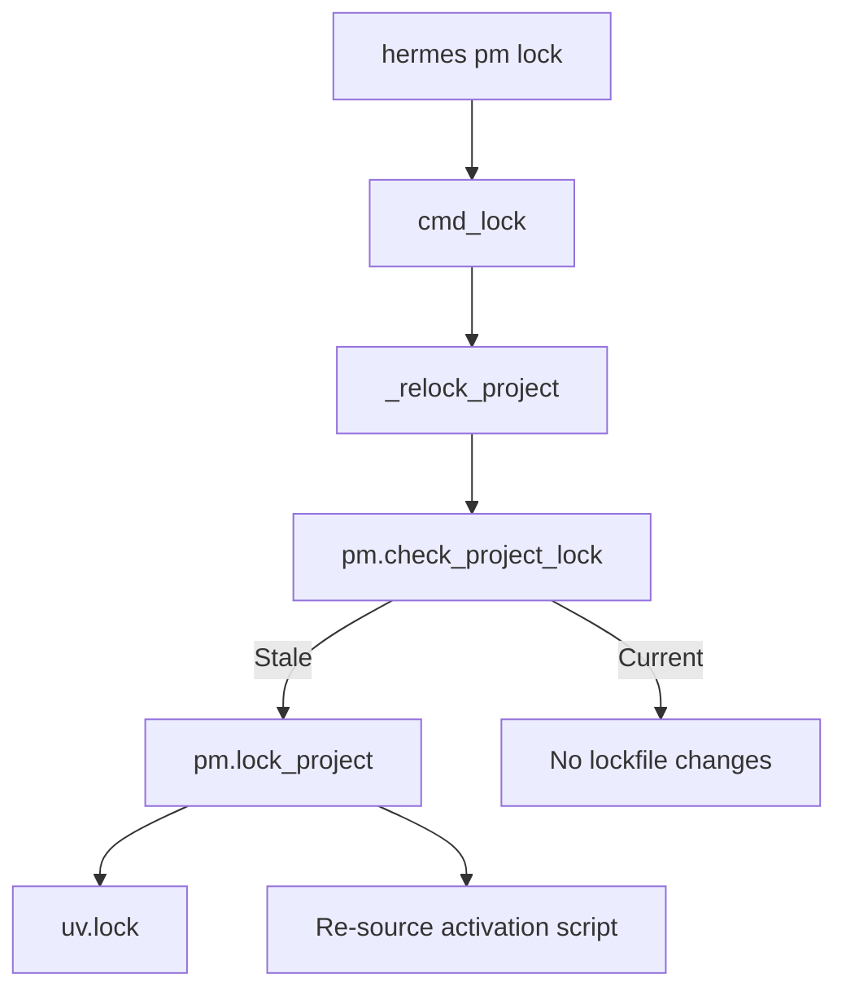

Sources: [pm/cli.py:24-28](), [pm/cli.py:31-71]()

### JavaScript workspaces and manifests

The root `package.json` declares npm workspaces for `apps/*`, `ui-tui`, `ui-tui/packages/*`, `web`, and `tests-js`. It also defines workspace-specific install and audit scripts for the root, web, and TUI packages. [package.json:6-23]()

The root lockfile records those workspaces and their resolved package metadata. The desktop manifest identifies `apps/desktop` as a private Electron application, specifies its Node.js engine range, and defines scripts for development, build, packaging, and tests. [package-lock.json:6-18](), [apps/desktop/package.json:1-16](), [apps/desktop/package.json:17-78]()

Sources: [pyproject.toml:10-16](), [pyproject.toml:19-39](), [pyproject.toml:40-60](), [pyproject.toml:98-116](), [uv.lock:1-25](), [pm/cli.py:1-28](), [pm/cli.py:31-71](), [pm/cli.py:113-146](), [pm/packages.py:15-26](), [pm/packages.py:65-118](), [package.json:6-23](), [package-lock.json:6-18](), [apps/desktop/package.json:1-16](), [apps/desktop/package.json:17-78]()

---

## Lazy Dependency Installation System

The supplied `tools/lazy_deps.py` is not an active runtime dependency installer. Its module documentation identifies the functions as shims for suppressing old updater work until relaunch and says new code must not use them. [tools/lazy_deps.py:1-1]()

### Current behavior of `tools/lazy_deps.py`

`ensure(feature, prompt=True)` unconditionally raises `ImportError` with a message asking the user to relaunch Hermes. It does not inspect a feature registry, install packages, or append an installation directory to `sys.path`. [tools/lazy_deps.py:8-11]()

`install_specs` accepts the retired API’s parameters. If called from a historical updater call stack, it invokes `stop_for_relaunch`; otherwise, it raises `ImportError` stating that runtime dependency installation is unavailable. The comments explain that plugins may still call this API during normal agent construction. [tools/lazy_deps.py:14-26]()

The provided `pyproject.toml` excerpt also places some optional or provider-specific packages outside the core dependency scope, but the supplied excerpts do not show how those extras are provisioned at runtime. [pyproject.toml:34-39]()

### Runtime dependency shim flow

**Diagram: Current lazy-dependency shim behavior**

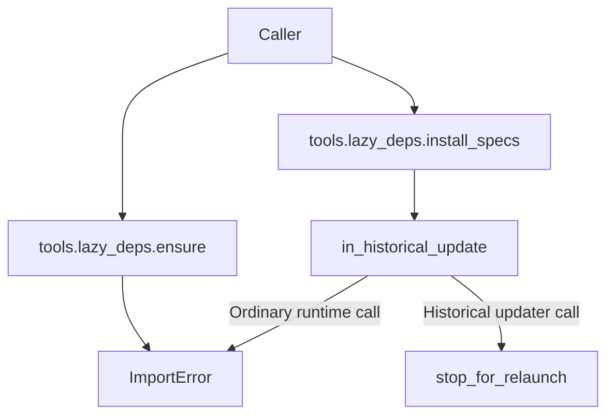

Sources: [tools/lazy_deps.py:1-26]()

---

## Installation Ecosystem and Nix Flake Support

The supplied excerpts establish that Hermes has a `pm/` package-management implementation and a JavaScript workspace setup. They do not include the contents of the Unix or PowerShell installer scripts, Nix flake files, or their build definitions. As a result, implementation details for those installers and Nix packaging cannot be verified from the available line-numbered evidence. [pm/cli.py:1-21](), [pm/packages.py:1-26](), [package.json:6-12]()

The provided file list names Nix-related and installer-related files, but their contents are not present in the excerpts. This page therefore does not infer their runtime behavior, build outputs, or platform-specific installation steps. [pm/cli.py:1-21]()

### Installation and packaging entities shown in the supplied excerpts

| Concern | Evidence available |
|---|---|
| Managed package definitions | `pm/packages.py` defines package classes and target-aware binary verification. [pm/packages.py:65-118]() |
| PM command interface | `pm/cli.py` includes project locking and tool pinning operations. [pm/cli.py:24-71](), [pm/cli.py:113-146]() |
| Python dependency lock | `uv.lock` records supported markers and package overrides. [uv.lock:1-25]() |
| JavaScript workspace layout | The root manifest declares the npm workspace paths. [package.json:6-12]() |
| Nix flake internals | Not available in the supplied file contents; implementation details are not asserted here. |
| Shell and PowerShell installer internals | Not available in the supplied file contents; implementation details are not asserted here. |

Sources: [pm/cli.py:1-21](), [pm/cli.py:24-71](), [pm/cli.py:113-146](), [pm/packages.py:65-118](), [uv.lock:1-25](), [package.json:6-12]()

---

## Summary: Dependency and Package-Management Entities

This diagram associates dependency-management concepts with the concrete files and functions shown in the supplied excerpts. It distinguishes project locking from PM-managed tool packages and from the retired lazy-install API. [pyproject.toml:19-39](), [uv.lock:1-25](), [pm/cli.py:24-71](), [pm/cli.py:113-146](), [pm/packages.py:65-118](), [tools/lazy_deps.py:8-26]()

**Diagram: Dependency declarations, locking, and runtime behavior**

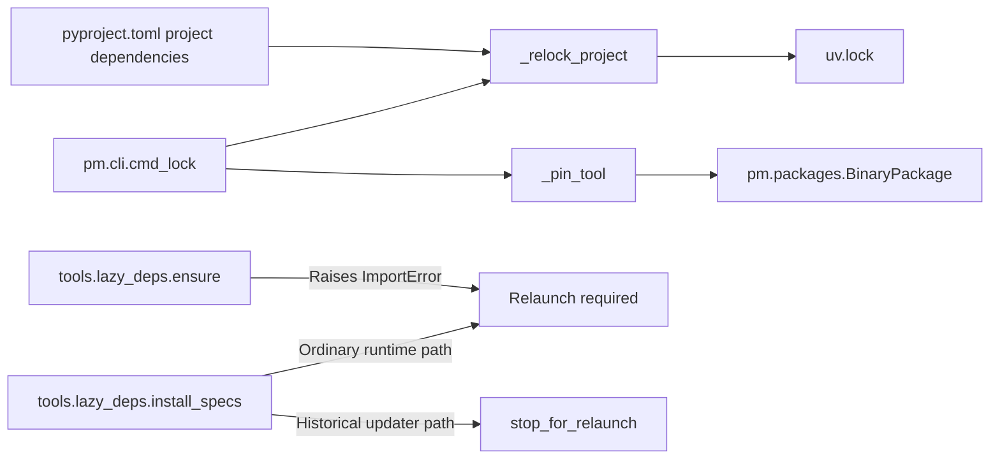

Sources: [pyproject.toml:19-39](), [uv.lock:1-25](), [pm/cli.py:24-71](), [pm/cli.py:113-146](), [pm/packages.py:65-118](), [tools/lazy_deps.py:8-26]()

---

## Additional Notes

- The project metadata describes exact-pinning direct core dependencies as the intended policy and instructs maintainers to refresh the project lock after changing pins. [pyproject.toml:19-39]()
- `hermes pm lock` handles both project relocking and tool pinning, with dispatch based on whether a package name was supplied. [pm/cli.py:24-28]()
- The shown lazy-dependency API is retired: `ensure` raises rather than installing, and `install_specs` only transfers control to the updater in a historical update context. [tools/lazy_deps.py:1-26]()
- The root npm workspace configuration includes desktop, TUI, web, and JavaScript test workspaces. [package.json:6-12]()
- Nix and installer behavior should be documented from their source contents; those implementation details are not included in the supplied excerpts. [package.json:6-12](), [pm/cli.py:1-21]() 

Sources: [pyproject.toml:19-39](), [pm/cli.py:24-28](), [tools/lazy_deps.py:1-26](), [package.json:6-12]()

---

# Page: Getting Started

# Getting Started

<details>
<summary>Relevant source files</summary>

The following files were used as context for generating this wiki page:

- [.env.example](.env.example)
- [AGENTS.md](AGENTS.md)
- [CONTRIBUTING.es.md](CONTRIBUTING.es.md)
- [CONTRIBUTING.md](CONTRIBUTING.md)
- [README.md](README.md)
- [activate](activate)
- [activate.fish](activate.fish)
- [activate.ps1](activate.ps1)
- [hermes](hermes)
- [hermes_cli/subcommands/memory.py](hermes_cli/subcommands/memory.py)
- [scripts/_activation.sh](scripts/_activation.sh)
- [scripts/install.ps1](scripts/install.ps1)
- [scripts/install.sh](scripts/install.sh)
- [setup-hermes.sh](setup-hermes.sh)
- [tests/acp_adapter/test_edit_approval.py](tests/acp_adapter/test_edit_approval.py)
- [tests/hermes_cli/test_launcher.py](tests/hermes_cli/test_launcher.py)
- [tests/hermes_cli/test_setup_pin_values.py](tests/hermes_cli/test_setup_pin_values.py)
- [tests/install/e2e-assets/source-build-env.ps1](tests/install/e2e-assets/source-build-env.ps1)
- [tests/pm/activation_support.py](tests/pm/activation_support.py)
- [tests/pm/test_activate_fish.py](tests/pm/test_activate_fish.py)
- [tests/pm/test_activate_scripts.py](tests/pm/test_activate_scripts.py)
- [tests/pm/test_activation_runtime.py](tests/pm/test_activation_runtime.py)
- [tests/pm/test_environment_script.py](tests/pm/test_environment_script.py)
- [tests/pm/test_setup_lock_format.py](tests/pm/test_setup_lock_format.py)
- [tests/scripts/install/test_install_sh_repository_stage.py](tests/scripts/install/test_install_sh_repository_stage.py)
- [tests/scripts/test_install_ps1_desktop_stage.py](tests/scripts/test_install_ps1_desktop_stage.py)
- [tests/scripts/test_install_sh_launch_handoff.py](tests/scripts/test_install_sh_launch_handoff.py)
- [tests/scripts/test_install_stage_frames.py](tests/scripts/test_install_stage_frames.py)
- [tests/scripts/test_mint_launchers.py](tests/scripts/test_mint_launchers.py)
- [website/docs/developer-guide/contributing.md](website/docs/developer-guide/contributing.md)
- [website/docs/getting-started/installation.md](website/docs/getting-started/installation.md)
- [website/docs/getting-started/updating.md](website/docs/getting-started/updating.md)
- [website/i18n/zh-Hans/docusaurus-plugin-content-docs/current/developer-guide/contributing.md](website/i18n/zh-Hans/docusaurus-plugin-content-docs/current/developer-guide/contributing.md)

</details>


## Purpose and scope

This page outlines the path from installing Hermes Agent to starting a conversation. It connects installation, initial configuration, provider authentication, and model selection; the linked child pages cover each topic in detail. Hermes can be used through a CLI, TUI, messaging gateway, or desktop app, and supports multiple model providers. [README.md:19-31]()

Sources: [README.md:19-31]()

---

## 2.1 Installation

Choose an installation route for your platform: the source installer supports Linux, macOS, WSL2, and native Windows; Android users should use the Termux package, while macOS and Windows users can also choose desktop packages. Source installs bootstrap the checkout and hand dependency preparation to PM. [website/docs/getting-started/installation.md:16-33](), [website/docs/getting-started/installation.md:44-83]()

After installation, reload your shell if needed and run `hermes` to start chatting. Interactive installs also run setup stages; the installation guide describes how to run noninteractive and optional desktop-build stages. [website/docs/getting-started/installation.md:96-105](), [website/docs/getting-started/installation.md:126-133]()

For installation methods, dependency provisioning, updates, and platform considerations, see [Installation](#2.1).

Sources: [website/docs/getting-started/installation.md:16-33](), [website/docs/getting-started/installation.md:44-105](), [website/docs/getting-started/installation.md:126-153]()

### From install request to installer entry point

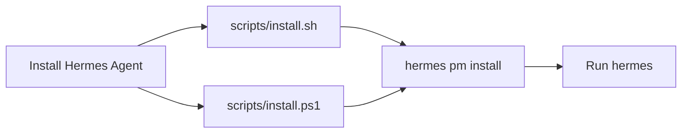

Sources: [scripts/install.sh:1-6](), [scripts/install.ps1:1-6](), [website/docs/getting-started/installation.md:126-133]()

---

## 2.2 Configuration and Setup

Hermes keeps user state under its Hermes home directory. The project guide identifies `config.yaml` as the settings file and `.env` as the place for secrets; the example environment file also notes that the default model is configured in `config.yaml`, not through `LLM_MODEL` in `.env`. [AGENTS.md:98-99](), [.env.example:19-22]()

Use `hermes setup` for initial configuration or to configure the Nous Portal path with `hermes setup --portal`. The installation guide also points to `hermes model`, `hermes config set`, and `hermes config get` for later changes. For the configuration hierarchy, profiles, and migrations, see [Configuration and Setup](#2.2). [website/docs/getting-started/installation.md:135-153]()

Sources: [AGENTS.md:98-99](), [.env.example:19-22](), [website/docs/getting-started/installation.md:135-153]()

### User setup mapped to configuration entry points

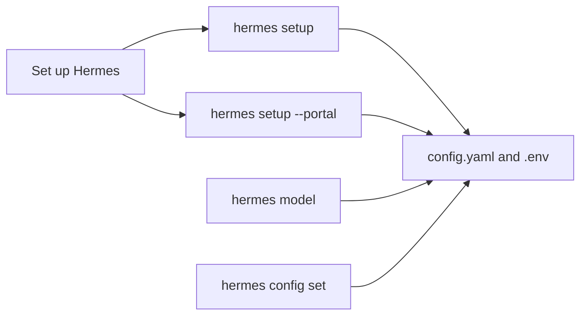

Sources: [website/docs/getting-started/installation.md:135-153](), [.env.example:19-22]()

---

## 2.3 Authentication and Providers

Hermes supports multiple model providers. The environment example documents API-key configuration for providers including OpenRouter, Fireworks AI, and Google AI Studio/Gemini, and notes that the default model belongs in `config.yaml`. [README.md:21-21](), [.env.example:5-22](), [.env.example:41-49]()

Authentication and provider selection are part of getting a model ready for the first conversation. For OAuth, provider resolution, credential pools, automatic detection, and external secret sources, see [Authentication and Providers](#2.3).

Sources: [README.md:21-21](), [.env.example:5-22](), [.env.example:41-49]()

---

## 2.4 Model Selection and Management

Choose a model with `hermes model` or configure the default during setup. Hermes supports models from multiple providers, so provider authentication and model selection are related setup steps. [README.md:21-21](), [website/docs/getting-started/installation.md:135-153]()

For model validation, context-length discovery, pricing and usage metadata, and the model catalog, see [Model Selection and Management](#2.4).

Sources: [README.md:21-21](), [website/docs/getting-started/installation.md:135-153]()

### From model choice to first conversation


Sources: [.env.example:19-22](), [website/docs/getting-started/installation.md:126-153]()

---

For detailed guidance, continue to [Installation](#2.1), [Configuration and Setup](#2.2), [Authentication and Providers](#2.3), and [Model Selection and Management](#2.4).

Sources: [website/docs/getting-started/installation.md:126-153](), [.env.example:19-22]()

---

# Page: Installation

# Installation

<details>
<summary>Relevant source files</summary>

The following files were used as context for generating this wiki page:

- [.env.example](.env.example)
- [AGENTS.md](AGENTS.md)
- [CONTRIBUTING.es.md](CONTRIBUTING.es.md)
- [CONTRIBUTING.md](CONTRIBUTING.md)
- [README.md](README.md)
- [activate](activate)
- [activate.fish](activate.fish)
- [activate.ps1](activate.ps1)
- [agent/legacy_cli.py](agent/legacy_cli.py)
- [apps/desktop/electron/feature-flags.test.ts](apps/desktop/electron/feature-flags.test.ts)
- [apps/desktop/electron/feature-flags.ts](apps/desktop/electron/feature-flags.ts)
- [apps/desktop/src/store/local-models-flag.ts](apps/desktop/src/store/local-models-flag.ts)
- [contributors/emails/alan.harman-box@burningsuit.co.uk](contributors/emails/alan.harman-box@burningsuit.co.uk)
- [hermes](hermes)
- [hermes_cli/_early_recovery.py](hermes_cli/_early_recovery.py)
- [hermes_cli/_early_recovery_zip.py](hermes_cli/_early_recovery_zip.py)
- [hermes_cli/_old_updater.py](hermes_cli/_old_updater.py)
- [hermes_cli/_update_takeover.py](hermes_cli/_update_takeover.py)
- [hermes_cli/data_cleanup.py](hermes_cli/data_cleanup.py)
- [hermes_cli/managed_uv.py](hermes_cli/managed_uv.py)
- [hermes_cli/subcommands/memory.py](hermes_cli/subcommands/memory.py)
- [hermes_cli/update_cmd.py](hermes_cli/update_cmd.py)
- [hermes_cli/update_cmd_commit.py](hermes_cli/update_cmd_commit.py)
- [hermes_cli/update_cmd_git.py](hermes_cli/update_cmd_git.py)
- [hermes_cli/update_cmd_stash.py](hermes_cli/update_cmd_stash.py)
- [hermes_cli/update_cmd_zip.py](hermes_cli/update_cmd_zip.py)
- [hermes_cli/update_completion.py](hermes_cli/update_completion.py)
- [hermes_cli/update_finish.py](hermes_cli/update_finish.py)
- [hermes_cli/update_handoff.py](hermes_cli/update_handoff.py)
- [hermes_cli/update_host_obligation.py](hermes_cli/update_host_obligation.py)
- [pm/cli.py](pm/cli.py)
- [pm/defaults.py](pm/defaults.py)
- [pm/filesystem.py](pm/filesystem.py)
- [pm/install.py](pm/install.py)
- [pm/lock.json](pm/lock.json)
- [pm/lock.py](pm/lock.py)
- [pm/package.py](pm/package.py)
- [pm/packages.py](pm/packages.py)
- [pm/recovery.py](pm/recovery.py)
- [pm/security_packages.py](pm/security_packages.py)
- [pm/store.py](pm/store.py)
- [pm/update.py](pm/update.py)
- [scripts/_activation.sh](scripts/_activation.sh)
- [scripts/install.ps1](scripts/install.ps1)
- [scripts/install.sh](scripts/install.sh)
- [setup-hermes.sh](setup-hermes.sh)
- [tests/acp_adapter/test_edit_approval.py](tests/acp_adapter/test_edit_approval.py)
- [tests/agent/test_legacy_cli.py](tests/agent/test_legacy_cli.py)
- [tests/agent/test_relay_compaction_atof.py](tests/agent/test_relay_compaction_atof.py)
- [tests/gateway/test_multiplex_notice_egress_profile_adapter.py](tests/gateway/test_multiplex_notice_egress_profile_adapter.py)
- [tests/gateway/test_planned_restart_notice_multiplex.py](tests/gateway/test_planned_restart_notice_multiplex.py)
- [tests/hermes_cli/test_cmd_update.py](tests/hermes_cli/test_cmd_update.py)
- [tests/hermes_cli/test_data_uninstall.py](tests/hermes_cli/test_data_uninstall.py)
- [tests/hermes_cli/test_discard_lockfile_churn.py](tests/hermes_cli/test_discard_lockfile_churn.py)
- [tests/hermes_cli/test_early_recovery.py](tests/hermes_cli/test_early_recovery.py)
- [tests/hermes_cli/test_launcher.py](tests/hermes_cli/test_launcher.py)
- [tests/hermes_cli/test_local_legacy_engine.py](tests/hermes_cli/test_local_legacy_engine.py)
- [tests/hermes_cli/test_local_runtime_pm.py](tests/hermes_cli/test_local_runtime_pm.py)
- [tests/hermes_cli/test_old_updater_additional_shims.py](tests/hermes_cli/test_old_updater_additional_shims.py)
- [tests/hermes_cli/test_old_updater_main_shims.py](tests/hermes_cli/test_old_updater_main_shims.py)
- [tests/hermes_cli/test_old_updater_shims.py](tests/hermes_cli/test_old_updater_shims.py)
- [tests/hermes_cli/test_old_updater_takeover.py](tests/hermes_cli/test_old_updater_takeover.py)
- [tests/hermes_cli/test_setup_pin_values.py](tests/hermes_cli/test_setup_pin_values.py)
- [tests/hermes_cli/test_shared_profile_warning.py](tests/hermes_cli/test_shared_profile_warning.py)
- [tests/hermes_cli/test_update_autostash.py](tests/hermes_cli/test_update_autostash.py)
- [tests/hermes_cli/test_update_commit_obligations.py](tests/hermes_cli/test_update_commit_obligations.py)
- [tests/hermes_cli/test_update_completion_process.py](tests/hermes_cli/test_update_completion_process.py)
- [tests/hermes_cli/test_update_completion_routing.py](tests/hermes_cli/test_update_completion_routing.py)
- [tests/hermes_cli/test_update_config_migration_on_current.py](tests/hermes_cli/test_update_config_migration_on_current.py)
- [tests/hermes_cli/test_update_existing_branch_baseline.py](tests/hermes_cli/test_update_existing_branch_baseline.py)
- [tests/hermes_cli/test_update_fetch_failure_classifier.py](tests/hermes_cli/test_update_fetch_failure_classifier.py)
- [tests/hermes_cli/test_update_finish.py](tests/hermes_cli/test_update_finish.py)
- [tests/hermes_cli/test_update_fork_sync_identity.py](tests/hermes_cli/test_update_fork_sync_identity.py)
- [tests/hermes_cli/test_update_head_moved_gate.py](tests/hermes_cli/test_update_head_moved_gate.py)
- [tests/hermes_cli/test_update_host_obligation.py](tests/hermes_cli/test_update_host_obligation.py)
- [tests/hermes_cli/test_update_import_guard.py](tests/hermes_cli/test_update_import_guard.py)
- [tests/hermes_cli/test_update_interrupted_pull.py](tests/hermes_cli/test_update_interrupted_pull.py)
- [tests/hermes_cli/test_update_parked_branch_guard.py](tests/hermes_cli/test_update_parked_branch_guard.py)
- [tests/hermes_cli/test_update_post_commit_safety.py](tests/hermes_cli/test_update_post_commit_safety.py)
- [tests/hermes_cli/test_update_post_pull_syntax_guard.py](tests/hermes_cli/test_update_post_pull_syntax_guard.py)
- [tests/hermes_cli/test_update_products.py](tests/hermes_cli/test_update_products.py)
- [tests/hermes_cli/test_update_sqlite_remediation.py](tests/hermes_cli/test_update_sqlite_remediation.py)
- [tests/hermes_cli/test_update_target_identity.py](tests/hermes_cli/test_update_target_identity.py)
- [tests/hermes_cli/test_update_upstream_prompt_noninteractive.py](tests/hermes_cli/test_update_upstream_prompt_noninteractive.py)
- [tests/hermes_cli/test_update_venv_holder_retirement.py](tests/hermes_cli/test_update_venv_holder_retirement.py)
- [tests/hermes_cli/test_update_zip_completion.py](tests/hermes_cli/test_update_zip_completion.py)
- [tests/hermes_cli/test_update_zip_fallback_guards.py](tests/hermes_cli/test_update_zip_fallback_guards.py)
- [tests/hermes_cli/test_update_zip_release_preserve.py](tests/hermes_cli/test_update_zip_release_preserve.py)
- [tests/hermes_cli/test_update_zip_symlink_reject.py](tests/hermes_cli/test_update_zip_symlink_reject.py)
- [tests/hermes_cli/test_update_zip_two_phase.py](tests/hermes_cli/test_update_zip_two_phase.py)
- [tests/install/e2e-assets/source-build-env.ps1](tests/install/e2e-assets/source-build-env.ps1)
- [tests/pm/activation_support.py](tests/pm/activation_support.py)
- [tests/pm/test_activate_fish.py](tests/pm/test_activate_fish.py)
- [tests/pm/test_activate_scripts.py](tests/pm/test_activate_scripts.py)
- [tests/pm/test_activation_runtime.py](tests/pm/test_activation_runtime.py)
- [tests/pm/test_archive_safety.py](tests/pm/test_archive_safety.py)
- [tests/pm/test_baked_selection.py](tests/pm/test_baked_selection.py)
- [tests/pm/test_deb_safety.py](tests/pm/test_deb_safety.py)
- [tests/pm/test_environment_script.py](tests/pm/test_environment_script.py)
- [tests/pm/test_ffmpeg_resolution.py](tests/pm/test_ffmpeg_resolution.py)
- [tests/pm/test_filesystem_is_junction.py](tests/pm/test_filesystem_is_junction.py)
- [tests/pm/test_install_default_closure.py](tests/pm/test_install_default_closure.py)
- [tests/pm/test_installed_package.py](tests/pm/test_installed_package.py)
- [tests/pm/test_llamacpp_pins.py](tests/pm/test_llamacpp_pins.py)
- [tests/pm/test_lockfile_publication.py](tests/pm/test_lockfile_publication.py)
- [tests/pm/test_long_path_exits.py](tests/pm/test_long_path_exits.py)
- [tests/pm/test_npm_dist_tags.py](tests/pm/test_npm_dist_tags.py)
- [tests/pm/test_pm_core.py](tests/pm/test_pm_core.py)
- [tests/pm/test_python_release_identity.py](tests/pm/test_python_release_identity.py)
- [tests/pm/test_recovery.py](tests/pm/test_recovery.py)
- [tests/pm/test_retired_agent_browser.py](tests/pm/test_retired_agent_browser.py)
- [tests/pm/test_setup_lock_format.py](tests/pm/test_setup_lock_format.py)
- [tests/pm/test_store_extract.py](tests/pm/test_store_extract.py)
- [tests/pm/test_tree_digest_links.py](tests/pm/test_tree_digest_links.py)
- [tests/pm/test_update.py](tests/pm/test_update.py)
- [tests/pm/test_update_bootstrap_pins.py](tests/pm/test_update_bootstrap_pins.py)
- [tests/pm/test_update_request_reuse.py](tests/pm/test_update_request_reuse.py)
- [tests/scripts/install/test_install_ps1_managed_python_provenance.py](tests/scripts/install/test_install_ps1_managed_python_provenance.py)
- [tests/scripts/install/test_install_ps1_pinned_git_extract.py](tests/scripts/install/test_install_ps1_pinned_git_extract.py)
- [tests/scripts/install/test_install_sh_repository_stage.py](tests/scripts/install/test_install_sh_repository_stage.py)
- [tests/scripts/install/test_install_sh_reuse_supported_python.py](tests/scripts/install/test_install_sh_reuse_supported_python.py)
- [tests/scripts/test_install_ps1_desktop_stage.py](tests/scripts/test_install_ps1_desktop_stage.py)
- [tests/scripts/test_install_sh_launch_handoff.py](tests/scripts/test_install_sh_launch_handoff.py)
- [tests/scripts/test_install_stage_frames.py](tests/scripts/test_install_stage_frames.py)
- [tests/scripts/test_mint_launchers.py](tests/scripts/test_mint_launchers.py)
- [tests/tools/test_lazy_deps_runtime.py](tests/tools/test_lazy_deps_runtime.py)
- [tests/tools/test_send_message_multiplex_profile_adapter.py](tests/tools/test_send_message_multiplex_profile_adapter.py)
- [website/docs/developer-guide/contributing.md](website/docs/developer-guide/contributing.md)
- [website/docs/getting-started/installation.md](website/docs/getting-started/installation.md)
- [website/docs/getting-started/updating.md](website/docs/getting-started/updating.md)
- [website/docs/reference/package-management.md](website/docs/reference/package-management.md)
- [website/docs/user-guide/local-models.md](website/docs/user-guide/local-models.md)
- [website/i18n/zh-Hans/docusaurus-plugin-content-docs/current/developer-guide/contributing.md](website/i18n/zh-Hans/docusaurus-plugin-content-docs/current/developer-guide/contributing.md)

</details>


## Purpose and scope

This page describes the available Hermes Agent installation routes, the bootstrap’s division of work with the package manager (PM), update ownership, and platform-specific behavior. The standard source installers prepare the Hermes checkout and its runtime; PM provisions managed tools and other heavy dependencies. [scripts/install.sh:1-6]() [scripts/install.ps1:1-15]()

Sources: [scripts/install.sh:1-6](), [scripts/install.ps1:1-15]()

---

## Overview

Hermes can be installed from a shell or PowerShell bootstrap script, from a source checkout, through Nix, or through desktop distribution channels. These routes do not all have the same update mechanism: `hermes update` applies to managed source checkouts, while package-managed desktop applications, Docker, and Nix are updated through their respective distribution mechanisms. [README.md:35-68]() [website/docs/getting-started/updating.md:9-25]()

The source installer is staged. It can expose a manifest or run a named stage, and supports non-interactive operation and optional desktop building. It delegates heavy dependencies—including tool binaries, browsers, and Node.js—to PM rather than treating them as part of the initial checkout bootstrap. [scripts/install.sh:1-14]() [scripts/install.ps1:1-15]()

Sources: [README.md:35-68](), [scripts/install.sh:1-14](), [scripts/install.ps1:1-15](), [website/docs/getting-started/updating.md:9-25]()

### Installation routes at a glance

| Route | Intended use | Update ownership |
|---|---|---|
| `install.sh` via `curl | bash` | Linux, macOS, or WSL2 source installation. [README.md:35-41]() | `hermes update`. [website/docs/getting-started/updating.md:11-18]() |
| `install.ps1` via PowerShell | Native Windows source installation. [README.md:43-57]() | `hermes update`. [website/docs/getting-started/updating.md:11-18]() |
| Manual checkout and setup | Developer or custom source installation; use the repository’s setup workflow. [AGENTS.md:61-66]() | `hermes update` for a managed source checkout. [website/docs/getting-started/updating.md:11-18]() |
| Nix flake/profile | Declarative Nix installation. Update the flake/profile and rebuild. [website/docs/getting-started/updating.md:11-21]() | Nix rebuild, not `hermes update`. [website/docs/getting-started/updating.md:11-21]() |
| Desktop bootstrap installer | Desktop-oriented installation route; the source installers expose an optional desktop build stage. [scripts/install.sh:8-14]() [scripts/install.ps1:1-9]() | Depends on the resulting package; bundled desktop updates use their package updater. [website/docs/getting-started/updating.md:15-25]() |

Sources: [README.md:35-57](), [AGENTS.md:61-66](), [scripts/install.sh:1-14](), [scripts/install.ps1:1-9](), [website/docs/getting-started/updating.md:9-25]()

---

## Installation methods

### 1. Quick install: shell script

On Linux, macOS, or WSL2, the documented quick-install entry point is:

```bash
curl -fsSL https://hermes-agent.nousresearch.com/install.sh | bash
```

The script accepts options for channel, branch, commit, install directory, Hermes home, stage selection, JSON output, non-interactive operation, desktop inclusion, and skipping browser or computer-use installation. It validates the channel as `stable` or `main`; an explicit channel is persisted for later update behavior. [README.md:35-41]() [scripts/install.sh:23-39]() [scripts/install.sh:46-95]()

The installer exports `UV_NO_CONFIG=1` during bootstrap to prevent `uv` from loading configuration files from an unintended user home, including when invoked under `sudo -u`. Its comments note that PM’s environment synchronization applies its own isolation. [scripts/install.sh:17-21]()

The shell script describes its work as cloning the repository, acquiring `uv` and Python, and handing the checkout to the same completion path used by updates. Heavy tools and runtimes are delegated to `hermes pm install`. [scripts/install.sh:1-6]()

Sources: [README.md:35-41](), [scripts/install.sh:1-6](), [scripts/install.sh:17-21](), [scripts/install.sh:23-39](), [scripts/install.sh:46-95]()

### 2. Native Windows: PowerShell

Run the PowerShell bootstrap in a PowerShell session:

```powershell
iex (irm https://hermes-agent.nousresearch.com/install.ps1)
```

The Windows source installer defaults `HermesHome` to `%LOCALAPPDATA%\hermes` and places the checkout under `hermes-agent` within that home, unless environment variables or parameters override those paths. It also supports `-Channel`, `-Branch`, `-Commit`, `-Stage`, `-Manifest`, `-NonInteractive`, `-IncludeDesktop`, `-SkipBrowser`, and `-SkipComputerUse`. [README.md:43-57]() [scripts/install.ps1:23-49]()

The script pins bootstrap versions of `uv` and Git for supported Windows architectures and includes SHA-256 values for the corresponding archives. If Git is absent, the documented installer behavior stages verified Git for Windows in Hermes’ tool store rather than replacing system Git. [scripts/install.ps1:81-110]() [README.md:53-55]()

PowerShell’s invocation mode matters: the installer distinguishes execution as a script file from `irm | iex`, because calling `exit` from the latter could terminate the caller’s session. It also detects dot-sourcing so tests or embedding hosts can load function definitions without running installation side effects. [scripts/install.ps1:57-78]()

Sources: [README.md:43-57](), [scripts/install.ps1:23-49](), [scripts/install.ps1:57-78](), [scripts/install.ps1:81-110]()

### 3. Manual source installation

For development, the project’s contributor guide directs developers to activate the PM environment with the repository’s `activate` script, selecting the shell-specific variant where necessary. It recommends choosing an isolated `HERMES_HOME` or `HERMES_RUNTIME_DIR` first. [AGENTS.md:61-66]()

A manual setup should therefore follow the repository checkout’s documented developer workflow rather than assuming that a bare Python environment includes PM-managed tools. PM owns dependency and environment provisioning; its installation command is `hermes pm install`. [AGENTS.md:61-66]() [scripts/install.sh:1-6]()

Sources: [AGENTS.md:61-66](), [scripts/install.sh:1-6]()

### 4. Nix flake and profile

Nix installations have independent update ownership: update the flake or profile and rebuild it. `hermes update` is not the update mechanism for a Nix-managed installation. [website/docs/getting-started/updating.md:11-21]()

Sources: [website/docs/getting-started/updating.md:11-21]()

### 5. Desktop bootstrap and bundled applications

The source installers expose an optional desktop stage through `--include-desktop` or `-IncludeDesktop`. This is an installer stage option, not evidence that every desktop package uses the same installation or update mechanism. [scripts/install.sh:8-14]() [scripts/install.ps1:1-9]()

Bundled desktop update ownership varies by package: Windows sideload MSIX uses the desktop Update control and Windows App Installer, Microsoft Store packages update through the Store, and macOS bundled apps use the desktop Update control through `electron-updater`. Docker images and Nix installations also use their distribution-specific update process. [website/docs/getting-started/updating.md:11-25]()

Sources: [scripts/install.sh:8-14](), [scripts/install.ps1:1-9](), [website/docs/getting-started/updating.md:11-25]()

---

## Dependency provisioning

### Bootstrap versus PM-managed dependencies

The installer’s bootstrap responsibility is distinct from installing the full set of tools used by Hermes. The shell and PowerShell scripts describe PM as responsible for heavy dependencies, including tool binaries, browsers, and Node.js; after installation, PM can install managed packages. [scripts/install.sh:1-6]() [scripts/install.ps1:1-15]()

The shell installer includes `--skip-browser` and `--skip-computer-use`. These choices are recorded by PM so subsequent installs and `hermes update` preserve the opt-out. Users can opt back in with `hermes pm install chromium` or `hermes pm install cua-driver`, respectively. [scripts/install.sh:67-69]() [scripts/install.sh:81-86]()

On Windows, the bootstrap’s `uv` and Git downloads are pinned with platform-specific archive URLs and hashes. PM’s package implementation verifies staged binaries and performs a version smoke probe only for the native target; it does not execute cross-staged binaries. [scripts/install.ps1:81-110]() [pm/packages.py:65-118]()

Sources: [scripts/install.sh:1-6](), [scripts/install.sh:67-69](), [scripts/install.sh:81-86](), [scripts/install.ps1:81-110](), [pm/packages.py:65-118]()

### Dependency and install data flow

The flow below distinguishes the source bootstrap from PM’s later package provisioning. The code establishes the installer/PM boundary and the update completion handoff; it does not imply that every managed package is installed during the initial bootstrap. [scripts/install.sh:1-6]() [scripts/install.ps1:1-15]() [pm/packages.py:65-118]()

**Diagram: Source bootstrap and dependency provisioning**

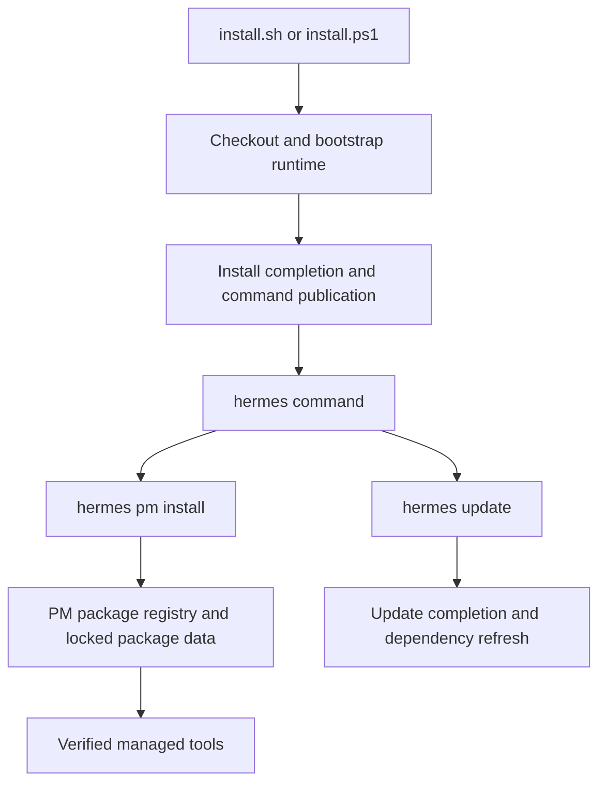

Sources: [scripts/install.sh:1-6](), [scripts/install.ps1:1-15](), [pm/packages.py:1-3](), [pm/packages.py:65-118](), [website/docs/getting-started/updating.md:23-25]()

---

## The `hermes update` command

For a managed source checkout, use:

```bash
hermes update
```

The update method depends on how Hermes was installed. `hermes update` is for managed source checkouts; it does not rewrite package-owned application files. PM manages dependencies, while `hermes pm update` is a maintainer pin-update command rather than an application updater. [website/docs/getting-started/updating.md:9-31]()

The source installer and updater share a completion path, so installation and a finished update converge on command publication, product builds, and post-build maintenance. The update implementation is split into concern-specific modules re-exported through `hermes_cli.update_cmd`, including Git handling, stash handling, ZIP updates, dependency refresh, and gateway restart coordination. [scripts/install.sh:1-6]() [hermes_cli/update_cmd.py:1-5]() [hermes_cli/update_cmd.py:37-95]()

#### Update channels

The source installer accepts `stable` or `main`. The documented default for the official repository’s main line is stable releases; `main` tracks every commit. An explicit install channel is saved, and the installer’s help identifies `HERMES_INSTALL_CHANNEL` as the channel setting available for `irm | iex` on Windows. [scripts/install.sh:26-29]() [scripts/install.sh:72-86]() [scripts/install.ps1:18-22]()

For an installed source checkout, `hermes update --set-channel main` saves a channel choice, while `hermes update --channel main` applies a one-run choice. The selected channel is stored per install under `update.installs` in `config.yaml`. [website/docs/getting-started/updating.md:33-52]()

#### Update phases and safeguards

The update facade imports split modules for Git operations, local-change stashing, ZIP fallback, dependency refresh, configuration migration, validation, and gateway fleet restart. The facade’s imports show these module boundaries; the actual work is delegated to their implementations. [hermes_cli/update_cmd.py:37-115]()

Before an update replaces checkout content, the updater has mechanisms for preserving local changes and retaining rescue references. Tests exercise preservation of committed and untracked work, failure handling during reset, and rescue references under `refs/hermes-update-backups/`. [hermes_cli/update_cmd.py:78-85]() [tests/hermes_cli/test_update_autostash.py:20-82]()

On Windows, the update code includes Git-trampoline detection and real-Git lookup; tests verify the healthy-Git, broken-trampoline, and no-real-Git cases. [hermes_cli/update_cmd.py:96-105]() [tests/hermes_cli/test_cmd_update.py:19-107]()

Sources: [scripts/install.sh:1-6](), [scripts/install.sh:26-29](), [scripts/install.sh:72-86](), [scripts/install.ps1:18-22](), [hermes_cli/update_cmd.py:1-5](), [hermes_cli/update_cmd.py:37-115](), [tests/hermes_cli/test_update_autostash.py:20-82](), [tests/hermes_cli/test_cmd_update.py:19-107](), [website/docs/getting-started/updating.md:9-52]()

### Update ownership by installation type

| Installation | Update mechanism |
|---|---|
| Managed source checkout | `hermes update`. [website/docs/getting-started/updating.md:11-18]() |
| Windows sideload MSIX | Desktop Update control and Windows App Installer. [website/docs/getting-started/updating.md:15-19]() |
| Microsoft Store package | Microsoft Store. [website/docs/getting-started/updating.md:17-20]() |
| macOS bundled app | Desktop Update control through `electron-updater`. [website/docs/getting-started/updating.md:18-19]() |
| Docker image | Pull the selected image and recreate the container with its data mount. [website/docs/getting-started/updating.md:19-21]() |
| Nix | Update the flake/profile and rebuild. [website/docs/getting-started/updating.md:20-21]() |
| Termux APT | Run `pkg update`, then `pkg upgrade hermes-agent`. [website/docs/getting-started/updating.md:20-21]() |

Sources: [website/docs/getting-started/updating.md:11-21]()

---

## Platform-specific considerations

| Platform or environment | Considerations |
|---|---|
| Linux, macOS, WSL2 | The shell quick-install script is the documented route. [README.md:35-41]() |
| Native Windows | Use the PowerShell installer. The source install defaults to `%LOCALAPPDATA%\hermes`; its bootstrap pins `uv` and Git artifacts by Windows architecture. [README.md:43-61]() [scripts/install.ps1:23-29]() [scripts/install.ps1:81-110]() |
| Windows `irm | iex` | The installer accounts for the fact that `exit` in an `iex` invocation can end the caller’s session; it distinguishes text executed through `iex` from a script file. [scripts/install.ps1:66-78]() |
| WSL2 | The Linux/macOS shell installer works in WSL2; its Hermes home follows the Linux-style `~/.hermes` location. [README.md:45-61]() |
| Android / Termux | Use the Termux APT package route rather than the desktop/server installer. The package is documented for aarch64 and has stable and canary channels. [README.md:59-61]() |
| Nix | Update through the flake/profile and rebuild. [website/docs/getting-started/updating.md:20-21]() |
| Docker | Update the selected image and recreate the container while retaining its data mount. [website/docs/getting-started/updating.md:19-20]() |

Sources: [README.md:35-61](), [scripts/install.ps1:23-29](), [scripts/install.ps1:66-78](), [scripts/install.ps1:81-110](), [website/docs/getting-started/updating.md:19-21]()

---

## Installer and updater code map

This map connects the user-facing installation routes to code entities identified in the repository. The installer scripts share a completion model with updates; PM handles managed package installation separately. [scripts/install.sh:1-6]() [scripts/install.ps1:1-15]() [hermes_cli/update_cmd.py:1-5]() [pm/packages.py:1-3]()

**Diagram: User routes to installation code entities**

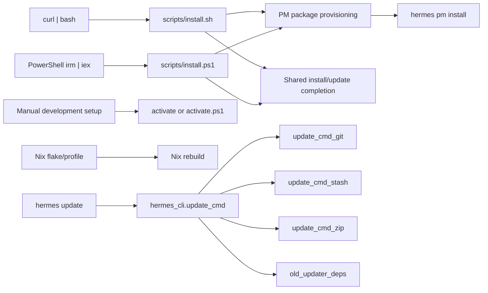

Sources: [scripts/install.sh:1-6](), [scripts/install.ps1:1-15](), [AGENTS.md:61-66](), [hermes_cli/update_cmd.py:1-5](), [hermes_cli/update_cmd.py:78-105](), [pm/packages.py:1-3](), [website/docs/getting-started/updating.md:11-21]()

**Diagram: Update command modules and distribution ownership**

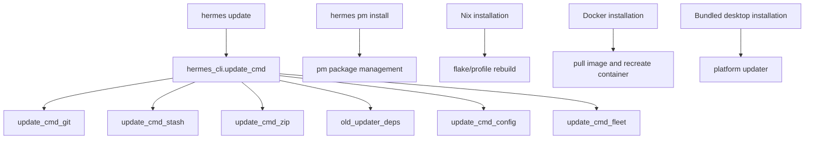

Sources: [hermes_cli/update_cmd.py:37-115](), [pm/packages.py:1-3](), [website/docs/getting-started/updating.md:11-25]()

---

## Summary

- Use `install.sh` for Linux, macOS, and WSL2, or `install.ps1` for native Windows. [README.md:35-57]()
- The source bootstrap and PM have separate responsibilities: the installer prepares the checkout and runtime; PM manages heavy dependencies and tools. [scripts/install.sh:1-6]() [scripts/install.ps1:1-15]()
- Choose update commands according to installation ownership: `hermes update` for managed source checkouts, and the relevant package or distribution updater for desktop, Docker, Nix, or Termux. [website/docs/getting-started/updating.md:9-25]()
- Use the dedicated Termux package route on Android rather than the desktop/server installer. [README.md:59-61]()

Sources: [README.md:35-61](), [scripts/install.sh:1-6](), [scripts/install.ps1:1-15](), [website/docs/getting-started/updating.md:9-25]()

---

# Page: Configuration and Setup

# Configuration and Setup

<details>
<summary>Relevant source files</summary>

The following files were used as context for generating this wiki page:

- [agent/secret_scope.py](agent/secret_scope.py)
- [agent/secret_sources/__init__.py](agent/secret_sources/__init__.py)
- [agent/secret_sources/_cache.py](agent/secret_sources/_cache.py)
- [agent/secret_sources/base.py](agent/secret_sources/base.py)
- [agent/secret_sources/bitwarden.py](agent/secret_sources/bitwarden.py)
- [agent/secret_sources/command.py](agent/secret_sources/command.py)
- [agent/secret_sources/onepassword.py](agent/secret_sources/onepassword.py)
- [agent/secret_sources/registry.py](agent/secret_sources/registry.py)
- [apps/desktop/scripts/click-session-helpers.mjs](apps/desktop/scripts/click-session-helpers.mjs)
- [apps/desktop/scripts/click-session-helpers.test.mjs](apps/desktop/scripts/click-session-helpers.test.mjs)
- [apps/desktop/scripts/click-session.mjs](apps/desktop/scripts/click-session.mjs)
- [cron/job_definition.py](cron/job_definition.py)
- [cron/scheduler_script.py](cron/scheduler_script.py)
- [hermes_cli/config_check_diagnostics.py](hermes_cli/config_check_diagnostics.py)
- [hermes_cli/config_key_notices.py](hermes_cli/config_key_notices.py)
- [hermes_cli/config_migrations.py](hermes_cli/config_migrations.py)
- [hermes_cli/config_migrations_browser.py](hermes_cli/config_migrations_browser.py)
- [hermes_cli/config_version_stamp.py](hermes_cli/config_version_stamp.py)
- [hermes_cli/env_loader.py](hermes_cli/env_loader.py)
- [hermes_cli/kanban_decompose.py](hermes_cli/kanban_decompose.py)
- [hermes_cli/kanban_specify.py](hermes_cli/kanban_specify.py)
- [hermes_cli/left_core_migration.py](hermes_cli/left_core_migration.py)
- [hermes_cli/memory_setup.py](hermes_cli/memory_setup.py)
- [hermes_cli/nous_subscription.py](hermes_cli/nous_subscription.py)
- [hermes_cli/plugins_registrars.py](hermes_cli/plugins_registrars.py)
- [hermes_cli/portal_cli.py](hermes_cli/portal_cli.py)
- [hermes_cli/post_update.py](hermes_cli/post_update.py)
- [hermes_cli/profile_cmd.py](hermes_cli/profile_cmd.py)
- [hermes_cli/profile_describer.py](hermes_cli/profile_describer.py)
- [hermes_cli/profile_distribution.py](hermes_cli/profile_distribution.py)
- [hermes_cli/profiles.py](hermes_cli/profiles.py)
- [hermes_cli/subcommands/profile.py](hermes_cli/subcommands/profile.py)
- [hermes_cli/subcommands/tools.py](hermes_cli/subcommands/tools.py)
- [hermes_cli/tools_config.py](hermes_cli/tools_config.py)
- [hermes_cli/tools_config_cua.py](hermes_cli/tools_config_cua.py)
- [hermes_cli/tools_config_mcp.py](hermes_cli/tools_config_mcp.py)
- [hermes_cli/tools_config_post_setup.py](hermes_cli/tools_config_post_setup.py)
- [hermes_cli/tools_config_providers.py](hermes_cli/tools_config_providers.py)
- [hermes_cli/toolset_scope.py](hermes_cli/toolset_scope.py)
- [hermes_cli/toolset_validation.py](hermes_cli/toolset_validation.py)
- [hermes_cli/venv_sync.py](hermes_cli/venv_sync.py)
- [hermes_cli/xai_retirement.py](hermes_cli/xai_retirement.py)
- [plugins/AGENTS.md](plugins/AGENTS.md)
- [pm/termux_libs.py](pm/termux_libs.py)
- [pm/termux_runtime_libs.json](pm/termux_runtime_libs.json)
- [scripts/ci/archive_inputs.py](scripts/ci/archive_inputs.py)
- [scripts/ci/check_docs_drift.py](scripts/ci/check_docs_drift.py)
- [scripts/ci/docs_drift_baseline.json](scripts/ci/docs_drift_baseline.json)
- [scripts/ci/setup_toolchain.py](scripts/ci/setup_toolchain.py)
- [scripts/docker_config_migrate.py](scripts/docker_config_migrate.py)
- [scripts/termux/wheelhouse_cache.py](scripts/termux/wheelhouse_cache.py)
- [tests/agent/test_env_loader_secret_sources.py](tests/agent/test_env_loader_secret_sources.py)
- [tests/agent/test_onepassword_secrets.py](tests/agent/test_onepassword_secrets.py)
- [tests/agent/test_secret_scope.py](tests/agent/test_secret_scope.py)
- [tests/agent/test_secret_scope_env_cache.py](tests/agent/test_secret_scope_env_cache.py)
- [tests/ci/test_docs_drift.py](tests/ci/test_docs_drift.py)
- [tests/cron/test_cron_multiplex_desktop_ticker_scope.py](tests/cron/test_cron_multiplex_desktop_ticker_scope.py)
- [tests/cron/test_cron_no_agent.py](tests/cron/test_cron_no_agent.py)
- [tests/cron/test_cron_script.py](tests/cron/test_cron_script.py)
- [tests/hermes_cli/test_agent_import_left_core.py](tests/hermes_cli/test_agent_import_left_core.py)
- [tests/hermes_cli/test_config.py](tests/hermes_cli/test_config.py)
- [tests/hermes_cli/test_config_browser_env_first_stamp.py](tests/hermes_cli/test_config_browser_env_first_stamp.py)
- [tests/hermes_cli/test_config_check_diagnostics.py](tests/hermes_cli/test_config_check_diagnostics.py)
- [tests/hermes_cli/test_config_migration_52_browser.py](tests/hermes_cli/test_config_migration_52_browser.py)
- [tests/hermes_cli/test_config_migration_nested_guards.py](tests/hermes_cli/test_config_migration_nested_guards.py)
- [tests/hermes_cli/test_desktop_cron_ticker_gateway_standdown.py](tests/hermes_cli/test_desktop_cron_ticker_gateway_standdown.py)
- [tests/hermes_cli/test_desktop_cron_ticker_profiles.py](tests/hermes_cli/test_desktop_cron_ticker_profiles.py)
- [tests/hermes_cli/test_env_loader.py](tests/hermes_cli/test_env_loader.py)
- [tests/hermes_cli/test_env_sanitize_on_load.py](tests/hermes_cli/test_env_sanitize_on_load.py)
- [tests/hermes_cli/test_install_cua_driver.py](tests/hermes_cli/test_install_cua_driver.py)
- [tests/hermes_cli/test_kanban_aux_affinity.py](tests/hermes_cli/test_kanban_aux_affinity.py)
- [tests/hermes_cli/test_kanban_decompose.py](tests/hermes_cli/test_kanban_decompose.py)
- [tests/hermes_cli/test_kanban_decompose_db.py](tests/hermes_cli/test_kanban_decompose_db.py)
- [tests/hermes_cli/test_kanban_specify.py](tests/hermes_cli/test_kanban_specify.py)
- [tests/hermes_cli/test_kanban_specify_db.py](tests/hermes_cli/test_kanban_specify_db.py)
- [tests/hermes_cli/test_kanban_worktree_isolation.py](tests/hermes_cli/test_kanban_worktree_isolation.py)
- [tests/hermes_cli/test_left_core_camofox.py](tests/hermes_cli/test_left_core_camofox.py)
- [tests/hermes_cli/test_left_core_migration.py](tests/hermes_cli/test_left_core_migration.py)
- [tests/hermes_cli/test_left_core_singularity.py](tests/hermes_cli/test_left_core_singularity.py)
- [tests/hermes_cli/test_memory_setup.py](tests/hermes_cli/test_memory_setup.py)
- [tests/hermes_cli/test_memory_setup_env_denylist.py](tests/hermes_cli/test_memory_setup_env_denylist.py)
- [tests/hermes_cli/test_memory_setup_provider_arg.py](tests/hermes_cli/test_memory_setup_provider_arg.py)
- [tests/hermes_cli/test_migrate_xai.py](tests/hermes_cli/test_migrate_xai.py)
- [tests/hermes_cli/test_nous_subscription.py](tests/hermes_cli/test_nous_subscription.py)
- [tests/hermes_cli/test_post_setup_gating.py](tests/hermes_cli/test_post_setup_gating.py)
- [tests/hermes_cli/test_post_update.py](tests/hermes_cli/test_post_update.py)
- [tests/hermes_cli/test_profile_alias_orphan_removal.py](tests/hermes_cli/test_profile_alias_orphan_removal.py)
- [tests/hermes_cli/test_profile_describer.py](tests/hermes_cli/test_profile_describer.py)
- [tests/hermes_cli/test_profile_distribution.py](tests/hermes_cli/test_profile_distribution.py)
- [tests/hermes_cli/test_profile_export_credentials.py](tests/hermes_cli/test_profile_export_credentials.py)
- [tests/hermes_cli/test_profile_export_special_files.py](tests/hermes_cli/test_profile_export_special_files.py)
- [tests/hermes_cli/test_profile_rename_service.py](tests/hermes_cli/test_profile_rename_service.py)
- [tests/hermes_cli/test_profiles.py](tests/hermes_cli/test_profiles.py)
- [tests/hermes_cli/test_secret_prompt.py](tests/hermes_cli/test_secret_prompt.py)
- [tests/hermes_cli/test_secret_source_bootstrap.py](tests/hermes_cli/test_secret_source_bootstrap.py)
- [tests/hermes_cli/test_setup.py](tests/hermes_cli/test_setup.py)
- [tests/hermes_cli/test_setup_model_provider.py](tests/hermes_cli/test_setup_model_provider.py)
- [tests/hermes_cli/test_tools_config.py](tests/hermes_cli/test_tools_config.py)
- [tests/hermes_cli/test_tools_config_post_setup.py](tests/hermes_cli/test_tools_config_post_setup.py)
- [tests/hermes_cli/test_toolset_validation.py](tests/hermes_cli/test_toolset_validation.py)
- [tests/hermes_cli/test_uninstall_shell_configs.py](tests/hermes_cli/test_uninstall_shell_configs.py)
- [tests/hermes_cli/test_update_launch_completion.py](tests/hermes_cli/test_update_launch_completion.py)
- [tests/hermes_cli/test_venv_current_launch.py](tests/hermes_cli/test_venv_current_launch.py)
- [tests/hermes_cli/test_web_profile_soul_writes.py](tests/hermes_cli/test_web_profile_soul_writes.py)
- [tests/hermes_cli/test_web_profiles_off_loop.py](tests/hermes_cli/test_web_profiles_off_loop.py)
- [tests/hermes_cli/test_xai_retirement.py](tests/hermes_cli/test_xai_retirement.py)
- [tests/pm/test_source_update_launch.py](tests/pm/test_source_update_launch.py)
- [tests/pm/test_startup_recovery.py](tests/pm/test_startup_recovery.py)
- [tests/pm/test_termux_libs.py](tests/pm/test_termux_libs.py)
- [tests/pm/test_update_artifact_refresh.py](tests/pm/test_update_artifact_refresh.py)
- [tests/pm/test_update_dependency_legs.py](tests/pm/test_update_dependency_legs.py)
- [tests/pm/test_update_failure_status.py](tests/pm/test_update_failure_status.py)
- [tests/scripts/test_archive_inputs.py](tests/scripts/test_archive_inputs.py)
- [tests/secret_sources/test_profile_secrets.py](tests/secret_sources/test_profile_secrets.py)
- [tests/tools/test_docker_config_migrate.py](tests/tools/test_docker_config_migrate.py)
- [tests/tools/test_web_picker_active_rows.py](tests/tools/test_web_picker_active_rows.py)
- [website/docs/developer-guide/secret-source-plugin.md](website/docs/developer-guide/secret-source-plugin.md)
- [website/docs/guides/cron-troubleshooting.md](website/docs/guides/cron-troubleshooting.md)
- [website/docs/reference/profile-commands.md](website/docs/reference/profile-commands.md)
- [website/docs/user-guide/features/batch-processing.md](website/docs/user-guide/features/batch-processing.md)
- [website/docs/user-guide/features/spotify.md](website/docs/user-guide/features/spotify.md)
- [website/docs/user-guide/features/tool-gateway.md](website/docs/user-guide/features/tool-gateway.md)
- [website/docs/user-guide/messaging/homeassistant.md](website/docs/user-guide/messaging/homeassistant.md)
- [website/docs/user-guide/profile-distributions.md](website/docs/user-guide/profile-distributions.md)
- [website/docs/user-guide/profiles.md](website/docs/user-guide/profiles.md)
- [website/docs/user-guide/secrets/index.md](website/docs/user-guide/secrets/index.md)
- [website/i18n/zh-Hans/docusaurus-plugin-content-docs/current/guides/cron-troubleshooting.md](website/i18n/zh-Hans/docusaurus-plugin-content-docs/current/guides/cron-troubleshooting.md)
- [website/i18n/zh-Hans/docusaurus-plugin-content-docs/current/reference/profile-commands.md](website/i18n/zh-Hans/docusaurus-plugin-content-docs/current/reference/profile-commands.md)
- [website/i18n/zh-Hans/docusaurus-plugin-content-docs/current/user-guide/features/spotify.md](website/i18n/zh-Hans/docusaurus-plugin-content-docs/current/user-guide/features/spotify.md)
- [website/i18n/zh-Hans/docusaurus-plugin-content-docs/current/user-guide/messaging/homeassistant.md](website/i18n/zh-Hans/docusaurus-plugin-content-docs/current/user-guide/messaging/homeassistant.md)
- [website/i18n/zh-Hans/docusaurus-plugin-content-docs/current/user-guide/profile-distributions.md](website/i18n/zh-Hans/docusaurus-plugin-content-docs/current/user-guide/profile-distributions.md)
- [website/i18n/zh-Hans/docusaurus-plugin-content-docs/current/user-guide/profiles.md](website/i18n/zh-Hans/docusaurus-plugin-content-docs/current/user-guide/profiles.md)

</details>


## Purpose and scope

This page describes Hermes configuration files, profile isolation, configuration loading and migration, and the setup surfaces visible in the supplied code. The configuration implementation itself is not included in the supplied file excerpts, so claims about its internal functions are limited to behavior demonstrated by the shown migration code and tests. [tests/hermes_cli/test_config.py:12-33]()

Sources: [tests/hermes_cli/test_config.py:12-33]()

---

## Directory Structure and Profiles

Hermes resolves a home directory through `get_hermes_home()`; tests verify that it uses the platform default when `HERMES_HOME` is unset and that `ensure_hermes_home()` creates a default `SOUL.md` when missing. [tests/hermes_cli/test_config.py:36-52]()

A named profile has its own directory and bootstrapped runtime subdirectories. The profile directory list includes `memories`, `sessions`, `skills`, `skins`, `logs`, `plans`, `workspace`, `cron`, and `home`. The default profile’s directory is the Hermes home; profile tests also exercise validation against path traversal and invalid names. [hermes_cli/profiles.py:32-35](), [tests/hermes_cli/test_profiles.py:113-130]()

A new profile receives a profile-scoped `.env` placeholder. Its comments distinguish secrets from behavioral settings, and tests verify that the file contains no credentials and has mode `0600`. A fresh profile can also inherit the default profile’s model selection so it has a usable provider configuration. [hermes_cli/profiles.py:96-101](), [tests/hermes_cli/test_profiles.py:137-175]()

| Path | Role evidenced in the supplied files |
|---|---|
| `config.yaml` | Structured settings; profile cloning includes it, and profile tests verify inherited model settings. [hermes_cli/profiles.py:37-41](), [tests/hermes_cli/test_profiles.py:159-175]() |
| `.env` | Profile-scoped secrets and environment settings; its placeholder says API keys and tokens override the shell environment, while behavioral settings belong in `config.yaml`. [hermes_cli/profiles.py:96-101]() |
| `SOUL.md` | Profile identity file; included in the clone file list and created by `ensure_hermes_home()` when absent. [hermes_cli/profiles.py:37-41](), [tests/hermes_cli/test_config.py:47-52]() |
| `memories/` | Profile directory; profile cloning can include `MEMORY.md` and `USER.md`. [hermes_cli/profiles.py:32-41]() |
| `sessions/`, `skills/`, `logs/`, `plans/`, `workspace/`, `cron/`, `home/`, `skins/` | Profile runtime directories bootstrapped for each new profile. [hermes_cli/profiles.py:32-35]() |
| `distribution.yaml` | Profile-distribution manifest; the distribution module defines its filename and reads it from a profile directory. [hermes_cli/profile_distribution.py:32-34](), [hermes_cli/profile_distribution.py:153-162]() |

### Profile isolation flow

**Diagram: `create_profile` inputs and profile files**

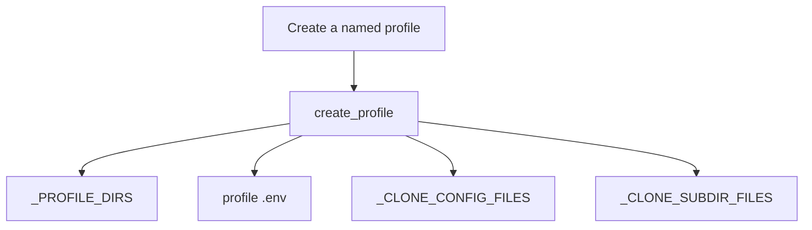

Sources: [hermes_cli/profiles.py:32-41](), [hermes_cli/profiles.py:96-101]()

`--clone-all` has separate exclusion rules for history and runtime state. The history exclusions include the session database and its SQLite sidecar files, session directories, backups, snapshots, checkpoints, and cron data. Additional default-profile exclusions cover infrastructure such as the checkout, worktrees, shared bins, and managed runtime trees. [hermes_cli/profiles.py:58-89]()

Sources: [hermes_cli/profiles.py:58-89]()

---

## Configuration Hierarchy and Resolution

The requested configuration order is **CLI arguments → `config.yaml` → `.env` → defaults**. The supplied excerpts do not include the implementation of CLI argument overlays or the `load_config()` definition, so they do not establish the full runtime resolution algorithm. The available tests do establish that `load_config()` returns defaults when no file exists, that the default configuration includes `model`, `agent.max_turns`, `terminal.backend`, and `display.interim_assistant_messages`, and that legacy root-level `max_turns` is normalized into `agent.max_turns`. [tests/hermes_cli/test_config.py:116-135]()

The `.env` loader is designed for use across entry points. Its implementation tracks dotenv-loaded names and externally supplied secret provenance, and it defines profile-managed environment keys whose values can affect provider routing. The profile placeholder states that API keys and tokens set in the profile `.env` override the shell environment. [hermes_cli/env_loader.py:1-18](), [hermes_cli/env_loader.py:32-48](), [hermes_cli/env_loader.py:86-93](), [hermes_cli/profiles.py:96-101]()

### Configuration inputs and code entities

**Diagram: settings and configuration code**

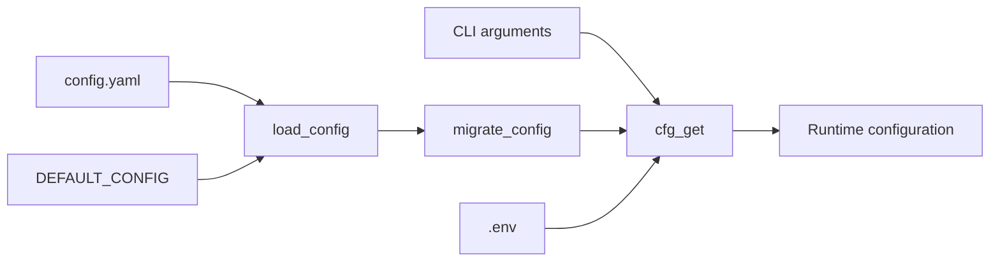

Sources: [tests/hermes_cli/test_config.py:12-33](), [tests/hermes_cli/test_config.py:116-135](), [hermes_cli/env_loader.py:1-18]()

### Configuration data flow

`config_migrations.py` reads raw configuration through `read_raw_config()` and persists migration changes through `hermes_cli.config._persist_migration()`. Its migration registry uses ordered version steps; migration commits can record added settings and print user-facing messages unless running quietly. [hermes_cli/config_migrations.py:1-7](), [hermes_cli/config_migrations.py:42-72]()

**Diagram: migration flow from raw settings to persisted configuration**

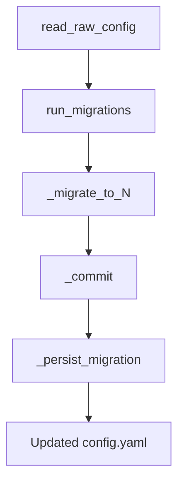

Sources: [hermes_cli/config_migrations.py:1-7](), [hermes_cli/config_migrations.py:42-72](), [hermes_cli/config_migrations.py:77-103]()

---

## Configuration Migrations

`config_migrations.py` implements a table-driven migration registry. Each step is named for its target version, and the registry owns the version gate and strict ascending order. Migration writes go through `_persist_migration()`; the module describes this persistence contract as writing values that differ from schema defaults, alongside removals and renames. [hermes_cli/config_migrations.py:1-7]()

The automatic migration support floor is version `12`. Configurations below that floor are not automatically migrated; the support-floor message advises backing up `config.yaml` and running `hermes setup`, or manually setting `_config_version` after reviewing the changelog. [hermes_cli/config_migrations.py:22-39]()

Examples shown in the registry include:

- **Version 12:** Converts legacy `custom_providers` entries into the `providers` mapping, derives keys from names or hostnames, avoids overwriting existing provider entries, and removes the old list after successful migration. [hermes_cli/config_migrations.py:116-169]()
- **Version 13:** Removes obsolete `LLM_MODEL` and `OPENAI_MODEL` values from `.env`; the migration comment identifies `config.yaml` as the model source of truth. [hermes_cli/config_migrations.py:174-181]()

`_rewrite_stale_default()` only rewrites a setting when its current value matches the old default, avoiding overwriting a user-customized value. `_commit()` persists the changed configuration and optionally records and reports the migration result. [hermes_cli/config_migrations.py:63-75](), [hermes_cli/config_migrations.py:77-109]()

Sources: [hermes_cli/config_migrations.py:1-7](), [hermes_cli/config_migrations.py:22-39](), [hermes_cli/config_migrations.py:63-109](), [hermes_cli/config_migrations.py:116-181]()

---

## Setup Wizard and Tool Configuration

The available excerpts do not include the setup wizard implementation or its command dispatcher, so this section does not assert its complete prompt sequence or write behavior. The migration support-floor message identifies `hermes setup` as a user-facing recovery path for configurations too old to migrate automatically. [hermes_cli/config_migrations.py:30-39]()

The supplied tool configuration module identifies `hermes tools` as a configuration surface. `tools_config.py` imports provider configuration, MCP configuration, and post-setup helpers, and defines a configurable toolset catalog covering categories such as web, browser, terminal, file operations, code execution, memory, delegation, and cron jobs. [hermes_cli/tools_config.py:18-35](), [hermes_cli/tools_config.py:65-94]()

The tool configuration data distinguishes default-off toolsets, including `video`, `video_gen`, `x_search`, `kanban`, and others, from configuration-only capabilities such as `stt`, which is not represented in `platform_toolsets`. [hermes_cli/tools_config.py:107-115]()

Sources: [hermes_cli/config_migrations.py:30-39](), [hermes_cli/tools_config.py:18-35](), [hermes_cli/tools_config.py:65-94](), [hermes_cli/tools_config.py:107-115]()

---

## Profiles: Multi-Instance Isolation and Identity

Profiles provide separate homes for Hermes instances. Each new profile bootstraps the directories listed in `_PROFILE_DIRS`, and its `.env` is seeded with a placeholder rather than copied credentials from another source. [hermes_cli/profiles.py:32-35](), [hermes_cli/profiles.py:96-101]()

The profile module’s clone configuration lists `config.yaml`, `.env`, and `SOUL.md` as files copied when present, and includes `memories/MEMORY.md` and `memories/USER.md` as curated subdirectory files. For `--clone-all`, runtime and history artifacts are excluded according to dedicated exclusion sets. [hermes_cli/profiles.py:37-41](), [hermes_cli/profiles.py:43-89]()

A fresh profile can inherit a usable model configuration from the default home; tests verify that both the `model` section and its provider definition can be carried over. [tests/hermes_cli/test_profiles.py:159-183]()

### Profile configuration workflow

**Diagram: profile bootstrap and optional clone inputs**

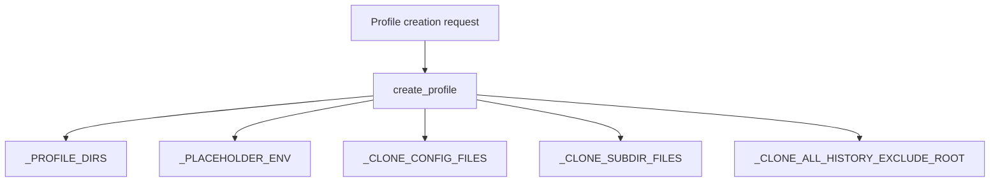

Sources: [hermes_cli/profiles.py:32-41](), [hermes_cli/profiles.py:43-89](), [hermes_cli/profiles.py:96-101]()

---

## Key Configuration Files

| File or directory | Location | Responsibility evidenced in the supplied files |
|---|---|---|
| `config.yaml` | Hermes home or profile root | Structured configuration. Migration code reads and rewrites it; profile cloning includes it. [hermes_cli/config_migrations.py:49-54](), [hermes_cli/profiles.py:37-41]() |
| `.env` | Hermes home or profile root | Environment variables and secrets. The profile placeholder describes API keys and tokens as profile-scoped values that override shell environment values. [hermes_cli/profiles.py:96-101]() |
| `SOUL.md` | Hermes home or profile root | Profile identity file; created by `ensure_hermes_home()` when absent and included in profile cloning. [tests/hermes_cli/test_config.py:47-52](), [hermes_cli/profiles.py:37-41]() |
| `auth.json` | Profile root | The profile clone-all comments identify it indirectly only through runtime context; its detailed schema and role are not shown in the supplied excerpts. [hermes_cli/profiles.py:43-56]() |
| `memories/MEMORY.md`, `memories/USER.md` | Profile root under `memories/` | Curated memory files included in the profile clone file list. [hermes_cli/profiles.py:37-41]() |
| `distribution.yaml` | Profile root | Profile-distribution manifest. The module defines the filename and parses it as a `DistributionManifest`. [hermes_cli/profile_distribution.py:32-34](), [hermes_cli/profile_distribution.py:153-162]() |
| `.env.template`, `.env.EXAMPLE` | Distribution source | Distribution-related environment template filenames. Their detailed install behavior is outside the supplied excerpt. [hermes_cli/profile_distribution.py:32-34]() |

Sources: [hermes_cli/config_migrations.py:49-54](), [hermes_cli/profile_distribution.py:32-34](), [hermes_cli/profile_distribution.py:153-162](), [hermes_cli/profiles.py:32-41](), [hermes_cli/profiles.py:43-56](), [hermes_cli/profiles.py:96-101](), [tests/hermes_cli/test_config.py:47-52]()

---

## Summary

The supplied implementation shows a configuration system centered on profile-specific homes, structured `config.yaml` settings, and profile-scoped `.env` files. Profiles bootstrap isolated directories and can clone selected configuration and identity files. [hermes_cli/profiles.py:32-41](), [hermes_cli/profiles.py:96-101]()

Configuration migrations are versioned and persisted through a common helper; migrations below the supported version floor are not automatic. The excerpts also show migration examples for custom providers and obsolete model environment variables. [hermes_cli/config_migrations.py:1-7](), [hermes_cli/config_migrations.py:22-39](), [hermes_cli/config_migrations.py:116-181]()

Sources: [hermes_cli/config_migrations.py:1-7](), [hermes_cli/config_migrations.py:22-39](), [hermes_cli/config_migrations.py:116-181](), [hermes_cli/profiles.py:32-41](), [hermes_cli/profiles.py:96-101]()

---

# Page: Authentication and Providers

# Authentication and Providers

<details>
<summary>Relevant source files</summary>

The following files were used as context for generating this wiki page:

- [agent/credential_pool.py](agent/credential_pool.py)
- [agent/credential_pool_admin.py](agent/credential_pool_admin.py)
- [agent/credential_pool_model_cooldowns.py](agent/credential_pool_model_cooldowns.py)
- [agent/fallback_cooldown.py](agent/fallback_cooldown.py)
- [agent/secret_scope.py](agent/secret_scope.py)
- [agent/secret_sources/__init__.py](agent/secret_sources/__init__.py)
- [agent/secret_sources/_cache.py](agent/secret_sources/_cache.py)
- [agent/secret_sources/base.py](agent/secret_sources/base.py)
- [agent/secret_sources/bitwarden.py](agent/secret_sources/bitwarden.py)
- [agent/secret_sources/command.py](agent/secret_sources/command.py)
- [agent/secret_sources/onepassword.py](agent/secret_sources/onepassword.py)
- [agent/secret_sources/registry.py](agent/secret_sources/registry.py)
- [contributors/emails/eversonx100@gmail.com](contributors/emails/eversonx100@gmail.com)
- [contributors/emails/kboxstar@gmail.com](contributors/emails/kboxstar@gmail.com)
- [cron/scheduler_script.py](cron/scheduler_script.py)
- [hermes_cli/AGENTS.md](hermes_cli/AGENTS.md)
- [hermes_cli/anon_auth.py](hermes_cli/anon_auth.py)
- [hermes_cli/anon_sign_in.py](hermes_cli/anon_sign_in.py)
- [hermes_cli/anon_sign_in_cli.py](hermes_cli/anon_sign_in_cli.py)
- [hermes_cli/auth.py](hermes_cli/auth.py)
- [hermes_cli/auth_codex.py](hermes_cli/auth_codex.py)
- [hermes_cli/auth_commands.py](hermes_cli/auth_commands.py)
- [hermes_cli/auth_device_flow.py](hermes_cli/auth_device_flow.py)
- [hermes_cli/auth_error_copy.py](hermes_cli/auth_error_copy.py)
- [hermes_cli/auth_nous.py](hermes_cli/auth_nous.py)
- [hermes_cli/auth_oauth_grants.py](hermes_cli/auth_oauth_grants.py)
- [hermes_cli/env_loader.py](hermes_cli/env_loader.py)
- [hermes_cli/free_tier_bootstrap.py](hermes_cli/free_tier_bootstrap.py)
- [hermes_cli/guest_handoff.py](hermes_cli/guest_handoff.py)
- [hermes_cli/observability/shared_metrics_disabled.py](hermes_cli/observability/shared_metrics_disabled.py)
- [hermes_cli/observability/shared_metrics_setup.py](hermes_cli/observability/shared_metrics_setup.py)
- [hermes_cli/observability/shared_metrics_signals.py](hermes_cli/observability/shared_metrics_signals.py)
- [hermes_cli/profile_channels.py](hermes_cli/profile_channels.py)
- [hermes_cli/proxy/adapters/__init__.py](hermes_cli/proxy/adapters/__init__.py)
- [hermes_cli/proxy/adapters/base.py](hermes_cli/proxy/adapters/base.py)
- [hermes_cli/proxy/adapters/nous_portal.py](hermes_cli/proxy/adapters/nous_portal.py)
- [hermes_cli/proxy/adapters/xai.py](hermes_cli/proxy/adapters/xai.py)
- [hermes_cli/proxy/cli.py](hermes_cli/proxy/cli.py)
- [hermes_cli/proxy/server.py](hermes_cli/proxy/server.py)
- [hermes_cli/proxy/sse_done.py](hermes_cli/proxy/sse_done.py)
- [hermes_cli/proxy_cli.py](hermes_cli/proxy_cli.py)
- [hermes_cli/psutil_android.py](hermes_cli/psutil_android.py)
- [hermes_cli/relaunch.py](hermes_cli/relaunch.py)
- [hermes_cli/relay_plugin_cutover.py](hermes_cli/relay_plugin_cutover.py)
- [hermes_cli/resource_limits.py](hermes_cli/resource_limits.py)
- [hermes_cli/subcommands/auth.py](hermes_cli/subcommands/auth.py)
- [hermes_cli/web_server_oauth.py](hermes_cli/web_server_oauth.py)
- [hermes_cli/welcome_trial.py](hermes_cli/welcome_trial.py)
- [tests/agent/test_codex_model_entitlement_rotation.py](tests/agent/test_codex_model_entitlement_rotation.py)
- [tests/agent/test_credential_pool.py](tests/agent/test_credential_pool.py)
- [tests/agent/test_credential_pool_connectors_guest.py](tests/agent/test_credential_pool_connectors_guest.py)
- [tests/agent/test_credential_pool_profile_oauth_fork.py](tests/agent/test_credential_pool_profile_oauth_fork.py)
- [tests/agent/test_env_loader_secret_sources.py](tests/agent/test_env_loader_secret_sources.py)
- [tests/agent/test_onepassword_secrets.py](tests/agent/test_onepassword_secrets.py)
- [tests/agent/test_provider_reset_cooldown.py](tests/agent/test_provider_reset_cooldown.py)
- [tests/agent/test_secret_scope.py](tests/agent/test_secret_scope.py)
- [tests/agent/test_secret_scope_env_cache.py](tests/agent/test_secret_scope_env_cache.py)
- [tests/cron/test_cron_multiplex_desktop_ticker_scope.py](tests/cron/test_cron_multiplex_desktop_ticker_scope.py)
- [tests/cron/test_cron_no_agent.py](tests/cron/test_cron_no_agent.py)
- [tests/cron/test_cron_script.py](tests/cron/test_cron_script.py)
- [tests/hermes_cli/anon_portal.py](tests/hermes_cli/anon_portal.py)
- [tests/hermes_cli/test_anon_auth_core.py](tests/hermes_cli/test_anon_auth_core.py)
- [tests/hermes_cli/test_anon_surfaces.py](tests/hermes_cli/test_anon_surfaces.py)
- [tests/hermes_cli/test_anon_upgrade.py](tests/hermes_cli/test_anon_upgrade.py)
- [tests/hermes_cli/test_auth_commands.py](tests/hermes_cli/test_auth_commands.py)
- [tests/hermes_cli/test_auth_nous_provider.py](tests/hermes_cli/test_auth_nous_provider.py)
- [tests/hermes_cli/test_auth_profile_fallback.py](tests/hermes_cli/test_auth_profile_fallback.py)
- [tests/hermes_cli/test_auth_toctou_file_modes.py](tests/hermes_cli/test_auth_toctou_file_modes.py)
- [tests/hermes_cli/test_codex_token_writethrough.py](tests/hermes_cli/test_codex_token_writethrough.py)
- [tests/hermes_cli/test_desktop_cron_ticker_gateway_standdown.py](tests/hermes_cli/test_desktop_cron_ticker_gateway_standdown.py)
- [tests/hermes_cli/test_desktop_cron_ticker_profiles.py](tests/hermes_cli/test_desktop_cron_ticker_profiles.py)
- [tests/hermes_cli/test_device_poll_waf_backoff.py](tests/hermes_cli/test_device_poll_waf_backoff.py)
- [tests/hermes_cli/test_env_loader.py](tests/hermes_cli/test_env_loader.py)
- [tests/hermes_cli/test_env_sanitize_on_load.py](tests/hermes_cli/test_env_sanitize_on_load.py)
- [tests/hermes_cli/test_global_auth_store_memo.py](tests/hermes_cli/test_global_auth_store_memo.py)
- [tests/hermes_cli/test_guest_handoff.py](tests/hermes_cli/test_guest_handoff.py)
- [tests/hermes_cli/test_guest_handoff_refresh.py](tests/hermes_cli/test_guest_handoff_refresh.py)
- [tests/hermes_cli/test_launchd_plist_guard.py](tests/hermes_cli/test_launchd_plist_guard.py)
- [tests/hermes_cli/test_nous_nonproduction_inference_host.py](tests/hermes_cli/test_nous_nonproduction_inference_host.py)
- [tests/hermes_cli/test_oauth_status_pool_observation.py](tests/hermes_cli/test_oauth_status_pool_observation.py)
- [tests/hermes_cli/test_profile_clone_channels.py](tests/hermes_cli/test_profile_clone_channels.py)
- [tests/hermes_cli/test_provider_precedence.py](tests/hermes_cli/test_provider_precedence.py)
- [tests/hermes_cli/test_proxy.py](tests/hermes_cli/test_proxy.py)
- [tests/hermes_cli/test_relaunch.py](tests/hermes_cli/test_relaunch.py)
- [tests/hermes_cli/test_resolve_provider_custom_endpoint.py](tests/hermes_cli/test_resolve_provider_custom_endpoint.py)
- [tests/hermes_cli/test_secret_source_bootstrap.py](tests/hermes_cli/test_secret_source_bootstrap.py)
- [tests/hermes_cli/test_shared_metrics_signals.py](tests/hermes_cli/test_shared_metrics_signals.py)
- [tests/hermes_cli/test_slash_confirm_windows.py](tests/hermes_cli/test_slash_confirm_windows.py)
- [tests/hermes_cli/test_welcome_trial.py](tests/hermes_cli/test_welcome_trial.py)
- [tests/scripts/test_powershell_script_syntax.py](tests/scripts/test_powershell_script_syntax.py)
- [tests/secret_sources/test_profile_secrets.py](tests/secret_sources/test_profile_secrets.py)
- [website/docs/developer-guide/cli-internals.md](website/docs/developer-guide/cli-internals.md)
- [website/docs/developer-guide/egress-internals.md](website/docs/developer-guide/egress-internals.md)
- [website/docs/developer-guide/secret-source-plugin.md](website/docs/developer-guide/secret-source-plugin.md)
- [website/docs/guides/cron-troubleshooting.md](website/docs/guides/cron-troubleshooting.md)
- [website/docs/user-guide/egress/iron-proxy.md](website/docs/user-guide/egress/iron-proxy.md)
- [website/docs/user-guide/features/credential-pools.md](website/docs/user-guide/features/credential-pools.md)
- [website/docs/user-guide/features/subscription-proxy.md](website/docs/user-guide/features/subscription-proxy.md)
- [website/docs/user-guide/secrets/index.md](website/docs/user-guide/secrets/index.md)
- [website/i18n/zh-Hans/docusaurus-plugin-content-docs/current/guides/cron-troubleshooting.md](website/i18n/zh-Hans/docusaurus-plugin-content-docs/current/guides/cron-troubleshooting.md)
- [website/i18n/zh-Hans/docusaurus-plugin-content-docs/current/user-guide/features/subscription-proxy.md](website/i18n/zh-Hans/docusaurus-plugin-content-docs/current/user-guide/features/subscription-proxy.md)

</details>


This page documents the authentication system that enables Hermes Agent to connect to Large Language Model (LLM) inference providers. It covers the provider registry, OAuth flows, API key management, credential storage, provider resolution logic, credential pooling, and external secret sources.

**Scope**: This page focuses on authentication and provider selection for the **primary inference provider**. For details about auxiliary models used by tools (e.g., vision analysis, web scraping, context compression), see [Auxiliary Client (4.5)]().

---

## Overview

Hermes Agent supports a wide range of inference providers through a unified authentication system that includes:

- **OAuth Device Code Flows**: Used primarily by Nous Portal, xAI, and MiniMax for browser-based device authorization. These flows manage user codes, polling, and token refresh cycles, implemented via `hermes_cli.auth` and related submodules like `auth_nous`, `auth_xai`, and `auth_minimax` [hermes_cli/auth.py:1-10]().
- **OAuth External Flows**: Used by OpenAI Codex, Qwen, and Google Gemini, which rely on external CLI helpers or browser redirects for authentication [hermes_cli/auth.py:77-88]().
- **API Key Authentication**: Traditional API key use with multiple providers like OpenRouter, Google AI Studio, Z.AI/GLM, Kimi/Moonshot, MiniMax, Alibaba, DeepSeek, and xAI [hermes_cli/auth.py:36-44]().
- **Anonymous Free-Tier Identity**: The `anonymous` auth method of the `nous` provider (`hermes_cli.anon_auth`), minting ephemeral guest credentials and exchanging them for short-lived JWTs to provide out-of-the-box free inference and connector support [hermes_cli/anon_auth.py:1-13]().
- **Credential Pooling and Rotation**: Management of multiple credentials for the same provider with failover, status tracking, and automatic rotation using the `CredentialPool` system [agent/credential_pool.py:1-53]().
- **Secret Injection from External Sources**: Dynamic injection of credentials from external secret stores such as Bitwarden or 1Password via the `agent.secret_scope` module, enabling seamless integration and credential management without modifying global environment variables [agent/secret_scope.py:22-23]().
- **Provider Resolution Chain**: A layered approach that picks the active provider and credentials based on explicit input, configuration, environment variables, or autodetection heuristics.

Sources: [hermes_cli/auth.py:1-10](), [hermes_cli/auth.py:77-88](), [hermes_cli/auth.py:36-44](), [hermes_cli/anon_auth.py:1-13](), [agent/credential_pool.py:1-53](), [agent/secret_scope.py:22-23]().

---

## Provider Registry and Profiles

Hermes Agent keeps a comprehensive **provider registry** via the `PROVIDER_REGISTRY` mapping and `ProviderConfig` dataclass in `hermes_cli.auth` [hermes_cli/auth.py:3](). This registry describes known inference providers with metadata necessary for runtime resolution and authentication, including:

- **Transport Protocol Identifiers**: Tags such as `openai_chat`, `anthropic_messages`, `codex_responses` guide how requests/responses are formatted and handled.
- **Authentication Type**: Designations like `api_key`, `oauth_device_code`, `oauth_external`, or `external_process`.
- **Default and Overrideable Inference Base URLs**: URLs used for API calls, often overrideable by environment variables or config.
- **Aggregator Flags**: Identifies meta providers like MOA presets or OpenRouter aggregator proxies.
- **Anonymous or Keyless Mode Support**: Indicates if a provider allows unauthenticated queries or read-only modes.

### Common Providers and Their Authentication

| Provider ID | Authentication Scheme | Typical Env Vars / Credentials | Notes |
|---|---|---|---|
| `nous` | OAuth Device Code / Anonymous | Internal token management via device_code or `anon_` free-tier exchange | Access to Nous Portal models via `auth_nous` and `anon_auth` |
| `openai-codex` | OAuth External | Managed externally via CLI/browser helpers | OpenAI-compatible OAuth flow for Codex |
| `anthropic` | API Key or OAuth | `ANTHROPIC_API_KEY`, OAuth tokens | Supports both API key and OAuth |
| `openrouter` | API Key | `OPENROUTER_API_KEY` | Aggregator for many open-source providers |
| `xai-oauth` | OAuth Device Code | Internal token management via device_code flows | xAI direct OAuth device code via `auth_xai` |
| `minimax-oauth` | OAuth External | Internal storage | MiniMax OAuth token polling and refresh |
| Custom | API Key or external | Custom environment variables (configurable) | User-defined provider extensions |

Sources: [hermes_cli/auth.py:1-10](), [hermes_cli/anon_auth.py:1-13]().

---

## Provider Resolution Chain

Provider resolution is primarily handled by the `resolve_provider()` function in `hermes_cli.auth.py` [hermes_cli/auth.py:7](). It follows a prioritized resolution sequence that considers:

1. Explicit provider parameters passed to CLI commands or API calls.
2. Provider settings from configuration YAML (`config.yaml`).
3. Environment variables scoped to the active profile.
4. Auto-detection heuristics and fallback mechanisms, including anonymous free-tier fallbacks where applicable.

Based on the resolved provider ID, Hermes fetches credentials from one of several authentication flows:

- Device code OAuth providers resolve credentials via code-managed token stores.
- OAuth external providers use external CLI or browser token stores.
- API key providers resolve from config or environment.

### Key Functions and Classes in Resolution

| Name | Description | Source Location |
|---|---|---|
| `resolve_provider()` | Determine active LLM provider ID from inputs and configuration | `hermes_cli/auth.py:7` |
| `CredentialPool` | Load and manage multiple credentials for a provider with status | `agent/credential_pool.py:1-161` |
| `_load_auth_store()` / `_save_auth_store()` | Load and save `auth.json` credential data with atomic file locking | `hermes_cli/auth.py:4-6` |
| `resolve_nous_runtime_credentials()` | Resolve runtime credentials via Nous device code OAuth | `hermes_cli/auth.py:64` |
| `resolve_codex_runtime_credentials()` | Resolve runtime credentials via OpenAI Codex OAuth external flow | `hermes_cli/auth.py:83` |
| `ensure_guest_identity()` | Provision or reconcile anonymous guest credentials for free-tier access | `hermes_cli/anon_auth.py:1-13` |

### Provider Resolution Flow Diagram

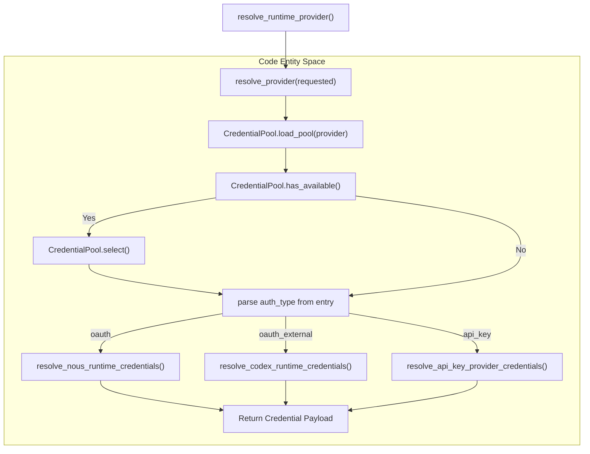
**Figure: Provider resolution flow.**

Sources: [hermes_cli/auth.py:1-10](), [agent/credential_pool.py:1-161](), [hermes_cli/auth.py:4-6](), [hermes_cli/auth.py:64](), [hermes_cli/auth.py:83]().

---

## Credential Pool and Rotation

The `CredentialPool` in `agent.credential_pool` maintains multiple credentials for the same provider, allowing for automatic failover and rotation [agent/credential_pool.py:1-53](). It manages:

- **Credential Metadata & Status:** Credentials have states such as `STATUS_OK` (usable), `STATUS_EXHAUSTED` (temporarily unusable, e.g., rate limited), and `STATUS_DEAD` (terminally invalid and excluded from rotation) [agent/credential_pool.py:81-88]().
- **Exhaustion Cooldowns:** Implements cooldown TTLs that vary by HTTP status (e.g., 401, 429, 402) with longer waits on serious failures and shorter waits for transient throttles [agent/credential_pool.py:130-139]().
- **Rotation Strategies:** Credential selection can use different strategies:

| Strategy | Description | Reference Source |
|---|---|---|
| `fill_first` | Always use highest priority credential until exhaustion | [agent/credential_pool.py:118]() |
| `round_robin` | Rotate credentials cyclically | [agent/credential_pool.py:119]() |
| `random` | Randomly pick among available keys | [agent/credential_pool.py:120]() |
| `least_used` | Select the least used or least recently exhausted credential | [agent/credential_pool.py:121]() |

- **Terminal Auth Failure Reasons:** Recognizes certain OAuth error reasons such as `"token_invalidated"`, `"token_revoked"`, or `"refresh_token_reused"` to mark credentials dead and prevent futile retries [agent/credential_pool.py:91-98]().
- **Persistence:** All credential pool state (credentials, statuses, priorities) is persisted to the `~/.hermes/auth.json` file with safe cross-process locked writes to avoid corruption [hermes_cli/auth.py:4-6]().

Sources: [agent/credential_pool.py:1-53](), [agent/credential_pool.py:81-88](), [agent/credential_pool.py:130-139](), [agent/credential_pool.py:118-121](), [agent/credential_pool.py:91-98](), [hermes_cli/auth.py:4-6]().

---

## Authentication Implementation Details

### OAuth Device Code Flow and External Grants

- Device code OAuth flows (Nous, xAI, MiniMax) run interactive device authorization sequences that prompt users to visit a URL and enter a code. They manage polling for token issuance, token refresh, and token persistence. These mechanisms are implemented inside `hermes_cli.auth_nous`, `auth_xai`, and `auth_minimax` [hermes_cli/auth.py:50-70]().
- External OAuth providers like OpenAI Codex and Qwen implement OAuth using external CLI or browser login helpers that persist tokens in local stores. Hermes imports these tokens into its internal credential pool for runtime usage and refresh [hermes_cli/auth.py:77-88]().
- These flows also include enhanced logic for error quarantine, token healing, and refresh token management ensuring stable continuous authentication in concurrent and multi-profile scenarios.
- The single-use OAuth pattern requires meticulous cloning protection: single-use refresh tokens are never forked into named profiles to prevent reuse errors. This hygiene is implemented via `hermes_cli.auth_oauth_grants` [hermes_cli/auth_oauth_grants.py:1-156]().

### API Key Authentication

API key authentication is simple but supports multi-key rotation and status management. Keys can be specified in config files, environment variables, or credential pools. The system supports auto-detecting environment-based credentials as single-entry pools for bootstrap scenarios.

- The provider registry defines the env var keys that map to API keys.
- Keys injected from external secret sources are treated identically to manual or config-file credentials.
- If rate limits or billing errors occur, the offending key is marked exhausted and the pool rotates to alternate keys.

### Secret Injection and External Secret Sources

Hermes supports injecting secrets dynamically from external secret sources, isolating credentials by profile without global pollution of `os.environ`. This mechanism is implemented in `agent.secret_scope.py` and supports plugins:

- Bitwarden (`agent.secret_sources.bitwarden`)
- 1Password (`agent.secret_sources.onepassword`)
- Command-based secrets and caching are supported as well.

Secret injection integrates with `load_env()` [hermes_cli/env_loader.py:17]() which is used during config loading and runtime provider resolution to hydrate environment variables transparently from secret stores. The system caches loaded secrets per Hermes home path and profile. This preserves the multiplexed gateway security boundary where credentials must remain isolated in memory even if multiple profiles run concurrently in one process.

Sources: [hermes_cli/auth.py:50-70](), [hermes_cli/auth.py:77-88](), [agent/credential_pool.py:22](), [hermes_cli/auth_oauth_grants.py:1-156](), [hermes_cli/env_loader.py:17]().

---

## Auxiliary Provider Resolution

The auxiliary client system (`agent.auxiliary_client`) orchestrates the selection of LLM providers for auxiliary tasks such as vision, compression, and web extraction. Its provider resolution employs a tiered fallback chain similar to the primary provider but with domain-specific priorities:

- Starts from configured auxiliary provider, falling back through:
  - The primary provider's configured model.
  - OpenRouter as an aggregator.
  - Nous Portal for any Nous models.
  - Custom API endpoints.
  - Native Anthropic endpoint.
  - Raw API key providers.
- The vision subsystem similarly selects preferred vision backends with fallback lists.
- This ensures tools can operate reliably even when some providers fail or are unavailable.

Sources: [hermes_cli/auth.py:62-64]()

---

## Data Flow: Credential Storage and Persistence

This diagram maps how various authentication-related data files associate to in-code loaders and usage within Hermes Agent.

```mermaid
graph LR
    subgraph StorageSpace["Storage and Config Files"]
        AuthFile["~/.hermes/auth.json (Auth Store)"]
        EnvFile[".env (Hermes Home per-profile)"]
        ConfigYAML["config.yaml (Providers, Profiles)"]
    end

    subgraph CodeEntitySpace["Hermes Code Entities"]
        AuthLoader["_load_auth_store() / _save_auth_store()"]
        EnvLoader["load_env() / get_secret()"]
        ConfigLoader["load_config()"]
        CredentialPool["CredentialPool.load_pool()"]
    end

    AuthFile -- "JSON storing credential pool and provider states" --> AuthLoader
    EnvFile -- "Environment variables and secret injection" --> EnvLoader
    ConfigYAML -- "YAML configuration including provider entries" --> ConfigLoader
    AuthLoader -- "Credential data" --> CredentialPool
```

**Figure: Mapping of storage files to code modules handling authentication state and secrets.**

Sources: [hermes_cli/auth.py:4-6](), [agent/credential_pool.py:21](), [hermes_cli/env_loader.py:17]().

---

## Summary Diagram Bridging Natural Language Concepts to Code

```mermaid
graph TD
    NL_Space["Natural Language Space"]

    NL_Space -->|uses credentials & tokens stored in| AuthStore["~/.hermes/auth.json (Auth Store)"]
    NL_Space -->|configured via config files and env| ConfigSpace["config.yaml & environment variables"]

    AuthStore -->|loaded & saved by| AuthLoad["_load_auth_store() / _save_auth_store()"]
    ConfigSpace -->|loaded by| ConfigLoad["load_config()"]
    AuthLoad -->|populates| CredentialPool["CredentialPool (credential rotation & status)"]
    ConfigLoad -->|populates| ProviderRegistry["PROVIDER_REGISTRY & ProviderConfig"]

    CredentialPool -->|used by| RuntimeResolver["resolve_provider()"]
    ProviderRegistry -->|provides metadata for| RuntimeResolver

    RuntimeResolver -->|calls| OAuthNous["resolve_nous_runtime_credentials() (Device Code OAuth)"]
    RuntimeResolver -->|calls| OAuthCodex["resolve_codex_runtime_credentials() (External OAuth)"]
    RuntimeResolver -->|calls| APIKeyResolver["resolve_api_key_provider_credentials() (API Keys)"]

    OAuthNous -->|tokens stored back in| AuthStore
    OAuthCodex -->|tokens stored back in| AuthStore
    APIKeyResolver -->|reads keys from| SecretScope["get_secret() (including external secret sources)"]
```

**Figure: Mapping natural language provider/authentication concepts to Hermes code entities and storage mechanisms**

Sources: [hermes_cli/auth.py:4-6](), [hermes_cli/auth.py:7](), [hermes_cli/auth.py:64](), [hermes_cli/auth.py:83](), [hermes_cli/auth.py:2490](), [agent/credential_pool.py:22]().

---

# References

- Multi-provider authentication: `hermes_cli/auth.py` [1-10](), [hermes_cli/auth.py:36-44](), [hermes_cli/auth.py:50-70](), [hermes_cli/auth.py:77-88]()
- Credential pool management: `agent/credential_pool.py` [1-53]()
- Environment loading and secret injection: `hermes_cli/env_loader.py` [17]()
- Anonymous auth & free tier: `hermes_cli/anon_auth.py` [1-13]()
- Auxiliary client provider resolution: `hermes_cli/auth.py` [62-64]()
- Provider runtime resolution logic: `hermes_cli/auth.py` [7]()
- Provider registry & metadata: `hermes_cli/auth.py` [3]()

---

# End of 2.3 Authentication and Providers

---

# Page: Model Selection and Management

# Model Selection and Management

<details>
<summary>Relevant source files</summary>

The following files were used as context for generating this wiki page:

- [agent/image_routing.py](agent/image_routing.py)
- [agent/insights.py](agent/insights.py)
- [agent/moa_loop.py](agent/moa_loop.py)
- [agent/model_metadata.py](agent/model_metadata.py)
- [agent/models_dev.py](agent/models_dev.py)
- [agent/reasoning_effort.py](agent/reasoning_effort.py)
- [agent/reasoning_timeouts.py](agent/reasoning_timeouts.py)
- [agent/usage_pricing.py](agent/usage_pricing.py)
- [apps/desktop/src/app/settings/model-settings.test.tsx](apps/desktop/src/app/settings/model-settings.test.tsx)
- [apps/desktop/src/app/settings/model-settings.tsx](apps/desktop/src/app/settings/model-settings.tsx)
- [contributors/emails/daniil.grois@gmail.com](contributors/emails/daniil.grois@gmail.com)
- [contributors/emails/elisam@nvidia.com](contributors/emails/elisam@nvidia.com)
- [contributors/emails/kevinbanjo@gmail.com](contributors/emails/kevinbanjo@gmail.com)
- [evals/cli_deferred_notice.py](evals/cli_deferred_notice.py)
- [hermes_cli/backup.py](hermes_cli/backup.py)
- [hermes_cli/backup_restore.py](hermes_cli/backup_restore.py)
- [hermes_cli/banner.py](hermes_cli/banner.py)
- [hermes_cli/cli_auto_maintenance.py](hermes_cli/cli_auto_maintenance.py)
- [hermes_cli/codex_models.py](hermes_cli/codex_models.py)
- [hermes_cli/inventory.py](hermes_cli/inventory.py)
- [hermes_cli/local_runtime/capabilities.py](hermes_cli/local_runtime/capabilities.py)
- [hermes_cli/moa_cmd.py](hermes_cli/moa_cmd.py)
- [hermes_cli/moa_config.py](hermes_cli/moa_config.py)
- [hermes_cli/model_catalog.py](hermes_cli/model_catalog.py)
- [hermes_cli/model_cost_guard.py](hermes_cli/model_cost_guard.py)
- [hermes_cli/model_search.py](hermes_cli/model_search.py)
- [hermes_cli/model_selection_guards.py](hermes_cli/model_selection_guards.py)
- [hermes_cli/model_switch.py](hermes_cli/model_switch.py)
- [hermes_cli/model_switch_providers.py](hermes_cli/model_switch_providers.py)
- [hermes_cli/models.py](hermes_cli/models.py)
- [hermes_cli/models_catalog_static.py](hermes_cli/models_catalog_static.py)
- [hermes_cli/models_local.py](hermes_cli/models_local.py)
- [hermes_cli/models_pricing.py](hermes_cli/models_pricing.py)
- [hermes_cli/models_profile_cache.py](hermes_cli/models_profile_cache.py)
- [hermes_cli/models_reasoning_caps.py](hermes_cli/models_reasoning_caps.py)
- [hermes_cli/models_validate.py](hermes_cli/models_validate.py)
- [scripts/build_model_catalog.py](scripts/build_model_catalog.py)
- [scripts/dump_desktop_slash_registry.py](scripts/dump_desktop_slash_registry.py)
- [scripts/gen-bootstrap-pins.py](scripts/gen-bootstrap-pins.py)
- [scripts/gen_gateway_contracts.py](scripts/gen_gateway_contracts.py)
- [tests/agent/test_astra_baseline_runtime.py](tests/agent/test_astra_baseline_runtime.py)
- [tests/agent/test_cache_disabled_on_stubs.py](tests/agent/test_cache_disabled_on_stubs.py)
- [tests/agent/test_capability_probe_credentials.py](tests/agent/test_capability_probe_credentials.py)
- [tests/agent/test_image_routing.py](tests/agent/test_image_routing.py)
- [tests/agent/test_insights.py](tests/agent/test_insights.py)
- [tests/agent/test_model_metadata.py](tests/agent/test_model_metadata.py)
- [tests/agent/test_model_metadata_local_ctx.py](tests/agent/test_model_metadata_local_ctx.py)
- [tests/agent/test_models_dev.py](tests/agent/test_models_dev.py)
- [tests/agent/test_openai_ultrafast.py](tests/agent/test_openai_ultrafast.py)
- [tests/agent/test_probe_cache_followups.py](tests/agent/test_probe_cache_followups.py)
- [tests/agent/test_reasoning_effort_module.py](tests/agent/test_reasoning_effort_module.py)
- [tests/agent/test_reasoning_stale_timeout_floor.py](tests/agent/test_reasoning_stale_timeout_floor.py)
- [tests/agent/test_usage_pricing.py](tests/agent/test_usage_pricing.py)
- [tests/gateway/test_model_command_async_offload.py](tests/gateway/test_model_command_async_offload.py)
- [tests/gateway/test_model_command_custom_providers.py](tests/gateway/test_model_command_custom_providers.py)
- [tests/hermes_cli/test_backup.py](tests/hermes_cli/test_backup.py)
- [tests/hermes_cli/test_banner.py](tests/hermes_cli/test_banner.py)
- [tests/hermes_cli/test_cli_new_session.py](tests/hermes_cli/test_cli_new_session.py)
- [tests/hermes_cli/test_codex_cli_model_picker.py](tests/hermes_cli/test_codex_cli_model_picker.py)
- [tests/hermes_cli/test_codex_models.py](tests/hermes_cli/test_codex_models.py)
- [tests/hermes_cli/test_context_cache_switch_guard.py](tests/hermes_cli/test_context_cache_switch_guard.py)
- [tests/hermes_cli/test_custom_provider_model_switch.py](tests/hermes_cli/test_custom_provider_model_switch.py)
- [tests/hermes_cli/test_desktop_slash_registry.py](tests/hermes_cli/test_desktop_slash_registry.py)
- [tests/hermes_cli/test_inventory.py](tests/hermes_cli/test_inventory.py)
- [tests/hermes_cli/test_inventory_pricing.py](tests/hermes_cli/test_inventory_pricing.py)
- [tests/hermes_cli/test_list_picker_providers.py](tests/hermes_cli/test_list_picker_providers.py)
- [tests/hermes_cli/test_local_models_activate_rescan.py](tests/hermes_cli/test_local_models_activate_rescan.py)
- [tests/hermes_cli/test_managed_vision_capability.py](tests/hermes_cli/test_managed_vision_capability.py)
- [tests/hermes_cli/test_moa_config.py](tests/hermes_cli/test_moa_config.py)
- [tests/hermes_cli/test_model_catalog.py](tests/hermes_cli/test_model_catalog.py)
- [tests/hermes_cli/test_model_cost_guard.py](tests/hermes_cli/test_model_cost_guard.py)
- [tests/hermes_cli/test_model_search_alias_dedup.py](tests/hermes_cli/test_model_search_alias_dedup.py)
- [tests/hermes_cli/test_model_switch_custom_providers.py](tests/hermes_cli/test_model_switch_custom_providers.py)
- [tests/hermes_cli/test_model_validation.py](tests/hermes_cli/test_model_validation.py)
- [tests/hermes_cli/test_model_validation_managed_local.py](tests/hermes_cli/test_model_validation_managed_local.py)
- [tests/hermes_cli/test_models.py](tests/hermes_cli/test_models.py)
- [tests/hermes_cli/test_models_dev_preferred_merge.py](tests/hermes_cli/test_models_dev_preferred_merge.py)
- [tests/hermes_cli/test_multiplex_cli_cache_scope.py](tests/hermes_cli/test_multiplex_cli_cache_scope.py)
- [tests/hermes_cli/test_nous_picker_on_sale.py](tests/hermes_cli/test_nous_picker_on_sale.py)
- [tests/hermes_cli/test_nous_reasoning_metadata.py](tests/hermes_cli/test_nous_reasoning_metadata.py)
- [tests/hermes_cli/test_ollama_cloud_provider.py](tests/hermes_cli/test_ollama_cloud_provider.py)
- [tests/hermes_cli/test_opencode_go_in_model_list.py](tests/hermes_cli/test_opencode_go_in_model_list.py)
- [tests/hermes_cli/test_provider_live_curated_merge.py](tests/hermes_cli/test_provider_live_curated_merge.py)
- [tests/hermes_cli/test_reasoning_caps_disk_cache.py](tests/hermes_cli/test_reasoning_caps_disk_cache.py)
- [tests/hermes_cli/test_restore_source_integrity.py](tests/hermes_cli/test_restore_source_integrity.py)
- [tests/hermes_cli/test_sale_pricing.py](tests/hermes_cli/test_sale_pricing.py)
- [tests/hermes_cli/test_setup_provider_catalog.py](tests/hermes_cli/test_setup_provider_catalog.py)
- [tests/hermes_cli/test_snapshot_restore_oauth.py](tests/hermes_cli/test_snapshot_restore_oauth.py)
- [tests/hermes_cli/test_tencent_tokenhub_provider.py](tests/hermes_cli/test_tencent_tokenhub_provider.py)
- [tests/hermes_cli/test_user_providers_model_switch.py](tests/hermes_cli/test_user_providers_model_switch.py)
- [tests/tools/test_startup_latency_regressions.py](tests/tools/test_startup_latency_regressions.py)
- [tests/tools/test_subagent_steer.py](tests/tools/test_subagent_steer.py)
- [tests/tui_gateway/contracts/__init__.py](tests/tui_gateway/contracts/__init__.py)
- [tests/tui_gateway/test_session_create_model_provider_guard.py](tests/tui_gateway/test_session_create_model_provider_guard.py)
- [tui_gateway/contracts/__init__.py](tui_gateway/contracts/__init__.py)
- [tui_gateway/contracts/base.py](tui_gateway/contracts/base.py)
- [tui_gateway/contracts/registry.py](tui_gateway/contracts/registry.py)
- [tui_gateway/methods_session_model_guard.py](tui_gateway/methods_session_model_guard.py)
- [website/docs/reference/model-catalog.md](website/docs/reference/model-catalog.md)
- [website/docs/user-guide/configuring-models.md](website/docs/user-guide/configuring-models.md)
- [website/docs/user-guide/features/mixture-of-agents.md](website/docs/user-guide/features/mixture-of-agents.md)
- [website/i18n/zh-Hans/docusaurus-plugin-content-docs/current/reference/model-catalog.md](website/i18n/zh-Hans/docusaurus-plugin-content-docs/current/reference/model-catalog.md)
- [website/static/api/model-catalog.json](website/static/api/model-catalog.json)

</details>


This page details the implementation and data flow for model selection, validation, context length discovery, pricing/usage metadata, and the model catalog system within Hermes Agent. It explains how Hermes manages diverse LLM providers, normalizes model identifiers, pools credentials for provider failover, dynamically discovers model context lengths, and uses curated and live model catalogs to present viable model options.

---

## Model Catalog System

Hermes employs a multi-tiered model catalog system combining curated snapshots, a community-maintained registry, live API discovery, and user-defined providers to provide updated, validated, and context-aware model listings.

### The models.dev Registry and Static Catalogs

The central metadata source is the `models.dev` registry, managed and queried through the `agent/models_dev.py` module. Each model is represented by the `ModelInfo` dataclass containing detailed metadata such as:

- Capabilities (reasoning levels, tool calling)
- Supported modal types (text, vision, code)
- Context/input and output token limits
- Pricing info and experimental status

Provider metadata is similarly captured by `ProviderInfo` dataclasses describing environment variables, API endpoints, documentation links, and per-model counts [agent/models_dev.py:39-97]().

In addition to live data, Hermes ships and caches curated static catalogs for pickers and CLI defaults, such as the snapshot in `website/static/api/model-catalog.json`. This JSON catalog lists providers with their models, default flags, and textual descriptions aimed at guiding user selection (including badges such as "free" or "recommended") [website/static/api/model-catalog.json:1-252](). Internally, the `hermes_cli/models.py` module provides layered access to these curated registries and manages cache lifecycles and TTLs via functions like `_openrouter_catalog_disk_ttl()` and `_read_openrouter_catalog_disk()` [hermes_cli/models.py:156-181](). It proactively caches and merges catalogs from live sources like OpenRouter and Vercel AI Gateway, storing results to disk with TTL-based expiration for efficiency [hermes_cli/models.py:80-96]().

Live catalogs are refreshed asynchronously and merged with static data. This enables dynamic inclusion of new models, expert-curated defaults, and provider-specific feature flags, while ensuring consistent user experience across restarts and profile switches.

### Diagram: Catalog Resolution & Natural Language to Code Entity Space

```mermaid
graph TD
    subgraph "NaturalLanguageSpace"
        UserChoice["User Model Selection (/model)"]
        PresetChoice["Mixture-of-Agents Preset (/moa)"]
    end

    subgraph "CodeEntitySpace"
        SwitchModel["hermes_cli/model_switch.py:switch_model()"]
        ResolveFull["hermes_cli/providers.py:resolve_provider_full()"]
        GetModelInfo["agent/models_dev.py:get_model_info()"]
        FetchJson["hermes_cli/models.py:_get_json()"]
    end

    subgraph "StorageAndRegistry"
        StaticCatalog["website/static/api/model-catalog.json"]
        ModelsDev["agent/models_dev.py"]
    end

    UserChoice --> SwitchModel
    PresetChoice --> SwitchModel
    SwitchModel --> ResolveFull
    ResolveFull --> GetModelInfo
    GetModelInfo --> ModelsDev
    FetchJson --> StaticCatalog
```

**Sources:**  
[website/static/api/model-catalog.json:1-252](), [hermes_cli/models.py:80-181](), [hermes_cli/model_switch.py:29-56](), [agent/models_dev.py:39-97]()

---

## Model Selection and Normalization

Hermes performs provider-aware model normalization to ensure compatibility with diverse transport APIs, naming conventions, and credential contexts. This process is critical because model identifiers often include provider prefixes, variant tags, or alias shorthands that must be translated into canonical internal forms.

### Provider-Aware Model Normalization

Normalization rules vary by provider type:

| Provider Type        | Normalization Logic                                                                                      | Code Reference                         |
|----------------------|--------------------------------------------------------------------------------------------------------|--------------------------------------|
| **Aggregators**       | Preserve vendor prefix as a routing hint (e.g., OpenRouter models like `anthropic/claude-opus-4.6`)     | `hermes_cli/model_switch.py:29-151` |
| **Ollama**            | Strips `local:` provider prefix if suffix is not an Ollama-specific version tag (e.g., `:latest`)     | `agent/model_metadata.py:49-62`      |
| **Custom Providers**  | Support stable keys with aliases resolving to canonical internal IDs, often requiring direct `base_url`| `hermes_cli/providers.py:28-92`      |

Aliases such as `"sonnet"` or `"gpt"` are resolved dynamically against the live `models.dev` catalog, using the `MODEL_ALIASES` dictionary that maps shorthand names to vendor/family pairs (`ModelIdentity`), ensuring consistent selection and fallback [hermes_cli/model_switch.py:140-151]().

### Model Switcher Pipeline

The core of model selection is implemented in `hermes_cli/model_switch.py`. It follows these steps:

1.  **Parsing input:** Accepts string, list, or dictionary inputs to extract model IDs via `_declared_model_ids()`, supporting older formats and alias shorthands [hermes_cli/model_switch.py:30-50]().

2.  **Alias resolution:** Replaces short names with canonical vendor-family prefixes [hermes_cli/model_switch.py:140-151]().

3.  **Provider resolution:** Maps provider aliases and names to a complete `ProviderDef` dataclass including API mode, transport, and authentication types via `resolve_provider_full()` [hermes_cli/providers.py:16-19]().

4.  **Model normalization:** Uses `normalize_model_for_provider()` to transform model names depending on provider transport and conventions [hermes_cli/model_switch.py:19-19]().

5.  **Agent warning checks:** Uses regexes (`_NOUS_HERMES_NON_AGENTIC_RE`) in `is_nous_hermes_non_agentic()` and `_check_hermes_model_warning()` to detect non-agentic Nous Hermes base models and warns users that these lack tool-calling capabilities (`_HERMES_MODEL_WARNING`) [hermes_cli/model_switch.py:100-135]().

### Diagram: Model Selection Execution Flow

```mermaid
graph LR
    subgraph "NaturalLanguageSpace"
        InputModel["User Selected Model Name"]
    end

    subgraph "CodeEntitySpace"
        SwitchFn["hermes_cli/model_switch.py:_declared_model_ids()"]
        ResolveProv["hermes_cli/providers.py:resolve_provider_full()"]
        NormFn["hermes_cli/model_normalize.py:normalize_model_for_provider()"]
        CheckAgentic["hermes_cli/model_switch.py:is_nous_hermes_non_agentic()"]
    end

    InputModel --> SwitchFn
    SwitchFn --> ResolveProv
    SwitchFn --> NormFn
    SwitchFn --> CheckAgentic
```

**Sources:**  
[hermes_cli/model_switch.py:30-151](), [hermes_cli/model_normalize.py:15-32](), [hermes_cli/model_switch.py:100-135]()

---

## Context Length Discovery and Token Estimation

To avoid request errors caused by exceeding model context windows, Hermes dynamically discovers and caches context length limits per model.

### Context Length Resolution Priority

The key functions in `agent/model_metadata.py` implement context-length discovery with caching and TTL management:

1.  **Models.dev registry lookup:** Cached or live context length metadata keyed by vendor/family or full model ID is returned when available [agent/model_metadata.py:65-72]().

2.  **Endpoint probes:** If the model is attached to a live HTTP endpoint supporting OpenAI-compatible `/models` metadata, this endpoint is asynchronously queried for up-to-date context lengths, utilizing `_endpoint_model_metadata_cache` with a TTL of 300 seconds (`_ENDPOINT_MODEL_CACHE_TTL`) [agent/model_metadata.py:68-72]().

3.  **Blackhole and Timeout Handling:** Endpoints that experience TCP connect timeouts are tracked via `_note_endpoint_blackholed()` and `_endpoint_blackholed()` to short-circuit repeated failed probe attempts for `_ENDPOINT_BLACKHOLE_TTL_SECONDS` (30s) [agent/model_metadata.py:109-128]().

4.  **Error parsing for token limit:** If prior requests fail due to context limit errors, Hermes parses error strings with `parse_context_limit_from_error()` to extract explicit context max limits [tests/agent/test_model_metadata.py:28-30]().

### Token Estimation Utilities

Hermes provides rough token estimators to aid context budgeting and prompt compression:

-   `estimate_tokens_rough()`: Estimates token count from a text string by dividing length by an approximate token-to-character ratio, returning `0` for empty strings [tests/agent/test_model_metadata.py:54-56]().

-   `estimate_messages_tokens_rough()`: Computes token counts for chat messages considering roles, tool calls (even without content keys), and multimodal content like images counted at a flat ~1500 token weight [tests/agent/test_model_metadata.py:62-113]().

-   Handles `api_content` sidecar substitution logic, ensuring sidecar sizing is counted correctly when present without double-counting standard content [tests/agent/test_model_metadata.py:115-159]().

### Diagram: Context Length Discovery Data Flow

```mermaid
graph LR
    subgraph "NaturalLanguageSpace"
        RequestError["Request Token Overflow Error Message"]
        UserModel["User Specified Model"]
    end

    subgraph "CodeEntitySpace"
        GetCtxLength["agent/model_metadata.py:fetch_endpoint_model_metadata()"]
        ParseError["agent/model_metadata.py:parse_context_limit_from_error()"]
        BlackholeCheck["agent/model_metadata.py:_endpoint_blackholed()"]
        CacheTTL["agent/model_metadata.py:_ENDPOINT_MODEL_CACHE_TTL"]
    end

    UserModel --> GetCtxLength
    GetCtxLength --> BlackholeCheck
    RequestError --> ParseError
    ParseError --> GetCtxLength
    BlackholeCheck --> CacheTTL
```

**Sources:**  
[agent/model_metadata.py:65-128](), [tests/agent/test_model_metadata.py:28-30](), [tests/agent/test_model_metadata.py:54-159]()

---

## Pricing, Usage Metadata, and Auxiliary Resolution

Hermes tracks usage statistics and costs for each model request to provide detailed costing and budget management.

### Usage and Pricing Metadata Structures

The `CanonicalUsage` dataclass in `agent/usage_pricing.py` standardizes usage tracking across fields:
- `input_tokens`, `output_tokens`
- `cache_read_tokens`, `cache_write_tokens`
- `reasoning_tokens`, `request_count`
- `raw_usage` dictionary [agent/usage_pricing.py:66-74]()

Pricing details are encapsulated in `PricingEntry` and `CostResult` dataclasses, representing per-million-token costs segmented by input, output, and cache reads/writes. Tiered pricing parameters (`tier_threshold_tokens`, `*_above`) are supported for providers like Google [agent/usage_pricing.py:103-134](). Costs are formatted using `format_cost_label()`, incorporating sub-cent handling (`_SUBCENT_THRESHOLD = Decimal("0.01")`) to display values such as `~$0.0046` instead of rounding down to zero [agent/usage_pricing.py:32-56]().

### Auxiliary Model Resolution Chain

Hermes uses an auxiliary LLM client system (`agent/auxiliary_client.py`) to route side tasks (such as compression, vision, or subagent calls) to alternate model and provider chains seamlessly without requiring explicit configuration for auxiliary workflows [agent/auxiliary_client.py:1-25]().

**Sources:**  
[agent/usage_pricing.py:32-134](), [agent/auxiliary_client.py:1-25]()

---

# Page: CLI

# CLI

<details>
<summary>Relevant source files</summary>

The following files were used as context for generating this wiki page:

- [agent/auxiliary_client.py](agent/auxiliary_client.py)
- [cli-config.yaml.example](cli-config.yaml.example)
- [cli.py](cli.py)
- [gateway/run.py](gateway/run.py)
- [gateway/session.py](gateway/session.py)
- [gateway/slash_commands.py](gateway/slash_commands.py)
- [hermes_cli/cli_commands_mixin.py](hermes_cli/cli_commands_mixin.py)
- [hermes_cli/commands.py](hermes_cli/commands.py)
- [hermes_cli/config.py](hermes_cli/config.py)
- [hermes_cli/config_defaults.py](hermes_cli/config_defaults.py)
- [hermes_cli/main.py](hermes_cli/main.py)
- [hermes_cli/setup.py](hermes_cli/setup.py)
- [hermes_state.py](hermes_state.py)
- [run_agent.py](run_agent.py)
- [tests/agent/test_auxiliary_client.py](tests/agent/test_auxiliary_client.py)
- [tests/gateway/test_session.py](tests/gateway/test_session.py)
- [tests/hermes_cli/test_commands.py](tests/hermes_cli/test_commands.py)
- [ui-tui/src/__tests__/details.test.ts](ui-tui/src/__tests__/details.test.ts)
- [ui-tui/src/domain/details.ts](ui-tui/src/domain/details.ts)
- [website/docs/getting-started/quickstart.md](website/docs/getting-started/quickstart.md)
- [website/docs/integrations/providers.md](website/docs/integrations/providers.md)
- [website/docs/reference/cli-commands.md](website/docs/reference/cli-commands.md)
- [website/docs/reference/environment-variables.md](website/docs/reference/environment-variables.md)
- [website/docs/reference/slash-commands.md](website/docs/reference/slash-commands.md)
- [website/docs/user-guide/cli.md](website/docs/user-guide/cli.md)
- [website/docs/user-guide/configuration.md](website/docs/user-guide/configuration.md)
- [website/docs/user-guide/features/fallback-providers.md](website/docs/user-guide/features/fallback-providers.md)
- [website/docs/user-guide/messaging/index.md](website/docs/user-guide/messaging/index.md)
- [website/docs/user-guide/tui.md](website/docs/user-guide/tui.md)
- [website/i18n/zh-Hans/docusaurus-plugin-content-docs/current/getting-started/quickstart.md](website/i18n/zh-Hans/docusaurus-plugin-content-docs/current/getting-started/quickstart.md)
- [website/i18n/zh-Hans/docusaurus-plugin-content-docs/current/reference/environment-variables.md](website/i18n/zh-Hans/docusaurus-plugin-content-docs/current/reference/environment-variables.md)
- [website/i18n/zh-Hans/docusaurus-plugin-content-docs/current/user-guide/configuration.md](website/i18n/zh-Hans/docusaurus-plugin-content-docs/current/user-guide/configuration.md)
- [website/i18n/zh-Hans/docusaurus-plugin-content-docs/current/user-guide/features/fallback-providers.md](website/i18n/zh-Hans/docusaurus-plugin-content-docs/current/user-guide/features/fallback-providers.md)

</details>


This page gives a high-level map of the Hermes Agent command-line interface: its entry point, operating modes, configuration, and command families. Detailed behavior is covered in the child pages.

Sources: [hermes_cli/main.py:1-9](), [cli.py:1-2]()

---

## Entry Point and Command Structure

The `hermes` command is the primary CLI entry point. Running it without a subcommand starts interactive chat; the CLI also exposes command groups such as `chat`, `gateway`, `setup`, `status`, `cron`, `doctor`, and `update`. The `hermes <cmd> --help` form provides command-specific help. [hermes_cli/main.py:1-9]()

The command families cover interactive use, configuration and setup, messaging, session management, and diagnostics. The table below is an orientation, not a complete reference; see [Command Reference](#3.2) for the full command list and usage.

| User goal | Command examples | Further detail |
|---|---|---|
| Start or control a chat | `hermes`, `hermes chat` | [Interactive Chat](#3.1) |
| Configure Hermes or run setup | `hermes setup`, `hermes config` | [Command Reference](#3.2) |
| Run messaging integrations | `hermes gateway` | [Command Reference](#3.2) |
| Inspect or manage sessions | `hermes sessions` | [Command Reference](#3.2) |
| Check system health | `hermes doctor`, `hermes verify` | [Command Reference](#3.2) |
| Open the browser dashboard | `hermes web` | [Web UI Dashboard](#3.4) |

Sources: [hermes_cli/main.py:4-9](), [website/docs/user-guide/configuration.md:34-50](), [gateway/run.py:1-4]()

### From command intent to code entities

This diagram associates common CLI intents with the entry-point and subsystem names present in the codebase. It is a high-level map, not a complete dispatch trace.

```mermaid
flowchart LR
    CHAT["Start a conversation"] --> MAIN["hermes_cli/main.py"]
    MAIN --> CLI["cli.py"]
    CLI --> AGENT["run_agent.py: AIAgent"]
    SETUP["Configure Hermes"] --> SETUPMOD["hermes_cli/setup.py"]
    CONFIG["Change settings"] --> CONFIGMOD["hermes_cli/config.py"]
    GATEWAY["Connect messaging platforms"] --> GATEWAYMOD["gateway/run.py: GatewayRunner"]
```

Sources: [hermes_cli/main.py:1-9](), [cli.py:1-2](), [run_agent.py:1-6](), [hermes_cli/setup.py:1-6](), [hermes_cli/config.py:1-2](), [gateway/run.py:1-4]()

---

## Operating Modes

The CLI’s default invocation is interactive chat; `hermes chat` is also listed as a command form. The `cli.py` module identifies itself as the interactive terminal interface, while `run_agent.py` defines `AIAgent` as the tool-calling agent runner. [hermes_cli/main.py:4-7](), [cli.py:1-2](), [run_agent.py:1-6]()

Hermes also has alternate terminal and browser interfaces. The CLI imports TUI-related mixins, and the command surface includes `hermes web`; these interfaces have their own child pages. For prompt interaction, slash commands, sessions, and conversation controls, see [Interactive Chat](#3.1). For the alternate terminal frontend, see [TUI (Terminal User Interface)](#3.3); for the browser dashboard, see [Web UI Dashboard](#3.4). [cli.py:45-49](), [hermes_cli/main.py:4-9]()

Sources: [hermes_cli/main.py:4-9](), [cli.py:1-2](), [cli.py:45-49](), [run_agent.py:1-6]()

### From conversation input to the agent

This diagram connects the user-facing chat surface to the core agent entity. It identifies the CLI module and `AIAgent` by their codebase names.

```mermaid
flowchart LR
    USER["Enter a prompt"] --> INTERFACE["cli.py: interactive terminal interface"]
    INTERFACE --> RUNNER["run_agent.py: AIAgent"]
    RUNNER --> RESPONSE["Receive an agent response"]
```

Sources: [cli.py:1-2](), [run_agent.py:1-6]()

---

## Configuration

CLI behavior is shaped by command-line arguments, the user’s configuration files, environment variables, and built-in defaults. The documented precedence is: command-line arguments, `~/.hermes/config.yaml`, `~/.hermes/.env`, then defaults. [website/docs/user-guide/configuration.md:57-68]()

`hermes config` provides commands to view, edit, get, set, unset, check, and migrate configuration. The setup wizard is organized into independently runnable sections, including model and provider, terminal backend, agent settings, messaging platforms, and tools. For details on configuration and setup flows, see [Command Reference](#3.2). [website/docs/user-guide/configuration.md:34-50](), [hermes_cli/setup.py:1-6]()

Sources: [website/docs/user-guide/configuration.md:34-68](), [hermes_cli/setup.py:1-6]()

---

## Child Pages

- [Interactive Chat](#3.1) — Covers the interactive REPL, slash commands, bang-shell mode, session management, and conversation controls.
- [Command Reference](#3.2) — Provides detailed reference for Hermes subcommands, including `chat`, `model`, `gateway`, `setup`, `config`, `skills`, `sessions`, `verify`, and `doctor`.
- [TUI (Terminal User Interface)](#3.3) — Documents the React Ink frontend, `--tui` mode, renderer package, JSON-RPC gateway server, and differences from the default CLI.
- [Web UI Dashboard](#3.4) — Documents `hermes web`, the FastAPI backend, web routers, and the React dashboard.

Sources: [hermes_cli/main.py:4-9](), [cli.py:45-49](), [hermes_cli/setup.py:1-6]()

---

# Page: Interactive Chat

# Interactive Chat

<details>
<summary>Relevant source files</summary>

The following files were used as context for generating this wiki page:

- [agent/auxiliary_client.py](agent/auxiliary_client.py)
- [agent/display.py](agent/display.py)
- [agent/tool_guardrails.py](agent/tool_guardrails.py)
- [agent/tool_result_classification.py](agent/tool_result_classification.py)
- [apps/desktop/electron/fs-ipc.test.ts](apps/desktop/electron/fs-ipc.test.ts)
- [apps/desktop/electron/fs-ipc.ts](apps/desktop/electron/fs-ipc.ts)
- [apps/desktop/src/app/chat/index.test.tsx](apps/desktop/src/app/chat/index.test.tsx)
- [apps/desktop/src/app/right-sidebar/store.ts](apps/desktop/src/app/right-sidebar/store.ts)
- [apps/desktop/src/app/session/hooks/use-hermes-config.test.ts](apps/desktop/src/app/session/hooks/use-hermes-config.test.ts)
- [apps/desktop/src/app/session/hooks/use-hermes-config.ts](apps/desktop/src/app/session/hooks/use-hermes-config.ts)
- [apps/desktop/src/components/assistant-ui/thread/block-direction.test.tsx](apps/desktop/src/components/assistant-ui/thread/block-direction.test.tsx)
- [apps/desktop/src/components/assistant-ui/thread/message-parts.tsx](apps/desktop/src/components/assistant-ui/thread/message-parts.tsx)
- [apps/desktop/src/components/assistant-ui/thread/streaming.test.tsx](apps/desktop/src/components/assistant-ui/thread/streaming.test.tsx)
- [apps/desktop/src/components/assistant-ui/thread/user-edit-composer.tsx](apps/desktop/src/components/assistant-ui/thread/user-edit-composer.tsx)
- [apps/desktop/src/components/assistant-ui/thread/user-message-edit.test.tsx](apps/desktop/src/components/assistant-ui/thread/user-message-edit.test.tsx)
- [apps/desktop/src/components/assistant-ui/tool/fallback-model.test.ts](apps/desktop/src/components/assistant-ui/tool/fallback-model.test.ts)
- [apps/desktop/src/components/assistant-ui/tool/fallback-model/format.ts](apps/desktop/src/components/assistant-ui/tool/fallback-model/format.ts)
- [apps/desktop/src/components/assistant-ui/tool/fallback-model/index.ts](apps/desktop/src/components/assistant-ui/tool/fallback-model/index.ts)
- [apps/desktop/src/components/assistant-ui/tool/fallback-model/types.ts](apps/desktop/src/components/assistant-ui/tool/fallback-model/types.ts)
- [apps/desktop/src/components/assistant-ui/tool/fallback.test.ts](apps/desktop/src/components/assistant-ui/tool/fallback.test.ts)
- [apps/desktop/src/components/assistant-ui/tool/fallback.tsx](apps/desktop/src/components/assistant-ui/tool/fallback.tsx)
- [apps/desktop/src/components/assistant-ui/tool/hide-code-diffs.test.tsx](apps/desktop/src/components/assistant-ui/tool/hide-code-diffs.test.tsx)
- [apps/desktop/src/components/assistant-ui/tool/run-summary.test.ts](apps/desktop/src/components/assistant-ui/tool/run-summary.test.ts)
- [apps/desktop/src/components/assistant-ui/tool/run-summary.ts](apps/desktop/src/components/assistant-ui/tool/run-summary.ts)
- [apps/desktop/src/components/assistant-ui/tool/tool-group.test.tsx](apps/desktop/src/components/assistant-ui/tool/tool-group.test.tsx)
- [apps/desktop/src/lib/incremental-external-store-runtime.test.ts](apps/desktop/src/lib/incremental-external-store-runtime.test.ts)
- [apps/desktop/src/lib/incremental-external-store-runtime.ts](apps/desktop/src/lib/incremental-external-store-runtime.ts)
- [apps/desktop/src/lib/incremental-runtime-adapter-notify.test.ts](apps/desktop/src/lib/incremental-runtime-adapter-notify.test.ts)
- [apps/desktop/src/lib/tool-render-class.ts](apps/desktop/src/lib/tool-render-class.ts)
- [apps/desktop/src/lib/tool-run-continuity.test.ts](apps/desktop/src/lib/tool-run-continuity.test.ts)
- [apps/desktop/src/store/profile-rail-prefs.ts](apps/desktop/src/store/profile-rail-prefs.ts)
- [apps/desktop/src/store/reasoning-disclosure.test.ts](apps/desktop/src/store/reasoning-disclosure.test.ts)
- [apps/desktop/src/store/reasoning-disclosure.ts](apps/desktop/src/store/reasoning-disclosure.ts)
- [apps/desktop/src/store/tool-view.ts](apps/desktop/src/store/tool-view.ts)
- [cli-config.yaml.example](cli-config.yaml.example)
- [cli.py](cli.py)
- [contributors/emails/coffee@coffeebot.dev](contributors/emails/coffee@coffeebot.dev)
- [evals/desktop_bug_campaign/persistence_live.py](evals/desktop_bug_campaign/persistence_live.py)
- [evals/desktop_bug_campaign/rebuild_observer.py](evals/desktop_bug_campaign/rebuild_observer.py)
- [gateway/run.py](gateway/run.py)
- [gateway/session.py](gateway/session.py)
- [gateway/slash_commands.py](gateway/slash_commands.py)
- [hermes_cli/bundles.py](hermes_cli/bundles.py)
- [hermes_cli/cli_agent_setup_mixin.py](hermes_cli/cli_agent_setup_mixin.py)
- [hermes_cli/cli_chat_turn_mixin.py](hermes_cli/cli_chat_turn_mixin.py)
- [hermes_cli/cli_commands_mixin.py](hermes_cli/cli_commands_mixin.py)
- [hermes_cli/cli_init_mixin.py](hermes_cli/cli_init_mixin.py)
- [hermes_cli/cli_model_switch_mixin.py](hermes_cli/cli_model_switch_mixin.py)
- [hermes_cli/cli_modern_layout.py](hermes_cli/cli_modern_layout.py)
- [hermes_cli/cli_process_notifications.py](hermes_cli/cli_process_notifications.py)
- [hermes_cli/cli_stream_mixin.py](hermes_cli/cli_stream_mixin.py)
- [hermes_cli/cli_tui_runtime_mixin.py](hermes_cli/cli_tui_runtime_mixin.py)
- [hermes_cli/cli_voice_mixin.py](hermes_cli/cli_voice_mixin.py)
- [hermes_cli/commands.py](hermes_cli/commands.py)
- [hermes_cli/config.py](hermes_cli/config.py)
- [hermes_cli/config_defaults.py](hermes_cli/config_defaults.py)
- [hermes_cli/gateway_agent.py](hermes_cli/gateway_agent.py)
- [hermes_cli/gateway_connection.py](hermes_cli/gateway_connection.py)
- [hermes_cli/gateway_queue.py](hermes_cli/gateway_queue.py)
- [hermes_cli/gateway_session_store.py](hermes_cli/gateway_session_store.py)
- [hermes_cli/gateway_side.py](hermes_cli/gateway_side.py)
- [hermes_cli/gateway_tools_notify.py](hermes_cli/gateway_tools_notify.py)
- [hermes_cli/main.py](hermes_cli/main.py)
- [hermes_cli/setup.py](hermes_cli/setup.py)
- [hermes_state.py](hermes_state.py)
- [run_agent.py](run_agent.py)
- [tests/agent/test_auxiliary_client.py](tests/agent/test_auxiliary_client.py)
- [tests/agent/test_display.py](tests/agent/test_display.py)
- [tests/agent/test_display_tool_failure.py](tests/agent/test_display_tool_failure.py)
- [tests/agent/test_tool_guardrails.py](tests/agent/test_tool_guardrails.py)
- [tests/agent/test_tool_result_classification.py](tests/agent/test_tool_result_classification.py)
- [tests/gateway/test_discord_format.py](tests/gateway/test_discord_format.py)
- [tests/gateway/test_session.py](tests/gateway/test_session.py)
- [tests/hermes_cli/test_branch_command.py](tests/hermes_cli/test_branch_command.py)
- [tests/hermes_cli/test_cli_clarify_batch.py](tests/hermes_cli/test_cli_clarify_batch.py)
- [tests/hermes_cli/test_cli_first_run_setup.py](tests/hermes_cli/test_cli_first_run_setup.py)
- [tests/hermes_cli/test_cli_gateway_model_scope.py](tests/hermes_cli/test_cli_gateway_model_scope.py)
- [tests/hermes_cli/test_cli_modern_layout.py](tests/hermes_cli/test_cli_modern_layout.py)
- [tests/hermes_cli/test_cli_provider_resolution.py](tests/hermes_cli/test_cli_provider_resolution.py)
- [tests/hermes_cli/test_cli_queue_gateway_fifo.py](tests/hermes_cli/test_cli_queue_gateway_fifo.py)
- [tests/hermes_cli/test_cli_sessions_behind_newer_surfaces.py](tests/hermes_cli/test_cli_sessions_behind_newer_surfaces.py)
- [tests/hermes_cli/test_commands.py](tests/hermes_cli/test_commands.py)
- [tests/hermes_cli/test_gateway_agent.py](tests/hermes_cli/test_gateway_agent.py)
- [tests/hermes_cli/test_gateway_agent_replay_gap.py](tests/hermes_cli/test_gateway_agent_replay_gap.py)
- [tests/hermes_cli/test_gateway_connection_reconnect.py](tests/hermes_cli/test_gateway_connection_reconnect.py)
- [tests/hermes_cli/test_gateway_resume_launch_key.py](tests/hermes_cli/test_gateway_resume_launch_key.py)
- [tests/hermes_cli/test_gateway_session_store.py](tests/hermes_cli/test_gateway_session_store.py)
- [tests/hermes_cli/test_gateway_side.py](tests/hermes_cli/test_gateway_side.py)
- [tests/hermes_cli/test_gateway_tools_notify.py](tests/hermes_cli/test_gateway_tools_notify.py)
- [tests/hermes_cli/test_process_notification_display.py](tests/hermes_cli/test_process_notification_display.py)
- [tests/hermes_cli/test_resume_compressed_gateway_id.py](tests/hermes_cli/test_resume_compressed_gateway_id.py)
- [tests/hermes_cli/test_resume_model_restore.py](tests/hermes_cli/test_resume_model_restore.py)
- [tests/hermes_cli/test_single_query_exit_contract.py](tests/hermes_cli/test_single_query_exit_contract.py)
- [tests/hermes_cli/test_status_lines_held_during_stream_box.py](tests/hermes_cli/test_status_lines_held_during_stream_box.py)
- [tests/hermes_cli/test_stream_delta_think_tag.py](tests/hermes_cli/test_stream_delta_think_tag.py)
- [tests/hermes_state/test_named_profile_session_db.py](tests/hermes_state/test_named_profile_session_db.py)
- [tests/tui_gateway/test_branch_system_prompt.py](tests/tui_gateway/test_branch_system_prompt.py)
- [tests/tui_gateway/test_default_profile_session_name.py](tests/tui_gateway/test_default_profile_session_name.py)
- [tests/tui_gateway/test_heartbeat_wakes.py](tests/tui_gateway/test_heartbeat_wakes.py)
- [tests/tui_gateway/test_local_model_session_identity.py](tests/tui_gateway/test_local_model_session_identity.py)
- [tests/tui_gateway/test_profile_rebuild_commit.py](tests/tui_gateway/test_profile_rebuild_commit.py)
- [tests/tui_gateway/test_profile_target_unavailable.py](tests/tui_gateway/test_profile_target_unavailable.py)
- [tests/tui_gateway/test_secondary_profile_model_and_key.py](tests/tui_gateway/test_secondary_profile_model_and_key.py)
- [tests/tui_gateway/test_secret_capture_session.py](tests/tui_gateway/test_secret_capture_session.py)
- [tests/tui_gateway/test_show_reasoning_display_gate.py](tests/tui_gateway/test_show_reasoning_display_gate.py)
- [tui_gateway/agent_callbacks.py](tui_gateway/agent_callbacks.py)
- [tui_gateway/session_history.py](tui_gateway/session_history.py)
- [tui_gateway/tool_progress.py](tui_gateway/tool_progress.py)
- [ui-tui/src/__tests__/details.test.ts](ui-tui/src/__tests__/details.test.ts)
- [ui-tui/src/domain/details.ts](ui-tui/src/domain/details.ts)
- [website/docs/getting-started/quickstart.md](website/docs/getting-started/quickstart.md)
- [website/docs/integrations/providers.md](website/docs/integrations/providers.md)
- [website/docs/reference/cli-commands.md](website/docs/reference/cli-commands.md)
- [website/docs/reference/environment-variables.md](website/docs/reference/environment-variables.md)
- [website/docs/reference/slash-commands.md](website/docs/reference/slash-commands.md)
- [website/docs/user-guide/cli.md](website/docs/user-guide/cli.md)
- [website/docs/user-guide/configuration.md](website/docs/user-guide/configuration.md)
- [website/docs/user-guide/features/fallback-providers.md](website/docs/user-guide/features/fallback-providers.md)
- [website/docs/user-guide/messaging/index.md](website/docs/user-guide/messaging/index.md)
- [website/docs/user-guide/tui.md](website/docs/user-guide/tui.md)
- [website/i18n/zh-Hans/docusaurus-plugin-content-docs/current/getting-started/quickstart.md](website/i18n/zh-Hans/docusaurus-plugin-content-docs/current/getting-started/quickstart.md)
- [website/i18n/zh-Hans/docusaurus-plugin-content-docs/current/reference/environment-variables.md](website/i18n/zh-Hans/docusaurus-plugin-content-docs/current/reference/environment-variables.md)
- [website/i18n/zh-Hans/docusaurus-plugin-content-docs/current/user-guide/configuration.md](website/i18n/zh-Hans/docusaurus-plugin-content-docs/current/user-guide/configuration.md)
- [website/i18n/zh-Hans/docusaurus-plugin-content-docs/current/user-guide/features/fallback-providers.md](website/i18n/zh-Hans/docusaurus-plugin-content-docs/current/user-guide/features/fallback-providers.md)

</details>


## Purpose and Scope

This page describes the interactive terminal chat entry point, the CLI components that support it, and how a conversation is connected to `AIAgent` and persistent session state. It also identifies the code locations for slash-command handling and terminal execution; the available source excerpts establish those module boundaries but do not show the handlers’ full behavior. [hermes_cli/main.py:1-9](), [cli.py:34-49](), [run_agent.py:1-7](), [hermes_state.py:1-5]()

Sources: [hermes_cli/main.py:1-9](), [cli.py:34-49](), [run_agent.py:1-7](), [hermes_state.py:1-5]()

## Interactive Entry Point and Component Boundaries

Running `hermes` with no subcommand starts interactive chat by default. The CLI entry-point module describes `hermes chat` as a supported command, and its imported CLI mixins separate agent setup, command handling, terminal handling, session handling, model switching, streaming, and initialization into distinct components. [hermes_cli/main.py:1-9](), [cli.py:34-49]()

`AIAgent` is the agent runner used to process conversations. Its module documentation identifies conversation-loop, tool-execution, and session-lifecycle responsibilities; the CLI and agent are therefore distinct layers, with `cli.py` providing terminal-facing composition and `run_agent.py` providing the agent implementation. [run_agent.py:1-7](), [cli.py:34-49]()

### Diagram: Interactive Chat Components — Natural Language to Code Entity Space

```mermaid
flowchart TD
    User["User enters a chat prompt"] --> Entry["hermes_cli/main.py"]
    Entry --> CLI["cli.py"]
    CLI --> Setup["CLIAgentSetupMixin"]
    CLI --> Commands["CLICommandsMixin"]
    CLI --> Terminal["CLITerminalMixin"]
    CLI --> Session["CLISessionMixin"]
    CLI --> ModelSwitch["CLIModelSwitchMixin"]
    CLI --> Stream["CLIStreamMixin"]
    Setup --> Agent["run_agent.py:AIAgent"]
    Agent --> Persistence["agent.session_persistence:SessionPersistenceMixin"]
    Persistence --> State["hermes_state.py:SQLite state store"]
```

Sources: [hermes_cli/main.py:1-9](), [cli.py:34-49](), [run_agent.py:1-7](), [run_agent.py:103-121](), [hermes_state.py:1-5]()

### CLI Responsibilities by Module

| Concern | Code entity | What the available source establishes |
|---|---|---|
| Command-line entry point | `hermes_cli/main.py` | Documents interactive chat as the default invocation. [hermes_cli/main.py:1-9]() |
| CLI composition | `cli.py` | Imports the CLI mixins that divide setup, command, terminal, session, model-switching, streaming, and initialization responsibilities. [cli.py:34-49]() |
| Agent orchestration | `run_agent.py:AIAgent` | Describes the agent runner as responsible for the conversation loop, tool execution, and session lifecycle. [run_agent.py:1-7]() |
| Session persistence | `agent.session_persistence:SessionPersistenceMixin` | Imported as an `AIAgent` mixin. [run_agent.py:109-121]() |
| Durable state | `hermes_state.py` | Describes a SQLite state store for session metadata, message history, and search. [hermes_state.py:1-5]() |

Sources: [hermes_cli/main.py:1-9](), [cli.py:34-49](), [run_agent.py:1-7](), [run_agent.py:109-121](), [hermes_state.py:1-5]()

## Input Routing: Chat, Slash Commands, and Bang-Shell

The CLI composition imports `CLICommandsMixin` and `CLITerminalMixin`, along with `CLILoopsMixin` and `CLISessionMixin`. These imports identify the implementation seams for command handling, terminal behavior, the CLI loop, and session operations. The provided source excerpt does not include their method bodies, so command parsing rules, individual command effects, and shell-execution details are not specified here. [cli.py:34-49]()

The project also contains `gateway/slash_commands.py`, a separate module for gateway slash-command handling. Its existence should not be confused with the terminal CLI command mixin: the available CLI excerpt imports `CLICommandsMixin`, while the gateway implementation is named separately. [cli.py:34-49]()

### Diagram: Input Handling Code Map — Natural Language to Code Entity Space

```mermaid
flowchart LR
    Input["Terminal input"] --> Loop["CLILoopsMixin"]
    Loop --> Commands["CLICommandsMixin"]
    Loop --> Terminal["CLITerminalMixin"]
    Loop --> AgentSetup["CLIAgentSetupMixin"]
    AgentSetup --> Agent["run_agent.py:AIAgent"]
    Commands -.-> GatewayCommands["gateway/slash_commands.py"]
```

Sources: [cli.py:34-49](), [run_agent.py:1-7]()

### Slash Commands

The CLI imports `CLICommandsMixin` from `hermes_cli.cli_commands_mixin`; this is the code location identified by the available excerpt for CLI command handling. The separate `gateway/slash_commands.py` module is named in the provided file list, but its contents and line numbers are not available here. Accordingly, this page does not assert a command list, aliases, argument syntax, or handler behavior. [cli.py:34-49]()

Sources: [cli.py:34-49]()

### Bang-Shell Mode

The CLI imports `CLITerminalMixin` from `hermes_cli.cli_terminal_mixin`, identifying the terminal-facing component to consult for shell-related behavior. The available source does not show that mixin’s implementation, so this page does not specify the bang prefix, subprocess execution details, output handling, or lifecycle behavior. [cli.py:34-49]()

Sources: [cli.py:34-49]()

## Session Management and Persistence

The SQLite state store is described as holding session metadata and message history, with sessions tagged by source such as `cli` or messaging platforms. `hermes_state.py` imports session-related mixins, including `SessionSessionsMixin` and `SessionMessagesMixin`, and documents WAL mode as its database strategy. [hermes_state.py:1-5](), [hermes_state.py:48-55](), [hermes_state.py:69-83]()

`AIAgent` imports `SessionPersistenceMixin`, and its module-level helper `_launch_cwd_for_session` documents that local CLI sessions can record the launch working directory on a new session row. The helper returns no directory for non-CLI sources or non-local terminal environments, and tolerates an unavailable current working directory. [run_agent.py:39-54](), [run_agent.py:109-121]()

The state store provides configurable transcript limits for resuming and exporting sessions. `resolved_max_resume_messages()` and `resolved_max_export_messages()` read their respective settings from the `sessions` configuration section and use a default limit when the setting is absent or cannot be read. [hermes_state.py:92-113]()

### Diagram: Session Data Flow — Natural Language to Code Entity Space

```mermaid
flowchart TD
    UserTurn["Interactive chat turn"] --> CLI["cli.py:CLISessionMixin"]
    CLI --> Agent["run_agent.py:AIAgent"]
    Agent --> Persistence["agent.session_persistence:SessionPersistenceMixin"]
    Persistence --> Store["hermes_state.py"]
    Store --> Sessions["SessionSessionsMixin"]
    Store --> Messages["SessionMessagesMixin"]
    Store --> SQLite["SQLite state database"]
    Agent --> Origin["run_agent.py:_launch_cwd_for_session"]
    Origin --> SessionRow["New local CLI session metadata"]
```

Sources: [cli.py:34-49](), [run_agent.py:39-54](), [run_agent.py:109-121](), [hermes_state.py:1-5](), [hermes_state.py:48-55](), [hermes_state.py:69-83]()

## Configuration Relevant to Interactive Chat

The documented configuration precedence is: CLI arguments, `~/.hermes/config.yaml`, `~/.hermes/.env`, then built-in defaults. CLI arguments provide per-invocation overrides; the YAML file is the primary source for non-secret settings, while `.env` is required for secrets such as API keys and tokens. [website/docs/user-guide/configuration.md:57-67]()

`run_agent.py` loads Hermes environment variables during module initialization and logs whether environment files were found. The CLI also imports `load_cli_config` from `hermes_cli.cli_config_load`, establishing a dedicated configuration-loading component for the terminal interface. [run_agent.py:91-100](), [cli.py:144-157]()

Sources: [website/docs/user-guide/configuration.md:57-67](), [run_agent.py:91-100](), [cli.py:144-157]()

## Conversation Controls

The CLI composition imports `CLIModelSwitchMixin`, `CLIStreamMixin`, and `CLISessionMixin`, identifying separate implementation locations for model switching, streaming, and session operations. The provided excerpts do not include their handlers, so the precise commands, persistence semantics, or user-visible status behavior are not detailed here. [cli.py:34-49]()

The agent module imports `InterruptControlMixin`, `StreamDeliveryMixin`, `SessionPersistenceMixin`, and `TurnFacadeMixin`. These imports identify the agent-side components for interruption, streamed delivery, persistence, and turn orchestration; they do not, by themselves, establish the exact terminal keybinding or interruption lifecycle. [run_agent.py:103-123]()

Sources: [cli.py:34-49](), [run_agent.py:103-123]()

## Implementation Map

| Interactive concern | Primary code location |
|---|---|
| Default interactive invocation | `hermes_cli/main.py` [hermes_cli/main.py:1-9]() |
| CLI mixin composition | `cli.py` [cli.py:34-49]() |
| CLI configuration loading | `hermes_cli.cli_config_load` [cli.py:144-157]() |
| Agent runner | `run_agent.py:AIAgent` [run_agent.py:1-7]() |
| Agent interruption and stream delivery | `InterruptControlMixin`, `StreamDeliveryMixin` [run_agent.py:109-123]() |
| Agent session persistence | `SessionPersistenceMixin` [run_agent.py:117-121]() |
| Session source and local CLI working directory | `_launch_cwd_for_session` [run_agent.py:39-54]() |
| SQLite session and message state | `hermes_state.py`, `SessionSessionsMixin`, `SessionMessagesMixin` [hermes_state.py:1-5](), [hermes_state.py:48-55](), [hermes_state.py:69-83]() |
| Resume and export message limits | `resolved_max_resume_messages()`, `resolved_max_export_messages()` [hermes_state.py:92-113]() |

Sources: [hermes_cli/main.py:1-9](), [cli.py:34-49](), [cli.py:144-157](), [run_agent.py:1-7](), [run_agent.py:39-54](), [run_agent.py:103-123](), [hermes_state.py:1-5](), [hermes_state.py:48-55](), [hermes_state.py:69-83](), [hermes_state.py:92-113]()

---

# Page: Command Reference

# Command Reference

<details>
<summary>Relevant source files</summary>

The following files were used as context for generating this wiki page:

- [agent/auxiliary_client.py](agent/auxiliary_client.py)
- [cli-config.yaml.example](cli-config.yaml.example)
- [cli.py](cli.py)
- [cron/job_definition.py](cron/job_definition.py)
- [gateway/run.py](gateway/run.py)
- [gateway/run_active_work_verb.py](gateway/run_active_work_verb.py)
- [gateway/session.py](gateway/session.py)
- [gateway/slash_commands.py](gateway/slash_commands.py)
- [gateway/status.py](gateway/status.py)
- [hermes_cli/cli_commands_mixin.py](hermes_cli/cli_commands_mixin.py)
- [hermes_cli/commands.py](hermes_cli/commands.py)
- [hermes_cli/config.py](hermes_cli/config.py)
- [hermes_cli/config_defaults.py](hermes_cli/config_defaults.py)
- [hermes_cli/gateway.py](hermes_cli/gateway.py)
- [hermes_cli/gateway_lifecycle_guards.py](hermes_cli/gateway_lifecycle_guards.py)
- [hermes_cli/gateway_profile_lifecycle.py](hermes_cli/gateway_profile_lifecycle.py)
- [hermes_cli/kanban_decompose.py](hermes_cli/kanban_decompose.py)
- [hermes_cli/kanban_specify.py](hermes_cli/kanban_specify.py)
- [hermes_cli/main.py](hermes_cli/main.py)
- [hermes_cli/profile_cmd.py](hermes_cli/profile_cmd.py)
- [hermes_cli/profile_describer.py](hermes_cli/profile_describer.py)
- [hermes_cli/profile_distribution.py](hermes_cli/profile_distribution.py)
- [hermes_cli/profiles.py](hermes_cli/profiles.py)
- [hermes_cli/setup.py](hermes_cli/setup.py)
- [hermes_cli/subcommands/gateway.py](hermes_cli/subcommands/gateway.py)
- [hermes_cli/subcommands/profile.py](hermes_cli/subcommands/profile.py)
- [hermes_cli/xai_retirement.py](hermes_cli/xai_retirement.py)
- [hermes_state.py](hermes_state.py)
- [run_agent.py](run_agent.py)
- [tests/agent/test_auxiliary_client.py](tests/agent/test_auxiliary_client.py)
- [tests/gateway/fixtures/lifecycle_persistence_worker.py](tests/gateway/fixtures/lifecycle_persistence_worker.py)
- [tests/gateway/test_managed_worker_images.py](tests/gateway/test_managed_worker_images.py)
- [tests/gateway/test_multiplex_hot_serve_live.py](tests/gateway/test_multiplex_hot_serve_live.py)
- [tests/gateway/test_mutation_prepare_off_loop.py](tests/gateway/test_mutation_prepare_off_loop.py)
- [tests/gateway/test_retire_settles_waiters.py](tests/gateway/test_retire_settles_waiters.py)
- [tests/gateway/test_session.py](tests/gateway/test_session.py)
- [tests/gateway/test_status.py](tests/gateway/test_status.py)
- [tests/gateway/test_terminal_commit_crash.py](tests/gateway/test_terminal_commit_crash.py)
- [tests/gateway/test_worker_lifecycle_execution.py](tests/gateway/test_worker_lifecycle_execution.py)
- [tests/hermes_cli/test_commands.py](tests/hermes_cli/test_commands.py)
- [tests/hermes_cli/test_gateway.py](tests/hermes_cli/test_gateway.py)
- [tests/hermes_cli/test_gateway_external_supervisor.py](tests/hermes_cli/test_gateway_external_supervisor.py)
- [tests/hermes_cli/test_gateway_foreign_xdg_runtime.py](tests/hermes_cli/test_gateway_foreign_xdg_runtime.py)
- [tests/hermes_cli/test_gateway_host_stop_refusal.py](tests/hermes_cli/test_gateway_host_stop_refusal.py)
- [tests/hermes_cli/test_gateway_lifecycle_guards.py](tests/hermes_cli/test_gateway_lifecycle_guards.py)
- [tests/hermes_cli/test_gateway_linger.py](tests/hermes_cli/test_gateway_linger.py)
- [tests/hermes_cli/test_gateway_multiplex_lifecycle.py](tests/hermes_cli/test_gateway_multiplex_lifecycle.py)
- [tests/hermes_cli/test_gateway_scan_home_identity.py](tests/hermes_cli/test_gateway_scan_home_identity.py)
- [tests/hermes_cli/test_gateway_service.py](tests/hermes_cli/test_gateway_service.py)
- [tests/hermes_cli/test_kanban_aux_affinity.py](tests/hermes_cli/test_kanban_aux_affinity.py)
- [tests/hermes_cli/test_kanban_decompose.py](tests/hermes_cli/test_kanban_decompose.py)
- [tests/hermes_cli/test_kanban_decompose_db.py](tests/hermes_cli/test_kanban_decompose_db.py)
- [tests/hermes_cli/test_kanban_specify.py](tests/hermes_cli/test_kanban_specify.py)
- [tests/hermes_cli/test_kanban_specify_db.py](tests/hermes_cli/test_kanban_specify_db.py)
- [tests/hermes_cli/test_kanban_worktree_isolation.py](tests/hermes_cli/test_kanban_worktree_isolation.py)
- [tests/hermes_cli/test_migrate_xai.py](tests/hermes_cli/test_migrate_xai.py)
- [tests/hermes_cli/test_profile_alias_orphan_removal.py](tests/hermes_cli/test_profile_alias_orphan_removal.py)
- [tests/hermes_cli/test_profile_describer.py](tests/hermes_cli/test_profile_describer.py)
- [tests/hermes_cli/test_profile_distribution.py](tests/hermes_cli/test_profile_distribution.py)
- [tests/hermes_cli/test_profile_export_credentials.py](tests/hermes_cli/test_profile_export_credentials.py)
- [tests/hermes_cli/test_profile_export_special_files.py](tests/hermes_cli/test_profile_export_special_files.py)
- [tests/hermes_cli/test_profile_rename_service.py](tests/hermes_cli/test_profile_rename_service.py)
- [tests/hermes_cli/test_profiles.py](tests/hermes_cli/test_profiles.py)
- [tests/hermes_cli/test_subcommands_profile_gateway.py](tests/hermes_cli/test_subcommands_profile_gateway.py)
- [tests/hermes_cli/test_uninstall_shell_configs.py](tests/hermes_cli/test_uninstall_shell_configs.py)
- [tests/hermes_cli/test_web_profile_soul_writes.py](tests/hermes_cli/test_web_profile_soul_writes.py)
- [tests/hermes_cli/test_web_profiles_off_loop.py](tests/hermes_cli/test_web_profiles_off_loop.py)
- [tests/hermes_cli/test_xai_retirement.py](tests/hermes_cli/test_xai_retirement.py)
- [tests/test_session_daemon_reaper.py](tests/test_session_daemon_reaper.py)
- [ui-tui/src/__tests__/details.test.ts](ui-tui/src/__tests__/details.test.ts)
- [ui-tui/src/domain/details.ts](ui-tui/src/domain/details.ts)
- [website/docs/getting-started/quickstart.md](website/docs/getting-started/quickstart.md)
- [website/docs/integrations/providers.md](website/docs/integrations/providers.md)
- [website/docs/reference/cli-commands.md](website/docs/reference/cli-commands.md)
- [website/docs/reference/environment-variables.md](website/docs/reference/environment-variables.md)
- [website/docs/reference/profile-commands.md](website/docs/reference/profile-commands.md)
- [website/docs/reference/slash-commands.md](website/docs/reference/slash-commands.md)
- [website/docs/user-guide/cli.md](website/docs/user-guide/cli.md)
- [website/docs/user-guide/configuration.md](website/docs/user-guide/configuration.md)
- [website/docs/user-guide/features/fallback-providers.md](website/docs/user-guide/features/fallback-providers.md)
- [website/docs/user-guide/messaging/index.md](website/docs/user-guide/messaging/index.md)
- [website/docs/user-guide/profile-distributions.md](website/docs/user-guide/profile-distributions.md)
- [website/docs/user-guide/profiles.md](website/docs/user-guide/profiles.md)
- [website/docs/user-guide/tui.md](website/docs/user-guide/tui.md)
- [website/i18n/zh-Hans/docusaurus-plugin-content-docs/current/getting-started/quickstart.md](website/i18n/zh-Hans/docusaurus-plugin-content-docs/current/getting-started/quickstart.md)
- [website/i18n/zh-Hans/docusaurus-plugin-content-docs/current/reference/environment-variables.md](website/i18n/zh-Hans/docusaurus-plugin-content-docs/current/reference/environment-variables.md)
- [website/i18n/zh-Hans/docusaurus-plugin-content-docs/current/reference/profile-commands.md](website/i18n/zh-Hans/docusaurus-plugin-content-docs/current/reference/profile-commands.md)
- [website/i18n/zh-Hans/docusaurus-plugin-content-docs/current/user-guide/configuration.md](website/i18n/zh-Hans/docusaurus-plugin-content-docs/current/user-guide/configuration.md)
- [website/i18n/zh-Hans/docusaurus-plugin-content-docs/current/user-guide/features/fallback-providers.md](website/i18n/zh-Hans/docusaurus-plugin-content-docs/current/user-guide/features/fallback-providers.md)
- [website/i18n/zh-Hans/docusaurus-plugin-content-docs/current/user-guide/profile-distributions.md](website/i18n/zh-Hans/docusaurus-plugin-content-docs/current/user-guide/profile-distributions.md)
- [website/i18n/zh-Hans/docusaurus-plugin-content-docs/current/user-guide/profiles.md](website/i18n/zh-Hans/docusaurus-plugin-content-docs/current/user-guide/profiles.md)

</details>


This page provides a comprehensive technical reference for all `hermes` terminal subcommands. It details how the command-line interface (CLI) parses arguments, dispatches to underlying subsystems, and handles runtime lifecycle management.

**Scope:** Covers all top-level `hermes` subcommands (e.g., `chat`, `model`, `gateway`, `setup`, `config`, `skills`, `sessions`, `status`, `debug`, `verify`, `doctor`, `honcho`, `update`, `uninstall`, `acp`, `claw`, `backup`). For interactive REPL slash commands (like `/help`, `/model`, `/tools`), see [Interactive Chat (3.1)]().

---

## Command Entry Point and Dispatch Architecture

All Hermes terminal commands are invoked through the `hermes` executable, which functions as a console script mapping directly to `hermes_cli.main:main()` [hermes_cli/main.py:1-9]().

At process startup, before argument parsing, the entrypoint establishes profile isolation by inspecting global flags (such as `-p` or `--profile`) and setting the `HERMES_HOME` environment variable to the active profile's directory [hermes_cli/main.py:50-52](). It also initiates early dependency recovery handlers if an interrupted installation marker is detected [hermes_cli/main.py:26-29](). Subcommand routing is managed via `argparse.ArgumentParser` sub-parsers, which map CLI strings to dedicated command handlers.

### CLI Dispatch: Natural Language to Code Mapping

```mermaid
graph LR
  Shell["Terminal: $ hermes chat"] --> Entrypoint["hermes_cli/main.py:main()"]
  Entrypoint --> Parser["argparse.ArgumentParser"]
  Parser --> Subcommand["Command Handler Function"]
  Subcommand --> Implementation["Feature Implementation"]

  Parser --> chat["cmd_chat()"]
  Parser --> model["cmd_model()"]
  Parser --> gateway["gateway_command()"]
  Parser --> setup["cmd_setup()"]
  Parser --> config["cmd_config()"]
  Parser --> doctor["run_doctor()"]
  Parser --> status["show_status()"]
  Parser --> claw["claw_command()"]
  Parser --> backup["backup_command()"]

  chat --> cli_main["cli.py:main()"]
  model --> model_switch["hermes_cli/models.py"]
  gateway --> gw_cmd["hermes_cli/subcommands/gateway.py"]
  setup --> setup_wizard["hermes_cli/setup.py"]
  config --> config_cmd["hermes_cli/cli_commands_mixin.py"]
  doctor --> doctor_run["hermes_cli/doctor.py"]
  status --> status_run["hermes_cli/status.py"]
  claw --> claw_cmd["hermes_cli/claw.py"]
  backup --> backup_cmd["hermes_cli/subcommands/backup.py"]
```

Sources: `hermes_cli/main.py:1-9`, `hermes_cli/main.py:26-29`, `hermes_cli/main.py:50-52`, `hermes_cli/setup.py:1-173`, `hermes_cli/config.py:1-145`, `hermes_cli/subcommands/gateway.py:1-218`, `hermes_cli/claw.py:1-145`, `hermes_cli/subcommands/backup.py:1-30`, `hermes_cli/cli_commands_mixin.py`

---

## Command Hierarchy

The CLI supports structured, nested subcommands using Python `argparse` subparsers. This hierarchy reflects the modular division of concerns across the Hermes codebase.

### Command Structure Tree

```mermaid
graph TB
  hermes["hermes_cli/main.py"]

  hermes --> chat["chat"]
  hermes --> model["model"]
  hermes --> gateway["gateway"]
  hermes --> setup["setup"]
  hermes --> auth["auth"]
  hermes --> status["status"]
  hermes --> cron["cron"]
  hermes --> honcho["honcho"]
  hermes --> doctor["doctor"]
  hermes --> config["config"]
  hermes --> sessions["sessions"]
  hermes --> skills["skills"]
  hermes --> verify["verify"]
  hermes --> acp["acp"]
  hermes --> update["update"]
  hermes --> uninstall["uninstall"]
  hermes --> debug["debug"]
  hermes --> claw["claw"]
  hermes --> backup["backup"]

  gateway --> gw_start["start"]
  gateway --> gw_stop["stop"]
  gateway --> gw_status["status"]
  gateway --> gw_install["install"]

  honcho --> honcho_setup["setup"]
  honcho --> honcho_status["status"]
  honcho --> honcho_mode["mode"]
  honcho --> honcho_tokens["tokens"]

  config --> config_edit["edit"]
  config --> config_get["get"]
  config --> config_set["set"]
  config --> config_wizard["wizard"]

  sessions --> sessions_browse["browse"]
  sessions --> sessions_recover["recover"]
  sessions --> sessions_repair["repair"]

  cron --> cron_list["list"]
  cron --> cron_create["create"]
  cron --> cron_edit["edit"]
  cron --> cron_run["run"]
  cron --> cron_pause["pause"]
  cron --> cron_resume["resume"]
  cron --> cron_delete["delete"]

  claw --> claw_migrate["migrate"]
  claw --> claw_cleanup["cleanup"]

  backup --> backup_create["create"]
  backup --> backup_import["import"]
```

Sources: `hermes_cli/main.py:5-9`, `hermes_cli/setup.py:4-173`, `hermes_cli/config.py:1-145`, `hermes_state.py:1-151`, `hermes_cli/claw.py:1-145`, `hermes_cli/subcommands/backup.py:1-30`, `hermes_cli/cli_commands_mixin.py`

---

## Subcommand Reference

### `hermes chat`

Starts an interactive conversational REPL session or executes one-shot queries.

-   **Usage:** `hermes chat [options] [PROMPT]`
-   **Implementation Detail:** Delegates execution directly to `cli.py:main()`, which provides the main loop using `prompt_toolkit` for efficient input handling, styled prompts, and advanced keybindings [cli.py:1-78]().
-   **Features:**
    -   Interactive REPL with token streaming.
    -   Session resume and management via `-c` / `--continue`.
    -   Supports the `--tui` flag for the Ink-based terminal UI.
-   **Overrides and Environment:** Reads and respects environment variables and config settings such as model selection and active profiles.

Sources: `cli.py:1-78`, `hermes_cli/main.py:5-9`

---

### `hermes model`

Manages model selection, aliases, and catalog queries.

-   **Usage:** `hermes model [list|switch|alias]`
-   **Implementation Detail:** Maintains an offline model catalog fallback system for when network endpoints like OpenRouter or Vercel AI Gateway are unreachable. Performs validation and stamp requests with custom User-Agent headers to confirm model availability [agent/auxiliary_client.py:1-169](). The `_model_flow_named_custom` function ensures that the model selection menu is always shown for custom providers, allowing users to switch models even if one is already saved [tests/agent/test_auxiliary_client.py]().
-   **Model Configuration:** The `model:` schema in `config.yaml` can be an empty string (meaning "not configured yet") or a mapping with `provider`, `default`, `base_url`, and `api_mode` sub-keys [cli-config.yaml.example:72-108]().
-   **Mid-session Switches:** Switching models mid-session can incur a re-read cost due to prompt cache invalidation. Hermes prompts for explicit confirmation if the session context exceeds a configurable token limit (`model.switch_context_confirm_tokens`) [website/docs/user-guide/configuration.md]().
-   **Data Training Tiers:** Models with a `-contributor` suffix may train on prompts. Unattended workloads require `security.allow_data_training_tiers_noninteractive` to be set to `true` to proceed without interactive confirmation [website/docs/user-guide/configuration.md]().

Sources: `agent/auxiliary_client.py:1-169`, `cli.py:130-170`, `tests/agent/test_auxiliary_client.py`, `cli-config.yaml.example:72-108`, `website/docs/user-guide/configuration.md`

---

### `hermes gateway`

Manages messaging platform adapters and lifecycle control (Telegram, Discord, Slack, WhatsApp, Matrix, etc.).

-   **Usage:** `hermes gateway [run|start|stop|restart|status|install|uninstall|setup]`
-   **Implementation:**
    -   Managed in `hermes_cli/subcommands/gateway.py` with runtime status tracking via `gateway/status.py`.
    -   Tracks adapter PIDs, runtime locks, and state files under `HERMES_HOME` [gateway/run.py:1-129]().
    -   Implements `GatewayRuntimeSnapshot` and process supervision across systemd (Linux), launchd (macOS), and Scheduled Tasks / Startup Folders (Windows via `hermes_cli/gateway_windows.py`) [hermes_cli/subcommands/gateway.py:91-96]().
    -   Prevents respawn storms and handles graceful draining during restarts [gateway/run.py:1-129]().
    -   The `--force` flag allows starting a separate gateway for a profile even if the default multiplexer already serves it, though this is not recommended [hermes_cli/subcommands/gateway.py:13-16]().

Sources: `hermes_cli/subcommands/gateway.py:1-218`, `gateway/run.py:1-129`, `hermes_cli/gateway_windows.py`, `tests/gateway/test_session.py`

---

### `hermes config`

Performs configuration management: viewing, editing, setting, unsetting, checking, and migrating.

-   **Usage:** `hermes config [get|set|unset|edit|check|migrate] [KEY] [VALUE]`
-   **Configuration Precedence:**
    1.  CLI command-line arguments.
    2.  `~/.hermes/config.yaml`
    3.  `~/.hermes/.env`
    4.  Built-in defaults.
-   **Implementation Highlights:**
    -   Secret keys (ending in `_API_KEY`, `_TOKEN`, `_SECRET`, or explicit allowlists) automatically route to `.env`, while standard options save to `config.yaml` [hermes_cli/config.py:136-145]().
    -   Automatically redirects keys like `gateway.platforms.<p>.<field>` to top-level `platforms.<p>.<field>` blocks [hermes_cli/config.py:1-145]().

Sources: `hermes_cli/cli_commands_mixin.py`, `hermes_cli/config.py:1-145`, `website/docs/user-guide/configuration.md:7-140`

---

### `hermes setup`

Launches an interactive configuration and credential provisioning wizard.

-   **Usage:** `hermes setup [--portal]`
-   **Implementation Detail:**
    -   Uses a curses-based menu and prompt state machine handling forward and backward navigation.
    -   Strips bracketed paste terminal sequences for clean input.
    -   Organizes setup sections independently for model/provider, terminal backend, agent settings, and messaging platform configuration [hermes_cli/setup.py:30-173]().

Sources: `hermes_cli/setup.py:1-173`

---

### `hermes skills`

Manages agent skill definitions, local catalogs, and remote skill hub synchronization.

-   **Usage:** `hermes skills [list|install|sync|lint]`
-   **Implementation Overview:** Scans the `~/.hermes/skills/` directory, validates skill manifest files, and registers available skills and tool executables into Hermes’s runtime execution registry, enabling modular extension of agent capabilities.

Sources: `hermes_cli/cli_commands_mixin.py`

---

### `hermes sessions`

Enables session inspection, browsing, repair, recovery, and export of conversation histories.

-   **Usage:** `hermes sessions [list|browse|delete|export|repair|recover]`
-   **Implementation:**
    -   Handled by `hermes_cli/cli_session_mixin.py` and `hermes_state.py` [hermes_state.py:1-151]().
    -   Features pre-DB repair (`_cmd_repair`) and offline recovery (`_cmd_recover`) which copies state databases to disposable work directories and rebuilds metadata without mutating active stores.
    -   Integrates with SQLite FTS5 full-text search under `~/.hermes/state.db` [hermes_state.py:1-151]().

Sources: `hermes_state.py:1-151`, `website/docs/user-guide/configuration.md:95-137`, `hermes_cli/cli_session_mixin.py`

---

### `hermes status`

Outputs an extensive status dashboard about the agent runtime environment, including environment variables, config file locations, active models and providers, messaging platform tokens, and terminal backend states.

-   **Usage:** `hermes status`
-   **Implementation:** Queries config, environment, and runtime metrics; also observes emergency stop flags to alert users [gateway/slash_commands.py]().

Sources: `gateway/slash_commands.py`, `hermes_cli/main.py:28`, `hermes_cli/cli_commands_mixin.py`

---

### `hermes debug`

Provides debugging utilities such as log inspection, filtering, and secure uploading to paste services (`paste.rs`, `dpaste.com` fallback).

-   **Usage:** `hermes debug [share|delete|local]`
-   **Implementation:** Filters sensitive cryptographic secrets from logs while preserving context-rich metadata about system state and recent conversation turns [hermes_cli/cli_commands_mixin.py]().

Sources: `hermes_cli/cli_commands_mixin.py`, `hermes_cli/main.py:28`

---

### `hermes verify`

Runs system and integration verification tests, including database schema checks, tool backend accessibility, and secret storage integrity.

-   **Usage:** `hermes verify [--strict]`
-   **Implementation:** Executes comprehensive test suite to ensure core functionality and configuration correctness at startup.

Sources: `hermes_cli/main.py:29-35`, `hermes_cli/cli_commands_mixin.py`

---

### `hermes doctor`

Conducts diagnostic integrity checks over environment configuration, dependency presence, and file permission settings.

-   **Usage:** `hermes doctor`
-   **Implementation:** Invokes submodules performing environment sanity checks, including Python version compatibility and package installation requirements, reporting issues and corrective advice [hermes_cli/cli_commands_mixin.py]().

Sources: `hermes_cli/cli_commands_mixin.py`

---

### `hermes honcho`

Manages the Honcho AI-native memory persistence subsystem.

-   **Usage:** `hermes honcho [setup|status|mode|tokens]`
-   **Subcommands:**
    -   `setup`: Initializes connection and storage parameters.
    -   `mode`: Switches persistence strategy (hybrid/local/Honcho-based).
    -   `tokens`: Configures token window caps for sessions.

Sources: `hermes_cli/main.py:30-40`, `hermes_cli/cli_commands_mixin.py`

---

### `hermes cron`

Manages scheduled tasks and cron jobs.

-   **Usage:** `hermes cron [list|create|edit|run|pause|resume|delete]`
-   **Implementation:**
    -   Allows scheduling tasks with various options like `schedule`, `prompt`, `name`, `deliver` target, `repeat` count, `skills`, and `script` execution [hermes_cli/config_defaults.py:1-33]().
    -   Supports `--no-agent` for script-only execution without LLM involvement, useful for watchdog patterns [hermes_cli/config_defaults.py:1-33]().
    -   Includes monitoring modes (`--monitor-script`, `--monitor-url`) to trigger agent runs only on content changes [hermes_cli/config_defaults.py:1-33]().
    -   Jobs can be pinned to specific models and reasoning efforts [hermes_cli/config_defaults.py:1-33]().
    -   The `--continuity` flag enables injecting previous job output into the prompt for incremental tasks [hermes_cli/config_defaults.py:1-33]().

Sources: `hermes_cli/config_defaults.py:1-33`, `hermes_cli/cli_commands_mixin.py`

---

### `hermes claw`

Provides commands for migrating data from OpenClaw to Hermes.

-   **Usage:** `hermes claw [migrate|cleanup]`
-   **Implementation:**
    -   The `migrate` subcommand uses the `openclaw_to_hermes.py` script to transfer configurations, skills, memories, and other data [hermes_cli/claw.py:23-26]().
    -   It detects running OpenClaw processes to prevent data corruption during migration [hermes_cli/claw.py:102-143]().
    -   The `full` preset for migration does not implicitly enable secret import; `--migrate-secrets` must be explicitly provided [tests/hermes_cli/test_claw.py:150-191]().
    -   Handles unreadable `config.yaml` files gracefully, refusing to overwrite them [tests/hermes_cli/test_claw.py:1-191]().
    -   The `cleanup` subcommand helps remove OpenClaw directories after migration [hermes_cli/claw.py:490-531]().

Sources: `hermes_cli/claw.py:1-532`, `tests/hermes_cli/test_claw.py:1-191`, `hermes_cli/cli_commands_mixin.py`

---

### `hermes backup`

Manages backup and import operations for Hermes data.

-   **Usage:** `hermes backup [create|import]`
-   **Implementation:**
    -   The `create` subcommand generates a zip archive of the Hermes home directory, excluding temporary files, caches, and regenerable runtime data like `hermes-agent` source, `__pycache__`, `.git`, `node_modules`, `backups`, `state-snapshots`, `checkpoints`, `browser-profiles`, `.venv`, `venv`, `site-packages`, `.cache`, `.tox`, `.nox`, `.pytest_cache`, `.mypy_cache`, `.ruff_cache`, SQLite sidecar files (`.db-wal`, `.db-shm`, `.db-journal`), and PID files [hermes_cli/backup.py:59-134]().
    -   It includes specific subdirectories within `cache/` that contain durable artifacts like media and grounded citations [hermes_cli/backup.py:104-105]().
    -   The `import` subcommand restores data from a backup archive, with safeguards against overwriting critical runtime files and ensuring proper database restoration [hermes_cli/backup.py:140-141]().
    -   Snapshot directories (`state-snapshots/`) are excluded from backups to prevent exponential nesting of `state.db` copies [tests/hermes_cli/test_backup.py:138-149]().

Sources: `hermes_cli/subcommands/backup.py:1-30`, `hermes_cli/backup.py:1-141`, `tests/hermes_cli/test_backup.py:1-168`, `hermes_cli/cli_commands_mixin.py`

---

### `hermes update` and `hermes uninstall`

Handles package updates, virtual environment process sweeps, and clean uninstallation procedures.

-   **`update`:** Pulls latest source changes, cleans stale modules, triggers reindexing, manages dashboard process hygiene, and sweeps venv holders via `hermes_cli/update_cmd_windows.py` on Windows [hermes_cli/main.py:1-170]().
-   **`uninstall`:** Removes configuration directories and cache files safely after confirmation.

Sources: `hermes_cli/main.py:1-170`, `hermes_cli/cli_commands_mixin.py`

---

## Natural Language to Code Bridge: Gateway Service Lifecycle

The following diagram bridges user-facing gateway management commands to their corresponding backend execution units across platforms (`systemd`, `launchd`, and Windows Scheduled Tasks).

```mermaid
graph TD
  CLICommand["User Command: hermes gateway start"] --> Dispatch["hermes_cli/subcommands/gateway.py:build_gateway_parser()"]
  Dispatch --> OSCheck{Platform?}
  
  OSCheck -->|"Linux (systemd)"| Sysd["hermes_cli/subcommands/gateway.py:systemd_start()"]
  OSCheck -->|"macOS (launchd)"| Launchd["hermes_cli/subcommands/gateway.py:launchd_start()"]
  OSCheck -->|"Windows"| Win["hermes_cli/gateway_windows.py:start_windows_service()"]
  
  Sysd --> SystemctlExec["subprocess.run(['systemctl', '--user', 'start', ...])"]
  Launchd --> LaunchctlExec["subprocess.run(['launchctl', 'bootstrap', ...])"]
  Win --> SchtasksExec["subprocess.run(['schtasks', '/Run', ...])"]
  
  SystemctlExec --> ActiveStatus["gateway/run.py:_gateway_session_db_inner()"]
  LaunchctlExec --> ActiveStatus
  SchtasksExec --> ActiveStatus
```

Sources: `hermes_cli/subcommands/gateway.py:91-96`, `hermes_cli/gateway_windows.py`, `gateway/run.py:116-120`

---

## Summary

This reference covers all core CLI subcommands for the Hermes agent, from conversation initiation (`chat`), model and provider management (`model`), to platform gateway control (`gateway`), configuration (`config`), skills (`skills`), and session history management (`sessions`). It also lists tools for diagnostics (`doctor`, `debug`, `verify`), updates, internal memory management (`honcho`), cron job scheduling (`cron`), OpenClaw migration (`claw`), and data backup/import (`backup`). The dispatch flow ties high-level commands to specific modules and underlying features, providing a complete navigation of Hermes's command infrastructure.

---

Sources:  
- `hermes_cli/main.py:1-170`  
- `cli.py:1-78`  
- `agent/auxiliary_client.py:1-169`  
- `hermes_cli/subcommands/gateway.py:1-218`  
- `gateway/run.py:1-129`  
- `hermes_cli/cli_commands_mixin.py`  
- `hermes_cli/config.py:1-145`  
- `website/docs/user-guide/configuration.md`  
- `hermes_cli/setup.py:1-173`  
- `hermes_state.py:1-151`  
- `website/docs/user-guide/configuration.md:95-137`  
- `gateway/slash_commands.py`  
- `hermes_cli/config_defaults.py:1-33`  
- `hermes_cli/claw.py:1-532`  
- `tests/hermes_cli/test_claw.py:1-191`  
- `hermes_cli/subcommands/backup.py:1-30`  
- `hermes_cli/backup.py:1-141`  
- `tests/hermes_cli/test_backup.py:1-168`  
- `cli-config.yaml.example:72-108`
- `hermes_cli/gateway_windows.py`
- `tests/agent/test_auxiliary_client.py`
- `tests/gateway/test_session.py`

---

# Page: TUI (Terminal User Interface)

# TUI (Terminal User Interface)

<details>
<summary>Relevant source files</summary>

The following files were used as context for generating this wiki page:

- [evals/desktop_bug_campaign/leases_live.py](evals/desktop_bug_campaign/leases_live.py)
- [gateway/session_images.py](gateway/session_images.py)
- [gateway/session_tui_config.py](gateway/session_tui_config.py)
- [hermes_cli/context_switch_guard.py](hermes_cli/context_switch_guard.py)
- [hermes_cli/debug_redaction.py](hermes_cli/debug_redaction.py)
- [hermes_cli/oneshot.py](hermes_cli/oneshot.py)
- [hermes_cli/profile_model_seed.py](hermes_cli/profile_model_seed.py)
- [scripts/iso-certify.py](scripts/iso-certify.py)
- [tests/agent/test_memory_user_id.py](tests/agent/test_memory_user_id.py)
- [tests/agent/test_switch_model_reapplies_config_context_pin.py](tests/agent/test_switch_model_reapplies_config_context_pin.py)
- [tests/gateway/test_agent_cache.py](tests/gateway/test_agent_cache.py)
- [tests/gateway/test_hosted_room_replicas.py](tests/gateway/test_hosted_room_replicas.py)
- [tests/gateway/test_session_images.py](tests/gateway/test_session_images.py)
- [tests/gateway/test_session_images_profile.py](tests/gateway/test_session_images_profile.py)
- [tests/gateway/test_session_setting_commands.py](tests/gateway/test_session_setting_commands.py)
- [tests/gateway/test_session_tui_config.py](tests/gateway/test_session_tui_config.py)
- [tests/hermes_cli/test_auth_lock_timeout_diagnosis.py](tests/hermes_cli/test_auth_lock_timeout_diagnosis.py)
- [tests/hermes_cli/test_context_switch_guard.py](tests/hermes_cli/test_context_switch_guard.py)
- [tests/hermes_cli/test_custom_provider_identity.py](tests/hermes_cli/test_custom_provider_identity.py)
- [tests/hermes_cli/test_model_picker_expensive_confirm.py](tests/hermes_cli/test_model_picker_expensive_confirm.py)
- [tests/hermes_cli/test_oneshot_resume.py](tests/hermes_cli/test_oneshot_resume.py)
- [tests/hermes_cli/test_profile_model_seed.py](tests/hermes_cli/test_profile_model_seed.py)
- [tests/hermes_cli/test_tui_resume_flow.py](tests/hermes_cli/test_tui_resume_flow.py)
- [tests/hermes_cli/test_web_multi_profile_scope.py](tests/hermes_cli/test_web_multi_profile_scope.py)
- [tests/lock_contention.py](tests/lock_contention.py)
- [tests/tools/test_async_delegation_failed_surface.py](tests/tools/test_async_delegation_failed_surface.py)
- [tests/tui_gateway/_turn_marker_backend.py](tests/tui_gateway/_turn_marker_backend.py)
- [tests/tui_gateway/test_auto_continue.py](tests/tui_gateway/test_auto_continue.py)
- [tests/tui_gateway/test_busy_compression_demotion.py](tests/tui_gateway/test_busy_compression_demotion.py)
- [tests/tui_gateway/test_canonical_voice_mode_writers.py](tests/tui_gateway/test_canonical_voice_mode_writers.py)
- [tests/tui_gateway/test_compression_config_hot_reload.py](tests/tui_gateway/test_compression_config_hot_reload.py)
- [tests/tui_gateway/test_compute_host.py](tests/tui_gateway/test_compute_host.py)
- [tests/tui_gateway/test_compute_host_pending_model_switch.py](tests/tui_gateway/test_compute_host_pending_model_switch.py)
- [tests/tui_gateway/test_compute_host_phase1.py](tests/tui_gateway/test_compute_host_phase1.py)
- [tests/tui_gateway/test_deferred_model_switch_confirm.py](tests/tui_gateway/test_deferred_model_switch_confirm.py)
- [tests/tui_gateway/test_diagnostics_share_nous.py](tests/tui_gateway/test_diagnostics_share_nous.py)
- [tests/tui_gateway/test_file_attachment_allocation.py](tests/tui_gateway/test_file_attachment_allocation.py)
- [tests/tui_gateway/test_groups_replication_methods.py](tests/tui_gateway/test_groups_replication_methods.py)
- [tests/tui_gateway/test_iso_certify_seam.py](tests/tui_gateway/test_iso_certify_seam.py)
- [tests/tui_gateway/test_isolated_orphan_activity.py](tests/tui_gateway/test_isolated_orphan_activity.py)
- [tests/tui_gateway/test_live_config_context_pin_mirror.py](tests/tui_gateway/test_live_config_context_pin_mirror.py)
- [tests/tui_gateway/test_multi_profile_hosting_fail_closed.py](tests/tui_gateway/test_multi_profile_hosting_fail_closed.py)
- [tests/tui_gateway/test_out_of_band_history_adoption.py](tests/tui_gateway/test_out_of_band_history_adoption.py)
- [tests/tui_gateway/test_profile_terminal_scope_entrypoints.py](tests/tui_gateway/test_profile_terminal_scope_entrypoints.py)
- [tests/tui_gateway/test_profiles_create_env_refs.py](tests/tui_gateway/test_profiles_create_env_refs.py)
- [tests/tui_gateway/test_profiles_inherit_launch_model.py](tests/tui_gateway/test_profiles_inherit_launch_model.py)
- [tests/tui_gateway/test_profiles_list_canonical_session.py](tests/tui_gateway/test_profiles_list_canonical_session.py)
- [tests/tui_gateway/test_protocol.py](tests/tui_gateway/test_protocol.py)
- [tests/tui_gateway/test_queued_prompt_persistence.py](tests/tui_gateway/test_queued_prompt_persistence.py)
- [tests/tui_gateway/test_readiness_singleflight.py](tests/tui_gateway/test_readiness_singleflight.py)
- [tests/tui_gateway/test_remote_backend_launch_cwd.py](tests/tui_gateway/test_remote_backend_launch_cwd.py)
- [tests/tui_gateway/test_serve_exit_flush.py](tests/tui_gateway/test_serve_exit_flush.py)
- [tests/tui_gateway/test_subagent_snapshot.py](tests/tui_gateway/test_subagent_snapshot.py)
- [tests/tui_gateway/test_submit_time_user_row.py](tests/tui_gateway/test_submit_time_user_row.py)
- [tests/tui_gateway/test_tui_gateway_queue_on_busy.py](tests/tui_gateway/test_tui_gateway_queue_on_busy.py)
- [tests/tui_gateway/test_tui_gateway_server.py](tests/tui_gateway/test_tui_gateway_server.py)
- [tests/tui_gateway/test_user_messages.py](tests/tui_gateway/test_user_messages.py)
- [tests/tui_gateway/test_ws_orphan_races.py](tests/tui_gateway/test_ws_orphan_races.py)
- [tui_gateway/AGENTS.md](tui_gateway/AGENTS.md)
- [tui_gateway/compute_host.py](tui_gateway/compute_host.py)
- [tui_gateway/compute_host_bridge.py](tui_gateway/compute_host_bridge.py)
- [tui_gateway/host_supervisor.py](tui_gateway/host_supervisor.py)
- [tui_gateway/methods_complete.py](tui_gateway/methods_complete.py)
- [tui_gateway/methods_complete_helpers.py](tui_gateway/methods_complete_helpers.py)
- [tui_gateway/methods_config.py](tui_gateway/methods_config.py)
- [tui_gateway/methods_config_set.py](tui_gateway/methods_config_set.py)
- [tui_gateway/methods_groups.py](tui_gateway/methods_groups.py)
- [tui_gateway/methods_images.py](tui_gateway/methods_images.py)
- [tui_gateway/methods_profiles.py](tui_gateway/methods_profiles.py)
- [tui_gateway/methods_prompt.py](tui_gateway/methods_prompt.py)
- [tui_gateway/methods_session.py](tui_gateway/methods_session.py)
- [tui_gateway/methods_slash.py](tui_gateway/methods_slash.py)
- [tui_gateway/methods_subagents.py](tui_gateway/methods_subagents.py)
- [tui_gateway/methods_tools.py](tui_gateway/methods_tools.py)
- [tui_gateway/methods_voice.py](tui_gateway/methods_voice.py)
- [tui_gateway/prompt_attachments.py](tui_gateway/prompt_attachments.py)
- [tui_gateway/prompt_turn.py](tui_gateway/prompt_turn.py)
- [tui_gateway/render.py](tui_gateway/render.py)
- [tui_gateway/server.py](tui_gateway/server.py)
- [tui_gateway/session_auto_continue.py](tui_gateway/session_auto_continue.py)
- [tui_gateway/session_compression.py](tui_gateway/session_compression.py)
- [tui_gateway/session_lifecycle.py](tui_gateway/session_lifecycle.py)
- [tui_gateway/session_reaper.py](tui_gateway/session_reaper.py)
- [tui_gateway/session_workdir.py](tui_gateway/session_workdir.py)
- [tui_gateway/slash_fuzzy.py](tui_gateway/slash_fuzzy.py)
- [tui_gateway/synthetic_turn.py](tui_gateway/synthetic_turn.py)
- [tui_gateway/turn_marker.py](tui_gateway/turn_marker.py)
- [tui_gateway/user_messages.py](tui_gateway/user_messages.py)
- [ui-tui/README.md](ui-tui/README.md)
- [ui-tui/src/__tests__/appChromeStatusRule.test.tsx](ui-tui/src/__tests__/appChromeStatusRule.test.tsx)
- [ui-tui/src/__tests__/canonicalSlashCommands.test.ts](ui-tui/src/__tests__/canonicalSlashCommands.test.ts)
- [ui-tui/src/__tests__/clipboard.test.ts](ui-tui/src/__tests__/clipboard.test.ts)
- [ui-tui/src/__tests__/createGatewayEventHandler.test.ts](ui-tui/src/__tests__/createGatewayEventHandler.test.ts)
- [ui-tui/src/__tests__/createSlashHandler.test.ts](ui-tui/src/__tests__/createSlashHandler.test.ts)
- [ui-tui/src/__tests__/messages.test.ts](ui-tui/src/__tests__/messages.test.ts)
- [ui-tui/src/__tests__/osc52.test.ts](ui-tui/src/__tests__/osc52.test.ts)
- [ui-tui/src/__tests__/platform.test.ts](ui-tui/src/__tests__/platform.test.ts)
- [ui-tui/src/__tests__/rpc.test.ts](ui-tui/src/__tests__/rpc.test.ts)
- [ui-tui/src/__tests__/statusRule.test.ts](ui-tui/src/__tests__/statusRule.test.ts)
- [ui-tui/src/__tests__/text.test.ts](ui-tui/src/__tests__/text.test.ts)
- [ui-tui/src/__tests__/useConfigSync.test.ts](ui-tui/src/__tests__/useConfigSync.test.ts)
- [ui-tui/src/__tests__/useInputHandlers.test.ts](ui-tui/src/__tests__/useInputHandlers.test.ts)
- [ui-tui/src/__tests__/useSessionLifecycle.test.ts](ui-tui/src/__tests__/useSessionLifecycle.test.ts)
- [ui-tui/src/app.tsx](ui-tui/src/app.tsx)
- [ui-tui/src/app/createGatewayEventHandler.ts](ui-tui/src/app/createGatewayEventHandler.ts)
- [ui-tui/src/app/createSlashHandler.ts](ui-tui/src/app/createSlashHandler.ts)
- [ui-tui/src/app/interfaces.ts](ui-tui/src/app/interfaces.ts)
- [ui-tui/src/app/slash/commands/core.ts](ui-tui/src/app/slash/commands/core.ts)
- [ui-tui/src/app/slash/commands/ops.ts](ui-tui/src/app/slash/commands/ops.ts)
- [ui-tui/src/app/slash/commands/session.ts](ui-tui/src/app/slash/commands/session.ts)
- [ui-tui/src/app/turnController.ts](ui-tui/src/app/turnController.ts)
- [ui-tui/src/app/uiStore.ts](ui-tui/src/app/uiStore.ts)
- [ui-tui/src/app/useConfigSync.ts](ui-tui/src/app/useConfigSync.ts)
- [ui-tui/src/app/useInputHandlers.ts](ui-tui/src/app/useInputHandlers.ts)
- [ui-tui/src/app/useMainApp.ts](ui-tui/src/app/useMainApp.ts)
- [ui-tui/src/app/useSessionLifecycle.ts](ui-tui/src/app/useSessionLifecycle.ts)
- [ui-tui/src/components/appChrome.tsx](ui-tui/src/components/appChrome.tsx)
- [ui-tui/src/components/appLayout.tsx](ui-tui/src/components/appLayout.tsx)
- [ui-tui/src/components/messageLine.tsx](ui-tui/src/components/messageLine.tsx)
- [ui-tui/src/components/textInput.tsx](ui-tui/src/components/textInput.tsx)
- [ui-tui/src/components/thinking.tsx](ui-tui/src/components/thinking.tsx)
- [ui-tui/src/content/hotkeys.ts](ui-tui/src/content/hotkeys.ts)
- [ui-tui/src/domain/messages.ts](ui-tui/src/domain/messages.ts)
- [ui-tui/src/gatewayTypes.ts](ui-tui/src/gatewayTypes.ts)
- [ui-tui/src/i18n/en/slashCmd/ops.ts](ui-tui/src/i18n/en/slashCmd/ops.ts)
- [ui-tui/src/lib/clipboard.ts](ui-tui/src/lib/clipboard.ts)
- [ui-tui/src/lib/platform.ts](ui-tui/src/lib/platform.ts)
- [ui-tui/src/lib/rpc.ts](ui-tui/src/lib/rpc.ts)
- [ui-tui/src/lib/text.test.ts](ui-tui/src/lib/text.test.ts)
- [ui-tui/src/lib/text.ts](ui-tui/src/lib/text.ts)
- [ui-tui/src/types.ts](ui-tui/src/types.ts)

</details>


The Hermes Agent Terminal User Interface (TUI) is a high-fidelity terminal frontend implemented using **React Ink** and packaged via `hermes-ink`. Activated by the `--tui` flag, it provides an immersive, stateful interaction experience that complements the default `prompt_toolkit`-based CLI. The TUI supports live streaming of the assistant’s chain-of-thought, real-time tool execution tracking, markdown and ANSI rendering, mouse and multi-line input support, and robust session management.

This page documents the TUI architecture, its JSON-RPC gateway server, core frontend components, event handlers, and how it differs from the default CLI.

Sources: [tui_gateway/server.py:1-70](), [ui-tui/src/app/useMainApp.ts:1-170]()

---

## Architecture and Data Flow

The TUI uses a decoupled client-server architecture. The Node.js frontend communicates asynchronously via JSON-RPC 2.0 over standard I/O streams with a Python-based gateway server (`tui_gateway/server.py`) [tui_gateway/server.py:62-70]().

### Architecture Diagram: Code Entity Mapping (Backend & Gateway)

```mermaid
graph TD
    subgraph "Python Gateway Space"
        Server["tui_gateway/server.py:handle_request()"]
        MethodsSession["tui_gateway/methods_session.py:_with_live_session()"]
        MethodsPrompt["tui_gateway/methods_prompt.py"]
        MethodsTools["tui_gateway/methods_tools.py"]
        AIAgent["agent.aiagent.AIAgent"]
        CrashLog["tui_gateway/server.py:_record_crash()"]
        
        Server -->|routes RPC| MethodsSession
        Server -->|routes RPC| MethodsPrompt
        Server -->|routes RPC| MethodsTools
        MethodsSession -->|orchestrates| AIAgent
        MethodsPrompt -->|orchestrates| AIAgent
        MethodsTools -->|orchestrates| AIAgent
        Server -->|captures panics| CrashLog
    end

    subgraph "Node.js Frontend Space"
        GatewayClient["ui-tui/src/gatewayClient.js:GatewayClient"]
        UseMainApp["ui-tui/src/app/useMainApp.ts:useMainApp()"]
        EventHandler["ui-tui/src/app/createGatewayEventHandler.ts:createGatewayEventHandler()"]
        TextInput["ui-tui/src/components/textInput.tsx:TextInput"]

        GatewayClient -. JSON-RPC stdio .-> Server
        Server -. JSON-RPC Events .-> GatewayClient
        GatewayClient -->|updates state| UseMainApp
        UseMainApp -->|dispatches events| EventHandler
        TextInput -->|captures input| UseMainApp
    end

    AIAgent -->|delta/tool events| Server
```
*Sources: [tui_gateway/server.py:62-82](), [tui_gateway/methods_session.py:27-35](), [tui_gateway/methods_prompt.py:1-15](), [tui_gateway/methods_tools.py:1-16](), [ui-tui/src/app/useMainApp.ts:162-190](), [ui-tui/src/app/createGatewayEventHandler.ts:1-79]()*

- The **gateway server** processes RPC requests, enforces concurrency locks, and manages agent sessions (`_sessions`) [tui_gateway/server.py:89-104]().
- Session lifecycles, branching, and recovery are coordinated by helper modules like `tui_gateway/methods_session.py` [tui_gateway/methods_session.py:1-69]().
- Prompt-related operations, including message truncation and reaction handling, are managed by `tui_gateway/methods_prompt.py` [tui_gateway/methods_prompt.py:1-150]().
- Tool and system commands are handled by `tui_gateway/methods_tools.py` [tui_gateway/methods_tools.py:1-16]().
- The frontend client (`ui-tui/`) receives notifications and updates React state stores (`uiStore.ts`, `turnStore.ts`), driving incremental React Ink re-renders [ui-tui/src/app/useMainApp.ts:162-190]().

Sources: [tui_gateway/server.py:62-104](), [tui_gateway/methods_session.py:1-69](), [tui_gateway/methods_prompt.py:1-150](), [tui_gateway/methods_tools.py:1-16](), [ui-tui/src/app/useMainApp.ts:162-190](), [ui-tui/src/app/createGatewayEventHandler.ts:1-79]()

---

## JSON-RPC Gateway Server (`tui_gateway/server.py`)

The Python gateway acts as the orchestration broker between the TUI frontend and the core agent framework.

- **Transport & Protocol**: JSON-RPC messages are transmitted over `stdout`. To prevent corrupting the protocol stream, diagnostics, logging, and crash summaries are redirected exclusively to `stderr` [tui_gateway/server.py:45-70]().
- **Panic Logging**: Unhandled exceptions and thread crashes are intercepted by custom hooks (`_panic_hook`, `_record_crash`) and logged to `_CRASH_LOG` (`~/.hermes/logs/tui_gateway_crash.log`) alongside stderr summaries [tui_gateway/server.py:53-81]().
- **Concurrency Control**: Session slots are validated against concurrent session constraints when a turn or session is created. The `_sessions_lock` and `_stdout_lock` ensure thread-safe access to shared resources [tui_gateway/server.py:94-99]().
- **Workspace CWD Binding**: Individual sessions pin their working directory (`_set_session_context`) so background operations execute relative to the specific project path rather than the global process CWD [tui_gateway/methods_session.py:78-85]().
- **Orphaned WebSocket Session Reaping**: The gateway includes logic to detect and reap orphaned WebSocket sessions after a configurable grace period (`_WS_ORPHAN_REAP_GRACE_S`) to prevent resource leaks, especially in dashboard or desktop app contexts [tui_gateway/server.py:117-137]().

### Diagram: Gateway Request Routing

```mermaid
graph TD
    Incoming["Incoming JSON-RPC Request"] --> ServerDispatch["tui_gateway/server.py:handle_request()"]
    ServerDispatch --> CheckLock["_sessions_lock / _stdout_lock"]
    CheckLock --> RouteMethod{Method Type}
    RouteMethod -->|session.* RPC| MethodsSession["tui_gateway/methods_session.py"]
    RouteMethod -->|config.* RPC| MethodsConfig["tui_gateway/methods_config.py"]
    RouteMethod -->|prompt.* RPC| MethodsPrompt["tui_gateway/methods_prompt.py"]
    RouteMethod -->|voice.* RPC| MethodsVoice["tui_gateway/methods_voice.py"]
    RouteMethod -->|tools.* RPC| MethodsTools["tui_gateway/methods_tools.py"]
    
    MethodsSession --> AIAgent["AIAgent Execution"]
    MethodsPrompt --> AIAgent
    MethodsTools --> AIAgent
    AIAgent --> EmitEvent["Emit Event (message.delta / tool.start)"]
    EmitEvent --> WriteJson["tui_gateway/server.py:write_json() -> stdout"]
```
*Sources: [tui_gateway/server.py:89-104](), [tui_gateway/methods_session.py:27-45](), [tui_gateway/methods_prompt.py:1-15](), [tui_gateway/methods_config.py](), [tui_gateway/methods_voice.py](), [tui_gateway/methods_tools.py:1-16](), [tests/tui_gateway/test_protocol.py:113-128]*

Sources: [tui_gateway/server.py:45-137](), [tui_gateway/methods_session.py:27-45](), [tui_gateway/methods_prompt.py:1-15](), [tui_gateway/methods_config.py](), [tui_gateway/methods_voice.py](), [tui_gateway/methods_tools.py:1-16](), [tests/tui_gateway/test_protocol.py:113-128]()

---

## React Ink Frontend & Components (`ui-tui/`)

The TUI frontend is an Ink-based React application residing under `ui-tui/src/`.

- **Root Component (`ui-tui/src/app.tsx`)**: Initializes the `GatewayProvider`, reads global UI settings from `uiStore.ts`, and mounts `App` and `AppLayout` [ui-tui/src/app.tsx:1-25]().
- **Main App Hook (`ui-tui/src/app/useMainApp.ts`)**: Manages terminal resizing via `createResizeCoalescer` (preventing remount storms during window drag), bracketed paste modes (`\x1b[?2004h`), transcript message history, and active sessions [ui-tui/src/app/useMainApp.ts:162-190](). It also handles starting new live sessions and switching models within a session [ui-tui/src/app/useMainApp.ts:115-163]().
- **Text Input Component (`ui-tui/src/components/textInput.tsx`)**: A UTF-8 aware multi-line input box supporting clipboard integration, bracketed paste detection, and helper coloring functions like `colorizeHint` and `colorizeEcho` [ui-tui/src/components/textInput.tsx:1-114]().
- **Grapheme-Aware Cursors**: Uses `Intl.Segmenter` via `graphemeStops()` to calculate precise cursor positions and selection offsets across multi-byte unicode sequences and emojis [ui-tui/src/components/textInput.tsx:127-177]().

Sources: [ui-tui/src/app.tsx:1-25](), [ui-tui/src/app/useMainApp.ts:115-190](), [ui-tui/src/components/textInput.tsx:1-177]()

---

## Event Handling and Theme Engine

Events streaming from the gateway are processed by `createGatewayEventHandler` (`ui-tui/src/app/createGatewayEventHandler.ts`), which manages state updates for tool execution, todo lists, and usage metrics.

- **Usage Stability (`usageChanged`, `mergeUsageStable`)**: Performs a shallow comparison across `Usage` keys to avoid creating redundant object references on high-frequency streaming deltas, preventing status-bar flicker [ui-tui/src/app/createGatewayEventHandler.ts:68-88]().
- **Theme Pipeline (`commitTheme`, `themeForSkin`)**: Converts gateway skins (`GatewaySkin`) into local `Theme` instances, supports dynamic light/dark polarity overlays, and persists resolved palettes to a boot cache (`writeBootTheme`) to eliminate startup flashing [ui-tui/src/app/createGatewayEventHandler.ts:96-154]().
- **Petdex Mascot (`PetPane`)**: Publishes mascot bounding boxes to `$petBox`, allowing the `TranscriptPane` to responsively reserve a right gutter (on wide screens) or bottom row bands (on narrow screens) so transcript text wraps cleanly around the mascot [ui-tui/src/components/appLayout.tsx:58-112](), [ui-tui/src/components/appLayout.tsx:149-156]().
- **Status Indicator (`FaceTicker`)**: Renders animated status indicators (kaomoji, emoji, ASCII, unicode spinners) in the status bar, with configurable styles and verbosity [ui-tui/src/components/appChrome.tsx:123-163]().

Sources: [ui-tui/src/app/createGatewayEventHandler.ts:68-154](), [ui-tui/src/components/appLayout.tsx:58-112](), [ui-tui/src/components/appLayout.tsx:149-156](), [ui-tui/src/components/appChrome.tsx:123-163]()

---

## TUI vs. Default CLI Feature Comparison

| Feature | Default CLI (`prompt_toolkit`) | TUI (`--tui` React Ink + Gateway) |
| :--- | :--- | :--- |
| **Rendering Engine** | Procedural ANSI sequences via `prompt_toolkit` | React Virtual DOM via `hermes-ink` |
| **Reasoning Display** | Buffered or hidden output | Live-streamed internal reasoning with custom spinners |
| **Tool Execution** | Sequential log text | Interactive event tree with live todo panels |
| **Input Editor** | Single/multi-line line editor | Full editor with grapheme-aware segment tracking |
| **Mascot Integration** | None | Floating Petdex mascot with responsive gutter reservation |
| **Architecture** | Single-process Python CLI | Node.js client interacting via JSON-RPC stdio with Python Gateway |
| **Session Management** | Basic session switching | Advanced session lifecycle, resume, and orphan reaping |
| **Configuration** | Direct `config.yaml` access | RPC-driven `config.set` with deferred application |

Sources: [ui-tui/src/app/useMainApp.ts:162-190](), [tui_gateway/server.py:62-70](), [ui-tui/src/components/textInput.tsx:127-177](), [ui-tui/src/components/appLayout.tsx:58-156](), [tui_gateway/server.py:117-137](), [ui-tui/src/gatewayTypes.ts:154-165]()

---

## Implementation Highlights

### 1. Grapheme-Aware Text Editing
The text input engine relies on `Intl.Segmenter` grapheme boundaries (`graphemeStops`) to guarantee proper caret navigation across complex emoji clusters and multi-byte text without splitting glyph pairs [ui-tui/src/components/textInput.tsx:127-177]().

### 2. Flash-Free Theme Bootstrap
By writing resolved theme colors and terminal backgrounds to disk via `writeBootTheme` (`ui-tui/src/lib/themeBoot.ts`), the TUI paints its first frame immediately on startup using cached values, preventing visual flashes prior to the gateway handshake [ui-tui/src/app/createGatewayEventHandler.ts:132-154]().

### 3. Responsive Layout Adaptation
The layout manager computes available terminal width (`cols`) against ambient sidebars and floating pet footprints, dynamically switching between right-gutter text wrapping and bottom-band row reservation [ui-tui/src/components/appLayout.tsx:149-156]().

### 4. Robust Session Interrupts
The `session.interrupt` RPC method handles various agent interrupt mechanisms, including `interrupt()` and `hard_interrupt()`, ensuring compatibility with different agent implementations and proper cleanup of session resources [tests/tui_gateway/test_protocol.py:96-140]().

### 5. Pending Approval Replay
When a client reconnects, the gateway replays any pending approval requests that were issued while the client was detached, ensuring no critical user confirmations are missed [tests/tui_gateway/test_protocol.py:147-187]().

Sources: [ui-tui/src/components/textInput.tsx:127-177](), [ui-tui/src/app/createGatewayEventHandler.ts:132-154](), [ui-tui/src/components/appLayout.tsx:149-156](), [tests/tui_gateway/test_protocol.py:96-187]()

---

# Page: Web UI Dashboard

# Web UI Dashboard

<details>
<summary>Relevant source files</summary>

The following files were used as context for generating this wiki page:

- [apps/desktop/src/app/settings/fallback-models-field.test.tsx](apps/desktop/src/app/settings/fallback-models-field.test.tsx)
- [apps/desktop/src/app/settings/fallback-models-field.tsx](apps/desktop/src/app/settings/fallback-models-field.tsx)
- [apps/desktop/src/app/settings/terminal-backend-panel.test.tsx](apps/desktop/src/app/settings/terminal-backend-panel.test.tsx)
- [apps/desktop/src/app/settings/terminal-backend-panel.tsx](apps/desktop/src/app/settings/terminal-backend-panel.tsx)
- [apps/desktop/src/hermes.ts](apps/desktop/src/hermes.ts)
- [apps/desktop/src/types/hermes.ts](apps/desktop/src/types/hermes.ts)
- [gateway/status_served.py](gateway/status_served.py)
- [hermes_cli/web_routers/dashboard_ui.py](hermes_cli/web_routers/dashboard_ui.py)
- [hermes_cli/web_routers/messaging.py](hermes_cli/web_routers/messaging.py)
- [hermes_cli/web_routers/models.py](hermes_cli/web_routers/models.py)
- [hermes_cli/web_routers/ops.py](hermes_cli/web_routers/ops.py)
- [hermes_cli/web_routers/profiles.py](hermes_cli/web_routers/profiles.py)
- [hermes_cli/web_routers/status.py](hermes_cli/web_routers/status.py)
- [hermes_cli/web_server.py](hermes_cli/web_server.py)
- [hermes_cli/web_server_mcp.py](hermes_cli/web_server_mcp.py)
- [hermes_cli/web_server_profiles.py](hermes_cli/web_server_profiles.py)
- [tests/gateway/test_matrix_plugin_setup.py](tests/gateway/test_matrix_plugin_setup.py)
- [tests/hermes_cli/test_dashboard_admin_endpoints.py](tests/hermes_cli/test_dashboard_admin_endpoints.py)
- [tests/hermes_cli/test_dashboard_initial_profile_bootstrap.py](tests/hermes_cli/test_dashboard_initial_profile_bootstrap.py)
- [tests/hermes_cli/test_gateway_unnamed_default_home_verbs.py](tests/hermes_cli/test_gateway_unnamed_default_home_verbs.py)
- [tests/hermes_cli/test_moa_preset_config_warnings.py](tests/hermes_cli/test_moa_preset_config_warnings.py)
- [tests/hermes_cli/test_moa_preset_deletion.py](tests/hermes_cli/test_moa_preset_deletion.py)
- [tests/hermes_cli/test_moa_set_models_preserves_extra_keys.py](tests/hermes_cli/test_moa_set_models_preserves_extra_keys.py)
- [tests/hermes_cli/test_pooled_served_profile_backend_unscoped.py](tests/hermes_cli/test_pooled_served_profile_backend_unscoped.py)
- [tests/hermes_cli/test_profiles_sidebar_cache.py](tests/hermes_cli/test_profiles_sidebar_cache.py)
- [tests/hermes_cli/test_profiles_sidebar_scope.py](tests/hermes_cli/test_profiles_sidebar_scope.py)
- [tests/hermes_cli/test_served_profile_mirror_platforms.py](tests/hermes_cli/test_served_profile_mirror_platforms.py)
- [tests/hermes_cli/test_web_routers_destructive_profile_scope.py](tests/hermes_cli/test_web_routers_destructive_profile_scope.py)
- [tests/hermes_cli/test_web_server.py](tests/hermes_cli/test_web_server.py)
- [tests/hermes_cli/test_web_server_gateway_topology.py](tests/hermes_cli/test_web_server_gateway_topology.py)
- [tests/hermes_cli/test_web_server_messaging_profiles.py](tests/hermes_cli/test_web_server_messaging_profiles.py)
- [tests/hermes_cli/test_web_server_skills_profiles.py](tests/hermes_cli/test_web_server_skills_profiles.py)
- [tests/tools/test_delegate_liveness_timeout.py](tests/tools/test_delegate_liveness_timeout.py)
- [web/src/App.tsx](web/src/App.tsx)
- [web/src/components/OAuthLoginModal.tsx](web/src/components/OAuthLoginModal.tsx)
- [web/src/components/OAuthProvidersCard.tsx](web/src/components/OAuthProvidersCard.tsx)
- [web/src/contexts/ProfileProvider.test.tsx](web/src/contexts/ProfileProvider.test.tsx)
- [web/src/contexts/ProfileProvider.tsx](web/src/contexts/ProfileProvider.tsx)
- [web/src/i18n/en.ts](web/src/i18n/en.ts)
- [web/src/i18n/types.ts](web/src/i18n/types.ts)
- [web/src/i18n/zh.ts](web/src/i18n/zh.ts)
- [web/src/lib/api.ts](web/src/lib/api.ts)
- [web/src/lib/profile-bootstrap.test.ts](web/src/lib/profile-bootstrap.test.ts)
- [web/src/lib/profile-bootstrap.ts](web/src/lib/profile-bootstrap.ts)
- [web/src/pages/AnalyticsPage.tsx](web/src/pages/AnalyticsPage.tsx)
- [web/src/pages/ChannelsPage.tsx](web/src/pages/ChannelsPage.tsx)
- [web/src/pages/ConfigPage.tsx](web/src/pages/ConfigPage.tsx)
- [web/src/pages/CronPage.tsx](web/src/pages/CronPage.tsx)
- [web/src/pages/EnvPage.tsx](web/src/pages/EnvPage.tsx)
- [web/src/pages/LogsPage.tsx](web/src/pages/LogsPage.tsx)
- [web/src/pages/PluginsPage.tsx](web/src/pages/PluginsPage.tsx)
- [web/src/pages/SessionsPage.tsx](web/src/pages/SessionsPage.tsx)
- [web/src/pages/SkillsPage.tsx](web/src/pages/SkillsPage.tsx)
- [web/src/pages/SystemPage.tsx](web/src/pages/SystemPage.tsx)

</details>


The Hermes Web UI Dashboard provides a browser-based management interface for local and remote Hermes Agent instances [hermes_cli/web_server.py:1-7](). It exposes a React single-page application (SPA) backed by a FastAPI server implemented in `hermes_cli/web_server.py`, enabling administrators and users to configure agent settings, manage multi-profile scopes, inspect agent sessions, handle cron jobs, browse skills, view analytics, and handle API keys and credentials [hermes_cli/web_server.py:1-7](), [web/src/lib/api.ts:10-40](), [web/src/App.tsx:158-177]().

---

## FastAPI Backend Architecture (`hermes_cli/web_server.py`)

The backend entry point `hermes_cli/web_server.py` assembles the FastAPI application, manages background tickers, and coordinates lazy dependency installation [hermes_cli/web_server.py:1-60](). If required dependencies such as `fastapi` or `uvicorn` are missing, the module invokes `pm.ensure_import("web")` to provision dashboard extras dynamically [hermes_cli/web_server.py:43-59]().

```mermaid
graph TD
    UserCLI["hermes web CLI command"] --> ServerModule["hermes_cli/web_server.py"]
    ServerModule --> CheckDeps{"FastAPI / Uvicorn installed?"}
    CheckDeps -- No --> EnsureImport["pm.ensure_import('web')"]
    CheckDeps -- Yes --> AppAssembly["FastAPI() App Assembly"]
    EnsureImport --> AppAssembly
    AppAssembly --> Lifespan["_lifespan() Context Manager"]
    Lifespan --> CronTicker["_start_desktop_cron_ticker()"]
    Lifespan --> SessionReconcile["_eager_reconcile_own_session_db()"]
```

Sources:
[hermes_cli/web_server.py:1-77]()

### Server Lifespan and Cron Ticker

The application lifespan is managed via `_lifespan()` in `hermes_cli/web_server.py` [hermes_cli/web_server.py:9-30](). It initializes state variables, ensures database reconciliation via `_eager_reconcile_own_session_db()`, and warms the gateway module cache [hermes_cli/web_server.py:65-77](). When running inside the desktop dashboard wrapper rather than a standalone gateway, `_start_desktop_cron_ticker()` ticks per-profile cron stores concurrently [hermes_cli/web_server.py:91-150](). It leverages `resolve_cron_scheduler()` and applies multi-profile gating (`profile_gate`) to prevent lock contention with running gateways [hermes_cli/web_server.py:106-150]().

Sources:
[hermes_cli/web_server.py:65-154]()

---

## Modular Sub-Routers (`hermes_cli/web_routers/`)

Domain logic is cleanly separated into modular routers under `hermes_cli/web_routers/` and imported by the main server module [hermes_cli/web_server.py:1-7](), [tests/hermes_cli/test_web_server.py:24-33]():

- **`profiles.py`**: Manages profile creation, renaming, active updates, session pruning scans, and profile-scoped model assignments [hermes_cli/web_routers/profiles.py:1-50](). It includes `_profile_to_dict` for serializing profile information and `_write_profile_model` for updating model configurations [hermes_cli/web_routers/profiles.py:84-143]().
- **`messaging.py`**: Manages platform onboarding (WhatsApp, Telegram) and messaging configuration fallbacks (`_MESSAGING_ENV_FALLBACKS`) [hermes_cli/web_routers/messaging.py:1-100](). It defines rules for environment variable validation via `_env_value_rules` [hermes_cli/web_routers/messaging.py:103-109]().
- **`status.py`**: Provides system health checks, `/api/health`, active session garnish counts, and host identity verification [hermes_cli/web_routers/status.py:1-144](). It includes `_count_status_active_sessions` for session metrics [hermes_cli/web_routers/status.py:78-94]().
- **`models.py`**: Handles model information, selection, auxiliary model assignments, and MoA configurations.
- **`dashboard_ui.py`**: Manages dashboard UI settings like themes, fonts, and plugin providers.
- **`ops.py`**: Provides endpoints for operational tasks, including backups, imports, and log management.

Sources:
[hermes_cli/web_routers/profiles.py:1-143](), [hermes_cli/web_routers/messaging.py:1-109](), [hermes_cli/web_routers/status.py:1-144]()

---

## Management Profile Scoping and API Client (`web/src/lib/api.ts`)

The dashboard functions as a machine-level management plane capable of controlling multiple isolated profile homes. The frontend API client in `web/src/lib/api.ts` maintains a global `_managementProfile` state via `setManagementProfile()` [web/src/lib/api.ts:87-90]().

```mermaid
graph TD
    NaturalLanguage["User switches profile in Dashboard UI"] --> SetProfile["setManagementProfile(name) in web/src/lib/api.ts"]
    SetProfile --> GetProfile["getManagementProfile() resolves target"]
    GetProfile --> FetchJSON["fetchJSON(url, init)"]
    FetchJSON --> WithScope["withManagementProfile(url)"]
    WithScope --> MatchPrefix{"URL starts with PROFILE_SCOPED_PREFIXES?"}
    MatchPrefix -- Yes --> AppendParam["Append ?profile=<name> to query string"]
    MatchPrefix -- No --> DirectURL["Send request without profile override"]
    AppendPointer["FastAPI Router Handler"] --> RouterScope["_config_profile_scope(profile) / _profile_scope(profile)"]
    AppendParam --> AppendPointer
```

Sources:
[web/src/lib/api.ts:70-159](), [hermes_cli/web_routers/profiles.py:142-143]()

`withManagementProfile()` inspects outgoing request URLs against `PROFILE_SCOPED_PREFIXES` (covering config, status, analytics, sessions, and credentials) and transparently appends `?profile=<name>` [web/src/lib/api.ts:109-159](). On the backend, routers ingest this query parameter and execute operations within `_config_profile_scope()` or `_profile_scope()` blocks [hermes_cli/web_routers/profiles.py:142-143](), [hermes_cli/web_server_profiles.py:1-10]().

Sources:
[web/src/lib/api.ts:109-159](), [hermes_cli/web_routers/profiles.py:142-143](), [hermes_cli/web_server_profiles.py:1-10]()

---

## React Frontend Dashboard (`web/`)

### Application Shell and Lazy Routing (`web/src/App.tsx`)

The React SPA utilizes React Router to render administrative views, leveraging `lazy()` and `Suspense` for code-splitting heavy modules such as `ConfigPage`, `SessionsPage`, `AnalyticsPage`, `ModelsPage`, `CronPage`, and `SkillsPage` [web/src/App.tsx:78-176](). The navigation structure is defined by `BUILTIN_NAV_REST` and `CHAT_NAV_ITEM` [web/src/App.tsx:140-196]().

The embedded terminal chat page (`ChatPage.tsx`) is mounted persistently outside the main router switch when enabled, ensuring that the underlying WebSocket connection and xterm.js instance remain active across tab transitions [web/src/App.tsx:138-155]().

Sources:
[web/src/App.tsx:78-196]()

### Dashboard Pages

The dashboard provides dedicated pages for managing various aspects of the Hermes Agent:

- **Sessions (`web/src/pages/SessionsPage.tsx`)**: Displays a paginated list of agent sessions, allowing filtering by type (chats, automation, all) and source, with search capabilities [web/src/i18n/en.ts:170-182](). Users can delete individual or multiple sessions, and resume sessions in the chat interface [web/src/i18n/en.ts:183-186]().
- **Configuration (`web/src/pages/ConfigPage.tsx`)**: Allows users to view and modify agent configuration settings, categorized for easier navigation [apps/desktop/src/types/hermes.ts:7-23]().
- **Cron Jobs (`web/src/pages/CronPage.tsx`)**: Manages scheduled tasks, enabling creation, editing, and monitoring of cron jobs.
- **Skills (`web/src/pages/SkillsPage.tsx`)**: Provides an interface to browse, install, and manage agent skills.
- **Analytics (`web/src/pages/AnalyticsPage.tsx`)**: Displays usage statistics, including token consumption, session counts, API calls, and top skills [web/src/i18n/en.ts:237-249]().
- **API Keys/Credentials (`web/src/components/OAuthProvidersCard.tsx`)**: Manages OAuth providers and API keys, showing login status, expiration, and options to connect or disconnect [apps/desktop/src/types/hermes.ts:79-109]().
- **Models (`web/src/pages/ModelsPage.tsx`)**: Allows selection and management of LLM models, including auxiliary models and MoA configurations.
- **Channels (`web/src/pages/ChannelsPage.tsx`)**: Configures messaging platforms like WhatsApp and Telegram, including onboarding flows.
- **System (`web/src/pages/SystemPage.tsx`)**: Provides system-level information and actions, such as updating Hermes or restarting the gateway.
- **Plugins (`web/src/pages/PluginsPage.tsx`)**: Manages installed plugins, enabling or disabling them.
- **Environment Variables (`web/src/pages/EnvPage.tsx`)**: Allows viewing and editing environment variables.
- **Logs (`web/src/pages/LogsPage.tsx`)**: Displays agent logs for debugging and monitoring.

Sources:
[web/src/pages/SessionsPage.tsx](), [web/src/i18n/en.ts:170-186](), [web/src/pages/ConfigPage.tsx](), [apps/desktop/src/types/hermes.ts:7-23](), [web/src/pages/CronPage.tsx](), [web/src/pages/SkillsPage.tsx](), [web/src/pages/AnalyticsPage.tsx](), [web/src/i18n/en.ts:237-249](), [web/src/components/OAuthProvidersCard.tsx](), [apps/desktop/src/types/hermes.ts:79-109](), [web/src/pages/ModelsPage.tsx](), [web/src/pages/ChannelsPage.tsx](), [web/src/pages/SystemPage.tsx](), [web/src/pages/PluginsPage.tsx](), [web/src/pages/EnvPage.tsx](), [web/src/pages/LogsPage.tsx]()

### Internationalization (`web/src/i18n/`)

The dashboard supports internationalization, with translations defined in `web/src/i18n/types.ts` and specific locale files like `web/src/i18n/en.ts` and `web/src/i18n/zh.ts` [web/src/i18n/types.ts:1-18](). The `Translations` interface defines keys for common UI elements, app shell, status page, sessions page, and analytics page [web/src/i18n/types.ts:20-249]().

Sources:
[web/src/i18n/types.ts:1-249](), [web/src/i18n/en.ts:1-249](), [web/src/i18n/zh.ts]()

---

## Sources

- [hermes_cli/web_server.py:1-160]()
- [tests/hermes_cli/test_web_server.py:24-33]()
- [web/src/lib/api.ts:10-159]()
- [web/src/App.tsx:78-196]()
- [hermes_cli/web_routers/profiles.py:1-143]()
- [hermes_cli/web_routers/messaging.py:1-109]()
- [hermes_cli/web_routers/status.py:1-144]()
- [hermes_cli/web_server_profiles.py:1-10]()
- [apps/desktop/src/types/hermes.ts:7-109]()
- [web/src/i18n/types.ts:1-249]()
- [web/src/i18n/en.ts:1-249]()

---

# Page: Core Agent

# Core Agent

<details>
<summary>Relevant source files</summary>

The following files were used as context for generating this wiki page:

- [agent/auxiliary_client.py](agent/auxiliary_client.py)
- [cli-config.yaml.example](cli-config.yaml.example)
- [cli.py](cli.py)
- [gateway/run.py](gateway/run.py)
- [gateway/session.py](gateway/session.py)
- [gateway/slash_commands.py](gateway/slash_commands.py)
- [hermes_cli/cli_commands_mixin.py](hermes_cli/cli_commands_mixin.py)
- [hermes_cli/commands.py](hermes_cli/commands.py)
- [hermes_cli/config.py](hermes_cli/config.py)
- [hermes_cli/config_defaults.py](hermes_cli/config_defaults.py)
- [hermes_cli/main.py](hermes_cli/main.py)
- [hermes_cli/setup.py](hermes_cli/setup.py)
- [hermes_state.py](hermes_state.py)
- [run_agent.py](run_agent.py)
- [tests/agent/test_auxiliary_client.py](tests/agent/test_auxiliary_client.py)
- [tests/gateway/test_session.py](tests/gateway/test_session.py)
- [tests/hermes_cli/test_commands.py](tests/hermes_cli/test_commands.py)
- [ui-tui/src/__tests__/details.test.ts](ui-tui/src/__tests__/details.test.ts)
- [ui-tui/src/domain/details.ts](ui-tui/src/domain/details.ts)
- [website/docs/getting-started/quickstart.md](website/docs/getting-started/quickstart.md)
- [website/docs/integrations/providers.md](website/docs/integrations/providers.md)
- [website/docs/reference/cli-commands.md](website/docs/reference/cli-commands.md)
- [website/docs/reference/environment-variables.md](website/docs/reference/environment-variables.md)
- [website/docs/reference/slash-commands.md](website/docs/reference/slash-commands.md)
- [website/docs/user-guide/cli.md](website/docs/user-guide/cli.md)
- [website/docs/user-guide/configuration.md](website/docs/user-guide/configuration.md)
- [website/docs/user-guide/features/fallback-providers.md](website/docs/user-guide/features/fallback-providers.md)
- [website/docs/user-guide/messaging/index.md](website/docs/user-guide/messaging/index.md)
- [website/docs/user-guide/tui.md](website/docs/user-guide/tui.md)
- [website/i18n/zh-Hans/docusaurus-plugin-content-docs/current/getting-started/quickstart.md](website/i18n/zh-Hans/docusaurus-plugin-content-docs/current/getting-started/quickstart.md)
- [website/i18n/zh-Hans/docusaurus-plugin-content-docs/current/reference/environment-variables.md](website/i18n/zh-Hans/docusaurus-plugin-content-docs/current/reference/environment-variables.md)
- [website/i18n/zh-Hans/docusaurus-plugin-content-docs/current/user-guide/configuration.md](website/i18n/zh-Hans/docusaurus-plugin-content-docs/current/user-guide/configuration.md)
- [website/i18n/zh-Hans/docusaurus-plugin-content-docs/current/user-guide/features/fallback-providers.md](website/i18n/zh-Hans/docusaurus-plugin-content-docs/current/user-guide/features/fallback-providers.md)

</details>


The Core Agent is the central orchestration component of Hermes Agent, implemented by the `AIAgent` class in `run_agent.py` [run_agent.py:2-7](). It manages the complete lifecycle of AI-powered conversations, coordinating LLM interactions, tool execution, context management, memory, and session persistence. All entry points — including the CLI, Gateway service, and Batch Runner — instantiate an `AIAgent` and invoke its conversation methods to execute tasks [run_agent.py:4-6]().

This page provides a high-level overview of the `AIAgent` class structure, its initialization, core responsibilities, and how it connects natural language conversation inputs to underlying code entities managing tools, execution loops, and memory subsystems.

## Purpose and Scope

The Core Agent serves as the unified interface for conversation flows within Hermes Agent. It abstracts system complexities such as:

- Selecting and managing LLM providers and their client instances via provider resolution and the proxy client wrapper [agent/auxiliary_client.py:1-9]().
- Discovering, enabling, and dispatching tools through the centralized tool system [run_agent.py:103-105]().
- Maintaining conversation context, system prompts, and user memory [agent/memory_provider.py:109]().
- Handling session persistence, message logging, and trajectory management [agent/session_persistence.py:119]().
- Managing iteration budgets with support for subagent delegation and user interrupts [run_agent.py:91]().

For detailed technical workflows and component behaviors, see the child pages linked at the end of this page.

Sources: [run_agent.py:2-7](), [run_agent.py:91](), [run_agent.py:103-105](), [agent/auxiliary_client.py:1-9](), [agent/memory_provider.py:109](), [agent/session_persistence.py:119]()

---

## AIAgent Class Overview

The `AIAgent` class encapsulates the Core Agent, managing session state and conversational behavior. Due to its scope, its logic is modularized into mixins and helper packages under `agent/`, with `AIAgent` acting as the central coordinator [run_agent.py:2-7]().

### Diagram: Natural Language Space to Code Entity Space

```mermaid
graph TB
    subgraph Natural_Language_Space
        NL[""User Query / Natural Language Input""]
    end

    subgraph Code_Entity_Space
        PROMPT[""PromptBuilder<br/>(agent/prompt_builder.py)""]
        LOOP[""run_conversation<br/>(agent/conversation_loop.py)""]
        CLIENT[""call_llm<br/>(agent/auxiliary_client.py)""]
        TOOLS[""get_toolset_for_tool<br/>(model_tools.py)""]
        MEM[""is_trivial_prompt<br/>(agent/memory_provider.py)""]
    end

    NL --> PROMPT
    PROMPT --> LOOP
    LOOP --> CLIENT
    CLIENT --> TOOLS
    TOOLS --> MEM
```

Sources: [run_agent.py:2-7](), [run_agent.py:103](), [agent/auxiliary_client.py:20](), [agent/memory_provider.py:109]()

---

### Diagram: AIAgent Subsystem Architecture

```mermaid
graph TB
    subgraph Natural_Language_Space
        IN[""External Request / CLI / Gateway""]
    end

    subgraph Code_Entity_Space
        AGENT[""AIAgent<br/>(run_agent.py)""]
        INIT[""ClientLifecycleMixin<br/>(agent/client_lifecycle.py)""]
        COMPRESSOR[""CompressionFacadeMixin<br/>(agent/compression_facade.py)""]
        LOOP[""TurnFacadeMixin<br/>(agent/turn_facade.py)""]
        APICALL[""ApiRequestHooksMixin<br/>(agent/api_request_hooks.py)""]
        FINALIZER[""SessionPersistenceMixin<br/>(agent/session_persistence.py)""]
    end

    IN --> AGENT
    AGENT --> INIT
    AGENT --> COMPRESSOR
    AGENT --> LOOP
    LOOP --> APICALL
    APICALL --> FINALIZER
```

Sources: [run_agent.py:110-121]()

---

## Initialization and Configuration

The `AIAgent` class accepts configuration parameters during instantiation, handling provider auto-detection, credential resolution, and context-engine bootstrap [run_agent.py:5-6]().

| Configuration Area | Core Parameters | Purpose |
|-------------------|-----------------|---------|
| LLM Setup | `model`, `base_url`, `api_key`, `provider` | Specify model identity and connectivity [run_agent.py:5-6]() |
| Tool Management | `toolsets` | Filter enabled toolsets [hermes_cli/config_defaults.py:43]() |
| Conversation Control | `max_turns`, `run_budget_seconds` | Limit iteration steps and wall-clock time [hermes_cli/config_defaults.py:76-85]() |
| Persistent Sessions | `session_id`, `_session_db` | Enable persistent session logging and trajectory saving [run_agent.py:119]() |

Sources: [run_agent.py:5-6](), [run_agent.py:119](), [hermes_cli/config_defaults.py:43](), [hermes_cli/config_defaults.py:76-85]()

---

## Core Responsibilities of `AIAgent`

### 1. Conversation Loop and Tool Execution
The agent drives multi-turn reasoning loops, evaluating incoming messages, orchestrating sequential or concurrent tool execution rounds, and enforcing iteration budgets [run_agent.py:91](). The `TurnFacadeMixin` [run_agent.py:121]() provides the core logic for managing turns. For details, see [Conversation Loop](#4.1).

Sources: [run_agent.py:91](), [run_agent.py:121]()

### 2. Context and Prompt Management
Responsible for system prompt composition, persona injection (`SOUL.md`), prompt caching policies, and dynamic sanitization of message contents [website/docs/user-guide/configuration.md:25](). The `CompressionFacadeMixin` [run_agent.py:120]() handles automatic context window compression to manage token limits. For details, see [Context and Prompt Management](#4.2).

Sources: [run_agent.py:120](), [website/docs/user-guide/configuration.md:25]()

### 3. Memory and Sessions
Manages SQLite-backed session persistence (`SessionDB`), trajectory logging, user files (`MEMORY.md`/`USER.md`), and native tokenizer extensions [hermes_state.py:1-6](). Session data is stored and retrieved to maintain conversational history across turns. The `SessionPersistenceMixin` [run_agent.py:119]() integrates this functionality. For details, see [Memory and Sessions](#4.3).

Sources: [hermes_state.py:1-6](), [run_agent.py:119]()

### 4. Honcho Integration
Provides AI-native memory capabilities via `HonchoSessionManager`, handling write frequencies, prefetch pipelines, and dialectic queries. This integration enhances the agent's ability to manage and retrieve complex information. For details, see [Honcho Integration](#4.4).

Sources: [hermes_cli/config_defaults.py:1-5]() (Implicitly, as Honcho is an advanced memory provider)

### 5. Auxiliary Client
Executes side tasks such as vision analysis, context compression, and web extractions using decoupled provider resolution and specialized adapters [agent/auxiliary_client.py:1-9](). The `call_llm` function [agent/auxiliary_client.py:20]() is used for these auxiliary LLM calls. For details, see [Auxiliary Client](#4.5).

Sources: [agent/auxiliary_client.py:1-9](), [agent/auxiliary_client.py:20]()

---

## Child Pages

For detailed technical deep dives on Core Agent subtopics, see the following child pages:

- [Conversation Loop](#4.1) — Detail the iterative conversation loop, tool calling flow, turn finalization, transports, error classification, iteration budget, and interrupt handling.
- [Context and Prompt Management](#4.2) — Explain system prompt building, context files, SOUL.md persona, prompt caching, message sanitization, redaction, and dynamic prompt injection.
- [Memory and Sessions](#4.3) — Cover session persistence (SQLite SessionDB), trajectory logging, MEMORY.md/USER.md files, session search and recovery, and native CJK FTS5 tokenizer extensions.
- [Honcho Integration](#4.4) — Document Honcho AI-native memory, HonchoSessionManager, write frequency modes, prefetch pipeline, and dialectic queries.
- [Auxiliary Client](#4.5) — Explain the auxiliary LLM client system for side tasks (vision, compression, web extraction), provider resolution for auxiliary tasks, and Anthropic/Bedrock/Codex/Gemini adapters.

Sources: [run_agent.py:2-7]()

---

# Page: Conversation Loop

# Conversation Loop

<details>
<summary>Relevant source files</summary>

The following files were used as context for generating this wiki page:

- [agent/agent_init.py](agent/agent_init.py)
- [agent/agent_runtime_helpers.py](agent/agent_runtime_helpers.py)
- [agent/auxiliary_async_rebuild.py](agent/auxiliary_async_rebuild.py)
- [agent/chat_completion_helpers.py](agent/chat_completion_helpers.py)
- [agent/compaction_display.py](agent/compaction_display.py)
- [agent/compaction_events.py](agent/compaction_events.py)
- [agent/compression_facade.py](agent/compression_facade.py)
- [agent/context_compressor.py](agent/context_compressor.py)
- [agent/context_compressor_telemetry.py](agent/context_compressor_telemetry.py)
- [agent/conversation_compression.py](agent/conversation_compression.py)
- [agent/conversation_compression_archive.py](agent/conversation_compression_archive.py)
- [agent/conversation_compression_codex.py](agent/conversation_compression_codex.py)
- [agent/conversation_compression_manual.py](agent/conversation_compression_manual.py)
- [agent/conversation_compression_telemetry.py](agent/conversation_compression_telemetry.py)
- [agent/conversation_loop.py](agent/conversation_loop.py)
- [agent/error_classifier.py](agent/error_classifier.py)
- [agent/message_sanitization.py](agent/message_sanitization.py)
- [agent/micro_compaction.py](agent/micro_compaction.py)
- [agent/model_metadata_token_memo.py](agent/model_metadata_token_memo.py)
- [agent/portal_tags.py](agent/portal_tags.py)
- [agent/prompt_cache_scope.py](agent/prompt_cache_scope.py)
- [agent/reasoning_promotion.py](agent/reasoning_promotion.py)
- [agent/relay_compaction.py](agent/relay_compaction.py)
- [agent/repetition_guard.py](agent/repetition_guard.py)
- [agent/sdk_transform_bypass.py](agent/sdk_transform_bypass.py)
- [agent/transports/chat_completions.py](agent/transports/chat_completions.py)
- [agent/turn_api_call.py](agent/turn_api_call.py)
- [agent/turn_api_error.py](agent/turn_api_error.py)
- [agent/turn_api_request.py](agent/turn_api_request.py)
- [agent/turn_context.py](agent/turn_context.py)
- [agent/turn_context_compaction.py](agent/turn_context_compaction.py)
- [agent/turn_empty_response.py](agent/turn_empty_response.py)
- [agent/turn_final_response.py](agent/turn_final_response.py)
- [agent/turn_finalizer.py](agent/turn_finalizer.py)
- [agent/turn_iteration_prep.py](agent/turn_iteration_prep.py)
- [agent/turn_loop_errors.py](agent/turn_loop_errors.py)
- [agent/turn_overflow.py](agent/turn_overflow.py)
- [agent/turn_preflight.py](agent/turn_preflight.py)
- [agent/turn_preflight_gate.py](agent/turn_preflight_gate.py)
- [agent/turn_recovery.py](agent/turn_recovery.py)
- [agent/turn_request_assembly.py](agent/turn_request_assembly.py)
- [agent/turn_response_check.py](agent/turn_response_check.py)
- [agent/turn_response_intake.py](agent/turn_response_intake.py)
- [agent/turn_stop_gates.py](agent/turn_stop_gates.py)
- [agent/turn_tool_round.py](agent/turn_tool_round.py)
- [agent/turn_tool_validation.py](agent/turn_tool_validation.py)
- [agent/turn_truncation.py](agent/turn_truncation.py)
- [agent/turn_usage.py](agent/turn_usage.py)
- [apps/desktop/e2e/core/reply-painted-once.spec.ts](apps/desktop/e2e/core/reply-painted-once.spec.ts)
- [apps/desktop/src/app/session/hooks/use-message-stream/reused-final-after-tool.test.tsx](apps/desktop/src/app/session/hooks/use-message-stream/reused-final-after-tool.test.tsx)
- [apps/desktop/src/app/session/hooks/use-message-stream/test-harness.tsx](apps/desktop/src/app/session/hooks/use-message-stream/test-harness.tsx)
- [contributors/emails/sahabatheri@gmail.com](contributors/emails/sahabatheri@gmail.com)
- [plugins/model-providers/actual/__init__.py](plugins/model-providers/actual/__init__.py)
- [plugins/model-providers/bedrock/__init__.py](plugins/model-providers/bedrock/__init__.py)
- [plugins/model-providers/commandcode/__init__.py](plugins/model-providers/commandcode/__init__.py)
- [plugins/model-providers/commandcode/plugin.yaml](plugins/model-providers/commandcode/plugin.yaml)
- [plugins/model-providers/copilot-acp/__init__.py](plugins/model-providers/copilot-acp/__init__.py)
- [plugins/model-providers/custom/__init__.py](plugins/model-providers/custom/__init__.py)
- [plugins/model-providers/nous/__init__.py](plugins/model-providers/nous/__init__.py)
- [plugins/model-providers/openrouter/__init__.py](plugins/model-providers/openrouter/__init__.py)
- [plugins/model-providers/router/__init__.py](plugins/model-providers/router/__init__.py)
- [plugins/model-providers/router/plugin.yaml](plugins/model-providers/router/plugin.yaml)
- [providers/README.md](providers/README.md)
- [scripts/micro_compaction_report.py](scripts/micro_compaction_report.py)
- [tests/agent/test_413_compression.py](tests/agent/test_413_compression.py)
- [tests/agent/test_api_content_sidecar.py](tests/agent/test_api_content_sidecar.py)
- [tests/agent/test_auxiliary_named_custom_providers.py](tests/agent/test_auxiliary_named_custom_providers.py)
- [tests/agent/test_background_review_cache_parity.py](tests/agent/test_background_review_cache_parity.py)
- [tests/agent/test_background_review_input_budget.py](tests/agent/test_background_review_input_budget.py)
- [tests/agent/test_chat_sdk_transform_bypass.py](tests/agent/test_chat_sdk_transform_bypass.py)
- [tests/agent/test_codex_incomplete_budget_escalation.py](tests/agent/test_codex_incomplete_budget_escalation.py)
- [tests/agent/test_codex_reasoning_only_streak.py](tests/agent/test_codex_reasoning_only_streak.py)
- [tests/agent/test_compaction_events.py](tests/agent/test_compaction_events.py)
- [tests/agent/test_compression_attempt_effect.py](tests/agent/test_compression_attempt_effect.py)
- [tests/agent/test_compression_attempt_telemetry.py](tests/agent/test_compression_attempt_telemetry.py)
- [tests/agent/test_compression_commit_fence_race.py](tests/agent/test_compression_commit_fence_race.py)
- [tests/agent/test_compression_concurrent_fork.py](tests/agent/test_compression_concurrent_fork.py)
- [tests/agent/test_compression_refusal_restores_transcript.py](tests/agent/test_compression_refusal_restores_transcript.py)
- [tests/agent/test_compression_stall_fallback.py](tests/agent/test_compression_stall_fallback.py)
- [tests/agent/test_compression_stall_interrupt.py](tests/agent/test_compression_stall_interrupt.py)
- [tests/agent/test_compressor_truncated_summary_guard.py](tests/agent/test_compressor_truncated_summary_guard.py)
- [tests/agent/test_context_compressor.py](tests/agent/test_context_compressor.py)
- [tests/agent/test_continuation_ceiling_wedge.py](tests/agent/test_continuation_ceiling_wedge.py)
- [tests/agent/test_continuation_repetition_guard.py](tests/agent/test_continuation_repetition_guard.py)
- [tests/agent/test_conversation_compression_manual.py](tests/agent/test_conversation_compression_manual.py)
- [tests/agent/test_credential_pool_provider_boundary.py](tests/agent/test_credential_pool_provider_boundary.py)
- [tests/agent/test_declared_conversation_scope.py](tests/agent/test_declared_conversation_scope.py)
- [tests/agent/test_empty_response_fallback_refund.py](tests/agent/test_empty_response_fallback_refund.py)
- [tests/agent/test_empty_response_recovery_persistence.py](tests/agent/test_empty_response_recovery_persistence.py)
- [tests/agent/test_empty_terminal_reasoning_surface.py](tests/agent/test_empty_terminal_reasoning_surface.py)
- [tests/agent/test_error_classifier.py](tests/agent/test_error_classifier.py)
- [tests/agent/test_failed_turn_site_codes.py](tests/agent/test_failed_turn_site_codes.py)
- [tests/agent/test_fallback_reasoning_override.py](tests/agent/test_fallback_reasoning_override.py)
- [tests/agent/test_image_corrupt_recovery.py](tests/agent/test_image_corrupt_recovery.py)
- [tests/agent/test_image_rejection_fallback.py](tests/agent/test_image_rejection_fallback.py)
- [tests/agent/test_in_place_merged_user_rows.py](tests/agent/test_in_place_merged_user_rows.py)
- [tests/agent/test_malformed_tool_args_no_fallback.py](tests/agent/test_malformed_tool_args_no_fallback.py)
- [tests/agent/test_message_sanitization_policy.py](tests/agent/test_message_sanitization_policy.py)
- [tests/agent/test_message_sequence_repair.py](tests/agent/test_message_sequence_repair.py)
- [tests/agent/test_micro_compaction.py](tests/agent/test_micro_compaction.py)
- [tests/agent/test_partial_stream_finish_reason.py](tests/agent/test_partial_stream_finish_reason.py)
- [tests/agent/test_portal_tags.py](tests/agent/test_portal_tags.py)
- [tests/agent/test_proactive_prune_restart_safety.py](tests/agent/test_proactive_prune_restart_safety.py)
- [tests/agent/test_prompt_cache_scope.py](tests/agent/test_prompt_cache_scope.py)
- [tests/agent/test_reasoning_only_stop_persistence.py](tests/agent/test_reasoning_only_stop_persistence.py)
- [tests/agent/test_relay_compaction.py](tests/agent/test_relay_compaction.py)
- [tests/agent/test_relay_runtime_bounded_scope_ops.py](tests/agent/test_relay_runtime_bounded_scope_ops.py)
- [tests/agent/test_repetition_guard.py](tests/agent/test_repetition_guard.py)
- [tests/agent/test_review_fork_cache_scope.py](tests/agent/test_review_fork_cache_scope.py)
- [tests/agent/test_run_agent.py](tests/agent/test_run_agent.py)
- [tests/agent/test_send_path_history_isolation.py](tests/agent/test_send_path_history_isolation.py)
- [tests/agent/test_stall_guards.py](tests/agent/test_stall_guards.py)
- [tests/agent/test_stream_runaway_repetition.py](tests/agent/test_stream_runaway_repetition.py)
- [tests/agent/test_switch_model_context.py](tests/agent/test_switch_model_context.py)
- [tests/agent/test_thinking_only_sanitizer.py](tests/agent/test_thinking_only_sanitizer.py)
- [tests/agent/test_thinking_prefill_trailing_turn.py](tests/agent/test_thinking_prefill_trailing_turn.py)
- [tests/agent/test_token_memo_release_on_close.py](tests/agent/test_token_memo_release_on_close.py)
- [tests/agent/test_tool_call_args_sanitizer.py](tests/agent/test_tool_call_args_sanitizer.py)
- [tests/agent/test_turn_api_call_interrupt.py](tests/agent/test_turn_api_call_interrupt.py)
- [tests/agent/test_turn_finalizer_cleanup_guard.py](tests/agent/test_turn_finalizer_cleanup_guard.py)
- [tests/agent/test_turn_finalizer_final_response_persistence.py](tests/agent/test_turn_finalizer_final_response_persistence.py)
- [tests/agent/test_turn_finalizer_iteration_limit_exit.py](tests/agent/test_turn_finalizer_iteration_limit_exit.py)
- [tests/agent/test_unicode_ascii_codec.py](tests/agent/test_unicode_ascii_codec.py)
- [tests/agent/transports/test_chat_completions.py](tests/agent/transports/test_chat_completions.py)
- [tests/agent/transports/test_router_codex_efforts.py](tests/agent/transports/test_router_codex_efforts.py)
- [tests/gateway/test_api_server_compaction_projection.py](tests/gateway/test_api_server_compaction_projection.py)
- [tests/gateway/test_api_server_declared_conversation.py](tests/gateway/test_api_server_declared_conversation.py)
- [tests/gateway/test_discord_split_cap.py](tests/gateway/test_discord_split_cap.py)
- [tests/gateway/test_queued_native_image_session_key.py](tests/gateway/test_queued_native_image_session_key.py)
- [tests/hermes_cli/test_actual_provider.py](tests/hermes_cli/test_actual_provider.py)
- [tests/hermes_cli/test_ai_gateway_models.py](tests/hermes_cli/test_ai_gateway_models.py)
- [tests/hermes_cli/test_bedrock_mantle_key_env.py](tests/hermes_cli/test_bedrock_mantle_key_env.py)
- [tests/hermes_cli/test_bedrock_region_scoped_picker.py](tests/hermes_cli/test_bedrock_region_scoped_picker.py)
- [tests/hermes_cli/test_codex_device_login_ssl_hint.py](tests/hermes_cli/test_codex_device_login_ssl_hint.py)
- [tests/hermes_cli/test_codex_device_login_transient_retry.py](tests/hermes_cli/test_codex_device_login_transient_retry.py)
- [tests/hermes_cli/test_copilot_in_model_list.py](tests/hermes_cli/test_copilot_in_model_list.py)
- [tests/hermes_cli/test_gateway_agent_compress.py](tests/hermes_cli/test_gateway_agent_compress.py)
- [tests/hermes_cli/test_inventory_reasoning_caps.py](tests/hermes_cli/test_inventory_reasoning_caps.py)
- [tests/hermes_cli/test_kanban_comment_queries.py](tests/hermes_cli/test_kanban_comment_queries.py)
- [tests/hermes_cli/test_keyed_provider_credential_pool.py](tests/hermes_cli/test_keyed_provider_credential_pool.py)
- [tests/hermes_cli/test_model_flow_pooled_credentials.py](tests/hermes_cli/test_model_flow_pooled_credentials.py)
- [tests/hermes_cli/test_prompt_api_key.py](tests/hermes_cli/test_prompt_api_key.py)
- [tests/hermes_cli/test_router_provider.py](tests/hermes_cli/test_router_provider.py)
- [tests/hermes_state/test_conversation_root.py](tests/hermes_state/test_conversation_root.py)
- [tests/plugins/model_providers/test_commandcode_profile.py](tests/plugins/model_providers/test_commandcode_profile.py)
- [tests/plugins/model_providers/test_custom_profile.py](tests/plugins/model_providers/test_custom_profile.py)
- [tests/plugins/model_providers/test_nous_profile.py](tests/plugins/model_providers/test_nous_profile.py)
- [tests/providers/test_fetch_models_base_url.py](tests/providers/test_fetch_models_base_url.py)
- [tests/providers/test_profile_wiring.py](tests/providers/test_profile_wiring.py)
- [tests/providers/test_provider_profiles.py](tests/providers/test_provider_profiles.py)
- [tests/providers/test_transport_parity.py](tests/providers/test_transport_parity.py)
- [tests/tools/test_kanban_comment_injection.py](tests/tools/test_kanban_comment_injection.py)
- [tests/tools/test_kanban_persisted_identity.py](tests/tools/test_kanban_persisted_identity.py)
- [tests/tui_gateway/test_manual_compress_history_fence.py](tests/tui_gateway/test_manual_compress_history_fence.py)
- [tests/tui_gateway/test_turn_payload_reused_final.py](tests/tui_gateway/test_turn_payload_reused_final.py)
- [website/docs/developer-guide/adding-providers.md](website/docs/developer-guide/adding-providers.md)
- [website/docs/developer-guide/context-compression-and-caching.md](website/docs/developer-guide/context-compression-and-caching.md)
- [website/i18n/zh-Hans/docusaurus-plugin-content-docs/current/integrations/providers.md](website/i18n/zh-Hans/docusaurus-plugin-content-docs/current/integrations/providers.md)

</details>


This page details the internal mechanics of the Hermes Agent's conversation loop, implemented primarily in `agent/conversation_loop.py` [agent/conversation_loop.py:1-6]() and orchestrated by `run_agent.AIAgent` [run_agent.py:1-7](). It covers the iterative process of managing a conversational turn, tool calling flows, multi-provider model transports, error classification, iteration budgeting, and interrupt handling.

---

## Overview and Scope

The core lifecycle of a conversational turn is managed by `run_conversation` in `agent/conversation_loop.py` [agent/conversation_loop.py:1-6](). It coordinates message context construction, prompt caching plans, context compression, API calls across various model transports, tool execution, turn finalization, and error recovery.

Sources:
- `agent/conversation_loop.py:1-6`
- `run_agent.py:1-7`

---

## The Iterative Conversation Loop

The conversation loop executes iteratively for a given user prompt until a final assistant text response is produced, an error forces termination, or the iteration budget is exhausted.

### Loop Phases

1.  **Pre-flight & Turn Context Construction**: `build_turn_context` [agent/turn_context.py:1-10]() prepares system prompts, persona injection (`SOUL.md`), and ephemeral API content sidecars.
2.  **Compression Check**: `run_preflight_gate` [agent/turn_preflight_gate.py:1-35]() evaluates whether token usage exceeds thresholds, triggering history summarization via `ContextCompressor` [agent/context_compressor.py:38-51]().
3.  **API Request Assembly**: `assemble_api_request` [agent/turn_request_assembly.py:1-50]() and `build_api_request` [agent/turn_api_request.py:1-50]() construct the payload containing messages, tools, and caching headers.
4.  **Model Transport Execution**: Calls the configured LLM backend using streaming or non-streaming transports with rate-limit guards (`nous_rate_limit_guard`) [agent/turn_api_call.py:43-44]().
5.  **Response Intake & Sanitization**: `normalize_model_response` [agent/turn_response_intake.py:1-45]() parses assistant text, reasoning blocks (`<think>`), and tool call requests.
6.  **Tool Dispatch**: If the model requests tool execution, `run_tool_round` [agent/turn_tool_round.py:1-35]() executes tools sequentially or concurrently via `_execute_tool_calls_sequential` [agent/tool_executor.py:1-50]().
7.  **Iteration Budget Accounting**: `IterationBudget.consume()` [agent/iteration_budget.py:29-30]() decrements remaining allowances.
8.  **Turn Finalization**: `finalize_turn` [agent/turn_finalizer.py:1-100]() saves trajectories, logs metrics, and flushes message history to `SessionDB`.

### Conversation Loop Flow

```mermaid
flowchart TD
    RC["run_conversation"]
    BTC["build_turn_context"]
    CPG["run_preflight_gate"]
    CC["ContextCompressor"]
    API["perform_api_call"]
    NR["normalize_model_response"]
    TR{"Tool Call Requested?"}
    ET["run_tool_round"]
    IB["IterationBudget.consume"]
    FIN["finalize_turn"]

    RC --> BTC
    BTC --> CPG
    CPG -- "Token limit exceeded" --> CC
    CPG -- "Within limits" --> API
    CC --> API
    API --> NR
    NR --> TR
    TR -- "Yes" --> ET
    ET --> IB
    IB -- "Budget Remaining" --> BTC
    IB -- "Exhausted" --> FIN
    TR -- "No Text Response" --> FIN
```

Sources:
- `agent/conversation_loop.py:1-56`
- `agent/turn_context.py:1-10`
- `agent/turn_preflight_gate.py:1-35`
- `agent/context_compressor.py:38-51`
- `agent/turn_api_call.py:43-44`
- `agent/turn_tool_round.py:1-35`
- `agent/tool_executor.py:1-50`
- `agent/iteration_budget.py:29-30`
- `agent/turn_finalizer.py:1-100`
- `agent/turn_request_assembly.py:1-50`
- `agent/turn_api_request.py:1-50`
- `agent/turn_response_intake.py:1-45`

---

## Model Transports

Hermes Agent supports multiple model backend transports to interact with diverse LLM APIs, handling protocol translation, response streaming, and formatting differences.

### Transport Implementations

-   **Chat Completions (`chat_completions.py`):** The standard OpenAI-compatible transport handling standard streaming and non-streaming requests, function call schemas, and custom headers [agent/transports/chat_completions.py:1-100]().
-   **Codex Transport (`codex.py`):** Adapts OpenAI Codex and specialized provider schemas, mapping raw completions and responses adapters (`agent/codex_responses_adapter.py`) [agent/transports/codex.py:1-80](), [agent/codex_responses_adapter.py:1-60]().
-   **Anthropic Adapter (`anthropic_adapter.py`):** Translates standard tool definitions and message histories into Anthropic Messages API formats, supporting prompt caching headers and structured block parsing.
-   **Bedrock Adapter (`bedrock_adapter.py`):** Interfaces with AWS Bedrock inference endpoints, handling model invocation payloads and credential negotiation [agent/bedrock_adapter.py:1-90]().
-   **Gemini Native Adapter (`gemini_native_adapter.py`):** Connects directly to Google AI Studio or Vertex AI endpoints, mapping Gemini safety settings, thought parts, and native tool-calling structures [agent/gemini_native_adapter.py:1-75]().

Sources:
- `agent/transports/chat_completions.py:1-100`
- `agent/transports/codex.py:1-80`
- `agent/codex_responses_adapter.py:1-60`
- `agent/bedrock_adapter.py:1-90`
- `agent/gemini_native_adapter.py:1-75`

---

## Iteration Budget and Interrupt Handling

### Iteration Budget Management

-   **Purpose:** Prevents runaway agent loops and infinite tool recursion.
-   **Class:** `IterationBudget` tracks allowed assistant-model turns and tool roundtrips [agent/iteration_budget.py:29-30]().
-   **Sharing:** Subagent delegation (`delegate_task`) proportionally shares budget pools [agent/agent_runtime_helpers.py:93-94]().

### Interrupt Handling

-   **Hard Interrupts:** Triggered via `request_hard_interrupt()` [agent/interrupt_compat.py:40]() from the CLI or signal handlers [gateway/run.py:39]().
-   **Scaffold Markers:** When interrupted while awaiting model responses, turns insert `_INTERRUPT_SCAFFOLD_MARKER` to record user intervention [agent/conversation_loop.py:72-73](). This marker is shared with the `api_messages` ghost-row filter to ensure consistency [agent/conversation_loop.py:71-73]().
-   **Sequence Repair:** `close_interrupted_tool_sequence()` [agent/message_sanitization.py:1-154]() patches dangling tool call blocks to maintain transcript validity.
-   **Relay Teardown:** `_join_worker_for_relay_teardown` [agent/chat_completion_helpers.py:83-101]() ensures that Relay LLM scopes are properly joined before raising `InterruptedError` to prevent race conditions during turn teardown.

Sources:
- `agent/iteration_budget.py:29-30`
- `agent/agent_runtime_helpers.py:93-94`
- `agent/interrupt_compat.py:40`
- `gateway/run.py:39`
- `agent/conversation_loop.py:72-73`
- `agent/conversation_loop.py:71-73`
- `agent/message_sanitization.py:1-154`
- `agent/chat_completion_helpers.py:83-101`

---

## Error Classification and Recovery

When API errors or stream failures occur during a turn, Hermes classifies the exception to determine the recovery strategy.

### Error Classification Taxonomy

-   **ClassifiedError (`error_classifier.py`):** Evaluates provider status codes, malformed payloads, and stream disruptions [agent/error_classifier.py:70-87]().
-   **Failover Reasons:** Categorizes failures into conditions such as `rate_limit`, `context_overflow`, `auth_failure`, or `server_error` [agent/error_classifier.py:34-68]().
-   **Credential Rotation:** `resolve_runtime_pool_key` [agent/agent_runtime_helpers.py:28]() switches API keys or accounts upon encountering 429 rate limits.
-   **Model Fallbacks:** `restore_primary_runtime` and fallback chains manage automatic failover to alternative provider models when primary endpoints exhaust retries [agent/agent_runtime_helpers.py:15-40]().
-   **Provider Stream Error:** `ProviderStreamError` [agent/chat_completion_helpers.py:109-132]() is raised when a provider encodes an API error as streaming content instead of a standard SDK error. This allows for specific handling of such cases.
-   **Hygiene Cooldowns:** `_is_hygiene_preagent_only_cooldown` [agent/context_compressor.py:137-145]() identifies cooldowns that are specific to pre-agent hygiene processes (e.g., watchdog timeouts or turn-hold deferrals) and should not block the in-agent compressor.

Sources:
- `agent/error_classifier.py:70-87`
- `agent/error_classifier.py:34-68`
- `agent/agent_runtime_helpers.py:15-40`
- `agent/agent_runtime_helpers.py:28`
- `agent/chat_completion_helpers.py:109-132`
- `agent/context_compressor.py:137-145`

---

## Diagram: Natural Language to Code Entity Mapping

The following diagram bridges natural language interactions to the underlying Python classes and functions executing the conversation loop.

```mermaid
graph TD
    NL["UserPromptInput"] --> BTC["build_turn_context"]
    BTC --> CPG["run_preflight_gate"]
    CPG -- "Token limit exceeded" --> CC["ContextCompressor"]
    CPG -- "Within limits" --> PAC["perform_api_call"]
    CC --> PAC
    PAC --> NMR["normalize_model_response"]
    NMR --> TR{"Tool Calls Present?"}
    TR -- "Yes" --> RTR["run_tool_round"]
    RTR --> TEC["_execute_tool_calls_sequential"]
    TEC --> HFC["handle_function_call"]
    HFC --> IBC["IterationBudget.consume"]
    IBC --> BTC
    TR -- "No" --> FIN["finalize_turn"]
```

Sources:
- `agent/turn_context.py:1-10`
- `agent/turn_preflight_gate.py:1-35`
- `agent/conversation_compression.py:1-30`
- `agent/turn_api_call.py:1-45`
- `agent/turn_response_intake.py:1-45`
- `agent/turn_tool_round.py:1-35`
- `agent/tool_executor.py:1-50`
- `run_agent.py:1-7`
- `agent/iteration_budget.py:29-30`
- `agent/turn_finalizer.py:1-100`

---

## Diagram: Tool Execution and Response Lifecycle

```mermaid
graph LR
    AR["AssistantResponseWithTools"] --> RTR["run_tool_round"]
    RTR --> TEC["_execute_tool_calls_sequential"]
    TEC --> HFC["handle_function_call"]
    HFC --> TRM["make_tool_result_message"]
    TRM --> IB["IterationBudget.consume"]
    IB --> BTC["build_turn_context"]
```

Sources:
- `agent/turn_tool_round.py:1-35`
- `agent/tool_executor.py:1-50`
- `run_agent.py:1-7`
- `agent/agent_runtime_helpers.py:20-25`
- `agent/iteration_budget.py:29-30`
- `agent/turn_context.py:1-10`

---

## References and Sources

- `agent/conversation_loop.py:1-1937`
- `run_agent.py:1-1587`
- `agent/turn_context.py:1-155`
- `agent/context_compressor.py:1-5745`
- `agent/conversation_compression.py:1-4445`
- `agent/iteration_budget.py:1-117`
- `agent/tool_executor.py:1-170`
- `agent/error_classifier.py:1-1578`
- `agent/agent_runtime_helpers.py:1-3804`
- `agent/message_sanitization.py:1-154`
- `agent/transports/chat_completions.py:1-136`
- `agent/transports/codex.py:1-150`
- `agent/bedrock_adapter.py:1-180`
- `agent/gemini_native_adapter.py:1-150`
- `agent/turn_preflight_gate.py:1-35`
- `agent/turn_request_assembly.py:1-50`
- `agent/turn_api_request.py:1-50`
- `agent/turn_response_intake.py:1-45`
- `agent/turn_api_call.py:1-45`
- `agent/turn_finalizer.py:1-100`
- `agent/interrupt_compat.py:1-70`
- `gateway/run.py:1-6158`
- `agent/chat_completion_helpers.py:1-4015`

---

# Page: Context and Prompt Management

# Context and Prompt Management

<details>
<summary>Relevant source files</summary>

The following files were used as context for generating this wiki page:

- [agent/coding_context.py](agent/coding_context.py)
- [agent/prompt_builder.py](agent/prompt_builder.py)
- [agent/redact.py](agent/redact.py)
- [agent/skill_commands.py](agent/skill_commands.py)
- [agent/skill_utils.py](agent/skill_utils.py)
- [agent/surface_switch.py](agent/surface_switch.py)
- [agent/system_prompt.py](agent/system_prompt.py)
- [hermes_cli/debug.py](hermes_cli/debug.py)
- [hermes_cli/doctor.py](hermes_cli/doctor.py)
- [hermes_cli/doctor_config.py](hermes_cli/doctor_config.py)
- [hermes_cli/doctor_connectivity.py](hermes_cli/doctor_connectivity.py)
- [hermes_cli/doctor_live.py](hermes_cli/doctor_live.py)
- [hermes_cli/doctor_platform.py](hermes_cli/doctor_platform.py)
- [hermes_cli/doctor_report.py](hermes_cli/doctor_report.py)
- [hermes_cli/doctor_state.py](hermes_cli/doctor_state.py)
- [hermes_cli/doctor_tools.py](hermes_cli/doctor_tools.py)
- [hermes_cli/dump.py](hermes_cli/dump.py)
- [hermes_state_dbfile.py](hermes_state_dbfile.py)
- [hermes_state_lockguard.py](hermes_state_lockguard.py)
- [tests/agent/test_coding_context.py](tests/agent/test_coding_context.py)
- [tests/agent/test_compaction_prompt_rebuild.py](tests/agent/test_compaction_prompt_rebuild.py)
- [tests/agent/test_gemini_key_surface_guidance.py](tests/agent/test_gemini_key_surface_guidance.py)
- [tests/agent/test_prompt_builder.py](tests/agent/test_prompt_builder.py)
- [tests/agent/test_redact.py](tests/agent/test_redact.py)
- [tests/agent/test_skill_commands.py](tests/agent/test_skill_commands.py)
- [tests/agent/test_skill_utils.py](tests/agent/test_skill_utils.py)
- [tests/agent/test_system_prompt.py](tests/agent/test_system_prompt.py)
- [tests/agent/test_system_prompt_switch_invalidation.py](tests/agent/test_system_prompt_switch_invalidation.py)
- [tests/gateway/test_session_policy_coding_posture.py](tests/gateway/test_session_policy_coding_posture.py)
- [tests/hermes_cli/test_debug.py](tests/hermes_cli/test_debug.py)
- [tests/hermes_cli/test_doctor.py](tests/hermes_cli/test_doctor.py)
- [tests/hermes_cli/test_doctor_audit_remedy.py](tests/hermes_cli/test_doctor_audit_remedy.py)
- [tests/hermes_cli/test_doctor_github_token_probe.py](tests/hermes_cli/test_doctor_github_token_probe.py)
- [tests/hermes_cli/test_doctor_live.py](tests/hermes_cli/test_doctor_live.py)
- [tests/hermes_cli/test_fts_optimize_notice.py](tests/hermes_cli/test_fts_optimize_notice.py)
- [tests/hermes_cli/test_gemini_express_key_probes.py](tests/hermes_cli/test_gemini_express_key_probes.py)
- [tests/hermes_cli/test_session_system_prompt_dedup.py](tests/hermes_cli/test_session_system_prompt_dedup.py)
- [tests/hermes_state/__init__.py](tests/hermes_state/__init__.py)
- [tests/hermes_state/_wal_generation_harness.py](tests/hermes_state/_wal_generation_harness.py)
- [tests/hermes_state/test_deleted_wal_generation_guard.py](tests/hermes_state/test_deleted_wal_generation_guard.py)
- [tests/hermes_state/test_lockguard_fcntl_tolerance.py](tests/hermes_state/test_lockguard_fcntl_tolerance.py)
- [tests/hermes_state/test_retired_wal_generation_capture.py](tests/hermes_state/test_retired_wal_generation_capture.py)
- [tests/hermes_state/test_state_db_stats.py](tests/hermes_state/test_state_db_stats.py)
- [tests/hermes_state/test_wal_lock_guard.py](tests/hermes_state/test_wal_lock_guard.py)
- [tests/hermes_state/test_wal_lock_guard_lifecycle.py](tests/hermes_state/test_wal_lock_guard_lifecycle.py)
- [tests/tools/test_browser_redact_depth.py](tests/tools/test_browser_redact_depth.py)
- [tests/tools/test_skills_tool.py](tests/tools/test_skills_tool.py)
- [tools/skills_tool.py](tools/skills_tool.py)
- [website/docs/developer-guide/gateway-classic-cli.md](website/docs/developer-guide/gateway-classic-cli.md)
- [website/docs/developer-guide/gateway-local-sessions.md](website/docs/developer-guide/gateway-local-sessions.md)

</details>


## Purpose and Scope

This page explains the end-to-end prompt lifecycle within Hermes Agent (`agent/prompt_builder.py` [agent/prompt_builder.py:1-5](), `agent/system_prompt.py` [agent/system_prompt.py:1-10]()). It covers system prompt assembly into a cached structure, discovery and validation of global and project-local context files (`SOUL.md`, `AGENTS.md`, `.cursorrules`), prompt caching mechanisms, message payload sanitization, secret redaction, and dynamic prompt injection defenses.

Sources: [agent/prompt_builder.py:1-5](), [agent/system_prompt.py:1-10]()

---

## System Prompt Assembly

The core logic for system prompt construction is orchestrated by `AIAgent._build_system_prompt()`, which relies on `build_system_prompt_parts()` defined in `agent/system_prompt.py` [agent/system_prompt.py:1-24](). The system prompt is built once per session and reused across all turns to optimize upstream prefix caching; it is only rebuilt when context compression occurs [agent/system_prompt.py:3-5]().

### Three-Tier Prompt Structure
The prompt is assembled by joining three tiers with double newlines (`\n\n`) [agent/system_prompt.py:10]():

1.  **Stable Tier:** Contains the core identity (from `SOUL.md` or `DEFAULT_AGENT_IDENTITY` [agent/prompt_builder.py:160]()), tool guidance, computer-use guidance, model-specific operational instructions, and platform hints [agent/system_prompt.py:12-16]().
2.  **Context Tier:** Includes the caller-supplied `system_message`, context files (like `.hermes.md` or `.cursorrules`) discovered in the working directory, and a snapshot of the current coding workspace [agent/system_prompt.py:17-19]().
3.  **Volatile Tier:** Contains the dynamic skills index, memory snapshots, the `USER.md` profile, external memory provider blocks, and a metadata line containing the timestamp, session ID, and model provider [agent/system_prompt.py:20-22]().

### Platform Hints and Overrides
Platform-specific instructions are resolved via `_resolve_platform_hint()` [agent/system_prompt.py:54-68](). This function reads `agent._platform_hint_overrides` from the configuration and allows for `replace` or `append` operations on the default hints [agent/system_prompt.py:59-67](). For instance, if the agent is running in the desktop's embedded terminal, a specific clarifier is appended to the TUI hint [agent/system_prompt.py:77-83]().

### System Prompt Assembly Flow

Title: "System Prompt Assembly Architecture"
```mermaid
flowchart TD
    AIAgent["AIAgent._build_system_prompt"]
    Parts["build_system_prompt_parts\n(agent/system_prompt.py)"]
    Identity["load_soul_md\n(agent/prompt_builder.py)"]
    Skills["build_skills_system_prompt\n(agent/prompt_builder.py)"]
    ContextFiles["build_context_files_prompt\n(agent/prompt_builder.py)"]
    Platform["_resolve_platform_hint\n(agent/system_prompt.py)"]
    
    AIAgent --> Parts
    Parts --> Identity
    Parts --> Skills
    Parts --> ContextFiles
    Parts --> Platform
    Parts --> Cache["self._cached_system_prompt"]
```
Sources: [agent/system_prompt.py:1-24](), [agent/system_prompt.py:54-68](), [agent/prompt_builder.py:1-46]()

---

## Context Files and Persona (SOUL.md)

### Persona Discovery
The agent's persona is defined by `DEFAULT_AGENT_IDENTITY` [agent/prompt_builder.py:160](), but can be overridden by a `SOUL.md` file located in the Hermes home directory (`HERMES_HOME`). The `load_soul_md` function [tests/agent/test_prompt_builder.py:85]() handles loading this file.

### Project Context Discovery and Timeout Protection
Hermes scans for project-specific instructions in files named `.hermes.md` or `HERMES.md` [agent/prompt_builder.py:141-150](). Context file reads use `_read_text_with_timeout()` with a strict deadline (`_CONTEXT_FILE_READ_TIMEOUT_SECS = 5.0`) on a daemon thread to prevent network-backed filesystems (e.g., iCloud Drive, OneDrive, NFS) from stalling startup [agent/prompt_builder.py:36-81]().

### Security Scanning
To prevent prompt injection, all context file content is scanned via `_scan_context_content()` [agent/prompt_builder.py:83-111]().
- It utilizes `_scan_for_threats` from `tools.threat_patterns.py` with the `context` scope [agent/prompt_builder.py:30](), [agent/prompt_builder.py:101]().
- If a threat is detected, the content is blocked and replaced with a warning placeholder in the system prompt [agent/prompt_builder.py:109-110]().
- For user-authored files like `SOUL.md` in `HERMES_HOME`, a detected threat results in a warning but the file is still loaded [agent/prompt_builder.py:103-107](). However, `SOUL.md` files owned by a profile distribution are treated as non-user-authored and will be blocked [tests/agent/test_prompt_builder.py:81-93]().
- It strips UTF-8 BOMs and YAML frontmatter using `_strip_yaml_frontmatter()` to ensure only relevant markdown reaches the LLM [agent/prompt_builder.py:98-100](), [agent/prompt_builder.py:153-158]().

### Content Truncation
Context files are subject to truncation to fit within token budgets. The character limit is either a static constant `CONTEXT_FILE_MAX_CHARS` or a dynamic value calculated based on the model's context window, retrieved by `_get_context_file_max_chars()` [tests/agent/test_prompt_builder.py:24-27](). Truncation warnings are managed per-context using `drain_truncation_warnings()` [tests/agent/test_prompt_builder.py:31-43](), [tests/agent/test_prompt_builder.py:136-163]().

Sources: [agent/prompt_builder.py:36-158](), [tests/agent/test_prompt_builder.py:24-27](), [tests/agent/test_prompt_builder.py:31-43](), [tests/agent/test_prompt_builder.py:81-93](), [tests/agent/test_prompt_builder.py:136-163]()

---

## Prompt Caching Strategy

Hermes implements an Anthropic-compatible prompt caching strategy managed by `agent/prompt_caching.py` and `agent/prompt_cache_boundary.py` [agent/prompt_cache_boundary.py:1-12]().

### Breakpoints and TTL Management
- **Layout:** Cache markers (`cache_control`) are placed at strategic breakpoints including the static system prefix boundary, the end of the system prompt, and recent non-system messages.
- **TTL Resolution:** The function `effective_cache_ttl()` clamps requested cache TTLs (`5m` or `1h`) based on destination provider capabilities and model constraints.
- **Request-Local Splitting:** `_apply_cache_marker()` dynamically injects cache control properties into message payloads at request time without mutating stored session histories.
- **Scaffold Splitting:** `_split_unmarked_scaffolds()` ensures that registered scaffold messages are always sent as `[scaffold, tail]` parts, even if they are not currently marked for caching, to maintain consistent content for provider caches. The `append_user_instruction` function [agent/skill_commands.py:92-106]() registers stable prefixes for skill scaffolds to enable cache planning.

Sources: [agent/prompt_cache_boundary.py:1-12](), [agent/skill_commands.py:92-106]()

---

## Redaction and Secret Sanitization

Hermes uses a regex-based redaction system in `agent/redact.py` [agent/redact.py:1-5]() to prevent API keys and credentials from appearing in logs or tool outputs.

### Redaction Logic
- **Vault Value Redaction:** `register_vault_redaction_value()` [agent/redact.py:45-64]() and `redact_registered_vault_values()` [agent/redact.py:72-83]() handle exact secret values that transit server-side vault fills (e.g., browser_vault). These values are stored in `_VAULT_REDACTION_VALUES` [agent/redact.py:36]() per profile and are bounded to prevent unbounded growth.
- **Sensitive Query Parameters:** `_SENSITIVE_QUERY_PARAMS` [agent/redact.py:88-93]() defines a set of common sensitive query parameter names (e.g., `access_token`, `api_key`) that are redacted.
- **Prefix Matching:** The system maintains a comprehensive list of known API key prefixes (e.g., `sk-`, `ghp_`, `AIza`, `glpat-`) [tests/agent/test_redact.py:68-97](), including dotted keys and prefix-less keys like Zhipu's [tests/agent/test_redact.py:22-47]().
- **Assignment Matching:** It identifies secrets in environment variable assignments [tests/agent/test_redact.py:143-145]() covering uppercase and lowercase secret keywords like `API_KEY`, `TOKEN`, `SECRET`, and `PASSWORD`.
- **Masking Strategy:** The `mask_secret()` function fully masks short tokens and preserves the edges of longer tokens for debugging.
- **Feature Flag:** Redaction status is governed by `_REDACT_ENABLED` [agent/redact.py:103](), initialized from the `HERMES_REDACT_SECRETS` environment variable. This can be overridden per profile via `_redact_enabled()` [agent/redact.py:113-140]().

Sources: [agent/redact.py:1-5](), [agent/redact.py:36](), [agent/redact.py:45-64](), [agent/redact.py:72-83](), [agent/redact.py:88-93](), [agent/redact.py:103](), [agent/redact.py:113-140](), [tests/agent/test_redact.py:22-47](), [tests/agent/test_redact.py:68-97](), [tests/agent/test_redact.py:143-145]()

---

## Message Sanitization

Message payloads are normalized and sanitized prior to dispatching LLM requests.
- **Tool Argument Coercion:** `coerce_tool_name()` ensures tool names conform to expected formats.
- **Tool Call Leakage:** `_leaked_tool_call_text()` detects and handles cases where tool calls are incorrectly emitted as assistant text instead of structured `function_call` objects.

---

## Plugin and Middleware Integration

Plugins can dynamically inject content into the system prompt and interact with execution loops.

### Middleware Hooks
The middleware system allows plugins to intercept and rewrite LLM requests, tool arguments, and execution callbacks across four kinds: `llm_request`, `llm_execution`, `tool_request`, and `tool_execution`.

### Plugin Context Injection
Plugins can register hooks to render custom prompt sections. The `AIAgent` resolves these via `_frozen_plugin_prompt_sections()` [agent/system_prompt.py:113-135]() and embeds them safely inside canonical XML-like framing [agent/system_prompt.py:113-135](). The `_plugin_session_info()` function [agent/system_prompt.py:86-95]() provides session metadata to plugins for rendering. Additionally, memory management modules inject external memory provider tools and prompt blocks when enabled [agent/system_prompt.py:1-32]().

Sources: [agent/system_prompt.py:1-32](), [agent/system_prompt.py:86-95](), [agent/system_prompt.py:113-135]()

---

## Dynamic Prompt Injection

Dynamic prompt injection refers to the process of inserting context-relevant information into the prompt at runtime. This includes:

-   **Skill Indexing:** The `build_skills_system_prompt()` function in `agent/prompt_builder.py` [agent/prompt_builder.py:1-5]() dynamically generates a list of available skills and their descriptions. This index is then injected into the system prompt, allowing the agent to be aware of and utilize its tools. The `_parse_skill_file()` function [tests/agent/test_prompt_builder.py:21]() extracts skill metadata, and `_skill_should_show()` [tests/agent/test_prompt_builder.py:21]() determines if a skill is relevant based on platform, environment, and application conditions using `skill_matches_platform` [agent/skill_utils.py:105-107](), `skill_matches_environment` [agent/skill_utils.py:163-170](), and `skill_matches_apps` [agent/skill_utils.py:173-175]().
    -   Skills are discovered from `~/.hermes/skills/` [tools/skills_tool.py:63](), and their readiness is checked by `SkillReadinessStatus` [tools/skills_tool.py:21]().
    -   The `_skills_scan_signature()` function [tools/skills_tool.py:42-59]() creates a signature for caching skill lists, ensuring efficient updates. `clear_skills_cache()` [tools/skills_tool.py:44-46]() allows explicit cache invalidation.
    -   `get_disabled_skill_names()` [agent/skill_utils.py:26]() checks if a skill is explicitly disabled in the configuration.
    -   `slugify_skill_name()` [agent/skill_commands.py:77-81]() normalizes skill names for command slugs.
    -   `extract_user_instruction_from_skill_message()` [agent/skill_commands.py:100-114]() recovers the user's instruction from a slash-skill-expanded turn, preventing the full skill body from being stored in memory.
-   **Environment Hints:** `PLATFORM_HINTS` [agent/system_prompt.py:24]() provides the LLM with information about the current operating environment, such as the OS, available tools, and other contextual variables.
-   **Kanban Guidance:** When the agent is operating as a Kanban worker, specific guidance is injected into the prompt via `KANBAN_GUIDANCE` [agent/system_prompt.py:24](). This is determined by `owned_kanban_task()` [agent/system_prompt.py:20]() and depends on whether the agent owns a Kanban task.
-   **Memory Guidance:** If memory tools are enabled, guidance on how to use them is injected, including notes on available write targets (implied by `agent/system_prompt.py:20-22`).
-   **Title Generation:** The `agent/title_generator.py` module dynamically generates session titles from user messages.
    -   `derive_title()` provides an instant, deterministic title.
    -   `generate_title()` uses a small LLM to upgrade the title, explicitly disabling reasoning to save tokens.
    -   `build_title_input()` prepares the input for title generation, handling paste previews and attachment references.
    -   `_title_language()` reads the configured language for title generation.
-   **Shell Hooks:** The `agent/shell_hooks.py` module allows for dynamic injection of shell scripts as hooks. These hooks can modify tool inputs or block actions based on configured rules and user approval.

Sources: [agent/prompt_builder.py:1-5](), [tools/skills_tool.py:21](), [tools/skills_tool.py:42-59](), [tools/skills_tool.py:44-46](), [tools/skills_tool.py:63](), [agent/skill_commands.py:77-81](), [agent/skill_commands.py:100-114](), [agent/skill_utils.py:26](), [agent/skill_utils.py:105-107](), [agent/skill_utils.py:163-170](), [agent/skill_utils.py:173-175](), [agent/system_prompt.py:20](), [agent/system_prompt.py:24](), [tests/agent/test_prompt_builder.py:21]()

---

## Mapping Concepts to Code Entities

The following diagrams bridge natural language concepts to the specific code entities responsible for them.

Title: "Prompt Construction Mapping"
```mermaid
flowchart LR
    subgraph NaturalLanguageSpace["Natural Language Space"]
        Identity["Agent Identity"]
        Rules["Project Rules"]
        Safety["Secret Safety"]
    end

    subgraph CodeEntitySpace["Code Entity Space"]
        IdentityFile["SOUL.md"]
        Builder["agent/prompt_builder.py"]
        Redactor["agent/redact.py"]
        SystemPrompt["agent/system_prompt.py"]
    end

    Identity --> IdentityFile
    IdentityFile --> SystemPrompt
    Rules --> Builder
    Builder --> SystemPrompt
    Safety --> Redactor
    Redactor --> SystemPrompt
```
Sources: [agent/prompt_builder.py:1-158](), [agent/redact.py:1-5](), [agent/system_prompt.py:1-24]()

Title: "Context Injection Caching and Filtering"
```mermaid
flowchart LR
    subgraph NaturalLanguageSpace["Natural Language Space"]
        Injection["Prompt Injection Prevention"]
        Caching["Prompt Caching Strategy"]
        Sanitization["Secret Redaction"]
    end

    subgraph CodeEntitySpace["Code Entity Space"]
        Scanner["agent/prompt_builder.py\n_scan_context_content"]
        CachePlanner["agent/prompt_cache_boundary.py\nregister_stable_prefix"]
        Redactor["agent/redact.py\nredact_sensitive_text"]
    end

    Injection --> Scanner
    Caching --> CachePlanner
    Sanitization --> Redactor
```
Sources: [agent/prompt_builder.py:81-109](), [agent/prompt_cache_boundary.py:1-12](), [agent/redact.py:1-5]()

---

# Page: Memory and Sessions

# Memory and Sessions

<details>
<summary>Relevant source files</summary>

The following files were used as context for generating this wiki page:

- [.python-version](.python-version)
- [agent/background_review.py](agent/background_review.py)
- [agent/message_metadata.py](agent/message_metadata.py)
- [agent/session_persistence.py](agent/session_persistence.py)
- [agent/transcript_repair.py](agent/transcript_repair.py)
- [gateway/session_local_title.py](gateway/session_local_title.py)
- [hermes_cli/observability/shared_metrics_connectors.py](hermes_cli/observability/shared_metrics_connectors.py)
- [hermes_cli/sessions_cmd.py](hermes_cli/sessions_cmd.py)
- [hermes_cli/sessions_cmd_journal_mode.py](hermes_cli/sessions_cmd_journal_mode.py)
- [hermes_cli/sessions_discard.py](hermes_cli/sessions_discard.py)
- [hermes_cli/subcommands/sessions.py](hermes_cli/subcommands/sessions.py)
- [hermes_cli/subcommands/skills.py](hermes_cli/subcommands/skills.py)
- [hermes_cli/write_approval_commands.py](hermes_cli/write_approval_commands.py)
- [hermes_state_common.py](hermes_state_common.py)
- [hermes_state_compression.py](hermes_state_compression.py)
- [hermes_state_fts.py](hermes_state_fts.py)
- [hermes_state_gateway.py](hermes_state_gateway.py)
- [hermes_state_maintenance.py](hermes_state_maintenance.py)
- [hermes_state_messages.py](hermes_state_messages.py)
- [hermes_state_portability.py](hermes_state_portability.py)
- [hermes_state_schema.py](hermes_state_schema.py)
- [hermes_state_search.py](hermes_state_search.py)
- [hermes_state_sessions.py](hermes_state_sessions.py)
- [hermes_state_titles.py](hermes_state_titles.py)
- [hermes_state_usage.py](hermes_state_usage.py)
- [tests/agent/test_context_engine_message_uid.py](tests/agent/test_context_engine_message_uid.py)
- [tests/agent/test_tool_call_incremental_persistence.py](tests/agent/test_tool_call_incremental_persistence.py)
- [tests/gateway/test_profile_identity_purge.py](tests/gateway/test_profile_identity_purge.py)
- [tests/gateway/test_rekey_profile_routing.py](tests/gateway/test_rekey_profile_routing.py)
- [tests/gateway/test_resume_latest_local_cli.py](tests/gateway/test_resume_latest_local_cli.py)
- [tests/hermes_cli/test_doctor_journal_modes.py](tests/hermes_cli/test_doctor_journal_modes.py)
- [tests/hermes_cli/test_profile_identity_purge_cmd.py](tests/hermes_cli/test_profile_identity_purge_cmd.py)
- [tests/hermes_cli/test_sessions_delete.py](tests/hermes_cli/test_sessions_delete.py)
- [tests/hermes_cli/test_sessions_discard.py](tests/hermes_cli/test_sessions_discard.py)
- [tests/hermes_cli/test_sessions_set_journal_mode.py](tests/hermes_cli/test_sessions_set_journal_mode.py)
- [tests/hermes_cli/test_sessions_source_local.py](tests/hermes_cli/test_sessions_source_local.py)
- [tests/hermes_cli/test_shared_metrics_connectors.py](tests/hermes_cli/test_shared_metrics_connectors.py)
- [tests/hermes_state/test_canonical_title_guard.py](tests/hermes_state/test_canonical_title_guard.py)
- [tests/hermes_state/test_compression_created_source.py](tests/hermes_state/test_compression_created_source.py)
- [tests/hermes_state/test_delete_session_write_guards.py](tests/hermes_state/test_delete_session_write_guards.py)
- [tests/hermes_state/test_fts_index_fail_open.py](tests/hermes_state/test_fts_index_fail_open.py)
- [tests/hermes_state/test_fts_layout_drift.py](tests/hermes_state/test_fts_layout_drift.py)
- [tests/hermes_state/test_fts_rebuild_corruption_class.py](tests/hermes_state/test_fts_rebuild_corruption_class.py)
- [tests/hermes_state/test_hermes_state.py](tests/hermes_state/test_hermes_state.py)
- [tests/hermes_state/test_isolation_marker_env.py](tests/hermes_state/test_isolation_marker_env.py)
- [tests/hermes_state/test_live_db_guard_ancestry.py](tests/hermes_state/test_live_db_guard_ancestry.py)
- [tests/hermes_state/test_message_uid.py](tests/hermes_state/test_message_uid.py)
- [tests/hermes_state/test_never_active_keyed_prune.py](tests/hermes_state/test_never_active_keyed_prune.py)
- [tests/hermes_state/test_orphan_gateway_session_repair.py](tests/hermes_state/test_orphan_gateway_session_repair.py)
- [tests/hermes_state/test_pinned_lineage.py](tests/hermes_state/test_pinned_lineage.py)
- [tests/hermes_state/test_placeholder_provenance.py](tests/hermes_state/test_placeholder_provenance.py)
- [tests/hermes_state/test_purge_profile_state.py](tests/hermes_state/test_purge_profile_state.py)
- [tests/hermes_state/test_rekey_profile_state.py](tests/hermes_state/test_rekey_profile_state.py)
- [tests/hermes_state/test_search_or_relaxed_fallback.py](tests/hermes_state/test_search_or_relaxed_fallback.py)
- [tests/hermes_state/test_session_import_keep_flags.py](tests/hermes_state/test_session_import_keep_flags.py)
- [tests/hermes_state/test_state_db_holders.py](tests/hermes_state/test_state_db_holders.py)
- [tests/hermes_state/test_state_db_holders_windows_live.py](tests/hermes_state/test_state_db_holders_windows_live.py)
- [tests/hermes_state/test_unaddressed_rewrite_identity.py](tests/hermes_state/test_unaddressed_rewrite_identity.py)
- [tests/test_utils_atomic_writers_deleted_profile.py](tests/test_utils_atomic_writers_deleted_profile.py)
- [tests/tools/test_connector_dispatch_policy.py](tests/tools/test_connector_dispatch_policy.py)
- [tests/tools/test_connectors_import_deadlock.py](tests/tools/test_connectors_import_deadlock.py)
- [tests/tools/test_memory_patch_action.py](tests/tools/test_memory_patch_action.py)
- [tests/tools/test_memory_tool.py](tests/tools/test_memory_tool.py)
- [tests/tools/test_session_search.py](tests/tools/test_session_search.py)
- [tests/tools/test_session_search_readonly.py](tests/tools/test_session_search_readonly.py)
- [tests/tools/test_skill_pending_diff_batch.py](tests/tools/test_skill_pending_diff_batch.py)
- [tests/tools/test_threat_patterns.py](tests/tools/test_threat_patterns.py)
- [tests/tools/test_translate_execute_context.py](tests/tools/test_translate_execute_context.py)
- [tests/tools/test_wake_word.py](tests/tools/test_wake_word.py)
- [tests/tools/test_wake_word_stream_recovery.py](tests/tools/test_wake_word_stream_recovery.py)
- [tests/tools/test_working_diff.py](tests/tools/test_working_diff.py)
- [tests/tools/test_write_approval.py](tests/tools/test_write_approval.py)
- [tests/tui_gateway/test_stranded_session_adoption.py](tests/tui_gateway/test_stranded_session_adoption.py)
- [tools/connectors/__init__.py](tools/connectors/__init__.py)
- [tools/connectors/data_use.py](tools/connectors/data_use.py)
- [tools/connectors/dispatch.py](tools/connectors/dispatch.py)
- [tools/memory_tool.py](tools/memory_tool.py)
- [tools/memory_tool_store.py](tools/memory_tool_store.py)
- [tools/session_search_tool.py](tools/session_search_tool.py)
- [tools/threat_patterns.py](tools/threat_patterns.py)
- [tools/voice_mode_transcript.py](tools/voice_mode_transcript.py)
- [tools/wake_word.py](tools/wake_word.py)
- [tools/wake_word_engines.py](tools/wake_word_engines.py)
- [tools/wakewords/README.md](tools/wakewords/README.md)
- [tools/working_diff.py](tools/working_diff.py)
- [tools/write_approval.py](tools/write_approval.py)
- [website/docs/developer-guide/context-engine-plugin.md](website/docs/developer-guide/context-engine-plugin.md)
- [website/docs/developer-guide/session-storage.md](website/docs/developer-guide/session-storage.md)
- [website/docs/user-guide/features/memory.md](website/docs/user-guide/features/memory.md)
- [website/docs/user-guide/features/wake-word.md](website/docs/user-guide/features/wake-word.md)
- [website/docs/user-guide/sessions.md](website/docs/user-guide/sessions.md)
- [website/i18n/zh-Hans/docusaurus-plugin-content-docs/current/guides/tips.md](website/i18n/zh-Hans/docusaurus-plugin-content-docs/current/guides/tips.md)
- [website/i18n/zh-Hans/docusaurus-plugin-content-docs/current/user-guide/messaging/index.md](website/i18n/zh-Hans/docusaurus-plugin-content-docs/current/user-guide/messaging/index.md)
- [website/i18n/zh-Hans/docusaurus-plugin-content-docs/current/user-guide/sessions.md](website/i18n/zh-Hans/docusaurus-plugin-content-docs/current/user-guide/sessions.md)

</details>


## Purpose and Scope
This page covers the core subsystems responsible for persistent memory management and session lifecycle persistence in Hermes Agent. It details the file-based persistent memory store (`MEMORY.md` and `USER.md`), the SQLite-backed `SessionDB` transaction and storage architecture (`SessionMessagesMixin`, `SessionSessionsMixin`), background review daemons, conversational trajectory logging, advanced full-text session search (`session_search`), and recovery workflows.

---

## Memory System (`MEMORY.md` and `USER.md`)

The agent memory system manages persistent cross-session knowledge using two markdown files located in the profile memories directory (`~/.hermes/memories/`): `MEMORY.md` (agent internal notes, heuristics, and environment facts) and `USER.md` (user preferences, profile, and communication style) [tools/memory_tool.py:38-42]().

| File | Purpose | Character Limit | Supported Tool Actions |
|---|---|---|---|
| `MEMORY.md` | Agent's internal notes & heuristics | 2,200 chars | `add`, `replace`, `remove`, `patch` |
| `USER.md` | User profile & preferences | 1,375 chars | `add`, `replace`, `remove`, `patch` |

### `MemoryStore` and Frozen Snapshot Pattern

The `MemoryStore` class manages file I/O, validations, and constraints [tools/memory_tool_store.py:1-10](). It uses a **frozen snapshot pattern**:
- **Initialization**: At startup, `load_from_disk()` parses the markdown files, validates structural integrity against injection attacks, and builds a static system prompt snapshot [tools/memory_tool_store.py:100-101]().
- **Atomic Operations**: Mid-session mutations invoked via the `memory` tool are safeguarded by advisory locking (`fcntl` on Unix systems, `msvcrt` on Windows) to prevent race conditions during concurrent multi-process access [tools/memory_tool.py:18-29]().
- **Write Gating**: The function `_apply_write_gate()` intercepts write operations, evaluating them against configured write approval rules before modifying disk storage [tools/memory_tool.py:131-138]().

### Background Review System

After conversation turns complete, Hermes can optionally spawn a background review daemon. This daemon forks the `AIAgent` instance and replays conversation snapshots asynchronously in a background thread via `prepare_background_review_run()` to evaluate whether new skills or memory updates should be persisted, without blocking the foreground interactive session [agent/background_review.py:75-89]().

### Memory System Data Flow

```mermaid
graph TD
    subgraph "Natural Language & User Space"
        NaturalLanguageFiles["MEMORY.md and USER.md files"]
    end

    subgraph "Code Entity Space [tools/memory_tool.py]"
        MemoryStoreClass["class MemoryStore [tools/memory_tool_store.py]"]
        LoadMethod["load_from_disk() [tools/memory_tool_store.py]"]
        PromptSnapshot["System Prompt Snapshot"]
        GateFunction["_apply_write_gate() [tools/memory_tool.py]"]
        MemoryToolHandler["memory tool handler"]
    end

    NaturalLanguageFiles -->|read content| LoadMethod
    LoadMethod -->|populate memory| PromptSnapshot
    MemoryToolHandler -->|validate mutation| GateFunction
    GateFunction -->|advisory lock write| MemoryStoreClass
    MemoryStoreClass -->|persists updates| NaturalLanguageFiles
```
Sources: [tools/memory_tool.py:18-29](), [tools/memory_tool.py:38-42](), [tools/memory_tool.py:131-138](), [tools/memory_tool_store.py:1-10](), [tools/memory_tool_store.py:100-101](), [agent/background_review.py:75-89]()

---

## Session Architecture and SQLite Persistence (`SessionDB`)

Conversational histories, system prompts, routing metadata, and token usage statistics are durably stored in a SQLite database (`~/.hermes/state.db`) managed by the `SessionDB` class [website/docs/user-guide/sessions.md:17-28](). WAL (Write-Ahead Logging) mode is enabled to support multiple concurrent readers alongside a single active writer.

### Core Mixins and Tables
- **`SessionMessagesMixin`**: Implements transcript persistence, handling message appends, replacements, rewinds, and resume assembly via `_INSERT_MESSAGE_SQL` [hermes_state_messages.py:1-39]().
- **`SessionSessionsMixin`**: Manages session lifecycle operations such as row upserts, lifecycle flags (`archived`, `pinned`), model configuration updates, listing/counting queries, and auto-archive sweeps [hermes_state_sessions.py:1-12]().
- **`sessions` Table**: Stores session UUIDs, source platform tags, timestamps, model parameters, working directories (`cwd`), and branch references [hermes_state_schema.py:78-98]().
- **`messages` Table**: Links individual turns to a `session_id`, tracking role, content, tool calls, and execution dispositions [hermes_state_messages.py:33-38]().
- **Lineage Tracking**: Uses a recursive Common Table Expression (`_LINEAGE_CTE_SQL`) traversing `parent_session_id` fields to connect compression-split child sessions and delegation branches [hermes_state_sessions.py:48-72]().

### Session State Storage Flow

```mermaid
graph TD
    subgraph "Natural Language & Gateway Space"
        MessageEvents["Incoming Message Events & SessionSource"]
    end

    subgraph "Code Entity Space [hermes_state/]"
        SessionDBClass["class SessionDB"]
        SessionsMixin["class SessionSessionsMixin [hermes_state_sessions.py]"]
        MessagesMixin["class SessionMessagesMixin [hermes_state_messages.py]"]
        SessionsTable["sessions table [hermes_state_schema.py]"]
        MessagesTable["messages table [hermes_state_messages.py]"]
    end

    MessageEvents -->|metadata routing| SessionsMixin
    MessageEvents -->|message turns| MessagesMixin
    SessionsMixin -->|upsert/query lineage| SessionsTable
    MessagesMixin -->|_INSERT_MESSAGE_SQL| MessagesTable
```
Sources: [hermes_state_messages.py:1-39](), [hermes_state_messages.py:33-38](), [hermes_state_sessions.py:1-12](), [hermes_state_sessions.py:48-72](), [hermes_state_schema.py:78-98](), [website/docs/user-guide/sessions.md:17-28]()

---

## Session Search, Recall, and Native CJK FTS5 Extension

Hermes provides conversational history recall through the `session_search` tool without requiring LLM generation calls [tools/session_search_tool.py:1-10]().

### Search Modes

| Mode | Trigger Arguments | Description |
|---|---|---|
| **DISCOVERY** | `query` | Full-text search across all sessions with lineage deduplication and adaptive context windows [tools/session_search_tool.py:4-7](). |
| **SCROLL** | `session_id` + `around_message_id` | Retrieves a bounded window of messages around a target anchor message [tools/session_search_tool.py:4-7](). |
| **READ** | `session_id` | Returns the full transcript or an optimized head/tail truncation of a session [tools/session_search_tool.py:4-7](). |
| **BROWSE** | None | Lists recent sessions chronologically with preview metadata [tools/session_search_tool.py:4-7](). |

### Native CJK FTS5 Tokenizer
Standard whitespace-based tokenizers cannot parse unspaced Chinese, Japanese, or Korean scripts. Hermes integrates a native CJK tokenizer extension into SQLite FTS5 virtual table schemas (`messages_fts`), enabling accurate ngram and codepoint-based full-text indexing over multilingual conversation histories [hermes_state_search.py:1-25](), [hermes_state_schema.py:1-28](). The `_is_cjk` function [hermes_state_search.py:91-92]() determines if a character is within a CJK Unicode range, which is used to decide whether to apply CJK-specific tokenization rules.

```mermaid
graph TD
    subgraph "Natural Language Query"
        UserQuery["User Search Query (e.g., 'fix bug', '修复错误')"]
    end

    subgraph "Code Entity Space [tools/session_search_tool.py, hermes_state_search.py]"
        SessionSearchTool["session_search tool [tools/session_search_tool.py]"]
        FTS5QueryBuilder["FTS5 Query Builder [hermes_state_search.py]"]
        CJKTokenizerCheck["_is_cjk() [hermes_state_search.py]"]
        MessagesFTS["messages_fts (SQLite FTS5 Virtual Table)"]
        SessionDB["SessionDB (SQLite)"]
    end

    UserQuery -->|invokes| SessionSearchTool
    SessionSearchTool -->|parses query| FTS5QueryBuilder
    FTS5QueryBuilder -->|checks for CJK characters| CJKTokenizerCheck
    CJKTokenizerCheck -- "CJK detected" -->|applies CJK tokenization| MessagesFTS
    CJKTokenizerCheck -- "CJK not detected" -->|applies standard tokenization| MessagesFTS
    MessagesFTS -->|returns matching message IDs| SessionDB
    SessionDB -->|retrieves full message content| SessionSearchTool
    SessionSearchTool -->|formats results| SearchResults["Formatted Search Results"]
```
Sources: [tools/session_search_tool.py:1-10](), [tools/session_search_tool.py:4-7](), [hermes_state_search.py:1-25](), [hermes_state_search.py:91-92](), [hermes_state_schema.py:1-28]()

---

## Lifecycle, Maintenance, and Offline Recovery

Session lifecycles are governed by metadata flags in SQLite supporting automatic archiving, manual pinning, and recovery after abrupt termination [website/docs/user-guide/sessions.md:128]().

### Database Repair and Offline Recovery CLI
When database corruption or schema drift occurs, recovery utilities can be invoked via the CLI:
- **`hermes sessions repair`**: Evaluates database schema integrity and executes safe in-place repairs accompanied by automated backups via `repair_state_db_schema()` [hermes_cli/sessions_cmd.py:102-143]().
- **`hermes sessions recover`**: Performs offline recovery by operating on a temporary isolated copy of the database, rebuilding clean canonical tables (`sessions`, `messages`) and indexing trees into a fresh SQLite output file without touching live operational data [hermes_cli/sessions_cmd.py:145-167]().

Sources: [hermes_cli/sessions_cmd.py:102-143](), [hermes_cli/sessions_cmd.py:145-167](), [website/docs/user-guide/sessions.md:128]()

---

# Page: Honcho Integration

# Honcho Integration

<details>
<summary>Relevant source files</summary>

The following files were used as context for generating this wiki page:

- [agent/memory_manager.py](agent/memory_manager.py)
- [agent/memory_provider.py](agent/memory_provider.py)
- [hermes_cli/memory_provider_migration.py](hermes_cli/memory_provider_migration.py)
- [optional-skills/autonomous-ai-agents/honcho/SKILL.md](optional-skills/autonomous-ai-agents/honcho/SKILL.md)
- [tests/agent/test_memory_migration_notifications.py](tests/agent/test_memory_migration_notifications.py)
- [tests/agent/test_memory_provider.py](tests/agent/test_memory_provider.py)
- [tests/agent/test_memory_stalled_background_call.py](tests/agent/test_memory_stalled_background_call.py)
- [tests/agent/test_moa_quiet_reference_output.py](tests/agent/test_moa_quiet_reference_output.py)
- [tests/agent/test_pre_compress_checkpoint_contract.py](tests/agent/test_pre_compress_checkpoint_contract.py)
- [tests/agent/test_streaming_context_scrubber.py](tests/agent/test_streaming_context_scrubber.py)
- [tests/gateway/test_agent_cache_memory_lifecycle.py](tests/gateway/test_agent_cache_memory_lifecycle.py)
- [tests/gateway/test_vision_memory_leak.py](tests/gateway/test_vision_memory_leak.py)
- [tests/hermes_cli/test_memory_provider_migration.py](tests/hermes_cli/test_memory_provider_migration.py)
- [website/docs/developer-guide/memory-provider-plugin.md](website/docs/developer-guide/memory-provider-plugin.md)
- [website/docs/user-guide/features/honcho.md](website/docs/user-guide/features/honcho.md)
- [website/docs/user-guide/features/memory-providers.md](website/docs/user-guide/features/memory-providers.md)
- [website/i18n/zh-Hans/docusaurus-plugin-content-docs/current/developer-guide/memory-provider-plugin.md](website/i18n/zh-Hans/docusaurus-plugin-content-docs/current/developer-guide/memory-provider-plugin.md)
- [website/i18n/zh-Hans/docusaurus-plugin-content-docs/current/user-guide/features/memory-providers.md](website/i18n/zh-Hans/docusaurus-plugin-content-docs/current/user-guide/features/memory-providers.md)

</details>


Honcho is an AI-native memory system integrated into Hermes Agent as a memory provider plugin. It provides persistent cross-session user modeling by maintaining deep, evolving representations of users and their contexts across conversations [website/docs/user-guide/features/honcho.md:9](). Honcho complements or replaces traditional local file-based memory (`MEMORY.md`, `USER.md`) with rich semantic search, dialectic reasoning, peer cards, conclusions, and session summaries via its API [website/docs/user-guide/features/honcho.md:15-26]().

This page details the implementation of Honcho integration within Hermes Agent, including configuration resolution via `HonchoClientConfig`, session orchestration through `HonchoSessionManager`, write frequency modes, asynchronous prefetch/recall pipelines, and multi-pass dialectic queries.

---

## Configuration System

Honcho configuration is resolved through a prioritized hierarchy supporting isolated Hermes profiles, default paths, legacy global configurations, and environment variables [website/docs/user-guide/features/honcho.md:107-108](). The `HonchoClientConfig` class encapsulates this configuration resolution logic.

### Configuration Resolution Chain

- **Profile-local config**: `$HERMES_HOME/honcho.json` [website/docs/user-guide/features/honcho.md:108]()
- **Default profile config**: `~/.hermes/honcho.json` [website/docs/user-guide/features/honcho.md:108]()
- **Legacy global config**: `~/.honcho/config.json` [website/docs/user-guide/features/honcho.md:108]()
- **Environment variables**: `HONCHO_API_KEY`, `HONCHO_ENVIRONMENT`, `HONCHO_BASE_URL`, etc.

The active **host key** is derived from the active Hermes profile name. For instance, a profile named `"coder"` corresponds to a host key of `"hermes_coder"`.

After resolution, the effective configuration merges the profile-specific "host block" and root-level global configuration fields into a `HonchoClientConfig` instance. This configuration drives session scoping, peer identities, write frequency, memory recall modes, context token budgets, and dialectic reasoning levels.

### Configuration Resolution Diagram

```mermaid
graph TB
    subgraph "ConfigSources"
        GlobalConfig["~/.honcho/config.json"]
        DefaultProfileConfig["~/.hermes/honcho.json"]
        LocalConfig["$HERMES_HOME/honcho.json"]
        EnvVars["HONCHO_API_KEY"]
    end

    subgraph "ConfigResolutionLogic"
        HostBlock["HostBlock"]
        RootFields["RootFields"]
        ResolvedConfig["HonchoClientConfig"]
    end
    
    GlobalConfig --> DefaultProfileConfig
    DefaultProfileConfig --> LocalConfig
    LocalConfig --> HostBlock
    LocalConfig --> RootFields
    EnvVars --> ResolvedConfig
    
    HostBlock --> ResolvedConfig
    RootFields --> ResolvedConfig
    
    ResolvedConfig --> ActiveManager["HonchoSessionManager"]
```

Sources: [website/docs/user-guide/features/honcho.md:107-108]()

### Key Configuration Fields

| Key | Default | Description |
|-----|---------|-------------|
| `apiKey` | -- | API key from [app.honcho.dev](https://app.honcho.dev) |
| `baseUrl` | -- | Base URL for self-hosted Honcho |
| `peerName` | -- | User peer identity |
| `aiPeer` | host key | AI peer identity (one per profile) |
| `workspace` | host key | Shared workspace ID |
| `contextTokens` | `null` (uncapped) | Token budget for auto-injected context per turn. Truncates at word boundaries |
| `contextCadence` | `1` | Minimum turns between `context()` API calls (base layer refresh) |
| `dialecticCadence` | `2` | Minimum turns between `peer.chat()` LLM calls. Recommended 1–5. Only applies to `hybrid`/`context` modes |
| `dialecticDepth` | `1` | Number of `.chat()` passes per dialectic invocation. Clamped 1–3. Pass 0: cold/warm prompt, pass 1: self-audit, pass 2: reconciliation |
| `dialecticDepthLevels` | `null` | Optional array of reasoning levels per pass, e.g. `["minimal", "low", "medium"]`. Overrides proportional defaults |
| `dialecticReasoningLevel` | `'low'` | Base reasoning level: `minimal`, `low`, `medium`, `high`, `max` |
| `dialecticDynamic` | `true` | When `true`, model can override reasoning level per-call via tool param |
| `dialecticMaxChars` | `600` | Max chars of dialectic result injected into system prompt |
| `recallMode` | `'hybrid'` | `hybrid` (auto-inject + tools), `context` (inject only), `tools` (tools only) |
| `writeFrequency` | `'async'` | When to flush messages: `async` (background thread), `turn` (sync), `session` (batch on end), or integer N |
| `saveMessages` | `true` | Whether to persist messages to Honcho API |
| `observationMode` | `'directional'` | `directional` (all on) or `unified` (shared pool). Override with `observation` object |
| `messageMaxChars` | `25000` | Max chars per message (chunked if exceeded) |
| `dialecticMaxInputChars` | `10000` | Max chars for dialectic query input to `peer.chat()` |
| `sessionStrategy` | `'per-directory'`, `'per-repo'`, `'per-session'`, `'global'` | Strategy for session isolation |

Sources: [website/docs/user-guide/features/honcho.md:87-103]()

---

## HonchoSessionManager and Session Storage

The `HonchoSessionManager` class orchestrates conversation sessions backed by Honcho AI-native memory. It manages thread-safe local caches mirroring remote Honcho sessions, allowing low-latency message buffering, automatic OAuth token refreshing, and asynchronous syncing to the backend.

### HonchoSession Dataclass

- `HonchoSession` is a dataclass representing the state of an active conversation session [plugins/memory/honcho/session.py:38-51]().
- Each session holds messages locally (`messages`), creation and update timestamps (`created_at`, `updated_at`), metadata, and designated peer identifiers (`user_peer_id`, `assistant_peer_id`) [plugins/memory/honcho/session.py:42-49]().
- Messages are added locally via `add_message(role, content, **kwargs)` which appends a dictionary containing role, content, timestamp, and optional parameters [plugins/memory/honcho/session.py:53-57]().

### Core Methods and Architecture

- `honcho`: A property that returns the active `Honcho` SDK client, automatically refreshing near-expiry OAuth tokens in place using bound configuration settings.
- `get_or_create(session_key)`: Synchronously obtains or initializes a local `HonchoSession` bound to the remote Honcho session container.
- `sync_turn(session_key)`: Flushes pending buffered messages to the Honcho backend according to the configured write frequency [plugins/memory/honcho/session.py:92-100]().

### Session Data Flow Diagram

```mermaid
graph TD
    subgraph "NaturalLanguageSpace"
        UserPlatformMsg["UserPlatformMessage"]
        SessionKey["SessionIdentifier"]
    end

    subgraph "CodeEntitySpace"
        GetSession["HonchoSessionManager.get_or_create"]
        Cache["HonchoSessionManager._cache"]
        SyncTurn["HonchoSessionManager.sync_turn"]
    end

    subgraph "CodeEntitySpaceSDK"
        RemoteSession["Honcho.Session"]
        PeerObj["Honcho.Peer"]
        AddMessagesAPI["Honcho.add_messages"]
    end

    SessionKey --> GetSession
    GetSession --> Cache
    GetSession --> PeerObj
    GetSession --> RemoteSession
    UserPlatformMsg --> Cache
    Cache --> SyncTurn
    SyncTurn --> AddMessagesAPI
```

Sources: [plugins/memory/honcho/session.py:38-135]()

---

## Write Frequency Modes

`HonchoSessionManager` supports flexible message flush strategies configured via `write_frequency` [website/docs/user-guide/features/honcho.md:96]():

| Mode | Behavior |
| :--- | :--- |
| `async` (default) | Messages are queued to an internal `_async_queue` and flushed by a background daemon worker thread (`_async_thread`) [plugins/memory/honcho/session.py:114-116](). |
| `turn` | Messages are flushed synchronously after each conversation turn [plugins/memory/honcho/session.py:92-95](). |
| `session` | Messages are buffered locally and flushed only upon session termination [plugins/memory/honcho/session.py:92-95](). |
| Integer `N` | Messages are batched and flushed automatically every `N` turns using an internal turn counter [plugins/memory/honcho/session.py:101](). |

Sources: [website/docs/user-guide/features/honcho.md:96](), [plugins/memory/honcho/session.py:92-117]()

---

## Recall, Prefetch Pipeline, and Context Injection

Honcho injects aggregated context into the user message payload (rather than the system prompt) wrapped within `<memory-context>` fences, thereby preserving prompt caching [website/docs/user-guide/features/honcho.md:39-42](). The `StreamingContextScrubber` [agent/memory_context.py:9]() is responsible for removing these `<memory-context>` blocks from the output stream before it reaches the user interface, preventing sensitive information leakage [tests/agent/test_streaming_context_scrubber.py:29-32]().

### Two-Layer Context Injection

1.  **Base Context**: Refreshed every `contextCadence` turns [website/docs/user-guide/features/honcho.md:45](). It comprises the session summary (`session.context(summary=True)`), the evolving user representation, the user peer card, the AI self-representation, and the AI identity card [website/docs/user-guide/features/honcho.md:45-51]().
2.  **Dialectic Supplement**: Refreshed every `dialecticCadence` turns [website/docs/user-guide/features/honcho.md:52](). It contains multi-pass `.chat()` reasoning synthesized about the user's current context.

Both layers are joined and truncated to fit the `contextTokens` budget via `_truncate_to_budget` (safely respecting word boundaries) [website/docs/user-guide/features/honcho.md:55]().

### Session-Start Prewarm and Current-Query Recall

-   **Session-Start Prewarm**: Upon session initialization, Honcho triggers an asynchronous dialectic reasoning task at the configured `dialecticDepth` to pre-populate the context cache for turn 1 [website/docs/user-guide/features/honcho.md:98-100]().
-   **Current-Query Recall (`recallSync`)**: When `"recallSync": true` is set, active retrievals query using the user's latest request before inference.
-   **Latest-Message Query Rewrite**: When `queryRewrite: true` is enabled, dialectic pass 0 utilizes the shared `memory_query_rewrite` auxiliary task to transform the latest user message into a concise retrieval question.

Sources: [website/docs/user-guide/features/honcho.md:39-104](), [agent/memory_context.py:9](), [tests/agent/test_streaming_context_scrubber.py:29-32]()

---

## Dialectic Queries and Memory Tools

Honcho exposes five bidirectional tools through the `MemoryProvider` interface [website/docs/user-guide/features/memory-providers.md:60-61]():

| Tool Name | Description |
| :--- | :--- |
| `honcho_profile` | Read or update a Peer Card (standing biographical facts like name, role, preferences) [website/docs/user-guide/features/memory-providers.md:60]() |
| `honcho_search` | Hybrid semantic search over historical sessions for a specified peer [website/docs/user-guide/features/memory-providers.md:60]() |
| `honcho_context` | Retrieve raw peer context and session snapshots [website/docs/user-guide/features/memory-providers.md:60]() |
| `honcho_reasoning` | Query the dialectic agent for synthesized natural-language answers (`reasoning_level` customizable per call) [website/docs/user-guide/features/memory-providers.md:60]() |
| `honcho_conclude` | Create, list, or delete persistent conclusions about a peer [website/docs/user-guide/features/memory-providers.md:60]()

### Multi-Pass Dialectic Reasoning (`honcho_reasoning`)

When `dialecticDepth` > 1, each invocation executes multiple `.chat()` passes [website/docs/user-guide/features/honcho.md:85-95]():
-   **Pass 0**: Cold or warm prompt initialization [website/docs/user-guide/features/honcho.md:87-89]().
-   **Pass 1**: Self-audit to identify assessment gaps and synthesize historical evidence [website/docs/user-guide/features/honcho.md:90]().
-   **Pass 2**: Reconciliation pass to resolve contradictions across prior passes into a final synthesis [website/docs/user-guide/features/honcho.md:91]().

Sources: [website/docs/user-guide/features/honcho.md:85-95](), [website/docs/user-guide/features/memory-providers.md:60]()

---

## Natural Language Space to Code Entity Space Bridge

```mermaid
graph LR
    subgraph "NaturalLanguageSpace"
        NLU_UserProfile["UserProfile"]
        NLU_SessionContext["SessionContext"]
        NLU_Reasoning["SynthesizedReasoning"]
        NLU_Search["SemanticSearch"]
        NLU_Conclusions["PersistentConclusions"]
    end

    subgraph "CodeEntitySpaceHonchoMemoryProvider"
        HMP_Tools["get_tool_schemas"]
        HMP_HandleToolCall["handle_tool_call"]
        HMP_SystemPromptBlock["system_prompt_block"]
        HMP_Prefetch["prefetch"]
        HMP_QueuePrefetch["queue_prefetch"]
        HMP_SyncTurn["sync_turn"]
    end

    subgraph "CodeEntitySpaceHonchoSessionManager"
        HSM_GetOrCreate["get_or_create"]
        HSM_Cache["_cache"]
        HSM_PeersCache["_peers_cache"]
        HSM_AsyncWriter["_async_queue"]
        HSM_HonchoClient["honcho"]
    end

    subgraph "CodeEntitySpaceHonchoSDK"
        HonchoAPI_Profile["Honcho.Peer.profile"]
        HonchoAPI_Search["Honcho.search"]
        HonchoAPI_Context["Honcho.Session.context"]
        HonchoAPI_Reasoning["Honcho.Peer.chat"]
        HonchoAPI_Conclude["Honcho.Conclusion.create"]
        HonchoAPI_AddMessages["Honcho.add_messages"]
    end
    
    NLU_UserProfile --> HMP_Tools
    NLU_SessionContext --> HMP_SystemPromptBlock
    NLU_Reasoning --> HMP_Tools
    NLU_Search --> HMP_Tools
    NLU_Conclusions --> HMP_Tools

    HMP_Tools --> HonchoAPI_Profile
    HMP_Tools --> HonchoAPI_Search
    HMP_Tools --> HonchoAPI_Context
    HMP_Tools --> HonchoAPI_Reasoning
    HMP_Tools --> HonchoAPI_Conclude

    HMP_SystemPromptBlock --> HSM_HonchoClient
    HMP_Prefetch --> HSM_HonchoClient
    HMP_QueuePrefetch["queue_prefetch"] --> HSM_AsyncWriter
    HMP_SyncTurn["sync_turn"] --> HSM_AsyncWriter

    HSM_GetOrCreate --> HSM_Cache
    HSM_GetOrCreate --> HSM_PeersCache
    HSM_HonchoClient --> HonchoAPI_AddMessages
    HSM_AsyncWriter --> HonchoAPI_AddMessages
```

Sources: [agent/memory_provider.py:84-151](), [website/docs/user-guide/features/memory-providers.md:60](), [website/docs/user-guide/features/honcho.md:60](), [plugins/memory/honcho/session.py:38-135]()

---

# Page: Auxiliary Client

# Auxiliary Client

<details>
<summary>Relevant source files</summary>

The following files were used as context for generating this wiki page:

- [agent/acp_openai_bridge.py](agent/acp_openai_bridge.py)
- [agent/anthropic_adapter.py](agent/anthropic_adapter.py)
- [agent/anthropic_endpoints.py](agent/anthropic_endpoints.py)
- [agent/anthropic_message_convert.py](agent/anthropic_message_convert.py)
- [agent/anthropic_thinking_policy.py](agent/anthropic_thinking_policy.py)
- [agent/anthropic_thinking_replay.py](agent/anthropic_thinking_replay.py)
- [agent/auxiliary_client.py](agent/auxiliary_client.py)
- [agent/bedrock_adapter.py](agent/bedrock_adapter.py)
- [agent/codex_responses_adapter.py](agent/codex_responses_adapter.py)
- [agent/copilot_acp_client.py](agent/copilot_acp_client.py)
- [agent/gemini_long_decode.py](agent/gemini_long_decode.py)
- [agent/gemini_native_adapter.py](agent/gemini_native_adapter.py)
- [agent/gemini_schema.py](agent/gemini_schema.py)
- [agent/image_eviction_policy.py](agent/image_eviction_policy.py)
- [agent/image_replay.py](agent/image_replay.py)
- [agent/native_compaction.py](agent/native_compaction.py)
- [agent/nous_rate_guard.py](agent/nous_rate_guard.py)
- [agent/transports/codex.py](agent/transports/codex.py)
- [cli-config.yaml.example](cli-config.yaml.example)
- [cli.py](cli.py)
- [contributors/emails/272618364+MaxFreedomPollard@users.noreply.github.com](contributors/emails/272618364+MaxFreedomPollard@users.noreply.github.com)
- [contributors/emails/dickson.neoh@gmail.com](contributors/emails/dickson.neoh@gmail.com)
- [contributors/emails/qhs19950124@outlook.com](contributors/emails/qhs19950124@outlook.com)
- [evals/anthropic_proxy_thinking_replay.py](evals/anthropic_proxy_thinking_replay.py)
- [evals/gemini_type_array_probe.py](evals/gemini_type_array_probe.py)
- [evals/postmortem/forensics/logcalls.py](evals/postmortem/forensics/logcalls.py)
- [gateway/run.py](gateway/run.py)
- [gateway/session.py](gateway/session.py)
- [gateway/slash_commands.py](gateway/slash_commands.py)
- [hermes_cli/cli_commands_mixin.py](hermes_cli/cli_commands_mixin.py)
- [hermes_cli/commands.py](hermes_cli/commands.py)
- [hermes_cli/config.py](hermes_cli/config.py)
- [hermes_cli/config_defaults.py](hermes_cli/config_defaults.py)
- [hermes_cli/main.py](hermes_cli/main.py)
- [hermes_cli/setup.py](hermes_cli/setup.py)
- [hermes_cli/subcommands/computer_use.py](hermes_cli/subcommands/computer_use.py)
- [hermes_state.py](hermes_state.py)
- [run_agent.py](run_agent.py)
- [skills/autonomous-ai-agents/computer-use/SKILL.md](skills/autonomous-ai-agents/computer-use/SKILL.md)
- [tests/agent/test_acp_openai_bridge.py](tests/agent/test_acp_openai_bridge.py)
- [tests/agent/test_anthropic_adapter.py](tests/agent/test_anthropic_adapter.py)
- [tests/agent/test_anthropic_preserved_thinking_replay.py](tests/agent/test_anthropic_preserved_thinking_replay.py)
- [tests/agent/test_anthropic_signed_platform_replay.py](tests/agent/test_anthropic_signed_platform_replay.py)
- [tests/agent/test_anthropic_thinking_disable.py](tests/agent/test_anthropic_thinking_disable.py)
- [tests/agent/test_auxiliary_client.py](tests/agent/test_auxiliary_client.py)
- [tests/agent/test_bedrock_adapter.py](tests/agent/test_bedrock_adapter.py)
- [tests/agent/test_bedrock_converse_reasoning_replay.py](tests/agent/test_bedrock_converse_reasoning_replay.py)
- [tests/agent/test_bedrock_integration.py](tests/agent/test_bedrock_integration.py)
- [tests/agent/test_codex_responses_adapter.py](tests/agent/test_codex_responses_adapter.py)
- [tests/agent/test_copilot_acp_client.py](tests/agent/test_copilot_acp_client.py)
- [tests/agent/test_deepseek_anthropic_thinking.py](tests/agent/test_deepseek_anthropic_thinking.py)
- [tests/agent/test_free_tier_rate_limit_class.py](tests/agent/test_free_tier_rate_limit_class.py)
- [tests/agent/test_gemini_native_adapter.py](tests/agent/test_gemini_native_adapter.py)
- [tests/agent/test_gemini_schema.py](tests/agent/test_gemini_schema.py)
- [tests/agent/test_gemini_type_arrays.py](tests/agent/test_gemini_type_arrays.py)
- [tests/agent/test_image_eviction_policy.py](tests/agent/test_image_eviction_policy.py)
- [tests/agent/test_image_replay.py](tests/agent/test_image_replay.py)
- [tests/agent/test_native_compaction.py](tests/agent/test_native_compaction.py)
- [tests/agent/test_native_compaction_nontext_retention.py](tests/agent/test_native_compaction_nontext_retention.py)
- [tests/agent/test_native_compaction_typed_user_retention.py](tests/agent/test_native_compaction_typed_user_retention.py)
- [tests/agent/test_nous_rate_guard.py](tests/agent/test_nous_rate_guard.py)
- [tests/agent/test_outbound_stale_vision.py](tests/agent/test_outbound_stale_vision.py)
- [tests/agent/test_provider_parity.py](tests/agent/test_provider_parity.py)
- [tests/agent/test_responses_empty_tool_replay.py](tests/agent/test_responses_empty_tool_replay.py)
- [tests/agent/test_run_budget.py](tests/agent/test_run_budget.py)
- [tests/agent/test_turn_usage_log_line.py](tests/agent/test_turn_usage_log_line.py)
- [tests/agent/test_welcome_error_identity.py](tests/agent/test_welcome_error_identity.py)
- [tests/agent/test_welcome_tier_recovery.py](tests/agent/test_welcome_tier_recovery.py)
- [tests/agent/transports/test_codex_transport.py](tests/agent/transports/test_codex_transport.py)
- [tests/computer_use/test_cua_no_overlay.py](tests/computer_use/test_cua_no_overlay.py)
- [tests/computer_use/test_cua_spawn_env_sanitization.py](tests/computer_use/test_cua_spawn_env_sanitization.py)
- [tests/computer_use/test_cua_wayland_env.py](tests/computer_use/test_cua_wayland_env.py)
- [tests/computer_use/test_cua_wsl_manifest_path.py](tests/computer_use/test_cua_wsl_manifest_path.py)
- [tests/computer_use/test_doctor.py](tests/computer_use/test_doctor.py)
- [tests/fixtures/spark_failing_turn_shape.json](tests/fixtures/spark_failing_turn_shape.json)
- [tests/gateway/test_session.py](tests/gateway/test_session.py)
- [tests/hermes_cli/test_bedrock_model_picker.py](tests/hermes_cli/test_bedrock_model_picker.py)
- [tests/hermes_cli/test_commands.py](tests/hermes_cli/test_commands.py)
- [tests/hermes_cli/test_gemini_provider.py](tests/hermes_cli/test_gemini_provider.py)
- [tests/tools/test_computer_use.py](tests/tools/test_computer_use.py)
- [tests/tools/test_computer_use_ax_walk_bound.py](tests/tools/test_computer_use_ax_walk_bound.py)
- [tests/tools/test_computer_use_capture_self_window.py](tests/tools/test_computer_use_capture_self_window.py)
- [tests/tools/test_computer_use_cua_0_10_permissions.py](tests/tools/test_computer_use_cua_0_10_permissions.py)
- [tests/tools/test_computer_use_cua_0_9.py](tests/tools/test_computer_use_cua_0_9.py)
- [tests/tools/test_computer_use_cua_backend_linux.py](tests/tools/test_computer_use_cua_backend_linux.py)
- [tests/tools/test_computer_use_doctor_stale_units.py](tests/tools/test_computer_use_doctor_stale_units.py)
- [tests/tools/test_computer_use_screenshot_dedup.py](tests/tools/test_computer_use_screenshot_dedup.py)
- [tools/computer_use/__init__.py](tools/computer_use/__init__.py)
- [tools/computer_use/backend.py](tools/computer_use/backend.py)
- [tools/computer_use/cua_backend.py](tools/computer_use/cua_backend.py)
- [tools/computer_use/cua_backend_capture.py](tools/computer_use/cua_backend_capture.py)
- [tools/computer_use/cua_backend_daemon.py](tools/computer_use/cua_backend_daemon.py)
- [tools/computer_use/cua_backend_driver.py](tools/computer_use/cua_backend_driver.py)
- [tools/computer_use/cua_backend_input.py](tools/computer_use/cua_backend_input.py)
- [tools/computer_use/cua_backend_parse.py](tools/computer_use/cua_backend_parse.py)
- [tools/computer_use/cua_backend_session.py](tools/computer_use/cua_backend_session.py)
- [tools/computer_use/doctor.py](tools/computer_use/doctor.py)
- [tools/computer_use/permissions.py](tools/computer_use/permissions.py)
- [tools/computer_use/schema.py](tools/computer_use/schema.py)
- [tools/computer_use/tool.py](tools/computer_use/tool.py)
- [tools/computer_use_tool.py](tools/computer_use_tool.py)
- [ui-tui/src/__tests__/details.test.ts](ui-tui/src/__tests__/details.test.ts)
- [ui-tui/src/domain/details.ts](ui-tui/src/domain/details.ts)
- [website/docs/getting-started/quickstart.md](website/docs/getting-started/quickstart.md)
- [website/docs/guides/aws-bedrock.md](website/docs/guides/aws-bedrock.md)
- [website/docs/guides/google-gemini.md](website/docs/guides/google-gemini.md)
- [website/docs/guides/google-vertex.md](website/docs/guides/google-vertex.md)
- [website/docs/integrations/providers.md](website/docs/integrations/providers.md)
- [website/docs/reference/cli-commands.md](website/docs/reference/cli-commands.md)
- [website/docs/reference/environment-variables.md](website/docs/reference/environment-variables.md)
- [website/docs/reference/slash-commands.md](website/docs/reference/slash-commands.md)
- [website/docs/user-guide/cli.md](website/docs/user-guide/cli.md)
- [website/docs/user-guide/configuration.md](website/docs/user-guide/configuration.md)
- [website/docs/user-guide/features/computer-use.md](website/docs/user-guide/features/computer-use.md)
- [website/docs/user-guide/features/fallback-providers.md](website/docs/user-guide/features/fallback-providers.md)
- [website/docs/user-guide/features/vision.md](website/docs/user-guide/features/vision.md)
- [website/docs/user-guide/messaging/index.md](website/docs/user-guide/messaging/index.md)
- [website/docs/user-guide/tui.md](website/docs/user-guide/tui.md)
- [website/i18n/zh-Hans/docusaurus-plugin-content-docs/current/getting-started/quickstart.md](website/i18n/zh-Hans/docusaurus-plugin-content-docs/current/getting-started/quickstart.md)
- [website/i18n/zh-Hans/docusaurus-plugin-content-docs/current/reference/environment-variables.md](website/i18n/zh-Hans/docusaurus-plugin-content-docs/current/reference/environment-variables.md)
- [website/i18n/zh-Hans/docusaurus-plugin-content-docs/current/user-guide/configuration.md](website/i18n/zh-Hans/docusaurus-plugin-content-docs/current/user-guide/configuration.md)
- [website/i18n/zh-Hans/docusaurus-plugin-content-docs/current/user-guide/features/fallback-providers.md](website/i18n/zh-Hans/docusaurus-plugin-content-docs/current/user-guide/features/fallback-providers.md)

</details>


## Purpose and Scope

The auxiliary client routes secondary LLM work—such as compression, search, and vision—through a shared client system rather than treating each side task as a separate provider integration. Its documented routing policy distinguishes text tasks from vision tasks, supports automatic fallback, and excludes Codex OAuth from the automatic chains. [agent/auxiliary_client.py:1-8]()

This page covers the router’s visible configuration and availability-probe interfaces, the documented provider-chain policy, and the adapter modules named for Anthropic, Bedrock, Codex, and Gemini. The supplied source excerpts do not include the implementations of those adapters or the router’s request and fallback functions, so their internal request-conversion behavior is not specified here. [agent/auxiliary_client.py:1-8]()

Sources: [agent/auxiliary_client.py:1-8]()

---

## Architecture Overview

`agent.auxiliary_client` is the shared routing module for auxiliary LLM work. Its module documentation describes separate automatic chains for text and vision, and the file imports supporting components for credential pools, custom-provider pools, health tracking, unavailable-provider handling, Codex headers, and structured-output compatibility. [agent/auxiliary_client.py:1-8](), [agent/auxiliary_client.py:39-46](), [agent/auxiliary_client.py:122-137]()

The OpenAI SDK is loaded lazily: `_load_openai_cls()` imports and caches `openai.OpenAI`, while `_OpenAIProxy` forwards construction and instance checks to that cached class. For availability checks, `aux_probe_mode()` activates a thread-local probe flag; `_AuxProbeClientStub` is a non-functional stand-in that raises if used as a real client. [agent/auxiliary_client.py:48-80](), [agent/auxiliary_client.py:83-119]()

### Natural Language and Code Entity Mapping: Auxiliary Routing

Title: "Auxiliary Task Routing to Code Entities"

```mermaid
flowchart LR
    subgraph "NaturalLanguageSpace"
        TextTasks["Text side tasks"]
        VisionTasks["Vision side tasks"]
        Availability["Provider availability checks"]
        Credentials["Provider credentials and pools"]
    end

    subgraph "CodeEntitySpace"
        Router["agent/auxiliary_client.py"]
        ProbeMode["aux_probe_mode"]
        ProbeStub["_AuxProbeClientStub"]
        OpenAIProxy["_OpenAIProxy"]
        OpenAILoader["_load_openai_cls"]
        CredentialPool["load_pool"]
        CustomPool["entry_scoped_pool and pool_for_aux_provider"]
    end

    TextTasks --> Router
    VisionTasks --> Router
    Availability --> ProbeMode
    ProbeMode --> ProbeStub
    Router --> OpenAIProxy
    OpenAIProxy --> OpenAILoader
    Credentials --> CredentialPool
    Credentials --> CustomPool
    CredentialPool --> Router
    CustomPool --> Router
```

Sources: [agent/auxiliary_client.py:1-8](), [agent/auxiliary_client.py:48-80](), [agent/auxiliary_client.py:83-123]()

### Configuration and Task Resolution

The default auxiliary task block is created by `_aux()` in `hermes_cli.config_defaults`. It seeds `provider: "auto"`, an empty model, base URL, and API key, a task timeout, and an empty `extra_body`; it also includes `reasoning_effort` unless disabled by the helper’s argument. [hermes_cli/config_defaults.py:20-30]()

The test module identifies `_resolve_task_provider_model` as a resolver used with task, provider, model, base URL, and API-key inputs. Its tests cover explicit providers retaining their identity when a base URL is supplied, and a configured task endpoint supplying its URL and key when the explicit provider matches the task configuration. [tests/agent/test_auxiliary_client.py:12-40](), [tests/agent/test_auxiliary_client.py:89-138]()

| Configuration or interface | Role |
|---|---|
| `_aux()` | Builds the standard auxiliary-task defaults. [hermes_cli/config_defaults.py:20-30]() |
| `auxiliary.<task>` | Task-specific configuration is referenced by the resolver tests, including provider, model, base URL, and API key. [tests/agent/test_auxiliary_client.py:118-138]() |
| `_resolve_task_provider_model` | Test-covered task/provider/model resolution interface. [tests/agent/test_auxiliary_client.py:12-40]() |
| `aux_probe_mode()` | Temporarily enables provider-resolvability probing. [agent/auxiliary_client.py:107-119]() |

Sources: [hermes_cli/config_defaults.py:20-30](), [tests/agent/test_auxiliary_client.py:12-40](), [tests/agent/test_auxiliary_client.py:89-138](), [agent/auxiliary_client.py:107-119]()

---

## Provider Resolution Chain

### Text and Vision Automatic Chains

The module documents two automatic provider chains. For text, the order is main provider and model, OpenRouter, Nous Portal, custom endpoint, native Anthropic, then direct API-key providers; if none resolves, the chain can yield no client. The `auxiliary.free_only` setting restricts the OpenRouter lane to `:free` SKUs. [agent/auxiliary_client.py:1-8]()

For vision, the documented order is the main provider when it is a supported vision backend, OpenRouter, Nous, Anthropic, then a custom endpoint. The module documentation also states that HTTP 402 in `call_llm()` falls through the chain. [agent/auxiliary_client.py:3-8]()

Codex OAuth is not part of either automatic chain. The module documentation limits its use to the main provider or explicit `auxiliary.<task>.provider` configuration. [agent/auxiliary_client.py:6-8]()

| Task class | Documented automatic order |
|---|---|
| Text | Main provider/model → OpenRouter → Nous Portal → custom endpoint → native Anthropic → direct API-key providers → no client. [agent/auxiliary_client.py:3-4]() |
| Vision | Supported main-provider vision backend → OpenRouter → Nous → Anthropic → custom endpoint. [agent/auxiliary_client.py:4-5]() |
| Codex OAuth | Not in the automatic chains; requires the main provider or explicit task-provider selection. [agent/auxiliary_client.py:6-8]() |

### Natural Language and Code Entity Mapping: Provider Resolution

Title: "Automatic Provider Policy and Router Entities"

```mermaid
flowchart TB
    subgraph "NaturalLanguageSpace"
        TextRequest["Text auxiliary request"]
        VisionRequest["Vision auxiliary request"]
        ExplicitCodex["Explicit Codex OAuth selection"]
        PaymentFailure["HTTP 402 during call_llm"]
    end

    subgraph "CodeEntitySpace"
        AuxiliaryModule["agent/auxiliary_client.py"]
        AutoPolicy["Text and vision auto chains"]
        FreeOnly["auxiliary.free_only"]
        TaskProvider["auxiliary.<task>.provider"]
        CallLLM["call_llm"]
        Fallback["Provider-chain fallthrough"]
    end

    TextRequest --> AuxiliaryModule
    VisionRequest --> AuxiliaryModule
    AuxiliaryModule --> AutoPolicy
    FreeOnly --> AutoPolicy
    ExplicitCodex --> TaskProvider
    PaymentFailure --> CallLLM
    CallLLM --> Fallback
    Fallback --> AutoPolicy
```

Sources: [agent/auxiliary_client.py:1-8]()

### Availability Probing

`aux_probe_mode()` sets a thread-local active flag for the duration of its context and restores the prior value on exit. The module describes this mode as resolving provider availability without constructing real SDK clients. `_AuxProbeClientStub` stores the API key and base URL for probe use, but raises a `RuntimeError` on other attribute access so that an availability-only stub cannot silently serve a runtime request. [agent/auxiliary_client.py:83-119]()

Sources: [agent/auxiliary_client.py:83-119]()

---

## Client Types and Adapters

### Lazy OpenAI Client

`_load_openai_cls()` imports `openai.OpenAI` on first use and caches the class in `_OPENAI_CLS_CACHE`. `_OpenAIProxy` delegates construction and `isinstance` checks to the loaded class. This keeps the SDK import out of the module’s initial import path until a client is actually needed. [agent/auxiliary_client.py:48-80]()

Sources: [agent/auxiliary_client.py:48-80]()

### Provider Adapter Modules

The provided repository inventory identifies separate adapter modules for Anthropic, Bedrock, and Gemini, as well as Codex-related adapters and transport code. The auxiliary-client test imports `CodexAuxiliaryClient` and `_CodexCompletionsAdapter` from `agent.auxiliary_client`, while the router imports Codex header and runtime helpers. The supplied excerpts do not show the adapter definitions or their call sites, so detailed protocol conversion and request behavior cannot be established from these materials. [tests/agent/test_auxiliary_client.py:12-40](), [agent/auxiliary_client.py:39-46]()

| Adapter area | Code entities identified in the supplied materials |
|---|---|
| Anthropic | `agent/anthropic_adapter.py` is listed among the related files; implementation details are not included in the supplied excerpt. |
| Bedrock | `agent/bedrock_adapter.py` is listed among the related files; implementation details are not included in the supplied excerpt. |
| Codex | `CodexAuxiliaryClient` and `_CodexCompletionsAdapter` are imported by the auxiliary-client tests. [tests/agent/test_auxiliary_client.py:12-40]() |
| Gemini | `agent/gemini_native_adapter.py` is listed among the related files; implementation details are not included in the supplied excerpt. |

Sources: [tests/agent/test_auxiliary_client.py:12-40](), [agent/auxiliary_client.py:39-46]()

---

## Credential, Endpoint, and TLS Support

The auxiliary router imports `load_pool` from `agent.credential_pool`, along with `entry_scoped_pool` and `pool_for_aux_provider` from `agent.custom_entry_pool`. It also imports health and unavailable-provider helpers, showing that credential-pool and provider-health components are part of the router’s dependencies. The supplied excerpt does not include the resolver implementation that would establish their exact selection order or retry behavior. [agent/auxiliary_client.py:122-134]()

`_resolve_aux_verify()` attempts to load custom-provider TLS settings and resolve HTTPX verification using the configured CA bundle, SSL verification option, and base URL. If that resolution raises an exception, the helper returns `True`, the HTTPX default. [agent/auxiliary_client.py:149-159]()

Sources: [agent/auxiliary_client.py:122-159]()

---

## Error Handling and Fallbacks

The auxiliary-client module imports error-classification patterns and predicates from `agent.error_classifier`, including billing and overload markers and reasoning-parameter rejection checks. It also imports helpers for unavailable-provider reporting and health-state management. These imports establish the error-handling components available to the router, but the supplied excerpt does not show the request loop or how each classification changes fallback behavior. [agent/auxiliary_client.py:29-38](), [agent/auxiliary_client.py:128-134]()

The module-level routing contract specifically states that HTTP 402 in `call_llm()` falls through the provider chain. [agent/auxiliary_client.py:6-8]()

Sources: [agent/auxiliary_client.py:29-38](), [agent/auxiliary_client.py:6-8](), [agent/auxiliary_client.py:128-134]()

---

## Summary Table: Auxiliary Client Entities

| Concept | Code entity | What the supplied source establishes |
|---|---|---|
| Shared auxiliary router | `agent.auxiliary_client` | Module purpose and documented text/vision routing policy. [agent/auxiliary_client.py:1-8]() |
| OpenAI SDK loading | `_load_openai_cls()` | Lazily imports and caches `openai.OpenAI`. [agent/auxiliary_client.py:48-63]() |
| OpenAI compatibility proxy | `_OpenAIProxy` | Delegates construction and instance checks to the loaded SDK class. [agent/auxiliary_client.py:66-80]() |
| Availability probing | `aux_probe_mode()` | Activates and restores the thread-local probe flag. [agent/auxiliary_client.py:107-119]() |
| Probe placeholder | `_AuxProbeClientStub` | Rejects use as a real runtime client. [agent/auxiliary_client.py:89-105]() |
| Default auxiliary task configuration | `_aux()` | Defines default provider, model, endpoint, key, timeout, extra body, and optional reasoning-effort fields. [hermes_cli/config_defaults.py:20-30]() |
| Task resolution | `_resolve_task_provider_model` | Identified and exercised by resolver tests. [tests/agent/test_auxiliary_client.py:12-40]() |
| Codex auxiliary client | `CodexAuxiliaryClient` | Imported by the auxiliary-client test module. [tests/agent/test_auxiliary_client.py:12-40]() |
| Auxiliary TLS verification | `_resolve_aux_verify()` | Resolves configured custom-provider TLS settings, with `True` as the exception fallback. [agent/auxiliary_client.py:149-159]() |

Sources: [agent/auxiliary_client.py:1-8](), [agent/auxiliary_client.py:48-80](), [agent/auxiliary_client.py:89-119](), [agent/auxiliary_client.py:149-159](), [hermes_cli/config_defaults.py:20-30](), [tests/agent/test_auxiliary_client.py:12-40]()

---

# Page: Tool System

# Tool System

<details>
<summary>Relevant source files</summary>

The following files were used as context for generating this wiki page:

- [agent/tool_dispatch_helpers.py](agent/tool_dispatch_helpers.py)
- [agent/tool_executor.py](agent/tool_executor.py)
- [model_tools.py](model_tools.py)
- [tests/agent/test_tool_dispatch_helpers.py](tests/agent/test_tool_dispatch_helpers.py)
- [tests/tools/test_completed_process_results.py](tests/tools/test_completed_process_results.py)
- [tests/tools/test_process_wait_auto_notify.py](tests/tools/test_process_wait_auto_notify.py)
- [tools/__init__.py](tools/__init__.py)
- [tools/process_registry_results.py](tools/process_registry_results.py)
- [tools/process_registry_wait_policy.py](tools/process_registry_wait_policy.py)
- [toolsets.py](toolsets.py)
- [website/docs/developer-guide/adding-tools.md](website/docs/developer-guide/adding-tools.md)
- [website/docs/developer-guide/tools-runtime.md](website/docs/developer-guide/tools-runtime.md)
- [website/docs/integrations/index.md](website/docs/integrations/index.md)
- [website/docs/reference/tools-reference.md](website/docs/reference/tools-reference.md)
- [website/docs/reference/toolsets-reference.md](website/docs/reference/toolsets-reference.md)
- [website/docs/user-guide/features/overview.md](website/docs/user-guide/features/overview.md)
- [website/docs/user-guide/features/tools.md](website/docs/user-guide/features/tools.md)
- [website/i18n/zh-Hans/docusaurus-plugin-content-docs/current/developer-guide/tools-runtime.md](website/i18n/zh-Hans/docusaurus-plugin-content-docs/current/developer-guide/tools-runtime.md)
- [website/i18n/zh-Hans/docusaurus-plugin-content-docs/current/reference/tools-reference.md](website/i18n/zh-Hans/docusaurus-plugin-content-docs/current/reference/tools-reference.md)
- [website/i18n/zh-Hans/docusaurus-plugin-content-docs/current/reference/toolsets-reference.md](website/i18n/zh-Hans/docusaurus-plugin-content-docs/current/reference/toolsets-reference.md)
- [website/i18n/zh-Hans/docusaurus-plugin-content-docs/current/user-guide/features/browser.md](website/i18n/zh-Hans/docusaurus-plugin-content-docs/current/user-guide/features/browser.md)
- [website/i18n/zh-Hans/docusaurus-plugin-content-docs/current/user-guide/features/tools.md](website/i18n/zh-Hans/docusaurus-plugin-content-docs/current/user-guide/features/tools.md)

</details>


The tool system provides the Hermes Agent with its action capabilities through a structured function-calling architecture. This page introduces the high-level framework of the tool registry, how toolsets are composed and managed, and how tool discovery and execution flow through the system.

Specific technical details about individual tool categories and implementations are delegated to child pages, linked below. This parent page provides the architectural context and explains the integration among major components involved in the Hermes tool system.

Sources: [model_tools.py:1-7]()

---

## Architecture Overview

The Hermes Agent leverages a **centralized registry pattern** for tools, where each tool module self-registers its schema, handler, and availability check function at module import time [model_tools.py:150-150]().

- The **tool registry singleton** (`registry`) holds metadata and handlers, serving as the definitive source of available tools in the system [model_tools.py:21-22]().
- The `model_tools.py` module orchestrates tool discovery by importing all tool modules, then provides the public API for retrieving tool schemas and handling function calls [model_tools.py:1-7]().
- Toolsets declared in `toolsets.py` group tools by use case or scenario, defining core tool pools like `_HERMES_CORE_TOOLS` [toolsets.py:11-36]().
- MCP (Model Context Protocol) servers provide dynamically registered external tools integrated into the same registry [website/docs/integrations/index.md:24-26]().

For details on toolset composition and platform-specific configurations, see [Tool Registry and Toolsets](#5.1).

Sources: [model_tools.py:1-7](), [model_tools.py:21-22](), [model_tools.py:150-150](), [toolsets.py:11-36](), [website/docs/integrations/index.md:24-26]()

---

## Tool Registration and Discovery

Each tool registers itself by calling `registry.register()` at module load time [model_tools.py:150-150](). Tool discovery scans candidate modules in `tools/` using `discover_builtin_tools()` [model_tools.py:150-150]() and leverages a persistent cache to memoize AST registrations [model_tools.py:21-22](). Schema sanitization ensures strict backend compatibility.

For details, see [Tool Registry and Toolsets](#5.1).

```mermaid
%% Title: "Tool Discovery Sequence"
sequenceDiagram
    participant Startup as "hermes_cli/cli.py"
    participant ModelTools as "model_tools.py"
    participant RegistryMod as "tools/registry.py"
    participant ToolModule as "tools/*.py"
    participant Registry as "tools.registry.registry"

    Startup->>ModelTools: "import model_tools"
    ModelTools->>RegistryMod: "discover_builtin_tools()"

    loop "for each tool .py file"
        RegistryMod->>ToolModule: "import module"
        ToolModule->>Registry: "registry.register()"
        Registry->>Registry: "add ToolEntry to _tools dict"
    end
```
Sources: [model_tools.py:21-22](), [model_tools.py:150-150]()

---

## Tool Dispatch and Execution

Tool execution bridges LLM function calls to registered handlers. The `agent/tool_executor.py` module handles sequential and concurrent dispatch of tool calls [agent/tool_executor.py:1-7](). Security guards protect execution via mechanisms like dangerous command detection and self-repo guards [agent/tool_executor.py:90-93]().

```mermaid
%% Title: "Tool Dispatch Flow bridging Natural Language Space to Code Entity Space"
graph TB
    subgraph NaturalLanguageSpace["Natural Language Space"]
        UserReq["User_Input"]
        LLM["LLM_generates_tool_calls"]
    end

    subgraph CodeEntitySpace["Code Entity Space"]
        AgentLoop["AIAgent.chat_loop()"]
        ToolExecutor["agent/tool_executor.py: _execute_tool_calls()"]
        ModelTools["model_tools.py: handle_function_call()"]
        Registry["tools.registry.registry"]
        AsyncBridge["model_tools.py: _run_async()"]
        Handler["tools/terminal_tool.py: terminal_tool()"]
    end

    UserReq --> LLM
    LLM --> AgentLoop
    AgentLoop --> ToolExecutor
    ToolExecutor --> ModelTools
    ModelTools --> Registry
    Registry --> Handler
    Handler -. "async" .-> AsyncBridge
    AsyncBridge --> Result["Return_JSON_string"]
    Result --> ToolExecutor
    ToolExecutor --> AgentLoop
```
Sources: [agent/tool_executor.py:1-7](), [agent/tool_executor.py:90-93](), [model_tools.py:1-7](), [model_tools.py:94-146]()

---

## Toolsets and Sub-Topics

Tools are categorized into functional toolsets and specialized execution domains, detailed in the child pages:

- [Tool Registry and Toolsets](#5.1) — Registration, schema sanitization, tool search/deferral [model_tools.py:21-22]().
- [Terminal and File Operations](#5.2) — Terminal execution, file read/write/patch, fuzzy matching, and safety guards [website/docs/user-guide/features/tools.md:29-29]().
- [Process Management](#5.3) — Background process spawning, process registry, and execution kernels [tests/tools/test_completed_process_results.py:18-20]().
- [Security and Command Approval](#5.4) — Dangerous command detection, Tirith integration, self-repo guards, and allowlists [agent/tool_dispatch_helpers.py:25-26]().
- [Web, Browser, and Vision Tools](#5.5) — Web search/extract, browser automation, vision analysis, and video processing [website/docs/user-guide/features/tools.md:27-27]().
- [Code Execution and MCP Tools](#5.6) — `execute_code` sandbox, MCP server integration and transports [website/docs/user-guide/features/tools.md:32-32]().
- [Subagent Delegation](#5.7) — `delegate_task` tool, async subagent spawning, and iteration budget sharing [website/docs/user-guide/features/tools.md:32-32]().
- [Other Tools](#5.8) — Memory tools, todo management, image/video generation, skill management [website/docs/user-guide/features/tools.md:31-31](), and computer use [toolsets.py:93-98]().

```mermaid
%% Title: "Toolset and Tool Code Entity Mapping bridging Natural Language Space to Code Entity Space"
graph TD
    subgraph NaturalLanguageSpace["Natural Language Space"]
        UserGoal["User_Request_For_Tools"]
    end

    subgraph CodeEntitySpace["Code Entity Space"]
        ToolsetTerminal["toolsets.py: TOOLSETS.terminal"]
        ToolsetFile["toolsets.py: TOOLSETS.file"]
        Registry["tools.registry.registry"]
        TerminalTool["tools.terminal_tool.terminal_tool()"]
        FileTools["tools.file_tools.read_file_tool()"]
    end

    UserGoal --> ToolsetTerminal
    UserGoal --> ToolsetFile
    ToolsetTerminal --> Registry
    ToolsetFile --> Registry
    Registry --> TerminalTool
    Registry --> FileTools
```
Sources: [toolsets.py:99-100](), [toolsets.py:119-123](), [website/docs/user-guide/features/tools.md:27-32]()

---

## Related Child Pages

For detailed technical documentation and implementation specifics, see the following child pages:

- [Tool Registry and Toolsets](#5.1) — Tool registration, discovery, and platform-specific configurations.
- [Terminal and File Operations](#5.2) — Terminal execution and semantic file tools.
- [Process Management](#5.3) — Background process spawning and lifecycle management.
- [Security and Command Approval](#5.4) — Dangerous command detection and approval callbacks.
- [Web, Browser, and Vision Tools](#5.5) — Web search, browser automation, and multimodal analysis.
- [Code Execution and MCP Tools](#5.6) — Python sandbox and MCP server integration.
- [Subagent Delegation](#5.7) — Subagent spawning and iteration budget sharing.
- [Other Tools](#5.8) — Memory, image/video generation, and computer use.

Sources: [model_tools.py:1-7]()

---

# Page: Tool Registry and Toolsets

# Tool Registry and Toolsets

<details>
<summary>Relevant source files</summary>

The following files were used as context for generating this wiki page:

- [agent/tool_dispatch_helpers.py](agent/tool_dispatch_helpers.py)
- [agent/tool_executor.py](agent/tool_executor.py)
- [contributors/emails/southpawinmusic@gmail.com](contributors/emails/southpawinmusic@gmail.com)
- [model_tools.py](model_tools.py)
- [tests/agent/test_tool_arg_coercion.py](tests/agent/test_tool_arg_coercion.py)
- [tests/agent/test_tool_dispatch_helpers.py](tests/agent/test_tool_dispatch_helpers.py)
- [tests/tools/test_completed_process_results.py](tests/tools/test_completed_process_results.py)
- [tests/tools/test_plugin_guard.py](tests/tools/test_plugin_guard.py)
- [tests/tools/test_process_wait_auto_notify.py](tests/tools/test_process_wait_auto_notify.py)
- [tests/tools/test_project_tools.py](tests/tools/test_project_tools.py)
- [tests/tools/test_registry.py](tests/tools/test_registry.py)
- [tests/tools/test_schema_sanitizer.py](tests/tools/test_schema_sanitizer.py)
- [tests/tools/test_self_repo_guard.py](tests/tools/test_self_repo_guard.py)
- [tests/tools/test_skills_guard.py](tests/tools/test_skills_guard.py)
- [tests/tools/test_skills_guard_agent_config.py](tests/tools/test_skills_guard_agent_config.py)
- [tests/tools/test_terminal_requirements.py](tests/tools/test_terminal_requirements.py)
- [tests/tools/test_terminal_self_repo_guard.py](tests/tools/test_terminal_self_repo_guard.py)
- [tests/tools/test_terminal_tool_requirements.py](tests/tools/test_terminal_tool_requirements.py)
- [tests/tools/test_tts_path_traversal.py](tests/tools/test_tts_path_traversal.py)
- [tools/__init__.py](tools/__init__.py)
- [tools/arg_coercion.py](tools/arg_coercion.py)
- [tools/blueprints.py](tools/blueprints.py)
- [tools/path_security.py](tools/path_security.py)
- [tools/plugin_guard.py](tools/plugin_guard.py)
- [tools/plugin_guard_context.py](tools/plugin_guard_context.py)
- [tools/process_registry_results.py](tools/process_registry_results.py)
- [tools/process_registry_wait_policy.py](tools/process_registry_wait_policy.py)
- [tools/project_tools.py](tools/project_tools.py)
- [tools/registry.py](tools/registry.py)
- [tools/schema_sanitizer.py](tools/schema_sanitizer.py)
- [tools/self_repo_guard.py](tools/self_repo_guard.py)
- [tools/skills_guard.py](tools/skills_guard.py)
- [toolsets.py](toolsets.py)
- [website/docs/developer-guide/adding-tools.md](website/docs/developer-guide/adding-tools.md)
- [website/docs/developer-guide/tools-runtime.md](website/docs/developer-guide/tools-runtime.md)
- [website/docs/integrations/index.md](website/docs/integrations/index.md)
- [website/docs/reference/tools-reference.md](website/docs/reference/tools-reference.md)
- [website/docs/reference/toolsets-reference.md](website/docs/reference/toolsets-reference.md)
- [website/docs/user-guide/features/overview.md](website/docs/user-guide/features/overview.md)
- [website/docs/user-guide/features/tools.md](website/docs/user-guide/features/tools.md)
- [website/i18n/zh-Hans/docusaurus-plugin-content-docs/current/developer-guide/tools-runtime.md](website/i18n/zh-Hans/docusaurus-plugin-content-docs/current/developer-guide/tools-runtime.md)
- [website/i18n/zh-Hans/docusaurus-plugin-content-docs/current/reference/tools-reference.md](website/i18n/zh-Hans/docusaurus-plugin-content-docs/current/reference/tools-reference.md)
- [website/i18n/zh-Hans/docusaurus-plugin-content-docs/current/reference/toolsets-reference.md](website/i18n/zh-Hans/docusaurus-plugin-content-docs/current/reference/toolsets-reference.md)
- [website/i18n/zh-Hans/docusaurus-plugin-content-docs/current/user-guide/features/browser.md](website/i18n/zh-Hans/docusaurus-plugin-content-docs/current/user-guide/features/browser.md)
- [website/i18n/zh-Hans/docusaurus-plugin-content-docs/current/user-guide/features/tools.md](website/i18n/zh-Hans/docusaurus-plugin-content-docs/current/user-guide/features/tools.md)

</details>


This page documents the Hermes Agent tool registry system, focusing on tool registration, discovery, schema sanitization, tool search/deferral, toolset composition, and platform-specific toolset management. It details how individual tools self-register in the centralized registry, how toolsets group tools for different use cases, and dynamic aspects such as tool search/deferral and persistent per-platform configuration [model_tools.py:1-21](), [tools/registry.py:1-15](), [toolsets.py:1-7]().

---

## 1. Overview and Central Architecture

Hermes Agent uses a centralized tool registry pattern implemented in `tools/registry.py`, where each tool module self-registers its schema, handler function, toolset membership, and runtime availability check at import time [tools/registry.py:1-6](). The `ToolRegistry` class acts as a unified store for metadata and execution dispatching [tools/registry.py:1-15](). This design decouples core agent conversation orchestration (`model_tools.py`) from individual tool implementations, avoiding redundant parallel data structures.

Toolsets defined in `toolsets.py` group tools logically to enable or disable coherent feature bundles (e.g., `web`, `terminal`, `file`, `browser`) [toolsets.py:74-132](). They support hierarchical composition by incorporating other toolsets recursively [toolsets.py:50-52]().

Sources: [model_tools.py:1-21](), [tools/registry.py:1-15](), [toolsets.py:1-7]()

---

## 2. Tool Discovery and Registration

Tools are discovered dynamically by importing tool modules that execute top-level `registry.register()` calls [tools/registry.py:1-6](). The primary discovery function `discover_builtin_tools()` scans the `tools/` directory, inspects files using an AST prefilter (`_module_registers_tools()`), and imports valid modules [tools/registry.py:121-155](). Async execution bridging is managed via persistent event loops through `_get_tool_loop()` and `_get_worker_loop()` in `model_tools.py` [model_tools.py:75-92]().

### Tool Discovery Bridge (Natural Language to Code Entities)

```mermaid
graph TB
    subgraph "NaturalLanguageSpace"
        NLUser[""User Chat Session / Tool Execution""]
        NLConfig[""Requested Toolsets & Capabilities""]
    end

    subgraph "CodeEntitySpace: Discovery & Registry"
        Discover[""tools.registry.discover_builtin_tools()""]
        ASTScan[""tools.registry._module_registers_tools()""]
        RegistrySingleton[""tools.registry.registry.register()""]
    end

    subgraph "CodeEntitySpace: Orchestration"
        ModelTools[""model_tools.py""]
        AsyncBridge[""model_tools._run_async()""]
    end

    NLUser --> ModelTools
    NLConfig --> Discover
    Discover --> ASTScan
    ASTScan -->|"Import Modules"| RegistrySingleton
    RegistrySingleton --> ModelTools
    ModelTools --> AsyncBridge
```

Sources: [model_tools.py:75-150](), [tools/registry.py:94-141]()

### Registration Sequence

```mermaid
sequenceDiagram
    participant Startup as "System Startup"
    participant ModelTools as "model_tools.py"
    participant Registry as "tools.registry"
    participant ToolModule as "tools.terminal_tool.py"
    
    Startup->>ModelTools: "import model_tools"
    activate ModelTools
    
    ModelTools->>Registry: "discover_builtin_tools()"
    activate Registry
    
    Registry->>Registry: "_tool_module_candidates()"
    
    loop For each tool module
        Registry->>ToolModule: "importlib.import_module()"
        activate ToolModule
        
        ToolModule->>Registry: "registry.register(...)"
        Registry->>Registry: "store ToolEntry metadata"
        
        ToolModule-->>Registry: "import complete"
        deactivate ToolModule
    end
    Registry-->>ModelTools: "list of imported modules"
    deactivate Registry
    
    deactivate ModelTools
```

Sources: [model_tools.py:148-150](), [tools/registry.py:112-141]()

---

## 3. Tool Entries and Schema Sanitization

The `ToolRegistry` instance maintains collections of tool entries [tools/registry.py:1-15](). Each entry captures:
- `name`: Unique identifier string for the tool.
- `toolset`: Grouping category name.
- `schema`: JSON schema dictionary used for LLM function calling.
- `handler`: Execution callable (sync or async).
- `check_fn`: Optional callable validating runtime prerequisites (e.g., API keys, environment state).

Before delivery to language model providers, schemas undergo sanitization to ensure schema validator compliance across backends. The `sanitize_tool_schemas()` function in `tools/schema_sanitizer.py` performs deep copies and normalizes constraints such as missing `properties` for `type: object`, bare-string schemas, `type` arrays, and nullable `anyOf` unions [tools/schema_sanitizer.py:81-106](). Furthermore, error outputs are bounded by `_bound_error_text()` to prevent context window saturation from runaway tracebacks [tools/registry.py:57-64]().

Sources: [tools/registry.py:31-82](), [tools/schema_sanitizer.py:81-106]()

---

## 4. Tool Search and Deferral

To prevent context window overflow when large numbers of tools (including MCP servers and plugin tools) are loaded, Hermes implements progressive tool disclosure (`tools/tool_search.py`).

- **Deferral Configuration**: Core tools remain direct by default, while event-triggered and heavy auxiliary tools (such as `browser_vault`) are deferred [toolsets.py:21]().
- **Bridge Tools**: Deferred tools are replaced in the model-visible schema array by discovery bridge tools (`tool_search`, `tool_describe`, `tool_call`).
- **Catalog**: A stateless catalog is rebuilt from live tool definitions during prompt assembly, allowing the agent to dynamically search for and invoke tools on demand.

Sources: [toolsets.py:21](), [tools/registry.py:1-15]()

---

## 5. Toolset Composition and Categories

Toolsets are defined in `toolsets.py` as a dictionary of named tool groups (`TOOLSETS`) [toolsets.py:74-132](). Each entry specifies explicit tool names or includes other toolsets recursively via `_ts()` [toolsets.py:50-52]().

The core set of tools (`_HERMES_CORE_TOOLS`) establishes the baseline capabilities shared across standard configurations [toolsets.py:11-39](). The function `resolve_toolset()` flattens and expands composite toolset selections [model_tools.py:23]().

### Toolset Composition Mapping (Natural Language to Code Entities)

```mermaid
graph TB
    subgraph "NaturalLanguageSpace"
        NLBundle[""Composite Toolsets (e.g., coding, debugging, web)""]
    end

    subgraph "CodeEntitySpace: Toolsets & Core Definitions"
        ToolsetsDict[""toolsets.py: TOOLSETS""]
        CoreTools[""toolsets.py: _HERMES_CORE_TOOLS""]
        ResolveFunc[""toolsets.py: resolve_toolset()""]
    end

    subgraph "CodeEntitySpace: Model Orchestration"
        ModelToolsGetDefs[""model_tools.py: get_tool_definitions()""]
    end

    NLBundle --> ToolsetsDict
    ToolsetsDict --> ResolveFunc
    CoreTools --> ResolveFunc
    ResolveFunc --> ModelToolsGetDefs
```

Sources: [model_tools.py:23](), [toolsets.py:11-132]()

---

## 6. Platform-Specific Toolsets and Configuration

Users configure toolsets per platform (e.g., CLI, Discord, Telegram) via preferences persisting in configuration files managed by `hermes_cli/tools_config.py`.

- **Configurable Toolsets**: `CONFIGURABLE_TOOLSETS` lists all user-manageable toolsets such as `web`, `browser`, `terminal`, `file`, `code_execution`, `vision`, `video`, `image_gen`, `video_gen`, `x_search`, `tts`, `skills`, `todo`, `kanban`, `memory`, `context_engine`, `session_search`, `connections`, `clarify`, `delegation`, `cronjob`, and `computer_use` [website/docs/reference/toolsets-reference.md:54-75]().
- **Default-Off Toolsets**: Certain toolsets such as `spotify`, `discord`, `discord_admin`, `video`, `video_gen`, `x_search`, `a2a`, and `kanban` are disabled by default for new installs (`_DEFAULT_OFF_TOOLSETS`) [website/docs/reference/toolsets-reference.md:54-75]().
- **Platform Restrictions**: Layer-4 security guards and platform scoping functions (`_toolset_allowed_for_platform`) enforce that platform-restricted toolsets (such as `discord` and `discord_admin`) never leak to non-applicable platforms [website/docs/reference/toolsets-reference.md:54-75]().

Sources: [website/docs/reference/toolsets-reference.md:54-75]()

---

# Page: Terminal and File Operations

# Terminal and File Operations

<details>
<summary>Relevant source files</summary>

The following files were used as context for generating this wiki page:

- [agent/file_safety.py](agent/file_safety.py)
- [agent/runtime_self_protection.py](agent/runtime_self_protection.py)
- [agent/search_policy.py](agent/search_policy.py)
- [agent/skill_bundles.py](agent/skill_bundles.py)
- [agent/subdirectory_hints.py](agent/subdirectory_hints.py)
- [agent/terminal_env_provider.py](agent/terminal_env_provider.py)
- [agent/transcription_provider.py](agent/transcription_provider.py)
- [tests/agent/lsp/test_shell_linter_lsp_skip.py](tests/agent/lsp/test_shell_linter_lsp_skip.py)
- [tests/agent/test_file_safety.py](tests/agent/test_file_safety.py)
- [tests/agent/test_file_safety_credentials.py](tests/agent/test_file_safety_credentials.py)
- [tests/agent/test_file_safety_write_credentials.py](tests/agent/test_file_safety_write_credentials.py)
- [tests/agent/test_runtime_self_protection.py](tests/agent/test_runtime_self_protection.py)
- [tests/agent/test_skill_bundles.py](tests/agent/test_skill_bundles.py)
- [tests/agent/test_subdirectory_hints.py](tests/agent/test_subdirectory_hints.py)
- [tests/file_write_observer.py](tests/file_write_observer.py)
- [tests/gateway/test_startup_environment_probe.py](tests/gateway/test_startup_environment_probe.py)
- [tests/hermes_cli/test_bundles.py](tests/hermes_cli/test_bundles.py)
- [tests/tools/test_audio_container.py](tests/tools/test_audio_container.py)
- [tests/tools/test_binary_document_write_guard.py](tests/tools/test_binary_document_write_guard.py)
- [tests/tools/test_container_cwd_sanitize.py](tests/tools/test_container_cwd_sanitize.py)
- [tests/tools/test_cross_profile_guard.py](tests/tools/test_cross_profile_guard.py)
- [tests/tools/test_file_operations.py](tests/tools/test_file_operations.py)
- [tests/tools/test_file_operations_delete.py](tests/tools/test_file_operations_delete.py)
- [tests/tools/test_file_operations_edge_cases.py](tests/tools/test_file_operations_edge_cases.py)
- [tests/tools/test_file_read_guards.py](tests/tools/test_file_read_guards.py)
- [tests/tools/test_file_staleness.py](tests/tools/test_file_staleness.py)
- [tests/tools/test_file_state_registry.py](tests/tools/test_file_state_registry.py)
- [tests/tools/test_file_tools.py](tests/tools/test_file_tools.py)
- [tests/tools/test_file_tools_cwd_resolution.py](tests/tools/test_file_tools_cwd_resolution.py)
- [tests/tools/test_file_tools_live.py](tests/tools/test_file_tools_live.py)
- [tests/tools/test_file_tools_tilde_profile.py](tests/tools/test_file_tools_tilde_profile.py)
- [tests/tools/test_file_write_safety.py](tests/tools/test_file_write_safety.py)
- [tests/tools/test_fuzzy_match.py](tests/tools/test_fuzzy_match.py)
- [tests/tools/test_interrupted_command_cwd.py](tests/tools/test_interrupted_command_cwd.py)
- [tests/tools/test_known_file_write_baseline.py](tests/tools/test_known_file_write_baseline.py)
- [tests/tools/test_line_ending_preservation.py](tests/tools/test_line_ending_preservation.py)
- [tests/tools/test_macos_protected_search.py](tests/tools/test_macos_protected_search.py)
- [tests/tools/test_modal_sandbox_fixes.py](tests/tools/test_modal_sandbox_fixes.py)
- [tests/tools/test_patch_already_applied.py](tests/tools/test_patch_already_applied.py)
- [tests/tools/test_patch_parser.py](tests/tools/test_patch_parser.py)
- [tests/tools/test_read_loop_detection.py](tests/tools/test_read_loop_detection.py)
- [tests/tools/test_read_shell_line_clamp.py](tests/tools/test_read_shell_line_clamp.py)
- [tests/tools/test_resolve_path.py](tests/tools/test_resolve_path.py)
- [tests/tools/test_search_budget_truncation.py](tests/tools/test_search_budget_truncation.py)
- [tests/tools/test_search_files_engine_selection.py](tests/tools/test_search_files_engine_selection.py)
- [tests/tools/test_search_hidden_dirs.py](tests/tools/test_search_hidden_dirs.py)
- [tests/tools/test_search_native_rg.py](tests/tools/test_search_native_rg.py)
- [tests/tools/test_search_zero_match_and_multipath.py](tests/tools/test_search_zero_match_and_multipath.py)
- [tests/tools/test_session_cwd_store.py](tests/tools/test_session_cwd_store.py)
- [tests/tools/test_terminal_plugin_cwd_and_streams.py](tests/tools/test_terminal_plugin_cwd_and_streams.py)
- [tests/tools/test_terminal_task_cwd.py](tests/tools/test_terminal_task_cwd.py)
- [tests/tools/test_terminal_yield_to_background.py](tests/tools/test_terminal_yield_to_background.py)
- [tests/tools/test_unicode_tag_strip.py](tests/tools/test_unicode_tag_strip.py)
- [tests/tools/test_write_deny.py](tests/tools/test_write_deny.py)
- [tools/ansi_strip.py](tools/ansi_strip.py)
- [tools/audio_container.py](tools/audio_container.py)
- [tools/binary_extensions.py](tools/binary_extensions.py)
- [tools/bot_desktop/placement.py](tools/bot_desktop/placement.py)
- [tools/file_operations.py](tools/file_operations.py)
- [tools/file_operations_common.py](tools/file_operations_common.py)
- [tools/file_operations_lint.py](tools/file_operations_lint.py)
- [tools/file_operations_search.py](tools/file_operations_search.py)
- [tools/file_state.py](tools/file_state.py)
- [tools/file_tools.py](tools/file_tools.py)
- [tools/file_tools_paths.py](tools/file_tools_paths.py)
- [tools/file_tools_read_tracking.py](tools/file_tools_read_tracking.py)
- [tools/file_tools_write_guards.py](tools/file_tools_write_guards.py)
- [tools/fuzzy_match.py](tools/fuzzy_match.py)
- [tools/hook_output_spill.py](tools/hook_output_spill.py)
- [tools/patch_parser.py](tools/patch_parser.py)
- [tools/terminal_tool.py](tools/terminal_tool.py)
- [tools/terminal_tool_backends.py](tools/terminal_tool_backends.py)
- [tools/terminal_tool_config.py](tools/terminal_tool_config.py)
- [website/docs/developer-guide/terminal-environment-plugin.md](website/docs/developer-guide/terminal-environment-plugin.md)

</details>


## Purpose and scope

This page describes the terminal and file-operation subsystem: terminal execution across configured backends, the shared file-operation interface, file-tool safeguards and read limits, fuzzy replacement, V4A patch parsing, and the available evidence for LSP diagnostics integration. The supplied source excerpts do not include the terminal execution handler, file-tool handler implementations, or the LSP wiring, so details that depend on those implementations are called out as unavailable rather than inferred. [tools/terminal_tool.py:2-19](), [tools/file_tools.py:2-7](), [tools/file_operations.py:2-8]()

Sources: [tools/terminal_tool.py:2-19](), [tools/file_tools.py:2-7](), [tools/file_operations.py:2-8]()

---

## Overview

The terminal tool is described as executing shell commands in the configured backend. Its module documentation lists local, Docker, Modal, Daytona, Vercel Sandbox, and SSH backends, with additional plugin-registered backends; it also identifies background processes, sandbox lifecycle, and sudo-password plumbing as responsibilities of the subsystem. [tools/terminal_tool.py:2-19]()

File operations are abstracted behind `FileOperations`. The interface covers paginated and raw reads, writes, string replacement, V4A patches, deletion, moves, and search. The shell-based implementation is documented as running each operation through the backend’s `execute()` method, so the same operation layer can serve multiple terminal environments. [tools/file_operations.py:2-8](), [tools/file_operations.py:98-135]()

`file_tools.py` composes path resolution, write guards, read tracking, file-safety checks, result normalization, and file-operation implementations. Its module documentation identifies companion modules for task-aware path resolution, write-side guards, and per-task read deduplication, loop detection, and staleness state. [tools/file_tools.py:2-7](), [tools/file_tools.py:21-43]()

### Natural language intents mapped to code entities

This diagram connects user-facing descriptions of work to the named code interfaces shown in the supplied excerpts. [tools/terminal_tool.py:2-19](), [tools/file_operations.py:98-135](), [tools/file_tools.py:21-43]()

```mermaid
flowchart LR
    subgraph "Natural Language Space"
        "Run a shell command" --> "Read or change a file"
        "Find text in a workspace" --> "Read or change a file"
    end
    subgraph "Code Entity Space"
        "tools/terminal_tool.py" --> "configured backend"
        "FileOperations" --> "ShellFileOperations"
        "ShellFileOperations" --> "execute()"
        "file_tools.py" --> "file_tools_paths"
        "file_tools.py" --> "file_tools_write_guards"
        "file_tools.py" --> "file_tools_read_tracking"
    end
    "Run a shell command" --> "tools/terminal_tool.py"
    "Read or change a file" --> "FileOperations"
    "Find text in a workspace" --> "FileOperations"
```

Sources: [tools/terminal_tool.py:2-19](), [tools/file_operations.py:2-8, 98-135](), [tools/file_tools.py:2-7, 21-43]()

---

## Terminal tool

### Responsibilities and module boundaries

`tools/terminal_tool.py` is the documented entry module for running shell commands in the configured backend. The module re-exports companion-module functionality so `tools.terminal_tool.<name>` remains an import and patch target. Its companions divide responsibilities among configuration reads, backend environment builders and requirement checks, lifecycle management, sudo and shell rewrites, pre-execution guards, background spawning, and foreground result processing. [tools/terminal_tool.py:2-19]()

The module imports lifecycle functions including `ensure_task_env`, `cleanup_all_environments`, and environment eviction helpers. It also imports backend configuration helpers and delegates consolidated command-guard checks to `tools.approval.check_all_command_guards`. The shown excerpt establishes these dependencies, but does not show the command handler that invokes them or the actual backend `execute()` call. [tools/terminal_tool.py:42-55](), [tools/terminal_tool.py:138-166]()

| Concern | Named code entities | What the supplied excerpt establishes |
|---|---|---|
| Backend selection and configuration | `terminal_tool_config`, `terminal_tool_backends` | Imported helpers cover terminal configuration, backend requirements, and unavailable-backend reasons. [tools/terminal_tool.py:47-55]() |
| Environment lifecycle | `terminal_tool_lifecycle`, `ensure_task_env`, `cleanup_all_environments` | Imported helpers cover task-environment creation, cleanup, and eviction. [tools/terminal_tool.py:42-46]() |
| Command guards | `_check_all_guards`, `_check_all_guards_impl` | `_check_all_guards` delegates to the consolidated guard implementation. [tools/terminal_tool.py:138-166]() |
| Approval and sudo callbacks | `_callback_tls`, `set_approval_callback`, `set_sudo_password_callback` | Callbacks are stored in thread-local state, with separate slots for approval and sudo-password prompts. [tools/terminal_tool.py:80-102]() |
| Result and error handling | `_redact_terminal_error_text` | Terminal error text is force-redacted before serialization by this helper. [tools/terminal_tool.py:35-39]() |

Sources: [tools/terminal_tool.py:2-19, 35-55, 80-102, 138-166]()

### Terminal execution flow

The diagram shows the module relationships established by the available excerpt. It intentionally does not depict a full command-execution sequence: the handler and backend execution call are outside the supplied line range. [tools/terminal_tool.py:2-19](), [tools/terminal_tool.py:42-55](), [tools/terminal_tool.py:138-166]()

```mermaid
flowchart TD
    "Shell command request" --> "tools/terminal_tool.py"
    "tools/terminal_tool.py" --> "terminal_tool_config"
    "tools/terminal_tool.py" --> "terminal_tool_backends"
    "tools/terminal_tool.py" --> "terminal_tool_lifecycle"
    "tools/terminal_tool.py" --> "_check_all_guards"
    "_check_all_guards" --> "_check_all_guards_impl"
    "terminal_tool_lifecycle" --> "ensure_task_env"
    "terminal_tool_lifecycle" --> "cleanup_all_environments"
    "Background work" --> "terminal_tool_background"
    "Foreground result" --> "terminal_tool_result"
```

Sources: [tools/terminal_tool.py:2-19, 42-55, 138-166]()

### Session context, callbacks, and limits

The terminal module uses thread-local storage for approval and sudo-password callbacks. Its comments explain that this prevents overlapping ACP sessions running on separate executor threads from overwriting one another; gateway mode instead resolves approvals through a per-session queue. The excerpt also shows session key and profile lookups through `gateway.session_context.get_session_env`. [tools/terminal_tool.py:80-118]()

`FOREGROUND_MAX_TIMEOUT` is initialized from `TERMINAL_MAX_FOREGROUND_TIMEOUT`, with a default of 600 seconds. `_safe_parse_import_env` falls back to the default and logs a warning if the configured value cannot be converted, preventing malformed numeric environment values from breaking module import. [tools/terminal_tool.py:60-78]()

Sources: [tools/terminal_tool.py:60-118]()

---

## File operations

### Interface and backend execution model

`FileOperations` is an abstract interface with methods for `read_file`, `read_file_raw`, `write_file`, `patch_replace`, `patch_v4a`, `delete_file`, `move_file`, and `search`. The method signatures define pagination for reads and search, a `replace_all` option for string replacement, and search options for target, glob, output mode, context, and ordering. [tools/file_operations.py:98-135]()

The module documentation says file operations run as shell commands through the backend’s `execute()` method. `ShellFileOperations` is the shell-based implementation; the supplied excerpt includes the interface and module-level result imports but not the implementation methods themselves. [tools/file_operations.py:2-8](), [tools/file_operations.py:28-34]()

| Operation | Interface method | Interface-level behavior |
|---|---|---|
| Read a page of a file | `read_file(path, offset, limit)` | Paginated read. [tools/file_operations.py:101-103]() |
| Read a complete raw file | `read_file_raw(path)` | Plain string without pagination, line numbers, or clamping. [tools/file_operations.py:105-107]() |
| Write a file | `write_file(path, content, pre_content)` | Write content, creating directories as needed. [tools/file_operations.py:109-111]() |
| Replace a text region | `patch_replace(path, old_string, new_string, replace_all)` | Text replacement using fuzzy matching. [tools/file_operations.py:113-116]() |
| Apply a structured patch | `patch_v4a(patch_content)` | Applies a V4A-format patch. [tools/file_operations.py:118-120]() |
| Remove or rename a file | `delete_file`, `move_file` | Return `WriteResult`, with an error set on failure. [tools/file_operations.py:122-128]() |
| Search | `search(pattern, path, target, ...)` | Search content or files, returning `SearchResult`. [tools/file_operations.py:130-135]() |

The result types imported by the implementation include `ReadResult`, `WriteResult`, `PatchResult`, `SearchResult`, and `ExecuteResult`. Their full field definitions are not present in the supplied excerpt, so specific result-field behavior is not detailed here. [tools/file_operations.py:28-31]()

Sources: [tools/file_operations.py:2-8, 28-34, 98-135]()

### File-tool composition

`file_tools.py` imports `get_nt_namespace_error` and `get_read_block_error` from `agent.file_safety`, as well as path-resolution helpers, write-guard helpers, and read-tracking helpers. It also imports `ShellFileOperations` and pagination normalization functions. These imports show the boundaries of the file-tool pipeline, but the supplied excerpt does not include the handler bodies that sequence them. [tools/file_tools.py:21-43]()

The following diagram maps file-operation requests to the code entities that the excerpts identify. [tools/file_tools.py:21-43](), [tools/file_operations.py:98-135]()

```mermaid
flowchart LR
    subgraph "Natural Language Space"
        "Show me a file" --> "Read or write a file"
        "Change this exact region" --> "Patch a file"
        "Find matching content" --> "Search files"
    end
    subgraph "Code Entity Space"
        "file_tools.py" --> "ShellFileOperations"
        "ShellFileOperations" --> "FileOperations"
        "FileOperations" --> "read_file"
        "FileOperations" --> "write_file"
        "FileOperations" --> "patch_replace"
        "FileOperations" --> "patch_v4a"
        "FileOperations" --> "search"
        "file_tools.py" --> "file_tools_paths"
        "file_tools.py" --> "file_tools_write_guards"
        "file_tools.py" --> "file_tools_read_tracking"
        "file_tools.py" --> "agent.file_safety"
    end
    "Read or write a file" --> "file_tools.py"
    "Patch a file" --> "patch_replace"
    "Search files" --> "search"
```

Sources: [tools/file_tools.py:21-43](), [tools/file_operations.py:98-135]()

### Read limits, pagination, and binary handling

`file_tools.py` reads `file_read_max_chars` from the read-only configuration loader. If the value is missing, invalid, or loading fails, `_get_max_read_chars()` returns the default of 100,000 characters. The module comments note that the configuration loader is already cached by modification time and path, and that avoiding a module-lifetime cache prevents one profile’s setting from being pinned in a multiplexed gateway. [tools/file_tools.py:50-64]()

When line-numbered read output exceeds that character budget, `_truncate_to_char_budget()` keeps complete lines up to the limit. If the first line alone exceeds the budget, it clamps that line so the read is not empty. `_apply_char_budget()` marks the result as truncated, supplies `next_offset` and a continuation hint, and notes when the first line was clipped mid-line. [tools/file_tools.py:66-114]()

`file_operations.py` identifies binary content using magic-byte signatures and formats a refusal message with the detected type and file size. The signatures include common image, archive, executable, document, and media formats; an ISO-media match is accepted only when `ftyp` appears at byte offset four. [tools/file_operations.py:41-95]()

The file-tool module also defines blocked device paths and sensitive `/proc` suffixes. These path sets include device paths that may not reach EOF or may block on input, along with process pseudo-files associated with descriptors, environment, command line, memory maps, and raw memory. [tools/file_tools.py:120-132]()

Sources: [tools/file_tools.py:50-114, 120-132](), [tools/file_operations.py:41-95]()

---

## Fuzzy matching (`fuzzy_match.py`)

The `fuzzy_match` module provides `fuzzy_find_and_replace`, an ordered matching approach intended to tolerate differences in whitespace, indentation, escaping, and Unicode in edit arguments. The module defines a Unicode normalization map for typographic punctuation and space separators, and helper functions that map match positions between normalized and original text. [tools/fuzzy_match.py:1-10](), [tools/fuzzy_match.py:17-41](), [tools/fuzzy_match.py:81-120]()

The shown helpers establish several normalization mechanisms:

- `_unicode_normalize()` maps configured Unicode variants, including smart quotes and several kinds of space separators, to their normalized forms. [tools/fuzzy_match.py:24-41]()
- `_match_transformed_lines()` applies a transform to candidate line windows and the requested pattern before comparing them. [tools/fuzzy_match.py:54-70]()
- `_strip_boundary()` strips whitespace only from the first and last lines of a line sequence. [tools/fuzzy_match.py:72-78]()
- `_map_normalized_positions()` maps spans from whitespace-collapsed text back to the original text, accounting for runs of spaces and tabs. [tools/fuzzy_match.py:123-162]()

The module defines `IDENTICAL_STRINGS_ERROR` for the case where the requested old and new strings are identical. Its tests also cover rejection of empty or whitespace-only anchors, exact replacement, whitespace differences, and indentation-preserving behavior for non-exact matches. [tools/fuzzy_match.py:19-22](), [tests/tools/test_fuzzy_match.py:8-45](), [tests/tools/test_fuzzy_match.py:48-78](), [tests/tools/test_fuzzy_match.py:105-149]()

Sources: [tools/fuzzy_match.py:1-41, 54-78, 81-162](), [tests/tools/test_fuzzy_match.py:8-45, 48-78, 105-149]()

---

## File safety and write guards

### Shared path-safety rules

`agent.file_safety` describes its checks as defense-in-depth rather than a security boundary: the terminal tool runs as the same OS user and can access that user’s files. The stated purpose is to provide clear denials for tool-respecting models and a visible audit trail. [agent/file_safety.py:1-6]()

The supplied implementation excerpt shows helpers that resolve the active Hermes home and the default Hermes root, then check both so root-level credential stores remain covered when a profile is active. It also shows path resolution helpers used by the safety logic. [agent/file_safety.py:16-52]()

The Windows NT-namespace guard checks the raw input string before path resolution. The excerpt documents that this ordering is intended to prevent path resolution from triggering remote SMB authentication before a later deny check. `is_nt_namespace_path()` recognizes NT object-namespace and device-namespace prefixes, as well as extended UNC and `GLOBALROOT` forms. [agent/file_safety.py:102-141](), [agent/file_safety.py:144-158]()

### Write-side guard ordering

`tools/file_tools_write_guards.py` documents the order in which write-side checks are applied:

1. `_check_sensitive_path`
2. `_check_binary_document_write`
3. `_check_protected_instruction_write`
4. `_check_approval_required_write`
5. `_check_cross_profile_path`
6. `_is_internal_file_tool_content`

The module documentation also says `_stale_overwrite_blocker` applies to `write_file` under a per-path lock and refuses a whole-file overwrite when the task has not seen the content or when it has changed since. The supplied excerpt does not include the bodies of these checks, so their detailed matching rules are not expanded here. [tools/file_tools_write_guards.py:1-10]()

The tests demonstrate representative write-policy outcomes: `/etc/shadow` and private credential paths are denied; `~/.ssh/config` is approval-required rather than hard-denied; and `HERMES_WRITE_SAFE_ROOT` can allow writes within configured roots without overriding the static deny policy. [tests/tools/test_file_write_safety.py:14-24](), [tests/tools/test_file_write_safety.py:26-67](), [tests/tools/test_file_write_safety.py:70-96](), [tests/tools/test_file_write_safety.py:99-143]()

### Read safety and handler validation

`file_tools.py` defines `_BLOCKED_DEVICE_PATHS` and `_BLOCKED_PROC_SUFFIXES` for paths whose reads can hang or expose sensitive process data. The read-tool tests verify rejection of device paths and symlinks to blocked devices before file-operation I/O. [tools/file_tools.py:120-132](), [tests/tools/test_file_read_guards.py:64-86](), [tests/tools/test_file_read_guards.py:161-178]()

The file-tool tests also verify input validation for writes: the handler rejects missing `path` or `content` keys, rejects non-string content, permits an explicitly empty string, and refuses to write line-numbered display output as file content. These tests establish the intended validation behavior, though the handler implementation is outside the supplied excerpt. [tests/tools/test_file_tools.py:47-109]()

Sources: [agent/file_safety.py:1-6, 16-52, 102-158](), [tools/file_tools_write_guards.py:1-10](), [tools/file_tools.py:120-132](), [tests/tools/test_file_write_safety.py:14-24, 26-67, 70-143](), [tests/tools/test_file_read_guards.py:64-86, 161-178](), [tests/tools/test_file_tools.py:47-109]()

---

## V4A patch parsing and application

`tools/patch_parser.py` defines the V4A patch format and its operation model. The parser recognizes `ADD`, `UPDATE`, `DELETE`, and `MOVE` operations, represents them with `PatchOperation`, and stores update hunks as `Hunk` objects containing `HunkLine` entries. [tools/patch_parser.py:1-45]()

`parse_v4a_patch()` splits the patch into lines, tolerates CRLF endings, recognizes begin and end markers, and parses operation headers and hunk lines. It returns operations plus an optional parse error; validation reports missing paths, update operations without hunks, and move operations without a destination. [tools/patch_parser.py:47-121]()

The parser’s validation helpers import `fuzzy_find_and_replace` and `is_already_applied` for operation validation. The supplied excerpt begins the dry-run validation logic, including an overlay for pending file content so later operations can be checked against earlier simulated changes. It does not include the complete application routine, so the exact per-operation write sequence is not detailed here. [tools/patch_parser.py:124-161]()

The `patch_v4a` method is part of the `FileOperations` interface. The file-tool tests confirm that V4A update and add headers containing traversal paths are rejected before `patch_v4a` is invoked. [tools/file_operations.py:118-120](), [tests/tools/test_file_tools.py:123-161]()

Sources: [tools/patch_parser.py:1-45, 47-121, 124-161](), [tools/file_operations.py:118-120](), [tests/tools/test_file_tools.py:123-161]()

---

## LSP semantic diagnostics integration

The requested scope includes LSP semantic diagnostics integration, but the supplied source excerpts do not show `agent/lsp/`, the implementation that invokes diagnostics, or the call sites connecting LSP results to `write_file` and `patch`. The available `file_operations.py` excerpt imports `LintMixin` and linter-related symbols, but that is not sufficient to establish how LSP diagnostics are produced, when they run, or how they are returned to callers. [tools/file_operations.py:28-34]()

Accordingly, this page does not claim that a particular language server, diagnostic lifecycle, or result-field contract is implemented. Those details require the LSP integration and the relevant write/patch call sites, which are not included in the supplied contents. [tools/file_operations.py:28-34]()

Sources: [tools/file_operations.py:28-34]()

---

## Execution flow summary

The following diagram summarizes the interfaces and relationships visible in the supplied source excerpts. The terminal handler’s full execution sequence and the file-tool handler dispatch sequence are not shown, so the diagram stops at the documented module, guard, and operation boundaries. [tools/terminal_tool.py:2-19, 42-55, 138-166](), [tools/file_tools.py:21-43, 50-64](), [tools/file_operations.py:2-8, 98-135](), [tools/patch_parser.py:59-121]()

```mermaid
flowchart TD
    "Agent requests command" --> "tools/terminal_tool.py"
    "tools/terminal_tool.py" --> "terminal_tool_backends"
    "tools/terminal_tool.py" --> "terminal_tool_lifecycle"
    "tools/terminal_tool.py" --> "_check_all_guards"
    "_check_all_guards" --> "_check_all_guards_impl"

    "Agent requests file read" --> "file_tools.py"
    "Agent requests file write" --> "file_tools.py"
    "Agent requests file patch" --> "file_tools.py"
    "Agent requests search" --> "file_tools.py"

    "file_tools.py" --> "file_tools_paths"
    "file_tools.py" --> "file_tools_write_guards"
    "file_tools.py" --> "file_tools_read_tracking"
    "file_tools.py" --> "ShellFileOperations"

    "ShellFileOperations" --> "FileOperations"
    "FileOperations" --> "read_file"
    "FileOperations" --> "write_file"
    "FileOperations" --> "patch_replace"
    "FileOperations" --> "patch_v4a"
    "FileOperations" --> "search"

    "patch_v4a" --> "parse_v4a_patch"
    "parse_v4a_patch" --> "PatchOperation"
    "PatchOperation" --> "fuzzy_find_and_replace"
```

Sources: [tools/terminal_tool.py:2-19, 42-55, 138-166](), [tools/file_tools.py:21-43, 50-64](), [tools/file_operations.py:2-8, 98-135](), [tools/patch_parser.py:59-121](), [tools/fuzzy_match.py:1-10]()

---

# Page: Process Management

# Process Management

<details>
<summary>Relevant source files</summary>

The following files were used as context for generating this wiki page:

- [optional-skills/email/agentmail/SKILL.md](optional-skills/email/agentmail/SKILL.md)
- [optional-skills/email/agentmail/references/core.md](optional-skills/email/agentmail/references/core.md)
- [optional-skills/email/agentmail/references/mcp.md](optional-skills/email/agentmail/references/mcp.md)
- [optional-skills/email/agentmail/references/signup.md](optional-skills/email/agentmail/references/signup.md)
- [optional-skills/email/agentmail/references/webhooks.md](optional-skills/email/agentmail/references/webhooks.md)
- [optional-skills/email/agentmail/references/websockets.md](optional-skills/email/agentmail/references/websockets.md)
- [scripts/check_no_tmp_literals.py](scripts/check_no_tmp_literals.py)
- [tests/gateway/test_internal_event_bypass_pairing.py](tests/gateway/test_internal_event_bypass_pairing.py)
- [tests/scripts/test_check_no_tmp_literals.py](tests/scripts/test_check_no_tmp_literals.py)
- [tests/tools/test_code_execution.py](tests/tools/test_code_execution.py)
- [tests/tools/test_code_execution_file_rpc.py](tests/tools/test_code_execution_file_rpc.py)
- [tests/tools/test_code_execution_hermes_home.py](tests/tools/test_code_execution_hermes_home.py)
- [tests/tools/test_code_execution_pm_runtime.py](tests/tools/test_code_execution_pm_runtime.py)
- [tests/tools/test_code_execution_windows_env.py](tests/tools/test_code_execution_windows_env.py)
- [tests/tools/test_code_kernel.py](tests/tools/test_code_kernel.py)
- [tests/tools/test_code_kernel_remote.py](tests/tools/test_code_kernel_remote.py)
- [tests/tools/test_env_passthrough.py](tests/tools/test_env_passthrough.py)
- [tests/tools/test_env_probe.py](tests/tools/test_env_probe.py)
- [tests/tools/test_local_env_blocklist.py](tests/tools/test_local_env_blocklist.py)
- [tests/tools/test_notify_on_complete.py](tests/tools/test_notify_on_complete.py)
- [tests/tools/test_process_registry.py](tests/tools/test_process_registry.py)
- [tests/tools/test_skill_env_passthrough.py](tests/tools/test_skill_env_passthrough.py)
- [tests/tools/test_terminal_background_spawn_failure.py](tests/tools/test_terminal_background_spawn_failure.py)
- [tests/tools/test_watch_patterns.py](tests/tools/test_watch_patterns.py)
- [tools/code_execution_env.py](tools/code_execution_env.py)
- [tools/code_execution_rpc.py](tools/code_execution_rpc.py)
- [tools/code_execution_tool.py](tools/code_execution_tool.py)
- [tools/code_kernel.py](tools/code_kernel.py)
- [tools/code_kernel_remote.py](tools/code_kernel_remote.py)
- [tools/env_passthrough.py](tools/env_passthrough.py)
- [tools/env_probe.py](tools/env_probe.py)
- [tools/environments/local.py](tools/environments/local.py)
- [tools/environments/local_env_policy.py](tools/environments/local_env_policy.py)
- [tools/environments/local_pythonpath.py](tools/environments/local_pythonpath.py)
- [tools/process_registry.py](tools/process_registry.py)
- [tools/process_registry_notifications.py](tools/process_registry_notifications.py)

</details>


## Purpose and Scope

Process Management covers two related execution lifecycles: background commands started through the terminal tool and persistent Python kernels used by `execute_code`. The process registry tracks background work and its output; the kernel registries reuse interpreters across code-execution calls. Both paths are designed to bound resource use and to avoid leaving managed work running after its owning session or host ends. [tools/process_registry.py:1-5](), [tools/code_execution_tool.py:1-12](), [tools/code_kernel.py:1-16]()

Sources: [tools/process_registry.py:1-5](), [tools/code_execution_tool.py:1-12](), [tools/code_kernel.py:1-16]()

---

## Background vs Foreground Execution

A background terminal command is registered for ongoing management rather than being treated only as a single run-to-completion call. The registry module describes support for output buffering, polling, logging, waiting, killing, checkpointing, and session-scoped tracking. For non-local terminal environments, the command runs in the configured sandbox; the registry’s module documentation states that host execution occurs only when `TERMINAL_ENV=local`. [tools/process_registry.py:1-5]()

`execute_code` is a separate execution path: it runs a Python script that can call a restricted set of Hermes tools through RPC. Its local backend uses a persistent conversation-scoped kernel; remote backends use a remote kernel when available and can fall back to shipping a script for a per-call run. [tools/code_execution_tool.py:1-12]()

Sources: [tools/process_registry.py:1-5](), [tools/code_execution_tool.py:1-12]()

---

## Process Registry

`tools.process_registry` describes an in-memory registry for background processes started with `terminal(background=true)`. Its documented responsibilities include a rolling output buffer, process polling and control, JSON checkpointing for crash recovery, and session-scoped tracking. The module imports separate mixins and helpers for checkpointing, termination, output logs, results, notifications, and WSL command handling. [tools/process_registry.py:1-5](), [tools/process_registry.py:35-42]()

The module defines a 200,000-character output-buffer limit, a 30-minute finished-process retention period, and a maximum of 64 tracked processes before LRU pruning. It also defines limits for process-completion output and for watch-pattern and heartbeat notifications. [tools/process_registry.py:58-98]()

Tests import `ProcessRegistry` and `ProcessSession`, construct sessions with process identity, command, task ID, start time, exit state, exit code, and output, and exercise registry operations such as `poll`, `write_stdin`, and `kill_started_since`. These tests show that process tracking is scoped by task/session identity in relevant operations. [tests/tools/test_process_registry.py:16-21](), [tests/tools/test_process_registry.py:45-64](), [tests/tools/test_process_registry.py:74-108](), [tests/tools/test_process_registry.py:211-218]()

### Process Registry: Natural Language to Code Entities

Title: "Background Process Management Mapped to Registry Entities"

```mermaid
flowchart LR
    UserRequest["Request to run a background terminal command"] --> BackgroundFlag["terminal(background=true)"]
    BackgroundFlag --> Registry["ProcessRegistry"]
    Registry --> Session["ProcessSession"]
    Session --> Running["Registry running-process state"]
    Registry --> Poll["poll(session_id)"]
    Registry --> Stdin["write_stdin(session_id, input)"]
    Registry --> Kill["kill_process(session_id)"]
    Registry --> Checkpoint["processes.json checkpoint"]
    Registry --> Notify["completion_queue notifications"]
```

Sources: [tools/process_registry.py:1-5](), [tools/process_registry.py:35-47](), [tests/tools/test_process_registry.py:16-21](), [tests/tools/test_process_registry.py:45-64](), [tests/tools/test_process_registry.py:74-108](), [tests/tools/test_process_registry.py:211-218]()

### Checkpoint Location and Profile Scoping

The default checkpoint path is `processes.json` under the Hermes home. `_checkpoint_path()` resolves the active profile’s path at call time when the import-time constant has not been patched; the module documents this behavior as necessary because a multiplexed gateway serves multiple profiles from one process. [tools/process_registry.py:46-56]()

Sources: [tools/process_registry.py:46-56]()

---

## Process Output and Notifications

Background-process output is bounded by `MAX_OUTPUT_CHARS`; completion notifications have a separate default output-tail limit. Watch-pattern notifications have per-session cooldown, strike, and lifetime limits, as well as a global rate limit. The module also sets a minimum heartbeat interval for opt-in periodic progress events. [tools/process_registry.py:58-98]()

`tools.process_registry_notifications` renders events from the registry’s completion queue into text for surfaces such as the CLI drain loop, gateway, and TUI. `ProcessNotificationBatch` filters out events whose completion has already been consumed and combines consecutive completion events into a batch; watch and delegation events act as barriers between completion batches. [tools/process_registry_notifications.py:1-4](), [tools/process_registry_notifications.py:14-37](), [tools/process_registry_notifications.py:39-51]()

### Notification Flow

Title: "Process Completion Events and Rendering"

```mermaid
flowchart LR
    ProcessExit["Background process exit"] --> Queue["ProcessRegistry.completion_queue"]
    Queue --> Group["group_process_notifications(notifications)"]
    Group --> Batch["ProcessNotificationBatch"]
    Batch --> Live["ProcessNotificationBatch._live(registry)"]
    Live --> Render["ProcessNotificationBatch.render(registry)"]
    Live --> Display["ProcessNotificationBatch.display_text(registry)"]
    Render --> Surface["CLI, gateway, or TUI conversation text"]
```

Sources: [tools/process_registry_notifications.py:1-4](), [tools/process_registry_notifications.py:14-37](), [tools/process_registry_notifications.py:39-51]()

---

## Spawn Modes and Environment Management

### Local Process Spawning and Environment Policy

`tools.process_registry` imports local execution helpers including `_find_shell`, `_resolve_safe_cwd`, `_sanitize_subprocess_env`, and `_terminal_env`. The local environment module also provides child-environment builders and terminal cleanup facilities. [tools/process_registry.py:28-29](), [tools/environments/local.py:1-3](), [tools/environments/local.py:19-30]()

The child-process environment policy derives a blocklist from provider credentials, optional environment-variable declarations, and other Hermes-managed secrets. It explicitly distinguishes Hermes-managed inference credentials from general AWS credentials, which remain available to local operator tools by design. [tools/environments/local_env_policy.py:12-27](), [tools/environments/local_env_policy.py:63-98]()

`tools.env_passthrough` supports forwarding selected environment-variable names to sandboxed children, but filters out Hermes-managed credentials both when names are registered and when the allowlist is consumed. Values are resolved per profile rather than being shared simply because a name was registered process-wide. [tools/env_passthrough.py:1-5](), [tools/env_passthrough.py:15-32](), [tools/env_passthrough.py:46-80](), [tools/env_passthrough.py:127-140]()

Sources: [tools/process_registry.py:28-29](), [tools/environments/local.py:1-3](), [tools/environments/local.py:19-30](), [tools/environments/local_env_policy.py:12-27](), [tools/environments/local_env_policy.py:63-98](), [tools/env_passthrough.py:1-5](), [tools/env_passthrough.py:15-32](), [tools/env_passthrough.py:46-80](), [tools/env_passthrough.py:127-140]()

### Terminal Temporary-Artifact Cleanup

The local environment module places managed terminal temporary artifacts under `HERMES_HOME/cache/terminal` when the home can be resolved. `cleanup_terminal_temp_cache()` removes idle entries from that managed directory and does not prune a user-configured `terminal.temp_dir`. Background artifacts with the `hermes_bg_<id>` stem are treated as groups of `.log`, `.pid`, and `.exit` files, so a recent write to the group can preserve its members. [tools/environments/local.py:37-48](), [tools/environments/local.py:51-65](), [tools/environments/local.py:76-119]()

Sources: [tools/environments/local.py:37-48](), [tools/environments/local.py:51-65](), [tools/environments/local.py:76-119]()

### Linux Systemd Scope Isolation

The process registry includes a Linux-only systemd-scope path for local background executors. Its module documentation explains the purpose: avoid placing memory-heavy workers in the gateway’s cgroup, where memory pressure could cause systemd-oomd to kill the gateway. The availability probe is cached with a bounded TTL because `systemd-run` may be installed while the user D-Bus session is unavailable. Worker memory-limit constants and `_worker_memory_max_bytes()` are defined alongside this isolation logic. [tools/process_registry.py:101-127]()

Sources: [tools/process_registry.py:101-127]()

---

## Background Process Lifecycle

The registry’s documented lifecycle surface includes spawning, polling, waiting, logging, termination, checkpointing, and session-scoped tracking. The process output, termination, and checkpoint responsibilities are separated into mixins imported by `tools.process_registry`. The visible tests establish that the registry can snapshot running IDs for a task and kill processes started after that snapshot, while preserving pre-existing and foreign-task processes. [tools/process_registry.py:1-5](), [tools/process_registry.py:35-42](), [tests/tools/test_process_registry.py:74-108]()

The registry also defines limits for how many processes it tracks and how long finished processes remain available. These limits bound in-memory retention; the checkpoint path is separately profile-scoped. [tools/process_registry.py:46-64]()

### Background Process Lifecycle: Natural Language to Code Entities

Title: "Background Process Lifecycle and Registry Components"

```mermaid
stateDiagram-v2
    [*] --> Spawned: "terminal(background=true)"
    Spawned --> Running: "ProcessRegistry tracks ProcessSession"
    Running --> Running: "poll / write_stdin / output capture"
    Running --> Finished: "process exits"
    Running --> Terminated: "kill_process"
    Finished --> Pruned: "finished TTL or LRU pruning"
    Terminated --> Pruned: "registry cleanup"
    Running --> Checkpointed: "processes.json checkpoint"
    Checkpointed --> Running: "recovery tracking"
    Pruned --> [*]
```

Sources: [tools/process_registry.py:1-5](), [tools/process_registry.py:46-64](), [tests/tools/test_process_registry.py:74-108](), [tests/tools/test_process_registry.py:211-218]()

---

## Code Execution Kernels

`execute_code` implements Programmatic Tool Calling: a Python script calls Hermes tools through RPC, and the script’s standard output is returned to the LLM. The tool module defines the allowed sandbox tools and resource limits, including a default execution timeout, a maximum tool-call count, and caps for captured stdout, stderr, and spilled stdout. [tools/code_execution_tool.py:1-12](), [tools/code_execution_tool.py:39-53]()

The local kernel is session-persistent: one child is associated with an owner, mode, interpreter, working directory, and tool set, and its Python state survives across code cells. The kernel module documents a JSON-lines request protocol on stdin and sentinel-framed JSON replies on stdout. It also documents that calls are serialized per kernel and that the security envelope retains child-environment scrubbing, an RPC token and per-cell tool budget, output sanitization, and secret redaction. [tools/code_kernel.py:1-16]()

The generated runner executes each cell in a persistent `GLOBALS` namespace. An ordinary exception is returned as an error payload; the runner also handles `SystemExit` as an explicit exit status. [tools/code_kernel.py:45-74]()

### Local Kernel Lifecycle

The local kernel’s lifecycle contract is to discard a wedged kernel rather than hang the agent: a timeout or interrupt kills the process tree and removes the registry entry, so state loss is deliberate. The kernel environment is frozen at spawn; later environment passthrough changes are not visible until a reset. [tools/code_kernel.py:1-10]()

The runner includes parent-death watchdogs for POSIX and Windows. On POSIX, a pipe watcher exits the kernel when the host process closes its write end; on Windows, a process-handle watcher exits when the parent process object is signaled. [tools/code_kernel.py:94-123](), [tools/code_kernel.py:126-177]()

Tests verify state persistence between cells, explicit state reset, preservation of the kernel after a cell exception, timeout-driven state loss, and kernel termination after `sys.exit()`. [tests/tools/test_code_kernel.py:68-97](), [tests/tools/test_code_kernel.py:152-171]()

Sources: [tools/code_execution_tool.py:1-12](), [tools/code_execution_tool.py:39-53](), [tools/code_kernel.py:1-16](), [tools/code_kernel.py:45-74](), [tools/code_kernel.py:94-123](), [tools/code_kernel.py:126-177](), [tests/tools/test_code_kernel.py:68-97](), [tests/tools/test_code_kernel.py:152-171]()

### Remote Kernels

Remote terminal backends provide run-to-completion execution rather than a host-owned persistent child. `tools.code_kernel_remote` adapts this model with a detached runner, PID-based liveness checks, and a file-based cell protocol using `cell_req_*.json` and `cell_res_*.json`. Tool RPC uses a separate request/response file protocol. Remote waits are bounded by the cell timeout; a failed liveness probe is treated as kernel death and the next call can respawn. [tools/code_kernel_remote.py:1-16]()

`RemoteKernel` stores the remote environment, environment type, kernel directory, PID, RPC token, owner, execution count, cell sequence, and attachment/pinning state. Its `kill()` method best-effort terminates the runner and children, then removes the kernel directory. The registry is a `KernelRegistry` configured with that kill operation, and owner-scoped shutdown is available for session-boundary disposal. [tools/code_kernel_remote.py:107-152](), [tools/code_kernel_remote.py:154-173]()

The remote runner polls the `cells` directory for request files, executes cells in the persistent namespace, writes result files using a temporary file followed by replacement, and exits after its idle timeout or a cell-level `SystemExit`. [tools/code_kernel_remote.py:39-98]()

Sources: [tools/code_kernel_remote.py:1-16](), [tools/code_kernel_remote.py:39-98](), [tools/code_kernel_remote.py:107-152](), [tools/code_kernel_remote.py:154-173]()

### Code Execution: Natural Language to Code Entities

Title: "execute_code Request Flow Across Local and Remote Kernels"

```mermaid
flowchart LR
    LLM["LLM supplies Python script"] --> Execute["execute_code"]
    Execute --> Allowed["SANDBOX_ALLOWED_TOOLS"]
    Execute --> LocalChoice["Local execution backend"]
    Execute --> RemoteChoice["Remote terminal backend"]
    LocalChoice --> LocalRegistry["KernelRegistry in tools/code_kernel.py"]
    LocalRegistry --> SessionKernel["SessionKernel child process"]
    SessionKernel --> LocalProtocol["stdin JSON line / sentinel-framed stdout"]
    RemoteChoice --> RemoteRegistry["KernelRegistry in tools/code_kernel_remote.py"]
    RemoteRegistry --> RemoteKernel["RemoteKernel"]
    RemoteKernel --> CellFiles["cell_req_NNNNNN.json / cell_res_NNNNNN.json"]
    LocalProtocol --> Rpc["tools/code_execution_rpc.py RPC"]
    CellFiles --> Rpc
    Rpc --> ToolDispatch["Hermes tool calls"]
    Execute --> Result["Script stdout and execution metadata"]
```

Sources: [tools/code_execution_tool.py:1-12](), [tools/code_execution_tool.py:39-53](), [tools/code_kernel.py:1-16](), [tools/code_kernel_remote.py:1-16](), [tools/code_kernel_remote.py:107-123]()

---

## Output Limits and Recovery

`execute_code` caps inline stdout at 50,000 bytes and stderr at 10,000 bytes. If stdout is too large, `_truncate_stdout_text()` keeps a head-and-tail excerpt and records byte-count metadata. It attempts to spill the full output under the Hermes `cache/exec` directory, with a separate 5,000,000-byte cap; the returned metadata can identify the spill path so output can be read without rerunning the script. [tools/code_execution_tool.py:47-53](), [tools/code_execution_tool.py:56-80](), [tools/code_execution_tool.py:83-102]()

For kernels, the runner also captures Python-level output with its own one-megabyte capture limit. The host applies its own output limit as well, so runner capture and tool-result truncation are separate bounds. [tools/code_kernel.py:42-46]()

Sources: [tools/code_execution_tool.py:47-53](), [tools/code_execution_tool.py:56-80](), [tools/code_execution_tool.py:83-102](), [tools/code_kernel.py:42-46]()

---

# Page: Security and Command Approval

# Security and Command Approval

<details>
<summary>Relevant source files</summary>

The following files were used as context for generating this wiki page:

- [contributors/emails/jethachan@gmail.com](contributors/emails/jethachan@gmail.com)
- [contributors/emails/southpawinmusic@gmail.com](contributors/emails/southpawinmusic@gmail.com)
- [evals/approval_deny_dispatch.py](evals/approval_deny_dispatch.py)
- [hermes_state_repair.py](hermes_state_repair.py)
- [hermes_state_wal.py](hermes_state_wal.py)
- [tests/agent/test_tool_arg_coercion.py](tests/agent/test_tool_arg_coercion.py)
- [tests/gateway/test_approve_deny_commands.py](tests/gateway/test_approve_deny_commands.py)
- [tests/gateway/test_local_turn_origin_execute_code_gate.py](tests/gateway/test_local_turn_origin_execute_code_gate.py)
- [tests/gateway/test_matrix_project_context_isolation.py](tests/gateway/test_matrix_project_context_isolation.py)
- [tests/gateway/test_session_boundary_security_state.py](tests/gateway/test_session_boundary_security_state.py)
- [tests/gateway/test_yolo_command.py](tests/gateway/test_yolo_command.py)
- [tests/hermes_state/test_cross_vm_fs_wal_refusal.py](tests/hermes_state/test_cross_vm_fs_wal_refusal.py)
- [tests/hermes_state/test_hermes_state_readonly_preflight.py](tests/hermes_state/test_hermes_state_readonly_preflight.py)
- [tests/hermes_state/test_state_db_write_durability.py](tests/hermes_state/test_state_db_write_durability.py)
- [tests/hermes_state/test_state_synchronous_pragma.py](tests/hermes_state/test_state_synchronous_pragma.py)
- [tests/tools/test_approval.py](tests/tools/test_approval.py)
- [tests/tools/test_approval_bun_deno_eval.py](tests/tools/test_approval_bun_deno_eval.py)
- [tests/tools/test_approval_cancelled_attribution.py](tests/tools/test_approval_cancelled_attribution.py)
- [tests/tools/test_approval_config_readonly.py](tests/tools/test_approval_config_readonly.py)
- [tests/tools/test_approval_deny_rules.py](tests/tools/test_approval_deny_rules.py)
- [tests/tools/test_approval_gateway_wait_coalesce_race.py](tests/tools/test_approval_gateway_wait_coalesce_race.py)
- [tests/tools/test_approval_grep_in_substitution.py](tests/tools/test_approval_grep_in_substitution.py)
- [tests/tools/test_approval_interrupt.py](tests/tools/test_approval_interrupt.py)
- [tests/tools/test_approval_plugin_hooks.py](tests/tools/test_approval_plugin_hooks.py)
- [tests/tools/test_cli_approval_exec_ask_leak.py](tests/tools/test_cli_approval_exec_ask_leak.py)
- [tests/tools/test_cron_approval_mode.py](tests/tools/test_cron_approval_mode.py)
- [tests/tools/test_execute_code_local_session_approval.py](tests/tools/test_execute_code_local_session_approval.py)
- [tests/tools/test_hardline_blocklist.py](tests/tools/test_hardline_blocklist.py)
- [tests/tools/test_mcp_trust_gating.py](tests/tools/test_mcp_trust_gating.py)
- [tests/tools/test_plugin_guard.py](tests/tools/test_plugin_guard.py)
- [tests/tools/test_project_tools.py](tests/tools/test_project_tools.py)
- [tests/tools/test_registry.py](tests/tools/test_registry.py)
- [tests/tools/test_schema_sanitizer.py](tests/tools/test_schema_sanitizer.py)
- [tests/tools/test_self_repo_guard.py](tests/tools/test_self_repo_guard.py)
- [tests/tools/test_skills_guard.py](tests/tools/test_skills_guard.py)
- [tests/tools/test_skills_guard_agent_config.py](tests/tools/test_skills_guard_agent_config.py)
- [tests/tools/test_smart_approval_injection.py](tests/tools/test_smart_approval_injection.py)
- [tests/tools/test_smart_approval_policy.py](tests/tools/test_smart_approval_policy.py)
- [tests/tools/test_terminal_requirements.py](tests/tools/test_terminal_requirements.py)
- [tests/tools/test_terminal_self_repo_guard.py](tests/tools/test_terminal_self_repo_guard.py)
- [tests/tools/test_terminal_tool_requirements.py](tests/tools/test_terminal_tool_requirements.py)
- [tests/tools/test_tts_path_traversal.py](tests/tools/test_tts_path_traversal.py)
- [tests/tools/test_yolo_mode.py](tests/tools/test_yolo_mode.py)
- [tools/approval.py](tools/approval.py)
- [tools/approval_context.py](tools/approval_context.py)
- [tools/approval_detection.py](tools/approval_detection.py)
- [tools/approval_floors.py](tools/approval_floors.py)
- [tools/approval_gateway_wait.py](tools/approval_gateway_wait.py)
- [tools/approval_human_wait.py](tools/approval_human_wait.py)
- [tools/approval_prompt.py](tools/approval_prompt.py)
- [tools/approval_smart.py](tools/approval_smart.py)
- [tools/arg_coercion.py](tools/arg_coercion.py)
- [tools/blueprints.py](tools/blueprints.py)
- [tools/path_security.py](tools/path_security.py)
- [tools/plugin_guard.py](tools/plugin_guard.py)
- [tools/plugin_guard_context.py](tools/plugin_guard_context.py)
- [tools/project_tools.py](tools/project_tools.py)
- [tools/registry.py](tools/registry.py)
- [tools/schema_sanitizer.py](tools/schema_sanitizer.py)
- [tools/self_repo_guard.py](tools/self_repo_guard.py)
- [tools/skills_guard.py](tools/skills_guard.py)
- [website/docs/developer-guide/observer-hooks.md](website/docs/developer-guide/observer-hooks.md)
- [website/docs/user-guide/security.md](website/docs/user-guide/security.md)
- [website/i18n/zh-Hans/docusaurus-plugin-content-docs/current/reference/mcp-config-reference.md](website/i18n/zh-Hans/docusaurus-plugin-content-docs/current/reference/mcp-config-reference.md)
- [website/i18n/zh-Hans/docusaurus-plugin-content-docs/current/user-guide/security.md](website/i18n/zh-Hans/docusaurus-plugin-content-docs/current/user-guide/security.md)

</details>


## Purpose and Scope

The Security and Command Approval system in Hermes Agent provides a defense-in-depth architecture designed to protect the host system from destructive, malicious, or inadvertent commands generated by the AI agent or users. It intercepts tool executions and terminal invocations, enforcing strict security policies before any external side effects occur.

The system combines pattern-based threat analysis, external binary security scanning (`Tirith`), hardline blocking rules, gateway lifecycle protection, self-repository mutation guards, context-local session tracking, and interactive/async approval workflows.

Key mechanisms include:
- **Dangerous Command Detection**: Regex-based heuristics identifying risky operations such as recursive deletions or forced overrides [tools/approval_detection.py:20-43]().
- **Hardline Blocklist**: Unconditional vetoes for catastrophic commands (e.g., root wipes) that bypass all override toggles [tools/approval_detection.py:88-109]().
- **Gateway Lifecycle Guard**: Specialized detection preventing infinite restart loops caused by agent-scheduled tasks or commands targeting the gateway itself [website/docs/user-guide/security.md:97-103]().
- **Tirith Security Integration**: An external security binary (`tirith`) that analyzes command strings for homograph URLs, pipe-to-interpreter risks, and terminal injection [tools/skills_guard.py:1-8]().
- **Self-Repo Guards**: Specialized detection preventing Git operations (like `checkout`, `switch`, `rebase`, or `bisect`) from mutating the specific source checkout backing the running process [tools/self_repo_guard.py:1-24]().
- **Per-Session Approval State**: Thread-safe state tracking keyed by session identifiers and pattern hashes [tools/approval.py:50-57]().
- **Circuit Breaker for Smart Approvals**: Consecutive-denial tracking that escalates guardian LLM rejections into hard-stop instructions [tools/approval.py:58-111]().

Sources: [tools/approval.py:1-42](), [tools/approval_detection.py:1-109](), [tools/skills_guard.py:1-8](), [tools/self_repo_guard.py:1-24](), [website/docs/user-guide/security.md:97-103]().

---

## System Architecture and Data Flow

The security gate sits directly between agent tool dispatchers (such as `terminal_tool` or `execute_code`) and environment execution layers.

```mermaid
graph TB
  subgraph "AgentToolDispatch"
    T["terminal_tool() / execute_code()"]
  end
  
  subgraph "SecurityCheckChokePoint"
    HL["detect_hardline_command()"]
    LG["contains_gateway_lifecycle_command()"]
    SR["tools.self_repo_guard"]
    DANG["detect_dangerous_command()"]
    TIR["tirith_security.check_command_security()"]
  end
  
  subgraph "StateAndVerification"
    APP["tools.approval._session_approved"]
    AL["_command_matches_permanent_allowlist()"]
    SMART["tools.approval_smart._smart_verdict()"]
  end
  
  subgraph "ExecutionOrInterception"
    EXEC["LocalEnvironment.execute()"]
    PROMPT["tools.approval_prompt.prompt_dangerous_approval()"]
    GATEWAY["tools.approval_gateway_wait._await_gateway_decision()"]
  end
  
  T --> HL
  HL -- "Hardline Match" --> Block["Reject with Security Error"]
  T --> LG
  LG -- "Gateway Lifecycle Match" --> Block
  T --> SR
  SR -- "Self-Repo Mutation" --> PROMPT
  T --> DANG
  DANG --> AL
  AL -- "Allowed" --> EXEC
  AL -- "Not Allowed" --> TIR
  TIR --> PROMPT
  PROMPT --> SMART
  PROMPT --> GATEWAY
  GATEWAY --> EXEC
```
**Diagram: Security Check Flow**

- **Hardline & Lifecycle Checks**: Evaluated first. Any match results in immediate rejection [tools/approval_detection.py:88-109](), [website/docs/user-guide/security.md:97-103]().
- **Allowlist Filtering**: Permanent and per-session allowlists check if the command pattern is pre-approved [tools/approval.py:52-56](), [tools/approval_floors.py:33-36]().
- **Tirith Scanner**: If un-allowlisted, the command is passed to `tirith` for deep static inspection [tools/skills_guard.py:1-8](), [tests/tools/test_approval.py:67-69]().
- **Approval Gate**: If flagged, the system invokes either CLI prompts, smart LLM verdict evaluation (`_smart_approve`), or gateway queue waiting loops [tools/approval.py:37-39](), [tests/tools/test_approval.py:40-50]().

Sources: [tools/approval.py:1-40](), [tools/approval_detection.py:1-109](), [tools/skills_guard.py:1-8](), [tools/self_repo_guard.py:1-24](), [website/docs/user-guide/security.md:97-103]().

---

## Dangerous Command Detection and Guards

Hermes categorizes command hazards into several distinct enforcement tiers.

### 1. Hardline Blocklist
Commands that match catastrophic patterns (such as unconditional root destruction or device node writes) are rejected unconditionally. These cannot be overridden via YOLO mode or user prompts. The `HARDLINE_PATTERNS` list in `tools/approval_detection.py` defines these patterns, including recursive deletes of root or system directories, formatting filesystems (`mkfs`), and direct writes to raw block devices (`dd of=/dev/sda`) [tools/approval_detection.py:88-109]().

### 2. Gateway Lifecycle Guard
This layer prevents an agent from issuing commands that would stop or restart its own gateway process, which could lead to an infinite restart loop or service disruption. This guard is non-overridable by user approval, YOLO mode, or `force=True` [website/docs/user-guide/security.md:97-103](). The `cron.lifecycle_guard` module contains the `_GATEWAY_LIFECYCLE_PATTERN` regex that detects these commands [cron/lifecycle_guard.py:30-67](). It also includes specific patterns for killing the host interpreter image (e.g., `pkill python`) [cron/lifecycle_guard.py:69-108]().

### 3. Pattern-Based Detection
`detect_dangerous_command` in `tools/approval_detection.py` uses regular expressions to identify risky utility flags and command structures [tools/approval_detection.py:20-43]():
- **GNU `rm`**: Permuted flags (e.g., `rm build/ -rf`) are correctly flagged [tests/tools/test_approval.py:101-104]().
- **Windows Shells**: Identifies destructive deletions in `cmd.exe` (`del /f /q`, `rmdir /s /q`) and PowerShell (`Remove-Item -Recurse -Force`, `ri`, encoded commands) [tests/hermes_cli/test_gateway_restart_loop.py:28-53]().
- **Package Manager Uninstall**: Commands like `npm uninstall`, `pip uninstall`, `brew rm` are flagged as dangerous because they remove software outside the project [tests/tools/test_approval.py:22-34]().
- **Sensitive File Writes**: Detection for writes to sensitive files like `~/.ssh/`, `~/.hermes/.env`, `~/.hermes/config.yaml`, shell RC files, and credential files [tools/approval_detection.py:20-43]().

Sources: [tools/approval_detection.py:1-109](), [tests/tools/test_approval.py:22-34](), [tests/tools/test_approval.py:101-104](), [tests/hermes_cli/test_gateway_restart_loop.py:28-53](), [website/docs/user-guide/security.md:97-103](), [cron/lifecycle_guard.py:30-108]().

---

## Tirith Security Integration

The `tirith` security wrapper (`tools/skills_guard.py`) executes an external binary to perform content-level security scanning (homograph detection, pipe-to-interpreter attacks, and terminal injections) [tools/skills_guard.py:1-8](). The `tools.skills_guard` module itself defines a comprehensive set of threat patterns for static analysis of skill code, covering exfiltration, injection, destructive operations, and persistence [tools/skills_guard.py:61-105]().

- **Execution Model**: The `tools.skills_guard.scan_file` function performs pattern matching against file content [tests/tools/test_skills_guard.py:157-162]().
- **Verdict Determination**: `_determine_verdict` maps findings severity (critical, high, medium, low) to an overall skill verdict (safe, caution, dangerous) [tests/tools/test_skills_guard.py:70-79]().
- **Install Policy**: `should_allow_install` enforces installation policies based on trust level (builtin, trusted, community, agent-created) and verdict [tests/tools/test_skills_guard.py:27-30](). For example, a "dangerous" community skill is blocked, while a "caution" community skill requires `--force` to override [tests/tools/test_skills_guard.py:102-105]().
- **Plugin Guard**: `tools.plugin_guard.py` extends `skills_guard` for plugin installation, with specific exemptions for patterns common in legitimate plugin code (e.g., reading environment variables) [tools/plugin_guard.py:1-10](), [tools/plugin_guard.py:57-65]().

Sources: [tools/skills_guard.py:1-8](), [tests/tools/test_skills_guard.py:27-105](), [tools/plugin_guard.py:1-10](), [tools/plugin_guard.py:57-65]().

---

## Per-Session State, Circuit Breaker, and Approval Callbacks

Command approvals are managed via thread-safe runtime state stored in `tools/approval.py` [tools/approval.py:48-66]().

### Session State Dictionaries
- `_pending`: Active approval requests waiting for resolution [tools/approval.py:51]().
- `_session_approved`: Session-scoped sets of approved pattern hashes [tools/approval.py:52]().
- `_session_yolo`: Sessions operating under YOLO override mode [tools/approval.py:53]().
- `_permanent_approved`: Global permanent allowlist entries [tools/approval.py:54]().
- `_permanent_approved_by_home`: Routed multiplex profiles have their own permanent allowlist [tools/approval.py:56-57]().

### Consecutive-Denial Circuit Breaker
When smart approvals (`_smart_approve`) reject a command repeatedly, a consecutive-denial circuit breaker tracks failures per session [tools/approval.py:58-66](). Controlled by `approvals.denial_breaker_threshold` (default: 3) [tools/approval.py:72-77](). When tripped, an escalated hard-stop instruction is appended to the tool error response, instructing the agent to cease variations and report the block to the user [tools/approval.py:97-115]().

### Approval Callbacks
The system supports various approval callbacks and transports:
- **CLI Approval**: For interactive CLI sessions, `_resolve_cli_approval_callback` determines the appropriate prompt mechanism [tools/approval_context.py:28]().
- **Gateway Approval**: For gateway-connected sessions, `register_gateway_notify` registers a callback to send approval requests to the gateway, and `_await_gateway_decision` blocks until a decision is received [tools/approval.py:126-140]().
- **Unattended Modes**: `cron_mode`, `single_query_mode`, and `unattended_mode` configurations define behavior for non-interactive contexts (e.g., cron jobs, single-query CLI runs, webhooks) when a dangerous command is detected [website/docs/user-guide/security.md:36-51]().

Sources: [tools/approval.py:48-140](), [tools/approval_context.py:28](), [website/docs/user-guide/security.md:36-51]().

---

## Self-Repo Guards and Allowlist System

The self-repository guard (`tools/self_repo_guard.py`) detects Git operations that threaten to rewrite the specific repository checkout currently backing the agent process. This is crucial for preventing the agent from corrupting its own source code or configuration.

- **Worktree Mutations**: Flags commands executing `checkout`, `switch`, `rebase`, `merge`, `pull`, `restore`, `clean`, `cherry-pick`, `revert`, or `bisect` against the running source root [tools/self_repo_guard.py:19-21]().
- **Shell Word Deobfuscation**: Parses complex shell scripts, variable assignments, environment wrappers (`sudo`, `env`), heredocs, and command substitutions to ensure obfuscated invocations cannot bypass checks [tools/self_repo_guard.py:109]().
- **Running Source Root**: The guard determines the agent's running source root by inspecting `Path(__file__).resolve().parent.parent` and checking for a `.git` directory [tools/self_repo_guard.py:72-77]().

### Allowlist System
Commands matching permanent or session allowlists bypass interactive gates [tools/approval.py:54-56](), [tools/approval_floors.py:33-36]().
- **Permanent Allowlist**: Defined by `_command_matches_permanent_allowlist`, this allows specific commands to always execute without approval [tools/approval_floors.py:33-36]().
- **Session Allowlist**: Commands approved during a session are added to `_session_approved` and will not require re-approval for the duration of that session [tools/approval.py:52]().

Sources: [tools/approval.py:52-56](), [tools/approval_floors.py:33-36](), [tools/self_repo_guard.py:19-21](), [tools/self_repo_guard.py:72-77](), [tools/self_repo_guard.py:109]().

---

## Code Entity Reference Diagram

```mermaid
classDiagram
    class ApprovalModule {
        <<tools/approval.py>>
        +_lock: Lock
        +_pending: dict
        +_session_approved: dict
        +_session_yolo: set
        +_permanent_approved: set
        +_permanent_approved_by_home: dict
        +_denial_tally: dict
        +_gateway_queues: dict
        +_gateway_notify_cbs: dict
        +check_all_command_guards(command, env_type)
        +approve_session(session_key)
        +resolve_gateway_approval(session_key, choice, resolve_all, reason, request_id)
    }

    class ApprovalDetection {
        <<tools/approval_detection.py>>
        +detect_dangerous_command(command)
        +detect_hardline_command(command)
        +HARDLINE_PATTERNS: list
    }

    class ApprovalFloors {
        <<tools/approval_floors.py>>
        +_command_matches_permanent_allowlist(command)
        +_match_user_deny_rule(command)
    }

    class ApprovalGatewayWait {
        <<tools/approval_gateway_wait.py>>
        +_await_gateway_decision(session_key, entry_id, timeout)
    }

    class ApprovalPrompt {
        <<tools/approval_prompt.py>>
        +prompt_dangerous_approval(command, description, session_key, is_dangerous, is_hardline, is_self_repo)
    }

    class ApprovalSmart {
        <<tools/approval_smart.py>>
        +_smart_verdict(command, description)
    }

    class SkillsGuard {
        <<tools/skills_guard.py>>
        +scan_file(file_path, file_name)
        +should_allow_install(scan_result, force)
    }

    class SelfRepoGuard {
        <<tools/self_repo_guard.py>>
        +check_self_repo_guard(command)
        +get_running_source_root()
    }

    class CronLifecycleGuard {
        <<cron/lifecycle_guard.py>>
        +_GATEWAY_LIFECYCLE_PATTERN: re
        +contains_gateway_lifecycle_command(command)
    }

    ApprovalModule --> ApprovalDetection : "uses for command classification"
    ApprovalModule --> ApprovalFloors : "checks allowlists and deny rules"
    ApprovalModule --> ApprovalGatewayWait : "waits for gateway decisions"
    ApprovalModule --> ApprovalPrompt : "presents interactive prompts"
    ApprovalModule --> ApprovalSmart : "requests LLM-based verdicts"
    ApprovalModule --> SkillsGuard : "integrates external scanner"
    ApprovalModule --> SelfRepoGuard : "applies self-repo protection"
    ApprovalModule --> CronLifecycleGuard : "checks for gateway lifecycle commands"
```
**Diagram: Detailed Security Module Interactions**

Sources: [tools/approval.py:1-144](), [tools/approval_detection.py:1-112](), [tools/approval_floors.py:1-37](), [tools/approval_gateway_wait.py:1-38](), [tools/approval_prompt.py:1-40](), [tools/approval_smart.py:1-41](), [tools/skills_guard.py:1-60](), [cron/lifecycle_guard.py:24-68]().

---

# Page: Web, Browser, and Vision Tools

# Web, Browser, and Vision Tools

<details>
<summary>Relevant source files</summary>

The following files were used as context for generating this wiki page:

- [contributors/emails/kuangmi@nudge.com.cn](contributors/emails/kuangmi@nudge.com.cn)
- [contributors/emails/yinz7032@gmail.com](contributors/emails/yinz7032@gmail.com)
- [hermes_cli/browser_connect.py](hermes_cli/browser_connect.py)
- [hermes_cli/browser_runtime.py](hermes_cli/browser_runtime.py)
- [hermes_cli/observability/shared_metrics_loop.py](hermes_cli/observability/shared_metrics_loop.py)
- [plugins/video_gen/deepinfra/__init__.py](plugins/video_gen/deepinfra/__init__.py)
- [plugins/video_gen/fal/__init__.py](plugins/video_gen/fal/__init__.py)
- [plugins/video_gen/xai/__init__.py](plugins/video_gen/xai/__init__.py)
- [plugins/video_gen/xai/plugin.yaml](plugins/video_gen/xai/plugin.yaml)
- [plugins/web/__init__.py](plugins/web/__init__.py)
- [plugins/web/_common.py](plugins/web/_common.py)
- [plugins/web/brave_free/__init__.py](plugins/web/brave_free/__init__.py)
- [plugins/web/brave_free/plugin.yaml](plugins/web/brave_free/plugin.yaml)
- [plugins/web/brave_free/provider.py](plugins/web/brave_free/provider.py)
- [plugins/web/ddgs/__init__.py](plugins/web/ddgs/__init__.py)
- [plugins/web/ddgs/_search_worker.py](plugins/web/ddgs/_search_worker.py)
- [plugins/web/ddgs/plugin.yaml](plugins/web/ddgs/plugin.yaml)
- [plugins/web/ddgs/provider.py](plugins/web/ddgs/provider.py)
- [plugins/web/exa/__init__.py](plugins/web/exa/__init__.py)
- [plugins/web/exa/plugin.yaml](plugins/web/exa/plugin.yaml)
- [plugins/web/firecrawl/__init__.py](plugins/web/firecrawl/__init__.py)
- [plugins/web/firecrawl/plugin.yaml](plugins/web/firecrawl/plugin.yaml)
- [plugins/web/firecrawl/provider.py](plugins/web/firecrawl/provider.py)
- [plugins/web/searxng/__init__.py](plugins/web/searxng/__init__.py)
- [plugins/web/searxng/plugin.yaml](plugins/web/searxng/plugin.yaml)
- [plugins/web/searxng/provider.py](plugins/web/searxng/provider.py)
- [plugins/web/tavily/__init__.py](plugins/web/tavily/__init__.py)
- [plugins/web/tavily/plugin.yaml](plugins/web/tavily/plugin.yaml)
- [plugins/web/tavily/provider.py](plugins/web/tavily/provider.py)
- [plugins/web/xai/__init__.py](plugins/web/xai/__init__.py)
- [plugins/web/xai/plugin.yaml](plugins/web/xai/plugin.yaml)
- [plugins/web/xai/provider.py](plugins/web/xai/provider.py)
- [tests/agent/test_sequential_tool_interrupt.py](tests/agent/test_sequential_tool_interrupt.py)
- [tests/agent/test_vision_tool_messages.py](tests/agent/test_vision_tool_messages.py)
- [tests/hermes_cli/test_browser_connect_default_chromium.py](tests/hermes_cli/test_browser_connect_default_chromium.py)
- [tests/hermes_cli/test_browser_runtime.py](tests/hermes_cli/test_browser_runtime.py)
- [tests/hermes_cli/test_shared_metrics_loop.py](tests/hermes_cli/test_shared_metrics_loop.py)
- [tests/plugins/video_gen/test_fal_plugin.py](tests/plugins/video_gen/test_fal_plugin.py)
- [tests/plugins/video_gen/test_xai_plugin.py](tests/plugins/video_gen/test_xai_plugin.py)
- [tests/plugins/video_gen/test_xai_plugin_integration.py](tests/plugins/video_gen/test_xai_plugin_integration.py)
- [tests/plugins/web/test_web_search_provider_plugins.py](tests/plugins/web/test_web_search_provider_plugins.py)
- [tests/tools/conftest.py](tests/tools/conftest.py)
- [tests/tools/test_bot_desktop_browser.py](tests/tools/test_bot_desktop_browser.py)
- [tests/tools/test_bot_desktop_launcher_seed.py](tests/tools/test_bot_desktop_launcher_seed.py)
- [tests/tools/test_bot_desktop_resources.py](tests/tools/test_bot_desktop_resources.py)
- [tests/tools/test_bot_desktop_runtime.py](tests/tools/test_bot_desktop_runtime.py)
- [tests/tools/test_browser_cdp_override.py](tests/tools/test_browser_cdp_override.py)
- [tests/tools/test_browser_cdp_tool.py](tests/tools/test_browser_cdp_tool.py)
- [tests/tools/test_browser_cleanup.py](tests/tools/test_browser_cleanup.py)
- [tests/tools/test_browser_cleanup_owner_scope.py](tests/tools/test_browser_cleanup_owner_scope.py)
- [tests/tools/test_browser_cloud_fallback.py](tests/tools/test_browser_cloud_fallback.py)
- [tests/tools/test_browser_cloud_provider_cache.py](tests/tools/test_browser_cloud_provider_cache.py)
- [tests/tools/test_browser_command_timeout_race.py](tests/tools/test_browser_command_timeout_race.py)
- [tests/tools/test_browser_config_effective.py](tests/tools/test_browser_config_effective.py)
- [tests/tools/test_browser_env_loopback_no_proxy.py](tests/tools/test_browser_env_loopback_no_proxy.py)
- [tests/tools/test_browser_hardening.py](tests/tools/test_browser_hardening.py)
- [tests/tools/test_browser_headed_mode.py](tests/tools/test_browser_headed_mode.py)
- [tests/tools/test_browser_hybrid_routing.py](tests/tools/test_browser_hybrid_routing.py)
- [tests/tools/test_browser_launcher.py](tests/tools/test_browser_launcher.py)
- [tests/tools/test_browser_launcher_holders_lock.py](tests/tools/test_browser_launcher_holders_lock.py)
- [tests/tools/test_browser_launcher_identity.py](tests/tools/test_browser_launcher_identity.py)
- [tests/tools/test_browser_launcher_pidns.py](tests/tools/test_browser_launcher_pidns.py)
- [tests/tools/test_browser_launcher_shared_profile.py](tests/tools/test_browser_launcher_shared_profile.py)
- [tests/tools/test_browser_launcher_shared_start.py](tests/tools/test_browser_launcher_shared_start.py)
- [tests/tools/test_browser_lightpanda.py](tests/tools/test_browser_lightpanda.py)
- [tests/tools/test_browser_lightpanda_serve.py](tests/tools/test_browser_lightpanda_serve.py)
- [tests/tools/test_browser_orphan_reaper.py](tests/tools/test_browser_orphan_reaper.py)
- [tests/tools/test_browser_pm.py](tests/tools/test_browser_pm.py)
- [tests/tools/test_browser_profile_live_cdp.py](tests/tools/test_browser_profile_live_cdp.py)
- [tests/tools/test_browser_profile_scope_edges.py](tests/tools/test_browser_profile_scope_edges.py)
- [tests/tools/test_browser_real_profile.py](tests/tools/test_browser_real_profile.py)
- [tests/tools/test_browser_real_profile_copy_lock.py](tests/tools/test_browser_real_profile_copy_lock.py)
- [tests/tools/test_browser_sandbox_stop_identity.py](tests/tools/test_browser_sandbox_stop_identity.py)
- [tests/tools/test_browser_secret_exfil.py](tests/tools/test_browser_secret_exfil.py)
- [tests/tools/test_browser_session_profile_keys.py](tests/tools/test_browser_session_profile_keys.py)
- [tests/tools/test_browser_ssrf_local.py](tests/tools/test_browser_ssrf_local.py)
- [tests/tools/test_browser_supervisor.py](tests/tools/test_browser_supervisor.py)
- [tests/tools/test_browser_supervisor_reconnect.py](tests/tools/test_browser_supervisor_reconnect.py)
- [tests/tools/test_browser_use_cli.py](tests/tools/test_browser_use_cli.py)
- [tests/tools/test_browser_use_harness.py](tests/tools/test_browser_use_harness.py)
- [tests/tools/test_browser_use_session_expiry.py](tests/tools/test_browser_use_session_expiry.py)
- [tests/tools/test_browser_windows_headless.py](tests/tools/test_browser_windows_headless.py)
- [tests/tools/test_ensure_task_env.py](tests/tools/test_ensure_task_env.py)
- [tests/tools/test_fal_common.py](tests/tools/test_fal_common.py)
- [tests/tools/test_fal_sdk.py](tests/tools/test_fal_sdk.py)
- [tests/tools/test_image_generation.py](tests/tools/test_image_generation.py)
- [tests/tools/test_image_generation_image_to_image.py](tests/tools/test_image_generation_image_to_image.py)
- [tests/tools/test_image_generation_interrupt.py](tests/tools/test_image_generation_interrupt.py)
- [tests/tools/test_image_source.py](tests/tools/test_image_source.py)
- [tests/tools/test_managed_browserbase_and_modal.py](tests/tools/test_managed_browserbase_and_modal.py)
- [tests/tools/test_managed_media_gateways.py](tests/tools/test_managed_media_gateways.py)
- [tests/tools/test_sandbox_port_forward.py](tests/tools/test_sandbox_port_forward.py)
- [tests/tools/test_url_safety.py](tests/tools/test_url_safety.py)
- [tests/tools/test_video_generation_dispatch.py](tests/tools/test_video_generation_dispatch.py)
- [tests/tools/test_video_generation_dynamic_schema.py](tests/tools/test_video_generation_dynamic_schema.py)
- [tests/tools/test_video_generation_tool_surface_matrix.py](tests/tools/test_video_generation_tool_surface_matrix.py)
- [tests/tools/test_vision_native_fast_path.py](tests/tools/test_vision_native_fast_path.py)
- [tests/tools/test_vision_region.py](tests/tools/test_vision_region.py)
- [tests/tools/test_vision_tools.py](tests/tools/test_vision_tools.py)
- [tests/tools/test_web_providers.py](tests/tools/test_web_providers.py)
- [tests/tools/test_web_providers_brave_free.py](tests/tools/test_web_providers_brave_free.py)
- [tests/tools/test_web_providers_ddgs.py](tests/tools/test_web_providers_ddgs.py)
- [tests/tools/test_web_providers_searxng.py](tests/tools/test_web_providers_searxng.py)
- [tests/tools/test_web_providers_xai.py](tests/tools/test_web_providers_xai.py)
- [tests/tools/test_web_tools_config.py](tests/tools/test_web_tools_config.py)
- [tests/tools/test_web_tools_tavily.py](tests/tools/test_web_tools_tavily.py)
- [tests/tui_gateway/test_served_profile_child_env.py](tests/tui_gateway/test_served_profile_child_env.py)
- [tests/tui_gateway/test_served_profile_child_env_authority.py](tests/tui_gateway/test_served_profile_child_env_authority.py)
- [tools/bot_desktop/browser.py](tools/bot_desktop/browser.py)
- [tools/bot_desktop/launcher.sh](tools/bot_desktop/launcher.sh)
- [tools/bot_desktop/resources.py](tools/bot_desktop/resources.py)
- [tools/bot_desktop/runtime.py](tools/bot_desktop/runtime.py)
- [tools/bot_desktop/sandbox_host.py](tools/bot_desktop/sandbox_host.py)
- [tools/bot_desktop/wallpaper.png](tools/bot_desktop/wallpaper.png)
- [tools/browser_cdp_tool.py](tools/browser_cdp_tool.py)
- [tools/browser_dialog_tool.py](tools/browser_dialog_tool.py)
- [tools/browser_harness_dirs.py](tools/browser_harness_dirs.py)
- [tools/browser_launcher.py](tools/browser_launcher.py)
- [tools/browser_launcher_holders.py](tools/browser_launcher_holders.py)
- [tools/browser_lightpanda.py](tools/browser_lightpanda.py)
- [tools/browser_session.py](tools/browser_session.py)
- [tools/browser_session_cdp.py](tools/browser_session_cdp.py)
- [tools/browser_session_cloud.py](tools/browser_session_cloud.py)
- [tools/browser_session_lifecycle.py](tools/browser_session_lifecycle.py)
- [tools/browser_session_real_profile.py](tools/browser_session_real_profile.py)
- [tools/browser_session_sandbox.py](tools/browser_session_sandbox.py)
- [tools/browser_supervisor.py](tools/browser_supervisor.py)
- [tools/browser_supervisor_dialogs.py](tools/browser_supervisor_dialogs.py)
- [tools/browser_supervisor_frames.py](tools/browser_supervisor_frames.py)
- [tools/browser_tool.py](tools/browser_tool.py)
- [tools/browser_use_cli.py](tools/browser_use_cli.py)
- [tools/browser_vault_tool.py](tools/browser_vault_tool.py)
- [tools/environments/streams.py](tools/environments/streams.py)
- [tools/fal_common.py](tools/fal_common.py)
- [tools/image_generation_catalog.py](tools/image_generation_catalog.py)
- [tools/image_generation_tool.py](tools/image_generation_tool.py)
- [tools/image_source.py](tools/image_source.py)
- [tools/url_safety.py](tools/url_safety.py)
- [tools/video_generation_tool.py](tools/video_generation_tool.py)
- [tools/vision_tools.py](tools/vision_tools.py)
- [tools/vision_tools_image_prep.py](tools/vision_tools_image_prep.py)
- [tools/web_tools.py](tools/web_tools.py)
- [tools/xai_video_tools.py](tools/xai_video_tools.py)
- [website/docs/developer-guide/browser-supervisor.md](website/docs/developer-guide/browser-supervisor.md)
- [website/docs/user-guide/features/bot-screen.md](website/docs/user-guide/features/bot-screen.md)
- [website/docs/user-guide/features/browser.md](website/docs/user-guide/features/browser.md)

</details>


This page documents the technical architecture, implementation details, and provider plugins for Hermes Agent's web tools (`web_search`, `web_extract`), browser automation (`browser_exec`), URL safety and SSRF protection, as well as visual analysis (`vision_analyze` and `video_analyze`). These subsystems leverage auxiliary clients and dedicated executors to perform intensive side tasks without exhausting the main conversation context or blocking the main event loop.

---

## Architecture Overview

The system routes natural language tool calls through plugin registries, URL safety validation layers, and specialized executors.

### Natural Language to Code Entity and Backend Mapping

```mermaid
graph TB
    subgraph "Web Tools [tools/web_tools.py]"
        WebSearch["web_search_tool"]
        WebExtract["web_extract_tool"]
    end
    
    subgraph "Browser Automation"
        BrowserExec["browser_exec [tools/browser_use_cli.py]"]
    end
    
    subgraph "Vision & Video [tools/vision_tools.py]"
        VisionAnalyze["vision_analyze_tool"]
        VideoAnalyze["video_analyze_tool"]
    end
    
    subgraph "Core Registries & Security"
        WebRegistry["agent.web_search_registry"]
        URLSafety["tools.url_safety.async_is_safe_url"]
        AuxClient["agent.auxiliary_client.async_call_llm"]
    end
    
    WebSearch --> WebRegistry
    WebExtract --> WebRegistry
    WebRegistry -.-> Firecrawl["plugins.web.firecrawl.provider"]
    
    BrowserExec --> BrowserUseCLI["tools/browser_use_cli.py"]
    BrowserUseCLI --> URLSafety
    
    VisionAnalyze --> AuxClient
    VideoAnalyze --> AuxClient
```
Sources: [tools/web_tools.py:10-37](), [tools/browser_use_cli.py:1-6](), [tools/vision_tools.py:1-29]()

---

## Web Tools and Provider Plugins

The web tools subsystem provides model-callable functions for web search and content extraction. Backends are dynamically loaded via provider plugins under `plugins/web/` and registered through `agent.web_search_registry` [tools/web_tools.py:4-8]().

### Backend Providers and Keyless Rotation
Hermes supports multiple search and extraction providers, including Firecrawl, Exa, Tavily, Parallel, SearXNG, and Brave Search.

- **Keyless Fallback Ring**: When no web credentials are supplied, Hermes automatically rotates through public free tiers (Exa, Parallel, Firecrawl, Keenable) using round-robin requests with multi-hop retry behavior. The keyless tier can be disabled with `web.keyless_fallback: false`.
- **Per-Capability Split**: Users can configure separate providers for search vs. extraction (e.g., SearXNG for search and Firecrawl for extraction) via `config.yaml`.

### Backend Selection Logic
The `_get_backend()` function in `tools/web_tools.py` determines the active web backend. It prioritizes explicitly configured backends, then checks for a shared selection, and finally falls back to an autodetected backend or a keyless option [tools/web_tools.py:100-116](). The `_autodetect_backend()` function probes for available credentials for various providers like Tavily, Perplexity, Exa, Parallel, Keenable, Firecrawl, SearXNG, Brave Search, and DDGS [tools/web_tools.py:118-138](). Plugin-contributed providers are also considered [tools/web_tools.py:135-138]().

### Caching and Coalescing Pipeline
- **Search Memoization**: `web_search` calls are memoized in-memory per process for identical queries and providers. Concurrent identical searches are coalesced into a single backend request.
- **Extract Persistence**: `web_extract` results are cached on disk under `~/.hermes/cache/web/`.
- **Truncation Strategy**: Long markdown responses exceeding `web.extract_char_limit` (default 15,000 characters) are trimmed using a head-and-tail window strategy (~75% head, ~25% tail), with the full clean text stored to disk for downstream paging via `read_file`. The truncation budget is configurable via `web.extract_char_limit` for web extraction.

Sources: [tools/web_tools.py:1-148]()

---

## Browser Automation Tools

Hermes supports multiple browser automation execution models, ranging from direct script execution via the Browser Use CLI to native CDP and cloud-managed sessions [website/docs/user-guide/features/browser.md:10-20]().

### Browser Use CLI Mode (`browser_exec`)
The `browser_exec` tool drives a real browser through the Browser Use CLI engine [tools/browser_use_cli.py:1-3]().
- **Browser Resolution**: The harness speaks CDP to whatever `tools.browser_session` resolved for the call: an operator `BU_CDP_*` endpoint, a `/browser connect` override, a cloud provider's session, or a local browser (real profile, Lightpanda, or packaged Chromium) [tools/browser_use_cli.py:3-7]().
- **Process Isolation**: Each named session (`session=<name>`) spins up a dedicated harness daemon with its own IPC socket and isolated browser context [tools/browser_use_cli.py:30-32](), [website/docs/user-guide/features/browser.md:82-82]().
- **Script Guardrails**: Code snippets executed within the browser undergo static safety inspection to verify URL literals against navigation policies using `_code_url_verdict` [tools/browser_use_cli.py:142-162]().
- **Environment Setup**: The `_base_subprocess_env()` function in `tools/browser_use_cli.py` prepares the environment for the `browser-use` subprocess, ensuring `PYTHONPATH` and `PYTHONHOME` are correctly set for the harness [tests/tools/test_browser_use_cli.py:86-101](). It also floors the `PATH` to include standard system binaries like `/usr/bin` and `/bin` to prevent issues with version manager-only paths [tests/tools/test_browser_use_cli.py:103-131]().
- **Tool Surface**: `browser_exec` is only available when the `terminal` toolset is also enabled, as it executes model-written Python on the user's machine [tests/tools/test_browser_use_cli.py:135-162]().

### Browser Providers and Session Management
- **Local Chromium (Default)**: Hermes launches its own packaged Chromium, headless by default, with one browser per session [website/docs/user-guide/features/browser.md:96-105](). The `tools.browser_launcher` module handles launching, tracking, and stopping these Chromium processes [tools/browser_launcher.py:1-15](). It uses flags like `--no-sandbox` and `--disable-dev-shm-usage` when necessary (e.g., in Docker or as root) [tools/browser_launcher.py:41-42]().
- **Cloud Browsers**: Integrates with cloud providers like Browserbase and Browser Use Cloud [website/docs/user-guide/features/browser.md:26-27]().
- **Lightpanda Engine**: A lightweight headless engine for text-first browsing on small machines [website/docs/user-guide/features/browser.md:28-28]().
- **Your Own Browser**: Attaches to a running Chrome, Brave, Chromium, or Edge with `/browser connect` [website/docs/user-guide/features/browser.md:29-29](). The `hermes_cli.browser_connect` module provides helpers for this, including resolving default Chromium browsers and discovering/launching debug browsers [hermes_cli/browser_connect.py:1-6]().
- **Your Real Profile**: A managed copy of the user's everyday browser profile, including logins, with opt-in consent [website/docs/user-guide/features/browser.md:30-30](). The `snapshot_real_profile` function in `hermes_cli.browser_connect` handles copying and securing user profiles, ensuring only owner-only permissions (0600 for files, 0700 for directories) [tests/tools/test_browser_real_profile.py:74-87](), [tests/tools/test_browser_real_profile.py:135-146]().

Sources: [tools/browser_use_cli.py:1-165](), [tools/browser_launcher.py:1-155](), [hermes_cli/browser_connect.py:1-143](), [tests/tools/test_browser_use_cli.py:1-169](), [tests/tools/test_browser_real_profile.py:1-146](), [tests/tools/test_browser_launcher.py:1-146](), [website/docs/user-guide/features/browser.md:1-131]()

---

## Vision and Video Analysis Tools

Visual and multimodal capabilities are implemented in `tools/vision_tools.py` and rely on the auxiliary client framework [tools/vision_tools.py:1-35]().

### Vision Analysis (`vision_analyze`)
- **Image Resolution & Ingest**: Images are resolved via `tools.image_source`, which supports data URIs, HTTP(S) links, and local filesystem paths [tools/vision_tools.py:4-7]().
- **CPU Burst Throttling**: To prevent saturation during intensive base64 encoding and Pillow resizing operations, tasks run on a dedicated bounded `ThreadPoolExecutor` (`_vision_cpu_executor`) sized to host core counts [tools/vision_tools.py:94-116](). The number of workers is determined by `_resolve_vision_cpu_workers()` which checks environment variables and configuration [tools/vision_tools.py:106-109]().
- **Payload Limits**: Ingest bounds enforce a 50 MB hard cap on downloads [tools/vision_tools.py:88-89](), while raster images are validated and downscaled to comply with model embedding dimensions [tools/vision_tools.py:47-54]().
- **URL Validation**: `_validate_image_url_async()` performs shape checks and SSRF guards for image URLs [tools/vision_tools.py:126-133]().
- **Auxiliary LLM Integration**: Uses the auxiliary client to call the LLM (`async_call_llm` and `extract_content_or_reasoning`) [tools/vision_tools.py:22-34](). The model used for vision analysis can be configured via `auxiliary.vision.model` in `config.yaml` or the `AUXILIARY_VISION_MODEL` environment variable [tests/tools/test_vision_tools.py:130-165]().

### Video Analysis (`video_analyze`)
The video analysis subsystem chunks video files or streams into discrete frame sequences using local tools, applies sequential frame sampling, and coordinates with `vision_analyze` to perform spatio-temporal reasoning across video timelines [tools/vision_tools.py:2-7]().

### Vision Tool Data Flow
```mermaid
graph TD
    A["User Request: vision_analyze(image_url, question)"] --> B["_validate_image_url_async(image_url)"]
    B -- "Valid URL" --> C["Download Image"]
    B -- "Invalid URL" --> D["Error: Invalid URL"]
    C --> E["_run_encode_on_cpu_executor"]
    E --> F["_normalize_to_supported_image"]
    F --> G["Base64 Encoded Image"]
    G --> H["async_call_llm(model, prompt, image_data)"]
    H --> I["LLM Response"]
    I --> J["Tool Result"]
    E -- "CPU-intensive tasks" --> K["ThreadPoolExecutor: _vision_cpu_executor"]
    K --> F
    K --> G
```
Sources: [tools/vision_tools.py:1-144](), [tests/tools/test_vision_tools.py:1-165]()

---

## URL Safety and SSRF Protection

All network-bound requests across web, browser, and vision tools pass through strict validation gates implemented in `tools/url_safety.py` to prevent Server-Side Request Forgery (SSRF) [tools/web_tools.py:22-22](), [tools/vision_tools.py:126-132]().

### Data Flow for URL Safety

```mermaid
graph LR
    URL["Raw Tool URL"] --> Norm["normalize_url_for_request"]
    Norm --> Parse["urlsplit & URI Checks"]
    Parse --> HostCheck["Metadata Hostnames Block"]
    HostCheck --> DNS["DNS Resolution"]
    DNS --> IPCheck["Private/Loopback IP Check"]
    IPCheck --> SafeClient["create_ssrf_safe_async_client"]
```
Sources: [tools/url_safety.py:1-150]()

- **Metadata Blocking**: Cloud metadata IP addresses (e.g., `169.254.169.254`) and restricted hostnames are unconditionally blocked, regardless of configuration settings [tools/url_safety.py:1-150]().
- **DNS Rebinding Prevention**: `create_ssrf_safe_async_client()` re-validates IP bindings at TCP connection time and dials validated addresses directly while preserving proper HTTP Host/SNI headers [tools/url_safety.py:1-150]().
- **Credential Scrubbing**: Inspects query strings for sensitive keys (`api_key`, `token`, `authorization`, etc.) to prevent accidental token exfiltration [tools/url_safety.py:1-150]().
- **Website Policy**: The `check_website_access` function from `tools.website_policy` is used to enforce access policies for URLs [tools/vision_tools.py:38-38]().

Sources: [tools/url_safety.py:1-150](), [tools/vision_tools.py:38-38]()

---

## Summary of Main Tools

| Category | Tool Name | Description | Code Location |
|---|---|---|---|
| Web Tools | `web_search_tool` | Ranked web search via pluggable backends | `tools/web_tools.py` |
| Web Tools | `web_extract_tool` | Markdown content extraction with size budgets | `tools/web_tools.py` |
| Browser Automation | `browser_exec` | Python-driven script execution via Browser Use CLI | `tools/browser_use_cli.py` |
| Vision Tools | `vision_analyze` | Image ingestion and visual question answering | `tools/vision_tools.py` |
| Video Tools | `video_analyze` | Multimodal temporal video reasoning | `tools/vision_tools.py` |

Sources: [tools/web_tools.py:1-30](), [tools/browser_use_cli.py:1-10](), [tools/vision_tools.py:2-8]()

---

# Page: Code Execution and MCP Tools

# Code Execution and MCP Tools

<details>
<summary>Relevant source files</summary>

The following files were used as context for generating this wiki page:

- [apps/desktop/electron/mcp-oauth-callback-ipc.test.ts](apps/desktop/electron/mcp-oauth-callback-ipc.test.ts)
- [apps/desktop/electron/mcp-oauth-callback-ipc.ts](apps/desktop/electron/mcp-oauth-callback-ipc.ts)
- [apps/desktop/src/lib/mcp-dashboard-oauth.test.ts](apps/desktop/src/lib/mcp-dashboard-oauth.test.ts)
- [apps/desktop/src/lib/mcp-dashboard-oauth.ts](apps/desktop/src/lib/mcp-dashboard-oauth.ts)
- [contributors/emails/ken.thompson@outlook.com.au](contributors/emails/ken.thompson@outlook.com.au)
- [contributors/emails/n931@qq.com](contributors/emails/n931@qq.com)
- [evals/mcp_device_flow.py](evals/mcp_device_flow.py)
- [gateway/platforms/webhook_mcp_events.py](gateway/platforms/webhook_mcp_events.py)
- [hermes_cli/mcp_config.py](hermes_cli/mcp_config.py)
- [hermes_cli/subcommands/mcp.py](hermes_cli/subcommands/mcp.py)
- [scripts/check_no_tmp_literals.py](scripts/check_no_tmp_literals.py)
- [tests/computer_use/test_cua_perf_knobs.py](tests/computer_use/test_cua_perf_knobs.py)
- [tests/e2e/__init__.py](tests/e2e/__init__.py)
- [tests/e2e/conftest.py](tests/e2e/conftest.py)
- [tests/e2e/test_discord_adapter.py](tests/e2e/test_discord_adapter.py)
- [tests/e2e/test_platform_commands.py](tests/e2e/test_platform_commands.py)
- [tests/gateway/test_multiplex_mcp_discovery.py](tests/gateway/test_multiplex_mcp_discovery.py)
- [tests/gateway/test_webhook_mcp_events.py](tests/gateway/test_webhook_mcp_events.py)
- [tests/hermes_cli/test_mcp_config.py](tests/hermes_cli/test_mcp_config.py)
- [tests/hermes_cli/test_mcp_dashboard_oauth.py](tests/hermes_cli/test_mcp_dashboard_oauth.py)
- [tests/hermes_cli/test_mcp_tools_config.py](tests/hermes_cli/test_mcp_tools_config.py)
- [tests/scripts/test_check_no_tmp_literals.py](tests/scripts/test_check_no_tmp_literals.py)
- [tests/tools/test_code_execution.py](tests/tools/test_code_execution.py)
- [tests/tools/test_code_execution_file_rpc.py](tests/tools/test_code_execution_file_rpc.py)
- [tests/tools/test_code_execution_hermes_home.py](tests/tools/test_code_execution_hermes_home.py)
- [tests/tools/test_code_execution_pm_runtime.py](tests/tools/test_code_execution_pm_runtime.py)
- [tests/tools/test_code_execution_windows_env.py](tests/tools/test_code_execution_windows_env.py)
- [tests/tools/test_code_kernel.py](tests/tools/test_code_kernel.py)
- [tests/tools/test_code_kernel_remote.py](tests/tools/test_code_kernel_remote.py)
- [tests/tools/test_computer_use_capture_routing.py](tests/tools/test_computer_use_capture_routing.py)
- [tests/tools/test_mcp_capability_gating.py](tests/tools/test_mcp_capability_gating.py)
- [tests/tools/test_mcp_circuit_breaker.py](tests/tools/test_mcp_circuit_breaker.py)
- [tests/tools/test_mcp_client_cert.py](tests/tools/test_mcp_client_cert.py)
- [tests/tools/test_mcp_connect_secret_scope.py](tests/tools/test_mcp_connect_secret_scope.py)
- [tests/tools/test_mcp_dashboard_oauth.py](tests/tools/test_mcp_dashboard_oauth.py)
- [tests/tools/test_mcp_device_flow.py](tests/tools/test_mcp_device_flow.py)
- [tests/tools/test_mcp_elicitation.py](tests/tools/test_mcp_elicitation.py)
- [tests/tools/test_mcp_events.py](tests/tools/test_mcp_events.py)
- [tests/tools/test_mcp_google_offline_access.py](tests/tools/test_mcp_google_offline_access.py)
- [tests/tools/test_mcp_http_body_cap.py](tests/tools/test_mcp_http_body_cap.py)
- [tests/tools/test_mcp_http_proxy.py](tests/tools/test_mcp_http_proxy.py)
- [tests/tools/test_mcp_image_content.py](tests/tools/test_mcp_image_content.py)
- [tests/tools/test_mcp_lazy_start.py](tests/tools/test_mcp_lazy_start.py)
- [tests/tools/test_mcp_multiplex_connection_keys.py](tests/tools/test_mcp_multiplex_connection_keys.py)
- [tests/tools/test_mcp_oauth.py](tests/tools/test_mcp_oauth.py)
- [tests/tools/test_mcp_oauth_issuer_origin.py](tests/tools/test_mcp_oauth_issuer_origin.py)
- [tests/tools/test_mcp_oauth_manager.py](tests/tools/test_mcp_oauth_manager.py)
- [tests/tools/test_mcp_oauth_missing_iss.py](tests/tools/test_mcp_oauth_missing_iss.py)
- [tests/tools/test_mcp_park_log_dedupe.py](tests/tools/test_mcp_park_log_dedupe.py)
- [tests/tools/test_mcp_probe.py](tests/tools/test_mcp_probe.py)
- [tests/tools/test_mcp_schema_cache.py](tests/tools/test_mcp_schema_cache.py)
- [tests/tools/test_mcp_shared_connection_resolved_identity.py](tests/tools/test_mcp_shared_connection_resolved_identity.py)
- [tests/tools/test_mcp_stability.py](tests/tools/test_mcp_stability.py)
- [tests/tools/test_mcp_stdio_env_unset_ref.py](tests/tools/test_mcp_stdio_env_unset_ref.py)
- [tests/tools/test_mcp_tool.py](tests/tools/test_mcp_tool.py)
- [tests/tools/test_mcp_tool_client_info.py](tests/tools/test_mcp_tool_client_info.py)
- [tests/tools/test_mcp_tool_errors.py](tests/tools/test_mcp_tool_errors.py)
- [tests/tools/test_mcp_tool_issue_948.py](tests/tools/test_mcp_tool_issue_948.py)
- [tests/tools/test_mcp_tool_session_expired.py](tests/tools/test_mcp_tool_session_expired.py)
- [tests/tools/test_pgid_starttime_drift.py](tests/tools/test_pgid_starttime_drift.py)
- [tests/tools/test_refresh_agent_mcp_tools.py](tests/tools/test_refresh_agent_mcp_tools.py)
- [tests/tui_gateway/test_mcp_oauth_cancel.py](tests/tui_gateway/test_mcp_oauth_cancel.py)
- [tests/tui_gateway/test_mcp_oauth_client_callback.py](tests/tui_gateway/test_mcp_oauth_client_callback.py)
- [tools/code_execution_env.py](tools/code_execution_env.py)
- [tools/code_execution_rpc.py](tools/code_execution_rpc.py)
- [tools/code_execution_tool.py](tools/code_execution_tool.py)
- [tools/code_kernel.py](tools/code_kernel.py)
- [tools/code_kernel_remote.py](tools/code_kernel_remote.py)
- [tools/mcp_dashboard_oauth.py](tools/mcp_dashboard_oauth.py)
- [tools/mcp_oauth.py](tools/mcp_oauth.py)
- [tools/mcp_oauth_device.py](tools/mcp_oauth_device.py)
- [tools/mcp_oauth_manager.py](tools/mcp_oauth_manager.py)
- [tools/mcp_oauth_provider.py](tools/mcp_oauth_provider.py)
- [tools/mcp_schema_cache.py](tools/mcp_schema_cache.py)
- [tools/mcp_tool.py](tools/mcp_tool.py)
- [tools/mcp_tool_agent.py](tools/mcp_tool_agent.py)
- [tools/mcp_tool_common.py](tools/mcp_tool_common.py)
- [tools/mcp_tool_config.py](tools/mcp_tool_config.py)
- [tools/mcp_tool_content.py](tools/mcp_tool_content.py)
- [tools/mcp_tool_discovery.py](tools/mcp_tool_discovery.py)
- [tools/mcp_tool_errors.py](tools/mcp_tool_errors.py)
- [tools/mcp_tool_events.py](tools/mcp_tool_events.py)
- [tools/mcp_tool_handlers.py](tools/mcp_tool_handlers.py)
- [tools/mcp_tool_health.py](tools/mcp_tool_health.py)
- [tools/mcp_tool_lifecycle.py](tools/mcp_tool_lifecycle.py)
- [tools/mcp_tool_loop.py](tools/mcp_tool_loop.py)
- [tools/mcp_tool_registration.py](tools/mcp_tool_registration.py)
- [tools/mcp_tool_sampling.py](tools/mcp_tool_sampling.py)
- [tools/mcp_tool_schema.py](tools/mcp_tool_schema.py)
- [tools/mcp_tool_server_run.py](tools/mcp_tool_server_run.py)
- [tools/mcp_tool_transport.py](tools/mcp_tool_transport.py)
- [tui_gateway/mcp_oauth_sessions.py](tui_gateway/mcp_oauth_sessions.py)
- [ui-tui/src/__tests__/connectorAccounts.test.ts](ui-tui/src/__tests__/connectorAccounts.test.ts)
- [ui-tui/src/components/connectorsOverlay.tsx](ui-tui/src/components/connectorsOverlay.tsx)
- [ui-tui/src/domain/connectorAccounts.ts](ui-tui/src/domain/connectorAccounts.ts)
- [web/src/lib/mcp-dashboard-oauth.test.ts](web/src/lib/mcp-dashboard-oauth.test.ts)
- [web/src/lib/mcp-dashboard-oauth.ts](web/src/lib/mcp-dashboard-oauth.ts)
- [website/docs/reference/mcp-config-reference.md](website/docs/reference/mcp-config-reference.md)
- [website/docs/user-guide/features/mcp.md](website/docs/user-guide/features/mcp.md)

</details>


This page covers the advanced extensibility and execution mechanisms in Hermes Agent: the **Code Execution Sandbox** for programmatic tool calling (PTC), the **Model Context Protocol (MCP)** integration layer (transports, session management, discovery, trust gates, health checks, and circuit breakers), **MCP OAuth 2.1** authentication, the **Managed Tool Gateway**, and the **Optional MCPs Catalog**.

---

## 1. Code Execution Sandbox (Programmatic Tool Calling)

The Code Execution Sandbox enables the LLM to write a Python script that invokes Hermes tools programmatically via RPC [tools/code_execution_tool.py:3-7](). This Programmatic Tool Calling (PTC) collapses multi-step tool loops into a single inference turn, returning only the final execution output to the conversation context [tools/code_execution_tool.py:3-7]().

### 1.1 Architecture and Data Flow

The sandbox employs two distinct transport patterns depending on the execution environment backend [tools/code_execution_tool.py:8-29]():

- **Local Backend (Unix Domain Sockets / Loopback TCP on Windows):**
  1. The parent runtime generates a `hermes_tools.py` stub module exposing UDS RPC functions [tools/code_execution_tool.py:11-11]().
  2. A dedicated RPC server thread opens a Unix domain socket to handle client connections from the child process [tools/code_execution_tool.py:12-12]().
  3. The parent spawns the child execution process running the script, which communicates over the UDS [tools/code_execution_tool.py:13-14]().
  4. Intermediate tool outputs remain off the context window; only final stdout is returned [tools/code_execution_tool.py:24-25]().

- **Remote Backend (File-based RPC):**
  1. The parent generates file-based RPC stubs in `hermes_tools.py` and syncs them to the remote environment (Docker, SSH, Modal, etc.) [tools/code_execution_tool.py:16-19]().
  2. The script writes request files; a parent polling thread reads them via `env.execute()`, performs the dispatch, and writes response files [tools/code_execution_tool.py:20-21]().

Sources: [tools/code_execution_tool.py:1-29]()

### 1.2 Key Functions and Limits

- `execute_code(code: str, ...)`: Entry point for executing arbitrary Python scripts in the sandbox [tools/code_execution_tool.py:54-54]().
- `SANDBOX_ALLOWED_TOOLS`: Whitelist of permitted tools (`web_search`, `web_extract`, `read_file`, `write_file`, `search_files`, `patch`, `terminal`) [tools/code_execution_tool.py:43-45]().
- **Output Management**: `_truncate_stdout_text` caps standard output at `MAX_STDOUT_BYTES` (50 KB) using a head/tail split strategy [tools/code_execution_tool.py:56-80](). Excess output spills to a cache file via `_spill_full_stdout` under `cache/exec/` [tools/code_execution_tool.py:83-102]().
- **Environment Scrubbing**: Sensitive environment variables matching patterns like `KEY`, `TOKEN`, or `PASSWORD` are scrubbed before process spawn.

Sources: [tools/code_execution_tool.py:30-134]()

---

## 2. Model Context Protocol (MCP) Integration

Hermes integrates external MCP servers (local stdio subprocesses or remote HTTP/SSE endpoints) to dynamically discover and register toolsets [tools/mcp_tool.py:2-10]().

### 2.1 Core Subsystems and Transports

- **Background Event Loop (`_mcp_loop`)**: Runs in a daemon thread, maintaining persistent transport tasks (`MCPServerTask`) with `_lock`-synchronized state [tools/mcp_tool.py:8-10]().
- **Transports**: Managed via `MCPServerTransportMixin` supporting Stdio (with OSV malware preflight [tools/mcp_tool.py:39-67]() and cached npx binary resolution [tools/mcp_tool.py:59-65]()), Streamable HTTP, and SSE [tools/mcp_tool_transport.py:1-4]().
- **Protocol Negotiation**: Handshakes and initial tool discovery are handled through robust transport layers and header injectors [tools/mcp_tool_transport.py:1-29]().

Sources: [tools/mcp_tool.py:1-141](), [tools/mcp_tool_transport.py:1-132]()

### 2.2 Tool Registration, Filters, and Trust Gates

Tools discovered from an MCP server pass through registration filters and security checks before entering the tool registry [tools/mcp_tool_registration.py:1-5]():
- **Include/Exclude Filters**: Evaluates `tools.include` and `tools.exclude` rules [hermes_cli/mcp_config.py:63-72]().
- **Trust Tiers**: `_normalize_server_trust` classifies servers as `full` or `untrusted` [tools/mcp_tool_registration.py:37-46](). `_annotation_read_only_hint` checks tool-level `readOnlyHint` annotations to determine write capabilities [tools/mcp_tool_registration.py:49-58]().
- **Utility Tools**: Optional capabilities (`resources`, `prompts`) map to utility schemas and handlers (`list_resources`, `read_resource`, `list_prompts`, `get_prompt`) [tools/mcp_tool_registration.py:30-35]().

Sources: [tools/mcp_tool_registration.py:1-145](), [hermes_cli/mcp_config.py:63-72]()

### 2.3 Health Management and Error Classification

- **Circuit Breaker & Health**: Tracks consecutive failures and enforces cooldown windows when a server exceeds error thresholds [tools/mcp_tool_handlers.py:69-125]().
- **Error Classification**: Separates permanent auth failures from transient errors that trigger backoff retries [tools/mcp_tool_errors.py:1-137]().
- **Stdio Lifecycle**: Supports idle timeouts, max lifetimes, and dynamic tool refresh upon receiving notification messages [tools/mcp_tool_lifecycle.py:1-74]().

Sources: [tools/mcp_tool_handlers.py:1-126](), [tools/mcp_tool_lifecycle.py:1-74](), [tools/mcp_tool_errors.py:1-137]()

---

## 3. MCP OAuth 2.1 Support

Hermes provides OAuth 2.1 authorization code flow with PKCE for remote authenticated MCP servers [tools/mcp_oauth.py:1-9]().

### 3.1 Implementation and Storage

- **HermesTokenStorage**: Persists tokens and client metadata per profile under `HERMES_HOME/mcp-tokens/` with strict `0o600` file permissions to prevent token exposure [tools/mcp_oauth.py:75-130](), [tests/tools/test_mcp_oauth.py:75-124]().
- **Refresh Fence**: `acquire_refresh_fence` manages cross-process advisory file locking (`.refresh.lock`) across the token-endpoint POST to prevent single-use refresh token race conditions [tools/mcp_oauth.py:77-152]().
- **Localhost Callback**: An ephemeral HTTP callback listener captures redirect authorization codes with non-interactive fallback support [tools/mcp_oauth.py:1-44]().

Sources: [tools/mcp_oauth.py:1-158](), [tests/tools/test_mcp_oauth.py:1-162]()

---

## 4. Managed Tool Gateway

The Managed Tool Gateway coordinates external tool backends and abstracts lifecycle complexities across different execution contexts [tools/mcp_tool_agent.py:1-50](). It provides unified RPC multiplexing and health supervision for managed child processes and plugin tool providers.

Sources: [tools/mcp_tool_agent.py:1-50]()

---

## 5. Optional MCPs Catalog

Hermes includes a curated catalog of optional MCP servers under `optional-mcps/`, providing streamlined installation and configuration via the CLI (`hermes mcp`) [hermes_cli/mcp_config.py:1-189]().

### 5.1 Catalog Management and Security

- **CLI Interface**: Users browse, install, enable, disable, and uninstall catalog entries using `hermes mcp` commands [hermes_cli/mcp_config.py:1-40]().
- **Credential Handling**: Server manifests declare required environment variables or OAuth parameters, safely stored in configuration or credential vaults [hermes_cli/mcp_config.py:100-166]().
- **Probe Redaction**: `redact_mcp_probe_text` and `redact_mcp_header_display` ensure credential-shaped headers and authorization tokens are redacted from logs and debug displays [hermes_cli/mcp_config.py:121-166]().

Sources: [hermes_cli/mcp_config.py:1-189]()

---

## Diagrams

### Diagram: Natural Language Space to Code Entity Space: MCP & OAuth Integration

```mermaid
graph TD
    UserQuery["UserPromptRequestingExternalTool"] --> AIAgent["AIAgent(agent/run_agent.py)"]
    AIAgent --> Registry["ToolRegistry(tools/registry.py)"]
    Registry --> Handler["_handlers(tools/mcp_tool_handlers.py)"]
    Handler --> TrustGate["_normalize_server_trust(tools/mcp_tool_registration.py)"]
    Handler --> Acquire["_mcp_loop(tools/mcp_tool.py)"]
    Acquire --> Transport["MCPServerTransportMixin(tools/mcp_tool_transport.py)"]
    Transport --> OAuthProvider["HermesTokenStorage(tools/mcp_oauth.py)"]
    OAuthProvider --> RefreshFence["acquire_refresh_fence(tools/mcp_oauth.py)"]
```
Sources: [tools/mcp_tool.py:1-10](), [tools/mcp_tool_handlers.py:41-97](), [tools/mcp_tool_transport.py:1-4](), [tools/mcp_oauth.py:77-152]()

### Diagram: Natural Language Space to Code Entity Space: Code Execution Sandbox

```mermaid
graph TD
    TaskDesc["LLMTaskDescription"] --> ExecuteCode["execute_code(tools/code_execution_tool.py)"]
    ExecuteCode --> CheckReq["check_sandbox_requirements(tools/code_execution_tool.py)"]
    CheckReq --> RPCServer["_RPCServerThread(tools/code_execution_rpc.py)"]
    RPCServer --> ChildProcess["LocalEnvironmentOrRemoteBackend(tools/environments/local.py)"]
    ChildProcess --> TruncateOutput["_truncate_stdout_text(tools/code_execution_tool.py)"]
    TruncateOutput --> SpillOutput["_spill_full_stdout(tools/code_execution_tool.py)"]
```
Sources: [tools/code_execution_tool.py:54-102](), [tools/environments/local.py:1-30]()

---

## Configuration Reference

| Key | Description | Location |
|---|---|---|
| `mcp_servers` | Map of external MCP server definitions (stdio, http, sse) | `config.yaml` |
| `mcp_servers.<name>.trust` | Trust tier (`full` or `untrusted`) | `config.yaml` |
| `mcp_servers.<name>.tools.include` | Whitelist of allowed tool names / globs | `config.yaml` |
| `mcp_servers.<name>.tools.exclude` | Blacklist of excluded tool names / globs | `config.yaml` |
| `code_execution.timeout` | Default execution timeout for `execute_code` | `config.yaml` |

Sources: [tools/mcp_tool_config.py](), [tools/code_execution_tool.py:48-52]()

---

# References
- [tools/code_execution_tool.py:1-134]()
- [tools/mcp_tool.py:1-141]()
- [tools/mcp_tool_transport.py:1-132]()
- [tools/mcp_tool_handlers.py:1-126]()
- [tools/mcp_tool_registration.py:1-145]()
- [tools/mcp_tool_errors.py:1-137]()
- [tools/mcp_tool_health.py:1-133]()
- [tools/mcp_oauth.py:1-158]()
- [hermes_cli/mcp_config.py:1-189]()
- [tools/environments/local.py:1-169]()

---

# Page: Subagent Delegation

# Subagent Delegation

<details>
<summary>Relevant source files</summary>

The following files were used as context for generating this wiki page:

- [agent/delegation_backends.py](agent/delegation_backends.py)
- [agent/delegation_provider.py](agent/delegation_provider.py)
- [agent/delegation_registry.py](agent/delegation_registry.py)
- [agent/managed_worker.py](agent/managed_worker.py)
- [gateway/run_runtime.py](gateway/run_runtime.py)
- [gateway/session_db_recovery.py](gateway/session_db_recovery.py)
- [gateway/session_kanban.py](gateway/session_kanban.py)
- [gateway/session_managed_worker.py](gateway/session_managed_worker.py)
- [gateway/session_runtime_workers.py](gateway/session_runtime_workers.py)
- [gateway/session_tui_side.py](gateway/session_tui_side.py)
- [gateway/session_unattended_unknown.py](gateway/session_unattended_unknown.py)
- [gateway/session_worker_construct.py](gateway/session_worker_construct.py)
- [hermes_cli/gateway_chat_startup.py](hermes_cli/gateway_chat_startup.py)
- [hermes_cli/kanban_owner_recovery.py](hermes_cli/kanban_owner_recovery.py)
- [hermes_cli/kanban_worker_client.py](hermes_cli/kanban_worker_client.py)
- [tests/agent/test_delegation_switch_next_session.py](tests/agent/test_delegation_switch_next_session.py)
- [tests/agent/test_sequential_deadline_delegate_exempt.py](tests/agent/test_sequential_deadline_delegate_exempt.py)
- [tests/gateway/fixtures/kanban_owner_probe.py](tests/gateway/fixtures/kanban_owner_probe.py)
- [tests/gateway/fixtures/kanban_recovery_probe.py](tests/gateway/fixtures/kanban_recovery_probe.py)
- [tests/gateway/fixtures/local_session_peer.py](tests/gateway/fixtures/local_session_peer.py)
- [tests/gateway/fixtures/session_policy_peer.py](tests/gateway/fixtures/session_policy_peer.py)
- [tests/gateway/test_api_pending_daemon.py](tests/gateway/test_api_pending_daemon.py)
- [tests/gateway/test_authority_turn_error_surface.py](tests/gateway/test_authority_turn_error_surface.py)
- [tests/gateway/test_docker_session_workspace.py](tests/gateway/test_docker_session_workspace.py)
- [tests/gateway/test_kanban_auto_decompose_secret_scope.py](tests/gateway/test_kanban_auto_decompose_secret_scope.py)
- [tests/gateway/test_kanban_finite_admission.py](tests/gateway/test_kanban_finite_admission.py)
- [tests/gateway/test_local_session.py](tests/gateway/test_local_session.py)
- [tests/gateway/test_managed_worker_bypass.py](tests/gateway/test_managed_worker_bypass.py)
- [tests/gateway/test_managed_worker_construct.py](tests/gateway/test_managed_worker_construct.py)
- [tests/gateway/test_managed_worker_finished_exit.py](tests/gateway/test_managed_worker_finished_exit.py)
- [tests/gateway/test_managed_worker_hard_stop_frame_fence.py](tests/gateway/test_managed_worker_hard_stop_frame_fence.py)
- [tests/gateway/test_managed_worker_kill_escalation.py](tests/gateway/test_managed_worker_kill_escalation.py)
- [tests/gateway/test_managed_worker_launch.py](tests/gateway/test_managed_worker_launch.py)
- [tests/gateway/test_managed_worker_reservation_off_loop.py](tests/gateway/test_managed_worker_reservation_off_loop.py)
- [tests/gateway/test_managed_worker_result_usage.py](tests/gateway/test_managed_worker_result_usage.py)
- [tests/gateway/test_managed_worker_route_key.py](tests/gateway/test_managed_worker_route_key.py)
- [tests/gateway/test_profile_authority_park_reason.py](tests/gateway/test_profile_authority_park_reason.py)
- [tests/gateway/test_run_runtime_hot_serve_cleanup.py](tests/gateway/test_run_runtime_hot_serve_cleanup.py)
- [tests/gateway/test_runtime_worker_shutdown.py](tests/gateway/test_runtime_worker_shutdown.py)
- [tests/gateway/test_session_config_loaders.py](tests/gateway/test_session_config_loaders.py)
- [tests/gateway/test_session_db_handle_sharing.py](tests/gateway/test_session_db_handle_sharing.py)
- [tests/gateway/test_session_db_recovery.py](tests/gateway/test_session_db_recovery.py)
- [tests/gateway/test_session_kanban.py](tests/gateway/test_session_kanban.py)
- [tests/gateway/test_session_kanban_run_off_loop.py](tests/gateway/test_session_kanban_run_off_loop.py)
- [tests/gateway/test_session_tui_side.py](tests/gateway/test_session_tui_side.py)
- [tests/gateway/test_unknown_automation_settles.py](tests/gateway/test_unknown_automation_settles.py)
- [tests/hermes_cli/gateway_client_options.py](tests/hermes_cli/gateway_client_options.py)
- [tests/hermes_cli/test_gateway_chat_native.py](tests/hermes_cli/test_gateway_chat_native.py)
- [tests/hermes_cli/test_gateway_chat_unknown.py](tests/hermes_cli/test_gateway_chat_unknown.py)
- [tests/hermes_cli/test_gateway_first_run_live.py](tests/hermes_cli/test_gateway_first_run_live.py)
- [tests/hermes_cli/test_gateway_startup_validation.py](tests/hermes_cli/test_gateway_startup_validation.py)
- [tests/hermes_cli/test_kanban_managed_result_pid.py](tests/hermes_cli/test_kanban_managed_result_pid.py)
- [tests/hermes_cli/test_kanban_owner_receipt_reclaim.py](tests/hermes_cli/test_kanban_owner_receipt_reclaim.py)
- [tests/hermes_cli/test_kanban_worker_admission_wait.py](tests/hermes_cli/test_kanban_worker_admission_wait.py)
- [tests/hermes_cli/test_kanban_worker_spawn_toolsets.py](tests/hermes_cli/test_kanban_worker_spawn_toolsets.py)
- [tests/hermes_cli/test_plugin_host_delegation.py](tests/hermes_cli/test_plugin_host_delegation.py)
- [tests/hermes_cli/test_runtime_maintenance_exclusion.py](tests/hermes_cli/test_runtime_maintenance_exclusion.py)
- [tests/hermes_cli/test_safe_mode.py](tests/hermes_cli/test_safe_mode.py)
- [tests/tools/test_async_delegation.py](tests/tools/test_async_delegation.py)
- [tests/tools/test_delegate.py](tests/tools/test_delegate.py)
- [tests/tools/test_delegate_composite_toolsets.py](tests/tools/test_delegate_composite_toolsets.py)
- [tests/tools/test_delegate_depth_prompt.py](tests/tools/test_delegate_depth_prompt.py)
- [tests/tools/test_delegate_images.py](tests/tools/test_delegate_images.py)
- [tests/tools/test_delegate_summary_budget.py](tests/tools/test_delegate_summary_budget.py)
- [tests/tools/test_delegated_output_redaction.py](tests/tools/test_delegated_output_redaction.py)
- [tests/tools/test_delegation_backends.py](tests/tools/test_delegation_backends.py)
- [tests/tools/test_delegation_profile_route.py](tests/tools/test_delegation_profile_route.py)
- [tests/tools/test_delegation_route_fields.py](tests/tools/test_delegation_route_fields.py)
- [tools/AGENTS.md](tools/AGENTS.md)
- [tools/async_delegation.py](tools/async_delegation.py)
- [tools/delegate_tool.py](tools/delegate_tool.py)
- [tools/delegate_tool_child_run.py](tools/delegate_tool_child_run.py)
- [tools/delegate_tool_config.py](tools/delegate_tool_config.py)
- [tools/delegate_tool_dispatch.py](tools/delegate_tool_dispatch.py)
- [tools/delegate_tool_progress.py](tools/delegate_tool_progress.py)
- [tools/delegate_tool_registry.py](tools/delegate_tool_registry.py)
- [tools/delegate_tool_results.py](tools/delegate_tool_results.py)
- [tools/delegate_tool_routes.py](tools/delegate_tool_routes.py)
- [tools/delegate_tool_tasks.py](tools/delegate_tool_tasks.py)
- [tools/delegate_tool_toolsets.py](tools/delegate_tool_toolsets.py)
- [tools/delegate_tool_tuning.py](tools/delegate_tool_tuning.py)
- [tools/delegation_redaction.py](tools/delegation_redaction.py)
- [tools/terminal_tool_lifecycle.py](tools/terminal_tool_lifecycle.py)
- [ui-tui/src/__tests__/canonicalSideAgents.test.ts](ui-tui/src/__tests__/canonicalSideAgents.test.ts)
- [website/docs/developer-guide/delegation-provider-plugin.md](website/docs/developer-guide/delegation-provider-plugin.md)
- [website/docs/user-guide/features/delegation.md](website/docs/user-guide/features/delegation.md)

</details>


## Purpose and scope

This page describes how Hermes Agent delegates work to child `AIAgent` instances through `delegate_task`, including synchronous batches, background execution, child isolation, review-engine integration, and iteration limits. Delegation keeps a child’s intermediate tool calls and reasoning out of the parent’s conversation; the parent receives a result summary instead. [tools/delegate_tool.py:5-11]()

Sources: [tools/delegate_tool.py:5-11]()

---

## 1. Overview and purpose

`delegate_task` creates child agents with fresh conversations, separate task identifiers, and toolsets derived from the parent’s toolsets after child-specific filtering. It supports single-task and batch execution. In a batch, children can run concurrently; the parent receives assembled results rather than their intermediate tool activity. [tools/delegate_tool.py:5-11]()

The implementation is divided across modules:

| Concern | Code entity | Role |
|---|---|---|
| Tool entry point and module facade | `tools/delegate_tool.py` | Re-exports delegation helpers and defines delegation-wide constants and utilities. [tools/delegate_tool.py:25-58]() |
| Child setup and cleanup | `tools/delegate_tool_child_run.py` | Handles an individual child’s lifecycle, registration, interrupts, and result entries. [tools/delegate_tool_child_run.py:1-24]() |
| Batch dispatch | `tools/delegate_tool_dispatch.py` | Represents a call as `_Batch` and runs child tasks synchronously or as detached background units. [tools/delegate_tool_dispatch.py:1-4]() |
| Async lifecycle | `tools/async_delegation.py` | Dispatches background work and publishes completion events. [tools/async_delegation.py:1-8]() |
| Route selection | `tools/delegate_tool_routes.py` | Converts the active delegation provider’s per-task route into inputs for child construction. [tools/delegate_tool_routes.py:1-7]() |
| Child toolset selection | `tools/delegate_tool_toolsets.py` | Provides child toolset resolution and blocked-tool filtering, re-exported by the facade. [tools/delegate_tool.py:54-56]() |

Sources: [tools/delegate_tool.py:25-58](), [tools/delegate_tool_child_run.py:1-24](), [tools/delegate_tool_dispatch.py:1-4](), [tools/async_delegation.py:1-8](), [tools/delegate_tool_routes.py:1-7]()

### Natural-language request to implementation entities

A model expresses a delegation request through the `delegate_task` tool. The code path separates task intent, child construction, and dispatch rather than exposing lifecycle internals as model-facing controls. The facade imports task-normalization, routing, toolset, child-run, and dispatch components. [tools/delegate_tool.py:27-58]()

**Diagram: Delegation request mapped to code entities**

```mermaid
flowchart LR
    Intent["Natural language task intent"]
    Schema["DELEGATE_TASK_SCHEMA"]
    Handler["delegate_task"]
    Normalize["_normalize_task_list"]
    Route["TaskRoute"]
    Build["_build_child_agent"]
    Batch["_Batch"]
    Dispatch["_run_batch"]
    Result["Summary result"]

    Intent --> Schema
    Schema --> Handler
    Handler --> Normalize
    Normalize --> Route
    Route --> Build
    Build --> Batch
    Batch --> Dispatch
    Dispatch --> Result
```

Sources: [tools/delegate_tool.py:27-58](), [tools/delegate_tool_tasks.py](), [tools/delegate_tool_routes.py:29-53](), [tools/delegate_tool_dispatch.py:28-67]()

---

## 2. Tool schema and registration

The tool’s task normalization and schema helpers live in `tools/delegate_tool_tasks.py`; the main module re-exports `_normalize_task_list`, `_coerce_task_schemas`, and image-normalization helpers. [tools/delegate_tool.py:50-52]() The toolset module is responsible for resolving child toolsets and stripping blocked tools; the facade imports `DELEGATE_BLOCKED_TOOLS`, `_resolve_child_toolsets`, and `_strip_blocked_tools` from it. [tools/delegate_tool.py:54-56]()

Children do not receive an unrestricted copy of the parent’s tools. Tests exercise the filter with a mixed `hermes-cli` composite: blocked tools remain disabled after composite expansion, while allowed tools such as terminal and file tools remain available. The tests also verify that an orchestrator can regain `delegate_task` when orchestrator delegation is enabled and spawn depth permits it. [tests/tools/test_delegate.py:58-75](), [tests/tools/test_delegate.py:77-127](), [tests/tools/test_delegate.py:129-168]()

**Diagram: Child toolset assembly mapped to code entities**

```mermaid
flowchart TD
    ParentTools["parent enabled_toolsets"]
    Expand["_expand_parent_toolsets"]
    Resolve["_resolve_child_toolsets"]
    Strip["_strip_blocked_tools"]
    Child["AIAgent child toolsets"]
    Leaf["leaf role"]
    Orchestrator["orchestrator role"]
    Delegate["delegate_task enabled when permitted"]

    ParentTools --> Expand
    Expand --> Resolve
    Resolve --> Strip
    Strip --> Child
    Leaf --> Strip
    Orchestrator --> Delegate
    Child --> Delegate
```

Sources: [tools/delegate_tool.py:54-56](), [tests/tools/test_delegate.py:58-75](), [tests/tools/test_delegate.py:77-127](), [tests/tools/test_delegate.py:129-168]()

| Toolset behavior | Implementation detail |
|---|---|
| Blocked tools | `DELEGATE_BLOCKED_TOOLS` and `_strip_blocked_tools` define the filtering boundary exposed by the facade. [tools/delegate_tool.py:54-56]() |
| Composite toolsets | Tests check that a mixed parent bundle does not re-expose blocked leaf tools after toolset resolution. [tests/tools/test_delegate.py:77-127]() |
| Orchestrator role | Tests verify the orchestrator case can expose `delegate_task` when the feature and depth configuration allow it. [tests/tools/test_delegate.py:129-168]() |

Sources: [tools/delegate_tool.py:54-56](), [tests/tools/test_delegate.py:58-75](), [tests/tools/test_delegate.py:77-127](), [tests/tools/test_delegate.py:129-168]()

---

## 3. Subagent isolation and context management

Each child starts with a fresh conversation. The delegation module’s architecture describes a focused system prompt assembled from the task’s goal and context, and the parent receives a summary rather than the child’s intermediate tool calls or reasoning. [tools/delegate_tool.py:5-11]()

The child’s task identifier separates resources such as its terminal session and file-operations cache. Child construction and cleanup are handled by the child-run lifecycle module, while `_attach_child` and `_detach_child` maintain the parent’s active-child relationship for interrupt propagation. [tools/delegate_tool.py:5-7](), [tools/delegate_tool_child_run.py:1-2](), [tools/delegate_tool_child_run.py:93-130]()

The delegation user guide describes an additional workspace-context behavior: when the parent has a resolved workspace, project context files are incorporated into the child’s system prompt. [website/docs/user-guide/features/delegation.md:80-105]()

**Diagram: Parent context and child construction mapped to code entities**

```mermaid
flowchart LR
    Parent["Parent AIAgent"]
    Request["goal and context"]
    Entry["delegate_task"]
    Build["_build_child_agent"]
    Prompt["_build_child_system_prompt"]
    Child["child AIAgent with fresh conversation"]
    Run["_run_single_child"]
    Summary["result summary"]

    Parent --> Request
    Request --> Entry
    Entry --> Build
    Build --> Prompt
    Prompt --> Child
    Child --> Run
    Run --> Summary
    Summary --> Parent
```

Sources: [tools/delegate_tool.py:5-11](), [tools/delegate_tool.py:27-42](), [tools/delegate_tool_child_run.py:1-2](), [website/docs/user-guide/features/delegation.md:80-105]()

---

## 4. Execution modes and async delegation

### Synchronous execution

A delegation call is represented by `_Batch`, which carries the task list, constructed children, parent agent, origin-session information, and result-assembly state. `_Batch.run_child` calls `_run_single_child`; batch execution then runs children and assembles their entries. [tools/delegate_tool_dispatch.py:28-67]()

The dispatch module supports synchronous execution and detached async units. Its module documentation notes that background batches are split by task `group`; each ungrouped task is its own unit, allowing a completed group’s review not to wait for the slowest sibling. [tools/delegate_tool_dispatch.py:1-4]()

### Background execution

The async path returns a handle while work runs on a module-level daemon executor. When the child run completes, an `async_delegation` event is placed on the shared `process_registry.completion_queue`. Consumers drain the event while idle so the result is delivered as a new turn, not inserted mid-turn. [tools/async_delegation.py:1-8]()

Async state includes in-memory records and a durable ledger in `state.db`. The module defines retention, delivery-attempt, replay-age, and claim-lease limits, and `_connect` opens the shared state database for ledger operations. [tools/async_delegation.py:31-59](), [tools/async_delegation.py:106-138]()

Background work also has progress-based stale detection. The async module documents a monitor that samples per-dispatch progress, interrupts a frozen child, gives it time to finish through the normal finalization path, and force-finalizes only if it does not return. The documented idle and in-tool thresholds are 450 and 1200 seconds, respectively. [tools/async_delegation.py:78-88]()

**Diagram: Async delegation request and completion delivery**

```mermaid
sequenceDiagram
    participant Parent as "Parent AIAgent"
    participant Tool as "delegate_task"
    participant Batch as "_Batch and _run_batch"
    participant Async as "dispatch_async_delegation"
    participant Child as "child AIAgent"
    participant Queue as "process_registry.completion_queue"
    participant Consumer as "CLI or gateway idle drain"

    Parent->>Tool: "delegate task with background enabled"
    Tool->>Batch: "build task batch"
    Batch->>Async: "dispatch runner"
    Async-->>Tool: "delegation handle"
    Tool-->>Parent: "return dispatch result"
    Async->>Child: "run child lifecycle"
    Child-->>Async: "return result"
    Async->>Queue: "enqueue async_delegation event"
    Consumer->>Queue: "drain while idle"
    Queue-->>Consumer: "completion event for a new turn"
```

Sources: [tools/delegate_tool_dispatch.py:1-4](), [tools/delegate_tool_dispatch.py:28-67](), [tools/async_delegation.py:1-8](), [tools/async_delegation.py:31-59]()

---

## 5. Review engine (`/review` integration)

The supplied code excerpts identify `agent/background_review.py` as the implementation associated with background reviews, but do not include that file’s contents. The available material therefore does not establish its precise call flow, snapshot format, credential handling, or how `/review` is wired to delegation. [agent/background_review.py:1-6]()

The delegation code does document that batch units can be grouped so a finished review need not wait for the slowest sibling. That is a dispatch-level property; it does not, by itself, specify the background review engine’s internal implementation. [tools/delegate_tool_dispatch.py:1-4]()

Sources: [agent/background_review.py:1-6](), [tools/delegate_tool_dispatch.py:1-4]()

---

## 6. Security, approval handling, and iteration budgets

### Child capability and lifecycle controls

Child toolsets are filtered before use, and delegation roles are normalized to `leaf` or `orchestrator`; unknown role values are coerced to `leaf`. [tools/delegate_tool.py:61-104]() Child construction and configuration helpers are imported from dedicated modules, including helpers for spawn depth, concurrent-child limits, approval callbacks, and worktree isolation. [tools/delegate_tool.py:31-36]()

A child is attached to the parent’s active-child list so parent interruption can propagate. If an interrupt arrives before attachment completes, `_attach_child` checks the parent’s pending interrupt state and signals the new child accordingly. [tools/delegate_tool_child_run.py:93-121]()

### Iteration limits and sharing

`DEFAULT_MAX_ITERATIONS` is `250`. The delegation module also imports configuration and child-construction helpers, while the tests show `_build_child_agent` receiving a task-specific `max_iterations` argument. [tools/delegate_tool.py:31-36](), [tools/delegate_tool.py:106](), [tests/tools/test_delegate.py:91-103]()

The available excerpts establish a per-child iteration limit input and a default constant, but do not show an algorithm that decrements a single shared parent-and-child iteration pool. In particular, they do not establish that unused iterations are transferred between siblings or that a child’s iterations reduce the parent’s remaining budget. Treat iteration budgets as child-construction limits unless configuration or implementation code elsewhere specifies additional sharing semantics. [tools/delegate_tool.py:106](), [tests/tools/test_delegate.py:91-103]()

### Operational limits

The delegation facade imports helpers for maximum concurrent children, maximum async children, child timeout, spawn depth, and oneshot child limits. Their concrete defaults and configuration semantics are not shown in the supplied excerpts. [tools/delegate_tool.py:31-36]()

Sources: [tools/delegate_tool.py:31-36](), [tools/delegate_tool.py:61-117](), [tools/delegate_tool_child_run.py:93-121](), [tests/tools/test_delegate.py:91-103]()

---

## 7. Execution data flow

This diagram connects the model-visible delegation concept to implementation entities: the tool handler builds a batch, dispatches child work, and async completion is delivered through the shared completion queue. The parent sees the result, not the child’s intermediate reasoning and tool calls. [tools/delegate_tool.py:5-11](), [tools/delegate_tool_dispatch.py:28-67](), [tools/async_delegation.py:1-8]()

**Diagram: Natural-language delegation to async code path**

```mermaid
flowchart LR
    Intent["Natural language request"]
    Tool["delegate_task"]
    ChildBuild["_build_child_agent"]
    Batch["_Batch"]
    Dispatch["_run_batch"]
    Async["dispatch_async_delegation"]
    Worker["child run"]
    Event["async_delegation event"]
    Queue["process_registry.completion_queue"]
    Delivery["new turn receives summary"]

    Intent --> Tool
    Tool --> ChildBuild
    ChildBuild --> Batch
    Batch --> Dispatch
    Dispatch --> Async
    Async --> Worker
    Worker --> Event
    Event --> Queue
    Queue --> Delivery
```

Sources: [tools/delegate_tool.py:5-11](), [tools/delegate_tool.py:27-58](), [tools/delegate_tool_dispatch.py:28-67](), [tools/async_delegation.py:1-8]()

---

# Page: Other Tools

# Other Tools

<details>
<summary>Relevant source files</summary>

The following files were used as context for generating this wiki page:

- [.python-version](.python-version)
- [agent/anthropic_adapter.py](agent/anthropic_adapter.py)
- [agent/anthropic_endpoints.py](agent/anthropic_endpoints.py)
- [agent/anthropic_message_convert.py](agent/anthropic_message_convert.py)
- [agent/anthropic_thinking_policy.py](agent/anthropic_thinking_policy.py)
- [agent/anthropic_thinking_replay.py](agent/anthropic_thinking_replay.py)
- [agent/background_review.py](agent/background_review.py)
- [agent/image_eviction_policy.py](agent/image_eviction_policy.py)
- [contributors/emails/dickson.neoh@gmail.com](contributors/emails/dickson.neoh@gmail.com)
- [evals/anthropic_proxy_thinking_replay.py](evals/anthropic_proxy_thinking_replay.py)
- [hermes_cli/subcommands/computer_use.py](hermes_cli/subcommands/computer_use.py)
- [hermes_cli/write_approval_commands.py](hermes_cli/write_approval_commands.py)
- [plugins/video_gen/deepinfra/__init__.py](plugins/video_gen/deepinfra/__init__.py)
- [plugins/video_gen/fal/__init__.py](plugins/video_gen/fal/__init__.py)
- [plugins/video_gen/xai/__init__.py](plugins/video_gen/xai/__init__.py)
- [plugins/video_gen/xai/plugin.yaml](plugins/video_gen/xai/plugin.yaml)
- [skills/autonomous-ai-agents/computer-use/SKILL.md](skills/autonomous-ai-agents/computer-use/SKILL.md)
- [tests/agent/test_anthropic_adapter.py](tests/agent/test_anthropic_adapter.py)
- [tests/agent/test_anthropic_preserved_thinking_replay.py](tests/agent/test_anthropic_preserved_thinking_replay.py)
- [tests/agent/test_anthropic_signed_platform_replay.py](tests/agent/test_anthropic_signed_platform_replay.py)
- [tests/agent/test_anthropic_thinking_disable.py](tests/agent/test_anthropic_thinking_disable.py)
- [tests/agent/test_deepseek_anthropic_thinking.py](tests/agent/test_deepseek_anthropic_thinking.py)
- [tests/agent/test_image_eviction_policy.py](tests/agent/test_image_eviction_policy.py)
- [tests/agent/test_outbound_stale_vision.py](tests/agent/test_outbound_stale_vision.py)
- [tests/agent/test_sequential_tool_interrupt.py](tests/agent/test_sequential_tool_interrupt.py)
- [tests/agent/test_vision_tool_messages.py](tests/agent/test_vision_tool_messages.py)
- [tests/computer_use/test_cua_no_overlay.py](tests/computer_use/test_cua_no_overlay.py)
- [tests/computer_use/test_cua_spawn_env_sanitization.py](tests/computer_use/test_cua_spawn_env_sanitization.py)
- [tests/computer_use/test_cua_wayland_env.py](tests/computer_use/test_cua_wayland_env.py)
- [tests/computer_use/test_cua_wsl_manifest_path.py](tests/computer_use/test_cua_wsl_manifest_path.py)
- [tests/computer_use/test_doctor.py](tests/computer_use/test_doctor.py)
- [tests/hermes_state/test_search_or_relaxed_fallback.py](tests/hermes_state/test_search_or_relaxed_fallback.py)
- [tests/plugins/video_gen/test_fal_plugin.py](tests/plugins/video_gen/test_fal_plugin.py)
- [tests/plugins/video_gen/test_xai_plugin.py](tests/plugins/video_gen/test_xai_plugin.py)
- [tests/plugins/video_gen/test_xai_plugin_integration.py](tests/plugins/video_gen/test_xai_plugin_integration.py)
- [tests/tools/test_computer_use.py](tests/tools/test_computer_use.py)
- [tests/tools/test_computer_use_ax_walk_bound.py](tests/tools/test_computer_use_ax_walk_bound.py)
- [tests/tools/test_computer_use_capture_self_window.py](tests/tools/test_computer_use_capture_self_window.py)
- [tests/tools/test_computer_use_cua_0_10_permissions.py](tests/tools/test_computer_use_cua_0_10_permissions.py)
- [tests/tools/test_computer_use_cua_0_9.py](tests/tools/test_computer_use_cua_0_9.py)
- [tests/tools/test_computer_use_cua_backend_linux.py](tests/tools/test_computer_use_cua_backend_linux.py)
- [tests/tools/test_computer_use_doctor_stale_units.py](tests/tools/test_computer_use_doctor_stale_units.py)
- [tests/tools/test_computer_use_screenshot_dedup.py](tests/tools/test_computer_use_screenshot_dedup.py)
- [tests/tools/test_ensure_task_env.py](tests/tools/test_ensure_task_env.py)
- [tests/tools/test_fal_common.py](tests/tools/test_fal_common.py)
- [tests/tools/test_fal_sdk.py](tests/tools/test_fal_sdk.py)
- [tests/tools/test_image_generation.py](tests/tools/test_image_generation.py)
- [tests/tools/test_image_generation_image_to_image.py](tests/tools/test_image_generation_image_to_image.py)
- [tests/tools/test_image_generation_interrupt.py](tests/tools/test_image_generation_interrupt.py)
- [tests/tools/test_image_source.py](tests/tools/test_image_source.py)
- [tests/tools/test_managed_media_gateways.py](tests/tools/test_managed_media_gateways.py)
- [tests/tools/test_memory_patch_action.py](tests/tools/test_memory_patch_action.py)
- [tests/tools/test_memory_tool.py](tests/tools/test_memory_tool.py)
- [tests/tools/test_session_search.py](tests/tools/test_session_search.py)
- [tests/tools/test_session_search_readonly.py](tests/tools/test_session_search_readonly.py)
- [tests/tools/test_skill_pending_diff_batch.py](tests/tools/test_skill_pending_diff_batch.py)
- [tests/tools/test_threat_patterns.py](tests/tools/test_threat_patterns.py)
- [tests/tools/test_translate_execute_context.py](tests/tools/test_translate_execute_context.py)
- [tests/tools/test_video_generation_dispatch.py](tests/tools/test_video_generation_dispatch.py)
- [tests/tools/test_video_generation_dynamic_schema.py](tests/tools/test_video_generation_dynamic_schema.py)
- [tests/tools/test_video_generation_tool_surface_matrix.py](tests/tools/test_video_generation_tool_surface_matrix.py)
- [tests/tools/test_vision_native_fast_path.py](tests/tools/test_vision_native_fast_path.py)
- [tests/tools/test_vision_region.py](tests/tools/test_vision_region.py)
- [tests/tools/test_vision_tools.py](tests/tools/test_vision_tools.py)
- [tests/tools/test_wake_word.py](tests/tools/test_wake_word.py)
- [tests/tools/test_wake_word_stream_recovery.py](tests/tools/test_wake_word_stream_recovery.py)
- [tests/tools/test_working_diff.py](tests/tools/test_working_diff.py)
- [tests/tools/test_write_approval.py](tests/tools/test_write_approval.py)
- [tools/computer_use/__init__.py](tools/computer_use/__init__.py)
- [tools/computer_use/backend.py](tools/computer_use/backend.py)
- [tools/computer_use/cua_backend.py](tools/computer_use/cua_backend.py)
- [tools/computer_use/cua_backend_capture.py](tools/computer_use/cua_backend_capture.py)
- [tools/computer_use/cua_backend_daemon.py](tools/computer_use/cua_backend_daemon.py)
- [tools/computer_use/cua_backend_driver.py](tools/computer_use/cua_backend_driver.py)
- [tools/computer_use/cua_backend_input.py](tools/computer_use/cua_backend_input.py)
- [tools/computer_use/cua_backend_parse.py](tools/computer_use/cua_backend_parse.py)
- [tools/computer_use/cua_backend_session.py](tools/computer_use/cua_backend_session.py)
- [tools/computer_use/doctor.py](tools/computer_use/doctor.py)
- [tools/computer_use/permissions.py](tools/computer_use/permissions.py)
- [tools/computer_use/schema.py](tools/computer_use/schema.py)
- [tools/computer_use/tool.py](tools/computer_use/tool.py)
- [tools/computer_use_tool.py](tools/computer_use_tool.py)
- [tools/fal_common.py](tools/fal_common.py)
- [tools/image_generation_catalog.py](tools/image_generation_catalog.py)
- [tools/image_generation_tool.py](tools/image_generation_tool.py)
- [tools/image_source.py](tools/image_source.py)
- [tools/memory_tool.py](tools/memory_tool.py)
- [tools/memory_tool_store.py](tools/memory_tool_store.py)
- [tools/session_search_tool.py](tools/session_search_tool.py)
- [tools/threat_patterns.py](tools/threat_patterns.py)
- [tools/video_generation_tool.py](tools/video_generation_tool.py)
- [tools/vision_tools.py](tools/vision_tools.py)
- [tools/vision_tools_image_prep.py](tools/vision_tools_image_prep.py)
- [tools/voice_mode_transcript.py](tools/voice_mode_transcript.py)
- [tools/wake_word.py](tools/wake_word.py)
- [tools/wake_word_engines.py](tools/wake_word_engines.py)
- [tools/wakewords/README.md](tools/wakewords/README.md)
- [tools/working_diff.py](tools/working_diff.py)
- [tools/write_approval.py](tools/write_approval.py)
- [tools/xai_video_tools.py](tools/xai_video_tools.py)
- [website/docs/user-guide/features/computer-use.md](website/docs/user-guide/features/computer-use.md)
- [website/docs/user-guide/features/memory.md](website/docs/user-guide/features/memory.md)
- [website/docs/user-guide/features/wake-word.md](website/docs/user-guide/features/wake-word.md)

</details>


## Purpose and Scope

This page documents auxiliary tools and transparent infrastructure that support specialized agent capabilities within the Hermes Agent framework: persistent memory, todo list management, image and video generation, mixture of agents (MoA), session search, skill management tools, computer use (`cua-driver`), persistent goals (`/goal`), checkpoint manager, and the Petdex animated pet system.

---

## Memory and Session Search

Hermes provides two distinct layers of conversation recall: curated persistent memory via file-backed storage (`MEMORY.md` / `USER.md`), and high-performance search over conversation transcripts stored in SQLite.

### Curated Memory Tools

The `memory` tool manages bounded, file-backed storage that persists across sessions. It maintains two parallel memory files:

- `MEMORY.md`: for personal notes and observations about the environment, project conventions, and tool quirks [website/docs/user-guide/features/memory.md:17]().
- `USER.md`: for agent knowledge about the user’s preferences, communication style, and workflow habits [website/docs/user-guide/features/memory.md:18]().

Both files use a §-delimited entry format allowing multiline memory entries [website/docs/user-guide/features/memory.md:54](). The `MemoryStore` class encapsulates operations to load, parse, and mutate these entries [tools/memory_tool_store.py:1-4]() and [tools/memory_tool.py:43-44](). Key operations include adding new entries, replacing, or removing entries matching a short substring [tools/memory_tool.py:104-118]().

**Frozen Snapshot Pattern**:  
At session start, memory contents are loaded into the system prompt as a frozen snapshot (immutable during the session) to preserve prefix cache stability [website/docs/user-guide/features/memory.md:56-57](). During the session, updates by calls to the `memory` tool immediately alter the backing files on disk and update the live memory store, but they do **not** alter the current session's system prompt [website/docs/user-guide/features/memory.md:56-57](). The snapshot and prompt refresh at the next session start.

**Drift Detection and Safe Writes**:  
When updating memory files, the tool guards against content drift—a mismatch between expected and actual file contents that can arise from external edits or race conditions. If detected, writes are validated or gated [tools/memory_tool_store.py:49-61]() and [tools/memory_tool.py:64-78]().

Title: MemoryStore Key Functions and Flow
```mermaid
flowchart TB
    LoadMemory["MemoryStore.load_from_disk"]
    ParseEntries["_scan_memory_content"]
    RenderPrompt["Render MEMORY.md/USER.md block"]
    SessionStart["Agent Session Start"]
    MemoryToolCall["memory_tool (add/replace/remove)"]
    UpdateInMemory["Update MemoryStore"]
    WriteFile["Write MEMORY.md or USER.md"]

    SessionStart --> LoadMemory
    LoadMemory --> ParseEntries
    ParseEntries --> RenderPrompt

    MemoryToolCall --> UpdateInMemory
    UpdateInMemory --> WriteFile
```
Sources: [tools/memory_tool.py:43-44](), [tools/memory_tool.py:64-118](), [tools/memory_tool_store.py:1-61](), [website/docs/user-guide/features/memory.md:1-122]()

### Session Search Tool

The `session_search_tool` enables long-term recall over all past conversations by querying the SQLite session database. It operates as a single-shape tool with four calling modes, inferred from the presence or absence of arguments [tools/session_search_tool.py:2-9]():

- **DISCOVERY** — `query` provided: runs full-text search (FTS5) on messages, deduplicates hits by session lineage root, and hydrates top matches with a window plus bookends [tools/session_search_tool.py:4-7]().
- **SCROLL** — `session_id` and `around_message_id` provided: returns a message slice around an anchor from that session [tools/session_search_tool.py:4-7]().
- **READ** — `session_id` provided alone: returns the entire conversation history of that session [tools/session_search_tool.py:4-7]().
- **BROWSE** — no args: returns a list of recent sessions with metadata [tools/session_search_tool.py:4-7]().

The tool excludes or demotes non-interactive sessions (e.g., automation, kanban, subagents) from query results to avoid recall blindness [tools/session_search_tool.py:21-32]().

**Key Code Entities:**

- `session_search()` is the main entry point [tests/tools/test_session_search.py:23]().
- Works with `SessionDB` class from `hermes_state` for database interaction [tests/tools/test_session_search.py:17]().
- Uses SQLite FTS5 virtual table `messages_fts` for fast text search [tools/session_search_tool.py:49]().
- `_resolve_to_parent(db, session_id)` resolves lineage roots for deduplication [tools/session_search_tool.py:107-120]().

Title: Session Search Data Flow
```mermaid
flowchart TD
    subgraph NaturalLanguageSpace ["Natural Language Space"]
        UserQuery["User: 'Find where we discussed NeoForge'"]
    end

    subgraph CodeEntitySpace ["Code Entity Space"]
        SESSION_SEARCH_TOOL["tools/session_search_tool.py: session_search()"]
        SESSION_DB["hermes_state.py: SessionDB"]
        FTS5_VTABLE["SQLite3: messages_fts (FTS5)"]
        LINEAGE_RESOLVER["_resolve_to_parent(db, session_id)"]

        UserQuery --> SESSION_SEARCH_TOOL
        SESSION_SEARCH_TOOL -- "query param -> FTS5 query" --> FTS5_VTABLE
        FTS5_VTABLE -- "search results" --> SESSION_SEARCH_TOOL
        SESSION_SEARCH_TOOL -- "resolve lineage" --> LINEAGE_RESOLVER
        LINEAGE_RESOLVER -- "root session_id" --> SESSION_DB
        SESSION_DB -- "anchored message windows" --> SESSION_SEARCH_TOOL
    end
```
Sources: [tools/session_search_tool.py:1-120](), [tests/tools/test_session_search.py:1-26]()

---

## Todo Tool

The todo tool (`tools/todo_tool.py`) provides structured task list management during agent execution.

- Allows agents to create, update, check off, and remove task items within the current context.
- Maintains a clean todo state representation that can be surfaced in UI components and status bars.

Sources: [tools/todo_tool.py]()

---

## Image and Video Generation

### Image Generation

The image generation tool provides access to FAL.ai image synthesis models [tools/image_generation_tool.py:1-7]().

- Supports multiple FAL models, each with defined size styles and capabilities [tools/image_generation_catalog.py]().
- The payload builder translates user prompts and aspect ratios into the request shape expected by the FAL API [tools/image_generation_tool.py:1-7]().
- The `_resolve_managed_fal_gateway()` function determines whether to use a direct FAL.ai connection or the Nous Subscription managed tool gateway for image generation [tools/image_generation_tool.py:55-75]().
- `_get_managed_fal_client()` reuses the managed FAL client to prevent `httpx.Client` leaks [tools/image_generation_tool.py:78-90]().
- `_wait_fal_result()` provides an interrupt-aware mechanism for waiting on FAL job results, polling for user interruptions [tools/image_generation_tool.py:93-120]().
- `_submit_fal_request()` handles submitting requests to FAL, either directly or via the managed gateway, including error handling for gateway rejections [tools/image_generation_tool.py:123-150]().

### Video Generation

Video generation is implemented as a plugin wrapping video models on FAL.ai (such as Luma and Kling) [plugins/video_gen/fal/__init__.py](). These tools use a managed client that polls job queues and delivers generated video media.

Sources: [tools/image_generation_tool.py:1-150]()

---

## Mixture of Agents (MoA)

MoA is a runtime mode that runs multiple expert "advisor" LLM calls concurrently, aggregates their outputs, and synthesizes a final concise answer [agent/moa_loop.py:1-6]().

### Architectural Highlights

- The `moa_loop()` function coordinates MoA operation [agent/moa_loop.py:1-6]().
- Advisor LLM calls execute in parallel using a `ThreadPoolExecutor`, producing reference context blocks [agent/moa_loop.py:16-18]().
- A filtering method `_redact_reference_outputs()` removes PII (emails, phone numbers) and sensitive credentials from advisor outputs before injection [agent/moa_loop.py:57-60]().
- The aggregator model receives the sanitized advice blocks in one prompt to produce the final response [agent/moa_loop.py:6-7]().
- A short-lived cache bounds credential staleness and reduces call latency [agent/moa_loop.py:144-149]().

Title: MoA Execution Flow
```mermaid
sequenceDiagram
    participant Agent as AIAgent
    participant MoA as agent/moa_loop.py: moa_loop()
    participant Aux as agent/auxiliary_client.py: call_llm()
    participant LLM as LLM Providers

    Agent ->> MoA: Start MoA run
    MoA ->> Aux: call_llm(task="moa_reference") x N (parallel advisor calls)
    Aux ->> LLM: Invoke advisor LLM calls
    LLM -->> Aux: Receive advisor responses
    Aux -->> MoA: Advisor output texts
    MoA ->> MoA: _redact_reference_outputs() to remove PII
    MoA -->> Agent: Provide sanitized guidance block
    Agent ->> LLM: Aggregator call with all advice
    LLM -->> Agent: Final aggregated output
```
Sources: [agent/moa_loop.py:1-149](), [tests/run_agent/test_moa_loop_mode.py:15-72]()

---

## Skill Management and Self-Improvement

The `skill_manage` tool handles agent-managed skill lifecycle: creation, editing, patching, deletion, and file management for skills stored on disk.

### Core Concepts and Structure

- Skills are procedural knowledge units stored in `~/.hermes/skills/` directories.
- Each skill directory contains a `SKILL.md` file with YAML frontmatter describing the skill and a markdown procedural description [skills/autonomous-ai-agents/computer-use/SKILL.md]().
- The `_validate_name()` and `_validate_category()` functions enforce naming conventions for skills and categories, ensuring filesystem-safe and URL-friendly identifiers [tools/skill_manager_tool.py:126-143]().
- `_validate_frontmatter()` checks for correct YAML frontmatter and non-empty skill content, with an option to enforce description length limits for new skills [tools/skill_manager_tool.py:146-154]().
- `_security_scan_skill()` performs a post-write security scan on agent-created skills, blocking dangerous findings [tools/skill_manager_tool.py:50-64]().
- `_skill_mutation_lock()` and `_skill_mutation_locks()` provide exclusive locks for single or batch skill mutations to prevent race conditions [tools/skill_manager_tool.py:93-105]().
- The `skill_ledger` module records every skill mutation, storing before/after manifests and content-addressed blobs for audit and rollback [tools/skill_ledger.py:1-9]().

### Background Review and Curator

- After every turn, `prepare_background_review_run` may fire a daemon thread that replays the conversation in a forked `AIAgent` to evaluate if any skill or memory should be saved [agent/background_review.py:75-89]().
- The `Curator` auxiliary agent manages background maintenance of agent-created skills [agent/curator.py:1-10]().
- The `_BackgroundReviewRun` class manages per-review cancellation and request-completion handshakes [agent/background_review.py:27-33]().
- `cancel_background_review_for_live_turn` handles interrupting a background review if a new live turn begins, prioritizing foreground operations [agent/background_review.py:129-150]().
- The curator's state is persisted in `~/.hermes/skills/.curator_state` [agent/curator.py:40-41](), and `load_state()`/`save_state()` manage its reading and writing [agent/curator.py:44-65]().
- `should_run_now()` determines if the curator should execute based on configuration, idle time, and last run timestamp [agent/curator.py:160-175]().
- Configuration settings like `interval_hours`, `min_idle_hours`, `stale_after_days`, `archive_after_days`, and `consolidate` control the curator's behavior [agent/curator.py:106-149]().

Title: Skill Management Data Flow
```mermaid
graph TD
    A[Agent Action] --> B{Skill Mutation?};
    B -- Yes --> C[tools/skill_manager_tool.py: skill_manage()];
    C --> D{Validate Name/Category/Frontmatter};
    D -- Valid --> E{Acquire Skill Lock};
    E --> F[Perform File Operations (SKILL.md, etc.)];
    F --> G[tools/skill_ledger.py: Record Mutation];
    G --> H{Security Scan Skill};
    H -- Blocked --> I[Refuse Operation];
    H -- Allowed --> J[Release Skill Lock];
    J --> K[Return Result];

    subgraph Background Processes
        L[agent/background_review.py: prepare_background_review_run()] --> M[Fork AIAgent for Review];
        M --> N[agent/curator.py: maybe_run_curator()];
        N --> O{Check Curator State/Config};
        O -- Run Now --> P[Apply Automatic Transitions (Stale/Archive)];
        P --> Q[Optionally: LLM Consolidation];
        Q --> G;
    end
```
Sources: [agent/curator.py:1-175](), [agent/background_review.py:27-150](), [tools/skill_manager_tool.py:50-154](), [tools/skill_ledger.py:1-9]()

---

## Computer Use (Desktop Control)

The `computer_use` toolset exposes multi-platform GUI desktop control for macOS, Windows, and Linux using the external `cua-driver` backend [tools/computer_use/cua_backend.py:1-7]().

### Backend and Communication

- The `cua_backend.py` module implements an MCP client that communicates over stdio with `cua-driver` [tools/computer_use/cua_backend.py:1-3]().
- It runs a dedicated asyncio event loop on a background thread to marshal synchronous Python calls into async MCP requests [tools/computer_use/cua_backend.py:1-3]().
- Supported actions include mouse clicks, typing text, dragging, scrolling, window listing, and screenshots [tools/computer_use/schema.py:44-51]().

### Safety and Approval

- Actions that do not mutate user-visible state (`capture`, `wait`, `list_apps`, `list_windows`) are allowed [tools/computer_use/tool.py:81-83]().
- Mutative input actions (`click`, `type`, `key`, etc.) require user approval via a registered callback [tools/computer_use/tool.py:30-34]().
- Hard-blocked key combinations and dangerous shell patterns in typing actions are rejected outright [tools/computer_use/tool.py:39-66]().
- The `_computer_use_cfg()` function loads configuration settings for `computer_use` from `config.yaml`, including `no_overlay`, `cua_telemetry`, and `permission_mode` [tools/computer_use/cua_backend.py:38-43]().
- `_cua_no_overlay()` determines whether to pass `--no-overlay` to `cua-driver` based on configuration and platform [tools/computer_use/cua_backend.py:45-66]().
- `_cua_telemetry_disabled()` checks if `cua-driver` telemetry should be disabled [tools/computer_use/cua_backend.py:68-71]().
- `_cua_configured_permission_mode()` retrieves the configured permission mode [tools/computer_use/cua_backend.py:73-78]().
- `_cua_configured_ax_max_elements()` sets a bound on the accessibility-tree walk [tools/computer_use/cua_backend.py:83-99]().

Title: Computer Use Dispatch Flow
```mermaid
flowchart LR
    subgraph NaturalLanguageSpace ["Natural Language Space"]
        NL_Cmd["User natural language command (click, type, etc.)"]
    end

    subgraph CodeEntitySpace ["Code Entity Space"]
        TOOL["tools/computer_use/tool.py: handle_computer_use()"]
        APPROVAL["tools/computer_use/tool.py: _approval_callback"]
        BACKEND["tools/computer_use/cua_backend.py: ComputerUseBackend"]
        DRIVER["External: cua-driver binary (MCP stdio)"]

        NL_Cmd --> TOOL
        TOOL -- "validate action" --> APPROVAL
        APPROVAL -- "approved" --> BACKEND
        BACKEND -- "MCP protocol over stdio" --> DRIVER
    end
```
Sources: [tools/computer_use/cua_backend.py:1-99](), [tools/computer_use/tool.py:30-83](), [tests/tools/test_computer_use.py:1-60]()

---

## Persistent Goals (`/goal`) and Checkpoint Manager

The `/goal` feature allows setting and tracking persistent agent objectives within a conversation. Goals are stored in session state, persist across turns, and reflect their progress in UI dashboards [agent/conversation_orchestration.py]().

### Checkpoint Manager

The Checkpoint Manager (`tools/checkpoint_manager.py`) tracks session state checkpoints via a shared shadow git repository under `~/.hermes/checkpoints/` [tools/checkpoint_manager.py:1-11]().
- Snapshots working directories before file-mutating tool calls (once per directory per turn) [tools/checkpoint_manager.py:1-7]().
- Runs git commands with `GIT_DIR`, `GIT_WORK_TREE`, and `GIT_INDEX_FILE` explicitly set so no git state leaks into user repositories [tools/checkpoint_manager.py:9-39]().
- Applies standard exclude patterns (`DEFAULT_EXCLUDES`) to skip dependencies, build output, caches, and large binary files [tools/checkpoint_manager.py:97-158]().
- The `_resolve_checkpoint_base()` function ensures the correct checkpoint root is used in multiplexed gateway environments [tools/checkpoint_manager.py:78-83]().
- `_validate_commit_hash()` and `_validate_file_path()` provide safety checks for git commit hashes and file paths to prevent command injection or path traversal vulnerabilities [tools/checkpoint_manager.py:173-197]().

Sources: [agent/conversation_orchestration.py](), [tools/checkpoint_manager.py:1-197]()

---

## Petdex Animated Pet System

The Petdex system under `agent/pet/` provides an interactive animated pet companion that responds to agent activities:
- Manages internal states such as hunger, happiness, and mood.
- Supports frame-based animations integrated with supported UIs.
- Interacts via dedicated tools to enhance agent engagement.

Sources: [agent/pet/]()

---

## Summary Table of Other Tools

| Feature | Purpose | Key Files |
|---|---|---|
| Memory | Curated persistent notes and user preferences | `tools/memory_tool.py`, `tools/memory_tool_store.py` |
| Session Search | Multi-mode conversation recall via SQLite FTS5 | `tools/session_search_tool.py` |
| Todo | Task list tracking during execution | `tools/todo_tool.py` |
| Image/Video Gen | FAL.ai integrated media synthesis | `tools/image_generation_tool.py` |
| Mixture of Agents | Parallel expert reasoning with privacy filtering | `agent/moa_loop.py` |
| Skill Management | Agent-managed procedural knowledge creation/editing/deletion | `tools/skill_manager_tool.py`, `agent/curator.py` |
| Computer Use | Multi-platform desktop control via `cua-driver` | `tools/computer_use/tool.py`, `tools/computer_use/cua_backend.py` |
| Persistent Goals | Goal tracking across agent conversations | `agent/conversation_orchestration.py` |
| Checkpoint Manager | Transparent filesystem snapshots via shared shadow git store | `tools/checkpoint_manager.py` |
| Petdex | Animated pet companion for agent personality | `agent/pet/` |

Sources: [tools/memory_tool.py:1-44](), [tools/session_search_tool.py:1-40](), [agent/moa_loop.py:1-120](), [tools/computer_use/tool.py:1-115](), [tools/checkpoint_manager.py:1-20]()

---

# Page: Execution Environments

# Execution Environments

<details>
<summary>Relevant source files</summary>

The following files were used as context for generating this wiki page:

- [tests/agent/test_generated_media_durable.py](tests/agent/test_generated_media_durable.py)
- [tests/tools/test_base_environment.py](tests/tools/test_base_environment.py)
- [tests/tools/test_daytona_environment.py](tests/tools/test_daytona_environment.py)
- [tests/tools/test_docker_environment.py](tests/tools/test_docker_environment.py)
- [tests/tools/test_file_sync.py](tests/tools/test_file_sync.py)
- [tests/tools/test_file_sync_back.py](tests/tools/test_file_sync_back.py)
- [tests/tools/test_file_sync_upload_snapshot.py](tests/tools/test_file_sync_upload_snapshot.py)
- [tests/tools/test_file_write_surrogate_roundtrip.py](tests/tools/test_file_write_surrogate_roundtrip.py)
- [tests/tools/test_image_generation_artifacts.py](tests/tools/test_image_generation_artifacts.py)
- [tests/tools/test_local_background_child_hang.py](tests/tools/test_local_background_child_hang.py)
- [tests/tools/test_local_shell_init.py](tests/tools/test_local_shell_init.py)
- [tests/tools/test_managed_modal_environment.py](tests/tools/test_managed_modal_environment.py)
- [tests/tools/test_modal_bulk_upload.py](tests/tools/test_modal_bulk_upload.py)
- [tests/tools/test_modal_snapshot_isolation.py](tests/tools/test_modal_snapshot_isolation.py)
- [tests/tools/test_protected_instruction_cli_channel.py](tests/tools/test_protected_instruction_cli_channel.py)
- [tests/tools/test_snapshot_multiline_session_env_injection.py](tests/tools/test_snapshot_multiline_session_env_injection.py)
- [tests/tools/test_snapshot_session_id_leak.py](tests/tools/test_snapshot_session_id_leak.py)
- [tests/tools/test_ssh_bulk_upload.py](tests/tools/test_ssh_bulk_upload.py)
- [tests/tools/test_ssh_environment.py](tests/tools/test_ssh_environment.py)
- [tests/tools/test_subagent_sudo_prompt.py](tests/tools/test_subagent_sudo_prompt.py)
- [tests/tools/test_sync_back_backends.py](tests/tools/test_sync_back_backends.py)
- [tests/tools/test_terminal_output_transform_hook.py](tests/tools/test_terminal_output_transform_hook.py)
- [tests/tools/test_terminal_tool.py](tests/tools/test_terminal_tool.py)
- [tests/tools/test_vercel_sandbox_environment.py](tests/tools/test_vercel_sandbox_environment.py)
- [tests/tools/test_vercel_sandbox_transient_errors.py](tests/tools/test_vercel_sandbox_transient_errors.py)
- [tests/tui_gateway/test_sudo_command_context.py](tests/tui_gateway/test_sudo_command_context.py)
- [tools/environments/base.py](tools/environments/base.py)
- [tools/environments/base_session_env.py](tools/environments/base_session_env.py)
- [tools/environments/base_wait.py](tools/environments/base_wait.py)
- [tools/environments/daytona.py](tools/environments/daytona.py)
- [tools/environments/docker.py](tools/environments/docker.py)
- [tools/environments/docker_egress.py](tools/environments/docker_egress.py)
- [tools/environments/file_sync.py](tools/environments/file_sync.py)
- [tools/environments/managed_modal.py](tools/environments/managed_modal.py)
- [tools/environments/modal.py](tools/environments/modal.py)
- [tools/environments/path_utils.py](tools/environments/path_utils.py)
- [tools/environments/remote_common.py](tools/environments/remote_common.py)
- [tools/environments/ssh.py](tools/environments/ssh.py)
- [tools/environments/vercel_sandbox.py](tools/environments/vercel_sandbox.py)
- [tools/terminal_tool_result.py](tools/terminal_tool_result.py)
- [tools/terminal_tool_sudo.py](tools/terminal_tool_sudo.py)

</details>


## Purpose and Scope

Execution environments provide a shared shell-execution model for terminal commands across local, container, remote, and cloud sandbox backends. The environment abstraction standardizes command execution while allowing backend-specific handling of process creation, persistence, and file transfer. [tools/environments/base.py:1-7]()

This parent page gives an architectural overview and links to child pages for details on the abstraction and individual backends.

Sources: [tools/environments/base.py:1-7]()

---

## Environment Selection

Hermes has backend implementations for local execution, Docker, SSH, Singularity, and cloud sandboxes. The backends share the environment abstraction but differ in where commands run and how files and sandbox state are managed. For details, see [Backend Implementations](#6.2). [tools/environments/base.py:1-7]()[tools/environments/docker.py:1-6]()[tools/environments/ssh.py:45-51]()[tools/environments/modal.py:131-133]()[tools/environments/daytona.py:24-29]()[tools/environments/vercel_sandbox.py:179-182]()

### Natural Language to Code Entities: Environment Backends

```mermaid
graph TD
    subgraph "Natural Language Space"
        Request["Terminal execution request"]
        Choice["Selected execution environment"]
    end
    subgraph "Code Entity Space"
        Base["BaseEnvironment"]
        Docker["DockerEnvironment"]
        SSH["SSHEnvironment"]
        Modal["ModalEnvironment"]
        Daytona["DaytonaEnvironment"]
        Vercel["VercelSandboxEnvironment"]
        Singularity["Singularity backend"]
    end
    Request --> Choice
    Choice --> Base
    Base --> Docker
    Base --> SSH
    Base --> Modal
    Base --> Daytona
    Base --> Vercel
    Base --> Singularity
```

Sources: [tools/environments/base.py:1-7]()[tools/environments/docker.py:1-6]()[tools/environments/ssh.py:45-51]()[tools/environments/modal.py:131-133]()[tools/environments/daytona.py:24-29]()[tools/environments/vercel_sandbox.py:179-182]()

---

## Environment Abstraction

`BaseEnvironment` establishes a spawn-per-call shell model: each command runs in a fresh `bash -c` process, with a session snapshot re-sourced to preserve shell state between calls. The abstraction also tracks the working directory across commands; the mechanism varies by backend. [tools/environments/base.py:1-7]()

The base layer includes shared process and output handling, and distinguishes infrastructure failures with `EnvironmentConnectionError`. It also provides process-exit cleanup for foreground commands. For details on the interface, lifecycle, session reuse, credential files, and cleanup, see [Environment Abstraction](#6.1). [tools/environments/base.py:24-32]()[tools/environments/base.py:95-109]()[tools/environments/base.py:140-154]()

Sources: [tools/environments/base.py:1-7]()[tools/environments/base.py:24-32]()[tools/environments/base.py:95-109]()[tools/environments/base.py:140-154]()

---

## Backend Implementations

Backend classes adapt the shared execution contract to their execution target. For example, `SSHEnvironment` runs commands on a remote machine, while `DockerEnvironment` provides containerized execution. Modal, Daytona, and Vercel Sandbox provide cloud sandbox implementations. [tools/environments/ssh.py:45-51]()[tools/environments/docker.py:1-6]()[tools/environments/modal.py:131-133]()[tools/environments/daytona.py:24-29]()[tools/environments/vercel_sandbox.py:179-182]()

Remote backends can also differ in how Hermes files reach the execution environment: `FileSyncManager` supports syncing remote backends, while Docker uses bind mounts instead. The child page covers backend configuration, resource limits, and implementation-specific behavior. For details, see [Backend Implementations](#6.2). [tools/environments/file_sync.py:1-6]()

### Natural Language to Code Entities: Shared Execution and File Transfer

```mermaid
graph LR
    subgraph "Natural Language Space"
        Command["Run a terminal command"]
        State["Preserve session and working directory"]
        Files["Make Hermes files available to the backend"]
    end
    subgraph "Code Entity Space"
        Base["BaseEnvironment"]
        Spawn["spawn-per-call bash -c"]
        Snapshot["session snapshot"]
        CWD["CWD marker or local temp file"]
        Sync["FileSyncManager"]
        Mount["Docker bind mounts"]
    end
    Command --> Base
    Base --> Spawn
    State --> Snapshot
    State --> CWD
    Files --> Sync
    Files --> Mount
```

Sources: [tools/environments/base.py:1-7]()[tools/environments/file_sync.py:1-6]()

Sources: [tools/environments/ssh.py:45-51]()[tools/environments/docker.py:1-6]()[tools/environments/modal.py:131-133]()[tools/environments/daytona.py:24-29]()[tools/environments/vercel_sandbox.py:179-182]()[tools/environments/file_sync.py:1-6]()

---

## Related Child Pages

- [Environment Abstraction](#6.1) — Covers the environment interface, lifecycle management, session reuse, credential file handling, and cleanup.
- [Backend Implementations](#6.2) — Documents local, Docker, SSH, Singularity, Modal, Vercel Sandbox, and Daytona backends, including configuration and resource limits.

Sources: [tools/environments/base.py:1-7]()[tools/environments/docker.py:1-6]()[tools/environments/ssh.py:45-51]()[tools/environments/modal.py:131-133]()[tools/environments/daytona.py:24-29]()[tools/environments/vercel_sandbox.py:179-182]()

---

# Page: Environment Abstraction

# Environment Abstraction

<details>
<summary>Relevant source files</summary>

The following files were used as context for generating this wiki page:

- [optional-skills/email/agentmail/SKILL.md](optional-skills/email/agentmail/SKILL.md)
- [optional-skills/email/agentmail/references/core.md](optional-skills/email/agentmail/references/core.md)
- [optional-skills/email/agentmail/references/mcp.md](optional-skills/email/agentmail/references/mcp.md)
- [optional-skills/email/agentmail/references/signup.md](optional-skills/email/agentmail/references/signup.md)
- [optional-skills/email/agentmail/references/webhooks.md](optional-skills/email/agentmail/references/webhooks.md)
- [optional-skills/email/agentmail/references/websockets.md](optional-skills/email/agentmail/references/websockets.md)
- [tests/agent/test_generated_media_durable.py](tests/agent/test_generated_media_durable.py)
- [tests/gateway/test_internal_event_bypass_pairing.py](tests/gateway/test_internal_event_bypass_pairing.py)
- [tests/tools/test_base_environment.py](tests/tools/test_base_environment.py)
- [tests/tools/test_daytona_environment.py](tests/tools/test_daytona_environment.py)
- [tests/tools/test_docker_environment.py](tests/tools/test_docker_environment.py)
- [tests/tools/test_env_passthrough.py](tests/tools/test_env_passthrough.py)
- [tests/tools/test_env_probe.py](tests/tools/test_env_probe.py)
- [tests/tools/test_file_sync.py](tests/tools/test_file_sync.py)
- [tests/tools/test_file_sync_back.py](tests/tools/test_file_sync_back.py)
- [tests/tools/test_file_sync_upload_snapshot.py](tests/tools/test_file_sync_upload_snapshot.py)
- [tests/tools/test_file_write_surrogate_roundtrip.py](tests/tools/test_file_write_surrogate_roundtrip.py)
- [tests/tools/test_image_generation_artifacts.py](tests/tools/test_image_generation_artifacts.py)
- [tests/tools/test_local_background_child_hang.py](tests/tools/test_local_background_child_hang.py)
- [tests/tools/test_local_env_blocklist.py](tests/tools/test_local_env_blocklist.py)
- [tests/tools/test_local_shell_init.py](tests/tools/test_local_shell_init.py)
- [tests/tools/test_managed_modal_environment.py](tests/tools/test_managed_modal_environment.py)
- [tests/tools/test_modal_bulk_upload.py](tests/tools/test_modal_bulk_upload.py)
- [tests/tools/test_modal_snapshot_isolation.py](tests/tools/test_modal_snapshot_isolation.py)
- [tests/tools/test_notify_on_complete.py](tests/tools/test_notify_on_complete.py)
- [tests/tools/test_process_registry.py](tests/tools/test_process_registry.py)
- [tests/tools/test_protected_instruction_cli_channel.py](tests/tools/test_protected_instruction_cli_channel.py)
- [tests/tools/test_skill_env_passthrough.py](tests/tools/test_skill_env_passthrough.py)
- [tests/tools/test_snapshot_multiline_session_env_injection.py](tests/tools/test_snapshot_multiline_session_env_injection.py)
- [tests/tools/test_snapshot_session_id_leak.py](tests/tools/test_snapshot_session_id_leak.py)
- [tests/tools/test_ssh_bulk_upload.py](tests/tools/test_ssh_bulk_upload.py)
- [tests/tools/test_ssh_environment.py](tests/tools/test_ssh_environment.py)
- [tests/tools/test_subagent_sudo_prompt.py](tests/tools/test_subagent_sudo_prompt.py)
- [tests/tools/test_sync_back_backends.py](tests/tools/test_sync_back_backends.py)
- [tests/tools/test_terminal_background_spawn_failure.py](tests/tools/test_terminal_background_spawn_failure.py)
- [tests/tools/test_terminal_output_transform_hook.py](tests/tools/test_terminal_output_transform_hook.py)
- [tests/tools/test_terminal_tool.py](tests/tools/test_terminal_tool.py)
- [tests/tools/test_vercel_sandbox_environment.py](tests/tools/test_vercel_sandbox_environment.py)
- [tests/tools/test_vercel_sandbox_transient_errors.py](tests/tools/test_vercel_sandbox_transient_errors.py)
- [tests/tools/test_watch_patterns.py](tests/tools/test_watch_patterns.py)
- [tests/tui_gateway/test_sudo_command_context.py](tests/tui_gateway/test_sudo_command_context.py)
- [tools/env_passthrough.py](tools/env_passthrough.py)
- [tools/env_probe.py](tools/env_probe.py)
- [tools/environments/base.py](tools/environments/base.py)
- [tools/environments/base_session_env.py](tools/environments/base_session_env.py)
- [tools/environments/base_wait.py](tools/environments/base_wait.py)
- [tools/environments/daytona.py](tools/environments/daytona.py)
- [tools/environments/docker.py](tools/environments/docker.py)
- [tools/environments/docker_egress.py](tools/environments/docker_egress.py)
- [tools/environments/file_sync.py](tools/environments/file_sync.py)
- [tools/environments/local.py](tools/environments/local.py)
- [tools/environments/local_env_policy.py](tools/environments/local_env_policy.py)
- [tools/environments/local_pythonpath.py](tools/environments/local_pythonpath.py)
- [tools/environments/managed_modal.py](tools/environments/managed_modal.py)
- [tools/environments/modal.py](tools/environments/modal.py)
- [tools/environments/path_utils.py](tools/environments/path_utils.py)
- [tools/environments/remote_common.py](tools/environments/remote_common.py)
- [tools/environments/ssh.py](tools/environments/ssh.py)
- [tools/environments/vercel_sandbox.py](tools/environments/vercel_sandbox.py)
- [tools/process_registry.py](tools/process_registry.py)
- [tools/process_registry_notifications.py](tools/process_registry_notifications.py)
- [tools/terminal_tool_result.py](tools/terminal_tool_result.py)
- [tools/terminal_tool_sudo.py](tools/terminal_tool_sudo.py)

</details>


## Purpose and Scope

Hermes Agent uses an environment abstraction to run terminal commands across local and remote execution backends. This page covers the shared execution model, session state, environment and process cleanup, credential-file synchronization, and subprocess environment handling. Backend-specific configuration and resource limits are covered in [6.2 Backend Implementations]. [tools/environments/base.py:1-7]()

Sources: [tools/environments/base.py:1-7]()

---

## The `BaseEnvironment` Interface and Execution Flow

`BaseEnvironment` is the abstract base class for execution backends. Its documented model starts a fresh `bash -c` process for each command, while preserving selected session state between calls: environment variables, functions, aliases, and the current working directory. [tools/environments/base.py:1-7]()

| Concern | Shared mechanism |
|---|---|
| Command process | Spawn-per-call execution starts a fresh shell process for each command. [tools/environments/base.py:1-7]() |
| Session environment | The environment snapshot is captured at initialization and re-sourced before subsequent commands. [tools/environments/base.py:3-5]() |
| Working directory | CWD persists through in-band stdout markers on remote backends or a temporary file on local execution. [tools/environments/base.py:3-6]() |
| Backend contract | Concrete backends provide backend-specific execution and cleanup behavior; `SSHEnvironment` and `DaytonaEnvironment` call the base initializer and provide their own command-running methods. [tools/environments/base.py:1-7](), [tools/environments/ssh.py:45-62](), [tools/environments/daytona.py:24-36]() |

### Session snapshot and command execution

`BaseEnvironment` delegates snapshot-script construction and CWD marker handling to helpers in `base_session_env`, including `_snapshot_bootstrap_script`, `_cwd_marker`, `_split_cwd_marker`, and `_wrap_command_script`. Output collection and process handles are provided by `base_output`. [tools/environments/base.py:24-32]()

Session snapshot writes are atomic: the tests require the initial bootstrap and subsequent wrapped commands to write to a temporary file and publish it with `mv -f`, rather than writing directly to the snapshot file. This prevents a concurrent command from sourcing a partially written snapshot. [tests/tools/test_base_environment.py:106-167]()

**Diagram: Natural language command request mapped to `BaseEnvironment` helpers**

```mermaid
graph TD
    subgraph "Natural_Language_Space"
        UserRequest["User requests terminal command"]
    end
    subgraph "Code_Entity_Space"
        Execute["BaseEnvironment.execute()"]
        Wrap["_wrap_command_script()"]
        Snapshot["_snapshot_bootstrap_script()"]
        Spawn["_run_bash()"]
        Output["_new_output_collector()"]
    end
    UserRequest --> Execute
    Execute --> Wrap
    Wrap --> Snapshot
    Wrap --> Spawn
    Spawn --> Output
```

Sources: [tools/environments/base.py:1-32](), [tests/tools/test_base_environment.py:106-167]()

---

## Environment Lifecycle and Process Cleanup

### Foreground process cleanup

`BaseEnvironment` maintains a process-wide `_live_foreground` registry for foreground commands running across environments. `_enter_foreground_spawn` checks an exit fence and accounts for spawns in flight; `_leave_foreground_spawn` publishes a successfully spawned process to the registry. [tools/environments/base.py:56-85]()

`kill_live_foreground_processes` signals registered foreground processes. Its hard-exit mode raises the exit fence, waits for in-flight spawns within a bounded budget, force-kills local `subprocess.Popen` processes, and dispatches remote process kills on daemon threads. [tools/environments/base.py:95-129]()

### Background process tracking

`ProcessRegistry` is the in-memory registry for background processes created through `terminal(background=true)`. Its module documentation describes a rolling 200 KB output buffer, process polling and termination operations, checkpointing for crash recovery, and session-scoped tracking. It also distinguishes host execution from sandbox execution: the host is used only when `TERMINAL_ENV=local`. [tools/process_registry.py:1-5]()

The registry defines a finished-process retention period of 30 minutes and a maximum of 64 tracked processes. [tools/process_registry.py:58-64]()

**Diagram: Natural language process request mapped to lifecycle entities**

```mermaid
graph TD
    subgraph "Natural_Language_Space"
        UserTask["User starts terminal command or background task"]
        ExitEvent["Application exits or receives hard-exit request"]
    end
    subgraph "Code_Entity_Space"
        Terminal["terminal(background=true)"]
        Registry["ProcessRegistry"]
        Foreground["_live_foreground"]
        Kill["kill_live_foreground_processes()"]
        Checkpoint["processes.json"]
    end
    UserTask --> Terminal
    Terminal --> Registry
    Registry --> Checkpoint
    ExitEvent --> Kill
    Kill --> Foreground
```

Sources: [tools/process_registry.py:1-5](), [tools/process_registry.py:46-64](), [tools/environments/base.py:56-129]()

### Local temporary-artifact cleanup

The local backend stores managed terminal temporary artifacts under `HERMES_HOME/cache/terminal`. `cleanup_terminal_temp_cache` removes entries idle beyond its retention threshold, which defaults to 24 hours. It only prunes that managed default directory, not a user-configured `terminal.temp_dir`. [tools/environments/local.py:37-64]()

Background artifacts are grouped by a shared `hermes_bg_<id>` stem. The cleanup code considers the newest modification time across the `.log`, `.pid`, and `.exit` files, and rechecks the group before deletion so a recently active process keeps its related files. `_prune_terminal_temp_once` provides a best-effort one-time prune for CLI-only installs. [tools/environments/local.py:45-48](), [tools/environments/local.py:76-119](), [tools/environments/local.py:122-132]()

Sources: [tools/environments/local.py:37-64](), [tools/environments/local.py:76-132]()

---

## Backend Implementations and Session Reuse

The shared base class provides the spawn-per-call session model; backend implementations supply the execution transport and backend-specific lifecycle behavior. [tools/environments/base.py:1-7]()

| Backend | Class or mechanism | Session and lifecycle behavior |
|---|---|---|
| Local | `LocalEnvironment` | Executes locally using the local backend. The module also provides local terminal temporary-cache cleanup. [tools/environments/local.py:1-2](), [tools/environments/local.py:37-64]() |
| Docker | `DockerEnvironment` | Provides Docker execution; its module describes hardened containers, configurable resource limits, and optional filesystem persistence. [tools/environments/docker.py:1-5]() |
| SSH | `SSHEnvironment` | Creates an SSH ControlMaster connection for reuse on supported platforms. Each command still starts a fresh remote shell; the base session snapshot preserves selected state across calls. [tools/environments/ssh.py:1-2](), [tools/environments/ssh.py:45-52](), [tools/environments/ssh.py:59-90]() |
| Daytona | `DaytonaEnvironment` | Can resume a sandbox associated with a task when persistent mode is enabled; otherwise, or when no reusable sandbox is found, it creates one. [tools/environments/daytona.py:1-5](), [tools/environments/daytona.py:33-75]() |
| Other cloud backends | Modal and Vercel Sandbox | These backends are present in the environment package, but their implementations are not included in the supplied excerpts. |

### Remote file synchronization

`FileSyncManager` is shared by remote execution backends including SSH, Modal, and Daytona; Docker uses bind mounts instead. [tools/environments/file_sync.py:1-6]()

For SSH, `SSHEnvironment` constructs a `FileSyncManager` when `sync_files` is enabled, supplies transport callbacks, requests an initial forced sync, and initializes the session. [tools/environments/ssh.py:59-90]() Daytona similarly constructs a sync manager, performs a forced initial sync, and initializes its session. [tools/environments/daytona.py:86-92]()

`iter_sync_files` combines credential-file mounts, skill files, and cache files into host-to-remote path pairs. Credential paths are remapped from the `/root/.hermes` prefix to the selected remote home. [tools/environments/file_sync.py:131-144]()

**Diagram: Remote backend setup mapped to sync and session entities**

```mermaid
graph TD
    subgraph "Natural_Language_Space"
        StartRemote["Start remote execution environment"]
        RunCommand["Run terminal command"]
    end
    subgraph "Code_Entity_Space"
        SSH["SSHEnvironment.__init__()"]
        Daytona["DaytonaEnvironment.__init__()"]
        Sync["FileSyncManager"]
        Files["iter_sync_files()"]
        InitSession["BaseEnvironment.init_session()"]
    end
    StartRemote --> SSH
    StartRemote --> Daytona
    SSH --> Sync
    Daytona --> Sync
    Sync --> Files
    SSH --> InitSession
    Daytona --> InitSession
    RunCommand --> SSH
    RunCommand --> Daytona
```

Sources: [tools/environments/ssh.py:45-90](), [tools/environments/daytona.py:24-36](), [tools/environments/daytona.py:86-92](), [tools/environments/file_sync.py:131-144]()

---

## Credential Files and Subprocess Environment Security

### Credential-file synchronization

`iter_sync_files` obtains credential-file mount entries from `get_credential_file_mounts`, and adds skill and cache files from `iter_skills_files` and `iter_cache_files`. It returns `(host_path, remote_path)` pairs for remote synchronization. [tools/environments/file_sync.py:131-144]()

`file_sync.py` also defines `_credential_host_paths`, which resolves credential host paths and returns them as a set. The supplied excerpt does not show the subsequent use of that set, so its effects on sync-back behavior are not specified here. [tools/environments/file_sync.py:147-163]()

### Local subprocess environment policy

The local backend imports environment-policy helpers from `local_env_policy`, including provider-secret blocklist and stripping functions. It also imports `_sanitize_subprocess_env`, which is used by `ProcessRegistry` when constructing local background processes. [tools/environments/local.py:23-28](), [tools/process_registry.py:28-29]()

Tests verify that provider and adapter secrets do not reach local foreground, background, and non-terminal child processes, while operator-owned variables can remain available. They also verify that a caller-provided custom variable is preserved in the tested local terminal environment. [tests/tools/test_local_env_blocklist.py:70-93](), [tests/tools/test_local_env_blocklist.py:96-127]()

Docker’s environment initialization supports explicitly forwarded names. Its tests establish that shell environment values take precedence over `.env` values, and that the resolved secret value is not embedded in Docker command arguments. [tools/environments/docker.py:60-93](), [tests/tools/test_docker_environment.py:124-153]()

SSH environment forwarding uses SSH `SendEnv` options for variable names; the values travel through the SSH client environment rather than the remote command text. The SSH code also supports separate ControlMaster sockets for different forwarded-name sets. [tools/environments/ssh.py:92-127]()

Sources: [tools/environments/file_sync.py:131-163](), [tools/environments/local.py:23-30](), [tools/process_registry.py:28-29](), [tests/tools/test_local_env_blocklist.py:70-127](), [tools/environments/docker.py:60-97](), [tests/tools/test_docker_environment.py:124-153](), [tools/environments/ssh.py:92-127]()

### Credential and environment data flow

```mermaid
graph TD
    subgraph "Natural_Language_Space"
        Request["Request remote command with required files or environment"]
    end
    subgraph "Code_Entity_Space"
        Mounts["get_credential_file_mounts()"]
        SyncFiles["iter_sync_files()"]
        Manager["FileSyncManager"]
        LocalPolicy["_sanitize_subprocess_env()"]
        DockerEnv["_build_init_env_args()"]
        SSHCommand["_build_ssh_command()"]
    end
    Request --> Mounts
    Mounts --> SyncFiles
    SyncFiles --> Manager
    Request --> LocalPolicy
    Request --> DockerEnv
    Request --> SSHCommand
```

Sources: [tools/environments/file_sync.py:131-144](), [tools/environments/local.py:23-28](), [tools/environments/docker.py:60-97](), [tools/environments/ssh.py:92-127]()

---

# Page: Backend Implementations

# Backend Implementations

<details>
<summary>Relevant source files</summary>

The following files were used as context for generating this wiki page:

- [.dockerignore](.dockerignore)
- [.gitignore](.gitignore)
- [.hadolint.yaml](.hadolint.yaml)
- [Dockerfile](Dockerfile)
- [contributors/emails/dstkwll@users.noreply.github.com](contributors/emails/dstkwll@users.noreply.github.com)
- [docker-compose.yml](docker-compose.yml)
- [docker/cont-init.d/02-reconcile-profiles](docker/cont-init.d/02-reconcile-profiles)
- [docker/entrypoint-dispatch.sh](docker/entrypoint-dispatch.sh)
- [docker/entrypoint.sh](docker/entrypoint.sh)
- [docker/main-wrapper.sh](docker/main-wrapper.sh)
- [docker/s6-rc.d/dashboard/run](docker/s6-rc.d/dashboard/run)
- [docker/stage2-hook.sh](docker/stage2-hook.sh)
- [hermes_cli/container_boot.py](hermes_cli/container_boot.py)
- [hermes_cli/copilot_auth.py](hermes_cli/copilot_auth.py)
- [hermes_cli/dashboard_register.py](hermes_cli/dashboard_register.py)
- [hermes_cli/main_profile_recovery.py](hermes_cli/main_profile_recovery.py)
- [hermes_cli/service_manager.py](hermes_cli/service_manager.py)
- [hermes_time.py](hermes_time.py)
- [registration_lifecycle.py](registration_lifecycle.py)
- [scripts/docker_rebootstrap_nous_session.py](scripts/docker_rebootstrap_nous_session.py)
- [setup.py](setup.py)
- [tests/agent/test_generated_media_durable.py](tests/agent/test_generated_media_durable.py)
- [tests/cron/test_timezone.py](tests/cron/test_timezone.py)
- [tests/dashboard/test_ws_client_host.py](tests/dashboard/test_ws_client_host.py)
- [tests/docker/__init__.py](tests/docker/__init__.py)
- [tests/docker/conftest.py](tests/docker/conftest.py)
- [tests/docker/test_container_restart.py](tests/docker/test_container_restart.py)
- [tests/docker/test_dashboard.py](tests/docker/test_dashboard.py)
- [tests/docker/test_gateway_run_supervised.py](tests/docker/test_gateway_run_supervised.py)
- [tests/docker/test_interactive_logging.py](tests/docker/test_interactive_logging.py)
- [tests/docker/test_main_invocation.py](tests/docker/test_main_invocation.py)
- [tests/docker/test_profile_gateway.py](tests/docker/test_profile_gateway.py)
- [tests/docker/test_s6_profile_gateway_integration.py](tests/docker/test_s6_profile_gateway_integration.py)
- [tests/docker/test_tui_passthrough.py](tests/docker/test_tui_passthrough.py)
- [tests/docker/test_zombie_reaping.py](tests/docker/test_zombie_reaping.py)
- [tests/hermes_cli/test_apply_profile_override.py](tests/hermes_cli/test_apply_profile_override.py)
- [tests/hermes_cli/test_container_boot.py](tests/hermes_cli/test_container_boot.py)
- [tests/hermes_cli/test_copilot_auth.py](tests/hermes_cli/test_copilot_auth.py)
- [tests/hermes_cli/test_copilot_token_exchange.py](tests/hermes_cli/test_copilot_token_exchange.py)
- [tests/hermes_cli/test_credential_pool_off_loop.py](tests/hermes_cli/test_credential_pool_off_loop.py)
- [tests/hermes_cli/test_dashboard_register.py](tests/hermes_cli/test_dashboard_register.py)
- [tests/hermes_cli/test_doctor_terminal_backends.py](tests/hermes_cli/test_doctor_terminal_backends.py)
- [tests/hermes_cli/test_gateway_s6_dispatch.py](tests/hermes_cli/test_gateway_s6_dispatch.py)
- [tests/hermes_cli/test_profile_export_default_path.py](tests/hermes_cli/test_profile_export_default_path.py)
- [tests/hermes_cli/test_profiles_s6_hooks.py](tests/hermes_cli/test_profiles_s6_hooks.py)
- [tests/hermes_cli/test_service_manager.py](tests/hermes_cli/test_service_manager.py)
- [tests/hermes_cli/test_setup_terminal.py](tests/hermes_cli/test_setup_terminal.py)
- [tests/hermes_cli/test_terminal_backend_docker_probe.py](tests/hermes_cli/test_terminal_backend_docker_probe.py)
- [tests/hermes_cli/test_update_flat_install_state_gitignore.py](tests/hermes_cli/test_update_flat_install_state_gitignore.py)
- [tests/tools/test_base_environment.py](tests/tools/test_base_environment.py)
- [tests/tools/test_daytona_environment.py](tests/tools/test_daytona_environment.py)
- [tests/tools/test_docker_environment.py](tests/tools/test_docker_environment.py)
- [tests/tools/test_docker_find.py](tests/tools/test_docker_find.py)
- [tests/tools/test_docker_rebootstrap_nous_session.py](tests/tools/test_docker_rebootstrap_nous_session.py)
- [tests/tools/test_file_sync.py](tests/tools/test_file_sync.py)
- [tests/tools/test_file_sync_back.py](tests/tools/test_file_sync_back.py)
- [tests/tools/test_file_sync_upload_snapshot.py](tests/tools/test_file_sync_upload_snapshot.py)
- [tests/tools/test_file_write_surrogate_roundtrip.py](tests/tools/test_file_write_surrogate_roundtrip.py)
- [tests/tools/test_image_generation_artifacts.py](tests/tools/test_image_generation_artifacts.py)
- [tests/tools/test_local_background_child_hang.py](tests/tools/test_local_background_child_hang.py)
- [tests/tools/test_local_shell_init.py](tests/tools/test_local_shell_init.py)
- [tests/tools/test_managed_modal_environment.py](tests/tools/test_managed_modal_environment.py)
- [tests/tools/test_modal_bulk_upload.py](tests/tools/test_modal_bulk_upload.py)
- [tests/tools/test_modal_snapshot_isolation.py](tests/tools/test_modal_snapshot_isolation.py)
- [tests/tools/test_protected_instruction_cli_channel.py](tests/tools/test_protected_instruction_cli_channel.py)
- [tests/tools/test_snapshot_multiline_session_env_injection.py](tests/tools/test_snapshot_multiline_session_env_injection.py)
- [tests/tools/test_snapshot_session_id_leak.py](tests/tools/test_snapshot_session_id_leak.py)
- [tests/tools/test_ssh_bulk_upload.py](tests/tools/test_ssh_bulk_upload.py)
- [tests/tools/test_ssh_environment.py](tests/tools/test_ssh_environment.py)
- [tests/tools/test_stage2_hook_api_server_keygen.py](tests/tools/test_stage2_hook_api_server_keygen.py)
- [tests/tools/test_stage2_hook_nous_routing_env.py](tests/tools/test_stage2_hook_nous_routing_env.py)
- [tests/tools/test_stage2_hook_seed_one_symlinks.py](tests/tools/test_stage2_hook_seed_one_symlinks.py)
- [tests/tools/test_stage2_hook_symlink_chown.py](tests/tools/test_stage2_hook_symlink_chown.py)
- [tests/tools/test_subagent_sudo_prompt.py](tests/tools/test_subagent_sudo_prompt.py)
- [tests/tools/test_sync_back_backends.py](tests/tools/test_sync_back_backends.py)
- [tests/tools/test_terminal_output_transform_hook.py](tests/tools/test_terminal_output_transform_hook.py)
- [tests/tools/test_terminal_tool.py](tests/tools/test_terminal_tool.py)
- [tests/tools/test_vercel_sandbox_environment.py](tests/tools/test_vercel_sandbox_environment.py)
- [tests/tools/test_vercel_sandbox_transient_errors.py](tests/tools/test_vercel_sandbox_transient_errors.py)
- [tests/tui_gateway/test_cold_start_gil_stall.py](tests/tui_gateway/test_cold_start_gil_stall.py)
- [tests/tui_gateway/test_entry_sys_path.py](tests/tui_gateway/test_entry_sys_path.py)
- [tests/tui_gateway/test_subprocess_encoding.py](tests/tui_gateway/test_subprocess_encoding.py)
- [tests/tui_gateway/test_sudo_command_context.py](tests/tui_gateway/test_sudo_command_context.py)
- [tools/environments/base.py](tools/environments/base.py)
- [tools/environments/base_session_env.py](tools/environments/base_session_env.py)
- [tools/environments/base_wait.py](tools/environments/base_wait.py)
- [tools/environments/daytona.py](tools/environments/daytona.py)
- [tools/environments/docker.py](tools/environments/docker.py)
- [tools/environments/docker_egress.py](tools/environments/docker_egress.py)
- [tools/environments/file_sync.py](tools/environments/file_sync.py)
- [tools/environments/managed_modal.py](tools/environments/managed_modal.py)
- [tools/environments/modal.py](tools/environments/modal.py)
- [tools/environments/path_utils.py](tools/environments/path_utils.py)
- [tools/environments/remote_common.py](tools/environments/remote_common.py)
- [tools/environments/ssh.py](tools/environments/ssh.py)
- [tools/environments/vercel_sandbox.py](tools/environments/vercel_sandbox.py)
- [tools/terminal_tool_result.py](tools/terminal_tool_result.py)
- [tools/terminal_tool_sudo.py](tools/terminal_tool_sudo.py)
- [toolset_distributions.py](toolset_distributions.py)
- [website/docs/user-guide/docker.md](website/docs/user-guide/docker.md)
- [website/i18n/zh-Hans/docusaurus-plugin-content-docs/current/user-guide/docker.md](website/i18n/zh-Hans/docusaurus-plugin-content-docs/current/user-guide/docker.md)

</details>


This page details the execution environment backends of the Hermes Agent, which implement the unified command execution interface defined by the environment abstraction layer `[tools/environments/base.py:1-19]()`. The backends encapsulate command execution in distinct contexts, providing local execution, hardened containerization, cloud sandboxes, and remote connectivity:

- **LocalEnvironment:** executes commands directly on the host OS `[tools/environments/local.py:1-20]()`.
- **DockerEnvironment:** uses hardened Docker containers with resource limits `[tools/environments/docker.py:1-6]()`.
- **SSHEnvironment:** executes on remote servers over SSH with connection pooling `[tools/environments/ssh.py:45-52]()`.
- **SingularityEnvironment:** HPC-compatible OCI/Singularity container execution `[tools/environments/singularity.py:1-169]()`.
- **ModalEnvironment:** cloud sandbox using the native Modal.com Python SDK `[tools/environments/modal.py:1-134]()`.
- **VercelSandboxEnvironment:** cloud sandbox using the Vercel Sandbox SDK `[tools/environments/vercel_sandbox.py:1-176]()`.
- **DaytonaEnvironment:** Daytona cloud development workspace backend `[tools/environments/daytona.py:1-30]()`.

All backends conform to the lifecycle and execution model defined in the base environment abstraction `BaseEnvironment` `[tools/environments/base.py:18-19]()` and are configured via environment variables and the Hermes configuration system.

---

## Backend Selection and Configuration

The backend used for terminal tool command execution is chosen by the environment variable `TERMINAL_ENV` or via the configuration key `terminal.backend`.

### Supported Backend Values and Corresponding Classes

| Backend String | Implementation Class | Description | Implementation Location |
|---|---|---|---|
| `local` | `LocalEnvironment` | Direct execution on host machine | `[tools/environments/local.py:1-20]()` |
| `docker` | `DockerEnvironment` | Hardened Docker containers with resource limits | `[tools/environments/docker.py:1-6]()` |
| `singularity` | `SingularityEnvironment` | Singularity containers, HPC-oriented | `[tools/environments/singularity.py:1-169]()` |
| `ssh` | `SSHEnvironment` | Remote SSH with ControlMaster connection pooling | `[tools/environments/ssh.py:45-52]()` |
| `modal` | `ModalEnvironment` | Cloud sandbox using Modal SDK | `[tools/environments/modal.py:1-134]()` |
| `vercel` | `VercelSandboxEnvironment` | Cloud sandbox using Vercel Sandbox SDK | `[tools/environments/vercel_sandbox.py:1-176]()` |
| `daytona` | `DaytonaEnvironment` | Daytona cloud sandbox backend | `[tools/environments/daytona.py:1-30]()` |

### Diagram: Backend Selection Configuration Mapping

```mermaid
flowchart TB
    subgraph "Natural_Language_Space"
        CLI_TERMINAL_ENV["TERMINAL_ENV"]
        CFG_TERMINAL_BACKEND["terminal.backend"]
    end

    subgraph "Code_Entity_Space"
        BaseEnvironment["BaseEnvironment (tools/environments/base.py)"]
        LocalEnvironment["LocalEnvironment (tools/environments/local.py)"]
        DockerEnvironment["DockerEnvironment (tools/environments/docker.py)"]
        SSHEnvironment["SSHEnvironment (tools/environments/ssh.py)"]
        SingularityEnvironment["SingularityEnvironment (tools/environments/singularity.py)"]
        ModalEnvironment["ModalEnvironment (tools/environments/modal.py)"]
        VercelSandboxEnvironment["VercelSandboxEnvironment (tools/environments/vercel_sandbox.py)"]
        DaytonaEnvironment["DaytonaEnvironment (tools/environments/daytona.py)"]
    end

    CLI_TERMINAL_ENV --> BaseEnvironment
    CFG_TERMINAL_BACKEND --> BaseEnvironment
    BaseEnvironment --> LocalEnvironment
    BaseEnvironment --> DockerEnvironment
    BaseEnvironment --> SSHEnvironment
    BaseEnvironment --> SingularityEnvironment
    BaseEnvironment --> ModalEnvironment
    BaseEnvironment --> VercelSandboxEnvironment
    BaseEnvironment --> DaytonaEnvironment
```
Sources: `[tools/environments/base.py:18-19]()`, `[tools/environments/docker.py:1-6]()`, `[tools/environments/ssh.py:45-52]()`, `[tools/environments/daytona.py:1-30]()`

---

## LocalEnvironment

The default execution backend runs commands directly on the host machine. It is optimized for low latency but provides no filesystem isolation.

### Implementation Details
- **Subprocess Spawning:** Commands are run via `_popen_bash` which sets up pipe communication and tracks command output including CWD markers `[tools/environments/base_output.py:23-26]()`.
- **Path Translation:** On Windows, `_msys_to_windows_path` translates Git Bash/MSYS-style POSIX paths to native Windows forms `[tools/environments/local.py:136-145]()`.
- **CWD Recovery:** `_resolve_local_initial_cwd` handles relative paths and common recovery for configuration directories `[tools/environments/local.py:149-168]()`.
- **Secret Scrubbing:** Sensitive environment variables are filtered out via `_HERMES_PROVIDER_ENV_BLOCKLIST` to prevent accidental leakage into subprocesses `[tools/environments/local_env_policy.py:19-52]()`.
- **Cache Pruning:** The backend manages terminal temp-cache pruning via `cleanup_terminal_temp_cache` `[tools/environments/local.py:60-120]()`.

Sources: `[tools/environments/base.py:18-19]()`, `[tools/environments/local.py:1-170]()`, `[tools/environments/base_output.py:23-26]()`, `[tools/environments/local_env_policy.py:19-52]()`

---

## DockerEnvironment

The Docker backend executes commands inside Docker containers, providing strong security and resource isolation.

### Security and Lifecycle
- **Hardening:** Containers drop all Linux capabilities (`cap-drop ALL`), use the `no-new-privileges` flag, and enforce PID limits `[tools/environments/docker.py:1-6]()`.
- **Environment Normalization:** `_normalize_forward_env_names` and `_normalize_env_dict` validate environment variables passed to the container `[tools/environments/docker.py:53-87]()`.

### Diagram: Docker Parameter Mapping to Code Entities

```mermaid
flowchart TB
    subgraph "Natural_Language_Space"
        CLI_IMAGE["TERMINAL_DOCKER_IMAGE"]
        CLI_CPU["TERMINAL_CONTAINER_CPU"]
        CLI_MEM["TERMINAL_CONTAINER_MEMORY"]
        CLI_FORWARD["TERMINAL_DOCKER_FORWARD_ENV"]
    end

    subgraph "Code_Entity_Space"
        DockerEnvironment["DockerEnvironment.__init__() (tools/environments/docker.py)"]
        _normalize_env_dict["_normalize_env_dict() (tools/environments/docker.py)"]
        _normalize_forward_env_names["_normalize_forward_env_names() (tools/environments/docker.py)"]
    end

    CLI_IMAGE --> DockerEnvironment
    CLI_CPU --> DockerEnvironment
    CLI_MEM --> DockerEnvironment
    CLI_FORWARD --> _normalize_forward_env_names
    _normalize_env_dict --> DockerEnvironment
    _normalize_forward_env_names --> DockerEnvironment
```
Sources: `[tools/environments/docker.py:53-87]()`, `[tests/tools/test_docker_environment.py:40-64]()`

---

## SSHEnvironment

The SSH backend facilitates remote command execution on external machines using the SSH protocol, supporting connection multiplexing and file synchronization.

### Implementation Details
- **Persistent Connections:** Uses OpenSSH's `ControlMaster` multiplexing. It manages UNIX domain socket connection files in `tempfile.gettempdir() / "hermes-ssh"` to reuse sessions `[tools/environments/ssh.py:63-74]()`.
- **Multiplexing Guard:** Multiplexing is disabled on Windows (`os.name != "nt"`) due to a lack of UNIX socket support for OpenSSH ControlMaster on that platform `[tools/environments/ssh.py:23-26]()`.
- **Socket Path Constraints:** Socket identifiers are hashed to ensure the absolute path of the socket file stays within platform limits (such as macOS's 104-byte `sun_path` limit) `[tools/environments/ssh.py:65-74]()`.
- **Home Directory Detection:** Detects the remote user's home directory to root the `.hermes` directory for credential and skill syncing `[tools/environments/ssh.py:80-81]()`.
- **File Sync:** Initializes a `FileSyncManager` `[tools/environments/ssh.py:83-88]()` to synchronize `~/.hermes` content using SCP and SSH bulk commands.

Sources: `[tools/environments/ssh.py:1-137]()`, `[tools/environments/file_sync.py:1-50]()`

---

## SingularityEnvironment

The Singularity/Apptainer backend provides HPC-compatible OCI container execution with robust isolation.

### Implementation Details
- **Executable Resolution:** Locates either `apptainer` or `singularity` in the system `PATH` `[tools/environments/singularity.py:1-169]()`.
- **Security Hardening:** Containers run with containment flags `[tools/environments/singularity.py:1-169]()`.
- **Persistent Overlays:** When `persistent_filesystem=True`, an overlay directory is mounted to preserve state across executions `[tools/environments/singularity.py:1-169]()`.

Sources: `[tools/environments/singularity.py:1-169]()`

---

## ModalEnvironment

The Modal backend runs commands inside Modal cloud sandboxes utilizing the native Modal Python SDK.

### Implementation Details
- **Async Execution Worker:** Uses an asynchronous worker pattern to run Modal SDK calls on a dedicated background thread with its own event loop `[tools/environments/modal.py:98-128]()`.
- **Image Resolution:** Handles registry references, ensures `pip` and python availability, and parses snapshot identifiers `[tools/environments/modal.py:65-81]()`.
- **Persistence & Snapshots:** Stores session and task-scoped snapshot IDs in local JSON stores to resume state across sessions `[tools/environments/modal.py:23-63]()`.
- **Credential Mounts:** Automatically mounts credential files, skills, and cache paths into the sandbox container `[tools/environments/modal.py:1-162]()`.

Sources: `[tools/environments/modal.py:1-162]()`

---

## VercelSandboxEnvironment

The Vercel Sandbox backend interfaces with Vercel's infrastructure for isolated command execution.

### Implementation Details
- **SDK Initialization:** Ensures the Vercel SDK is available and disables telemetry `[tools/environments/vercel_sandbox.py:1-176]()`.
- **Transient Error Handling:** Implements automatic retry logic for rate limits, network errors, and server faults `[tools/environments/vercel_sandbox.py:1-176]()`.
- **Snapshot Storage:** Task-scoped snapshots are persisted in configuration files to allow sandbox state restoration `[tools/environments/vercel_sandbox.py:1-176]()`.

Sources: `[tools/environments/vercel_sandbox.py:1-176]()`

---

## DaytonaEnvironment

The Daytona backend integrates with the Daytona Python SDK to run commands inside cloud development sandboxes.

### Key Features
- **Persistence:** Supports persistent sandboxes via `persistent_filesystem=True`. It attempts to resume existing sandboxes based on task-id labels before creating new ones `[tools/environments/daytona.py:53-76]()`.
- **Resource Management:** Converts memory and disk limits, enforcing platform caps for disk space `[tools/environments/daytona.py:45-50]()`.
- **Efficient Sync:** Uses SDK methods for bulk uploads (`_daytona_bulk_upload`), which batches all files into a single multipart payload `[tools/environments/daytona.py:101-112]()`.
- **Bulk Download:** Archives `.hermes/` before downloading to minimize round-trips `[tools/environments/daytona.py:113-124]()`.

### Diagram: Daytona Execution and Sync Strategy

```mermaid
flowchart TB
    subgraph "Host_Hermes_Data"
        Creds[".hermes/credentials"]
        Skills[".hermes/skills"]
        Cache[".hermes/cache"]
    end

    subgraph "Code_Entity_Space"
        FileSyncManager["FileSyncManager (tools/environments/file_sync.py)"]
        _daytona_bulk_upload["_daytona_bulk_upload() (tools/environments/daytona.py)"]
        _daytona_bulk_download["_daytona_bulk_download() (tools/environments/daytona.py)"]
    end

    subgraph "Daytona_Sandbox"
        DaytonaSandboxInstance["Daytona Sandbox Instance"]
        sandbox_process_exec["sandbox.process.exec()"]
    end

    Creds & Skills & Cache --> FileSyncManager
    FileSyncManager --> _daytona_bulk_upload
    _daytona_bulk_upload --> DaytonaSandboxInstance
    DaytonaSandboxInstance --> sandbox_process_exec
    DaytonaSandboxInstance --> _daytona_bulk_download
```
Sources: `[tools/environments/daytona.py:1-142]()`, `[tools/environments/file_sync.py:1-50]()`

---

## File Synchronization Strategy

For remote backends (SSH, Daytona, Modal), Hermes uses a `FileSyncManager` to ensure credentials, skills, and cache files are synchronized.

### Implementation Details
- **Change Detection:** The manager tracks file `mtime` and size to determine deltas `[tools/environments/file_sync.py:1-50]()`.
- **Bulk Operations:** Remote backends implement bulk upload and download handlers to avoid connection overhead during synchronization `[tools/environments/ssh.py:1-137]()`, `[tools/environments/daytona.py:101-124]()`.
- **Output Buffering:** The `_BoundedOutputCollector` in `base_output.py` retains a head-tail window of streamed text and spills full streams to disk when necessary to prevent memory exhaustion `[tools/environments/base_output.py:23-26]()`.
- **Stale Temp Cleanup:** `_cleanup_stale_sync_back_temp` removes temporary files left behind by hard-killed processes, preventing disk space leaks `[tools/environments/file_sync.py:98-128]()`.
- **Environment Variable Passthrough:** `tools.env_passthrough` manages an allowlist of environment variables that can be passed into sandboxed environments while blocking Hermes-managed provider credentials `[tools/env_passthrough.py:35-81]()`.

Sources: `[tools/environments/file_sync.py:1-128]()`, `[tools/environments/base_output.py:23-26]()`, `[tools/environments/ssh.py:1-137]()`, `[tools/environments/daytona.py:101-124]()`, `[tools/env_passthrough.py:35-81]()`

---

## Summary of Backend Features

| Backend | Process Spawning | Persistence | Filesystem Access | Notes |
|---|---|---|---|---|
| **Local** | `subprocess.Popen` | Always | Native Host FS | Fastest, no isolation |
| **Docker** | `docker exec` | Optional via volumes | Bind mounts | Hardened, resource limits |
| **SSH** | `ssh` via ControlMaster | Remote filesystem | SCP / SSH Bulk | Persistent connection reuse |
| **Singularity** | `apptainer/singularity` | Overlay FS | Bind mounts | HPC use case |
| **Modal** | Modal SDK Sandbox | Persistent snapshots | Mounts | Cloud sandbox via Python SDK |
| **Vercel** | Vercel SDK Sandbox | Persistent snapshots | Sandbox FS | Vercel cloud infrastructure |
| **Daytona** | SDK `sandbox.process` | Persistent by task | SDK Bulk FS | Cloud sandbox with resource caps |

Sources: `[tools/environments/base.py:18-19]()`, `[tools/environments/local.py:1-170]()`, `[tools/environments/docker.py:1-6]()`, `[tools/environments/ssh.py:45-52]()`, `[tools/environments/singularity.py:1-169]()`, `[tools/environments/modal.py:1-134]()`, `[tools/environments/vercel_sandbox.py:1-176]()`, `[tools/environments/daytona.py:1-30]()`

---

# Page: Messaging Gateway

# Messaging Gateway

<details>
<summary>Relevant source files</summary>

The following files were used as context for generating this wiki page:

- [agent/auxiliary_client.py](agent/auxiliary_client.py)
- [cli-config.yaml.example](cli-config.yaml.example)
- [cli.py](cli.py)
- [gateway/run.py](gateway/run.py)
- [gateway/run_active_work_verb.py](gateway/run_active_work_verb.py)
- [gateway/session.py](gateway/session.py)
- [gateway/slash_commands.py](gateway/slash_commands.py)
- [gateway/status.py](gateway/status.py)
- [hermes_cli/cli_commands_mixin.py](hermes_cli/cli_commands_mixin.py)
- [hermes_cli/commands.py](hermes_cli/commands.py)
- [hermes_cli/config.py](hermes_cli/config.py)
- [hermes_cli/config_defaults.py](hermes_cli/config_defaults.py)
- [hermes_cli/gateway.py](hermes_cli/gateway.py)
- [hermes_cli/gateway_lifecycle_guards.py](hermes_cli/gateway_lifecycle_guards.py)
- [hermes_cli/gateway_profile_lifecycle.py](hermes_cli/gateway_profile_lifecycle.py)
- [hermes_cli/main.py](hermes_cli/main.py)
- [hermes_cli/setup.py](hermes_cli/setup.py)
- [hermes_cli/subcommands/gateway.py](hermes_cli/subcommands/gateway.py)
- [hermes_state.py](hermes_state.py)
- [run_agent.py](run_agent.py)
- [tests/agent/test_auxiliary_client.py](tests/agent/test_auxiliary_client.py)
- [tests/gateway/fixtures/lifecycle_persistence_worker.py](tests/gateway/fixtures/lifecycle_persistence_worker.py)
- [tests/gateway/test_managed_worker_images.py](tests/gateway/test_managed_worker_images.py)
- [tests/gateway/test_multiplex_hot_serve_live.py](tests/gateway/test_multiplex_hot_serve_live.py)
- [tests/gateway/test_mutation_prepare_off_loop.py](tests/gateway/test_mutation_prepare_off_loop.py)
- [tests/gateway/test_retire_settles_waiters.py](tests/gateway/test_retire_settles_waiters.py)
- [tests/gateway/test_session.py](tests/gateway/test_session.py)
- [tests/gateway/test_status.py](tests/gateway/test_status.py)
- [tests/gateway/test_terminal_commit_crash.py](tests/gateway/test_terminal_commit_crash.py)
- [tests/gateway/test_worker_lifecycle_execution.py](tests/gateway/test_worker_lifecycle_execution.py)
- [tests/hermes_cli/test_commands.py](tests/hermes_cli/test_commands.py)
- [tests/hermes_cli/test_gateway.py](tests/hermes_cli/test_gateway.py)
- [tests/hermes_cli/test_gateway_external_supervisor.py](tests/hermes_cli/test_gateway_external_supervisor.py)
- [tests/hermes_cli/test_gateway_foreign_xdg_runtime.py](tests/hermes_cli/test_gateway_foreign_xdg_runtime.py)
- [tests/hermes_cli/test_gateway_host_stop_refusal.py](tests/hermes_cli/test_gateway_host_stop_refusal.py)
- [tests/hermes_cli/test_gateway_lifecycle_guards.py](tests/hermes_cli/test_gateway_lifecycle_guards.py)
- [tests/hermes_cli/test_gateway_linger.py](tests/hermes_cli/test_gateway_linger.py)
- [tests/hermes_cli/test_gateway_multiplex_lifecycle.py](tests/hermes_cli/test_gateway_multiplex_lifecycle.py)
- [tests/hermes_cli/test_gateway_scan_home_identity.py](tests/hermes_cli/test_gateway_scan_home_identity.py)
- [tests/hermes_cli/test_gateway_service.py](tests/hermes_cli/test_gateway_service.py)
- [tests/hermes_cli/test_subcommands_profile_gateway.py](tests/hermes_cli/test_subcommands_profile_gateway.py)
- [tests/test_session_daemon_reaper.py](tests/test_session_daemon_reaper.py)
- [ui-tui/src/__tests__/details.test.ts](ui-tui/src/__tests__/details.test.ts)
- [ui-tui/src/domain/details.ts](ui-tui/src/domain/details.ts)
- [website/docs/getting-started/quickstart.md](website/docs/getting-started/quickstart.md)
- [website/docs/integrations/providers.md](website/docs/integrations/providers.md)
- [website/docs/reference/cli-commands.md](website/docs/reference/cli-commands.md)
- [website/docs/reference/environment-variables.md](website/docs/reference/environment-variables.md)
- [website/docs/reference/slash-commands.md](website/docs/reference/slash-commands.md)
- [website/docs/user-guide/cli.md](website/docs/user-guide/cli.md)
- [website/docs/user-guide/configuration.md](website/docs/user-guide/configuration.md)
- [website/docs/user-guide/features/fallback-providers.md](website/docs/user-guide/features/fallback-providers.md)
- [website/docs/user-guide/messaging/index.md](website/docs/user-guide/messaging/index.md)
- [website/docs/user-guide/tui.md](website/docs/user-guide/tui.md)
- [website/i18n/zh-Hans/docusaurus-plugin-content-docs/current/getting-started/quickstart.md](website/i18n/zh-Hans/docusaurus-plugin-content-docs/current/getting-started/quickstart.md)
- [website/i18n/zh-Hans/docusaurus-plugin-content-docs/current/reference/environment-variables.md](website/i18n/zh-Hans/docusaurus-plugin-content-docs/current/reference/environment-variables.md)
- [website/i18n/zh-Hans/docusaurus-plugin-content-docs/current/user-guide/configuration.md](website/i18n/zh-Hans/docusaurus-plugin-content-docs/current/user-guide/configuration.md)
- [website/i18n/zh-Hans/docusaurus-plugin-content-docs/current/user-guide/features/fallback-providers.md](website/i18n/zh-Hans/docusaurus-plugin-content-docs/current/user-guide/features/fallback-providers.md)

</details>


The Messaging Gateway is a core long-running background service that enables Hermes Agent to connect and interact with multiple messaging platforms concurrently [hermes_cli/gateway.py:1-4](). Serving as a multiplexing communication hub, it manages platform adapters that convert platform-specific protocols and events into a unified model, routes incoming messages to dedicated AI agent instances, and caches session state for efficient conversation persistence [hermes_cli/gateway.py:1-4](). The gateway plays a central role in maintaining high availability, resource efficiency, and seamless multi-platform user interactions.

Sources:
- [hermes_cli/gateway.py:1-4]()

---

## Architecture Overview

The gateway is architected around platform adapters, a core orchestration runner, and session-aware AI agents [hermes_cli/gateway.py:1-4]().

- **Platform Adapters**: These adapters implement platform-specific protocols and message formats, normalizing them into a common event interface consumed by the gateway core [gateway/platforms/base.py:1-6]().
- **GatewayRunner**: The central service controller responsible for lifecycle management of adapters, message routing to per-session AI agents, and enforcing resource policies like agent cache size and idle TTL eviction [gateway/run.py:50-52]().
- **Session-Aware AI Agents**: For each active chat session, a resident `AIAgent` instance is managed [run_agent.py:1-7](). These agents preserve conversation context, interact with LLM backends, and execute tools as needed.

The gateway is triggered from the CLI via the `hermes gateway` subcommand and can run as a foreground process or a system service on Linux (`systemd`) or macOS (`launchd`) [hermes_cli/gateway.py:3-4]().

### System Entity to Code Mapping

```mermaid
graph TD
    subgraph "Messaging Gateway"
        GR["GatewayRunner (gateway/run.py)"]
        GSC["GatewaySlashCommandsMixin (gateway/slash_commands.py)"]
        GSCN["GatewayStreamConsumer (gateway/stream_consumer.py)"]
        GSP["SessionPersistenceMixin (gateway/session_persistence.py)"]
        GSR["SessionRecoveryMixin (gateway/session_recovery.py)"]
        GSLC["SessionLifecycleMixin (gateway/session_lifecycle.py)"]
        GST["SessionTranscriptMixin (gateway/session_transcript.py)"]
        GSG["SessionGatewayMixin (hermes_state_gateway.py)"]
        GSL["GatewayAdapterLifecycleMixin (gateway/run_adapters.py)"]
        GSS["GatewayStartupMixin (gateway/run_startup.py)"]
        GSD["GatewayShutdownMixin (gateway/run_shutdown.py)"]
        GSN["GatewayNotificationsMixin (gateway/run_notifications.py)"]
    end

    subgraph "Platform Adapters"
        BC["BasePlatformAdapter (gateway/platforms/base.py)"]
        TG["TelegramAdapter (plugins/platforms/telegram/adapter.py)"]
        DC["DiscordAdapter (plugins/platforms/discord/adapter.py)"]
        SL["SlackAdapter (plugins/platforms/slack/adapter.py)"]
        WA["WhatsAppAdapter (plugins/platforms/whatsapp/adapter.py)"]
        MX["MatrixAdapter (plugins/platforms/matrix/adapter.py)"]
        FS["FeishuAdapter (plugins/platforms/feishu/adapter.py)"]
        SG["SignalAdapter (plugins/platforms/signal/adapter.py)"]
        PH["PhotonAdapter (plugins/platforms/photon/adapter.py)"]
        BZ["BuzzAdapter (plugins/platforms/buzz/adapter.py)"]
        WH["WebhookAdapter (plugins/platforms/webhook/adapter.py)"]
        API["APIAdapter (plugins/platforms/api/adapter.py)"]
        A2A["A2AAdapter (plugins/platforms/a2a/adapter.py)"]
        RL["RelayConnector (plugins/platforms/relay/adapter.py)"]
    end

    subgraph "Core Agent"
        AA["AIAgent (run_agent.py)"]
    end

    subgraph "Configuration & State"
        GCFG["GatewayConfig (gateway/config.py)"]
        SS["SessionStore (gateway/session.py)"]
        SD["SessionDB (hermes_state.py)"]
        CFG["Config (hermes_cli/config.py)"]
        DL["DeliveryLedger (gateway/delivery_ledger.py)"]
        RTS["_RuntimeStatusWriter (gateway/status.py)"]
    end

    subgraph "CLI & UI"
        GW_CLI["GatewayCliCommand (hermes_cli/subcommands/gateway.py)"]
        CLI_MAIN["hermes_cli.main"]
        WEB_GW["_probe_gateway_health (hermes_cli/web_server_gateway.py)"]
    end

    CLI_MAIN -- "hermes gateway run" --> GR
    GR -- "Manages" --> BC
    BC <|-- TG
    BC <|-- DC
    BC <|-- SL
    BC <|-- WA
    BC <|-- MX
    BC <|-- FS
    BC <|-- SG
    BC <|-- PH
    BC <|-- BZ
    BC <|-- WH
    BC <|-- API
    BC <|-- A2A
    BC <|-- RL

    GR -- "Routes messages to" --> AA
    AA -- "Persists state via" --> SD
    GR -- "Uses" --> SS
    SS -- "Backed by" --> SD
    GR -- "Loads config from" --> GCFG
    GCFG -- "Derived from" --> CFG

    GR -- "Handles slash commands via" --> GSC
    GR -- "Delivers streams via" --> GSCN

    SS -- "Mixins" --> GSP
    SS -- "Mixins" --> GSR
    SS -- "Mixins" --> GSLC
    SS -- "Mixins" --> GST
    SD -- "Mixins" --> GSG

    GR -- "Adapter lifecycle" --> GSL
    GR -- "Startup logic" --> GSS
    GR -- "Shutdown logic" --> GSD
    GR -- "Notifications" --> GSN
    GR -- "Writes runtime status via" --> RTS
    GR -- "Manages message delivery via" --> DL

    GW_CLI -- "Interacts with" --> GR
    WEB_GW -- "Probes" --> GR
```

Sources:
- [hermes_cli/gateway.py:1-4]()
- [gateway/platforms/base.py:1-6]()
- [gateway/run.py:50-52]()
- [run_agent.py:1-7]()
- [hermes_cli/gateway.py:3-4]()
- [gateway/slash_commands.py:1-14]()
- [gateway/session.py:1-22]()
- [hermes_state.py:1-74]()
- [gateway/config.py:1-15]()
- [gateway/run_adapters.py:70-72]()
- [gateway/run_startup.py:63-65]()
- [gateway/run_shutdown.py:172-173]()
- [gateway/run_notifications.py:125-127]()
- [gateway/delivery_ledger.py:1-11]()
- [gateway/status.py:56-75]()
- [hermes_cli/web_server_gateway.py:39-45]()

---

## Gateway Architecture

The gateway’s core is the `GatewayRunner` class defined in `gateway/run.py`, which orchestrates the lifecycle of all configured platform adapters, manages session-based routing of messages, and coordinates instance caching of per-session AI agents [gateway/run.py:3-4](). The `GatewayRunner` is composed of several mixins, including `GatewayStartupMixin` [gateway/run_startup.py:63-65](), `GatewayAdapterLifecycleMixin` [gateway/run_adapters.py:70-72](), `GatewayShutdownMixin` [gateway/run_shutdown.py:172-173](), and `GatewayNotificationsMixin` [gateway/run_notifications.py:125-127]().

- **Lifecycle Management**: The `GatewayRunner` starts, monitors, and stops platform adapters gracefully through its `run_*` submodules. It handles signals like `SIGTERM` for graceful shutdown and manages reconnect logic for platforms [gateway/run_shutdown.py:47-67](). The `GatewayAdapterLifecycleMixin` handles the connection and disconnection of adapters, including error recovery and a reconnect watcher [gateway/run_adapters.py:70-72]().
- **Message Routing**: Incoming messages are routed to the appropriate `AIAgent` instance based on session keys derived from platform and chat identifiers [gateway/session.py:63-67]().
- **Session Caching & Expiry**: The gateway maintains a bounded LRU cache (`_AGENT_CACHE_MAX_SIZE`) of live `AIAgent` instances to reduce startup latency [gateway/run.py:50-52](). Agents idle longer than `_AGENT_CACHE_IDLE_TTL_SECS` are evicted to save memory [gateway/run.py:50-52]().
- **Service Management**: The `GatewayRunner` integrates with a cron scheduler for background tasks and ensures proper service health and supervision [hermes_cli/config_defaults.py:86-93](). The `hermes gateway` CLI command provides subcommands like `run`, `start`, `stop`, `restart`, and `status` for managing the gateway service [hermes_cli/gateway.py:3-4]().
- **Profile Multiplexing**: Supports serving multiple Hermes profiles simultaneously, with allowlists to control access [gateway/config.py:46-88]().

For detailed technical design and session expiry mechanisms, see [Gateway Architecture](#7.1).

Sources:
- [gateway/run.py:3-4]()
- [gateway/run_startup.py:63-65]()
- [gateway/run_adapters.py:70-72]()
- [gateway/run_shutdown.py:172-173]()
- [gateway/run_notifications.py:125-127]()
- [gateway/run_shutdown.py:47-67]()
- [gateway/session.py:63-67]()
- [gateway/run.py:50-52]()
- [hermes_cli/config_defaults.py:86-93]()
- [hermes_cli/gateway.py:3-4]()
- [gateway/config.py:46-88]()

---

## Platform Adapters

Each messaging platform is supported via a dedicated adapter class inheriting from `BasePlatformAdapter` in `gateway/platforms/base.py` [gateway/platforms/base.py:1-19]().

- **Unified Interface**: The `BasePlatformAdapter` defines methods for sending text, audio, and media content, while handling platform-specific metadata like `thread_id` or `reply_to_message_id` [gateway/platforms/base.py:101-127]().
- **Stream Consumer Delivery**: Adapters are responsible for delivering messages from their respective platforms to the gateway's stream consumer, which then processes them for the AI agent [gateway/platforms/base.py:1-19]().
- **Media Handling**: The adapters distinguish between standard audio and platform voice notes (e.g., transcoding to Ogg/Opus for Telegram voice bubbles) [gateway/platforms/base.py:51-72]().
- **Cross-Platform Coverage**: The codebase includes implementations for a wide array of platforms, such as Telegram, Discord, Slack, WhatsApp, Matrix, Feishu, Signal, Photon, Buzz, webhooks, an API server, A2A, and a relay connector [hermes_cli/web_server_gateway.py:67-75]().

For the complete adapter contract and specific implementations, refer to [Platform Adapters](#7.2).

Sources:
- [gateway/platforms/base.py:1-19]()
- [gateway/platforms/base.py:51-72]()
- [gateway/platforms/base.py:101-127]()
- [hermes_cli/web_server_gateway.py:67-75]()

---

## Session and Media Management

The gateway manages how conversational state and rich media are delivered to users across channels:

- **Session Storage**: Conversation history and metadata are persisted in an SQLite `SessionDB` [hermes_state.py:1-7](). The `SessionSource` dataclass captures the origin of each message, including platform, chat ID, user ID, and thread ID [gateway/session.py:63-99]().
- **Media Caching**: The gateway handles caching and routing of media content, ensuring it's delivered efficiently and in the correct format for each platform [gateway/platforms/base.py:39-48]().
- **Delivery Ledger**: A delivery ledger (`gateway/delivery_ledger.py`) tracks message status and ensures reliable delivery across potentially unreliable messaging platforms, handling redelivery policies, flood control, and retry mechanisms [gateway/delivery_ledger.py:1-11]().
- **Interrupt Handling**: The gateway supports interrupting ongoing agent turns, allowing users to regain control or redirect the conversation [agent/interrupt_compat.py:39-40]().
- **Message Formatting**: Messages are formatted appropriately for each platform, including handling of markdown, rich text, and attachments.

For thorough discussion of session lifecycle and media handling, see [Session and Media Management](#7.3).

Sources:
- [hermes_state.py:1-7]()
- [gateway/session.py:63-99]()
- [gateway/platforms/base.py:39-48]()
- [gateway/delivery_ledger.py:1-11]()
- [agent/interrupt_compat.py:39-40]()

---

## Security and Pairing

Security is central to protecting user data and system integrity across gateway channels:

- **Allowlist Filtering**: The gateway can be configured with allowlists to restrict which users or channels can interact with the agent [gateway/config.py:46-88]().
- **Authz Mixin**: An authorization mixin (`AuthzMixin`) provides a framework for implementing fine-grained access control policies.
- **Channel Directory**: A channel directory helps manage and discover authorized communication channels.
- **DM Pairing System**: A secure pairing system ensures direct messages are routed to the correct authorized agent profile, preventing impersonation and unauthorized access.
- **Gateway Security Model**: The overall security model emphasizes least privilege, secret redaction from logs, and process isolation [hermes_cli/config.py:140-149]().

Detailed security design and pairing mechanisms are described in [Security and Pairing](#7.4).

Sources:
- [gateway/config.py:46-88]()
- [hermes_cli/config.py:140-149]()

---

## Hosted Rooms and Group Chat

The gateway provides a gateway-hosted Bot Mode rooms subsystem designed for multi-agent or collaborative room environments. This subsystem allows the agent to participate in and manage group conversations across various platforms.

- **Durable Room Identity**: Each hosted room maintains a durable identity, ensuring consistent state and history across sessions.
- **Append-Only Event Log**: Conversations within hosted rooms are recorded in an append-only event log, providing an immutable record of interactions.
- **Replicas**: The system supports replicas for high availability and fault tolerance.
- **Peer HTTP**: Peer-to-peer HTTP communication facilitates coordination between different instances of the discussion driver.
- **Discussion Driver**: A discussion driver orchestrates the flow of conversation within hosted rooms, managing turns and agent interactions.
- **Execution/Policy Checkpoints**: The system enforces execution and policy checkpoints, allowing for controlled progression and adherence to predefined rules.

For detailed design and implementation of hosted rooms, see [Hosted Rooms and Group Chat](#7.5).

Sources:
- [hermes_cli/gateway.py:1-4]()

---

# Page: Gateway Architecture

# Gateway Architecture

<details>
<summary>Relevant source files</summary>

The following files were used as context for generating this wiki page:

- [apps/desktop/electron/local-gateway-restart-detach.test.ts](apps/desktop/electron/local-gateway-restart-detach.test.ts)
- [contributors/emails/yuzilong.leif@gmail.com](contributors/emails/yuzilong.leif@gmail.com)
- [evals/gateway_failure_ownership/README.md](evals/gateway_failure_ownership/README.md)
- [evals/gateway_failure_ownership/foreign_writer.py](evals/gateway_failure_ownership/foreign_writer.py)
- [evals/gateway_failure_ownership/probe.py](evals/gateway_failure_ownership/probe.py)
- [gateway/control_socket.py](gateway/control_socket.py)
- [gateway/delivery_ledger.py](gateway/delivery_ledger.py)
- [gateway/host_attach.py](gateway/host_attach.py)
- [gateway/host_rendezvous.py](gateway/host_rendezvous.py)
- [gateway/kanban_watchers.py](gateway/kanban_watchers.py)
- [gateway/kanban_watchers_common.py](gateway/kanban_watchers_common.py)
- [gateway/kanban_watchers_dispatcher.py](gateway/kanban_watchers_dispatcher.py)
- [gateway/kanban_watchers_notifier.py](gateway/kanban_watchers_notifier.py)
- [gateway/profile_routing.py](gateway/profile_routing.py)
- [gateway/run_active_work_verb.py](gateway/run_active_work_verb.py)
- [gateway/run_adapters.py](gateway/run_adapters.py)
- [gateway/run_agent_cache.py](gateway/run_agent_cache.py)
- [gateway/run_api.py](gateway/run_api.py)
- [gateway/run_bootstrap.py](gateway/run_bootstrap.py)
- [gateway/run_busy.py](gateway/run_busy.py)
- [gateway/run_inbound.py](gateway/run_inbound.py)
- [gateway/run_notifications.py](gateway/run_notifications.py)
- [gateway/run_notifications_ownership.py](gateway/run_notifications_ownership.py)
- [gateway/run_profile_reconcile.py](gateway/run_profile_reconcile.py)
- [gateway/run_shutdown.py](gateway/run_shutdown.py)
- [gateway/run_startup.py](gateway/run_startup.py)
- [gateway/run_turn.py](gateway/run_turn.py)
- [gateway/run_turn_runner.py](gateway/run_turn_runner.py)
- [gateway/runtime_contract.py](gateway/runtime_contract.py)
- [gateway/runtime_ownership.py](gateway/runtime_ownership.py)
- [gateway/session_cli_turn.py](gateway/session_cli_turn.py)
- [gateway/session_finite.py](gateway/session_finite.py)
- [gateway/session_local_editor.py](gateway/session_local_editor.py)
- [gateway/session_local_inventory.py](gateway/session_local_inventory.py)
- [gateway/session_operator.py](gateway/session_operator.py)
- [gateway/session_pending_controls.py](gateway/session_pending_controls.py)
- [gateway/session_state.py](gateway/session_state.py)
- [gateway/status.py](gateway/status.py)
- [gateway/wake.py](gateway/wake.py)
- [hermes_cli/cli_chat_error_copy.py](hermes_cli/cli_chat_error_copy.py)
- [hermes_cli/gateway.py](hermes_cli/gateway.py)
- [hermes_cli/gateway_launchd.py](hermes_cli/gateway_launchd.py)
- [hermes_cli/gateway_lifecycle_guards.py](hermes_cli/gateway_lifecycle_guards.py)
- [hermes_cli/gateway_migrate.py](hermes_cli/gateway_migrate.py)
- [hermes_cli/gateway_migrate_guards.py](hermes_cli/gateway_migrate_guards.py)
- [hermes_cli/gateway_multiplex_mode.py](hermes_cli/gateway_multiplex_mode.py)
- [hermes_cli/gateway_profile_lifecycle.py](hermes_cli/gateway_profile_lifecycle.py)
- [hermes_cli/gateway_runtime_discovery.py](hermes_cli/gateway_runtime_discovery.py)
- [hermes_cli/gateway_service_owner.py](hermes_cli/gateway_service_owner.py)
- [hermes_cli/gateway_setup_wizard.py](hermes_cli/gateway_setup_wizard.py)
- [hermes_cli/gateway_supervised_restart.py](hermes_cli/gateway_supervised_restart.py)
- [hermes_cli/subcommands/gateway.py](hermes_cli/subcommands/gateway.py)
- [hermes_cli/update_restart_recovery.py](hermes_cli/update_restart_recovery.py)
- [hermes_state_reconcile.py](hermes_state_reconcile.py)
- [plugins/platforms/bluebubbles/__init__.py](plugins/platforms/bluebubbles/__init__.py)
- [plugins/platforms/bluebubbles/plugin.yaml](plugins/platforms/bluebubbles/plugin.yaml)
- [tests/cron/test_cron_thread_seed_dm_keying.py](tests/cron/test_cron_thread_seed_dm_keying.py)
- [tests/gateway/fixtures/lifecycle_persistence_worker.py](tests/gateway/fixtures/lifecycle_persistence_worker.py)
- [tests/gateway/test_adapter_settings_profile_parity.py](tests/gateway/test_adapter_settings_profile_parity.py)
- [tests/gateway/test_adapter_startup_secret_scope.py](tests/gateway/test_adapter_startup_secret_scope.py)
- [tests/gateway/test_async_delegation_session_binding.py](tests/gateway/test_async_delegation_session_binding.py)
- [tests/gateway/test_background_process_notifications.py](tests/gateway/test_background_process_notifications.py)
- [tests/gateway/test_bluebubbles_plugin.py](tests/gateway/test_bluebubbles_plugin.py)
- [tests/gateway/test_busy_photo_interrupt_once.py](tests/gateway/test_busy_photo_interrupt_once.py)
- [tests/gateway/test_canonical_session_inventory.py](tests/gateway/test_canonical_session_inventory.py)
- [tests/gateway/test_channel_continuity_hint.py](tests/gateway/test_channel_continuity_hint.py)
- [tests/gateway/test_completion_delivery.py](tests/gateway/test_completion_delivery.py)
- [tests/gateway/test_completion_owner_retry.py](tests/gateway/test_completion_owner_retry.py)
- [tests/gateway/test_compress_command.py](tests/gateway/test_compress_command.py)
- [tests/gateway/test_compression_in_flight_check.py](tests/gateway/test_compression_in_flight_check.py)
- [tests/gateway/test_control_socket.py](tests/gateway/test_control_socket.py)
- [tests/gateway/test_control_socket_peer_security.py](tests/gateway/test_control_socket_peer_security.py)
- [tests/gateway/test_delivery_ledger.py](tests/gateway/test_delivery_ledger.py)
- [tests/gateway/test_delivery_ledger_producer.py](tests/gateway/test_delivery_ledger_producer.py)
- [tests/gateway/test_drain_active_work_report.py](tests/gateway/test_drain_active_work_report.py)
- [tests/gateway/test_duplicate_user_message.py](tests/gateway/test_duplicate_user_message.py)
- [tests/gateway/test_failure_writer_ownership.py](tests/gateway/test_failure_writer_ownership.py)
- [tests/gateway/test_finite_unattended_wire_grant.py](tests/gateway/test_finite_unattended_wire_grant.py)
- [tests/gateway/test_foreign_stale_gateway_lock.py](tests/gateway/test_foreign_stale_gateway_lock.py)
- [tests/gateway/test_gateway_mcp_oauth_unattended.py](tests/gateway/test_gateway_mcp_oauth_unattended.py)
- [tests/gateway/test_handoff_thread_session_key.py](tests/gateway/test_handoff_thread_session_key.py)
- [tests/gateway/test_host_attach_lifecycle.py](tests/gateway/test_host_attach_lifecycle.py)
- [tests/gateway/test_host_gateway_lock_refusal.py](tests/gateway/test_host_gateway_lock_refusal.py)
- [tests/gateway/test_host_rendezvous.py](tests/gateway/test_host_rendezvous.py)
- [tests/gateway/test_hygiene_failure_cooldown_ladder.py](tests/gateway/test_hygiene_failure_cooldown_ladder.py)
- [tests/gateway/test_incomplete_gateway_turns.py](tests/gateway/test_incomplete_gateway_turns.py)
- [tests/gateway/test_internal_event_pin_wiring.py](tests/gateway/test_internal_event_pin_wiring.py)
- [tests/gateway/test_kanban_notifier.py](tests/gateway/test_kanban_notifier.py)
- [tests/gateway/test_kanban_notifier_served_apiserver_wake.py](tests/gateway/test_kanban_notifier_served_apiserver_wake.py)
- [tests/gateway/test_kanban_routed_transport.py](tests/gateway/test_kanban_routed_transport.py)
- [tests/gateway/test_local_session_info_fields.py](tests/gateway/test_local_session_info_fields.py)
- [tests/gateway/test_local_viewer_clarify_batch.py](tests/gateway/test_local_viewer_clarify_batch.py)
- [tests/gateway/test_local_viewer_events_submit.py](tests/gateway/test_local_viewer_events_submit.py)
- [tests/gateway/test_managed_worker_images.py](tests/gateway/test_managed_worker_images.py)
- [tests/gateway/test_matrix_handoff_thread.py](tests/gateway/test_matrix_handoff_thread.py)
- [tests/gateway/test_moa_one_shot_restore.py](tests/gateway/test_moa_one_shot_restore.py)
- [tests/gateway/test_multiplex_adapter_registry.py](tests/gateway/test_multiplex_adapter_registry.py)
- [tests/gateway/test_multiplex_hot_serve.py](tests/gateway/test_multiplex_hot_serve.py)
- [tests/gateway/test_multiplex_hot_serve_live.py](tests/gateway/test_multiplex_hot_serve_live.py)
- [tests/gateway/test_multiplex_shared_ingress.py](tests/gateway/test_multiplex_shared_ingress.py)
- [tests/gateway/test_mutation_prepare_off_loop.py](tests/gateway/test_mutation_prepare_off_loop.py)
- [tests/gateway/test_native_operator_provenance.py](tests/gateway/test_native_operator_provenance.py)
- [tests/gateway/test_native_recovery_viewer_queue.py](tests/gateway/test_native_recovery_viewer_queue.py)
- [tests/gateway/test_one_turn_route_publish.py](tests/gateway/test_one_turn_route_publish.py)
- [tests/gateway/test_profile_resolution.py](tests/gateway/test_profile_resolution.py)
- [tests/gateway/test_profile_routing.py](tests/gateway/test_profile_routing.py)
- [tests/gateway/test_queue_consumption.py](tests/gateway/test_queue_consumption.py)
- [tests/gateway/test_reaped_eviction_interrupts_run.py](tests/gateway/test_reaped_eviction_interrupts_run.py)
- [tests/gateway/test_reaped_session_recovery.py](tests/gateway/test_reaped_session_recovery.py)
- [tests/gateway/test_replace_ownership_guard.py](tests/gateway/test_replace_ownership_guard.py)
- [tests/gateway/test_retire_settles_waiters.py](tests/gateway/test_retire_settles_waiters.py)
- [tests/gateway/test_runtime_ownership.py](tests/gateway/test_runtime_ownership.py)
- [tests/gateway/test_session_hygiene.py](tests/gateway/test_session_hygiene.py)
- [tests/gateway/test_session_model_reset.py](tests/gateway/test_session_model_reset.py)
- [tests/gateway/test_session_policy_refusal_fields.py](tests/gateway/test_session_policy_refusal_fields.py)
- [tests/gateway/test_session_reset_notify.py](tests/gateway/test_session_reset_notify.py)
- [tests/gateway/test_session_ws_upgrade_failure_logged.py](tests/gateway/test_session_ws_upgrade_failure_logged.py)
- [tests/gateway/test_single_profile_host_serves_new_profile.py](tests/gateway/test_single_profile_host_serves_new_profile.py)
- [tests/gateway/test_startup_failed_platform_reports_degraded.py](tests/gateway/test_startup_failed_platform_reports_degraded.py)
- [tests/gateway/test_status.py](tests/gateway/test_status.py)
- [tests/gateway/test_stop_chat_scope.py](tests/gateway/test_stop_chat_scope.py)
- [tests/gateway/test_stop_thread_sibling.py](tests/gateway/test_stop_thread_sibling.py)
- [tests/gateway/test_stt_config.py](tests/gateway/test_stt_config.py)
- [tests/gateway/test_telegram_audio_vs_voice.py](tests/gateway/test_telegram_audio_vs_voice.py)
- [tests/gateway/test_telegram_voice_v0_regressions.py](tests/gateway/test_telegram_voice_v0_regressions.py)
- [tests/gateway/test_terminal_commit_crash.py](tests/gateway/test_terminal_commit_crash.py)
- [tests/gateway/test_unviewed_completion_notes.py](tests/gateway/test_unviewed_completion_notes.py)
- [tests/gateway/test_video_context_note.py](tests/gateway/test_video_context_note.py)
- [tests/gateway/test_watch_notification_reset_pin.py](tests/gateway/test_watch_notification_reset_pin.py)
- [tests/gateway/test_worker_lifecycle_execution.py](tests/gateway/test_worker_lifecycle_execution.py)
- [tests/hermes_cli/test_browse_schema_drift.py](tests/hermes_cli/test_browse_schema_drift.py)
- [tests/hermes_cli/test_gateway.py](tests/hermes_cli/test_gateway.py)
- [tests/hermes_cli/test_gateway_external_supervisor.py](tests/hermes_cli/test_gateway_external_supervisor.py)
- [tests/hermes_cli/test_gateway_foreign_xdg_runtime.py](tests/hermes_cli/test_gateway_foreign_xdg_runtime.py)
- [tests/hermes_cli/test_gateway_host_stop_refusal.py](tests/hermes_cli/test_gateway_host_stop_refusal.py)
- [tests/hermes_cli/test_gateway_host_verbs.py](tests/hermes_cli/test_gateway_host_verbs.py)
- [tests/hermes_cli/test_gateway_lifecycle_guards.py](tests/hermes_cli/test_gateway_lifecycle_guards.py)
- [tests/hermes_cli/test_gateway_linger.py](tests/hermes_cli/test_gateway_linger.py)
- [tests/hermes_cli/test_gateway_migrate_multiplex.py](tests/hermes_cli/test_gateway_migrate_multiplex.py)
- [tests/hermes_cli/test_gateway_multiplex_lifecycle.py](tests/hermes_cli/test_gateway_multiplex_lifecycle.py)
- [tests/hermes_cli/test_gateway_multiplex_mode.py](tests/hermes_cli/test_gateway_multiplex_mode.py)
- [tests/hermes_cli/test_gateway_no_new_standalone_profile.py](tests/hermes_cli/test_gateway_no_new_standalone_profile.py)
- [tests/hermes_cli/test_gateway_restart_external_supervisor.py](tests/hermes_cli/test_gateway_restart_external_supervisor.py)
- [tests/hermes_cli/test_gateway_restart_no_unit_linger.py](tests/hermes_cli/test_gateway_restart_no_unit_linger.py)
- [tests/hermes_cli/test_gateway_runtime.py](tests/hermes_cli/test_gateway_runtime.py)
- [tests/hermes_cli/test_gateway_runtime_discovery.py](tests/hermes_cli/test_gateway_runtime_discovery.py)
- [tests/hermes_cli/test_gateway_scan_home_identity.py](tests/hermes_cli/test_gateway_scan_home_identity.py)
- [tests/hermes_cli/test_gateway_service.py](tests/hermes_cli/test_gateway_service.py)
- [tests/hermes_cli/test_gateway_service_owner.py](tests/hermes_cli/test_gateway_service_owner.py)
- [tests/hermes_cli/test_launchd_install_start_now.py](tests/hermes_cli/test_launchd_install_start_now.py)
- [tests/hermes_cli/test_launchd_refresh_reporting.py](tests/hermes_cli/test_launchd_refresh_reporting.py)
- [tests/hermes_cli/test_sessions_repair_declarative.py](tests/hermes_cli/test_sessions_repair_declarative.py)
- [tests/hermes_cli/test_subcommands_profile_gateway.py](tests/hermes_cli/test_subcommands_profile_gateway.py)
- [tests/hermes_cli/test_update_restart_recovery.py](tests/hermes_cli/test_update_restart_recovery.py)
- [tests/module_clock.py](tests/module_clock.py)
- [tests/test_session_daemon_reaper.py](tests/test_session_daemon_reaper.py)
- [tests/tools/test_async_delegation_requeue.py](tests/tools/test_async_delegation_requeue.py)
- [tests/tools/test_mcp_failure_classification.py](tests/tools/test_mcp_failure_classification.py)
- [tests/tools/test_mcp_initial_connect_shutdown.py](tests/tools/test_mcp_initial_connect_shutdown.py)
- [tests/tools/test_mcp_oauth_bidirectional.py](tests/tools/test_mcp_oauth_bidirectional.py)
- [tests/tools/test_mcp_oauth_cold_load_expiry.py](tests/tools/test_mcp_oauth_cold_load_expiry.py)
- [tests/tools/test_mcp_parked_probe_no_browser.py](tests/tools/test_mcp_parked_probe_no_browser.py)
- [tests/tools/test_mcp_parked_probe_skips_disabled.py](tests/tools/test_mcp_parked_probe_skips_disabled.py)
- [tests/tools/test_mcp_parked_self_probe.py](tests/tools/test_mcp_parked_self_probe.py)
- [tests/tools/test_mcp_reconcile_with_config.py](tests/tools/test_mcp_reconcile_with_config.py)
- [tests/tools/test_mcp_reconnect_log_hygiene.py](tests/tools/test_mcp_reconnect_log_hygiene.py)
- [tests/tools/test_mcp_reconnect_retry_reset.py](tests/tools/test_mcp_reconnect_retry_reset.py)
- [tests/tui_gateway/test_gateway_bootstrap_control_home.py](tests/tui_gateway/test_gateway_bootstrap_control_home.py)
- [website/docs/user-guide/multi-profile-gateways.md](website/docs/user-guide/multi-profile-gateways.md)

</details>


## Purpose and Scope

The Messaging Gateway is a persistent and concurrent service orchestrating communication between multiple messaging platforms and the core `AIAgent`. Unlike the CLI, which handles a single interactive session, the gateway concurrently serves many live conversations across platforms such as Telegram, Discord, Slack, and others. It efficiently multiplexes interactions while isolating sessions, managing agent lifecycle, session persistence, and scheduling through cron jobs.

This page provides a detailed technical overview of the gateway's architecture, focusing on the `GatewayRunner`, its modular `run_*` submodules (`gateway/run_startup.py`, `gateway/run_adapters.py`, `gateway/run_inbound.py`, `gateway/run_turn.py`, `gateway/run_shutdown.py`, `gateway/run_notifications.py`), message routing mechanisms, session expiry handling, service management, and cron scheduler integration.

Sources: [hermes_cli/gateway.py:1-88](), [gateway/run_startup.py:1-5]()

---

## System Overview

The gateway architecture is composed of several layers working together to manage messaging platform integration, session routing, agent concurrency, and message delivery:

- **Platform Adapters:** Interface with specific messaging platforms, translating native platform messages into the common internal format (`MessageEvent`), and vice versa for outbound messages [gateway/platforms/base.py:1-50]().
- **GatewayRunner:** The central orchestrator managing the gateway process lifecycle, instantiating platform adapters, routing messages, managing session-bound `AIAgent` instances, and dispatching slash commands [gateway/run.py:1-50]().
- **Core Agent Logic:** The main AI agent executing conversation loops, managing tool calls, and producing responses.
- **Supporting Components:** Includes session storage layers, slash command handlers, delivery routing, and async stream consumers that apply progressive response edits.

### Natural Language to Code Mapping

The following diagram maps the physical layers and system components in the Hermes codebase to conceptual messaging gateway layers and natural language concepts.

Title: "Gateway System Architecture Components"
```mermaid
graph TB
    subgraph "Platform_Adapters [gateway/platforms/]"
        TG["TelegramAdapter"]
        DC["DiscordAdapter"]
        WA["WhatsAppAdapter"]
        SL["SlackAdapter\n(plugins/platforms/slack/adapter.py)"]
        RELAY["RelayAdapter\n(gateway/relay/adapter.py)"]
        BASE["BasePlatformAdapter\n(gateway/platforms/base.py)"]
        TG --> BASE
        DC --> BASE
        WA --> BASE
        SL --> BASE
        RELAY --> BASE
    end

    subgraph "Orchestration [gateway/]"
        GW["GatewayRunner\n(gateway/run.py)"]
        DR["DeliveryRouter\n(gateway/run.py)"]
        SS["SessionSource\n(gateway/session.py)"]
        GS["gateway_status\n(gateway/status.py)"]
        SC["GatewayStreamConsumer\n(gateway/stream_consumer.py)"]
        CMD["GatewaySlashCommandsMixin\n(gateway/slash_commands.py)"]
        GW --> CMD
        GW --> SS
        GW --> GS
        GW --> DR
    end

    subgraph "AgentLayer [agent/]"
        AG["AIAgent"]
    end

    subgraph "StorageLayer"
        DB["SQLite\n(state.db)"]
    end

    TG -->|"MessageEvent"| GW
    DC -->|"MessageEvent"| GW
    WA -->|"MessageEvent"| GW
    SL -->|"MessageEvent"| GW
    RELAY -->|"MessageEvent"| GW

    GW -->|"instantiates"| AG
    AG --> DB
    AG --> SC
    SC --> TG
    SC --> DC
    SC --> WA
    SC --> SL
    SC --> RELAY

    DR --> TG
    DR --> DC
    DR --> WA
    DR --> SL
    DR --> RELAY
```
Sources: [gateway/run.py:1-50](), [gateway/platforms/base.py:1-50](), [gateway/session.py:1-40](), [gateway/status.py:1-45]()

---

## GatewayRunner and its `run_*` Submodules

The gateway implementation logic in `gateway/` is factored into functional submodules (the `run_*` family) imported and coordinated via mixins by `GatewayRunner` in `gateway/run.py`:

- **`run_startup.py`**: Handles initialization checks, process-level signal handlers, PID file registration, and adapter provisioning [gateway/run_startup.py:78-95]().
- **`run_adapters.py`**: Manages adapter lifecycle, health checking, connection timeouts, and reconnection watches (`GatewayAdapterLifecycleMixin`) [gateway/run_adapters.py:70-75]().
- **`run_inbound.py`**: Ingests incoming platform events, handles message normalization into `MessageEvent` data structures, and runs allowlist/authz filters [gateway/run_inbound.py:71-75]().
- **`run_turn.py`**: Executes the agent conversation loop per session, manages turn execution boundaries, and handles interruption semantics [gateway/run_turn.py:1-10]().
- **`run_shutdown.py`**: Coordinates graceful draining of active turns, flushes session state to SQLite, and closes socket/process handles [gateway/run_shutdown.py:165-173]().
- **`run_notifications.py`**: Sends system alerts, background error notes, or watchdog warnings to designated admin chat endpoints (`GatewayNotificationOwnershipMixin`) [gateway/run_notifications.py:27-28]().

Sources: [gateway/run_startup.py:78-95](), [gateway/run_adapters.py:70-75](), [gateway/run_inbound.py:71-75](), [gateway/run_turn.py:1-10](), [gateway/run_shutdown.py:165-173](), [gateway/run_notifications.py:27-28]()

---

## GatewayRunner Lifecycle and Service Management

The `GatewayRunner` class in `gateway/run.py` manages the gateway's runtime lifecycle, adapter initialization, message routing, and session-aware agent instance management. Process supervision is integrated with native OS service managers (`systemd` on Linux and `launchd` on macOS) via helper functions in [hermes_cli/gateway.py:138-190]() and [gateway/status.py:58-155]().

### Process State & Snapshot

The CLI uses `GatewayRuntimeSnapshot` to inspect whether a gateway service is installed, running, or mismatched against existing processes [hermes_cli/gateway.py:81-97]():

```python
@dataclass(frozen=True)
class GatewayRuntimeSnapshot:
    manager: str
    service_installed: bool = False
    service_running: bool = False
    gateway_pids: tuple[int, ...] = ()
    service_scope: str | None = None
```

Runtime locks and PID registration are handled atomically via `gateway/status.py`, preventing concurrent gateway instances from clobbering each other's state files under `{HERMES_HOME}` [gateway/status.py:31-45](). The `_get_service_pids` function in [hermes_cli/gateway.py:121-174]() identifies PIDs managed by systemd/launchd services, ensuring they are excluded from stale-process sweeps.

### Startup and Adapter Initialization

The gateway startup sequence is driven by startup routines that load configurations, instantiate platform adapters, register message handlers (`_handle_message`), and start asynchronous event loops. Connection attempts enforce platform-specific timeouts via adapter connect methods; e.g., cold-start budgets are retried via background watchers to prevent an unreachable platform from locking out the entire gateway [gateway/run_adapters.py:98-120]().

Sources: [hermes_cli/gateway.py:81-174](), [gateway/status.py:31-45](), [gateway/run_adapters.py:98-120]()

---

### GatewayRunner Startup Sequence Diagram

Title: "Gateway Startup Sequence Flow"
```mermaid
sequenceDiagram
    participant CLI as "hermes gateway run"
    participant GW as "GatewayRunner"
    participant Status as "gateway/status.py"
    participant Adapters as "Platform Adapters"

    CLI->>Status: "terminate_pid() (cleanup stale)"
    CLI->>GW: "start_gateway()"

    loop "for each configured platform"
        GW->>GW: "_create_adapter(platform)"
        GW->>Adapters: "register_message_handler(self._handle_message)"
        GW->>Adapters: "connect()"
    end

    Note over GW: "Gateway main event loop active, routing messages"
```
Sources: [hermes_cli/gateway.py:1-40](), [gateway/status.py:31-45]()

---

## Message Routing and Slash Command Handling

### Session Identity and Routing

Each inbound message is associated with a session key (derived via `SessionSource` and managed through turn run contexts) [gateway/run_turn.py:33-36](). This key determines which `AIAgent` instance will handle the message, enabling multi-session concurrency and isolation.

### Slash Commands Handling

Messages starting with `/` are parsed as slash commands. The gateway enforces policies on how to handle these commands depending on whether the agent for that session is currently busy:
- `dispatch`: Run the command while the agent is busy.
- `reject`: Refuse mid-run with a "busy" notice.
- `interrupt_then_dispatch`: Interrupt/kill the running agent first, then dispatch (e.g., `/stop`, `/new`, `/reset`).

Sources: [gateway/run_turn.py:33-36]()

---

### Message Routing Flow Diagram

Title: "Gateway Inbound Message Routing Flow"
```mermaid
flowchart LR
    InputMsg["Inbound Message\n(MessageEvent)"]
    PlatformAdapter["Platform Adapter\n(BasePlatformAdapter)"]
    GatewayRunner["GatewayRunner\n(_handle_message)"]
    AgentCache["Agent Cache\n(_AGENT_CACHE_MAX_SIZE)"]
    AIAgent["AIAgent"]
    DeliveryRouter["DeliveryRouter"]
    StreamConsumer["GatewayStreamConsumer"]

    InputMsg --> PlatformAdapter
    PlatformAdapter --> GatewayRunner
    GatewayRunner --> AgentCache
    AgentCache --> AIAgent
    AIAgent --> StreamConsumer
    StreamConsumer --> PlatformAdapter
    AIAgent --> DeliveryRouter
    DeliveryRouter --> PlatformAdapter
```
Sources: [gateway/platforms/base.py:1-50](), [gateway/run_inbound.py:1-20]()

---

## Session Expiry and Eviction

To manage memory and resource usage for long-running gateway processes, the gateway runs periodic eviction routines that scan cached `AIAgent` instances for idle time exceeding configured thresholds (`_AGENT_CACHE_IDLE_TTL_SECS`), evicts expired agent sessions from the LRU cache, and invokes proper cleanup routines for associated virtual machine sandboxes, browser instances, and transport handles.

Sources: [gateway/status.py:50-55]()

---

## Cron Scheduler Integration and Multi-Profile Multiplexing

The gateway integrates with Hermes's cron scheduler system, supporting:
- Autonomous running of scheduled agent tasks.
- Integration with `cron_drain_timeout` (default 30s) to ensure active cron runs are safely completed or drained during a gateway restart [gateway/restart.py:37-48]().
- Support for scale-to-zero hosted agent deployments via cron provider plugins.
- **Multiplexing:** When `gateway.multiplex_profiles` is enabled on the default profile, a single gateway process enumerates every configured profile, brings up their respective platform adapters under isolated credentials, and routes incoming messages to the correct profile scope [website/docs/user-guide/multi-profile-gateways.md:65-110](). This is the default behavior, with safeguards to prevent unsafe multiplexing (e.g., duplicate bot credentials, port-binding platforms without ingress paths) [website/docs/user-guide/multi-profile-gateways.md:101-118](). An explicit `gateway.multiplex_profiles: true` bypasses some preflight checks, while `gateway.standalone: true` in a named profile's config allows it to run its own gateway process [website/docs/user-guide/multi-profile-gateways.md:120-137](). The `GATEWAY_MULTIPLEX_PROFILES` environment variable can also override this behavior.

Sources: [gateway/restart.py:37-48](), [website/docs/user-guide/multi-profile-gateways.md:65-137]()

---

## Summary Table of Key Components

| Component | Role | Location |
| :--- | :--- | :--- |
| `GatewayRunner` | Main lifecycle orchestrator and adapter manager | [gateway/run_startup.py:78-95]() |
| `GatewayAdapterLifecycleMixin` | Adapter connect/teardown, timeouts, and reconnection logic | [gateway/run_adapters.py:70-75]() |
| `GatewayTurnMixin` | Agent-turn execution, runtime resolution, and session handling | [gateway/run_turn.py:1-10]() |
| `GatewayNotificationOwnershipMixin` | Process completion, update notifications, and media delivery | [gateway/run_notifications.py:27-28]() |
| `GatewayRuntimeSnapshot` | Data class representing current service/process status | [hermes_cli/gateway.py:81-88]() |
| `BasePlatformAdapter` | Interface for platform-specific communication | [gateway/platforms/base.py:1-50]() |

Sources: [gateway/run_startup.py:78-95](), [gateway/run_adapters.py:70-75](), [gateway/run_turn.py:1-10](), [gateway/run_notifications.py:27-28](), [hermes_cli/gateway.py:81-88](), [gateway/platforms/base.py:1-50]()

---

# Page: Platform Adapters

# Platform Adapters

<details>
<summary>Relevant source files</summary>

The following files were used as context for generating this wiki page:

- [contributors/emails/5716896+NoTimeforInfinity@users.noreply.github.com](contributors/emails/5716896+NoTimeforInfinity@users.noreply.github.com)
- [contributors/emails/Cryptodombili@gmail.com](contributors/emails/Cryptodombili@gmail.com)
- [contributors/emails/boni.alessandro997@gmail.com](contributors/emails/boni.alessandro997@gmail.com)
- [contributors/emails/chinmayrawat15@gmail.com](contributors/emails/chinmayrawat15@gmail.com)
- [contributors/emails/chris@scalelean.com](contributors/emails/chris@scalelean.com)
- [contributors/emails/gc@erek.ai](contributors/emails/gc@erek.ai)
- [contributors/emails/hermes@kortify.local](contributors/emails/hermes@kortify.local)
- [contributors/emails/hunter.c.yeagley@outlook.com](contributors/emails/hunter.c.yeagley@outlook.com)
- [contributors/emails/mannnrachman@users.noreply.github.com](contributors/emails/mannnrachman@users.noreply.github.com)
- [contributors/emails/nanakoice@NanakoIces-Mac-mini.local](contributors/emails/nanakoice@NanakoIces-Mac-mini.local)
- [contributors/emails/nntruonghan@gmail.com](contributors/emails/nntruonghan@gmail.com)
- [contributors/emails/nyaruko@hermes](contributors/emails/nyaruko@hermes)
- [contributors/emails/stevehsu0524.ttlc@gmail.com](contributors/emails/stevehsu0524.ttlc@gmail.com)
- [contributors/emails/tom@clientspike.com](contributors/emails/tom@clientspike.com)
- [contributors/emails/yuvalfis@users.noreply.github.com](contributors/emails/yuvalfis@users.noreply.github.com)
- [gateway/assets/status_phrases.yaml](gateway/assets/status_phrases.yaml)
- [gateway/config.py](gateway/config.py)
- [gateway/config_env.py](gateway/config_env.py)
- [gateway/config_loader.py](gateway/config_loader.py)
- [gateway/display_config.py](gateway/display_config.py)
- [gateway/platform_registry.py](gateway/platform_registry.py)
- [gateway/platforms/_shared.py](gateway/platforms/_shared.py)
- [gateway/platforms/api_server.py](gateway/platforms/api_server.py)
- [gateway/platforms/api_server_authority_runs.py](gateway/platforms/api_server_authority_runs.py)
- [gateway/platforms/api_server_memory_sessions.py](gateway/platforms/api_server_memory_sessions.py)
- [gateway/platforms/api_server_openai_routes.py](gateway/platforms/api_server_openai_routes.py)
- [gateway/platforms/api_server_response_admissions.py](gateway/platforms/api_server_response_admissions.py)
- [gateway/platforms/api_server_room_dispatch.py](gateway/platforms/api_server_room_dispatch.py)
- [gateway/platforms/api_server_room_grants.py](gateway/platforms/api_server_room_grants.py)
- [gateway/platforms/api_server_run_idempotency.py](gateway/platforms/api_server_run_idempotency.py)
- [gateway/platforms/api_server_runs.py](gateway/platforms/api_server_runs.py)
- [gateway/platforms/base.py](gateway/platforms/base.py)
- [gateway/platforms/shared_ingress.py](gateway/platforms/shared_ingress.py)
- [gateway/platforms/tcp_site.py](gateway/platforms/tcp_site.py)
- [gateway/platforms/webhook.py](gateway/platforms/webhook.py)
- [gateway/relay/__init__.py](gateway/relay/__init__.py)
- [gateway/relay/adapter.py](gateway/relay/adapter.py)
- [gateway/relay/adapter_discord_interaction.py](gateway/relay/adapter_discord_interaction.py)
- [gateway/relay/auth.py](gateway/relay/auth.py)
- [gateway/relay/command_manifest.py](gateway/relay/command_manifest.py)
- [gateway/relay/descriptor.py](gateway/relay/descriptor.py)
- [gateway/relay/media.py](gateway/relay/media.py)
- [gateway/relay/transport.py](gateway/relay/transport.py)
- [gateway/relay/ws_transport.py](gateway/relay/ws_transport.py)
- [gateway/session_api.py](gateway/session_api.py)
- [gateway/session_api_turn.py](gateway/session_api_turn.py)
- [gateway/session_ingress_burst.py](gateway/session_ingress_burst.py)
- [hermes_cli/gateway_enroll.py](hermes_cli/gateway_enroll.py)
- [hermes_cli/skin_cmd.py](hermes_cli/skin_cmd.py)
- [hermes_cli/slack_cli.py](hermes_cli/slack_cli.py)
- [hermes_cli/slash_exec.py](hermes_cli/slash_exec.py)
- [hermes_cli/subcommands/skin.py](hermes_cli/subcommands/skin.py)
- [hermes_cli/subcommands/slack.py](hermes_cli/subcommands/slack.py)
- [hermes_cli/subcommands/webhook.py](hermes_cli/subcommands/webhook.py)
- [hermes_cli/webhook.py](hermes_cli/webhook.py)
- [hermes_state_terminal.py](hermes_state_terminal.py)
- [plugins/platforms/buzz/adapter.py](plugins/platforms/buzz/adapter.py)
- [plugins/platforms/buzz/buzz_cursors.py](plugins/platforms/buzz/buzz_cursors.py)
- [plugins/platforms/buzz/plugin.yaml](plugins/platforms/buzz/plugin.yaml)
- [plugins/platforms/dingtalk/adapter.py](plugins/platforms/dingtalk/adapter.py)
- [plugins/platforms/discord/adapter.py](plugins/platforms/discord/adapter.py)
- [plugins/platforms/discord/ffmpeg_utils.py](plugins/platforms/discord/ffmpeg_utils.py)
- [plugins/platforms/discord/onboarding.py](plugins/platforms/discord/onboarding.py)
- [plugins/platforms/discord/recovery.py](plugins/platforms/discord/recovery.py)
- [plugins/platforms/discord/voice_mixer.py](plugins/platforms/discord/voice_mixer.py)
- [plugins/platforms/feishu/adapter.py](plugins/platforms/feishu/adapter.py)
- [plugins/platforms/feishu/feishu_admission_diagnostics.py](plugins/platforms/feishu/feishu_admission_diagnostics.py)
- [plugins/platforms/feishu/feishu_comment.py](plugins/platforms/feishu/feishu_comment.py)
- [plugins/platforms/feishu/feishu_comment_rules.py](plugins/platforms/feishu/feishu_comment_rules.py)
- [plugins/platforms/feishu/feishu_meeting_invite.py](plugins/platforms/feishu/feishu_meeting_invite.py)
- [plugins/platforms/google_chat/__init__.py](plugins/platforms/google_chat/__init__.py)
- [plugins/platforms/google_chat/adapter.py](plugins/platforms/google_chat/adapter.py)
- [plugins/platforms/google_chat/oauth.py](plugins/platforms/google_chat/oauth.py)
- [plugins/platforms/google_chat/plugin.yaml](plugins/platforms/google_chat/plugin.yaml)
- [plugins/platforms/irc/adapter.py](plugins/platforms/irc/adapter.py)
- [plugins/platforms/irc/plugin.yaml](plugins/platforms/irc/plugin.yaml)
- [plugins/platforms/line/adapter.py](plugins/platforms/line/adapter.py)
- [plugins/platforms/matrix/adapter.py](plugins/platforms/matrix/adapter.py)
- [plugins/platforms/matrix/voice_mention.py](plugins/platforms/matrix/voice_mention.py)
- [plugins/platforms/mattermost/adapter.py](plugins/platforms/mattermost/adapter.py)
- [plugins/platforms/ntfy/adapter.py](plugins/platforms/ntfy/adapter.py)
- [plugins/platforms/photon/README.md](plugins/platforms/photon/README.md)
- [plugins/platforms/photon/__init__.py](plugins/platforms/photon/__init__.py)
- [plugins/platforms/photon/adapter.py](plugins/platforms/photon/adapter.py)
- [plugins/platforms/photon/auth.py](plugins/platforms/photon/auth.py)
- [plugins/platforms/photon/cli.py](plugins/platforms/photon/cli.py)
- [plugins/platforms/photon/plugin.yaml](plugins/platforms/photon/plugin.yaml)
- [plugins/platforms/photon/sidecar/README.md](plugins/platforms/photon/sidecar/README.md)
- [plugins/platforms/photon/sidecar/index.mjs](plugins/platforms/photon/sidecar/index.mjs)
- [plugins/platforms/photon/sidecar/package-lock.json](plugins/platforms/photon/sidecar/package-lock.json)
- [plugins/platforms/photon/sidecar/package.json](plugins/platforms/photon/sidecar/package.json)
- [plugins/platforms/photon/sidecar/patch-spectrum-mixed-attachments.mjs](plugins/platforms/photon/sidecar/patch-spectrum-mixed-attachments.mjs)
- [plugins/platforms/photon/sidecar_paths.py](plugins/platforms/photon/sidecar_paths.py)
- [plugins/platforms/raft/__init__.py](plugins/platforms/raft/__init__.py)
- [plugins/platforms/raft/adapter.py](plugins/platforms/raft/adapter.py)
- [plugins/platforms/raft/plugin.yaml](plugins/platforms/raft/plugin.yaml)
- [plugins/platforms/simplex/__init__.py](plugins/platforms/simplex/__init__.py)
- [plugins/platforms/simplex/adapter.py](plugins/platforms/simplex/adapter.py)
- [plugins/platforms/simplex/plugin.yaml](plugins/platforms/simplex/plugin.yaml)
- [plugins/platforms/slack/adapter.py](plugins/platforms/slack/adapter.py)
- [plugins/platforms/slack/adapter_slash_lane.py](plugins/platforms/slack/adapter_slash_lane.py)
- [plugins/platforms/sms/adapter.py](plugins/platforms/sms/adapter.py)
- [plugins/platforms/teams/adapter.py](plugins/platforms/teams/adapter.py)
- [plugins/platforms/teams/plugin.yaml](plugins/platforms/teams/plugin.yaml)
- [plugins/platforms/telegram/adapter.py](plugins/platforms/telegram/adapter.py)
- [plugins/platforms/telegram/plugin.yaml](plugins/platforms/telegram/plugin.yaml)
- [plugins/platforms/telegram/update_admission.py](plugins/platforms/telegram/update_admission.py)
- [plugins/platforms/wecom/adapter.py](plugins/platforms/wecom/adapter.py)
- [plugins/platforms/wecom/media.py](plugins/platforms/wecom/media.py)
- [plugins/platforms/wecom/send_queue.py](plugins/platforms/wecom/send_queue.py)
- [plugins/platforms/wecom/streaming.py](plugins/platforms/wecom/streaming.py)
- [plugins/platforms/wecom/wecom_crypto.py](plugins/platforms/wecom/wecom_crypto.py)
- [skills/autonomous-ai-agents/hermes-agent/references/webhooks.md](skills/autonomous-ai-agents/hermes-agent/references/webhooks.md)
- [tests/acp_adapter/test_session_reasoning_config.py](tests/acp_adapter/test_session_reasoning_config.py)
- [tests/agent/test_phantom_tool_references.py](tests/agent/test_phantom_tool_references.py)
- [tests/gateway/_plugin_adapter_loader.py](tests/gateway/_plugin_adapter_loader.py)
- [tests/gateway/conftest.py](tests/gateway/conftest.py)
- [tests/gateway/relay/__init__.py](tests/gateway/relay/__init__.py)
- [tests/gateway/relay/stub_connector.py](tests/gateway/relay/stub_connector.py)
- [tests/gateway/relay/test_auth.py](tests/gateway/relay/test_auth.py)
- [tests/gateway/relay/test_cold_opt_out.py](tests/gateway/relay/test_cold_opt_out.py)
- [tests/gateway/relay/test_descriptor.py](tests/gateway/relay/test_descriptor.py)
- [tests/gateway/relay/test_explicit_disable.py](tests/gateway/relay/test_explicit_disable.py)
- [tests/gateway/relay/test_identity_token_resolver.py](tests/gateway/relay/test_identity_token_resolver.py)
- [tests/gateway/relay/test_relay_adapter.py](tests/gateway/relay/test_relay_adapter.py)
- [tests/gateway/relay/test_relay_discord_interaction_labels.py](tests/gateway/relay/test_relay_discord_interaction_labels.py)
- [tests/gateway/relay/test_relay_follow_up.py](tests/gateway/relay/test_relay_follow_up.py)
- [tests/gateway/relay/test_relay_going_idle.py](tests/gateway/relay/test_relay_going_idle.py)
- [tests/gateway/relay/test_relay_media.py](tests/gateway/relay/test_relay_media.py)
- [tests/gateway/relay/test_relay_multiplatform.py](tests/gateway/relay/test_relay_multiplatform.py)
- [tests/gateway/relay/test_relay_passthrough.py](tests/gateway/relay/test_relay_passthrough.py)
- [tests/gateway/relay/test_relay_passthrough_authority.py](tests/gateway/relay/test_relay_passthrough_authority.py)
- [tests/gateway/relay/test_relay_policy_send.py](tests/gateway/relay/test_relay_policy_send.py)
- [tests/gateway/relay/test_relay_registration.py](tests/gateway/relay/test_relay_registration.py)
- [tests/gateway/relay/test_relay_roundtrip.py](tests/gateway/relay/test_relay_roundtrip.py)
- [tests/gateway/relay/test_relay_roundtrip_telegram.py](tests/gateway/relay/test_relay_roundtrip_telegram.py)
- [tests/gateway/relay/test_relay_slack_dm_streaming.py](tests/gateway/relay/test_relay_slack_dm_streaming.py)
- [tests/gateway/relay/test_relay_slack_prompt_dm_root.py](tests/gateway/relay/test_relay_slack_prompt_dm_root.py)
- [tests/gateway/relay/test_relay_slack_unfurl.py](tests/gateway/relay/test_relay_slack_unfurl.py)
- [tests/gateway/relay/test_self_provision.py](tests/gateway/relay/test_self_provision.py)
- [tests/gateway/relay/test_wire_voice_media.py](tests/gateway/relay/test_wire_voice_media.py)
- [tests/gateway/relay/test_ws_transport.py](tests/gateway/relay/test_ws_transport.py)
- [tests/gateway/relay/test_ws_transport_hardening.py](tests/gateway/relay/test_ws_transport_hardening.py)
- [tests/gateway/test_active_session_text_merge.py](tests/gateway/test_active_session_text_merge.py)
- [tests/gateway/test_admission_result_reply_once.py](tests/gateway/test_admission_result_reply_once.py)
- [tests/gateway/test_api_canonical_projection.py](tests/gateway/test_api_canonical_projection.py)
- [tests/gateway/test_api_cutover_results.py](tests/gateway/test_api_cutover_results.py)
- [tests/gateway/test_api_hosted_binding.py](tests/gateway/test_api_hosted_binding.py)
- [tests/gateway/test_api_idempotency_after_delete.py](tests/gateway/test_api_idempotency_after_delete.py)
- [tests/gateway/test_api_implicit_session_after_delete.py](tests/gateway/test_api_implicit_session_after_delete.py)
- [tests/gateway/test_api_runs_native_session_refusal.py](tests/gateway/test_api_runs_native_session_refusal.py)
- [tests/gateway/test_api_server.py](tests/gateway/test_api_server.py)
- [tests/gateway/test_api_server_bind_guard.py](tests/gateway/test_api_server_bind_guard.py)
- [tests/gateway/test_api_server_memory_sessions.py](tests/gateway/test_api_server_memory_sessions.py)
- [tests/gateway/test_api_server_reasoning_nonstream.py](tests/gateway/test_api_server_reasoning_nonstream.py)
- [tests/gateway/test_api_server_runs.py](tests/gateway/test_api_server_runs.py)
- [tests/gateway/test_api_source_binding.py](tests/gateway/test_api_source_binding.py)
- [tests/gateway/test_api_store_error_status.py](tests/gateway/test_api_store_error_status.py)
- [tests/gateway/test_api_terminal_http.py](tests/gateway/test_api_terminal_http.py)
- [tests/gateway/test_api_unknown_resolution.py](tests/gateway/test_api_unknown_resolution.py)
- [tests/gateway/test_approval_boundary.py](tests/gateway/test_approval_boundary.py)
- [tests/gateway/test_base_topic_sessions.py](tests/gateway/test_base_topic_sessions.py)
- [tests/gateway/test_busy_burst_serial_reader.py](tests/gateway/test_busy_burst_serial_reader.py)
- [tests/gateway/test_busy_session_ack.py](tests/gateway/test_busy_session_ack.py)
- [tests/gateway/test_buzz_adapter.py](tests/gateway/test_buzz_adapter.py)
- [tests/gateway/test_buzz_mention_resolution.py](tests/gateway/test_buzz_mention_resolution.py)
- [tests/gateway/test_buzz_websocket.py](tests/gateway/test_buzz_websocket.py)
- [tests/gateway/test_chat_completions_tool_progress_optout.py](tests/gateway/test_chat_completions_tool_progress_optout.py)
- [tests/gateway/test_command_bypass_active_session.py](tests/gateway/test_command_bypass_active_session.py)
- [tests/gateway/test_config.py](tests/gateway/test_config.py)
- [tests/gateway/test_derived_generation_after_sweep.py](tests/gateway/test_derived_generation_after_sweep.py)
- [tests/gateway/test_derived_session_after_delete.py](tests/gateway/test_derived_session_after_delete.py)
- [tests/gateway/test_dingtalk.py](tests/gateway/test_dingtalk.py)
- [tests/gateway/test_discord_channel_controls.py](tests/gateway/test_discord_channel_controls.py)
- [tests/gateway/test_discord_channel_obfuscation.py](tests/gateway/test_discord_channel_obfuscation.py)
- [tests/gateway/test_discord_connect.py](tests/gateway/test_discord_connect.py)
- [tests/gateway/test_discord_event_silence.py](tests/gateway/test_discord_event_silence.py)
- [tests/gateway/test_discord_free_response.py](tests/gateway/test_discord_free_response.py)
- [tests/gateway/test_discord_liveness.py](tests/gateway/test_discord_liveness.py)
- [tests/gateway/test_discord_missed_message_backfill.py](tests/gateway/test_discord_missed_message_backfill.py)
- [tests/gateway/test_discord_plugin_setup.py](tests/gateway/test_discord_plugin_setup.py)
- [tests/gateway/test_discord_reactions.py](tests/gateway/test_discord_reactions.py)
- [tests/gateway/test_discord_slash_commands.py](tests/gateway/test_discord_slash_commands.py)
- [tests/gateway/test_discord_username_allowlist_env_reload.py](tests/gateway/test_discord_username_allowlist_env_reload.py)
- [tests/gateway/test_discord_voice_mixer.py](tests/gateway/test_discord_voice_mixer.py)
- [tests/gateway/test_display_config.py](tests/gateway/test_display_config.py)
- [tests/gateway/test_document_context_note.py](tests/gateway/test_document_context_note.py)
- [tests/gateway/test_env_override_explicit_disable.py](tests/gateway/test_env_override_explicit_disable.py)
- [tests/gateway/test_feishu.py](tests/gateway/test_feishu.py)
- [tests/gateway/test_feishu_group_policy_surfacing.py](tests/gateway/test_feishu_group_policy_surfacing.py)
- [tests/gateway/test_feishu_profile_scope_hops.py](tests/gateway/test_feishu_profile_scope_hops.py)
- [tests/gateway/test_feishu_ws_multiplex_isolation.py](tests/gateway/test_feishu_ws_multiplex_isolation.py)
- [tests/gateway/test_gateway_platform_event_hook.py](tests/gateway/test_gateway_platform_event_hook.py)
- [tests/gateway/test_google_chat.py](tests/gateway/test_google_chat.py)
- [tests/gateway/test_google_chat_oauth_dependencies.py](tests/gateway/test_google_chat_oauth_dependencies.py)
- [tests/gateway/test_irc_adapter.py](tests/gateway/test_irc_adapter.py)
- [tests/gateway/test_line_plugin.py](tests/gateway/test_line_plugin.py)
- [tests/gateway/test_local_display_key.py](tests/gateway/test_local_display_key.py)
- [tests/gateway/test_matrix.py](tests/gateway/test_matrix.py)
- [tests/gateway/test_matrix_mention.py](tests/gateway/test_matrix_mention.py)
- [tests/gateway/test_matrix_message_length.py](tests/gateway/test_matrix_message_length.py)
- [tests/gateway/test_matrix_recovery_key_scope.py](tests/gateway/test_matrix_recovery_key_scope.py)
- [tests/gateway/test_matrix_voice.py](tests/gateway/test_matrix_voice.py)
- [tests/gateway/test_mattermost.py](tests/gateway/test_mattermost.py)
- [tests/gateway/test_messaging_slash_command_fifo.py](tests/gateway/test_messaging_slash_command_fifo.py)
- [tests/gateway/test_mixed_attachment_routing.py](tests/gateway/test_mixed_attachment_routing.py)
- [tests/gateway/test_multiplex_profile_authz.py](tests/gateway/test_multiplex_profile_authz.py)
- [tests/gateway/test_native_admission_arrival_order.py](tests/gateway/test_native_admission_arrival_order.py)
- [tests/gateway/test_ntfy_plugin.py](tests/gateway/test_ntfy_plugin.py)
- [tests/gateway/test_ogg_opus_transcode_routing.py](tests/gateway/test_ogg_opus_transcode_routing.py)
- [tests/gateway/test_platform_base.py](tests/gateway/test_platform_base.py)
- [tests/gateway/test_platform_reconnect.py](tests/gateway/test_platform_reconnect.py)
- [tests/gateway/test_platform_registry.py](tests/gateway/test_platform_registry.py)
- [tests/gateway/test_raft_adapter.py](tests/gateway/test_raft_adapter.py)
- [tests/gateway/test_readiness.py](tests/gateway/test_readiness.py)
- [tests/gateway/test_reload_skills_discord_resync.py](tests/gateway/test_reload_skills_discord_resync.py)
- [tests/gateway/test_responses_chain_api_content.py](tests/gateway/test_responses_chain_api_content.py)
- [tests/gateway/test_retained_response_chain_after_delete.py](tests/gateway/test_retained_response_chain_after_delete.py)
- [tests/gateway/test_run_progress_topics.py](tests/gateway/test_run_progress_topics.py)
- [tests/gateway/test_runner_fatal_adapter.py](tests/gateway/test_runner_fatal_adapter.py)
- [tests/gateway/test_send_retry_hooks.py](tests/gateway/test_send_retry_hooks.py)
- [tests/gateway/test_session_api.py](tests/gateway/test_session_api.py)
- [tests/gateway/test_shared_platform_boilerplate.py](tests/gateway/test_shared_platform_boilerplate.py)
- [tests/gateway/test_signal.py](tests/gateway/test_signal.py)
- [tests/gateway/test_signal_format.py](tests/gateway/test_signal_format.py)
- [tests/gateway/test_signal_rate_limit.py](tests/gateway/test_signal_rate_limit.py)
- [tests/gateway/test_simplex_plugin.py](tests/gateway/test_simplex_plugin.py)
- [tests/gateway/test_slack.py](tests/gateway/test_slack.py)
- [tests/gateway/test_slack_approval_buttons.py](tests/gateway/test_slack_approval_buttons.py)
- [tests/gateway/test_slack_thread_require_mention.py](tests/gateway/test_slack_thread_require_mention.py)
- [tests/gateway/test_sms.py](tests/gateway/test_sms.py)
- [tests/gateway/test_status_phrases.py](tests/gateway/test_status_phrases.py)
- [tests/gateway/test_stream_consumer_tool_progress.py](tests/gateway/test_stream_consumer_tool_progress.py)
- [tests/gateway/test_stream_consumer_wecom_native.py](tests/gateway/test_stream_consumer_wecom_native.py)
- [tests/gateway/test_teams.py](tests/gateway/test_teams.py)
- [tests/gateway/test_teams_dotenv_isolation.py](tests/gateway/test_teams_dotenv_isolation.py)
- [tests/gateway/test_telegram_conflict.py](tests/gateway/test_telegram_conflict.py)
- [tests/gateway/test_telegram_group_gating.py](tests/gateway/test_telegram_group_gating.py)
- [tests/gateway/test_telegram_lazy_install_typehandler.py](tests/gateway/test_telegram_lazy_install_typehandler.py)
- [tests/gateway/test_telegram_network_reconnect.py](tests/gateway/test_telegram_network_reconnect.py)
- [tests/gateway/test_telegram_polling_progress.py](tests/gateway/test_telegram_polling_progress.py)
- [tests/gateway/test_telegram_reactions.py](tests/gateway/test_telegram_reactions.py)
- [tests/gateway/test_telegram_rich_messages.py](tests/gateway/test_telegram_rich_messages.py)
- [tests/gateway/test_telegram_start_polling_timeout.py](tests/gateway/test_telegram_start_polling_timeout.py)
- [tests/gateway/test_telegram_video_metadata.py](tests/gateway/test_telegram_video_metadata.py)
- [tests/gateway/test_tts_media_routing.py](tests/gateway/test_tts_media_routing.py)
- [tests/gateway/test_unauthorized_dm_behavior.py](tests/gateway/test_unauthorized_dm_behavior.py)
- [tests/gateway/test_unknown_receipt_boundaries.py](tests/gateway/test_unknown_receipt_boundaries.py)
- [tests/gateway/test_verbose_command.py](tests/gateway/test_verbose_command.py)
- [tests/gateway/test_webhook_adapter.py](tests/gateway/test_webhook_adapter.py)
- [tests/gateway/test_webhook_cron_trigger.py](tests/gateway/test_webhook_cron_trigger.py)
- [tests/gateway/test_webhook_deliver_only.py](tests/gateway/test_webhook_deliver_only.py)
- [tests/gateway/test_webhook_integration.py](tests/gateway/test_webhook_integration.py)
- [tests/gateway/test_webhook_profile_egress.py](tests/gateway/test_webhook_profile_egress.py)
- [tests/gateway/test_webhook_route_toolsets.py](tests/gateway/test_webhook_route_toolsets.py)
- [tests/gateway/test_wecom.py](tests/gateway/test_wecom.py)
- [tests/gateway/test_wecom_double_send.py](tests/gateway/test_wecom_double_send.py)
- [tests/gateway/test_wecom_per_turn.py](tests/gateway/test_wecom_per_turn.py)
- [tests/gateway/test_wecom_stream_dup_fix.py](tests/gateway/test_wecom_stream_dup_fix.py)
- [tests/gateway/test_ws_auth_retry.py](tests/gateway/test_ws_auth_retry.py)
- [tests/gateway/test_ws_auth_retry_verifier_probe.py](tests/gateway/test_ws_auth_retry_verifier_probe.py)
- [tests/hermes_cli/test_config_edit_seed.py](tests/hermes_cli/test_config_edit_seed.py)
- [tests/hermes_cli/test_gateway_enroll_multiplex_warning.py](tests/hermes_cli/test_gateway_enroll_multiplex_warning.py)
- [tests/hermes_cli/test_setup_agent_settings.py](tests/hermes_cli/test_setup_agent_settings.py)
- [tests/hermes_cli/test_setup_blank_slate.py](tests/hermes_cli/test_setup_blank_slate.py)
- [tests/hermes_cli/test_skin_cmd.py](tests/hermes_cli/test_skin_cmd.py)
- [tests/hermes_cli/test_slack_cli.py](tests/hermes_cli/test_slack_cli.py)
- [tests/hermes_cli/test_tools_disable_enable.py](tests/hermes_cli/test_tools_disable_enable.py)
- [tests/hermes_cli/test_webhook_cli.py](tests/hermes_cli/test_webhook_cli.py)
- [tests/hermes_cli/test_webhook_cron_profile.py](tests/hermes_cli/test_webhook_cron_profile.py)
- [tests/plugins/platforms/matrix/test_blank_config_env_fallback.py](tests/plugins/platforms/matrix/test_blank_config_env_fallback.py)
- [tests/plugins/platforms/matrix/test_event_size.py](tests/plugins/platforms/matrix/test_event_size.py)
- [tests/plugins/platforms/photon/test_auth.py](tests/plugins/platforms/photon/test_auth.py)
- [tests/plugins/platforms/photon/test_check_requirements_risks.py](tests/plugins/platforms/photon/test_check_requirements_risks.py)
- [tests/plugins/platforms/photon/test_fatal_notify_self_cancel.py](tests/plugins/platforms/photon/test_fatal_notify_self_cancel.py)
- [tests/plugins/platforms/photon/test_inbound.py](tests/plugins/platforms/photon/test_inbound.py)
- [tests/plugins/platforms/photon/test_mention_gating.py](tests/plugins/platforms/photon/test_mention_gating.py)
- [tests/plugins/platforms/photon/test_npm_error_log_regression.py](tests/plugins/platforms/photon/test_npm_error_log_regression.py)
- [tests/plugins/platforms/photon/test_outbound_media.py](tests/plugins/platforms/photon/test_outbound_media.py)
- [tests/plugins/platforms/photon/test_overflow_recovery.py](tests/plugins/platforms/photon/test_overflow_recovery.py)
- [tests/plugins/platforms/photon/test_rich_links.py](tests/plugins/platforms/photon/test_rich_links.py)
- [tests/plugins/platforms/photon/test_runtime_record.py](tests/plugins/platforms/photon/test_runtime_record.py)
- [tests/plugins/platforms/photon/test_setup_access.py](tests/plugins/platforms/photon/test_setup_access.py)
- [tests/plugins/platforms/photon/test_sidecar_lifecycle.py](tests/plugins/platforms/photon/test_sidecar_lifecycle.py)
- [tests/plugins/platforms/photon/test_sidecar_paths.py](tests/plugins/platforms/photon/test_sidecar_paths.py)
- [tests/plugins/platforms/photon/test_spectrum_patch.py](tests/plugins/platforms/photon/test_spectrum_patch.py)
- [tests/plugins/platforms/slack/test_slash_command_channel_prompt.py](tests/plugins/platforms/slack/test_slash_command_channel_prompt.py)
- [tests/plugins/platforms/test_interactive_setup_reconfigure_gate.py](tests/plugins/platforms/test_interactive_setup_reconfigure_gate.py)
- [tests/plugins/test_telegram_update_admission.py](tests/plugins/test_telegram_update_admission.py)
- [tests/test_agent_close_lifecycle.py](tests/test_agent_close_lifecycle.py)
- [tests/tools/test_pre_transcription_hook.py](tests/tools/test_pre_transcription_hook.py)
- [tests/tools/test_qqbot_send_message_media.py](tests/tools/test_qqbot_send_message_media.py)
- [tests/tools/test_reaction_session_identity.py](tests/tools/test_reaction_session_identity.py)
- [tests/tools/test_send_message_target_parse.py](tests/tools/test_send_message_target_parse.py)
- [tests/tools/test_send_message_tool.py](tests/tools/test_send_message_tool.py)
- [tests/tools/test_stt_cloud_trim.py](tests/tools/test_stt_cloud_trim.py)
- [tests/tools/test_stt_silence_hallucinations.py](tests/tools/test_stt_silence_hallucinations.py)
- [tests/tools/test_telegram_send_message_video_metadata.py](tests/tools/test_telegram_send_message_video_metadata.py)
- [tests/tools/test_tts_opus_routing.py](tests/tools/test_tts_opus_routing.py)
- [tests/website/test_check_doc_links.py](tests/website/test_check_doc_links.py)
- [tools/react_to_message_tool.py](tools/react_to_message_tool.py)
- [tools/send_message_senders.py](tools/send_message_senders.py)
- [tools/send_message_targets.py](tools/send_message_targets.py)
- [tools/send_message_tool.py](tools/send_message_tool.py)
- [website/README.md](website/README.md)
- [website/docs/developer-guide/extending-the-cli.md](website/docs/developer-guide/extending-the-cli.md)
- [website/docs/developer-guide/programmatic-integration.md](website/docs/developer-guide/programmatic-integration.md)
- [website/docs/developer-guide/relay-connector-contract.md](website/docs/developer-guide/relay-connector-contract.md)
- [website/docs/guides/github-pr-review-agent.md](website/docs/guides/github-pr-review-agent.md)
- [website/docs/guides/webhook-github-pr-review.md](website/docs/guides/webhook-github-pr-review.md)
- [website/docs/user-guide/features/api-server.md](website/docs/user-guide/features/api-server.md)
- [website/docs/user-guide/messaging/buzz.md](website/docs/user-guide/messaging/buzz.md)
- [website/docs/user-guide/messaging/discord.md](website/docs/user-guide/messaging/discord.md)
- [website/docs/user-guide/messaging/feishu.md](website/docs/user-guide/messaging/feishu.md)
- [website/docs/user-guide/messaging/google_chat.md](website/docs/user-guide/messaging/google_chat.md)
- [website/docs/user-guide/messaging/matrix.md](website/docs/user-guide/messaging/matrix.md)
- [website/docs/user-guide/messaging/ntfy.md](website/docs/user-guide/messaging/ntfy.md)
- [website/docs/user-guide/messaging/open-webui.md](website/docs/user-guide/messaging/open-webui.md)
- [website/docs/user-guide/messaging/photon.md](website/docs/user-guide/messaging/photon.md)
- [website/docs/user-guide/messaging/raft.md](website/docs/user-guide/messaging/raft.md)
- [website/docs/user-guide/messaging/relay.md](website/docs/user-guide/messaging/relay.md)
- [website/docs/user-guide/messaging/simplex.md](website/docs/user-guide/messaging/simplex.md)
- [website/docs/user-guide/messaging/slack.md](website/docs/user-guide/messaging/slack.md)
- [website/docs/user-guide/messaging/teams.md](website/docs/user-guide/messaging/teams.md)
- [website/docs/user-guide/messaging/telegram.md](website/docs/user-guide/messaging/telegram.md)
- [website/docs/user-guide/messaging/webhooks.md](website/docs/user-guide/messaging/webhooks.md)
- [website/docs/user-guide/messaging/whatsapp-cloud.md](website/docs/user-guide/messaging/whatsapp-cloud.md)
- [website/i18n/zh-Hans/docusaurus-plugin-content-docs/current/user-guide/features/api-server.md](website/i18n/zh-Hans/docusaurus-plugin-content-docs/current/user-guide/features/api-server.md)
- [website/i18n/zh-Hans/docusaurus-plugin-content-docs/current/user-guide/messaging/discord.md](website/i18n/zh-Hans/docusaurus-plugin-content-docs/current/user-guide/messaging/discord.md)
- [website/i18n/zh-Hans/docusaurus-plugin-content-docs/current/user-guide/messaging/feishu.md](website/i18n/zh-Hans/docusaurus-plugin-content-docs/current/user-guide/messaging/feishu.md)
- [website/i18n/zh-Hans/docusaurus-plugin-content-docs/current/user-guide/messaging/google_chat.md](website/i18n/zh-Hans/docusaurus-plugin-content-docs/current/user-guide/messaging/google_chat.md)
- [website/i18n/zh-Hans/docusaurus-plugin-content-docs/current/user-guide/messaging/matrix.md](website/i18n/zh-Hans/docusaurus-plugin-content-docs/current/user-guide/messaging/matrix.md)
- [website/i18n/zh-Hans/docusaurus-plugin-content-docs/current/user-guide/messaging/open-webui.md](website/i18n/zh-Hans/docusaurus-plugin-content-docs/current/user-guide/messaging/open-webui.md)
- [website/i18n/zh-Hans/docusaurus-plugin-content-docs/current/user-guide/messaging/sms.md](website/i18n/zh-Hans/docusaurus-plugin-content-docs/current/user-guide/messaging/sms.md)
- [website/i18n/zh-Hans/docusaurus-plugin-content-docs/current/user-guide/messaging/teams.md](website/i18n/zh-Hans/docusaurus-plugin-content-docs/current/user-guide/messaging/teams.md)
- [website/i18n/zh-Hans/docusaurus-plugin-content-docs/current/user-guide/messaging/telegram.md](website/i18n/zh-Hans/docusaurus-plugin-content-docs/current/user-guide/messaging/telegram.md)
- [website/i18n/zh-Hans/docusaurus-plugin-content-docs/current/user-guide/messaging/webhooks.md](website/i18n/zh-Hans/docusaurus-plugin-content-docs/current/user-guide/messaging/webhooks.md)
- [website/scripts/check_doc_links.py](website/scripts/check_doc_links.py)
- [website/src/remark/relativeDocLinks.js](website/src/remark/relativeDocLinks.js)

</details>


Platform adapters provide a unified interface to integrate Hermes Agent with messaging platforms, web services, and remote gateways. They handle protocol-specific connection management, message authentication, media caching, and text formatting. This page documents the `BasePlatformAdapter` interface, the stream consumer delivery mechanism, and the implementations for multiple platforms including Telegram, Discord, Slack, WhatsApp, Matrix, Feishu, Signal, Photon, Buzz, webhooks, the API server, agent-to-agent (A2A) adapters, and the relay connector.

---

## 1. BasePlatformAdapter Interface

The cornerstone of all platform adapters is the abstract base class `BasePlatformAdapter`, defined in `[gateway/platforms/base.py:1-157]()`. This class establishes a standardized contract for connection lifecycles, message transmission, typing indicators, and media attachment delivery across different protocols.

### Key Features and Responsibilities

- Declares abstract methods such as `start()`, `stop()`, `send()`, and `edit_message()` that all platform adapters implement to handle lifecycle events and message exchanges.
- Supports outbound message delivery for multiple content types: text, images, audio, video, documents, with platform-specific threading metadata.
- Defines audio/video/image MIME types and extensions to aid media handling consistency.
- Implements helper functions such as `transcode_to_ogg_opus()` for voice audio transcoding to ensure cross-platform compatibility.
- Provides utility functions like `classify_send_error()` for consistent error categorization and `unauthorized_action_notice()` for standardized unauthorized response messages.
- Supports proxy URL normalization and proxy bypass detection to facilitate deployments in varied network environments.

The interface also standardizes a message event model (`MessageEvent`) and send result (`SendResult`) object to unify messaging semantics.

### Core Architecture and Code Entities

```mermaid
graph TB
    subgraph NaturalLanguageSpace["Natural Language Space"]
        Telegram["Telegram Bot API"]
        Discord["Discord Gateway"]
        Slack["Slack Socket Mode"]
        APIServer["OpenAI-Compatible HTTP API"]
        Relay["Remote Gateway Connector"]
    end

    subgraph CodeEntitySpace["Code Entity Space"]
        BasePA["BasePlatformAdapter<br/>(gateway/platforms/base.py)"]
        MsgEvt["MessageEvent<br/>(gateway/platforms/event.py)"]
        SndRes["SendResult<br/>(gateway/platforms/base.py)"]

        TeleAdapter["TelegramAdapter<br/>(plugins/platforms/telegram/adapter.py)"]
        DiscAdapter["DiscordAdapter<br/>(plugins/platforms/discord/adapter.py)"]
        SlackAdapter["SlackAdapter<br/>(plugins/platforms/slack/adapter.py)"]
        ApiAdapter["APIServerAdapter<br/>(gateway/platforms/api_server.py)"]
        RelAdapter["RelayAdapter<br/>(gateway/relay/adapter.py)"]
    end

    Telegram --> TeleAdapter
    Discord --> DiscAdapter
    Slack --> SlackAdapter
    APIServer --> ApiAdapter
    Relay --> RelAdapter

    TeleAdapter -.-> BasePA
    DiscAdapter -.-> BasePA
    SlackAdapter -.-> BasePA
    ApiAdapter -.-> BasePA
    RelAdapter -.-> BasePA

    BasePA --> MsgEvt
    BasePA --> SndRes
```

Sources: `[gateway/platforms/base.py:1-157]`, `[plugins/platforms/telegram/adapter.py:1-158]`, `[plugins/platforms/discord/adapter.py:1-144]`, `[plugins/platforms/slack/adapter.py:1-170]`, `[gateway/platforms/api_server.py:1-143]`, `[gateway/relay/adapter.py:1-150]`

---

## 2. Stream Consumer Delivery (`GatewayStreamConsumer`)

Hermes Agent supports real-time streaming of token completions during agent processing through a dedicated consumer, typically called `GatewayStreamConsumer`. This consumer bridges the agent's synchronous token emission (`on_delta()`) with asynchronous, platform-specific in-place message edits via `edit_message()`.

### Architecture Overview

- Tokens emitted by LLM inference are enqueued in a thread-safe queue together with control sentinels like `_DONE` (stream end), `_NEW_SEGMENT` (new stream segment), `_COMMENTARY` (meta comments), `_TOOL_PROGRESS`, and `_FINAL_TEXT`.
- Periodically, buffered tokens are batched and dispatched as progressive edits via the platform adapters' `edit_message()` for a live user experience.
- Rate limiting and time budget constraints prevent flooding platforms with too-frequent edits.
- Supports commentary injection overlaying regular text to provide tool progress updates or meta indicators.

### Diagram of Data Flow

```mermaid
graph TB
    subgraph NaturalLanguageSpace["Streaming Feedback Loop"]
        AgentWorker["AIAgent LLM Execution"]
    end

    subgraph CodeEntitySpace["Code Entity Space"]
        Consumer["GatewayStreamConsumer<br/>(gateway/stream_consumer.py)"]
        Config["StreamConsumerConfig<br/>(gateway/stream_consumer.py)"]
        Queue["_queue (thread-safe) with sentinels"]
        Adapter["BasePlatformAdapter.edit_message()<br/>(gateway/platforms/base.py)"]
    end

    AgentWorker -->|on_delta() calls| Consumer
    Consumer -->|push tokens and events to| Queue
    Config --> Consumer
    Queue -->|consumer waits and drains| Consumer
    Consumer -->|progressively calls edits| Adapter
```

Sources: `[gateway/platforms/base.py:1-157]`

---

## 3. Specific Platform Adapter Implementations

Hermes Agent includes adapters for many messaging platforms, each subclassing `BasePlatformAdapter`. Below is a summary highlighting their implementations, supported features, and key characteristics.

| Platform       | Adapter Class & Location                        | Description & Key Features                                                                                                                                                                |
|----------------|------------------------------------------------|--------------------------------------------------------------------------------------------------------------------------------------------------------------------------------------------|
| **Telegram**   | `TelegramAdapter`<br>`plugins/platforms/telegram/adapter.py:1-158` | Uses `python-telegram-bot`. Handles inbound messages, commands, and media; outbound replies. Incorporates initialization with bounded deadlines to avoid blocking, error redaction, and thread-aware message metadata (e.g. DM topic fallback). Includes native audio transcoding to .ogg/opus.                           |
| **Discord**    | `DiscordAdapter`<br>`plugins/platforms/discord/adapter.py:1-144` | Uses `discord.py`. Supports server/DM messages, threads, slash commands with argument parsing and locale-aware descriptions, voice channel integration, markdown escaping, and compliant message formatting. Manages rate limits and retries.                             |
| **Slack**      | `SlackAdapter`<br>`plugins/platforms/slack/adapter.py:1-170` | Implements Slack Socket Mode using `AsyncApp`. Supports messages, slash commands, rich Block Kit-based UI elements (model picker, provider selector), threading, message link unfurling controls, markdown sanitization, and outbound channel ignore filtering.                  |
| **WhatsApp**   | `WhatsAppAdapter`<br>`plugins/platforms/whatsapp/adapter.py` | Integrates WhatsApp Cloud API with message sending and receiving mechanisms.                                                                                                                                                                                      |
| **Signal**     | `SignalAdapter`<br>`gateway/platforms/signal.py` | Implements Signal protocol messaging integration over Signal's protocol stack.                                                                                                                                                                    |
| **API Server** | `APIServerAdapter`<br>`gateway/platforms/api_server.py:1-143` | OpenAI-compatible API server. Supports `/v1/chat/completions`, `/v1/models`, `/api/sessions`, and related endpoints. Features idempotent request caching via an in-memory LRU cache, context-aware profile multiplexing (`/p/<profile>/` URL prefix), strict error redaction for secrets, and comprehensive server capability advertisement. |
| **Photon (iMessage)** | `PhotonAdapter`<br>`plugins/platforms/photon/adapter.py:1-160` | Integrates with Apple iMessage using a Node.js sidecar exposing Spectrum TS SDK. Sidecar communicates over loopback HTTP with NDJSON streams for inbound and outbound messaging. Handles runtime sidecar record persistence, retries, voice metadata extraction and waveform generation using `ffmpeg`/`ffprobe`.                            |
| **Matrix**     | `MatrixAdapter`<br>`plugins/platforms/matrix/adapter.py:1-139` | Supports Matrix homeservers via `mautrix` library, optionally with E2EE. Handles room and thread classification, mentions, DM auto-threading, voice bubble metadata extraction (including waveform sampling), and bang-style commands (`!command`).                                                                     |
| **Webhook**    | `WebhookAdapter`<br>`gateway/platforms/webhook.py:1-160` | Generic HMAC-signed webhook platform supporting GitHub, GitLab, Svix, and others. Handles dynamic webhook routes, secret validation, cron job triggering, event coalescing, per-route rate limiting, and delivery to target platforms (forwarding responses).                                                               |
| **Buzz (Nostr Relay)** | `BuzzAdapter`<br>`plugins/platforms/buzz/adapter.py:1-140` | Connects to Block's decentralized Nostr relay network using CLI and WebSocket subscriptions with NIP-42 authentication. Manages relay communication, poll intervals, DM discovery, and mention resolution for channel members.                                                                            |
| **Feishu / Lark** | `FeishuAdapter`<br>`plugins/platforms/feishu/adapter.py` | Connects to Feishu/Lark enterprise messaging and bot APIs via WebSocket or HTTP webhook modes. Implements fully interactive message normalization, websocket close semantics to avoid stale events, and channel user permission caching.                                                       |

### Platform Integration Architecture

```mermaid
graph TB
    subgraph NaturalLanguageSpace["Inbound Client Requests"]
        ClientAPI["API Client / Webhook Event"]
    end

    subgraph CodeEntitySpace["Code Entity Space"]
        WebhookAd["WebhookAdapter<br/>(gateway/platforms/webhook.py)"]
        ApiServ["APIServerAdapter<br/>(gateway/platforms/api_server.py)"]
        PhotonAd["PhotonAdapter<br/>(plugins/platforms/photon/adapter.py)"]
        BasePA["BasePlatformAdapter<br/>(gateway/platforms/base.py)"]
    end

    ClientAPI -->|HMAC Verified Post| WebhookAd
    ClientAPI -->|OpenAI /v1/chat/completions| ApiServ
    ClientAPI -->|NDJSON / Inbound Stream| PhotonAd

    WebhookAd -.-> BasePA
    ApiServ -.-> BasePA
    PhotonAd -.-> BasePA
```

Sources: 
`[plugins/platforms/telegram/adapter.py:1-158]`, 
`[plugins/platforms/discord/adapter.py:1-144]`, 
`[plugins/platforms/slack/adapter.py:1-170]`, 
`[gateway/platforms/api_server.py:1-143]`, 
`[plugins/platforms/photon/adapter.py:1-160]`, 
`[gateway/platforms/webhook.py:1-160]`, 
`[plugins/platforms/matrix/adapter.py:1-139]`, 
`[plugins/platforms/buzz/adapter.py:1-140]`

---

## 4. Relay Connector and Remote Gateway Bridging

The `RelayAdapter` (`[gateway/relay/adapter.py:1-150]()`) provides an architectural extension to Hermes Agent where a remote connector front-ends the gateway, managing platform credentials and protocols externally. This allows a core gateway instance to operate generically without knowledge of platform-specific logic.

### Core Concepts and Components

- **CapabilityDescriptor:** Declares supported platforms and gateway capabilities that the connector exposes to the gateway during handshake.
- **RelayTransport:** A WebSocket transport manager maintains bidirectional event streams between the connector and the gateway.
- **State Management:**  
  - `_scope_by_chat` maps chat identifiers to user/profile multiplexing scopes to isolate multi-tenant usage.  
  - `_platform_by_chat` stores platform fingerprints for each chat session.  
  - `_open_draft_by_chat` caches current message drafts to support editing and threading operations on relay-connected chats.
- **Event Deduplication:** Maintains bounded FIFO caches for inbound event IDs and message seeds to discard duplicates triggered by network reconnects or upstream retries.
- **Egress Authorization:** The `_authorize_relay_target()` guard consults relay egress policies to validate outgoing send requests, failing closed on errors for security.

### Data Flow Diagram

```mermaid
graph LR
    Connector["Remote Connector (platform credentials+logic)"]
    WebSocket["RelayTransport WebSocket<br/>(gateway/relay/ws_transport.py)"]
    RelayAdapter["RelayAdapter<br/>(gateway/relay/adapter.py)"]
    GatewayCore["Hermes Gateway Core Logic"]

    Connector -- Bidirectional platform events --> WebSocket
    WebSocket -- Events --> RelayAdapter
    RelayAdapter -- Standardized MessageEvent --> GatewayCore
    GatewayCore -- Outbound SendResult --> RelayAdapter
    RelayAdapter -- Routed outbound messages --> WebSocket
```

Sources: `[gateway/relay/adapter.py:1-150]`, `[tools/send_message_tool.py:66-146]()`

---

## 5. A2A (Agent-to-Agent) Protocol Adapter

The Agent-to-Agent (A2A) protocol adapter is implemented as a plugin in `[plugins/platforms/a2a]()`. It enables Hermes Agents to communicate and collaborate directly over a secure, authenticated peer-to-peer protocol.

### Features

- Validates inbound tasks signed with peer tokens via HMAC signatures to ensure authenticity.
- Applies SSRF (Server-Side Request Forgery) protection on inbound requests, mitigating external threat vectors.
- Provides tooling commands `a2a_call` and `a2a_orchestrate` to enable outbound task delegation programs.
- Persists conversation state per agent in a dedicated directory (`a2a_conversations/`), ensuring session continuity.
- Tracks and manages conversation threads to support multi-turn dialogues and complex task workflows between collaborating agents.

Sources: `[plugins/platforms/a2a]()`

---

# Page: Session and Media Management

# Session and Media Management

<details>
<summary>Relevant source files</summary>

The following files were used as context for generating this wiki page:

- [agent/inline_tool_executors.py](agent/inline_tool_executors.py)
- [agent/onboarding_facts.py](agent/onboarding_facts.py)
- [agent/onboarding_record.py](agent/onboarding_record.py)
- [agent/onboarding_session.py](agent/onboarding_session.py)
- [apps/desktop/src/api/canonical-live-pick.test.ts](apps/desktop/src/api/canonical-live-pick.test.ts)
- [apps/desktop/src/app/capabilities/plugins/plugins-tab.test.tsx](apps/desktop/src/app/capabilities/plugins/plugins-tab.test.tsx)
- [apps/desktop/src/app/capabilities/plugins/plugins-tab.tsx](apps/desktop/src/app/capabilities/plugins/plugins-tab.tsx)
- [apps/desktop/src/app/session/hooks/use-message-stream/gateway-event/deferred-pick.test.ts](apps/desktop/src/app/session/hooks/use-message-stream/gateway-event/deferred-pick.test.ts)
- [apps/desktop/src/app/session/hooks/use-message-stream/gateway-event/deferred-pick.ts](apps/desktop/src/app/session/hooks/use-message-stream/gateway-event/deferred-pick.ts)
- [apps/desktop/src/app/settings/plugin-install-modal.test.tsx](apps/desktop/src/app/settings/plugin-install-modal.test.tsx)
- [apps/desktop/src/app/settings/plugin-install-modal.tsx](apps/desktop/src/app/settings/plugin-install-modal.tsx)
- [apps/desktop/src/store/agent-plugins.test.ts](apps/desktop/src/store/agent-plugins.test.ts)
- [apps/desktop/src/store/agent-plugins.ts](apps/desktop/src/store/agent-plugins.ts)
- [apps/shared/src/gateway-contract.generated.ts](apps/shared/src/gateway-contract.generated.ts)
- [apps/shared/src/gateway-contract.openrpc.json](apps/shared/src/gateway-contract.openrpc.json)
- [contributors/emails/HaisamAbbas@outlook.com](contributors/emails/HaisamAbbas@outlook.com)
- [gateway/run_turn_persistence.py](gateway/run_turn_persistence.py)
- [gateway/run_turn_prepare.py](gateway/run_turn_prepare.py)
- [gateway/session_authority.py](gateway/session_authority.py)
- [gateway/session_automation.py](gateway/session_automation.py)
- [gateway/session_controls.py](gateway/session_controls.py)
- [gateway/session_deferred_pick.py](gateway/session_deferred_pick.py)
- [gateway/session_execution.py](gateway/session_execution.py)
- [gateway/session_ingress.py](gateway/session_ingress.py)
- [gateway/session_local.py](gateway/session_local.py)
- [gateway/session_mutation_model.py](gateway/session_mutation_model.py)
- [gateway/session_mutation_policy.py](gateway/session_mutation_policy.py)
- [gateway/session_mutations.py](gateway/session_mutations.py)
- [gateway/session_onboarding.py](gateway/session_onboarding.py)
- [gateway/session_policy.py](gateway/session_policy.py)
- [gateway/session_policy_refresh.py](gateway/session_policy_refresh.py)
- [gateway/session_server_requests.py](gateway/session_server_requests.py)
- [gateway/session_setting_commands.py](gateway/session_setting_commands.py)
- [gateway/session_usage.py](gateway/session_usage.py)
- [gateway/stream_consumer.py](gateway/stream_consumer.py)
- [gateway/stream_consumer_fallback.py](gateway/stream_consumer_fallback.py)
- [gateway/stream_consumer_fences.py](gateway/stream_consumer_fences.py)
- [gateway/stream_consumer_think.py](gateway/stream_consumer_think.py)
- [gateway/stream_consumer_transport.py](gateway/stream_consumer_transport.py)
- [gateway/stream_dispatch.py](gateway/stream_dispatch.py)
- [gateway/stream_events.py](gateway/stream_events.py)
- [hermes_cli/gateway_chat.py](hermes_cli/gateway_chat.py)
- [hermes_cli/gateway_chat_view.py](hermes_cli/gateway_chat_view.py)
- [hermes_cli/plugin_catalog_presence.py](hermes_cli/plugin_catalog_presence.py)
- [hermes_cli/plugins_settings.py](hermes_cli/plugins_settings.py)
- [hermes_state_mutation_branch.py](hermes_state_mutation_branch.py)
- [hermes_state_mutation_guards.py](hermes_state_mutation_guards.py)
- [hermes_state_mutation_prepared.py](hermes_state_mutation_prepared.py)
- [hermes_state_mutations.py](hermes_state_mutations.py)
- [hermes_state_runtime.py](hermes_state_runtime.py)
- [tests/gateway/test_api_model_lock_fallback.py](tests/gateway/test_api_model_lock_fallback.py)
- [tests/gateway/test_automation_compression_media.py](tests/gateway/test_automation_compression_media.py)
- [tests/gateway/test_automation_notification_category.py](tests/gateway/test_automation_notification_category.py)
- [tests/gateway/test_bot_chat_follows_profile.py](tests/gateway/test_bot_chat_follows_profile.py)
- [tests/gateway/test_branch_secondary_profile_origin.py](tests/gateway/test_branch_secondary_profile_origin.py)
- [tests/gateway/test_feishu_sdk_executor.py](tests/gateway/test_feishu_sdk_executor.py)
- [tests/gateway/test_hosted_clarification_refusal.py](tests/gateway/test_hosted_clarification_refusal.py)
- [tests/gateway/test_local_desktop_identity.py](tests/gateway/test_local_desktop_identity.py)
- [tests/gateway/test_local_producer_admission.py](tests/gateway/test_local_producer_admission.py)
- [tests/gateway/test_local_viewer_usage.py](tests/gateway/test_local_viewer_usage.py)
- [tests/gateway/test_mcp_reload_new_server.py](tests/gateway/test_mcp_reload_new_server.py)
- [tests/gateway/test_model_alias_credential.py](tests/gateway/test_model_alias_credential.py)
- [tests/gateway/test_model_alias_credential_restart.py](tests/gateway/test_model_alias_credential_restart.py)
- [tests/gateway/test_native_fifo_context_exhaustion.py](tests/gateway/test_native_fifo_context_exhaustion.py)
- [tests/gateway/test_onboarding_on_the_authority.py](tests/gateway/test_onboarding_on_the_authority.py)
- [tests/gateway/test_retired_media_ownership.py](tests/gateway/test_retired_media_ownership.py)
- [tests/gateway/test_session_deferred_pick_restart.py](tests/gateway/test_session_deferred_pick_restart.py)
- [tests/gateway/test_session_edit_policy.py](tests/gateway/test_session_edit_policy.py)
- [tests/gateway/test_session_model_command_commits.py](tests/gateway/test_session_model_command_commits.py)
- [tests/gateway/test_session_mutation_branch_boundary.py](tests/gateway/test_session_mutation_branch_boundary.py)
- [tests/gateway/test_session_mutation_model.py](tests/gateway/test_session_mutation_model.py)
- [tests/gateway/test_session_mutation_model_busy.py](tests/gateway/test_session_mutation_model_busy.py)
- [tests/gateway/test_session_mutation_model_provider_identity.py](tests/gateway/test_session_mutation_model_provider_identity.py)
- [tests/gateway/test_session_mutation_model_provider_replacement.py](tests/gateway/test_session_mutation_model_provider_replacement.py)
- [tests/gateway/test_session_mutation_model_route.py](tests/gateway/test_session_mutation_model_route.py)
- [tests/gateway/test_session_policy.py](tests/gateway/test_session_policy.py)
- [tests/gateway/test_session_resume_config_refresh.py](tests/gateway/test_session_resume_config_refresh.py)
- [tests/gateway/test_stale_finalize_suppression.py](tests/gateway/test_stale_finalize_suppression.py)
- [tests/gateway/test_stream_consumer.py](tests/gateway/test_stream_consumer.py)
- [tests/gateway/test_stream_consumer_continuation_cut.py](tests/gateway/test_stream_consumer_continuation_cut.py)
- [tests/gateway/test_stream_consumer_draft.py](tests/gateway/test_stream_consumer_draft.py)
- [tests/gateway/test_stream_consumer_fresh_final.py](tests/gateway/test_stream_consumer_fresh_final.py)
- [tests/gateway/test_stream_consumer_oversized_leftover.py](tests/gateway/test_stream_consumer_oversized_leftover.py)
- [tests/gateway/test_stream_consumer_thread_routing.py](tests/gateway/test_stream_consumer_thread_routing.py)
- [tests/gateway/test_stream_edit_flood_retry_after.py](tests/gateway/test_stream_edit_flood_retry_after.py)
- [tests/gateway/test_telegram_final_delivery.py](tests/gateway/test_telegram_final_delivery.py)
- [tests/gateway/test_telegram_overflow_partial.py](tests/gateway/test_telegram_overflow_partial.py)
- [tests/gateway/test_telegram_shared_outbound_budget.py](tests/gateway/test_telegram_shared_outbound_budget.py)
- [tests/gateway/test_telegram_typing_retrigger.py](tests/gateway/test_telegram_typing_retrigger.py)
- [tests/hermes_cli/test_gateway_chat.py](tests/hermes_cli/test_gateway_chat.py)
- [tests/hermes_cli/test_gateway_chat_blocking_controls.py](tests/hermes_cli/test_gateway_chat_blocking_controls.py)
- [tests/hermes_cli/test_gateway_chat_failures.py](tests/hermes_cli/test_gateway_chat_failures.py)
- [tests/hermes_cli/test_oneshot_streamed_live.py](tests/hermes_cli/test_oneshot_streamed_live.py)
- [tests/hermes_cli/test_plugin_presence_by_name.py](tests/hermes_cli/test_plugin_presence_by_name.py)
- [tests/hermes_state/test_ledger_delete_consistency.py](tests/hermes_state/test_ledger_delete_consistency.py)
- [tests/hermes_state/test_runtime_adoption.py](tests/hermes_state/test_runtime_adoption.py)
- [tests/hermes_state/test_runtime_destructive_mutations.py](tests/hermes_state/test_runtime_destructive_mutations.py)
- [tests/hermes_state/test_runtime_rewind_mutations.py](tests/hermes_state/test_runtime_rewind_mutations.py)
- [tests/hermes_state/test_runtime_worker.py](tests/hermes_state/test_runtime_worker.py)
- [tests/tools/test_mcp_restart_on_new_inputs.py](tests/tools/test_mcp_restart_on_new_inputs.py)
- [tests/tools/test_process_heartbeat.py](tests/tools/test_process_heartbeat.py)
- [tests/tui_gateway/test_onboarding_endings.py](tests/tui_gateway/test_onboarding_endings.py)
- [tests/tui_gateway/test_onboarding_run_rpc.py](tests/tui_gateway/test_onboarding_run_rpc.py)
- [tests/tui_gateway/test_onboarding_session.py](tests/tui_gateway/test_onboarding_session.py)
- [tests/tui_gateway/test_onboarding_welcome_claim.py](tests/tui_gateway/test_onboarding_welcome_claim.py)
- [tests/tui_gateway/test_plugins_manage_settings.py](tests/tui_gateway/test_plugins_manage_settings.py)
- [tui_gateway/agent_factory.py](tui_gateway/agent_factory.py)
- [tui_gateway/contracts/canonical.py](tui_gateway/contracts/canonical.py)
- [tui_gateway/contracts/canonical_sessions.py](tui_gateway/contracts/canonical_sessions.py)
- [tui_gateway/contracts/common.py](tui_gateway/contracts/common.py)
- [tui_gateway/contracts/events.py](tui_gateway/contracts/events.py)
- [tui_gateway/contracts/profiles_vault_complete_foreign_subagents.py](tui_gateway/contracts/profiles_vault_complete_foreign_subagents.py)
- [tui_gateway/contracts/server_requests.py](tui_gateway/contracts/server_requests.py)
- [tui_gateway/contracts/sessions.py](tui_gateway/contracts/sessions.py)
- [tui_gateway/contracts/tools_mcp_plugins.py](tui_gateway/contracts/tools_mcp_plugins.py)
- [tui_gateway/methods_onboarding.py](tui_gateway/methods_onboarding.py)

</details>


**Purpose**:  
This page details the core implementation of session storage, live session authority scheduling, media caching, delivery tracking, interrupt handling, and message formatting within the Hermes messaging gateway and state subsystems. It explains how user conversations and associated media are persistently managed, indexed, and routed across multiple platforms, ensuring correct session isolation, privacy, and smooth streaming operations.

**Scope**:  
Covers session tracking, persistent storage infrastructure (`SessionDB`), live session management (`SessionAuthority` and `LiveSession` in [gateway/session_authority.py:38-126]()), media extraction and caching in platform adapters (`BasePlatformAdapter` in [gateway/platforms/base.py]()), streaming consumer progressive updates (`GatewayStreamConsumer` in [gateway/stream_consumer.py:1-140]()), and interrupt handling.

---

## Session Identity, Authority, and Context

Hermes separates passive session message metadata from active runtime session scheduling. Live session control and durable FIFO scheduling are managed centrally by the `SessionAuthority` class [gateway/session_authority.py:121-137]().

### SessionSource and LiveSession

- **LiveSession**: Represents an active conversation state within the gateway authority [gateway/session_authority.py:43-89](). It tracks underlying execution tasks, subscribers, event streams (`SessionEvents`), and synchronization locks (`mutation_lock`, `claim_gate`) [gateway/session_authority.py:47-58]().
- **Session Key Safety**: Sessions are internally keyed by composite identifiers, protecting disk storage and route access [gateway/session_authority.py:76-81]().

### Dynamic Context Injection

- The session source populates system prompt context via context builders to inform the AI model of its operational environment.
- Sender and chat IDs are hashed deterministically to protect user privacy [gateway/session.py:32-40]().

Diagram: Session Authority to Code Mapping

```mermaid
graph TD
    subgraph "Natural_Language_Space"
        NL1[""Live Conversation State & FIFO Scheduling""]
        NL2[""Message Origin & Routing Metadata""]
    end

    subgraph "Code_Entity_Space"
        SA["SessionAuthority"]
        LS["LiveSession"]
        PC["PendingControls"]
    end

    NL1 --> SA
    NL1 --> LS
    LS --> PC
```

Sources: [gateway/session_authority.py:38-137](), [gateway/session.py:32-40]()

---

## Session Storage Architecture

Hermes employs a centralized SQLite database as the persistent store for all session data, message history, and search indexing, driven by canonical runtime transactions in `hermes_state_runtime.py` [hermes_state_runtime.py:1-5]() and `gateway/session_mutations.py` [gateway/session_mutations.py:1-121]().

### SessionDB and State Runtime

- The state layer ensures that every mutation uses the `SessionDB` transaction owner, including inode guards and SQLite retry policies [hermes_state_runtime.py:1-5]().
- Implements robust error handling via `RuntimeStoreError` with explicit bounded wire codes, fields, and details [hermes_state_runtime.py:23-33]().
- `admit_session_input()` manages durable message and intent queuing behind session locks [hermes_state_runtime.py:124-145]().

Sources: [hermes_state_runtime.py:1-145](), [gateway/session_mutations.py:1-121]()

---

## Media Management and Caching

Media is an integral part of multi-platform messaging; the gateway manages extraction, caching, transcoding, and presentation.

### Media Extraction

The platform adapter base class provides media extraction and parsing utilities:
- `extract_media()` parses custom `MEDIA:<path>` tags and inline attachments from message strings, extracting paths for outbound delivery.
- `filter_media_delivery_paths()` validates local file paths against safety policies before outbound dispatch, rejecting unsafe or disallowed paths [gateway/platforms/base.py:30-72]().

### Transcoding and Audio Handling

- `transcode_to_ogg_opus()` runs an optional best-effort `ffmpeg` transcode to Ogg/Opus format for native voice bubble delivery.
- Audio and media extension mappings categorize MIME types and file extensions appropriately [gateway/platforms/base.py:39-48]().

Sources: [gateway/platforms/base.py:30-72]()

---

## Streaming and Progressive Edits

For supported platforms, Hermes uses a streaming consumer to provide real-time token feedback as the LLM generates responses.

### GatewayStreamConsumer

- Implemented in [gateway/stream_consumer.py:99-142](), `GatewayStreamConsumer` bridges synchronous agent deltas to asynchronous platform delivery using a thread-safe queue [gateway/stream_consumer.py:1-10]().
- Controlled via the `StreamConsumerConfig` dataclass [gateway/stream_consumer.py:60-78](), allowing configuration of edit intervals, buffer thresholds, cursor tokens, and transport modes (`edit`, `draft`, or `auto`) [gateway/stream_consumer.py:73-76]().
- The essential message sending and editing logic is provided by `StreamTransportMixin` [gateway/stream_consumer_transport.py:1-20]() and fallback handlers [gateway/stream_consumer_fallback.py:1-20]().
- Helper functions strip internal markers (such as `MEDIA:` tags) from visible output to ensure clean presentation [tests/gateway/test_stream_consumer.py:21-61]().
- Handles graceful finalization of streams, including platform-specific requirements such as mandatory explicit finalize calls for DingTalk AI Cards [tests/gateway/test_stream_consumer.py:75-109]().

Diagram: Real-Time Token Streaming Architecture

```mermaid
graph TD
    subgraph "Natural_Language_Space"
        NL3[""Real-Time Token Feedback & Buffering""]
    end

    subgraph "Code_Entity_Space"
        GSC["GatewayStreamConsumer"]
        SCC["StreamConsumerConfig"]
        STM["StreamTransportMixin"]
        BPA["BasePlatformAdapter"]
    end

    NL3 --> GSC
    SCC --> GSC
    GSC --> STM
    STM --> BPA
```

Sources: [gateway/stream_consumer.py:1-142](), [tests/gateway/test_stream_consumer.py:21-109]()

---

## Interrupt Handling, Delivery Ledger, and Session Lifecycle

### Ingress and Admission Management

- `admit_message()` handles trusted messaging admission and coordinates with the active turn execution boundary [gateway/session_ingress.py:35-92]().
- Tracks execution outcomes, queue fullness, and content clause validations [gateway/session_ingress.py:25-58]().
- Manages turn marker handoffs to ensure resilient execution recovery across process boundaries [gateway/session_ingress.py:104-120]().

Sources: [gateway/session_ingress.py:35-120]()

---

## Message Formatting per Platform

Hermes adapts message content to platform-specific formatting rules, ensuring proper rendering of text, code, and rich media.

### Platform-Specific Formatting and Adapters

- Concrete platform adapters (such as Telegram, Discord, Slack, Matrix, Mattermost, Feishu, WhatsApp, and DingTalk) implement standardized edit signatures that accept `finalize` kwargs [tests/gateway/test_stream_consumer.py:111-146]().
- Internal directives such as `MEDIA:` and voice markers are stripped before presentation via `_clean_for_display()` [tests/gateway/test_stream_consumer.py:21-61]().

Sources: [tests/gateway/test_stream_consumer.py:21-146]()

---

# Page: Security and Pairing

# Security and Pairing

<details>
<summary>Relevant source files</summary>

The following files were used as context for generating this wiki page:

- [apps/shared/src/billing-policy.ts](apps/shared/src/billing-policy.ts)
- [apps/shared/src/charge-settlement.ts](apps/shared/src/charge-settlement.ts)
- [contributors/emails/fangliquan@qq.com](contributors/emails/fangliquan@qq.com)
- [contributors/emails/finance@fasttvltd.com](contributors/emails/finance@fasttvltd.com)
- [gateway/authz_mixin.py](gateway/authz_mixin.py)
- [gateway/channel_directory.py](gateway/channel_directory.py)
- [gateway/pairing.py](gateway/pairing.py)
- [gateway/platforms/whatsapp_common.py](gateway/platforms/whatsapp_common.py)
- [hermes_cli/nous_billing.py](hermes_cli/nous_billing.py)
- [hermes_cli/pairing.py](hermes_cli/pairing.py)
- [hermes_cli/process_identity.py](hermes_cli/process_identity.py)
- [plugins/platforms/whatsapp_cloud/__init__.py](plugins/platforms/whatsapp_cloud/__init__.py)
- [plugins/platforms/whatsapp_cloud/plugin.yaml](plugins/platforms/whatsapp_cloud/plugin.yaml)
- [plugins/platforms/whatsapp_cloud/setup_wizard.py](plugins/platforms/whatsapp_cloud/setup_wizard.py)
- [tests/agent/test_auxiliary_runtime_cache_key.py](tests/agent/test_auxiliary_runtime_cache_key.py)
- [tests/gateway/test_channel_directory.py](tests/gateway/test_channel_directory.py)
- [tests/gateway/test_media_cache.py](tests/gateway/test_media_cache.py)
- [tests/gateway/test_pairing.py](tests/gateway/test_pairing.py)
- [tests/gateway/test_pairing_allowlist_bypass.py](tests/gateway/test_pairing_allowlist_bypass.py)
- [tests/gateway/test_whatsapp_allowlist_lid_resolution.py](tests/gateway/test_whatsapp_allowlist_lid_resolution.py)
- [tests/gateway/test_whatsapp_cloud_allowed_users.py](tests/gateway/test_whatsapp_cloud_allowed_users.py)
- [tests/gateway/test_whatsapp_group_gating.py](tests/gateway/test_whatsapp_group_gating.py)
- [tests/hermes_cli/test_nous_billing_request.py](tests/hermes_cli/test_nous_billing_request.py)
- [tests/hermes_cli/test_process_identity.py](tests/hermes_cli/test_process_identity.py)
- [web/src/lib/mcp-server-create.test.ts](web/src/lib/mcp-server-create.test.ts)
- [web/src/lib/mcp-server-create.ts](web/src/lib/mcp-server-create.ts)
- [web/src/pages/McpPage.tsx](web/src/pages/McpPage.tsx)
- [web/src/pages/PairingPage.tsx](web/src/pages/PairingPage.tsx)
- [web/src/pages/ProfileBuilderPage.tsx](web/src/pages/ProfileBuilderPage.tsx)
- [web/src/pages/WebhooksPage.tsx](web/src/pages/WebhooksPage.tsx)

</details>


This page explains the gateway security architecture, user authorization mechanisms, allowlist filtering, the channel directory cache, and the Direct Message (DM) pairing system in Hermes Agent. It covers the technical implementation of access controls across messaging platform adapters, cryptographic pairing code generation, secure permission handling, and runtime secret-scope isolation.

---

## 1. Security Model and Authorization Hierarchy

Hermes enforces multi-tiered authorization through `GatewayAuthorizationMixin`, which integrates into `GatewayRunner` to gate incoming messages before routing them to the core agent [gateway/authz_mixin.py:1-7]().

The evaluation hierarchy resolves inbound requests via the following order:
1. **Platform Adapters & Upstream Trust**: Certain adapters manage their own policy or allowlists at intake, which the gateway can trust if configured [gateway/authz_mixin.py:160-166]().
2. **Environment Allowlist**: Platform-specific allowlists loaded from environment variables or profile settings (e.g., `TELEGRAM_ALLOWED_USERS`) [gateway/authz_mixin.py:26-41](). For decentralized platforms like Nostr (Buzz), bech32 `npub1…` keys are automatically normalized to 64-character hex pubkeys via `_npub_to_hex()` to unify identity matching [gateway/authz_mixin.py:89-163]().
3. **DM Pairing Store**: If a user is not present in the static allowlist, the dynamic pairing subsystem (`PairingStore`) is queried for an explicit approval record [gateway/pairing.py:284-319]().
4. **Default Deny / Unauthorized Behavior**: If no matching authorization rule is met, the gateway applies the configured `unauthorized_dm_behavior` to drop or reject the message [gateway/authz_mixin.py:160-185]().

Profile multiplexing is supported via isolated environment readers (`_platform_gate_env()`), which query the active secret scope to prevent allowlist variable leakage across isolated configuration profiles [gateway/authz_mixin.py:38-45](). WhatsApp identifiers also undergo automatic alias expansion (`_expand_whatsapp_auth_aliases`) to map phone numbers and JIDs correctly [gateway/authz_mixin.py:164-171]().

Title: Authorization Evaluation Flow (Code Entity Space)
```mermaid
graph TD
    Inbound["Inbound Message"] --> AuthMixin["GatewayAuthorizationMixin._is_user_authorized()"]
    AuthMixin --> CheckEnv["_auth_env() Check Allowlist"]
    CheckEnv -- "Found" --> Allow["Authorize Message"]
    CheckEnv -- "Not Found" --> CheckPair["PairingStore.is_approved()"]
    CheckPair -- "Approved" --> Allow
    CheckPair -- "Unapproved" --> Deny["Apply unauthorized_dm_behavior"]
```
Sources: [gateway/authz_mixin.py:1-171](), [gateway/pairing.py:99-118]()

---

## 2. DM Pairing System

The Direct Message (DM) pairing system (`gateway/pairing.py`) provides an interactive workflow for onboarding unknown users via cryptographically secure, time-limited verification codes.

### Cryptographic Properties and Storage Limits
- **Code Generation**: Codes are 8 characters long, selected from a 32-character unambiguous alphabet (`ALPHABET = "ABCDEFGHJKLMNPQRSTUVWXYZ23456789"`, excluding `0/O`, `1/I`) using `secrets.choice()` [gateway/pairing.py:28-31]().
- **TTL and Rate Limiting**: Codes expire after 1 hour (`CODE_TTL_SECONDS = 3600`) [gateway/pairing.py:32](). Rate limits restrict requests to 1 per user per 10 minutes (`RATE_LIMIT_SECONDS = 600`) [gateway/pairing.py:33]().
- **Lockout Protection**: Exceeding 5 failed approval attempts (`MAX_FAILED_ATTEMPTS = 5`) triggers a 1-hour platform lockout (`LOCKOUT_SECONDS = 3600`) [gateway/pairing.py:34-36]().
- **Hashed Storage**: Plaintext codes are never stored. Entries are persisted as salted SHA-256 hashes inside JSON files under `~/.hermes/platforms/pairing/` [gateway/pairing.py:1-8]().
- **File Permissions**: Files are written using `_save_json_file()`, enforcing POSIX `0600` permissions where supported [tests/gateway/test_pairing.py:92-100]().

### Pairing Workflow Implementation

The `PairingStore` class manages state transitions for pending and approved principals [gateway/pairing.py:1-660]():
- `generate_code(platform, user_id, user_name)`: Creates a hashed pending entry [gateway/pairing.py:245-282]().
- `approve_code(platform, code)` / `approve_request(platform, request_id)`: Validates input and transitions the principal to the approved registry [gateway/pairing.py:321-345]().
- `_normalize_user_id()`: Normalizes variant identities (such as WhatsApp phone numbers or JIDs via `gateway/whatsapp_identity.py`) before comparison [gateway/pairing.py:90-94]().

Title: Pairing Approval Sequence
```mermaid
sequenceDiagram
    participant CLI as "hermes_cli/pairing.py"
    participant Store as "PairingStore (gateway/pairing.py)"
    participant Disk as "~/.hermes/platforms/pairing/"

    CLI->>Store: "approve_code(platform, code)"
    Store->>Disk: "Read telegram-pending.json"
    Store->>Store: "Compute salted SHA-256 match"
    Store->>Disk: "Atomic write to telegram-approved.json"
    Store->>Disk: "Update allowlist env sync"
    Store-->>CLI: "Return approved user metadata"
```
Sources: [gateway/pairing.py:1-660](), [hermes_cli/pairing.py:1-99]()

---

## 3. Allowlist Filtering and Platform Integration

Allowlist filtering serves as the primary declarative barrier for platform access.

- **Environment Mapping**: `_allowlist_env_for_platform()` maps platform names to corresponding environment keys (e.g., `TELEGRAM_ALLOWED_USERS`, `WHATSAPP_ALLOWED_USERS`) [gateway/pairing.py:62-78]().
- **Allowlist Synchronization**: Approving a pairing code automatically appends the user ID to the platform's allowlist environment variable when configured, keeping the operator's static config aligned with dynamic grants [gateway/pairing.py:62-78]().
- **WhatsApp Identity Expansion**: WhatsApp adapters rely on `_user_id_aliases()` to ensure phone numbers, LID records, and full JIDs resolve equivalently during allowlist evaluation [gateway/pairing.py:96-105]().

Title: User Identity Normalization Pipeline
```mermaid
graph LR
  User["Inbound Principal"] --> Normalize["_normalize_user_id()"]
  Normalize --> Aliases["_user_id_aliases()"]
  Aliases --> EnvMatch["_configured_allowlist()"]
  EnvMatch --> Result["Allow / Deny"]
```
Sources: [gateway/pairing.py:62-122](), [gateway/authz_mixin.py:85-96]()

---

## 4. Channel Directory and Discovery

The channel directory module (`gateway/channel_directory.py`) maintains a cached map of reachable communication channels and contacts per platform to support target resolution for commands like `send_message` [gateway/channel_directory.py:1-15]().

- **Persistence**: Cached at `~/.hermes/channel_directory.json` and overlaid with friendly names from `channel_aliases.json` [gateway/channel_directory.py:21-46]().
- **Background Refresh**: Built on gateway startup and updated on a recurring schedule [gateway/channel_directory.py:3-5]().
- **Async Thread Offloading**: Network-heavy directory builders (such as Discord and Slack integrations) execute off the main event loop thread via `asyncio.to_thread()` to prevent blocking message routing [tests/gateway/test_channel_directory.py:97-114]().

Title: Channel Directory Build Process (Code Entity Space)
```mermaid
graph TD
    Startup["Gateway Startup"] --> Build["build_channel_directory()"]
    Build --> Adapters["Query Platform Adapters list_channels()"]
    Adapters --> ThreadOffload["asyncio.to_thread(_build_discord / _build_slack)"]
    ThreadOffload --> Aliases["_apply_channel_aliases()"]
    Aliases --> Persist["atomic_json_write(channel_directory.json)"]
```
Sources: [gateway/channel_directory.py:130-156](), [tests/gateway/test_channel_directory.py:97-114]()

---

## 5. Gateway Security Model

The gateway security model is designed with defense-in-depth, encompassing several layers to protect against various threats, from unauthorized access to process isolation.

### 5.1. Process Identity and Isolation
Hermes incorporates robust process identity tracking via `hermes_cli/process_identity.py` to ensure long-lived background services (such as gateways, servers, and daemons) are positively identifiable and cleanable during updates [hermes_cli/process_identity.py:1-8]().
- **Spawn Tags (`HERMES_SPAWN`)**: Spawners stamp child processes with versioned environment tags containing the installation ID, purpose, spawner PID, and birth timestamp [hermes_cli/process_identity.py:102-136]().
- **Spawn Ledger**: Long-lived processes self-register in a machine-wide `spawn-ledger.json` file, allowing automated reapers to safely manage orphaned backends [hermes_cli/process_identity.py:141-172]().
- **Job Objects (Windows)**: On Windows, background worker trees attach to kernel job objects with `KILL_ON_JOB_CLOSE` to prevent stray processes or locked binary files upon termination [hermes_cli/process_identity.py:42-47]().

Sources: [hermes_cli/process_identity.py:1-172]()

---

# Page: Hosted Rooms and Group Chat

# Hosted Rooms and Group Chat

<details>
<summary>Relevant source files</summary>

The following files were used as context for generating this wiki page:

- [agent/turn_author.py](agent/turn_author.py)
- [apps/desktop/e2e/group-turn-integrity.spec.ts](apps/desktop/e2e/group-turn-integrity.spec.ts)
- [apps/desktop/src/app/chat/composer/contrib.ts](apps/desktop/src/app/chat/composer/contrib.ts)
- [apps/desktop/src/app/chat/composer/hooks/completion-route.ts](apps/desktop/src/app/chat/composer/hooks/completion-route.ts)
- [apps/desktop/src/app/chat/composer/hooks/use-at-completions-contrib.test.tsx](apps/desktop/src/app/chat/composer/hooks/use-at-completions-contrib.test.tsx)
- [apps/desktop/src/app/chat/composer/hooks/use-at-completions.test.ts](apps/desktop/src/app/chat/composer/hooks/use-at-completions.test.ts)
- [apps/desktop/src/app/chat/composer/hooks/use-at-completions.ts](apps/desktop/src/app/chat/composer/hooks/use-at-completions.ts)
- [apps/desktop/src/app/chat/composer/hooks/use-completions-owner-route.test.tsx](apps/desktop/src/app/chat/composer/hooks/use-completions-owner-route.test.tsx)
- [apps/desktop/src/app/gateway/hooks/use-gateway-boot-update-hold.test.tsx](apps/desktop/src/app/gateway/hooks/use-gateway-boot-update-hold.test.tsx)
- [apps/desktop/src/components/assistant-ui/thread/user-edit-composer-owner-route.test.tsx](apps/desktop/src/components/assistant-ui/thread/user-edit-composer-owner-route.test.tsx)
- [apps/desktop/src/lib/slash-completion-cache.ts](apps/desktop/src/lib/slash-completion-cache.ts)
- [apps/desktop/src/plugins/hermes-bots/bot-row.test.tsx](apps/desktop/src/plugins/hermes-bots/bot-row.test.tsx)
- [apps/desktop/src/plugins/hermes-bots/bot-row.tsx](apps/desktop/src/plugins/hermes-bots/bot-row.tsx)
- [apps/desktop/src/plugins/hermes-bots/group-activity.test.ts](apps/desktop/src/plugins/hermes-bots/group-activity.test.ts)
- [apps/desktop/src/plugins/hermes-bots/group-activity.ts](apps/desktop/src/plugins/hermes-bots/group-activity.ts)
- [apps/desktop/src/plugins/hermes-bots/group-chat-view.tsx](apps/desktop/src/plugins/hermes-bots/group-chat-view.tsx)
- [apps/desktop/src/plugins/hermes-bots/group-chat.test.ts](apps/desktop/src/plugins/hermes-bots/group-chat.test.ts)
- [apps/desktop/src/plugins/hermes-bots/group-chat.ts](apps/desktop/src/plugins/hermes-bots/group-chat.ts)
- [apps/desktop/src/plugins/hermes-bots/group-membership.test.ts](apps/desktop/src/plugins/hermes-bots/group-membership.test.ts)
- [apps/desktop/src/plugins/hermes-bots/group-membership.ts](apps/desktop/src/plugins/hermes-bots/group-membership.ts)
- [apps/desktop/src/plugins/hermes-bots/group-pin.test.ts](apps/desktop/src/plugins/hermes-bots/group-pin.test.ts)
- [apps/desktop/src/plugins/hermes-bots/group-pin.ts](apps/desktop/src/plugins/hermes-bots/group-pin.ts)
- [apps/desktop/src/plugins/hermes-bots/group-round-members.ts](apps/desktop/src/plugins/hermes-bots/group-round-members.ts)
- [apps/desktop/src/plugins/hermes-bots/group-round-prompt.ts](apps/desktop/src/plugins/hermes-bots/group-round-prompt.ts)
- [apps/desktop/src/plugins/hermes-bots/group-rounds.addressed.test.ts](apps/desktop/src/plugins/hermes-bots/group-rounds.addressed.test.ts)
- [apps/desktop/src/plugins/hermes-bots/group-rounds.primary-alias.test.ts](apps/desktop/src/plugins/hermes-bots/group-rounds.primary-alias.test.ts)
- [apps/desktop/src/plugins/hermes-bots/group-rounds.test.ts](apps/desktop/src/plugins/hermes-bots/group-rounds.test.ts)
- [apps/desktop/src/plugins/hermes-bots/group-rounds.ts](apps/desktop/src/plugins/hermes-bots/group-rounds.ts)
- [apps/desktop/src/plugins/hermes-bots/group-turns.test.ts](apps/desktop/src/plugins/hermes-bots/group-turns.test.ts)
- [apps/desktop/src/plugins/hermes-bots/group-turns.ts](apps/desktop/src/plugins/hermes-bots/group-turns.ts)
- [apps/desktop/src/plugins/hermes-bots/i18n.ts](apps/desktop/src/plugins/hermes-bots/i18n.ts)
- [apps/desktop/src/plugins/hermes-bots/plugin.mentions.test.ts](apps/desktop/src/plugins/hermes-bots/plugin.mentions.test.ts)
- [apps/desktop/src/plugins/hermes-bots/plugin.tsx](apps/desktop/src/plugins/hermes-bots/plugin.tsx)
- [apps/desktop/src/plugins/hermes-bots/roster-pane.tsx](apps/desktop/src/plugins/hermes-bots/roster-pane.tsx)
- [apps/desktop/src/plugins/hermes-bots/roster-sections.tsx](apps/desktop/src/plugins/hermes-bots/roster-sections.tsx)
- [apps/desktop/src/plugins/hermes-bots/types.ts](apps/desktop/src/plugins/hermes-bots/types.ts)
- [apps/desktop/src/plugins/hermes-bots/user-sections-ui.test.tsx](apps/desktop/src/plugins/hermes-bots/user-sections-ui.test.tsx)
- [apps/desktop/src/plugins/hermes-bots/user-sections-ui.tsx](apps/desktop/src/plugins/hermes-bots/user-sections-ui.tsx)
- [apps/desktop/src/plugins/hermes-bots/user-sections.test.ts](apps/desktop/src/plugins/hermes-bots/user-sections.test.ts)
- [apps/desktop/src/plugins/hermes-bots/user-sections.ts](apps/desktop/src/plugins/hermes-bots/user-sections.ts)
- [apps/desktop/src/store/composer-actions.ts](apps/desktop/src/store/composer-actions.ts)
- [apps/desktop/src/test/fake-gateway-socket.ts](apps/desktop/src/test/fake-gateway-socket.ts)
- [contributors/emails/12357213+Halldrix@users.noreply.github.com](contributors/emails/12357213+Halldrix@users.noreply.github.com)
- [contributors/emails/lucasyee999@gmail.com](contributors/emails/lucasyee999@gmail.com)
- [contributors/emails/michaelalexanderknaap@gmail.com](contributors/emails/michaelalexanderknaap@gmail.com)
- [evals/botmode-dm-delivery/README.md](evals/botmode-dm-delivery/README.md)
- [evals/botmode-dm-delivery/mock-trigger.patch](evals/botmode-dm-delivery/mock-trigger.patch)
- [evals/botmode-dm-delivery/probe-cron-root.spec.ts](evals/botmode-dm-delivery/probe-cron-root.spec.ts)
- [evals/botmode-dm-delivery/probe-dm-delivery.spec.ts](evals/botmode-dm-delivery/probe-dm-delivery.spec.ts)
- [gateway/bot_loop_guard.py](gateway/bot_loop_guard.py)
- [hermes_cli/quiet_single_query.py](hermes_cli/quiet_single_query.py)
- [tests/agent/test_bot_chat_toolset_refresh.py](tests/agent/test_bot_chat_toolset_refresh.py)
- [tests/agent/test_system_prompt_restore.py](tests/agent/test_system_prompt_restore.py)
- [tests/agent/test_turn_author.py](tests/agent/test_turn_author.py)
- [tests/cron/test_cron_live_bot_delivery.py](tests/cron/test_cron_live_bot_delivery.py)
- [tests/gateway/test_bot_loop_guard.py](tests/gateway/test_bot_loop_guard.py)
- [tests/gateway/test_peer_dm_transient_retry.py](tests/gateway/test_peer_dm_transient_retry.py)
- [tests/hermes_cli/test_chat_c_fail_loudly.py](tests/hermes_cli/test_chat_c_fail_loudly.py)
- [tests/hermes_cli/test_gateway_chat_title_live.py](tests/hermes_cli/test_gateway_chat_title_live.py)
- [tests/hermes_cli/test_quiet_turn_author.py](tests/hermes_cli/test_quiet_turn_author.py)
- [tests/tools/test_bot_failure_reasons.py](tests/tools/test_bot_failure_reasons.py)
- [tests/tools/test_bot_legacy_producer.py](tests/tools/test_bot_legacy_producer.py)
- [tests/tools/test_bot_live_owner_delivery.py](tests/tools/test_bot_live_owner_delivery.py)
- [tests/tools/test_bot_mode_dm.py](tests/tools/test_bot_mode_dm.py)
- [tests/tools/test_bot_mode_probe.py](tests/tools/test_bot_mode_probe.py)
- [tests/tools/test_bot_mode_refusal_contract.py](tests/tools/test_bot_mode_refusal_contract.py)
- [tests/tools/test_bot_no_fallback.py](tests/tools/test_bot_no_fallback.py)
- [tests/tools/test_bot_relay.py](tests/tools/test_bot_relay.py)
- [tests/tools/test_bot_relay_windows_paths.py](tests/tools/test_bot_relay_windows_paths.py)
- [tests/tools/test_bot_retry_policy.py](tests/tools/test_bot_retry_policy.py)
- [tests/tools/test_bot_turn_lock.py](tests/tools/test_bot_turn_lock.py)
- [tests/tui_gateway/test_bot_live_owner_delivery.py](tests/tui_gateway/test_bot_live_owner_delivery.py)
- [tests/tui_gateway/test_bot_mode_silence_delivery.py](tests/tui_gateway/test_bot_mode_silence_delivery.py)
- [tests/tui_gateway/test_bot_relay_methods.py](tests/tui_gateway/test_bot_relay_methods.py)
- [tests/tui_gateway/test_detached_process_notify_keepalive.py](tests/tui_gateway/test_detached_process_notify_keepalive.py)
- [tests/tui_gateway/test_heartbeat_tui_tick.py](tests/tui_gateway/test_heartbeat_tui_tick.py)
- [tests/tui_gateway/test_hosted_room_turn_slot_release.py](tests/tui_gateway/test_hosted_room_turn_slot_release.py)
- [tests/tui_gateway/test_prompt_accept_logging.py](tests/tui_gateway/test_prompt_accept_logging.py)
- [tests/tui_gateway/test_relay_live_author.py](tests/tui_gateway/test_relay_live_author.py)
- [tests/tui_gateway/test_turn_finished_failure_cause.py](tests/tui_gateway/test_turn_finished_failure_cause.py)
- [tools/bot_failure_reasons.py](tools/bot_failure_reasons.py)
- [tools/bot_live_delivery.py](tools/bot_live_delivery.py)
- [tools/bot_mode_dm.py](tools/bot_mode_dm.py)
- [tools/bot_mode_probe.py](tools/bot_mode_probe.py)
- [tools/bot_relay.py](tools/bot_relay.py)
- [tools/process_registry_awaiting.py](tools/process_registry_awaiting.py)
- [tui_gateway/methods_bot_relay.py](tui_gateway/methods_bot_relay.py)
- [tui_gateway/session_notifications.py](tui_gateway/session_notifications.py)
- [website/docs/user-guide/bot-mode.md](website/docs/user-guide/bot-mode.md)

</details>


## Purpose and Scope

The gateway-hosted Bot Mode rooms subsystem in Hermes Agent provides a robust foundation for durable group chat rooms, enabling multi-party agent interactions, cross-gateway collaboration, and distributed execution of agent turns. It incorporates durable room identity management, an append-only event log for immutable event history, replicas, peer HTTP communication, a discussion driver, and execution/policy checkpoints.

This system is crucial for Bot Mode, where named Bots (agent profiles) participate in permanent group conversations ("rooms") managed durably by the gateway [website/docs/user-guide/bot-mode.md:3-4](). It supports fire-and-forget messaging between agents on the same or different gateways via `message_agent`, coordination of group discussions with fine-grained member mentions, and fault-tolerant recovery in distributed environments [tools/bot_mode_dm.py:1-14]().

Sources: [website/docs/user-guide/bot-mode.md:3-4](), [tools/bot_mode_dm.py:1-14]()

---

## Durable Room Identity and Append-Only Event Log

At the core of hosted rooms is a durable identity system with an append-only event log stored in SQLite tables. The following diagram illustrates the relationship between natural language concepts and database entities:

```mermaid
graph TD
    subgraph "NaturalLanguageSpace:RoomCore"
        RoomIdentityAndMetadata["RoomIdentityAndMetadata"] --> AppendOnlyEventLog["AppendOnlyEventLog"]
    end
    subgraph "CodeEntitySpace:DatabaseSchema"
        hosted_rooms["hosted_rooms"] -->|ForeignKey| hosted_room_events["hosted_room_events"]
        hosted_rooms --> hosted_room_links["hosted_room_links"]
        hosted_rooms --> hosted_room_remote_runs["hosted_room_remote_runs"]
    end
    RoomIdentityAndMetadata -.-> hosted_rooms
    AppendOnlyEventLog -.-> hosted_room_events
```
**Figure 1: Room identity and event log mapped to SQLite schema entities**

- **`hosted_rooms`**: Each row corresponds to a unique room, with fields such as `room_id` (primary key), `name` (canonical room name), `members_json` (JSON list of member identifiers), `authority_gateway_id` (which gateway acts as authority), `authority_epoch` (monotonically increasing version), `next_seq` (sequence number for next event), and timestamps.
- **`hosted_room_events`**: Stores an append-only, strictly ordered sequence of events partitioned by `room_id` and `seq` (sequence number). Each event has a unique `event_id`, a string `kind` identifier, actor metadata in JSON (`actor_json`), the `epoch` version, and the payload in JSON (`payload_json`).
- Additional tables such as `hosted_room_links` and `hosted_room_remote_runs` support cross-room linkage and remote execution metadata.

Sources: [website/docs/user-guide/bot-mode.md:3-4](), [tools/bot_mode_dm.py:1-14]()

---

## Task State Machine and Driver Lease

Execution of agent turns and background tasks inside rooms is managed via a fenced task state machine and lease-based driver control. This design prevents race conditions and stale state updates in a distributed multi-gateway environment.

```mermaid
graph TD
    subgraph "NaturalLanguageSpace:TaskLifecycle"
        TaskQueued["TaskQueued"] --> TaskRunning["TaskRunning"]
        TaskRunning --> TaskSettled["TaskSettled"]
        TaskRunning --> TaskFailed["TaskFailed"]
        TaskRunning --> TaskCancelled["TaskCancelled"]
        TaskRunning --> TaskDeferred["TaskDeferred"]
    end
    subgraph "CodeEntitySpace:DriverModel"
        gateway_hosted_room_driver["gateway.hosted_room_driver"] --> hosted_room_driver_leases["hosted_room_driver_leases"]
        gateway_hosted_room_driver --> hosted_room_driver_tasks["hosted_room_driver_tasks"]
    end
    TaskQueued -.-> hosted_room_driver_tasks
    TaskRunning -.-> hosted_room_driver_tasks
    TaskSettled -.-> hosted_room_driver_tasks
```
**Figure 2: Task lifecycle states and underlying driver control tables**

- **Lease Management**: The `hosted_room_driver_leases` table records which gateway currently holds exclusive rights to process tasks in a room, identified by `gateway_id` and scoped by the room's `authority_epoch`. Leases have expiration timestamps to allow failover.
- **Task States and Transitions**: Tasks in the `hosted_room_driver_tasks` table transition through explicit states — `queued`, `running`, `settled`, `failed`, `cancelled`, `indeterminate`, `deferred`, and `stopping` — modeled as a finite state machine. State transitions are guarded by `execution_generation` fencing to prevent stale workers from overwriting newer results.

Sources: [tools/bot_relay.py:40-67](), [tools/bot_live_delivery.py:26-30]()

---

## Replicas and Authority Takeover

To scale reliability and availability, non-authority gateways maintain local replicas of room state by ingesting event pages asynchronously.

- **Replica Ingestion**: Ingestion functions accept contiguous ranges of ordered events, detecting gaps in sequence numbers and epoch regressions, enforcing strict append-only semantics and version monotonicity during ingestion.
- **Authority Epoch Handling**: Gateway replication handles replica promotion by incrementing `authority_epoch` and appending a provenance event of kind `authority.claimed`, while demoting stale authorities if necessary.

Sources: [tui_gateway/methods_bot_relay.py:26-30](), [tests/tui_gateway/test_bot_relay_methods.py:53-70]()

---

## Peer HTTP and Cross-Gateway Communication

Hosted room members communicate across gateways using scoped grants authenticated by HMAC and managed peer HTTP requests, coordinated via the relay subsystem in `tools/bot_relay.py` and JSON-RPC methods in `tui_gateway/methods_bot_relay.py` [tools/bot_relay.py:1-12](), [tui_gateway/methods_bot_relay.py:1-7]().

```mermaid
graph TD
    subgraph "NaturalLanguageSpace:PeerSecurity"
        ScopedGrantGeneration["ScopedGrantGeneration"] --> HMACVerification["HMACVerification"]
        HMACVerification --> CrossGatewayRPCDispatch["CrossGatewayRPCDispatch"]
    end
    subgraph "CodeEntitySpace:PeerModules"
        tools_bot_relay["tools.bot_relay"] --> write_remote_roster["write_remote_roster"]
        tui_gateway_methods_bot_relay["tui_gateway.methods_bot_relay"] --> bot_relay_deliver["bot_relay.deliver"]
        tui_gateway_methods_bot_relay --> bot_relay_outbox_drain["bot_relay.outbox.drain"]
        tools_bot_mode_dm["tools.bot_mode_dm"] --> message_agent_tool["message_agent_tool"]
    end
    ScopedGrantGeneration -.-> tools_bot_relay
    CrossGatewayRPCDispatch -.-> tui_gateway_methods_bot_relay
    bot_relay_deliver -.-> tui_gateway_methods_bot_relay
    bot_relay_outbox_drain -.-> tui_gateway_methods_bot_relay
    message_agent_tool -.-> tools_bot_mode_dm
```
**Figure 3: Peer HTTP security and cross-connection relay architecture**

- **Cross-Gateway Relay via Desktop**:
  - The application orchestrates a relay with two main loops:
    - **Roster Loop** broadcasts the combined roster of agents across connections (`bot_relay.roster.sync`) [tui_gateway/methods_bot_relay.py:31-54]().
    - **Drain Loop** consumes envelopes queued for delivery (`bot_relay.outbox.drain`), delivers them via `bot_relay.deliver`, and writes reply acknowledgments back via `bot_relay.reply` [tui_gateway/methods_bot_relay.py:56-126]().
- **`message_agent` Tool**: Injected only into Bot Mode canonical "Bot Chat" sessions on managed installs, allowing asynchronous fire-and-forget messages to other agents [tools/bot_mode_dm.py:67-120](), [tools/bot_mode_dm.py:123-137]().

Sources: [tools/bot_relay.py:1-67](), [tui_gateway/methods_bot_relay.py:1-126](), [tools/bot_mode_dm.py:67-137]()

---

## Discussion Driver and Policy Checkpoints

Group discussion dynamics and policy enforcement are governed by the discussion driver and checkpointing subsystems, providing deterministic turn ordering and member mention resolution.

- **Discussion Policy Driver**:
  - Implemented in frontend components and companion modules such as `apps/desktop/src/plugins/hermes-bots/group-rounds.ts` and `apps/desktop/src/plugins/hermes-bots/group-turns.ts`, it evaluates room rosters, enumerates turns, and parses member mentions [apps/desktop/src/plugins/hermes-bots/group-rounds.test.ts:74-146](), [apps/desktop/src/plugins/hermes-bots/group-turns.ts:38-108]().
  - Handles mention resolution scenarios including display titles, `hermes` alias, and previous names/aliases [apps/desktop/src/plugins/hermes-bots/group-rounds.test.ts:96-170]().

Sources: [apps/desktop/src/plugins/hermes-bots/group-rounds.test.ts:74-170](), [apps/desktop/src/plugins/hermes-bots/group-turns.ts:38-157]()

---

## TUI Gateway Hosted Room Service

The hosted room subsystem is integrated into the gateway JSON-RPC server via `tui_gateway/methods_bot_relay.py` and related routers [tui_gateway/methods_bot_relay.py:1-151]().

- **RPC Methods**: These modules expose hosted room operations such as room creation, membership changes, replica ingestion, message broadcasting, and roster synchronization [tui_gateway/methods_bot_relay.py:31-64]().
- **Delivery Handling**: The `bot_relay.deliver` method performs delivery of relayed direct messages into Bot Chat sessions on the host gateway [tui_gateway/methods_bot_relay.py:67-122]().

Sources: [tui_gateway/methods_bot_relay.py:1-151]()

---

# Summary Diagram: End-to-End Hosted Rooms Components

```mermaid
graph TD
    subgraph "NaturalLanguageSpace:BotModeRooms"
        RoomIdentity["RoomIdentity"] --> AppendOnlyLog["AppendOnlyEventLog"]
        AppendOnlyLog --> DiscussionDriver["Discussion Driver"]
        DiscussionDriver --> Checkpoints["Execution & Policy Checkpoints"]
        DiscussionDriver --> PeerHTTP["Peer HTTP Communication"]
        PeerHTTP --> Replicas["Replicas & Authority Takeover"]
    end
    subgraph "CodeEntitySpace:Implementation"
        tools_bot_relay["tools.bot_relay"] --> write_remote_roster["write_remote_roster"]
        tui_gateway_methods_bot_relay["tui_gateway.methods_bot_relay"] --> bot_relay_deliver["bot_relay.deliver"]
        tui_gateway_methods_bot_relay --> bot_relay_outbox_drain["bot_relay.outbox.drain"]
        tools_bot_mode_dm["tools.bot_mode_dm"] --> message_agent_tool["message_agent_tool"]
        apps_desktop_group_turns["apps/desktop/src/plugins/hermes-bots/group-turns.ts"] --> pickGroupTurnReply["pickGroupTurnReply"]
    end
    RoomIdentity -.-> tools_bot_relay
    AppendOnlyLog -.-> tools_bot_relay
    DiscussionDriver -.-> apps_desktop_group_turns
    PeerHTTP -.-> tui_gateway_methods_bot_relay
    Replicas -.-> tools_bot_relay
    tools_bot_relay -.-> tools_bot_mode_dm
```

*Figure 4: Mapping the conceptual Bot Mode room architecture to major code modules.*

Sources: [tools/bot_relay.py:1-152](), [tui_gateway/methods_bot_relay.py:1-151](), [tools/bot_mode_dm.py:67-137](), [apps/desktop/src/plugins/hermes-bots/group-turns.ts:38-157]()

---

# Page: Skills System

# Skills System

<details>
<summary>Relevant source files</summary>

The following files were used as context for generating this wiki page:

- [agent/skill_preprocessing.py](agent/skill_preprocessing.py)
- [apps/desktop/src/store/hub-actions.blocked.test.ts](apps/desktop/src/store/hub-actions.blocked.test.ts)
- [contributors/emails/dborodchuk@gmail.com](contributors/emails/dborodchuk@gmail.com)
- [hermes_cli/skills_hub.py](hermes_cli/skills_hub.py)
- [optional-skills/creative/impeccable/SKILL.md](optional-skills/creative/impeccable/SKILL.md)
- [optional-skills/software-development/grill-me/SKILL.md](optional-skills/software-development/grill-me/SKILL.md)
- [optional-skills/software-development/subagent-driven-development/SKILL.md](optional-skills/software-development/subagent-driven-development/SKILL.md)
- [scripts/build_skills_index.py](scripts/build_skills_index.py)
- [skills/autonomous-ai-agents/hermes-agent/SKILL.md](skills/autonomous-ai-agents/hermes-agent/SKILL.md)
- [skills/creative/songwriting-and-ai-music/SKILL.md](skills/creative/songwriting-and-ai-music/SKILL.md)
- [skills/software-development/simplify-code/SKILL.md](skills/software-development/simplify-code/SKILL.md)
- [tests/agent/test_skill_inline_shell_trust.py](tests/agent/test_skill_inline_shell_trust.py)
- [tests/hermes_cli/test_skills_failure_exit_code.py](tests/hermes_cli/test_skills_failure_exit_code.py)
- [tests/hermes_cli/test_skills_hub.py](tests/hermes_cli/test_skills_hub.py)
- [tests/hermes_cli/test_skills_provider_filter.py](tests/hermes_cli/test_skills_provider_filter.py)
- [tests/scripts/test_build_skills_index_health.py](tests/scripts/test_build_skills_index_health.py)
- [tests/scripts/test_build_skills_index_resolve.py](tests/scripts/test_build_skills_index_resolve.py)
- [tests/skills/test_authoring_standards.py](tests/skills/test_authoring_standards.py)
- [tests/tools/test_clawhub_owner_http.py](tests/tools/test_clawhub_owner_http.py)
- [tests/tools/test_clawhub_zip_stream.py](tests/tools/test_clawhub_zip_stream.py)
- [tests/tools/test_skill_bundle_provenance.py](tests/tools/test_skill_bundle_provenance.py)
- [tests/tools/test_skills_hub.py](tests/tools/test_skills_hub.py)
- [tests/tools/test_skills_hub_clawhub.py](tests/tools/test_skills_hub_clawhub.py)
- [tests/tools/test_skills_hub_github_fetch.py](tests/tools/test_skills_hub_github_fetch.py)
- [tests/website/__init__.py](tests/website/__init__.py)
- [tests/website/test_generate_skill_docs.py](tests/website/test_generate_skill_docs.py)
- [tools/skills_hub.py](tools/skills_hub.py)
- [tools/skills_hub_clawhub.py](tools/skills_hub_clawhub.py)
- [tools/skills_hub_github.py](tools/skills_hub_github.py)
- [tools/skills_hub_install.py](tools/skills_hub_install.py)
- [tools/skills_hub_models.py](tools/skills_hub_models.py)
- [tools/skills_hub_official.py](tools/skills_hub_official.py)
- [tools/skills_hub_search.py](tools/skills_hub_search.py)
- [tools/skills_hub_skillssh.py](tools/skills_hub_skillssh.py)
- [tools/skills_hub_sources.py](tools/skills_hub_sources.py)
- [website/docs/developer-guide/creating-skills.md](website/docs/developer-guide/creating-skills.md)
- [website/docs/reference/optional-skills-catalog.md](website/docs/reference/optional-skills-catalog.md)
- [website/docs/reference/skills-catalog.md](website/docs/reference/skills-catalog.md)
- [website/docs/user-guide/features/skills.md](website/docs/user-guide/features/skills.md)
- [website/docs/user-guide/skills/bundled/autonomous-ai-agents/autonomous-ai-agents-hermes-agent.md](website/docs/user-guide/skills/bundled/autonomous-ai-agents/autonomous-ai-agents-hermes-agent.md)
- [website/docs/user-guide/skills/bundled/creative/creative-p5js.md](website/docs/user-guide/skills/bundled/creative/creative-p5js.md)
- [website/docs/user-guide/skills/bundled/creative/creative-songwriting-and-ai-music.md](website/docs/user-guide/skills/bundled/creative/creative-songwriting-and-ai-music.md)
- [website/docs/user-guide/skills/bundled/productivity/productivity-notion.md](website/docs/user-guide/skills/bundled/productivity/productivity-notion.md)
- [website/docs/user-guide/skills/bundled/software-development/software-development-simplify-code.md](website/docs/user-guide/skills/bundled/software-development/software-development-simplify-code.md)
- [website/docs/user-guide/skills/optional/creative/creative-audiocraft-audio-generation.md](website/docs/user-guide/skills/optional/creative/creative-audiocraft-audio-generation.md)
- [website/docs/user-guide/skills/optional/creative/creative-heartmula.md](website/docs/user-guide/skills/optional/creative/creative-heartmula.md)
- [website/docs/user-guide/skills/optional/creative/creative-impeccable.md](website/docs/user-guide/skills/optional/creative/creative-impeccable.md)
- [website/docs/user-guide/skills/optional/mlops/mlops-evaluation-evaluating-llms-harness.md](website/docs/user-guide/skills/optional/mlops/mlops-evaluation-evaluating-llms-harness.md)
- [website/docs/user-guide/skills/optional/mlops/mlops-models-segment-anything-model.md](website/docs/user-guide/skills/optional/mlops/mlops-models-segment-anything-model.md)
- [website/docs/user-guide/skills/optional/mlops/mlops-tensorrt-llm.md](website/docs/user-guide/skills/optional/mlops/mlops-tensorrt-llm.md)
- [website/docs/user-guide/skills/optional/software-development/software-development-grill-me.md](website/docs/user-guide/skills/optional/software-development/software-development-grill-me.md)
- [website/i18n/zh-Hans/docusaurus-plugin-content-docs/current/developer-guide/creating-skills.md](website/i18n/zh-Hans/docusaurus-plugin-content-docs/current/developer-guide/creating-skills.md)
- [website/i18n/zh-Hans/docusaurus-plugin-content-docs/current/reference/optional-skills-catalog.md](website/i18n/zh-Hans/docusaurus-plugin-content-docs/current/reference/optional-skills-catalog.md)
- [website/i18n/zh-Hans/docusaurus-plugin-content-docs/current/reference/skills-catalog.md](website/i18n/zh-Hans/docusaurus-plugin-content-docs/current/reference/skills-catalog.md)
- [website/i18n/zh-Hans/docusaurus-plugin-content-docs/current/user-guide/skills/bundled/autonomous-ai-agents/autonomous-ai-agents-hermes-agent.md](website/i18n/zh-Hans/docusaurus-plugin-content-docs/current/user-guide/skills/bundled/autonomous-ai-agents/autonomous-ai-agents-hermes-agent.md)
- [website/i18n/zh-Hans/docusaurus-plugin-content-docs/current/user-guide/skills/bundled/creative/creative-songwriting-and-ai-music.md](website/i18n/zh-Hans/docusaurus-plugin-content-docs/current/user-guide/skills/bundled/creative/creative-songwriting-and-ai-music.md)
- [website/i18n/zh-Hans/docusaurus-plugin-content-docs/current/user-guide/skills/optional/creative/creative-heartmula.md](website/i18n/zh-Hans/docusaurus-plugin-content-docs/current/user-guide/skills/optional/creative/creative-heartmula.md)
- [website/scripts/generate-skill-docs.py](website/scripts/generate-skill-docs.py)
- [website/sidebars.ts](website/sidebars.ts)

</details>


This page introduces the Hermes skills system, which supplies on-demand procedural knowledge, reference documents, and tool extensions via agent-created and hub-downloaded packages [website/docs/user-guide/features/skills.md:3-9](). 

As a parent page, this section provides a high-level architectural overview. For comprehensive instructions on skill authoring, editing, security linting, background review, usage tracking (`tools/skill_usage.py`), audit ledgering (`tools/skill_ledger.py`), and syncing, see [Skills Management and Security](#8.1). For details on browsing external registries, taps, provenance tracking, and installation pipelines, see [Skills Hub](#8.2).

---

## Overview and Storage Architecture

A **skill** is a self-contained directory housing a `SKILL.md` file (containing YAML frontmatter and instructional markdown body) alongside optional `references/`, `templates/`, `assets/` or `scripts/` subdirectories [tools/skills_hub_models.py:20-21](). Skills reside locally in the user profile under `~/.hermes/skills/`, commonly referenced via the `SKILLS_DIR` constant defined in [tools/skills_hub.py:59](). This directory is seeded initially by copying the repository’s bundled skills found in the top-level `skills/` catalog [tools/skills_sync.py:2-6]().

Multi-profile or long-running Hermes Agent instances dynamically resolve the current `SKILLS_DIR` per active profile via indirection (`_skills_dir()`), ensuring proper isolation and scope [tools/skills_hub.py:59-81](). External skills directories can be added for delegation or extendability [website/docs/user-guide/features/skills.md:11-13]().

### Skills Directory Layout Example
```
~/.hermes/skills/
├── mlops/
│   ├── axolotl/
│   │   └── SKILL.md
│   └── ...
├── web/
│   ├── web-search/
│   │   └── SKILL.md
│   └── ...
├── SKILL.md
├── .usage.json
├── .curator_ledger.jsonl
└── references/
```

Sources: [tools/skills_hub_models.py:20-21](), [tools/skills_hub.py:59-81](), [website/docs/user-guide/features/skills.md:11-13](), [tools/skills_sync.py:2-6]()

---

## Progressive Disclosure and System Prompt Integration

To prevent excessive token usage in system prompts, Hermes uses **progressive disclosure** of skill information. At agent startup, only minimal metadata—skill names and truncated descriptions—are injected into the system prompt [agent/skill_preprocessing.py:1-5]().

When the agent requires detailed instructions or auxiliary skill files, it invokes tools such as `skills_list` to enumerate metadata or `skill_view` to retrieve full skill content and linked assets [tools/skills_tool_plugin.py:1-5](). This lookup supports progressive indexing rather than flooding the prompt with full skill texts.

The `agent/skill_preprocessing.py` module manages skill name slugification for commands (e.g., `"Foo Bar"` → `/foo-bar`), and extraction of user instructions from embedded skill scaffolding in prompts [agent/skill_preprocessing.py:1-5]().

### Diagram: Bridging Natural Language Skill Concepts to Code Entities
```mermaid
flowchart TD
  subgraph NaturalLanguage["Natural Language Space"]
    PromptInjected["Skill Index in System Prompt"]
    FullContent["Full Skill Instructions & File Assets"]
    SkillInvocation["User Command /skill-name and Instructions"]
  end

  subgraph CodeSpace["Code Entity Space"]
    SkillPreprocessing["agent/skill_preprocessing.py"]
    SkillUtils["agent/skill_utils.py"]
    SkillsToolPlugin["tools/skills_tool_plugin.py"]
    Filesystem["~/.hermes/skills/ directory"]
  end

  Filesystem -- "contains SKILL.md + support dirs" --> SkillUtils
  SkillUtils -- "extract metadata for index" --> SkillPreprocessing
  SkillPreprocessing -- "builds minimal skill index for prompt" --> PromptInjected
  PromptInjected -- "agent picks tool" --> SkillsToolPlugin
  SkillInvocation -- "slash command processed by" --> SkillPreprocessing
  SkillPreprocessing -- "calls & loads skill content" --> SkillsToolPlugin
  SkillsToolPlugin -- "loads full skill content from" --> Filesystem
  Filesystem -- "provides full skill body and assets" --> FullContent
```

Sources: [agent/skill_preprocessing.py:1-5](), [tools/skills_tool_plugin.py:1-5](), [tools/skills_hub_models.py:20-21]()

---

## Skills Management and Security (Child Page 8.1)

Skill creation, editing, patching, and file management are exposed to the agent through the `skill_manage` tool (`tools/skill_manager_tool.py`) [tools/skill_manager_tool.py:1-8](). This tool includes validation checks for skill names, categories, and frontmatter fields, enforcing constraints such as disallowing absolute paths and path traversal components in skill lookups [tools/skill_manager_tool.py:120-144]().

Static threat pattern scanning is performed on skill content and attached files via `tools/skills_guard.py` to prevent injection attacks, persistent backdoors, or exfiltration tactics [tools/skill_manager_tool.py:30-36](). Furthermore, `tools/skill_ledger.py` records every mutation (create, edit, patch, delete) into an append-only JSONL ledger (`.curator_ledger.jsonl`) with content-addressed blobs (`.curator_backups/blobs/`), supporting single-edit rollbacks [tools/skill_ledger.py:1-9]().

Detailed documentation covering skill creation workflows, security linting, manifest management, syncing, and background review by the `curator` (`agent/curator.py`) are available in the dedicated [Skills Management and Security](#8.1) child page.

Sources: [tools/skill_manager_tool.py:1-8, 30-36, 120-144](), [tools/skill_ledger.py:1-9](), [agent/curator.py:1-7]()

---

## Skills Hub (Child Page 8.2)

The Skills Hub subsystem enables browsing, installation, and management of external skill packages sourced from community and official registries. Installation requests flow through commands implemented in `hermes_cli/skills_hub.py` and are routed by source adapters that fetch skill bundles into quarantined directories for safety scanning [hermes_cli/skills_hub.py:2-5](), [tools/skills_hub.py:62]().

After security acceptance, skill bundles are written to the active `~/.hermes/skills/` directory or optionally to `optional-skills/`, a supplementary catalog shipped in the repository but not active by default. The `optional-skills/` catalog provides a playground for experimental or non-default skills that users can optionally install [website/docs/reference/optional-skills-catalog.md:9-9]().

The Skills Hub also handles tap management for third-party skill catalogs, provenance tracking for installed skills, and the automatic regeneration of skill catalog documentation.

### Diagram: Skills Hub Installation Flow and Security Integration
```mermaid
flowchart LR
  subgraph NaturalLanguage["Natural Language Space"]
    CLICommand["User Skill Install Request"]
    Quarantine["Temporary Quarantine Dir"]
  end

  subgraph CodeSpace["Code Entity Space"]
    HubCLI["hermes_cli/skills_hub.py"]
    SourceRouter["tools/skills_hub.py"]
    SkillsGuard["tools/skills_guard.py"]
    SkillsHubInstall["tools/skills_hub_install.py"]
    Filesystem["~/.hermes/skills/ or optional-skills/"]
  end

  CLICommand --> HubCLI
  HubCLI -- "dispatches install request" --> SourceRouter
  SourceRouter -- "downloads skill bundle" --> Quarantine
  Quarantine -- "scanned for threats by" --> SkillsGuard
  SkillsGuard -- "passes safe skill bundles to" --> SkillsHubInstall
  SkillsHubInstall -- "installs skills to" --> Filesystem
```

Sources: [website/docs/reference/optional-skills-catalog.md:9-9](), [hermes_cli/skills_hub.py:2-5](), [tools/skills_hub.py:62](), [tools/skills_guard.py:1-5]()

For comprehensive details on browsing catalogs, managing taps, tracking provenance, and the docs generation pipeline, see [Skills Hub](#8.2).

---

## Bundled and Optional Skills Catalogs

Hermes Agent ships with two primary skill catalogs:

1. **Bundled Skills (`skills/`)**: These skills are copied into `~/.hermes/skills/` upon initial installation and are synced during updates. They represent the core set of capabilities provided out-of-the-box [website/docs/reference/skills-catalog.md:9-9](). Users can opt out of bundled skills or reset them to their original state [website/docs/user-guide/features/skills.md:40-68]().
2. **Optional Skills (`optional-skills/`)**: These skills are shipped with the agent but are *not* active by default. They must be explicitly installed by the user via `hermes skills install official/<category>/<skill>` [website/docs/reference/optional-skills-catalog.md:9-13](). This catalog often contains experimental, specialized, or less commonly used skills.

Both catalogs are managed by the `skills_sync` module, which handles manifest-based seeding and updating, respecting user modifications and deletions [tools/skills_sync.py:2-6]().

Sources: [website/docs/reference/skills-catalog.md:9-9](), [website/docs/reference/optional-skills-catalog.md:9-13](), [website/docs/user-guide/features/skills.md:40-68](), [tools/skills_sync.py:2-6]()

---

This completes the high-level overview of the Hermes Skills System. For detailed documentation, please proceed to the child pages:

- [Skills Management and Security](#8.1)
- [Skills Hub](#8.2)

---

# Page: Skills Management and Security

# Skills Management and Security

<details>
<summary>Relevant source files</summary>

The following files were used as context for generating this wiki page:

- [agent/coding_context.py](agent/coding_context.py)
- [agent/curator.py](agent/curator.py)
- [agent/curator_backup.py](agent/curator_backup.py)
- [agent/prompt_builder.py](agent/prompt_builder.py)
- [agent/skill_commands.py](agent/skill_commands.py)
- [agent/skill_utils.py](agent/skill_utils.py)
- [agent/surface_switch.py](agent/surface_switch.py)
- [agent/system_prompt.py](agent/system_prompt.py)
- [contributors/emails/southpawinmusic@gmail.com](contributors/emails/southpawinmusic@gmail.com)
- [hermes_cli/curator.py](hermes_cli/curator.py)
- [tests/agent/test_coding_context.py](tests/agent/test_coding_context.py)
- [tests/agent/test_compaction_prompt_rebuild.py](tests/agent/test_compaction_prompt_rebuild.py)
- [tests/agent/test_curator.py](tests/agent/test_curator.py)
- [tests/agent/test_curator_backup.py](tests/agent/test_curator_backup.py)
- [tests/agent/test_curator_classification.py](tests/agent/test_curator_classification.py)
- [tests/agent/test_curator_reports.py](tests/agent/test_curator_reports.py)
- [tests/agent/test_curator_rollback_staging.py](tests/agent/test_curator_rollback_staging.py)
- [tests/agent/test_curator_run_hygiene.py](tests/agent/test_curator_run_hygiene.py)
- [tests/agent/test_prompt_builder.py](tests/agent/test_prompt_builder.py)
- [tests/agent/test_skill_commands.py](tests/agent/test_skill_commands.py)
- [tests/agent/test_skill_utils.py](tests/agent/test_skill_utils.py)
- [tests/agent/test_system_prompt.py](tests/agent/test_system_prompt.py)
- [tests/agent/test_system_prompt_switch_invalidation.py](tests/agent/test_system_prompt_switch_invalidation.py)
- [tests/agent/test_tool_arg_coercion.py](tests/agent/test_tool_arg_coercion.py)
- [tests/cron/test_rewrite_skill_refs.py](tests/cron/test_rewrite_skill_refs.py)
- [tests/gateway/test_session_policy_coding_posture.py](tests/gateway/test_session_policy_coding_posture.py)
- [tests/hermes_cli/test_curator_archive_prune.py](tests/hermes_cli/test_curator_archive_prune.py)
- [tests/hermes_cli/test_curator_run.py](tests/hermes_cli/test_curator_run.py)
- [tests/hermes_cli/test_curator_status.py](tests/hermes_cli/test_curator_status.py)
- [tests/hermes_cli/test_session_system_prompt_dedup.py](tests/hermes_cli/test_session_system_prompt_dedup.py)
- [tests/tools/test_plugin_guard.py](tests/tools/test_plugin_guard.py)
- [tests/tools/test_project_tools.py](tests/tools/test_project_tools.py)
- [tests/tools/test_registry.py](tests/tools/test_registry.py)
- [tests/tools/test_schema_sanitizer.py](tests/tools/test_schema_sanitizer.py)
- [tests/tools/test_self_repo_guard.py](tests/tools/test_self_repo_guard.py)
- [tests/tools/test_skill_ledger.py](tests/tools/test_skill_ledger.py)
- [tests/tools/test_skill_ledger_delta.py](tests/tools/test_skill_ledger_delta.py)
- [tests/tools/test_skill_linter.py](tests/tools/test_skill_linter.py)
- [tests/tools/test_skill_manage_batch.py](tests/tools/test_skill_manage_batch.py)
- [tests/tools/test_skill_manage_schema_diet.py](tests/tools/test_skill_manage_schema_diet.py)
- [tests/tools/test_skill_manager_tool.py](tests/tools/test_skill_manager_tool.py)
- [tests/tools/test_skill_usage.py](tests/tools/test_skill_usage.py)
- [tests/tools/test_skills_guard.py](tests/tools/test_skills_guard.py)
- [tests/tools/test_skills_guard_agent_config.py](tests/tools/test_skills_guard_agent_config.py)
- [tests/tools/test_skills_tool.py](tests/tools/test_skills_tool.py)
- [tests/tools/test_terminal_requirements.py](tests/tools/test_terminal_requirements.py)
- [tests/tools/test_terminal_self_repo_guard.py](tests/tools/test_terminal_self_repo_guard.py)
- [tests/tools/test_terminal_tool_requirements.py](tests/tools/test_terminal_tool_requirements.py)
- [tests/tools/test_tts_path_traversal.py](tests/tools/test_tts_path_traversal.py)
- [tools/arg_coercion.py](tools/arg_coercion.py)
- [tools/blueprints.py](tools/blueprints.py)
- [tools/path_security.py](tools/path_security.py)
- [tools/plugin_guard.py](tools/plugin_guard.py)
- [tools/plugin_guard_context.py](tools/plugin_guard_context.py)
- [tools/project_tools.py](tools/project_tools.py)
- [tools/registry.py](tools/registry.py)
- [tools/schema_sanitizer.py](tools/schema_sanitizer.py)
- [tools/self_repo_guard.py](tools/self_repo_guard.py)
- [tools/skill_ledger.py](tools/skill_ledger.py)
- [tools/skill_linter.py](tools/skill_linter.py)
- [tools/skill_manager_batch.py](tools/skill_manager_batch.py)
- [tools/skill_manager_guards.py](tools/skill_manager_guards.py)
- [tools/skill_manager_tool.py](tools/skill_manager_tool.py)
- [tools/skill_usage.py](tools/skill_usage.py)
- [tools/skills_guard.py](tools/skills_guard.py)
- [tools/skills_tool.py](tools/skills_tool.py)
- [website/docs/developer-guide/gateway-classic-cli.md](website/docs/developer-guide/gateway-classic-cli.md)
- [website/docs/developer-guide/gateway-local-sessions.md](website/docs/developer-guide/gateway-local-sessions.md)
- [website/docs/user-guide/features/curator.md](website/docs/user-guide/features/curator.md)

</details>


This page documents the skills management system, which allows the agent to create, modify, patch, and delete skills—reusable procedural knowledge for recurring task types. Skills serve as the agent's procedural memory, capturing “how to do X” workflows and solutions that can be applied repeatedly.

It covers programmatic skill management, validation, linting, security scanning, the skill ledger, the `skill_manage` tool, bundled and optional skills directories, synchronization, and background review. For hub browsing and installation, see **8.2 Skills Hub**.

---

## Purpose and Scope

The skills system provides:

- **Programmatic skill creation & editing**: The `skill_manage` tool enables the agent to create, modify, patch, and delete skills and supporting files dynamically [tools/skill_manager_tool.py:1-154]().
- **Validation and linting**: Name, category, content length, and frontmatter validation enforce correctness and prompt suitability [tools/skill_manager_tool.py:100-156]().
- **Security scanning**: Static threat-pattern scanning of skill contents for injection, exfiltration, destructive commands, and persistence risk. Enforcement varies by trust level (`builtin`, `trusted`, `community`, `agent-created`) [tools/skills_guard.py:1-137](), [tools/skill_manager_tool.py:40-63]().
- **Skill ledger and telemetry**: Usage provenance, modification history, view counts, and per-skill lock guarding coordinated access [tools/skill_usage.py:1-81]().
- **Support files inside each skill directory**: `references/`, `templates/`, `scripts/`, and `assets/` are optional language assets related to a skill [tools/skill_manager_tool.py:113-117]().
- **Bundled vs. optional skill catalogs**: `skills/` directory for shipped skills, synced on install, and `optional-skills/` for officially curated but user-installed extras [agent/skill_utils.py:1-32]().
- **Synchronization**: Detects differences between bundled and user skills using manifest files tracking hashes and respecting user edits.
- **Background skill review and curation**: Automated archival, consolidation, and pinning managed by the curator process during idle periods [agent/curator.py:1-175]().

All skills reside under the unified user skills directory (`~/.hermes/skills/`) and follow a standardized directory and file layout [tools/skills_tool.py:60-75](), [agent/skill_utils.py:90-130]().

Sources:  
[tools/skill_manager_tool.py:1-156]()  
[tools/skills_guard.py:1-137]()  
[tools/skill_usage.py:1-81]()  
[tools/skills_tool.py:60-75]()  
[agent/skill_utils.py:1-130]()  
[agent/curator.py:1-175]()  

---

## Skills Directory Structure

Skills are stored under the active profile’s skills directory (`SKILLS_DIR`), typically accessed via `_skills_dir()` in `tools/skill_manager_tool.py` and `tools/skills_tool.py` which defaults to `~/.hermes/skills/` [tools/skill_manager_tool.py:67-83](), [tools/skills_tool.py:66-76](). The directory layout is:

```text
~/.hermes/skills/
├── .bundled_manifest         # Manifest tracking hashes of bundled skills
├── .hub/                     # State, locks, and quarantine for installed hub skills
├── .curator_state            # Persistent state for background skill maintenance (Curator)
├── .usage.json               # Telemetry and usage ledger sidecar
├── my-skill/                 # A skill directory
│   ├── SKILL.md              # Required: primary skill definition (YAML frontmatter + instructions)
│   ├── references/           # Optional docs or references
│   ├── templates/            # Optional reusable templates
│   ├── scripts/              # Optional helper scripts
│   └── assets/               # Optional assets such as images or examples
└── category-name/            # Optional category subdirectory
    └── another-skill/
        └── SKILL.md
```

- Categories are a single directory name (no slashes) and appear as subfolders for organizational purposes, validated by `_validate_category` [tools/skill_manager_tool.py:133-145]().

The `SKILL.md` file is mandatory for a skill and central to all operations.

Sources:  
[tools/skills_tool.py:66-76]()  
[tools/skill_manager_tool.py:67-145]()  
[agent/curator.py:39-41]()  

### SKILL.md Format and Constraints

Each `SKILL.md` starts with a YAML frontmatter block parsed via `parse_frontmatter` [agent/skill_utils.py:66-86](), defining:

| Field        | Requirement                                  | Notes                                                           |
|--------------|----------------------------------------------|-----------------------------------------------------------------|
| `name`       | Required, max 64 characters                  | Lowercase alphanumeric, hyphens, dots, underscores; slug safe   |
| `description`| Required, max 1024 characters                | Brief human summary, used in prompts and skill indices          |
| `platforms`  | Optional list (e.g., `["linux", "windows"]`)| Used to filter skills by OS/platform (`skill_matches_platform`) |
| `environments`| Optional list (e.g., `["kanban", "docker"]`) | Relevance filter for offer surfaces (`skill_matches_environment`) |
| `version`    | Optional string                              | Skill version metadata                                           |
| `license`    | Optional string                              | SPDX license identifier                                          |

- The frontmatter must parse correctly as YAML and include at least `name` and `description` [tools/skill_manager_tool.py:146-154]().
- Skill content total character size is limited (`MAX_SKILL_CONTENT_CHARS = 100_000`) to keep model context manageable [tools/skill_manager_tool.py:110-111]().
- Path names are validated for disallowed characters and max length via `_validate_name` and `_check_identifier` [tools/skill_manager_tool.py:120-131]().

Sources:  
[agent/skill_utils.py:66-107]()  
[tools/skill_manager_tool.py:108-154]()  

---

## Skill Management and the `skill_manage` Tool

The `skill_manage` tool is the agent's interface to procedural memory management, exposing skill CRUD and supporting file operations as command handlers implemented in `tools/skill_manager_tool.py`.

### Key API Operations

- `_create_skill()`: adds a new skill with its initial `SKILL.md` and runs frontmatter/name validation [tools/skill_manager_tool.py:120-154]().
- `_edit_skill()`: overwrites or replaces skill content under locking control.
- `_patch_skill()`: applies unified-text-patch-style diffs to skill files via `tools/skill_manager_batch.py` [tools/skill_manager_batch.py:30-36]().
- `_delete_skill()`: safely removes a skill directory, respecting pinned and curated state via `tools/skill_manager_guards.py` [tools/skill_manager_guards.py:30-33]().
- `_write_file()` / `_remove_file()`: create, update, or remove support files inside approved subdirectories (`references/`, `templates/`, `scripts/`, `assets/`) [tools/skill_manager_tool.py:113-117]().

### Concurrency and Locking

- All mutations on a skill acquire an exclusive per-skill file lock via `_skill_mutation_lock(name)` in the `.locks/` directory, preventing concurrent modifications. Locks are keyed by the SHA256 digest of the relative skill name to avoid filesystem naming limits [tools/skill_manager_tool.py:84-98]().
- Multi-skill batches acquire locks in a stable sorted path order via `_skill_mutation_locks(names)` to eliminate deadlocks [tools/skill_manager_tool.py:99-106]().

### Validation and Security Scan

- Each edit and creation operation validates naming, category, frontmatter, file sizes, and path safety.
- After mutation, `_security_scan_skill(skill_dir)` runs if `skills.guard_agent_created` is enabled, blocking dangerous contributions [tools/skill_manager_tool.py:41-64]().

### Diagram: Skill Management and Execution Flow
```mermaid
graph TD
    subgraph "Natural_Language_Space"
        UserReq["UserOrAgentRequestsSkillMutation"]
        AgentDecision["AIAgentDecidesInvocationOfSkillManage"]
    end

    subgraph "Code_Entity_Space"
        SkillManage["tools/skill_manager_tool.py"]
        ValName["_validate_name() / _validate_frontmatter()"]
        Locking["_skill_mutation_lock()"]
        SecScan["_security_scan_skill() -> tools/skills_guard.py"]
        Reg["tools.registry.registry"]
    end

    UserReq --> AgentDecision
    AgentDecision --> SkillManage
    SkillManage --> ValName
    ValName --> Locking
    Locking --> SecScan
    SecScan -.-> Reg
```
Sources:  
[tools/skill_manager_tool.py:1-154, 41-98]()  
[tools/skills_guard.py:1-37]()  
[tools/registry.py:1-25]()  

---

## Security Scanning, Linting, and Ledger

Hermes includes multi-layered security scanning and validation to protect from prompt injection, malicious skill content, and unsafe skill manipulations.

### 1. Context File Scanning (Prompt Injection Prevention)

- `agent/prompt_builder.py` reads sensitive context files (`AGENTS.md`, `.cursorrules`, `SOUL.md`) with a non-blocking timeout reader (`_read_text_with_timeout`) and scans them via `_scan_context_content` [agent/prompt_builder.py:52-110]().
- Detected injections in project-scoped files cause hard blocking (`_scan_for_threats(content, scope="context")`); user-authored identity files (`SOUL.md` in `HERMES_HOME`) are loaded with a warning instead [agent/prompt_builder.py:83-110]().

### 2. Skills Guard

- Implements regex-based threat pattern scanning on all files inside a skill directory (`scan_skill`) [tools/skills_guard.py:1-59]().
- Categorizes findings by severity (`critical`, `high`, `medium`, `low`) and type (`exfiltration`, `injection`, `destructive`, etc.) [tools/skills_guard.py:39-48]().
- Enforces an installation policy (`INSTALL_POLICY`) mapped against trust levels (`builtin`, `trusted`, `community`, `agent-created`) [tools/skills_guard.py:26-33]().

### 3. Skill Ledger and Usage Telemetry

- The skill usage subsystem (`tools/skill_usage.py`) tracks skill read/write counts, view counts, enabled/suppressed state, and archives telemetry sidecars under `.usage.json`.
- Access is guarded with thread and process file locks.

### Diagram: Skills Guard Trust Resolution and Scan Flow
```mermaid
graph TD
    subgraph "Natural_Language_Space"
        ExternalSkill["UserDownloadsExternalSkillPackage"]
        InstallCommand["HermesSkillInstallCommand"]
    end

    subgraph "Code_Entity_Space"
        ScanFile["tools/skills_guard.py:scan_file()"]
        ResolveTrust["tools/skills_guard.py:_resolve_trust_level()"]
        DetermineVerdict["tools/skills_guard.py:_determine_verdict()"]
        PolicyCheck["tools/skills_guard.py:should_allow_install()"]
    end

    ExternalSkill --> InstallCommand
    InstallCommand --> ScanFile
    InstallCommand --> ResolveTrust
    ScanFile --> DetermineVerdict
    DetermineVerdict --> PolicyCheck
    ResolveTrust --> PolicyCheck
```
Sources:  
[agent/prompt_builder.py:52-110]()  
[tools/skills_guard.py:1-137]()  
[tools/skill_usage.py:1-81]()  

---

## Bundled (`skills/`) and Optional (`optional-skills/`) Skills

### Bundled Skills (`skills/`)

- Shipped directly within the Hermes repository under the root `skills/` directory, representing a trusted baseline for core procedures.
- Seeded into the user skills directory on startup/update.

### Optional Skills (`optional-skills/`)

- An additional catalog of curated but optional skills shipped in `optional-skills/`.
- These are not seeded automatically and require explicit user installation or taps.

Sources:  
[agent/skill_utils.py:1-32]()  

---

## Background Review and Maintenance (Curator)

Hermes performs continuous background health monitoring and maintenance of the skill system via the Curator (`agent/curator.py`):

- **Curator Lifecycle Management**: Triggered on agent idle intervals (`interval_hours`, default 7 days; `min_idle_hours`, default 2 hours) [agent/curator.py:31-35]().
- **Automatic Transitions**: Automatically updates skill states (`active`, `stale`, `archived`) based on activity timestamps (`apply_automatic_transitions`), archiving unvisited skills after configurable thresholds (`stale_after_days` default 14, `archive_after_days` default 30) [agent/curator.py:32]().
- **State Persistence**: Stores scheduler state, last run duration, and summaries in `.curator_state` under the skills directory [agent/curator.py:38-65]().
- **Pinning & Safety**: Pinned skills bypass all auto-transitions; curator actions never permanently delete files, only archive them [agent/curator.py:5-7]().

Sources:  
[agent/curator.py:1-175]()  
[hermes_cli/curator.py:104-142]()

---

# Page: Skills Hub

# Skills Hub

<details>
<summary>Relevant source files</summary>

The following files were used as context for generating this wiki page:

- [agent/skill_preprocessing.py](agent/skill_preprocessing.py)
- [apps/desktop/src/store/hub-actions.blocked.test.ts](apps/desktop/src/store/hub-actions.blocked.test.ts)
- [contributors/emails/dborodchuk@gmail.com](contributors/emails/dborodchuk@gmail.com)
- [hermes_cli/skills_hub.py](hermes_cli/skills_hub.py)
- [optional-skills/creative/impeccable/SKILL.md](optional-skills/creative/impeccable/SKILL.md)
- [optional-skills/software-development/grill-me/SKILL.md](optional-skills/software-development/grill-me/SKILL.md)
- [optional-skills/software-development/subagent-driven-development/SKILL.md](optional-skills/software-development/subagent-driven-development/SKILL.md)
- [scripts/build_skills_index.py](scripts/build_skills_index.py)
- [skills/autonomous-ai-agents/hermes-agent/SKILL.md](skills/autonomous-ai-agents/hermes-agent/SKILL.md)
- [skills/creative/songwriting-and-ai-music/SKILL.md](skills/creative/songwriting-and-ai-music/SKILL.md)
- [skills/software-development/simplify-code/SKILL.md](skills/software-development/simplify-code/SKILL.md)
- [tests/agent/test_skill_inline_shell_trust.py](tests/agent/test_skill_inline_shell_trust.py)
- [tests/hermes_cli/test_skills_failure_exit_code.py](tests/hermes_cli/test_skills_failure_exit_code.py)
- [tests/hermes_cli/test_skills_hub.py](tests/hermes_cli/test_skills_hub.py)
- [tests/hermes_cli/test_skills_provider_filter.py](tests/hermes_cli/test_skills_provider_filter.py)
- [tests/scripts/test_build_skills_index_health.py](tests/scripts/test_build_skills_index_health.py)
- [tests/scripts/test_build_skills_index_resolve.py](tests/scripts/test_build_skills_index_resolve.py)
- [tests/skills/test_authoring_standards.py](tests/skills/test_authoring_standards.py)
- [tests/tools/test_clawhub_owner_http.py](tests/tools/test_clawhub_owner_http.py)
- [tests/tools/test_clawhub_zip_stream.py](tests/tools/test_clawhub_zip_stream.py)
- [tests/tools/test_skill_bundle_provenance.py](tests/tools/test_skill_bundle_provenance.py)
- [tests/tools/test_skills_hub.py](tests/tools/test_skills_hub.py)
- [tests/tools/test_skills_hub_clawhub.py](tests/tools/test_skills_hub_clawhub.py)
- [tests/tools/test_skills_hub_github_fetch.py](tests/tools/test_skills_hub_github_fetch.py)
- [tests/website/__init__.py](tests/website/__init__.py)
- [tests/website/test_generate_skill_docs.py](tests/website/test_generate_skill_docs.py)
- [tools/skills_hub.py](tools/skills_hub.py)
- [tools/skills_hub_clawhub.py](tools/skills_hub_clawhub.py)
- [tools/skills_hub_github.py](tools/skills_hub_github.py)
- [tools/skills_hub_install.py](tools/skills_hub_install.py)
- [tools/skills_hub_models.py](tools/skills_hub_models.py)
- [tools/skills_hub_official.py](tools/skills_hub_official.py)
- [tools/skills_hub_search.py](tools/skills_hub_search.py)
- [tools/skills_hub_skillssh.py](tools/skills_hub_skillssh.py)
- [tools/skills_hub_sources.py](tools/skills_hub_sources.py)
- [website/docs/developer-guide/creating-skills.md](website/docs/developer-guide/creating-skills.md)
- [website/docs/reference/optional-skills-catalog.md](website/docs/reference/optional-skills-catalog.md)
- [website/docs/reference/skills-catalog.md](website/docs/reference/skills-catalog.md)
- [website/docs/user-guide/features/skills.md](website/docs/user-guide/features/skills.md)
- [website/docs/user-guide/skills/bundled/autonomous-ai-agents/autonomous-ai-agents-hermes-agent.md](website/docs/user-guide/skills/bundled/autonomous-ai-agents/autonomous-ai-agents-hermes-agent.md)
- [website/docs/user-guide/skills/bundled/creative/creative-p5js.md](website/docs/user-guide/skills/bundled/creative/creative-p5js.md)
- [website/docs/user-guide/skills/bundled/creative/creative-songwriting-and-ai-music.md](website/docs/user-guide/skills/bundled/creative/creative-songwriting-and-ai-music.md)
- [website/docs/user-guide/skills/bundled/productivity/productivity-notion.md](website/docs/user-guide/skills/bundled/productivity/productivity-notion.md)
- [website/docs/user-guide/skills/bundled/software-development/software-development-simplify-code.md](website/docs/user-guide/skills/bundled/software-development/software-development-simplify-code.md)
- [website/docs/user-guide/skills/optional/creative/creative-audiocraft-audio-generation.md](website/docs/user-guide/skills/optional/creative/creative-audiocraft-audio-generation.md)
- [website/docs/user-guide/skills/optional/creative/creative-heartmula.md](website/docs/user-guide/skills/optional/creative/creative-heartmula.md)
- [website/docs/user-guide/skills/optional/creative/creative-impeccable.md](website/docs/user-guide/skills/optional/creative/creative-impeccable.md)
- [website/docs/user-guide/skills/optional/mlops/mlops-evaluation-evaluating-llms-harness.md](website/docs/user-guide/skills/optional/mlops/mlops-evaluation-evaluating-llms-harness.md)
- [website/docs/user-guide/skills/optional/mlops/mlops-models-segment-anything-model.md](website/docs/user-guide/skills/optional/mlops/mlops-models-segment-anything-model.md)
- [website/docs/user-guide/skills/optional/mlops/mlops-tensorrt-llm.md](website/docs/user-guide/skills/optional/mlops/mlops-tensorrt-llm.md)
- [website/docs/user-guide/skills/optional/software-development/software-development-grill-me.md](website/docs/user-guide/skills/optional/software-development/software-development-grill-me.md)
- [website/i18n/zh-Hans/docusaurus-plugin-content-docs/current/developer-guide/creating-skills.md](website/i18n/zh-Hans/docusaurus-plugin-content-docs/current/developer-guide/creating-skills.md)
- [website/i18n/zh-Hans/docusaurus-plugin-content-docs/current/reference/optional-skills-catalog.md](website/i18n/zh-Hans/docusaurus-plugin-content-docs/current/reference/optional-skills-catalog.md)
- [website/i18n/zh-Hans/docusaurus-plugin-content-docs/current/reference/skills-catalog.md](website/i18n/zh-Hans/docusaurus-plugin-content-docs/current/reference/skills-catalog.md)
- [website/i18n/zh-Hans/docusaurus-plugin-content-docs/current/user-guide/skills/bundled/autonomous-ai-agents/autonomous-ai-agents-hermes-agent.md](website/i18n/zh-Hans/docusaurus-plugin-content-docs/current/user-guide/skills/bundled/autonomous-ai-agents/autonomous-ai-agents-hermes-agent.md)
- [website/i18n/zh-Hans/docusaurus-plugin-content-docs/current/user-guide/skills/bundled/creative/creative-songwriting-and-ai-music.md](website/i18n/zh-Hans/docusaurus-plugin-content-docs/current/user-guide/skills/bundled/creative/creative-songwriting-and-ai-music.md)
- [website/i18n/zh-Hans/docusaurus-plugin-content-docs/current/user-guide/skills/optional/creative/creative-heartmula.md](website/i18n/zh-Hans/docusaurus-plugin-content-docs/current/user-guide/skills/optional/creative/creative-heartmula.md)
- [website/scripts/generate-skill-docs.py](website/scripts/generate-skill-docs.py)
- [website/sidebars.ts](website/sidebars.ts)

</details>


## Purpose and Scope

The Skills Hub is a user-driven discovery, distribution, and installation subsystem for extending Hermes Agent capabilities [tools/skills_hub.py:3-14](). It connects to multiple registries—including official optional skills, GitHub repositories, taps, the `skills.sh` marketplace, and `ClawHub`—providing a unified interface for searching, inspecting, installing, and managing skills [tools/skills_hub.py:3-14](), [hermes_cli/skills_hub.py:2-12]().

**Key Principle:** The Skills Hub is exclusively user-operated. Agents themselves cannot autonomously install, modify, or delete hub skills without user interaction. Users manage the skill library via the `hermes skills` CLI or `/skills` slash commands [hermes_cli/skills_hub.py:3-11]().

**Security Model:** Every external skill passes through the `Skills Guard` scanner (`tools/skills_guard.py`) [tools/skills_guard.py:2-8](). Any detected dangerous patterns, such as data exfiltration, prompt injection, or destructive commands, trigger a block or require explicit user override depending on the source trust level [tools/skills_guard.py:26-34]().

Sources: [tools/skills_hub.py:3-14](), [hermes_cli/skills_hub.py:2-12](), [tools/skills_guard.py:2-8](), [tools/skills_guard.py:26-34]()

---

## Architecture Overview

The Skills Hub implements a layered architecture linking remote skill registries with local installations under `~/.hermes/skills/`, managed through CLI commands and slash handlers [tools/skills_hub.py:33-66](), [hermes_cli/skills_hub.py:2-15]().

### Skills Hub System Architecture

```mermaid
graph TD
    subgraph Natural_Language_Space
        UserAction["User: hermes skills install / browse / search"]
        UserSlash["User Slash: /skills install <name>"]
    end

    subgraph Code_Entity_Space
        CLI_Entry["hermes_cli.skills_hub.do_install() / do_search()"]
        Slash_Handler["hermes_cli.skills_hub.handle_skills_slash()"]
        Router["tools.skills_hub_search.create_source_router()"]
        Search["tools.skills_hub_search.unified_search()"]
        Lock["tools.skills_hub.HubLockFile (lock.json)"]
        Taps["tools.skills_hub.TapsManager (taps.json)"]
        Guard["tools.skills_guard.scan_skill()"]
        Policy["tools.skills_guard.should_allow_install()"]
        SKILLS_DIR["tools.skills_hub._skills_dir() (~/.hermes/skills)"]
        HUB_DIR["tools.skills_hub._hub_dir() (~/.hermes/skills/.hub)"]
    end

    UserAction --> CLI_Entry
    UserSlash --> Slash_Handler
    CLI_Entry --> Search
    Slash_Handler --> Search
    Search --> Router
    Router --> Lock
    Router --> Taps
    Router --> Guard
    Guard --> Policy
    Policy -->|Allowed| SKILLS_DIR
    Lock --> HUB_DIR
    Taps --> HUB_DIR
```

Sources: [tools/skills_hub.py:33-66](), [hermes_cli/skills_hub.py:2-15](), [tools/skills_guard.py:26-34]()

---

## Skill Resolution and Installation Data Flow

The flow from a user command to skill installation involves resolving short names, querying adapter registries, sandboxed quarantine, security scanning, and atomic installation [hermes_cli/skills_hub.py:48-95](), [tools/skills_guard.py:50-59]().

### Skill Installation Sequence

```mermaid
sequenceDiagram
    participant U as "User (CLI / Slash)"
    participant H as "hermes_cli.skills_hub"
    participant S as "tools.skills_hub_search.unified_search"
    participant SR as "tools.skills_hub_search.create_source_router"
    participant G as "tools.skills_hub_github.GitHubSource"
    participant SG as "tools.skills_guard.scan_skill"
    participant L as "tools.skills_hub.HubLockFile"

    U->>H: "hermes skills install pptx"
    H->>S: "unified_search('pptx')"
    S->>SR: "Create router with auth"
    SR-->>S: "Return source adapters"
    S->>G: "inspect('pptx')"
    G-->>S: "SkillMeta(identifier='anthropics/skills/pptx')"
    S-->>H: "Resolved SkillMeta"
    H->>G: "fetch('anthropics/skills/pptx')"
    G-->>H: "SkillBundle (files, metadata)"
    H->>SG: "scan_skill(bundle)"
    SG-->>H: "ScanResult (verdict: safe)"
    H->>L: "Record provenance in lock.json"
    H->>U: "Installation complete"
```

Sources: [hermes_cli/skills_hub.py:48-95](), [tools/skills_hub_models.py:24-80](), [tools/skills_guard.py:50-59]()

---

## Key Classes and Functions

| Entity | Code Location | Description |
|---|---|---|
| `SkillSource` (ABC) | [tools/skills_hub_models.py:24-80]() | Abstract base class defining the interface for all skill registry adapters with methods `search()`, `inspect()`, and `fetch()`. |
| `GitHubAuth` | [tools/skills_hub_github.py:73-108]() | Manages GitHub authentication via PAT, `gh` CLI, or GitHub App tokens. |
| `GitHubSource` | [tools/skills_hub_github.py:307-389]() | Skill adapter querying GitHub repositories using the Contents API, supporting trusted repos and caching. |
| `OptionalSkillSource` | [tools/skills_hub_official.py:245-275]() | Adapter providing access to official optional skills bundled in the repo, tagged as builtin trust with no scanning. |
| `HubLockFile` | [tools/skills_hub.py:200-202]() | Manages install provenance state for installed skills, tracking content hashes and metadata in `lock.json`. |
| `TapsManager` | [tools/skills_hub.py:200-202]() | Manages user-defined GitHub "taps" (external skill repositories) via persistent `taps.json`. |
| `unified_search()` | [tools/skills_hub_search.py:268]() | Performs aggregated search across multiple adapters for skill discovery with filtering. |
| `scan_skill()` | [tools/skills_guard.py:300-340]() | Regex-based static security scanner that applies threat patterns to skill bundles and computes verdicts. |
| `should_allow_install()` | [tools/skills_guard.py:85-110]() | Policy function determining if skill installation is allowed based on source trust level and scan verdict. |

Sources: [tools/skills_hub_models.py:24-80](), [tools/skills_hub_github.py:73-108](), [tools/skills_hub_github.py:307-389](), [tools/skills_hub_official.py:245-275](), [tools/skills_hub.py:200-202](), [tools/skills_guard.py:85-110](), [tools/skills_guard.py:300-340](), [tools/skills_hub_search.py:268]()

---

## Source Adapters

The Skills Hub integrates with multiple registry sources through pluggable adapters:

- **`GitHubSource`**: Queries GitHub repositories and sub-paths via the Contents API [tools/skills_hub_github.py:307-320](). It handles trusted repositories (`openai/skills`, `anthropics/skills`, `NVIDIA/skills`) [tools/skills_guard.py:24-25](), user taps, `skills.sh.json` grouping sidecars for category tagging [tests/tools/test_skills_hub.py:56-78](), and index caching with a 1-hour TTL [tools/skills_hub.py:43]().
- **`SkillsShSource`**: Proxies the `skills.sh` public AI skill marketplace API, returning unified JSON listings and forwarding fetches to `GitHubSource` [tools/skills_hub_skillssh.py:379]().
- **`ClawHubSource` & `LobeHubSource`**: Interface with ClawHub and LobeHub APIs/indices respectively to fetch community skill metadata, display names, tags, and file bundles [tests/tools/test_skills_hub_clawhub.py:37-67]().
- **`OptionalSkillSource`**: Exposes official optional skills delivered in the repository under `optional-skills/` [tools/skills_hub_official.py:245-255](). These carry `builtin` trust and bypass static scanning [tools/skills_guard.py:26-28]().

Sources: [tools/skills_hub.py:43](), [tools/skills_hub_official.py:245-275](), [tools/skills_hub_github.py:307-389](), [tools/skills_guard.py:24-28](), [tests/tools/test_skills_hub.py:56-78](), [tests/tools/test_skills_hub_clawhub.py:37-67](), [tools/skills_hub_skillssh.py:379]()

---

## Security, Provenance, and Skills Guard

Every external skill installed from a remote hub source is evaluated by `tools/skills_guard.py` [tools/skills_guard.py:2-6]() before writing to disk.

### Scan Verdicts and Install Policy

The `scan_skill()` function [tools/skills_guard.py:26-34]() checks files against regex threat patterns covering exfiltration (secret interpolation in `curl`/`wget`), prompt injection, destructive shell commands, and agent config modifications (`AGENTS.md`, `SOUL.md`) [tools/skills_guard.py:64-151]().

The installation policy enforced by `should_allow_install()` maps trust levels and verdicts [tools/skills_guard.py:26-34]():

| Trust Level | Safe | Caution | Dangerous |
| :---------- | :--- | :------ | :-------- |
| `builtin` | allow | allow | allow |
| `trusted` | allow | allow | block |
| `community` | allow | block | block |
| `agent-created` | allow | allow | ask |

The hub maintains installation provenance in `~/.hermes/skills/.hub/lock.json` via `HubLockFile`, tracking installed skill versions, content hashes, and source identifiers to prevent cross-registry hijacking and enable safe updates [tools/skills_hub.py:61](), [tests/hermes_cli/test_skills_hub.py:130-183]().

Sources: [tools/skills_guard.py:26-34](), [tools/skills_guard.py:64-151](), [tools/skills_hub.py:61](), [tests/hermes_cli/test_skills_hub.py:130-183]()

---

## Skills Catalog and Documentation Generation Pipeline

Hermes ships with extensive built-in and optional skill catalogs whose markdown documentation is maintained and automatically verified through dedicated repository scripts [website/docs/reference/skills-catalog.md:13-14](), [website/docs/reference/optional-skills-catalog.md:9-20]().

### Catalog Generation Pipeline

```mermaid
graph TD
    subgraph Natural_Language_Space
        DocUpdate["Developer modifies skill SKILL.md"]
        SiteBuild["Docusaurus Website Build / CI"]
    end

    subgraph Code_Entity_Space
        ExtractScript["website/scripts/extract-skills.py"]
        GenScript["website/scripts/generate-skill-docs.py"]
        BundledCatalog["website/docs/reference/skills-catalog.md"]
        OptionalCatalog["website/docs/reference/optional-skills-catalog.md"]
        Prebuild["website/scripts/prebuild.mjs"]
    end

    DocUpdate --> ExtractScript
    ExtractScript --> GenScript
    GenScript --> BundledCatalog
    GenScript --> OptionalCatalog
    SiteBuild --> Prebuild
    Prebuild --> GenScript
```

Sources: [website/docs/reference/skills-catalog.md:13-14](), [website/docs/reference/optional-skills-catalog.md:9-20]()

### Pipeline Detail

- **`website/scripts/extract-skills.py`**: Extracts inline skill definitions from markdown and JSON skill metadata, validating them against the [agentskills.io](https://agentskills.io/specification) standard for consistency and discoverability.
- **`website/scripts/generate-skill-docs.py`**: Parses `SKILL.md` files from `skills/` and `optional-skills/` directories, extracting frontmatter, descriptions, categories, tags, and source references. It generates the markdown skill catalog index files as well as individual skill documentation pages.
- **`website/scripts/prebuild.mjs`**: Integrates skill docs generation into the Docusaurus pre-build process, ensuring the static website docs and catalogs are always up-to-date with the code repository.

This pipeline ensures latest skill docs and metadata are published and consistent for both in-agent browsing and web-based skills browsing.

Sources: [website/docs/reference/skills-catalog.md:13-14](), [website/docs/reference/optional-skills-catalog.md:9-20]()

---

## Additional Diagrams Linking Natural Language to Code Entities

### User Interaction to Skill Source Resolution

```mermaid
graph TD
    subgraph Natural_Language_Space
        User["User CLI Request"]
    end

    subgraph Code_Entity_Space
        CLI["hermes skills CLI commands"]
        CLI_module["hermes_cli.skills_hub.py"]
        SearchAPI["tools.skills_hub_search.unified_search()"]
        Router["tools.skills_hub_search.create_source_router()"]
        GitHubSource["tools.skills_hub_github.GitHubSource"]
        ClawHubSource["tools.skills_hub_clawhub.ClawHubSource"]
        SkillsShSource["tools.skills_hub_skillssh.SkillsShSource"]
        OfficialSource["tools.skills_hub_official.OptionalSkillSource"]
        InstallOps["tools.skills_hub_install.do_install()"]
        LockFile["tools.skills_hub.HubLockFile"]
        TapsMgr["tools.skills_hub.TapsManager"]
        Guard["tools.skills_guard.scan_skill()"]
    end

    User --> CLI
    CLI --> CLI_module
    CLI_module --> SearchAPI
    SearchAPI --> Router
    Router --> GitHubSource
    Router --> ClawHubSource
    Router --> SkillsShSource
    Router --> OfficialSource
    CLI_module --> InstallOps
    InstallOps --> LockFile
    InstallOps --> TapsMgr
    InstallOps --> Guard
```

Sources: [hermes_cli/skills_hub.py:1-1731](), [tools/skills_hub_search.py:1-268](), [tools/skills_hub_github.py:1-618](), [tools/skills_hub_clawhub.py:1-175](), [tools/skills_hub_skillssh.py:1-379](), [tools/skills_hub_official.py:1-275](), [tools/skills_hub.py:1-454](), [tools/skills_guard.py:1-340]()

### Skill Installation Flow Bridging CLI to Filesystem State

```mermaid
sequenceDiagram
    participant User as "User CLI"
    participant CLI as "hermes_cli.skills_hub"
    participant Router as "tools.skills_hub_search.create_source_router"
    participant Source as "SkillSource Adapter"
    participant Quarantine as "Quarantine Dir"
    participant Guard as "tools.skills_guard.scan_skill"
    participant Lock as "tools.skills_hub.HubLockFile"
    participant SkillsDir as "~/.hermes/skills/"

    User->>CLI: "Run hermes skills install"
    CLI->>Router: "Search and inspect skill metadata"
    Router->>Source: "inspect(identifier)"
    Source-->>Router: "SkillMeta returned"
    Router-->>CLI: "Resolved SkillMeta"
    CLI->>Source: "fetch(skill files)"
    Source-->>CLI: "SkillBundle"
    CLI->>Quarantine: "Save bundle temporarily for scan"
    CLI->>Guard: "scan_skill(bundle)"
    Guard-->>CLI: "Scan verdict"
    CLI->>Lock: "Record install metadata in lock.json"
    CLI->>SkillsDir: "Install skill files atomically"
    CLI-->>User: "Installation complete"
```

Sources: [hermes_cli/skills_hub.py:1-1731](), [tools/skills_hub_search.py:1-268](), [tools/skills_hub_github.py:1-618](), [tools/skills_hub_clawhub.py:1-175](), [tools/skills_hub_skillssh.py:1-379](), [tools/skills_hub_official.py:1-275](), [tools/skills_hub_install.py:1-100](), [tools/skills_hub.py:1-454](), [tools/skills_guard.py:1-340]()

---

# Page: Batch Processing and Evaluation

# Batch Processing and Evaluation

<details>
<summary>Relevant source files</summary>

The following files were used as context for generating this wiki page:

- [.github/CODEOWNERS](.github/CODEOWNERS)
- [.github/actionlint.yaml](.github/actionlint.yaml)
- [.github/actions/check-clean-worktree/action.yml](.github/actions/check-clean-worktree/action.yml)
- [.github/actions/detect-changes/action.yml](.github/actions/detect-changes/action.yml)
- [.github/actions/get-app-token/action.yml](.github/actions/get-app-token/action.yml)
- [.github/actions/nix-setup/action.yml](.github/actions/nix-setup/action.yml)
- [.github/workflows/catalog-tests.yml](.github/workflows/catalog-tests.yml)
- [.github/workflows/ci.yaml](.github/workflows/ci.yaml)
- [.github/workflows/contributor-check.yml](.github/workflows/contributor-check.yml)
- [.github/workflows/deploy-site.yml](.github/workflows/deploy-site.yml)
- [.github/workflows/docker-lint.yml](.github/workflows/docker-lint.yml)
- [.github/workflows/docs-site-checks.yml](.github/workflows/docs-site-checks.yml)
- [.github/workflows/history-check.yml](.github/workflows/history-check.yml)
- [.github/workflows/js-autofix.yml](.github/workflows/js-autofix.yml)
- [.github/workflows/label-rerun.yml](.github/workflows/label-rerun.yml)
- [.github/workflows/lint.yml](.github/workflows/lint.yml)
- [.github/workflows/live-providers.yml](.github/workflows/live-providers.yml)
- [.github/workflows/lockfile-diff.yml](.github/workflows/lockfile-diff.yml)
- [.github/workflows/nix.yml](.github/workflows/nix.yml)
- [.github/workflows/osv-scanner.yml](.github/workflows/osv-scanner.yml)
- [.github/workflows/profile-artifact-check.yml](.github/workflows/profile-artifact-check.yml)
- [.github/workflows/prompt-surface-diff.yml](.github/workflows/prompt-surface-diff.yml)
- [.github/workflows/remote-backends.yml](.github/workflows/remote-backends.yml)
- [.github/workflows/skills-index-freshness.yml](.github/workflows/skills-index-freshness.yml)
- [.github/workflows/skills-index.yml](.github/workflows/skills-index.yml)
- [.github/workflows/supply-chain-audit.yml](.github/workflows/supply-chain-audit.yml)
- [.github/workflows/tests-os.yml](.github/workflows/tests-os.yml)
- [.github/workflows/tests.yml](.github/workflows/tests.yml)
- [.github/workflows/uv-lockfile-check.yml](.github/workflows/uv-lockfile-check.yml)
- [scripts/ci/catalog_test_files.py](scripts/ci/catalog_test_files.py)
- [scripts/ci/check_catalog_cors.py](scripts/ci/check_catalog_cors.py)
- [scripts/ci/check_profile_archive_boundary.py](scripts/ci/check_profile_archive_boundary.py)
- [scripts/ci/classify_changes.py](scripts/ci/classify_changes.py)
- [scripts/ci/prompt_surface.py](scripts/ci/prompt_surface.py)
- [scripts/ci/required_results.py](scripts/ci/required_results.py)
- [scripts/ci/start_test_sshd.sh](scripts/ci/start_test_sshd.sh)
- [scripts/ci/test_sshd_container_setup.sh](scripts/ci/test_sshd_container_setup.sh)
- [scripts/run_tests.sh](scripts/run_tests.sh)
- [scripts/run_tests_parallel.py](scripts/run_tests_parallel.py)
- [tests/ci/test_check_catalog_cors.py](tests/ci/test_check_catalog_cors.py)
- [tests/ci/test_classify_changes.py](tests/ci/test_classify_changes.py)
- [tests/ci/test_clean_worktree_check.py](tests/ci/test_clean_worktree_check.py)
- [tests/ci/test_prompt_surface.py](tests/ci/test_prompt_surface.py)
- [tests/ci/test_required_results.py](tests/ci/test_required_results.py)
- [tests/ci/test_update_ci_routing.py](tests/ci/test_update_ci_routing.py)
- [tests/ci/test_update_transitive_routing.py](tests/ci/test_update_transitive_routing.py)
- [tests/ci/workflow_steps.py](tests/ci/workflow_steps.py)
- [tests/conftest.py](tests/conftest.py)
- [tests/hermes_cli/test_reasoning_effort_menu.py](tests/hermes_cli/test_reasoning_effort_menu.py)
- [tests/scripts/install/test_install_ps1_native_calls.py](tests/scripts/install/test_install_ps1_native_calls.py)
- [tests/scripts/test_run_tests_parallel.py](tests/scripts/test_run_tests_parallel.py)
- [tests/test_basetemp_isolation.py](tests/test_basetemp_isolation.py)
- [tests/tools/test_browser_supervisor_capture.py](tests/tools/test_browser_supervisor_capture.py)
- [tests/tools/test_browser_supervisor_capture_dispatch.py](tests/tools/test_browser_supervisor_capture_dispatch.py)
- [tests/tools/test_docker_backend_real.py](tests/tools/test_docker_backend_real.py)
- [tests/website/test_fetch_plugin_stars.py](tests/website/test_fetch_plugin_stars.py)
- [tools/browser_supervisor_capture.py](tools/browser_supervisor_capture.py)
- [website/scripts/fetch-plugin-stars.py](website/scripts/fetch-plugin-stars.py)
- [website/scripts/prebuild.mjs](website/scripts/prebuild.mjs)

</details>


## Purpose and Scope

This page provides a high-level overview of the batch processing system and evaluation harnesses within Hermes Agent. The batch system orchestrates running the agent over many prompt inputs in parallel, sampling tool configurations, managing checkpoints, trajectory compression, data collection, and producing structured output data suitable for training and analysis. In addition, evaluation harnesses under `evals/` validate agent capabilities such as compaction recall, browser automation, codebase navigation, core tool deferral, and resource benchmarking.

As a parent page, this document outlines the high-level architecture. For detailed implementations, consult the child pages:

- [Batch Runner](#9.1) — Document BatchRunner architecture (`batch_runner.py`), parallelization, checkpointing, durability, and fault tolerance
- [Toolset Distributions](#9.2) — Explain toolset distribution sampling, probability-based selection, and tool configuration for batch runs
- [Data Generation and Trajectories](#9.3) — Cover trajectory format, tool statistics extraction, reasoning metrics, data normalization, datagen config examples, trajectory compression, and `mini_swe_runner`
- [Evaluation Harnesses](#9.4) — Document the `evals/` directory harnesses: compaction recall, browser-use, codebase navigability, core tool deferral, readtool, session search schema, and fanout resource benchmark

Sources: [tests/conftest.py:1-20]()

---

## Overview

The batch processing system enables large-scale generation of conversation trajectories by running the `AIAgent` over numerous prompt inputs in parallel worker pools. It samples toolset configurations according to defined probabilistic distributions, runs agent conversations that log tool call activities and reasoning progress, aggregates usage statistics, and outputs structured datasets for evaluation or training.

Key points include:

- The core batch processing is driven by `batch_runner.py`, which handles dataset reading, batch splitting, multiprocessing, checkpointing, and output file management [tests/conftest.py:1-15]().
- Toolsets are sampled per prompt based on configured distributions to diversify tool availability and usage patterns [tests/conftest.py:10-25]().
- The orchestration uses the `AIAgent` class to perform inference loops, conversation steps, and trajectory conversion.
- Specialized runners gather targeted benchmark data with sandboxed backend execution support.

Sources: [tests/conftest.py:1-20]()

---

## Batch Runner Architecture

### Pipeline and Parallelization

The batch runner operates by reading prompt data from datasets, splitting them into batches of prompt indices paired with corresponding prompt details. Worker pools distribute these batches among background processes to achieve concurrent execution and increased throughput [scripts/run_tests_parallel.py:45-59]().

Within each worker process:
- An isolated agent instance is created, configured to omit extraneous memory or session storage states to ensure runs are stateless and isolated.
- Toolsets are randomly sampled according to configured probabilities.
- The agent is run on the prompt, returning a stream of messages enriched with metadata about tool calls and assistant internal scratchpads.
- Tool call statistics including counts, successes, failures, and timing are extracted and normalized.
- Batch results are checkpointed after processing to support resumability and fault tolerance.

For details, see [Batch Runner](#9.1).

Sources: [scripts/run_tests_parallel.py:45-59]()

---

## Toolset Distributions

To diversify agent behavior and tool usage patterns across batch runs, Hermes implements a probabilistic sampling mechanism for toolsets to enable on a per-prompt basis.

### Sampling Process

- Each toolset in a distribution has an associated probability; the sampling function iterates over them and includes each toolset if a uniform random roll is below the target probability.
- If no toolsets get selected by sampling, a fallback ensures that the most probable toolset is included, preventing empty toolset runs.
- The resulting sampled toolsets are used to assemble the effective tool configuration injected into the agent runtime.

For details, see [Toolset Distributions](#9.2).

Sources: [tests/conftest.py:1-15]()

---

## Data Generation, Trajectories, and Statistics

The conversation trajectories generated during batch runs record structured information regarding each prompt interaction, including:

- The agent's messages, tool call invocations, and their results.
- Tool usage statistics such as the number of calls, successes, failures, and related counts grouped by toolset and individual tool keys.
- Reasoning metrics extracted by detecting assistant latent scratchpad tokens and progress markers.

The batch runner normalizes the tool statistics schema according to the union of all known tools and toolsets, ensuring consistency across samples.

For configurations and examples involving the trajectory format, tool statistics, reasoning metrics extraction, data normalization, as well as specialized runners used for software engineering benchmark data, see [Data Generation and Trajectories](#9.3).

Sources: [tests/conftest.py:1-15]()

---

## Evaluation Harnesses

The evaluation system under the `evals/` directory comprises several specialized harnesses that test and benchmark agent performance in practical and technical domains:

- **Compaction Recall:** Assesses the agent’s ability to recall persistent information after context compression events.
- **Browser-Use:** Tests automated web navigation and interaction tools.
- **Codebase Navigability:** Measures the agent’s capacity to find code symbols, traverse file system paths, and work with LSP semantic diagnostics.
- **Core Tool Deferral:** Evaluates whether the agent properly defers non-core knowledge tasks to external tools.
- **Readtool & Session Search:** Benchmarks file reading operation speeds and effectiveness of session search.
- **Fanout Resource Benchmark:** Evaluates the resource consumption of parallel task execution in the agent environment.

For implementation details and usage patterns, see [Evaluation Harnesses](#9.4).

Sources: [tests/conftest.py:1-20]()

---

## Architecture Bridging Natural Language Concepts to Code Entities

### Batch Processing Component Relationships Diagram

Title: "Batch Processing Component Relationships"

```mermaid
flowchart TD
    DatasetJSONL["DatasetJSONL"] --> LoadDataset["BatchRunnerLoadDataset"]
    LoadDataset --> CreateBatches["BatchRunnerCreateBatches"]
    CreateBatches --> MultiprocessingPool["MultiprocessingPool"]
    MultiprocessingPool --> ProcessWorker["ProcessBatchWorker"]
    ProcessWorker --> ProcessPrompt["ProcessSinglePrompt"]
    ProcessPrompt --> SampleDist["SampleToolsetsFromDistribution"]
    SampleDist --> AIAgentInst["AIAgentInstance"]
    AIAgentInst --> RunConv["RunConversation"]
    RunConv --> ExtTool["ExtractToolStats"]
    RunConv --> ExtReason["ExtractReasoningStats"]
    RunConv --> ConvTrav["ConvertToTrajectoryFormat"]
    ConvTrav --> NormTool["NormalizeToolStats"]
    NormTool --> BatchFile["BatchOutputFile"]
```

Sources: [scripts/run_tests_parallel.py:45-59]()

### Domain Terminology to Code Mapping Diagram

Title: "Domain Terminology to Code Mapping"

```mermaid
flowchart LR
    BatchProc["BatchProcessingSystem"] -->|"Implements"| BatchRunnerCode["scripts/run_tests_parallel.py"]
    ToolsetDist["ToolsetDistributionLogic"] -->|"Implements"| ToolsetDistCode["tests/conftest.py"]
    ToolMap["ToolToolsetMapping"] -->|"DefinedIn"| ModelToolsCode["tests/conftest.py"]
    CoreToolsets["CoreToolsets"] -->|"DeclaredIn"| ToolsetsRegistryCode["tests/conftest.py"]
    AgentConv["AgentConversationExecution"] -->|"Via"| AIAgentCode["tests/conftest.py"]
    EvalHarnesses["EvaluationHarnesses"] -->|"LocatedIn"| EvalsDir["tests/"]
```

Sources: [tests/conftest.py:1-20]()

---

## Usage Examples

### Running a batch with specified options

```bash
python batch_runner.py \
  --dataset_file=data/prompts.jsonl \
  --batch_size=10 \
  --run_name=science_run \
  --distribution=image_gen \
  --num_workers=4
```

This command runs batch inference on prompts from `data/prompts.jsonl` in batches of 10, selecting toolsets based on the `image_gen` distribution, using 4 parallel worker processes. Results are checkpointed and saved under a run name `science_run`.

### Resuming a batch run safely after interruption

```bash
python batch_runner.py \
  --dataset_file=data/prompts.jsonl \
  --batch_size=10 \
  --run_name=science_run \
  --resume
```

Using the `--resume` flag, the batch runner picks up from the last saved checkpoint, saving prior work and avoiding redundant computation.

Sources: [tests/conftest.py:1-20]()

---

# Child Pages

- [Batch Runner](#9.1)
- [Toolset Distributions](#9.2)
- [Data Generation and Trajectories](#9.3)
- [Evaluation Harnesses](#9.4)

---

# Page: Batch Runner

# Batch Runner

<details>
<summary>Relevant source files</summary>

The following files were used as context for generating this wiki page:

- [.github/CODEOWNERS](.github/CODEOWNERS)
- [.github/actionlint.yaml](.github/actionlint.yaml)
- [.github/actions/check-clean-worktree/action.yml](.github/actions/check-clean-worktree/action.yml)
- [.github/actions/detect-changes/action.yml](.github/actions/detect-changes/action.yml)
- [.github/actions/get-app-token/action.yml](.github/actions/get-app-token/action.yml)
- [.github/actions/nix-setup/action.yml](.github/actions/nix-setup/action.yml)
- [.github/workflows/catalog-tests.yml](.github/workflows/catalog-tests.yml)
- [.github/workflows/ci.yaml](.github/workflows/ci.yaml)
- [.github/workflows/contributor-check.yml](.github/workflows/contributor-check.yml)
- [.github/workflows/deploy-site.yml](.github/workflows/deploy-site.yml)
- [.github/workflows/docker-lint.yml](.github/workflows/docker-lint.yml)
- [.github/workflows/docs-site-checks.yml](.github/workflows/docs-site-checks.yml)
- [.github/workflows/history-check.yml](.github/workflows/history-check.yml)
- [.github/workflows/js-autofix.yml](.github/workflows/js-autofix.yml)
- [.github/workflows/label-rerun.yml](.github/workflows/label-rerun.yml)
- [.github/workflows/lint.yml](.github/workflows/lint.yml)
- [.github/workflows/live-providers.yml](.github/workflows/live-providers.yml)
- [.github/workflows/lockfile-diff.yml](.github/workflows/lockfile-diff.yml)
- [.github/workflows/nix.yml](.github/workflows/nix.yml)
- [.github/workflows/osv-scanner.yml](.github/workflows/osv-scanner.yml)
- [.github/workflows/profile-artifact-check.yml](.github/workflows/profile-artifact-check.yml)
- [.github/workflows/prompt-surface-diff.yml](.github/workflows/prompt-surface-diff.yml)
- [.github/workflows/remote-backends.yml](.github/workflows/remote-backends.yml)
- [.github/workflows/skills-index-freshness.yml](.github/workflows/skills-index-freshness.yml)
- [.github/workflows/skills-index.yml](.github/workflows/skills-index.yml)
- [.github/workflows/supply-chain-audit.yml](.github/workflows/supply-chain-audit.yml)
- [.github/workflows/tests-os.yml](.github/workflows/tests-os.yml)
- [.github/workflows/tests.yml](.github/workflows/tests.yml)
- [.github/workflows/uv-lockfile-check.yml](.github/workflows/uv-lockfile-check.yml)
- [agent/tool_dispatch_helpers.py](agent/tool_dispatch_helpers.py)
- [agent/tool_executor.py](agent/tool_executor.py)
- [model_tools.py](model_tools.py)
- [scripts/ci/catalog_test_files.py](scripts/ci/catalog_test_files.py)
- [scripts/ci/check_catalog_cors.py](scripts/ci/check_catalog_cors.py)
- [scripts/ci/check_profile_archive_boundary.py](scripts/ci/check_profile_archive_boundary.py)
- [scripts/ci/classify_changes.py](scripts/ci/classify_changes.py)
- [scripts/ci/prompt_surface.py](scripts/ci/prompt_surface.py)
- [scripts/ci/required_results.py](scripts/ci/required_results.py)
- [scripts/ci/start_test_sshd.sh](scripts/ci/start_test_sshd.sh)
- [scripts/ci/test_sshd_container_setup.sh](scripts/ci/test_sshd_container_setup.sh)
- [scripts/run_tests.sh](scripts/run_tests.sh)
- [scripts/run_tests_parallel.py](scripts/run_tests_parallel.py)
- [tests/agent/test_tool_dispatch_helpers.py](tests/agent/test_tool_dispatch_helpers.py)
- [tests/ci/test_check_catalog_cors.py](tests/ci/test_check_catalog_cors.py)
- [tests/ci/test_classify_changes.py](tests/ci/test_classify_changes.py)
- [tests/ci/test_clean_worktree_check.py](tests/ci/test_clean_worktree_check.py)
- [tests/ci/test_prompt_surface.py](tests/ci/test_prompt_surface.py)
- [tests/ci/test_required_results.py](tests/ci/test_required_results.py)
- [tests/ci/test_update_ci_routing.py](tests/ci/test_update_ci_routing.py)
- [tests/ci/test_update_transitive_routing.py](tests/ci/test_update_transitive_routing.py)
- [tests/ci/workflow_steps.py](tests/ci/workflow_steps.py)
- [tests/conftest.py](tests/conftest.py)
- [tests/hermes_cli/test_reasoning_effort_menu.py](tests/hermes_cli/test_reasoning_effort_menu.py)
- [tests/scripts/install/test_install_ps1_native_calls.py](tests/scripts/install/test_install_ps1_native_calls.py)
- [tests/scripts/test_run_tests_parallel.py](tests/scripts/test_run_tests_parallel.py)
- [tests/test_basetemp_isolation.py](tests/test_basetemp_isolation.py)
- [tests/tools/test_browser_supervisor_capture.py](tests/tools/test_browser_supervisor_capture.py)
- [tests/tools/test_browser_supervisor_capture_dispatch.py](tests/tools/test_browser_supervisor_capture_dispatch.py)
- [tests/tools/test_completed_process_results.py](tests/tools/test_completed_process_results.py)
- [tests/tools/test_docker_backend_real.py](tests/tools/test_docker_backend_real.py)
- [tests/tools/test_process_wait_auto_notify.py](tests/tools/test_process_wait_auto_notify.py)
- [tests/website/test_fetch_plugin_stars.py](tests/website/test_fetch_plugin_stars.py)
- [tools/__init__.py](tools/__init__.py)
- [tools/browser_supervisor_capture.py](tools/browser_supervisor_capture.py)
- [tools/process_registry_results.py](tools/process_registry_results.py)
- [tools/process_registry_wait_policy.py](tools/process_registry_wait_policy.py)
- [toolsets.py](toolsets.py)
- [website/docs/developer-guide/adding-tools.md](website/docs/developer-guide/adding-tools.md)
- [website/docs/developer-guide/tools-runtime.md](website/docs/developer-guide/tools-runtime.md)
- [website/docs/integrations/index.md](website/docs/integrations/index.md)
- [website/docs/reference/tools-reference.md](website/docs/reference/tools-reference.md)
- [website/docs/reference/toolsets-reference.md](website/docs/reference/toolsets-reference.md)
- [website/docs/user-guide/features/overview.md](website/docs/user-guide/features/overview.md)
- [website/docs/user-guide/features/tools.md](website/docs/user-guide/features/tools.md)
- [website/i18n/zh-Hans/docusaurus-plugin-content-docs/current/developer-guide/tools-runtime.md](website/i18n/zh-Hans/docusaurus-plugin-content-docs/current/developer-guide/tools-runtime.md)
- [website/i18n/zh-Hans/docusaurus-plugin-content-docs/current/reference/tools-reference.md](website/i18n/zh-Hans/docusaurus-plugin-content-docs/current/reference/tools-reference.md)
- [website/i18n/zh-Hans/docusaurus-plugin-content-docs/current/reference/toolsets-reference.md](website/i18n/zh-Hans/docusaurus-plugin-content-docs/current/reference/toolsets-reference.md)
- [website/i18n/zh-Hans/docusaurus-plugin-content-docs/current/user-guide/features/browser.md](website/i18n/zh-Hans/docusaurus-plugin-content-docs/current/user-guide/features/browser.md)
- [website/i18n/zh-Hans/docusaurus-plugin-content-docs/current/user-guide/features/tools.md](website/i18n/zh-Hans/docusaurus-plugin-content-docs/current/user-guide/features/tools.md)
- [website/scripts/fetch-plugin-stars.py](website/scripts/fetch-plugin-stars.py)
- [website/scripts/prebuild.mjs](website/scripts/prebuild.mjs)

</details>


The Batch Runner provides parallel batch processing capabilities for running the `AIAgent` across multiple prompts sourced from datasets. It enables scalable execution with multiprocessing, checkpointing for fault tolerance, probabilistic toolset distribution sampling, and aggregation of detailed tool usage and reasoning statistics. The output consists of trajectory files formatted for training or analysis.

This page documents the Batch Runner architecture, key classes/functions, data flow, parallelization strategy, checkpointing and resume mechanisms, and statistical post-processing.

Sources: [batch_runner.py:1-21](), [batch_runner.py:231-508](), [batch_runner.py:511-619](), [batch_runner.py:667-833](), [batch_runner.py:712-754](), [batch_runner.py:870-916](), [toolset_distributions.py:50-54](), [model_tools.py:14]()

---

## BatchRunner Class

The `BatchRunner` class is the core orchestrator of the batch processing pipeline. It manages dataset loading, batching, parallel prompt execution, checkpointing state, and statistics aggregation.

### Initialization

The constructor of `BatchRunner` takes several key parameters:

| Parameter | Type | Default | Description |
|-----------|------|---------|-------------|
| `dataset_file` | `str` | required | Path to a JSONL file containing input prompts |
| `batch_size` | `int` | required | Number of prompts to process in one batch |
| `run_name` | `str` | required | Unique identifier for the run, used for checkpoint and output storage |
| `distribution` | `str` | `"default"` | Toolset distribution name to define the enabled toolsets per prompt |
| `max_iterations` | `int` | `10` | Maximum number of iterations per prompt for the agent |
| `model` | `str` | `"claude-opus-4-20250514"` | Model ID for the LLM to be used |
| `num_workers` | `int` | `4` | Number of parallel worker processes (multiprocessing) |
| `ephemeral_system_prompt` | `Optional[str]` | `None` | A system prompt to inject but omit from trajectory logs |
| `max_samples` | `Optional[int]` | `None` | Optional limit on the number of dataset samples to load |
| `prefill_messages` | `Optional[List[dict]]` | `None` | Few-shot messages prepended to all conversations |

On initialization, the `BatchRunner`:
- Validates that the chosen toolset distribution exists and is valid by calling `validate_distribution()` from `toolset_distributions.py`.
- Loads and parses the input dataset JSONL file into memory and truncates if `max_samples` is specified.
- Splits the dataset into multiple batches, each of size `batch_size`, maintaining the original prompt indices for reference.

Sources: [batch_runner.py:511-619](), [toolset_distributions.py:53-54]()

### Key Methods

- `_load_dataset()`: Loads the JSONL dataset from `dataset_file` and converts it into a list of samples. [batch_runner.py:560-579]()
- `_create_batches()`: Divides the list of loaded samples into batches, each holding up to `batch_size` prompts. [batch_runner.py:581-590]()
- `_load_checkpoint()`: Reads and parses an existing checkpoint file (`checkpoint.json`) if resuming a previous run. [batch_runner.py:667-691]()
- `_scan_completed_prompts_by_content()`: Implements a content-based resume logic by hashing prompt text to avoid re-processing prompts even if dataset ordering or indices change. [batch_runner.py:712-754]()
- `run(resume: bool = False)`: Entry point to execute the batch run either fresh or resuming from checkpoint. Manages the multiprocessing pool and result aggregation. [batch_runner.py:870-916]()
- `_process_batch_worker()`: The worker function executed in subprocesses. For each prompt in the batch, it instantiates an `AIAgent` and runs the conversation loop, isolating state per prompt using a unique `task_id`. [batch_runner.py:231-508]()

Sources: [batch_runner.py:231-508](), [batch_runner.py:560-579](), [batch_runner.py:581-590](), [batch_runner.py:667-691](), [batch_runner.py:712-754](), [batch_runner.py:870-916]()

---

## System Architecture and Data Flow

The Batch Runner processes are organized as follows:
- Dataset JSONL file is loaded and split into batches.
- A multiprocessing pool dispatches batches to separate worker processes.
- Each worker runs all prompts in its assigned batch sequentially.
- Results and statistics are returned to the main process.
- Checkpoint files are written atomically to enable resume on failure.
- Aggregated statistics from all batches are combined and saved.

### Natural Language to Code Entity Mapping: Data Flow

```mermaid
graph TD
    subgraph "NaturalLanguageSpace"
        DatasetInput["JSONLDataset"]
        ParallelWorkers["ParallelWorkerProcesses"]
        CheckpointStore["CheckpointStorage"]
        StatsFile["AggregatedStatisticsFile"]
    end

    subgraph "CodeEntitySpace"
        BRClass["BatchRunner"]
        LoadDataset["_load_dataset()"]
        CreateBatches["_create_batches()"]
        WorkerFunc["_process_batch_worker()"]
        AIAgentClass["AIAgent"]
        SaveCheckpoint["_save_checkpoint()"]
        StatsAgg["_aggregate_statistics()"]

        DatasetInput --> LoadDataset
        LoadDataset --> CreateBatches
        CreateBatches --> BRClass
        BRClass --> ParallelWorkers
        ParallelWorkers --> WorkerFunc
        WorkerFunc --> AIAgentClass
        AIAgentClass --> WorkerFunc
        WorkerFunc --> BRClass
        BRClass --> SaveCheckpoint
        SaveCheckpoint --> CheckpointStore
        BRClass --> StatsAgg
        StatsAgg --> StatsFile
    end
```

Sources: [batch_runner.py:231-508](), [batch_runner.py:511-998](), [batch_runner.py:712-754]()

---

## Parallelization and Fault Tolerance

### Multiprocessing Architecture
The `BatchRunner` leverages Python's `multiprocessing.Pool` to parallelize batch execution:
- The full prompt dataset is partitioned into batches of `batch_size`. [batch_runner.py:581-590]()
- Each batch is dispatched independently to a worker process. [batch_runner.py:870-916]()
- Within a worker, prompts are executed sequentially. [batch_runner.py:231-508]()
- Results are asynchronously collected using `imap_unordered()` from the multiprocessing pool. [batch_runner.py:899]()

### Task Isolation
- Each prompt's execution is fully isolated with a `task_id` incorporated in session prefixes and container overrides to prevent state contamination between parallel runs. [batch_runner.py:245-300]()
- The `_process_batch_worker` function creates a fresh `AIAgent` instance per prompt, with all memory and session state scoped by `task_id`. [batch_runner.py:302-303]()

### Checkpointing and Resume
- Checkpoint files (`checkpoint.json`) track finished prompt indices and aggregate batch statistics. [batch_runner.py:667-691]()
- Checkpoint writes are atomic using a tempfile + rename pattern to avoid corruption. [batch_runner.py:796-833]()
- Resuming a batch run reads this checkpoint, preserving last known state. [batch_runner.py:667-691]()
- A content-based resume mechanism hashes prompt texts to detect already completed prompts by content rather than index. [batch_runner.py:712-754]()

Sources: [batch_runner.py:245-300](), [batch_runner.py:302-303](), [batch_runner.py:581-590](), [batch_runner.py:667-691](), [batch_runner.py:712-754](), [batch_runner.py:796-833](), [batch_runner.py:816-833](), [batch_runner.py:870-916](), [batch_runner.py:899]()

---

## Toolset Distribution Sampling

The Batch Runner supports multiple toolset distributions, defining which tools are active for each prompt during execution.
- Toolset distributions are defined in `toolset_distributions.py` and validated by `validate_distribution()` upon initialization. [toolset_distributions.py:52-54]()
- The function `sample_toolsets_from_distribution(distribution)` probabilistically selects toolsets for each prompt run. [toolset_distributions.py:50-54]()
- Underlying tool-to-toolset mappings are maintained in `model_tools.py` as `TOOL_TO_TOOLSET_MAP`. [model_tools.py:14]()

### Toolset Mapping Diagram

```mermaid
graph TD
    subgraph "NaturalLanguageSpace"
        ConfigDesc["ConfigurationProfiles"]
        ActiveToolsets["ActiveToolsetsPerPrompt"]
    end

    subgraph "CodeEntitySpace"
        ToolsetDist["toolset_distributions.py::validate_distribution()"]
        ToolToToolsetMap["model_tools.py::TOOL_TO_TOOLSET_MAP"]
        BatchRunnerProcess["BatchRunner"]
        SampleToolsets["toolset_distributions.py::sample_toolsets_from_distribution()"]

        ConfigDesc --> ToolsetDist
        ToolsetDist --> SampleToolsets
        SampleToolsets --> ActiveToolsets
        ToolToToolsetMap --> BatchRunnerProcess
        ActiveToolsets --> BatchRunnerProcess
    end
```

Sources: [batch_runner.py:231-508](), [model_tools.py:14](), [toolset_distributions.py:50-54](), [toolset_distributions.py:52-54]()

---

## Statistics Extraction and Normalization

### Tool Usage Statistics
- The method `_extract_tool_stats(messages)` aggregates counts of total tool calls, successes, and failures. [batch_runner.py:71-122]()
- The helper `_normalize_tool_stats()` merges these counts with a canonical master list (`ALL_POSSIBLE_TOOLS`). [batch_runner.py:125-192]()

### Reasoning Turn Coverage
- `_extract_reasoning_stats(messages)` inspects conversation messages to detect explicit or internal reasoning turns. [batch_runner.py:195-228]()
- Samples lacking reasoning coverage are discarded at run time to ensure high-quality trajectory data. [batch_runner.py:439-444]()

Sources: [batch_runner.py:71-122](), [batch_runner.py:125-192](), [batch_runner.py:195-228](), [batch_runner.py:439-444]()

---

## Output and Trajectory Format

### Trajectory Saving
- After processing each prompt, internal conversation data is converted into trajectory formats. [agent/trajectory.py]()
- Trajectory files are saved under the output directory with filenames preserving prompt indices. [batch_runner.py:457-467]()

### Summary Statistics File
- Upon batch completion, aggregated run statistics are saved as `statistics.json`. [batch_runner.py:962-998]()

Sources: [batch_runner.py:457-467](), [batch_runner.py:962-998](), [agent/trajectory.py]()

---

# Summary

The `BatchRunner` enables scalable, fault-tolerant batch execution of Hermes Agent conversations on large prompt datasets through multiprocessing, per-prompt task isolation, atomic checkpointing, and detailed statistical extraction.

Sources: [batch_runner.py:1-1000](), [toolset_distributions.py:50-54](), [model_tools.py:14]()

---

# Page: Toolset Distributions

# Toolset Distributions

<details>
<summary>Relevant source files</summary>

The following files were used as context for generating this wiki page:

- [.dockerignore](.dockerignore)
- [.gitignore](.gitignore)
- [.hadolint.yaml](.hadolint.yaml)
- [Dockerfile](Dockerfile)
- [agent/tool_dispatch_helpers.py](agent/tool_dispatch_helpers.py)
- [agent/tool_executor.py](agent/tool_executor.py)
- [contributors/emails/dstkwll@users.noreply.github.com](contributors/emails/dstkwll@users.noreply.github.com)
- [docker-compose.yml](docker-compose.yml)
- [docker/cont-init.d/02-reconcile-profiles](docker/cont-init.d/02-reconcile-profiles)
- [docker/entrypoint-dispatch.sh](docker/entrypoint-dispatch.sh)
- [docker/entrypoint.sh](docker/entrypoint.sh)
- [docker/main-wrapper.sh](docker/main-wrapper.sh)
- [docker/s6-rc.d/dashboard/run](docker/s6-rc.d/dashboard/run)
- [docker/stage2-hook.sh](docker/stage2-hook.sh)
- [hermes_cli/container_boot.py](hermes_cli/container_boot.py)
- [hermes_cli/copilot_auth.py](hermes_cli/copilot_auth.py)
- [hermes_cli/dashboard_register.py](hermes_cli/dashboard_register.py)
- [hermes_cli/main_profile_recovery.py](hermes_cli/main_profile_recovery.py)
- [hermes_cli/service_manager.py](hermes_cli/service_manager.py)
- [hermes_time.py](hermes_time.py)
- [model_tools.py](model_tools.py)
- [registration_lifecycle.py](registration_lifecycle.py)
- [scripts/docker_rebootstrap_nous_session.py](scripts/docker_rebootstrap_nous_session.py)
- [setup.py](setup.py)
- [tests/agent/test_tool_dispatch_helpers.py](tests/agent/test_tool_dispatch_helpers.py)
- [tests/cron/test_timezone.py](tests/cron/test_timezone.py)
- [tests/dashboard/test_ws_client_host.py](tests/dashboard/test_ws_client_host.py)
- [tests/docker/__init__.py](tests/docker/__init__.py)
- [tests/docker/conftest.py](tests/docker/conftest.py)
- [tests/docker/test_container_restart.py](tests/docker/test_container_restart.py)
- [tests/docker/test_dashboard.py](tests/docker/test_dashboard.py)
- [tests/docker/test_gateway_run_supervised.py](tests/docker/test_gateway_run_supervised.py)
- [tests/docker/test_interactive_logging.py](tests/docker/test_interactive_logging.py)
- [tests/docker/test_main_invocation.py](tests/docker/test_main_invocation.py)
- [tests/docker/test_profile_gateway.py](tests/docker/test_profile_gateway.py)
- [tests/docker/test_s6_profile_gateway_integration.py](tests/docker/test_s6_profile_gateway_integration.py)
- [tests/docker/test_tui_passthrough.py](tests/docker/test_tui_passthrough.py)
- [tests/docker/test_zombie_reaping.py](tests/docker/test_zombie_reaping.py)
- [tests/hermes_cli/test_apply_profile_override.py](tests/hermes_cli/test_apply_profile_override.py)
- [tests/hermes_cli/test_container_boot.py](tests/hermes_cli/test_container_boot.py)
- [tests/hermes_cli/test_copilot_auth.py](tests/hermes_cli/test_copilot_auth.py)
- [tests/hermes_cli/test_copilot_token_exchange.py](tests/hermes_cli/test_copilot_token_exchange.py)
- [tests/hermes_cli/test_credential_pool_off_loop.py](tests/hermes_cli/test_credential_pool_off_loop.py)
- [tests/hermes_cli/test_dashboard_register.py](tests/hermes_cli/test_dashboard_register.py)
- [tests/hermes_cli/test_doctor_terminal_backends.py](tests/hermes_cli/test_doctor_terminal_backends.py)
- [tests/hermes_cli/test_gateway_s6_dispatch.py](tests/hermes_cli/test_gateway_s6_dispatch.py)
- [tests/hermes_cli/test_profile_export_default_path.py](tests/hermes_cli/test_profile_export_default_path.py)
- [tests/hermes_cli/test_profiles_s6_hooks.py](tests/hermes_cli/test_profiles_s6_hooks.py)
- [tests/hermes_cli/test_service_manager.py](tests/hermes_cli/test_service_manager.py)
- [tests/hermes_cli/test_setup_terminal.py](tests/hermes_cli/test_setup_terminal.py)
- [tests/hermes_cli/test_terminal_backend_docker_probe.py](tests/hermes_cli/test_terminal_backend_docker_probe.py)
- [tests/hermes_cli/test_update_flat_install_state_gitignore.py](tests/hermes_cli/test_update_flat_install_state_gitignore.py)
- [tests/tools/test_completed_process_results.py](tests/tools/test_completed_process_results.py)
- [tests/tools/test_docker_find.py](tests/tools/test_docker_find.py)
- [tests/tools/test_docker_rebootstrap_nous_session.py](tests/tools/test_docker_rebootstrap_nous_session.py)
- [tests/tools/test_process_wait_auto_notify.py](tests/tools/test_process_wait_auto_notify.py)
- [tests/tools/test_stage2_hook_api_server_keygen.py](tests/tools/test_stage2_hook_api_server_keygen.py)
- [tests/tools/test_stage2_hook_nous_routing_env.py](tests/tools/test_stage2_hook_nous_routing_env.py)
- [tests/tools/test_stage2_hook_seed_one_symlinks.py](tests/tools/test_stage2_hook_seed_one_symlinks.py)
- [tests/tools/test_stage2_hook_symlink_chown.py](tests/tools/test_stage2_hook_symlink_chown.py)
- [tests/tui_gateway/test_cold_start_gil_stall.py](tests/tui_gateway/test_cold_start_gil_stall.py)
- [tests/tui_gateway/test_entry_sys_path.py](tests/tui_gateway/test_entry_sys_path.py)
- [tests/tui_gateway/test_subprocess_encoding.py](tests/tui_gateway/test_subprocess_encoding.py)
- [tools/__init__.py](tools/__init__.py)
- [tools/process_registry_results.py](tools/process_registry_results.py)
- [tools/process_registry_wait_policy.py](tools/process_registry_wait_policy.py)
- [toolset_distributions.py](toolset_distributions.py)
- [toolsets.py](toolsets.py)
- [website/docs/developer-guide/adding-tools.md](website/docs/developer-guide/adding-tools.md)
- [website/docs/developer-guide/tools-runtime.md](website/docs/developer-guide/tools-runtime.md)
- [website/docs/integrations/index.md](website/docs/integrations/index.md)
- [website/docs/reference/tools-reference.md](website/docs/reference/tools-reference.md)
- [website/docs/reference/toolsets-reference.md](website/docs/reference/toolsets-reference.md)
- [website/docs/user-guide/docker.md](website/docs/user-guide/docker.md)
- [website/docs/user-guide/features/overview.md](website/docs/user-guide/features/overview.md)
- [website/docs/user-guide/features/tools.md](website/docs/user-guide/features/tools.md)
- [website/i18n/zh-Hans/docusaurus-plugin-content-docs/current/developer-guide/tools-runtime.md](website/i18n/zh-Hans/docusaurus-plugin-content-docs/current/developer-guide/tools-runtime.md)
- [website/i18n/zh-Hans/docusaurus-plugin-content-docs/current/reference/tools-reference.md](website/i18n/zh-Hans/docusaurus-plugin-content-docs/current/reference/tools-reference.md)
- [website/i18n/zh-Hans/docusaurus-plugin-content-docs/current/reference/toolsets-reference.md](website/i18n/zh-Hans/docusaurus-plugin-content-docs/current/reference/toolsets-reference.md)
- [website/i18n/zh-Hans/docusaurus-plugin-content-docs/current/user-guide/docker.md](website/i18n/zh-Hans/docusaurus-plugin-content-docs/current/user-guide/docker.md)
- [website/i18n/zh-Hans/docusaurus-plugin-content-docs/current/user-guide/features/browser.md](website/i18n/zh-Hans/docusaurus-plugin-content-docs/current/user-guide/features/browser.md)
- [website/i18n/zh-Hans/docusaurus-plugin-content-docs/current/user-guide/features/tools.md](website/i18n/zh-Hans/docusaurus-plugin-content-docs/current/user-guide/features/tools.md)

</details>


This document provides a technical overview of the toolset distribution system within Hermes Agent. It details how toolsets are sampled probabilistically during batch evaluation runs, how these distributions are defined, and how the agent resolves these definitions into executable code entities.

---

## Purpose and Overview

Toolset distributions enable flexible, probability-based sampling of tool availability during batch runs to produce diverse evaluation trajectories `[toolset_distributions.py:10-15]()`. Each distribution defines multiple toolsets mapped to independent inclusion probabilities (0–100%) `[toolset_distributions.py:100-106]()`. This simulates realistic scenarios where different sets of agent tools might be available at different times, which is critical for training and evaluating robust agents.

**Key properties:**
- Independent Bernoulli sampling of each toolset according to specified probabilities `[toolset_distributions.py:100-106]()`.
- Support for multiple toolsets being enabled simultaneously in a single run `[toolset_distributions.py:100-106]()`.
- Ensures at least one toolset is selected by forcibly enabling the one with the highest chance if all random draws fail `[toolset_distributions.py:100-106]()`.
- Used primarily by batch evaluation runners to vary enabled toolsets for trajectory generation `[toolset_distributions.py:10-15]()`.

Sources: `[toolset_distributions.py:10-15]()`, `[toolset_distributions.py:100-106]()`

---

## Distribution Configuration

Toolset distributions are statically defined as dictionaries keyed by descriptive names `[toolset_distributions.py:17-26]()`. Each distribution includes a textual description and a map of toolset keys to their independent selection probability percentages `[toolset_distributions.py:100-106]()`.

**Example distribution snippet:**
```python
{
    "description": "Heavy focus on image generation with vision and web support",
    "toolsets": {
        "image_gen": 90,
        "vision": 90,
        "web": 55,
        "terminal": 45
    }
}
```

- The probabilities indicate the **independent chance** a given toolset is enabled `[toolset_distributions.py:100-106]()`.
- These are not weights normalized to sum 100%; each toolset's inclusion is sampled separately `[toolset_distributions.py:100-106]()`.
- Usually, distributions map to task focuses or experimental conditions for benchmarking `[toolset_distributions.py:17-26]()`.

Sources: `[toolset_distributions.py:17-26]()`, `[toolset_distributions.py:100-106]()`

---

## Sampling Mechanism

The runtime entry point for sampling toolsets by distribution is the function `sample_toolsets_from_distribution(name: str)` found in `toolset_distributions.py` `[toolset_distributions.py:100-101]()`.

The function operates as follows:

1. Retrieves the specified distribution configuration by name `[toolset_distributions.py:100-101]()`.
2. Iterates over all toolsets listed in the distribution `[toolset_distributions.py:103]()`.
3. For each toolset:
   - Validates toolset existence via `validate_toolset(toolset_key)` `[toolset_distributions.py:104]()`, `[toolsets.py:1-3]()`.
   - Generates a random number between 0 and 100 `[toolset_distributions.py:105]()`.
   - Includes the toolset if the random roll is less than the configured probability `[toolset_distributions.py:106]()`.
4. If no toolsets are selected by chance, forcibly includes the toolset with the highest configuration probability to guarantee at least one toolset is enabled `[toolset_distributions.py:106]()`.
5. Returns the final list of sampled toolsets `[toolset_distributions.py:106]()`.

### Sampling Logic Flowchart

```mermaid
flowchart TD
    Start["sample_toolsets_from_distribution(name)"]
    GetDist["Retrieve distribution config for 'name'"]
    InitList["selected_toolsets = []"]
    LoopToolsets{"For each toolset_name in distribution['toolsets']"}
    ValidCheck["validate_toolset(toolset_name)"]
    IsValid{"toolset valid?"}
    RollDice["roll = random.random() * 100"]
    ProbCheck{"roll < probability?"}
    AddToolset["Add toolset_name to selected_toolsets"]
    LoopContinue["Continue loop"]
    EndLoop{"After all toolsets checked"}
    EmptyCheck{"selected_toolsets empty?"}
    AddHighestProb["Add toolset with highest probability to selected_toolsets"]
    ReturnList["Return selected_toolsets"]

    Start --> GetDist --> InitList --> LoopToolsets
    LoopToolsets --> ValidCheck
    ValidCheck --> IsValid
    IsValid -- No --> LoopContinue
    IsValid -- Yes --> RollDice --> ProbCheck
    ProbCheck -- Yes --> AddToolset --> LoopContinue
    ProbCheck -- No --> LoopContinue
    LoopContinue --> LoopToolsets
    LoopToolsets -- done --> EndLoop
    EndLoop --> EmptyCheck
    EmptyCheck -- Yes --> AddHighestProb --> ReturnList
    EmptyCheck -- No --> ReturnList
```

Sources: `[toolset_distributions.py:100-106]()`, `[toolsets.py:1-3]()`

---

## Toolset Registry and Resolution

Hermes Agent maintains a central registry of toolsets, which are groups of related tools organized by functional domain `[toolsets.py:1-4]()`. These toolsets serve as building blocks for agent capabilities during batch runs `[toolset_distributions.py:10-15]()`.

### Configurable Toolsets Registry

The `toolsets.py` file defines core tool collections like `_HERMES_CORE_TOOLS` and mapping dictionaries like `TOOLSETS` `[toolsets.py:11-36]()`, `[toolsets.py:71-133]()`. Configurable toolsets include:

| Toolset Key | Label | Representative Tools |
|-------------|-------|---------------------|
| `web` | Web research and content extraction tools | `web_search`, `web_extract` `[toolsets.py:73]()` |
| `search` | Web search only | `web_search` `[toolsets.py:74]()` |
| `x_search` | Search X (Twitter) posts and threads | `x_search` `[toolsets.py:75-82]()` |
| `vision` | Image analysis and vision tools | `vision_analyze` `[toolsets.py:83]()` |
| `video` | Video analysis and understanding tools | `video_analyze` `[toolsets.py:84]()` |
| `image_gen` | Creative generation tools (images) | `image_generate` `[toolsets.py:85]()` |
| `video_gen` | Video generation tools | `video_generate`, `xai_video_edit`, `xai_video_extend` `[toolsets.py:86-92]()` |
| `computer_use` | Background desktop control via cua-driver | `computer_use` `[toolsets.py:93-98]()` |
| `terminal` | Terminal execution and process management | `terminal`, `process_manage` `[toolsets.py:99()`] |
| `skills` | Skill document management | `skills_list`, `skill_view`, `skill_manage` `[toolsets.py:100-104]()` |
| `browser` | Browser automation | `browser_exec`, `browser_cdp`, etc. `[toolsets.py:109-113]()` |
| `cronjob` | Cronjob management | `cronjob_manage` `[toolsets.py:114-118]()` |
| `file` | File manipulation tools | `read_file`, `write_file`, `patch`, `search_files` `[toolsets.py:119-123]()` |

Certain toolsets require explicit opt-in via configuration or tools commands `[toolsets.py:84]()`.

Sources: `[toolsets.py:11-133]()`

---

### Mapping Toolsets to Code Entities

The `TOOLSETS` dictionary maps keys to lists of tool names `[toolsets.py:71-133]()`. Tool registration is triggered automatically when `model_tools.py` imports and executes discovery functions `[model_tools.py:1-7]()`, `[model_tools.py:147-150]()`.

```mermaid
graph TD
    subgraph "NaturalLanguageSpace"
        DIST["Distribution: e.g. benchmark-imagetools"]
        TOOLSET_KEY["Toolset Key: e.g. web"]
    end

    subgraph "CodeEntitySpace"
        TS_DICT["TOOLSETS['web'] in toolsets.py"]
        REG["registry in tools.registry"]
        MODEL_TOOLS_DISCOVER["discover_builtin_tools() in model_tools.py"]

        subgraph "ToolImplementationModules"
            WEB_MOD["web_tools.py"]
            TERM_MOD["terminal_tool.py"]
        end

        FUNC_WEB["web_search() Tool"]
        FUNC_TERM["terminal() Tool"]
    end

    DIST -->|"contains toolset keys"| TOOLSET_KEY
    TOOLSET_KEY -->|"maps to"| TS_DICT
    TS_DICT -->|"contains"| FUNC_WEB
    TS_DICT -->|"contains"| FUNC_TERM

    MODEL_TOOLS_DISCOVER -->|"imports triggers"| WEB_MOD
    MODEL_TOOLS_DISCOVER -->|"imports triggers"| TERM_MOD

    WEB_MOD -->|"registers tools to registry"| FUNC_WEB
    TERM_MOD -->|"registers tools to registry"| FUNC_TERM

    FUNC_WEB -->|"stored in"| REG
    FUNC_TERM -->|"stored in"| REG
```

Sources: `[toolsets.py:71-133]()`, `[model_tools.py:1-150]()`

---

## Integration with Batch Processing

Batch processing workflows utilize toolset distributions to generate robust evaluation datasets:
1. **Initialization:** Batch execution engines specify target distributions `[toolset_distributions.py:10-15]()`.
2. **Sampling:** For each evaluation prompt, `sample_toolsets_from_distribution()` is invoked `[toolset_distributions.py:100-106]()`.
3. **Agent Setup:** The `AIAgent` is instantiated with the sampled tool configuration.
4. **Metadata Logging:** Sampled toolsets are persisted in trajectory metadata for downstream analysis.

Sources: `[toolset_distributions.py:10-15]`, `[toolset_distributions.py:100-106]()`

---

## Validation and Error Handling

Integrity checks protect batch evaluation runs against invalid configurations:
- **Toolset Validation:** Validates toolset names through `validate_toolset()` to prevent malformed runtime states `[toolsets.py:1-3]()`.
- **Runtime Requirements:** Tools verify execution requirements via `check_fn` decorators `[model_tools.py:21-22]()`.
- **Profile Name Checks:** Profile names utilized in service management and tool scoping are verified via `validate_profile_name()` `[hermes_cli/service_manager.py:22-30]()`.

Sources: `[toolsets.py:1-3]()`, `[model_tools.py:21-22]()`, `[hermes_cli/service_manager.py:22-30]()`

---

# References

- `toolset_distributions.py`
- `toolsets.py`
- `model_tools.py`
- `hermes_cli/tools_config.py`
- `hermes_cli/service_manager.py`

Sources: `[toolset_distributions.py]()`, `[toolsets.py]()`, `[model_tools.py]()`, `[hermes_cli/tools_config.py]()`, `[hermes_cli/service_manager.py]()`

---

# Page: Data Generation and Trajectories

# Data Generation and Trajectories

<details>
<summary>Relevant source files</summary>

The following files were used as context for generating this wiki page:

- [.github/CODEOWNERS](.github/CODEOWNERS)
- [.github/actionlint.yaml](.github/actionlint.yaml)
- [.github/actions/check-clean-worktree/action.yml](.github/actions/check-clean-worktree/action.yml)
- [.github/actions/detect-changes/action.yml](.github/actions/detect-changes/action.yml)
- [.github/actions/get-app-token/action.yml](.github/actions/get-app-token/action.yml)
- [.github/actions/nix-setup/action.yml](.github/actions/nix-setup/action.yml)
- [.github/workflows/catalog-tests.yml](.github/workflows/catalog-tests.yml)
- [.github/workflows/ci.yaml](.github/workflows/ci.yaml)
- [.github/workflows/contributor-check.yml](.github/workflows/contributor-check.yml)
- [.github/workflows/deploy-site.yml](.github/workflows/deploy-site.yml)
- [.github/workflows/docker-lint.yml](.github/workflows/docker-lint.yml)
- [.github/workflows/docs-site-checks.yml](.github/workflows/docs-site-checks.yml)
- [.github/workflows/history-check.yml](.github/workflows/history-check.yml)
- [.github/workflows/js-autofix.yml](.github/workflows/js-autofix.yml)
- [.github/workflows/label-rerun.yml](.github/workflows/label-rerun.yml)
- [.github/workflows/lint.yml](.github/workflows/lint.yml)
- [.github/workflows/live-providers.yml](.github/workflows/live-providers.yml)
- [.github/workflows/lockfile-diff.yml](.github/workflows/lockfile-diff.yml)
- [.github/workflows/nix.yml](.github/workflows/nix.yml)
- [.github/workflows/osv-scanner.yml](.github/workflows/osv-scanner.yml)
- [.github/workflows/profile-artifact-check.yml](.github/workflows/profile-artifact-check.yml)
- [.github/workflows/prompt-surface-diff.yml](.github/workflows/prompt-surface-diff.yml)
- [.github/workflows/remote-backends.yml](.github/workflows/remote-backends.yml)
- [.github/workflows/skills-index-freshness.yml](.github/workflows/skills-index-freshness.yml)
- [.github/workflows/skills-index.yml](.github/workflows/skills-index.yml)
- [.github/workflows/supply-chain-audit.yml](.github/workflows/supply-chain-audit.yml)
- [.github/workflows/tests-os.yml](.github/workflows/tests-os.yml)
- [.github/workflows/tests.yml](.github/workflows/tests.yml)
- [.github/workflows/uv-lockfile-check.yml](.github/workflows/uv-lockfile-check.yml)
- [agent/agent_init.py](agent/agent_init.py)
- [agent/agent_runtime_helpers.py](agent/agent_runtime_helpers.py)
- [agent/chat_completion_helpers.py](agent/chat_completion_helpers.py)
- [agent/compaction_display.py](agent/compaction_display.py)
- [agent/compaction_events.py](agent/compaction_events.py)
- [agent/compression_facade.py](agent/compression_facade.py)
- [agent/context_compressor.py](agent/context_compressor.py)
- [agent/context_compressor_telemetry.py](agent/context_compressor_telemetry.py)
- [agent/conversation_compression.py](agent/conversation_compression.py)
- [agent/conversation_compression_archive.py](agent/conversation_compression_archive.py)
- [agent/conversation_compression_codex.py](agent/conversation_compression_codex.py)
- [agent/conversation_compression_manual.py](agent/conversation_compression_manual.py)
- [agent/conversation_compression_telemetry.py](agent/conversation_compression_telemetry.py)
- [agent/conversation_loop.py](agent/conversation_loop.py)
- [agent/micro_compaction.py](agent/micro_compaction.py)
- [agent/model_metadata_token_memo.py](agent/model_metadata_token_memo.py)
- [agent/relay_compaction.py](agent/relay_compaction.py)
- [agent/turn_context.py](agent/turn_context.py)
- [agent/turn_finalizer.py](agent/turn_finalizer.py)
- [apps/desktop/e2e/core/reply-painted-once.spec.ts](apps/desktop/e2e/core/reply-painted-once.spec.ts)
- [apps/desktop/src/app/session/hooks/use-message-stream/reused-final-after-tool.test.tsx](apps/desktop/src/app/session/hooks/use-message-stream/reused-final-after-tool.test.tsx)
- [apps/desktop/src/app/session/hooks/use-message-stream/test-harness.tsx](apps/desktop/src/app/session/hooks/use-message-stream/test-harness.tsx)
- [scripts/ci/catalog_test_files.py](scripts/ci/catalog_test_files.py)
- [scripts/ci/check_catalog_cors.py](scripts/ci/check_catalog_cors.py)
- [scripts/ci/check_profile_archive_boundary.py](scripts/ci/check_profile_archive_boundary.py)
- [scripts/ci/classify_changes.py](scripts/ci/classify_changes.py)
- [scripts/ci/prompt_surface.py](scripts/ci/prompt_surface.py)
- [scripts/ci/required_results.py](scripts/ci/required_results.py)
- [scripts/ci/start_test_sshd.sh](scripts/ci/start_test_sshd.sh)
- [scripts/ci/test_sshd_container_setup.sh](scripts/ci/test_sshd_container_setup.sh)
- [scripts/micro_compaction_report.py](scripts/micro_compaction_report.py)
- [scripts/run_tests.sh](scripts/run_tests.sh)
- [scripts/run_tests_parallel.py](scripts/run_tests_parallel.py)
- [tests/agent/test_413_compression.py](tests/agent/test_413_compression.py)
- [tests/agent/test_compaction_events.py](tests/agent/test_compaction_events.py)
- [tests/agent/test_compression_attempt_effect.py](tests/agent/test_compression_attempt_effect.py)
- [tests/agent/test_compression_attempt_telemetry.py](tests/agent/test_compression_attempt_telemetry.py)
- [tests/agent/test_compression_commit_fence_race.py](tests/agent/test_compression_commit_fence_race.py)
- [tests/agent/test_compression_concurrent_fork.py](tests/agent/test_compression_concurrent_fork.py)
- [tests/agent/test_compression_refusal_restores_transcript.py](tests/agent/test_compression_refusal_restores_transcript.py)
- [tests/agent/test_compression_stall_fallback.py](tests/agent/test_compression_stall_fallback.py)
- [tests/agent/test_compression_stall_interrupt.py](tests/agent/test_compression_stall_interrupt.py)
- [tests/agent/test_compressor_truncated_summary_guard.py](tests/agent/test_compressor_truncated_summary_guard.py)
- [tests/agent/test_context_compressor.py](tests/agent/test_context_compressor.py)
- [tests/agent/test_conversation_compression_manual.py](tests/agent/test_conversation_compression_manual.py)
- [tests/agent/test_empty_response_recovery_persistence.py](tests/agent/test_empty_response_recovery_persistence.py)
- [tests/agent/test_in_place_merged_user_rows.py](tests/agent/test_in_place_merged_user_rows.py)
- [tests/agent/test_message_sequence_repair.py](tests/agent/test_message_sequence_repair.py)
- [tests/agent/test_micro_compaction.py](tests/agent/test_micro_compaction.py)
- [tests/agent/test_proactive_prune_restart_safety.py](tests/agent/test_proactive_prune_restart_safety.py)
- [tests/agent/test_relay_compaction.py](tests/agent/test_relay_compaction.py)
- [tests/agent/test_relay_runtime_bounded_scope_ops.py](tests/agent/test_relay_runtime_bounded_scope_ops.py)
- [tests/agent/test_token_memo_release_on_close.py](tests/agent/test_token_memo_release_on_close.py)
- [tests/agent/test_tool_call_args_sanitizer.py](tests/agent/test_tool_call_args_sanitizer.py)
- [tests/agent/test_turn_finalizer_cleanup_guard.py](tests/agent/test_turn_finalizer_cleanup_guard.py)
- [tests/agent/test_turn_finalizer_final_response_persistence.py](tests/agent/test_turn_finalizer_final_response_persistence.py)
- [tests/agent/test_turn_finalizer_iteration_limit_exit.py](tests/agent/test_turn_finalizer_iteration_limit_exit.py)
- [tests/agent/test_unicode_ascii_codec.py](tests/agent/test_unicode_ascii_codec.py)
- [tests/ci/test_check_catalog_cors.py](tests/ci/test_check_catalog_cors.py)
- [tests/ci/test_classify_changes.py](tests/ci/test_classify_changes.py)
- [tests/ci/test_clean_worktree_check.py](tests/ci/test_clean_worktree_check.py)
- [tests/ci/test_prompt_surface.py](tests/ci/test_prompt_surface.py)
- [tests/ci/test_required_results.py](tests/ci/test_required_results.py)
- [tests/ci/test_update_ci_routing.py](tests/ci/test_update_ci_routing.py)
- [tests/ci/test_update_transitive_routing.py](tests/ci/test_update_transitive_routing.py)
- [tests/ci/workflow_steps.py](tests/ci/workflow_steps.py)
- [tests/conftest.py](tests/conftest.py)
- [tests/gateway/test_api_server_compaction_projection.py](tests/gateway/test_api_server_compaction_projection.py)
- [tests/gateway/test_queued_native_image_session_key.py](tests/gateway/test_queued_native_image_session_key.py)
- [tests/hermes_cli/test_gateway_agent_compress.py](tests/hermes_cli/test_gateway_agent_compress.py)
- [tests/hermes_cli/test_kanban_comment_queries.py](tests/hermes_cli/test_kanban_comment_queries.py)
- [tests/hermes_cli/test_reasoning_effort_menu.py](tests/hermes_cli/test_reasoning_effort_menu.py)
- [tests/scripts/install/test_install_ps1_native_calls.py](tests/scripts/install/test_install_ps1_native_calls.py)
- [tests/scripts/test_run_tests_parallel.py](tests/scripts/test_run_tests_parallel.py)
- [tests/test_basetemp_isolation.py](tests/test_basetemp_isolation.py)
- [tests/tools/test_browser_supervisor_capture.py](tests/tools/test_browser_supervisor_capture.py)
- [tests/tools/test_browser_supervisor_capture_dispatch.py](tests/tools/test_browser_supervisor_capture_dispatch.py)
- [tests/tools/test_docker_backend_real.py](tests/tools/test_docker_backend_real.py)
- [tests/tools/test_kanban_comment_injection.py](tests/tools/test_kanban_comment_injection.py)
- [tests/tools/test_kanban_persisted_identity.py](tests/tools/test_kanban_persisted_identity.py)
- [tests/tui_gateway/test_manual_compress_history_fence.py](tests/tui_gateway/test_manual_compress_history_fence.py)
- [tests/tui_gateway/test_turn_payload_reused_final.py](tests/tui_gateway/test_turn_payload_reused_final.py)
- [tests/website/test_fetch_plugin_stars.py](tests/website/test_fetch_plugin_stars.py)
- [tools/browser_supervisor_capture.py](tools/browser_supervisor_capture.py)
- [website/docs/developer-guide/context-compression-and-caching.md](website/docs/developer-guide/context-compression-and-caching.md)
- [website/scripts/fetch-plugin-stars.py](website/scripts/fetch-plugin-stars.py)
- [website/scripts/prebuild.mjs](website/scripts/prebuild.mjs)

</details>


## Purpose and Scope

This page documents Hermes Agent's mechanisms for generating and managing trajectory data used in training, evaluation, and benchmarking. It covers the trajectory format and detailed schema of conversation data, the extraction and normalization of tool statistics, reasoning metrics tracking, data normalization rules, configuration examples for dataset generation, trajectory compression strategies, and the role of the `mini_swe_runner` utility in software engineering evaluation data collection.

For context on batch execution and toolset sampling, see [9.1 Batch Runner]() and [9.2 Toolset Distributions]().

Sources: [agent/context_compressor.py:1-46](), [agent/conversation_loop.py:1-65](), [agent/agent_runtime_helpers.py:95-141]()

---

## Trajectory Format Overview

Hermes Agent exports conversation trajectories as JSONL objects. Each entry captures a full conversational session's history with annotated tool call interactions, normalized statistics, and metadata. These structured trajectories are consumable by HuggingFace datasets or used for downstream model training and evaluation tasks.

### Trajectory Entry Structure and Data Flow

```mermaid
graph TB
    subgraph "TrajectoryEntryStructure"
        Entry[""Trajectory Entry (JSONL Object)""]
        Entry --> Index[""prompt_index: int (Task/Prompt Identifier)""]
        Entry --> Conversations[""conversations: List[Dict] (Sequenced Messages)""]
        Entry --> Metadata[""metadata: Dict (Run Metadata and Stats)""]
        Entry --> ToolStats[""tool_stats: Dict (Tool Usage Counts)""]
        Entry --> ErrorCounts[""tool_error_counts: Dict (Tool Error Counts)""]
        Entry --> Status[""Completion Info (finished, partial, errors)""]
    end
    
    subgraph "ConversationMessages"
        Conversations --> Msg1[""Message 1""]
        Conversations --> MsgN[""Message N""]
        
        Msg1 --> From1[""from: string ('human', 'gpt', 'system')""]
        Msg1 --> Value1[""value: string (Message Text Content)""]
        Msg1 --> ToolCalls1[""tool_calls?: List (Optional Tool Calls)""]
        Msg1 --> ToolCallID1[""tool_call_id?: string (Optional Tool Call Identifier)""]
    end
    
    subgraph "ToolStatisticsSchema"
        ToolStats --> TS_Terminal[""terminal: {count, success, failure}""]
        ToolStats --> TS_ReadFile[""read_file: {count: 0, success: 0, failure: 0}""]
        ToolStats --> TS_Others[""Other registered tools similarly recorded""]
    end
    
    subgraph "MetadataFields"
        Metadata --> BatchNum[""batch_num: int (Batch Run Identifier)""]
        Metadata --> Timestamp[""timestamp: ISO 8601 string""]
        Metadata --> ModelName[""model: string (Model Used)""]
    end
    
    Status --> Completed[""completed: boolean""]
    Status --> Partial[""partial: boolean""]
    Status --> APICalls[""api_calls: int (Number of API Calls)""]
    Status --> ToolsetsUsed[""toolsets_used: List[string]""]
```

Sources: [agent/agent_runtime_helpers.py:111-139]()

Internally, Hermes stores messages as `{role, content}` pairs with roles `"user"`, `"assistant"`, or `"system"`. For trajectory export, these are mapped to the `from` field as:

- `"user"` → `"human"`
- `"assistant"` → `"gpt"`
- `"system"` → `"system"`

Tool invocation details appear embedded as XML `<tool_call>` sections inside assistant message content, with later `<tool_response>` blocks in matching tool messages connected via `tool_call_id`. This nuanced XML encapsulation preserves structured interaction data, essential for training models on agent-tool interaction semantics and function calls. The `_trajectory_tool_call_turn` function in [agent/agent_runtime_helpers.py:124-139]() is responsible for formatting tool calls into this XML structure, including an optional `<think>` block for reasoning [agent/agent_runtime_helpers.py:111-115]().

Sources: [agent/agent_runtime_helpers.py:111-139]()

---

## Tool Statistics Normalization and Extraction

### Purpose

To create consistent, machine-readable datasets with full schema coverage, tool statistics extracted from agent runs are normalized. This ensures all known tools have an entry in `tool_stats` and `tool_error_counts` dictionaries, filling zeros where a tool was not invoked. This stable schema benefits downstream analysis and model training.

### Normalization Workflow

```mermaid
graph LR
    RawStats[""Raw Tool Stats (Agent Execution)""]
    AllTools[""ALL_POSSIBLE_TOOLS (Master Tool Set)""]
    DefaultStats[""DEFAULT_TOOL_STATS = {count:0, success:0, failure:0}""]
    Normalizer[""_normalize_tool_stats(stats)""]
    NormalizedStats[""Normalized Tool Stats (Complete Tool Keys)""]
    
    RawStats --> Normalizer
    AllTools --> Normalizer
    DefaultStats --> Normalizer
    Normalizer --> NormalizedStats
```

Sources: [agent/context_compressor.py:1-46]()

Hermes constructs master tool sets from the registered tool definitions in the tool registry to cover every tool that might be used in batch runs. Normalization functions iterate over this master list, injecting zeroed stats for any missing tools to ensure no tool is omitted. Similarly, error count structures zero-fill error statistics for all tools.

This normalization step guarantees consistent keys in each trajectory's stats section regardless of tools exercised in a particular run.

Sources: [agent/context_compressor.py:1-46]()

---

## Reasoning Metrics and Trajectory Compression

Batch runs frequently produce long-horizon trajectories accumulating tens of thousands of tokens covering complex tool calls and multi-turn dialogs. Hermes monitors reasoning-related data and implements trajectory compression to manage token budget and streamline datasets without losing key details.

### Reasoning Metrics Captured

The system extracts and persists reasoning-related telemetry per trajectory, including:

- Tokens consumed by reasoning blocks in assistant messages.
- Thought signature hashes capturing deductive trace patterns.
- Reasoning effort levels, enumerated across configurable depth spectra.

These metrics enable filtering, ranking, and detailed studies of agent cognition and inference effort based on recorded trajectories.

### Trajectory and Context Compression Workflow

```mermaid
graph TD
    Messages[""Full Message History""]
    TokensEstimate[""estimate_messages_tokens_rough()""]
    TokenThreshold{""Tokens ≥ Max Limit?""}
    Compression[""ContextCompressor._prune_old_tool_results()""]
    Summarization[""_generate_summary() via AuxiliaryClient""]
    CommitFence[""CompressionCommitFence (atomic commit)""]
    
    Messages --> TokensEstimate --> TokenThreshold
    TokenThreshold -- Yes --> Compression --> Summarization --> CommitFence
    TokenThreshold -- No --> PassThrough[""No Compression (direct use)""]
```

Sources: [agent/context_compressor.py:1-46](), [agent/conversation_compression.py:1-45]()

The `ContextCompressor` class [agent/context_compressor.py:13-46]() is central to managing context. It prunes old tool call outputs, retaining informative head and tail messages while removing intermediate expansion to fit token limits [agent/context_compressor.py:1-22](). The summarization leverages auxiliary LLM clients (e.g., `call_llm` in [agent/auxiliary_client.py:30-32]()) for creating compressed summaries, which are then stably committed to prevent race conditions [agent/conversation_compression.py:1-45](). The system manages timeouts and cooldown heuristics to avoid excessive compaction attempts, as seen in `_SUMMARY_ROUTE_PIN` and related functions in [agent/context_compressor.py:70-94]().

Additionally, Hermes implements a dual compression system separating gateway-level hygiene from in-loop agent compression, as documented in [website/docs/developer-guide/context-compression-and-caching.md:66-105]().

This strategy balances conversation fidelity, telemetry preservation, and token budget adherence.

Sources: [agent/context_compressor.py:1-94](), [agent/conversation_compression.py:1-45](), [agent/model_metadata.py:40-45](), [agent/auxiliary_client.py:23-32](), [website/docs/developer-guide/context-compression-and-caching.md:66-105]()

---

## Datagen Configuration Examples and Mini SWE Runner

### Datagen Configuration

Batch data generation accepts YAML or JSON configuration profiles specifying:

- Task queues and prompt sets to drive model inputs.
- Model names and provider selections.
- Iteration budgets limiting maximum API calls, managed by `IterationBudget` [agent/iteration_budget.py:1-35]().
- Toolset selections with sampling probabilities.
- Output file paths for trajectories.

This configuration system enables users to define reproducible experimental runs for generating tailored training and evaluation dataset trajectories.

### Mini SWE Runner

The `mini_swe_runner` utility is a specialized harness that facilitates collection of software engineering (SWE) benchmark data by:

- Bootstrapping isolated runtime environments.
- Injecting and preparing code repositories as target tasks.
- Driving turn-based interaction loops simulating coding and reasoning work.
- Extracting structured metrics, test results, and symbolic reasoning data into completed trajectories.

This runner helps produce realistic SWE data under controlled environment and task prompt constraints.

Sources: [agent/iteration_budget.py:1-35]()

---

## Code Entity Space Mapping

### Data Generation Pipeline Mapping

```mermaid
graph LR
    subgraph "NaturalLanguageSpace"
        UserPrompt[""User Prompt / Benchmark Task""]
    end

    subgraph "CodeEntitySpace"
        BatchRunner[""BatchRunner (batch_runner.py)""]
        Compressor[""ContextCompressor (agent/context_compressor.py)""]
        StatsExtract[""_extract_tool_stats (batch_runner.py)""]
        StatsNormalize[""_normalize_tool_stats (batch_runner.py)""]
        TrajectorySave[""_save_trajectory (batch_runner.py)""]
    end

    UserPrompt --> BatchRunner
    BatchRunner -- "Calls compress()" --> Compressor
    BatchRunner -- "Extracts stats" --> StatsExtract
    StatsExtract -- "Normalizes" --> StatsNormalize
    StatsNormalize -- "Saves to" --> TrajectorySave
    TrajectorySave --> FinalJSONL[""Trajectory.jsonl""]
```

Sources: [agent/context_compressor.py:1-46](), [agent/conversation_loop.py:1-65]()

**Explanation:**  
The user-defined prompt or benchmark task initiates `BatchRunner`. During execution, `BatchRunner` interacts with the `ContextCompressor` [agent/context_compressor.py:13-46]() to manage context window usage. Tool usage statistics are extracted and normalized by internal functions within `batch_runner.py` to ensure stable datasets. Finally, the processed data is saved as serialized JSONL trajectories.

Sources: [agent/context_compressor.py:1-46](), [agent/conversation_loop.py:1-65]()

### Agent Interaction and Tool Execution Data Flow

```mermaid
graph TD
    subgraph "NaturalLanguageSpace"
        Goal[""Resolve GitHub Issue #123""]
    end

    subgraph "CodeEntitySpace"
        MiniSWERunner[""mini_swe_runner""]
        AIAgent[""AIAgent (run_agent.py)""]
        ConversationLoop[""run_conversation (agent/conversation_loop.py)""]
        ToolExecutor[""ToolExecutor (agent/tool_executor.py)""]
        ToolRegistry[""Tool Registry""]
        EnvBackend[""Environment Abstraction Layer""]
        TurnFinalizer[""finalize_turn (agent/turn_finalizer.py)""]
        TrajectoryRecorder[""_record_trajectory (agent/trajectory.py)""]
    end

    Goal --> MiniSWERunner
    MiniSWERunner --> AIAgent
    AIAgent -- "Orchestrates turns" --> ConversationLoop
    ConversationLoop -- "Dispatches tools" --> ToolExecutor
    ToolExecutor -- "Uses" --> ToolRegistry
    ToolExecutor -- "Executes in" --> EnvBackend
    ConversationLoop -- "Finalizes turn" --> TurnFinalizer
    TurnFinalizer -- "Records" --> TrajectoryRecorder
    TrajectoryRecorder --> TrajectoryDB[""SessionDB (SQLite)""]
```

Sources: [agent/conversation_loop.py:1-65](), [agent/turn_finalizer.py:1-35](), [tests/agent/test_context_compressor.py:23-23]()

**Explanation:**  
A natural language goal, such as resolving a GitHub issue, is handled by the `mini_swe_runner`. This runner instantiates an `AIAgent`, which orchestrates the conversation through `run_conversation` [agent/conversation_loop.py:1-65](). Tool calls are dispatched via `ToolExecutor` using the `Tool Registry` and executed within the `Environment Abstraction Layer`. Each turn is finalized by `finalize_turn` [agent/turn_finalizer.py:1-35](), which then records the trajectory data using `_record_trajectory` into the `SessionDB` [tests/agent/test_context_compressor.py:23-23]().

Sources: [agent/conversation_loop.py:1-65](), [agent/turn_finalizer.py:1-35](), [tests/agent/test_context_compressor.py:23-23]()

---

## Summary

This page presents a comprehensive view of Hermes Agent's data generation and trajectory handling:

- The **trajectory JSONL format** captures full conversations with rich annotations of tool calls and completions.
- **Tool statistics extraction and normalization** ensure consistent analytics-ready schema coverage across datasets.
- **Reasoning telemetry and compression** mechanisms maintain dataset manageability while preserving cognitive effort indicators.
- Configuration-driven **datagen pipelines** and the **mini SWE runner** enable repeatable, targeted dataset production for training and evaluation workflows.

Hermes Agent’s trajectory system supports the creation of robust, structured, and semantically rich datasets that reflect complex multi-turn AI-agent interactions and tool usage patterns.

Sources: [agent/context_compressor.py:1-46](), [agent/conversation_loop.py:1-65](), [agent/agent_runtime_helpers.py:95-141]()

---

# Page: Evaluation Harnesses

# Evaluation Harnesses

<details>
<summary>Relevant source files</summary>

The following files were used as context for generating this wiki page:

- [.github/CODEOWNERS](.github/CODEOWNERS)
- [.github/actionlint.yaml](.github/actionlint.yaml)
- [.github/actions/check-clean-worktree/action.yml](.github/actions/check-clean-worktree/action.yml)
- [.github/actions/detect-changes/action.yml](.github/actions/detect-changes/action.yml)
- [.github/actions/get-app-token/action.yml](.github/actions/get-app-token/action.yml)
- [.github/actions/nix-setup/action.yml](.github/actions/nix-setup/action.yml)
- [.github/workflows/catalog-tests.yml](.github/workflows/catalog-tests.yml)
- [.github/workflows/ci.yaml](.github/workflows/ci.yaml)
- [.github/workflows/contributor-check.yml](.github/workflows/contributor-check.yml)
- [.github/workflows/deploy-site.yml](.github/workflows/deploy-site.yml)
- [.github/workflows/docker-lint.yml](.github/workflows/docker-lint.yml)
- [.github/workflows/docs-site-checks.yml](.github/workflows/docs-site-checks.yml)
- [.github/workflows/history-check.yml](.github/workflows/history-check.yml)
- [.github/workflows/js-autofix.yml](.github/workflows/js-autofix.yml)
- [.github/workflows/label-rerun.yml](.github/workflows/label-rerun.yml)
- [.github/workflows/lint.yml](.github/workflows/lint.yml)
- [.github/workflows/live-providers.yml](.github/workflows/live-providers.yml)
- [.github/workflows/lockfile-diff.yml](.github/workflows/lockfile-diff.yml)
- [.github/workflows/nix.yml](.github/workflows/nix.yml)
- [.github/workflows/osv-scanner.yml](.github/workflows/osv-scanner.yml)
- [.github/workflows/profile-artifact-check.yml](.github/workflows/profile-artifact-check.yml)
- [.github/workflows/prompt-surface-diff.yml](.github/workflows/prompt-surface-diff.yml)
- [.github/workflows/remote-backends.yml](.github/workflows/remote-backends.yml)
- [.github/workflows/skills-index-freshness.yml](.github/workflows/skills-index-freshness.yml)
- [.github/workflows/skills-index.yml](.github/workflows/skills-index.yml)
- [.github/workflows/supply-chain-audit.yml](.github/workflows/supply-chain-audit.yml)
- [.github/workflows/tests-os.yml](.github/workflows/tests-os.yml)
- [.github/workflows/tests.yml](.github/workflows/tests.yml)
- [.github/workflows/uv-lockfile-check.yml](.github/workflows/uv-lockfile-check.yml)
- [agent/agent_init.py](agent/agent_init.py)
- [agent/agent_runtime_helpers.py](agent/agent_runtime_helpers.py)
- [agent/chat_completion_helpers.py](agent/chat_completion_helpers.py)
- [agent/compaction_display.py](agent/compaction_display.py)
- [agent/compaction_events.py](agent/compaction_events.py)
- [agent/compression_facade.py](agent/compression_facade.py)
- [agent/context_compressor.py](agent/context_compressor.py)
- [agent/context_compressor_telemetry.py](agent/context_compressor_telemetry.py)
- [agent/conversation_compression.py](agent/conversation_compression.py)
- [agent/conversation_compression_archive.py](agent/conversation_compression_archive.py)
- [agent/conversation_compression_codex.py](agent/conversation_compression_codex.py)
- [agent/conversation_compression_manual.py](agent/conversation_compression_manual.py)
- [agent/conversation_compression_telemetry.py](agent/conversation_compression_telemetry.py)
- [agent/conversation_loop.py](agent/conversation_loop.py)
- [agent/micro_compaction.py](agent/micro_compaction.py)
- [agent/model_metadata_token_memo.py](agent/model_metadata_token_memo.py)
- [agent/relay_compaction.py](agent/relay_compaction.py)
- [agent/turn_context.py](agent/turn_context.py)
- [agent/turn_finalizer.py](agent/turn_finalizer.py)
- [apps/desktop/e2e/core/reply-painted-once.spec.ts](apps/desktop/e2e/core/reply-painted-once.spec.ts)
- [apps/desktop/src/app/session/hooks/use-message-stream/reused-final-after-tool.test.tsx](apps/desktop/src/app/session/hooks/use-message-stream/reused-final-after-tool.test.tsx)
- [apps/desktop/src/app/session/hooks/use-message-stream/test-harness.tsx](apps/desktop/src/app/session/hooks/use-message-stream/test-harness.tsx)
- [contributors/emails/kuangmi@nudge.com.cn](contributors/emails/kuangmi@nudge.com.cn)
- [contributors/emails/yinz7032@gmail.com](contributors/emails/yinz7032@gmail.com)
- [hermes_cli/observability/shared_metrics_loop.py](hermes_cli/observability/shared_metrics_loop.py)
- [scripts/ci/catalog_test_files.py](scripts/ci/catalog_test_files.py)
- [scripts/ci/check_catalog_cors.py](scripts/ci/check_catalog_cors.py)
- [scripts/ci/check_profile_archive_boundary.py](scripts/ci/check_profile_archive_boundary.py)
- [scripts/ci/classify_changes.py](scripts/ci/classify_changes.py)
- [scripts/ci/prompt_surface.py](scripts/ci/prompt_surface.py)
- [scripts/ci/required_results.py](scripts/ci/required_results.py)
- [scripts/ci/start_test_sshd.sh](scripts/ci/start_test_sshd.sh)
- [scripts/ci/test_sshd_container_setup.sh](scripts/ci/test_sshd_container_setup.sh)
- [scripts/micro_compaction_report.py](scripts/micro_compaction_report.py)
- [scripts/run_tests.sh](scripts/run_tests.sh)
- [scripts/run_tests_parallel.py](scripts/run_tests_parallel.py)
- [tests/agent/test_413_compression.py](tests/agent/test_413_compression.py)
- [tests/agent/test_compaction_events.py](tests/agent/test_compaction_events.py)
- [tests/agent/test_compression_attempt_effect.py](tests/agent/test_compression_attempt_effect.py)
- [tests/agent/test_compression_attempt_telemetry.py](tests/agent/test_compression_attempt_telemetry.py)
- [tests/agent/test_compression_commit_fence_race.py](tests/agent/test_compression_commit_fence_race.py)
- [tests/agent/test_compression_concurrent_fork.py](tests/agent/test_compression_concurrent_fork.py)
- [tests/agent/test_compression_refusal_restores_transcript.py](tests/agent/test_compression_refusal_restores_transcript.py)
- [tests/agent/test_compression_stall_fallback.py](tests/agent/test_compression_stall_fallback.py)
- [tests/agent/test_compression_stall_interrupt.py](tests/agent/test_compression_stall_interrupt.py)
- [tests/agent/test_compressor_truncated_summary_guard.py](tests/agent/test_compressor_truncated_summary_guard.py)
- [tests/agent/test_context_compressor.py](tests/agent/test_context_compressor.py)
- [tests/agent/test_conversation_compression_manual.py](tests/agent/test_conversation_compression_manual.py)
- [tests/agent/test_empty_response_recovery_persistence.py](tests/agent/test_empty_response_recovery_persistence.py)
- [tests/agent/test_in_place_merged_user_rows.py](tests/agent/test_in_place_merged_user_rows.py)
- [tests/agent/test_message_sequence_repair.py](tests/agent/test_message_sequence_repair.py)
- [tests/agent/test_micro_compaction.py](tests/agent/test_micro_compaction.py)
- [tests/agent/test_proactive_prune_restart_safety.py](tests/agent/test_proactive_prune_restart_safety.py)
- [tests/agent/test_relay_compaction.py](tests/agent/test_relay_compaction.py)
- [tests/agent/test_relay_runtime_bounded_scope_ops.py](tests/agent/test_relay_runtime_bounded_scope_ops.py)
- [tests/agent/test_token_memo_release_on_close.py](tests/agent/test_token_memo_release_on_close.py)
- [tests/agent/test_tool_call_args_sanitizer.py](tests/agent/test_tool_call_args_sanitizer.py)
- [tests/agent/test_turn_finalizer_cleanup_guard.py](tests/agent/test_turn_finalizer_cleanup_guard.py)
- [tests/agent/test_turn_finalizer_final_response_persistence.py](tests/agent/test_turn_finalizer_final_response_persistence.py)
- [tests/agent/test_turn_finalizer_iteration_limit_exit.py](tests/agent/test_turn_finalizer_iteration_limit_exit.py)
- [tests/agent/test_unicode_ascii_codec.py](tests/agent/test_unicode_ascii_codec.py)
- [tests/ci/test_check_catalog_cors.py](tests/ci/test_check_catalog_cors.py)
- [tests/ci/test_classify_changes.py](tests/ci/test_classify_changes.py)
- [tests/ci/test_clean_worktree_check.py](tests/ci/test_clean_worktree_check.py)
- [tests/ci/test_prompt_surface.py](tests/ci/test_prompt_surface.py)
- [tests/ci/test_required_results.py](tests/ci/test_required_results.py)
- [tests/ci/test_update_ci_routing.py](tests/ci/test_update_ci_routing.py)
- [tests/ci/test_update_transitive_routing.py](tests/ci/test_update_transitive_routing.py)
- [tests/ci/workflow_steps.py](tests/ci/workflow_steps.py)
- [tests/conftest.py](tests/conftest.py)
- [tests/gateway/test_api_server_compaction_projection.py](tests/gateway/test_api_server_compaction_projection.py)
- [tests/gateway/test_queued_native_image_session_key.py](tests/gateway/test_queued_native_image_session_key.py)
- [tests/hermes_cli/test_gateway_agent_compress.py](tests/hermes_cli/test_gateway_agent_compress.py)
- [tests/hermes_cli/test_kanban_comment_queries.py](tests/hermes_cli/test_kanban_comment_queries.py)
- [tests/hermes_cli/test_reasoning_effort_menu.py](tests/hermes_cli/test_reasoning_effort_menu.py)
- [tests/hermes_cli/test_shared_metrics_loop.py](tests/hermes_cli/test_shared_metrics_loop.py)
- [tests/scripts/install/test_install_ps1_native_calls.py](tests/scripts/install/test_install_ps1_native_calls.py)
- [tests/scripts/test_run_tests_parallel.py](tests/scripts/test_run_tests_parallel.py)
- [tests/test_basetemp_isolation.py](tests/test_basetemp_isolation.py)
- [tests/tools/test_browser_cdp_override.py](tests/tools/test_browser_cdp_override.py)
- [tests/tools/test_browser_cdp_tool.py](tests/tools/test_browser_cdp_tool.py)
- [tests/tools/test_browser_cloud_provider_cache.py](tests/tools/test_browser_cloud_provider_cache.py)
- [tests/tools/test_browser_command_timeout_race.py](tests/tools/test_browser_command_timeout_race.py)
- [tests/tools/test_browser_config_effective.py](tests/tools/test_browser_config_effective.py)
- [tests/tools/test_browser_hardening.py](tests/tools/test_browser_hardening.py)
- [tests/tools/test_browser_headed_mode.py](tests/tools/test_browser_headed_mode.py)
- [tests/tools/test_browser_lightpanda.py](tests/tools/test_browser_lightpanda.py)
- [tests/tools/test_browser_secret_exfil.py](tests/tools/test_browser_secret_exfil.py)
- [tests/tools/test_browser_ssrf_local.py](tests/tools/test_browser_ssrf_local.py)
- [tests/tools/test_browser_supervisor.py](tests/tools/test_browser_supervisor.py)
- [tests/tools/test_browser_supervisor_capture.py](tests/tools/test_browser_supervisor_capture.py)
- [tests/tools/test_browser_supervisor_capture_dispatch.py](tests/tools/test_browser_supervisor_capture_dispatch.py)
- [tests/tools/test_browser_supervisor_reconnect.py](tests/tools/test_browser_supervisor_reconnect.py)
- [tests/tools/test_browser_use_cli.py](tests/tools/test_browser_use_cli.py)
- [tests/tools/test_browser_use_harness.py](tests/tools/test_browser_use_harness.py)
- [tests/tools/test_docker_backend_real.py](tests/tools/test_docker_backend_real.py)
- [tests/tools/test_kanban_comment_injection.py](tests/tools/test_kanban_comment_injection.py)
- [tests/tools/test_kanban_persisted_identity.py](tests/tools/test_kanban_persisted_identity.py)
- [tests/tools/test_url_safety.py](tests/tools/test_url_safety.py)
- [tests/tui_gateway/test_manual_compress_history_fence.py](tests/tui_gateway/test_manual_compress_history_fence.py)
- [tests/tui_gateway/test_turn_payload_reused_final.py](tests/tui_gateway/test_turn_payload_reused_final.py)
- [tests/website/test_fetch_plugin_stars.py](tests/website/test_fetch_plugin_stars.py)
- [tools/browser_cdp_tool.py](tools/browser_cdp_tool.py)
- [tools/browser_dialog_tool.py](tools/browser_dialog_tool.py)
- [tools/browser_session_cloud.py](tools/browser_session_cloud.py)
- [tools/browser_supervisor.py](tools/browser_supervisor.py)
- [tools/browser_supervisor_capture.py](tools/browser_supervisor_capture.py)
- [tools/browser_supervisor_dialogs.py](tools/browser_supervisor_dialogs.py)
- [tools/browser_supervisor_frames.py](tools/browser_supervisor_frames.py)
- [tools/browser_use_cli.py](tools/browser_use_cli.py)
- [tools/browser_vault_tool.py](tools/browser_vault_tool.py)
- [tools/url_safety.py](tools/url_safety.py)
- [website/docs/developer-guide/browser-supervisor.md](website/docs/developer-guide/browser-supervisor.md)
- [website/docs/developer-guide/context-compression-and-caching.md](website/docs/developer-guide/context-compression-and-caching.md)
- [website/scripts/fetch-plugin-stars.py](website/scripts/fetch-plugin-stars.py)
- [website/scripts/prebuild.mjs](website/scripts/prebuild.mjs)

</details>


The evaluation harnesses located in the `evals/` directory provide automated benchmarking, regression testing, and capability validation for Hermes Agent. These harnesses rigorously measure core agent functionalities—such as compaction recall, browser-use, codebase navigability, core tool deferral, readtool, session search schema, and fanout resource benchmark—to ensure that modifications to core subsystems do not degrade reasoning quality, context retention, or tool invocation safety.

---

## Evaluation Harness Architecture

The evaluation harness subsystem follows a standardized execution pattern matching natural language inputs against structured code entities. The data flow connects scenario definitions to the core execution loops and state persistence layers:

- **Test scenarios** are defined via structured configurations or natural language specifications describing target prompts, expected tool calls, and assertions.
- A **HarnessRunner** loads and drives each scenario against an instrumented `AIAgent` or mocked LLM backend.
- The execution relies on core components such as `ContextCompressor` (`agent/context_compressor.py:1-35`) and the conversation orchestration loop (`agent/conversation_loop.py:1-50`).
- Results and trajectory traces are captured and verified against baselines stored in SQLite session databases.

```mermaid
graph TD
    subgraph "Natural Language Space"
        TestScenario["TestScenarioDefinition"]
        HarnessRun["HarnessRunnerExecution"]
    end
    subgraph "Code Entity Space"
        Runner["evals/runner.py"]
        ContextCompressor["agent/context_compressor.py"]
        ConversationLoop["agent/conversation_loop.py"]
        BrowserCli["tools/browser_use_cli.py"]
        SessionDB["hermes_state.SessionDB"]
    end
    TestScenario --> HarnessRun
    HarnessRun --> Runner
    Runner --> ContextCompressor
    Runner --> ConversationLoop
    Runner --> BrowserCli
    ContextCompressor & ConversationLoop & BrowserCli --> SessionDB
    SessionDB --> RegressionEngine["RegressionAndComparisonEngine"]
```

Sources: [agent/context_compressor.py:1-35](), [agent/conversation_loop.py:1-50](), [tools/browser_use_cli.py:1-50](), [tests/conftest.py:1-50]()

---

## Specific Harnesses

### Compaction Recall Harness

This harness validates the quality and integrity of the context compression subsystem managed by the `ContextCompressor` class (`agent/context_compressor.py:1-144`). It tests the agent's ability to:
- Process long conversation transcripts containing dense key-value facts (`tests/agent/test_context_compressor.py:37-51`).
- Apply iterative summarization or micro-compaction routines while protecting head and tail message turns.
- Query compressed conversation states to verify factual recall and prevent regression in reasoning across token boundary limits.

```mermaid
sequenceDiagram
    participant TestHarness
    participant Agent as AIAgent
    participant Compressor as ContextCompressor
    participant SessionDB
    TestHarness->>Agent: Load long transcript with key facts
    Agent->>Compressor: compress(transcript)
    Compressor-->>Agent: compressed_context
    Agent->>SessionDB: persist compressed state
    TestHarness->>Agent: query agent for key facts
    Agent-->>TestHarness: recall results
    TestHarness->>TestHarness: assert recall correctness
```

Sources: [agent/context_compressor.py:1-144](), [tests/agent/test_context_compressor.py:37-51]()

---

### Browser-Use Harness

This harness exercises the agent's browser automation tools, specifically testing the integration with the Browser Use CLI engine (`tools/browser_use_cli.py:1-50`). Key evaluation vectors include:
- CDP connection establishment, route resolution, and environment scrubbing (`tools/browser_use_cli.py:123-143`).
- Safety verification of URL literals through `_code_url_verdict` and local sidecar routing (`tools/browser_use_cli.py:145-158`).
- Validation of screenshot captures, DOM accessibility trees, and task state serialization.

```mermaid
graph TD
    subgraph "Natural Language Space"
        WebTask["BrowserAutomationPrompt"]
        DOMSnapshot["AccessibilitySnapshot"]
    end
    subgraph "Code Entity Space"
        BrowserCli["tools/browser_use_cli.py"]
        UrlVerdict["_code_url_verdict"]
        BrowserSession["tools/browser_session_cloud.py"]
        CDPClient["BrowserCDPRuntime"]
    end

    WebTask --> DOMSnapshot
    DOMSnapshot --> BrowserCli
    BrowserCli --> UrlVerdict
    UrlVerdict --> BrowserSession
    BrowserSession --> CDPClient
```

Sources: [tools/browser_use_cli.py:1-158]()

---

### Codebase Navigability Harness

This harness evaluates the agent's multi-file traversal efficiency and symbol resolution accuracy across large codebases. It ensures that semantic indexing, file searching, and patch-application routines function correctly even under aggressive context compression and token constraints (`agent/context_compressor.py:1-35`).

Sources: [agent/context_compressor.py:1-35]()

---

### Core Tool Deferral Harness

This harness measures the effectiveness of dynamic tool discovery, deferred loading, and schema sanitization. It guarantees that core tools remain immediately available while secondary plugins or skills are progressively disclosed to conserve context space during initial conversation turns (`agent/conversation_loop.py:1-60`).

Sources: [agent/conversation_loop.py:1-60]()

---

### Readtool, Session Search Schema, and Fanout Resource Benchmarks

- **Readtool Harness:** Benchmarks file reading robustness, chunk pagination, spill guardrails, and error recovery during large file traversals.
- **Session Search Schema Harness:** Verifies SQLite FTS5 table configurations and indexing consistency for session search and transcript retrieval.
- **Fanout Resource Benchmark:** Quantifies concurrent task execution limits, thread pool resource pressure, and lock contention during asynchronous subagent fanouts (`agent/turn_context.py:1-50`, `agent/turn_finalizer.py:1-50`).

Sources: [agent/turn_context.py:1-50](), [agent/turn_finalizer.py:1-50]()

---

## Results Recording and Comparison

Evaluation runs export structured JSON artifacts detailing token consumption, latency metrics, tool call counts, and heuristic success scores. 

```
evals/results/
├── run_YYYYMMDD_HHMMSS.json
└── baseline_comparison.json
```

Post-run analyzers compare output artifacts against established baselines to flag regressions in prompt compression, memory recall, or tool dispatch logic (`agent/conversation_compression.py:1-50`).

```mermaid
sequenceDiagram
    participant Runner
    participant ResultLog
    participant BaselineDB
    participant Comparator
    Runner->>ResultLog: Write detailed run JSON
    Comparator->>BaselineDB: Fetch baseline data
    Comparator->>ResultLog: Load current run data
    Comparator->>Comparator: Analyze regressions and statistics
    Comparator->>User: Report diffs and failure summaries
```

Sources: [agent/conversation_compression.py:1-50]()

---

# Summary

Hermes Agent's evaluation harnesses enforce strict regression controls and telemetry validation across core subsystems, including context compression (`agent/context_compressor.py:1-35`), browser automation (`tools/browser_use_cli.py:1-50`), tool lifecycle orchestration (`agent/conversation_loop.py:1-50`), and concurrent execution limits.

---

# Page: Advanced Topics

# Advanced Topics

<details>
<summary>Relevant source files</summary>

The following files were used as context for generating this wiki page:

- [agent/shell_hooks.py](agent/shell_hooks.py)
- [hermes_cli/agent_plugins.py](hermes_cli/agent_plugins.py)
- [hermes_cli/hooks.py](hermes_cli/hooks.py)
- [hermes_cli/mcp_picker.py](hermes_cli/mcp_picker.py)
- [hermes_cli/mcp_security.py](hermes_cli/mcp_security.py)
- [hermes_cli/memory_oauth.py](hermes_cli/memory_oauth.py)
- [hermes_cli/middleware.py](hermes_cli/middleware.py)
- [hermes_cli/plugin_oauth.py](hermes_cli/plugin_oauth.py)
- [hermes_cli/plugin_provider_requests.py](hermes_cli/plugin_provider_requests.py)
- [hermes_cli/plugin_validate.py](hermes_cli/plugin_validate.py)
- [hermes_cli/plugin_validate_desktop.py](hermes_cli/plugin_validate_desktop.py)
- [hermes_cli/plugins.py](hermes_cli/plugins.py)
- [hermes_cli/plugins_cmd.py](hermes_cli/plugins_cmd.py)
- [hermes_cli/plugins_cmd_catalog.py](hermes_cli/plugins_cmd_catalog.py)
- [hermes_cli/plugins_cmd_install.py](hermes_cli/plugins_cmd_install.py)
- [hermes_cli/plugins_cmd_remove.py](hermes_cli/plugins_cmd_remove.py)
- [hermes_cli/plugins_cmd_update.py](hermes_cli/plugins_cmd_update.py)
- [hermes_cli/plugins_cmd_update_all.py](hermes_cli/plugins_cmd_update_all.py)
- [hermes_cli/plugins_discovery.py](hermes_cli/plugins_discovery.py)
- [hermes_cli/plugins_dispatch.py](hermes_cli/plugins_dispatch.py)
- [hermes_cli/plugins_ledger.py](hermes_cli/plugins_ledger.py)
- [hermes_cli/plugins_loader.py](hermes_cli/plugins_loader.py)
- [hermes_cli/plugins_manifest.py](hermes_cli/plugins_manifest.py)
- [hermes_cli/plugins_state.py](hermes_cli/plugins_state.py)
- [hermes_cli/plugins_transaction.py](hermes_cli/plugins_transaction.py)
- [hermes_cli/plugins_updates.py](hermes_cli/plugins_updates.py)
- [hermes_cli/subcommands/plugins.py](hermes_cli/subcommands/plugins.py)
- [plugin-catalog/README.md](plugin-catalog/README.md)
- [tests/agent/test_post_compaction_hook.py](tests/agent/test_post_compaction_hook.py)
- [tests/agent/test_shell_hooks.py](tests/agent/test_shell_hooks.py)
- [tests/gateway/test_weak_credential_guard.py](tests/gateway/test_weak_credential_guard.py)
- [tests/hermes_cli/test_agent_plugins.py](tests/hermes_cli/test_agent_plugins.py)
- [tests/hermes_cli/test_hooks_cli.py](tests/hermes_cli/test_hooks_cli.py)
- [tests/hermes_cli/test_mcp_security.py](tests/hermes_cli/test_mcp_security.py)
- [tests/hermes_cli/test_plugin_dependency_consent.py](tests/hermes_cli/test_plugin_dependency_consent.py)
- [tests/hermes_cli/test_plugin_hook_failure_reporting.py](tests/hermes_cli/test_plugin_hook_failure_reporting.py)
- [tests/hermes_cli/test_plugin_install_ref.py](tests/hermes_cli/test_plugin_install_ref.py)
- [tests/hermes_cli/test_plugin_loader_module_eviction.py](tests/hermes_cli/test_plugin_loader_module_eviction.py)
- [tests/hermes_cli/test_plugin_module_eviction_race.py](tests/hermes_cli/test_plugin_module_eviction_race.py)
- [tests/hermes_cli/test_plugin_oauth.py](tests/hermes_cli/test_plugin_oauth.py)
- [tests/hermes_cli/test_plugin_scan_dunder_dirs.py](tests/hermes_cli/test_plugin_scan_dunder_dirs.py)
- [tests/hermes_cli/test_plugin_uninstall_windows_live.py](tests/hermes_cli/test_plugin_uninstall_windows_live.py)
- [tests/hermes_cli/test_plugin_validate.py](tests/hermes_cli/test_plugin_validate.py)
- [tests/hermes_cli/test_plugins.py](tests/hermes_cli/test_plugins.py)
- [tests/hermes_cli/test_plugins_catalog_requires_hermes.py](tests/hermes_cli/test_plugins_catalog_requires_hermes.py)
- [tests/hermes_cli/test_plugins_check_updates.py](tests/hermes_cli/test_plugins_check_updates.py)
- [tests/hermes_cli/test_plugins_cmd.py](tests/hermes_cli/test_plugins_cmd.py)
- [tests/hermes_cli/test_plugins_cmd_catalog.py](tests/hermes_cli/test_plugins_cmd_catalog.py)
- [tests/hermes_cli/test_plugins_cmd_enable_disable_nested.py](tests/hermes_cli/test_plugins_cmd_enable_disable_nested.py)
- [tests/hermes_cli/test_plugins_loader.py](tests/hermes_cli/test_plugins_loader.py)
- [tests/hermes_cli/test_plugins_update_all.py](tests/hermes_cli/test_plugins_update_all.py)
- [tests/hermes_cli/test_web_memory_user_dir_provider.py](tests/hermes_cli/test_web_memory_user_dir_provider.py)
- [tests/plugins/test_memory_hook_registration.py](tests/plugins/test_memory_hook_registration.py)
- [tests/pm/test_plugin_declarations.py](tests/pm/test_plugin_declarations.py)
- [tests/providers/fake_pkce_idp.py](tests/providers/fake_pkce_idp.py)
- [website/docs/developer-guide/middleware.md](website/docs/developer-guide/middleware.md)
- [website/docs/developer-guide/plugins/catalog-submission.md](website/docs/developer-guide/plugins/catalog-submission.md)
- [website/docs/developer-guide/plugins/index.md](website/docs/developer-guide/plugins/index.md)
- [website/docs/user-guide/features/hooks.md](website/docs/user-guide/features/hooks.md)
- [website/docs/user-guide/features/plugin-catalog.md](website/docs/user-guide/features/plugin-catalog.md)
- [website/docs/user-guide/features/plugins.md](website/docs/user-guide/features/plugins.md)

</details>


This section covers advanced features and internal systems that extend Hermes Agent's capabilities beyond the basic conversation loop. These topics are important for power users, system administrators, and developers seeking a deeper understanding or customization of the system.

These advanced features relate to core agent processes, provider integration, scheduling, diagnostics, tooling, and extensibility. Each subsection links to detailed child pages describing implementation and usage.

For foundational agent internals, see [Core Agent](#4) and [Tool System](#5). For memory management details, see [Memory and Sessions](#4.3) and [Honcho Integration](#4.4).

---

## Context Compression

Hermes manages long conversation histories through an automated context compression system designed to summarize the middle portion of the conversation transcript when approaching model token limits. This approach preserves the critical early and recent conversation turns intact, balancing token budgets and maintaining coherence.

- The primary orchestrator is the `ContextCompressor` class located in `agent/context_compressor.py`, which performs summarization calls through an auxiliary LLM client defined in `agent/auxiliary_client.py` [agent/context_compressor.py:1-50]().
- The system performs *micro compactions* for small gains and a *native* token-aware compaction to optimize token usage dynamically [agent/context_compressor.py:51-120]().
- Compression is staged across gateway session hygiene and conversation loop execution [agent/conversation_loop.py:1-100](), [gateway/run_turn.py:1-80]().
- Summarization strategies and thresholds are configurable.
- A plugin-based context engine architecture (`plugins/context_engine/`) supports multiple memory backends and compression engines.

For detailed design, configurations, and extending compression engines, see [Context Compression](#10.1).

**Sources:** [agent/context_compressor.py:1-120](), [agent/auxiliary_client.py:1-50](), [agent/conversation_loop.py:1-100](), [gateway/run_turn.py:1-80]()

---

## Provider Runtime Resolution

Hermes includes a sophisticated provider runtime resolution mechanism responsible for selecting concrete LLM providers for conversation and auxiliary tasks via `runtime_provider.resolve_provider()` [hermes_cli/runtime_provider.py:1-70](). It manages runtime credentials, OAuth tokens, and API key pools (`agent/credential_pool.py`) [agent/credential_pool.py:1-60](), detects API modes dynamically [hermes_cli/runtime_provider.py:71-140](), and handles fallback models and strategies (`agent/error_classifier.py`) [agent/error_classifier.py:1-90]().

Unified logic for provider profiles is implemented as plugins under `plugins/model-providers/` using the `ProviderProfile` architecture [plugins/model-providers/]().

For a full explanation of provider selection, credential sourcing, API mode detection, and fallback semantics, refer to [Provider Runtime Resolution](#10.2).

**Sources:** [hermes_cli/runtime_provider.py:1-200](), [hermes_cli/models.py:1-100](), [agent/credential_pool.py:1-60](), [agent/error_classifier.py:1-180](), [plugins/model-providers/]()

---

## Cron and Scheduled Tasks

Hermes supports a cron subsystem for managing scheduled jobs with features including cron job declarations using standard cron syntax or intervals [cron/jobs.py:1-80](), persisted job states in `~/.hermes/cron/jobs.json` [cron/jobs.py:81-150](), and a scheduler loop running in a dedicated process [cron/scheduler.py:1-100](). Jobs execute in isolated `AIAgent` sessions [tools/cronjob_tools.py:1-90]() with results delivered via messaging gateways [gateway/run.py:1-60]().

The execution ledger tracks job runs and incidents, while the `Chronos` cron provider plugin enables scalable scheduling suitable for cloud deployments [hermes_cli/cron.py:1-50]().

Detailed architecture and usage are documented at [Cron and Scheduled Tasks](#10.3).

**Sources:** [cron/jobs.py:1-150](), [cron/scheduler.py:1-200](), [tools/cronjob_tools.py:1-90](), [gateway/run.py:1-60](), [hermes_cli/cron.py:1-50]()

---

## Diagnostic Tools

Hermes provides extensive diagnostic tooling to inspect system health, configuration, and runtime state. The `hermes doctor` command and submodules perform environment checks, dependency analysis, and runtime verification [hermes_cli/main.py:1-90](), while `hermes status` reports on subsystem and plugin states [hermes_cli/commands.py:1-100](). Utilities exist for session dumps, backups, restores, and validating internal agent data invariants via `agent/verify/` [agent/verify/__init__.py:1-24]().

Usage guidance and workflows are available at [Diagnostic Tools](#10.4).

**Sources:** [hermes_cli/main.py:1-90](), [agent/verify/__init__.py:1-24](), [hermes_cli/commands.py:1-200]()

---

## LSP and Computer Use

Hermes integrates Language Server Protocol (LSP) to enhance agent capabilities for code editing and file management. The `agent/lsp/` directory implements LSP client and server wiring for semantic diagnostics [agent/lsp/client.py:1-100](), feeding real-time diagnostics into file tools like `write_file` and `patch` [tools/file_tools.py:1-120](). Additionally, the `computer_use` tool leverages a background client (`cua-driver`) on macOS for GUI automation and desktop control [tools/computer_use_tool.py:1-29]().

Details on LSP integration and computer use drivers are in [LSP and Computer Use](#10.5).

**Sources:** [agent/lsp/client.py:1-100](), [tools/file_tools.py:1-120](), [tools/computer_use_tool.py:1-29]()

---

## ACP Server and IDE Integration

Hermes includes the Agent Client Protocol (ACP) server for IDE integration under `acp_adapter/`, managing editor session lifecycles, edit approvals, and permission handling [acp_adapter/server.py:1-100](). The `HermesACPAgent` class orchestrates communication with IDE clients and manages session state [acp_adapter/hermes_acp_agent.py:1-120](), providing the foundation for native VS Code, Zed, and other IDE workflows.

Comprehensive details are available at [ACP Server and IDE Integration](#10.6).

**Sources:** [acp_adapter/server.py:1-100](), [acp_adapter/hermes_acp_agent.py:1-120]()

---

## Plugins and Memory Providers

Hermes features a modular plugin architecture implemented in `hermes_cli/plugins.py`, supporting directory discovery, entry points, manifest parsing, and event hooks (`VALID_HOOKS`) [hermes_cli/plugins.py:1-132]() [hermes_cli/plugins_discovery.py:1-100](). Memory providers define persistence APIs via `MemoryProvider` (`agent/memory_provider.py`) [agent/memory_provider.py:1-60]() with multiple bundled plugins like `holographic`, `honcho`, and `mem0`.

See [Plugins and Memory Providers](#10.7) for detailed documentation.

**Sources:** [hermes_cli/plugins.py:1-132](), [hermes_cli/plugins_discovery.py:1-100](), [agent/memory_provider.py:1-60](), [hermes_cli/plugins_manifest.py:1-60]()

---

## Internationalization (i18n)

Hermes supports static message catalogs organized in `locales/` to provide multilingual support across CLI prompts [locales/cli.json:1-50](), gateway slash-command replies [locales/gateway.json:1-50](), web frontends [locales/web.json:1-50](), and desktop applications (`apps/desktop/src/i18n/types.ts`) [apps/desktop/src/i18n/types.ts:1-60](). Separate dictionaries allow tailoring translations per platform.

Details on message catalogs and localizing keys can be found at [Internationalization (i18n)](#10.8).

**Sources:** [locales/cli.json:1-50](), [locales/gateway.json:1-50](), [locales/web.json:1-50](), [apps/desktop/src/i18n/types.ts:1-60]()

---

## Observability and Monitoring

Hermes implements telemetry and monitoring features including OTLP instrumentation [agent/monitoring/otlp.py:1-90](), NeMo Relay shared-metrics integration [agent/relay_runtime.py:1-80](), the Langfuse plugin for distributed tracing [plugins/observability/langfuse.py:1-100](), and instrumentation hooks across `relay_llm`, `relay_tools`, and cron subsystems [hermes_cli/middleware.py:1-60]().

See [Observability and Monitoring](#10.9) for more details.

**Sources:** [agent/monitoring/otlp.py:1-90](), [agent/relay_runtime.py:1-80](), [plugins/observability/langfuse.py:1-100](), [hermes_cli/middleware.py:1-60]()

---

## A2A Agent-to-Agent Protocol

The A2A protocol plugin under `plugins/platforms/a2a/` enables peer-to-peer agent communication [plugins/platforms/a2a/adapter.py:1-100](), inbound task handling and orchestrated outbound calls via `a2a_call` / `a2a_orchestrate` [tools/a2a_tools.py:1-80](), Agent Card serving [plugins/platforms/a2a/card.py:1-60](), security access control [plugins/platforms/a2a/security.py:1-70](), and conversation persistence.

Comprehensive protocol and tooling documentation is in [A2A Agent-to-Agent Protocol](#10.10).

**Sources:** [plugins/platforms/a2a/adapter.py:1-100](), [tools/a2a_tools.py:1-80](), [plugins/platforms/a2a/card.py:1-60](), [plugins/platforms/a2a/security.py:1-70]()

---

## Middleware System

Hermes includes a plugin-based middleware system (`hermes_cli/middleware.py`) that intercepts and modifies LLM requests, tool arguments, and execution callbacks across four core kinds (`VALID_MIDDLEWARE`) [hermes_cli/middleware.py:1-50](). Middleware callbacks execute deterministically with timeout and failure handling guarantees [hermes_cli/middleware.py:161-214]() [hermes_cli/plugins_dispatch.py:1-60]().

For authoring middleware and details on execution order, see [Middleware System](#10.11).

**Sources:** [hermes_cli/middleware.py:1-214](), [hermes_cli/plugins_dispatch.py:1-60]()

---

## Local Model Runtime

Hermes features a managed local runtime for llama.cpp models, handling binary resolution and cryptographic verification [hermes_cli/local_runtime/binary.py:1-80](), server supervision via `LlamaServerSupervisor` [hermes_cli/local_runtime/supervisor.py:1-100](), hardware budget probing [hermes_cli/local_runtime/prober.py:1-90](), GGUF model header parsing [hermes_cli/local_runtime/gguf.py:1-70](), and endpoint resolution [hermes_cli/local_runtime/endpoint.py:1-60]().

Refer to [Local Model Runtime](#10.12) for full technical details.

**Sources:** [hermes_cli/local_runtime/binary.py:1-80](), [hermes_cli/local_runtime/supervisor.py:1-100](), [hermes_cli/local_runtime/prober.py:1-90](), [hermes_cli/local_runtime/gguf.py:1-70](), [hermes_cli/local_runtime/endpoint.py:1-60]()

---

# Diagrams Bridging Natural Language Space to Code Entities

### Context Compression System Architecture
```mermaid
flowchart TD
  NL[""Natural Language: Summarize conversation to save tokens""] --> CL[""AIAgent.run_conversation() (agent/conversation_loop.py)""]
  CL -- ""Calls"" --> CC[""ContextCompressor.compress() (agent/context_compressor.py)""]
  CC -- ""Uses"" --> CALL_LLM[""AuxiliaryClient.call_llm() (agent/auxiliary_client.py)""]
  GW_HYGIENE[""Gateway Session Hygiene (gateway/run_turn.py)""] -- ""Pre-agent compression"" --> CC
```
This diagram traces how natural language context compression integrates into the agent conversation loop via `ContextCompressor`, which invokes the auxiliary LLM client for summaries.

**Sources:** [agent/context_compressor.py:1-50](), [agent/auxiliary_client.py:1-40](), [agent/conversation_loop.py:1-60](), [gateway/run_turn.py:1-50]()

---

### Provider Runtime Resolution Flow
```mermaid
flowchart TD
  USER_REQ[""User Request: Use model X on provider Y""] --> RESOLVE_PROVIDER[""runtime_provider.resolve_provider() (hermes_cli/runtime_provider.py)""]
  RESOLVE_PROVIDER -- ""Queries"" --> MODELS_CATALOG[""Model Catalog (hermes_cli/models.py)""]
  RESOLVE_PROVIDER -- ""Accesses"" --> CREDENTIAL_POOL[""CredentialPool (agent/credential_pool.py)""]
  RESOLVE_PROVIDER -- ""Loads"" --> PROVIDER_PLUGINS[""ProviderProfile Plugins (plugins/model-providers/*)""]
  CALL_LLM[""AuxiliaryClient.call_llm() (agent/auxiliary_client.py)""] -- ""Handles"" --> ERROR_CLASSIFIER[""classify_api_error() (agent/error_classifier.py)""]
  ERROR_CLASSIFIER -- ""Updates"" --> CREDENTIAL_POOL
```
This diagram describes the flow from a user's model request through the provider resolver, model catalog, and credential pool, interacting with error classification during API calls.

**Sources:** [hermes_cli/runtime_provider.py:1-70](), [hermes_cli/models.py:1-60](), [agent/credential_pool.py:1-50](), [agent/error_classifier.py:1-90](), [plugins/model-providers/]()

---

This page serves as a high-level overview and entry point to Hermes Agent's complex, feature-rich advanced systems. Each section links directly to a dedicated child page with full technical detail.

---

# Page: Context Compression

# Context Compression

<details>
<summary>Relevant source files</summary>

The following files were used as context for generating this wiki page:

- [agent/agent_init.py](agent/agent_init.py)
- [agent/agent_runtime_helpers.py](agent/agent_runtime_helpers.py)
- [agent/chat_completion_helpers.py](agent/chat_completion_helpers.py)
- [agent/compaction_display.py](agent/compaction_display.py)
- [agent/compaction_events.py](agent/compaction_events.py)
- [agent/compression_facade.py](agent/compression_facade.py)
- [agent/context_compressor.py](agent/context_compressor.py)
- [agent/context_compressor_telemetry.py](agent/context_compressor_telemetry.py)
- [agent/conversation_compression.py](agent/conversation_compression.py)
- [agent/conversation_compression_archive.py](agent/conversation_compression_archive.py)
- [agent/conversation_compression_codex.py](agent/conversation_compression_codex.py)
- [agent/conversation_compression_manual.py](agent/conversation_compression_manual.py)
- [agent/conversation_compression_telemetry.py](agent/conversation_compression_telemetry.py)
- [agent/conversation_loop.py](agent/conversation_loop.py)
- [agent/micro_compaction.py](agent/micro_compaction.py)
- [agent/model_metadata_token_memo.py](agent/model_metadata_token_memo.py)
- [agent/relay_compaction.py](agent/relay_compaction.py)
- [agent/turn_context.py](agent/turn_context.py)
- [agent/turn_finalizer.py](agent/turn_finalizer.py)
- [apps/desktop/e2e/core/reply-painted-once.spec.ts](apps/desktop/e2e/core/reply-painted-once.spec.ts)
- [apps/desktop/src/app/session/hooks/use-message-stream/reused-final-after-tool.test.tsx](apps/desktop/src/app/session/hooks/use-message-stream/reused-final-after-tool.test.tsx)
- [apps/desktop/src/app/session/hooks/use-message-stream/test-harness.tsx](apps/desktop/src/app/session/hooks/use-message-stream/test-harness.tsx)
- [scripts/micro_compaction_report.py](scripts/micro_compaction_report.py)
- [tests/agent/test_413_compression.py](tests/agent/test_413_compression.py)
- [tests/agent/test_compaction_events.py](tests/agent/test_compaction_events.py)
- [tests/agent/test_compression_attempt_effect.py](tests/agent/test_compression_attempt_effect.py)
- [tests/agent/test_compression_attempt_telemetry.py](tests/agent/test_compression_attempt_telemetry.py)
- [tests/agent/test_compression_commit_fence_race.py](tests/agent/test_compression_commit_fence_race.py)
- [tests/agent/test_compression_concurrent_fork.py](tests/agent/test_compression_concurrent_fork.py)
- [tests/agent/test_compression_refusal_restores_transcript.py](tests/agent/test_compression_refusal_restores_transcript.py)
- [tests/agent/test_compression_stall_fallback.py](tests/agent/test_compression_stall_fallback.py)
- [tests/agent/test_compression_stall_interrupt.py](tests/agent/test_compression_stall_interrupt.py)
- [tests/agent/test_compressor_truncated_summary_guard.py](tests/agent/test_compressor_truncated_summary_guard.py)
- [tests/agent/test_context_compressor.py](tests/agent/test_context_compressor.py)
- [tests/agent/test_conversation_compression_manual.py](tests/agent/test_conversation_compression_manual.py)
- [tests/agent/test_empty_response_recovery_persistence.py](tests/agent/test_empty_response_recovery_persistence.py)
- [tests/agent/test_in_place_merged_user_rows.py](tests/agent/test_in_place_merged_user_rows.py)
- [tests/agent/test_message_sequence_repair.py](tests/agent/test_message_sequence_repair.py)
- [tests/agent/test_micro_compaction.py](tests/agent/test_micro_compaction.py)
- [tests/agent/test_proactive_prune_restart_safety.py](tests/agent/test_proactive_prune_restart_safety.py)
- [tests/agent/test_relay_compaction.py](tests/agent/test_relay_compaction.py)
- [tests/agent/test_relay_runtime_bounded_scope_ops.py](tests/agent/test_relay_runtime_bounded_scope_ops.py)
- [tests/agent/test_token_memo_release_on_close.py](tests/agent/test_token_memo_release_on_close.py)
- [tests/agent/test_tool_call_args_sanitizer.py](tests/agent/test_tool_call_args_sanitizer.py)
- [tests/agent/test_turn_finalizer_cleanup_guard.py](tests/agent/test_turn_finalizer_cleanup_guard.py)
- [tests/agent/test_turn_finalizer_final_response_persistence.py](tests/agent/test_turn_finalizer_final_response_persistence.py)
- [tests/agent/test_turn_finalizer_iteration_limit_exit.py](tests/agent/test_turn_finalizer_iteration_limit_exit.py)
- [tests/agent/test_unicode_ascii_codec.py](tests/agent/test_unicode_ascii_codec.py)
- [tests/gateway/test_api_server_compaction_projection.py](tests/gateway/test_api_server_compaction_projection.py)
- [tests/gateway/test_queued_native_image_session_key.py](tests/gateway/test_queued_native_image_session_key.py)
- [tests/hermes_cli/test_gateway_agent_compress.py](tests/hermes_cli/test_gateway_agent_compress.py)
- [tests/hermes_cli/test_kanban_comment_queries.py](tests/hermes_cli/test_kanban_comment_queries.py)
- [tests/tools/test_kanban_comment_injection.py](tests/tools/test_kanban_comment_injection.py)
- [tests/tools/test_kanban_persisted_identity.py](tests/tools/test_kanban_persisted_identity.py)
- [tests/tui_gateway/test_manual_compress_history_fence.py](tests/tui_gateway/test_manual_compress_history_fence.py)
- [tests/tui_gateway/test_turn_payload_reused_final.py](tests/tui_gateway/test_turn_payload_reused_final.py)
- [website/docs/developer-guide/context-compression-and-caching.md](website/docs/developer-guide/context-compression-and-caching.md)

</details>


This page documents the context compression system within Hermes Agent (`https://github.com/NousResearch/hermes-agent`). Context compression manages the size of conversation histories to ensure they fit within large language model (LLM) context window limits, preserving important conversation content and session coherence while transparently reducing token counts.

For conversation orchestration details, see [Core Agent: Conversation Loop](). For prompt construction and caching, see [Core Agent: Context and Prompt Management]().

---

## Purpose and Scope

Hermes Agent employs context compression to address the problem of conversations growing beyond model context token limits. As messages and tool results accumulate, raw conversations can exceed a model’s maximum allowable tokens, causing truncation or failed completions.

The context compression system automatically:

- **Protects critical context regions**, preserving the initial ("head") messages including system prompts and the recent ("tail") messages verbatim to maintain conversation grounding and current turn context [agent/context_compressor.py:1-2]().

- **Summarizes middle messages** into a compact summary capturing the essential resolved and open information via an auxiliary model, effectively reducing token usage while preserving session state [agent/context_compressor.py:1-2]().

- **Prunes verbose tool call outputs** in messages by replacing long payloads with concise semantic stubs to reduce noise before summarization [agent/context_compressor.py:1-2]().

- **Supports micro-compaction** for incremental lightweight pruning via `MicroCompactionMixin` and **native compaction** for provider-supported native response compaction, delaying heavy summarization until needed [agent/context_compressor.py:35-41]().

- **Ensures concurrency safety** using durable per-session compression locks and commit fences that prevent race conditions, transcript forks, or orphaned session states during asynchronous compression [agent/conversation_compression.py:1-9]().

The core implementation centers on the `ContextCompressor` class in `agent/context_compressor.py` combined with the orchestration logic in `agent/conversation_compression.py` and `agent/compression_facade.py` [agent/context_compressor.py:13](), [agent/conversation_compression.py:1-9](), [agent/compression_facade.py:1-7]().

Sources: [agent/context_compressor.py:1-49](), [agent/conversation_compression.py:1-46](), [agent/compression_facade.py:1-7]()

---

## System Architecture

Hermes Agent organizes context compression along the conversation pipeline, linking natural language user interactions through layered components down to durable session storage:

```mermaid
graph TB
    subgraph "NaturalLanguage_Space"
        UserTurn["UserConversationTurn"]
        UserTurn --> AIAgent["AIAgentConversationOrchestration"]
    end

    subgraph "CodeEntity_Space"
        AIAgent["AIAgent"] -->|calls _compress_context| CompressionFacade["_compress_context (agent/compression_facade.py)"]
        CompressionFacade -->|uses commit guard| CompressionCommitFence["CompressionCommitFence (agent/conversation_compression.py)"]
        CompressionCommitFence -->|runs compress()| ContextCompressor["ContextCompressor (agent/context_compressor.py)"]
        ContextCompressor -->|prunes tool results| _prune_old_tool_results["_prune_old_tool_results()"]
        ContextCompressor -->|calls summary| AuxiliaryLLMSummarization["call_llm (agent/auxiliary_client.py)"]
        AuxiliaryLLMSummarization -->|persists data| SessionDB["SessionDB (hermes_state)"]
    end
```

This diagram bridges human turn processing to key code entities responsible for context compression steps.

Sources: [agent/context_compressor.py:1-49](), [agent/conversation_compression.py:1-46](), [agent/compression_facade.py:1-7]()

---

## Dual Compression System & Threshold Configuration

Hermes features two separate compression layers operating independently to prevent token overflow:

1. **Gateway Session Hygiene (85% threshold)**: Located in `gateway/run_turn_hygiene.py`, serving as a safety net that runs before the agent processes a message to catch sessions growing too large between turns (e.g., overnight accumulations) [website/docs/developer-guide/context-compression-and-caching.md:66-96]().
2. **Agent ContextCompressor (Default threshold 50%–75%, configurable)**: Located in `agent/context_compressor.py`, running inside the agent's tool loop with access to accurate API-reported token counts [website/docs/developer-guide/context-compression-and-caching.md:97-106]().

### Context Length Resolution & Thresholds

- The function `get_model_context_length()` fetches the model's active max context length token count [agent/model_metadata.py:40-44]().
- Compression activates when conversation estimated tokens exceed a configurable fraction (`threshold_percent`) of the model's max context tokens [tests/agent/test_context_compressor.py:38-51]().
- **Usage Anchor (`agent/usage_anchor.py`)**: Every compaction gate queries the usage anchor first, capturing the provider's last prompt/completion token counts plus an estimate of messages appended since that response [website/docs/developer-guide/context-compression-and-caching.md:107-118]().

### Summary Route Pinning

- The system uses a `ContextVar`-based pinned route mechanism `_SUMMARY_ROUTE_PIN` to fix the auxiliary LLM summarization call on precise provider credentials and model routes, enabling reliable retries and fallback without state leakage [agent/context_compressor.py:54-87]().

### Configuration Summary

| Parameter            | Description                                  | Default/Behavior                                   |
|----------------------|----------------------------------------------|---------------------------------------------------|
| `threshold_percent`  | Fraction of context tokens triggering compression | Configurable, typical ~0.75 (75%) [tests/agent/test_context_compressor.py:38-51]() |
| `protect_first_n`    | Count of initial messages to protect verbatim | Default 2-3 messages [tests/agent/test_context_compressor.py:38-51]() |
| `protect_last_n`     | Count of recent tail messages to protect verbatim | Default 2-6 messages [tests/agent/test_context_compressor.py:38-51]() |
| `tail_token_budget`  | Tokens allocated strictly for tail preservation | Computed dynamically during compression [agent/context_compressor.py:1-3]() |

Sources: [agent/context_compressor.py:54-117](), [agent/model_metadata.py:40-44](), [website/docs/developer-guide/context-compression-and-caching.md:66-132](), [tests/agent/test_context_compressor.py:38-51]()

---

## Compression Strategy: Surgical Compaction & Micro-Compaction

Hermes Agent compresses conversation context via a **Head-Middle-Tail** partitioning combined with tool output pruning and incremental micro compacting:

| Segment | Description | Treatment |
|---------|-------------|-----------|
| **Head** | The first `protect_first_n` messages, including system prompt | Preserved verbatim to maintain grounding context [agent/context_compressor.py:1-2]() |
| **Middle** | Messages between head and tail | Summarized into a compact checkpoint message by an auxiliary summarizer LLM, capturing resolved tasks, pending queries, and session state [agent/context_compressor.py:1-2]() |
| **Tail** | Most recent `protect_last_n` messages | Retained verbatim to preserve ongoing conversational context and avoid semantic drift [agent/context_compressor.py:1-2]() |

### Pruning Tool Outputs

- Long and verbose tool call outputs embedded in messages (web extraction, file reads, terminal outputs) are pruned before summarization to reduce token and payload size [agent/context_compressor.py:1-2]().
- Pruning replaces large outputs with semantic markers without losing metadata or important context anchors [tests/agent/test_context_compressor.py:79-126](). The `_summarize_tool_result` function handles this for specific tool types [tests/agent/test_context_compressor.py:12-21]().

### Micro-Compaction & Native Compaction

- **Micro-Compaction** (`MicroCompactionMixin`) incrementally performs mild payload pruning on nearly every turn to keep token cost manageable without heavy summarization [agent/context_compressor.py:41]().
- **Native Compaction** leverages provider/model native support to prune responses accurately on the client side, reducing preflight token estimates and avoiding unnecessary summarization [agent/conversation_loop.py:83-110](). This is checked by `_midturn_request_pressure_tokens` [agent/conversation_loop.py:83-110]().

Sources: [agent/context_compressor.py:1-49](), [agent/conversation_loop.py:83-110](), [tests/agent/test_context_compressor.py:12-126]()

---

## Concurrency Safety and Session Rotation

Context compression typically runs asynchronously under progress timeouts, requiring strict safety and consistency mechanisms:

- **Compression Commit Fence (`_CommitFenceRegistration`, `CompressionCommitFence`)**: Guards compression commits in `agent/compression_facade.py` and `agent/conversation_compression.py` to ensure state is only updated on successful, timely compressions. It discards stale or timed-out compression results to prevent inconsistent state [agent/conversation_compression.py:33-46](), [agent/compression_facade.py:20-34]().

- **Durable Per-Session Locks**: Compression acquires SQLite-backed locks by session ID in `SessionDB`, guaranteeing only one compression pass per session at a time. This prevents race conditions, transcript forks, or orphan child sessions [tests/agent/test_compression_concurrent_fork.py:134-162]().

- **Persistence Modes**:
  - *Rotation Mode*: Compression creates a child session, storing the summary compacted context there, ending the current session but preserving tail context in the child. Maintains linear session lineage [tests/agent/test_compression_concurrent_fork.py:1-27]().
  - *In-Place Compaction*: Compresses context internally by marking older rows replaced and rewriting the compacted snapshot within the same session [tests/agent/test_compression_concurrent_fork.py:98-102]().

Sources: [agent/conversation_compression.py:33-46](), [agent/compression_facade.py:20-34](), [tests/agent/test_compression_concurrent_fork.py:1-162]()

---

## Context Engine Plugin Architecture

Hermes Agent uses a plugin-based context engine abstraction via the `ContextEngine` ABC (`agent/context_engine.py`), allowing pluggable compression strategies tailored to environment or provider constraints [website/docs/developer-guide/context-compression-and-caching.md:39-64]().

```mermaid
classDiagram
    class ContextEngine {
        <<Abstract>>
        +name: str
        +threshold_tokens: int
        +context_length: int
        +compression_count: int
        +update_from_response(usage: dict) void
        +should_compress(prompt_tokens: int) bool
        +compress(messages: list, current_tokens: int, ...) list
    }

    class ContextCompressor {
        +threshold_percent: float
        +context_length: int
        +compress(messages: list) list
        -_prune_old_tool_results(messages: list) list
        -_generate_summary(messages: list) str
    }

    class MicroCompactionMixin {
        +micro_compact(messages: list) list
    }

    ContextEngine <|-- ContextCompressor
    ContextCompressor --|> MicroCompactionMixin
```

### Key Interface Elements of `ContextEngine`

| Member                         | Type              | Description                                        |
|--------------------------------|-------------------|--------------------------------------------------|
| `name`                         | `str`             | Human-readable engine identifier [agent/context_engine.py:33]() |
| `threshold_tokens`             | `int`             | Token count where compression triggers [agent/context_engine.py:33]() |
| `context_length`               | `int`             | Maximum token window length [agent/context_engine.py:33]() |
| `update_from_response(usage)`  | `method`          | Updates engine state from LLM usage tokens [agent/context_engine.py:33]() |
| `should_compress(prompt_tokens)` | `method`        | Returns `True` when token budget exceeds threshold [agent/context_engine.py:33]() |
| `compress(messages, current_tokens, ...)` | `method` | Main compression logic producing message list [agent/context_engine.py:33]() |

The default engine is implemented via `ContextCompressor` in `agent/context_compressor.py`, but the system supports plugin overrides placed under `plugins/context_engine/<name>/` [website/docs/developer-guide/context-compression-and-caching.md:39-64]().

Sources: [agent/context_engine.py:33-36](), [agent/context_compressor.py:13-41](), [website/docs/developer-guide/context-compression-and-caching.md:39-64]()

---

## References

- `ContextCompressor` class and compression logic: [agent/context_compressor.py:1-146]()
- Compression orchestration and concurrency control: [agent/conversation_compression.py:1-130]()
- Host compression facade and commit fences: [agent/compression_facade.py:1-138]()
- Micro-compaction mixin: [agent/micro_compaction.py:1-40]()
- Context engine abstraction: [agent/context_engine.py:33-36]()
- Compression concurrency safety tests: [tests/agent/test_compression_concurrent_fork.py:1-162]()
- Tool output pruning details: [tests/agent/test_context_compressor.py:79-134]()
- Developer guide on context compression and caching: [website/docs/developer-guide/context-compression-and-caching.md:1-132]()

---

# Page: Provider Runtime Resolution

# Provider Runtime Resolution

<details>
<summary>Relevant source files</summary>

The following files were used as context for generating this wiki page:

- [agent/auxiliary_async_rebuild.py](agent/auxiliary_async_rebuild.py)
- [agent/auxiliary_task_config.py](agent/auxiliary_task_config.py)
- [agent/codex_runtime.py](agent/codex_runtime.py)
- [agent/custom_entry_pool.py](agent/custom_entry_pool.py)
- [agent/learn_prompt.py](agent/learn_prompt.py)
- [agent/opencode_affinity.py](agent/opencode_affinity.py)
- [agent/portal_tags.py](agent/portal_tags.py)
- [agent/primary_runtime_snapshot.py](agent/primary_runtime_snapshot.py)
- [agent/prompt_cache_scope.py](agent/prompt_cache_scope.py)
- [agent/session_client_env.py](agent/session_client_env.py)
- [agent/transports/__init__.py](agent/transports/__init__.py)
- [agent/transports/base.py](agent/transports/base.py)
- [agent/transports/bedrock.py](agent/transports/bedrock.py)
- [agent/transports/chat_completions.py](agent/transports/chat_completions.py)
- [agent/transports/codex_app_server.py](agent/transports/codex_app_server.py)
- [agent/transports/codex_app_server_session.py](agent/transports/codex_app_server_session.py)
- [agent/transports/codex_event_projector.py](agent/transports/codex_event_projector.py)
- [agent/transports/hermes_tools_mcp_server.py](agent/transports/hermes_tools_mcp_server.py)
- [agent/transports/types.py](agent/transports/types.py)
- [agent/vertex_adapter.py](agent/vertex_adapter.py)
- [agent/voice_turn_route.py](agent/voice_turn_route.py)
- [contributors/emails/sahabatheri@gmail.com](contributors/emails/sahabatheri@gmail.com)
- [contributors/emails/wjsrjsdn12@gmail.com](contributors/emails/wjsrjsdn12@gmail.com)
- [cron/lifecycle_guard.py](cron/lifecycle_guard.py)
- [gateway/session_policy_credentials.py](gateway/session_policy_credentials.py)
- [hermes_cli/cli_config_load.py](hermes_cli/cli_config_load.py)
- [hermes_cli/codex_runtime_plugin_migration.py](hermes_cli/codex_runtime_plugin_migration.py)
- [hermes_cli/codex_runtime_switch.py](hermes_cli/codex_runtime_switch.py)
- [hermes_cli/config_providers.py](hermes_cli/config_providers.py)
- [hermes_cli/credential_lifecycle.py](hermes_cli/credential_lifecycle.py)
- [hermes_cli/provider_catalog.py](hermes_cli/provider_catalog.py)
- [hermes_cli/providers.py](hermes_cli/providers.py)
- [hermes_cli/route_identity.py](hermes_cli/route_identity.py)
- [hermes_cli/runtime_provider.py](hermes_cli/runtime_provider.py)
- [hermes_cli/runtime_provider_backends.py](hermes_cli/runtime_provider_backends.py)
- [hermes_cli/runtime_provider_custom.py](hermes_cli/runtime_provider_custom.py)
- [hermes_cli/subcommands/acp.py](hermes_cli/subcommands/acp.py)
- [hermes_cli/subcommands/codex_runtime.py](hermes_cli/subcommands/codex_runtime.py)
- [plugins/model-providers/actual/__init__.py](plugins/model-providers/actual/__init__.py)
- [plugins/model-providers/bedrock/__init__.py](plugins/model-providers/bedrock/__init__.py)
- [plugins/model-providers/commandcode/__init__.py](plugins/model-providers/commandcode/__init__.py)
- [plugins/model-providers/commandcode/plugin.yaml](plugins/model-providers/commandcode/plugin.yaml)
- [plugins/model-providers/copilot-acp/__init__.py](plugins/model-providers/copilot-acp/__init__.py)
- [plugins/model-providers/custom/__init__.py](plugins/model-providers/custom/__init__.py)
- [plugins/model-providers/nous/__init__.py](plugins/model-providers/nous/__init__.py)
- [plugins/model-providers/openrouter/__init__.py](plugins/model-providers/openrouter/__init__.py)
- [plugins/model-providers/router/__init__.py](plugins/model-providers/router/__init__.py)
- [plugins/model-providers/router/plugin.yaml](plugins/model-providers/router/plugin.yaml)
- [providers/README.md](providers/README.md)
- [scripts/check_config_yaml_writers.py](scripts/check_config_yaml_writers.py)
- [tests/acp_adapter/test_policy_identity_compat.py](tests/acp_adapter/test_policy_identity_compat.py)
- [tests/agent/test_auxiliary_named_custom_providers.py](tests/agent/test_auxiliary_named_custom_providers.py)
- [tests/agent/test_auxiliary_opencode_routing.py](tests/agent/test_auxiliary_opencode_routing.py)
- [tests/agent/test_background_review_cache_parity.py](tests/agent/test_background_review_cache_parity.py)
- [tests/agent/test_codex_app_server_event_bridge.py](tests/agent/test_codex_app_server_event_bridge.py)
- [tests/agent/test_codex_app_server_integration.py](tests/agent/test_codex_app_server_integration.py)
- [tests/agent/test_codex_app_server_persist.py](tests/agent/test_codex_app_server_persist.py)
- [tests/agent/test_codex_app_server_thread_resume.py](tests/agent/test_codex_app_server_thread_resume.py)
- [tests/agent/test_codex_runtime_prompt_handoff.py](tests/agent/test_codex_runtime_prompt_handoff.py)
- [tests/agent/test_compression_feasibility.py](tests/agent/test_compression_feasibility.py)
- [tests/agent/test_credential_pool_provider_boundary.py](tests/agent/test_credential_pool_provider_boundary.py)
- [tests/agent/test_declared_conversation_scope.py](tests/agent/test_declared_conversation_scope.py)
- [tests/agent/test_learn_prompt.py](tests/agent/test_learn_prompt.py)
- [tests/agent/test_opencode_session_affinity.py](tests/agent/test_opencode_session_affinity.py)
- [tests/agent/test_portal_tags.py](tests/agent/test_portal_tags.py)
- [tests/agent/test_primary_runtime_restore.py](tests/agent/test_primary_runtime_restore.py)
- [tests/agent/test_prompt_cache_scope.py](tests/agent/test_prompt_cache_scope.py)
- [tests/agent/test_review_fork_cache_scope.py](tests/agent/test_review_fork_cache_scope.py)
- [tests/agent/test_session_affinity_header.py](tests/agent/test_session_affinity_header.py)
- [tests/agent/test_vertex_adapter.py](tests/agent/test_vertex_adapter.py)
- [tests/agent/test_voice_turn_route.py](tests/agent/test_voice_turn_route.py)
- [tests/agent/transports/test_chat_completions.py](tests/agent/transports/test_chat_completions.py)
- [tests/agent/transports/test_codex_app_server.py](tests/agent/transports/test_codex_app_server.py)
- [tests/agent/transports/test_codex_app_server_runtime.py](tests/agent/transports/test_codex_app_server_runtime.py)
- [tests/agent/transports/test_codex_app_server_session.py](tests/agent/transports/test_codex_app_server_session.py)
- [tests/agent/transports/test_codex_event_projector.py](tests/agent/transports/test_codex_event_projector.py)
- [tests/agent/transports/test_plugin_transport_api_mode.py](tests/agent/transports/test_plugin_transport_api_mode.py)
- [tests/agent/transports/test_router_codex_efforts.py](tests/agent/transports/test_router_codex_efforts.py)
- [tests/agent/transports/test_types.py](tests/agent/transports/test_types.py)
- [tests/gateway/test_api_server_declared_conversation.py](tests/gateway/test_api_server_declared_conversation.py)
- [tests/gateway/test_config_policy_recovery.py](tests/gateway/test_config_policy_recovery.py)
- [tests/gateway/test_config_secret_scope.py](tests/gateway/test_config_secret_scope.py)
- [tests/gateway/test_session_client_env.py](tests/gateway/test_session_client_env.py)
- [tests/hermes_cli/test_actual_provider.py](tests/hermes_cli/test_actual_provider.py)
- [tests/hermes_cli/test_ai_gateway_models.py](tests/hermes_cli/test_ai_gateway_models.py)
- [tests/hermes_cli/test_auth_provider_gate.py](tests/hermes_cli/test_auth_provider_gate.py)
- [tests/hermes_cli/test_bedrock_mantle_key_env.py](tests/hermes_cli/test_bedrock_mantle_key_env.py)
- [tests/hermes_cli/test_bedrock_region_scoped_picker.py](tests/hermes_cli/test_bedrock_region_scoped_picker.py)
- [tests/hermes_cli/test_codex_runtime_plugin_migration.py](tests/hermes_cli/test_codex_runtime_plugin_migration.py)
- [tests/hermes_cli/test_codex_runtime_switch.py](tests/hermes_cli/test_codex_runtime_switch.py)
- [tests/hermes_cli/test_config_yaml_comment_preservation.py](tests/hermes_cli/test_config_yaml_comment_preservation.py)
- [tests/hermes_cli/test_copilot_in_model_list.py](tests/hermes_cli/test_copilot_in_model_list.py)
- [tests/hermes_cli/test_credential_lifecycle.py](tests/hermes_cli/test_credential_lifecycle.py)
- [tests/hermes_cli/test_custom_entry_shadow_key_env.py](tests/hermes_cli/test_custom_entry_shadow_key_env.py)
- [tests/hermes_cli/test_env_export_line_lifecycle.py](tests/hermes_cli/test_env_export_line_lifecycle.py)
- [tests/hermes_cli/test_gateway_restart_loop.py](tests/hermes_cli/test_gateway_restart_loop.py)
- [tests/hermes_cli/test_inventory_reasoning_caps.py](tests/hermes_cli/test_inventory_reasoning_caps.py)
- [tests/hermes_cli/test_keyed_provider_credential_pool.py](tests/hermes_cli/test_keyed_provider_credential_pool.py)
- [tests/hermes_cli/test_model_flow_pooled_credentials.py](tests/hermes_cli/test_model_flow_pooled_credentials.py)
- [tests/hermes_cli/test_model_provider_persistence.py](tests/hermes_cli/test_model_provider_persistence.py)
- [tests/hermes_cli/test_prompt_api_key.py](tests/hermes_cli/test_prompt_api_key.py)
- [tests/hermes_cli/test_provider_catalog.py](tests/hermes_cli/test_provider_catalog.py)
- [tests/hermes_cli/test_provider_parity.py](tests/hermes_cli/test_provider_parity.py)
- [tests/hermes_cli/test_router_provider.py](tests/hermes_cli/test_router_provider.py)
- [tests/hermes_cli/test_runtime_provider_resolution.py](tests/hermes_cli/test_runtime_provider_resolution.py)
- [tests/hermes_cli/test_vertex_provider.py](tests/hermes_cli/test_vertex_provider.py)
- [tests/hermes_state/test_conversation_root.py](tests/hermes_state/test_conversation_root.py)
- [tests/plugins/model_providers/test_commandcode_profile.py](tests/plugins/model_providers/test_commandcode_profile.py)
- [tests/plugins/model_providers/test_custom_profile.py](tests/plugins/model_providers/test_custom_profile.py)
- [tests/plugins/model_providers/test_nous_profile.py](tests/plugins/model_providers/test_nous_profile.py)
- [tests/providers/test_fetch_models_base_url.py](tests/providers/test_fetch_models_base_url.py)
- [tests/providers/test_profile_wiring.py](tests/providers/test_profile_wiring.py)
- [tests/providers/test_provider_profiles.py](tests/providers/test_provider_profiles.py)
- [tests/providers/test_transport_parity.py](tests/providers/test_transport_parity.py)
- [tests/tools/test_session_tool_env.py](tests/tools/test_session_tool_env.py)
- [website/docs/developer-guide/adding-providers.md](website/docs/developer-guide/adding-providers.md)
- [website/docs/user-guide/features/codex-app-server-runtime.md](website/docs/user-guide/features/codex-app-server-runtime.md)

</details>


Provider runtime resolution is the subsystem responsible for dynamically mapping model and provider descriptors to fully instantiated provider runtime configurations at execution time. It handles credential retrieval from environment variables, credential pools, or OAuth flows, API endpoint base URL resolution with local host safety guards, automated wire protocol (API mode) detection, frozen session route isolation, and failover chains across the codebase under `hermes_cli/runtime_provider.py`, `hermes_cli/runtime_provider_custom.py`, `hermes_cli/providers.py`, and `plugins/model-providers/`.

---

## Overview

The provider runtime resolution system bridges user-facing model declarations with concrete execution targets. It operates across the CLI, gateway, cron runner, and auxiliary client tasks.

Key architectural responsibilities include:
- **Provider Resolution & Canonicalization**: Normalizing requested model strings and mapping provider aliases to canonical names (`hermes_cli/runtime_provider.py:1-6]`, `hermes_cli/providers.py:1-10`).
- **ProviderProfile Plugin Architecture**: Discovering provider definitions and metadata overlays (`HERMES_OVERLAYS`) that supply default transports, auth types, and base URLs (`hermes_cli/providers.py:16-96]`).
- **Credential Pools & Authentication**: Managing fallback and rotation across static API keys, OAuth tokens, and external process runners (`hermes_cli/runtime_provider.py:17-33]`, `agent/credential_pool.py:21-24]`).
- **API Endpoint Discovery & Trust Guardrails**: Resolving base URLs while applying security rules to prevent stale remote endpoints from hijacking local custom servers (`hermes_cli/runtime_provider.py:104-121]`).
- **API Mode Auto-Detection**: Determining wire protocols (`chat_completions`, `anthropic_messages`, `codex_responses`, `codex_app_server`, `bedrock_converse`) based on hostnames and configuration (`hermes_cli/runtime_provider.py:128-136]`).
- **Frozen Session Contexts**: Preserving session-bound runtime configurations and credentials via context variables (`hermes_cli/runtime_provider.py:41-59]`).

Sources:
- [hermes_cli/runtime_provider.py:1-6]()
- [hermes_cli/providers.py:1-96]()
- [hermes_cli/runtime_provider.py:17-33]()
- [hermes_cli/runtime_provider.py:41-59]()
- [hermes_cli/runtime_provider.py:104-121]()
- [hermes_cli/runtime_provider.py:128-136]()
- [agent/credential_pool.py:21-24]()

---

## ProviderProfile Plugin Architecture and Overlays

Provider definitions are structured around `ProviderDef` dataclasses and the `HERMES_OVERLAYS` mapping in `hermes_cli/providers.py`. These overlays layer Hermes-specific transport bindings, authentication types (`api_key`, `oauth_device_code`, `oauth_external`, `external_process`, `vertex`, `aws_sdk`), and default base URLs over standard upstream metadata.

Custom providers and new-style keyed providers configured under `providers:` or `custom_providers:` in `config.yaml` are processed by `hermes_cli/runtime_provider_custom.py`. This module handles custom credential pools, capability filtering (`_filter_capabilities`), extra headers lifting, and model-specific capability overrides (`_lift_model_capabilities`) [hermes_cli/runtime_provider_custom.py:1-120]().

### Provider Resolution and Plugin Architecture Diagram

```mermaid
graph TD
    subgraph "Natural_Language_Space"
        REQ[""User requests model with provider prefix""]
    end

    subgraph "Code_Entity_Space"
        RP[""resolve_runtime_provider()\n(hermes_cli/runtime_provider.py)"'"]
        OVERLAY["""HERMES_OVERLAYS\n(hermes_cli/providers.py)"'"]
        CUSTOM["""_match_new_style_provider()\n(hermes_cli/runtime_provider_custom.py)"'"]
        PROFILE["""ProviderDef\n(hermes_cli/providers.py)"'"]
    end

    REQ --> RP
    RP --> OVERLAY
    RP --> CUSTOM
    OVERLAY --> PROFILE
    CUSTOM --> PROFILE
```

Sources:
- [hermes_cli/providers.py:16-96]()
- [hermes_cli/runtime_provider_custom.py:1-120]()
- [hermes_cli/runtime_provider.py:1-6]()

---

## Transport and API Modes

The resolution system assigns an `api_mode` that dictates which transport client constructs and normalizes wire requests. The supported API modes defined in `hermes_cli/runtime_provider.py` are:

- `chat_completions`: The default OpenAI-compatible transport (`agent/transports/chat_completions.py:1-24]`).
- `anthropic_messages`: Native Anthropic Messages protocol.
- `codex_responses`: Responses API format used by OpenAI Codex, xAI, and Meta endpoints.
- `bedrock_converse`: AWS Bedrock Converse API format.
- `codex_app_server`: Opt-in subprocess tool runner mode gated by `model.openai_runtime == "codex_app_server"` (`agent/codex_runtime.py:1-3]`, `agent/transports/codex_app_server_session.py:1-39]`).

Host-mandated API modes are enforced via `_HOST_MANDATED_API_MODES` (e.g., `api.anthropic.com` enforces `anthropic_messages`, while `api.x.ai` and `api.meta.ai` mandate `codex_responses`) [hermes_cli/runtime_provider.py:125-136]().

### API Mode Detection Flow Diagram

```mermaid
graph TD
    subgraph "Natural_Language_Space"
        URL[""Target Base URL & Model Name""]
    end

    subgraph "Code_Entity_Space"
        DETECT["""_detect_api_mode_for_url()\n(hermes_cli/runtime_provider.py)"'"]
        MANDATED["""_HOST_MANDATED_API_MODES\n(hermes_cli/runtime_provider.py)"'"]
        VALID["""_VALID_API_MODES\n(hermes_cli/runtime_provider.py)"'"]
        MODE["""Resolved api_mode string\n(chat_completions | codex_responses | ...)"'"]
    end

    URL --> DETECT
    DETECT --> MANDATED
    MANDATED --> VALID
    VALID --> MODE
```

Sources:
- [hermes_cli/runtime_provider.py:125-136]()
- [agent/transports/chat_completions.py:1-24]()
- [agent/codex_runtime.py:1-3]()
- [agent/transports/codex_app_server_session.py:1-39]()

---

## Runtime Resolution Flow and Credential Pooling

The core entry point for obtaining active provider configuration is `resolve_runtime_provider()`. The flow proceeds through the following phases:

1. **Frozen Config Isolation**: If a session executes within a `frozen_runtime_config` context manager, resolution binds against the frozen configuration state rather than live `config.yaml` edits (`hermes_cli/runtime_provider.py:45-59]`).
2. **Credential Pool Lookup**: The system queries `load_pool(provider)` to select an active credential from the credential pool (`agent/credential_pool.py:21-24]`, `tests/hermes_cli/test_runtime_provider_resolution.py:91-113]`).
3. **Environment & Vault Fallbacks**: If no pool entry exists, provider-specific resolvers (`resolve_nous_runtime_credentials`, `resolve_codex_runtime_credentials`, `resolve_api_key_provider_credentials`) fetch credentials from environment variables or secret vaults (`hermes_cli/runtime_provider.py:26-33]`).
4. **Fail-Closed Security Checks**: Configured API key providers without usable keys fail closed to prevent leaking ambient tokens across provider boundaries (`tests/hermes_cli/test_runtime_provider_resolution.py:11-31]`).
5. **Base URL Trust Validation**: `_config_base_url_trustworthy_for_bare_custom` checks whether `model.base_url` can back bare `custom` providers, rejecting untrusted non-loopback URLs unless explicitly configured as custom or local aliases (`hermes_cli/runtime_provider.py:104-121]`).

Sources:
- [hermes_cli/runtime_provider.py:26-59]()
- [hermes_cli/runtime_provider.py:104-121]()
- [agent/credential_pool.py:21-24]()
- [tests/hermes_cli/test_runtime_provider_resolution.py:11-113]()

---

## Summary

Provider runtime resolution coordinates configuration hierarchies, credential pooling, protocol detection, and plugin metadata overlays. By decoupling model names from raw wire protocols and managing failover transparently, the system ensures resilient execution across diverse LLM backends.

Sources:
- [hermes_cli/runtime_provider.py:1-140]()
- [hermes_cli/providers.py:16-96]()
- [hermes_cli/runtime_provider_custom.py:1-120]()

---

# Page: Cron and Scheduled Tasks

# Cron and Scheduled Tasks

<details>
<summary>Relevant source files</summary>

The following files were used as context for generating this wiki page:

- [agent/secret_scope.py](agent/secret_scope.py)
- [agent/secret_sources/__init__.py](agent/secret_sources/__init__.py)
- [agent/secret_sources/_cache.py](agent/secret_sources/_cache.py)
- [agent/secret_sources/base.py](agent/secret_sources/base.py)
- [agent/secret_sources/bitwarden.py](agent/secret_sources/bitwarden.py)
- [agent/secret_sources/command.py](agent/secret_sources/command.py)
- [agent/secret_sources/onepassword.py](agent/secret_sources/onepassword.py)
- [agent/secret_sources/registry.py](agent/secret_sources/registry.py)
- [contributors/emails/b.sencan@equalsmoney.com](contributors/emails/b.sencan@equalsmoney.com)
- [cron/jobs.py](cron/jobs.py)
- [cron/scheduler.py](cron/scheduler.py)
- [cron/scheduler_script.py](cron/scheduler_script.py)
- [gateway/host_topology.py](gateway/host_topology.py)
- [hermes_cli/cron.py](hermes_cli/cron.py)
- [hermes_cli/env_loader.py](hermes_cli/env_loader.py)
- [hermes_cli/gateway_multiplex_served.py](hermes_cli/gateway_multiplex_served.py)
- [hermes_cli/subcommands/cron.py](hermes_cli/subcommands/cron.py)
- [hermes_cli/web_server_gateway.py](hermes_cli/web_server_gateway.py)
- [tests/agent/test_auxiliary_client_base_url_host_validation.py](tests/agent/test_auxiliary_client_base_url_host_validation.py)
- [tests/agent/test_background_review_usage.py](tests/agent/test_background_review_usage.py)
- [tests/agent/test_cron_inline_api_call.py](tests/agent/test_cron_inline_api_call.py)
- [tests/agent/test_env_loader_secret_sources.py](tests/agent/test_env_loader_secret_sources.py)
- [tests/agent/test_onepassword_secrets.py](tests/agent/test_onepassword_secrets.py)
- [tests/agent/test_secret_scope.py](tests/agent/test_secret_scope.py)
- [tests/agent/test_secret_scope_env_cache.py](tests/agent/test_secret_scope_env_cache.py)
- [tests/cron/test_cron_direct_api_call.py](tests/cron/test_cron_direct_api_call.py)
- [tests/cron/test_cron_direct_api_call_watchdog.py](tests/cron/test_cron_direct_api_call_watchdog.py)
- [tests/cron/test_cron_multiplex_desktop_ticker_scope.py](tests/cron/test_cron_multiplex_desktop_ticker_scope.py)
- [tests/cron/test_cron_no_agent.py](tests/cron/test_cron_no_agent.py)
- [tests/cron/test_cron_origin_synthetic_thread.py](tests/cron/test_cron_origin_synthetic_thread.py)
- [tests/cron/test_cron_relay_delivery_guards.py](tests/cron/test_cron_relay_delivery_guards.py)
- [tests/cron/test_cron_script.py](tests/cron/test_cron_script.py)
- [tests/cron/test_cronjob_gateway_liveness.py](tests/cron/test_cronjob_gateway_liveness.py)
- [tests/cron/test_jobs.py](tests/cron/test_jobs.py)
- [tests/cron/test_scheduler.py](tests/cron/test_scheduler.py)
- [tests/gateway/test_host_topology.py](tests/gateway/test_host_topology.py)
- [tests/hermes_cli/test_cron.py](tests/hermes_cli/test_cron.py)
- [tests/hermes_cli/test_cron_satellite_diagnostics.py](tests/hermes_cli/test_cron_satellite_diagnostics.py)
- [tests/hermes_cli/test_dashboard_system_gateway_elevation.py](tests/hermes_cli/test_dashboard_system_gateway_elevation.py)
- [tests/hermes_cli/test_desktop_cron_ticker_gateway_standdown.py](tests/hermes_cli/test_desktop_cron_ticker_gateway_standdown.py)
- [tests/hermes_cli/test_desktop_cron_ticker_profiles.py](tests/hermes_cli/test_desktop_cron_ticker_profiles.py)
- [tests/hermes_cli/test_env_loader.py](tests/hermes_cli/test_env_loader.py)
- [tests/hermes_cli/test_env_sanitize_on_load.py](tests/hermes_cli/test_env_sanitize_on_load.py)
- [tests/hermes_cli/test_gateway_multiplex_refusal.py](tests/hermes_cli/test_gateway_multiplex_refusal.py)
- [tests/hermes_cli/test_gateway_multiplex_served_record.py](tests/hermes_cli/test_gateway_multiplex_served_record.py)
- [tests/hermes_cli/test_gateway_multiplex_status.py](tests/hermes_cli/test_gateway_multiplex_status.py)
- [tests/hermes_cli/test_multiplex_host_topology_reporting.py](tests/hermes_cli/test_multiplex_host_topology_reporting.py)
- [tests/hermes_cli/test_secret_source_bootstrap.py](tests/hermes_cli/test_secret_source_bootstrap.py)
- [tests/secret_sources/test_profile_secrets.py](tests/secret_sources/test_profile_secrets.py)
- [tests/tools/test_cronjob_run_background.py](tests/tools/test_cronjob_run_background.py)
- [tests/tools/test_cronjob_run_delivery_notice.py](tests/tools/test_cronjob_run_delivery_notice.py)
- [tests/tools/test_cronjob_run_immediate.py](tests/tools/test_cronjob_run_immediate.py)
- [tests/tools/test_cronjob_run_primary_routed.py](tests/tools/test_cronjob_run_primary_routed.py)
- [tests/tools/test_cronjob_tools.py](tests/tools/test_cronjob_tools.py)
- [tools/cronjob_job_args.py](tools/cronjob_job_args.py)
- [tools/cronjob_prompt_scan.py](tools/cronjob_prompt_scan.py)
- [tools/cronjob_tools.py](tools/cronjob_tools.py)
- [website/docs/developer-guide/secret-source-plugin.md](website/docs/developer-guide/secret-source-plugin.md)
- [website/docs/guides/cron-troubleshooting.md](website/docs/guides/cron-troubleshooting.md)
- [website/docs/user-guide/features/cron.md](website/docs/user-guide/features/cron.md)
- [website/docs/user-guide/secrets/index.md](website/docs/user-guide/secrets/index.md)
- [website/i18n/zh-Hans/docusaurus-plugin-content-docs/current/guides/cron-troubleshooting.md](website/i18n/zh-Hans/docusaurus-plugin-content-docs/current/guides/cron-troubleshooting.md)
- [website/i18n/zh-Hans/docusaurus-plugin-content-docs/current/user-guide/features/cron.md](website/i18n/zh-Hans/docusaurus-plugin-content-docs/current/user-guide/features/cron.md)

</details>


The Hermes Agent cron and scheduled tasks subsystem automates the execution of AI agent workflows and scripts on recurring or one-shot schedules. It enables natural-language job definitions that can trigger complex agent tasks unattended, with outputs delivered to messaging platforms, local files, or directly executed via script-only no-agent modes.

This page covers job data structures, schedule parsing, gateway integration, execution mechanics, delivery modes, diagnostics, security guardrails, and the Chronos cron provider plugin.

---

## 1. Job Data Structures and Storage

Cron jobs are represented as JSON dictionaries and persisted on disk to ensure durable scheduling across restarts and concurrent access.

### Storage Location and Isolation
- Jobs are stored in `jobs.json` under the cron directory of the active Hermes profile, anchored at `HERMES_DIR = get_hermes_home().resolve()` (`~/.hermes/cron/jobs.json`) [cron/jobs.py:78-90]().
- Each job run's output is saved as a markdown file in `~/.hermes/cron/output/{job_id}/{timestamp}.md` [cron/jobs.py:2-3, 114]().
- Cron storage is strictly per-profile using `_CronStorePaths` via `_cron_store_override` to prevent credential and configuration leakage across profiles [cron/jobs.py:78-85, 118-130]().

### Locking and Concurrency
- Cross-process advisory locks on `jobs.json` use `fcntl` (Unix) or `msvcrt` (Windows) via `_jobs_file_lock` with an upper bound timeout (`_JOBS_LOCK_TIMEOUT_SECONDS = 30.0`) [cron/jobs.py:21-28, 104-113]().
- An in-process recursive lock safeguards load-modify-save critical sections against parallel tick threads [cron/jobs.py:104]().

### Job Dictionary Fields
| Field | Type | Description |
| :--- | :--- | :--- |
| `id` | `str` (UUID) | Unique job identifier assigned at creation |
| `name` | `str` | Human-readable job title |
| `prompt` | `str` | Natural language instructions for the AI agent |
| `schedule` | `dict` | Execution metadata specifying kind (`once`, `interval`, `cron`), timing expression, and display |
| `enabled` | `bool` | Whether the job is active |
| `next_run_at` | `str` (ISO 8601) | Next scheduled execution timestamp |
| `last_run_at` | `str` (ISO 8601) | Timestamp of the last run |
| `deliver` | `str` or `list[str]` | Delivery target specifiers such as `"local"`, `"origin"`, or platform channels |
| `skills` | `list[str]` | Attached agent skills loaded during job execution |
| `script` | `str` | Optional script path for no-agent (script-only) execution |
| `no_agent` | `bool` | If `true`, execute script without LLM or agent involvement |
| `failure_streak` | `int` | Count of consecutive failures (used for diagnostics and nudges) |

Sources: [cron/jobs.py:1-160](), [website/docs/user-guide/features/cron.md:7-32]()

---

## 2. Schedule Parsing and Formats

Hermes supports flexible, human-readable schedule specifications parsed into standardized internal representations via `parse_schedule()` in `cron/jobs.py`.

### Schedule Types Supported
1. **Interval Schedules:** Natural language like `"every 30m"`, `"every 2h"` or bare durations (`"30m"`) convert to recurring intervals via `parse_duration()` with `"kind": "interval"` [tests/cron/test_jobs.py:35-92]().
2. **Cron Expressions:** Full cron expressions (`"0 9 * * *"`) and natural-language weekday expressions (`"every monday 9am"`, `"weekdays at 9am"`) parse to cron format using the lazily imported `croniter` library (`_ensure_croniter()`) [cron/jobs.py:56-73](), [tests/cron/test_jobs.py:114-175]().
3. **One-Shot Schedules:** Expressed as `"in 30m"`, these run a job once at a specified delay or via an exact ISO 8601 timestamp [tests/cron/test_jobs.py:94-103]().

Sources: [cron/jobs.py:43-73](), [tests/cron/test_jobs.py:35-175]()

---

## 3. Execution Architecture and Data Flow

### Builtin Scheduler and Tick Loop
- The builtin cron scheduler runs inside the Hermes gateway process as a background ticker thread executing `tick()` every 60 seconds (`TICKER_INTERVAL_SECONDS = 60`) [cron/scheduler.py:2](), [cron/jobs.py:98-100]().
- Overlapping processes are guarded by a tick file lock (`~/.hermes/cron/.tick.lock`) [cron/scheduler.py:3]().

### Job Claiming and Execution
- Due jobs are fetched via `get_due_jobs()`, which safely repairs minor inconsistencies and persists repairs [tests/cron/test_due_scan_save_failure.py:1-14]().
- Jobs are claimed for execution via `claim_job_for_fire()`, creating isolated `SessionDB` connections with bounded timeouts [cron/jobs.py:36](), [cron/scheduler.py:58-88]().
- **Model and Provider Resolution:** Pinned jobs (`_job_route_pinned`) use their explicit provider/model/endpoint, whereas unpinned jobs inherit global cron configurations or the active main agent model through `_job_fallback_chain()` [cron/scheduler.py:91-107]().
- **Agent vs. No-Agent Modes:** Agent jobs execute LLM workflows through `AIAgent`, while `no_agent` jobs execute scripts directly on stdout without LLM participation [website/docs/user-guide/features/cron.md:13-20]().

### Data Flow Diagram: Job Scheduling to Execution

Title: "Natural Language Space to Code Entity Space: Cron Execution Flow"
```mermaid
graph TD
    subgraph "NaturalLanguageSpace"
        NLInput["\"Every 2h check server status\""]
    end

    subgraph "CodeEntitySpace"
        ToolCronjob["tools/cronjob_tools.py::cronjob()"]
        ParserSchedule["cron/jobs.py::parse_schedule()"]
        JobStore["cron/jobs.py::JOBS_FILE"]
        SchedulerTick["cron/scheduler.py::tick()"]
        JobRunner["cron/scheduler.py::run_job()"]
        AgentCore["agent/run_agent.py::AIAgent"]
        Deliver["cron/scheduler.py::_deliver_result()"]
    end

    NLInput -->|Create Job| ToolCronjob
    ToolCronjob -->|Parse Schedule| ParserSchedule
    ParserSchedule -->|Save to jobs.json| JobStore
    SchedulerTick -->|Poll Due Jobs| JobStore
    SchedulerTick -->|Execute| JobRunner
    JobRunner -->|Dispatch LLM or Script| AgentCore
    AgentCore -->|Produce output| Deliver
```

Sources: [cron/scheduler.py:1-169](), [tools/cronjob_tools.py:1-80](), [cron/jobs.py:40-160](), [website/docs/user-guide/features/cron.md:7-32]()

---

## 4. Delivery Modes and Routing

Hermes routes cron execution results across several delivery channels.

### Delivery Targets
- **Local File Delivery (`"local"`):** Persists output to `~/.hermes/cron/output/{job_id}/{timestamp}.md` [cron/jobs.py:2-3]().
- **Origin Thread Delivery (`"origin"`):** Returns responses to the originating chat thread via gateway adapters [cron/scheduler_delivery.py:70-87]().
- **Explicit Platform Delivery:** Targets specific platform channels like `"telegram:12345"` using credential pools.
- **Relay-Fronted Platforms:** When targeting platforms managed by the gateway's live relay adapter, manual runs are forwarded via HTTP POST (`POST /api/jobs/{id}/run`) [tools/cronjob_tools.py:87-158]().

Sources: [cron/jobs.py:1-3](), [cron/scheduler_delivery.py:70-138](), [tools/cronjob_tools.py:87-158]()

---

## 5. Execution Ledger, Diagnostics, and Incidents

### CLI and Doctor Diagnostics
- **`hermes cron list`** and **`hermes cron doctor`** perform health checks across jobs, surfacing configuration errors, invalid scripts, and liveness states via `_builtin_gateway_liveness()` [hermes_cli/cron.py:40-88]().
- Liveness is monitored via `ticker_heartbeat_writer_alive()` and `TICKER_HEARTBEAT_FILE` [cron/jobs.py:96](), [hermes_cli/cron.py:43-74]().
- **Failure Streak Nudges:** When consecutive failures exceed `cron.failure_nudge_threshold` (default 3), `_failure_streak_nudge()` adds a warning notice to alert operators [cron/scheduler.py:133-157]().

### Diagnostic Flow Diagram

Title: "Natural Language Space to Code Entity Space: Cron Health Check Flow"
```mermaid
graph TD
    subgraph "NaturalLanguageSpace"
        UserQuery["\"Why did my cron job fail?\""]
    end

    subgraph "CodeEntitySpace"
        CLI["hermes_cli/cron.py::cron_command()"]
        Doctor["hermes_cli/cron.py::_builtin_gateway_liveness()"]
        JobStorage["cron/jobs.py::load_jobs()"]
        TickerHealth["cron/jobs.py::get_ticker_heartbeat_age()"]
    end

    UserQuery -->|Run CLI| CLI
    CLI -->|Invoke Health Probe| Doctor
    Doctor -->|Read Jobs| JobStorage
    Doctor -->|Check Heartbeat Age| TickerHealth
```

Sources: [hermes_cli/cron.py:1-160](), [tests/hermes_cli/test_cron.py:130-190](), [cron/jobs.py:50-110](), [cron/scheduler.py:140-160]()

---

## 6. Chronos Cron Provider Plugin

- Scheduled tasks can delegate scheduling to external providers via `CronScheduler` implementations resolved by `resolve_cron_scheduler()` [hermes_cli/cron.py:34-40]().
- The `chronos` provider utilizes shared network-attached storage (NAS) filesystems to coordinate job schedules and wake events.
- Job modifications trigger `_notify_provider_jobs_changed()`, alerting Chronos to reconfigure timings [tools/cronjob_tools.py:74-80]().
- External webhooks (`/api/cron/fire`) invoke `run_job()`, enabling serverless or containerized setups to scale down to zero when idle [tools/cronjob_tools.py:120-140]().

Sources: [tools/cronjob_tools.py:70-140](), [hermes_cli/cron.py:34-40]()

---

## 7. Security, Guardrails, and Prompt Injection Protections

### Prompt Scanning and Exfiltration Guard
- The `_scan_cron_prompt()` function inspects prompts for injection directives (e.g., `"ignore previous instructions"`, `"disregard your rules"`), credential exfiltration attempts via `curl`/`wget` targeting untrusted hosts, sensitive file reads (`cat ~/.env`), and invisible Unicode bypass characters [tests/tools/test_cronjob_tools.py:17-103]().
- Skill-assembled prompts use a looser sanitizer `_scan_cron_skill_assembled()` that strips invisible characters rather than hard-blocking, balancing security with multi-skill flexibility [tests/tools/test_cronjob_tools.py:110-150]().

### Pre-Execution Validation
- Before firing, the scheduler validates credentials, attached required skills, delivery platform connectivity, and active MCP toolsets [website/docs/user-guide/features/cron.md:90-110]().
- Invalid jobs transition to a `blocked_config` status, raising a one-time warning alert without consuming tokens [website/docs/user-guide/features/cron.md:111-113]().

Sources: [tests/tools/test_cronjob_tools.py:1-150](), [website/docs/user-guide/features/cron.md:70-113]()

---

# References

- `cron/jobs.py` — job data, schedule parsing, locking, and storage [cron/jobs.py:1-160]()
- `cron/scheduler.py` — builtin cron scheduler, tick logic, execution, and delivery [cron/scheduler.py:1-169]()
- `cron/scheduler_delivery.py` — delivery target resolution and gateway integration [cron/scheduler_delivery.py:1-138]()
- `tools/cronjob_tools.py` — manual job management API and gateway forwarding [tools/cronjob_tools.py:1-158]()
- `hermes_cli/cron.py` — CLI commands for cron job management and diagnostics [hermes_cli/cron.py:1-160]()
- `tools/cronjob_prompt_scan.py` — prompt injection and exfiltration protections [tools/cronjob_prompt_scan.py:1-100]()

---

# Page: Diagnostic Tools

# Diagnostic Tools

<details>
<summary>Relevant source files</summary>

The following files were used as context for generating this wiki page:

- [agent/redact.py](agent/redact.py)
- [contributors/emails/daniil.grois@gmail.com](contributors/emails/daniil.grois@gmail.com)
- [evals/cli_deferred_notice.py](evals/cli_deferred_notice.py)
- [hermes_cli/backup.py](hermes_cli/backup.py)
- [hermes_cli/backup_restore.py](hermes_cli/backup_restore.py)
- [hermes_cli/banner.py](hermes_cli/banner.py)
- [hermes_cli/cli_auto_maintenance.py](hermes_cli/cli_auto_maintenance.py)
- [hermes_cli/debug.py](hermes_cli/debug.py)
- [hermes_cli/doctor.py](hermes_cli/doctor.py)
- [hermes_cli/doctor_config.py](hermes_cli/doctor_config.py)
- [hermes_cli/doctor_connectivity.py](hermes_cli/doctor_connectivity.py)
- [hermes_cli/doctor_live.py](hermes_cli/doctor_live.py)
- [hermes_cli/doctor_platform.py](hermes_cli/doctor_platform.py)
- [hermes_cli/doctor_report.py](hermes_cli/doctor_report.py)
- [hermes_cli/doctor_state.py](hermes_cli/doctor_state.py)
- [hermes_cli/doctor_tools.py](hermes_cli/doctor_tools.py)
- [hermes_cli/dump.py](hermes_cli/dump.py)
- [hermes_cli/model_catalog.py](hermes_cli/model_catalog.py)
- [hermes_cli/model_cost_guard.py](hermes_cli/model_cost_guard.py)
- [hermes_cli/model_search.py](hermes_cli/model_search.py)
- [hermes_cli/model_selection_guards.py](hermes_cli/model_selection_guards.py)
- [hermes_state_dbfile.py](hermes_state_dbfile.py)
- [hermes_state_lockguard.py](hermes_state_lockguard.py)
- [scripts/build_model_catalog.py](scripts/build_model_catalog.py)
- [scripts/dump_desktop_slash_registry.py](scripts/dump_desktop_slash_registry.py)
- [scripts/gen-bootstrap-pins.py](scripts/gen-bootstrap-pins.py)
- [scripts/gen_gateway_contracts.py](scripts/gen_gateway_contracts.py)
- [tests/agent/test_gemini_key_surface_guidance.py](tests/agent/test_gemini_key_surface_guidance.py)
- [tests/agent/test_openai_ultrafast.py](tests/agent/test_openai_ultrafast.py)
- [tests/agent/test_redact.py](tests/agent/test_redact.py)
- [tests/gateway/test_model_command_async_offload.py](tests/gateway/test_model_command_async_offload.py)
- [tests/gateway/test_model_command_custom_providers.py](tests/gateway/test_model_command_custom_providers.py)
- [tests/hermes_cli/test_backup.py](tests/hermes_cli/test_backup.py)
- [tests/hermes_cli/test_banner.py](tests/hermes_cli/test_banner.py)
- [tests/hermes_cli/test_cli_new_session.py](tests/hermes_cli/test_cli_new_session.py)
- [tests/hermes_cli/test_context_cache_switch_guard.py](tests/hermes_cli/test_context_cache_switch_guard.py)
- [tests/hermes_cli/test_custom_provider_model_switch.py](tests/hermes_cli/test_custom_provider_model_switch.py)
- [tests/hermes_cli/test_debug.py](tests/hermes_cli/test_debug.py)
- [tests/hermes_cli/test_desktop_slash_registry.py](tests/hermes_cli/test_desktop_slash_registry.py)
- [tests/hermes_cli/test_doctor.py](tests/hermes_cli/test_doctor.py)
- [tests/hermes_cli/test_doctor_audit_remedy.py](tests/hermes_cli/test_doctor_audit_remedy.py)
- [tests/hermes_cli/test_doctor_github_token_probe.py](tests/hermes_cli/test_doctor_github_token_probe.py)
- [tests/hermes_cli/test_doctor_live.py](tests/hermes_cli/test_doctor_live.py)
- [tests/hermes_cli/test_fts_optimize_notice.py](tests/hermes_cli/test_fts_optimize_notice.py)
- [tests/hermes_cli/test_gemini_express_key_probes.py](tests/hermes_cli/test_gemini_express_key_probes.py)
- [tests/hermes_cli/test_list_picker_providers.py](tests/hermes_cli/test_list_picker_providers.py)
- [tests/hermes_cli/test_model_catalog.py](tests/hermes_cli/test_model_catalog.py)
- [tests/hermes_cli/test_model_cost_guard.py](tests/hermes_cli/test_model_cost_guard.py)
- [tests/hermes_cli/test_model_search_alias_dedup.py](tests/hermes_cli/test_model_search_alias_dedup.py)
- [tests/hermes_cli/test_models_dev_preferred_merge.py](tests/hermes_cli/test_models_dev_preferred_merge.py)
- [tests/hermes_cli/test_opencode_go_in_model_list.py](tests/hermes_cli/test_opencode_go_in_model_list.py)
- [tests/hermes_cli/test_provider_live_curated_merge.py](tests/hermes_cli/test_provider_live_curated_merge.py)
- [tests/hermes_cli/test_restore_source_integrity.py](tests/hermes_cli/test_restore_source_integrity.py)
- [tests/hermes_cli/test_snapshot_restore_oauth.py](tests/hermes_cli/test_snapshot_restore_oauth.py)
- [tests/hermes_state/__init__.py](tests/hermes_state/__init__.py)
- [tests/hermes_state/_wal_generation_harness.py](tests/hermes_state/_wal_generation_harness.py)
- [tests/hermes_state/test_deleted_wal_generation_guard.py](tests/hermes_state/test_deleted_wal_generation_guard.py)
- [tests/hermes_state/test_lockguard_fcntl_tolerance.py](tests/hermes_state/test_lockguard_fcntl_tolerance.py)
- [tests/hermes_state/test_retired_wal_generation_capture.py](tests/hermes_state/test_retired_wal_generation_capture.py)
- [tests/hermes_state/test_state_db_stats.py](tests/hermes_state/test_state_db_stats.py)
- [tests/hermes_state/test_wal_lock_guard.py](tests/hermes_state/test_wal_lock_guard.py)
- [tests/hermes_state/test_wal_lock_guard_lifecycle.py](tests/hermes_state/test_wal_lock_guard_lifecycle.py)
- [tests/tools/test_browser_redact_depth.py](tests/tools/test_browser_redact_depth.py)
- [tests/tools/test_startup_latency_regressions.py](tests/tools/test_startup_latency_regressions.py)
- [tests/tools/test_subagent_steer.py](tests/tools/test_subagent_steer.py)
- [tests/tui_gateway/contracts/__init__.py](tests/tui_gateway/contracts/__init__.py)
- [tui_gateway/contracts/__init__.py](tui_gateway/contracts/__init__.py)
- [tui_gateway/contracts/base.py](tui_gateway/contracts/base.py)
- [tui_gateway/contracts/registry.py](tui_gateway/contracts/registry.py)
- [website/docs/reference/model-catalog.md](website/docs/reference/model-catalog.md)
- [website/docs/user-guide/configuring-models.md](website/docs/user-guide/configuring-models.md)
- [website/i18n/zh-Hans/docusaurus-plugin-content-docs/current/reference/model-catalog.md](website/i18n/zh-Hans/docusaurus-plugin-content-docs/current/reference/model-catalog.md)

</details>


## Purpose and Scope

This page documents the diagnostic, verification, backup, and debugging subsystems of Hermes Agent. These tools provide comprehensive observability into the agent's runtime health, configuration, environment compatibility, API connectivity, and credential status. Additionally, they enable repair of detected issues (`hermes doctor --fix`), state backup and restoration, project verification (`hermes verify`), and shareable debug trace collection.

---

## 1. Doctor Subsystem (`hermes doctor`)

`hermes doctor` is the core diagnostic CLI command that performs a comprehensive health check of the Hermes Agent install. It runs a sequence of modular checks, each producing detailed output about detected issues or telemetry, and optionally attempts repairs with the `--fix` flag.

### Architecture and Implementation

The entrypoint for the doctor command is in the `hermes_cli/doctor.py` module. It defines the main function `run_doctor()` which orchestrates running a fixed series of individual diagnostics defined in the tuple `DOCTOR_CHECKS`. Each item in `DOCTOR_CHECKS` is either a tuple of a section title and a check function or a bare check function that optionally prints its own section header. Checks return a `Finding` object accumulating issues and info messages.

Check implementations are organized into several submodules with focused responsibilities:

- **`doctor_config.py`**: Validates config files like `.env`, `config.yaml`, detects configuration drift, deprecated keys (including Relay plugin retirement), MCP server security settings, session timer resets, and xAI model retirement information. [hermes_cli/doctor.py:27-35]()

- **`doctor_platform.py`**: Verifies the Python environment, SSL certificate/trust store correctness, gateway supervision and running status, installed required packages, command availability, and security advisories. [hermes_cli/doctor.py:36-44]()

- **`doctor_tools.py`**: Checks availability and usability of external tools (Git, ripgrep, Node.js, browser tooling), terminal backends, npm audit status, and toolset readiness. [hermes_cli/doctor.py:45-51]()

- **`doctor_state.py`**: Checks the directory structure under `HERMES_HOME`, profiles, memory provider configuration, SQLite state DB health (including FTS tables, wal size), cron jobs, checkpoints, and skills hub sync state. [hermes_cli/doctor.py:52-60]()

- **`doctor_connectivity.py`**: Runs parallel API probing against all configured LLM providers, including OAuth status snapshots and HTTP probe results. [hermes_cli/doctor.py:24-25]()

`hermes doctor` loads environment variables from the user's `.env` file early (via `load_hermes_dotenv` [hermes_cli/doctor.py:19-20]()) to ensure API key checks work and then walks the ordered checks for reporting.

### Example: OAuth Provider Status Check

A representative check is `_check_auth_providers()` [hermes_cli/doctor.py:71-85]() which snapshots the OAuth login status for various providers (Nous Portal, OpenAI Codex CLI, MiniMax OAuth, xAI OAuth). This check runs without refreshing tokens to avoid side effects. It prints human-readable "logged in" or "not logged in" rows with error details if available. This function is decorated with `@doctor_check()` and appends issues to the overall finding object.

### Data Flow Summary

- `run_doctor()` initializes environment and executes each check in sequence.
- Each check prints diagnostic rows and returns a `Finding` with issues.
- Issues may suggest configuration fixes or system operation actions.
- If `--fix` is used, applicable checks attempt automatic remediation.
- The aggregated report is printed with colored symbols and formatted sections.

---

### Doctor Execution Flow Diagram

```mermaid
graph TD
    User["User runs `hermes doctor`"] --> RunDoctor["`run_doctor()` in hermes_cli/doctor.py"]
    RunDoctor --> LoadEnv["Load ~/.hermes/.env (API keys etc)"]
    RunDoctor --> WalkChecks["Iterate over `DOCTOR_CHECKS` tuple"]

    WalkChecks --> ConfigChecks["Config Checks (doctor_config.py)"]
    WalkChecks --> PlatformChecks["Platform Checks (doctor_platform.py)"]
    WalkChecks --> ToolsChecks["Tools Checks (doctor_tools.py)"]
    WalkChecks --> StateChecks["State Checks (doctor_state.py)"]
    WalkChecks --> ConnectivityChecks["API Probes (doctor_connectivity.py)"]

    subgraph Checks["Each emits `Finding` objects"]
        ConfigChecks
        PlatformChecks
        ToolsChecks
        StateChecks
        ConnectivityChecks
    end

    Checks --> Report["Aggregate and print findings"]
```
Sources: [hermes_cli/doctor.py:1-127](), [hermes_cli/doctor_report.py](), [hermes_cli/doctor_config.py](), [hermes_cli/doctor_platform.py](), [hermes_cli/doctor_tools.py](), [hermes_cli/doctor_state.py](), [hermes_cli/doctor_connectivity.py]()

---

## 2. Status, Dump, and Debug Utilities

Hermes Agent provides runtime introspection tools useful for real-time troubleshooting without the overhead of full doctor runs.

### 2.1 `hermes status`

Implemented in `hermes_cli/status.py`, this command reports a concise summary of the current runtime environment:

- Active LLM model and backend provider  
- Terminal backend configuration  
- API key presence and OAuth provider login statuses  
- Gateway supervision and process monitoring info  
- Emergency stop states (global ESTOP flags)  
- Platform adapter enablement and media transmission details  

The output uses a structured format with ✓/✗ marks for easy scanning and flags notable conditions like gateway not running or unconfigured providers.

### 2.2 `hermes dump`

The dump command gathers and prints detailed environment and configuration snapshots, including:

- Git commit SHA and date of local source [hermes_cli/dump.py:54-72]()
- `.env` contents compared to actual environment variables [hermes_cli/dump.py:17-41]()
- Installed skill counts and integration status [hermes_cli/dump.py:117-120]()
- Runtime info such as scheduled cron jobs and profile details [hermes_cli/dump.py:123-136]()
- Platform environment variables and third-party tool availability mappings [hermes_cli/dump.py:139-145]()

This helps identify drift between user settings and runtime behavior, and detects environment mismatches.

### 2.3 `hermes debug share`

Found in `hermes_cli/debug.py`, this tool collects recent logs and other status snapshots to upload a redacted anonymized archive for developer troubleshooting via paste services:

- Reads recent log files and internal state dump files under `HERMES_HOME/pastes/`  
- Applies regex- and registry-based redaction for all registered vault secrets, API keys, and potentially sensitive tokens [hermes_cli/debug.py:19]()
- Posts the resulting sanitized content to configured paste services such as `paste.rs` or `dpaste.com` with proper user agent and HTTP headers [hermes_cli/debug.py:28-30]()
- Schedules automatic deletion of paste.rs uploads after 6 hours, tracking deletion tokens via `pending.json` [hermes_cli/debug.py:32-33](), [hermes_cli/debug.py:42-43]()
- Returns a publicly shareable URL to the user with privacy notices about uploaded content [hermes_cli/debug.py:122-140]()

This significantly reduces the friction of sharing complex diagnostic information safely.

---

### Debug Share Flow Diagram

```mermaid
graph LR
    Command["User runs `hermes debug share`"] --> ReadLogs["Read recent log tails and internal state"]
    ReadLogs --> Redact["Redact API keys and secrets from contents"]
    Redact --> Upload["Upload anonymized data to `paste.rs` with fallback"]
    Upload --> Schedule["Register paste with expiry in `pending.json`"]
    Schedule --> OutputURL["Display public paste URL for user"]
```

Sources: [hermes_cli/dump.py](), [hermes_cli/debug.py](), [hermes_cli/status.py]()

---

## 3. Backup and Restore Subsystem (`hermes backup` / `hermes import`)

Hermes supports state durability mechanisms to back up and restore user profiles, sessions, skills, and runtime state in disaster or migration scenarios.

### 3.1 Implementation Overview

The backup logic is implemented primarily in `hermes_cli/backup.py`. It manages:

- Full or partial snapshotting of the `HERMES_HOME` directory or selected profiles  
- Exclusion filtering of large or regenerable runtime artifacts to conserve archive size and prevent corruption [hermes_cli/backup.py:72-140]()
- Preservation of file permissions and metadata within ZIP archives  
- Safe single-writer locking against concurrent backup/import operations  
- Resumable and atomic extraction of archives to prevent partial restores from corrupting state

### 3.2 Exclusion and Inclusion Rules

Backup excludes several types of directories and files to keep archive size and restore safety manageable:

| Excluded Directory/File             | Reason                                                              | Source Location                           |
|-----------------------------------|---------------------------------------------------------------------|------------------------------------------|
| `hermes-agent/`                   | The source code repo is excluded—users re-clone for updates       | [hermes_cli/backup.py:72-74]()           |
| `__pycache__/`                    | Bytecode caches regenerate on demand                               | [hermes_cli/backup.py:74]()               |
| `.git/` nested repos              | Should not exist in profiles; excluded for safety                  | [hermes_cli/backup.py:75]()               |
| `node_modules/`                   | JavaScript dependencies are rebuilt                                | [hermes_cli/backup.py:76]()               |
| `backups/`, `state-snapshots/`   | To avoid recursive backups of backups                              | [hermes_cli/backup.py:77-78]()            |
| `checkpoints/`                   | Session history cache, regenerated                                | [hermes_cli/backup.py:79]()               |
| `browser-profiles/`, `browser-profile/` | Live browser profiles locked during run, should not backup    | [hermes_cli/backup.py:80-82]()            |
| `.venv`, `venv`, `site-packages` | Python virtual environments rebuilt on demand                       | [hermes_cli/backup.py:86-87]()            |
| `.cache`, `.tox`, `.pytest_cache`, `.mypy_cache`, `.ruff_cache` | Tool/build caches regenerated                              | [hermes_cli/backup.py:88-89]()            |
| SQLite sidecar files (e.g., `.db-wal`, `.db-shm`, `.db-journal`) | Transient DB parts cause database corruption if archived | [hermes_cli/backup.py:120-123]()          |
| Files like `.backup.lock`, `gateway.pid`, `cron.pid` | Runtime lock or PID files excluded                              | [hermes_cli/backup.py:126-127]()          |

Certain durable cache subdirectories such as media delivered by the gateway (`images`, `audio`, `screenshots`, `citations`) are explicitly included in backup archives [hermes_cli/backup.py:106-107]().

Registry-managed runtime root directories (like `models/`, `runtimes/`, and `node/`) are excluded at the profile root to avoid archiving gigabytes of re-downloadable models and binaries [hermes_cli/backup.py:93-95]().

### 3.3 Backup Locking

A global `.backup.lock` lockfile within the Hermes home directory is taken using platform-appropriate advisory file locking to prevent concurrent backups or imports from corrupting the data store during these critical operations. The lock persists for the entire backup or restore duration and guarantees single-writer exclusivity.

---

### Backup Subsystem Directory Exclusion Diagram

```mermaid
flowchart TD
    Backup["`hermes backup` collects files"] --> ExclusionFilter["_should_exclude() and _in_excluded_root_dir() checks"]

    subgraph ExcludedDirs
        HA["hermes-agent/"]
        PyCache["__pycache__/"]
        NodeModules["node_modules/"]
        Backups["backups/", "state-snapshots/"]
        Checkpoints["checkpoints/"]
        BrowserProfiles["browser-profiles/", "browser-profile/"]
        VirtualEnv[".venv, venv, site-packages"]
        Caches[".cache, .tox, .pytest_cache"]
        SQLiteSidecars["*.db-wal, *.db-shm, *.db-journal"]
    end

    ExclusionFilter -->|Excluded| ExcludedDirs
    ExclusionFilter -->|Included| IncludedFiles["State DB, skills/, profiles/, logs/, media caches"]

    IncludedFiles --> Archive["Create compressed backup archive"]
```

Sources: [hermes_cli/backup.py:60-160]()

---

## 4. Project Verification Subsystem (`hermes verify`)

The verification subsystem, invoked via `hermes verify`, performs static and dynamic validations of Hermes projects or skill repositories before their promotion or batch execution.

Although we do not have a dedicated file snippet for this subsystem here, it is integrated with the broader CLI source and agent skill system. It checks:

- Syntax correctness and semantic validations for skills  
- Tool invocation correctness and approval flow  
- Compliance and safety of skill configurations

This subsystem shares architectural patterns with the doctor and toolchecking modules to provide consistent feedback on project health.

---

## 5. Natural Language to Code Entity Mappings

To assist developers and maintainers in connecting conceptual topics to concrete code implementations, below are key mappings that bridge system functionality to code entities.

### 5.1 OAuth and API Key Status Diagnostics

```mermaid
graph TD
    Q1["Why is my API key check failing or missing?"] --> _check_auth_providers["_check_auth_providers() in hermes_cli/doctor.py"]
    Q2["Is my .env file readable on Windows with Chinese locale?"] --> TestEnv["TestProviderEnvDetection in tests/hermes_cli/test_doctor.py"]
    Q3["Are there stale dashboard processes blocking update?"] --> DashboardScan["_scan_dashboard_processes() in hermes_cli/dashboard_procs.py"]

    subgraph CodeEntities
        _check_auth_providers
        TestEnv
        DashboardScan
    end
```

Sources: [hermes_cli/doctor.py:69-92](), [tests/hermes_cli/test_doctor.py:117-126](), [hermes_cli/dashboard_procs.py:73-107]()

---

### 5.2 Backup, Debug Paste, and State DB Integrity

```mermaid
graph TD
    Q4["How do I back up my Hermes state excluding gigabytes of models?"] --> BackupExclude["_should_exclude(), _in_excluded_root_dir() in hermes_cli/backup.py"]
    Q5["How are expired debug pastes automatically cleaned up?"] --> DebugSweep["_sweep_expired_pastes() in hermes_cli/debug.py"]
    Q6["How is state.db header verified safely?"] --> StateDBHeader["_read_sqlite_application_id() in hermes_state_dbfile.py"]

    subgraph CodeEntities
        BackupExclude
        DebugSweep
        StateDBHeader
    end
```

Sources: [hermes_cli/backup.py:69-75](), [hermes_cli/debug.py:59-95](), [hermes_state_dbfile.py:117-125]()

---

# Summary Table of Major Diagnostic Components

| Component          | CLI Command              | Key Implementation Files             | Responsibilities                              |
|--------------------|--------------------------|------------------------------------|----------------------------------------------|
| Doctor             | `hermes doctor`          | `hermes_cli/doctor.py` + submodules | Incremental config, environment, API, state checks with fixes |
| Status             | `hermes status`          | `hermes_cli/status.py`              | Fast snapshot of runtime health and gateway process |
| Dump               | `hermes dump`            | `hermes_cli/dump.py`                | Environment and config dumps for diagnostic insight |
| Debug Share        | `hermes debug share`     | `hermes_cli/debug.py`               | Gather and redact debug logs and metadata, upload share URLs |
| Backup & Restore   | `hermes backup`, `hermes import` | `hermes_cli/backup.py`           | Full backup and restore with exclusions and locking |
| Verify             | `hermes verify`          | Integrated in `hermes_cli` and `agent/verify` | Project correctness, codebase validation, skill checks |

---

This comprehensive diagnostic framework ensures Hermes Agent installations remain robust, secure, and maintainable, aiding operators and developers in troubleshooting and system health monitoring.

---

Sources:  
[hermes_cli/doctor.py:1-127](), [hermes_cli/doctor_report.py](), [hermes_cli/doctor_config.py](), [hermes_cli/doctor_platform.py](), [hermes_cli/doctor_tools.py](), [hermes_cli/doctor_state.py](), [hermes_cli/doctor_connectivity.py](),  
[hermes_cli/dump.py](), [hermes_cli/debug.py](), [hermes_cli/status.py](), [hermes_cli/backup.py:1-160](), [tests/hermes_cli/test_doctor.py:117-126](), [hermes_state_dbfile.py:117-125]()

---

# Page: LSP and Computer Use

# LSP and Computer Use

<details>
<summary>Relevant source files</summary>

The following files were used as context for generating this wiki page:

- [agent/anthropic_adapter.py](agent/anthropic_adapter.py)
- [agent/anthropic_endpoints.py](agent/anthropic_endpoints.py)
- [agent/anthropic_message_convert.py](agent/anthropic_message_convert.py)
- [agent/anthropic_thinking_policy.py](agent/anthropic_thinking_policy.py)
- [agent/anthropic_thinking_replay.py](agent/anthropic_thinking_replay.py)
- [agent/file_safety.py](agent/file_safety.py)
- [agent/image_eviction_policy.py](agent/image_eviction_policy.py)
- [agent/runtime_self_protection.py](agent/runtime_self_protection.py)
- [agent/search_policy.py](agent/search_policy.py)
- [agent/skill_bundles.py](agent/skill_bundles.py)
- [agent/subdirectory_hints.py](agent/subdirectory_hints.py)
- [agent/terminal_env_provider.py](agent/terminal_env_provider.py)
- [agent/transcription_provider.py](agent/transcription_provider.py)
- [contributors/emails/dickson.neoh@gmail.com](contributors/emails/dickson.neoh@gmail.com)
- [evals/anthropic_proxy_thinking_replay.py](evals/anthropic_proxy_thinking_replay.py)
- [hermes_cli/subcommands/computer_use.py](hermes_cli/subcommands/computer_use.py)
- [skills/autonomous-ai-agents/computer-use/SKILL.md](skills/autonomous-ai-agents/computer-use/SKILL.md)
- [tests/agent/lsp/test_shell_linter_lsp_skip.py](tests/agent/lsp/test_shell_linter_lsp_skip.py)
- [tests/agent/test_anthropic_adapter.py](tests/agent/test_anthropic_adapter.py)
- [tests/agent/test_anthropic_preserved_thinking_replay.py](tests/agent/test_anthropic_preserved_thinking_replay.py)
- [tests/agent/test_anthropic_signed_platform_replay.py](tests/agent/test_anthropic_signed_platform_replay.py)
- [tests/agent/test_anthropic_thinking_disable.py](tests/agent/test_anthropic_thinking_disable.py)
- [tests/agent/test_deepseek_anthropic_thinking.py](tests/agent/test_deepseek_anthropic_thinking.py)
- [tests/agent/test_file_safety.py](tests/agent/test_file_safety.py)
- [tests/agent/test_file_safety_credentials.py](tests/agent/test_file_safety_credentials.py)
- [tests/agent/test_file_safety_write_credentials.py](tests/agent/test_file_safety_write_credentials.py)
- [tests/agent/test_image_eviction_policy.py](tests/agent/test_image_eviction_policy.py)
- [tests/agent/test_outbound_stale_vision.py](tests/agent/test_outbound_stale_vision.py)
- [tests/agent/test_runtime_self_protection.py](tests/agent/test_runtime_self_protection.py)
- [tests/agent/test_skill_bundles.py](tests/agent/test_skill_bundles.py)
- [tests/agent/test_subdirectory_hints.py](tests/agent/test_subdirectory_hints.py)
- [tests/computer_use/test_cua_no_overlay.py](tests/computer_use/test_cua_no_overlay.py)
- [tests/computer_use/test_cua_spawn_env_sanitization.py](tests/computer_use/test_cua_spawn_env_sanitization.py)
- [tests/computer_use/test_cua_wayland_env.py](tests/computer_use/test_cua_wayland_env.py)
- [tests/computer_use/test_cua_wsl_manifest_path.py](tests/computer_use/test_cua_wsl_manifest_path.py)
- [tests/computer_use/test_doctor.py](tests/computer_use/test_doctor.py)
- [tests/file_write_observer.py](tests/file_write_observer.py)
- [tests/gateway/test_startup_environment_probe.py](tests/gateway/test_startup_environment_probe.py)
- [tests/hermes_cli/test_bundles.py](tests/hermes_cli/test_bundles.py)
- [tests/tools/test_audio_container.py](tests/tools/test_audio_container.py)
- [tests/tools/test_binary_document_write_guard.py](tests/tools/test_binary_document_write_guard.py)
- [tests/tools/test_computer_use.py](tests/tools/test_computer_use.py)
- [tests/tools/test_computer_use_ax_walk_bound.py](tests/tools/test_computer_use_ax_walk_bound.py)
- [tests/tools/test_computer_use_capture_self_window.py](tests/tools/test_computer_use_capture_self_window.py)
- [tests/tools/test_computer_use_cua_0_10_permissions.py](tests/tools/test_computer_use_cua_0_10_permissions.py)
- [tests/tools/test_computer_use_cua_0_9.py](tests/tools/test_computer_use_cua_0_9.py)
- [tests/tools/test_computer_use_cua_backend_linux.py](tests/tools/test_computer_use_cua_backend_linux.py)
- [tests/tools/test_computer_use_doctor_stale_units.py](tests/tools/test_computer_use_doctor_stale_units.py)
- [tests/tools/test_computer_use_screenshot_dedup.py](tests/tools/test_computer_use_screenshot_dedup.py)
- [tests/tools/test_container_cwd_sanitize.py](tests/tools/test_container_cwd_sanitize.py)
- [tests/tools/test_cross_profile_guard.py](tests/tools/test_cross_profile_guard.py)
- [tests/tools/test_file_operations.py](tests/tools/test_file_operations.py)
- [tests/tools/test_file_operations_delete.py](tests/tools/test_file_operations_delete.py)
- [tests/tools/test_file_operations_edge_cases.py](tests/tools/test_file_operations_edge_cases.py)
- [tests/tools/test_file_read_guards.py](tests/tools/test_file_read_guards.py)
- [tests/tools/test_file_staleness.py](tests/tools/test_file_staleness.py)
- [tests/tools/test_file_state_registry.py](tests/tools/test_file_state_registry.py)
- [tests/tools/test_file_tools.py](tests/tools/test_file_tools.py)
- [tests/tools/test_file_tools_cwd_resolution.py](tests/tools/test_file_tools_cwd_resolution.py)
- [tests/tools/test_file_tools_live.py](tests/tools/test_file_tools_live.py)
- [tests/tools/test_file_tools_tilde_profile.py](tests/tools/test_file_tools_tilde_profile.py)
- [tests/tools/test_file_write_safety.py](tests/tools/test_file_write_safety.py)
- [tests/tools/test_fuzzy_match.py](tests/tools/test_fuzzy_match.py)
- [tests/tools/test_interrupted_command_cwd.py](tests/tools/test_interrupted_command_cwd.py)
- [tests/tools/test_known_file_write_baseline.py](tests/tools/test_known_file_write_baseline.py)
- [tests/tools/test_line_ending_preservation.py](tests/tools/test_line_ending_preservation.py)
- [tests/tools/test_macos_protected_search.py](tests/tools/test_macos_protected_search.py)
- [tests/tools/test_modal_sandbox_fixes.py](tests/tools/test_modal_sandbox_fixes.py)
- [tests/tools/test_patch_already_applied.py](tests/tools/test_patch_already_applied.py)
- [tests/tools/test_patch_parser.py](tests/tools/test_patch_parser.py)
- [tests/tools/test_read_loop_detection.py](tests/tools/test_read_loop_detection.py)
- [tests/tools/test_read_shell_line_clamp.py](tests/tools/test_read_shell_line_clamp.py)
- [tests/tools/test_resolve_path.py](tests/tools/test_resolve_path.py)
- [tests/tools/test_search_budget_truncation.py](tests/tools/test_search_budget_truncation.py)
- [tests/tools/test_search_files_engine_selection.py](tests/tools/test_search_files_engine_selection.py)
- [tests/tools/test_search_hidden_dirs.py](tests/tools/test_search_hidden_dirs.py)
- [tests/tools/test_search_native_rg.py](tests/tools/test_search_native_rg.py)
- [tests/tools/test_search_zero_match_and_multipath.py](tests/tools/test_search_zero_match_and_multipath.py)
- [tests/tools/test_session_cwd_store.py](tests/tools/test_session_cwd_store.py)
- [tests/tools/test_terminal_plugin_cwd_and_streams.py](tests/tools/test_terminal_plugin_cwd_and_streams.py)
- [tests/tools/test_terminal_task_cwd.py](tests/tools/test_terminal_task_cwd.py)
- [tests/tools/test_terminal_yield_to_background.py](tests/tools/test_terminal_yield_to_background.py)
- [tests/tools/test_unicode_tag_strip.py](tests/tools/test_unicode_tag_strip.py)
- [tests/tools/test_write_deny.py](tests/tools/test_write_deny.py)
- [tools/ansi_strip.py](tools/ansi_strip.py)
- [tools/audio_container.py](tools/audio_container.py)
- [tools/binary_extensions.py](tools/binary_extensions.py)
- [tools/bot_desktop/placement.py](tools/bot_desktop/placement.py)
- [tools/computer_use/__init__.py](tools/computer_use/__init__.py)
- [tools/computer_use/backend.py](tools/computer_use/backend.py)
- [tools/computer_use/cua_backend.py](tools/computer_use/cua_backend.py)
- [tools/computer_use/cua_backend_capture.py](tools/computer_use/cua_backend_capture.py)
- [tools/computer_use/cua_backend_daemon.py](tools/computer_use/cua_backend_daemon.py)
- [tools/computer_use/cua_backend_driver.py](tools/computer_use/cua_backend_driver.py)
- [tools/computer_use/cua_backend_input.py](tools/computer_use/cua_backend_input.py)
- [tools/computer_use/cua_backend_parse.py](tools/computer_use/cua_backend_parse.py)
- [tools/computer_use/cua_backend_session.py](tools/computer_use/cua_backend_session.py)
- [tools/computer_use/doctor.py](tools/computer_use/doctor.py)
- [tools/computer_use/permissions.py](tools/computer_use/permissions.py)
- [tools/computer_use/schema.py](tools/computer_use/schema.py)
- [tools/computer_use/tool.py](tools/computer_use/tool.py)
- [tools/computer_use_tool.py](tools/computer_use_tool.py)
- [tools/file_operations.py](tools/file_operations.py)
- [tools/file_operations_common.py](tools/file_operations_common.py)
- [tools/file_operations_lint.py](tools/file_operations_lint.py)
- [tools/file_operations_search.py](tools/file_operations_search.py)
- [tools/file_state.py](tools/file_state.py)
- [tools/file_tools.py](tools/file_tools.py)
- [tools/file_tools_paths.py](tools/file_tools_paths.py)
- [tools/file_tools_read_tracking.py](tools/file_tools_read_tracking.py)
- [tools/file_tools_write_guards.py](tools/file_tools_write_guards.py)
- [tools/fuzzy_match.py](tools/fuzzy_match.py)
- [tools/hook_output_spill.py](tools/hook_output_spill.py)
- [tools/patch_parser.py](tools/patch_parser.py)
- [tools/terminal_tool.py](tools/terminal_tool.py)
- [tools/terminal_tool_backends.py](tools/terminal_tool_backends.py)
- [tools/terminal_tool_config.py](tools/terminal_tool_config.py)
- [website/docs/developer-guide/terminal-environment-plugin.md](website/docs/developer-guide/terminal-environment-plugin.md)
- [website/docs/user-guide/features/computer-use.md](website/docs/user-guide/features/computer-use.md)

</details>


This page documents two advanced capabilities within the Hermes Agent framework that bridge the gap between text-based reasoning and environment-aware execution:

1. **Language Server Protocol (LSP) Integration**: Wiring semantic diagnostics from language servers into file modification tools such as `write_file` and `patch`.
2. **Computer Use Tool**: A universal cross-platform desktop control tool leveraging `cua-driver` to enable GUI automation on macOS, Windows, and Linux.

---

## Language Server Protocol (LSP) Integration

Hermes Agent integrates Language Server Protocol (LSP) semantic diagnostics directly into its file manipulation tools, providing real-time semantic feedback and error reporting after every file write or patch operation. This integration improves the agent’s ability to detect and repair code issues dynamically during interaction.

### Integration Details and Data Flow

- The file operations interface (`FileOperations`), defined in `tools/file_operations.py:98-136`, provides abstract methods like `write_file`, `patch_replace`, and `patch_v4a`.
- These methods invoke the LSP workspace manager after carrying out file modifications.
- The workspace manager (`agent/lsp/workspace.py`) maintains active language server connections for configured projects and retrieves semantic diagnostics (errors and warnings) scoped precisely to lines and character positions.
- The diagnostics are incorporated into the returned result objects (`WriteResult`, `PatchResult`) as an `lsp_diagnostics` field, making them accessible to the agent for further reasoning.

### Core Components

| Component                | Role                                                         | Key Location              |
|--------------------------|--------------------------------------------------------------|---------------------------|
| `write_file` & `patch_*` | Methods performing file modifications and returning results including diagnostics | `tools/file_operations.py:110-120` |
| Workspace Manager        | Manages LSP sessions, communicates with language servers, returns diagnostics | `agent/lsp/workspace.py` _(not shown)_ |
| Language Server Clients   | External LSP servers like Pyright, gopls, rust-analyzer providing semantic diagnostics | External LSP servers       |

### Diagram: LSP Feedback Loop in File Operations

Title: "LSP Feedback Loop in File Operations"
```mermaid
graph TD
    subgraph "Natural-Language-Space"
        AIAgent["AIAgent"]
        CodeOps["FileOperations (tools/file_operations.py)"]
        AIAgent -->|"call write_file / patch"| CodeOps
    end

    subgraph "Code-Entity-Space"
        CodeOps -->|"write/patch files"| Environment["LocalEnvironment / Docker / SSH"]
        CodeOps -->|"query diagnostics"| WorkspaceMgr["WorkspaceManager (agent/lsp/workspace.py)"]
        WorkspaceMgr -->|"communicate via LSP"| LanguageServers["Language Servers (pyright, gopls, rust-analyzer)"]
        LanguageServers -->|"semantic diagnostics"| WorkspaceMgr
        WorkspaceMgr -->|"return diagnostics"| CodeOps
        CodeOps -->|"write result + diagnostics"| AIAgent
    end
```
Sources: `tools/file_operations.py:98-136`

---

## Computer Use (Cross-Platform Desktop Control)

The `computer_use` tool enables agents to programmatically manipulate the desktop UI on macOS, Windows, and Linux using the `cua-driver` accessibility automation protocol, allowing fine-grained control over GUI elements and applications.

### Architecture and Core Implementation

- The primary interface is the `computer_use` tool entrypoint in `tools/computer_use/tool.py:1-110`.
- Underneath, the `ComputerUseBackend` interface (`tools/computer_use/backend.py`) abstracts platform-specific implementations and communicates asynchronously with the native `cua-driver` binary.
- This native driver acts as a bridge to OS accessibility frameworks:
  - **macOS**: Utilizes private SkyLight Accessibility APIs (`AX`).
  - **Windows**: Employs UIAutomation and synthetic input injection.
  - **Linux**: Uses AT-SPI together with virtual input utilities.
- A persistent background thread uses an MCP (Modular Control Protocol) async bridge (`_AsyncBridge` in `tools/computer_use/cua_backend_session.py`) to manage stdio JSON-RPC communication with `cua-driver`.

### Backend and Session Components

| Component              | Role                                                       | Location                       |
|------------------------|------------------------------------------------------------|-------------------------------|
| `computer_use` tool    | Entry point, dispatches commands and manages approval       | `tools/computer_use/tool.py:1-110` |
| `ComputerUseBackend`   | Abstract backend interface, dispatches commands to bridge   | `tools/computer_use/backend.py` _(not shown)_ |
| `_AsyncBridge`         | Async MCP session managing stdio JSON-RPC with `cua-driver`| `tools/computer_use/cua_backend_session.py` |
| `cua-driver` binary    | Native bridge to OS accessibility APIs and input control   | External native binary        |

### Invocation and Execution Flow Diagram

Title: "Computer Use Invocation and Execution Flow"
```mermaid
graph TD
    subgraph "Natural-Language-Space"
        AIAgent["AIAgent"]
        ComputerUseTool["handle_computer_use (tools/computer_use/tool.py)"]
        AIAgent -->|"invoke computer_use"| ComputerUseTool
    end

    subgraph "Code-Entity-Space"
        ComputerUseTool -->|"dispatch action"| Backend["ComputerUseBackend (tools/computer_use/backend.py)"]
        Backend -->|"forward MCP calls via async bridge"| AsyncBridge["_AsyncBridge (tools/computer_use/cua_backend_session.py)"]
        AsyncBridge -->|"MCP JSON-RPC stdio"| CUADriver["cua-driver (native binary)"]
    end

    subgraph "Native-OS"
        CUADriver -->|"accessibility APIs"| OSAccessibility["SkyLight (macOS) / UIAutomation (Win) / AT-SPI (Linux)"]
        OSAccessibility -->|"UI state, input events"| CUADriver
    end

    CUADriver -->|"action results + screenshots"| AsyncBridge
    AsyncBridge -->|"return results"| Backend
    Backend -->|"JSON output (possibly multimodal)"| ComputerUseTool
```
Sources: `tools/computer_use/tool.py:1-110`, `tools/computer_use/cua_backend.py:1-120`

---

## Safety, Permissions, and Diagnostics

To prevent destructive or risky actions, `computer_use` enforces layered safeguards:

- **Hardblocked Key Combos:** Disallowed destructive shortcuts (e.g., macOS logout combos, Windows lock) are explicitly blocked before backend calls `[tools/computer_use/tool.py:44-49]()`.
- **Dangerous Typed Patterns:** Commands exhibiting dangerous shell patterns (e.g., `curl ... | bash`, fork bombs) are blocked upfront `[tools/computer_use/tool.py:52-54]()`.
- **Request Approval:** A configurable approval callback prompts for permission before dangerous actions `[tools/computer_use/tool.py:35-40]()`.
- **Immutable Permission Modes:** Configured via `computer_use.permission_mode` (`standard` or `bounded`) `[tools/computer_use/cua_backend.py:72-77]()`.
- **macOS TCC Permissions:** Verified via `hermes computer-use doctor` `[tools/computer_use/doctor.py]()`.

### Screenshot Deduplication

`computer_use` maintains a per-session deduplication cache for screenshots to avoid resending identical images repeatedly. Identical consecutive captures of the same target suppress image data and deliver only textual metadata, optimizing bandwidth and token usage `[tools/computer_use/tool.py:94-110]()`.

Sources: `[tools/computer_use/tool.py:35-110]()`, `[tools/computer_use/cua_backend.py:72-77]`, `[tools/computer_use/doctor.py]()`

---

# Page: ACP Server and IDE Integration

# ACP Server and IDE Integration

<details>
<summary>Relevant source files</summary>

The following files were used as context for generating this wiki page:

- [acp_adapter/auth.py](acp_adapter/auth.py)
- [acp_adapter/commands.py](acp_adapter/commands.py)
- [acp_adapter/edit_approval.py](acp_adapter/edit_approval.py)
- [acp_adapter/entry.py](acp_adapter/entry.py)
- [acp_adapter/events.py](acp_adapter/events.py)
- [acp_adapter/permissions.py](acp_adapter/permissions.py)
- [acp_adapter/provenance.py](acp_adapter/provenance.py)
- [acp_adapter/server.py](acp_adapter/server.py)
- [acp_adapter/session.py](acp_adapter/session.py)
- [acp_adapter/tools.py](acp_adapter/tools.py)
- [agent/memory_manager_tools.py](agent/memory_manager_tools.py)
- [contributors/emails/contact@nytemode.com](contributors/emails/contact@nytemode.com)
- [tests/acp_adapter/test_acp_commands.py](tests/acp_adapter/test_acp_commands.py)
- [tests/acp_adapter/test_acp_dashboard_model_switch_validation.py](tests/acp_adapter/test_acp_dashboard_model_switch_validation.py)
- [tests/acp_adapter/test_events.py](tests/acp_adapter/test_events.py)
- [tests/acp_adapter/test_permissions.py](tests/acp_adapter/test_permissions.py)
- [tests/acp_adapter/test_server.py](tests/acp_adapter/test_server.py)
- [tests/acp_adapter/test_session.py](tests/acp_adapter/test_session.py)
- [tests/agent/test_builtin_memory_disabled_surface.py](tests/agent/test_builtin_memory_disabled_surface.py)
- [tests/agent/test_concurrent_interrupt.py](tests/agent/test_concurrent_interrupt.py)
- [tests/hermes_cli/test_ensure_acp_launcher.py](tests/hermes_cli/test_ensure_acp_launcher.py)
- [tests/tools/test_find_shell.py](tests/tools/test_find_shell.py)
- [website/docs/developer-guide/acp-internals.md](website/docs/developer-guide/acp-internals.md)
- [website/docs/user-guide/features/acp.md](website/docs/user-guide/features/acp.md)
- [website/i18n/zh-Hans/docusaurus-plugin-content-docs/current/user-guide/features/acp.md](website/i18n/zh-Hans/docusaurus-plugin-content-docs/current/user-guide/features/acp.md)

</details>


This page documents the Agent Client Protocol (ACP) server implementation in Hermes Agent, located under `acp_adapter/`. It covers the core protocol server (`HermesACPAgent`), session lifecycle and persistence (`SessionState`, `SessionManager`), pre-execution edit approvals (`EditProposal`), dangerous command permissions, streaming event bridging, slash commands, and IDE integration workflows [acp_adapter/server.py:1-43](), [acp_adapter/session.py:1-167](), [website/docs/user-guide/features/acp.md:1-58]().

---

## 1. Architecture and Boot Flow

Hermes Agent implements the Agent Client Protocol (ACP) to expose its capabilities as a backend AI agent for IDEs and AI-native editors like VS Code and Zed. The core ACP server functionality is driven by `HermesACPAgent` (`acp_adapter/server.py`), which conforms to the `acp.Agent` protocol interface, managing sessions, authenticating clients, and forwarding prompt interactions to underlying synchronous `AIAgent` instances [acp_adapter/server.py:18-43](), [website/docs/developer-guide/acp-internals.md:1-50]().

The boot flow starts through `acp_adapter/entry.py`, which loads environment variables from `~/.hermes/.env`, redirects all logging to `stderr` (preserving `stdout` strictly for ACP JSON-RPC streams), handles CLI flags (`--version`, `--check`, `--setup`, `--setup-browser`), and boots the stdio protocol loop via `acp.run_agent()` [acp_adapter/entry.py:1-176](), [website/docs/developer-guide/acp-internals.md:21-34]().

```mermaid
graph TD
    Entry["main()\n(acp_adapter/entry.py)"] --> SetupEnv["_load_env()\n(acp_adapter/entry.py)"]
    Entry --> SetupLog["_setup_logging()\n(acp_adapter/entry.py)"]
    Entry --> BootAgent["HermesACPAgent\n(acp_adapter/server.py)"]
    BootAgent --> RunACP["acp.run_agent()\n(acp package)"]
```
Sources: [acp_adapter/server.py:18-43](), [acp_adapter/entry.py:1-176](), [website/docs/developer-guide/acp-internals.md:21-34]()

---

## 2. Session Management and Persistence

Sessions represent active conversations tied to an editor working directory (`cwd`). Each session is tracked in-memory by `SessionState` and managed via `SessionManager`, while persisting transcripts to the shared SQLite database (`~/.hermes/state.db`) so they survive process restarts and remain discoverable via session search [acp_adapter/session.py:1-160](), [website/docs/developer-guide/acp-internals.md:60-82]().

### `SessionState` Fields and Lifecycle

- `session_id`: Unique string identifier for the session [acp_adapter/session.py:135]()
- `agent`: The underlying synchronous `AIAgent` instance [acp_adapter/session.py:136]()
- `cwd`: Editor working directory normalized for tool execution [acp_adapter/session.py:137]()
- `model`: Active model identifier [acp_adapter/session.py:138]()
- `history`: List of message dictionaries preserving the conversation transcript [acp_adapter/session.py:139]()
- `runtime_lock`: Threading lock serializing turn execution and slash commands [acp_adapter/session.py:148]()
- `cancel_event`: Threading event signaling interrupts or user cancellation [acp_adapter/session.py:140]()
- `command_op`: Flag indicating a state-mutating slash command (`/reset`, `/compress`, `/model`) is in flight [acp_adapter/session.py:146]()
- `queued_prompts`: Prompts queued while the session is busy [acp_adapter/session.py:147]()

When Hermes runs inside Windows Subsystem for Linux (WSL) while editors send native Windows paths (e.g. `E:\Projects`), `_translate_acp_cwd()` and `_normalize_cwd_for_compare()` convert drive paths into POSIX WSL mount forms (`/mnt/e/Projects`), ensuring that workspace checks and terminal subprocesses align correctly [acp_adapter/session.py:27-55]().

Sources: [acp_adapter/session.py:1-167](), [tests/acp_adapter/test_session.py:31-60]()

---

## 3. Tool System Integration and Streaming Events

Hermes tools are mapped to ACP `ToolKind` enumerations (`read`, `edit`, `search`, `execute`, `fetch`, `other`, `think`) inside `acp_adapter/tools.py` [acp_adapter/tools.py:15-66]().

### Event Bridging and FIFO Tool Queues
Because `AIAgent` executes synchronously in worker threads while ACP I/O runs on the main asyncio event loop, `acp_adapter/events.py` bridges callback events into asynchronous `session_update` notifications [acp_adapter/events.py:1-70](). 

`make_tool_progress_cb()` tracks tool call IDs using FIFO queues per tool name. This guarantees that parallel or repeated same-name tool invocations correctly pair their `tool.started` notifications with their specific `tool.completed` results [acp_adapter/events.py:70-150](). Any tool calls left unclosed at the end of a turn are automatically flushed and marked as abandoned or failed via `flush_open_tool_calls()` [acp_adapter/events.py:97-116]().

```mermaid
graph TD
    subgraph "Natural Language Space"
        EventBridging["Streaming Event Bridge"]
        ToolClassification["Tool Kind Mapping"]
    end

    subgraph "Code Entity Space"
        ToolProgressCB["make_tool_progress_cb()\n(acp_adapter/events.py)"]
        FlushTools["flush_open_tool_calls()\n(acp_adapter/events.py)"]
        GetToolKind["get_tool_kind()\n(acp_adapter/tools.py)"]
        ToolKindMap["TOOL_KIND_MAP\n(acp_adapter/tools.py)"]
    end

    EventBridging --> ToolProgressCB
    EventBridging --> FlushTools
    ToolClassification --> GetToolKind
    ToolClassification --> ToolKindMap
```
Sources: [acp_adapter/tools.py:15-66](), [acp_adapter/events.py:1-150]()

---

## 4. Edit Approval, Permissions, and Gating

Hermes integrates with ACP to manage user approval workflows for file modifications and dangerous terminal commands.

### Edit Approval (`acp_adapter/edit_approval.py`)
File mutation operations (`write_file`, `patch`) generate `EditProposal` objects encapsulating target paths, old text, and proposed new text [acp_adapter/edit_approval.py:25-36]().
- **Context Binding**: An `EditApprovalRequester` callback is bound via the `ContextVar` `_EDIT_APPROVAL_REQUESTER` for the duration of an ACP agent run [acp_adapter/edit_approval.py:41-55]().
- **Auto-Approval Policies**: Policies such as `ask`, `workspace_session`, and `session` dictate when edits bypass prompting. Sensitive targets (e.g., `.env`, `.ssh/`) always trigger explicit editor prompts regardless of policy [acp_adapter/edit_approval.py:144-167]().

### Permission Requests (`acp_adapter/permissions.py`)
Dangerous terminal commands invoke `make_approval_callback()`, translating Hermes approval results (`once`, `session`, `always`, `deny`) into ACP `PermissionOption` structures rendered as permission UI cards inside the IDE [acp_adapter/permissions.py:17-140](). Timeouts and bridge failures default to denying execution [acp_adapter/permissions.py:77-114]().

Sources: [acp_adapter/edit_approval.py:25-167](), [acp_adapter/permissions.py:17-140]()

---

## 5. IDE Integration Flow and Slash Commands

The sequence below outlines the message exchange between an ACP-compatible editor client and Hermes ACPAgent during session initialization and prompt execution:

```mermaid
sequenceDiagram
    participant IDE as "IDE Client"
    participant Server as "HermesACPAgent\n(acp_adapter/server.py)"
    participant SessionMgr as "SessionManager\n(acp_adapter/session.py)"
    participant Agent as "AIAgent\n(run_agent.py)"

    IDE->>Server: initialize()
    Server-->>IDE: InitializeResponse()
    IDE->>Server: new_session(cwd)
    Server->>SessionMgr: create_session(cwd)
    SessionMgr-->>Server: SessionState
    Server-->>IDE: NewSessionResponse(session_id)

    IDE->>Server: prompt(session_id, user_message)
    Server->>Agent: run_conversation(callbacks)
    loop Turn Execution
        Agent->>Server: tool_progress_callback(tool.started)
        Server-->>IDE: session_update(ToolCallStart)
    end
    Agent-->>Server: final_response()
    Server-->>IDE: PromptResponse()
```

### Slash Commands (`acp_adapter/commands.py`)
`HermesACPAgent` inherits `SlashCommandsMixin` to handle headless slash commands (`/help`, `/model`, `/tools`, `/context`, `/reset`, `/compress`, `/steer`, `/queue`, `/version`) [acp_adapter/commands.py:43-70](). State-mutating commands (`/reset`, `/compress`, `/model`) acquire a runtime lock to prevent concurrent turn interleaving [acp_adapter/commands.py:34-41]().

Sources: [acp_adapter/server.py:18-350](), [acp_adapter/session.py:131-167](), [acp_adapter/commands.py:43-125]()

---

# Page: Plugins and Memory Providers

# Plugins and Memory Providers

<details>
<summary>Relevant source files</summary>

The following files were used as context for generating this wiki page:

- [agent/memory_manager.py](agent/memory_manager.py)
- [agent/memory_provider.py](agent/memory_provider.py)
- [agent/shell_hooks.py](agent/shell_hooks.py)
- [hermes_cli/agent_plugins.py](hermes_cli/agent_plugins.py)
- [hermes_cli/hooks.py](hermes_cli/hooks.py)
- [hermes_cli/mcp_picker.py](hermes_cli/mcp_picker.py)
- [hermes_cli/mcp_security.py](hermes_cli/mcp_security.py)
- [hermes_cli/memory_oauth.py](hermes_cli/memory_oauth.py)
- [hermes_cli/memory_provider_migration.py](hermes_cli/memory_provider_migration.py)
- [hermes_cli/middleware.py](hermes_cli/middleware.py)
- [hermes_cli/plugin_oauth.py](hermes_cli/plugin_oauth.py)
- [hermes_cli/plugin_provider_requests.py](hermes_cli/plugin_provider_requests.py)
- [hermes_cli/plugin_validate.py](hermes_cli/plugin_validate.py)
- [hermes_cli/plugin_validate_desktop.py](hermes_cli/plugin_validate_desktop.py)
- [hermes_cli/plugins.py](hermes_cli/plugins.py)
- [hermes_cli/plugins_cmd.py](hermes_cli/plugins_cmd.py)
- [hermes_cli/plugins_cmd_catalog.py](hermes_cli/plugins_cmd_catalog.py)
- [hermes_cli/plugins_cmd_install.py](hermes_cli/plugins_cmd_install.py)
- [hermes_cli/plugins_cmd_remove.py](hermes_cli/plugins_cmd_remove.py)
- [hermes_cli/plugins_cmd_update.py](hermes_cli/plugins_cmd_update.py)
- [hermes_cli/plugins_cmd_update_all.py](hermes_cli/plugins_cmd_update_all.py)
- [hermes_cli/plugins_discovery.py](hermes_cli/plugins_discovery.py)
- [hermes_cli/plugins_dispatch.py](hermes_cli/plugins_dispatch.py)
- [hermes_cli/plugins_ledger.py](hermes_cli/plugins_ledger.py)
- [hermes_cli/plugins_loader.py](hermes_cli/plugins_loader.py)
- [hermes_cli/plugins_manifest.py](hermes_cli/plugins_manifest.py)
- [hermes_cli/plugins_state.py](hermes_cli/plugins_state.py)
- [hermes_cli/plugins_transaction.py](hermes_cli/plugins_transaction.py)
- [hermes_cli/plugins_updates.py](hermes_cli/plugins_updates.py)
- [hermes_cli/subcommands/plugins.py](hermes_cli/subcommands/plugins.py)
- [optional-skills/autonomous-ai-agents/honcho/SKILL.md](optional-skills/autonomous-ai-agents/honcho/SKILL.md)
- [plugin-catalog/README.md](plugin-catalog/README.md)
- [tests/agent/test_memory_migration_notifications.py](tests/agent/test_memory_migration_notifications.py)
- [tests/agent/test_memory_provider.py](tests/agent/test_memory_provider.py)
- [tests/agent/test_memory_stalled_background_call.py](tests/agent/test_memory_stalled_background_call.py)
- [tests/agent/test_moa_quiet_reference_output.py](tests/agent/test_moa_quiet_reference_output.py)
- [tests/agent/test_post_compaction_hook.py](tests/agent/test_post_compaction_hook.py)
- [tests/agent/test_pre_compress_checkpoint_contract.py](tests/agent/test_pre_compress_checkpoint_contract.py)
- [tests/agent/test_shell_hooks.py](tests/agent/test_shell_hooks.py)
- [tests/agent/test_streaming_context_scrubber.py](tests/agent/test_streaming_context_scrubber.py)
- [tests/gateway/test_agent_cache_memory_lifecycle.py](tests/gateway/test_agent_cache_memory_lifecycle.py)
- [tests/gateway/test_vision_memory_leak.py](tests/gateway/test_vision_memory_leak.py)
- [tests/gateway/test_weak_credential_guard.py](tests/gateway/test_weak_credential_guard.py)
- [tests/hermes_cli/test_agent_plugins.py](tests/hermes_cli/test_agent_plugins.py)
- [tests/hermes_cli/test_hooks_cli.py](tests/hermes_cli/test_hooks_cli.py)
- [tests/hermes_cli/test_mcp_security.py](tests/hermes_cli/test_mcp_security.py)
- [tests/hermes_cli/test_memory_provider_migration.py](tests/hermes_cli/test_memory_provider_migration.py)
- [tests/hermes_cli/test_plugin_dependency_consent.py](tests/hermes_cli/test_plugin_dependency_consent.py)
- [tests/hermes_cli/test_plugin_hook_failure_reporting.py](tests/hermes_cli/test_plugin_hook_failure_reporting.py)
- [tests/hermes_cli/test_plugin_install_ref.py](tests/hermes_cli/test_plugin_install_ref.py)
- [tests/hermes_cli/test_plugin_loader_module_eviction.py](tests/hermes_cli/test_plugin_loader_module_eviction.py)
- [tests/hermes_cli/test_plugin_module_eviction_race.py](tests/hermes_cli/test_plugin_module_eviction_race.py)
- [tests/hermes_cli/test_plugin_oauth.py](tests/hermes_cli/test_plugin_oauth.py)
- [tests/hermes_cli/test_plugin_scan_dunder_dirs.py](tests/hermes_cli/test_plugin_scan_dunder_dirs.py)
- [tests/hermes_cli/test_plugin_uninstall_windows_live.py](tests/hermes_cli/test_plugin_uninstall_windows_live.py)
- [tests/hermes_cli/test_plugin_validate.py](tests/hermes_cli/test_plugin_validate.py)
- [tests/hermes_cli/test_plugins.py](tests/hermes_cli/test_plugins.py)
- [tests/hermes_cli/test_plugins_catalog_requires_hermes.py](tests/hermes_cli/test_plugins_catalog_requires_hermes.py)
- [tests/hermes_cli/test_plugins_check_updates.py](tests/hermes_cli/test_plugins_check_updates.py)
- [tests/hermes_cli/test_plugins_cmd.py](tests/hermes_cli/test_plugins_cmd.py)
- [tests/hermes_cli/test_plugins_cmd_catalog.py](tests/hermes_cli/test_plugins_cmd_catalog.py)
- [tests/hermes_cli/test_plugins_cmd_enable_disable_nested.py](tests/hermes_cli/test_plugins_cmd_enable_disable_nested.py)
- [tests/hermes_cli/test_plugins_loader.py](tests/hermes_cli/test_plugins_loader.py)
- [tests/hermes_cli/test_plugins_update_all.py](tests/hermes_cli/test_plugins_update_all.py)
- [tests/hermes_cli/test_web_memory_user_dir_provider.py](tests/hermes_cli/test_web_memory_user_dir_provider.py)
- [tests/plugins/test_memory_hook_registration.py](tests/plugins/test_memory_hook_registration.py)
- [tests/pm/test_plugin_declarations.py](tests/pm/test_plugin_declarations.py)
- [tests/providers/fake_pkce_idp.py](tests/providers/fake_pkce_idp.py)
- [website/docs/developer-guide/memory-provider-plugin.md](website/docs/developer-guide/memory-provider-plugin.md)
- [website/docs/developer-guide/middleware.md](website/docs/developer-guide/middleware.md)
- [website/docs/developer-guide/plugins/catalog-submission.md](website/docs/developer-guide/plugins/catalog-submission.md)
- [website/docs/developer-guide/plugins/index.md](website/docs/developer-guide/plugins/index.md)
- [website/docs/user-guide/features/honcho.md](website/docs/user-guide/features/honcho.md)
- [website/docs/user-guide/features/hooks.md](website/docs/user-guide/features/hooks.md)
- [website/docs/user-guide/features/memory-providers.md](website/docs/user-guide/features/memory-providers.md)
- [website/docs/user-guide/features/plugin-catalog.md](website/docs/user-guide/features/plugin-catalog.md)
- [website/docs/user-guide/features/plugins.md](website/docs/user-guide/features/plugins.md)
- [website/i18n/zh-Hans/docusaurus-plugin-content-docs/current/developer-guide/memory-provider-plugin.md](website/i18n/zh-Hans/docusaurus-plugin-content-docs/current/developer-guide/memory-provider-plugin.md)
- [website/i18n/zh-Hans/docusaurus-plugin-content-docs/current/user-guide/features/memory-providers.md](website/i18n/zh-Hans/docusaurus-plugin-content-docs/current/user-guide/features/memory-providers.md)

</details>


## Purpose and Scope

This page documents the Hermes plugin system with a focus on the `MemoryProvider` abstract base class (ABC), bundled memory plugins, plugin discovery mechanisms, lifecycle hooks, dashboard authentication plugins, the plugin catalog, and specialty plugins. It explains how plugins extend and integrate with the Hermes agent core, particularly by augmenting memory capabilities, tools, lifecycle events, and dashboard authentication. The page details key classes, data flows, and extension points to aid developers and advanced users in understanding and developing Hermes plugins.

Sources: [hermes_cli/plugins.py:1-133](), [website/docs/developer-guide/plugins/index.md:1-56]()

---

## Plugin System Architecture

Hermes features a modular plugin system enabling extensibility by adding custom tools, hooks, commands, and integrations without modifying the core source code [website/docs/user-guide/features/plugins.md:10-16]().

### Plugin Sources and Discovery

Plugins can be sourced from multiple prioritized locations with later entries overriding earlier ones on key collisions:

1. **Bundled plugins:** Reside in the Hermes repo under `plugins/` (or configured via `HERMES_BUNDLED_PLUGINS`) [hermes_cli/plugins.py:67-74](). Memory and context-engine plugins have their own discovery paths here [hermes_cli/plugins.py:1-9]().  
2. **User plugins:** Installed in `~/.hermes/plugins/<plugin_name>/` [website/docs/user-guide/features/plugins.md:21-29]().  
3. **Project plugins:** Optionally enabled by setting the environment variable `HERMES_ENABLE_PROJECT_PLUGINS=true` [hermes_cli/plugins.py:1-9](). Discovered under `.hermes/plugins/<plugin_name>/` in the project directory [hermes_cli/plugins.py:1-9](). Disabled by default for security.  
4. **Pip packages:** Installed Python packages exposing the `hermes_agent.plugins` entry point group [hermes_cli/plugins.py:1-9]().

Each directory plugin requires a `plugin.yaml` manifest with metadata and a Python package exposing a `register(ctx)` function in `__init__.py` which binds runtime extensions like tools and hooks via the `PluginContext` API [hermes_cli/plugins.py:1-9]().

Sources: [hermes_cli/plugins.py:1-74](), [website/docs/user-guide/features/plugins.md:10-29]()

### Key Classes and Components

- **`PluginManager`**  
  Manages plugin discovery, loading, enabling/disabling, and lifecycle events [hermes_cli/plugins.py:1-65](). Merges all plugin sources, controls overrides, and exposes registered tools and hooks [hermes_cli/plugins.py:1-65]().  
- **`PluginContext`**  
  Passed to each plugin's `register` function; used to register tools, hooks, commands, and middleware callbacks within the agent runtime [hermes_cli/plugins.py:1-9]().  
- **`register(ctx)`**  
  The canonical plugin entry function implemented by each plugin's `__init__.py` to declare capabilities and register runtime features [hermes_cli/plugins.py:1-9]().

Sources: [hermes_cli/plugins.py:1-65]()

### Plugin Lifecycle and Tool Registration

Plugins register callable tools through `ctx.register_tool()`, exposing JSON schema and handler functions usable by the LLM or agent [website/docs/user-guide/features/plugins.md:101-108](). Hooks such as `pre_tool_call` and `post_tool_call` are registered similarly with `ctx.register_hook()` to intercept lifecycle events [website/docs/user-guide/features/plugins.md:101-108](). Plugins can also register slash commands, platform adapters, memory providers, context compressors, and middleware layers [website/docs/user-guide/features/plugins.md:101-124](). Loading is bounded per plugin via `run_with_load_deadline()` in `hermes_cli/plugins_loader.py` to prevent startup hangs [hermes_cli/plugins_loader.py:106-154]().

Sources: [website/docs/user-guide/features/plugins.md:101-124](), [hermes_cli/plugins_loader.py:106-154]()

### Plugin System Entity Diagram

```mermaid
graph TD
    subgraph "Natural Language Space"
        Plugin[""Plugin directory or pip package""]
        Tool[""Custom Tool (JSON schema + handler)""]
        Hook[""Lifecycle Hook (pre/post events)""]
    end

    subgraph "Code Entity Space"
        PM[""PluginManager (hermes_cli/plugins.py)""]
        PC[""PluginContext (hermes_cli/plugins.py)""]
        REG[""register(ctx) in __init__.py""]
        TR[""tools.registry (tools/registry.py)""]
        
        Plugin -- "discovered by" --> PM
        PM -- "creates and manages" --> PC
        PM -- "load calls" --> REG
        REG -- "ctx.register_tool()" --> PC
        PC -- "registers with" --> TR
        REG -- "ctx.register_hook()" --> PC
        PC -- "updates state in" --> PM
    end
```

Sources: [hermes_cli/plugins.py:1-133](), [website/docs/user-guide/features/plugins.md:10-31]()

---

## Memory Providers & Bundled Memory Plugins

Hermes supports extensible persistent memory via the `MemoryProvider` abstract base class (ABC), enabling advanced backends beyond the default `MEMORY.md` and `USER.md` files [agent/memory_provider.py:1-163]().

### `MemoryProvider` Abstract Base Class (ABC)

- Defines standard interface methods used by the agent core lifecycle:  
  - `initialize()` — initialize backend resources [agent/memory_provider.py:1-163]().  
  - `prefetch()` — read memory before turn to speed up access [agent/memory_provider.py:1-163]().  
  - `sync_turn()` — save memory changes after each turn [agent/memory_provider.py:1-163]().  
  - `on_session_end()` — handle session teardown [agent/memory_provider.py:1-163]().  
  - `on_pre_compress()` — called before context compression steps [agent/memory_provider.py:1-163]().  
  - `shutdown()` — cleanly close provider on exit [agent/memory_provider.py:1-163]().  
- Implements default no-op versions for convenience; plugins override selectively [agent/memory_provider.py:1-163]().  
- Provides tool schemas exposing memory query and update operations to the LLM [agent/memory_provider.py:1-163]().  
- Located in `agent/memory_provider.py` [agent/memory_provider.py:1-163]().  
- External memory plugins implement this ABC to integrate backends like vector DBs, knowledge graphs, or SQLite [agent/memory_provider.py:1-163]().

Sources: [agent/memory_provider.py:1-163]()

### MemoryManager: Fan-out to Providers

- The `MemoryManager` holds all active memory providers, always including the built-in provider plus optionally one external plugin provider [agent/memory_manager.py:1-163]().  
- It fans out memory lifecycle calls to all providers, coordinating synchronous or asynchronous updates [agent/memory_manager.py:1-163]().  
- Aggregates all tools exposed by providers to merge them into the agent tool schema [agent/memory_manager.py:1-163]().  
- Respects config gating to expose or hide memory provider tools [agent/memory_manager.py:1-163]().  
- Implements error handling to avoid blocking the main agent loop [agent/memory_manager.py:1-163]().  
- Located in `agent/memory_manager.py` [agent/memory_manager.py:1-163]().

Sources: [agent/memory_manager.py:1-163]()

### Bundled Memory Plugins

Hermes ships with several advanced memory backend plugins, often distributed via the plugin catalog at `plugins/memory/` [website/docs/user-guide/features/plugin-catalog.md:10-21]():

| Provider       | Description                                                       | Location                      |
|----------------|-------------------------------------------------------------------|-------------------------------|
| **Honcho**     | AI-native memory with dialectic querying, user modeling          | `plugins/memory/honcho/` (catalog) |
| **OpenViking** | Hierarchical tiered memory with semantic search and summaries    | `plugins/memory/openviking/` [plugins/memory/openviking/__init__.py:1-132]() |
| **Hindsight**  | Knowledge-graph, entity resolution multi-method memory backend   | `plugins/memory/hindsight/` (catalog) |
| **RetainDB**   | SQLite relational memory backend with TTL and offline sync       | `plugins/memory/retaindb/` (catalog) |
| **ByteRover**  | Lightweight fast vector memory backend                            | `plugins/memory/byterover/` (catalog) |
| **Supermemory**| Webpage extraction and indexing memory backend                   | `plugins/memory/supermemory/` (catalog) |
| **Mem0**       | Adaptive vector/graph memory system                               | Bundled internally             |
| **Holographic**| Holographic associative memory backend                            | Bundled internally             |

Sources: [website/docs/user-guide/features/plugin-catalog.md:10-21](), [plugins/memory/openviking/__init__.py:1-132]()

### Memory Provider Execution Flow

```mermaid
sequenceDiagram
    participant A as "AIAgent (agent/run_agent.py)"
    participant MM as "MemoryManager (agent/memory_manager.py)"
    participant MP as "MemoryProvider (agent/memory_provider.py)"
    participant SDK as "Memory Backend SDK"

    A->>MM: "handle_tool_call('memory_search', args)"
    MM->>MP: "delegate_tool_call('memory_search', args)"
    MP->>SDK: "query_backend(args)"
    SDK-->>MP: "search_results"
    MP-->>MM: "formatted_tool_response"
    MM-->>A: "response_to_agent"
```

Sources: [agent/memory_provider.py:1-163](), [agent/memory_manager.py:1-163]()

---

## Plugin Hooks, Middleware, and Dashboard Authentication Plugins

### Plugin Hooks

Plugins register callback functions to lifecycle events enumerated in the `VALID_HOOKS` set in the plugin system [hermes_cli/plugins.py:107-133]():

- **Tool Call Hooks:**  
  - `pre_tool_call`: invoked before any tool execution, can block or modify calls [hermes_cli/plugins.py:107-133]().  
  - `post_tool_call`: invoked after a tool returns [hermes_cli/plugins.py:107-133]().  
- **Transform Hooks:**  
  - `transform_llm_output`, `transform_tool_result`, `transform_terminal_output`: allow plugins to modify LLM or tool results [hermes_cli/plugins.py:107-133]().  
- **LLM Call Hooks:**  
  - `pre_llm_call`, `post_llm_call` run before and after LLM completions [hermes_cli/plugins.py:107-133]().  
- **Streaming Hooks:**  
  - `on_stream_start`, `on_stream_delta`, `on_stream_end`, `on_interim_message` observe tokens in streaming mode [hermes_cli/plugins.py:107-133]().  
- **Session Lifecycle Hooks:**  
  - `on_session_start`, `on_session_end`, `on_session_reset`, `on_session_finalize` notify about session events [hermes_cli/plugins.py:107-133]().  
- **Verification Hook:**  
  - `pre_verify` controls code verification phases [hermes_cli/plugins.py:107-133]().  
- **API Request Hooks:**  
  - `pre_api_request`, `post_api_request`, `api_request_error` observe LLM API calls [hermes_cli/plugins.py:107-133]().  
- **Auxiliary Call Hooks:**  
  - `pre_auxiliary_call`, `post_auxiliary_call` for side-channel LLM requests [hermes_cli/plugins.py:107-133]().  
- **Error Classification Transform:**  
  - `transform_api_error_classification` can classify and adjust error handling for API calls [hermes_cli/plugins.py:107-133]().  

All hooks run in-process asynchronously or synchronously, errors are caught and logged without crashing the agent [website/docs/user-guide/features/hooks.md:18-82](). Timeouts and execution bounds are enforced via `hermes_cli/plugins_dispatch.py` [hermes_cli/plugins_dispatch.py:42-50]().

Sources: [hermes_cli/plugins.py:107-133](), [website/docs/user-guide/features/hooks.md:18-82](), [hermes_cli/plugins_dispatch.py:42-50]()

### Middleware System

Plugins can also register middleware handlers affecting:

- **LLM Request Middleware:** Modify or augment LLM completion requests before sending to providers [tests/hermes_cli/test_plugins.py:27-32]().  
- **Tool Request Middleware:** Transform or enrich arguments before calling tools [tests/hermes_cli/test_plugins.py:27-32]().  
- **Execution Callbacks Middleware:** Wrap the execution flow for LLM completions and tool calls, enabling before/after logic injection [tests/hermes_cli/test_plugins.py:27-32]().

Middleware layers are executed in a strict predefined order, enabling layered extension pipelines for advanced interception or modification of runtime behavior [hermes_cli/middleware.py]().

Sources: [hermes_cli/middleware.py](), [tests/hermes_cli/test_plugins.py:27-32]()

### Dashboard Authentication Plugins

Hermes supports special `dashboard_auth` plugins that customize FastAPI-based dashboard authentication flows [website/docs/developer-guide/plugins/index.md:29-30]():

- Implement custom login/SSO workflows, OAuth integrations, or additional safety gates [website/docs/developer-guide/plugins/index.md:29-30]().  
- Used to tailor agent tenant login and security to organizational requirements [website/docs/developer-guide/plugins/index.md:29-30]().  
- Loaded as part of the dashboard plugin system, independent from runtime agent plugins [website/docs/developer-guide/plugins/index.md:29-30]().

Sources: [website/docs/developer-guide/plugins/index.md:29-30]()

---

## Plugin Catalog and Specialty Plugins

### Plugin Catalog

Hermes manages a curated plugin catalog with robust lifecycle management [website/docs/user-guide/features/plugin-catalog.md:10-34]():

- Supports browsing, installing, updating, enabling, disabling, and removing plugins via the CLI command `hermes plugins` [hermes_cli/plugins_cmd.py:1-6](), [website/docs/user-guide/features/plugin-catalog.md:10-15]().  
- Enforces security checks including manifest validation, scanning, and capability gating [website/docs/user-guide/features/plugin-catalog.md:77-83]().  
- Supports Python dependency provisioning and restricted tool override permissions to prevent malicious core tool replacement [website/docs/developer-guide/plugins/index.md:52-54]().  
- Maintains plugin enable state per profile and supports version pinning [website/docs/user-guide/features/plugin-catalog.md:47-52]().  
- Implements commands grouped by functionality, such as install, update, toggle, listing, and catalog operations [hermes_cli/plugins_cmd.py:1-56](), [hermes_cli/plugins_cmd_catalog.py:1-25]().

Sources: [website/docs/user-guide/features/plugin-catalog.md:10-83](), [hermes_cli/plugins_cmd.py:1-56](), [hermes_cli/plugins_cmd_catalog.py:1-25]()

### Specialty Plugins

Hermes ships and supports specialty plugins catering to domains like collaboration, observability, multimedia, and workflows [website/docs/user-guide/features/plugins.md:101-130]():

| Plugin Name        | Description                                               |
|--------------------|-----------------------------------------------------------|
| **Google Meet**    | Integration for calendar, presence, and transcription    |
| **Kanban**         | SQLite-backed Kanban task board for multi-agent/human task coordination |
| **Achievements**   | Gamification system tracking milestones and progress      |
| **Observability/Langfuse** | OpenTelemetry and Langfuse-based telemetry integration    |
| **Image Generation** | Unified backend interface for image synthesis services [website/docs/user-guide/features/plugins.md:116]() |
| **Video Generation** | Video media generation capabilities [website/docs/user-guide/features/plugins.md:117]() |
| **Spotify**        | Media playback control and catalog browsing                |
| **Disk Cleanup**   | Automated cleanup for cache and temporary file management  |
| **Security Guidance** | Real-time command risk assessment and approval workflows |
| **Teams Pipeline** | Microsoft Teams notifications and pipeline integration     |

Sources: [website/docs/user-guide/features/plugins.md:101-130]()

---

## Summary

Hermes Agent's plugin framework enables powerful extensibility via:

- The `PluginManager` orchestrating multi-source plugin discovery, enabling, and lifecycle management [hermes_cli/plugins.py:1-133]().  
- The `MemoryProvider` ABC and `MemoryManager` allowing integration of external persistent memory backends exposing LLM-accessible tools and session lifecycle hooks [agent/memory_provider.py:1-163](), [agent/memory_manager.py:1-163]().  
- A rich, flexible plugin hooks and middleware system letting plugins observe, modify, block, or augment agent operation flows [hermes_cli/plugins.py:107-133](), [hermes_cli/middleware.py]().  
- Dashboard-authentication plugins supporting customized login experiences for web dashboards [website/docs/developer-guide/plugins/index.md:29-30]().  
- A secure plugin catalog with comprehensive CLI commands for plugin lifecycle management and enforcement of capability-based security [website/docs/user-guide/features/plugin-catalog.md:10-83](), [hermes_cli/plugins_cmd.py:1-56]().  
- Specialty domain-specific plugins broadening agent capabilities in collaboration, observability, multimedia, and workflow integrations [website/docs/user-guide/features/plugins.md:101-130]().

This architecture provides a comprehensive and modular foundation for developing, deploying, and managing Hermes extensions and memory backends, empowering AI assistant customization at scale.

Sources: [hermes_cli/plugins.py:1-133](), [agent/memory_provider.py:1-163](), [agent/memory_manager.py:1-163](), [hermes_cli/middleware.py](), [website/docs/developer-guide/plugins/index.md:29-30](), [website/docs/user-guide/features/plugin-catalog.md:10-83](), [hermes_cli/plugins_cmd.py:1-56](), [website/docs/user-guide/features/plugins.md:101-130]()

# End of Page

---

# Page: Internationalization (i18n)

# Internationalization (i18n)

<details>
<summary>Relevant source files</summary>

The following files were used as context for generating this wiki page:

- [apps/desktop/electron/connection-registry.test.ts](apps/desktop/electron/connection-registry.test.ts)
- [apps/desktop/electron/connection-registry.ts](apps/desktop/electron/connection-registry.ts)
- [apps/desktop/electron/main.ts](apps/desktop/electron/main.ts)
- [apps/desktop/electron/preload.ts](apps/desktop/electron/preload.ts)
- [apps/desktop/src/app/settings/connections-registry.test.tsx](apps/desktop/src/app/settings/connections-registry.test.tsx)
- [apps/desktop/src/app/settings/connections-registry.tsx](apps/desktop/src/app/settings/connections-registry.tsx)
- [apps/desktop/src/global.d.ts](apps/desktop/src/global.d.ts)
- [apps/desktop/src/hermes.ts](apps/desktop/src/hermes.ts)
- [apps/desktop/src/i18n/ar.ts](apps/desktop/src/i18n/ar.ts)
- [apps/desktop/src/i18n/de.ts](apps/desktop/src/i18n/de.ts)
- [apps/desktop/src/i18n/en.ts](apps/desktop/src/i18n/en.ts)
- [apps/desktop/src/i18n/es.ts](apps/desktop/src/i18n/es.ts)
- [apps/desktop/src/i18n/fr.ts](apps/desktop/src/i18n/fr.ts)
- [apps/desktop/src/i18n/ja.ts](apps/desktop/src/i18n/ja.ts)
- [apps/desktop/src/i18n/ru.ts](apps/desktop/src/i18n/ru.ts)
- [apps/desktop/src/i18n/types.ts](apps/desktop/src/i18n/types.ts)
- [apps/desktop/src/i18n/zh-hant.ts](apps/desktop/src/i18n/zh-hant.ts)
- [apps/desktop/src/i18n/zh.ts](apps/desktop/src/i18n/zh.ts)
- [apps/desktop/src/types/hermes.ts](apps/desktop/src/types/hermes.ts)
- [hermes_cli/web_server.py](hermes_cli/web_server.py)
- [locales/_keys.desktop.json](locales/_keys.desktop.json)
- [tests/hermes_cli/test_dashboard_admin_endpoints.py](tests/hermes_cli/test_dashboard_admin_endpoints.py)
- [tests/hermes_cli/test_web_server.py](tests/hermes_cli/test_web_server.py)
- [web/src/App.tsx](web/src/App.tsx)
- [web/src/components/OAuthLoginModal.tsx](web/src/components/OAuthLoginModal.tsx)
- [web/src/components/OAuthProvidersCard.tsx](web/src/components/OAuthProvidersCard.tsx)
- [web/src/i18n/en.ts](web/src/i18n/en.ts)
- [web/src/i18n/types.ts](web/src/i18n/types.ts)
- [web/src/i18n/zh.ts](web/src/i18n/zh.ts)
- [web/src/lib/api.ts](web/src/lib/api.ts)
- [web/src/pages/AnalyticsPage.tsx](web/src/pages/AnalyticsPage.tsx)
- [web/src/pages/ConfigPage.tsx](web/src/pages/ConfigPage.tsx)
- [web/src/pages/CronPage.tsx](web/src/pages/CronPage.tsx)
- [web/src/pages/EnvPage.tsx](web/src/pages/EnvPage.tsx)
- [web/src/pages/LogsPage.tsx](web/src/pages/LogsPage.tsx)
- [web/src/pages/PluginsPage.tsx](web/src/pages/PluginsPage.tsx)
- [web/src/pages/SessionsPage.tsx](web/src/pages/SessionsPage.tsx)
- [web/src/pages/SkillsPage.tsx](web/src/pages/SkillsPage.tsx)
- [web/src/pages/SystemPage.tsx](web/src/pages/SystemPage.tsx)

</details>


Hermes Agent incorporates a static message catalog system for internationalization (i18n), enabling the application to display messages in multiple languages. This system localizes user-facing static messages displayed by Hermes itself, focusing mainly on Command Line Interface (CLI) approval prompts and replies to gateway slash-commands. Meanwhile, the Desktop and Web applications use separate, dedicated localization frameworks, such as the strongly typed TypeScript i18n dictionary system in `apps/desktop/src/i18n/types.ts` [apps/desktop/src/i18n/types.ts:1-35]().

---

## Purpose and Scope

The Hermes i18n system is a **thin slice** limited to a subset of high-impact static messages to maintain lightweight operation and consistency. It covers:

- **CLI Approval Prompts**: Interactive confirmation prompts where users approve or reject sensitive or potentially dangerous command executions.
- **Gateway Slash-Command Replies**: Predefined message replies to slash-commands like `/model`, `/status`, `/help` used within the messaging gateway.
- **Desktop UI**: Comprehensive localization of the Electron-based desktop shell and React components through a fully typed TypeScript i18n system [apps/desktop/src/i18n/types.ts:1-35]().
- **Web UI**: Localization of the web dashboard components, also using a TypeScript i18n system [apps/desktop/src/i18n/types.ts:28-36]().

Notably, internal agent signals—such as reasoning traces, logs, and tool outputs—are maintained in English only to avoid localization complexity and to keep operational consistency.

Sources: [apps/desktop/src/i18n/types.ts:1-35]()

---

## Supported Languages

Hermes supports a wide variety of languages across the Desktop and Web client surfaces. The desktop frontend uses strongly-typed TypeScript locale modules defined under `apps/desktop/src/i18n/` while the Web frontend uses similar modules under `web/src/i18n/` [apps/desktop/src/i18n/types.ts:28-31](), [apps/desktop/src/i18n/en.ts:1-30](), [apps/desktop/src/i18n/zh.ts:1-30](), [apps/desktop/src/i18n/ja.ts:1-25](), [apps/desktop/src/i18n/zh-hant.ts:1-20](), [apps/desktop/src/i18n/ar.ts:1-20](), [apps/desktop/src/i18n/ru.ts:1-25]().

| Code      | Language           | Code   | Language        |
|-----------|--------------------|--------|-----------------|
| `en`      | English (Baseline)  | `fr`   | French          |
| `zh`      | Simplified Chinese  | `de`   | German          |
| `zh-hant` | Traditional Chinese | `es`   | Spanish         |
| `ja`      | Japanese           | `ru`   | Russian         |
| `ar`      | Arabic             |        |                 |

Sources: [apps/desktop/src/i18n/types.ts:28-31](), [apps/desktop/src/i18n/en.ts:1-30](), [apps/desktop/src/i18n/zh.ts:1-30](), [apps/desktop/src/i18n/ja.ts:1-25](), [apps/desktop/src/i18n/zh-hant.ts:1-20](), [apps/desktop/src/i18n/ar.ts:1-20](), [apps/desktop/src/i18n/ru.ts:1-25]()

---

## Implementation and Data Flow

### Backend Static Message Catalog System

The backend i18n relies on static YAML message catalogs located in the `locales/` directory at the project root. Each catalog corresponds to a locale, e.g., `en.yaml` or `zh.yaml`, storing localized message strings for that language.

**Translation Lookup:**

The core function for getting translated strings is `t()`, which backend CLI and gateway code invoke to retrieve localized messages by key. The lookup workflow is:

- **Locale Resolution**: The resolved language is determined in this priority order:
  1. Explicit language argument passed to `t()`.
  2. Environment variable `HERMES_LANGUAGE`.
  3. Configuration setting `display.language` from `config.yaml`.
  4. Defaults to `"en"` if no other source is set.

- **Message Retrieval**: The requested key is looked up in the YAML message catalog for the resolved locale.

- **Fallback**: If the key is missing, it falls back to the English catalog to guarantee a string always returns.

This backend system is narrow in scope and optimized for simple static messages such as CLI approval prompts and gateway command replies.

Sources: [locales/_keys.desktop.json:1-1]()

---

### Desktop Frontend Internationalization

The Desktop UI is localized using a **strongly typed TypeScript i18n system**. The translation data and types form a sophisticated scaffold supporting the Electron app’s React components and UI.

- **Translations Interface**: Fully described in `apps/desktop/src/i18n/types.ts`, the `Translations` interface enumerates every translatable key and nested structure used throughout the desktop UI [apps/desktop/src/i18n/types.ts:80-120]().

- **Locale Dictionaries**: Each supported language is implemented as a TypeScript module exporting a dictionary conforming to `Translations`. Examples include:
  - `en.ts`: English baseline dictionary with complete copy [apps/desktop/src/i18n/en.ts:23-40]()
  - `zh.ts`: Simplified Chinese translation overrides that fallback to English for missing keys [apps/desktop/src/i18n/zh.ts:18-35]()
  - `ja.ts`: Japanese locale overrides [apps/desktop/src/i18n/ja.ts:20-35]()
  - `zh-hant.ts`: Traditional Chinese overrides [apps/desktop/src/i18n/zh-hant.ts:16-25]()
  - `ar.ts`: Arabic overrides [apps/desktop/src/i18n/ar.ts:15-26]()
  - `ru.ts`: Russian overrides [apps/desktop/src/i18n/ru.ts:39-45]()

- **Fallback Helper**: The `defineLocale()` function (used in locale modules like `zh.ts` and `zh-hant.ts`) merges the locale overrides with the English baseline, ensuring robust fallback at runtime for partial translations [apps/desktop/src/i18n/zh.ts:3-5](), [apps/desktop/src/i18n/zh-hant.ts:1-5]().

- **Runtime Usage**: React components dynamically import and use locale modules as per the user’s language preference, accessing translated strings in a fully type-checked way to avoid runtime missing string errors.

#### Desktop i18n Data Flow Diagram

```mermaid
graph TD
    UserLang[""User selects locale in Desktop Settings""] --> LocaleModule[""Locale Module (zh.ts, ja.ts, ru.ts)""]
    LocaleModule --> Translations[""Translations Interface (apps/desktop/src/i18n/types.ts)""]
    LocaleModule --> DefineLocale[""defineLocale() Helper for fallback""]
    DefineLocale --> EnglishModule[""English Baseline (en.ts)""]
    LocaleModule --> ReactComponents[""React UI Components (Sidebar, Settings, Notifications)""]
```

This flow shows the user's language choice drives loading of a locale dictionary conforming to the `Translations` interface, with fallback merged from English, and then consumed by React UI components.

Sources: [apps/desktop/src/i18n/types.ts:1-40](), [apps/desktop/src/i18n/zh.ts:1-10](), [apps/desktop/src/i18n/en.ts:20-45]()

---

### Web Frontend Internationalization

The Web Dashboard UI uses a similar TypeScript-based i18n system housed under `web/src/i18n`, tailored to web-specific UI components.

- **Translations Interface**: Defines the expected translation key structure for the web UI.
- **Locale Dictionaries**: Per-locale translation modules (e.g., `en.ts`, `zh.ts`) exporting plain objects used by React components.
- **Runtime Usage**: The web app loads locale dictionaries according to browser or user settings, with English fallback.

Sources: [web/src/i18n/en.ts:1-1]()

---

### Bridging Natural Language to Code Entities for Desktop UI Labels

This diagram illustrates how raw natural language strings are structured into strongly typed code entities for the Desktop UI:

```mermaid
graph LR
    subgraph NaturalLanguageSpace
        SaveEn[""'Save' English""]
        SaveZh[""'保存' Chinese""]
        SaveJa[""'保存' Japanese""]
    end

    subgraph CodeEntitySpace
        CommonGroup[""common: { save: string }""]
        EnFile[""apps/desktop/src/i18n/en.ts""]
        ZhFile[""apps/desktop/src/i18n/zh.ts""]
        JaFile[""apps/desktop/src/i18n/ja.ts""]
        TransType[""Translations Interface (apps/desktop/src/i18n/types.ts)""]
    end

    SaveEn --> EnFile
    SaveZh --> ZhFile
    SaveJa --> JaFile
    
    EnFile --> CommonGroup
    ZhFile --> CommonGroup
    JaFile --> CommonGroup
    
    CommonGroup --> TransType
```

Each locale file exports structured translations grouped by context (e.g., `common`), which implement the `Translations` interface, enabling fully typed React component rendering.

Sources: [apps/desktop/src/i18n/types.ts:80-120](), [apps/desktop/src/i18n/en.ts:20-45](), [apps/desktop/src/i18n/zh.ts:60-75](), [apps/desktop/src/i18n/ja.ts:32-45]()

---

### Backend Translation Routing and Resolution

The following diagram shows backend message lookup flow for CLI and gateway i18n messages:

```mermaid
graph LR
    subgraph NaturalLanguageSpace
        PromptEn[""'Approve command execution?' English""]
        PromptZh[""'确认执行命令？' Chinese""]
    end

    subgraph CodeEntitySpace
        YamlEn[""locales/en.yaml (English catalog)""]
        YamlZh[""locales/zh.yaml (Chinese catalog)""]
        TFunc[""t() Translation Function""]
        CliMod[""CLI (approval prompt display)""]
        CmdMod[""Gateway (slash command replies)""]
    end

    PromptEn --> YamlEn
    PromptZh --> YamlZh
    YamlEn --> TFunc
    YamlZh --> TFunc
    TFunc --> CliMod
    TFunc --> CmdMod
```

The CLI and gateway translate message keys via the `t()` function, which queries the static YAML catalog for the active locale, defaulting to English.

Sources: [locales/_keys.desktop.json:1-1]()

---

## CLI and Terminal Unicode Support

To support internationalized Unicode messages reliably in terminal environments:

- Hermes Agent configures UTF-8 encoding for standard input/output early in its startup, within the bootstrapping routines.
- The Terminal UI uses `prompt_toolkit`, which supports rendering Unicode, colors, and rich styles consistently across platforms.

This ensures that translated messages including wide scripts (e.g., CJK characters) and emojis render correctly on legacy terminals.

Sources: [apps/desktop/electron/main.ts:1-20]()

---

## How to Add New Locale Keys

Adding new translatable message keys requires touchpoints in backend and frontend i18n dictionaries, given differing systems per layer.

### Backend (CLI / Gateway) Keys

1. Add the new English baseline string keyed entry to `locales/en.yaml`.
2. Add translations for the new key in other YAML locale catalogs as appropriate.
3. Use `t('new.message.key')` in CLI or gateway code to access the translation at runtime.

This centralized YAML approach keeps backend messages simple, small, and programmatically accessible.

Sources: [locales/_keys.desktop.json:1-1]()

---

### Desktop Frontend Keys

1. Declare the new key in the `Translations` interface in `apps/desktop/src/i18n/types.ts` to maintain type safety [apps/desktop/src/i18n/types.ts:80-120]().
2. Add the English baseline translation string to `en.ts` [apps/desktop/src/i18n/en.ts:23-40]().
3. Add or update translations for the new key in other locale files such as `zh.ts`, `ja.ts`, or `ru.ts` [apps/desktop/src/i18n/zh.ts:18-35](). Use the `defineLocale()` helper to gracefully fallback for missing entries [apps/desktop/src/i18n/zh-hant.ts:1-5]().

This process guarantees compile-time verification and runtime fallback behavior, preventing missing key errors in production.

Sources: [apps/desktop/src/i18n/types.ts:80-120](), [apps/desktop/src/i18n/en.ts:23-40](), [apps/desktop/src/i18n/zh.ts:18-35](), [apps/desktop/src/i18n/zh-hant.ts:1-5]()

---

### Web Frontend Keys

1. Add the new key in the `Translations` interface in `web/src/i18n/types.ts`.
2. Add the English baseline string in `web/src/i18n/en.ts` [web/src/i18n/en.ts:1-1]().
3. Add translations to other locale files under `web/src/i18n/` like `zh.ts`.

The web UI enforces consistent typing similar to desktop, enabling incremental localization.

Sources: [web/src/i18n/en.ts:1-1]()

---

## System Architecture Summary

Below is an overall diagram summarizing the Hermes i18n handling across layers and components:

```mermaid
graph TB
    subgraph InputConfiguration
        LangConfig[""config.yaml display.language""]
        EnvVar[""HERMES_LANGUAGE environment variable""]
    end

    subgraph BackendTranslationEngine
        TFunc[""t() Translation Function""]
        YAML[""locales/*.yaml (Backend message catalogs)""]
    end

    subgraph FrontendTranslationEngines
        TSDesktopModules[""apps/desktop/src/i18n/*.ts (Desktop locales)""]
        TSWebModules[""web/src/i18n/*.ts (Web locales)""]
    end

    subgraph OutputUISurfaces
        CLISurface[""CLI Prompts and Approvals""]
        GatewaySurface[""Gateway Replies / Slash Commands""]
        DesktopSurface[""Electron Desktop UI (React)""]
        WebSurface[""Web UI Dashboard (React)""]
    end

    LangConfig --> TFunc
    EnvVar --> TFunc
    YAML --> TFunc
    TFunc --> CLISurface
    TFunc --> GatewaySurface

    TSDesktopModules --> DesktopSurface
    TSWebModules --> WebSurface
```

This diagram highlights how user language configuration (from environment or config) influences the backend translation function for CLI and gateway surfaces via static YAML catalogs, while the Desktop and Web frontend load their own TypeScript locale modules independently at runtime, feeding the respective UI components.

Sources: [apps/desktop/src/i18n/types.ts:1-35]()

---

This concludes the detailed technical documentation on the Hermes Agent Internationalization (i18n) static message catalog system and related frontend dictionary frameworks.

---

# Page: Observability and Monitoring

# Observability and Monitoring

<details>
<summary>Relevant source files</summary>

The following files were used as context for generating this wiki page:

- [agent/relay_llm.py](agent/relay_llm.py)
- [agent/relay_runtime.py](agent/relay_runtime.py)
- [agent/relay_tools.py](agent/relay_tools.py)
- [agent/transports/anthropic.py](agent/transports/anthropic.py)
- [hermes_cli/observability/relay_shared_metrics.py](hermes_cli/observability/relay_shared_metrics.py)
- [hermes_cli/observability/schemas/hermes.shared_metrics.v1.schema.json](hermes_cli/observability/schemas/hermes.shared_metrics.v1.schema.json)
- [hermes_cli/observability/schemas/hermes.shared_metrics.v3.schema.json](hermes_cli/observability/schemas/hermes.shared_metrics.v3.schema.json)
- [hermes_cli/observability/schemas/hermes.shared_metrics.v4.schema.json](hermes_cli/observability/schemas/hermes.shared_metrics.v4.schema.json)
- [hermes_cli/observability/shared_metrics.py](hermes_cli/observability/shared_metrics.py)
- [hermes_cli/observability/shared_metrics_catalog.py](hermes_cli/observability/shared_metrics_catalog.py)
- [hermes_cli/observability/shared_metrics_contract.py](hermes_cli/observability/shared_metrics_contract.py)
- [hermes_cli/observability/shared_metrics_engagement.py](hermes_cli/observability/shared_metrics_engagement.py)
- [hermes_cli/observability/shared_metrics_events.py](hermes_cli/observability/shared_metrics_events.py)
- [hermes_cli/observability/shared_metrics_fields.py](hermes_cli/observability/shared_metrics_fields.py)
- [hermes_cli/observability/shared_metrics_model.py](hermes_cli/observability/shared_metrics_model.py)
- [hermes_cli/observability/shared_metrics_snapshot.py](hermes_cli/observability/shared_metrics_snapshot.py)
- [hermes_cli/observability/shared_metrics_subscriber.py](hermes_cli/observability/shared_metrics_subscriber.py)
- [hermes_cli/relay_plugin_migrate.py](hermes_cli/relay_plugin_migrate.py)
- [scripts/smoke_nemo_relay_shared_metrics.py](scripts/smoke_nemo_relay_shared_metrics.py)
- [tests/agent/test_anthropic_mcp_prefix_strip.py](tests/agent/test_anthropic_mcp_prefix_strip.py)
- [tests/agent/test_anthropic_message_stop.py](tests/agent/test_anthropic_message_stop.py)
- [tests/agent/test_auxiliary_relay.py](tests/agent/test_auxiliary_relay.py)
- [tests/agent/test_relay_llm.py](tests/agent/test_relay_llm.py)
- [tests/agent/test_relay_runtime_plugins.py](tests/agent/test_relay_runtime_plugins.py)
- [tests/agent/test_relay_tools.py](tests/agent/test_relay_tools.py)
- [tests/agent/transports/test_transport.py](tests/agent/transports/test_transport.py)
- [tests/hermes_cli/test_relay_plugin_migrate.py](tests/hermes_cli/test_relay_plugin_migrate.py)
- [tests/hermes_cli/test_relay_shared_metrics.py](tests/hermes_cli/test_relay_shared_metrics.py)
- [tests/hermes_cli/test_relay_shared_metrics_runtime.py](tests/hermes_cli/test_relay_shared_metrics_runtime.py)
- [tests/hermes_cli/test_shared_metrics_compression_outcome.py](tests/hermes_cli/test_shared_metrics_compression_outcome.py)
- [tests/hermes_cli/test_shared_metrics_engagement.py](tests/hermes_cli/test_shared_metrics_engagement.py)
- [tests/hermes_cli/test_shared_metrics_model_attribution.py](tests/hermes_cli/test_shared_metrics_model_attribution.py)
- [tests/hermes_cli/test_shared_metrics_update_stop_reasons.py](tests/hermes_cli/test_shared_metrics_update_stop_reasons.py)
- [website/docs/developer-guide/relay-shared-metrics.md](website/docs/developer-guide/relay-shared-metrics.md)

</details>


This section documents the comprehensive observability and monitoring system within Hermes Agent, focusing on the OTLP/OpenTelemetry gateway monitoring, NeMo Relay shared-metrics integration, Langfuse observability plugin, `relay_llm` and `relay_tools` instrumentation, cron health telemetry, and the content-free telemetry export contract.

---

## Purpose and Scope

Hermes Agent implements a telemetry framework designed to monitor AI agent operation, provider interactions, tool executions, and system health with minimal overhead. The system integrates:

- **OpenTelemetry Protocol (OTLP) exports** for gateway runtime metrics.
- **NeMo Relay shared-metrics** integration delivering rich scope and event telemetry.
- **Langfuse plugin** providing detailed telemetry aggregation and tracing.
- Instrumentation in `agent/relay_llm.py` and `agent/relay_tools.py` capturing model and tool call metrics within Relay sessions.
- Health telemetry of background cron jobs.
- A **privacy-preserving telemetry export contract** that excludes user content from exported metrics while recording comprehensive metadata and aggregates.

---

## 1. OTLP/OpenTelemetry Gateway Monitoring System

The Hermes messaging gateway exports telemetry metrics using the OpenTelemetry Protocol (OTLP), enabling integration with observability backends like Prometheus, Jaeger, or commercial APMs.

### Implementation Highlights

- The gateway collects runtime metrics, including request latencies, success/failure counts, and resource usage.
- Metrics are encoded into OTLP protobuf format and sent asynchronously.
- The code managing thread pools for time-bounded scope operations uses daemon threads ensuring no blocking of interpreter exit, as seen in `_new_scope_op_executor` and `_scope_op_executor` in `agent/relay_runtime.py` [agent/relay_runtime.py:60-68]().

Sources: [agent/relay_runtime.py:60-68]()

---

## 2. NeMo Relay Shared-Metrics Integration

Hermes integrates the **NeMo Relay** native runtime (version `>=0.10,<0.11`) as a core observability runtime component offering rich in-process telemetry with scope-based tracking [website/docs/developer-guide/relay-shared-metrics.md:1-34]().

### Runtime Behavior & Configuration

- Supported platforms use a native wheel from NVIDIA's [NeMo Relay](https://github.com/NVIDIA/NeMo-Relay) [website/docs/developer-guide/relay-shared-metrics.md:30-37]().
- On unsupported platforms, a no-op Relay runtime maintains API compatibility but disables scope/event emission [website/docs/developer-guide/relay-shared-metrics.md:8-16]().
- Shared metrics collection is opt-in via profile config: `telemetry.shared_metrics.enabled: true` [website/docs/developer-guide/relay-shared-metrics.md:67-74]().
- Relay uses process-wide plugin configuration files (`plugins.toml`) [website/docs/developer-guide/relay-shared-metrics.md:79-86](). The environment variable `HERMES_NEMO_RELAY_PLUGINS_TOML` selects an explicit configuration file [website/docs/developer-guide/relay-shared-metrics.md:21-25,87-92]().
- Run `hermes doctor` to inspect resolved configuration files and plugin states [website/docs/developer-guide/relay-shared-metrics.md:93-96]().

### Session-Span Segmentation for Long-Running Sessions

Relay scopes session spans explicitly. Because gateway sessions may remain open for extended periods, Hermes optionally segments session spans after:

- Context compaction (`on_compaction` flag) [website/docs/developer-guide/relay-shared-metrics.md:98-116]().
- A configurable number of turns (`max_turns`) [website/docs/developer-guide/relay-shared-metrics.md:98-116]().

Segmented session spans share the same `session_id` and add metadata keys: `hermes.session.segment` and `hermes.session.segment_reason` [website/docs/developer-guide/relay-shared-metrics.md:117-119]().

### Core Classes and Data Flow

| Natural Language Entity        | Code Entity                                                                       |
|-------------------------------|----------------------------------------------------------------------------------|
| Shared Metrics Collection      | `hermes_cli.observability.relay_shared_metrics._Runtime`                         |
| Session & Turn Scope Handling  | `agent.relay_runtime.RelaySession`, `agent.relay_runtime.RelayRuntime`           |
| Metrics Durable Storage        | `hermes_cli.observability.shared_metrics.SharedMetricsStore`                     |
| Metrics Subscriber             | `hermes_cli.observability.shared_metrics_subscriber.SharedMetricsSubscriber`     |

Diagram: Shared Metrics and Relay Subsystems Architecture
```mermaid
graph TD
  subgraph NaturalLanguageSpace
    A["Shared Metrics Collection"]
    B["Session Span Segmentation"]
    C["Metrics Subscriber"]
  end

  subgraph CodeEntitySpace
    RUNTIME["agent.relay_runtime.RelayRuntime"]
    SESSION["agent.relay_runtime.RelaySession"]
    SHARED_RUNTIME["hermes_cli.observability.relay_shared_metrics._Runtime"]
    STORE["hermes_cli.observability.shared_metrics.SharedMetricsStore"]
    SUBSCRIBER["hermes_cli.observability.shared_metrics_subscriber.SharedMetricsSubscriber"]
  end

  A --> RUNTIME
  A --> SHARED_RUNTIME
  SHARED_RUNTIME --> STORE
  B --> SESSION
  C --> SUBSCRIBER
```

Sources: [website/docs/developer-guide/relay-shared-metrics.md:1-147](), [agent/relay_runtime.py:1-172](), [hermes_cli/observability/shared_metrics.py:1-180]()

---

## 3. Langfuse Observability Plugin

Hermes includes an optional Langfuse observability plugin (`plugins/observability/langfuse/`) that enriches telemetry with detailed trace information and aggregated metadata.

### Core Functionality

- Tracks root span context, active LLM generations, queued tool spans, and subagent-related spans.
- Uses a `TraceState` dataclass to manage telemetry state across the lifespan of a session.
- Supports privacy modes controlled by the `HERMES_LANGFUSE_CAPTURE` environment variable (`metadata`, `sanitized`, `full`).
- Wraps telemetry calls with a failsafe context manager to ensure observability errors never impact the runtime.

Sources: [plugins/observability/langfuse/__init__.py:1-171]()

---

## 4. Instrumentation in `relay_llm.py` and `relay_tools.py`

Hermes instruments model calls and tool executions within the NeMo Relay runtime to emit telemetry accurately correlated to active Relay sessions.

### `agent/relay_llm.py`

- Defines `_ManagedAttempt`, a class representing a fully managed Relay LLM call attempt [agent/relay_llm.py:55-72]().
- It resolves the Relay execution context with `resolve_execution_context(session_id)` from `relay_runtime` [agent/relay_llm.py:64-69]().
- Operation names are canonicalized based on API mode for Relay protocol consistency (`openai.chat_completions`, `openai.responses`, `anthropic.messages`) [agent/relay_llm.py:31-46]().
- Manages lifecycle of Relay calls with context propagation, recording raw and processed responses, and handling both synchronous and asynchronous calls [agent/relay_llm.py:90-148]().

### `agent/relay_tools.py`

- Wraps tool executions within Relay "tool" scopes via `execute()` [agent/relay_tools.py:16-23]().
- Resolves the Relay execution context similarly to `relay_llm.py` [agent/relay_tools.py:21-22]().
- Runs tool callbacks in isolated contexts to prevent event loop conflicts [agent/relay_tools.py:27-35]().
- Provides utility functions `_jsonable` to convert results to JSON-safe forms and `_json_equal` for value comparisons that handle JSON objects accurately [agent/relay_tools.py:73-101]().

### Instrumentation Data Flow

Diagram: Relay LLM and Tool Execution Instrumentation Flow
```mermaid
flowchart TD
  subgraph NaturalLanguageSpace
    N1["Managed LLM Attempt"]
    N2["Tool Execution"]
    N3["Execution Context Resolution"]
  end

  subgraph CodeEntitySpace
    LLM_ATTEMPT["_ManagedAttempt (agent/relay_llm.py)"]
    TOOL_EXEC["execute() (agent/relay_tools.py)"]
    CONTEXT_RESOLVE["resolve_execution_context() (agent/relay_runtime.py)"]
    RELAY_HOST["RelayRuntime instance (agent/relay_runtime.py)"]
    NEMO_LLM["relay.llm.execute() native call"]
    NEMO_TOOL["relay.tools.execute() native call"]
  end

  N1 --> LLM_ATTEMPT
  N2 --> TOOL_EXEC
  N3 --> CONTEXT_RESOLVE
  LLM_ATTEMPT --> CONTEXT_RESOLVE
  TOOL_EXEC --> CONTEXT_RESOLVE
  CONTEXT_RESOLVE --> RELAY_HOST
  LLM_ATTEMPT --> NEMO_LLM
  TOOL_EXEC --> NEMO_TOOL
```

Sources: [agent/relay_llm.py:31-152](), [agent/relay_tools.py:16-106](), [agent/relay_runtime.py:71-73]()

---

## 5. Cron Health and Scheduled Task Telemetry

Hermes tracks the health and execution consistency of cron jobs and scheduled tasks which are key to autonomous system operation.

- Job starts, completions, failures, and related incidents are recorded in an execution ledger.
- Background job health indicators surface in diagnostic tools such as `hermes doctor`.
- Token usage metrics and skill invocation statistics from insight aggregations feed into monitoring dashboards.

Sources: [agent/insights.py:1-147](), [hermes_cli/observability/shared_metrics.py:1-180]()

---

## 6. Content-Free Telemetry Export Contract & Usage Pricing

Hermes enforces a strict **content-free** telemetry export policy to preserve user privacy:

- No user prompts, conversation messages, or detailed tool arguments are exported.
- Only metadata such as model names, operation types, token counts, success/failure outcomes are reported.
- `SharedMetricsStore` persists these aggregates in an SQLite database supporting export packages [hermes_cli/observability/shared_metrics.py:51-83]().
- Metrics are recorded by the Relay subscriber implementation `SharedMetricsSubscriber` which consumes runtime events.

### Durable Metrics Storage Highlights

| Feature                  | Description                                         |
|--------------------------|-----------------------------------------------------|
| Storage Backend          | SQLite with schema versioning and migration support |
| Export Packaging         | JSON payload packages for upload/export             |
| Consent & Retention      | Explicit consent windows tracked, with retention policies  |
| Incremental Counter Aggregates | Supports atomic increments for metrics               |

Sources: [hermes_cli/observability/shared_metrics.py:1-180](), [hermes_cli/observability/relay_shared_metrics.py:160-170]()

---

# Summary

Hermes Agent's observability and monitoring system combines:

- OTLP/OpenTelemetry gateway monitoring conforming to industry standards.
- Native NeMo Relay runtime integration for detailed, scope-based shared metrics.
- Langfuse plugin for enriched tracing and telemetry visualization.
- Relay-scoped instrumentation in LLM and tool execution adapters for precise call metrics.
- Monitoring of cron task health and execution consistency.
- A strict, content-free telemetry export contract safeguarding user data privacy.

---

# References for Further Exploration

- `agent/relay_runtime.py` lines 1-172
- `agent/relay_llm.py` lines 1-152
- `agent/relay_tools.py` lines 1-71
- `hermes_cli/observability/relay_shared_metrics.py` lines 1-183
- `hermes_cli/observability/shared_metrics.py` lines 1-180
- `website/docs/developer-guide/relay-shared-metrics.md` lines 1-147
- `plugins/observability/langfuse/__init__.py` lines 1-171

Sources:  
[agent/relay_runtime.py:1-172](),  
[agent/relay_llm.py:1-152](),  
[agent/relay_tools.py:1-71](),  
[hermes_cli/observability/relay_shared_metrics.py:1-183](),  
[hermes_cli/observability/shared_metrics.py:1-180](),  
[website/docs/developer-guide/relay-shared-metrics.md:1-147](),  
[plugins/observability/langfuse/__init__.py:1-171]()

---

# Page: A2A Agent-to-Agent Protocol

# A2A Agent-to-Agent Protocol

<details>
<summary>Relevant source files</summary>

The following files were used as context for generating this wiki page:

- [gateway/platform_registry.py](gateway/platform_registry.py)
- [gateway/platforms/api_server.py](gateway/platforms/api_server.py)
- [gateway/platforms/api_server_authority_runs.py](gateway/platforms/api_server_authority_runs.py)
- [gateway/platforms/api_server_memory_sessions.py](gateway/platforms/api_server_memory_sessions.py)
- [gateway/platforms/api_server_openai_routes.py](gateway/platforms/api_server_openai_routes.py)
- [gateway/platforms/api_server_response_admissions.py](gateway/platforms/api_server_response_admissions.py)
- [gateway/platforms/api_server_room_dispatch.py](gateway/platforms/api_server_room_dispatch.py)
- [gateway/platforms/api_server_room_grants.py](gateway/platforms/api_server_room_grants.py)
- [gateway/platforms/api_server_run_idempotency.py](gateway/platforms/api_server_run_idempotency.py)
- [gateway/platforms/api_server_runs.py](gateway/platforms/api_server_runs.py)
- [gateway/platforms/shared_ingress.py](gateway/platforms/shared_ingress.py)
- [gateway/platforms/tcp_site.py](gateway/platforms/tcp_site.py)
- [gateway/session_api.py](gateway/session_api.py)
- [gateway/session_api_turn.py](gateway/session_api_turn.py)
- [hermes_state_terminal.py](hermes_state_terminal.py)
- [plugins/platforms/dingtalk/adapter.py](plugins/platforms/dingtalk/adapter.py)
- [plugins/platforms/google_chat/__init__.py](plugins/platforms/google_chat/__init__.py)
- [plugins/platforms/google_chat/adapter.py](plugins/platforms/google_chat/adapter.py)
- [plugins/platforms/google_chat/oauth.py](plugins/platforms/google_chat/oauth.py)
- [plugins/platforms/google_chat/plugin.yaml](plugins/platforms/google_chat/plugin.yaml)
- [plugins/platforms/irc/adapter.py](plugins/platforms/irc/adapter.py)
- [plugins/platforms/irc/plugin.yaml](plugins/platforms/irc/plugin.yaml)
- [plugins/platforms/line/adapter.py](plugins/platforms/line/adapter.py)
- [plugins/platforms/mattermost/adapter.py](plugins/platforms/mattermost/adapter.py)
- [plugins/platforms/ntfy/adapter.py](plugins/platforms/ntfy/adapter.py)
- [plugins/platforms/raft/__init__.py](plugins/platforms/raft/__init__.py)
- [plugins/platforms/raft/adapter.py](plugins/platforms/raft/adapter.py)
- [plugins/platforms/raft/plugin.yaml](plugins/platforms/raft/plugin.yaml)
- [plugins/platforms/simplex/__init__.py](plugins/platforms/simplex/__init__.py)
- [plugins/platforms/simplex/adapter.py](plugins/platforms/simplex/adapter.py)
- [plugins/platforms/simplex/plugin.yaml](plugins/platforms/simplex/plugin.yaml)
- [plugins/platforms/sms/adapter.py](plugins/platforms/sms/adapter.py)
- [plugins/platforms/teams/adapter.py](plugins/platforms/teams/adapter.py)
- [plugins/platforms/teams/plugin.yaml](plugins/platforms/teams/plugin.yaml)
- [plugins/platforms/telegram/plugin.yaml](plugins/platforms/telegram/plugin.yaml)
- [tests/gateway/_plugin_adapter_loader.py](tests/gateway/_plugin_adapter_loader.py)
- [tests/gateway/test_admission_result_reply_once.py](tests/gateway/test_admission_result_reply_once.py)
- [tests/gateway/test_api_canonical_projection.py](tests/gateway/test_api_canonical_projection.py)
- [tests/gateway/test_api_cutover_results.py](tests/gateway/test_api_cutover_results.py)
- [tests/gateway/test_api_hosted_binding.py](tests/gateway/test_api_hosted_binding.py)
- [tests/gateway/test_api_idempotency_after_delete.py](tests/gateway/test_api_idempotency_after_delete.py)
- [tests/gateway/test_api_implicit_session_after_delete.py](tests/gateway/test_api_implicit_session_after_delete.py)
- [tests/gateway/test_api_runs_native_session_refusal.py](tests/gateway/test_api_runs_native_session_refusal.py)
- [tests/gateway/test_api_server.py](tests/gateway/test_api_server.py)
- [tests/gateway/test_api_server_bind_guard.py](tests/gateway/test_api_server_bind_guard.py)
- [tests/gateway/test_api_server_memory_sessions.py](tests/gateway/test_api_server_memory_sessions.py)
- [tests/gateway/test_api_server_reasoning_nonstream.py](tests/gateway/test_api_server_reasoning_nonstream.py)
- [tests/gateway/test_api_server_runs.py](tests/gateway/test_api_server_runs.py)
- [tests/gateway/test_api_source_binding.py](tests/gateway/test_api_source_binding.py)
- [tests/gateway/test_api_store_error_status.py](tests/gateway/test_api_store_error_status.py)
- [tests/gateway/test_api_terminal_http.py](tests/gateway/test_api_terminal_http.py)
- [tests/gateway/test_api_unknown_resolution.py](tests/gateway/test_api_unknown_resolution.py)
- [tests/gateway/test_chat_completions_tool_progress_optout.py](tests/gateway/test_chat_completions_tool_progress_optout.py)
- [tests/gateway/test_derived_generation_after_sweep.py](tests/gateway/test_derived_generation_after_sweep.py)
- [tests/gateway/test_derived_session_after_delete.py](tests/gateway/test_derived_session_after_delete.py)
- [tests/gateway/test_dingtalk.py](tests/gateway/test_dingtalk.py)
- [tests/gateway/test_google_chat.py](tests/gateway/test_google_chat.py)
- [tests/gateway/test_google_chat_oauth_dependencies.py](tests/gateway/test_google_chat_oauth_dependencies.py)
- [tests/gateway/test_irc_adapter.py](tests/gateway/test_irc_adapter.py)
- [tests/gateway/test_line_plugin.py](tests/gateway/test_line_plugin.py)
- [tests/gateway/test_mattermost.py](tests/gateway/test_mattermost.py)
- [tests/gateway/test_ntfy_plugin.py](tests/gateway/test_ntfy_plugin.py)
- [tests/gateway/test_platform_registry.py](tests/gateway/test_platform_registry.py)
- [tests/gateway/test_raft_adapter.py](tests/gateway/test_raft_adapter.py)
- [tests/gateway/test_readiness.py](tests/gateway/test_readiness.py)
- [tests/gateway/test_responses_chain_api_content.py](tests/gateway/test_responses_chain_api_content.py)
- [tests/gateway/test_retained_response_chain_after_delete.py](tests/gateway/test_retained_response_chain_after_delete.py)
- [tests/gateway/test_session_api.py](tests/gateway/test_session_api.py)
- [tests/gateway/test_signal.py](tests/gateway/test_signal.py)
- [tests/gateway/test_signal_format.py](tests/gateway/test_signal_format.py)
- [tests/gateway/test_signal_rate_limit.py](tests/gateway/test_signal_rate_limit.py)
- [tests/gateway/test_simplex_plugin.py](tests/gateway/test_simplex_plugin.py)
- [tests/gateway/test_sms.py](tests/gateway/test_sms.py)
- [tests/gateway/test_teams.py](tests/gateway/test_teams.py)
- [tests/gateway/test_teams_dotenv_isolation.py](tests/gateway/test_teams_dotenv_isolation.py)
- [tests/gateway/test_unauthorized_dm_behavior.py](tests/gateway/test_unauthorized_dm_behavior.py)
- [tests/gateway/test_unknown_receipt_boundaries.py](tests/gateway/test_unknown_receipt_boundaries.py)
- [tests/hermes_cli/test_tools_disable_enable.py](tests/hermes_cli/test_tools_disable_enable.py)
- [tests/website/test_check_doc_links.py](tests/website/test_check_doc_links.py)
- [website/README.md](website/README.md)
- [website/docs/developer-guide/extending-the-cli.md](website/docs/developer-guide/extending-the-cli.md)
- [website/docs/developer-guide/programmatic-integration.md](website/docs/developer-guide/programmatic-integration.md)
- [website/docs/user-guide/features/api-server.md](website/docs/user-guide/features/api-server.md)
- [website/docs/user-guide/messaging/google_chat.md](website/docs/user-guide/messaging/google_chat.md)
- [website/docs/user-guide/messaging/ntfy.md](website/docs/user-guide/messaging/ntfy.md)
- [website/docs/user-guide/messaging/open-webui.md](website/docs/user-guide/messaging/open-webui.md)
- [website/docs/user-guide/messaging/raft.md](website/docs/user-guide/messaging/raft.md)
- [website/docs/user-guide/messaging/simplex.md](website/docs/user-guide/messaging/simplex.md)
- [website/docs/user-guide/messaging/teams.md](website/docs/user-guide/messaging/teams.md)
- [website/docs/user-guide/messaging/whatsapp-cloud.md](website/docs/user-guide/messaging/whatsapp-cloud.md)
- [website/i18n/zh-Hans/docusaurus-plugin-content-docs/current/user-guide/features/api-server.md](website/i18n/zh-Hans/docusaurus-plugin-content-docs/current/user-guide/features/api-server.md)
- [website/i18n/zh-Hans/docusaurus-plugin-content-docs/current/user-guide/messaging/google_chat.md](website/i18n/zh-Hans/docusaurus-plugin-content-docs/current/user-guide/messaging/google_chat.md)
- [website/i18n/zh-Hans/docusaurus-plugin-content-docs/current/user-guide/messaging/open-webui.md](website/i18n/zh-Hans/docusaurus-plugin-content-docs/current/user-guide/messaging/open-webui.md)
- [website/i18n/zh-Hans/docusaurus-plugin-content-docs/current/user-guide/messaging/teams.md](website/i18n/zh-Hans/docusaurus-plugin-content-docs/current/user-guide/messaging/teams.md)
- [website/scripts/check_doc_links.py](website/scripts/check_doc_links.py)
- [website/src/remark/relativeDocLinks.js](website/src/remark/relativeDocLinks.js)

</details>


## Purpose and Scope

This page records what can be verified about A2A from the supplied code excerpts and identifies what those excerpts do not establish. The supplied material does **not** include an A2A adapter, A2A task handlers, `a2a_call` or `a2a_orchestrate` tool definitions, Agent Card routes, or A2A conversation-storage implementation. Consequently, their implementation and behavior cannot be documented reliably from these sources. [gateway/platforms/api_server.py:1-7](), [gateway/platforms/api_server.py:59-81](), [gateway/session_api_turn.py:16-25]()

The excerpts do show the separate OpenAI-compatible API server and its durable session-admission machinery. Those are described below as code that is present in the supplied material—not as A2A functionality. [gateway/platforms/api_server.py:1-7](), [gateway/session_api_turn.py:1-16]()

Sources: [gateway/platforms/api_server.py:1-7](), [gateway/platforms/api_server.py:59-81](), [gateway/session_api_turn.py:1-16]()

---

## 1. A2A Implementation Evidence

The supplied files do not substantiate the previous draft’s claims about an A2A-specific adapter, `/v1/a2a/task`, HMAC authentication, `_ssrf_redirect_guard`, Agent Cards, or an `a2a_conversations/` directory. The shown API-server route inventory instead lists OpenAI-compatible endpoints, run endpoints, and session endpoints; it does not list an A2A route in that inventory. [gateway/platforms/api_server.py:59-81]()

| Requested A2A area | What the supplied excerpts establish |
|---|---|
| A2A v1.0 adapter and inbound task handling | No A2A adapter or task handler is shown. The supplied API-server excerpts identify `APIServerAdapter` as an OpenAI-compatible HTTP adapter. [gateway/platforms/api_server.py:1-7]() |
| Outbound `a2a_call` and `a2a_orchestrate` | No definitions or call sites for these tools are shown. |
| Agent Card serving | No Agent Card type, route, or handler is shown. The displayed API-server endpoint inventory lists its known endpoints. [gateway/platforms/api_server.py:59-81]() |
| A2A security model | No A2A-specific authentication, signing, or peer-authorization implementation is shown. |
| A2A conversation persistence | No A2A conversation store or `a2a_conversations/` path is shown. The supplied persistence-related excerpt concerns API session admissions. [gateway/session_api_turn.py:1-16]() |

Sources: [gateway/platforms/api_server.py:1-7](), [gateway/platforms/api_server.py:59-81](), [gateway/session_api_turn.py:1-16]()

---

## 2. Verified Neighboring System: OpenAI-Compatible API Server

`gateway/platforms/api_server.py` describes an aiohttp-based OpenAI-compatible API server. Its module documentation names `/v1/chat/completions`, `/v1/responses`, `/v1/models`, `/v1/capabilities`, `/api/sessions`, `/v1/runs`, `/api/jobs`, and health routes; it also documents profile-prefixed paths when gateway profile multiplexing is enabled. These are API-server routes, not evidence of an A2A protocol surface. [gateway/platforms/api_server.py:1-7]()

The displayed capability endpoint table includes chat, Responses, runs, skills, toolsets, and session operations. It does not include an Agent Card or A2A task endpoint in the excerpt. [gateway/platforms/api_server.py:59-81]()

### API-server entity map

This diagram maps the documented API-server concepts to entities and route names visible in the supplied excerpts. It does not assert an A2A integration. [gateway/platforms/api_server.py:1-7](), [gateway/platforms/api_server.py:59-81]()

```mermaid
flowchart LR
    Client["OpenAI-compatible client"] --> Adapter["APIServerAdapter"]
    Adapter --> Chat["POST /v1/chat/completions"]
    Adapter --> Responses["POST /v1/responses"]
    Adapter --> Runs["POST /v1/runs"]
    Adapter --> Sessions["/api/sessions"]
    Adapter --> Capabilities["GET /v1/capabilities"]
    A2A["A2A adapter: not established by supplied excerpts"] -.-> Adapter
```

Sources: [gateway/platforms/api_server.py:1-7](), [gateway/platforms/api_server.py:59-81]()

### Capability and route inventory

The API-server capability table defines static feature flags and a route inventory. The displayed entries include run status, run events, approvals, steering, stop, skills, toolsets, and session routes. The excerpt does not show A2A-specific feature flags or routes. [gateway/platforms/api_server.py:48-81]()

| Capability or route group | Examples in supplied excerpt |
|---|---|
| Chat APIs | `POST /v1/chat/completions`, `POST /v1/responses` [gateway/platforms/api_server.py:61-68]() |
| Run control | `POST /v1/runs`, `GET /v1/runs/{run_id}`, run events, approval, steering, and stop routes [gateway/platforms/api_server.py:65-71]() |
| Session APIs | `/api/sessions` list, create, read, update, delete, messages, fork, chat, and model-lock routes [gateway/platforms/api_server.py:72-81]() |
| A2A / Agent Card | Not present in the displayed inventory [gateway/platforms/api_server.py:59-81]() |

Sources: [gateway/platforms/api_server.py:48-81]()

---

## 3. Verified API Run Handling and Event Streaming

The supplied run-handler excerpt documents `_RunStream`, which sequences and retains run events, fans them out to SSE subscribers, and replays buffered events when a subscriber attaches with a last-seen sequence number. Its backlog is bounded, and subscriber queues are bounded; an overflowing subscriber is detached and receives an overflow marker. These behaviors concern API runs and are not shown as A2A task semantics. [gateway/platforms/api_server_runs.py:117-163]()

The module also tracks API-server agent work submitted to an executor. `_submit_api_worker` increments a process-level live-worker count before submission and releases it when the worker exits, including when submission fails. This protects shutdown accounting for API-server turns; it is not evidence of an A2A worker lifecycle. [gateway/platforms/api_server_runs.py:33-75]()

### API run event flow

```mermaid
sequenceDiagram
    participant Client as "API client"
    participant Handler as "API run handler"
    participant Stream as "_RunStream"
    participant Subscriber as "SSE subscriber"
    Client->>Handler: "Submit or observe API run"
    Handler->>Stream: "put_nowait(event)"
    Stream->>Stream: "Sequence and retain event"
    Stream-->>Subscriber: "Fan out queued event"
    Subscriber->>Stream: "attach(last_seq)"
    Stream-->>Subscriber: "Replay retained events after last_seq"
```

Sources: [gateway/platforms/api_server_runs.py:117-163]()

---

## 4. Verified Session Admission and Persistence Boundary

`gateway/session_api_turn.py` describes trusted API preparation and observation of a canonical durable FIFO. It defines an `api_execution` context variable, the `AdmissionQueued` exception, API-turn settings validation, and the `admit_api_turn` / `admit_api_turn_async` entry points. The asynchronous path obtains the active session authority and runs admission steps off the owner event loop. [gateway/session_api_turn.py:1-16](), [gateway/session_api_turn.py:29-39](), [gateway/session_api_turn.py:120-138]()

`check_api_turn` validates the persisted API-turn payload and settings, restores API sessions when the source platform is `API_SERVER`, and rejects unavailable or mismatched adapters. `admit_api_steps` obtains the active authority and begins admission using the request’s session identifier or a generated identifier. These are API-session mechanisms; the supplied excerpt does not connect them to A2A peer identity or A2A conversation persistence. [gateway/session_api_turn.py:48-71](), [gateway/session_api_turn.py:140-144]()

### Natural-language concepts mapped to verified code entities

```mermaid
flowchart LR
    Request["Trusted API request"] --> Admit["admit_api_turn_async"]
    Admit --> Steps["admit_api_steps"]
    Steps --> Authority["require_active_authority"]
    Check["Validate API turn"] --> CheckFn["check_api_turn"]
    CheckFn --> Restore["restore_api_session"]
    Context["Executing API admission"] --> Vars["api_execution"]
    A2A["A2A conversation persistence"] -.-> Unknown["Not established by supplied excerpts"]
```

Sources: [gateway/session_api_turn.py:1-16](), [gateway/session_api_turn.py:48-71](), [gateway/session_api_turn.py:120-144]()

---

## 5. Security and Conversation Persistence: Evidence Limits

The supplied excerpts support specific security and persistence statements about the neighboring API server, but not about A2A:

- The API-server route inventory includes run and session operations, but the displayed excerpts do not establish A2A peer authentication, request signing, replay protection, or SSRF controls for A2A. [gateway/platforms/api_server.py:59-81]()
- API run-event previews are force-redacted before truncation in `_tool_completed_preview`; this is a run-stream behavior, not an A2A response-signing mechanism. [gateway/platforms/api_server_runs.py:106-115]()
- API-turn admission uses an active session authority and validates API-turn settings. The shown code does not define A2A peer-scoped history or an A2A conversation store. [gateway/session_api_turn.py:48-71](), [gateway/session_api_turn.py:120-144]()

Do not infer that API-server authentication or session handling is equivalent to an A2A security or persistence contract. The relevant A2A implementation files are not included in the supplied material. [gateway/platforms/api_server.py:1-7](), [gateway/session_api_turn.py:1-16]()

Sources: [gateway/platforms/api_server.py:1-7](), [gateway/platforms/api_server.py:59-81](), [gateway/platforms/api_server_runs.py:106-115](), [gateway/session_api_turn.py:48-71](), [gateway/session_api_turn.py:120-144]()

---

## 6. Code-navigation Map

The following diagram distinguishes the code entities that can be searched in the supplied excerpts from the A2A entities requested by this page but not shown. [gateway/platforms/api_server.py:1-7](), [gateway/platforms/api_server_runs.py:117-163](), [gateway/session_api_turn.py:1-16]()

```mermaid
flowchart TD
    NL_A2A["A2A protocol v1.0"] -.-> MissingAdapter["A2A adapter: not shown"]
    NL_Inbound["Inbound A2A task"] -.-> MissingTask["A2A task handler: not shown"]
    NL_Outbound["a2a_call / a2a_orchestrate"] -.-> MissingTools["Outbound tool definitions: not shown"]
    NL_Discovery["Agent Card serving"] -.-> MissingCard["Agent Card route: not shown"]
    NL_A2AState["A2A conversation persistence"] -.-> MissingStore["A2A store: not shown"]
    KnownAPI["OpenAI-compatible API"] --> APIServer["gateway/platforms/api_server.py"]
    KnownRuns["API run event stream"] --> RunModule["gateway/platforms/api_server_runs.py"]
    KnownAdmission["Trusted API session admission"] --> SessionModule["gateway/session_api_turn.py"]
```

Sources: [gateway/platforms/api_server.py:1-7](), [gateway/platforms/api_server_runs.py:117-163](), [gateway/session_api_turn.py:1-16]()

---

## Summary

The supplied excerpts do not provide enough implementation evidence to document the A2A v1.0 adapter, inbound task handling, `a2a_call` or `a2a_orchestrate`, Agent Card serving, A2A security, or A2A conversation persistence. The previous draft’s specific claims about those entities and behaviors are therefore not retained as codebase facts.

The excerpts do establish a neighboring OpenAI-compatible API server, API run streaming, and trusted API session admission. These systems should not be presented as A2A components without additional source evidence. [gateway/platforms/api_server.py:1-7](), [gateway/platforms/api_server_runs.py:117-163](), [gateway/session_api_turn.py:1-16]()

Sources: [gateway/platforms/api_server.py:1-7](), [gateway/platforms/api_server_runs.py:117-163](), [gateway/session_api_turn.py:1-16]()

---

# Page: Middleware System

# Middleware System

<details>
<summary>Relevant source files</summary>

The following files were used as context for generating this wiki page:

- [agent/shell_hooks.py](agent/shell_hooks.py)
- [agent/tool_dispatch_helpers.py](agent/tool_dispatch_helpers.py)
- [agent/tool_executor.py](agent/tool_executor.py)
- [hermes_cli/agent_plugins.py](hermes_cli/agent_plugins.py)
- [hermes_cli/hooks.py](hermes_cli/hooks.py)
- [hermes_cli/mcp_picker.py](hermes_cli/mcp_picker.py)
- [hermes_cli/mcp_security.py](hermes_cli/mcp_security.py)
- [hermes_cli/memory_oauth.py](hermes_cli/memory_oauth.py)
- [hermes_cli/middleware.py](hermes_cli/middleware.py)
- [hermes_cli/plugin_oauth.py](hermes_cli/plugin_oauth.py)
- [hermes_cli/plugin_provider_requests.py](hermes_cli/plugin_provider_requests.py)
- [hermes_cli/plugin_validate.py](hermes_cli/plugin_validate.py)
- [hermes_cli/plugin_validate_desktop.py](hermes_cli/plugin_validate_desktop.py)
- [hermes_cli/plugins.py](hermes_cli/plugins.py)
- [hermes_cli/plugins_cmd.py](hermes_cli/plugins_cmd.py)
- [hermes_cli/plugins_cmd_catalog.py](hermes_cli/plugins_cmd_catalog.py)
- [hermes_cli/plugins_cmd_install.py](hermes_cli/plugins_cmd_install.py)
- [hermes_cli/plugins_cmd_remove.py](hermes_cli/plugins_cmd_remove.py)
- [hermes_cli/plugins_cmd_update.py](hermes_cli/plugins_cmd_update.py)
- [hermes_cli/plugins_cmd_update_all.py](hermes_cli/plugins_cmd_update_all.py)
- [hermes_cli/plugins_discovery.py](hermes_cli/plugins_discovery.py)
- [hermes_cli/plugins_dispatch.py](hermes_cli/plugins_dispatch.py)
- [hermes_cli/plugins_ledger.py](hermes_cli/plugins_ledger.py)
- [hermes_cli/plugins_loader.py](hermes_cli/plugins_loader.py)
- [hermes_cli/plugins_manifest.py](hermes_cli/plugins_manifest.py)
- [hermes_cli/plugins_state.py](hermes_cli/plugins_state.py)
- [hermes_cli/plugins_transaction.py](hermes_cli/plugins_transaction.py)
- [hermes_cli/plugins_updates.py](hermes_cli/plugins_updates.py)
- [hermes_cli/subcommands/plugins.py](hermes_cli/subcommands/plugins.py)
- [model_tools.py](model_tools.py)
- [plugin-catalog/README.md](plugin-catalog/README.md)
- [tests/agent/test_post_compaction_hook.py](tests/agent/test_post_compaction_hook.py)
- [tests/agent/test_shell_hooks.py](tests/agent/test_shell_hooks.py)
- [tests/agent/test_tool_dispatch_helpers.py](tests/agent/test_tool_dispatch_helpers.py)
- [tests/gateway/test_weak_credential_guard.py](tests/gateway/test_weak_credential_guard.py)
- [tests/hermes_cli/test_agent_plugins.py](tests/hermes_cli/test_agent_plugins.py)
- [tests/hermes_cli/test_hooks_cli.py](tests/hermes_cli/test_hooks_cli.py)
- [tests/hermes_cli/test_mcp_security.py](tests/hermes_cli/test_mcp_security.py)
- [tests/hermes_cli/test_plugin_dependency_consent.py](tests/hermes_cli/test_plugin_dependency_consent.py)
- [tests/hermes_cli/test_plugin_hook_failure_reporting.py](tests/hermes_cli/test_plugin_hook_failure_reporting.py)
- [tests/hermes_cli/test_plugin_install_ref.py](tests/hermes_cli/test_plugin_install_ref.py)
- [tests/hermes_cli/test_plugin_loader_module_eviction.py](tests/hermes_cli/test_plugin_loader_module_eviction.py)
- [tests/hermes_cli/test_plugin_module_eviction_race.py](tests/hermes_cli/test_plugin_module_eviction_race.py)
- [tests/hermes_cli/test_plugin_oauth.py](tests/hermes_cli/test_plugin_oauth.py)
- [tests/hermes_cli/test_plugin_scan_dunder_dirs.py](tests/hermes_cli/test_plugin_scan_dunder_dirs.py)
- [tests/hermes_cli/test_plugin_uninstall_windows_live.py](tests/hermes_cli/test_plugin_uninstall_windows_live.py)
- [tests/hermes_cli/test_plugin_validate.py](tests/hermes_cli/test_plugin_validate.py)
- [tests/hermes_cli/test_plugins.py](tests/hermes_cli/test_plugins.py)
- [tests/hermes_cli/test_plugins_catalog_requires_hermes.py](tests/hermes_cli/test_plugins_catalog_requires_hermes.py)
- [tests/hermes_cli/test_plugins_check_updates.py](tests/hermes_cli/test_plugins_check_updates.py)
- [tests/hermes_cli/test_plugins_cmd.py](tests/hermes_cli/test_plugins_cmd.py)
- [tests/hermes_cli/test_plugins_cmd_catalog.py](tests/hermes_cli/test_plugins_cmd_catalog.py)
- [tests/hermes_cli/test_plugins_cmd_enable_disable_nested.py](tests/hermes_cli/test_plugins_cmd_enable_disable_nested.py)
- [tests/hermes_cli/test_plugins_loader.py](tests/hermes_cli/test_plugins_loader.py)
- [tests/hermes_cli/test_plugins_update_all.py](tests/hermes_cli/test_plugins_update_all.py)
- [tests/hermes_cli/test_web_memory_user_dir_provider.py](tests/hermes_cli/test_web_memory_user_dir_provider.py)
- [tests/plugins/test_memory_hook_registration.py](tests/plugins/test_memory_hook_registration.py)
- [tests/pm/test_plugin_declarations.py](tests/pm/test_plugin_declarations.py)
- [tests/providers/fake_pkce_idp.py](tests/providers/fake_pkce_idp.py)
- [tests/tools/test_completed_process_results.py](tests/tools/test_completed_process_results.py)
- [tests/tools/test_process_wait_auto_notify.py](tests/tools/test_process_wait_auto_notify.py)
- [tools/__init__.py](tools/__init__.py)
- [tools/process_registry_results.py](tools/process_registry_results.py)
- [tools/process_registry_wait_policy.py](tools/process_registry_wait_policy.py)
- [toolsets.py](toolsets.py)
- [website/docs/developer-guide/adding-tools.md](website/docs/developer-guide/adding-tools.md)
- [website/docs/developer-guide/middleware.md](website/docs/developer-guide/middleware.md)
- [website/docs/developer-guide/plugins/catalog-submission.md](website/docs/developer-guide/plugins/catalog-submission.md)
- [website/docs/developer-guide/plugins/index.md](website/docs/developer-guide/plugins/index.md)
- [website/docs/developer-guide/tools-runtime.md](website/docs/developer-guide/tools-runtime.md)
- [website/docs/integrations/index.md](website/docs/integrations/index.md)
- [website/docs/reference/tools-reference.md](website/docs/reference/tools-reference.md)
- [website/docs/reference/toolsets-reference.md](website/docs/reference/toolsets-reference.md)
- [website/docs/user-guide/features/hooks.md](website/docs/user-guide/features/hooks.md)
- [website/docs/user-guide/features/overview.md](website/docs/user-guide/features/overview.md)
- [website/docs/user-guide/features/plugin-catalog.md](website/docs/user-guide/features/plugin-catalog.md)
- [website/docs/user-guide/features/plugins.md](website/docs/user-guide/features/plugins.md)
- [website/docs/user-guide/features/tools.md](website/docs/user-guide/features/tools.md)
- [website/i18n/zh-Hans/docusaurus-plugin-content-docs/current/developer-guide/tools-runtime.md](website/i18n/zh-Hans/docusaurus-plugin-content-docs/current/developer-guide/tools-runtime.md)
- [website/i18n/zh-Hans/docusaurus-plugin-content-docs/current/reference/tools-reference.md](website/i18n/zh-Hans/docusaurus-plugin-content-docs/current/reference/tools-reference.md)
- [website/i18n/zh-Hans/docusaurus-plugin-content-docs/current/reference/toolsets-reference.md](website/i18n/zh-Hans/docusaurus-plugin-content-docs/current/reference/toolsets-reference.md)
- [website/i18n/zh-Hans/docusaurus-plugin-content-docs/current/user-guide/features/browser.md](website/i18n/zh-Hans/docusaurus-plugin-content-docs/current/user-guide/features/browser.md)
- [website/i18n/zh-Hans/docusaurus-plugin-content-docs/current/user-guide/features/tools.md](website/i18n/zh-Hans/docusaurus-plugin-content-docs/current/user-guide/features/tools.md)

</details>


## Purpose and Scope

The Hermes Middleware System is a core plugin-driven interception layer designed for rewriting and transforming requests and arguments, as well as wrapping execution callbacks related to LLM and tool invocations. This system provides a flexible pipeline architecture enabling the injection of cross-cutting concerns such as guardrails, context and prompt injection, argument validation, logging, telemetry, and security without modifying core agent logic or tool implementation code.

Sources: `[hermes_cli/middleware.py:1-176]()`, `[hermes_cli/plugins.py:1-132]()`

---

## Middleware Kinds

Hermes defines **four distinct kinds** of middleware, each corresponding to a specific stage in the lifecycle of a user-agent interaction or a tool call:

| Middleware Kind | Target Stage | Description |
|---|---|---|
| `llm_request` | LLM Input Request | Intercept and transform the LLM request dictionary (messages, parameters, tools) before sending to the provider. |
| `llm_execution` | LLM Execution Callback | Wrap the actual execution that sends the request to the LLM provider and processes the response, enabling interception of network calls or streaming behavior. |
| `tool_request` | Tool Input Arguments | Transform or validate the arguments passed to a tool before the tool handler runs. |
| `tool_execution` | Tool Handler Execution | Wrap the entire execution of a tool handler, allowing pre/post processing, instrumentation, or error handling. |

Sources: `[hermes_cli/middleware.py:19-27]()`, `[tests/hermes_cli/test_plugins.py:27-32]()`

---

## Architecture and Data Flow

Middleware chains consist of sequences of callbacks that may transform data or wrap function execution. The core agent and tool dispatch logic integrate these chains at well-defined call sites.

### LLM Middleware Flow

Title: LLM Middleware Execution Flow

```mermaid
graph TD
    subgraph "NaturalLanguageSpace"
        UI["UserInputPrompt"] --> Agent["AIAgentConversationLoop"]
    end

    subgraph "CodeEntitySpace"
        Agent --> ApplyLLMReq["apply_llm_request_middleware"]
        ApplyLLMReq --> RelayExecute["relay_runtime_execute"]
        RelayExecute --> MiddlewareExecCallback["run_llm_execution_middleware"]
        MiddlewareExecCallback --> ProviderClient["LLMProviderClient"]
    end
```

In this flow, the user’s input progresses through the agent’s conversation loop. The raw LLM request dict is transformed via `apply_llm_request_middleware()` `[hermes_cli/middleware.py:88-100]()`. The execution of the request is wrapped by `run_llm_execution_middleware()` `[hermes_cli/middleware.py:126-141]()`, which invokes registered middleware callbacks before calling the provider client.

Sources: `[hermes_cli/middleware.py:88-141]()`, `[tests/hermes_cli/test_plugins.py:28-32]()`

---

### Tool Middleware Flow

Title: Tool Middleware Execution Flow

```mermaid
graph TD
    subgraph "NaturalLanguageSpace"
        ModelIntent["ModelToolCallIntent"] --> Dispatch["ToolDispatchEngine"]
    end

    subgraph "CodeEntitySpace"
        Dispatch --> ApplyToolReq["apply_tool_request_middleware"]
        ApplyToolReq --> RunToolExec["run_tool_execution_middleware"]
        RunToolExec --> ToolHandler["ToolHandlerCallback"]
    end
```

Here, a tool call intent from the model enters the tool dispatch system. The tool arguments (`args`) may be transformed by `apply_tool_request_middleware()` `[hermes_cli/middleware.py:102-114]()`. The actual execution handler of the tool is then wrapped by `run_tool_execution_middleware()` `[hermes_cli/middleware.py:143-150]()`, allowing middleware callbacks to insert logic around tool invocation.

Sources: `[hermes_cli/middleware.py:102-150]()`, `[tests/hermes_cli/test_plugins.py:29-31]()`

---

## Implementation Details and Plugin Authoring

Middleware callbacks are registered by plugins primarily during their setup via the `PluginContext.register_middleware()` API `[hermes_cli/plugins.py:1900-1902]()`, which takes the middleware kind and a callback function.

### Registering Middleware in a Plugin

Example `register(ctx)` function inside a plugin:

```python
def register(ctx):
    # Example middleware that adds a system prompt message to all LLM requests
    def add_system_prompt(request):
        request.setdefault("messages", []).insert(0, {"role": "system", "content": "Enforce strict safety."})
        return request

    ctx.register_middleware("llm_request", add_system_prompt)
```

This middleware callback receives and returns the LLM request dictionary, rewriting it to prepend a system message. Plugins can similarly register callbacks for the other middleware kinds (`tool_request`, `llm_execution`, `tool_execution`).

Sources: `[hermes_cli/plugins.py:1-132]()`, `[tests/hermes_cli/test_plugins.py:30-35]()`, `[website/docs/user-guide/features/plugins.md:105-105]()`

### Execution Order & Fault Isolation

- Middleware callbacks run **sequentially in registration order**.
- Exceptions in middleware are **caught and logged internally** to avoid crashing core agent loops.
- User-installed and project-level plugins can override bundled middleware by registering later.
- Middleware may implement **fail-closed** behavior (blocking action on errors) or **fail-open** (allowing requests to pass through if middleware fails).
- Execution middleware supports asynchronous or streaming scenarios for LLMs and tools.

Sources: `[hermes_cli/middleware.py:161-176]()`, `[hermes_cli/plugins.py:1-60]()`

---

## Shell Hook Integration

Hermes supports legacy and complementary middleware hooks implemented as external shell scripts managed through the profile’s configuration. These shell hooks receive a structured JSON payload representing the tool call or LLM call context via standard input and respond with JSON on standard output to block, modify, or approve actions.

Shell hooks integrate with the plugin middleware system, providing an out-of-process interception point for guardrails, compliance, or auditing workflows.

Sources: `[agent/shell_hooks.py:1-157]()`, `[tests/agent/test_shell_hooks.py:1-184]()`, `[website/docs/user-guide/features/hooks.md:15-15]()`

---

## Key Classes and Functions

| Entity | Location | Description |
|---|---|---|
| `PluginManager` | `hermes_cli/plugins.py` | Central manager for plugin discovery, loading, middleware registration, and dispatch ordering. |
| `PluginContext` | `hermes_cli/plugins.py` | Context API provided to plugins for registering middleware, tools, commands, and hooks. |
| `apply_llm_request_middleware()` | `hermes_cli/middleware.py`| Transform the LLM request dictionary via registered `llm_request` middleware callbacks. |
| `apply_tool_request_middleware()`| `hermes_cli/middleware.py`| Transform tool call arguments via `tool_request` middleware callbacks. |
| `run_llm_execution_middleware()` | `hermes_cli/middleware.py`| Wrap the LLM request execution call with `llm_execution` middleware callbacks. |
| `run_tool_execution_middleware()`| `hermes_cli/middleware.py`| Wrap the tool handler execution with `tool_execution` middleware callbacks. |
| `ShellHookSpec` | `agent/shell_hooks.py` | Parses and manages configuration and invocation of shell-script middleware hooks. |

Sources: `[hermes_cli/plugins.py:1-60]()`, `[hermes_cli/middleware.py:29-150]()`, `[agent/shell_hooks.py:135-146]()`

---

## Summary

Hermes's Middleware System implements a comprehensive plugin-driven architecture to intercept and transform LLM requests, execution callbacks, tool arguments, and tool handlers, enabling robust cross-cutting capabilities such as guardrails, argument validation, and logging without core source changes.

Sources: `[hermes_cli/middleware.py:1-176]()`, `[hermes_cli/plugins.py:1-132]()`

---

## Sources

- `[hermes_cli/plugins.py:1-132]()`
- `[hermes_cli/middleware.py:1-176]()`
- `[tests/hermes_cli/test_plugins.py:27-35]()`
- `[agent/shell_hooks.py:1-157]()`
- `[tests/agent/test_shell_hooks.py:1-184]()`
- `[website/docs/user-guide/features/plugins.md:105-105]()`
- `[website/docs/user-guide/features/hooks.md:15-15]()`

---

# Page: Local Model Runtime

# Local Model Runtime

<details>
<summary>Relevant source files</summary>

The following files were used as context for generating this wiki page:

- [agent/image_routing.py](agent/image_routing.py)
- [agent/insights.py](agent/insights.py)
- [agent/moa_loop.py](agent/moa_loop.py)
- [agent/model_metadata.py](agent/model_metadata.py)
- [agent/models_dev.py](agent/models_dev.py)
- [agent/reasoning_effort.py](agent/reasoning_effort.py)
- [agent/reasoning_timeouts.py](agent/reasoning_timeouts.py)
- [agent/usage_pricing.py](agent/usage_pricing.py)
- [apps/desktop/electron/feature-flags.test.ts](apps/desktop/electron/feature-flags.test.ts)
- [apps/desktop/electron/feature-flags.ts](apps/desktop/electron/feature-flags.ts)
- [apps/desktop/src/app/settings/model-settings.test.tsx](apps/desktop/src/app/settings/model-settings.test.tsx)
- [apps/desktop/src/app/settings/model-settings.tsx](apps/desktop/src/app/settings/model-settings.tsx)
- [apps/desktop/src/store/local-models-flag.ts](apps/desktop/src/store/local-models-flag.ts)
- [contributors/emails/elisam@nvidia.com](contributors/emails/elisam@nvidia.com)
- [contributors/emails/kevinbanjo@gmail.com](contributors/emails/kevinbanjo@gmail.com)
- [hermes_cli/codex_models.py](hermes_cli/codex_models.py)
- [hermes_cli/data_cleanup.py](hermes_cli/data_cleanup.py)
- [hermes_cli/inventory.py](hermes_cli/inventory.py)
- [hermes_cli/local_runtime/capabilities.py](hermes_cli/local_runtime/capabilities.py)
- [hermes_cli/moa_cmd.py](hermes_cli/moa_cmd.py)
- [hermes_cli/moa_config.py](hermes_cli/moa_config.py)
- [hermes_cli/model_switch.py](hermes_cli/model_switch.py)
- [hermes_cli/model_switch_providers.py](hermes_cli/model_switch_providers.py)
- [hermes_cli/models.py](hermes_cli/models.py)
- [hermes_cli/models_catalog_static.py](hermes_cli/models_catalog_static.py)
- [hermes_cli/models_local.py](hermes_cli/models_local.py)
- [hermes_cli/models_pricing.py](hermes_cli/models_pricing.py)
- [hermes_cli/models_profile_cache.py](hermes_cli/models_profile_cache.py)
- [hermes_cli/models_reasoning_caps.py](hermes_cli/models_reasoning_caps.py)
- [hermes_cli/models_validate.py](hermes_cli/models_validate.py)
- [pm/cli.py](pm/cli.py)
- [pm/defaults.py](pm/defaults.py)
- [pm/filesystem.py](pm/filesystem.py)
- [pm/install.py](pm/install.py)
- [pm/lock.json](pm/lock.json)
- [pm/lock.py](pm/lock.py)
- [pm/package.py](pm/package.py)
- [pm/packages.py](pm/packages.py)
- [pm/security_packages.py](pm/security_packages.py)
- [pm/store.py](pm/store.py)
- [pm/update.py](pm/update.py)
- [tests/agent/test_astra_baseline_runtime.py](tests/agent/test_astra_baseline_runtime.py)
- [tests/agent/test_cache_disabled_on_stubs.py](tests/agent/test_cache_disabled_on_stubs.py)
- [tests/agent/test_capability_probe_credentials.py](tests/agent/test_capability_probe_credentials.py)
- [tests/agent/test_image_routing.py](tests/agent/test_image_routing.py)
- [tests/agent/test_insights.py](tests/agent/test_insights.py)
- [tests/agent/test_model_metadata.py](tests/agent/test_model_metadata.py)
- [tests/agent/test_model_metadata_local_ctx.py](tests/agent/test_model_metadata_local_ctx.py)
- [tests/agent/test_models_dev.py](tests/agent/test_models_dev.py)
- [tests/agent/test_probe_cache_followups.py](tests/agent/test_probe_cache_followups.py)
- [tests/agent/test_reasoning_effort_module.py](tests/agent/test_reasoning_effort_module.py)
- [tests/agent/test_reasoning_stale_timeout_floor.py](tests/agent/test_reasoning_stale_timeout_floor.py)
- [tests/agent/test_relay_compaction_atof.py](tests/agent/test_relay_compaction_atof.py)
- [tests/agent/test_usage_pricing.py](tests/agent/test_usage_pricing.py)
- [tests/hermes_cli/test_codex_cli_model_picker.py](tests/hermes_cli/test_codex_cli_model_picker.py)
- [tests/hermes_cli/test_codex_models.py](tests/hermes_cli/test_codex_models.py)
- [tests/hermes_cli/test_data_uninstall.py](tests/hermes_cli/test_data_uninstall.py)
- [tests/hermes_cli/test_inventory.py](tests/hermes_cli/test_inventory.py)
- [tests/hermes_cli/test_inventory_pricing.py](tests/hermes_cli/test_inventory_pricing.py)
- [tests/hermes_cli/test_local_legacy_engine.py](tests/hermes_cli/test_local_legacy_engine.py)
- [tests/hermes_cli/test_local_models_activate_rescan.py](tests/hermes_cli/test_local_models_activate_rescan.py)
- [tests/hermes_cli/test_local_runtime_pm.py](tests/hermes_cli/test_local_runtime_pm.py)
- [tests/hermes_cli/test_managed_vision_capability.py](tests/hermes_cli/test_managed_vision_capability.py)
- [tests/hermes_cli/test_moa_config.py](tests/hermes_cli/test_moa_config.py)
- [tests/hermes_cli/test_model_switch_custom_providers.py](tests/hermes_cli/test_model_switch_custom_providers.py)
- [tests/hermes_cli/test_model_validation.py](tests/hermes_cli/test_model_validation.py)
- [tests/hermes_cli/test_model_validation_managed_local.py](tests/hermes_cli/test_model_validation_managed_local.py)
- [tests/hermes_cli/test_models.py](tests/hermes_cli/test_models.py)
- [tests/hermes_cli/test_multiplex_cli_cache_scope.py](tests/hermes_cli/test_multiplex_cli_cache_scope.py)
- [tests/hermes_cli/test_nous_picker_on_sale.py](tests/hermes_cli/test_nous_picker_on_sale.py)
- [tests/hermes_cli/test_nous_reasoning_metadata.py](tests/hermes_cli/test_nous_reasoning_metadata.py)
- [tests/hermes_cli/test_ollama_cloud_provider.py](tests/hermes_cli/test_ollama_cloud_provider.py)
- [tests/hermes_cli/test_reasoning_caps_disk_cache.py](tests/hermes_cli/test_reasoning_caps_disk_cache.py)
- [tests/hermes_cli/test_sale_pricing.py](tests/hermes_cli/test_sale_pricing.py)
- [tests/hermes_cli/test_setup_provider_catalog.py](tests/hermes_cli/test_setup_provider_catalog.py)
- [tests/hermes_cli/test_tencent_tokenhub_provider.py](tests/hermes_cli/test_tencent_tokenhub_provider.py)
- [tests/hermes_cli/test_user_providers_model_switch.py](tests/hermes_cli/test_user_providers_model_switch.py)
- [tests/pm/test_archive_safety.py](tests/pm/test_archive_safety.py)
- [tests/pm/test_deb_safety.py](tests/pm/test_deb_safety.py)
- [tests/pm/test_ffmpeg_resolution.py](tests/pm/test_ffmpeg_resolution.py)
- [tests/pm/test_filesystem_is_junction.py](tests/pm/test_filesystem_is_junction.py)
- [tests/pm/test_install_default_closure.py](tests/pm/test_install_default_closure.py)
- [tests/pm/test_installed_package.py](tests/pm/test_installed_package.py)
- [tests/pm/test_llamacpp_pins.py](tests/pm/test_llamacpp_pins.py)
- [tests/pm/test_lockfile_publication.py](tests/pm/test_lockfile_publication.py)
- [tests/pm/test_long_path_exits.py](tests/pm/test_long_path_exits.py)
- [tests/pm/test_npm_dist_tags.py](tests/pm/test_npm_dist_tags.py)
- [tests/pm/test_pm_core.py](tests/pm/test_pm_core.py)
- [tests/pm/test_python_release_identity.py](tests/pm/test_python_release_identity.py)
- [tests/pm/test_retired_agent_browser.py](tests/pm/test_retired_agent_browser.py)
- [tests/pm/test_store_extract.py](tests/pm/test_store_extract.py)
- [tests/pm/test_tree_digest_links.py](tests/pm/test_tree_digest_links.py)
- [tests/pm/test_update.py](tests/pm/test_update.py)
- [tests/pm/test_update_bootstrap_pins.py](tests/pm/test_update_bootstrap_pins.py)
- [tests/pm/test_update_request_reuse.py](tests/pm/test_update_request_reuse.py)
- [tests/scripts/install/test_install_ps1_managed_python_provenance.py](tests/scripts/install/test_install_ps1_managed_python_provenance.py)
- [tests/scripts/install/test_install_ps1_pinned_git_extract.py](tests/scripts/install/test_install_ps1_pinned_git_extract.py)
- [tests/scripts/install/test_install_sh_reuse_supported_python.py](tests/scripts/install/test_install_sh_reuse_supported_python.py)
- [tests/tui_gateway/test_session_create_model_provider_guard.py](tests/tui_gateway/test_session_create_model_provider_guard.py)
- [tui_gateway/methods_session_model_guard.py](tui_gateway/methods_session_model_guard.py)
- [website/docs/reference/package-management.md](website/docs/reference/package-management.md)
- [website/docs/user-guide/features/mixture-of-agents.md](website/docs/user-guide/features/mixture-of-agents.md)
- [website/docs/user-guide/local-models.md](website/docs/user-guide/local-models.md)
- [website/static/api/model-catalog.json](website/static/api/model-catalog.json)

</details>


## Purpose and Scope

The Local Model Runtime manages the `llama.cpp` runtime and connects staged GGUF models to Hermes Agent’s model-selection surfaces. Its documented areas include binary selection, server supervision, hardware-budget probing, GGUF metadata, context sizing, presets, and endpoint resolution. The model inventory has a dedicated managed-runtime path: it adds a `llamacpp` row for staged models and avoids representing the managed server a second time as a custom endpoint when that runtime is current. [hermes_cli/inventory.py:105-121]()

Sources: [hermes_cli/inventory.py:105-121](), [agent/model_metadata.py:20-23]()

---

## Binary Resolution and Verification

### Overview

The runtime’s binary-resolution layer selects an engine backend and resolves it to an installed executable. The existing runtime documentation describes backend choice in terms of host GPU and operating system, and includes legacy-install discovery and adoption. [hermes_cli/local_runtime/binaries.py:54-64](), [hermes_cli/local_runtime/binaries.py:91-105](), [hermes_cli/local_runtime/binaries.py:138-152]()

The model-inventory code shown here does not resolve binaries directly; it handles staged models after runtime setup. In particular, `_local_runtime_row(ctx)` contributes managed local models to the provider inventory, independently of credential-based provider discovery. [hermes_cli/inventory.py:93-110]()

### Key Code Entities

| Entity | Role |
|---|---|
| `select_backend(gpu_vendor, os_name)` | Selects a backend from host characteristics. [hermes_cli/local_runtime/binaries.py:54-64]() |
| `resolve_backend(requested, gpu_vendor, target)` | Resolves the requested backend to an available engine or raises a resolution error. [hermes_cli/local_runtime/binaries.py:91-105]() |
| `installed_engine(backend, allow_outdated)` | Looks up an installed engine. [hermes_cli/local_runtime/binaries.py:116-127]() |
| `_legacy_installs()` | Enumerates legacy engine locations. [hermes_cli/local_runtime/binaries.py:138-152]() |
| `adopt_legacy_engine(engine)` | Moves a legacy engine into managed package storage. [hermes_cli/local_runtime/binaries.py:138-152]() |

Sources: [hermes_cli/local_runtime/binaries.py:54-64](), [hermes_cli/local_runtime/binaries.py:91-105](), [hermes_cli/local_runtime/binaries.py:116-127](), [hermes_cli/local_runtime/binaries.py:138-152](), [hermes_cli/inventory.py:93-110]()

### Binary-resolution flow

**Diagram: Backend selection and engine resolution**

```mermaid
flowchart TD
  Request["Runtime backend request"] --> Select["select_backend()"]
  Host["GPU vendor and operating system"] --> Select
  Select --> Resolve["resolve_backend()"]
  Resolve --> Installed["installed_engine()"]
  Installed -->|"Engine found"| Launch["Runtime launch"]
  Installed -->|"No engine found"| Legacy["_legacy_installs()"]
  Legacy -->|"Legacy engine found"| Adopt["adopt_legacy_engine()"]
  Adopt --> Installed
```

Sources: [hermes_cli/local_runtime/binaries.py:54-64](), [hermes_cli/local_runtime/binaries.py:91-105](), [hermes_cli/local_runtime/binaries.py:116-127](), [hermes_cli/local_runtime/binaries.py:138-152]()

---

## LlamaServerSupervisor

### Overview

`LlamaServerSupervisor` is the managed process-lifecycle component for `llama-server`. The existing runtime documentation describes it as responsible for starting and stopping the server, checking readiness, watching process health, and publishing server state for local clients. [hermes_cli/local_runtime/supervisor.py:128-154]()

The managed endpoint is also relevant to model inventory: a current managed server may otherwise appear as a `custom` provider, so the inventory builder removes that duplicate when the staged-model `Local` row owns the current runtime. [hermes_cli/inventory.py:105-121]()

### Key attributes and methods

| Entity | Role |
|---|---|
| `LlamaServerSupervisor.binary` | Resolved server executable. [hermes_cli/local_runtime/supervisor.py:128]() |
| `LlamaServerSupervisor.models_dir` | Directory from which the server can serve GGUF models. [hermes_cli/local_runtime/supervisor.py:129]() |
| `LlamaServerSupervisor.port` | Server listening port. [hermes_cli/local_runtime/supervisor.py:131]() |
| `LlamaServerSupervisor.api_key` | Server API credential. [hermes_cli/local_runtime/supervisor.py:132]() |
| `LlamaServerSupervisor.proc` | Subprocess handle. [hermes_cli/local_runtime/supervisor.py:136]() |
| `LlamaServerSupervisor.start()` / `stop()` | Start and stop the managed server. [hermes_cli/local_runtime/supervisor.py:128-154]() |
| `LlamaServerSupervisor.base_url()` | Returns the server URL used by clients. [hermes_cli/local_runtime/supervisor.py:152-154]() |

### Readiness and lifecycle

**Diagram: Supervisor and server lifecycle**

```mermaid
sequenceDiagram
  participant Supervisor as "LlamaServerSupervisor"
  participant Process as "llama-server process"
  participant API as "Local HTTP API"

  Supervisor->>Process: "Start server with runtime configuration"
  Process-->>Supervisor: "Process output and exit status"
  Supervisor->>API: "Probe readiness"
  API-->>Supervisor: "Health response"
  Supervisor->>Supervisor: "Publish ready state"
  Supervisor->>Process: "Stop on shutdown request"
```

Sources: [hermes_cli/local_runtime/supervisor.py:128-154]()

---

## Hardware Budget Probing

### Overview

Hardware probing supplies a resource snapshot for launch planning. The documented `probe_budget()` API returns a `HardwareBudget` containing memory information used to decide how a model can be run. [hermes_cli/local_runtime/hardware.py:1-159]()

Sources: [hermes_cli/local_runtime/hardware.py:1-159]()

### Budget flow

**Diagram: Hardware budget probe**

```mermaid
flowchart TD
  Start["probe_budget()"] --> GPU["Probe GPU memory"]
  GPU --> UMA["Account for unified-memory architecture"]
  UMA --> RAM["Probe system RAM"]
  RAM --> Budget["Compute usable launch budget"]
  Budget --> Result["Return HardwareBudget"]
```

Sources: [hermes_cli/local_runtime/hardware.py:1-159]()

---

## GGUF Header Parsing

GGUF parsing provides model metadata used by runtime planning. The runtime’s GGUF module is identified as the header parser, while the preset layer consumes model information for launch configuration. Hermes’ general model-metadata module imports `llamacpp_context` from `agent.model_metadata_llamacpp`, keeping llama.cpp context lookup available to the broader metadata utilities. [hermes_cli/local_runtime/gguf.py:1-1](), [hermes_cli/local_runtime/presets.py:79-143](), [agent/model_metadata.py:20-23]()

Sources: [hermes_cli/local_runtime/gguf.py:1-1](), [hermes_cli/local_runtime/presets.py:79-143](), [agent/model_metadata.py:20-23]()

### Metadata path

**Diagram: GGUF metadata into model context lookup**

```mermaid
flowchart LR
  GGUF["GGUF model file"] --> Parser["GGUF header parser"]
  Parser --> Preset["preset_for_model()"]
  Parser --> Context["llamacpp_context"]
  Context --> Metadata["agent.model_metadata"]
  Preset --> Launch["Runtime launch configuration"]
```

Sources: [hermes_cli/local_runtime/gguf.py:1-1](), [hermes_cli/local_runtime/presets.py:79-143](), [agent/model_metadata.py:20-23]()

---

## Context-Window Ladder and Growth Policy

### Overview

The context policy uses a discrete ladder of supported context sizes to guide launch sizing. `ladder()`, `initial_window()`, and `plan_launch()` are the named policy entry points in the runtime documentation. They connect model capacity and launch planning rather than treating context length as an unconstrained value. [hermes_cli/local_runtime/context_policy.py:1-157]()

Hermes’ model metadata layer also imports `llamacpp_context`, providing a llama.cpp-specific context lookup path alongside its general metadata utilities. [agent/model_metadata.py:20-23]()

Sources: [hermes_cli/local_runtime/context_policy.py:1-157](), [agent/model_metadata.py:20-23]()

### Ladder and launch planning

| Function | Responsibility |
|---|---|
| `ladder(native)` | Builds the discrete context-size sequence. [hermes_cli/local_runtime/context_policy.py:1-157]() |
| `initial_window(...)` | Selects an initial context window for a launch. [hermes_cli/local_runtime/context_policy.py:1-157]() |
| `plan_launch(...)` | Combines policy and resource inputs into a launch plan. [hermes_cli/local_runtime/context_policy.py:1-157]() |

Sources: [hermes_cli/local_runtime/context_policy.py:1-157]()

**Diagram: Context sizing path**

```mermaid
flowchart TD
  Native["Model native context"] --> Ladder["ladder()"]
  Budget["Hardware budget"] --> Plan["plan_launch()"]
  Ladder --> Initial["initial_window()"]
  Initial --> Plan
  Plan --> Launch["Launch context configuration"]
```

Sources: [hermes_cli/local_runtime/context_policy.py:1-157](), [hermes_cli/local_runtime/hardware.py:1-159]()

---

## Presets and Endpoint Resolution

### Preset generation

The preset layer turns a selected local model into runtime launch configuration. `preset_for_model()` is the named entry point for generating the model preset; the runtime documentation describes presets as carrying model paths and launch settings used by the launcher. [hermes_cli/local_runtime/presets.py:79-143]()

Sources: [hermes_cli/local_runtime/presets.py:79-143]()

### Endpoint resolution

Endpoint resolution bridges a managed or detected llama.cpp server to the provider-facing model path. The runtime endpoint module is responsible for resolving the local endpoint, while the inventory layer makes staged GGUF models selectable by inserting a local-runtime provider row. The inventory calls `_local_runtime_row(ctx)` after authenticated-provider discovery and replaces any existing `llamacpp` row with the managed row. [hermes_cli/local_runtime/endpoint.py:1-150](), [hermes_cli/inventory.py:93-110]()

When the managed row is current, the inventory removes a `custom` row whose models are all staged models. This prevents the current managed server from appearing twice and gives the local-runtime row ownership of its provider identity. [hermes_cli/inventory.py:111-121]()

Sources: [hermes_cli/local_runtime/endpoint.py:1-150](), [hermes_cli/inventory.py:93-121]()

### Endpoint-resolution flow

**Diagram: Runtime endpoint to model inventory**

```mermaid
flowchart TD
  Endpoint["resolve_llamacpp_endpoint()"] --> Managed["Managed llama-server endpoint"]
  Managed --> RuntimeModel["Staged GGUF models"]
  RuntimeModel --> LocalRow["_local_runtime_row(ctx)"]
  AuthRows["list_authenticated_providers()"] --> Payload["build_models_payload()"]
  LocalRow --> Payload
  Payload -->|"Current managed server"| Deduplicate["Remove matching custom row"]
  Deduplicate --> Picker["Model picker inventory"]
```

Sources: [hermes_cli/local_runtime/endpoint.py:1-150](), [hermes_cli/inventory.py:76-121]()

### Natural-language concepts mapped to code entities

**Diagram: Local-runtime concepts and implementation identifiers**

```mermaid
flowchart LR
  User["Choose a staged local model"] --> Inventory["build_models_payload()"]
  Inventory --> Providers["list_authenticated_providers()"]
  Inventory --> Local[" _local_runtime_row(ctx)"]
  Local --> Slug["llamacpp provider row"]
  Local --> Endpoint["resolve_llamacpp_endpoint()"]
  Endpoint --> Supervisor["LlamaServerSupervisor"]
  Supervisor --> Binary["resolve_backend()"]
  Binary --> Engine["installed_engine()"]
  Engine --> Launch["preset_for_model()"]
  Launch --> Context["plan_launch()"]
  Context --> Hardware["probe_budget()"]
  Launch --> GGUF["GGUF header parser"]
```

Sources: [hermes_cli/inventory.py:76-121](), [hermes_cli/model_switch_providers.py:1-5](), [hermes_cli/local_runtime/endpoint.py:1-150](), [hermes_cli/local_runtime/supervisor.py:128-154](), [hermes_cli/local_runtime/binaries.py:54-127](), [hermes_cli/local_runtime/presets.py:79-143](), [hermes_cli/local_runtime/context_policy.py:1-157](), [hermes_cli/local_runtime/hardware.py:1-159](), [hermes_cli/local_runtime/gguf.py:1-1]()

### Managed local models in the shared inventory

`build_models_payload()` is the shared model-inventory builder. It first asks `list_authenticated_providers()` for provider rows, then injects `_local_runtime_row(ctx)` because the managed runtime has no credential to discover—the runtime’s reachability is its relevant signal. The local row replaces any existing `llamacpp` row. [hermes_cli/inventory.py:76-110]()

For a current managed server, the inventory drops a matching `custom` row when its models are a subset of the staged model list. This makes the local row the single inventory identity for that managed runtime. [hermes_cli/inventory.py:111-121]()

Sources: [hermes_cli/inventory.py:76-121]()

---

## Overall System Architecture

**Diagram: Managed local runtime architecture**

```mermaid
flowchart TD
  User["User selects local model"] --> Inventory["build_models_payload()"]
  Inventory --> LocalRow["_local_runtime_row(ctx)"]
  LocalRow --> Endpoint["resolve_llamacpp_endpoint()"]
  Endpoint --> Supervisor["LlamaServerSupervisor"]
  Binary["resolve_backend()"] --> Supervisor
  Hardware["probe_budget()"] --> Policy["plan_launch()"]
  GGUF["GGUF header parser"] --> Preset["preset_for_model()"]
  Policy --> Preset
  Preset --> Supervisor
  Supervisor --> API["Local llama-server endpoint"]
  API --> Inventory
```

Sources: [hermes_cli/inventory.py:76-121](), [hermes_cli/local_runtime/endpoint.py:1-150](), [hermes_cli/local_runtime/supervisor.py:128-154](), [hermes_cli/local_runtime/binaries.py:54-127](), [hermes_cli/local_runtime/hardware.py:1-159](), [hermes_cli/local_runtime/context_policy.py:1-157](), [hermes_cli/local_runtime/gguf.py:1-1](), [hermes_cli/local_runtime/presets.py:79-143]()

---

## Summary

The local model runtime connects managed `llama.cpp` execution with Hermes’ model inventory. Runtime modules cover executable resolution, server lifecycle, resource probing, GGUF-based model metadata, context planning, presets, and endpoint resolution. In the shared inventory, `_local_runtime_row(ctx)` makes staged GGUF models selectable, and removes a duplicate matching custom-provider row when the managed runtime is current. [hermes_cli/local_runtime/binaries.py:54-127](), [hermes_cli/local_runtime/supervisor.py:128-154](), [hermes_cli/local_runtime/hardware.py:1-159](), [hermes_cli/local_runtime/gguf.py:1-1](), [hermes_cli/local_runtime/context_policy.py:1-157](), [hermes_cli/local_runtime/presets.py:79-143](), [hermes_cli/local_runtime/endpoint.py:1-150](), [hermes_cli/inventory.py:105-121]()

Sources: [hermes_cli/local_runtime/binaries.py:54-127](), [hermes_cli/local_runtime/supervisor.py:128-154](), [hermes_cli/local_runtime/hardware.py:1-159](), [hermes_cli/local_runtime/gguf.py:1-1](), [hermes_cli/local_runtime/context_policy.py:1-157](), [hermes_cli/local_runtime/presets.py:79-143](), [hermes_cli/local_runtime/endpoint.py:1-150](), [hermes_cli/inventory.py:105-121]()

---

# Page: Voice and TTS

# Voice and TTS

<details>
<summary>Relevant source files</summary>

The following files were used as context for generating this wiki page:

- [hermes_cli/profile_identity.py](hermes_cli/profile_identity.py)
- [hermes_cli/voice.py](hermes_cli/voice.py)
- [scripts/ci/list_os_marked_tests.py](scripts/ci/list_os_marked_tests.py)
- [tests/_fixtures/__init__.py](tests/_fixtures/__init__.py)
- [tests/_fixtures/env_filter.py](tests/_fixtures/env_filter.py)
- [tests/_fixtures/platform_gating.py](tests/_fixtures/platform_gating.py)
- [tests/ci/test_list_os_marked_tests.py](tests/ci/test_list_os_marked_tests.py)
- [tests/gateway/test_pm_activation.py](tests/gateway/test_pm_activation.py)
- [tests/git_safety.py](tests/git_safety.py)
- [tests/hermes_cli/test_graphical_browser_detection.py](tests/hermes_cli/test_graphical_browser_detection.py)
- [tests/hermes_cli/test_plugins_update_sync.py](tests/hermes_cli/test_plugins_update_sync.py)
- [tests/hermes_cli/test_profile_rename_checkpoints.py](tests/hermes_cli/test_profile_rename_checkpoints.py)
- [tests/hermes_cli/test_update_fleet_incomplete_warning.py](tests/hermes_cli/test_update_fleet_incomplete_warning.py)
- [tests/hermes_cli/test_update_launchd_fleet_restart.py](tests/hermes_cli/test_update_launchd_fleet_restart.py)
- [tests/hermes_cli/test_update_launchd_restart_verification.py](tests/hermes_cli/test_update_launchd_restart_verification.py)
- [tests/hermes_cli/test_update_launchd_unloaded_gateway.py](tests/hermes_cli/test_update_launchd_unloaded_gateway.py)
- [tests/hermes_cli/test_venv_sync.py](tests/hermes_cli/test_venv_sync.py)
- [tests/hermes_cli/test_venv_sync_currency.py](tests/hermes_cli/test_venv_sync_currency.py)
- [tests/hermes_cli/test_voice_wrapper.py](tests/hermes_cli/test_voice_wrapper.py)
- [tests/test_git_safety_boundary.py](tests/test_git_safety_boundary.py)
- [tests/test_live_system_guard.py](tests/test_live_system_guard.py)
- [tests/test_os_marker_gating.py](tests/test_os_marker_gating.py)
- [tests/test_platforms_marker.py](tests/test_platforms_marker.py)
- [tests/tools/test_tts_macos_output.py](tests/tools/test_tts_macos_output.py)
- [tests/tools/test_voice_cli_integration.py](tests/tools/test_voice_cli_integration.py)
- [tests/tools/test_voice_mode.py](tests/tools/test_voice_mode.py)
- [tests/tools/test_voice_stop_phrase.py](tests/tools/test_voice_stop_phrase.py)
- [tests/tools/test_voice_tts_echo_guard.py](tests/tools/test_voice_tts_echo_guard.py)
- [tools/checkpoint_manager_profile_rename.py](tools/checkpoint_manager_profile_rename.py)
- [tools/voice_mode.py](tools/voice_mode.py)

</details>


This page provides a high-level overview of the voice interaction and speech synthesis capabilities within Hermes Agent. The system enables real-time voice input and output in the CLI and other platforms, supporting push-to-talk and continuous voice modes, multi-provider speech-to-text transcription, multi-provider text-to-speech synthesis with streaming support, and a web platform adapter for browser-based voice interaction.

---

## Overview of Voice Capabilities

Hermes bridges "Natural Language Space"—the spoken and heard audio—with "Code Entity Space"—its internal agent classes and tools—via a modular voice processing pipeline. Core components include wake-word detection engines, audio recorders, transcription backends, the AI agent language model, and text-to-speech synthesizers.

| Feature                  | Description                                                                                       | Key Code Entities                                            |
|--------------------------|---------------------------------------------------------------------------------------------------|--------------------------------------------------------------|
| **Voice Mode**           | Real-time push-to-talk or continuous voice interaction in CLI and Discord voice channels, including wake-word activation and per-chat voice state.          | `tools.voice_mode` module [tools/voice_mode.py:1-183]()       |
| **Speech-to-Text (STT)** | Multi-provider transcription supporting local and cloud models including Whisper, Groq, OpenAI, Mistral, xAI, ElevenLabs, and command/plugin providers.                  | `tools.transcription_tools` [tools/transcription_tools.py:1-40]() |
| **Text-to-Speech (TTS)** | Multi-provider speech synthesis with Edge TTS (default free), ElevenLabs, OpenAI, Mistral, Gemini, xAI, MiniMax, plus local NeuTTS, KittenTTS, Piper, and command/plugin providers, supporting streaming TTS with barge-in. | `tools.tts_tool` [tools/tts_tool.py:1-9]()             |
| **Wake-Word Detection**  | On-device wake phrase detection allowing hands-free voice mode activation.                                 | `tools.voice_mode_transcript` [tools/voice_mode_transcript.py:3-3]() |

### Voice Pipeline Architecture

```mermaid
graph LR
    subgraph Natural_Language_Space
        UserAudio["User Voice / Voice Message"]
        AgentAudio["Agent Spoken Response"]
        WakePhrase["'Hey Hermes' Wake Phrase"]
    end

    subgraph Code_Entity_Space
        WakeWordEngine["WakeWordEngine (tools.voice_mode_transcript)"]
        AudioRecorder["AudioRecorder (tools.voice_mode)"]
        STT["transcribe_audio() (tools.transcription_tools)"]
        Agent["AIAgent (agent.agent)"]
        TTS["text_to_speech_tool() (tools.tts_tool)"]
    end

    WakePhrase --> WakeWordEngine
    WakeWordEngine -- "Trigger recording" --> AudioRecorder
    UserAudio --> AudioRecorder
    AudioRecorder --> STT
    STT -- "Transcript text" --> Agent
    Agent -- "Response text" --> TTS
    TTS --> AgentAudio
```

*Diagram: Voice Input and Output Pipeline Bridging Natural Language to Code Entities*

This pipeline demonstrates how Hermes listens for voice input, detects wake words, records audio, sends it to transcription backends, processes the text through the AI agent, and finally converts responses back to speech.

Sources: [tools/voice_mode.py:1-183](), [tools/transcription_tools.py:1-40](), [tools/tts_tool.py:1-9]() , [tools/voice_mode_transcript.py:3-3]()

---

## Voice Mode

Voice Mode provides interactive spoken conversations primarily in the Hermes CLI, with extensions such as Discord voice channel integration and specialized per-chat voice settings.

- **Activation and Control:** Voice mode can be enabled or disabled via commands (`/voice on`, `/voice off`). The CLI manages the voice state, including TTS playback and push-to-talk recording, coordinating audio capture and transcription asynchronously [hermes_cli.voice, tests/tools/test_voice_cli_integration.py:84-99]().

- **Audio Capture:** Audio recording is done at 16 kHz, mono, using `sounddevice` with lazy imports to prevent import issues on headless or containerized environments. The recorder supports silence detection with configurable thresholds for automatic stopping of recording after extended silence [tools/voice_mode.py:32-38,45-48]().

- **Environment Awareness:** The voice system detects environment constraints such as SSH sessions without sound servers, container runtimes, WSL, and active PulseAudio or PipeWire servers, enabling voice only when full audio input/output functionality is available [tools/voice_mode.py:147-174]().

- **Push-to-Talk and Continuous Modes:** Hermes supports both push-to-talk and continuous listening. Wake word detection can automatically trigger recording. The CLI normalizes and formats voice activation keys to maintain consistent keybindings across platforms and runtimes, avoiding conflicts with reserved input keys on macOS and other environments [hermes_cli/voice.py:20-110]().

For an in-depth explanation of voice mode including wakeword detection, Discord voice integration, the STT pipeline, and chat-specific voice configurations, see the child page [Voice Mode](#11.1).

Sources: [tools/voice_mode.py:32-38,45-48,147-174](), [hermes_cli/voice.py:20-110](), [tests/tools/test_voice_cli_integration.py:84-99]()

---

## TTS and Transcription

Hermes Agent provides a versatile text-to-speech and speech-to-text subsystem with multiple providers and streaming capabilities.

### Speech-to-Text (STT)

- The transcription tools module unifies multiple backends, including local Whisper variants and cloud APIs (Groq, OpenAI, Mistral Voxtral, xAI Grok, ElevenLabs). It also supports command and plugin-based custom transcriptions [tools/transcription_tools.py:1-40]().

- Local models are loaded lazily and unloaded when idle to manage resource usage efficiently. Cloud providers require API keys resolved from environment or config secrets via a shared provider resolution system.

### Text-to-Speech (TTS)

- The TTS system includes providers such as Edge TTS (free default), ElevenLabs, OpenAI TTS, Mistral, Gemini, xAI, MiniMax, and local synths like NeuTTS, KittenTTS, and Piper. Configuration is driven by user config, with support for specifying voices, output formats, and synthesis options [tools/tts_tool.py:1-9]().

- Streaming TTS support produces real-time audio chunks in 16-bit PCM format, enabling low-latency speech playback with barge-in capabilities. Streaming providers process text in sentence chunks for natural spoken flow [tools/tts_streaming.py:1-10,49-63]().

- Hermes performs pre-synthesis text normalization including stripping Markdown syntax to enhance speech clarity [tests/tools/test_voice_cli_integration.py:49-56]().

### Code Entity Relationships in Voice and TTS

```mermaid
classDiagram
    direction LR
    class VoiceMode {
        +detect_audio_environment()
        +create_audio_recorder()
        +play_audio_file()
        +_import_audio()
    }
    class TranscriptionTools {
        +transcribe_audio(path)
        +_transcribe_local()
        +_transcribe_groq()
        +_transcribe_openai()
        +_resolve_provider_key(env_var, provider_id)
    }
    class TTSTool {
        +text_to_speech_tool(text)
        +_generate_edge_tts()
        +_generate_elevenlabs()
        +_resolve_provider_key(env_var, provider_id)
        +_sdk_importer(module, attr, feature)
    }
    class StreamingTTSProvider {
        +available()
        +stream(text)
        +sample_rate
        +channels
        +sample_width
    }
    class SentenceChunker {
        +feed(delta)
        +flush()
        +min_len
    }

    VoiceMode --> TranscriptionTools : calls transcribe_audio(path)
    VoiceMode --> TTSTool : plays synthesized audio via play_audio_file()
    TTSTool <.. TranscriptionTools : uses speech response text
    TTSTool --> StreamingTTSProvider : delegates to streaming providers
    StreamingTTSProvider --> SentenceChunker : processes text deltas for streaming output
```

This diagram illustrates key code entities and their interactions in the voice processing, transcription, and TTS playback layers.

For comprehensive technical coverage of all TTS providers, streaming synthesis mechanics, detailed transcription implementations, and the web platform adapter enabling browser-based voice features, see the child page [TTS and Transcription](#11.2).

Sources: [tools/tts_tool.py:1-9](), [tools/transcription_tools.py:1-40](), [tools/tts_streaming.py:1-10,49-63](), [tests/tools/test_voice_cli_integration.py:49-56]()

---

This overview sketches the architectural and code relationships for voice capture, transcription, and speech synthesis in Hermes Agent. To explore these subsystems in detail, consult the linked child pages:

- [Voice Mode](#11.1) — Voice mode activation, wakewords, Discord voice integration, STT pipeline, and per-chat voice settings.
- [TTS and Transcription](#11.2) — TTS synthesis backends, streaming TTS, transcription tool implementations, and the web platform voice adapter.

---

Sources:  
[tools/voice_mode.py:1-183](), [hermes_cli/voice.py:20-110](), [tools/transcription_tools.py:1-40](), [tools/tts_tool.py:1-9](), [tools/tts_streaming.py:1-10,49-63](), [tests/tools/test_voice_cli_integration.py:49-99](), [tools/voice_mode_transcript.py:3-3]()

---

# Page: Voice Mode

# Voice Mode

<details>
<summary>Relevant source files</summary>

The following files were used as context for generating this wiki page:

- [.python-version](.python-version)
- [agent/background_review.py](agent/background_review.py)
- [hermes_cli/profile_identity.py](hermes_cli/profile_identity.py)
- [hermes_cli/voice.py](hermes_cli/voice.py)
- [hermes_cli/write_approval_commands.py](hermes_cli/write_approval_commands.py)
- [scripts/ci/list_os_marked_tests.py](scripts/ci/list_os_marked_tests.py)
- [tests/_fixtures/__init__.py](tests/_fixtures/__init__.py)
- [tests/_fixtures/env_filter.py](tests/_fixtures/env_filter.py)
- [tests/_fixtures/platform_gating.py](tests/_fixtures/platform_gating.py)
- [tests/ci/test_list_os_marked_tests.py](tests/ci/test_list_os_marked_tests.py)
- [tests/gateway/test_pm_activation.py](tests/gateway/test_pm_activation.py)
- [tests/git_safety.py](tests/git_safety.py)
- [tests/hermes_cli/test_graphical_browser_detection.py](tests/hermes_cli/test_graphical_browser_detection.py)
- [tests/hermes_cli/test_plugins_update_sync.py](tests/hermes_cli/test_plugins_update_sync.py)
- [tests/hermes_cli/test_profile_rename_checkpoints.py](tests/hermes_cli/test_profile_rename_checkpoints.py)
- [tests/hermes_cli/test_update_fleet_incomplete_warning.py](tests/hermes_cli/test_update_fleet_incomplete_warning.py)
- [tests/hermes_cli/test_update_launchd_fleet_restart.py](tests/hermes_cli/test_update_launchd_fleet_restart.py)
- [tests/hermes_cli/test_update_launchd_restart_verification.py](tests/hermes_cli/test_update_launchd_restart_verification.py)
- [tests/hermes_cli/test_update_launchd_unloaded_gateway.py](tests/hermes_cli/test_update_launchd_unloaded_gateway.py)
- [tests/hermes_cli/test_venv_sync.py](tests/hermes_cli/test_venv_sync.py)
- [tests/hermes_cli/test_venv_sync_currency.py](tests/hermes_cli/test_venv_sync_currency.py)
- [tests/hermes_cli/test_voice_wrapper.py](tests/hermes_cli/test_voice_wrapper.py)
- [tests/hermes_state/test_search_or_relaxed_fallback.py](tests/hermes_state/test_search_or_relaxed_fallback.py)
- [tests/test_git_safety_boundary.py](tests/test_git_safety_boundary.py)
- [tests/test_live_system_guard.py](tests/test_live_system_guard.py)
- [tests/test_os_marker_gating.py](tests/test_os_marker_gating.py)
- [tests/test_platforms_marker.py](tests/test_platforms_marker.py)
- [tests/tools/test_memory_patch_action.py](tests/tools/test_memory_patch_action.py)
- [tests/tools/test_memory_tool.py](tests/tools/test_memory_tool.py)
- [tests/tools/test_session_search.py](tests/tools/test_session_search.py)
- [tests/tools/test_session_search_readonly.py](tests/tools/test_session_search_readonly.py)
- [tests/tools/test_skill_pending_diff_batch.py](tests/tools/test_skill_pending_diff_batch.py)
- [tests/tools/test_threat_patterns.py](tests/tools/test_threat_patterns.py)
- [tests/tools/test_translate_execute_context.py](tests/tools/test_translate_execute_context.py)
- [tests/tools/test_tts_macos_output.py](tests/tools/test_tts_macos_output.py)
- [tests/tools/test_voice_cli_integration.py](tests/tools/test_voice_cli_integration.py)
- [tests/tools/test_voice_mode.py](tests/tools/test_voice_mode.py)
- [tests/tools/test_voice_stop_phrase.py](tests/tools/test_voice_stop_phrase.py)
- [tests/tools/test_voice_tts_echo_guard.py](tests/tools/test_voice_tts_echo_guard.py)
- [tests/tools/test_wake_word.py](tests/tools/test_wake_word.py)
- [tests/tools/test_wake_word_stream_recovery.py](tests/tools/test_wake_word_stream_recovery.py)
- [tests/tools/test_working_diff.py](tests/tools/test_working_diff.py)
- [tests/tools/test_write_approval.py](tests/tools/test_write_approval.py)
- [tools/checkpoint_manager_profile_rename.py](tools/checkpoint_manager_profile_rename.py)
- [tools/memory_tool.py](tools/memory_tool.py)
- [tools/memory_tool_store.py](tools/memory_tool_store.py)
- [tools/session_search_tool.py](tools/session_search_tool.py)
- [tools/threat_patterns.py](tools/threat_patterns.py)
- [tools/voice_mode.py](tools/voice_mode.py)
- [tools/voice_mode_transcript.py](tools/voice_mode_transcript.py)
- [tools/wake_word.py](tools/wake_word.py)
- [tools/wake_word_engines.py](tools/wake_word_engines.py)
- [tools/wakewords/README.md](tools/wakewords/README.md)
- [tools/working_diff.py](tools/working_diff.py)
- [tools/write_approval.py](tools/write_approval.py)
- [website/docs/user-guide/features/memory.md](website/docs/user-guide/features/memory.md)
- [website/docs/user-guide/features/wake-word.md](website/docs/user-guide/features/wake-word.md)

</details>


## Purpose and scope

Voice mode connects microphone capture, speech-to-text (STT), agent input, and optional spoken output. This page distinguishes CLI push-to-talk voice mode from the always-on wake-word listener and summarizes gateway and Discord voice integration. [tools/voice_mode.py:1-6](), [tools/wake_word.py:1-8]()

Sources: [tools/voice_mode.py:1-6](), [tools/wake_word.py:1-8]()

---

## Overview

CLI voice mode captures audio and passes it to STT; the resulting text can be submitted as conversation input. Spoken output is an optional, separate capability. Audio capture and wake-word detection both use 16 kHz mono audio, but have separate control loops: wake-word detection is designed to remain available while idle, whereas a voice turn uses the microphone for recording. The wake-word listener can be paused while a voice turn holds the microphone and resumed afterward. [tools/voice_mode.py:1-6](), [tools/voice_mode.py:31-38](), [tools/wake_word.py:1-8](), [tools/wake_word.py:36-47]()

| Component | Responsibility |
|---|---|
| `tools.voice_mode` | CLI-oriented recording, WAV handling, audio availability checks, and playback support. [tools/voice_mode.py:1-6](), [tools/voice_mode.py:41-61](), [tools/voice_mode.py:76-103]() |
| `tools.wake_word` | Wake-word configuration, capture-mode selection, engine selection, and process-wide listener ownership. [tools/wake_word.py:1-8](), [tools/wake_word.py:59-91](), [tools/wake_word.py:94-160]() |
| `tools.voice_mode_transcript` | Transcript-related configuration and helpers imported by voice mode, including stop-phrase and hallucination checks. [tools/voice_mode.py:27-29]() |
| CLI voice state | CLI methods route `/voice` commands and track voice recording and playback state. [tests/tools/test_voice_cli_integration.py:15-44](), [tests/tools/test_voice_cli_integration.py:86-139]() |

Sources: [tools/voice_mode.py:1-6](), [tools/voice_mode.py:27-61](), [tools/wake_word.py:1-8](), [tools/wake_word.py:59-160](), [tests/tools/test_voice_cli_integration.py:15-44]()

---

## Voice mode activation and audio capture

The CLI accepts `/voice on` to enable voice mode; its command handler also routes other voice subcommands. Before enabling, the CLI checks voice requirements and audio-environment availability. [tests/tools/test_voice_cli_integration.py:86-139]()

The capture implementation uses `sounddevice` and `numpy` through `_import_audio()`, which imports them lazily and asks `pm` to ensure the `audio-io` extra when needed. Lazy imports avoid initializing audio dependencies merely because the module was imported, which is relevant in headless environments. [tools/voice_mode.py:41-61]()

The recording format constants are 16 kHz, mono, `int16`, with two bytes per sample. The module defines an RMS silence threshold of 200 and a three-second silence duration for automatic stopping. [tools/voice_mode.py:31-38]()

| Capture detail | Implementation |
|---|---|
| Input rate | `SAMPLE_RATE = 16000`, described as Whisper’s native rate. [tools/voice_mode.py:31-35]() |
| Audio representation | One channel, `int16` samples, two-byte sample width. [tools/voice_mode.py:31-35]() |
| Silence handling | `SILENCE_RMS_THRESHOLD` and `SILENCE_DURATION_SECONDS` define the module’s silence thresholds. [tools/voice_mode.py:36-38]() |
| WAV output | `_write_wav_frames()` writes mono PCM frames at the supplied sample rate into WAV format. [tools/voice_mode.py:90-97]() |
| Temporary audio | `_TEMP_DIR` points to a temporary `hermes_voice` directory; `_unlink_quietly()` provides best-effort cleanup for temporary paths. [tools/voice_mode.py:38](), [tools/voice_mode.py:99-103]() |

Audio availability is checked through `_audio_available()` and `_audio_unavailable_reason()`. Import failures and missing PortAudio are treated separately; the latter requires a system library rather than a Python package install. [tools/voice_mode.py:106-152]()

```mermaid
flowchart LR
    Capture["Microphone capture"] --> Import["tools.voice_mode._import_audio()"]
    Import --> Samples["16 kHz mono int16 samples"]
    Samples --> Silence["RMS silence handling"]
    Silence --> WAV["WAV frames via _write_wav_frames()"]
    WAV --> STT["STT via tools.transcription_tools"]
    STT --> Input["Transcribed conversation input"]
    Input --> Reply["Agent response"]
    Reply --> Playback["Optional audio playback"]
```

Sources: [tools/voice_mode.py:1-6](), [tools/voice_mode.py:31-38](), [tools/voice_mode.py:41-61](), [tools/voice_mode.py:90-103]()

---

## Wake-word detection

Wake-word listening is implemented separately from the CLI recording path. `tools.wake_word` describes a shared listener for CLI, TUI, and desktop GUI surfaces, with one process-wide owner. The listener captures audio on a daemon thread and exposes pause/resume behavior so it does not compete with a voice turn for the same microphone. [tools/wake_word.py:1-8](), [tools/wake_word.py:69-71]()

Configuration is loaded from the `wake_word` section by `load_wake_word_config()`. Its defaults disable wake-word listening and select automatic surface, capture, and provider behavior; the default human-facing phrase is `hey hermes`. [tools/wake_word.py:73-100](), [tools/wake_word.py:142-145]()

| Setting or helper | Role |
|---|---|
| `enabled` | Defaults to `False`. [tools/wake_word.py:77-81]() |
| `surface` | Determines which surface is eligible; `wake_surface_enabled()` applies the configured surface gate. [tools/wake_word.py:77-81](), [tests/tools/test_wake_word.py:46-58]() |
| `phrase` | Human-facing phrase label, defaulting to `hey hermes`. [tools/wake_word.py:83-91](), [tools/wake_word.py:142-145]() |
| `provider` | `auto` resolves according to supported wake-word extras and `_PROVIDER_PREFERENCE`. [tools/wake_word.py:59-66](), [tools/wake_word.py:117-125]() |
| `capture` | `resolve_capture_mode()` chooses local or client capture, with optional surface preference and local-device checks. [tools/wake_word.py:73-80](), [tools/wake_word.py:148-160]() |
| `sensitivity` | Parsed and clamped to the range 0.0–1.0. [tools/wake_word.py:133-135]() |
| `confirmation_frames` | Consecutive over-threshold frames required to fire; clamped to 1–10. [tools/wake_word.py:49-52](), [tools/wake_word.py:137-140]() |

The provider map includes Porcupine, Sherpa/KWS aliases, and OpenWakeWord aliases. The bundled wake-word model is named `hey_hermes`; the module resolves its file under `tools/wakewords/`. [tools/wake_word.py:59-66](), [tools/wake_word.py:83-91]()

### Wake-word configuration and code entities

```mermaid
flowchart LR
    Config["config.yaml wake_word section"] --> Load["load_wake_word_config()"]
    Load --> Surface["wake_surface_enabled()"]
    Load --> Provider["_provider()"]
    Provider --> Build["_build_engine()"]
    Build --> Engines["tools.wake_word_engines"]
    Load --> Capture["resolve_capture_mode()"]
    Capture --> Listener["process-wide listener"]
    Listener --> Phrase["wake_phrase()"]
    Phrase --> Trigger["Wake-word trigger"]
```

Sources: [tools/wake_word.py:25-33](), [tools/wake_word.py:59-100](), [tools/wake_word.py:117-160](), [tests/tools/test_wake_word.py:46-58](), [tests/tools/test_wake_word.py:106-131]()

---

## Gateway voice management

Gateway voice behavior is controlled through `tui_gateway/methods_voice.py`. The existing implementation describes process-level `HERMES_VOICE` and `HERMES_VOICE_TTS` flags, voice command handling, and streaming TTS lifecycle functions. The full-duplex listener is responsible for coordinating listening and playback behavior. [tui_gateway/methods_voice.py:16-58](), [tui_gateway/methods_voice.py:103-170]()

```mermaid
flowchart LR
    Command["Voice command or RPC"] --> Methods["tui_gateway.methods_voice"]
    Methods --> Flags["HERMES_VOICE / HERMES_VOICE_TTS"]
    Methods --> Stream["TTS stream begin / stop"]
    Methods --> Listener["Full-duplex listener"]
    Listener --> Audio["Voice input and playback"]
```

Sources: [tui_gateway/methods_voice.py:16-58](), [tui_gateway/methods_voice.py:103-170]()

---

## Discord voice channel integration

The Discord platform adapter provides voice-channel integration through `plugins/platforms/discord/adapter.py`. The adapter’s voice handling connects channel audio input to transcription and supports spoken bot output; the gateway’s voice command path separately manages voice state and streaming behavior. [plugins/platforms/discord/adapter.py:1-146](), [tui_gateway/methods_voice.py:103-170]()

Discord voice integration should be understood as a platform-specific path, not as the same microphone recorder used by the CLI. CLI capture uses `tools.voice_mode`; Discord voice is owned by the Discord adapter. [tools/voice_mode.py:1-6](), [plugins/platforms/discord/adapter.py:1-146]()

```mermaid
flowchart LR
    Speaker["User speaks in Discord voice channel"] --> Adapter["DiscordAdapter"]
    Adapter --> STT["STT processing"]
    STT --> Conversation["Agent conversation"]
    Conversation --> Response["Agent response"]
    Response --> VoiceOutput["Discord voice output"]
    VoiceOutput --> Adapter
```

Sources: [plugins/platforms/discord/adapter.py:1-146](), [tools/voice_mode.py:1-6]()

---

## Speech-to-text pipeline

The voice-mode module identifies `tools.transcription_tools` as the STT integration. The module also imports `_voice_config`, `is_voice_stop_phrase`, and `is_whisper_hallucination` from `tools.voice_mode_transcript`, establishing the transcript utility boundary. [tools/voice_mode.py:1-6](), [tools/voice_mode.py:27-29]()

The visible implementation writes WAV data as mono PCM with the supplied sample rate. The STT component then receives audio for transcription; transcript filtering or stop-phrase decisions belong to the transcript helper layer. [tools/voice_mode.py:76-97](), [tools/voice_mode.py:27-29]()

```mermaid
sequenceDiagram
    participant Mic as "Microphone"
    participant VM as "tools.voice_mode"
    participant WAV as "WAV temporary audio"
    participant STT as "tools.transcription_tools"
    participant Transcript as "tools.voice_mode_transcript"
    participant Agent as "Conversation input"

    Mic->>VM: "Capture audio"
    VM->>WAV: "_write_wav_frames()"
    WAV->>STT: "Transcribe recording"
    STT->>Transcript: "Transcript checks"
    Transcript->>Agent: "Accepted text input"
```

Sources: [tools/voice_mode.py:1-6](), [tools/voice_mode.py:27-29](), [tools/voice_mode.py:76-103]()

---

## Per-chat voice settings and CLI keybindings

CLI voice state includes flags for voice mode, TTS, recording, processing, and continuous operation, along with synchronization and playback-related fields. The CLI integration tests also verify that `/voice on` invokes the enable path and that voice-mode activation checks the audio environment and requirements. [tests/tools/test_voice_cli_integration.py:15-44](), [tests/tools/test_voice_cli_integration.py:86-139]()

Voice configuration includes a `beep_enabled` setting and recording parameters such as `silence_threshold`, `silence_duration`, and `max_recording_seconds`; the tests exercise the path from config into recording behavior. [tests/tools/test_voice_cli_integration.py:142-187](), [tests/tools/test_voice_cli_integration.py:189-196]()

The CLI wrapper also provides helpers for normalizing the configured record key into prompt-toolkit syntax and formatting it for status display. [hermes_cli/voice.py:57-110]()

Per-chat voice preferences are distinct from the process-wide wake-word listener configuration. The wake-word module loads a `wake_word` configuration section, while the CLI voice path reads the `voice` settings used for recording and beeps. [tools/wake_word.py:94-100](), [tests/tools/test_voice_cli_integration.py:142-187]()

| Setting/state | Scope and use |
|---|---|
| `voice.beep_enabled` | Controls whether the recording-start beep is played. [tests/tools/test_voice_cli_integration.py:142-187]() |
| `voice.silence_threshold` | Recording silence threshold passed through the CLI recording setup. [tests/tools/test_voice_cli_integration.py:150-172]() |
| `voice.silence_duration` | Silence duration passed through the CLI recording setup. [tests/tools/test_voice_cli_integration.py:150-172]() |
| `voice.max_recording_seconds` | A tested recording limit whose config wiring is explicitly covered. [tests/tools/test_voice_cli_integration.py:189-196]() |
| Voice record key | Normalized for prompt-toolkit and formatted for CLI status output. [hermes_cli/voice.py:57-110]() |

Sources: [tests/tools/test_voice_cli_integration.py:15-44](), [tests/tools/test_voice_cli_integration.py:86-196](), [hermes_cli/voice.py:57-110](), [tools/wake_word.py:94-100]()

---

## Key code entities

| Entity | Responsibility |
|---|---|
| `_import_audio()` | Ensures and imports the `audio-io` dependencies lazily. [tools/voice_mode.py:41-61]() |
| `_write_wav_frames()` | Writes raw mono PCM frames to WAV format. [tools/voice_mode.py:90-97]() |
| `_audio_available()` | Reports whether audio dependencies and the audio backend are available. [tools/voice_mode.py:106-122]() |
| `load_wake_word_config()` | Loads and shape-checks the `wake_word` configuration section. [tools/wake_word.py:94-100]() |
| `_provider()` | Resolves a configured or automatically selected wake-word provider. [tools/wake_word.py:117-125]() |
| `resolve_capture_mode()` | Chooses local or client capture for a wake-word listener arm. [tools/wake_word.py:148-160]() |
| `wake_phrase()` | Returns the configured phrase label, defaulting to `hey hermes`. [tools/wake_word.py:142-145]() |
| `_handle_voice_command` | Routes CLI voice subcommands; `/voice on` invokes the enable path. [tests/tools/test_voice_cli_integration.py:86-101]() |

Sources: [tools/voice_mode.py:41-61](), [tools/voice_mode.py:90-122](), [tools/wake_word.py:94-160](), [tests/tools/test_voice_cli_integration.py:86-101]()

---

## End-to-end voice flow: language and code entities

```mermaid
flowchart LR
    subgraph Language["Natural language space"]
        User["User speaks"]
        TranscriptText["Recognized words"]
        Request["User request"]
        Answer["Agent answer"]
        SpokenAnswer["Spoken answer"]
    end

    subgraph Code["Code entity space"]
        Recorder["tools.voice_mode"]
        STTTools["tools.transcription_tools"]
        TranscriptHelpers["tools.voice_mode_transcript"]
        CLI["HermesCLI voice methods"]
        Gateway["tui_gateway.methods_voice"]
        Discord["DiscordAdapter"]
    end

    User --> Recorder
    Recorder --> STTTools
    STTTools --> TranscriptText
    TranscriptText --> TranscriptHelpers
    TranscriptHelpers --> Request
    Request --> CLI
    Request --> Gateway
    CLI --> Answer
    Gateway --> Answer
    Answer --> SpokenAnswer
    SpokenAnswer --> Recorder
    SpokenAnswer --> Discord
```

Sources: [tools/voice_mode.py:1-6](), [tools/voice_mode.py:27-29](), [tests/tools/test_voice_cli_integration.py:86-139](), [tui_gateway/methods_voice.py:103-170](), [plugins/platforms/discord/adapter.py:1-146]()

### Wake-word activation: language and code entities

```mermaid
flowchart LR
    subgraph Language["Natural language space"]
        Phrase["Hey Hermes"]
        Surface["CLI, TUI, or desktop surface"]
        Turn["Voice turn begins"]
        Idle["Listener pauses while microphone is occupied"]
    end

    subgraph Code["Code entity space"]
        Config["load_wake_word_config()"]
        Gate["wake_surface_enabled()"]
        Provider["_provider()"]
        Engine["_build_engine()"]
        Capture["resolve_capture_mode()"]
        Listener["wake-word listener"]
        VoiceMode["tools.voice_mode"]
    end

    Config --> Gate
    Gate --> Provider
    Provider --> Engine
    Config --> Capture
    Capture --> Listener
    Phrase --> Listener
    Listener --> Turn
    Turn --> VoiceMode
    VoiceMode --> Idle
```

Sources: [tools/wake_word.py:1-8](), [tools/wake_word.py:94-160](), [tests/tools/test_wake_word.py:46-58](), [tests/tools/test_wake_word.py:106-119]()

---

## Sources

- [tools/voice_mode.py:1-152]()
- [tools/wake_word.py:1-160]()
- [tests/tools/test_voice_cli_integration.py:15-196]()
- [tests/tools/test_wake_word.py:26-131]()
- [tui_gateway/methods_voice.py:16-170]()
- [plugins/platforms/discord/adapter.py:1-146]()
- [hermes_cli/voice.py:57-110]()

---

# Page: TTS and Transcription

# TTS and Transcription

<details>
<summary>Relevant source files</summary>

The following files were used as context for generating this wiki page:

- [agent/tts_provider.py](agent/tts_provider.py)
- [tests/hermes_cli/test_stt_picker.py](tests/hermes_cli/test_stt_picker.py)
- [tests/hermes_cli/test_web_server_tts_lease.py](tests/hermes_cli/test_web_server_tts_lease.py)
- [tests/tools/test_transcription.py](tests/tools/test_transcription.py)
- [tests/tools/test_transcription_dotenv_fallback.py](tests/tools/test_transcription_dotenv_fallback.py)
- [tests/tools/test_transcription_tools.py](tests/tools/test_transcription_tools.py)
- [tests/tools/test_tts_command_providers.py](tests/tools/test_tts_command_providers.py)
- [tests/tools/test_tts_deepinfra.py](tests/tools/test_tts_deepinfra.py)
- [tests/tools/test_tts_dotenv_fallback.py](tests/tools/test_tts_dotenv_fallback.py)
- [tests/tools/test_tts_gemini.py](tests/tools/test_tts_gemini.py)
- [tests/tools/test_tts_lifecycle_leases.py](tests/tools/test_tts_lifecycle_leases.py)
- [tests/tools/test_tts_mistral.py](tests/tools/test_tts_mistral.py)
- [tests/tools/test_tts_piper.py](tests/tools/test_tts_piper.py)
- [tests/tools/test_tts_plugin_dispatch.py](tests/tools/test_tts_plugin_dispatch.py)
- [tests/tools/test_tts_streaming.py](tests/tools/test_tts_streaming.py)
- [tools/transcription_audio.py](tools/transcription_audio.py)
- [tools/transcription_cloud.py](tools/transcription_cloud.py)
- [tools/transcription_command.py](tools/transcription_command.py)
- [tools/transcription_common.py](tools/transcription_common.py)
- [tools/transcription_local.py](tools/transcription_local.py)
- [tools/transcription_tools.py](tools/transcription_tools.py)
- [tools/tts_command_provider.py](tools/tts_command_provider.py)
- [tools/tts_streaming.py](tools/tts_streaming.py)
- [tools/tts_tool.py](tools/tts_tool.py)
- [tools/tts_tool_delivery.py](tools/tts_tool_delivery.py)
- [tools/tts_tool_lifecycle.py](tools/tts_tool_lifecycle.py)
- [tools/tts_tool_local.py](tools/tts_tool_local.py)
- [tools/tts_tool_openai.py](tools/tts_tool_openai.py)
- [tools/tts_tool_plugins.py](tools/tts_tool_plugins.py)
- [tools/tts_tool_providers.py](tools/tts_tool_providers.py)
- [tools/tts_tool_speaker.py](tools/tts_tool_speaker.py)
- [tools/xai_http.py](tools/xai_http.py)
- [website/docs/developer-guide/streaming-tts.md](website/docs/developer-guide/streaming-tts.md)
- [website/docs/user-guide/features/tts.md](website/docs/user-guide/features/tts.md)

</details>


## Purpose and scope

This page documents Hermes Agent’s text-to-speech (TTS) synthesis, sentence-based streaming speech, speech-to-text (STT) transcription, and the available browser-voice integration seam. TTS and STT share provider-secret resolution patterns but have separate configuration, provider dispatch, and audio-processing paths. [tools/tts_tool.py:1-8]() [tools/transcription_tools.py:1-9]()

Sources: [tools/tts_tool.py:1-8]() [tools/transcription_tools.py:1-9]()

---

## Architecture and data flow

Incoming audio is dispatched through the transcription subsystem; outgoing text is synthesized by the TTS subsystem. For streaming speech, `SentenceChunker` turns text deltas into complete utterances, and the speaker pipeline either consumes PCM chunks from a streaming provider or synthesizes each sentence through the regular TTS tool. [tools/transcription_tools.py:1-9]() [tools/tts_streaming.py:1-9]() [tools/tts_tool_speaker.py:1-8]()

### Audio pipeline data flow

```mermaid
flowchart LR
    UserAudio["Incoming audio file"]
    Transcribe["transcribe_audio(path)"]
    ProviderSelect["_get_provider"]
    LocalSTT["_transcribe_local"]
    CloudSTT["_transcribe_groq / _transcribe_openai"]
    Transcript["Transcript result"]

    AgentText["Agent response text"]
    Chunker["SentenceChunker.feed"]
    StreamResolve["resolve_streaming_provider"]
    PCM["StreamingTTSProvider.stream"]
    Speaker["stream_tts_to_speaker"]
    SyncTTS["text_to_speech_tool"]
    AudioFile["Synthesized audio file"]

    UserAudio --> Transcribe --> ProviderSelect
    ProviderSelect --> LocalSTT --> Transcript
    ProviderSelect --> CloudSTT --> Transcript

    AgentText --> Chunker --> StreamResolve
    StreamResolve --> PCM --> Speaker
    StreamResolve --> SyncTTS --> Speaker
    SyncTTS --> AudioFile
```

Sources: [tools/transcription_tools.py:1-9]() [tools/tts_streaming.py:1-9]() [tools/tts_tool_speaker.py:1-8]()

### Natural-language concepts mapped to code entities

```mermaid
flowchart TB
    subgraph "Natural language space"
        Incoming["User speaks"]
        Heard["Hermes obtains transcript"]
        Reply["Hermes has text to speak"]
        HeardAudio["Listener hears synthesized audio"]
    end

    subgraph "Code entity space"
        FilePath["audio file path"]
        Dispatch["transcribe_audio(path)"]
        Selection["_get_provider"]
        TranscriptResult["success / transcript / error / provider"]
        TextDeltas["LLM text deltas"]
        Sentence["SentenceChunker.feed(delta)"]
        Provider["StreamingTTSProvider.stream(text)"]
        Playback["stream_tts_to_speaker"]
    end

    Incoming --> FilePath --> Dispatch --> Selection --> TranscriptResult --> Heard
    Reply --> TextDeltas --> Sentence --> Provider --> Playback --> HeardAudio
```

Sources: [tools/transcription_tools.py:1-9]() [tools/tts_streaming.py:1-9]() [tools/tts_streaming.py:75-145]() [tools/tts_tool_speaker.py:1-8]()

---

## Text-to-speech synthesis backends

`tools.tts_tool` owns TTS configuration resolution, built-in provider dispatch, output policy, and registration. Backend implementations are split among provider, local, OpenAI-compatible, command-provider, and plugin modules. The built-in provider set includes Edge, ElevenLabs, OpenAI, DeepInfra, MiniMax, Mistral, Gemini, xAI, NeuTTS, KittenTTS, and Piper. [tools/tts_tool.py:1-8]() [tools/tts_tool.py:38-53]()

### Provider overview

| Provider | Implementation module | Notes |
|---|---|---|
| Edge | `tools.tts_tool_providers` | Free default provider. [tools/tts_tool.py:1-8]() |
| ElevenLabs | `tools.tts_tool_providers` | Cloud provider; SDK import is lazy. [tools/tts_tool.py:45-50]() [tools/tts_tool.py:57-79]() |
| OpenAI | `tools.tts_tool_openai` | OpenAI audio backend; also used for the managed `nous` selection. [tools/tts_tool.py:1-8]() [tools/tts_tool.py:52-53]() [tools/tts_tool.py:145-150]() |
| DeepInfra | `tools.tts_tool_openai` | OpenAI-compatible backend module. [tools/tts_tool.py:52-53]() |
| MiniMax | `tools.tts_tool_providers` | Cloud provider with runtime resolution support. [tools/tts_tool.py:45-47]() |
| Mistral | `tools.tts_tool_providers` | Cloud provider. [tools/tts_tool.py:45-47]() |
| Gemini | `tools.tts_tool_providers` | Cloud provider. [tools/tts_tool.py:45-47]() |
| xAI | `tools.tts_tool_providers` | Cloud provider. [tools/tts_tool.py:45-47]() |
| NeuTTS | `tools.tts_tool_local` | Local synthesis backend. [tools/tts_tool.py:48-48]() |
| KittenTTS | `tools.tts_tool_local` | Local synthesis backend. [tools/tts_tool.py:48-48]() |
| Piper | `tools.tts_tool_local` | Local synthesis backend. [tools/tts_tool.py:48-48]() |
| Command provider | `tools.tts_command_provider` | User-configured command providers are supported alongside built-ins. [tools/tts_tool.py:1-8]() [tools/tts_tool.py:38-40]() |
| Plugin provider | `tools.tts_tool_plugins` | Plugin providers have dedicated dispatch and availability checks. [tools/tts_tool.py:49-51]() |

Sources: [tools/tts_tool.py:1-8]() [tools/tts_tool.py:38-53]()

### Configuration, credentials, and imports

`_load_tts_config()` reads the `tts` section from the CLI configuration and returns an empty mapping if configuration cannot be loaded. `_get_provider()` selects the configured provider or the free `edge` default; the managed `nous` selection is mapped to the OpenAI path. [tools/tts_tool.py:104-105]() [tools/tts_tool.py:133-150]()

`_resolve_provider_key()` delegates provider-secret lookup to `resolve_provider_secret`. The TTS streaming module also routes its key lookups through the TTS key resolver, with a configuration helper fallback if that resolution raises. [tools/tts_tool.py:32-35]() [tools/tts_streaming.py:32-44]()

Provider SDKs are imported lazily through `_sdk_importer()`. When a provider declares a package-management feature, the importer attempts `pm.ensure_import()` before importing the SDK; installation failure does not prevent the subsequent import attempt. [tools/tts_tool.py:55-79]()

The `tts` configuration can include provider-specific settings and a global speed value. The user guide documents settings for streaming sentence length, provider voice/model choices, local model options, and endpoint overrides. [website/docs/user-guide/features/tts.md:46-114]()

### Output encoding and delivery

`OPUS_VOICE_PLATFORMS` identifies Telegram, Matrix, Feishu, WhatsApp, and Signal as platforms whose voice-bubble delivery requires Ogg/Opus. The TTS module describes Opus output for voice-bubble platforms and MP3 elsewhere; output construction, conversion, and container repair are delegated to `tools.tts_tool_delivery`. [tools/tts_tool.py:1-8]() [tools/tts_tool.py:42-44]() [tools/tts_tool.py:152-154]()

The provider module bounds upstream response reads to 16 MiB, reads streamed HTTP bodies in chunks, and closes responses after reading. This limits the amount of audio data accepted from a provider response. [tools/tts_tool_providers.py:1-7]() [tools/tts_tool_providers.py:57-58]() [tools/tts_tool_providers.py:86-126]()

Sources: [tools/tts_tool.py:32-53]() [tools/tts_tool.py:55-79]() [tools/tts_tool.py:104-154]() [tools/tts_tool_providers.py:57-58]() [tools/tts_tool_providers.py:86-126]() [website/docs/user-guide/features/tts.md:46-114]()

---

## Streaming TTS and speaker-side pipeline

Streaming TTS separates provider PCM generation from sentence buffering and playback. `tools.tts_streaming` owns the provider half; `tools.tts_tool_speaker` owns the speaker-side queue and playback pipeline. A provider that supports chunked audio can start playback while a sentence is being generated. Providers without a chunked API use the regular TTS synthesis path once each sentence is ready. [tools/tts_streaming.py:1-9]() [tools/tts_tool_speaker.py:1-8]()

### Streaming flow

```mermaid
flowchart TD
    Deltas["LLM text deltas"]
    Chunker["SentenceChunker.feed"]
    Filter["Think-block filtering"]
    Sentence["Complete sentence"]
    Resolve["resolve_streaming_provider"]
    Provider["StreamingTTSProvider.stream"]
    PCM["int16 little-endian mono PCM"]
    StreamPlayback["_StreamerPlayback"]
    SyncPipeline["_SyncSentencePipeline"]
    SyncTool["text_to_speech_tool"]
    Output["Speaker playback"]

    Deltas --> Chunker --> Filter --> Sentence --> Resolve
    Resolve --> Provider --> PCM --> StreamPlayback --> Output
    Resolve --> SyncPipeline --> SyncTool --> Output
```

Sources: [tools/tts_streaming.py:1-9]() [tools/tts_streaming.py:75-145]() [tools/tts_tool_speaker.py:1-8]() [tools/tts_tool_speaker.py:100-154]()

### `SentenceChunker`

`SentenceChunker` incrementally collects deltas and emits text at sentence boundaries: punctuation followed by whitespace, or a blank line. It strips configured reasoning-tag blocks, waits if a reasoning tag is still open, and merges fragments shorter than `min_len` into later text. `from_config()` reads `tts.streaming.min_len`, defaulting to 20 and enforcing a minimum of 1. [tools/tts_streaming.py:66-109]()

At end of text or on a flush, `flush()` drains the remaining buffer. If the buffer contains an unterminated reasoning block, it removes that block and does not speak its contents. [tools/tts_streaming.py:111-118]()

### Provider interface and resolution

`StreamingTTSProvider` defines an abstract `available()` check and a `stream(text)` iterator that yields raw, little-endian, int16 mono PCM chunks. Its default format is 24 kHz, one channel, and two bytes per sample. A provider may update its sample rate after the stream begins, so consumers should determine the actual rate after retrieving the first chunk. [tools/tts_streaming.py:120-145]()

Provider classes register through `register(name)`, which stores them in `_REGISTRY`. Plugin TTS providers can join the PCM streaming path by declaring `streams_pcm` and `stream_sample_rate`. A selected non-streaming provider is not silently replaced with a different provider just to enable streaming. [tools/tts_streaming.py:1-9]() [tools/tts_streaming.py:147-154]() [tests/tools/test_tts_streaming.py:88-93]()

### Playback paths and interruption

The speaker pipeline has two paths:

- `_StreamerPlayback` handles registered chunked streamers with a PCM playback worker.
- `_SyncSentencePipeline` handles other providers by submitting per-sentence calls to `text_to_speech_tool` on a single-thread executor and playing results in order. Its bounded queue limits lookahead and provides backpressure. [tools/tts_tool_speaker.py:1-8]() [tools/tts_tool_speaker.py:100-124]()

For the synchronous path, the pipeline checks the JSON result from `text_to_speech_tool` for reported `file_path` or `file_paths` artifacts. This lets playback use the actual non-empty file produced when a provider or delivery conversion writes to a path different from the requested temporary path. [tools/tts_tool_speaker.py:77-97]() [tools/tts_tool_speaker.py:126-154]()

`mark_speech_interrupted()` and `take_speech_interrupted()` implement a one-shot interruption latch with a 120-second time-to-live. The module documents that a recent interruption can be used to annotate the next model-bound message without persisting the note in conversation history. [tools/tts_streaming.py:47-64]()

Sources: [tools/tts_streaming.py:47-71]() [tools/tts_streaming.py:75-154]() [tools/tts_tool_speaker.py:1-8]() [tools/tts_tool_speaker.py:77-154]() [tests/tools/test_tts_streaming.py:88-93]()

---

## TTS lifecycle and lease management

The TTS subsystem includes a separate lifecycle module, `tools.tts_tool_lifecycle`, and lifecycle lease tests. The provided source excerpts do not show the lifecycle module’s implementation or its lease API, so details such as acquisition, release, and provider-unload behavior cannot be specified here. [tools/tts_tool.py:1-8]() [tests/tools/test_tts_lifecycle_leases.py:1-1]()

Sources: [tools/tts_tool.py:1-8]() [tests/tools/test_tts_lifecycle_leases.py:1-1]()

---

## Speech-to-text transcription tools

`tools.transcription_tools` owns STT provider resolution and dispatch, the cached local model, and idle-unload state. Its module-level contract describes `transcribe_audio(path)` as returning a result containing `success` and `transcript`, with optional `error` and `provider` fields. Backends are split across common, audio, local, cloud, and command modules. [tools/transcription_tools.py:1-9]()

### Provider overview

| Provider | Backend category | Notes |
|---|---|---|
| `local` | Local model | Uses faster-whisper by default. [tools/transcription_tools.py:1-9]() |
| `local_command` | Local command | Runs a configured local transcription command. [tools/transcription_tools.py:1-9]() |
| `groq` | Cloud | Cloud STT provider. [tools/transcription_tools.py:1-9]() |
| `openai` | Cloud | Also services the managed `nous` selection. [tools/transcription_tools.py:1-9]() |
| `mistral` | Cloud | Cloud STT provider. [tools/transcription_tools.py:1-9]() |
| `xai` | Cloud | Cloud STT provider. [tools/transcription_tools.py:1-9]() |
| `elevenlabs` | Cloud | Cloud STT provider. [tools/transcription_tools.py:1-9]() |
| `deepinfra` | Cloud | Cloud STT provider. [tools/transcription_tools.py:1-9]() |
| Configured command | User-defined command | User-declared command providers are supported. [tools/transcription_tools.py:1-9]() |
| Plugin provider | Plugin | Plugin providers are dispatched through the command/provider integration. [tools/transcription_tools.py:40-46]() |

Sources: [tools/transcription_tools.py:1-9]() [tools/transcription_tools.py:40-46]()

### Configuration and provider selection

`_load_stt_config()` reads the `stt` configuration section and returns an empty mapping if loading fails. `is_stt_enabled()` treats STT as enabled by default unless the configuration says otherwise. `_resolve_stt_language()` checks provider-specific language settings first, then the shared STT language setting, then `HERMES_LOCAL_STT_LANGUAGE`; if none is set, it returns `None` so the provider can auto-detect. [tools/transcription_tools.py:86-114]()

API-key resolution uses `resolve_provider_secret` through `_resolve_provider_key()`. The transcription module documents the resolver’s sources as configuration, environment and `.env`, and the credential pool. [tools/transcription_tools.py:51-55]()

Provider-selection tests establish that auto-detection prefers local faster-whisper when available, and that an explicitly selected local backend does not silently fall back to a cloud provider if local transcription is unavailable. [tests/tools/test_transcription_tools.py:138-149]() [tests/tools/test_transcription.py:32-55]()

### Local transcription and resource management

The local backend supports faster-whisper and a `local_command` path. `_try_lazy_install_stt()` can attempt to install the `stt-whisper` feature from an action path, and its documentation states that the install is gated by `security.allow_lazy_installs`. The local command resolver checks `HERMES_LOCAL_STT_COMMAND`, then a managed whisper.cpp command, then a discovered Whisper binary. [tools/transcription_local.py:62-76]() [tools/transcription_local.py:93-115]()

The transcription facade stores the local model in `_local_model` and protects check-then-load access with `_local_model_lock`. Its idle-unload state includes a watcher thread and a configurable timeout policy to release the model after inactivity. [tools/transcription_tools.py:67-83]()

Local language hints are normalized to Whisper language codes; unsupported or malformed hints are omitted so the backend can fall back safely. [tools/transcription_local.py:31-59]()

### Audio preparation and cloud requests

The facade imports shared validation and preprocessing helpers, including audio validation, CAF conversion, preparation for transcription, and cloud silence trimming. It also imports chunking helpers for inputs that exceed upload limits. [tools/transcription_tools.py:30-33]()

For cloud backends that use the OpenAI SDK request shape, `_with_openai_client()` creates and closes a client and applies configured timeout and retry values. It maps permission, provider-response, connection, timeout, and API errors into the shared result envelope. Groq’s handler resolves credentials and language, adjusts incompatible model selections, submits the audio file, and normalizes the returned transcript. [tools/transcription_cloud.py:41-81]() [tools/transcription_cloud.py:98-124]()

Sources: [tools/transcription_tools.py:30-55]() [tools/transcription_tools.py:67-114]() [tools/transcription_local.py:31-59]() [tools/transcription_local.py:62-115]() [tools/transcription_cloud.py:41-81]() [tools/transcription_cloud.py:98-124]() [tests/tools/test_transcription.py:32-55]() [tests/tools/test_transcription_tools.py:138-149]()

---

## Web platform adapter and browser-based voice

The available sources identify a shared sentence cutter for the speaker pipeline and a “speak-stream WebSocket” surface, indicating that the browser-facing streaming path shares the same sentence-boundary and reasoning-tag behavior as the speaker pipeline. [tools/tts_streaming.py:3-9]() [tools/tts_streaming.py:75-78]()

The provided source excerpts do not include the web platform adapter, its route definitions, browser audio transport, or its inbound microphone/transcription handler. Therefore, the adapter’s message formats, WebSocket lifecycle, and browser-side audio processing cannot be detailed from these sources. [tools/tts_streaming.py:75-78]() [tools/transcription_tools.py:1-9]()

Sources: [tools/tts_streaming.py:3-9]() [tools/tts_streaming.py:75-78]() [tools/transcription_tools.py:1-9]()

---

# Page: Desktop App

# Desktop App

<details>
<summary>Relevant source files</summary>

The following files were used as context for generating this wiki page:

- [apps/desktop/electron/connection-registry.test.ts](apps/desktop/electron/connection-registry.test.ts)
- [apps/desktop/electron/connection-registry.ts](apps/desktop/electron/connection-registry.ts)
- [apps/desktop/electron/hud-cursor.test.ts](apps/desktop/electron/hud-cursor.test.ts)
- [apps/desktop/electron/hud-cursor.ts](apps/desktop/electron/hud-cursor.ts)
- [apps/desktop/electron/hud-ipc.ts](apps/desktop/electron/hud-ipc.ts)
- [apps/desktop/electron/main.ts](apps/desktop/electron/main.ts)
- [apps/desktop/electron/preload.ts](apps/desktop/electron/preload.ts)
- [apps/desktop/src/app/chat/composer/index.tsx](apps/desktop/src/app/chat/composer/index.tsx)
- [apps/desktop/src/app/chat/composer/types.ts](apps/desktop/src/app/chat/composer/types.ts)
- [apps/desktop/src/app/chat/index.tsx](apps/desktop/src/app/chat/index.tsx)
- [apps/desktop/src/app/chat/sidebar/gateway-group-model.test.ts](apps/desktop/src/app/chat/sidebar/gateway-group-model.test.ts)
- [apps/desktop/src/app/chat/sidebar/gateway-group-model.ts](apps/desktop/src/app/chat/sidebar/gateway-group-model.ts)
- [apps/desktop/src/app/chat/sidebar/gateway-group-preferences.test.ts](apps/desktop/src/app/chat/sidebar/gateway-group-preferences.test.ts)
- [apps/desktop/src/app/chat/sidebar/gateway-group-preferences.ts](apps/desktop/src/app/chat/sidebar/gateway-group-preferences.ts)
- [apps/desktop/src/app/chat/sidebar/gateway-groups-drag.test.tsx](apps/desktop/src/app/chat/sidebar/gateway-groups-drag.test.tsx)
- [apps/desktop/src/app/chat/sidebar/gateway-groups.test.tsx](apps/desktop/src/app/chat/sidebar/gateway-groups.test.tsx)
- [apps/desktop/src/app/chat/sidebar/gateway-groups.tsx](apps/desktop/src/app/chat/sidebar/gateway-groups.tsx)
- [apps/desktop/src/app/chat/sidebar/reorderable-list.tsx](apps/desktop/src/app/chat/sidebar/reorderable-list.tsx)
- [apps/desktop/src/app/chat/sidebar/session-row-rename-drag.test.tsx](apps/desktop/src/app/chat/sidebar/session-row-rename-drag.test.tsx)
- [apps/desktop/src/app/contrib/latest-actions.test.ts](apps/desktop/src/app/contrib/latest-actions.test.ts)
- [apps/desktop/src/app/contrib/latest-actions.ts](apps/desktop/src/app/contrib/latest-actions.ts)
- [apps/desktop/src/app/contrib/surfaces.test.tsx](apps/desktop/src/app/contrib/surfaces.test.tsx)
- [apps/desktop/src/app/contrib/surfaces.tsx](apps/desktop/src/app/contrib/surfaces.tsx)
- [apps/desktop/src/app/contrib/types.ts](apps/desktop/src/app/contrib/types.ts)
- [apps/desktop/src/app/hud/click-through.test.ts](apps/desktop/src/app/hud/click-through.test.ts)
- [apps/desktop/src/app/hud/click-through.ts](apps/desktop/src/app/hud/click-through.ts)
- [apps/desktop/src/app/hud/composer-drag.test.ts](apps/desktop/src/app/hud/composer-drag.test.ts)
- [apps/desktop/src/app/hud/composer-drag.ts](apps/desktop/src/app/hud/composer-drag.ts)
- [apps/desktop/src/app/hud/glass.test.tsx](apps/desktop/src/app/hud/glass.test.tsx)
- [apps/desktop/src/app/hud/glass.ts](apps/desktop/src/app/hud/glass.ts)
- [apps/desktop/src/app/hud/hud-shell.tsx](apps/desktop/src/app/hud/hud-shell.tsx)
- [apps/desktop/src/app/hud/resize-handle.test.ts](apps/desktop/src/app/hud/resize-handle.test.ts)
- [apps/desktop/src/app/hud/resize-handle.ts](apps/desktop/src/app/hud/resize-handle.ts)
- [apps/desktop/src/app/hud/transcript-band.test.tsx](apps/desktop/src/app/hud/transcript-band.test.tsx)
- [apps/desktop/src/app/hud/transcript-band.ts](apps/desktop/src/app/hud/transcript-band.ts)
- [apps/desktop/src/app/settings/connections-registry.test.tsx](apps/desktop/src/app/settings/connections-registry.test.tsx)
- [apps/desktop/src/app/settings/connections-registry.tsx](apps/desktop/src/app/settings/connections-registry.tsx)
- [apps/desktop/src/global.d.ts](apps/desktop/src/global.d.ts)
- [apps/desktop/src/i18n/ar.ts](apps/desktop/src/i18n/ar.ts)
- [apps/desktop/src/i18n/de.ts](apps/desktop/src/i18n/de.ts)
- [apps/desktop/src/i18n/en.ts](apps/desktop/src/i18n/en.ts)
- [apps/desktop/src/i18n/es.ts](apps/desktop/src/i18n/es.ts)
- [apps/desktop/src/i18n/fr.ts](apps/desktop/src/i18n/fr.ts)
- [apps/desktop/src/i18n/ja.ts](apps/desktop/src/i18n/ja.ts)
- [apps/desktop/src/i18n/ru.ts](apps/desktop/src/i18n/ru.ts)
- [apps/desktop/src/i18n/types.ts](apps/desktop/src/i18n/types.ts)
- [apps/desktop/src/i18n/zh-hant.ts](apps/desktop/src/i18n/zh-hant.ts)
- [apps/desktop/src/i18n/zh.ts](apps/desktop/src/i18n/zh.ts)
- [apps/desktop/src/lib/platform.ts](apps/desktop/src/lib/platform.ts)
- [apps/desktop/src/styles.css](apps/desktop/src/styles.css)
- [locales/_keys.desktop.json](locales/_keys.desktop.json)
- [website/docs/user-guide/desktop.md](website/docs/user-guide/desktop.md)
- [website/docs/user-guide/multi-connection-desktop.md](website/docs/user-guide/multi-connection-desktop.md)

</details>


The Hermes Desktop application is a native, cross-platform shell built on Electron that provides a high-performance graphical interface for the Hermes Agent core. It unifies the same agent that powers the CLI and gateway, sharing configuration, sessions, skills, and model interactions. The desktop app manages backend lifecycle, multi-profile connections, secure token storage, rich UI rendering, and system integration deep within the Electron environment [website/docs/user-guide/desktop.md:3-11]().

This page offers a high-level overview of the Desktop App’s architecture, gateway connection model, profile management, and bootstrapping via installers. Detailed explanations of the Electron main process, React frontend, and windowing surfaces are provided in respective child pages:

- [Electron Shell and Gateway Connection](#12.1)
- [Desktop UI Components](#12.2)
- [HUD, Panes, and Window Management](#12.3)

---

## System Architecture

Hermes Desktop cleanly separates platform-native processes from the renderer UI to maintain security, performance, and modularity [apps/desktop/electron/preload.ts:1-34]().

### Process Model and Responsibilities

| Process / Component           | Role                                                                                                               | Key Code Entities and Locations                        |
|------------------------------|--------------------------------------------------------------------------------------------------------------------|--------------------------------------------------------|
| **Electron Main Process**     | Native shell integration: manages gateway backend lifecycle (local/remote/ssh/cloud), connection registry, secure token storage, WebSocket health probes, OAuth network hooks, desktop updates, and plugin SDK support. | `apps/desktop/electron/main.ts:1-42`()  |
| **Renderer Process (React UI)**| Hosts React frontend: chat UI, session management, command palette, profile switching, and gateway wiring. Communicates with main process via IPC bridge exposed in preload. | `apps/desktop/electron/preload.ts:28-124](), `apps/desktop/src/global.d.ts:33-135`() |
| **Bootstrap Installer**       | Lightweight native bootstrap installer for first-time installs and dependency provisioning before launching Hermes Desktop native shell. | `apps/desktop/electron/main.ts:110-118`()      |

### Desktop App Architecture Diagram

```mermaid
graph TD
    subgraph "Electron_Main_Process_(Native_Space)"
        Main["main.ts (Electron Main)"]
        ConnRegistry["connection-registry.ts"]
        SafeStorage["Electron safeStorage API"]
        IPCMain["ipcMain (IPC Bridge)"]
        GatewayProbe["local-gateway.ts"]
        BackendSpawner["backend-child.ts"]
    end

    subgraph "Renderer_Process_(React_UI)"
        PreloadBridge["preload.ts -> window.hermesDesktop"]
        ReactComponents["React UI Components"]
    end

    Main -->|"spawn/manage backends"| BackendSpawner
    Main -->|"maintain connection registry"| ConnRegistry
    Main -->|"probe & validate backends"| GatewayProbe
    IPCMain -->|"expose APIs"| PreloadBridge
    PreloadBridge -->|"invoke connection logic"| ConnRegistry
```

This architecture ensures secure bridging of UI and native backend lifecycles and supports sophisticated multi-profile and multi-backend scenarios.

Sources: [apps/desktop/electron/main.ts:1-42](), [apps/desktop/electron/preload.ts:28-124]()

---

## Core Functional Areas

### 1. Electron Shell and Gateway Connection

The Electron main process is the desktop application's native core that manages:

- **Backend Child Processes:** Spawning and monitoring Hermes agent gateway backends locally or handling remote backend connections transparently [apps/desktop/electron/main.ts:1-67]().
- **Multi-Connection Registry:** Tracks multiple backend profiles—local, remote HTTP(S), SSH, or cloud-hosted—with distinct authentication and routing [apps/desktop/electron/main.ts:140-192]().
- **Gateway WebSocket Probe:** Implements health checks on backend gateway availability and authentication status to maintain connectivity and react to failures early [apps/desktop/electron/main.ts:150-185]().
- **Secure Token Storage:** Uses Electron’s `safeStorage` API to encrypt and store credentials locally [apps/desktop/electron/main.ts:37]().
- **IPC Bridge and API Exposure:** Exposes a set of IPC methods bridged through the Electron preload script (`window.hermesDesktop`) to allow renderer processes to request backend connections, revalidate state, and manage session windows [apps/desktop/electron/preload.ts:28-72]().

For detailed implementation, refer to [Electron Shell and Gateway Connection](#12.1).

Sources: [apps/desktop/electron/main.ts:1-67](), [apps/desktop/electron/preload.ts:28-72]()

---

### 2. Desktop UI Components and Profile Management

The renderer hosts the React-based user interface, providing a modern chat-centric experience:

- **Chat Composer and Rich Editor:** Featuring streaming AI responses, structured real-time tool outputs, Markdown-compatible editing, and drag/drop attachments [website/docs/user-guide/desktop.md:43-56]().
- **Session Sidebar and Action Hooks:** Allows managing concurrent conversations and interacting via prompts and commands.
- **Profile Switcher:** Logical abstraction encapsulating backend gateway connections, isolating backend URLs, authentication tokens, and routing preferences [apps/desktop/src/global.d.ts:33-50]().
- **Localization and i18n:** Fully supported across multiple languages using structural dictionaries under `apps/desktop/src/i18n/` [apps/desktop/src/i18n/types.ts:1-35]().

For comprehensive coverage of React components, profile workflows, and UI hooks, see [Desktop UI Components](#12.2).

Sources: [apps/desktop/src/global.d.ts:33-50](), [apps/desktop/src/i18n/types.ts:1-35](), [website/docs/user-guide/desktop.md:43-56]()

---

### 3. HUD, Panes, and Window Management

Hermes Desktop supports advanced windowing on multiple operating systems with features including:

- **Chrome-less HUD Shell:** Floating translucent chat windows with platform-native glass effects [apps/desktop/electron/preload.ts:123-130]().
- **Quick Entry Overlay:** Lightweight global hotkey invoked prompt input accessible above other applications [apps/desktop/src/global.d.ts:23-27]().
- **Pet Overlay:** An animated desktop mascot capable of drag, focus management, and state updates [apps/desktop/electron/preload.ts:92-119]().
- **Pop-Out Browser Windows:** Enables detaching chat-preview tabs as independent native OS windows with bidirectional state syncing [apps/desktop/electron/preload.ts:96-108]().

See [HUD, Panes, and Window Management](#12.3) for a full technical treatment.

Sources: [apps/desktop/electron/preload.ts:92-130](), [apps/desktop/src/global.d.ts:23-27]()

---

## UI Component to Code Entity Mapping

This diagram bridges natural language UI concepts to concrete code entities and Electron IPC layers:

```mermaid
graph LR
  subgraph "Renderer_UI_Components"
    ChatUI["src/app/chat/index.tsx"]
    Composer["src/app/chat/composer/index.tsx"]
  end

  subgraph "Electron_Main_IPC"
    PreloadBridge["preload.ts (window.hermesDesktop)"]
    MainProcess["electron/main.ts"]
  end

  ChatUI --> PreloadBridge
  Composer --> PreloadBridge
  PreloadBridge --> MainProcess
```

- React UI components invoke methods exposed on `window.hermesDesktop` via IPC.
- The Electron main process handles backend lifecycle and connection routing.

Sources: [apps/desktop/electron/preload.ts:28-72](), [apps/desktop/electron/main.ts:1-42]()

---

## References and Further Reading

- Detailed Electron main process integration and gateway connection management: [Electron Shell and Gateway Connection](#12.1)
- React UI architecture and state management: [Desktop UI Components](#12.2)
- Windowing, overlays, HUD, and pane engine internals: [HUD, Panes, and Window Management](#12.3)
- Localization messages live under `apps/desktop/src/i18n/` covering multiple languages [apps/desktop/src/i18n/types.ts:1-35]()

---

Sources:  
[apps/desktop/electron/main.ts:1-42](),  
[apps/desktop/electron/preload.ts:28-124](),  
[apps/desktop/src/global.d.ts:33-135](),  
[apps/desktop/src/i18n/types.ts:1-35](),  
[website/docs/user-guide/desktop.md:3-11]()

---

# Page: Electron Shell and Gateway Connection

# Electron Shell and Gateway Connection

<details>
<summary>Relevant source files</summary>

The following files were used as context for generating this wiki page:

- [apps/desktop/e2e/peer-device-reset.spec.ts](apps/desktop/e2e/peer-device-reset.spec.ts)
- [apps/desktop/electron/bundle-skew.test.ts](apps/desktop/electron/bundle-skew.test.ts)
- [apps/desktop/electron/bundle-skew.ts](apps/desktop/electron/bundle-skew.ts)
- [apps/desktop/electron/connection-registry.test.ts](apps/desktop/electron/connection-registry.test.ts)
- [apps/desktop/electron/connection-registry.ts](apps/desktop/electron/connection-registry.ts)
- [apps/desktop/electron/desktop-plugin-install.test.ts](apps/desktop/electron/desktop-plugin-install.test.ts)
- [apps/desktop/electron/desktop-plugin-install.ts](apps/desktop/electron/desktop-plugin-install.ts)
- [apps/desktop/electron/desktop-plugins-root.test.ts](apps/desktop/electron/desktop-plugins-root.test.ts)
- [apps/desktop/electron/desktop-plugins-root.ts](apps/desktop/electron/desktop-plugins-root.ts)
- [apps/desktop/electron/local-gateway-deadline.test.ts](apps/desktop/electron/local-gateway-deadline.test.ts)
- [apps/desktop/electron/local-gateway-python-bundled.test.ts](apps/desktop/electron/local-gateway-python-bundled.test.ts)
- [apps/desktop/electron/local-gateway-python-launcher-argv.test.ts](apps/desktop/electron/local-gateway-python-launcher-argv.test.ts)
- [apps/desktop/electron/local-gateway-python-runtime.test.ts](apps/desktop/electron/local-gateway-python-runtime.test.ts)
- [apps/desktop/electron/local-gateway-python.test.ts](apps/desktop/electron/local-gateway-python.test.ts)
- [apps/desktop/electron/local-gateway-python.ts](apps/desktop/electron/local-gateway-python.ts)
- [apps/desktop/electron/local-gateway-unsafe-path.test.ts](apps/desktop/electron/local-gateway-unsafe-path.test.ts)
- [apps/desktop/electron/local-gateway.test-helpers.ts](apps/desktop/electron/local-gateway.test-helpers.ts)
- [apps/desktop/electron/local-gateway.test.ts](apps/desktop/electron/local-gateway.test.ts)
- [apps/desktop/electron/local-gateway.ts](apps/desktop/electron/local-gateway.ts)
- [apps/desktop/electron/main.ts](apps/desktop/electron/main.ts)
- [apps/desktop/electron/no-console-git.test.ts](apps/desktop/electron/no-console-git.test.ts)
- [apps/desktop/electron/no-console-git.ts](apps/desktop/electron/no-console-git.ts)
- [apps/desktop/electron/plugin-profile-routes.test.ts](apps/desktop/electron/plugin-profile-routes.test.ts)
- [apps/desktop/electron/plugin-profile-routes.ts](apps/desktop/electron/plugin-profile-routes.ts)
- [apps/desktop/electron/preload.ts](apps/desktop/electron/preload.ts)
- [apps/desktop/scripts/desktop-update-ui.test.mjs](apps/desktop/scripts/desktop-update-ui.test.mjs)
- [apps/desktop/src/api/canonical-ambiguous-owner-reconcile.test.ts](apps/desktop/src/api/canonical-ambiguous-owner-reconcile.test.ts)
- [apps/desktop/src/api/canonical-attach-snapshot.test.ts](apps/desktop/src/api/canonical-attach-snapshot.test.ts)
- [apps/desktop/src/api/canonical-create-options.test.ts](apps/desktop/src/api/canonical-create-options.test.ts)
- [apps/desktop/src/api/canonical-model-confirm.test.tsx](apps/desktop/src/api/canonical-model-confirm.test.tsx)
- [apps/desktop/src/api/canonical-profile-route.test.ts](apps/desktop/src/api/canonical-profile-route.test.ts)
- [apps/desktop/src/api/canonical-protocol.test.ts](apps/desktop/src/api/canonical-protocol.test.ts)
- [apps/desktop/src/api/canonical-protocol.ts](apps/desktop/src/api/canonical-protocol.ts)
- [apps/desktop/src/api/canonical-retained-mutation-stale.test.ts](apps/desktop/src/api/canonical-retained-mutation-stale.test.ts)
- [apps/desktop/src/api/canonical-rewind-lost-reply.test.ts](apps/desktop/src/api/canonical-rewind-lost-reply.test.ts)
- [apps/desktop/src/api/client.ts](apps/desktop/src/api/client.ts)
- [apps/desktop/src/app/capabilities/plugins/plugin-packages.test.ts](apps/desktop/src/app/capabilities/plugins/plugin-packages.test.ts)
- [apps/desktop/src/app/capabilities/plugins/plugin-packages.ts](apps/desktop/src/app/capabilities/plugins/plugin-packages.ts)
- [apps/desktop/src/app/gateway/hooks/use-gateway-boot.test.tsx](apps/desktop/src/app/gateway/hooks/use-gateway-boot.test.tsx)
- [apps/desktop/src/app/gateway/hooks/use-gateway-boot.ts](apps/desktop/src/app/gateway/hooks/use-gateway-boot.ts)
- [apps/desktop/src/app/gateway/hooks/use-gateway-request.test.ts](apps/desktop/src/app/gateway/hooks/use-gateway-request.test.ts)
- [apps/desktop/src/app/gateway/hooks/use-gateway-request.ts](apps/desktop/src/app/gateway/hooks/use-gateway-request.ts)
- [apps/desktop/src/app/profiles/create-profile-dialog.test.tsx](apps/desktop/src/app/profiles/create-profile-dialog.test.tsx)
- [apps/desktop/src/app/session/hooks/use-busy-input-mode.test.tsx](apps/desktop/src/app/session/hooks/use-busy-input-mode.test.tsx)
- [apps/desktop/src/app/session/hooks/use-busy-input-mode.ts](apps/desktop/src/app/session/hooks/use-busy-input-mode.ts)
- [apps/desktop/src/app/session/hooks/use-prompt-actions/slash-session-commands.test.tsx](apps/desktop/src/app/session/hooks/use-prompt-actions/slash-session-commands.test.tsx)
- [apps/desktop/src/app/session/hooks/use-prompt-actions/slash-session-commands.ts](apps/desktop/src/app/session/hooks/use-prompt-actions/slash-session-commands.ts)
- [apps/desktop/src/app/session/hooks/use-session-actions/ambient-local-owner.test.tsx](apps/desktop/src/app/session/hooks/use-session-actions/ambient-local-owner.test.tsx)
- [apps/desktop/src/app/session/hooks/use-session-list-actions.test.tsx](apps/desktop/src/app/session/hooks/use-session-list-actions.test.tsx)
- [apps/desktop/src/app/session/hooks/use-session-list-actions.ts](apps/desktop/src/app/session/hooks/use-session-list-actions.ts)
- [apps/desktop/src/app/settings/connections-registry.test.tsx](apps/desktop/src/app/settings/connections-registry.test.tsx)
- [apps/desktop/src/app/settings/connections-registry.tsx](apps/desktop/src/app/settings/connections-registry.tsx)
- [apps/desktop/src/app/shell/hooks/use-statusbar-items.test.tsx](apps/desktop/src/app/shell/hooks/use-statusbar-items.test.tsx)
- [apps/desktop/src/app/shell/hooks/use-statusbar-items.tsx](apps/desktop/src/app/shell/hooks/use-statusbar-items.tsx)
- [apps/desktop/src/app/shell/statusbar-controls.tsx](apps/desktop/src/app/shell/statusbar-controls.tsx)
- [apps/desktop/src/app/shell/statusbar-visibility.test.tsx](apps/desktop/src/app/shell/statusbar-visibility.test.tsx)
- [apps/desktop/src/app/updates-overlay.tsx](apps/desktop/src/app/updates-overlay.tsx)
- [apps/desktop/src/components/ui/sandboxed-frame.test.tsx](apps/desktop/src/components/ui/sandboxed-frame.test.tsx)
- [apps/desktop/src/components/ui/sandboxed-frame.tsx](apps/desktop/src/components/ui/sandboxed-frame.tsx)
- [apps/desktop/src/components/update-status.test.tsx](apps/desktop/src/components/update-status.test.tsx)
- [apps/desktop/src/components/update-status.tsx](apps/desktop/src/components/update-status.tsx)
- [apps/desktop/src/contrib/plugin.test.ts](apps/desktop/src/contrib/plugin.test.ts)
- [apps/desktop/src/contrib/plugin.ts](apps/desktop/src/contrib/plugin.ts)
- [apps/desktop/src/contrib/plugins-store.ts](apps/desktop/src/contrib/plugins-store.ts)
- [apps/desktop/src/contrib/plugins.ts](apps/desktop/src/contrib/plugins.ts)
- [apps/desktop/src/contrib/runtime-loader.test.ts](apps/desktop/src/contrib/runtime-loader.test.ts)
- [apps/desktop/src/contrib/runtime-loader.ts](apps/desktop/src/contrib/runtime-loader.ts)
- [apps/desktop/src/global.d.ts](apps/desktop/src/global.d.ts)
- [apps/desktop/src/hermes.test.ts](apps/desktop/src/hermes.test.ts)
- [apps/desktop/src/i18n/ar.ts](apps/desktop/src/i18n/ar.ts)
- [apps/desktop/src/i18n/de.ts](apps/desktop/src/i18n/de.ts)
- [apps/desktop/src/i18n/en.ts](apps/desktop/src/i18n/en.ts)
- [apps/desktop/src/i18n/es.ts](apps/desktop/src/i18n/es.ts)
- [apps/desktop/src/i18n/fr.ts](apps/desktop/src/i18n/fr.ts)
- [apps/desktop/src/i18n/ja.ts](apps/desktop/src/i18n/ja.ts)
- [apps/desktop/src/i18n/ru.ts](apps/desktop/src/i18n/ru.ts)
- [apps/desktop/src/i18n/types.ts](apps/desktop/src/i18n/types.ts)
- [apps/desktop/src/i18n/zh-hant.ts](apps/desktop/src/i18n/zh-hant.ts)
- [apps/desktop/src/i18n/zh.ts](apps/desktop/src/i18n/zh.ts)
- [apps/desktop/src/lib/gateway-ws-url.test.ts](apps/desktop/src/lib/gateway-ws-url.test.ts)
- [apps/desktop/src/lib/gateway-ws-url.ts](apps/desktop/src/lib/gateway-ws-url.ts)
- [apps/desktop/src/lib/statusbar.test.ts](apps/desktop/src/lib/statusbar.test.ts)
- [apps/desktop/src/lib/with-timeout.test.ts](apps/desktop/src/lib/with-timeout.test.ts)
- [apps/desktop/src/lib/with-timeout.ts](apps/desktop/src/lib/with-timeout.ts)
- [apps/desktop/src/plugins/hermes-bots/reclaim-refresh-in-place.test.ts](apps/desktop/src/plugins/hermes-bots/reclaim-refresh-in-place.test.ts)
- [apps/desktop/src/sdk/bridge.test.ts](apps/desktop/src/sdk/bridge.test.ts)
- [apps/desktop/src/sdk/bridge.ts](apps/desktop/src/sdk/bridge.ts)
- [apps/desktop/src/sdk/host-state.test.ts](apps/desktop/src/sdk/host-state.test.ts)
- [apps/desktop/src/sdk/index.test.ts](apps/desktop/src/sdk/index.test.ts)
- [apps/desktop/src/sdk/index.ts](apps/desktop/src/sdk/index.ts)
- [apps/desktop/src/sdk/open-session-refresh-in-place.test.ts](apps/desktop/src/sdk/open-session-refresh-in-place.test.ts)
- [apps/desktop/src/sdk/profile-routing.test.ts](apps/desktop/src/sdk/profile-routing.test.ts)
- [apps/desktop/src/store/connection-registry-state.ts](apps/desktop/src/store/connection-registry-state.ts)
- [apps/desktop/src/store/connections-new-chat-route.test.ts](apps/desktop/src/store/connections-new-chat-route.test.ts)
- [apps/desktop/src/store/connections.test.ts](apps/desktop/src/store/connections.test.ts)
- [apps/desktop/src/store/connections.ts](apps/desktop/src/store/connections.ts)
- [apps/desktop/src/store/gateway-activation-prune-lease.test.ts](apps/desktop/src/store/gateway-activation-prune-lease.test.ts)
- [apps/desktop/src/store/gateway-connection-lifecycle.test.ts](apps/desktop/src/store/gateway-connection-lifecycle.test.ts)
- [apps/desktop/src/store/gateway-connection-scope.test.ts](apps/desktop/src/store/gateway-connection-scope.test.ts)
- [apps/desktop/src/store/gateway-foreground-retention.test.ts](apps/desktop/src/store/gateway-foreground-retention.test.ts)
- [apps/desktop/src/store/gateway-profile-request.test.ts](apps/desktop/src/store/gateway-profile-request.test.ts)
- [apps/desktop/src/store/gateway-secondary-open-check.test.ts](apps/desktop/src/store/gateway-secondary-open-check.test.ts)
- [apps/desktop/src/store/gateway-shared-remote.test.ts](apps/desktop/src/store/gateway-shared-remote.test.ts)
- [apps/desktop/src/store/gateway-switch.test.ts](apps/desktop/src/store/gateway-switch.test.ts)
- [apps/desktop/src/store/gateway-switch.ts](apps/desktop/src/store/gateway-switch.ts)
- [apps/desktop/src/store/gateway.test.ts](apps/desktop/src/store/gateway.test.ts)
- [apps/desktop/src/store/gateway.ts](apps/desktop/src/store/gateway.ts)
- [apps/desktop/src/store/kanban-connection-scope.test.ts](apps/desktop/src/store/kanban-connection-scope.test.ts)
- [apps/desktop/src/store/profile-agent-activation.test.ts](apps/desktop/src/store/profile-agent-activation.test.ts)
- [apps/desktop/src/store/profile-select-source.test.ts](apps/desktop/src/store/profile-select-source.test.ts)
- [apps/desktop/src/store/profile.test.ts](apps/desktop/src/store/profile.test.ts)
- [apps/desktop/src/store/profile.ts](apps/desktop/src/store/profile.ts)
- [apps/desktop/src/store/projects-connection-tag.test.ts](apps/desktop/src/store/projects-connection-tag.test.ts)
- [apps/desktop/src/store/projects.test.ts](apps/desktop/src/store/projects.test.ts)
- [apps/desktop/src/store/projects.ts](apps/desktop/src/store/projects.ts)
- [apps/desktop/src/store/session-owner-resolution.test.ts](apps/desktop/src/store/session-owner-resolution.test.ts)
- [apps/desktop/src/store/session-owner-resolution.ts](apps/desktop/src/store/session-owner-resolution.ts)
- [apps/desktop/src/store/session-states-foreground-scopes.test.ts](apps/desktop/src/store/session-states-foreground-scopes.test.ts)
- [apps/desktop/src/store/session-states-reconnect.test.ts](apps/desktop/src/store/session-states-reconnect.test.ts)
- [apps/desktop/src/store/statusbar-prefs.test.ts](apps/desktop/src/store/statusbar-prefs.test.ts)
- [apps/desktop/src/store/statusbar-prefs.ts](apps/desktop/src/store/statusbar-prefs.ts)
- [apps/desktop/src/store/updates-backend-check.test.ts](apps/desktop/src/store/updates-backend-check.test.ts)
- [apps/desktop/src/store/updates.test.ts](apps/desktop/src/store/updates.test.ts)
- [apps/desktop/src/store/updates.ts](apps/desktop/src/store/updates.ts)
- [apps/shared/src/websocket-url.ts](apps/shared/src/websocket-url.ts)
- [contributors/emails/yl.tilly.everhome@gmail.com](contributors/emails/yl.tilly.everhome@gmail.com)
- [gateway/runtime_bootstrap.py](gateway/runtime_bootstrap.py)
- [hermes_cli/dashboard_auth/native_http.py](hermes_cli/dashboard_auth/native_http.py)
- [hermes_cli/gitlock.py](hermes_cli/gitlock.py)
- [hermes_cli/plugins_cmd_capabilities.py](hermes_cli/plugins_cmd_capabilities.py)
- [hermes_cli/source_check.py](hermes_cli/source_check.py)
- [hermes_cli/update_cmd_check.py](hermes_cli/update_cmd_check.py)
- [hermes_cli/update_downgrade_guard.py](hermes_cli/update_downgrade_guard.py)
- [hermes_cli/update_serve_resume.py](hermes_cli/update_serve_resume.py)
- [hermes_cli/web_routers/_common.py](hermes_cli/web_routers/_common.py)
- [hermes_cli/web_routers/actions.py](hermes_cli/web_routers/actions.py)
- [hermes_cli/web_routers/analytics.py](hermes_cli/web_routers/analytics.py)
- [hermes_cli/web_routers/audio.py](hermes_cli/web_routers/audio.py)
- [hermes_cli/web_routers/config_env.py](hermes_cli/web_routers/config_env.py)
- [hermes_cli/web_routers/memory_providers.py](hermes_cli/web_routers/memory_providers.py)
- [hermes_cli/web_routers/oauth.py](hermes_cli/web_routers/oauth.py)
- [locales/_keys.desktop.json](locales/_keys.desktop.json)
- [scripts/desktop-update/marker-claim.ps1](scripts/desktop-update/marker-claim.ps1)
- [scripts/desktop-update/marker.ps1](scripts/desktop-update/marker.ps1)
- [scripts/desktop-update/marker.sh](scripts/desktop-update/marker.sh)
- [scripts/desktop-update/posix.sh](scripts/desktop-update/posix.sh)
- [scripts/desktop-update/repro.sh](scripts/desktop-update/repro.sh)
- [scripts/desktop-update/serve-ui.py](scripts/desktop-update/serve-ui.py)
- [scripts/desktop-update/ui.html](scripts/desktop-update/ui.html)
- [scripts/desktop-update/update-job.ps1](scripts/desktop-update/update-job.ps1)
- [scripts/desktop-update/windows.ps1](scripts/desktop-update/windows.ps1)
- [skills/autonomous-ai-agents/hermes-agent/references/desktop-plugins.md](skills/autonomous-ai-agents/hermes-agent/references/desktop-plugins.md)
- [skills/productivity/google-workspace/references/daily-brief.md](skills/productivity/google-workspace/references/daily-brief.md)
- [tests/acp_adapter/test_gateway_tool_projection.py](tests/acp_adapter/test_gateway_tool_projection.py)
- [tests/fixtures/legacy_desktop/update-marker-be3fd671.mts](tests/fixtures/legacy_desktop/update-marker-be3fd671.mts)
- [tests/gateway/test_native_config_owner_scope.py](tests/gateway/test_native_config_owner_scope.py)
- [tests/gateway/test_native_profile_registry_grant.py](tests/gateway/test_native_profile_registry_grant.py)
- [tests/gateway/test_session_busy_compression_refusal.py](tests/gateway/test_session_busy_compression_refusal.py)
- [tests/gateway/test_session_create_tier_cwd.py](tests/gateway/test_session_create_tier_cwd.py)
- [tests/hermes_cli/test_desktop_swap_crash_recovery.py](tests/hermes_cli/test_desktop_swap_crash_recovery.py)
- [tests/hermes_cli/test_gitlock.py](tests/hermes_cli/test_gitlock.py)
- [tests/hermes_cli/test_gitlock_tmp_packs.py](tests/hermes_cli/test_gitlock_tmp_packs.py)
- [tests/hermes_cli/test_models_analytics_dedup.py](tests/hermes_cli/test_models_analytics_dedup.py)
- [tests/hermes_cli/test_shallow_boundary_repair.py](tests/hermes_cli/test_shallow_boundary_repair.py)
- [tests/hermes_cli/test_shallow_graft_prune.py](tests/hermes_cli/test_shallow_graft_prune.py)
- [tests/hermes_cli/test_source_check.py](tests/hermes_cli/test_source_check.py)
- [tests/hermes_cli/test_tag_fetch_partial_clone.py](tests/hermes_cli/test_tag_fetch_partial_clone.py)
- [tests/hermes_cli/test_update_downgrade_guard.py](tests/hermes_cli/test_update_downgrade_guard.py)
- [tests/hermes_cli/test_update_shallow_heal.py](tests/hermes_cli/test_update_shallow_heal.py)
- [tests/hermes_cli/test_web_analytics_corrupt_store.py](tests/hermes_cli/test_web_analytics_corrupt_store.py)
- [tests/hermes_cli/test_web_oauth_dispatch.py](tests/hermes_cli/test_web_oauth_dispatch.py)
- [tests/hermes_cli/test_web_server_speak_stream.py](tests/hermes_cli/test_web_server_speak_stream.py)
- [tests/scripts/desktop_update/legacy_desktop_reader.py](tests/scripts/desktop_update/legacy_desktop_reader.py)
- [tests/scripts/desktop_update/lineage_rule_cases.py](tests/scripts/desktop_update/lineage_rule_cases.py)
- [tests/scripts/desktop_update/test_desktop_update_gateway_flag.py](tests/scripts/desktop_update/test_desktop_update_gateway_flag.py)
- [tests/scripts/desktop_update/test_desktop_update_posix_handoff_protocol.py](tests/scripts/desktop_update/test_desktop_update_posix_handoff_protocol.py)
- [tests/scripts/desktop_update/test_desktop_update_posix_marker.py](tests/scripts/desktop_update/test_desktop_update_posix_marker.py)
- [tests/scripts/desktop_update/test_desktop_update_posix_marker_corpus.py](tests/scripts/desktop_update/test_desktop_update_posix_marker_corpus.py)
- [tests/scripts/desktop_update/test_desktop_update_windows_commit_outcome.py](tests/scripts/desktop_update/test_desktop_update_windows_commit_outcome.py)
- [tests/scripts/desktop_update/test_desktop_update_windows_handoff_lineage.py](tests/scripts/desktop_update/test_desktop_update_windows_handoff_lineage.py)
- [tests/scripts/desktop_update/test_desktop_update_windows_marker.py](tests/scripts/desktop_update/test_desktop_update_windows_marker.py)
- [tests/scripts/desktop_update/test_desktop_update_windows_marker_lock.py](tests/scripts/desktop_update/test_desktop_update_windows_marker_lock.py)
- [tests/scripts/desktop_update/test_desktop_update_windows_marker_ops.py](tests/scripts/desktop_update/test_desktop_update_windows_marker_ops.py)
- [tests/scripts/desktop_update/test_handoff_delegate_publication.py](tests/scripts/desktop_update/test_handoff_delegate_publication.py)
- [tests/scripts/desktop_update/windows_handoff_support.py](tests/scripts/desktop_update/windows_handoff_support.py)
- [website/docs/developer-guide/desktop-plugin-sdk.md](website/docs/developer-guide/desktop-plugin-sdk.md)
- [website/docs/user-guide/skills/bundled/productivity/productivity-google-workspace.md](website/docs/user-guide/skills/bundled/productivity/productivity-google-workspace.md)

</details>


## Purpose and scope

This page documents the Electron desktop shell’s connection-facing architecture: the main-process responsibilities visible in the supplied source, the renderer’s multi-connection gateway registry, the preload IPC contract, and the plugin SDK surface. The supplied main-process excerpt shows its imports and initial setup, rather than the later implementations of IPC handlers, OAuth request handling, updater flows, or connection-registry operations. Those areas are described only to the extent supported by the available source. [apps/desktop/electron/main.ts:1-192]() [apps/desktop/src/global.d.ts:33-76]() [apps/desktop/src/store/gateway.ts:36-105]() [apps/desktop/src/sdk/index.ts:1-20]()

Sources: [apps/desktop/electron/main.ts:1-192]() [apps/desktop/src/global.d.ts:33-76]() [apps/desktop/src/store/gateway.ts:36-105]() [apps/desktop/src/sdk/index.ts:1-20]()

---

## 1. Electron Main Process and Lifecycle Management

### Responsibilities and implementation

`apps/desktop/electron/main.ts` is the Electron main-process module. Its imports show the range of native and backend concerns coordinated there: Electron app and window APIs, IPC, networking, system integration, local-gateway helpers, backend lifecycle utilities, connection configuration, and update-related modules. [apps/desktop/electron/main.ts:1-42]() [apps/desktop/electron/main.ts:45-87]() [apps/desktop/electron/main.ts:119-145]()

| Concern | Code entities visible in the main-process module |
|---|---|
| Local gateway setup and dialing | `createLocalGatewayDials`, `ensureLocalGateway`, `localGatewayDial`, `redialLocalGateway`, `runGatewayEnsure` [apps/desktop/electron/main.ts:3-9]() |
| Backend lifecycle and ownership | `stopBackendChildImpl`, `waitForBackendExit`, `createBackendOwnership`, `createBackendShutdownCoordinator` [apps/desktop/electron/main.ts:67-86]() |
| Connection routing and normalization | `buildGatewayWsUrl`, `connectionScopeKey`, `resolveProfileApiRequest`, `resolveProfileBackendRoute`, `normalizeSshConfig` [apps/desktop/electron/main.ts:147-180]() |
| Electron facilities | `app`, `BrowserWindow`, `net as electronNet`, `ipcMain`, `protocol`, `safeStorage`, and related APIs [apps/desktop/electron/main.ts:19-42]() |
| Update-related modules | `appVersionInfo`, `runAppInstallerChecker`, and bundle-swap helpers [apps/desktop/electron/main.ts:56-66]() [apps/desktop/electron/main.ts:119-125]() |

The excerpt shows `localGatewayDials` being created and configures a Python gateway ticket client with `createGatewayTicketResolver`. The resolver’s callback invokes `ensureRuntime(await resolveHermesBackend([]), () => undefined)` and uses `resolveHermesCwd` as the working-directory resolver. [apps/desktop/electron/main.ts:3-9]()

The imported `BrowserWindow`, `ipcMain`, and `electronNet` APIs establish that the main process is equipped to coordinate windows, IPC, and network operations. The available excerpt does not show the corresponding handler implementations, so it does not establish specific lifecycle sequences or security policies for those operations. [apps/desktop/electron/main.ts:19-42]()

Sources: [apps/desktop/electron/main.ts:1-9]() [apps/desktop/electron/main.ts:19-42]() [apps/desktop/electron/main.ts:45-87]() [apps/desktop/electron/main.ts:119-125]() [apps/desktop/electron/main.ts:147-180]()

### Main-process responsibilities mapped to code entities

**Diagram: Electron shell names mapped to imported main-process entities**

```mermaid
flowchart LR
  Main["main.ts"] --> Local["createLocalGatewayDials"]
  Main --> LocalEnsure["ensureLocalGateway"]
  Main --> Ticket["createGatewayTicketResolver"]
  Main --> IPC["ipcMain"]
  Main --> Net["electronNet"]
  Main --> Windows["BrowserWindow"]
  Main --> Backend["createBackendOwnership"]
  Main --> Update["appVersionInfo"]
  Main --> Swap["detectBundleSwap"]
```

The diagram maps system-level responsibilities to identifiers in the main-process imports; it does not imply call order beyond the explicitly shown ticket-client initialization. [apps/desktop/electron/main.ts:1-9]() [apps/desktop/electron/main.ts:19-42]() [apps/desktop/electron/main.ts:56-87]() [apps/desktop/electron/main.ts:119-125]()

Sources: [apps/desktop/electron/main.ts:1-9]() [apps/desktop/electron/main.ts:19-42]() [apps/desktop/electron/main.ts:56-87]() [apps/desktop/electron/main.ts:119-125]()

---

## 2. Multi-Connection Registry (Local / Remote / SSH / Cloud)

### Connection model

The main-process imports expose connection-routing concepts including `connectionScopeKey`, `normalizeConnectionInput`, `normalizeRegistry`, `resolveProfileBackendRoute`, and `resolveProfileApiRequest`. They also include SSH normalization and cloud discovery helpers. These names indicate that connection identity and profile routing are handled as distinct concerns, but the supplied excerpt does not include the registry implementation or prove the details of its persistence and mutation behavior. [apps/desktop/electron/main.ts:132-180]() [apps/desktop/electron/main.ts:183-192]()

The renderer’s `store/gateway.ts` describes a registry that supports a primary gateway and secondary sockets. The primary is the window’s active backend; secondary connections are retained for profiles with live work. Registry configuration includes an optional `activeConnectionId` getter, connection-change callbacks, and scoped server-request handling. [apps/desktop/src/store/gateway.ts:36-45]() [apps/desktop/src/store/gateway.ts:59-83]()

A secondary gateway records a scope, profile, optional `connectionId`, `HermesConnection`, gateway object, connection state, request count, reconnect state, and liveness-probe failures. The source explicitly identifies the scope as derived from `registryBackendScopeKey(connectionId, profile)`. [apps/desktop/src/store/gateway.ts:107-141]()

| Connection category | Evidence in the supplied source |
|---|---|
| Local | Main-process imports include local-gateway dialing and ensure helpers; renderer registry comments describe a local/legacy path. [apps/desktop/electron/main.ts:3-9]() [apps/desktop/src/store/gateway.ts:107-115]() |
| Remote | Main-process connection helpers include remote URL normalization and remote-profile routing. The renderer declares connection-qualified scopes and connection revalidation APIs. [apps/desktop/electron/main.ts:147-180]() [apps/desktop/src/global.d.ts:42-75]() |
| SSH | Main-process imports include `normalizeSshConfig`, SSH profile helpers, and SSH boot-failure classifiers. [apps/desktop/electron/main.ts:90-101]() [apps/desktop/electron/main.ts:147-180]() |
| Cloud | Main-process imports include `shouldAttemptCloudBootCascade`, `discoverWithTeamFallback`, and `createCloudSessionRecovery`. [apps/desktop/electron/main.ts:132-134]() |

### Registry routing and renderer ownership

The renderer registry is designed for concurrent profile activity: each active secondary socket can feed the shared gateway event handler, while the primary socket continues to own the window’s main backend route. The source calls out that events are session-keyed and that secondary sockets allow background sessions to continue streaming. [apps/desktop/src/store/gateway.ts:36-45]()

`use-gateway-boot.ts` imports the registry lifecycle functions, including `configureGatewayRegistry`, `ensureGatewayForProfile`, `disposeSecondariesForConnection`, `pruneSecondaryGateways`, and `reconnectSecondaryGateways`. This hook is the renderer-side integration point visible in the supplied code for boot and reconnect behavior. [apps/desktop/src/app/gateway/hooks/use-gateway-boot.ts:39-58]()

**Diagram: connection route from registry identity to gateway socket**

```mermaid
flowchart LR
  Input["connectionId + profile"] --> Scope["registryBackendScopeKey"]
  Scope --> Secondary["Secondary.scope"]
  Secondary --> Connection["Secondary.connection"]
  Secondary --> Gateway["Secondary.gateway"]
  Gateway --> Events["handleGatewayEvent"]
  Primary["PRIMARY window backend"] --> Events
  Boot["use-gateway-boot.ts"] --> Registry["configureGatewayRegistry"]
  Boot --> Ensure["ensureGatewayForProfile"]
```

The `registryBackendScopeKey` relationship and primary/secondary roles are described in the renderer registry source; the hook’s registry integration is evidenced by its imports. [apps/desktop/src/store/gateway.ts:36-45]() [apps/desktop/src/store/gateway.ts:107-115]() [apps/desktop/src/app/gateway/hooks/use-gateway-boot.ts:39-58]()

Sources: [apps/desktop/electron/main.ts:90-101]() [apps/desktop/electron/main.ts:132-180]() [apps/desktop/electron/main.ts:183-192]() [apps/desktop/src/store/gateway.ts:36-45]() [apps/desktop/src/store/gateway.ts:59-83]() [apps/desktop/src/store/gateway.ts:107-141]() [apps/desktop/src/app/gateway/hooks/use-gateway-boot.ts:39-58]()

---

## 3. Gateway WebSocket Probe and Health Monitoring

### WebSocket URL and connection lifecycle

The main-process module imports `buildGatewayWsUrl`, `buildGatewayWsUrlWithTicket`, `resolveTestWsUrl`, and `gatewayWsUrlIpcResult`, along with gateway-auth classification helpers. The supplied excerpt establishes these as connection and authentication-related utilities used by the main-process module, but does not include their implementations or the probe’s call sequence. [apps/desktop/electron/main.ts:147-180]()

The preload-facing type contract exposes `getGatewayWsUrl` and an optional registry-scoped `getGatewayWsUrlFor`. Both return `GatewayWsUrlResult`, making WebSocket URL resolution an explicit boundary between renderer and main process. [apps/desktop/src/global.d.ts:46-76]()

On the renderer side, `use-gateway-boot.ts` imports `resolveDesktopGatewayWsUrl`, `HermesGateway`, reconnect helpers, and liveness-policy constants. It also imports the registry functions used to open, reconnect, and dispose primary and secondary gateway connections. [apps/desktop/src/app/gateway/hooks/use-gateway-boot.ts:17-26]() [apps/desktop/src/app/gateway/hooks/use-gateway-boot.ts:39-59]()

### Probe and recovery concepts

The supplied renderer boot source documents bounded liveness checks and reconnect behavior: a liveness probe has a timeout, repeated unanswered probes can trigger transport rebuilding, and reconnect attempts are bounded. It also defines a bounded remote-boot retry policy and distinguishes local failures and confirmed reauthentication failures from retryable remote boot failures. [apps/desktop/src/app/gateway/hooks/use-gateway-boot.ts:111-148]()

The registry’s secondary connection state includes a liveness-probe failure counter. Its comments describe applying a tolerance policy and resetting the counter after a successful probe or a fresh socket open. [apps/desktop/src/store/gateway.ts:135-141]()

**Diagram: gateway connection and recovery entities**

```mermaid
sequenceDiagram
  participant Renderer as "use-gateway-boot.ts"
  participant Preload as "hermesDesktop"
  participant Main as "main.ts"
  participant Gateway as "HermesGateway"
  Renderer->>Preload: "getGatewayWsUrlFor"
  Preload->>Main: "gateway URL IPC request"
  Main-->>Preload: "GatewayWsUrlResult"
  Preload-->>Renderer: "GatewayWsUrlResult"
  Renderer->>Gateway: "connect / reconnect"
  Renderer->>Renderer: "liveness probe and bounded recovery"
```

The IPC method names are declared by the renderer-facing `Window.hermesDesktop` contract, while the available main-process excerpt only shows related URL-building and authentication helpers as imports. The renderer boot source shows the gateway and recovery entities, but the exact IPC handler implementation is not included. [apps/desktop/src/global.d.ts:46-76]() [apps/desktop/electron/main.ts:147-180]() [apps/desktop/src/app/gateway/hooks/use-gateway-boot.ts:17-26]() [apps/desktop/src/app/gateway/hooks/use-gateway-boot.ts:111-148]()

Sources: [apps/desktop/electron/main.ts:147-180]() [apps/desktop/src/global.d.ts:46-76]() [apps/desktop/src/app/gateway/hooks/use-gateway-boot.ts:17-26]() [apps/desktop/src/app/gateway/hooks/use-gateway-boot.ts:111-148]() [apps/desktop/src/store/gateway.ts:135-141]()

---

## 4. Preload IPC Bridge and API Contracts

### Purpose and boundary

The renderer’s global type declaration defines `window.hermesDesktop` as the desktop bridge. Its API includes connection resolution, gateway WebSocket URL resolution, plugin WebSocket URL requests, profile routes, connection revalidation, and desktop window operations. The declaration describes the contract; the supplied preload file is listed but its implementation is not included in the provided contents. [apps/desktop/src/global.d.ts:33-76]() [apps/desktop/src/global.d.ts:78-119]()

Connection and routing methods include:

- `getConnection(profile?)`, for resolving the window’s backend or a named profile’s cached gateway descriptor. [apps/desktop/src/global.d.ts:35-40]()
- `getConnectionFor({connectionId, profile})`, for registry-scoped resolution, with an empty or local `connectionId` delegating to the legacy path. [apps/desktop/src/global.d.ts:41-45]()
- `getGatewayWsUrl(profile?)` and `getGatewayWsUrlFor({connectionId, profile})`, for primary or registry-scoped WebSocket URL resolution. [apps/desktop/src/global.d.ts:46-50]() [apps/desktop/src/global.d.ts:75-76]()
- `getProfileRoutes(profiles)`, which returns credential-free routes; the declaration states that endpoint and authentication material do not cross this IPC boundary. [apps/desktop/src/global.d.ts:63-67]()
- `revalidateConnection()`, which probes the cached primary backend and can drop an unreachable remote descriptor. [apps/desktop/src/global.d.ts:69-75]()

The bridge also exposes session-window, terminal, app-window, browser-window, and window-relay APIs. The declarations specify that session windows can be opened with a connection/profile route and that browser pop-outs notify the renderer when closed. [apps/desktop/src/global.d.ts:78-108]()

### Plugin WebSocket URL boundary

`getPluginWsUrl` is documented as returning a one-use plugin socket URL for a local gateway, returning `null` for other backends, or returning `{ refused: 'permission' }` when the main process refuses grant minting for a permission reason. Its payload includes `connectionId`, `profile`, `path`, and `pluginId`. [apps/desktop/src/global.d.ts:51-60]()

This bridge contract is important for routing: the renderer requests a scoped capability, while the declaration says that the native grant is attached by main to the local gateway dial rather than being exposed as a general endpoint credential. [apps/desktop/src/global.d.ts:51-60]()

**Diagram: renderer IPC contract mapped to code entities**

```mermaid
flowchart LR
  Renderer["Renderer window"] --> Bridge["window.hermesDesktop"]
  Bridge --> GetConn["getConnectionFor"]
  Bridge --> WsUrl["getGatewayWsUrlFor"]
  Bridge --> PluginUrl["getPluginWsUrl"]
  Bridge --> Routes["getProfileRoutes"]
  Bridge --> Revalidate["revalidateConnection"]
  GetConn --> Main["Electron main process"]
  WsUrl --> Main
  PluginUrl --> Main
  Routes --> Main
  Revalidate --> Main
```

The method names and return-contract descriptions are declared in `global.d.ts`; the supplied excerpt does not include the corresponding preload implementation or main-process IPC handlers. [apps/desktop/src/global.d.ts:33-76]()

Sources: [apps/desktop/src/global.d.ts:33-76]() [apps/desktop/src/global.d.ts:78-108]()

---

## 5. OAuth Net-Request Handler and Desktop Updater

### OAuth and network request handling

The main-process imports include Electron’s `net as electronNet`, HTTP and HTTPS modules, gateway-auth helpers such as `authModeFromStatus`, `resolveAuthMode`, and `isGatewayAuthRejection`, and ticket-related helpers. These imports show that the main process contains the relevant network and authentication integration points. The provided excerpt does not show a `net.request` handler or establish the details of OAuth token injection, redirect processing, or refresh behavior. [apps/desktop/electron/main.ts:10-16]() [apps/desktop/electron/main.ts:19-42]() [apps/desktop/electron/main.ts:147-180]()

For gateway URL resolution, the source imports both ordinary and ticket-based URL builders. It also imports `createGatewayTicketResolver` and configures it at module initialization with a runtime resolver. [apps/desktop/electron/main.ts:3-9]() [apps/desktop/electron/main.ts:147-180]()

### Desktop updater and backend shutdown

The main-process imports update-related helpers including `appVersionInfo`, `assertSourceUpdateChannel`, `packagedReleaseChannel`, `runAppInstallerChecker`, and bundle-swap functions such as `detectBundleSwap` and `relaunchIntoSwappedBundle`. These are evidence of update and release-channel integration points, but the excerpt does not show the updater’s download, validation, or installation workflow. [apps/desktop/electron/main.ts:56-66]() [apps/desktop/electron/main.ts:119-125]()

Backend shutdown helpers are imported as `stopBackendChildImpl` and `waitForBackendExit`. The available source confirms these names and their main-process integration, but does not show their implementation or the exact shutdown ordering. [apps/desktop/electron/main.ts:67-68]()

| Area | Entities visible in the supplied source | Implementation detail not shown |
|---|---|---|
| Network transport | `electronNet`, `http`, `https`, `withRetry` [apps/desktop/electron/main.ts:10-16]() [apps/desktop/electron/main.ts:19-42]() [apps/desktop/electron/main.ts:47-55]() | Request interception and OAuth token policy |
| Gateway auth | `resolveAuthMode`, `authModeFromStatus`, `isGatewayAuthRejection` [apps/desktop/electron/main.ts:147-180]() | OAuth redirect and refresh flow |
| Updates | `runAppInstallerChecker`, `packagedReleaseChannel`, `detectBundleSwap` [apps/desktop/electron/main.ts:56-66]() [apps/desktop/electron/main.ts:119-125]() | Update download and application sequence |
| Shutdown | `stopBackendChildImpl`, `waitForBackendExit` [apps/desktop/electron/main.ts:67-68]() | Termination algorithm and lifecycle ordering |

Sources: [apps/desktop/electron/main.ts:3-9]() [apps/desktop/electron/main.ts:10-16]() [apps/desktop/electron/main.ts:19-42]() [apps/desktop/electron/main.ts:47-68]() [apps/desktop/electron/main.ts:119-125]() [apps/desktop/electron/main.ts:147-180]()

---

## 6. Plugin SDK

### Overview and delivery modes

The desktop plugin SDK is defined in `apps/desktop/src/sdk/index.ts` and describes itself as the plugin authoring language: plugin authors import the SDK rather than reaching into application internals. The source identifies two delivery modes: bundled plugins resolve the import through an alias, while a future runtime-fetched plugin host injects the SDK object as `window.__HERMES_PLUGIN_SDK__`. [apps/desktop/src/sdk/index.ts:1-10]()

The SDK describes four capability tiers:

| Tier | Purpose stated by the SDK |
|---|---|
| `host.state.*` | Read-only application state, exposed through nanostore atoms. [apps/desktop/src/sdk/index.ts:12-14]() |
| `host.*` actions | Curated safe actions, with toast and haptic given as examples. [apps/desktop/src/sdk/index.ts:14-15]() |
| `host.request` | Gateway JSON-RPC access, identified as the plugin’s primary backend capability. [apps/desktop/src/sdk/index.ts:16-17]() |
| `ui.*` | Design-language surface for native-looking plugin UI. [apps/desktop/src/sdk/index.ts:18-18]() |

### SDK composition and gateway access

The SDK entry point imports application APIs for sessions, profiles, gateway access, notifications, settings, and plugin routing. It exports pane, status-bar, and title-bar area constants, along with plugin contract types. [apps/desktop/src/sdk/index.ts:21-29]() [apps/desktop/src/sdk/index.ts:47-62]() [apps/desktop/src/sdk/index.ts:109-127]()

The SDK provides read-only views over live state using nanostores. For example, it derives focused-session busy and awaiting-response state from focused-session and primary-session atoms. The source also describes connection-qualified ownership of the focused chat so per-bot state follows the chat currently in focus rather than simply following the active gateway socket. [apps/desktop/src/sdk/index.ts:129-155]() [apps/desktop/src/sdk/index.ts:157-179]()

Gateway-related SDK imports include `openGatewayForAgent`, `openGatewayForProfile`, `requestGatewayForAgent`, `retainGatewayForAgent`, and `retainGatewayForRelay`. The SDK also imports profile and session-management helpers such as `ensureGatewayProfile`, `ensureGatewayAgent`, `selectProfile`, and `newSessionInProfile`. [apps/desktop/src/sdk/index.ts:54-79]()

**Diagram: plugin capability tiers mapped to SDK entities**

```mermaid
flowchart LR
  SDK["apps/desktop/src/sdk/index.ts"] --> State["host.state.*"]
  SDK --> Actions["host.* actions"]
  SDK --> Request["host.request"]
  SDK --> UI["ui.*"]
  State --> Atoms["nanostores ReadableAtom"]
  State --> Focus["$focusedBusy"]
  State --> Owner["$focusedSessionOwner"]
  Request --> Agent["requestGatewayForAgent"]
  Request --> Profile["openGatewayForProfile"]
  UI --> Areas["PANES_AREA"]
  UI --> Contract["HermesPlugin / PluginContext"]
```

The capability tiers are named in the SDK documentation comments. The gateway and state identifiers are drawn from the SDK’s imports and declarations. [apps/desktop/src/sdk/index.ts:12-18]() [apps/desktop/src/sdk/index.ts:21-29]() [apps/desktop/src/sdk/index.ts:54-62]() [apps/desktop/src/sdk/index.ts:124-179]()

Sources: [apps/desktop/src/sdk/index.ts:1-18]() [apps/desktop/src/sdk/index.ts:21-29]() [apps/desktop/src/sdk/index.ts:47-79]() [apps/desktop/src/sdk/index.ts:109-179]()

---

## 7. Summary of key code entities

| Code entity | Role supported by the supplied source |
|---|---|
| `apps/desktop/electron/main.ts` | Electron main-process module importing local gateway, backend lifecycle, connection routing, Electron APIs, network, and update helpers. [apps/desktop/electron/main.ts:1-9]() [apps/desktop/electron/main.ts:19-42]() [apps/desktop/electron/main.ts:56-87]() |
| `createGatewayTicketResolver` | Creates the ticket resolver configured by the main-process module. [apps/desktop/electron/main.ts:5-9]() |
| `connectionScopeKey` / `normalizeRegistry` | Connection identity and registry normalization helpers imported by the main process. [apps/desktop/electron/main.ts:183-192]() |
| `configureGatewayRegistry` | Renderer gateway-registry configuration function imported by `use-gateway-boot.ts`. [apps/desktop/src/app/gateway/hooks/use-gateway-boot.ts:39-58]() |
| `Secondary` | Renderer registry entry holding scope, profile, connection, gateway, and reconnect/liveness state. [apps/desktop/src/store/gateway.ts:107-141]() |
| `window.hermesDesktop` | Typed renderer-to-main desktop API contract. [apps/desktop/src/global.d.ts:33-76]() |
| `use-gateway-boot.ts` | Renderer hook importing gateway boot, reconnect, and registry lifecycle functions. [apps/desktop/src/app/gateway/hooks/use-gateway-boot.ts:17-59]() |
| `apps/desktop/src/sdk/index.ts` | Plugin SDK entry point and capability-tier contract. [apps/desktop/src/sdk/index.ts:1-18]() |

Sources: [apps/desktop/electron/main.ts:1-9]() [apps/desktop/electron/main.ts:19-42]() [apps/desktop/electron/main.ts:56-87]() [apps/desktop/electron/main.ts:183-192]() [apps/desktop/src/store/gateway.ts:107-141]() [apps/desktop/src/global.d.ts:33-76]() [apps/desktop/src/app/gateway/hooks/use-gateway-boot.ts:17-59]() [apps/desktop/src/sdk/index.ts:1-18]()

---

The available source shows a clear separation of responsibilities: the Electron main process imports native, backend, network, and connection utilities; the renderer owns primary and secondary gateway lifecycle coordination; `window.hermesDesktop` defines the typed IPC boundary; and the plugin SDK offers a curated application and gateway surface. Details of individual IPC handlers, OAuth interception, updater execution, and the preload implementation require the corresponding implementation files, which were not included in the supplied contents. [apps/desktop/electron/main.ts:1-9]() [apps/desktop/electron/main.ts:19-42]() [apps/desktop/src/store/gateway.ts:36-45]() [apps/desktop/src/global.d.ts:33-76]() [apps/desktop/src/sdk/index.ts:1-18]()

Sources: [apps/desktop/electron/main.ts:1-9]() [apps/desktop/electron/main.ts:19-42]() [apps/desktop/src/store/gateway.ts:36-45]() [apps/desktop/src/global.d.ts:33-76]() [apps/desktop/src/sdk/index.ts:1-18]()

---

# Page: Desktop UI Components

# Desktop UI Components

<details>
<summary>Relevant source files</summary>

The following files were used as context for generating this wiki page:

- [agent/display.py](agent/display.py)
- [agent/tool_guardrails.py](agent/tool_guardrails.py)
- [agent/tool_result_classification.py](agent/tool_result_classification.py)
- [apps/desktop/electron/save-text-file.test.ts](apps/desktop/electron/save-text-file.test.ts)
- [apps/desktop/electron/save-text-file.ts](apps/desktop/electron/save-text-file.ts)
- [apps/desktop/scripts/audit-bundle-arch.mjs](apps/desktop/scripts/audit-bundle-arch.mjs)
- [apps/desktop/scripts/audit-bundle-arch.test.mjs](apps/desktop/scripts/audit-bundle-arch.test.mjs)
- [apps/desktop/src/app/chat/composer/hooks/use-live-completion-adapter.ts](apps/desktop/src/app/chat/composer/hooks/use-live-completion-adapter.ts)
- [apps/desktop/src/app/chat/composer/hooks/use-slash-completions.test.tsx](apps/desktop/src/app/chat/composer/hooks/use-slash-completions.test.tsx)
- [apps/desktop/src/app/chat/composer/hooks/use-slash-completions.ts](apps/desktop/src/app/chat/composer/hooks/use-slash-completions.ts)
- [apps/desktop/src/app/chat/composer/status-stack/coding-row.test.tsx](apps/desktop/src/app/chat/composer/status-stack/coding-row.test.tsx)
- [apps/desktop/src/app/chat/composer/status-stack/coding-row.tsx](apps/desktop/src/app/chat/composer/status-stack/coding-row.tsx)
- [apps/desktop/src/app/chat/index.test.tsx](apps/desktop/src/app/chat/index.test.tsx)
- [apps/desktop/src/app/chat/pr-tag.tsx](apps/desktop/src/app/chat/pr-tag.tsx)
- [apps/desktop/src/app/chat/session-tile-actions.test.ts](apps/desktop/src/app/chat/session-tile-actions.test.ts)
- [apps/desktop/src/app/chat/session-tile-actions.ts](apps/desktop/src/app/chat/session-tile-actions.ts)
- [apps/desktop/src/app/chat/sidebar/chat-sidebar.integration.test.tsx](apps/desktop/src/app/chat/sidebar/chat-sidebar.integration.test.tsx)
- [apps/desktop/src/app/chat/sidebar/chrome.tsx](apps/desktop/src/app/chat/sidebar/chrome.tsx)
- [apps/desktop/src/app/chat/sidebar/filter-menu.tsx](apps/desktop/src/app/chat/sidebar/filter-menu.tsx)
- [apps/desktop/src/app/chat/sidebar/index.tsx](apps/desktop/src/app/chat/sidebar/index.tsx)
- [apps/desktop/src/app/chat/sidebar/order.test.ts](apps/desktop/src/app/chat/sidebar/order.test.ts)
- [apps/desktop/src/app/chat/sidebar/order.ts](apps/desktop/src/app/chat/sidebar/order.ts)
- [apps/desktop/src/app/chat/sidebar/projects/entered-content.tsx](apps/desktop/src/app/chat/sidebar/projects/entered-content.tsx)
- [apps/desktop/src/app/chat/sidebar/projects/model.test.ts](apps/desktop/src/app/chat/sidebar/projects/model.test.ts)
- [apps/desktop/src/app/chat/sidebar/projects/model.ts](apps/desktop/src/app/chat/sidebar/projects/model.ts)
- [apps/desktop/src/app/chat/sidebar/projects/overview-row.test.tsx](apps/desktop/src/app/chat/sidebar/projects/overview-row.test.tsx)
- [apps/desktop/src/app/chat/sidebar/projects/overview-row.tsx](apps/desktop/src/app/chat/sidebar/projects/overview-row.tsx)
- [apps/desktop/src/app/chat/sidebar/projects/project-menu.tsx](apps/desktop/src/app/chat/sidebar/projects/project-menu.tsx)
- [apps/desktop/src/app/chat/sidebar/projects/workspace-group.tsx](apps/desktop/src/app/chat/sidebar/projects/workspace-group.tsx)
- [apps/desktop/src/app/chat/sidebar/projects/workspace-header.tsx](apps/desktop/src/app/chat/sidebar/projects/workspace-header.tsx)
- [apps/desktop/src/app/chat/sidebar/session-row-actions.test.tsx](apps/desktop/src/app/chat/sidebar/session-row-actions.test.tsx)
- [apps/desktop/src/app/chat/sidebar/session-row-details.ts](apps/desktop/src/app/chat/sidebar/session-row-details.ts)
- [apps/desktop/src/app/chat/sidebar/sessions-section-new-session-drag.test.tsx](apps/desktop/src/app/chat/sidebar/sessions-section-new-session-drag.test.tsx)
- [apps/desktop/src/app/chat/sidebar/sessions-section.tsx](apps/desktop/src/app/chat/sidebar/sessions-section.tsx)
- [apps/desktop/src/app/chat/sidebar/virtual-session-list.test.tsx](apps/desktop/src/app/chat/sidebar/virtual-session-list.test.tsx)
- [apps/desktop/src/app/chat/sidebar/virtual-session-list.tsx](apps/desktop/src/app/chat/sidebar/virtual-session-list.tsx)
- [apps/desktop/src/app/chat/transcript-backfill.test.ts](apps/desktop/src/app/chat/transcript-backfill.test.ts)
- [apps/desktop/src/app/chat/transcript-backfill.ts](apps/desktop/src/app/chat/transcript-backfill.ts)
- [apps/desktop/src/app/chat/transcript-retention.test.ts](apps/desktop/src/app/chat/transcript-retention.test.ts)
- [apps/desktop/src/app/chat/transcript-retention.ts](apps/desktop/src/app/chat/transcript-retention.ts)
- [apps/desktop/src/app/chat/use-transcript-retention.test.tsx](apps/desktop/src/app/chat/use-transcript-retention.test.tsx)
- [apps/desktop/src/app/chat/use-transcript-retention.ts](apps/desktop/src/app/chat/use-transcript-retention.ts)
- [apps/desktop/src/app/contrib/hooks/completed-reply-refresh.test.tsx](apps/desktop/src/app/contrib/hooks/completed-reply-refresh.test.tsx)
- [apps/desktop/src/app/contrib/hooks/use-background-sync.test.ts](apps/desktop/src/app/contrib/hooks/use-background-sync.test.ts)
- [apps/desktop/src/app/contrib/hooks/use-background-sync.test.tsx](apps/desktop/src/app/contrib/hooks/use-background-sync.test.tsx)
- [apps/desktop/src/app/contrib/hooks/use-background-sync.ts](apps/desktop/src/app/contrib/hooks/use-background-sync.ts)
- [apps/desktop/src/app/contrib/hooks/use-session-tile-delegate.test.ts](apps/desktop/src/app/contrib/hooks/use-session-tile-delegate.test.ts)
- [apps/desktop/src/app/contrib/hooks/use-session-tile-delegate.ts](apps/desktop/src/app/contrib/hooks/use-session-tile-delegate.ts)
- [apps/desktop/src/app/contrib/wiring.tsx](apps/desktop/src/app/contrib/wiring.tsx)
- [apps/desktop/src/app/open-session.test.ts](apps/desktop/src/app/open-session.test.ts)
- [apps/desktop/src/app/open-session.ts](apps/desktop/src/app/open-session.ts)
- [apps/desktop/src/app/right-sidebar/file-actions.tsx](apps/desktop/src/app/right-sidebar/file-actions.tsx)
- [apps/desktop/src/app/right-sidebar/review/churn-bar.tsx](apps/desktop/src/app/right-sidebar/review/churn-bar.tsx)
- [apps/desktop/src/app/right-sidebar/review/file-tree.test.tsx](apps/desktop/src/app/right-sidebar/review/file-tree.test.tsx)
- [apps/desktop/src/app/right-sidebar/review/file-tree.tsx](apps/desktop/src/app/right-sidebar/review/file-tree.tsx)
- [apps/desktop/src/app/right-sidebar/review/tree-data.test.ts](apps/desktop/src/app/right-sidebar/review/tree-data.test.ts)
- [apps/desktop/src/app/right-sidebar/review/tree-data.ts](apps/desktop/src/app/right-sidebar/review/tree-data.ts)
- [apps/desktop/src/app/right-sidebar/store.ts](apps/desktop/src/app/right-sidebar/store.ts)
- [apps/desktop/src/app/session/hooks/use-hermes-config.test.ts](apps/desktop/src/app/session/hooks/use-hermes-config.test.ts)
- [apps/desktop/src/app/session/hooks/use-hermes-config.ts](apps/desktop/src/app/session/hooks/use-hermes-config.ts)
- [apps/desktop/src/app/session/hooks/use-message-stream/replay-gap.test.tsx](apps/desktop/src/app/session/hooks/use-message-stream/replay-gap.test.tsx)
- [apps/desktop/src/app/session/hooks/use-message-stream/steer-arrival-order.test.tsx](apps/desktop/src/app/session/hooks/use-message-stream/steer-arrival-order.test.tsx)
- [apps/desktop/src/app/session/hooks/use-prompt-actions/browser-manage.test.tsx](apps/desktop/src/app/session/hooks/use-prompt-actions/browser-manage.test.tsx)
- [apps/desktop/src/app/session/hooks/use-prompt-actions/index.test.tsx](apps/desktop/src/app/session/hooks/use-prompt-actions/index.test.tsx)
- [apps/desktop/src/app/session/hooks/use-prompt-actions/index.ts](apps/desktop/src/app/session/hooks/use-prompt-actions/index.ts)
- [apps/desktop/src/app/session/hooks/use-prompt-actions/owner-forward.test.tsx](apps/desktop/src/app/session/hooks/use-prompt-actions/owner-forward.test.tsx)
- [apps/desktop/src/app/session/hooks/use-prompt-actions/resolve-target-session.ts](apps/desktop/src/app/session/hooks/use-prompt-actions/resolve-target-session.ts)
- [apps/desktop/src/app/session/hooks/use-prompt-actions/rewind.test.ts](apps/desktop/src/app/session/hooks/use-prompt-actions/rewind.test.ts)
- [apps/desktop/src/app/session/hooks/use-prompt-actions/rewind.ts](apps/desktop/src/app/session/hooks/use-prompt-actions/rewind.ts)
- [apps/desktop/src/app/session/hooks/use-prompt-actions/single-flight-resume.test.ts](apps/desktop/src/app/session/hooks/use-prompt-actions/single-flight-resume.test.ts)
- [apps/desktop/src/app/session/hooks/use-prompt-actions/single-flight-resume.ts](apps/desktop/src/app/session/hooks/use-prompt-actions/single-flight-resume.ts)
- [apps/desktop/src/app/session/hooks/use-prompt-actions/slash-desktop-commands.test.tsx](apps/desktop/src/app/session/hooks/use-prompt-actions/slash-desktop-commands.test.tsx)
- [apps/desktop/src/app/session/hooks/use-prompt-actions/slash-desktop-commands.ts](apps/desktop/src/app/session/hooks/use-prompt-actions/slash-desktop-commands.ts)
- [apps/desktop/src/app/session/hooks/use-prompt-actions/slash.ts](apps/desktop/src/app/session/hooks/use-prompt-actions/slash.ts)
- [apps/desktop/src/app/session/hooks/use-prompt-actions/submission-destination.test.tsx](apps/desktop/src/app/session/hooks/use-prompt-actions/submission-destination.test.tsx)
- [apps/desktop/src/app/session/hooks/use-prompt-actions/submission-destination.ts](apps/desktop/src/app/session/hooks/use-prompt-actions/submission-destination.ts)
- [apps/desktop/src/app/session/hooks/use-prompt-actions/submit-unknown-receipt.test.tsx](apps/desktop/src/app/session/hooks/use-prompt-actions/submit-unknown-receipt.test.tsx)
- [apps/desktop/src/app/session/hooks/use-prompt-actions/submit.ts](apps/desktop/src/app/session/hooks/use-prompt-actions/submit.ts)
- [apps/desktop/src/app/session/hooks/use-prompt-actions/utils.test.ts](apps/desktop/src/app/session/hooks/use-prompt-actions/utils.test.ts)
- [apps/desktop/src/app/session/hooks/use-prompt-actions/utils.ts](apps/desktop/src/app/session/hooks/use-prompt-actions/utils.ts)
- [apps/desktop/src/app/session/hooks/use-route-resume.test.tsx](apps/desktop/src/app/session/hooks/use-route-resume.test.tsx)
- [apps/desktop/src/app/session/hooks/use-route-resume.ts](apps/desktop/src/app/session/hooks/use-route-resume.ts)
- [apps/desktop/src/app/session/hooks/use-session-actions.test.tsx](apps/desktop/src/app/session/hooks/use-session-actions.test.tsx)
- [apps/desktop/src/app/session/hooks/use-session-actions/index.ts](apps/desktop/src/app/session/hooks/use-session-actions/index.ts)
- [apps/desktop/src/app/session/hooks/use-session-actions/resolve-stored-session.test.ts](apps/desktop/src/app/session/hooks/use-session-actions/resolve-stored-session.test.ts)
- [apps/desktop/src/app/session/hooks/use-session-actions/utils.test.ts](apps/desktop/src/app/session/hooks/use-session-actions/utils.test.ts)
- [apps/desktop/src/app/session/hooks/use-session-actions/utils.ts](apps/desktop/src/app/session/hooks/use-session-actions/utils.ts)
- [apps/desktop/src/app/session/hooks/use-session-state-cache.test.tsx](apps/desktop/src/app/session/hooks/use-session-state-cache.test.tsx)
- [apps/desktop/src/app/session/hooks/use-session-state-cache.ts](apps/desktop/src/app/session/hooks/use-session-state-cache.ts)
- [apps/desktop/src/app/session/hooks/wrong-session-closeout.test.tsx](apps/desktop/src/app/session/hooks/wrong-session-closeout.test.tsx)
- [apps/desktop/src/app/session/session-state-cache.test.ts](apps/desktop/src/app/session/session-state-cache.test.ts)
- [apps/desktop/src/app/session/session-state-cache.ts](apps/desktop/src/app/session/session-state-cache.ts)
- [apps/desktop/src/app/settings/env-var-actions-menu.tsx](apps/desktop/src/app/settings/env-var-actions-menu.tsx)
- [apps/desktop/src/components/assistant-ui/thread/block-direction.test.tsx](apps/desktop/src/components/assistant-ui/thread/block-direction.test.tsx)
- [apps/desktop/src/components/assistant-ui/thread/message-parts.tsx](apps/desktop/src/components/assistant-ui/thread/message-parts.tsx)
- [apps/desktop/src/components/assistant-ui/thread/streaming.test.tsx](apps/desktop/src/components/assistant-ui/thread/streaming.test.tsx)
- [apps/desktop/src/components/assistant-ui/thread/timeline-timestamp.test.tsx](apps/desktop/src/components/assistant-ui/thread/timeline-timestamp.test.tsx)
- [apps/desktop/src/components/assistant-ui/thread/timestamp.test.ts](apps/desktop/src/components/assistant-ui/thread/timestamp.test.ts)
- [apps/desktop/src/components/assistant-ui/thread/timestamp.ts](apps/desktop/src/components/assistant-ui/thread/timestamp.ts)
- [apps/desktop/src/components/assistant-ui/thread/user-edit-composer.tsx](apps/desktop/src/components/assistant-ui/thread/user-edit-composer.tsx)
- [apps/desktop/src/components/assistant-ui/thread/user-message-edit.test.tsx](apps/desktop/src/components/assistant-ui/thread/user-message-edit.test.tsx)
- [apps/desktop/src/components/assistant-ui/tool/fallback-model.test.ts](apps/desktop/src/components/assistant-ui/tool/fallback-model.test.ts)
- [apps/desktop/src/components/assistant-ui/tool/fallback-model/format.ts](apps/desktop/src/components/assistant-ui/tool/fallback-model/format.ts)
- [apps/desktop/src/components/assistant-ui/tool/fallback-model/index.ts](apps/desktop/src/components/assistant-ui/tool/fallback-model/index.ts)
- [apps/desktop/src/components/assistant-ui/tool/fallback-model/types.ts](apps/desktop/src/components/assistant-ui/tool/fallback-model/types.ts)
- [apps/desktop/src/components/assistant-ui/tool/fallback.test.ts](apps/desktop/src/components/assistant-ui/tool/fallback.test.ts)
- [apps/desktop/src/components/assistant-ui/tool/fallback.tsx](apps/desktop/src/components/assistant-ui/tool/fallback.tsx)
- [apps/desktop/src/components/assistant-ui/tool/hide-code-diffs.test.tsx](apps/desktop/src/components/assistant-ui/tool/hide-code-diffs.test.tsx)
- [apps/desktop/src/components/assistant-ui/tool/run-summary.test.ts](apps/desktop/src/components/assistant-ui/tool/run-summary.test.ts)
- [apps/desktop/src/components/assistant-ui/tool/run-summary.ts](apps/desktop/src/components/assistant-ui/tool/run-summary.ts)
- [apps/desktop/src/components/assistant-ui/tool/tool-group.test.tsx](apps/desktop/src/components/assistant-ui/tool/tool-group.test.tsx)
- [apps/desktop/src/components/pane-shell/pane-lifecycle.test.ts](apps/desktop/src/components/pane-shell/pane-lifecycle.test.ts)
- [apps/desktop/src/components/pane-shell/tree/hide-only-strip-tabs.test.ts](apps/desktop/src/components/pane-shell/tree/hide-only-strip-tabs.test.ts)
- [apps/desktop/src/components/pane-shell/tree/lone-chat-sibling-zone.test.ts](apps/desktop/src/components/pane-shell/tree/lone-chat-sibling-zone.test.ts)
- [apps/desktop/src/components/pane-shell/tree/renderer/collapse-restore-affordance.test.tsx](apps/desktop/src/components/pane-shell/tree/renderer/collapse-restore-affordance.test.tsx)
- [apps/desktop/src/components/pane-shell/tree/renderer/strip-visibility.test.ts](apps/desktop/src/components/pane-shell/tree/renderer/strip-visibility.test.ts)
- [apps/desktop/src/components/pane-shell/tree/renderer/strip-visibility.ts](apps/desktop/src/components/pane-shell/tree/renderer/strip-visibility.ts)
- [apps/desktop/src/components/ui/confirm-dialog.test.tsx](apps/desktop/src/components/ui/confirm-dialog.test.tsx)
- [apps/desktop/src/debug/watched-atoms.ts](apps/desktop/src/debug/watched-atoms.ts)
- [apps/desktop/src/lib/desktop-slash-commands.test.ts](apps/desktop/src/lib/desktop-slash-commands.test.ts)
- [apps/desktop/src/lib/desktop-slash-commands.ts](apps/desktop/src/lib/desktop-slash-commands.ts)
- [apps/desktop/src/lib/desktop-slash-registry.json](apps/desktop/src/lib/desktop-slash-registry.json)
- [apps/desktop/src/lib/incremental-external-store-runtime.test.ts](apps/desktop/src/lib/incremental-external-store-runtime.test.ts)
- [apps/desktop/src/lib/incremental-external-store-runtime.ts](apps/desktop/src/lib/incremental-external-store-runtime.ts)
- [apps/desktop/src/lib/incremental-runtime-adapter-notify.test.ts](apps/desktop/src/lib/incremental-runtime-adapter-notify.test.ts)
- [apps/desktop/src/lib/media-file-download.test.ts](apps/desktop/src/lib/media-file-download.test.ts)
- [apps/desktop/src/lib/session-date-groups.test.ts](apps/desktop/src/lib/session-date-groups.test.ts)
- [apps/desktop/src/lib/session-date-groups.ts](apps/desktop/src/lib/session-date-groups.ts)
- [apps/desktop/src/lib/steered-turn-hydration-order.test.ts](apps/desktop/src/lib/steered-turn-hydration-order.test.ts)
- [apps/desktop/src/lib/tool-render-class.ts](apps/desktop/src/lib/tool-render-class.ts)
- [apps/desktop/src/lib/tool-run-continuity.test.ts](apps/desktop/src/lib/tool-run-continuity.test.ts)
- [apps/desktop/src/store/display-timestamps.ts](apps/desktop/src/store/display-timestamps.ts)
- [apps/desktop/src/store/file-actions.test.ts](apps/desktop/src/store/file-actions.test.ts)
- [apps/desktop/src/store/file-actions.ts](apps/desktop/src/store/file-actions.ts)
- [apps/desktop/src/store/layout-sidebar-view.test.ts](apps/desktop/src/store/layout-sidebar-view.test.ts)
- [apps/desktop/src/store/layout.ts](apps/desktop/src/store/layout.ts)
- [apps/desktop/src/store/profile-rail-prefs.ts](apps/desktop/src/store/profile-rail-prefs.ts)
- [apps/desktop/src/store/reasoning-disclosure.test.ts](apps/desktop/src/store/reasoning-disclosure.test.ts)
- [apps/desktop/src/store/reasoning-disclosure.ts](apps/desktop/src/store/reasoning-disclosure.ts)
- [apps/desktop/src/store/session-removal.test.ts](apps/desktop/src/store/session-removal.test.ts)
- [apps/desktop/src/store/session-removal.ts](apps/desktop/src/store/session-removal.ts)
- [apps/desktop/src/store/session-states.test.ts](apps/desktop/src/store/session-states.test.ts)
- [apps/desktop/src/store/session-states.ts](apps/desktop/src/store/session-states.ts)
- [apps/desktop/src/store/session-watchdog.test.ts](apps/desktop/src/store/session-watchdog.test.ts)
- [apps/desktop/src/store/session.test.ts](apps/desktop/src/store/session.test.ts)
- [apps/desktop/src/store/session.ts](apps/desktop/src/store/session.ts)
- [apps/desktop/src/store/sidebar-archive.test.ts](apps/desktop/src/store/sidebar-archive.test.ts)
- [apps/desktop/src/store/sidebar-archive.ts](apps/desktop/src/store/sidebar-archive.ts)
- [apps/desktop/src/store/sidebar-nav.test.ts](apps/desktop/src/store/sidebar-nav.test.ts)
- [apps/desktop/src/store/sidebar-nav.ts](apps/desktop/src/store/sidebar-nav.ts)
- [apps/desktop/src/store/sidebar-sort.test.ts](apps/desktop/src/store/sidebar-sort.test.ts)
- [apps/desktop/src/store/sidebar-sort.ts](apps/desktop/src/store/sidebar-sort.ts)
- [apps/desktop/src/store/stream-delta-flush.ts](apps/desktop/src/store/stream-delta-flush.ts)
- [apps/desktop/src/store/tool-view.ts](apps/desktop/src/store/tool-view.ts)
- [apps/desktop/src/store/transcript-tail.test.ts](apps/desktop/src/store/transcript-tail.test.ts)
- [apps/desktop/src/store/transcript-tail.ts](apps/desktop/src/store/transcript-tail.ts)
- [contributors/emails/coffee@coffeebot.dev](contributors/emails/coffee@coffeebot.dev)
- [evals/desktop_bug_campaign/persistence_live.py](evals/desktop_bug_campaign/persistence_live.py)
- [evals/desktop_bug_campaign/rebuild_observer.py](evals/desktop_bug_campaign/rebuild_observer.py)
- [hermes_cli/cli_chat_turn_mixin.py](hermes_cli/cli_chat_turn_mixin.py)
- [hermes_cli/cli_modern_layout.py](hermes_cli/cli_modern_layout.py)
- [hermes_cli/cli_stream_mixin.py](hermes_cli/cli_stream_mixin.py)
- [tests/acp_adapter/test_gateway_voice_stopped.py](tests/acp_adapter/test_gateway_voice_stopped.py)
- [tests/agent/test_display.py](tests/agent/test_display.py)
- [tests/agent/test_display_tool_failure.py](tests/agent/test_display_tool_failure.py)
- [tests/agent/test_tool_guardrails.py](tests/agent/test_tool_guardrails.py)
- [tests/agent/test_tool_result_classification.py](tests/agent/test_tool_result_classification.py)
- [tests/gateway/test_discord_format.py](tests/gateway/test_discord_format.py)
- [tests/hermes_cli/test_cli_modern_layout.py](tests/hermes_cli/test_cli_modern_layout.py)
- [tests/hermes_cli/test_profiles_session_archived_pages.py](tests/hermes_cli/test_profiles_session_archived_pages.py)
- [tests/hermes_cli/test_status_lines_held_during_stream_box.py](tests/hermes_cli/test_status_lines_held_during_stream_box.py)
- [tests/hermes_cli/test_stream_delta_think_tag.py](tests/hermes_cli/test_stream_delta_think_tag.py)
- [tests/hermes_state/test_named_profile_session_db.py](tests/hermes_state/test_named_profile_session_db.py)
- [tests/tui_gateway/test_default_profile_session_name.py](tests/tui_gateway/test_default_profile_session_name.py)
- [tests/tui_gateway/test_legacy_submit_forwards_to_owner.py](tests/tui_gateway/test_legacy_submit_forwards_to_owner.py)
- [tests/tui_gateway/test_profile_rebuild_commit.py](tests/tui_gateway/test_profile_rebuild_commit.py)
- [tests/tui_gateway/test_profile_target_unavailable.py](tests/tui_gateway/test_profile_target_unavailable.py)
- [tests/tui_gateway/test_secondary_profile_model_and_key.py](tests/tui_gateway/test_secondary_profile_model_and_key.py)
- [tests/tui_gateway/test_secret_capture_session.py](tests/tui_gateway/test_secret_capture_session.py)
- [tests/tui_gateway/test_session_usage_account_lines.py](tests/tui_gateway/test_session_usage_account_lines.py)
- [tests/tui_gateway/test_show_reasoning_display_gate.py](tests/tui_gateway/test_show_reasoning_display_gate.py)
- [tests/tui_gateway/test_voice_stopped_consumers.py](tests/tui_gateway/test_voice_stopped_consumers.py)
- [tui_gateway/agent_callbacks.py](tui_gateway/agent_callbacks.py)
- [tui_gateway/owner_forward.py](tui_gateway/owner_forward.py)
- [tui_gateway/session_history.py](tui_gateway/session_history.py)
- [tui_gateway/tool_progress.py](tui_gateway/tool_progress.py)

</details>


The Hermes Desktop application implements a React frontend embedded within an Electron shell, providing a rich user interface for interacting with the Hermes agent system. The UI encompasses chat composition, session navigation, profile management, command execution, and settings configuration, along with a specialized assistant thread component for conversational interactions.

This page documents the key Desktop UI components: the **Chat Composer**, **Session Sidebar**, **Session/Prompt Action Hooks**, **Profile Switcher**, **Command Palette**, **Settings Panels** (Model, Appearance, MCP), and the **Assistant-UI Thread** component. It covers implementation details, data flow, and the core React hooks and stores underpinning them.

---

## 1. Chat Composer (`ChatBar`)

The `ChatBar` component is the central input interface where users compose messages, attach files, and interact with voice and command completions.

### Implementation Details

- **Rich Text Editor**: It uses the `ComposerPrimitive` component from the `@assistant-ui/react` library with a specialized rich input slot (`RICH_INPUT_SLOT`) to manage rich text, links, and attachment "chips". This enables complex user inputs beyond plain text, including visible chips for file/image attachments and inline URL previews [apps/desktop/src/app/chat/composer/index.tsx:1-76]().

- **Middleware Chain**: Submissions pass through `runComposerMiddleware`, a pipeline allowing input interception, blocking, or rewriting by middleware before dispatch to the backend gateway. This opens up extensibility points for plugins and custom behavior [apps/desktop/src/app/chat/composer/index.tsx:131-157]().

- **Voice Integration**: Special phrases like "stop" typed in the composer act as commands to terminate ongoing voice sessions, integrating voice control with typed input seamlessly [apps/desktop/src/app/chat/composer/index.tsx:131-146]().

- **Completions**: The composer integrates popup completion hooks for at-mentions, emojis, and slash commands to improve user efficiency and interface richness [apps/desktop/src/app/chat/composer/hooks/use-slash-completions.ts]().

- **Attachment Handling**: The utility `uploadComposerAttachment` uploads files/images either by path or by transferring bytes depending on the backend environment. This is crucial for hybrid scenarios like remote gateways or containerized terminals to ensure proper attachment usage [apps/desktop/src/app/session/hooks/use-prompt-actions/index.ts:111-176]().

### Data Flow: User Input to Gateway

Title: "Chat Composer Data Flow"
```mermaid
graph TD
  UI[""User Input (Text / Attachments)""]
  MW[""runComposerMiddleware (validation, rewriting)""]
  Submit[""useSubmitPrompt / useComposerSubmit (submit to gateway)""]
  Attach[""uploadComposerAttachment (attachment staging)""]
  RPC[""Gateway JSON-RPC (message.send)""]
  Stream[""useMessageStream (streaming updates)""]
  Store["""$messages nanostore (stores chat messages)""]
  Thread[""<Thread> assistant-ui component (renders messages)""]

  UI --> MW
  MW --> Submit
  Submit --> Attach
  Attach --> RPC
  RPC --> Stream
  Stream --> Store
  Store --> Thread
```

User input including text and file/image attachments enters the `ChatBar`. Validation and rewriting occur in middleware before the prompt is submitted. Attachments are conditionally uploaded or referenced by path. The message is sent to the backend gateway via JSON-RPC. Streaming updates are processed incrementally and stored in the `$messages` nanostore, which the `Thread` component consumes to render the transcript.

Sources:  
`apps/desktop/src/app/chat/composer/index.tsx`  
`apps/desktop/src/app/chat/composer/rich-editor.ts`  
`apps/desktop/src/app/session/hooks/use-prompt-actions/index.ts`  
`apps/desktop/src/app/session/hooks/use-prompt-actions/submit.ts`  
`apps/desktop/src/app/chat/composer/hooks/use-slash-completions.ts`

---

## 2. Session Sidebar and Profile Switcher

### Session Sidebar (`ChatSidebar`)

The sidebar provides navigation across active and archived sessions, organized by projects and workspaces, with support for messaging platform splits.

- Displays sessions in hierarchical groups with collapsible sections.
- Manages UI state like pinned sessions, manual/auto ordering, and visibility filters [apps/desktop/src/app/chat/sidebar/index.tsx:38-77]().
- Supports fast text searching of sessions using the `sessionMatchesSearch` utility logic [apps/desktop/src/app/chat/sidebar/index.tsx:29]().
- Session state and sorting metadata are persisted and shared using nanostores such as `$pinnedSessionIds`, `$sidebarSessionOrderManual` [apps/desktop/src/store/layout.ts]() and multiple `$sidebar*` atoms.
- The sidebar reflects live gateway session data in near-real-time, enabling session switching and pinning/unpinning [apps/desktop/src/app/chat/sidebar/index.tsx:117-135]().

### Profile Switcher (`ProfileRail`)

Profiles encapsulate isolated backend agent configurations and credentials.

- Each profile maintains independent session lists, navigation states, and configuration scopes.
- Navigation memories like last selected session and route keys are scoped per profile using namespaced storage keys (`profileNavigationKey`), preventing cross-profile leakage [apps/desktop/src/store/session.ts:85-144]().
- Changing profiles triggers gateway profile activation with `ensureGatewayProfile` and reload of associated sessions [apps/desktop/src/app/contrib/wiring.tsx:68]().

This design allows multiple concurrent agent identities and configurations within the desktop environment, facilitating parallel workflows.

Sources:  
`apps/desktop/src/app/chat/sidebar/index.tsx`  
`apps/desktop/src/store/session.ts`  
`apps/desktop/src/store/profile.ts`  
`apps/desktop/src/app/contrib/wiring.tsx`

---

## 3. Session and Prompt Action Hooks

Hermes Desktop centralizes session lifecycle and message prompt operations in React hooks, encapsulating complex state mutations and backend orchestration.

### `useSessionActions`

- Manages session lifecycle including creation, archival, removal, and synchronization [apps/desktop/src/app/session/hooks/use-session-actions/index.ts:15-20]().
- Coordinates RPC profile resolution using `requestForSessionProfile` [apps/desktop/src/app/session/hooks/use-session-actions/index.ts:111-116]().
- Orchestrates transcript backfill and real-time event merging with helpers like `graftRefreshedTailOntoBackfill` [apps/desktop/src/app/session/hooks/use-session-actions/index.ts:6-10]().
- Supports session branching and navigation actions, including `openNewSessionTile`, `archiveSession`, `removeSession` [apps/desktop/src/app/session/hooks/use-session-actions/index.ts:115-174]().
- Updates session-related stores (`$sessions`, `$activeSessionId`, `$messages`) driven by backend gateway events [apps/desktop/src/app/session/hooks/use-session-actions/index.ts:66-99]().

### `usePromptActions`

- Handles editing, reloading, restoring prompt conversations [apps/desktop/src/app/session/hooks/use-prompt-actions/index.ts:60-77]().
- Provides an asynchronous pipeline for message submission incorporating attachment staging, contextual command handling, and error retry strategies [apps/desktop/src/app/session/hooks/use-prompt-actions/index.ts:111-176]().
- Integrates voice transcription via `transcribeAudio` / `transcribeAudioClientDirect` and manages clarify tool call lifecycle [apps/desktop/src/app/session/hooks/use-prompt-actions/index.ts:7-17]().
- Works closely with `useSubmitPrompt` which implements the core submit and retry logic [apps/desktop/src/app/session/hooks/use-prompt-actions/submit.ts:176]().

### `useSubmitPrompt`

- Central submission logic sanitizes inputs, uploads attachments, calls gateway RPC, and handles retry on busy or unowned session errors [apps/desktop/src/app/session/hooks/use-prompt-actions/submit.ts:176-600]().
- Manages submission side-effects like voice playback control, notifications, and background queue draining [apps/desktop/src/app/session/hooks/use-prompt-actions/submit.ts:11-29]().
- Supports optional routing for new session creation with override parameters.

Sources:  
`apps/desktop/src/app/session/hooks/use-session-actions/index.ts`  
`apps/desktop/src/app/session/hooks/use-prompt-actions/index.ts`  
`apps/desktop/src/app/session/hooks/use-prompt-actions/submit.ts`  
`apps/desktop/src/app/session/hooks/use-prompt-actions/rewind.ts`

---

## 4. Command Palette (`CommandPalette`)

The Command Palette provides a unified keyboard-driven command and navigation interface similar to those found in advanced IDEs.

- Supports fuzzy and exact matching with heuristic scoring [apps/desktop/src/app/contrib/wiring.tsx:107]().
- Commands cover actions such as session management, gateway control, chat creation, and other desktop features.
- Uses a contribution hook for extensibility with third-party or plugin commands.
- Integrated with the global contribution wiring and profile state to maintain synchronization and context awareness [apps/desktop/src/app/contrib/wiring.tsx:100-110]().

Sources:  
`apps/desktop/src/app/command-palette/index.tsx`  
`apps/desktop/src/app/contrib/wiring.tsx`

---

## 5. Layout Tree and Pane System

The Hermes Desktop app structures its UI into a flexible multi-pane layout with a hierarchical tree model.

- The layout tree consists of **Split Nodes** (horizontal/vertical splits) and **Group Nodes** (tabbed panes), defined in the pane-shell tree model [apps/desktop/src/store/session-states.ts:25-33]().
- Panes, such as chat, terminal, files, and other UI modules, are registered and rendered as children in leaf nodes.
- Session tiles (`$sessionTiles`) enable multiple concurrent session views, each in their own pane, allowing side-by-side chat windows and independent session contexts [apps/desktop/src/store/session-states.ts:118-130]().
- The pane-shell supports pane operations like dragging, resizing, collapsing, and reveal, linked with workspace scopes to isolate state by profile and session [apps/desktop/src/store/session-states.ts:26-34]().

### Layout Tree and Pane System Architecture Diagram

Title: "Layout Tree Architecture"
```mermaid
graph TD
  subgraph LayoutTreeModel[""Layout Tree Model (store/session-states.ts)""]
    SplitNode[""SplitNode (horizontal / vertical split)""]
    GroupNode[""GroupNode (tabbed panes)""]
  end

  subgraph Renderers[""Renderer Components""]
    LayoutRoot[""LayoutTreeRoot (wiring.tsx)""]
    TreeGroupComp[""TreeGroup""]
  end

  subgraph Contributions[""Pane Contributions (wiring.tsx)""]
    RegisteredPanes[""Registered panes (chat, terminal, files, etc.)""]
  end

  LayoutRoot --> SplitNode
  SplitNode --> GroupNode
  GroupNode --> TreeGroupComp
  TreeGroupComp --> RegisteredPanes
```

Sources:  
`apps/desktop/src/components/pane-shell/tree/store.ts`  
`apps/desktop/src/app/contrib/wiring.tsx`  
`apps/desktop/src/store/session-states.ts`

---

## 6. Assistant-UI Thread and Streaming

Hermes Desktop uses the `@assistant-ui/react` framework to render chat conversations with live streaming of the assistant's replies.

- The store `$messages` holds the current session's chat message array; it is reactive and updated by streaming events [apps/desktop/src/store/session.ts:69]().

- The `useMessageStream` hook subscribes to gateway streaming events (`message.delta`, `tool.call`) and applies incremental message updates, reasoning parts, and tool-call interleaving to the message store. This supports partial completions and preserves in-flight message state [apps/desktop/src/app/contrib/wiring.tsx:138]().

- The `<Thread>` component from `@assistant-ui/react` renders the conversation with rich text, embedded attachments, reactions, and structured parts such as reasoning or tool-call explanations.

Sources:  
`apps/desktop/src/app/chat/index.tsx`  
`apps/desktop/src/app/session/hooks/use-message-stream/index.ts`  
`apps/desktop/src/store/session.ts`  
`apps/desktop/src/app/contrib/wiring.tsx`

---

## 7. Settings Panels and Model Controls

The desktop app provides comprehensive settings panels for configuring models, appearance, and multi-cloud-provider (MCP) integrations.

- Persistent nanostores hold composer selections for model, provider, reasoning effort, fast-mode toggles, and service tiers. These stores are scoped by connection/profile to avoid cross-profile leakage [apps/desktop/src/store/session.ts:28-40]().

- The `useHermesConfig` hook synchronizes agent backend configuration including model catalogs and defaults into UI state [apps/desktop/src/app/contrib/wiring.tsx:111]().

- Model controls are managed by the `useModelControls` hook, exposing reactive setters and flags for model source, reasoning effort, and service tiers with UI bindings [apps/desktop/src/app/contrib/wiring.tsx:139]().

Sources:  
`apps/desktop/src/store/session.ts`  
`apps/desktop/src/app/contrib/wiring.tsx`

---

## Natural Language Space to Code Entity Mapping (UI Components)

Title: "UI Components Entity Map"
```mermaid
graph TB
  UIConcepts[""Desktop UI Concepts""]
  CodeEntities[""Code Entities""]

  UIConcepts -->|Chat Composer| ChatBar
  UIConcepts -->|Session Sidebar| ChatSidebar
  UIConcepts -->|Profile Switcher| ProfileRail
  UIConcepts -->|Command Palette| CommandPalette
  UIConcepts -->|Layout Tree| LayoutTreeRoot
  UIConcepts -->|Assistant-UI Thread| Thread
  UIConcepts -->|Submit Pipeline| UseSubmitPrompt

  ChatBar[""ChatBar\n(apps/desktop/src/app/chat/composer/index.tsx)""]
  ChatSidebar[""ChatSidebar\n(apps/desktop/src/app/chat/sidebar/index.tsx)""]
  ProfileRail[""ProfileRail\n(apps/desktop/src/app/chat/sidebar/profile-switcher.tsx)""]
  CommandPalette[""CommandPalette\n(apps/desktop/src/app/command-palette/index.tsx)""]
  LayoutTreeRoot[""LayoutTreeRoot\n(apps/desktop/src/components/pane-shell/tree/store.ts)""]
  Thread[""AssistantRuntimeProvider\n(apps/desktop/src/app/chat/index.tsx)""]
  UseSubmitPrompt[""useSubmitPrompt\n(apps/desktop/src/app/session/hooks/use-prompt-actions/submit.ts)""]

  ChatBar -->|uses| useComposerSubmit[""useComposerSubmit\n(apps/desktop/src/app/chat/composer/hooks/use-composer-submit.ts)""]
  ChatSidebar -->|queries| $sessions[""$sessions atom\n(apps/desktop/src/store/session.ts)""]
  ProfileRail -->|modifies| $activeGatewayProfile[""$activeGatewayProfile\n(apps/desktop/src/store/profile.ts)""]
  Thread -->|subscribes| $messages[""$messages atom\n(apps/desktop/src/store/session.ts)""]
  UseSubmitPrompt -->|uploads attachments| UploadAttachment[""uploadComposerAttachment\n(apps/desktop/src/app/session/hooks/use-prompt-actions/index.ts)""]
```

Sources:  
`apps/desktop/src/app/chat/composer/index.tsx`  
`apps/desktop/src/app/chat/sidebar/index.tsx`  
`apps/desktop/src/app/chat/sidebar/profile-switcher.tsx`  
`apps/desktop/src/app/command-palette/index.tsx`  
`apps/desktop/src/components/pane-shell/tree/store.ts`  
`apps/desktop/src/app/chat/index.tsx`  
`apps/desktop/src/app/session/hooks/use-prompt-actions/submit.ts`  
`apps/desktop/src/store/session.ts`  
`apps/desktop/src/store/profile.ts`  
`apps/desktop/src/app/session/hooks/use-prompt-actions/index.ts`  

---

## Natural Language Space to Code Entity Mapping (Session & Actions)

Title: "Session Actions Entity Map"
```mermaid
graph TB
  Actions[""Action Concepts""]
  Entities[""Code Entities""]

  Actions -->|Session Actions| UseSessionActions
  Actions -->|Prompt Actions| UsePromptActions
  Actions -->|Model Controls| UseModelControls

  UseSessionActions[""useSessionActions\n(apps/desktop/src/app/session/hooks/use-session-actions/index.ts)""]
  UsePromptActions[""usePromptActions\n(apps/desktop/src/app/session/hooks/use-prompt-actions/index.ts)""]
  UseModelControls[""useModelControls\n(apps/desktop/src/app/session/hooks/use-model-controls.ts)""]

  UseSessionActions -->|calls| DeleteSession[""deleteSession\n(apps/desktop/src/hermes/index.ts)""]
  UsePromptActions -->|uses| UseSlashCommand[""useSlashCommand\n(apps/desktop/src/app/session/hooks/use-prompt-actions/slash.ts)""]
  UseModelControls -->|reads/writes| ComposerStore[""$currentModel / $currentProvider\n(apps/desktop/src/store/session.ts)""]
```

Sources:  
`apps/desktop/src/app/session/hooks/use-session-actions/index.ts`  
`apps/desktop/src/app/session/hooks/use-prompt-actions/index.ts`  
`apps/desktop/src/app/session/hooks/use-model-controls.ts`  
`apps/desktop/src/hermes/index.ts`  
`apps/desktop/src/app/session/hooks/use-prompt-actions/slash.ts`  
`apps/desktop/src/store/session.ts`

---

# Page: HUD, Panes, and Window Management

# HUD, Panes, and Window Management

<details>
<summary>Relevant source files</summary>

The following files were used as context for generating this wiki page:

- [apps/desktop/electron/hud-cursor.test.ts](apps/desktop/electron/hud-cursor.test.ts)
- [apps/desktop/electron/hud-cursor.ts](apps/desktop/electron/hud-cursor.ts)
- [apps/desktop/electron/hud-ipc.ts](apps/desktop/electron/hud-ipc.ts)
- [apps/desktop/scripts/prepare-dmgbuild.test.mjs](apps/desktop/scripts/prepare-dmgbuild.test.mjs)
- [apps/desktop/src/app/chat/composer/index.tsx](apps/desktop/src/app/chat/composer/index.tsx)
- [apps/desktop/src/app/chat/composer/types.ts](apps/desktop/src/app/chat/composer/types.ts)
- [apps/desktop/src/app/chat/index.tsx](apps/desktop/src/app/chat/index.tsx)
- [apps/desktop/src/app/chat/pane-mirror.ts](apps/desktop/src/app/chat/pane-mirror.ts)
- [apps/desktop/src/app/chat/route-tile-title.test.tsx](apps/desktop/src/app/chat/route-tile-title.test.tsx)
- [apps/desktop/src/app/chat/route-tile.tsx](apps/desktop/src/app/chat/route-tile.tsx)
- [apps/desktop/src/app/chat/session-tile.tsx](apps/desktop/src/app/chat/session-tile.tsx)
- [apps/desktop/src/app/chat/sidebar/gateway-group-model.test.ts](apps/desktop/src/app/chat/sidebar/gateway-group-model.test.ts)
- [apps/desktop/src/app/chat/sidebar/gateway-group-model.ts](apps/desktop/src/app/chat/sidebar/gateway-group-model.ts)
- [apps/desktop/src/app/chat/sidebar/gateway-group-preferences.test.ts](apps/desktop/src/app/chat/sidebar/gateway-group-preferences.test.ts)
- [apps/desktop/src/app/chat/sidebar/gateway-group-preferences.ts](apps/desktop/src/app/chat/sidebar/gateway-group-preferences.ts)
- [apps/desktop/src/app/chat/sidebar/gateway-groups-drag.test.tsx](apps/desktop/src/app/chat/sidebar/gateway-groups-drag.test.tsx)
- [apps/desktop/src/app/chat/sidebar/gateway-groups.test.tsx](apps/desktop/src/app/chat/sidebar/gateway-groups.test.tsx)
- [apps/desktop/src/app/chat/sidebar/gateway-groups.tsx](apps/desktop/src/app/chat/sidebar/gateway-groups.tsx)
- [apps/desktop/src/app/chat/sidebar/reorderable-list.tsx](apps/desktop/src/app/chat/sidebar/reorderable-list.tsx)
- [apps/desktop/src/app/chat/sidebar/session-row-rename-drag.test.tsx](apps/desktop/src/app/chat/sidebar/session-row-rename-drag.test.tsx)
- [apps/desktop/src/app/contrib/controller.tsx](apps/desktop/src/app/contrib/controller.tsx)
- [apps/desktop/src/app/contrib/latest-actions.test.ts](apps/desktop/src/app/contrib/latest-actions.test.ts)
- [apps/desktop/src/app/contrib/latest-actions.ts](apps/desktop/src/app/contrib/latest-actions.ts)
- [apps/desktop/src/app/contrib/surfaces.test.tsx](apps/desktop/src/app/contrib/surfaces.test.tsx)
- [apps/desktop/src/app/contrib/surfaces.tsx](apps/desktop/src/app/contrib/surfaces.tsx)
- [apps/desktop/src/app/contrib/types.ts](apps/desktop/src/app/contrib/types.ts)
- [apps/desktop/src/app/hud/click-through.test.ts](apps/desktop/src/app/hud/click-through.test.ts)
- [apps/desktop/src/app/hud/click-through.ts](apps/desktop/src/app/hud/click-through.ts)
- [apps/desktop/src/app/hud/composer-drag.test.ts](apps/desktop/src/app/hud/composer-drag.test.ts)
- [apps/desktop/src/app/hud/composer-drag.ts](apps/desktop/src/app/hud/composer-drag.ts)
- [apps/desktop/src/app/hud/glass.test.tsx](apps/desktop/src/app/hud/glass.test.tsx)
- [apps/desktop/src/app/hud/glass.ts](apps/desktop/src/app/hud/glass.ts)
- [apps/desktop/src/app/hud/hud-shell.tsx](apps/desktop/src/app/hud/hud-shell.tsx)
- [apps/desktop/src/app/hud/resize-handle.test.ts](apps/desktop/src/app/hud/resize-handle.test.ts)
- [apps/desktop/src/app/hud/resize-handle.ts](apps/desktop/src/app/hud/resize-handle.ts)
- [apps/desktop/src/app/hud/transcript-band.test.tsx](apps/desktop/src/app/hud/transcript-band.test.tsx)
- [apps/desktop/src/app/hud/transcript-band.ts](apps/desktop/src/app/hud/transcript-band.ts)
- [apps/desktop/src/app/routes.titlebar-clusters.test.ts](apps/desktop/src/app/routes.titlebar-clusters.test.ts)
- [apps/desktop/src/app/routes.ts](apps/desktop/src/app/routes.ts)
- [apps/desktop/src/app/routes.workspace-reveal.test.ts](apps/desktop/src/app/routes.workspace-reveal.test.ts)
- [apps/desktop/src/app/shell/titlebar-controls.test.tsx](apps/desktop/src/app/shell/titlebar-controls.test.tsx)
- [apps/desktop/src/app/shell/titlebar-controls.tsx](apps/desktop/src/app/shell/titlebar-controls.tsx)
- [apps/desktop/src/app/shell/titlebar.test.ts](apps/desktop/src/app/shell/titlebar.test.ts)
- [apps/desktop/src/app/shell/titlebar.ts](apps/desktop/src/app/shell/titlebar.ts)
- [apps/desktop/src/components/pane-shell/geometry.ts](apps/desktop/src/components/pane-shell/geometry.ts)
- [apps/desktop/src/components/pane-shell/tree/model.ts](apps/desktop/src/components/pane-shell/tree/model.ts)
- [apps/desktop/src/components/pane-shell/tree/pane-share-memory.test.ts](apps/desktop/src/components/pane-shell/tree/pane-share-memory.test.ts)
- [apps/desktop/src/components/pane-shell/tree/remove-pane.test.ts](apps/desktop/src/components/pane-shell/tree/remove-pane.test.ts)
- [apps/desktop/src/components/pane-shell/tree/renderer/drag-session.ts](apps/desktop/src/components/pane-shell/tree/renderer/drag-session.ts)
- [apps/desktop/src/components/pane-shell/tree/renderer/index.tsx](apps/desktop/src/components/pane-shell/tree/renderer/index.tsx)
- [apps/desktop/src/components/pane-shell/tree/renderer/main-placement-floor.test.tsx](apps/desktop/src/components/pane-shell/tree/renderer/main-placement-floor.test.tsx)
- [apps/desktop/src/components/pane-shell/tree/renderer/pane-body.tsx](apps/desktop/src/components/pane-shell/tree/renderer/pane-body.tsx)
- [apps/desktop/src/components/pane-shell/tree/renderer/panel-titlebar-lifecycle.test.tsx](apps/desktop/src/components/pane-shell/tree/renderer/panel-titlebar-lifecycle.test.tsx)
- [apps/desktop/src/components/pane-shell/tree/renderer/panel-titlebar.test.tsx](apps/desktop/src/components/pane-shell/tree/renderer/panel-titlebar.test.tsx)
- [apps/desktop/src/components/pane-shell/tree/renderer/panel-titlebar.ts](apps/desktop/src/components/pane-shell/tree/renderer/panel-titlebar.ts)
- [apps/desktop/src/components/pane-shell/tree/renderer/tab-strip-hide.test.tsx](apps/desktop/src/components/pane-shell/tree/renderer/tab-strip-hide.test.tsx)
- [apps/desktop/src/components/pane-shell/tree/renderer/track-model.ts](apps/desktop/src/components/pane-shell/tree/renderer/track-model.ts)
- [apps/desktop/src/components/pane-shell/tree/renderer/tree-group.test.tsx](apps/desktop/src/components/pane-shell/tree/renderer/tree-group.test.tsx)
- [apps/desktop/src/components/pane-shell/tree/renderer/tree-group.tsx](apps/desktop/src/components/pane-shell/tree/renderer/tree-group.tsx)
- [apps/desktop/src/components/pane-shell/tree/renderer/tree-node.tsx](apps/desktop/src/components/pane-shell/tree/renderer/tree-node.tsx)
- [apps/desktop/src/components/pane-shell/tree/renderer/tree-split-cascade-resize.test.tsx](apps/desktop/src/components/pane-shell/tree/renderer/tree-split-cascade-resize.test.tsx)
- [apps/desktop/src/components/pane-shell/tree/renderer/tree-split.tsx](apps/desktop/src/components/pane-shell/tree/renderer/tree-split.tsx)
- [apps/desktop/src/components/pane-shell/tree/store.ts](apps/desktop/src/components/pane-shell/tree/store.ts)
- [apps/desktop/src/components/ui/button.tsx](apps/desktop/src/components/ui/button.tsx)
- [apps/desktop/src/lib/platform.ts](apps/desktop/src/lib/platform.ts)
- [apps/desktop/src/styles.css](apps/desktop/src/styles.css)
- [contributors/emails/pry@privacydied.net](contributors/emails/pry@privacydied.net)
- [evals/update_check_ssh_pty.py](evals/update_check_ssh_pty.py)
- [hermes_cli/_subprocess_compat.py](hermes_cli/_subprocess_compat.py)
- [hermes_cli/dashboard_procs.py](hermes_cli/dashboard_procs.py)
- [hermes_cli/git_credentials.py](hermes_cli/git_credentials.py)
- [hermes_cli/main_dashboard.py](hermes_cli/main_dashboard.py)
- [hermes_cli/main_desktop.py](hermes_cli/main_desktop.py)
- [hermes_cli/main_tui_launch.py](hermes_cli/main_tui_launch.py)
- [hermes_cli/main_web_build.py](hermes_cli/main_web_build.py)
- [hermes_cli/win_pty_bridge.py](hermes_cli/win_pty_bridge.py)
- [hermes_cli/worktree_cmd.py](hermes_cli/worktree_cmd.py)
- [hermes_cli/worktree_gc.py](hermes_cli/worktree_gc.py)
- [hermes_cli/worktree_ops.py](hermes_cli/worktree_ops.py)
- [tests/hermes_cli/test_cron_parser_builder.py](tests/hermes_cli/test_cron_parser_builder.py)
- [tests/hermes_cli/test_dashboard_lifecycle_flags.py](tests/hermes_cli/test_dashboard_lifecycle_flags.py)
- [tests/hermes_cli/test_dashboard_unified_launch.py](tests/hermes_cli/test_dashboard_unified_launch.py)
- [tests/hermes_cli/test_gateway_launch_lifetime.py](tests/hermes_cli/test_gateway_launch_lifetime.py)
- [tests/hermes_cli/test_gui_command.py](tests/hermes_cli/test_gui_command.py)
- [tests/hermes_cli/test_noninteractive_git.py](tests/hermes_cli/test_noninteractive_git.py)
- [tests/hermes_cli/test_plugin_private_repo_auth.py](tests/hermes_cli/test_plugin_private_repo_auth.py)
- [tests/hermes_cli/test_serve_host_attach.py](tests/hermes_cli/test_serve_host_attach.py)
- [tests/hermes_cli/test_stale_pid_guard.py](tests/hermes_cli/test_stale_pid_guard.py)
- [tests/hermes_cli/test_taskkill_identity_windows_live.py](tests/hermes_cli/test_taskkill_identity_windows_live.py)
- [tests/hermes_cli/test_tui_exit_summary_short_id.py](tests/hermes_cli/test_tui_exit_summary_short_id.py)
- [tests/hermes_cli/test_tui_npm_install.py](tests/hermes_cli/test_tui_npm_install.py)
- [tests/hermes_cli/test_tui_worktree_clean_quit.py](tests/hermes_cli/test_tui_worktree_clean_quit.py)
- [tests/hermes_cli/test_update_stale_dashboard.py](tests/hermes_cli/test_update_stale_dashboard.py)
- [tests/hermes_cli/test_web_ui_build.py](tests/hermes_cli/test_web_ui_build.py)
- [tests/hermes_cli/test_worktree.py](tests/hermes_cli/test_worktree.py)
- [tests/hermes_cli/test_worktree_gc.py](tests/hermes_cli/test_worktree_gc.py)
- [tests/pm/test_dmgbuild_package.py](tests/pm/test_dmgbuild_package.py)
- [tests/security/test_gitspawn_config_injection.py](tests/security/test_gitspawn_config_injection.py)
- [tests/tools/test_delegation_recovery_diagnostics.py](tests/tools/test_delegation_recovery_diagnostics.py)
- [tests/tools/test_windows_native_support.py](tests/tools/test_windows_native_support.py)
- [tools/async_delegation_recovery_hints.py](tools/async_delegation_recovery_hints.py)
- [website/docs/user-guide/desktop.md](website/docs/user-guide/desktop.md)
- [website/docs/user-guide/multi-connection-desktop.md](website/docs/user-guide/multi-connection-desktop.md)

</details>


This page documents the desktop windowing surfaces in Hermes Agent, detailing the chrome-less Heads-Up Display (HUD) shell, overlay components, pop-out browser windows, the pane-shell tree layout engine, and global styling infrastructure.

---

## 1. HUD Shell and Behaviors

The HUD provides a compact, translucent chat band that floats above all other applications, offering quick glance and interaction capabilities without traditional window chrome.

### 1.1 Activity and Transcript Lifecycle

The HUD toggles between a minimalistic idle "Spotlight" entry bar and an expanded transcript panel showing conversation history. This dynamic visibility is managed via hooks in `apps/desktop/src/app/hud/hud-shell.tsx`:

- **`useRecentActivity`** watches for new or updated messages and maintains a 1100ms hold time (`HUD_RECENT_HOLD_MS`) to keep the transcript visible briefly after interaction or message arrival [apps/desktop/src/app/hud/hud-shell.tsx:25-130]().
- **`useHudHeld`** ensures persistent transcript visibility during busy states such as streaming message output, awaiting input prompts, or when the game overlay mode is active [apps/desktop/src/app/hud/hud-shell.tsx:155-160]().
  
This system selectively triggers re-renders and manipulates CSS states to craft smooth fade and dimming transitions without excess resource use or flicker.

Sources:
- `apps/desktop/src/app/hud/hud-shell.tsx:25-160`

### 1.2 Click-Through and Mouse Pass-Through Handling

Because the HUD uses Electron's `always-on-top` feature, it can block mouse events to windows beneath it. To solve this, `apps/desktop/src/app/hud/click-through.ts` implements logic that toggles the HUD window between a solid input-consuming mode and a mouse-transparent mode [apps/desktop/src/app/hud/click-through.ts:1-50]().

The core function `hudIgnoresMouse()` bases mouse transparency state on whether the composer input currently has keyboard focus, whether any overlay has focus outside the HUD shell, and the pointer target under the cursor [apps/desktop/src/app/hud/click-through.ts:1-60](). It dispatches IPC messages using `apps/desktop/electron/hud-ipc.ts` on channel `'hermes:hud:ignore-mouse'` to the main Electron process [apps/desktop/electron/hud-ipc.ts:1-100]().

Sources:
- `apps/desktop/src/app/hud/click-through.ts`
- `apps/desktop/electron/hud-ipc.ts`

### 1.3 Glass and Translucency Integration

The HUD surface simulates frosted glass using native OS-level visual effects (such as macOS `NSVisualEffectView` via Electron main process integration). The React hook `useHudGlass` observes compositor states and calls `window.hermesDesktop.hud.setFrost(true/false)` to apply vibrancy effects [apps/desktop/src/app/hud/glass.ts:1-128](), [apps/desktop/electron/hud-ipc.ts:1-168]().

Sources:
- `apps/desktop/src/app/hud/glass.ts:1-128`
- `apps/desktop/electron/hud-ipc.ts:1-168`

---

## 2. Overlays and Pop-Out Windows

Beyond the primary chat window and HUD shell, Hermes Agent supports additional surfaces:

- **Quick-Entry Overlay:** A global prompt input surface accessible by hotkey for rapid task submission.
- **Pet Overlay:** An animated pet companion rendered in its own overlay window with independent lifecycle management (`$petOverlayActive` in `apps/desktop/src/app/chat/index.tsx`) [apps/desktop/src/app/chat/index.tsx:34]().
- **Pop-Out Browser Windows:** These windows host isolated React roots, sharing origin and storage with the main app but omitting layout tree persistence to prevent overwriting user customizations (`isBrowserWindow()` or `isSecondaryWindow()` in `apps/desktop/src/components/pane-shell/tree/store.ts`) [apps/desktop/src/components/pane-shell/tree/store.ts:59-67]().

Sources:
- `apps/desktop/src/app/chat/index.tsx:34`
- `apps/desktop/src/components/pane-shell/tree/store.ts:59-67`

---

## 3. Pane-Shell Tree Layout Engine

Hermes Agent’s desktop UI uses a pane-shell tree layout system organizing windows into hierarchical splits, groups, and tabs [apps/desktop/src/components/pane-shell/tree/store.ts:1-80]().

### 3.1 Layout Tree and Persistence

- The layout is represented by a tree data structure of `LayoutNode`s holding splits and tab groups [apps/desktop/src/components/pane-shell/tree/model.ts:30-35]().
- The global layout store is a nanostores atom `$layoutTree` (`apps/desktop/src/components/pane-shell/tree/store.ts`) loading persisted JSON from local storage key `hermes.desktop.layoutTree.v2` [apps/desktop/src/components/pane-shell/tree/store.ts:66-79]().
- Secondary windows and browser pop-outs disable persistence writes [apps/desktop/src/components/pane-shell/tree/store.ts:59-67]().

Sources:
- `apps/desktop/src/components/pane-shell/tree/store.ts:1-80`
- `apps/desktop/src/components/pane-shell/tree/model.ts:30-35`

### 3.2 Structural Splits and Group Zones

- **`TreeSplit` Renderer:** Renders flex containers (row/column) hosting child layout nodes with sash-resizable seams [apps/desktop/src/components/pane-shell/tree/renderer/tree-split.tsx:1-120]().
- **`TreeGroup` Renderer:** Represents a zone with multiple panes displayed as a tab strip plus active content, supporting tab stacking, minimize toggles, and right-click zone context menus [apps/desktop/src/components/pane-shell/tree/renderer/tree-group.tsx:1-140]().

Sources:
- `apps/desktop/src/components/pane-shell/tree/renderer/tree-split.tsx:1-120`
- `apps/desktop/src/components/pane-shell/tree/renderer/tree-group.tsx:1-140`

### 3.3 Track Model for Pane Sizing

The pane layout sizing uses a track model defined in `apps/desktop/src/components/pane-shell/tree/renderer/track-model.ts`:
- **Fixed Tracks:** Zones with explicit CSS width/height clamp (sidebars) keep their declared size [apps/desktop/src/components/pane-shell/tree/renderer/track-model.ts:31-36]().
- **Flexible Tracks:** Zones without explicit sizing share leftover space proportionally via weights [apps/desktop/src/components/pane-shell/tree/renderer/track-model.ts:5-8]().
- **Collapsed Size:** Tool panels use `COLLAPSED_ZONE_PX = 28px` to shrink to a minimal rail strip [apps/desktop/src/components/pane-shell/tree/renderer/track-model.ts:29-30]().

Sources:
- `apps/desktop/src/components/pane-shell/tree/renderer/track-model.ts:1-45`

---

## 4. Global Styles and Theme Variables

Global desktop styles reside in `apps/desktop/src/styles.css` using Tailwind CSS v4, custom variants, and imported font rules [apps/desktop/src/styles.css:1-118]().

### 4.1 Animation and Accessibility Gates

The stylesheet enforces accessibility queries via media queries:
- **Reduced Motion:** `@media (prefers-reduced-motion: reduce)` zeroes out animation and transition durations app-wide [apps/desktop/src/styles.css:24-33]().
- **Reduced Transparency:** `@media (prefers-reduced-transparency: reduce)` drops CSS `backdrop-filter` frost effects to preserve frame budgets on constrained systems [apps/desktop/src/styles.css:58-65]().
- **Animation Pausing:** `:root[data-renderer-animations-paused]` pauses decorative keyframes and shimmering effects when the window is hidden or backgrounded [apps/desktop/src/styles.css:70-89]().

Sources:
- `apps/desktop/src/styles.css:1-173`

---

## 5. System Architecture & Code Mappings

### 5.1 HUD and IPC Architecture

```mermaid
graph TD
    subgraph NaturalLanguageSpace["Natural Language Space"]
    HUD["HUD Shell Activity & Glass"]
    ClickThrough["Click-Through Mouse Transparency"]
    end

    subgraph CodeEntitySpace["Code Entity Space"]
    HSH["useHudGlass & useRecentActivity in apps/desktop/src/app/hud/hud-shell.tsx"]
    CTC["hudIgnoresMouse in apps/desktop/src/app/hud/click-through.ts"]
    IPC["hermes:hud:ignore-mouse in apps/desktop/electron/hud-ipc.ts"]
    end

    HUD --> HSH
    ClickThrough --> CTC
    CTC --> IPC
```

Sources:
- `apps/desktop/src/app/hud/hud-shell.tsx`
- `apps/desktop/src/app/hud/click-through.ts`
- `apps/desktop/electron/hud-ipc.ts`

### 5.2 Pane Tree and Track Model Architecture

```mermaid
graph TD
    subgraph NaturalLanguageSpace["Natural Language Space"]
    TreeLayout["Layout Tree & Persistence"]
    SashSplits["Sash Splits & Tree Groups"]
    TrackSizing["Pane Sizing Track Model"]
    end

    subgraph CodeEntitySpace["Code Entity Space"]
    TST["$layoutTree atom in apps/desktop/src/components/pane-shell/tree/store.ts"]
    TRG["ZoneMenu & TreeGroup in apps/desktop/src/components/pane-shell/tree/renderer/tree-group.tsx"]
    TRS["TreeSplit in apps/desktop/src/components/pane-shell/tree/renderer/tree-split.tsx"]
    TRM["PaneSizing in apps/desktop/src/components/pane-shell/tree/renderer/track-model.ts"]
    end

    TreeLayout --> TST
    SashSplits --> TRG
    SashSplits --> TRS
    TrackSizing --> TRM
```

Sources:
- `apps/desktop/src/components/pane-shell/tree/store.ts`
- `apps/desktop/src/components/pane-shell/tree/renderer/tree-group.tsx`
- `apps/desktop/src/components/pane-shell/tree/renderer/tree-split.tsx`
- `apps/desktop/src/components/pane-shell/tree/renderer/track-model.ts`

---

# Summary

Hermes Agent's desktop environment provides a chrome-less HUD shell with native glass translucency, secondary overlays and pop-out windows, a persistent pane-shell tree layout engine with hierarchical splits and tabbed groups, and a global styling system optimized for performance and accessibility.

---

# Page: Kanban Task Board

# Kanban Task Board

<details>
<summary>Relevant source files</summary>

The following files were used as context for generating this wiki page:

- [contributors/emails/robertlisowski57@gmail.com](contributors/emails/robertlisowski57@gmail.com)
- [hermes_cli/kanban.py](hermes_cli/kanban.py)
- [hermes_cli/kanban_db.py](hermes_cli/kanban_db.py)
- [hermes_cli/kanban_db_connect.py](hermes_cli/kanban_db_connect.py)
- [hermes_cli/kanban_db_dispatch.py](hermes_cli/kanban_db_dispatch.py)
- [hermes_cli/kanban_db_notify.py](hermes_cli/kanban_db_notify.py)
- [hermes_cli/kanban_db_workspace.py](hermes_cli/kanban_db_workspace.py)
- [hermes_cli/kanban_diagnostics.py](hermes_cli/kanban_diagnostics.py)
- [hermes_cli/kanban_ops.py](hermes_cli/kanban_ops.py)
- [hermes_cli/kanban_output.py](hermes_cli/kanban_output.py)
- [hermes_cli/kanban_parser.py](hermes_cli/kanban_parser.py)
- [hermes_cli/kanban_swarm.py](hermes_cli/kanban_swarm.py)
- [hermes_cli/kanban_transfer.py](hermes_cli/kanban_transfer.py)
- [hermes_cli/kanban_workflow.py](hermes_cli/kanban_workflow.py)
- [optional-skills/autonomous-ai-agents/agent-merge-conflict-arbiter/SKILL.md](optional-skills/autonomous-ai-agents/agent-merge-conflict-arbiter/SKILL.md)
- [plugins/kanban/dashboard/dist/index.js](plugins/kanban/dashboard/dist/index.js)
- [plugins/kanban/dashboard/dist/style.css](plugins/kanban/dashboard/dist/style.css)
- [plugins/kanban/dashboard/plugin_api.py](plugins/kanban/dashboard/plugin_api.py)
- [tests/hermes_cli/test_kanban_block_kinds.py](tests/hermes_cli/test_kanban_block_kinds.py)
- [tests/hermes_cli/test_kanban_cli.py](tests/hermes_cli/test_kanban_cli.py)
- [tests/hermes_cli/test_kanban_complete_live_claim_guard.py](tests/hermes_cli/test_kanban_complete_live_claim_guard.py)
- [tests/hermes_cli/test_kanban_core_functionality.py](tests/hermes_cli/test_kanban_core_functionality.py)
- [tests/hermes_cli/test_kanban_db.py](tests/hermes_cli/test_kanban_db.py)
- [tests/hermes_cli/test_kanban_diagnostics.py](tests/hermes_cli/test_kanban_diagnostics.py)
- [tests/hermes_cli/test_kanban_dispatch_claim_allowlist.py](tests/hermes_cli/test_kanban_dispatch_claim_allowlist.py)
- [tests/hermes_cli/test_kanban_gc_retention.py](tests/hermes_cli/test_kanban_gc_retention.py)
- [tests/hermes_cli/test_kanban_list_undecodable_text.py](tests/hermes_cli/test_kanban_list_undecodable_text.py)
- [tests/hermes_cli/test_kanban_notify.py](tests/hermes_cli/test_kanban_notify.py)
- [tests/hermes_cli/test_kanban_review_lifecycle.py](tests/hermes_cli/test_kanban_review_lifecycle.py)
- [tests/hermes_cli/test_kanban_review_lifecycle_complete.py](tests/hermes_cli/test_kanban_review_lifecycle_complete.py)
- [tests/hermes_cli/test_kanban_review_surfaces.py](tests/hermes_cli/test_kanban_review_surfaces.py)
- [tests/hermes_cli/test_kanban_swarm.py](tests/hermes_cli/test_kanban_swarm.py)
- [tests/hermes_cli/test_kanban_transfer.py](tests/hermes_cli/test_kanban_transfer.py)
- [tests/hermes_cli/test_kanban_watch_banner.py](tests/hermes_cli/test_kanban_watch_banner.py)
- [tests/hermes_cli/test_kanban_workflow.py](tests/hermes_cli/test_kanban_workflow.py)
- [tests/hermes_cli/test_kanban_worktree_teardown.py](tests/hermes_cli/test_kanban_worktree_teardown.py)
- [tests/plugins/test_kanban_dashboard_plugin.py](tests/plugins/test_kanban_dashboard_plugin.py)
- [tests/plugins/test_kanban_workflow_matrix.py](tests/plugins/test_kanban_workflow_matrix.py)
- [tests/tools/test_kanban_tools.py](tests/tools/test_kanban_tools.py)
- [tools/kanban_tools.py](tools/kanban_tools.py)
- [tools/kanban_tools_schemas.py](tools/kanban_tools_schemas.py)
- [website/docs/user-guide/features/kanban-worker-lanes.md](website/docs/user-guide/features/kanban-worker-lanes.md)
- [website/docs/user-guide/features/kanban.md](website/docs/user-guide/features/kanban.md)
- [website/i18n/zh-Hans/docusaurus-plugin-content-docs/current/user-guide/features/kanban-worker-lanes.md](website/i18n/zh-Hans/docusaurus-plugin-content-docs/current/user-guide/features/kanban-worker-lanes.md)
- [website/i18n/zh-Hans/docusaurus-plugin-content-docs/current/user-guide/features/kanban.md](website/i18n/zh-Hans/docusaurus-plugin-content-docs/current/user-guide/features/kanban.md)

</details>


The Hermes Kanban system is a durable, SQLite-backed task coordination framework designed for multi-profile and multi-project collaboration [website/docs/user-guide/features/kanban.md:3-12](). Unlike transient subagent delegations (e.g., `delegate_task`), Kanban persists tasks, state transitions, messages, and inter-agent communication in a shared database [website/docs/user-guide/features/kanban.md:11-100](). This design allows work to survive restarts, supports human intervention, and enables multiple agent roles to coordinate through a shared durable medium.

## System Architecture Overview

At the core, Kanban serves as a **cross-profile coordination primitive** consolidating work into a shared durable database [hermes_cli/kanban_db.py:1-12](). The default board database typically resides at:

```
~/.hermes/kanban.db
```

Additional boards can be managed under separate directories:

```
<root>/kanban/boards/<slug>/
```

This physical separation ensures that a worker on one board never sees tasks from another [hermes_cli/kanban_db.py:3-8](). The dispatcher injects the proper board context into workers, ensuring isolation and consistent task ownership.

Multiple interfaces and components interact with this core data layer:

- **SQLite-backed Kanban Core** (`hermes_cli/kanban_db.py`) manages the schema and concurrency primitives. Tables include `tasks`, `task_links`, `task_comments`, `task_events`, `task_runs`, `attachments`, and subscriptions for notifications. It employs Write-Ahead Logging (WAL) with `BEGIN IMMEDIATE` transactions and compare-and-swap logic on task `status` and `claim_lock` fields to serialize writers and maintain a consistent view [hermes_cli/kanban_db.py:1-12](). This layer supports full task lifecycle: create, claim, heartbeat, complete, and crash recovery.

- **Command-Line Interface (CLI)** (`hermes_cli/kanban.py`) exposes the kanban command (`hermes kanban ...`) which offers scripted and human interfaces to manipulate tasks. Subcommands include listing, creating, modifying, blocking, completing, garbage collection, dispatch control, and more. The CLI wraps the same Kanban DB layer for consistency [hermes_cli/kanban.py:1-150](). This interface suits automation, scripting, and direct human control.

- **Agent Toolset** (`tools/kanban_tools.py`) provides a structured tool-call surface for internal agent interactions with Kanban, avoiding fragile shell-outs to CLI commands. The toolset is dynamically injected into dispatcher-spawned workers or explicit orchestrator profiles. It supports JSON-based inputs/outputs for commands like `kanban_show`, `kanban_list`, `kanban_complete`, and lifecycle controls like `kanban_heartbeat` or `kanban_block`. The tools enforce guards to prevent delegated subagents from corrupting shared state [tools/kanban_tools.py:1-165]().

- **Dashboard Plugin** (`plugins/kanban/dashboard/plugin_api.py`) offers a web backend API mounted at `/api/plugins/kanban`. It exposes REST endpoints and WebSocket streams that mirror CLI operations while providing task event tailing for live updates. The frontend plugin JavaScript (`plugins/kanban/dashboard/dist/index.js`) implements a React UI with live drag-and-drop, filtering by tenant and assignee, markdown task body rendering, and a polished, interactive kanban board experience [plugins/kanban/dashboard/plugin_api.py:1-174](), [plugins/kanban/dashboard/dist/index.js:1-163]().

### Conceptual Mapping: Natural Language to Code Entities

```mermaid
graph TD
    subgraph NL["Natural Language Concepts"]
        NL_Task["Task (e.g., 'Ship Feature X')"]
        NL_Assignee["Assignee (Profile name, e.g., 'alice')"]
        NL_Workspace["Workspace (e.g., 'scratch', 'worktree:/path', 'dir:/path')"]
        NL_Comment["Comments / Input from Humans"]
    end

    subgraph CoreDB["Kanban Core Database (hermes_cli/kanban_db.py)"]
        DB["SQLite DB: kanban.db or board-specific DB"]
        Tasks_Table["Table: tasks"]
        Events_Table["Table: task_events"]
        Links_Table["Table: task_links"]
        Comments_Table["Table: task_comments"]
        Attachments_Table["Table: attachments"]
        Worker_Claim["Functions: claim_task(), heartbeat_claim(), complete_task()"]
        Statuses["Task Statuses: triage, todo, ready, running, blocked, review, done, archived"]
        Notify_Subs["Notify subscriptions (task notifications)"]
    end

    subgraph Runners["Agent and Human Interfaces"]
        Dispatcher["Kanban Dispatcher Loop"]
        Worker_Process["Worker Process (env vars HERMES_KANBAN_TASK etc)"]
        Human_CLI["Human CLI (hermes kanban)"]
        Kanban_Tools["Agent Kanban Tools (`tools/kanban_tools.py`)"]
        Dashboard_API["Dashboard API (plugins/kanban/dashboard/plugin_api.py)"]
        Dashboard_UI["Dashboard Frontend (plugins/kanban/dashboard/dist/index.js)"]
    end

    NL_Task --> Tasks_Table
    NL_Assignee --> Tasks_Table
    NL_Workspace --> Tasks_Table
    NL_Comment --> Comments_Table

    Tasks_Table --> DB
    Events_Table --> DB
    Comments_Table --> DB
    Links_Table --> DB
    Attachments_Table --> DB
    Notify_Subs --> DB

    Dispatcher -->|spawns workers with| Worker_Process
    Worker_Process -->|calls| Kanban_Tools
    Human_CLI -->|CLI commands| CoreDB
    Human_CLI -->|CLI commands| Dispatcher
    Dashboard_UI -->|calls REST + WebSockets| Dashboard_API
    Dashboard_API -->|wraps same DB| CoreDB
```

This diagram bridges the natural-language concepts of task management with the core code entities and runtime actors. Tasks, assignees, and comments map onto specific database tables accessed via concurrency-safe primitives. Dispatcher and worker processes operate with injected environment context, calling Kanban tools internally. Human users and automated agents can operate through CLI commands or the Dashboard, all backed by the same persistent DB.

Sources:  
[hermes_cli/kanban_db.py:1-12](), [hermes_cli/kanban.py:1-150](), [tools/kanban_tools.py:1-165](),  
[plugins/kanban/dashboard/plugin_api.py:1-174](), [plugins/kanban/dashboard/dist/index.js:1-163](),  
[website/docs/user-guide/features/kanban.md:3-100]()

---

## Core Sub-Topics and Child Pages

This page provides a high-level architectural overview of the Kanban Task Board. Deep technical details and usage instructions live in the following child pages:

### 13.1 Kanban Core and CLI

Covers the internal SQLite schema, including tables for tasks, links, comments, events, runs, attachments, and notification subscriptions. Explains concurrency control via WAL, isolated transaction locking, and compare-and-swap semantics for key state transitions like claiming and completing tasks.

Describes the lifecycle of tasks: creation, claim, heartbeat maintenance, completion, blocking/unblocking, and crash detection. The CLI command suite (`hermes kanban ...`) is explained, mapping user commands to core operations. Notification subscription mechanics and crash-recovery guard rails are detailed.

For details, see [Kanban Core and CLI](#13.1).

### 13.2 Kanban Tools and Dashboard

Documents the structured `kanban_*` tools that agents use internally for stable, validated interaction with the Kanban board. This avoids fragile shell-outs and introduces per-call argument schemas, error handling, and delegation guards.

Explains how the FastAPI-powered dashboard plugin provides a comprehensive RESTful API and WebSocket event stream, allowing low-latency live update of the board state.

Describes the React-based dashboard UI plugin offering drag-and-drop task movement, tenant and assignee filtering, and rich task rendering.

Also covers multi-agent coordination skills provided by `kanban-worker` and `kanban-orchestrator` for distributed task execution and routing.

For details, see [Kanban Tools and Dashboard](#13.2).

---

This layered Kanban design delivers:

- **Durable, crash-resilient task coordination across multiple Hermes profiles and processes.**  
- **Unified, consistent task state shared between human operators and autonomous agents.**  
- **Isolated multi-board support with scoped access to prevent cross-contamination of task data.**  
- **Rich tooling interfaces for CLI automation, agent toolsets, and a real-time web dashboard UI.**

Together, these components enable scalable, observable, and human-friendly multi-agent collaboration workflows built around a robust Kanban task board.

---

Sources:  
[hermes_cli/kanban_db.py:1-12](), [hermes_cli/kanban.py:1-150](), [tools/kanban_tools.py:1-165](),  
[plugins/kanban/dashboard/plugin_api.py:1-174](), [plugins/kanban/dashboard/dist/index.js:1-163](),  
[website/docs/user-guide/features/kanban.md:3-100]()

---

# Page: Kanban Core and CLI

# Kanban Core and CLI

<details>
<summary>Relevant source files</summary>

The following files were used as context for generating this wiki page:

- [agent/managed_worker.py](agent/managed_worker.py)
- [contributors/emails/robertlisowski57@gmail.com](contributors/emails/robertlisowski57@gmail.com)
- [gateway/run_runtime.py](gateway/run_runtime.py)
- [gateway/session_db_recovery.py](gateway/session_db_recovery.py)
- [gateway/session_kanban.py](gateway/session_kanban.py)
- [gateway/session_managed_worker.py](gateway/session_managed_worker.py)
- [gateway/session_runtime_workers.py](gateway/session_runtime_workers.py)
- [gateway/session_tui_side.py](gateway/session_tui_side.py)
- [gateway/session_unattended_unknown.py](gateway/session_unattended_unknown.py)
- [gateway/session_worker_construct.py](gateway/session_worker_construct.py)
- [hermes_cli/gateway_chat_startup.py](hermes_cli/gateway_chat_startup.py)
- [hermes_cli/kanban.py](hermes_cli/kanban.py)
- [hermes_cli/kanban_db.py](hermes_cli/kanban_db.py)
- [hermes_cli/kanban_db_connect.py](hermes_cli/kanban_db_connect.py)
- [hermes_cli/kanban_db_dispatch.py](hermes_cli/kanban_db_dispatch.py)
- [hermes_cli/kanban_db_notify.py](hermes_cli/kanban_db_notify.py)
- [hermes_cli/kanban_db_workspace.py](hermes_cli/kanban_db_workspace.py)
- [hermes_cli/kanban_diagnostics.py](hermes_cli/kanban_diagnostics.py)
- [hermes_cli/kanban_ops.py](hermes_cli/kanban_ops.py)
- [hermes_cli/kanban_output.py](hermes_cli/kanban_output.py)
- [hermes_cli/kanban_owner_recovery.py](hermes_cli/kanban_owner_recovery.py)
- [hermes_cli/kanban_parser.py](hermes_cli/kanban_parser.py)
- [hermes_cli/kanban_swarm.py](hermes_cli/kanban_swarm.py)
- [hermes_cli/kanban_transfer.py](hermes_cli/kanban_transfer.py)
- [hermes_cli/kanban_worker_client.py](hermes_cli/kanban_worker_client.py)
- [hermes_cli/kanban_workflow.py](hermes_cli/kanban_workflow.py)
- [optional-skills/autonomous-ai-agents/agent-merge-conflict-arbiter/SKILL.md](optional-skills/autonomous-ai-agents/agent-merge-conflict-arbiter/SKILL.md)
- [plugins/kanban/dashboard/dist/index.js](plugins/kanban/dashboard/dist/index.js)
- [plugins/kanban/dashboard/dist/style.css](plugins/kanban/dashboard/dist/style.css)
- [plugins/kanban/dashboard/plugin_api.py](plugins/kanban/dashboard/plugin_api.py)
- [tests/gateway/fixtures/kanban_owner_probe.py](tests/gateway/fixtures/kanban_owner_probe.py)
- [tests/gateway/fixtures/kanban_recovery_probe.py](tests/gateway/fixtures/kanban_recovery_probe.py)
- [tests/gateway/fixtures/local_session_peer.py](tests/gateway/fixtures/local_session_peer.py)
- [tests/gateway/fixtures/session_policy_peer.py](tests/gateway/fixtures/session_policy_peer.py)
- [tests/gateway/test_api_pending_daemon.py](tests/gateway/test_api_pending_daemon.py)
- [tests/gateway/test_authority_turn_error_surface.py](tests/gateway/test_authority_turn_error_surface.py)
- [tests/gateway/test_docker_session_workspace.py](tests/gateway/test_docker_session_workspace.py)
- [tests/gateway/test_kanban_auto_decompose_secret_scope.py](tests/gateway/test_kanban_auto_decompose_secret_scope.py)
- [tests/gateway/test_kanban_finite_admission.py](tests/gateway/test_kanban_finite_admission.py)
- [tests/gateway/test_local_session.py](tests/gateway/test_local_session.py)
- [tests/gateway/test_managed_worker_bypass.py](tests/gateway/test_managed_worker_bypass.py)
- [tests/gateway/test_managed_worker_construct.py](tests/gateway/test_managed_worker_construct.py)
- [tests/gateway/test_managed_worker_finished_exit.py](tests/gateway/test_managed_worker_finished_exit.py)
- [tests/gateway/test_managed_worker_hard_stop_frame_fence.py](tests/gateway/test_managed_worker_hard_stop_frame_fence.py)
- [tests/gateway/test_managed_worker_kill_escalation.py](tests/gateway/test_managed_worker_kill_escalation.py)
- [tests/gateway/test_managed_worker_launch.py](tests/gateway/test_managed_worker_launch.py)
- [tests/gateway/test_managed_worker_reservation_off_loop.py](tests/gateway/test_managed_worker_reservation_off_loop.py)
- [tests/gateway/test_managed_worker_result_usage.py](tests/gateway/test_managed_worker_result_usage.py)
- [tests/gateway/test_managed_worker_route_key.py](tests/gateway/test_managed_worker_route_key.py)
- [tests/gateway/test_profile_authority_park_reason.py](tests/gateway/test_profile_authority_park_reason.py)
- [tests/gateway/test_run_runtime_hot_serve_cleanup.py](tests/gateway/test_run_runtime_hot_serve_cleanup.py)
- [tests/gateway/test_runtime_worker_shutdown.py](tests/gateway/test_runtime_worker_shutdown.py)
- [tests/gateway/test_session_config_loaders.py](tests/gateway/test_session_config_loaders.py)
- [tests/gateway/test_session_db_handle_sharing.py](tests/gateway/test_session_db_handle_sharing.py)
- [tests/gateway/test_session_db_recovery.py](tests/gateway/test_session_db_recovery.py)
- [tests/gateway/test_session_kanban.py](tests/gateway/test_session_kanban.py)
- [tests/gateway/test_session_kanban_run_off_loop.py](tests/gateway/test_session_kanban_run_off_loop.py)
- [tests/gateway/test_session_tui_side.py](tests/gateway/test_session_tui_side.py)
- [tests/gateway/test_unknown_automation_settles.py](tests/gateway/test_unknown_automation_settles.py)
- [tests/hermes_cli/gateway_client_options.py](tests/hermes_cli/gateway_client_options.py)
- [tests/hermes_cli/test_gateway_chat_native.py](tests/hermes_cli/test_gateway_chat_native.py)
- [tests/hermes_cli/test_gateway_chat_unknown.py](tests/hermes_cli/test_gateway_chat_unknown.py)
- [tests/hermes_cli/test_gateway_first_run_live.py](tests/hermes_cli/test_gateway_first_run_live.py)
- [tests/hermes_cli/test_gateway_startup_validation.py](tests/hermes_cli/test_gateway_startup_validation.py)
- [tests/hermes_cli/test_kanban_block_kinds.py](tests/hermes_cli/test_kanban_block_kinds.py)
- [tests/hermes_cli/test_kanban_cli.py](tests/hermes_cli/test_kanban_cli.py)
- [tests/hermes_cli/test_kanban_complete_live_claim_guard.py](tests/hermes_cli/test_kanban_complete_live_claim_guard.py)
- [tests/hermes_cli/test_kanban_core_functionality.py](tests/hermes_cli/test_kanban_core_functionality.py)
- [tests/hermes_cli/test_kanban_db.py](tests/hermes_cli/test_kanban_db.py)
- [tests/hermes_cli/test_kanban_diagnostics.py](tests/hermes_cli/test_kanban_diagnostics.py)
- [tests/hermes_cli/test_kanban_dispatch_claim_allowlist.py](tests/hermes_cli/test_kanban_dispatch_claim_allowlist.py)
- [tests/hermes_cli/test_kanban_gc_retention.py](tests/hermes_cli/test_kanban_gc_retention.py)
- [tests/hermes_cli/test_kanban_list_undecodable_text.py](tests/hermes_cli/test_kanban_list_undecodable_text.py)
- [tests/hermes_cli/test_kanban_managed_result_pid.py](tests/hermes_cli/test_kanban_managed_result_pid.py)
- [tests/hermes_cli/test_kanban_notify.py](tests/hermes_cli/test_kanban_notify.py)
- [tests/hermes_cli/test_kanban_owner_receipt_reclaim.py](tests/hermes_cli/test_kanban_owner_receipt_reclaim.py)
- [tests/hermes_cli/test_kanban_review_lifecycle.py](tests/hermes_cli/test_kanban_review_lifecycle.py)
- [tests/hermes_cli/test_kanban_review_lifecycle_complete.py](tests/hermes_cli/test_kanban_review_lifecycle_complete.py)
- [tests/hermes_cli/test_kanban_review_surfaces.py](tests/hermes_cli/test_kanban_review_surfaces.py)
- [tests/hermes_cli/test_kanban_swarm.py](tests/hermes_cli/test_kanban_swarm.py)
- [tests/hermes_cli/test_kanban_transfer.py](tests/hermes_cli/test_kanban_transfer.py)
- [tests/hermes_cli/test_kanban_watch_banner.py](tests/hermes_cli/test_kanban_watch_banner.py)
- [tests/hermes_cli/test_kanban_worker_admission_wait.py](tests/hermes_cli/test_kanban_worker_admission_wait.py)
- [tests/hermes_cli/test_kanban_worker_spawn_toolsets.py](tests/hermes_cli/test_kanban_worker_spawn_toolsets.py)
- [tests/hermes_cli/test_kanban_workflow.py](tests/hermes_cli/test_kanban_workflow.py)
- [tests/hermes_cli/test_kanban_worktree_teardown.py](tests/hermes_cli/test_kanban_worktree_teardown.py)
- [tests/hermes_cli/test_runtime_maintenance_exclusion.py](tests/hermes_cli/test_runtime_maintenance_exclusion.py)
- [tests/hermes_cli/test_safe_mode.py](tests/hermes_cli/test_safe_mode.py)
- [tests/plugins/test_kanban_dashboard_plugin.py](tests/plugins/test_kanban_dashboard_plugin.py)
- [tests/plugins/test_kanban_workflow_matrix.py](tests/plugins/test_kanban_workflow_matrix.py)
- [tests/tools/test_kanban_tools.py](tests/tools/test_kanban_tools.py)
- [tools/kanban_tools.py](tools/kanban_tools.py)
- [tools/kanban_tools_schemas.py](tools/kanban_tools_schemas.py)
- [tools/terminal_tool_lifecycle.py](tools/terminal_tool_lifecycle.py)
- [ui-tui/src/__tests__/canonicalSideAgents.test.ts](ui-tui/src/__tests__/canonicalSideAgents.test.ts)
- [website/docs/user-guide/features/kanban-worker-lanes.md](website/docs/user-guide/features/kanban-worker-lanes.md)
- [website/docs/user-guide/features/kanban.md](website/docs/user-guide/features/kanban.md)
- [website/i18n/zh-Hans/docusaurus-plugin-content-docs/current/user-guide/features/kanban-worker-lanes.md](website/i18n/zh-Hans/docusaurus-plugin-content-docs/current/user-guide/features/kanban-worker-lanes.md)
- [website/i18n/zh-Hans/docusaurus-plugin-content-docs/current/user-guide/features/kanban.md](website/i18n/zh-Hans/docusaurus-plugin-content-docs/current/user-guide/features/kanban.md)

</details>


The Kanban system in Hermes Agent is a durable, SQLite-backed task board designed for multi-profile and multi-project task coordination between agents and humans [website/docs/user-guide/features/kanban.md:7-12](). Unlike ephemeral subagent delegation via `delegate_task`, Kanban provides a resilient state machine for tasks that survive process restarts, support human-in-the-loop interventions, and maintain a durable audit trail [website/docs/user-guide/features/kanban.md:32-54](). This page documents the core storage layer (`kanban_db`), the task lifecycle mechanics, the CLI interface, tool bindings, and crash-recovery procedures.

---

## Kanban Database Schema and Architecture

The Kanban core engine resides in `hermes_cli/kanban_db.py`, interacting with SQLite databases located under `<root>/kanban.db` (for the default board) or isolated board paths under `<root>/kanban/boards/<slug>/` [hermes_cli/kanban_db.py:1-13]().

### Board Resolution Hierarchy

When an operation references a Kanban board, physical board resolution proceeds through a strict precedence order:
1. Explicit `board=` argument passed by callers or CLI flags [hermes_cli/kanban_db.py:3-9]().
2. The `HERMES_KANBAN_BOARD` environment variable [hermes_cli/kanban_db.py:5-9]().
3. The `HERMES_KANBAN_DB` environment variable (pins a direct file path) [hermes_cli/kanban_db.py:5-9]().
4. The active slug stored in `<root>/kanban/current` [hermes_cli/kanban_db.py:5-9]().
5. Fallback to the `"default"` board [hermes_cli/kanban_db.py:3-6]().

Dispatched workers (`HERMES_KANBAN_TASK`), delegated children, and gateway watchers enforce physical isolation by pinning `HERMES_KANBAN_DB`, preventing workers from accessing other boards [hermes_cli/kanban_db.py:5-9](). Additionally, every connection applies `_lossy_text` as its `text_factory` to gracefully handle any malformed UTF-8 sequences without crashing query execution [hermes_cli/kanban_db.py:40-51]().

### Core Schema Entities

The database structure is composed of several primary tables:

| Table | Description |
| :--- | :--- |
| `tasks` | Primary task records (`id`, `title`, `body`, `assignee`, `status`, `priority`, `claim_lock`, `claim_expires`, timestamps, workspace attributes) [tests/hermes_cli/test_kanban_db.py:109-125]() |
| `task_links` | Parent-child dependency edges controlling readiness and cascading status unblocking [website/docs/user-guide/features/kanban.md:63-64]() |
| `task_comments` | Append-only discussion comments linked to tasks |
| `task_events` | Immutable log of all state transitions, claims, releases, and diagnostic actions [plugins/kanban/dashboard/plugin_api.py:4-8]() |
| `task_runs` | Detailed metrics and execution results per worker invocation run |
| `attachments` | Files and links associated with tasks, constrained by `KANBAN_ATTACHMENT_MAX_BYTES` (25MiB) [hermes_cli/kanban_db.py:135-135]() |
| `notify_subs` | Subscription endpoints and cursor checkpoints for external messaging platforms [tests/hermes_cli/test_kanban_core_functionality.py:104-150]() |

### Concurrency and Consistency

Concurrency is managed via SQLite's Write-Ahead Logging (WAL) mode combined with `BEGIN IMMEDIATE` transactions [hermes_cli/kanban_db.py:1-12](). Atomic claims utilize compare-and-swap (CAS) checks against `tasks.status` and `tasks.claim_lock`, ensuring that conflicting concurrent worker claims fail gracefully without requiring complex distributed locks [hermes_cli/kanban_db.py:1-12]().

Diagram: Board Resolution and Storage Architecture
```mermaid
graph TD
  subgraph "NaturalLanguageSpace"
    BoardResolution["BoardResolutionAndPrecedence"]
    TaskStorage["DurableTaskStorageSQLite"]
  end

  subgraph "CodeEntitySpace"
    KanbanDB["hermes_cli/kanban_db.py"]
    DBConnect["hermes_cli/kanban_db_connect.py"]
    SQLiteDB["kanban.db / board.db"]
  end

  BoardResolution -->|"Resolves board slug"| KanbanDB
  KanbanDB -->|"Invokes connect with WAL"| DBConnect
  DBConnect -->|"Opens file descriptor"| SQLiteDB
  SQLiteDB -->|"Persists tasks, links, events"| TaskStorage
```
Sources: `hermes_cli/kanban_db.py:1-69`, `tests/hermes_cli/test_kanban_db.py:109-170`, `plugins/kanban/dashboard/plugin_api.py:1-50`

---

## Task Lifecycle and State Machine

Tasks progress through a defined set of statuses governed by dispatcher logic, agent tool calls, and user interactions [hermes_cli/kanban_db.py:106-107](), [website/docs/user-guide/features/kanban.md:30-35]().

### Canonical Statuses
- `triage`: Raw ideas or initial specifications requiring refinement [website/docs/user-guide/features/kanban.md:104-105]()
- `todo`: Tasks lacking assigned profiles or blocked on dependencies [website/docs/user-guide/features/kanban.md:106-106]()
- `scheduled`: Delayed tasks awaiting a future trigger time [tests/plugins/test_kanban_dashboard_plugin.py:137-160]()
- `ready`: Dependencies are resolved; awaiting worker claim [website/docs/user-guide/features/kanban.md:107-107]()
- `running`: Claimed and actively processed by an execution worker [website/docs/user-guide/features/kanban.md:108-108]()
- `blocked`: Suspended due to human input requirements, capability limits, or dependencies [website/docs/user-guide/features/kanban.md:109-109]()
- `review`: Code or output submitted; awaiting review and checks [website/docs/user-guide/features/kanban.md:110-110]()
- `done`: Successfully completed tasks [website/docs/user-guide/features/kanban.md:111-111]()
- `archived`: Soft-deleted records removed from default board views [website/docs/user-guide/features/kanban.md:112-112]()

### Block Reasons and Workspaces
When tasks enter `blocked`, a typed block reason from `VALID_BLOCK_KINDS` (`dependency`, `needs_input`, `capability`, `transient`) is recorded [hermes_cli/kanban_db.py:109-111](). Recurrence tracking (`BLOCK_RECURRENCE_LIMIT = 2`) prevents infinite unblock-reblock loops by rerouting thrashing tasks back to `triage` [hermes_cli/kanban_db.py:112-114](). Workspaces are categorized under `VALID_WORKSPACE_KINDS` (`scratch`, `worktree`, `dir`), isolating execution file spaces per task [hermes_cli/kanban_db.py:115-115](), [website/docs/user-guide/features/kanban.md:65-68]().

Sources: `hermes_cli/kanban_db.py:106-135`, `website/docs/user-guide/features/kanban.md:55-68`

---

## Claim, Heartbeat, Complete, and Crash Recovery

Worker assignment and fault tolerance are coordinated via explicit lifecycle transactions managed in `hermes_cli/kanban_db_dispatch.py` and `hermes_cli/kanban_db.py`.

### Atomic Claiming and Heartbeats
- **Claiming**: `claim_task(conn, task_id)` transitions a task from `ready` to `running` using CAS semantics on `claim_lock`, binding the task to a specific worker run ID [tests/hermes_cli/test_kanban_db.py:50-80]().
- **Heartbeat**: Workers invoke `kanban_heartbeat` regularly to push out `claim_expires`, signaling liveness to the dispatcher [tools/kanban_tools.py:130-160]().
- **Completion**: `complete_task` finalizes successful runs, records run statistics in `task_runs`, and promotes dependent downstream tasks to `ready` [tests/tools/test_kanban_tools.py:110-140]().

### Crash Detection and Respawn Guards
The dispatcher monitors worker processes and lease expirations during background ticks. If a worker process disappears or fails to heartbeat within `dispatch_stale_timeout_seconds`, the dispatcher reclaims the task [hermes_cli/kanban_db_dispatch.py:130-142](). 

The `DispatchResult` data structure aggregates metrics on reclaimed, promoted, spawned, auto-assigned, and crashed tasks [hermes_cli/kanban_db_dispatch.py:89-142](). Respawn guards inspect error signatures (such as quota walls matched by `_RESPAWN_BLOCKER_RE`) to automatically park tasks in `blocked` rather than triggering endless retry storms [hermes_cli/kanban_db_dispatch.py:54-77]().

Sources: `hermes_cli/kanban_db.py:1-12`, `hermes_cli/kanban_db_dispatch.py:1-143`, `tools/kanban_tools.py:130-160`

---

## Hermes Kanban CLI

The command-line interface for human operators and automation scripts is implemented in `hermes_cli/kanban.py` and structured via `hermes_cli/kanban_parser.py` [hermes_cli/kanban.py:1-36]().

### Command Structure
Key subcommands include:
- `create`: Instantiates new tasks with designated assignees, priorities, JSON metadata, and workspace settings [hermes_cli/kanban.py:80-95]()
- `list`: Filters tasks by status, tenant, and assignee with formatting options [hermes_cli/kanban.py:35-56]()
- `show`: Displays detailed task properties, history, comments, and runs [hermes_cli/kanban.py:30-34]()
- `claim`, `heartbeat`, `complete`: Manages manual task lifecycle transitions
- `daemon`, `dispatch`: Operates the background worker dispatcher and process daemon [hermes_cli/kanban_ops.py:32-34]()

The CLI handles board slug normalization, flag parsing for workspace overrides (`--workspace worktree:<path>`), and dispatcher liveness warnings via `_check_dispatcher_presence` [hermes_cli/kanban.py:60-135]().

Sources: `hermes_cli/kanban.py:1-150`, `hermes_cli/kanban_db.py:1-40`

---

## Agent Tool Integration

Agents interact with Kanban boards through structured tools defined in `tools/kanban_tools.py` rather than executing shell commands [tools/kanban_tools.py:1-7]().

### Gating and Security Checks
- **Toolset Gating**: Tools are hidden from normal chat sessions and exposed only when `HERMES_KANBAN_TASK` is set or the profile explicitly includes the `kanban` toolset [tools/kanban_tools.py:35-90]().
- **Delegation Protection**: `_assert_not_delegated_child_mutation` inspects `delegation_context` to reject state mutations originating from `delegate_task` child contexts, protecting durable state integrity [hermes_cli/kanban_db.py:138-151](), [tools/kanban_tools.py:73-90]().
- **Error Handling**: The `_kanban_handler` decorator wraps tool execution, ensuring that domain exceptions (`ValueError`, `_Reject`) translate cleanly into structured tool error messages [tools/kanban_tools.py:116-165]().

Diagram: Agent Tool Execution and Database Mutation Flow
```mermaid
graph TD
  subgraph "NaturalLanguageSpace"
    AgentModel["AgentLLMModelToolCall"]
    ToolInterface["KanbanToolHandlerInterface"]
  end

  subgraph "CodeEntitySpace"
    KanbanTools["tools/kanban_tools.py"]
    KanbanHandler["_kanban_handler"]
    AssertGuard["_assert_not_delegated_child_mutation"]
    KanbanDBCore["hermes_cli/kanban_db.py"]
  end

  AgentModel -->|"Invokes tool"| ToolInterface
  ToolInterface -->|"Dispatches to handler"| KanbanTools
  KanbanTools -->|"Wraps execution"| KanbanHandler
  KanbanHandler -->|"Checks delegation limits"| AssertGuard
  AssertGuard -->|"Commits transaction"| KanbanDBCore
```
Sources: `tools/kanban_tools.py:1-190`, `hermes_cli/kanban_db.py:135-151`

---

## Dashboard Backend and Notifications

The dashboard backend plugin (`plugins/kanban/dashboard/plugin_api.py`) exposes REST endpoints and real-time event feeds [plugins/kanban/dashboard/plugin_api.py:1-8]().

### REST API and Board Management
The API provides thin wrappers around `kanban_db` methods for task creation, inspection, and updates [plugins/kanban/dashboard/plugin_api.py:31-121](). Functions like `_resolve_board` and `_board_conn` validate board slugs and handle connection scoping safely across concurrent HTTP requests [plugins/kanban/dashboard/plugin_api.py:66-107]().

### WebSocket Live Event Streaming
Clients connect to `/api/plugins/kanban/events`, which tails the append-only `task_events` table under WAL mode to push live updates to the React frontend (`plugins/kanban/dashboard/dist/index.js`) without locking out concurrent writers [plugins/kanban/dashboard/plugin_api.py:4-8](), [plugins/kanban/dashboard/dist/index.js:1-12]().

Sources: `plugins/kanban/dashboard/plugin_api.py:1-121`, `plugins/kanban/dashboard/dist/index.js:1-20`

---

# Page: Kanban Tools and Dashboard

# Kanban Tools and Dashboard

<details>
<summary>Relevant source files</summary>

The following files were used as context for generating this wiki page:

- [agent/shell_hooks.py](agent/shell_hooks.py)
- [contributors/emails/robertlisowski57@gmail.com](contributors/emails/robertlisowski57@gmail.com)
- [hermes_cli/agent_plugins.py](hermes_cli/agent_plugins.py)
- [hermes_cli/hooks.py](hermes_cli/hooks.py)
- [hermes_cli/kanban.py](hermes_cli/kanban.py)
- [hermes_cli/kanban_db.py](hermes_cli/kanban_db.py)
- [hermes_cli/kanban_db_connect.py](hermes_cli/kanban_db_connect.py)
- [hermes_cli/kanban_db_dispatch.py](hermes_cli/kanban_db_dispatch.py)
- [hermes_cli/kanban_db_notify.py](hermes_cli/kanban_db_notify.py)
- [hermes_cli/kanban_db_workspace.py](hermes_cli/kanban_db_workspace.py)
- [hermes_cli/kanban_diagnostics.py](hermes_cli/kanban_diagnostics.py)
- [hermes_cli/kanban_ops.py](hermes_cli/kanban_ops.py)
- [hermes_cli/kanban_output.py](hermes_cli/kanban_output.py)
- [hermes_cli/kanban_parser.py](hermes_cli/kanban_parser.py)
- [hermes_cli/kanban_swarm.py](hermes_cli/kanban_swarm.py)
- [hermes_cli/kanban_transfer.py](hermes_cli/kanban_transfer.py)
- [hermes_cli/kanban_workflow.py](hermes_cli/kanban_workflow.py)
- [hermes_cli/mcp_picker.py](hermes_cli/mcp_picker.py)
- [hermes_cli/mcp_security.py](hermes_cli/mcp_security.py)
- [hermes_cli/memory_oauth.py](hermes_cli/memory_oauth.py)
- [hermes_cli/middleware.py](hermes_cli/middleware.py)
- [hermes_cli/plugin_oauth.py](hermes_cli/plugin_oauth.py)
- [hermes_cli/plugin_provider_requests.py](hermes_cli/plugin_provider_requests.py)
- [hermes_cli/plugin_validate.py](hermes_cli/plugin_validate.py)
- [hermes_cli/plugin_validate_desktop.py](hermes_cli/plugin_validate_desktop.py)
- [hermes_cli/plugins.py](hermes_cli/plugins.py)
- [hermes_cli/plugins_cmd.py](hermes_cli/plugins_cmd.py)
- [hermes_cli/plugins_cmd_catalog.py](hermes_cli/plugins_cmd_catalog.py)
- [hermes_cli/plugins_cmd_install.py](hermes_cli/plugins_cmd_install.py)
- [hermes_cli/plugins_cmd_remove.py](hermes_cli/plugins_cmd_remove.py)
- [hermes_cli/plugins_cmd_update.py](hermes_cli/plugins_cmd_update.py)
- [hermes_cli/plugins_cmd_update_all.py](hermes_cli/plugins_cmd_update_all.py)
- [hermes_cli/plugins_discovery.py](hermes_cli/plugins_discovery.py)
- [hermes_cli/plugins_dispatch.py](hermes_cli/plugins_dispatch.py)
- [hermes_cli/plugins_ledger.py](hermes_cli/plugins_ledger.py)
- [hermes_cli/plugins_loader.py](hermes_cli/plugins_loader.py)
- [hermes_cli/plugins_manifest.py](hermes_cli/plugins_manifest.py)
- [hermes_cli/plugins_state.py](hermes_cli/plugins_state.py)
- [hermes_cli/plugins_transaction.py](hermes_cli/plugins_transaction.py)
- [hermes_cli/plugins_updates.py](hermes_cli/plugins_updates.py)
- [hermes_cli/subcommands/plugins.py](hermes_cli/subcommands/plugins.py)
- [optional-skills/autonomous-ai-agents/agent-merge-conflict-arbiter/SKILL.md](optional-skills/autonomous-ai-agents/agent-merge-conflict-arbiter/SKILL.md)
- [plugin-catalog/README.md](plugin-catalog/README.md)
- [plugins/kanban/dashboard/dist/index.js](plugins/kanban/dashboard/dist/index.js)
- [plugins/kanban/dashboard/dist/style.css](plugins/kanban/dashboard/dist/style.css)
- [plugins/kanban/dashboard/plugin_api.py](plugins/kanban/dashboard/plugin_api.py)
- [tests/agent/test_post_compaction_hook.py](tests/agent/test_post_compaction_hook.py)
- [tests/agent/test_shell_hooks.py](tests/agent/test_shell_hooks.py)
- [tests/gateway/test_weak_credential_guard.py](tests/gateway/test_weak_credential_guard.py)
- [tests/hermes_cli/test_agent_plugins.py](tests/hermes_cli/test_agent_plugins.py)
- [tests/hermes_cli/test_hooks_cli.py](tests/hermes_cli/test_hooks_cli.py)
- [tests/hermes_cli/test_kanban_block_kinds.py](tests/hermes_cli/test_kanban_block_kinds.py)
- [tests/hermes_cli/test_kanban_cli.py](tests/hermes_cli/test_kanban_cli.py)
- [tests/hermes_cli/test_kanban_complete_live_claim_guard.py](tests/hermes_cli/test_kanban_complete_live_claim_guard.py)
- [tests/hermes_cli/test_kanban_core_functionality.py](tests/hermes_cli/test_kanban_core_functionality.py)
- [tests/hermes_cli/test_kanban_db.py](tests/hermes_cli/test_kanban_db.py)
- [tests/hermes_cli/test_kanban_diagnostics.py](tests/hermes_cli/test_kanban_diagnostics.py)
- [tests/hermes_cli/test_kanban_dispatch_claim_allowlist.py](tests/hermes_cli/test_kanban_dispatch_claim_allowlist.py)
- [tests/hermes_cli/test_kanban_gc_retention.py](tests/hermes_cli/test_kanban_gc_retention.py)
- [tests/hermes_cli/test_kanban_list_undecodable_text.py](tests/hermes_cli/test_kanban_list_undecodable_text.py)
- [tests/hermes_cli/test_kanban_notify.py](tests/hermes_cli/test_kanban_notify.py)
- [tests/hermes_cli/test_kanban_review_lifecycle.py](tests/hermes_cli/test_kanban_review_lifecycle.py)
- [tests/hermes_cli/test_kanban_review_lifecycle_complete.py](tests/hermes_cli/test_kanban_review_lifecycle_complete.py)
- [tests/hermes_cli/test_kanban_review_surfaces.py](tests/hermes_cli/test_kanban_review_surfaces.py)
- [tests/hermes_cli/test_kanban_swarm.py](tests/hermes_cli/test_kanban_swarm.py)
- [tests/hermes_cli/test_kanban_transfer.py](tests/hermes_cli/test_kanban_transfer.py)
- [tests/hermes_cli/test_kanban_watch_banner.py](tests/hermes_cli/test_kanban_watch_banner.py)
- [tests/hermes_cli/test_kanban_workflow.py](tests/hermes_cli/test_kanban_workflow.py)
- [tests/hermes_cli/test_kanban_worktree_teardown.py](tests/hermes_cli/test_kanban_worktree_teardown.py)
- [tests/hermes_cli/test_mcp_security.py](tests/hermes_cli/test_mcp_security.py)
- [tests/hermes_cli/test_plugin_dependency_consent.py](tests/hermes_cli/test_plugin_dependency_consent.py)
- [tests/hermes_cli/test_plugin_hook_failure_reporting.py](tests/hermes_cli/test_plugin_hook_failure_reporting.py)
- [tests/hermes_cli/test_plugin_install_ref.py](tests/hermes_cli/test_plugin_install_ref.py)
- [tests/hermes_cli/test_plugin_loader_module_eviction.py](tests/hermes_cli/test_plugin_loader_module_eviction.py)
- [tests/hermes_cli/test_plugin_module_eviction_race.py](tests/hermes_cli/test_plugin_module_eviction_race.py)
- [tests/hermes_cli/test_plugin_oauth.py](tests/hermes_cli/test_plugin_oauth.py)
- [tests/hermes_cli/test_plugin_scan_dunder_dirs.py](tests/hermes_cli/test_plugin_scan_dunder_dirs.py)
- [tests/hermes_cli/test_plugin_uninstall_windows_live.py](tests/hermes_cli/test_plugin_uninstall_windows_live.py)
- [tests/hermes_cli/test_plugin_validate.py](tests/hermes_cli/test_plugin_validate.py)
- [tests/hermes_cli/test_plugins.py](tests/hermes_cli/test_plugins.py)
- [tests/hermes_cli/test_plugins_catalog_requires_hermes.py](tests/hermes_cli/test_plugins_catalog_requires_hermes.py)
- [tests/hermes_cli/test_plugins_check_updates.py](tests/hermes_cli/test_plugins_check_updates.py)
- [tests/hermes_cli/test_plugins_cmd.py](tests/hermes_cli/test_plugins_cmd.py)
- [tests/hermes_cli/test_plugins_cmd_catalog.py](tests/hermes_cli/test_plugins_cmd_catalog.py)
- [tests/hermes_cli/test_plugins_cmd_enable_disable_nested.py](tests/hermes_cli/test_plugins_cmd_enable_disable_nested.py)
- [tests/hermes_cli/test_plugins_loader.py](tests/hermes_cli/test_plugins_loader.py)
- [tests/hermes_cli/test_plugins_update_all.py](tests/hermes_cli/test_plugins_update_all.py)
- [tests/hermes_cli/test_web_memory_user_dir_provider.py](tests/hermes_cli/test_web_memory_user_dir_provider.py)
- [tests/plugins/test_kanban_dashboard_plugin.py](tests/plugins/test_kanban_dashboard_plugin.py)
- [tests/plugins/test_kanban_workflow_matrix.py](tests/plugins/test_kanban_workflow_matrix.py)
- [tests/plugins/test_memory_hook_registration.py](tests/plugins/test_memory_hook_registration.py)
- [tests/pm/test_plugin_declarations.py](tests/pm/test_plugin_declarations.py)
- [tests/providers/fake_pkce_idp.py](tests/providers/fake_pkce_idp.py)
- [tests/tools/test_kanban_tools.py](tests/tools/test_kanban_tools.py)
- [tools/kanban_tools.py](tools/kanban_tools.py)
- [tools/kanban_tools_schemas.py](tools/kanban_tools_schemas.py)
- [website/docs/developer-guide/middleware.md](website/docs/developer-guide/middleware.md)
- [website/docs/developer-guide/plugins/catalog-submission.md](website/docs/developer-guide/plugins/catalog-submission.md)
- [website/docs/developer-guide/plugins/index.md](website/docs/developer-guide/plugins/index.md)
- [website/docs/user-guide/features/hooks.md](website/docs/user-guide/features/hooks.md)
- [website/docs/user-guide/features/kanban-worker-lanes.md](website/docs/user-guide/features/kanban-worker-lanes.md)
- [website/docs/user-guide/features/kanban.md](website/docs/user-guide/features/kanban.md)
- [website/docs/user-guide/features/plugin-catalog.md](website/docs/user-guide/features/plugin-catalog.md)
- [website/docs/user-guide/features/plugins.md](website/docs/user-guide/features/plugins.md)
- [website/i18n/zh-Hans/docusaurus-plugin-content-docs/current/user-guide/features/kanban-worker-lanes.md](website/i18n/zh-Hans/docusaurus-plugin-content-docs/current/user-guide/features/kanban-worker-lanes.md)
- [website/i18n/zh-Hans/docusaurus-plugin-content-docs/current/user-guide/features/kanban.md](website/i18n/zh-Hans/docusaurus-plugin-content-docs/current/user-guide/features/kanban.md)

</details>


This page documents the Hermes Kanban system's agent-facing tool interface, the web dashboard plugin backend (`plugins/kanban/dashboard/plugin_api.py`) and frontend SPA (`plugins/kanban/dashboard/dist/index.js`), and the specialized `kanban-worker` and `kanban-orchestrator` skills enabling multi-agent coordination and stateful task management.

---

## Agent Tool Interface (`kanban_tools`)

The Kanban integration provides structured agent tools implemented in [`tools/kanban_tools.py`](tools/kanban_tools.py) that allow worker and orchestrator agents to manipulate task lifecycles and query board state without invoking CLI commands or the dashboard UI directly. These tools offer a programmatic API for agents, tightly integrated with Kanban’s durable SQLite-backed task queue.

### Tool Visibility and Gating

The Kanban toolset is selectively registered in agent schemas based on runtime conditions to enforce a strict separation between worker-bound operations for single tasks and orchestrator operations with broad board visibility:

- **Worker Agent Mode:** When the environment variable `HERMES_KANBAN_TASK` is set (indicating a dispatcher-spawned worker tied to one task), only essential lifecycle mutation tools are injected:

  - `kanban_complete` — mark task complete
  - `kanban_block` — mark task blocked
  - `kanban_heartbeat` — send heartbeat to refresh claim
  - `kanban_comment` — post comments to a task

  Routing and enumeration tools like `kanban_list` and `kanban_unblock` are omitted to prevent unauthorized broad board mutations. This gating logic detects executor context and enforces restrictions by inspecting delegation context predicates and environment variables [tools/kanban_tools.py:37-90]().

- **Orchestrator Mode:** When the active profile explicitly enables the Kanban toolset in configuration (under `toolsets: ["kanban"]`) and the agent is not running under `HERMES_KANBAN_TASK`, the full set of Kanban tools—including board-wide enumeration and routing tools—are available to implement orchestrator workflows such as task routing, unblocking, and listing [tools/kanban_tools.py:37-53](), [tools/kanban_tools.py:74-103]().

- **Default Mode:** Normal Hermes chat sessions without Kanban context have no Kanban tools registered, preventing accidental mutations [tools/kanban_tools.py:37-53]().

### Mutation Restrictions for Delegate Child Contexts

Agent subprocesses spawned as `delegate_task` children inherit Kanban environment variables but are forbidden from mutating Kanban state directly. Mutation attempts in such delegate child contexts raise structured rejection errors:

- This avoids unsafe concurrent writes or circumventing dispatch rules. Delegated children report findings back but cannot mutate durable Kanban state — only the parent or a dispatcher worker makes those mutations.
- Enforcement occurs at both the tool layer (rejecting calls with `_Reject`) and in the Kanban DB mutation layer (`_assert_not_delegated_child_mutation`) [tools/kanban_tools.py:138-147](), [hermes_cli/kanban_db.py:138-150]().

Sources:
- [tools/kanban_tools.py:37-103]()
- [hermes_cli/kanban_db.py:138-150]()

---

### Core Tool Handlers

Key Kanban tools and their main handler functions (all within `tools/kanban_tools.py`) mainly delegate to durable `hermes_cli.kanban_db` API calls:

| Tool Name | Purpose | Implementation Reference |
| :-------------------- | :--------------------------------------------------- | :---------------------------------------------------------- |
| `kanban_show` | Retrieve detailed task metadata, comments, runs | `_handle_show` [tools/kanban_tools.py:172-184]() |
| `kanban_complete` | Mark task done with summary, metadata, attachments | `_handle_complete` [tools/kanban_tools.py:254-276]() |
| `kanban_block` | Block a task with a typed reason and message | `_handle_block` [tools/kanban_tools.py:280-301]() |
| `kanban_heartbeat` | Refresh heartbeat to extend task claim TTL | `_handle_heartbeat` [tools/kanban_tools.py:301-321]() |
| `kanban_list` | List and filter Kanban tasks by criteria | `_handle_list` [tools/kanban_tools.py:439-460]() |
| `kanban_unblock` | Unblock a blocked task, restoring ready state | `_handle_unblock` [tools/kanban_tools.py:350-370]() |

These handlers validate authorization and task ownership by inspecting environment variables and delegation context predicates. Validation failures raise the internal `_Reject` exception to surface structured tool errors preventing invalid state transitions or cross-run mutations [tools/kanban_tools.py:153-174]().

Sources:
- [tools/kanban_tools.py:153-370]()
- [tools/kanban_tools.py:439-460]()

---

### Goal Mode Integration and Judge Verification

Kanban task completion is tightly integrated with the goal mode acceptance mechanism:

- Tasks created with `goal_mode=True` invoke a judge function (`judge_goal` from `hermes_cli.goals`), which evaluates whether the task meets acceptance criteria [tools/kanban_tools.py:19]().
- During `kanban_complete`, the judge verdict must be `"accept"` to permit completing the task; a verdict of `"continue"` indicates more evidence is needed, blocking completion.
- This ensures objective, LLM-external verification gates task completion, preventing premature finishing and encouraging iterative improvement [tools/kanban_tools.py:210-238](), [tests/tools/test_kanban_tools.py:163-200]().

Sources:
- [tools/kanban_tools.py:19]()
- [tools/kanban_tools.py:210-238]()
- [tests/tools/test_kanban_tools.py:163-200]()

---

## Web Dashboard Plugin

The Kanban dashboard plugin integrates the Kanban task board into the Hermes Web UI, providing a live, interactive task board view synced with the Kanban SQLite DB and agent state.

### Backend API: `plugin_api.py`

- Exposes FastAPI handlers under the `/api/plugins/kanban/` router that wrap the same durable Kanban DB code paths used by CLI and gateway commands, so all data surfaces are consistent [plugins/kanban/dashboard/plugin_api.py:1-91]().
- Board query parameters undergo strict normalization and validation via `kanban_db._normalize_board_slug()`. Missing slugs default to the current active board; invalid or missing boards return HTTP 400 or 404 errors respectively, guarding input safety [plugins/kanban/dashboard/plugin_api.py:60-91]().
- The `/events` WebSocket endpoint streams real-time board update events by tailing the append-only `task_events` table using a short-polling WAL read method. This concurrency-safe design allows the dashboard to receive live updates without blocking Kanban DB writes.
- WebSocket upgrade requests are gated by the dashboard’s canonical WS auth logic, ensuring secure access control [plugins/kanban/dashboard/plugin_api.py:10-58]().

Sources:
- [plugins/kanban/dashboard/plugin_api.py:1-91]()

### Frontend SPA: `dist/index.js`

- A React single-page application renders the Kanban board with columns (`triage`, `todo`, `ready`, `running`, `blocked`, `review`, `done`) supporting drag-and-drop card reordering [tests/plugins/test_kanban_dashboard_plugin.py:66-81]().
- Cards show Markdown-formatted content and comments, sanitized using DOMPurify and parsed with the marked Markdown library.
- API errors trigger user-friendly alerts and banners to avoid exposing raw HTTP codes [plugins/kanban/dashboard/plugin_api.py:149-158]().
- Diagnostic banners alert operators about hallucination risks or other anomalies detected in task references [plugins/kanban/dashboard/plugin_api.py:123-128]().

Sources:
- [plugins/kanban/dashboard/plugin_api.py:123-158]()
- [tests/plugins/test_kanban_dashboard_plugin.py:66-81]()

---

## Multi-Agent Coordination and Skills

Kanban supports coordination of multiple Hermes agent profiles through a shared durable SQLite task queue. It enforces clear separation between worker agents and orchestrator agents.

Title: Natural Language Space to Code Entity Space Mapping
```mermaid
graph TD
    NaturalLanguageSpace["Natural Language Space"] --> AgentIntent["AgentIntent: Task Finished"]
    NaturalLanguageSpace --> OrchestratorIntent["OrchestratorIntent: Route Next Task"]

    AgentIntent --> HandleComplete["tools.kanban_tools._handle_complete"]
    OrchestratorIntent --> HandleList["tools.kanban_tools._handle_list"]

    HandleComplete --> CompleteTask["hermes_cli.kanban_db.complete_task"]
    OrchestratorIntent --> ListTasks["hermes_cli.kanban_db.list_tasks"]

    CompleteTask --> TasksTable[("Kanban DB: tasks")]
    CompleteTask --> EventsTable[("Kanban DB: task_events")]
    ListTasks --> TasksTable

    EventsTable --> DashboardWS["plugins.kanban.dashboard.plugin_api.events"]
    DashboardWS --> FrontendSPA["plugins.kanban.dashboard.dist.index.js"]
```

Sources:
- [tools/kanban_tools.py:254-276]()
- [tools/kanban_tools.py:439-460]()
- [hermes_cli/kanban_db.py:1-12]()
- [plugins/kanban/dashboard/plugin_api.py:1-91]()
- [plugins/kanban/dashboard/dist/index.js]()

### Kanban Worker and Orchestrator Skills

- **`kanban-worker` Skill:** Spawned by the Kanban dispatcher with `HERMES_KANBAN_TASK` set, worker agents run isolated lifecycles on single tasks, using lifecycle mutation tools (`kanban_complete`, `kanban_block`, `kanban_heartbeat`, `kanban_comment`) to persist progress and handle retries safely [tools/kanban_tools.py:136-141]().

- **`kanban-orchestrator` Skill:** Runs with the full Kanban toolset enabled, orchestrators enumerate (`kanban_list`), route, unblock tasks, and manage workflow pipelines for efficient multi-agent coordination [tools/kanban_tools.py:74-82]().

Title: Kanban Agent Skills Mapped to Code Entities
```mermaid
graph TD
    AgentSkills["Agent Skills"] --> KanbanWorker["kanban-worker (tools/kanban_tools with HERMES_KANBAN_TASK)"]
    AgentSkills --> KanbanOrchestrator["kanban-orchestrator (kanban toolset enabled)"]
    KanbanWorker --> LifecycleAPI["Task Lifecycle API"]
    KanbanOrchestrator --> RoutingAPI["Board Querying & Routing"]
    LifecycleAPI --> SQLiteDB["hermes_cli.kanban_db (kanban.db)"]
    RoutingAPI --> SQLiteDB
```

Sources:
- [tools/kanban_tools.py:74-82]()
- [tools/kanban_tools.py:136-141]()
- [hermes_cli/kanban_db.py:1-12]()

---

## Kanban Task Lifecycle State Machine

Tasks traverse a durable state machine stored in the Kanban SQLite DB. Transitions are strictly controlled via transactional locking and compare-and-swap (CAS) on key columns like `tasks.status` and `claim_lock`:

Title: Kanban Task Lifecycle State Machine
```mermaid
stateDiagram-v2
    [*] --> triage: "kanban_db.create_task()"
    triage --> todo: "kanban_db.triage_task()"
    todo --> ready: "kanban_db.recompute_ready()"
    ready --> running: "kanban_db.claim_task()"
    running --> done: "tools.kanban_tools._handle_complete()"
    running --> blocked: "tools.kanban_tools._handle_block()"
    blocked --> ready: "tools.kanban_tools._handle_unblock()"
    done --> archived: "kanban_db.archive_task()"
```

- Tasks start in `triage` on creation, then move through `todo` and `ready` based on dependencies and readiness conditions.
- A claimed task is in `running`, assigned exclusively to one worker agent.
- From `running`, tasks may be completed (`done`) or blocked with typed reasons (`dependency`, `needs_input`, `capability`, `transient`) [hermes_cli/kanban_db.py:106-111]().
- Block/unblock cycles are limited by recurrence counts to avoid infinite loops; exceeding limits re-routes tasks to `triage` [hermes_cli/kanban_db.py:110-115]().

Sources:
- [hermes_cli/kanban_db.py:6-12]()
- [hermes_cli/kanban_db.py:93]()
- [hermes_cli/kanban_db.py:106-115]()
- [tools/kanban_tools.py:254-276]()
- [tools/kanban_tools.py:280-301]()
- [tools/kanban_tools.py:350-370]()

---

## Diagnostics and Recovery Mechanisms

- **Hallucination Detection:** When task completion references phantom linked cards (nonexistent IDs), diagnostic events log these hallucinations. The dashboard shows these prominently as banners to alert operators and encourage model grounding improvements [plugins/kanban/dashboard/plugin_api.py:123-128]().
- **Crash and Stale Claim Reclaiming:** The Kanban dispatcher detects crashed or stale tasks by monitoring heartbeats and worker PID liveness. It reclaims such tasks to prevent the pipeline from stalling or losing progress [hermes_cli/kanban_db_dispatch.py:1-145]().
- **Unblock Loop Breaker:** To prevent infinite block/unblock cycles, unblock recurrence counts are tracked. Exceeding a limit routes tasks back to `triage` for manual intervention [hermes_cli/kanban_db.py:110-115]().
- **Notify Subscriptions:** Gateway-notifiable subscriptions receive event-driven alerts derived from the append-only `task_events` table [hermes_cli/kanban_db_notify.py](), [tests/hermes_cli/test_kanban_cli.py:110-200]().

Sources:
- [plugins/kanban/dashboard/plugin_api.py:123-128]()
- [hermes_cli/kanban_db_dispatch.py:1-145]()
- [hermes_cli/kanban_db.py:110-115]()
- [tests/hermes_cli/test_kanban_cli.py:110-200]()

---

## Sources

- `tools/kanban_tools.py:1-165`
- `hermes_cli/kanban_db.py:1-170`
- `hermes_cli/kanban_db_dispatch.py:1-145`
- `plugins/kanban/dashboard/plugin_api.py:1-172`
- `plugins/kanban/dashboard/dist/index.js`
- `tests/tools/test_kanban_tools.py:1-186`
- `tests/plugins/test_kanban_dashboard_plugin.py:1-181`
- `website/docs/user-guide/features/kanban.md:1-102`
- `hermes_cli/kanban.py:1-151`
- `hermes_cli/kanban_db_notify.py`
- `tests/hermes_cli/test_kanban_cli.py:110-200`

---

# Page: Infrastructure and CI/CD

# Infrastructure and CI/CD

<details>
<summary>Relevant source files</summary>

The following files were used as context for generating this wiki page:

- [.github/CODEOWNERS](.github/CODEOWNERS)
- [.github/actionlint.yaml](.github/actionlint.yaml)
- [.github/actions/check-clean-worktree/action.yml](.github/actions/check-clean-worktree/action.yml)
- [.github/actions/detect-changes/action.yml](.github/actions/detect-changes/action.yml)
- [.github/actions/get-app-token/action.yml](.github/actions/get-app-token/action.yml)
- [.github/actions/nix-setup/action.yml](.github/actions/nix-setup/action.yml)
- [.github/workflows/catalog-tests.yml](.github/workflows/catalog-tests.yml)
- [.github/workflows/ci.yaml](.github/workflows/ci.yaml)
- [.github/workflows/contributor-check.yml](.github/workflows/contributor-check.yml)
- [.github/workflows/deploy-site.yml](.github/workflows/deploy-site.yml)
- [.github/workflows/desktop-bundled-release.yml](.github/workflows/desktop-bundled-release.yml)
- [.github/workflows/docker-lint.yml](.github/workflows/docker-lint.yml)
- [.github/workflows/docker.yml](.github/workflows/docker.yml)
- [.github/workflows/docs-site-checks.yml](.github/workflows/docs-site-checks.yml)
- [.github/workflows/history-check.yml](.github/workflows/history-check.yml)
- [.github/workflows/js-autofix.yml](.github/workflows/js-autofix.yml)
- [.github/workflows/label-rerun.yml](.github/workflows/label-rerun.yml)
- [.github/workflows/lint.yml](.github/workflows/lint.yml)
- [.github/workflows/live-providers.yml](.github/workflows/live-providers.yml)
- [.github/workflows/lockfile-diff.yml](.github/workflows/lockfile-diff.yml)
- [.github/workflows/nix.yml](.github/workflows/nix.yml)
- [.github/workflows/osv-scanner.yml](.github/workflows/osv-scanner.yml)
- [.github/workflows/profile-artifact-check.yml](.github/workflows/profile-artifact-check.yml)
- [.github/workflows/prompt-surface-diff.yml](.github/workflows/prompt-surface-diff.yml)
- [.github/workflows/remote-backends.yml](.github/workflows/remote-backends.yml)
- [.github/workflows/sandbox-image.yml](.github/workflows/sandbox-image.yml)
- [.github/workflows/skills-index-freshness.yml](.github/workflows/skills-index-freshness.yml)
- [.github/workflows/skills-index.yml](.github/workflows/skills-index.yml)
- [.github/workflows/stable-release-publication.yml](.github/workflows/stable-release-publication.yml)
- [.github/workflows/stable-release.yml](.github/workflows/stable-release.yml)
- [.github/workflows/supply-chain-audit.yml](.github/workflows/supply-chain-audit.yml)
- [.github/workflows/tests-os.yml](.github/workflows/tests-os.yml)
- [.github/workflows/tests.yml](.github/workflows/tests.yml)
- [.github/workflows/uv-lockfile-check.yml](.github/workflows/uv-lockfile-check.yml)
- [docker/sandbox-desktop-smoke.sh](docker/sandbox-desktop-smoke.sh)
- [docker/sandbox-desktop.Dockerfile](docker/sandbox-desktop.Dockerfile)
- [scripts/bundles/channel_artifacts.py](scripts/bundles/channel_artifacts.py)
- [scripts/bundles/release_artifacts.py](scripts/bundles/release_artifacts.py)
- [scripts/ci/catalog_test_files.py](scripts/ci/catalog_test_files.py)
- [scripts/ci/check_catalog_cors.py](scripts/ci/check_catalog_cors.py)
- [scripts/ci/check_profile_archive_boundary.py](scripts/ci/check_profile_archive_boundary.py)
- [scripts/ci/classify_changes.py](scripts/ci/classify_changes.py)
- [scripts/ci/prompt_surface.py](scripts/ci/prompt_surface.py)
- [scripts/ci/required_results.py](scripts/ci/required_results.py)
- [scripts/ci/start_test_sshd.sh](scripts/ci/start_test_sshd.sh)
- [scripts/ci/test_sshd_container_setup.sh](scripts/ci/test_sshd_container_setup.sh)
- [scripts/release.py](scripts/release.py)
- [scripts/releases/channel_releases.py](scripts/releases/channel_releases.py)
- [scripts/releases/channels.py](scripts/releases/channels.py)
- [scripts/releases/darwin.py](scripts/releases/darwin.py)
- [scripts/releases/entrypoint.py](scripts/releases/entrypoint.py)
- [scripts/releases/handoff.py](scripts/releases/handoff.py)
- [scripts/releases/r2.py](scripts/releases/r2.py)
- [scripts/releases/sequencer.py](scripts/releases/sequencer.py)
- [scripts/releases/stable.py](scripts/releases/stable.py)
- [scripts/releases/store.py](scripts/releases/store.py)
- [scripts/run_tests.sh](scripts/run_tests.sh)
- [scripts/run_tests_parallel.py](scripts/run_tests_parallel.py)
- [tests/ci/test_check_catalog_cors.py](tests/ci/test_check_catalog_cors.py)
- [tests/ci/test_classify_changes.py](tests/ci/test_classify_changes.py)
- [tests/ci/test_clean_worktree_check.py](tests/ci/test_clean_worktree_check.py)
- [tests/ci/test_desktop_release_tag_admission.py](tests/ci/test_desktop_release_tag_admission.py)
- [tests/ci/test_prompt_surface.py](tests/ci/test_prompt_surface.py)
- [tests/ci/test_required_results.py](tests/ci/test_required_results.py)
- [tests/ci/test_stable_release_graph.py](tests/ci/test_stable_release_graph.py)
- [tests/ci/test_update_ci_routing.py](tests/ci/test_update_ci_routing.py)
- [tests/ci/test_update_transitive_routing.py](tests/ci/test_update_transitive_routing.py)
- [tests/ci/workflow_steps.py](tests/ci/workflow_steps.py)
- [tests/conftest.py](tests/conftest.py)
- [tests/hermes_cli/test_reasoning_effort_menu.py](tests/hermes_cli/test_reasoning_effort_menu.py)
- [tests/scripts/install/test_install_ps1_native_calls.py](tests/scripts/install/test_install_ps1_native_calls.py)
- [tests/scripts/test_release_artifacts.py](tests/scripts/test_release_artifacts.py)
- [tests/scripts/test_release_channels.py](tests/scripts/test_release_channels.py)
- [tests/scripts/test_release_entrypoint.py](tests/scripts/test_release_entrypoint.py)
- [tests/scripts/test_release_handoff.py](tests/scripts/test_release_handoff.py)
- [tests/scripts/test_release_r2.py](tests/scripts/test_release_r2.py)
- [tests/scripts/test_release_sequencer.py](tests/scripts/test_release_sequencer.py)
- [tests/scripts/test_release_store.py](tests/scripts/test_release_store.py)
- [tests/scripts/test_run_tests_parallel.py](tests/scripts/test_run_tests_parallel.py)
- [tests/scripts/test_stable_release.py](tests/scripts/test_stable_release.py)
- [tests/test_basetemp_isolation.py](tests/test_basetemp_isolation.py)
- [tests/tools/test_browser_supervisor_capture.py](tests/tools/test_browser_supervisor_capture.py)
- [tests/tools/test_browser_supervisor_capture_dispatch.py](tests/tools/test_browser_supervisor_capture_dispatch.py)
- [tests/tools/test_docker_backend_real.py](tests/tools/test_docker_backend_real.py)
- [tests/website/test_fetch_plugin_stars.py](tests/website/test_fetch_plugin_stars.py)
- [tools/browser_supervisor_capture.py](tools/browser_supervisor_capture.py)
- [website/docs/developer-guide/stable-releases.md](website/docs/developer-guide/stable-releases.md)
- [website/scripts/fetch-plugin-stars.py](website/scripts/fetch-plugin-stars.py)
- [website/scripts/prebuild.mjs](website/scripts/prebuild.mjs)

</details>


The Hermes Agent framework is supported by a comprehensive infrastructure and CI/CD system that ensures robust, portable deployment, secure and reproducible builds, and thorough automated testing. This infrastructure integrates container technology, Nix-based packaging, GitHub Actions workflows, and parallel test execution to maintain high code quality and streamline release management.

The purpose of this page is to provide a high-level overview of Hermes' infrastructure, containerization, CI/CD pipelines, release mechanisms, and testing architecture. For deep technical details, configuration files, and step-by-step operator guides, refer to the designated child pages: [Docker Deployment](#14.1), [CI/CD and Release Management](#14.2), and [Testing Infrastructure](#14.3).

---

## 14.1 Docker Deployment

Hermes Agent is primarily containerized using Docker with a sophisticated multi-stage build process. A dedicated build stage compiles a pinned SQLite shared library version to avoid upstream WAL-reset corruption bugs present in Debian base images, ensuring stable database operations [Dockerfile:1-43]().

The runtime container employs `s6-overlay` as the init system (PID 1) to provide reliable UNIX signal handling, zombie process reaping, and supervision of multiple Hermes services, including the main agent, the dashboard service, and per-profile gateways. Environment variables like `PYTHONUNBUFFERED=1` and `PLAYWRIGHT_BROWSERS_PATH` are configured for correct Python logging behavior and chromium integration support [Dockerfile:118-122]().

A key bootstrap step inside the container is the `docker/stage2-hook.sh` script. Executed by s6-overlay after the supervision tree is live, it performs UID/GID remapping of the built-in `hermes` user according to container environment variables (`HERMES_UID`/`HERMES_GID`), replacing arbitrary `--user` flags that break s6 supervision. The script also handles ownership corrections on mounted volumes, config seeding, and skills synchronization [docker/stage2-hook.sh:1-18](), [docker/stage2-hook.sh:26-140]().

Service management inside the container leverages `hermes_cli/service_manager.py`, which abstracts lifecycle operations over a `ServiceManager` protocol supporting systemd, launchd, Windows services, and s6 [hermes_cli/service_manager.py:22-99](). Additionally, `hermes_cli/container_boot.py` implements startup reconciliation logic to restore per-profile gateway services [hermes_cli/container_boot.py:1-15]().

For in-depth details on the Docker image build, init system integration, stage2 hook logic, multi-container management, and in-container lifecycle control, see the child page [Docker Deployment](#14.1).

Sources:
[Dockerfile:1-43](), [Dockerfile:118-122](), [docker/stage2-hook.sh:1-18](), [docker/stage2-hook.sh:26-140](), [hermes_cli/service_manager.py:22-99](), [hermes_cli/container_boot.py:1-15]()

---

## 14.2 CI/CD and Release Management

Hermes maintains a sophisticated CI/CD pipeline orchestrated via GitHub Actions workflows and supporting Python automation scripts, ensuring reliable build/test automation, auditability, and streamlined release management.

Key aspects of the CI/CD and release system include:

- **Change Classification and Work Lanes:** The workflow orchestrator uses change classifiers in `scripts/ci/classify_changes.py` to route PR changes to specific test lanes (Python, frontend, Docker, Nix, E2E), optimizing CI duration while failing open [.github/workflows/ci.yaml:71-94](), [scripts/ci/classify_changes.py:1-84]().
- **Linting and Typing:** The `.github/workflows/lint.yml` workflow runs `ruff` and `ty` to perform Python code linting and static typing checks [.github/workflows/lint.yml:1-169]().
- **Supply Chain Security Audits:** Dedicated audit workflows scan PR diffs for risky supply chain signals and run OSV vulnerability database scans [.github/workflows/supply-chain-audit.yml:1-181](), [.github/workflows/osv-scanner.yml]().
- **Docker Build and Test:** Multi-architecture Docker image builds and integration tests are governed by `.github/workflows/docker.yml` [.github/workflows/docker.yml:1-160]().
- **Release Automation:** Stable and canary releases are driven by `scripts/release.py` and workflows like `.github/workflows/stable-release.yml` and `.github/workflows/desktop-bundled-release.yml`, handling tag admission, CalVer versioning, artifact staging on Cloudflare R2, and channel promotion [scripts/release.py:1-105](), [.github/workflows/stable-release.yml:1-69](), [.github/workflows/desktop-bundled-release.yml:1-86]().

For comprehensive documentation on GitHub Actions workflows, the CalVer release script, update fleet rollouts, and Nix packaging, see the child page [CI/CD and Release Management](#14.2).

### CI/CD Workflow and Release Integration

Title: "CI/CD Pipeline and Release Architecture"
```mermaid
graph TD
    subgraph "NaturalLanguageSpace"
        Triggers["Code Commit or PR"]
        Classifier["Change Classification"]
        StableRelease["Stable Release Dispatch"]
    end

    subgraph "CodeEntitySpace"
        CI["".github/workflows/ci.yaml""]
        Classify[""scripts/ci/classify_changes.py""]
        Lint["".github/workflows/lint.yml""]
        Tests["".github/workflows/tests.yml""]
        DockerWF["".github/workflows/docker.yml""]
        ReleaseScript[""scripts/release.py""]
        StableWF["".github/workflows/stable-release.yml""]
    end

    Triggers --> CI
    CI --> Classifier
    Classifier --> Classify
    Classify --> Lint
    Classify --> Tests
    Classify --> DockerWF
    StableRelease --> StableWF
    StableWF --> ReleaseScript
```

Sources:
[scripts/release.py:1-105](), [.github/workflows/desktop-bundled-release.yml:1-86](), [.github/workflows/ci.yaml:71-94](), [.github/workflows/lint.yml:1-169](), [.github/workflows/docker.yml:1-160](), [scripts/ci/classify_changes.py:1-84](), [.github/workflows/stable-release.yml:1-69]()

---

## 14.3 Testing Infrastructure

Hermes' testing infrastructure supports both Python and JavaScript/TypeScript codebases with rigorous isolation, deterministic execution, and performance optimization.

- **Test Suite Layout:** Python tests reside under `tests/`, while JS/TS tests reside in `tests-js/` [.github/workflows/tests.yml:1-52]().
- **Hermetic Side-Effect Guards:** The `tests/conftest.py` module clears credential environment variables, sandboxes `HERMES_HOME` to per-test temporary directories, and sets deterministic environment flags (e.g., `TZ=UTC`, `PYTHONHASHSEED=0`) [tests/conftest.py:1-19]().
- **Parallel Test Execution:** The canonical test entrypoint `scripts/run_tests.sh` and parallel runner `scripts/run_tests_parallel.py` execute each test file in a separate isolated Python subprocess, bounding concurrency without relying on stateful `pytest-xdist` workers [scripts/run_tests_parallel.py:1-58](), [scripts/run_tests.sh:1-48]().

For detailed documentation of the test suite layout, hermetic fixtures, parallel runner scripts, e2e harnesses, integration with JS/TS tests, and concurrency setup, refer to the child page [Testing Infrastructure](#14.3).

### Testing Infrastructure and Subprocess Isolation

Title: "Testing Infrastructure and Isolation Architecture"
```mermaid
graph TD
    subgraph "NaturalLanguageSpace"
        TestRunner["Canonical Test Script"]
        Isolation["Hermetic Test Environment"]
        ParallelPool["Per-File Parallel Execution"]
    end

    subgraph "CodeEntitySpace"
        RunTestsSh[""scripts/run_tests.sh""]
        ConftestPy[""tests/conftest.py""]
        ParallelPy[""scripts/run_tests_parallel.py""]
        TestsWf["".github/workflows/tests.yml""]
    end

    TestRunner --> RunTestsSh
    RunTestsSh --> ParallelPy
    Isolation --> ConftestPy
    ParallelPool --> ParallelPy
    TestsWf --> RunTestsSh
```

Sources:
[tests/conftest.py:1-19](), [scripts/run_tests_parallel.py:1-58](), [scripts/run_tests.sh:1-48](), [.github/workflows/tests.yml:1-52]()

---

# Summary

Hermes Agent’s infrastructure and CI/CD system cohesively enable:

- **Portable and robust container deployment** using Docker with `s6-overlay` supervision, UID/GID mapping, and internal service management.
- **Strong CI/CD automation** via GitHub Actions with reproducible `uv`-based dependency installs, supply-chain and security scanning, change classification, and release scripting with CalVer tagging.
- **Reliable and hermetic test execution** with per-file isolation, parallel subprocess orchestration for Python tests, JS/TS checks, and integrated caching.

For in-depth architecture, implementation details, configuration, and usage of these systems, follow the linked child pages:
- [Docker Deployment](#14.1)
- [CI/CD and Release Management](#14.2)
- [Testing Infrastructure](#14.3)

Sources:
[Dockerfile:1-43](), [Dockerfile:118-122](), [docker/stage2-hook.sh:1-18](), [docker/stage2-hook.sh:26-140](), [hermes_cli/service_manager.py:22-99](), [hermes_cli/container_boot.py:1-15](), [scripts/release.py:1-105](), [.github/workflows/desktop-bundled-release.yml:1-86](), [.github/workflows/ci.yaml:71-94](), [.github/workflows/lint.yml:1-169](), [.github/workflows/docker.yml:1-160](), [scripts/ci/classify_changes.py:1-84](), [.github/workflows/stable-release.yml:1-69](), [tests/conftest.py:1-19](), [scripts/run_tests_parallel.py:1-58](), [scripts/run_tests.sh:1-48](), [.github/workflows/tests.yml:1-52]()

---

# Page: Docker Deployment

# Docker Deployment

<details>
<summary>Relevant source files</summary>

The following files were used as context for generating this wiki page:

- [.dockerignore](.dockerignore)
- [.gitignore](.gitignore)
- [.hadolint.yaml](.hadolint.yaml)
- [Dockerfile](Dockerfile)
- [contributors/emails/dstkwll@users.noreply.github.com](contributors/emails/dstkwll@users.noreply.github.com)
- [docker-compose.yml](docker-compose.yml)
- [docker/cont-init.d/02-reconcile-profiles](docker/cont-init.d/02-reconcile-profiles)
- [docker/entrypoint-dispatch.sh](docker/entrypoint-dispatch.sh)
- [docker/entrypoint.sh](docker/entrypoint.sh)
- [docker/main-wrapper.sh](docker/main-wrapper.sh)
- [docker/s6-rc.d/dashboard/run](docker/s6-rc.d/dashboard/run)
- [docker/stage2-hook.sh](docker/stage2-hook.sh)
- [hermes_cli/container_boot.py](hermes_cli/container_boot.py)
- [hermes_cli/copilot_auth.py](hermes_cli/copilot_auth.py)
- [hermes_cli/dashboard_register.py](hermes_cli/dashboard_register.py)
- [hermes_cli/main_profile_recovery.py](hermes_cli/main_profile_recovery.py)
- [hermes_cli/service_manager.py](hermes_cli/service_manager.py)
- [hermes_time.py](hermes_time.py)
- [registration_lifecycle.py](registration_lifecycle.py)
- [scripts/docker_rebootstrap_nous_session.py](scripts/docker_rebootstrap_nous_session.py)
- [setup.py](setup.py)
- [tests/cron/test_timezone.py](tests/cron/test_timezone.py)
- [tests/dashboard/test_ws_client_host.py](tests/dashboard/test_ws_client_host.py)
- [tests/docker/__init__.py](tests/docker/__init__.py)
- [tests/docker/conftest.py](tests/docker/conftest.py)
- [tests/docker/test_container_restart.py](tests/docker/test_container_restart.py)
- [tests/docker/test_dashboard.py](tests/docker/test_dashboard.py)
- [tests/docker/test_gateway_run_supervised.py](tests/docker/test_gateway_run_supervised.py)
- [tests/docker/test_interactive_logging.py](tests/docker/test_interactive_logging.py)
- [tests/docker/test_main_invocation.py](tests/docker/test_main_invocation.py)
- [tests/docker/test_profile_gateway.py](tests/docker/test_profile_gateway.py)
- [tests/docker/test_s6_profile_gateway_integration.py](tests/docker/test_s6_profile_gateway_integration.py)
- [tests/docker/test_tui_passthrough.py](tests/docker/test_tui_passthrough.py)
- [tests/docker/test_zombie_reaping.py](tests/docker/test_zombie_reaping.py)
- [tests/hermes_cli/test_apply_profile_override.py](tests/hermes_cli/test_apply_profile_override.py)
- [tests/hermes_cli/test_container_boot.py](tests/hermes_cli/test_container_boot.py)
- [tests/hermes_cli/test_copilot_auth.py](tests/hermes_cli/test_copilot_auth.py)
- [tests/hermes_cli/test_copilot_token_exchange.py](tests/hermes_cli/test_copilot_token_exchange.py)
- [tests/hermes_cli/test_credential_pool_off_loop.py](tests/hermes_cli/test_credential_pool_off_loop.py)
- [tests/hermes_cli/test_dashboard_register.py](tests/hermes_cli/test_dashboard_register.py)
- [tests/hermes_cli/test_doctor_terminal_backends.py](tests/hermes_cli/test_doctor_terminal_backends.py)
- [tests/hermes_cli/test_gateway_s6_dispatch.py](tests/hermes_cli/test_gateway_s6_dispatch.py)
- [tests/hermes_cli/test_profile_export_default_path.py](tests/hermes_cli/test_profile_export_default_path.py)
- [tests/hermes_cli/test_profiles_s6_hooks.py](tests/hermes_cli/test_profiles_s6_hooks.py)
- [tests/hermes_cli/test_service_manager.py](tests/hermes_cli/test_service_manager.py)
- [tests/hermes_cli/test_setup_terminal.py](tests/hermes_cli/test_setup_terminal.py)
- [tests/hermes_cli/test_terminal_backend_docker_probe.py](tests/hermes_cli/test_terminal_backend_docker_probe.py)
- [tests/hermes_cli/test_update_flat_install_state_gitignore.py](tests/hermes_cli/test_update_flat_install_state_gitignore.py)
- [tests/tools/test_docker_find.py](tests/tools/test_docker_find.py)
- [tests/tools/test_docker_rebootstrap_nous_session.py](tests/tools/test_docker_rebootstrap_nous_session.py)
- [tests/tools/test_stage2_hook_api_server_keygen.py](tests/tools/test_stage2_hook_api_server_keygen.py)
- [tests/tools/test_stage2_hook_nous_routing_env.py](tests/tools/test_stage2_hook_nous_routing_env.py)
- [tests/tools/test_stage2_hook_seed_one_symlinks.py](tests/tools/test_stage2_hook_seed_one_symlinks.py)
- [tests/tools/test_stage2_hook_symlink_chown.py](tests/tools/test_stage2_hook_symlink_chown.py)
- [tests/tui_gateway/test_cold_start_gil_stall.py](tests/tui_gateway/test_cold_start_gil_stall.py)
- [tests/tui_gateway/test_entry_sys_path.py](tests/tui_gateway/test_entry_sys_path.py)
- [tests/tui_gateway/test_subprocess_encoding.py](tests/tui_gateway/test_subprocess_encoding.py)
- [toolset_distributions.py](toolset_distributions.py)
- [website/docs/user-guide/docker.md](website/docs/user-guide/docker.md)
- [website/i18n/zh-Hans/docusaurus-plugin-content-docs/current/user-guide/docker.md](website/i18n/zh-Hans/docusaurus-plugin-content-docs/current/user-guide/docker.md)

</details>


This page documents the Docker-based deployment configuration for the Hermes Agent. It covers the `Dockerfile` build architecture, the `s6-overlay` process supervision system, the container bootstrap sequence (`docker/stage2-hook.sh`), profile gateway reconciliation (`hermes_cli/container_boot.py`), in-container service management via `hermes_cli/service_manager.py`, `docker-compose.yml` orchestration, and runtime operational patterns.

---

## 1. Overview and Scope

There are two primary ways Docker intersects with the Hermes Agent: running Hermes *inside* a container (the primary focus of this document), and utilizing Docker as a persistent terminal execution backend [website/docs/user-guide/docker.md:9-14](). 

The Hermes Docker deployment packages the agent into a stateless runtime container where all persistent user configurations, API keys, sessions, skills, and memories reside under a single mount point at `/opt/data` (`HERMES_HOME`) [website/docs/user-guide/docker.md:14](). This design enables seamless container upgrades without loss of state.

Sources: [website/docs/user-guide/docker.md:1-16]()

---

## 2. Build Architecture and Base Image (`Dockerfile`)

### Multi-Stage Build and Custom SQLite Compilation

The multi-stage `Dockerfile` begins with a pinned Debian 13 base (`debian:trixie-20261020@sha256:4c25275...`) in the `sqlite_build` stage [Dockerfile:8](). A custom SQLite shared library (`sqlite-autoconf` version `3530400`) is downloaded, verified against an explicit SHA256 sum, and compiled from source with multiple critical extensions enabled (FTS3/4/5, RTREE, GEOPOLY, MATH_FUNCTIONS, SECURE_DELETE, THREADSAFE, etc.) [Dockerfile:9-41]().

This custom SQLite build works around upstream WAL-reset corruption issues found in default system packages, ensuring database reliability for the agent's SQLite session and memory stores [Dockerfile:1-4]().

The runtime image copies the compiled SQLite shared library to `/usr/local/lib/`, links it as `libsqlite3.so.0` and `libsqlite3.so`, updates the dynamic linker via `ldconfig`, and executes a built-in Python validation snippet to verify FTS5 trigram capabilities [Dockerfile:47-117]().

Sources: [Dockerfile:1-118]()

---

## 3. Init System and Process Supervision (`s6-overlay`)

The container utilizes `s6-overlay` for process supervision, liveness monitoring, and non-blocking zombie reaping on incoming `SIGCHLD` signals [Dockerfile:64-70](). 

- **PID 1 (`/init`):** Launches `s6-svscan` as PID 1, which acts as the master process supervisor [Dockerfile:67-70]().
- **Supervised Services:** Manages the main Hermes gateway service and the optional web dashboard (`dashboard`) when enabled via `HERMES_DASHBOARD=1` [website/docs/user-guide/docker.md:117-129]().
- **Process Wrapper:** Executes services through `main-wrapper.sh` and `s6-setuidgid` to safely drop privileges from root to the unprivileged `hermes` user [docker/stage2-hook.sh:6-7]().

#### Diagram: Init System and Supervision Architecture

```mermaid
graph TD
    subgraph NaturalLanguageSpace["Natural Language Space"]
        ContainerPID1["Container PID 1 Initialization"]
        ProcessSupervision["Process Supervision & Reaping"]
        ServiceWrapper["Service Wrapper & Privilege Drop"]
    end

    subgraph CodeEntitySpace["Code Entity Space"]
        InitBin["/init (s6-overlay)"]
        S6Scan["s6-svscan (PID 1 supervisor)"]
        MainWrap["main-wrapper.sh"]
        S6Mgr["S6ServiceManager (service_manager.py)"]
        Stage2Hook["docker/stage2-hook.sh (cont-init.d hook)"]
        DashRun["docker/s6-rc.d/dashboard/run"]
    end

    ContainerPID1 --> InitBin
    ProcessSupervision --> S6Scan
    ServiceWrapper --> MainWrap
    
    InitBin -->|launches| Stage2Hook
    Stage2Hook -->|executes| MainWrap
    S6Scan -->|supervises| DashRun
    S6Scan -->|supervises| S6Mgr
```

Sources: [Dockerfile:64-70](), [docker/stage2-hook.sh:1-16](), [hermes_cli/service_manager.py:32-53]()

---

## 4. Container Bootstrap Sequence (`docker/stage2-hook.sh`)

The `stage2-hook.sh` script runs as root during the container bootstrap phase under `/etc/cont-init.d/01-hermes-setup` [docker/stage2-hook.sh:9-15](). It handles:

1. **User Privilege Validation:** Rejects un-supported `--user` overrides to preserve root access required for remapping and volume ownership adjustments [docker/stage2-hook.sh:26-74]().
2. **Directory Initialization:** Ensures `$HERMES_HOME` (default `/opt/data`) exists and is correctly structured [docker/stage2-hook.sh:76-86]().
3. **UID/GID Remapping:** Consumes `HERMES_UID`/`HERMES_GID` (or `PUID`/`PGID` aliases) to align container runtime file permissions with host users via `usermod` and `groupmod` [docker/stage2-hook.sh:98-116]().
4. **Docker Socket Fixup:** Automatically detects bind-mounted host Docker socket GIDs and ensures matching group entries exist for the `hermes` user, supporting containerized Docker tool execution [docker/stage2-hook.sh:117-139]().

Sources: [docker/stage2-hook.sh:1-140]()

---

## 5. Profile Gateway Reconciliation (`container_boot.py`)

Because s6 service directories under `/run/service/` are ephemeral, Hermes dynamically reconciles per-profile s6 service slots at container boot from `$HERMES_HOME/profiles/` via `reconcile_profile_gateways()` in `hermes_cli/container_boot.py` [hermes_cli/container_boot.py:1-140]().

- **Profile Discovery:** Scans subdirectories containing a `SOUL.md` definition file [hermes_cli/container_boot.py:69-84]().
- **State Normalization:** Reads `gateway_state.json` files, mapping transient states like `"draining"` or `"degraded"` back to `"running"` to prevent mid-shutdown wedges [hermes_cli/container_boot.py:20-40]().
- **Multiplexing Control:** Registers a primary `gateway-default` slot while keeping secondary named profile slots marked down unless configured as standalone [hermes_cli/container_boot.py:100-140]().

#### Diagram: Lifecycle Boot and Reconciliation Architecture

```mermaid
graph TD
    subgraph NaturalLanguageSpace["Natural Language Space"]
        BootInitialization["Container Boot & Volume Setup"]
        UserMapping["Host UID/GID Alignment"]
        ProfileReconciliation["Profile Gateway Reconciliation"]
    end

    subgraph CodeEntitySpace["Code Entity Space"]
        Stage2Hook["docker/stage2-hook.sh"]
        BootModule["hermes_cli/container_boot.py"]
        ReconcileFn["reconcile_profile_gateways()"]
        UsermodCmd["usermod / groupmod"]
    end

    BootInitialization --> Stage2Hook
    UserMapping --> UsermodCmd
    ProfileReconciliation --> ReconcileFn
    
    Stage2Hook --> UsermodCmd
    BootModule --> ReconcileFn
```

Sources: [docker/stage2-hook.sh:1-140](), [hermes_cli/container_boot.py:1-140]()

---

## 6. In-Container Service Management (`hermes_cli/service_manager.py`)

The `hermes_cli.service_manager` module provides an abstract `ServiceManager` protocol implemented by multiple backend adapters, including `s6` for containerized deployments [hermes_cli/service_manager.py:1-53]().

### Protocol and Key Methods

- **Lifecycle Controls:** `start(name)`, `stop(name)`, `restart(name)`, `is_running(name) -> bool` [hermes_cli/service_manager.py:42-45]().
- **Runtime Registration (S6-only):** Supports `register_profile_gateway()`, `unregister_profile_gateway()`, and `list_profile_gateways()` [hermes_cli/service_manager.py:47-53]().
- **Init System Detection:** `detect_service_manager()` probes `/proc/1/comm` and `/run/s6/basedir` to safely identify active s6 supervisors even when running under unprivileged accounts [hermes_cli/service_manager.py:55-99]().

Sources: [hermes_cli/service_manager.py:1-244](), [tests/hermes_cli/test_service_manager.py:110-178]()

---

## 7. Orchestration and Runtime Operations

### Docker Compose Configuration (`docker-compose.yml`)

For multi-service setups or deployments featuring the web dashboard and API server, `docker-compose.yml` mounts the host data directory and exposes necessary ports:

```yaml
version: '3.8'
services:
  hermes:
    image: nousresearch/hermes-agent:latest
    container_name: hermes-agent
    restart: unless-stopped
    volumes:
      - ~/.hermes:/opt/data
      - /var/run/docker.sock:/var/run/docker.sock
    ports:
      - "8642:8642"
      - "9119:9119"
    environment:
      - HERMES_DASHBOARD=1
      - API_SERVER_ENABLED=true
      - API_SERVER_HOST=0.0.0.0
```

### Operational Best Practices

- **Data Persistence:** Always bind-mount a dedicated host directory to `/opt/data` to preserve configuration, logs, and session databases [website/docs/user-guide/docker.md:14]().
- **Signal Handling:** Use `docker stop` to trigger a graceful `SIGTERM` shutdown across s6-supervised child processes.
- **Log Management:** Gateway logs are directed to s6 logging facilities, while dashboard output streams directly into `docker logs` for ease of diagnosis [website/docs/user-guide/docker.md:117-131]().

Sources: [website/docs/user-guide/docker.md:1-134]()

---

# Page: CI/CD and Release Management

# CI/CD and Release Management

<details>
<summary>Relevant source files</summary>

The following files were used as context for generating this wiki page:

- [.github/workflows/desktop-bundled-release.yml](.github/workflows/desktop-bundled-release.yml)
- [.github/workflows/docker.yml](.github/workflows/docker.yml)
- [.github/workflows/sandbox-image.yml](.github/workflows/sandbox-image.yml)
- [.github/workflows/stable-release-publication.yml](.github/workflows/stable-release-publication.yml)
- [.github/workflows/stable-release.yml](.github/workflows/stable-release.yml)
- [contributors/emails/caseyrussell1976@gmail.com](contributors/emails/caseyrussell1976@gmail.com)
- [contributors/reattributed.tsv](contributors/reattributed.tsv)
- [docker/sandbox-desktop-smoke.sh](docker/sandbox-desktop-smoke.sh)
- [docker/sandbox-desktop.Dockerfile](docker/sandbox-desktop.Dockerfile)
- [evals/update_obligation_identity.py](evals/update_obligation_identity.py)
- [evals/update_unit_client_budget.py](evals/update_unit_client_budget.py)
- [hermes_cli/gateway_windows.py](hermes_cli/gateway_windows.py)
- [hermes_cli/gateway_windows_legacy.py](hermes_cli/gateway_windows_legacy.py)
- [hermes_cli/uninstall.py](hermes_cli/uninstall.py)
- [hermes_cli/update_abort_recovery.py](hermes_cli/update_abort_recovery.py)
- [hermes_cli/update_cmd_config.py](hermes_cli/update_cmd_config.py)
- [hermes_cli/update_cmd_fleet.py](hermes_cli/update_cmd_fleet.py)
- [hermes_cli/update_cmd_fleet_gatewayless.py](hermes_cli/update_cmd_fleet_gatewayless.py)
- [hermes_cli/update_cmd_fleet_verify.py](hermes_cli/update_cmd_fleet_verify.py)
- [hermes_cli/update_cmd_maint.py](hermes_cli/update_cmd_maint.py)
- [hermes_cli/update_cmd_posix_pause.py](hermes_cli/update_cmd_posix_pause.py)
- [hermes_cli/update_cmd_stale_survivors.py](hermes_cli/update_cmd_stale_survivors.py)
- [hermes_cli/update_cmd_windows.py](hermes_cli/update_cmd_windows.py)
- [hermes_cli/update_inventory.py](hermes_cli/update_inventory.py)
- [hermes_cli/update_pause_record.py](hermes_cli/update_pause_record.py)
- [hermes_cli/update_receipt.py](hermes_cli/update_receipt.py)
- [hermes_cli/update_serve_obligations.py](hermes_cli/update_serve_obligations.py)
- [hermes_cli/web_server_owner_exit.py](hermes_cli/web_server_owner_exit.py)
- [hermes_cli/web_server_skew_exit.py](hermes_cli/web_server_skew_exit.py)
- [hermes_cli/windows_ssh_runtime.py](hermes_cli/windows_ssh_runtime.py)
- [scripts/bundles/channel_artifacts.py](scripts/bundles/channel_artifacts.py)
- [scripts/bundles/release_artifacts.py](scripts/bundles/release_artifacts.py)
- [scripts/release.py](scripts/release.py)
- [scripts/releases/channel_releases.py](scripts/releases/channel_releases.py)
- [scripts/releases/channels.py](scripts/releases/channels.py)
- [scripts/releases/darwin.py](scripts/releases/darwin.py)
- [scripts/releases/entrypoint.py](scripts/releases/entrypoint.py)
- [scripts/releases/handoff.py](scripts/releases/handoff.py)
- [scripts/releases/r2.py](scripts/releases/r2.py)
- [scripts/releases/sequencer.py](scripts/releases/sequencer.py)
- [scripts/releases/stable.py](scripts/releases/stable.py)
- [scripts/releases/store.py](scripts/releases/store.py)
- [tests/agent/test_skill_inline_bash_windows.py](tests/agent/test_skill_inline_bash_windows.py)
- [tests/ci/test_desktop_release_tag_admission.py](tests/ci/test_desktop_release_tag_admission.py)
- [tests/ci/test_stable_release_graph.py](tests/ci/test_stable_release_graph.py)
- [tests/e2e/core/upgrade/git/test_hostile_lock.py](tests/e2e/core/upgrade/git/test_hostile_lock.py)
- [tests/e2e/core/upgrade/git/test_hostile_pause.py](tests/e2e/core/upgrade/git/test_hostile_pause.py)
- [tests/e2e/core/upgrade/hosts/test_hostile_pause_record.py](tests/e2e/core/upgrade/hosts/test_hostile_pause_record.py)
- [tests/gateway/test_host_rendezvous_windows.py](tests/gateway/test_host_rendezvous_windows.py)
- [tests/gateway/test_webhook_filter_interpreter.py](tests/gateway/test_webhook_filter_interpreter.py)
- [tests/hermes_cli/test_chat_q_exit_clear.py](tests/hermes_cli/test_chat_q_exit_clear.py)
- [tests/hermes_cli/test_fleet_config_migration_windows_live.py](tests/hermes_cli/test_fleet_config_migration_windows_live.py)
- [tests/hermes_cli/test_fleet_matrix_down_state.py](tests/hermes_cli/test_fleet_matrix_down_state.py)
- [tests/hermes_cli/test_fleet_matrix_self_restart_pending.py](tests/hermes_cli/test_fleet_matrix_self_restart_pending.py)
- [tests/hermes_cli/test_gateway_start_attestation.py](tests/hermes_cli/test_gateway_start_attestation.py)
- [tests/hermes_cli/test_gateway_windows.py](tests/hermes_cli/test_gateway_windows.py)
- [tests/hermes_cli/test_legacy_launchers_windows_live.py](tests/hermes_cli/test_legacy_launchers_windows_live.py)
- [tests/hermes_cli/test_manual_serve_deferral.py](tests/hermes_cli/test_manual_serve_deferral.py)
- [tests/hermes_cli/test_pending_supervisor_recovery.py](tests/hermes_cli/test_pending_supervisor_recovery.py)
- [tests/hermes_cli/test_relaunch_verify_budget_starts_at_respawn.py](tests/hermes_cli/test_relaunch_verify_budget_starts_at_respawn.py)
- [tests/hermes_cli/test_restart_plan_reconciliation.py](tests/hermes_cli/test_restart_plan_reconciliation.py)
- [tests/hermes_cli/test_serve_runtime_inventory.py](tests/hermes_cli/test_serve_runtime_inventory.py)
- [tests/hermes_cli/test_sibling_config_migration.py](tests/hermes_cli/test_sibling_config_migration.py)
- [tests/hermes_cli/test_ssh_ownership_endpoint.py](tests/hermes_cli/test_ssh_ownership_endpoint.py)
- [tests/hermes_cli/test_ssh_session_token_parser.py](tests/hermes_cli/test_ssh_session_token_parser.py)
- [tests/hermes_cli/test_update_cold_start_gateway_liveness.py](tests/hermes_cli/test_update_cold_start_gateway_liveness.py)
- [tests/hermes_cli/test_update_external_profile_reconciliation.py](tests/hermes_cli/test_update_external_profile_reconciliation.py)
- [tests/hermes_cli/test_update_fleet_check_fail_closed.py](tests/hermes_cli/test_update_fleet_check_fail_closed.py)
- [tests/hermes_cli/test_update_fleet_completion.py](tests/hermes_cli/test_update_fleet_completion.py)
- [tests/hermes_cli/test_update_fleet_probe_resume_token.py](tests/hermes_cli/test_update_fleet_probe_resume_token.py)
- [tests/hermes_cli/test_update_fleet_restart_pending.py](tests/hermes_cli/test_update_fleet_restart_pending.py)
- [tests/hermes_cli/test_update_fleet_snapshot_settle.py](tests/hermes_cli/test_update_fleet_snapshot_settle.py)
- [tests/hermes_cli/test_update_inventory.py](tests/hermes_cli/test_update_inventory.py)
- [tests/hermes_cli/test_update_no_gateway_restart.py](tests/hermes_cli/test_update_no_gateway_restart.py)
- [tests/hermes_cli/test_update_obligation_identity.py](tests/hermes_cli/test_update_obligation_identity.py)
- [tests/hermes_cli/test_update_pause_debt_windows_live.py](tests/hermes_cli/test_update_pause_debt_windows_live.py)
- [tests/hermes_cli/test_update_pause_record.py](tests/hermes_cli/test_update_pause_record.py)
- [tests/hermes_cli/test_update_pause_recover_backoff.py](tests/hermes_cli/test_update_pause_recover_backoff.py)
- [tests/hermes_cli/test_update_posix_pause.py](tests/hermes_cli/test_update_posix_pause.py)
- [tests/hermes_cli/test_update_receipt.py](tests/hermes_cli/test_update_receipt.py)
- [tests/hermes_cli/test_update_scoped_reconciliation.py](tests/hermes_cli/test_update_scoped_reconciliation.py)
- [tests/hermes_cli/test_update_stale_gateway_yield.py](tests/hermes_cli/test_update_stale_gateway_yield.py)
- [tests/hermes_cli/test_update_system_dashboard_unit.py](tests/hermes_cli/test_update_system_dashboard_unit.py)
- [tests/hermes_cli/test_update_unit_client_budget.py](tests/hermes_cli/test_update_unit_client_budget.py)
- [tests/hermes_cli/test_venv_sync_update_tree.py](tests/hermes_cli/test_venv_sync_update_tree.py)
- [tests/hermes_cli/test_web_server_owner_exit.py](tests/hermes_cli/test_web_server_owner_exit.py)
- [tests/hermes_cli/test_web_server_skew_exit.py](tests/hermes_cli/test_web_server_skew_exit.py)
- [tests/hermes_cli/test_windows_gateway_cold_start_desktop_lifecycle.py](tests/hermes_cli/test_windows_gateway_cold_start_desktop_lifecycle.py)
- [tests/hermes_cli/test_windows_relaunch_ready_poll.py](tests/hermes_cli/test_windows_relaunch_ready_poll.py)
- [tests/hermes_cli/test_windows_update_restart_reconciliation.py](tests/hermes_cli/test_windows_update_restart_reconciliation.py)
- [tests/scripts/install/test_install_ps1_skipsetup_alias.py](tests/scripts/install/test_install_ps1_skipsetup_alias.py)
- [tests/scripts/test_release_artifacts.py](tests/scripts/test_release_artifacts.py)
- [tests/scripts/test_release_channels.py](tests/scripts/test_release_channels.py)
- [tests/scripts/test_release_entrypoint.py](tests/scripts/test_release_entrypoint.py)
- [tests/scripts/test_release_handoff.py](tests/scripts/test_release_handoff.py)
- [tests/scripts/test_release_r2.py](tests/scripts/test_release_r2.py)
- [tests/scripts/test_release_sequencer.py](tests/scripts/test_release_sequencer.py)
- [tests/scripts/test_release_store.py](tests/scripts/test_release_store.py)
- [tests/scripts/test_stable_release.py](tests/scripts/test_stable_release.py)
- [website/docs/developer-guide/stable-releases.md](website/docs/developer-guide/stable-releases.md)
- [website/docs/user-guide/windows-native.md](website/docs/user-guide/windows-native.md)
- [website/i18n/zh-Hans/docusaurus-plugin-content-docs/current/getting-started/termux.md](website/i18n/zh-Hans/docusaurus-plugin-content-docs/current/getting-started/termux.md)
- [website/i18n/zh-Hans/docusaurus-plugin-content-docs/current/user-guide/windows-native.md](website/i18n/zh-Hans/docusaurus-plugin-content-docs/current/user-guide/windows-native.md)

</details>


This page documents the infrastructure supporting the Hermes Agent software lifecycle, detailing the GitHub Actions CI/CD workflows, the Calendar Versioning (CalVer) release script (`scripts/release.py`), update fleet rollout mechanisms (`hermes_cli/update_cmd_fleet.py`), contributor audit (`contributors/reattributed.tsv`), lazy dependency management, Nix packaging, and the security advisory system.

---

## Overview of CI/CD Workflows

The Hermes Agent project employs **GitHub Actions** as its continuous integration and delivery backbone. The workflows are structured to optimize build time and avoid unnecessary job runs by dynamically detecting changed code areas within a commit or pull request.

### Supply Chain and Reproducibility Controls

Key security and reproducibility controls implemented in the CI/CD process include:

- **Exact Dependency Pinning:** The `pyproject.toml` specifies dependencies with exact version pins (e.g., `openai==2.24.0`) avoiding any version ranges or approximate matches. This ensures that dependency updates cannot be automatically pulled in, reducing the risk of supply chain attack vectors [pyproject.toml:19-40]().

- **Restricted Python Versions:** The project targets Python >=3.11 and <3.15, primarily due to limitations or compatibility constraints of Rust-backed dependencies such as `pydantic-core` which require compiled wheels [pyproject.toml:8-15]().

- **Lockfile Management with `uv.lock`:** Hermes uses `uv.lock` for reproducible installs, locking all transitive dependencies exactly and including overrides for certain problematic dependencies [uv.lock:1-120]().

- **Nix Packaging:** Nix expressions in `nix/lib.nix` isolate rebuild scopes by language domain (Python or frontend), so only relevant parts are rebuilt on code changes. This avoids unnecessary environment rebuilds triggered by unrelated code edits [nix/lib.nix:8-11]().

Sources:
- `pyproject.toml`
- `uv.lock`
- `nix/lib.nix`

---

## Testing Infrastructure and Parallel Test Execution

Hermes orchestrates its test runs to maximize isolation and minimize state leakage by spawning each test file as a separate pytest subprocess via `scripts/run_tests_parallel.py`.

### Parallel Test Execution Architecture

```mermaid
graph TD
    subgraph "CI Workflow"
        CIWorkflow[".github/workflows/tests.yml"] --> ParallelRunner["scripts/run_tests_parallel.py"]
        ParallelRunner --> ThreadPool["ThreadPoolExecutor concurrency bounds"]
    end

    subgraph "Subprocess Execution"
        ThreadPool --> PytestSubprocess["python -m pytest test_file.py"]
        PytestSubprocess --> ConftestSanitization["tests/conftest.py secret suffix sanitization"]
    end
```

- `scripts/run_tests_parallel.py` enumerates all test files under `tests/` and executes each in an isolated subprocess with bounded concurrency [scripts/run_tests_parallel.py:1-147]().
- Environment variable sanitization is enforced by fixtures in `tests/conftest.py` that clear keys matching secret suffixes [tests/conftest.py:5-15,70-143]().

Sources:
- `.github/workflows/tests.yml`
- `scripts/run_tests_parallel.py`
- `tests/conftest.py`

---

## Supply Chain Security and Auditing Mechanisms

Hermes includes rigorous static and dynamic supply chain security checks integrated into CI to detect suspicious code patterns or dependency alterations:

| Check Type | Description | Workflow Location |
|---|---|---|
| Scanning for `.pth` Files | Detect unauthorized `.pth` files executed on Python start | `.github/workflows/supply-chain-audit.yml:87-101` |
| Base64 + `exec` / `eval` | Searches for base64-encoded dynamic execution patterns | `.github/workflows/supply-chain-audit.yml:103-115` |
| Encoded Subprocess Calls | Detects obfuscated subprocess invocations (base64/chr) | `.github/workflows/supply-chain-audit.yml:117-129` |
| Exact Dependency Pins | Validates all pins in `pyproject.toml` | `pyproject.toml:19-39` |
| Security Diagnostic Checks | Runs `hermes doctor` checks including advisories and MCP state | `hermes_cli/doctor.py:100-140` |

Sources:
- `.github/workflows/supply-chain-audit.yml`
- `pyproject.toml`
- `hermes_cli/doctor.py`

---

## CalVer Release Management with `scripts/release.py`

Hermes Agent uses a **Calendar Versioning (CalVer)** scheme embedding a YYYY.MM.DD style version plus optional semantic suffixes, defined in `hermes_cli/__init__.py` and pinned in `pyproject.toml` [hermes_cli/__init__.py:6-7](), [pyproject.toml:5]().

The release lifecycle is automated by `scripts/release.py`:

### Release Script Code Entity Mapping

```mermaid
graph TD
    subgraph "Release Execution"
        CLIEntry["scripts/release.py main()"] --> ResolveRemote["scripts/release.py resolve_push_remote()"]
        ResolveRemote --> GenChangelog["scripts/release.py categorize_commit()"]
        GenChangelog --> AuthorResolve["scripts/releases/authors.py resolve_author()"]
        AuthorResolve --> DispatchDesktop[".github/workflows/desktop-bundled-release.yml dispatch_desktop_build()"]
    end
```

- **Contributor Attribution:** Uses frozen legacy author mappings combined with scanned contributor emails and override files like `contributors/reattributed.tsv` [scripts/release.py:46-94](), [contributors/reattributed.tsv:1-58]().
- **GitHub Workflow Dispatch:** Dispatches workflows such as `.github/workflows/desktop-bundled-release.yml` and `.github/workflows/stable-release.yml` [scripts/release.py:65-102](), [.github/workflows/desktop-bundled-release.yml:1-136]().

Sources:
- `scripts/release.py`
- `hermes_cli/__init__.py`
- `pyproject.toml`
- `contributors/reattributed.tsv`
- `.github/workflows/desktop-bundled-release.yml`

---

## Summary of GitHub Actions Workflows

| Workflow | Purpose | File Location |
|---|---|---|
| **CI** | Orchestrates other workflows based on detected changes | `.github/workflows/ci.yaml` |
| **Tests** | Run hermetic tests in parallel subprocesses | `.github/workflows/tests.yml` |
| **Lint** | Ruff linter and static type checks (via `ty`) | `.github/workflows/lint.yml` |
| **Supply Chain Audit** | Detect suspicious packages, encoded exec patterns | `.github/workflows/supply-chain-audit.yml` |
| **Docker Build** | Build, test, and publish Docker images | `.github/workflows/docker.yml` |
| **Deploy Site** | Build and deploy documentation and skill catalog | `.github/workflows/deploy-site.yml` |
| **Desktop Bundled Release** | Builds desktop installers for various platforms | `.github/workflows/desktop-bundled-release.yml` |
| **Stable Release** | Manages stable release promotion and publication | `.github/workflows/stable-release.yml` |

Sources:
- `.github/workflows/ci.yaml`
- `.github/workflows/tests.yml`
- `.github/workflows/lint.yml`
- `.github/workflows/supply-chain-audit.yml`
- `.github/workflows/docker.yml`
- `.github/workflows/deploy-site.yml`
- `.github/workflows/desktop-bundled-release.yml`
- `.github/workflows/stable-release.yml`
- `scripts/ci/classify_changes.py`

---

## Update Fleet Rollout and Restart Markers

During `hermes update`, Hermes orchestrates a controlled gateway fleet restart phase using `hermes_cli/update_cmd_fleet.py` and `hermes_cli/update_receipt.py`.

### Fleet Restart and Receipt Flow

```mermaid
graph TD
    subgraph "Fleet Update Flow"
        UpdateCmdFleet["hermes_cli/update_cmd_fleet.py _write_fleet_restart_pending_marker()"] --> ArmObligation["Arm host restart obligation"]
        ArmObligation --> RestartGateways["Restart gateway processes under systemd/launchd/s6"]
        RestartGateways --> PollReady["Poll gateways for ready status"]
        PollReady --> ClearObligation["hermes_cli/update_cmd_fleet.py _clear_fleet_restart_pending_marker()"]
        ClearObligation --> WriteReceipt["hermes_cli/update_receipt.py UpdateReceipt"]
    end
```

- The `fleet_restart_pending` marker indicates that the host must restart gateways to deploy updated code [hermes_cli/update_cmd_fleet.py:27-79]().
- Restarts are supported across supervisors (`systemd`, `launchd`, `s6`) with bounded timeouts [hermes_cli/update_cmd_fleet.py:31-57]().
- Structured update receipts are managed via the `UpdateReceipt` class to record success or partial failure states [hermes_cli/update_receipt.py:1-28,145-161]().

Sources:
- `hermes_cli/update_cmd_fleet.py`
- `hermes_cli/update_receipt.py`
- `tests/hermes_cli/test_update_fleet_restart_pending.py`

---

## Lazy Dependency Management

Hermes implements a controlled lazy dependency installation system for optional feature or provider modules, minimizing install size.

- `tools/lazy_deps.py` defines the immutable dictionary `LAZY_DEPS`, mapping feature keys to exact pip requirement strings [tools/lazy_deps.py:1-26]().
- Lazy dependencies are installed into the active virtual environment or a durable target folder on demand.

Sources:
- `tools/lazy_deps.py`
- `tests/test_project_metadata.py`

---

## Security Advisory System and Diagnostics

- The `hermes doctor` diagnostic utility inspects SSL validity, configuration hygiene, MCP system diagnostics, and security advisories [hermes_cli/doctor.py:100-140]().
- UTF-8 encoding is enforced on stdout/stderr early in `hermes_cli/__init__.py` to prevent encoding exceptions [hermes_cli/__init__.py:10-45]().

Sources:
- `hermes_cli/doctor.py`
- `hermes_cli/__init__.py`

---

## Summary Diagram: Major Components in CI/CD and Release Management

```mermaid
graph TD
    subgraph "CI/CD Code Entities"
        CIOrchestrator[".github/workflows/ci.yaml"] --> TestsYML[".github/workflows/tests.yml"]
        ReleasePy["scripts/release.py"] --> DesktopReleaseYML[".github/workflows/desktop-bundled-release.yml"]
        UpdateFleetPy["hermes_cli/update_cmd_fleet.py"] --> UpdateReceiptPy["hermes_cli/update_receipt.py"]
        LazyDepsPy["tools/lazy_deps.py"] --> DoctorPy["hermes_cli/doctor.py"]
    end
```

Sources:
- `scripts/release.py:1-180`
- `hermes_cli/__init__.py:6-45`
- `pyproject.toml:5-40`
- `uv.lock:1-120`
- `.github/workflows/tests.yml`
- `scripts/run_tests_parallel.py:1-147`
- `tests/conftest.py:5-15,70-143`
- `.github/workflows/supply-chain-audit.yml:72-142`
- `hermes_cli/doctor.py:100-140`
- `hermes_cli/update_cmd_fleet.py:1-154`
- `hermes_cli/update_receipt.py:1-161`
- `tools/lazy_deps.py:1-26`
- `tests/test_project_metadata.py:105-153`
- `contributors/reattributed.tsv:1-58`
- `.github/workflows/desktop-bundled-release.yml:1-136`
- `.github/workflows/ci.yaml:1-147`
- `scripts/ci/classify_changes.py:1-124`
- `tests/hermes_cli/test_update_fleet_restart_pending.py:1-167`

---

# Page: Testing Infrastructure

# Testing Infrastructure

<details>
<summary>Relevant source files</summary>

The following files were used as context for generating this wiki page:

- [.github/CODEOWNERS](.github/CODEOWNERS)
- [.github/actionlint.yaml](.github/actionlint.yaml)
- [.github/actions/check-clean-worktree/action.yml](.github/actions/check-clean-worktree/action.yml)
- [.github/actions/detect-changes/action.yml](.github/actions/detect-changes/action.yml)
- [.github/actions/e2e-screen-record/action.yml](.github/actions/e2e-screen-record/action.yml)
- [.github/actions/get-app-token/action.yml](.github/actions/get-app-token/action.yml)
- [.github/actions/nix-setup/action.yml](.github/actions/nix-setup/action.yml)
- [.github/workflows/catalog-tests.yml](.github/workflows/catalog-tests.yml)
- [.github/workflows/ci.yaml](.github/workflows/ci.yaml)
- [.github/workflows/contributor-check.yml](.github/workflows/contributor-check.yml)
- [.github/workflows/deploy-site.yml](.github/workflows/deploy-site.yml)
- [.github/workflows/docker-lint.yml](.github/workflows/docker-lint.yml)
- [.github/workflows/docs-site-checks.yml](.github/workflows/docs-site-checks.yml)
- [.github/workflows/history-check.yml](.github/workflows/history-check.yml)
- [.github/workflows/install-e2e-macos-run.yml](.github/workflows/install-e2e-macos-run.yml)
- [.github/workflows/install-e2e-run.yml](.github/workflows/install-e2e-run.yml)
- [.github/workflows/install-e2e-windows-run.yml](.github/workflows/install-e2e-windows-run.yml)
- [.github/workflows/install-e2e.yml](.github/workflows/install-e2e.yml)
- [.github/workflows/js-autofix.yml](.github/workflows/js-autofix.yml)
- [.github/workflows/label-rerun.yml](.github/workflows/label-rerun.yml)
- [.github/workflows/lint.yml](.github/workflows/lint.yml)
- [.github/workflows/live-providers.yml](.github/workflows/live-providers.yml)
- [.github/workflows/lockfile-diff.yml](.github/workflows/lockfile-diff.yml)
- [.github/workflows/nix.yml](.github/workflows/nix.yml)
- [.github/workflows/osv-scanner.yml](.github/workflows/osv-scanner.yml)
- [.github/workflows/profile-artifact-check.yml](.github/workflows/profile-artifact-check.yml)
- [.github/workflows/prompt-surface-diff.yml](.github/workflows/prompt-surface-diff.yml)
- [.github/workflows/remote-backends.yml](.github/workflows/remote-backends.yml)
- [.github/workflows/skills-index-freshness.yml](.github/workflows/skills-index-freshness.yml)
- [.github/workflows/skills-index.yml](.github/workflows/skills-index.yml)
- [.github/workflows/supply-chain-audit.yml](.github/workflows/supply-chain-audit.yml)
- [.github/workflows/tests-os.yml](.github/workflows/tests-os.yml)
- [.github/workflows/tests.yml](.github/workflows/tests.yml)
- [.github/workflows/uv-lockfile-check.yml](.github/workflows/uv-lockfile-check.yml)
- [apps/desktop/electron/updater/channel-artifact-lifetime.test.ts](apps/desktop/electron/updater/channel-artifact-lifetime.test.ts)
- [apps/desktop/electron/updater/channel-native.test.ts](apps/desktop/electron/updater/channel-native.test.ts)
- [apps/desktop/electron/updater/channel-windows-host.ts](apps/desktop/electron/updater/channel-windows-host.ts)
- [apps/desktop/electron/updater/index.ts](apps/desktop/electron/updater/index.ts)
- [apps/desktop/electron/updater/mac-client.ts](apps/desktop/electron/updater/mac-client.ts)
- [apps/desktop/src/app/settings/about-settings.test.tsx](apps/desktop/src/app/settings/about-settings.test.tsx)
- [scripts/ci/catalog_test_files.py](scripts/ci/catalog_test_files.py)
- [scripts/ci/check_catalog_cors.py](scripts/ci/check_catalog_cors.py)
- [scripts/ci/check_profile_archive_boundary.py](scripts/ci/check_profile_archive_boundary.py)
- [scripts/ci/classify_changes.py](scripts/ci/classify_changes.py)
- [scripts/ci/prompt_surface.py](scripts/ci/prompt_surface.py)
- [scripts/ci/required_results.py](scripts/ci/required_results.py)
- [scripts/ci/start_test_sshd.sh](scripts/ci/start_test_sshd.sh)
- [scripts/ci/test_sshd_container_setup.sh](scripts/ci/test_sshd_container_setup.sh)
- [scripts/run_tests.sh](scripts/run_tests.sh)
- [scripts/run_tests_parallel.py](scripts/run_tests_parallel.py)
- [scripts/sandbox/generate-e2e-matrix.mjs](scripts/sandbox/generate-e2e-matrix.mjs)
- [scripts/windows_e2e_harness.ps1](scripts/windows_e2e_harness.ps1)
- [tests-js/e2e-matrix-route.test.ts](tests-js/e2e-matrix-route.test.ts)
- [tests/ci/test_check_catalog_cors.py](tests/ci/test_check_catalog_cors.py)
- [tests/ci/test_classify_changes.py](tests/ci/test_classify_changes.py)
- [tests/ci/test_clean_worktree_check.py](tests/ci/test_clean_worktree_check.py)
- [tests/ci/test_prompt_surface.py](tests/ci/test_prompt_surface.py)
- [tests/ci/test_required_results.py](tests/ci/test_required_results.py)
- [tests/ci/test_update_ci_routing.py](tests/ci/test_update_ci_routing.py)
- [tests/ci/test_update_transitive_routing.py](tests/ci/test_update_transitive_routing.py)
- [tests/ci/workflow_steps.py](tests/ci/workflow_steps.py)
- [tests/conftest.py](tests/conftest.py)
- [tests/hermes_cli/test_reasoning_effort_menu.py](tests/hermes_cli/test_reasoning_effort_menu.py)
- [tests/install/README.md](tests/install/README.md)
- [tests/install/e2e-assets/drive-dmg-install.sh](tests/install/e2e-assets/drive-dmg-install.sh)
- [tests/install/e2e-assets/playback.html](tests/install/e2e-assets/playback.html)
- [tests/install/e2e-assets/ts-prefix.ps1](tests/install/e2e-assets/ts-prefix.ps1)
- [tests/install/e2e-assets/ts-prefix.sh](tests/install/e2e-assets/ts-prefix.sh)
- [tests/install/installer-script-e2e.sh](tests/install/installer-script-e2e.sh)
- [tests/install/macos-desktop-e2e.sh](tests/install/macos-desktop-e2e.sh)
- [tests/install/windows-e2e.ps1](tests/install/windows-e2e.ps1)
- [tests/scripts/install/test_dmg_install_driver.py](tests/scripts/install/test_dmg_install_driver.py)
- [tests/scripts/install/test_install_ps1_native_calls.py](tests/scripts/install/test_install_ps1_native_calls.py)
- [tests/scripts/test_run_tests_parallel.py](tests/scripts/test_run_tests_parallel.py)
- [tests/test_basetemp_isolation.py](tests/test_basetemp_isolation.py)
- [tests/tools/test_browser_supervisor_capture.py](tests/tools/test_browser_supervisor_capture.py)
- [tests/tools/test_browser_supervisor_capture_dispatch.py](tests/tools/test_browser_supervisor_capture_dispatch.py)
- [tests/tools/test_docker_backend_real.py](tests/tools/test_docker_backend_real.py)
- [tests/website/test_fetch_plugin_stars.py](tests/website/test_fetch_plugin_stars.py)
- [tools/browser_supervisor_capture.py](tools/browser_supervisor_capture.py)
- [website/scripts/fetch-plugin-stars.py](website/scripts/fetch-plugin-stars.py)
- [website/scripts/prebuild.mjs](website/scripts/prebuild.mjs)

</details>


This page details the testing infrastructure of the Hermes Agent codebase, covering the layout of test suites, hermetic side-effect guards, parallel test runner scripts, CI change classification, conformance and performance guard suites, install E2E harnesses, and the JavaScript/TypeScript test setups for the web, TUI, and desktop applications.

---

## Test Suite Layout

The Hermes Agent project organizes its tests into structured top-level directories separating backend Python logic from frontend JavaScript/TypeScript components:

| Directory | Scope |
|---|---|
| `tests/` | Python-based tests for core agent, CLI (`hermes_cli/`), gateway (`gateway/`), tools, and backend subsystems [scripts/run_tests_parallel.py:60](). |
| `tests-js/` | JavaScript/TypeScript unit and integration tests for shared frontend utilities and mock servers [tests/install/windows-e2e.ps1:113-120](). |
| `apps/desktop/e2e/` | Playwright end-to-end (E2E) tests targeting the Electron desktop application runtime. |
| `web/` | Vitest unit tests for the full-featured web application dashboard UI [package.json:6-11](). |
| `ui-tui/` | Vitest unit tests for the Terminal User Interface renderer package (`hermes-ink`). |

This separation ensures clear boundaries between backend and frontend testing responsibility, and facilitates suitable testing stacks per environment.

Sources: [scripts/run_tests_parallel.py:60](), [tests/install/windows-e2e.ps1:113-120](), [package.json:6-11]()

---

## Python Test Runner and Hermetic Guards

### Parallel Test Runner (`scripts/run_tests_parallel.py` and `scripts/run_tests.sh`)

Hermes employs a custom parallel test runner as a minimum-viable replacement for `pytest-xdist` to guarantee greater isolation, fronted by the canonical wrapper `scripts/run_tests.sh`:

- **Environment Activation & Re-execution**: `scripts/run_tests.sh` ensures that the suite runs under the checkout's isolated test environment (`pm.testenv`). If the environment is missing or stale, it automatically re-executes itself under `scripts/run-in-hermes-env` [scripts/run_tests.sh:41-78]().
- **Per-File Subprocess Isolation**: Each test file is executed as a separate Python process, running `python -m pytest <file>`. This avoids cross-file module-level state leakage that often causes flaky tests. Spawning subprocesses per file fits the time budget while providing a fresh Python interpreter per file [scripts/run_tests_parallel.py:4-16]().
- **Bounded Parallelism**: A thread pool executor caps concurrent test runs, defaulting to `os.cpu_count()`, or overridable via `HERMES_TEST_WORKERS` [scripts/run_tests_parallel.py:37](), [scripts/run_tests_parallel.py:136-138]().
- **Test Discovery and Filtering**: Tests are discovered under `tests/`. Slow integration or docker suites (`tests/e2e/`, `tests/integration/`, `tests/docker/`) are skipped by the parallel runner since those suites run on dedicated CI jobs [scripts/run_tests_parallel.py:114-132]().
- **File-Level Timeout & Flaky Retry**: Each test file has a configurable wall-clock timeout (default 300s). Files that fail on first attempt are retried once in a fresh subprocess; if the retry passes, the file is marked flaky but considered passing [scripts/run_tests_parallel.py:135-151]().
- **Duration Cache**: Per-file test durations are cached in `test_durations.json` (restored via GitHub Actions cache) to scale timeout heuristics and optimize suite splitting in CI [scripts/run_tests_parallel.py:82-103](), [.github/workflows/tests.yml:88-103]().

```mermaid
graph TD
    subgraph "NaturalLanguageSpace"
        A["Canonical Wrapper scripts/run_tests.sh"]
        B["Verify Activation & Hermetic Env"]
        C["Parallel Runner scripts/run_tests_parallel.py"]
        D["Discover Test Files under tests/"]
        E["Spawn Subprocess per file python -m pytest <file>"]
        F["Retry Failing Files Once"]
        G["Aggregate Exit Statuses"]
        A --> B --> C --> D --> E --> F --> G
    end

    subgraph "CodeEntitySpace"
        A1["scripts/run_tests.sh"]
        B1["scripts/_activation.sh"]
        C1["scripts/run_tests_parallel.py:main()"]
        D1["_discover_test_files()"]
        E1["subprocess.run(['python', '-m', 'pytest', file])"]
        F1["Flaky retry loop"]
        G1["aggregate_exit_codes()"]
        A1 --> B1 --> C1 --> D1 --> E1 --> F1 --> G1
    end

    A --- A1
    B --- B1
    C --- C1
    D --- D1
    E --- E1
    F --- F1
    G --- G1
```
*Diagram: Bridging Parallel Test Runner Concepts to Key Code Entities*

Sources: [scripts/run_tests.sh:1-78](), [scripts/run_tests_parallel.py:1-148](), [.github/workflows/tests.yml:88-103]()

---

### Hermetic Side-Effect Guards (`tests/conftest.py`)

The file `tests/conftest.py` sets up fundamental test fixtures ensuring a hermetic, side-effect-free test environment:

- **Credential Environment Variable Scrubbing**: Environment variables ending in `_API_KEY`, `_TOKEN`, `_SECRET`, `_PASSWORD`, `_CREDENTIALS`, etc., are cleared before every test to prevent leaking local developer keys or CI secrets [tests/conftest.py:5-7]().
- **Isolated `HERMES_HOME` and Temp Directories**: `HERMES_HOME` and platform-default roots are isolated inside per-test tempdirs. Standard scratch temp variables pointing inside guarded roots are stripped [tests/conftest.py:8-11](), [tests/conftest.py:48-144]().
- **Deterministic Runtime Environment**: Runtime parameters are pinned (`TZ=UTC`, `LANG=C.UTF-8`, `PYTHONHASHSEED=0`) [tests/conftest.py:12-14]().
- **Early Logging Handler Isolation**: Sandboxing occurs before any test module is imported, preventing test logs from polluting the operator's real `~/.hermes/logs/agent.log` [tests/conftest.py:48-72]().
- **Version Info Caching**: `get_version_info()` is pre-seeded with a stable mock shape to avoid expensive git subprocess shells during test process startup [tests/conftest.py:38-46]().

Sources: [tests/conftest.py:1-144]()

---

## CI Change Classification and Orchestration

The Hermes CI pipeline relies on an intelligent change classifier (`scripts/ci/classify_changes.py`) integrated into `.github/workflows/ci.yaml`. This script inspects modified files in a PR or push and assigns boolean flags to specific CI work lanes (e.g., `python`, `frontend`, `docker`, `nix`, `e2e`, `catalog`, `remote_backends`).

- **Fail-Open Contract**: The classifier ensures it never skips a lane that a change could break. Denylists (`_PY_SKIP`) and cross-language contract dependencies (`_PY_RELEVANT_CONTRACT_FILES`) guarantee that configuration, generated schema JSONs, and documentation generators correctly re-arm the Python testing suites [scripts/ci/classify_changes.py:60-124]().
- **Workflow Orchestration**: `.github/workflows/ci.yaml` executes `detect-changes` once, routing affected suites in parallel, while branch protection aggregates results through an `all-checks-pass` gate [.github/workflows/ci.yaml:1-60]().

Sources: [scripts/ci/classify_changes.py:1-124](), [.github/workflows/ci.yaml:1-60]()

---

## Conformance, Performance Guards, and Install E2E Harnesses

### Install/Update End-to-End (E2E) Harnesses

The testing infrastructure includes system-level install and update E2E tests that validate upgrade paths for released versions to the current commit on real OSes, simulating user environments:

| Platform | Driver Script | Purpose |
|---|---|---|
| Linux/macOS | `tests/install/installer-script-e2e.sh` | Runs official shell installer scripts, using staged bare clone (`serve.git`) Git URL substitution (`url.<file://serve.git>.insteadOf`) to simulate real-world installs and updates without live network interference [tests/install/installer-script-e2e.sh:2-26](). |
| Windows | `tests/install/windows-e2e.ps1` | Automates GUI installation of the real `Hermes-Setup.exe` using AutoHotkey UI clicks, exercises update paths via the app's Settings UI, asserting the update workflow and relaunch works correctly [tests/install/windows-e2e.ps1:2-31](). |
| macOS Desktop | `tests/install/macos-desktop-e2e.sh` | Mounts the signed DMG installer and performs update validation through UI automation scripts [tests/install/macos-desktop-e2e.sh:2-38](). |

### Install/Update Test Matrix Generation

The combinatorial matrix of OS, install-method, and update-method paths is generated from a single source of truth in `scripts/sandbox/generate-e2e-matrix.mjs`. This matrix outputs leg definitions used by CI workflows to selectively run tests per platform and release tag [scripts/sandbox/generate-e2e-matrix.mjs:1-128](), [.github/workflows/install-e2e.yml:1-146]().

```mermaid
graph TD
    subgraph "NaturalLanguageSpace"
        A["E2E Test Matrix Generation"]
        B["Linux/macOS Install Script E2E"]
        C["Windows Desktop GUI Install & Update E2E"]
        D["macOS Desktop DMG Install & Update E2E"]
        E["Setup Git bare clone serve.git w/ URL redirect"]
        F["Automated GUI clicks on Hermes-Setup.exe"]
        G["Mount and run Hermes-Setup.dmg with UI automation"]
        A --> B --> E
        A --> C --> F
        A --> D --> G
    end

    subgraph "CodeEntitySpace"
        A1["scripts/sandbox/generate-e2e-matrix.mjs"]
        B1["tests/install/installer-script-e2e.sh"]
        C1["tests/install/windows-e2e.ps1"]
        D1["tests/install/macos-desktop-e2e.sh"]
        E1["arm_source_redirect(), local bare clone setup"]
        F1["Hermes-Setup.exe + AutoHotkey automation"]
        G1["Hermes-Setup.dmg + macOS UI automation"]
        A1 --> B1 --> E1
        A1 --> C1 --> F1
        A1 --> D1 --> G1
    end

    A --- A1
    B --- B1
    C --- C1
    D --- D1
    E --- E1
    F --- F1
    G --- G1
```
*Diagram: Bridging Deploy Install E2E Concepts to Automation Drivers*

Sources: [tests/install/windows-e2e.ps1:1-119](), [tests/install/installer-script-e2e.sh:1-120](), [tests/install/macos-desktop-e2e.sh:1-148](), [scripts/sandbox/generate-e2e-matrix.mjs:1-128](), [.github/workflows/install-e2e.yml:1-146]()

---

## JavaScript/TypeScript Test Setups

### Web and TUI

- The **Web** codebase uses Vitest for unit and integration tests on the full-featured React dashboard UI and frontend logic, defined in `web/package.json` [package.json:6-11]().
- The **Terminal User Interface (TUI)** (`ui-tui/`) uses Vitest to test React Ink components (`hermes-ink`), ensuring terminal UI behaviors are verified [package.json:6-11]().

### Desktop Application

- The Electron Desktop application (`apps/desktop/`) includes unit/functional tests and end-to-end Playwright tests located under `apps/desktop/e2e/`.
- Playwright E2E tests exercise the actual desktop runtime, enabling UI interaction automation, visual snapshot testing, and reproducible scenario playback using recorded launch specifications [tests/install/e2e-assets/launch-from-spec.mjs:1-81]().

```mermaid
graph TD
    subgraph "NaturalLanguageSpace"
        A["Web UI Unit/Integration Tests"]
        B["TUI React Ink Component Tests"]
        C["Desktop Platform Unit/Integration Tests"]
        D["Desktop App Playwright E2E Tests"]
        A --> B --> C --> D
    end

    subgraph "CodeEntitySpace"
        A1["web/package.json"]
        B1["ui-tui/package.json"]
        C1["apps/desktop/package.json"]
        D1["tests/install/e2e-assets/launch-from-spec.mjs"]
        A1 --> B1 --> C1 --> D1
    end

    A --- A1
    B --- B1
    C --- C1
    D --- D1
```
*Diagram: Bridging JS/TS Testing Frameworks to Package Script Entities*

Sources: [tests/install/e2e-assets/launch-from-spec.mjs:1-81](), [web/package.json:6-11](), [apps/desktop/package.json:17-79]()

---

## Summary

The Hermes Agent testing infrastructure achieves high reliability and isolation through:
- Granular per-file parallelism via subprocess isolation (`scripts/run_tests_parallel.py` and `scripts/run_tests.sh`) [scripts/run_tests_parallel.py:4-16](), [scripts/run_tests.sh:1-78]().
- Hermetic environment configuration (`tests/conftest.py`) that eliminates credential leaks and production user state pollution [tests/conftest.py:1-144]().
- Intelligent change classification (`scripts/ci/classify_changes.py`) optimizing CI resource usage while preserving fail-open guarantees [scripts/ci/classify_changes.py:1-124]().
- Multi-language layered test setups for Python and JS/TS codebases.
- Comprehensive matrix-driven E2E install/update harnesses simulating authentic user workflows [tests/install/windows-e2e.ps1:2-31](), [tests/install/installer-script-e2e.sh:2-26]().

---

## Appendix: Key File References

| Topic | File Reference |
|---|---|
| Canonical parallel test wrapper | `scripts/run_tests.sh` |
| Parallel test runner script | `scripts/run_tests_parallel.py` |
| Test environment guards & fixtures | `tests/conftest.py` |
| CI change classification logic | `scripts/ci/classify_changes.py` |
| Windows Install E2E driver | `tests/install/windows-e2e.ps1` |
| POSIX Install E2E driver | `tests/install/installer-script-e2e.sh` |
| macOS Desktop Install E2E driver | `tests/install/macos-desktop-e2e.sh` |
| E2E Matrix Generator | `scripts/sandbox/generate-e2e-matrix.mjs` |

Sources: [scripts/run_tests.sh:1-35](), [scripts/run_tests_parallel.py:1-43](), [tests/conftest.py:1-19](), [scripts/ci/classify_changes.py:1-10]()

---

# END OF PAGE

---

# Page: Glossary

# Glossary

<details>
<summary>Relevant source files</summary>

The following files were used as context for generating this wiki page:

- [.github/workflows/bootstrap-installer.yml](.github/workflows/bootstrap-installer.yml)
- [agent/agent_init.py](agent/agent_init.py)
- [agent/agent_runtime_helpers.py](agent/agent_runtime_helpers.py)
- [agent/auxiliary_client.py](agent/auxiliary_client.py)
- [agent/chat_completion_helpers.py](agent/chat_completion_helpers.py)
- [agent/compaction_display.py](agent/compaction_display.py)
- [agent/compaction_events.py](agent/compaction_events.py)
- [agent/compression_facade.py](agent/compression_facade.py)
- [agent/context_compressor.py](agent/context_compressor.py)
- [agent/context_compressor_telemetry.py](agent/context_compressor_telemetry.py)
- [agent/conversation_compression.py](agent/conversation_compression.py)
- [agent/conversation_compression_archive.py](agent/conversation_compression_archive.py)
- [agent/conversation_compression_codex.py](agent/conversation_compression_codex.py)
- [agent/conversation_compression_manual.py](agent/conversation_compression_manual.py)
- [agent/conversation_compression_telemetry.py](agent/conversation_compression_telemetry.py)
- [agent/conversation_loop.py](agent/conversation_loop.py)
- [agent/micro_compaction.py](agent/micro_compaction.py)
- [agent/model_metadata_token_memo.py](agent/model_metadata_token_memo.py)
- [agent/relay_compaction.py](agent/relay_compaction.py)
- [agent/turn_context.py](agent/turn_context.py)
- [agent/turn_finalizer.py](agent/turn_finalizer.py)
- [apps/desktop/e2e/core/reply-painted-once.spec.ts](apps/desktop/e2e/core/reply-painted-once.spec.ts)
- [apps/desktop/src/app/session/hooks/use-message-stream/reused-final-after-tool.test.tsx](apps/desktop/src/app/session/hooks/use-message-stream/reused-final-after-tool.test.tsx)
- [apps/desktop/src/app/session/hooks/use-message-stream/test-harness.tsx](apps/desktop/src/app/session/hooks/use-message-stream/test-harness.tsx)
- [cli-config.yaml.example](cli-config.yaml.example)
- [cli.py](cli.py)
- [gateway/run.py](gateway/run.py)
- [gateway/session.py](gateway/session.py)
- [gateway/slash_commands.py](gateway/slash_commands.py)
- [hermes_cli/cli_commands_mixin.py](hermes_cli/cli_commands_mixin.py)
- [hermes_cli/commands.py](hermes_cli/commands.py)
- [hermes_cli/config.py](hermes_cli/config.py)
- [hermes_cli/config_defaults.py](hermes_cli/config_defaults.py)
- [hermes_cli/main.py](hermes_cli/main.py)
- [hermes_cli/setup.py](hermes_cli/setup.py)
- [hermes_constants.py](hermes_constants.py)
- [hermes_constants_scratch.py](hermes_constants_scratch.py)
- [hermes_constants_scratch_stuck.py](hermes_constants_scratch_stuck.py)
- [hermes_state.py](hermes_state.py)
- [run_agent.py](run_agent.py)
- [scripts/micro_compaction_report.py](scripts/micro_compaction_report.py)
- [scripts/releases/distance.py](scripts/releases/distance.py)
- [scripts/releases/stamping.py](scripts/releases/stamping.py)
- [scripts/termux/build_builder_image.sh](scripts/termux/build_builder_image.sh)
- [scripts/termux/build_deb.sh](scripts/termux/build_deb.sh)
- [scripts/termux/stage_runtime_libs.py](scripts/termux/stage_runtime_libs.py)
- [scripts/verify-bootstrap-version-stamp.py](scripts/verify-bootstrap-version-stamp.py)
- [scripts/write_install_stamp.py](scripts/write_install_stamp.py)
- [tests/agent/test_413_compression.py](tests/agent/test_413_compression.py)
- [tests/agent/test_auxiliary_client.py](tests/agent/test_auxiliary_client.py)
- [tests/agent/test_compaction_events.py](tests/agent/test_compaction_events.py)
- [tests/agent/test_compression_attempt_effect.py](tests/agent/test_compression_attempt_effect.py)
- [tests/agent/test_compression_attempt_telemetry.py](tests/agent/test_compression_attempt_telemetry.py)
- [tests/agent/test_compression_commit_fence_race.py](tests/agent/test_compression_commit_fence_race.py)
- [tests/agent/test_compression_concurrent_fork.py](tests/agent/test_compression_concurrent_fork.py)
- [tests/agent/test_compression_refusal_restores_transcript.py](tests/agent/test_compression_refusal_restores_transcript.py)
- [tests/agent/test_compression_stall_fallback.py](tests/agent/test_compression_stall_fallback.py)
- [tests/agent/test_compression_stall_interrupt.py](tests/agent/test_compression_stall_interrupt.py)
- [tests/agent/test_compressor_truncated_summary_guard.py](tests/agent/test_compressor_truncated_summary_guard.py)
- [tests/agent/test_context_compressor.py](tests/agent/test_context_compressor.py)
- [tests/agent/test_conversation_compression_manual.py](tests/agent/test_conversation_compression_manual.py)
- [tests/agent/test_empty_response_recovery_persistence.py](tests/agent/test_empty_response_recovery_persistence.py)
- [tests/agent/test_in_place_merged_user_rows.py](tests/agent/test_in_place_merged_user_rows.py)
- [tests/agent/test_message_sequence_repair.py](tests/agent/test_message_sequence_repair.py)
- [tests/agent/test_micro_compaction.py](tests/agent/test_micro_compaction.py)
- [tests/agent/test_proactive_prune_restart_safety.py](tests/agent/test_proactive_prune_restart_safety.py)
- [tests/agent/test_relay_compaction.py](tests/agent/test_relay_compaction.py)
- [tests/agent/test_relay_runtime_bounded_scope_ops.py](tests/agent/test_relay_runtime_bounded_scope_ops.py)
- [tests/agent/test_token_memo_release_on_close.py](tests/agent/test_token_memo_release_on_close.py)
- [tests/agent/test_tool_call_args_sanitizer.py](tests/agent/test_tool_call_args_sanitizer.py)
- [tests/agent/test_turn_finalizer_cleanup_guard.py](tests/agent/test_turn_finalizer_cleanup_guard.py)
- [tests/agent/test_turn_finalizer_final_response_persistence.py](tests/agent/test_turn_finalizer_final_response_persistence.py)
- [tests/agent/test_turn_finalizer_iteration_limit_exit.py](tests/agent/test_turn_finalizer_iteration_limit_exit.py)
- [tests/agent/test_unicode_ascii_codec.py](tests/agent/test_unicode_ascii_codec.py)
- [tests/cron/test_jobs_file_ownership.py](tests/cron/test_jobs_file_ownership.py)
- [tests/cron/test_jobs_shrink_merge.py](tests/cron/test_jobs_shrink_merge.py)
- [tests/gateway/test_api_server_compaction_projection.py](tests/gateway/test_api_server_compaction_projection.py)
- [tests/gateway/test_media_cache_cleanup_signature.py](tests/gateway/test_media_cache_cleanup_signature.py)
- [tests/gateway/test_queued_native_image_session_key.py](tests/gateway/test_queued_native_image_session_key.py)
- [tests/gateway/test_session.py](tests/gateway/test_session.py)
- [tests/hermes_cli/test_atomic_json_write.py](tests/hermes_cli/test_atomic_json_write.py)
- [tests/hermes_cli/test_commands.py](tests/hermes_cli/test_commands.py)
- [tests/hermes_cli/test_doctor_cache_hogs.py](tests/hermes_cli/test_doctor_cache_hogs.py)
- [tests/hermes_cli/test_ensure_hermes_home_uid.py](tests/hermes_cli/test_ensure_hermes_home_uid.py)
- [tests/hermes_cli/test_gateway_agent_compress.py](tests/hermes_cli/test_gateway_agent_compress.py)
- [tests/hermes_cli/test_kanban_comment_queries.py](tests/hermes_cli/test_kanban_comment_queries.py)
- [tests/scripts/test_install_stamp_distance.py](tests/scripts/test_install_stamp_distance.py)
- [tests/scripts/test_termux_build_driver.py](tests/scripts/test_termux_build_driver.py)
- [tests/scripts/test_verify_bootstrap_version_stamp.py](tests/scripts/test_verify_bootstrap_version_stamp.py)
- [tests/scripts/test_version_stamping.py](tests/scripts/test_version_stamping.py)
- [tests/scripts/test_write_install_stamp.py](tests/scripts/test_write_install_stamp.py)
- [tests/test_atomic_json_writers_unified.py](tests/test_atomic_json_writers_unified.py)
- [tests/test_atomic_replace_symlinks.py](tests/test_atomic_replace_symlinks.py)
- [tests/test_hermes_constants.py](tests/test_hermes_constants.py)
- [tests/test_scratch_dir.py](tests/test_scratch_dir.py)
- [tests/test_scratch_prune_undeletable.py](tests/test_scratch_prune_undeletable.py)
- [tests/test_scratch_scan_failures.py](tests/test_scratch_scan_failures.py)
- [tests/test_utils_atomic_roundtrip_yaml_save.py](tests/test_utils_atomic_roundtrip_yaml_save.py)
- [tests/tools/test_kanban_comment_injection.py](tests/tools/test_kanban_comment_injection.py)
- [tests/tools/test_kanban_persisted_identity.py](tests/tools/test_kanban_persisted_identity.py)
- [tests/tools/test_local_temp_dir.py](tests/tools/test_local_temp_dir.py)
- [tests/tui_gateway/test_manual_compress_history_fence.py](tests/tui_gateway/test_manual_compress_history_fence.py)
- [tests/tui_gateway/test_turn_payload_reused_final.py](tests/tui_gateway/test_turn_payload_reused_final.py)
- [ui-tui/src/__tests__/details.test.ts](ui-tui/src/__tests__/details.test.ts)
- [ui-tui/src/domain/details.ts](ui-tui/src/domain/details.ts)
- [utils.py](utils.py)
- [website/docs/developer-guide/context-compression-and-caching.md](website/docs/developer-guide/context-compression-and-caching.md)
- [website/docs/getting-started/quickstart.md](website/docs/getting-started/quickstart.md)
- [website/docs/integrations/providers.md](website/docs/integrations/providers.md)
- [website/docs/reference/cli-commands.md](website/docs/reference/cli-commands.md)
- [website/docs/reference/environment-variables.md](website/docs/reference/environment-variables.md)
- [website/docs/reference/slash-commands.md](website/docs/reference/slash-commands.md)
- [website/docs/user-guide/cli.md](website/docs/user-guide/cli.md)
- [website/docs/user-guide/configuration.md](website/docs/user-guide/configuration.md)
- [website/docs/user-guide/features/fallback-providers.md](website/docs/user-guide/features/fallback-providers.md)
- [website/docs/user-guide/messaging/index.md](website/docs/user-guide/messaging/index.md)
- [website/docs/user-guide/tui.md](website/docs/user-guide/tui.md)
- [website/i18n/zh-Hans/docusaurus-plugin-content-docs/current/getting-started/quickstart.md](website/i18n/zh-Hans/docusaurus-plugin-content-docs/current/getting-started/quickstart.md)
- [website/i18n/zh-Hans/docusaurus-plugin-content-docs/current/reference/environment-variables.md](website/i18n/zh-Hans/docusaurus-plugin-content-docs/current/reference/environment-variables.md)
- [website/i18n/zh-Hans/docusaurus-plugin-content-docs/current/user-guide/configuration.md](website/i18n/zh-Hans/docusaurus-plugin-content-docs/current/user-guide/configuration.md)
- [website/i18n/zh-Hans/docusaurus-plugin-content-docs/current/user-guide/features/fallback-providers.md](website/i18n/zh-Hans/docusaurus-plugin-content-docs/current/user-guide/features/fallback-providers.md)

</details>


This page defines codebase-specific terminology, architectural concepts, and domain jargon used throughout the Hermes Agent project. It serves as a technical reference for onboarding engineers to map natural language concepts to specific code entities and understand their detailed implementation, data flow, and code pointers.

---

## Core Architectural Terms

### 1. AIAgent
The core orchestration class managing conversation loops, tool executions, and agent state. It acts as the central reasoning engine of Hermes Agent.

- **Implementation:** The `AIAgent` class is defined in [run_agent.py:1-162](). It composes multiple mixins such as `ClientLifecycleMixin`, `InterruptControlMixin`, and `SessionPersistenceMixin` to cover aspects like lifecycle, error handling, session storage, and concurrency control.
- **Responsibilities:** Manages iterative conversation turns which include LLM model calls, tool invocations, session persistence, context construction, iteration budgeting, message sanitization, and error classification.
- **Conversation Loop:** The iterative turn execution logic is encapsulated in the `run_conversation()` method that drives a turn from user input to tool calls and finalizing output, including retry and interruption support [agent/conversation_loop.py:1-141]().
- **Agent Cache Management:** In the gateway context, a bounded LRU cache holds up to 128 active `AIAgent` instances keyed by session to optimize resource usage, evicting idle agents after 1 hour [gateway/run.py:49-52]().

Sources: [run_agent.py:1-162](), [agent/conversation_loop.py:1-141](), [gateway/run.py:49-52]()

### 2. Toolset
A configurable grouping of tools that the agent can execute. Toolsets enable modular and extensible capabilities, allowing mode-specific or platform-specific tool activation.

- **Implementation:** Managed dynamically in `run_agent.py`, toolsets are resolved via `get_toolset_for_tool()` which returns the toolset containing a requested tool by name [run_agent.py:103]().
- **Configuration:** Composed from configuration profiles and skills; agents acquire their available commands and capabilities via active toolsets.

Sources: [run_agent.py:103]()

### 3. Iteration Budget
A concurrency-safe counter limiting the maximum number of reasoning or tool call iterations per conversation turn to prevent runaway loops.

- **Implementation:** The `IterationBudget` class imported in `run_agent.py` [run_agent.py:91]() manages counting and enforcing iteration limits.
- **Functionality:** Supports sharing or partitioning budget across subagents and delegation tools to control overall reasoning steps.

Sources: [run_agent.py:91](), [agent/conversation_loop.py:15-70]()

### 4. Gateway
The messaging platform adapter system enabling Hermes to interact with multiple chat platforms (Telegram, Discord, Slack, WhatsApp, Matrix, and more).

- **Implementation:** The orchestration is done by the `GatewayRunner` class seen in [gateway/run.py:1-129](), responsible for starting platform adapters, managing their lifecycle, message routing, session expiry, multiplexing multiple profiles, and integrating cron jobs.
- **Platform Adapters:** Each chat service connects through specialized adapter classes implementing `BasePlatformAdapter`, providing streaming message delivery and message formatting.
- **Session Store:** The gateway stores chat session state and message history in a dedicated SQLite-backed session database integrated with `SessionDB` in [hermes_state.py]().

Sources: [gateway/run.py:1-129]()

### 5. Auxiliary Client
A secondary LLM client subsystem dedicated to auxiliary tasks outside the main conversation loop, such as image analysis, web extraction, and compression.

- **Implementation:** Implemented extensively in `agent/auxiliary_client.py`, it maintains task-specific provider resolution chains with fallback strategies, e.g., main provider → OpenRouter → Nous Portal → Anthropic → custom endpoints.
- **Routing Logic:** Includes provider/model overrides for specific auxiliary tasks, with HTTP 402 payment errors triggering fallback resolution.
- **Lazy Imports and Probes:** Supports lazy SDK client importing and availability probing context to optimize startup and error handling.

Sources: [agent/auxiliary_client.py:1-169]()

---

## Technical Mapping: From Concept to Code

This diagram bridges user-visible system concepts to codebase entities, aiding navigation and mental model alignment.

### System Entities and Code Classes

```mermaid
graph TD
    subgraph "NaturalLanguageSpace"
        A["Agent"]
        B["Sandbox Environment"]
        C["Chat Gateway"]
        D["Skills System"]
        E["Cron Scheduler"]
        F["Task Board"]
        G["Session Storage"]
    end

    subgraph "CodeEntitySpace"
        A --> |"Implemented by"| AIAgent["AIAgent (`run_agent.py`)"]
        B --> |"Managed by"| TerminalTool["terminal_tool (`tools/terminal_tool.py`)"]
        C --> |"Orchestrated by"| GatewayRunner["GatewayRunner (`gateway/run.py`)"]
        D --> |"Managed by"| SkillManage["skill_manage Tool (`hermes_cli/cli_commands_mixin.py`)"]
        E --> |"Implemented by"| CronScheduler["Scheduler (`cron/scheduler.py`)"]
        F --> |"Stored in"| KanbanDB["KanbanDB (`hermes_state.py`)"]
        G --> |"Handled by"| SessionDB["SessionDB (`hermes_state.py`)"]
    end

    AIAgent --> |"Calls"| HandleFunc["handle_function_call (`agent/tool_executor.py`)"]
    HandleFunc --> |"Fetches Tools via"| GetToolset["get_toolset_for_tool (`model_tools.py`)"]
    GatewayRunner --> |"Spawns / Manages"| AIAgent
    TerminalTool --> |"Cleanup via"| CleanupVM["cleanup_vm (`tools/terminal_tool_lifecycle.py`)"]
    SessionDB --> |"Uses Extension"| FTS5["FTS5 CJK Tokenizer (`hermes_state_fts.py`)"]
```

Sources: [run_agent.py:1-162](), [gateway/run.py:1-129](), [hermes_cli/cli_commands_mixin.py:30-50](), [hermes_state.py:1-151](), [hermes_state_fts.py:1-32](), [agent/tool_executor.py:1-100](), [model_tools.py:1-50](), [tools/terminal_tool_lifecycle.py:1-50]()

---

## Domain Jargon & Abbreviations

| Term                  | Definition                                                                                                               | Code Pointer                                      |
|-----------------------|--------------------------------------------------------------------------------------------------------------------------|-------------------------------------------------|
| **ACP**               | Agent Client Protocol — protocol for IDE/editor integration supporting session and edit synchronization communication.    | [hermes_cli/main.py:101-103]()                      |
| **Auxiliary Client**  | An LLM client subsystem for non-core tasks like vision, text compression, and web content extraction with fallback chains. | [agent/auxiliary_client.py:1-169]()               |
| **Context Compression**| Automatic summarization of chat history to fit token limits, implemented via the `ContextCompressor` class.               | [agent/conversation_compression.py:1-130]()      |
| **FTS5**              | SQLite Full-Text Search extension used for efficient, language-aware indexing of messages in sessions.                     | [hermes_state_fts.py:1-32]()                       |
| **Honcho**            | An AI-native memory provider featuring dialectic queries and prefetching mechanisms for improved agent memory.             | [agent/memory_provider.py:1-107]()                 |
| **Kanban**            | A multi-profile task board stored in SQLite enabling coordination between agents and humans for task management.           | [hermes_state.py:1-151]()                          |
| **SOUL.md**           | The primary agent persona definition file in Markdown, injected into the system prompt to define agent identity/personality. | [hermes_cli/default_soul.py:20-35]()               |
| **Slash Command**     | Commands starting with `/` used in CLI and messaging platforms to trigger special actions in the agent or gateway.          | [gateway/slash_commands.py:1-20]()                 |
| **TUI**               | Terminal User Interface — a React Ink based full-screen CLI frontend offering enhanced UI features versus prompt_toolkit.  | [cli.py:46-49]()                                    |
| **Trajectory**        | Detailed step-by-step logs of agent reasoning, decision-making, and tool calls, used for evaluation and training.           | [hermes_state.py:1-100]()                          |
| **WAL Mode**          | SQLite Write-Ahead Logging mode allowing concurrent read access and a single writer, used for session DB durability.        | [hermes_state_wal.py:1-57]()                        |

Sources: [hermes_cli/main.py:101-103](), [agent/auxiliary_client.py:1-169](), [agent/conversation_compression.py:1-130](), [hermes_state_fts.py:1-32](), [agent/memory_provider.py:1-107](), [hermes_state.py:1-151](), [hermes_cli/default_soul.py:20-35](), [gateway/slash_commands.py:1-20](), [cli.py:46-49](), [hermes_state_wal.py:1-57]()

---

## Data Flow: Message Processing

The diagram below illustrates the flow of a user message through the Gateway, through the agent conversation loop including compression, tool calling, and response delivery.

### Message Trajectory & Execution Flow

```mermaid
sequenceDiagram
    participant U as "User"
    participant G as "BasePlatformAdapter"
    participant R as "GatewayRunner"
    participant A as "AIAgent"
    participant C as "ContextCompressor"
    participant T as "run_tool_round"

    U->>G: "User sends message"
    G->>R: "Route platform event"
    R->>A: "Invoke run_conversation()"
    A->>C: "Check and perform context compression if needed"
    C-->>A: "Return compressed or original context"
    A->>A: "Build system prompt (insert SOUL.md etc.)"
    A->>T: "Execute tool calling round with tools"
    T->>A: "Receive tool results"
    A->>G: "Format and deliver response"
    G->>U: "Send response message"
```

Sources: [run_agent.py:1-162](), [gateway/run.py:1-129](), [agent/conversation_loop.py:1-141]()

---

## Execution Environment Backends

Hermes Agent supports multiple backend execution environments that can be used to run commands or code from tools. These backends isolate, secure, or distribute execution as needed.

| Backend   | Description                                                         | Code Pointer                    |
|-----------|---------------------------------------------------------------------|--------------------------------|
| **local**  | Executes shell commands directly on the local machine environment.  | [run_agent.py:43-54]()          |
| **docker** | Runs commands inside Docker containers for isolation and uniformity.| [run_agent.py:43-54]()          |
| **ssh**    | Executes commands remotely via SSH connections.                     | [run_agent.py:43-54]()          |
| **modal**  | Executes code in serverless Modal cloud sandbox environments.       | [cli.py:40]()                |

- The active backend is determined by environment variables such as `TERMINAL_ENV` and user configuration profiles.

Sources: [run_agent.py:43-54](), [cli.py:40]()

---

## Configuration Hierarchy & Profiles

Hermes Agent resolves configuration settings via the following precedence order, ensuring predictable override semantics:

1. **CLI Arguments:** Immediate invocation-time overrides passed as flags.
2. **Config File (`config.yaml`):** Main user-editable file stored in `~/.hermes/config.yaml` [website/docs/user-guide/configuration.md:53-64]().
3. **Environment Variables (`.env`):** Sensitive secrets like API keys and tokens, loaded automatically from `~/.hermes/.env`.
4. **Built-in Defaults:** Hardcoded fallback values if no explicit user or environment settings exist.

Additional notes:

- OAuth credentials and provider tokens persist securely in `~/.hermes/auth.json` with file locking for concurrent access safety.
- Profiles allow multiple configurations for different work or deployment contexts, with active profile scoping configuration and environment variable resolution.

Sources: [website/docs/user-guide/configuration.md:53-64](), [run_agent.py:92-101]()

---

This glossary aims to help new engineers quickly understand and navigate the Hermes Agent codebase by connecting domain concepts to concrete code and architecture. For deeper exploration, see related section documentation linked in the project docs.