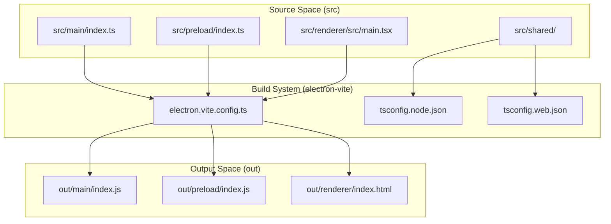
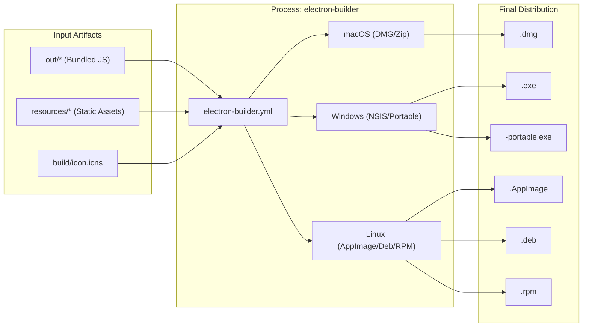

<!-- source: DeepWiki mcp.deepwiki.com · repo fathah/hermes-desktop · page 1.2 Project Structure and Build System · fetched 2026-10-30 -->

# Project Structure and Build System

Relevant source files

The following files were used as context for generating this wiki page:

- [.gitattributes](.gitattributes)
- [.github/workflows/release.yml](.github/workflows/release.yml)
- [.gitignore](.gitignore)
- [.husky/pre-commit](.husky/pre-commit)
- [.husky/pre-push](.husky/pre-push)
- [Development.md](Development.md)
- [README.md](README.md)
- [assets/header.webp](assets/header.webp)
- [assets/partners/atlascloud.webp](assets/partners/atlascloud.webp)
- [assets/partners/greptile.webp](assets/partners/greptile.webp)
- [build/linux-after-install.sh](build/linux-after-install.sh)
- [electron-builder.yml](electron-builder.yml)
- [eslint.config.mjs](eslint.config.mjs)
- [package-lock.json](package-lock.json)
- [package.json](package.json)
- [previews/discover.png](previews/discover.png)
- [previews/memory.png](previews/memory.png)
- [previews/sessions.png](previews/sessions.png)
- [src/main/default-models.ts](src/main/default-models.ts)
- [src/renderer/src/screens/Chat/FileViewer.tsx](src/renderer/src/screens/Chat/FileViewer.tsx)
- [src/renderer/src/screens/Chat/HistoryRow.tsx](src/renderer/src/screens/Chat/HistoryRow.tsx)
- [src/renderer/src/screens/Chat/MessageList.tsx](src/renderer/src/screens/Chat/MessageList.tsx)
- [src/renderer/src/screens/Chat/WorktreePanel.tsx](src/renderer/src/screens/Chat/WorktreePanel.tsx)

This page details the technical organization of the Hermes Desktop repository, its multi-process build pipeline powered by `electron-vite`, and the configuration required for cross-platform packaging and distribution via GitHub Actions.

## Repository Layout

Hermes Desktop follows the standard Electron process separation, organized into four primary directories within `src/`. This structure ensures a strict boundary between the Node.js main process, the secure preload bridge, and the web-based renderer.

| Directory | Process Type | Responsibility |
| :--- | :--- | :--- |
| `src/main` | **Main** | Manages app lifecycle, window creation, SQLite database access (`better-sqlite3`), and the Python Hermes Agent gateway. |
| `src/preload` | **Preload** | Exposes a secure, typed IPC bridge (`HermesAPI`) to the renderer using `contextBridge`. |
| `src/renderer` | **Renderer** | The React 19-based UI, containing components, hooks, and styles. |
| `src/shared` | **Shared** | Universal TypeScript definitions, constants, and i18n translation files used by multiple processes. |

### Data Flow and Process Boundary
The following diagram illustrates how the build system maps these source directories to the final application execution layers.

**Build Entity Mapping**

Sources: [package.json:5-5](), [package.json:15-16]()

## Build Pipeline (`electron-vite`)

The project utilizes `electron-vite` to manage the compilation of the three distinct Electron processes simultaneously. This tool integrates Vite's fast HMR (Hot Module Replacement) for the renderer with Rollup-based bundling for the main and preload scripts.

### Configuration
The `electron-vite` orchestration is driven by `package.json` scripts:
*   **Main & Preload**: Handled by the Node configuration. The `better-sqlite3` dependency [package.json:42-42]() is a native module and requires special handling during the build to ensure it is compiled for the correct target architecture.
*   **Renderer**: Integrates `@vitejs/plugin-react` [package.json:75-75]() and `@tailwindcss/vite` [package.json:66-66](). The renderer entry point is located at `src/renderer/index.html`.

### TypeScript Integration
The project uses a split TypeScript configuration to handle the differing environments (Node.js vs. Browser):
1.  **Node Config (`tsconfig.node.json`)**: Targets the main and preload processes. It includes `src/main`, `src/preload`, and `src/shared`.
2.  **Web Config (`tsconfig.web.json`)**: Targets the renderer process, enabling React JSX transforms.

Sources: [package.json:15-17](), [package.json:75-79](), [package.json:91-92]()

## Packaging and Distribution

Packaging is handled by `electron-builder`, configured via `electron-builder.yml`. The application is distributed as a single executable or installer across macOS, Windows, and Linux.

### Build Commands
The `package.json` defines several scripts for platform-specific builds:
*   `npm run build`: Runs typechecks for both environments and triggers the `electron-vite build` pipeline [package.json:24-24]().
*   `npm run build:mac`: Executes the Vite build followed by `electron-builder --mac` [package.json:28-28]().
*   `npm run build:win`: Executes the Vite build followed by `electron-builder --win` [package.json:27-27]().
*   `npm run build:linux`: Executes the Vite build followed by `electron-builder --linux` [package.json:29-29]().

### Configuration Details
*   **ASAR Unpacking**: The `resources/**` directory and the `better-sqlite3` native binary are explicitly unpacked from the ASAR archive to allow direct filesystem access [electron-builder.yml:12-14]().
*   **Platform Specifics**: 
    *   **Windows**: Uses NSIS for the installer and also generates a `portable` executable [electron-builder.yml:15-21]().
    *   **macOS**: Configures `hardenedRuntime`, `notarize`, and requests permissions for Camera, Microphone, and Documents [electron-builder.yml:29-41]().
    *   **Linux**: Targets `AppImage`, `snap`, `deb`, and `rpm` [electron-builder.yml:44-49](). It includes a specific `afterInstall` script (`build/linux-after-install.sh`) to fix `chrome-sandbox` SUID permissions [electron-builder.yml:60-68]().

**Packaging Data Flow**

Sources: [electron-builder.yml:1-73](), [package.json:26-30]()

## CI/CD Release Pipeline

The release process is automated via GitHub Actions in `.github/workflows/release.yml`. It uses a multi-stage matrix build to generate artifacts for all supported platforms.

### Pipeline Stages
1.  **Prepare**: Reads the version from `package.json` [package.json:3-3]() and checks if the git tag already exists [.github/workflows/release.yml:22-62]().
2.  **Build Jobs**: Separate jobs run for macOS (x64 and arm64) [.github/workflows/release.yml:63-141](), Linux [.github/workflows/release.yml:142-202](), and Windows.
    *   **Native Modules**: The workflow explicitly rebuilds native dependencies for the target architecture using `electron-builder install-app-deps` [.github/workflows/release.yml:85-85]().
    *   **Verification**: The workflow verifies the architecture of the native `better_sqlite3.node` binary before uploading to ensure x64/arm64 consistency [.github/workflows/release.yml:120-132]().
3.  **Publish**: Consolidates artifacts and creates a GitHub Release [.github/workflows/release.yml:1-15]().

Sources: [.github/workflows/release.yml:1-202](), [package.json:3-3]()

## Dependency Management

*   **Production Dependencies**: Includes `better-sqlite3` for local storage, `electron-updater` for auto-updates, `ethers` for wallet operations, and `i18next` for localization [package.json:33-61]().
*   **Development Dependencies**: Includes the `electron-vite` build tool, `tailwindcss` for styling, and `vitest` for the test suite [package.json:62-94]().
*   **Native Modules**: `better-sqlite3` is identified as a critical native dependency requiring specific handling in both the build [electron-builder.yml:14-14]() and CI pipelines [.github/workflows/release.yml:123-126]().

Sources: [package.json:33-94](), [electron-builder.yml:12-14]()

---

