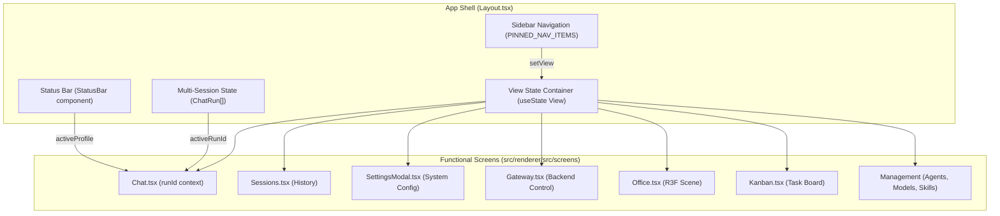
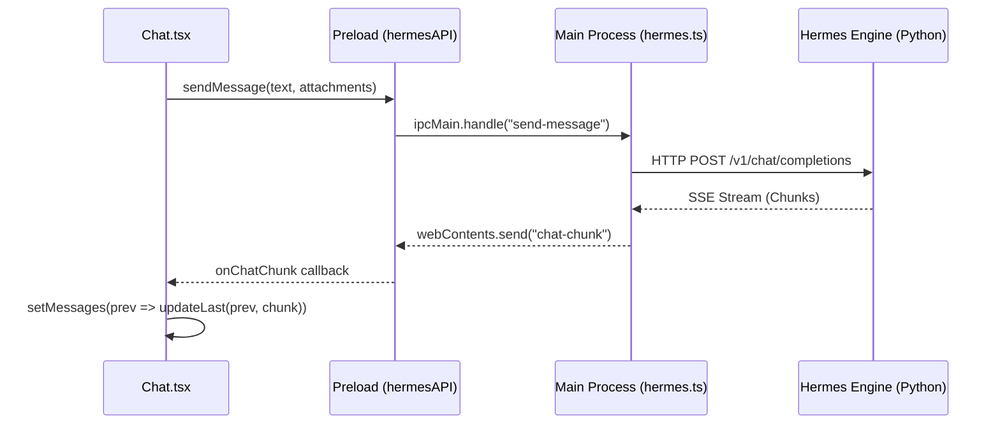

<!-- source: DeepWiki mcp.deepwiki.com · repo fathah/hermes-desktop · page 5 User Interface · fetched 2026-10-30 -->

# User Interface

Relevant source files

The following files were used as context for generating this wiki page:

- [lat.md/lat.md](lat.md/lat.md)
- [lat.md/sidebar-navigation.md](lat.md/sidebar-navigation.md)
- [src/main/config.ts](src/main/config.ts)
- [src/main/hermes.ts](src/main/hermes.ts)
- [src/main/index.ts](src/main/index.ts)
- [src/main/ipc/register.ts](src/main/ipc/register.ts)
- [src/preload/index.d.ts](src/preload/index.d.ts)
- [src/preload/index.ts](src/preload/index.ts)
- [src/renderer/src/assets/icons/index.tsx](src/renderer/src/assets/icons/index.tsx)
- [src/renderer/src/assets/main.css](src/renderer/src/assets/main.css)
- [src/renderer/src/screens/Chat/Chat.tsx](src/renderer/src/screens/Chat/Chat.tsx)
- [src/renderer/src/screens/Layout/Layout.tsx](src/renderer/src/screens/Layout/Layout.tsx)
- [src/renderer/src/screens/Layout/SidebarRecentSessions.tsx](src/renderer/src/screens/Layout/SidebarRecentSessions.tsx)
- [src/renderer/src/screens/Layout/SidebarSessionMenu.tsx](src/renderer/src/screens/Layout/SidebarSessionMenu.tsx)
- [src/shared/i18n/locales/en/navigation.ts](src/shared/i18n/locales/en/navigation.ts)

The Hermes Desktop user interface is a single-page React application running within an Electron renderer process. It is designed with a "Clean Design System" philosophy—utilizing a flat, high-contrast aesthetic with distinct themes including Dark, Light, Dracula, Nord, and One Dark [src/renderer/src/assets/main.css:8-181](). The UI manages complex state transitions between local execution and remote connection modes, while providing a streamlined interface for agent orchestration, session management, and system configuration.

### UI Architecture Overview

The interface is structured around a central `Layout` shell that manages the sidebar navigation and view switching. The application utilizes a state-driven routing approach where the `view` state determines which functional screen is rendered in the primary content area.

Title: Renderer View Routing

Sources: [src/renderer/src/screens/Layout/Layout.tsx:55-66](), [src/renderer/src/screens/Layout/Layout.tsx:104-113](), [src/renderer/src/screens/Layout/chatRuns.ts:8-18]()

---

### Layout Shell and Navigation

The `Layout` component acts as the primary orchestrator for the renderer. It maintains the global state for the active profile, current session, and application view. It supports a multi-session architecture where multiple `ChatRun` objects coexist, allowing users to maintain several active conversations simultaneously [src/renderer/src/screens/Layout/Layout.tsx:110-113]().

*   **View Management**: Switches between functional views including `chat`, `discover`, `office`, `kanban`, and `gateway` [src/renderer/src/screens/Layout/Layout.tsx:55-66]().
*   **Sidebar Navigation**: Organized into `PINNED_NAV_ITEMS` (Discover, Office, Kanban, Schedules) and `FOOTER_NAV_ITEMS` (Providers, Gateway, Tools, Memory) [src/renderer/src/screens/Layout/Layout.tsx:68-84]().
*   **Session Management**: The sidebar includes a `SidebarRecentSessions` component that lazily loads chat history and groups them by "Projects" (context folders) or "Chats" [lat.md/sidebar-navigation.md:13-32]().
*   **Remote Notice**: Displays a `RemoteNotice` when the active connection is in `remote` or `ssh` mode [src/renderer/src/screens/Layout/Layout.tsx:34-34]().

For details, see [Layout Shell and Navigation](#5.1).

Sources: [src/renderer/src/screens/Layout/Layout.tsx:55-113](), [src/renderer/src/screens/Layout/chatRuns.ts:8-18](), [lat.md/sidebar-navigation.md:1-46]()

---

### Chat Interface

The `Chat` screen is the primary interaction point with the Hermes Agent. It features a streaming message interface supported by `useChatIPC`, handling real-time text, reasoning chunks, and tool execution progress [src/renderer/src/screens/Chat/Chat.tsx:13-15]().

Title: Chat Data Flow

Sources: [src/renderer/src/screens/Chat/Chat.tsx:146-164](), [src/preload/index.ts:221-230](), [src/main/hermes.ts:119-134](), [src/renderer/src/screens/Chat/hooks/useChatIPC.ts:31-52]()

For details, see [Chat Interface](#5.2).

---

### Management and Configuration Screens

The UI provides several specialized screens for managing the underlying Hermes engine and its assets:

*   **Settings & Gateway**: Configuration for model providers, credential pools, and the lifecycle of the Python gateway process. It includes a `ConfigHealthBanner` to alert users of misconfigurations [src/renderer/src/screens/Chat/Chat.tsx:30-30]().
*   **Providers**: Specialized screen for API key management and OAuth sign-in flows (e.g., for Hermes One or OpenAI) [src/renderer/src/screens/Layout/Layout.tsx:80-80]().
*   **Kanban**: A JIRA-style multi-agent board for task management, integrated with the office agent status polling [src/renderer/src/screens/Layout/Layout.tsx:73-73]().
*   **Memory & Soul**: Interfaces for managing the agent's long-term context (`MEMORY.md`) and persona definitions (`SOUL.md`) [src/renderer/src/screens/Layout/Layout.tsx:83-83]().

For details, see [Settings, Gateway, Tools, and Providers Screens](#5.3) and [Agents, Models, Skills, Memory, and Soul Screens](#5.4).

Sources: [src/renderer/src/screens/Layout/Layout.tsx:68-84](), [src/renderer/src/screens/Chat/Chat.tsx:30-30](), [src/preload/index.d.ts:177-207]()

---

### Office (Native 3D) Screen

The "Office" view provides a React Three Fiber (R3F) 3D environment where agents are represented as avatars. It supports two main modes:
*   **Walk Mode**: A third-person perspective allowing users to navigate the city and enter buildings [lat.md/lat.md:31-31]().
*   **Orbit Mode**: A traditional top-down or free-camera view for observing agent activities.
*   **Interactions**: Proximity-based triggers for interacting with space representatives (e.g., Bank Teller, ATM) [lat.md/lat.md:32-32]().

For details, see [Office (Native 3D and Claw3D) Screen](#5.5).

Sources: [src/renderer/src/screens/Layout/Layout.tsx:72-72](), [lat.md/lat.md:29-33]()

---

### Design System and Theming

The application's visual identity is defined using CSS Variables for theming, supporting multiple developer-centric themes [src/renderer/src/assets/main.css:1-230]().

| Theme | Key Characteristics | Source |
| :--- | :--- | :--- |
| **Dark** | Default flat grey/charcoal (`#212121`) | [main.css:9-41]() |
| **Light** | High-contrast white/grey (`#ffffff`) | [main.css:44-76]() |
| **Dracula** | Purple-accented classic dev theme | [main.css:79-111]() |
| **Nord** | Frosty blue "Arctic" aesthetic | [main.css:114-146]() |
| **One Dark** | Atom-inspired balanced dark theme | [main.css:149-181]() |

*   **Icons**: Standardized on `lucide-react` via a central index [src/renderer/src/assets/icons/index.tsx:1-64]().
*   **Typography**: Utilizes a mix of Cairo, Manrope, and Space Grotesk for UI elements, with SF Mono for code.

For details, see [Design System and Theming](#5.7).

Sources: [src/renderer/src/assets/main.css:1-230](), [src/renderer/src/assets/icons/index.tsx:1-64]()

---

