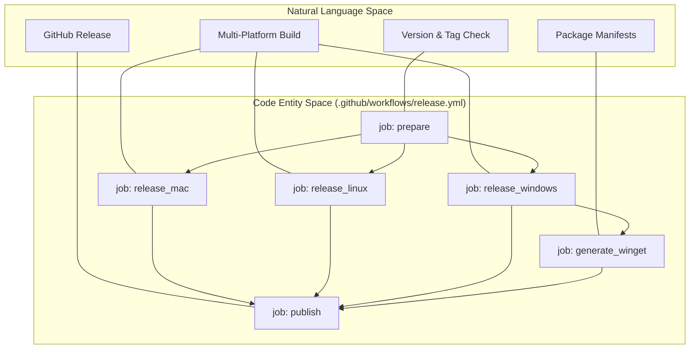
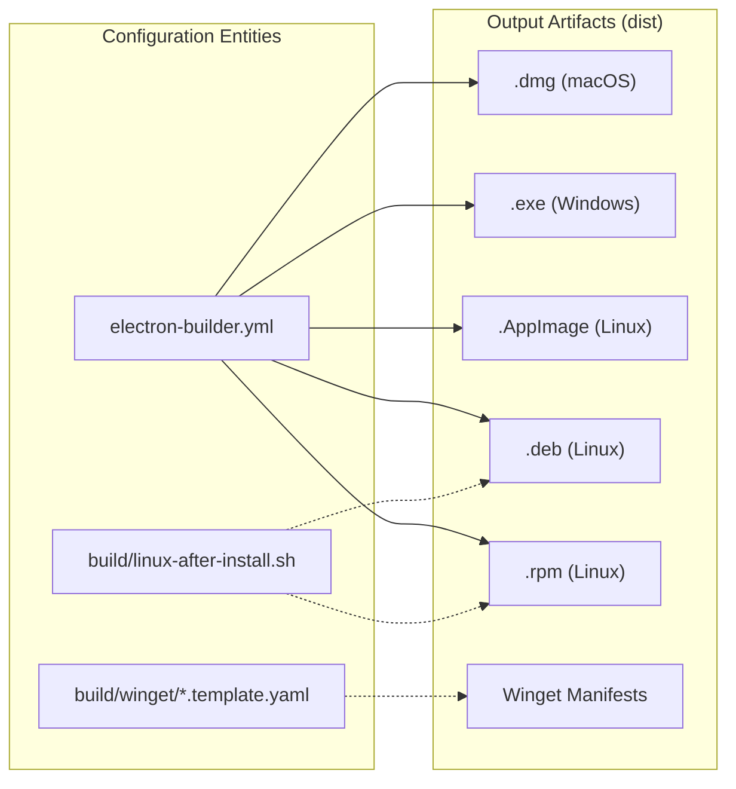

<!-- source: DeepWiki mcp.deepwiki.com · repo fathah/hermes-desktop · page 7 CI/CD, Packaging, and Release · fetched 2026-10-30 -->

# CI/CD, Packaging, and Release

Relevant source files

The following files were used as context for generating this wiki page:

- [.gitattributes](.gitattributes)
- [.github/workflows/release.yml](.github/workflows/release.yml)
- [build/linux-after-install.sh](build/linux-after-install.sh)
- [build/winget/Installer.template.yaml](build/winget/Installer.template.yaml)
- [build/winget/Locale.en-US.template.yaml](build/winget/Locale.en-US.template.yaml)
- [build/winget/Version.template.yaml](build/winget/Version.template.yaml)
- [electron-builder.yml](electron-builder.yml)
- [eslint.config.mjs](eslint.config.mjs)
- [package-lock.json](package-lock.json)
- [package.json](package.json)
- [scripts/generate-winget-manifests.mjs](scripts/generate-winget-manifests.mjs)
- [src/renderer/src/screens/Chat/FileViewer.tsx](src/renderer/src/screens/Chat/FileViewer.tsx)
- [src/renderer/src/screens/Chat/HistoryRow.tsx](src/renderer/src/screens/Chat/HistoryRow.tsx)
- [src/renderer/src/screens/Chat/MessageList.tsx](src/renderer/src/screens/Chat/MessageList.tsx)
- [src/renderer/src/screens/Chat/WorktreePanel.tsx](src/renderer/src/screens/Chat/WorktreePanel.tsx)
- [tests/winget-generator.test.ts](tests/winget-generator.test.ts)

This section provides a high-level overview of how Hermes Desktop is built, packaged for different operating systems, and distributed via GitHub. The project uses a fully automated pipeline to ensure consistent builds and reliable updates for macOS, Windows, and Linux users.

## Pipeline Overview

The Hermes Desktop release process is triggered by pushes to the `release` branch or manual dispatch via `workflow_dispatch` [ .github/workflows/release.yml:4-7](). It orchestrates environment setup, multi-platform compilation, and artifact distribution.

The pipeline is divided into five primary phases:
1.  **Preparation**: Validation of versioning from `package.json`, dry-run flags, and tag existence checks [ .github/workflows/release.yml:22-61]().
2.  **Matrix Build**: Parallel execution of macOS (x64 and arm64), Linux (AppImage, deb, rpm), and Windows (nsis and portable) builds [ .github/workflows/release.yml:63-215]().
3.  **Validation**: Post-build verification of native module architectures, specifically ensuring `better-sqlite3` matches the target CPU [ .github/workflows/release.yml:120-131]().
4.  **Manifest Generation**: Automated creation of Winget manifests for Windows Package Manager distribution using `scripts/generate-winget-manifests.mjs` [ .github/workflows/release.yml:217-251](), [ scripts/generate-winget-manifests.mjs:16-87]().
5.  **Publishing**: Consolidation of all platform-specific artifacts and `latest.yml` update metadata into a unified GitHub Release [ .github/workflows/release.yml:253-294]().

### Pipeline Flow to Code Mapping

The following diagram maps the logical stages of the CI/CD pipeline to the specific jobs defined in the GitHub Actions configuration.

**Sources:**
- [.github/workflows/release.yml:21-251]()

## GitHub Actions Workflows

The project maintains two primary workflows:

*   **CI Workflow (`ci.yml`)**: Runs on every pull request and push to `main`. It executes `npm run typecheck`, `npm test`, and `npm run lint` to ensure code quality and prevent regressions [ package.json:11-17]().
*   **Release Workflow (`release.yml`)**: Handles the heavy lifting of cross-platform builds.
    *   **Prepare Job**: Extracts the version from `package.json` [ .github/workflows/release.yml:34-40](), checks for existing tags [ .github/workflows/release.yml:42-50](), and sets the `is_dry_run` flag [ .github/workflows/release.yml:52-61]().
    *   **Build Jobs**: Uses `macos-latest`, `ubuntu-latest`, and `windows-latest` runners to execute `npm run build` and `electron-builder` [ .github/workflows/release.yml:63-215]().
    *   **Publish Job**: Consolidates artifacts using `actions/download-artifact`, creates a Git tag, and generates a release via `softprops/action-gh-release@v2` [ .github/workflows/release.yml:253-294]().

For details, see [GitHub Actions Release Workflow](#7.1).

**Sources:**
- [package.json:11-17]()
- [.github/workflows/release.yml:22-61]() (Prepare)
- [.github/workflows/release.yml:63-215]() (Build Matrix)
- [.github/workflows/release.yml:253-294]() (Publish)

## Packaging and Artifacts

Hermes Desktop uses `electron-builder` [ package.json:78]() to transform the compiled source code into installable binaries. The configuration is centralized in `electron-builder.yml`.

### Build Targets and Configuration

The application targets several formats to ensure broad compatibility:
*   **macOS**: Generates `.dmg` and `.zip` files for both `x64` and `arm64`. Includes Hardened Runtime and Notarization support [ electron-builder.yml:29-43]().
*   **Linux**: Produces `.AppImage`, `.deb`, and `.rpm` packages [ electron-builder.yml:44-68](). A specific `afterInstall` script `build/linux-after-install.sh` is used to fix `chrome-sandbox` SUID permissions [ electron-builder.yml:64, 68]().
*   **Windows**: Produces an NSIS installer (`.exe`) and a `portable` executable for `x64` [ electron-builder.yml:15-28]().

### Packaging System Entities

This diagram illustrates the relationship between the configuration files and the resulting output artifacts.

For details, see [Platform Packaging and Code Signing](#7.2).

**Sources:**
- [electron-builder.yml:1-73]()
- [scripts/generate-winget-manifests.mjs:16-87]()
- [build/winget/Locale.en-US.template.yaml:1-25]()

## Updates and Distribution

Updates are managed via `electron-updater` [ package.json:44](), which references metadata files generated during the build process. The `publish` provider is configured as `github` [ electron-builder.yml:70-73]().

The `generate-winget-manifests.mjs` script automates the generation of YAML manifests required for the Windows Package Manager, using templates located in `build/winget/` [ scripts/generate-winget-manifests.mjs:53-84](). These manifests include the installer URL and the SHA256 hash of the generated `.exe` [ scripts/generate-winget-manifests.mjs:30-36]().

**Sources:**
- [package.json:44]()
- [electron-builder.yml:70-73]()
- [scripts/generate-winget-manifests.mjs:1-104]()
- [tests/winget-generator.test.ts:42-180]()

---

